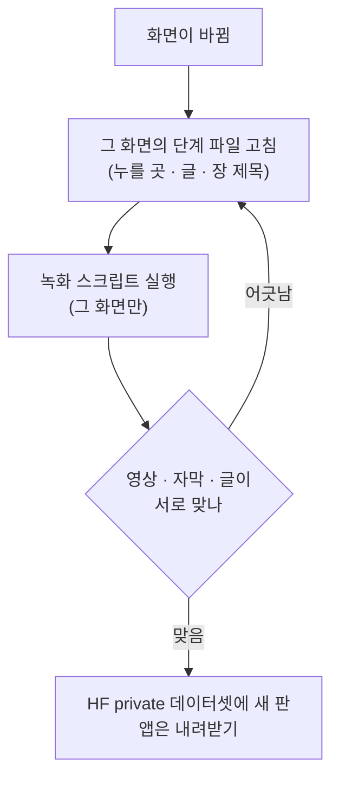
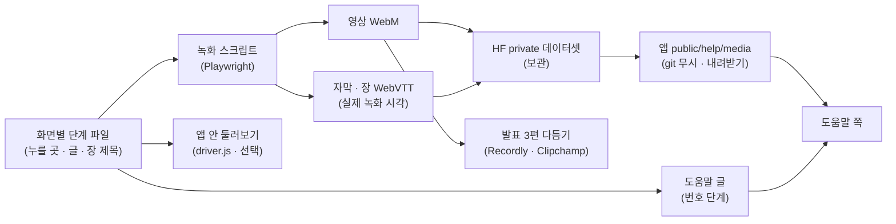

<!-- 옮김 2026-10-16 — 원래 자리 docs/_git-drafts/2026-10-14-S111/배경-시연녹화-도움말/결과.md · 작업 기록(그때 쓴 그대로 · 세션 번호 등 내부 표기 포함) · 정본 없음 -->
# 배경 조사 결과 — 시연 녹화 도구 · 도움말(튜토리얼) 쪽

| 항목 | 내용 |
| --- | --- |
| 작성 | 2026-10-14 (수) KST · 배경 조사 ① |
| 지시서 | `docs/_git-drafts/2026-10-14-S111/지시서-시연녹화-도움말.md` (원문: 같은 폴더 `사용자-요청-원문-시연녹화-도움말.md`) |
| 두 쓰임 | (가) 강사님 발표 요구 — 주요 기능 영상 3편 이상 · 각 3분 내외 · 자막/설명 (나) 사용자 바람 — **모든 기능**의 도움말 쪽(위: 실제 동작 영상 · 아래: 쉬운 글) · 무료 도구만 |
| 조회일 | 웹 출처는 모두 **2026-10-14** |
| 한 일 | 조사만. 설치 · 녹화 · 저장소 파일 수정 없음. 이 파일 하나만 씀 |
| 지킨 것 | GitHub API · `gh` · git 원격 명령 안 씀. github.com 쪽 7건 + docs.github.com 2건을 한 번에 한 건씩 읽음(막힘 없음 · 부록 B). `.env` · 수집 DB 안 엶 |
| 확실도 | **상** 원문(공식 문서 · LICENSE · 요금 쪽 · 로컬 코드)을 직접 읽음 · **중** 공식 출처의 간접 정보(메타데이터 · 조회 시점 숫자)나 원문에서 이끈 추정 · **하** 검색 요약 · 제3자 글만 |
| 출처 표기 | 본문의 `[S번호]` → 9절 출처 표(주소 · 조회일 · 확실도) |

---

## 1. 요약 (추천)

1. **추천 첫 칸은 안 C(융합)** — 「모든 기능」 72화면의 도움말 영상은 **스크립트 녹화**(Playwright · Apache-2.0 · 이 PC 에 이미 1.59 가 있고 녹화용 `page.screencast` API 가 들어 있음)로 찍고, 발표용 3편(3분 내외)만 사람이 **Recordly**(무료 · 자동 확대 · 부드러운 커서 · Windows 10 19041+) 또는 **ZoomIt**(무료 · 수동 확대 · 자르기 · 잇기)로 찍어 **Clipchamp 무료판**(1080p · 워터마크 없음 · AI 자막)으로 다듬는다.
2. 화면마다 **단계 파일 하나**(누를 곳 · 한국어 단계 글 · 장 제목)를 두고 여기서 녹화 스크립트 · WebVTT 자막 · 도움말 번호 단계 글 · (선택) driver.js(MIT) 앱 안 둘러보기를 함께 만든다 — 화면이 바뀌면 그 파일만 고쳐 다시 찍는다.
3. 도움말 한 쪽은 「할 수 있는 일 → 시작 전에 → 영상(자막 · 장) → 따라 하기(번호) → 화면 읽는 법 → 유의 사항 → 자주 묻는 질문 → 다음 화면 → 투자 고지」 — 키움 화면별 도움말 · 토스 [경로]/[유의 사항] · Notion 맨 위 영상 · Robinhood 위험 고지에서 가져온 꼴이고, 영상은 화면당 30~90초 · 어떤 영상도 6분 미만.
4. **영상은 git 에 넣지 않는다** — Playwright 원본은 최대 1Mbit/s(30초 ≈ 최대 3.75MB)라 72편을 다시 찍을 때마다 공개 저장소 이력이 불어난다. 보관은 HF private 데이터셋(무료 조직 private 100GB), 재생은 git 무시 폴더 `public/help/media/` 로 내려받아 앱과 같은 출처에서 낸다. 글(단계 파일 · 도움말 본문)만 git.
5. 「모든 기능」 = 점검표 **72화면**(메뉴 12 + 따로 쪽 2 · 이동원 53 · 신장환 8 · 강민석 6 · 오준영 5) → 도움말 72쪽. 첫 시범은 **일정**(market-calendar) · **재무 · 신용 위험**(agent-cb) · (선택) **리밸런싱 엔진**(robo-rebalance — 다른 주담당 화면 흐름 시험)을 제안한다.

### 1.1 용어 풀이

| 용어 | 뜻 | 이 문서에서 | 헷갈리는 점 |
| --- | --- | --- | --- |
| MIT · Apache-2.0 | 쓰기 · 고치기 · 배포를 거의 조건 없이 허락하는 공개 이용 조건(허용형) | Playwright(Apache) · driver.js · OpenScreen(MIT) | 저작권 · 라이선스 문구를 남기는 조건은 있다 |
| GPL · AGPL | 고쳐서 **배포**(AGPL 은 **네트워크 서비스**까지)하면 그 소스도 같은 조건으로 공개해야 하는 조건(상호형) | OBS(GPL-2.0) · Recordly · Cap(AGPL-3.0) · Shepherd · Intro.js(AGPL) | **앱을 그냥 써서 만든 영상**에는 미치지 않는다(2.3절). 우리 웹앱에 **라이브러리로 넣을 때**만 문제 |
| 라이선스 없음 | LICENSE 파일이 없으면 기본 저작권 — 남이 복사 · 고침 · 배포 못 함 | 강사님 `python-basic-lab` · 우리 저장소 | 공개 저장소여도 「보기 · 포크」만 허락된 상태 [S3] |
| 자동 확대(auto zoom) | 누른 곳 · 커서 쪽으로 화면을 부드럽게 당겨 보여 주는 편집 효과 | Recordly · OpenScreen · Screen Studio 의 핵심 | 녹화 해상도가 낮으면 확대 때 흐려진다 |
| 부드러운 커서 | 떨리는 실제 마우스 길을 매끈한 곡선으로 다시 그림 | Recordly · OpenScreen · Playwright 1.61 `cursor` | Playwright 녹화에는 원래 커서가 안 찍힌다(그려 넣어야 함) |
| 입힌 자막 / 켜는 자막 | 입힌 자막: 영상 그림에 글자가 박힘 · 켜는 자막: 따로 된 글 파일을 재생기가 겹쳐 보임 | 발표 3편 = 입힌 자막도 됨 · 도움말 72편 = 켜는 자막 | 켜는 자막은 고치기 쉽고 검색 · 접근성에 좋다 |
| WebVTT(.vtt) | 웹 표준 시간 맞춤 글 파일(자막 · 장 제목) | 단계 파일에서 자동 생성(제안) | SRT 와 비슷하지만 웹 `<track>` 은 VTT 를 받는다 [S58] |
| WebM · MP4 · GIF | WebM: 웹용 영상 그릇(VP8/VP9) · MP4: 가장 널리 쓰는 그릇(H.264) · GIF: 소리 없는 움짤 | Playwright 원본 = WebM · 발표 = MP4 | GIF 는 크고 화질이 낮아 도움말 본 영상으로 비추천 |
| 비트레이트 · CRF | 비트레이트: 초당 데이터 양(크기를 정함) · CRF: 화질 기준값 | 크기 어림(3.6절) | VP8 은 CRF 와 비트레이트를 함께 주면 비트레이트가 **최대값**이 된다 [S23] |
| Playwright | 브라우저를 코드로 움직이는 시험 도구(Microsoft · Apache-2.0) | 스크립트 녹화의 몸통 | 이 프로젝트는 이미 캡처에 쓰고 있다 |
| screencast (Playwright) | 1.59 에 생긴 녹화 · 겹침 API — `start` · `showActions` · `showChapter` · `showOverlay` | 커서 · 강조 · 장 제목 | 같은 이름의 상용 녹화 프로그램과 다르다 |
| 단계 파일 | 화면마다 「누를 곳 · 글 · 장 제목」을 적은 데이터 파일(제안) | 영상 · 자막 · 도움말 글 · 투어의 한 원천 | 아직 없음 — 8.5절 견본 |
| 투어(둘러보기) 라이브러리 | 실제 화면 위에 강조 상자 · 말풍선을 차례로 띄우는 JS | driver.js(MIT) 추천 | 영상이 아니라 「살아 있는 안내」 |
| 대화형 데모 서비스 | 화면을 찍어 눌러 볼 수 있는 데모로 만드는 유료 서비스(Arcade 등) | 무료 범위가 작아 제외 | 화면 그림이 남의 클라우드로 올라간다 |
| Git LFS | 큰 파일을 git 밖 저장소에 두고 포인터만 커밋하는 확장 | 비추천(6절) | GitHub · GitLab 한도를 따로 먹는다 |
| HF private 데이터셋 | Hugging Face 의 비공개 파일 저장소(이 프로젝트 조직 `qurious-quant`) | 영상 보관 추천 | 공개 쪽에서 바로 못 띄움(토큰 필요) |
| storageState | Playwright 가 로그인 쿠키 · 저장소를 파일로 저장 · 재사용하는 기능 | 시연 계정 로그인 한 번 | 쿠키가 들어 있어 git 에 넣으면 안 된다 [S35] |
| 가짜 응답(route.fulfill) | 녹화 때만 앱이 부르는 API 의 답을 바꿔치기 | 계좌 · 이메일 같은 값 가리기 | 화면이 실제와 달라지므로 「예시 자료」 고지가 필요 |
| WCAG | W3C 웹 접근성 지침 | 자막 · 멈춤 단추 · 글 대체 | 국내 KWCAG 는 이를 바탕으로 하나 원문은 확인 못함 |
| TTS | 글을 음성으로 읽어 주는 합성 | 해설 음성(선택) | 클라우드 TTS 는 이용 조건 확인 필요 |

---

## 2. 사람이 직접 찍고 꾸미는 무료 도구 (Windows)

### 2.1 무료 범위 · 라이선스 · 상태

| # | 도구 | 무엇 | 무료 범위 (원문) | 라이선스 | Windows | 별(조회 시점) | 최근 판 · 상태 | 근거 · 확실도 |
| --- | --- | --- | --- | --- | --- | --- | --- | --- |
| 1 | **강사님 스크립트** `lab_video_capture/` (edumgt/python-basic-lab) | 파이썬 화면 녹화(mss + OpenCV · 단축키) | 공개 저장소 — 단 **LICENSE 파일 없음** | **없음**(기본 저작권) | 됨(강사님 쪽 「Windows 는 그대로 됩니다」) | 2 | 커밋 94 · 2026-10-13 강사님 발표 쪽에 소개 | S1 S2 S3 · 상 |
| 2 | OBS Studio | 녹화 · 방송 | 「Free and open source」 | GPL-2.0(이후 판 가능) | Windows 10 · 11 | 7.75만 | 32.2.2 (8월 14일) | S4 S5 · 상 / 별 중 |
| 3 | **ZoomIt** (Sysinternals 단독판 · PowerToys 안) | 확대 · 그리기 · 녹화 · 자르기 | 무료 · PowerToys 는 「free, open-source」 | 오픈소스(PowerToys) — 라이선스 종류 · 단독판 이용 조건 원문은 안 읽음 | 「all versions of Windows」 · 녹화는 Windows 10 May 2019 Update 이상 | — | 단독판 2026-09-10 게시 | S6 S7 S8 · 상(무료) / 중(종류) |
| 4 | ShareX | 캡처 · GIF 녹화 | 「Free forever. Open source. No account required.」 | 오픈소스 — 종류는 원문 미확인 | Windows 전용 | — | 확인 안 함 | S9 · 상(무료) |
| 5 | Screenity | Chrome 확장 녹화 + 웹 편집기 | 녹화 확장은 무료(「stays free」) · **자동 확대 · 자막 · MP4 내보내기 · 자르기는 유료 편집기**(월 $10 · 연 $120) | 녹화 확장 GPLv3 | Chrome 에서(원문에 Windows 명시 없음) | — | — | S10 · 상 / Windows 중 |
| 6 | Cap | 데스크톱 녹화 · 편집 | 「100% free for personal use」 · 「The free version is for personal use only」 · Studio Mode 무료 포함 · 받아쓰기(자막) 무료 아님 · 상업 이용은 Desktop License 연 $29 · 평생 $58 | AGPLv3 (`cap-camera*` · `scap-*` 는 MIT) | macOS · Windows | 2.33만 | 갈무리에 릴리스 안 보임 | S11 S12 · 상 (요금 쪽 문장끼리 어긋남) |
| 7 | OpenScreen | 데스크톱 녹화 · 편집(Screen Studio 대안) | 무료 | MIT | Windows · mac · Linux | 3.99만 | **2026-06-17 보관 · 관리 끝** · 공동체 갈래 안내 | S13 · 상 / 별 중 |
| 8 | **Recordly** | 데스크톱 녹화 · 편집(OpenScreen 갈래를 크게 고침) | 「fully free and open-source, with no paywalls」 | AGPL-3.0 | Windows 10 20H1(19041)+ · mac · Linux | 3.37만 | 활발(커밋 1,923 · 공식 쪽 2026-09-16 게시) | S14 S15 · 상 / 별 중 |
| 9 | **Clipchamp** (Windows 11 편집기) | 후편집 | 무료: 1080p · 워터마크 없음 · AI 자막 · 음성 · 무음 자르기 | 상용(무료 요금제) | Windows | — | — | S16 S17 · 상 |
| 10 | Screen Studio (기준점) | 녹화 · 편집 | 유료 월 $9(연 결제) · $29(월 결제) | 상용 | **macOS 전용** → 제외 | — | — | S18 · 상 |

- **워터마크**: Clipchamp 무료판은 「with no watermarks」 [S16 · 상]. Recordly 는 「No watermarks」가 제3자 글에만 있다 [S67 · 중]. OBS · ZoomIt · ShareX · OpenScreen 은 원문에 워터마크 언급이 없다(오픈소스 앱이라 넣는 기능이 없는 것으로 보임 · 중). Cap · Screenity 는 원문에 언급 없음.
- **상업 · 팀 이용**: 오픈소스 앱(OBS · ZoomIt · ShareX · OpenScreen · Recordly · Screenity 녹화 확장)은 쓰는 목적에 제한이 없다(라이선스는 배포 · 수정 조건만 둔다 · 중). Recordly 의 「상업적으로 써도 되나」 FAQ 답은 공식 쪽 갈무리에 안 보였고 제3자 글이 「can be used for commercial purposes」라고 적었다 [S67 · 중]. **이용 목적을 제한하는 것은 Cap 하나**(「personal use only」 [S11 · 상]).
- **마지막 판 날짜**: OBS 32.2.2 = 8월 14일(Flathub 「2 months ago」로 보아 2026년 · 중) · ZoomIt 2026-09-10 · Recordly 공식 쪽 2026-09-16 게시(판 번호 미표시) · 나머지는 쪽 갈무리에 릴리스 칸이 비어 「안 보임」.

### 2.2 꾸밈 기능 비교

| 도구 | 커서 | 누른 곳 확대 | 누른 키 표시 | 자막 | 자르기 · 잇기 | 내보내기 | 다시 찍기 |
| --- | --- | --- | --- | --- | --- | --- | --- |
| 강사님 스크립트 | 녹색 점을 그려 넣음 | 없음 | 없음 | `video_captioner.py` = 장면을 BLIP 으로 「그림 설명」 → 자막 + gTTS 음성(화면 조작 설명과는 다름) | `lab_video_edit/` ffmpeg 스크립트 13개 · 끝 5초 자동 제거 | MP4 · 24fps · 기본 해상도 세로형 | 사람이 다시 조작 |
| OBS | 실제 커서 | 없음(기본 · 하) | 없음(기본) | 없음 | 없음(녹화 전용) | MP4 등 | 사람 |
| ZoomIt | 실제 커서 | **수동** — 단축키 확대 · LiveZoom 상태로 녹화 | 없음 · DemoType(미리 쓴 글 자동 입력) | 없음 | **녹화 뒤 자르기 편집기 · 클립 잇기(그냥 · 검정/흰색 0.5초 전환)** | MP4 · GIF · 영역 16:9 고정 | 사람 |
| Screenity | 커서 강조 · 클릭 물결(무료) | 유료 편집기 | — | 유료 편집기(말 받아쓰기) | 유료 편집기 | MP4(편집기) | 사람 |
| Cap | — | 요금 쪽에 없음(확인 못함) | — | 받아쓰기 유료 | Studio Mode | 「any format」 · 4K/60 | 사람 |
| OpenScreen | 부드럽게 · 녹화 뒤 길 다듬기 | **자동** | 단축키 설정(화면 표시 여부 미상) | 해설 음성 기기 안 자동 자막 | 자르기 · 구간 속도 | MP4 · GIF | 사람 |
| Recordly | 커서 겹침 · 부드럽게 · 모션 블러 · 클릭 튕김 | **자동 제안 + 수동 구간** | 언급 없음 | 언급 없음 | 타임라인(자르기 · 속도 · 글 · 그림 · 소리) | MP4 · GIF | 사람 |
| Clipchamp | — | 확인 안 함 | — | **AI 자막** — Azure 클라우드 처리 · 영상당 한 언어 · SRT 내려받기 | 자르기 · 잇기 | 1080p MP4 | — |
| Screen Studio(기준) | 부드럽게 · 크기 바꿈 | 자동 | 「Show shortcuts」 | 받아쓰기(기본 기기 안) | 있음 | — | 사람 |

근거: 강사님 [S1 S2] · OBS 자동 확대 없음은 2026 비교 글 [S67 · 하] · ZoomIt [S6 S7] · Screenity [S10] · Cap [S11] · OpenScreen [S13] · Recordly [S14 S15] — Windows 19041 이전 판은 대체 캡처라 실제 커서가 남을 수 있음 · Clipchamp [S16 S17] · Screen Studio [S18].

### 2.3 라이선스가 우리에게 뜻하는 것

- 녹화 · 편집 **앱을 쓰기만** 하면 의무가 없고, 앱으로 만든 결과물의 저작권은 만든 사람에게 있다 — GNU GPL FAQ: 「copyright law does not give you any say in the use of the output … the copyright on the output belongs to her, not you」 [S26 · 상]. AGPL-3.0 앱(Recordly · Cap)도 앱을 고쳐 남에게 서비스하지 않는 한 같은 이치로 본다(중).
- 걸리는 것 셋:
  1. **Cap 「개인 용도만 무료」** — 부트캠프 팀 발표가 개인 용도인지 요금 쪽에 정의가 없다 [S11 · 상]. 같은 일을 하는 Recordly 가 있으니 쓰지 않는 쪽이 안전하다.
  2. **강사님 스크립트는 LICENSE 가 없다** [S2 · 상] → 코드를 우리 저장소에 복사하려면 허락이 필요하다 [S3 · 상]. 「단축키로 찍고 · 끝을 자동으로 자르는」 방법은 참고하고 우리 코드는 따로 쓴다(중). 강사님 쪽에 이미 고칠 점이 적혀 있다 — 가로 해상도로 · 3분이면 프레임을 메모리에 모아 약 13GB → 루프 안에서 바로 쓰기 · TTS 길이와 `-shortest` [S1 · 상].
  3. **OpenScreen 은 2026-06-17 보관** [S13 · 상] → 버그 · 보안 수정이 없다. 같은 꼴을 원하면 Recordly.
- 한 줄 정리: 발표 3편은 **Recordly**(자동 확대가 필요할 때) 또는 **ZoomIt**(가볍고 자르기 · 잇기까지) → **Clipchamp** 로 자막 · 마무리. OBS 는 꾸밈 기능이 없어 원본 녹화용으로만.

---

## 3. 스크립트로 찍는 길 (다시 찍기 쉬운 자동 녹화)

### 3.1 이 PC 에 이미 있는 것 [S21 · 상]

- `playwright` Python **1.59.0**(드라이버 1.59.1) · 크로미움 · 녹화 전용 ffmpeg(약 3.4MB · LGPL) 설치됨.
- 1.59 의 녹화 API `page.screencast` [S19 · 상]:
  - `start({ path, size })` / `stop()` — 파일 녹화.
  - `showActions()` — 동작하는 요소에 강조 상자 · 동작 제목을 겹침(기본 0.5초).
  - `showChapter(제목, { description, duration })` — 가운데 장 제목 + 설명, 뒤는 흐리게, 기본 2초 → 강사님 「목적 → 실행 과정 → 결과」 장 나눔에 맞음.
  - `showOverlay(html)` — 임의의 HTML 겹침(자막 띠 · 화살표 등).
- 판에 따른 차이 [S19 · 상]: **1.61** `showActions({ cursor: "pointer" })` = 앞 동작 지점에서 다음 지점으로 **움직이는 포인터** · **1.64** `style`(point · highlight · title 을 CSS 로) · `fps`. npm 최신은 **1.64.0**(Apache-2.0 · 2026-10-08 무렵 KST 게시) [S22 · 상 / 게시 시각 중]. Python 1.64 배포 여부는 확인 못함(부록 A).
- **주의 — 동작 제목이 영어 고정 꼴**: `Click` · `Fill "{값}"` · `Navigate to "{주소}"` [S21 · 상]. 그대로 두면 영어와 `localhost` 주소가 영상에 찍혀 화면 글 규칙에 어긋난다 → 1.64 `style.title` 로 숨기거나, 제목은 끄고 `showChapter` · `showOverlay` 로 한국어 글을 띄운다.
- 녹화 꼴: VP8 · 25fps · `-crf 8 -b:v 1M` = **최대 1Mbit/s 품질 고정 모드** [S21 S23 · 상]. `size` 를 안 주면 800×800 안으로 줄어든다 [S19 S20 · 상] → viewport 와 `size` 를 1280×800 으로 같게 준다.
- Playwright Test 설정의 `video: 'on'` + `show: { actions }` 도 같은 기능이고, 영상은 브라우저 컨텍스트를 닫을 때 저장된다 [S20 · 상].
- 후처리용 ffmpeg 전체판(H.264 MP4 · `zoompan` · 자막 입히기)은 따로 필요하다(이번에 설치하지 않음).

### 3.2 꾸밈을 더하는 방법

| 꾸밈 | 방법 | 좋은 점 | 걸리는 점 | 근거 · 확실도 |
| --- | --- | --- | --- | --- |
| 커서 · 클릭 물결 | ① 1.61+ `showActions({ cursor: "pointer" })` ② 직접 넣는 SVG 커서(베지어 곡선 · requestAnimationFrame · 거리 따라 0.4~1.2초) + CSS 물결 ③ webreel 내장 | ① 코드 한 줄 ② 모양 · 속도 마음대로 | ① 판 올리기 필요 ② 실제 마우스도 같은 좌표로 움직여야 이벤트가 난다 | S19 상 · S30 중 · S28 상 |
| 누른 곳 확대 | ① 녹화 중 화면 안 CSS 확대(`transform: scale` + 전환) ② ffmpeg `zoompan` 시간 구간 확대 — 원문 예시 「입력 영상의 첫 1초만 가운데 2배」 ③ Remotion 으로 영상 위에 확대 애니메이션 ④ Motion Canvas | ① 브라우저가 다시 그려 글자가 선명 ② 녹화와 분리 ③ 매끈한 곡선 | ① 겹침(커서 · 강조)이 함께 맞는지 시범 필요(추정) ② 픽셀 확대라 흐려지고 좌표 반올림으로 떨릴 수 있음(하) ③ 무료 조건 = 개인 · 비영리 · 3인 이하 영리 · 평가 → 팀 사용 해석 필요 ④ 코드 애니메이션 위주 | ① 중(원리) ② S24 상 ③ S31 상 ④ S32 상 |
| 장 제목 · 자막 | ① `showChapter` · `showOverlay` 로 영상에 박기 ② 단계 시작 시각을 기록해 **WebVTT 자동 생성** → `<track kind="captions">` · `<track kind="chapters">` | ② 다시 찍지 않고 글만 고침 · 접근성 · 검색 | ① 고치려면 다시 찍기 | S19 · S58 상 |
| 해설 음성(선택) | ① 사람이 녹음 → Whisper(MIT) 받아쓰기 ② MeloTTS-Korean(MIT · CPU 실시간) ③ gTTS(MIT · 「Google Translate’s text-to-speech API」를 부르는 라이브러리 — 강사님 스크립트가 씀) ④ Clipchamp 음성 | ② 로컬 · 무료 | ③ 공식 공개 API 가 아니라 끊김 · 이용 조건 위험(하) · 음성을 넣으면 자막 필수(WCAG 1.2.2) | S63 S65 S64 상 / 위험 하 |
| 누른 키 표시 | webreel keystroke overlay · Playwright 는 직접 겹침 | — | 우리 앱은 클릭 위주라 우선순위 낮음 | S28 상 |
| 쉬는 구간 자르기 | DOM 변화 감시로 쉼 구간 기록 → ffmpeg 한 번에 trim · concat | 영상이 짧아짐 | 구현 품 · Playwright 영상 시각 약 0.8초 어긋남 보정 | S30 중 |

### 3.3 실제로 이렇게 하는 오픈소스 · 글

- **webreel** (vercel-labs) — Apache-2.0 · 별 948 · npm 0.1.4(2026-03 초 게시 · 중) · Node 18+ · 「Vercel Labs Experiment」 표시 [S27 S28 S29 · 상].
  - JSON 단계(`pause` · `click` · `key` · `type` · `scroll` · `wait` · `screenshot` · `drag` · `moveTo` · `navigate` · `hover` · `select`) → 커서 애니메이션 · 키 표시 · 효과음 → MP4 · GIF · WebM(VP9).
  - 기본 화면 1080×1080 · `zoom` 은 CSS 확대 고정값(커서 따라가기 아님) · 크롬 · ffmpeg 을 `~/.webreel` 로 자동 내려받음 · Windows 언급 없음.
  - 우리 「단계 파일」 생각과 같은 꼴이라 **비교 · 참고 대상**. 실험 단계이고 7개월째 새 판이 없어 몸통으로 쓰기엔 위험(중).
- **Jodit 「AI-Powered Demo Video Recorder」 글** — Playwright `recordVideo` 1280×720 · 페이지에 SVG 커서 주입 · 클릭 물결 · MutationObserver 로 쉬는 구간 기록 → ffmpeg `filter_complex` 한 번(「One decode, N trims, one concat」) [S30 · 중 — 제3자 기술 글 · 날짜 표시 없음].
- 같은 방법(가짜 커서 · 클릭 확대)을 쓰는 Claude Code 스킬 목록(promo-video-recorder · browser-tutorial-video · ui-demo 등)은 검색 요약만 봄 [S67 · 하].

### 3.4 시연 계정 · 가짜 자료 · 가리기 (Public 저장소 대비)

- 우리 앱은 쿠키 세션이고, 401 이면 `/login.html` 로 보낸다(`public/js/common.js`). 서버도 미로그인 `app.html` 에 307 을 준다. 화면 이동은 `app.html#<화면키>` 와 메뉴의 `data-view` 속성(`public/js/main.js`) → 스크립트가 화면키로 바로 들어갈 수 있다 [S66 · 상].
- **로그인 한 번 → storageState 재사용**. 상태 파일에는 쿠키가 들어 있어 저장소에 넣지 말라는 것이 Playwright 문서의 경고다 [S35 · 상] → `.playwright-mcp/` 처럼 git 무시 폴더에 둔다.
- 강사님 발표 안내도 「로그인이 필요하면 시연용 계정과 이용 방법을 준비」하라고 한다 [S1 · 상] → **시연 전용 계정**을 따로 만든다.
- **가짜 자료**: `page.route` + `route.fulfill({ json })` 으로 API 답을 바꿔치기, `route.fetch()` 로 실제 답을 받아 일부만 고치기 [S33 · 상] → 계좌번호 · 잔고 · 이메일 · 키가 보이는 화면에만.
- **날짜 고정**: `page.clock.setFixedTime` [S34 · 상] → 다시 찍어도 화면 날짜가 같다.
- **가리기**: 스크린숏의 `mask` · `style` 옵션은 스크린숏 전용이다 [S21 · 상] → 영상에는 `addStyleTag` · `addInitScript` 로 CSS 숨김 · 흐림을 건다.
- **관리자 배지**: 완성도 배지 `#view-completion-indicator` 는 `body` 에 `q-admin` 이 붙을 때만 보인다(`public/js/teamcompletion.js`) [S66 · 상] → 일반 시연 계정으로 찍고, 관리자 화면(시스템관리)은 CSS 로 숨긴다.
- **AI 답이 바뀌는 화면**(AI 투자 상담 · 투자 정보 리서치): 로컬 모델 답이 날마다 달라질 수 있다(프로젝트 메모 · 중) → 도움말 글에는 예시 질문만 고정하고 답 내용은 글로 옮기지 않는다. 답을 가짜로 바꾸면 기능을 속이는 것이 되므로 하지 않는다(제안).

### 3.5 다시 찍기 흐름 (제안)



### 3.6 영상 크기 어림

| 대상 | 가정 | 계산 | 결과 | 확실도 |
| --- | --- | --- | --- | --- |
| 도움말 1편 (WebM · 1280×800 · 30초) | Playwright 원본 · 최대 1Mbit/s | 1,000,000 bit/s × 30 s ÷ 8 | **최대 약 3.75MB**(넘침 허용치 별도) · 정지 화면이 많아 실제는 더 작을 것 | 상한 상 / 실제 하 |
| 도움말 72편 (30~60초) | 위와 같음 | 72 × 3.75~7.5MB | **최대 약 270~540MB** · 다시 찍을 때마다 더해짐 | 중 |
| 발표 1편 (MP4 · 1080p · 3분) | 화면 녹화 1~3Mbit/s 가정 | 1~3Mbit/s × 180 s ÷ 8 | **약 22~68MB** | 하(가정) |

→ 첫 시범에서 실제 크기를 재서 이 표를 고친다. VP9 · AV1 로 다시 인코딩하면 더 줄일 수 있으나 수치는 실측 전이다(하).

---

## 4. 앱 안 둘러보기(투어) 라이브러리 · 대화형 데모 서비스

### 4.1 투어 라이브러리

| 라이브러리 | 라이선스(원문) | 최신 판(npm) | 특징 | 무료 조건 | 근거 · 확실도 |
| --- | --- | --- | --- | --- | --- |
| **driver.js** | **MIT** | 1.9.0 (2026-10-03 무렵) | 약 5KB · 의존 없음 · 바닐라 JS · 여러 단계 투어 · 진행 표시 · 한 요소 강조 · 힌트 | 「Free for everyone, forever」 · 상업 포함 · 표기 불필요 | S36 S37 · 상 |
| Shepherd.js | AGPL-3.0 + 상업 라이선스 | 15.3.0 | — | 「free for open-source, personal and non-commercial」 · 상업: Business $50(프로젝트 5) · Enterprise $300(무제한) 평생 | S38 S39 · 상 |
| Intro.js | AGPL-3.0 + 상업 라이선스 | 8.6.0 | — | 상업 앱 · 테마 · 플러그인은 상업 라이선스 · 가격 $9.99~$299.99 는 검색 요약만 | S40 S41 · 상 / 가격 하 |

- 우리 저장소에는 LICENSE 파일이 없다 [S66 · 상]. AGPL 라이브러리를 웹앱에 넣으면 AGPL 의 소스 공개 조건을 우리 앱에 어떻게 맞출지부터 정해야 한다(중) → **driver.js(MIT)** 가 안전하다.
- **영상 대신 쓸 수 있나**: 투어는 실제 화면 위에서 강조하므로 화면이 바뀌어도 누를 곳만 맞으면 그대로이고 저장 용량이 들지 않는다. 다만 로그인 · 실제 자료가 있어야 하고, 주문처럼 결과가 남는 동작을 대신 실행하면 안 된다(보여 주기만). 발표 영상을 대신하지 못한다 → **영상과 함께**(도움말 쪽의 「이 화면에서 직접 따라 하기」 단추) 쓰는 것이 맞다(제안).
- 단계 파일의 `target`(누를 곳) · `text` 를 driver.js `steps` 로 바꾸면 영상 · 투어 · 글이 한 원천에서 나온다(제안 · 중).

### 4.2 대화형 데모 서비스 — 제외

| 서비스 | 무료 범위(요금 쪽 원문) | 판정 · 까닭 | 근거 |
| --- | --- | --- | --- |
| Arcade | 공개 데모 1 · 공개 영상 1 · 워터마크 제거 · GIF/MP4 내보내기 불가 · 1석 | **제외** — 72쪽에 턱없이 모자람 · 워터마크 | S42 · 상 |
| Supademo | 대화형 데모 5 · 제작자 1 | **제외** — 72쪽에 모자람 · 화면 그림이 외부 클라우드로 | S43 · 상 |
| Storylane | 공개 데모 1개(한 번에 1개만 공개) · 1석 | **제외** — 같은 까닭 | S44 · 상 |

---

## 5. 실제 서비스의 도움말 꼴

### 5.1 서비스별 구성

| 서비스 | 들어가는 길 | 한 쪽 구성 | 영상 · 그림 | 가져올 점 | 근거 |
| --- | --- | --- | --- | --- | --- |
| 키움증권 영웅문4 (PC) | 화면마다 **오른쪽 위 아이콘 → 그 화면 도움말** 팝업 · PDF 내려받기 / 전체 도움말 = 목차(주메뉴 순 트리) · 색인(머릿글자) · 검색 · 탭 셋 「화면도움말」 · 「영웅문 100% 활용하기」(Q&A · 실제 예) · 「영웅문 길라잡이」 | 화면 도움말: 영역별 「이름 : 설명」 · ※ 메모 · 관련 화면 번호 링크 / 따라잡기: 질문 → 설명 · 일부 단계 · 「유의사항 1 · 2」 · 팁 | 영상 없음 · GIF/PNG 그림 많음(메인 화면 쪽 약 20장) | **화면별 도움말 단추 + 메뉴 순 목차 + 검색 + Q&A 탭** | S45 S46 S47 · 상 |
| 토스증권 (웹 고객센터) | 분류 탭 28개 · 검색창 · 「Q.」 질문 목록(쪽 넘김) | 펼치면 **「[어플 경로]」 글머리**(예: 토스앱 > 오른쪽 아래 '증권' > …) + **「[유의 사항]」 글머리** · 바닥에 문의(전화 · 채팅 · 이메일 · 운영 시간) | 본 질문엔 그림 · 영상 없음 | **경로는 「>」 한 줄 · 유의 사항 따로** | S48 · 상 |
| KB증권 | 공식 이용 가이드 쪽을 찾지 못함 | 앱 소개에 「트레이딩 보드 따라하기」 항목이 있다는 검색 요약만 | — | — | S67 · 하 |
| Robinhood (미국 증권) | 도움말 센터 · 이동 경로 · 옆 목록 | 소개 한 단락 · 「Note」 · 「Keep in mind」 · 앱 5단계 · 웹 6단계 · 접는 「Disclosure」 · 바닥 「All investing involves risk.」 · 「Was this article helpful?」 | 그림 거의 없음 | **위험 고지를 쪽마다 바닥에** | S49 · 상 |
| Slack | 도움말 센터 | Desktop / Mobile 탭 · 번호 단계 · Tip / Note · 도움 됐나요(+ 까닭 · 600자) | 글 위주 | 기기별 탭 · 짧은 번호 단계 | S50 · 상 |
| Notion | 도움말 센터 | **맨 위 영상** · 「In this help doc」 요약 · 번호 단계 · Note / Tip · 끝에 목차 · 「Up next」 · 피드백 | 영상 1 + PNG 그림 | **영상 → 요약 → 단계** 순서 · 다음 글 | S51 · 상 |
| Figma | 도움말 센터 | 맨 위 **「Before you start — Who can use this feature」** 상자 · 번호 단계 · Note · 피드백 | 그림 1 | **「시작 전에」 상자(누가 쓸 수 있나)** | S52 · 상 |

### 5.2 영상 길이 · 크기 관행

- **강사님 요구**: 3편 이상 · 각 3분 내외 · 영상마다 다른 기능 · 「목적 → 실행 과정 → 결과」 · 설명이나 자막 · 발표자료에 링크/파일 · 발표 전 재생 확인. 예시 구성은 「핵심 사용자 흐름 / 데이터 처리 · 분석 / 결과 조회 · 활용」 [S1 · 상].
- **Guo · Kim · Rubin (2014, L@S · edX 690만 시청 세션)**: 「Shorter videos are much more engaging」 → 「segment videos into chunks shorter than 6 minutes」. 튜토리얼은 「add support for rewatching and skimming」 [S53 · 상] → 장(chapters) · 단계 시각 링크가 필요하다.
- **Wistia 「2026 State of Video」(1,300만 편)**: 1분 미만 평균 참여율 52% · 1~5분 튜토리얼은 절반 넘게 봄 · 5분을 넘으면 떨어짐 [S54 · 중 — 업체 자료].
- 국내 증권사 도움말의 영상 길이 관행은 확인 못함(본 쪽들이 글 · 그림 위주였음).
- → 도움말 영상 **화면당 30~90초 · 장 3~6개** / 발표 **3분 내외 · 장 3개(목적 · 과정 · 결과)**.

### 5.3 자막 · 접근성

- WCAG 2.2 **1.2.1 (A)** — 소리 없는 녹화 영상은 같은 정보를 주는 글이나 소리가 있어야 한다 [S55 · 상] → **영상 아래 번호 단계 글이 그 「글 대체」 구실**을 한다. 소리 없는 도움말 영상과 잘 맞는 꼴이다.
- **1.2.2 (A)** — 녹음된 소리가 있으면 자막 [S56 · 상] → 해설 음성을 넣으면 자막 필수.
- **2.2.2 (A)** — 저절로 시작해 5초 넘게 움직이는 것은 멈춤 · 숨김 수단이 있어야 [S57 · 상] → 자동 재생 · 반복 GIF 대신 재생 단추가 있는 `<video controls>`.
- `<track>` — `kind` = subtitles · captions · descriptions · chapters · metadata · 파일은 WebVTT · 영상과 같은 출처여야 함(아니면 `crossorigin`) [S58 · 상] → 영상 · VTT 를 앱이 같은 출처에서 낸다.
- 국내 KWCAG 2.2 의 자막 조항 원문은 찾지 못함(부록 A · 하).

---

## 6. 어디에 둘지

### 6.1 한도

| 곳 | 한도(원문) | 근거 |
| --- | --- | --- |
| GitHub 저장소 | 50MiB 넘으면 경고 · 100MiB 넘으면 막음 · 브라우저 올리기 25MiB · 저장소는 「ideally less than 1 GB, and less than 5 GB is strongly recommended」 | S59 · 상 |
| GitHub 릴리스 자산 | 전체 크기 · 대역폭 제한 없음 · 파일 하나는 그 요금제 LFS 최대 파일 크기 미만 | S59 · 상 |
| GitHub LFS (Free · Free 조직) | 저장 10GiB · 대역폭 10GiB(달마다) · 예산 0 이면 넘는 달은 막힘 | S60 · 상 |
| GitLab.com Free | 프로젝트마다 10GiB(저장소 + LFS) · 넘으면 읽기 전용(push 불가) | S61 · 상 |
| HF Hub (무료 사용자 · 조직) | private 100GB · public 최선 노력 · 파일 200GB 미만 권장 · 폴더당 1만 파일 | S62 · 상 |
| 우리 저장소 지금 | `.git` 86MB · `public/` 39MB · 추적 중인 영상 0(GIF 3) · `public/help/` 없음 | S66 · 상 |

### 6.2 선택지

| 선택지 | 좋은 점 | 나쁜 점 | 판정 |
| --- | --- | --- | --- |
| 영상을 공개 저장소(git)에 | clone 하면 바로 있음 | 다시 찍을 때마다 이력이 커짐(72편 × 수 MB × 회차) · GitHub · GitLab 두 원격 모두 · 그대로 공개 | 비추천 |
| Git LFS | 이력에서 큰 파일 분리 | GitHub 10GiB · GitLab 10GiB(저장소 포함)를 따로 관리 · 모두 LFS 설치 · 대역폭 한도 | 비추천 |
| GitHub 릴리스 자산 | 크기 · 대역폭 제한 없음 · 이력에 안 남음 | 올리기는 사람이 웹에서(원격 쓰기) · 공개 · GitLab 은 따로 | 발표 3편을 「파일」로 나눌 때만 |
| **HF private 데이터셋** (`qurious-quant`) | 이미 쓰는 길 · 100GB · 비공개 · 판 관리 | 보는 사람은 조직 권한 · 토큰 필요 → 앱은 내려받기 단계 필요 | **추천 — 72편 보관** |
| **앱 `public/help/media/`** (git 무시) | 앱이 같은 출처로 영상 · VTT 를 냄(`<track>` 조건 충족) | 내려받기 스크립트 필요 | **추천 — 재생 위치** |
| 글(단계 파일 · 도움말 본문) | 작고 고친 이력이 남아야 함 | — | **git 에 둠** |

- VTT 는 실제 녹화 시각에 맞춰 만들어지므로 영상과 한 쌍으로 HF 에 둔다(제안).
- 강사님 샘플처럼 동영상 서비스 링크로 발표자료에 거는 방법은 이번에 조사하지 않았다.

---

## 7. 「모든 기능」 목록과 쪽 수

출처: `docs/시험/대장/기능완성도-점검표.tsv` — 72행(화면 한 줄) · 점수 평균 73.5 · 최저 40 · 최고 96 [S66 · 상]. 범위는 줄이지 않았다.

### 7.1 메뉴별 쪽 수 · 주담당

| 메뉴 | 화면(쪽) | 이동원 | 신장환 | 강민석 | 오준영 |
| --- | ---: | ---: | ---: | ---: | ---: |
| 로보 어드바이저 | 11 | 4 | 2 | 3 | 2 |
| 데이터 | 5 | 5 | | | |
| 직접매매 | 3 | 2 | 1 | | |
| 모의투자 | 5 | 3 | | 2 | |
| 퀀트자동매매 | 6 | 2 | 1 | 1 | 2 |
| 미국주식 | 4 | 4 | | | |
| 투자 인디케이터 | 9 | 4 | 4 | | 1 |
| ML·딥러닝 | 5 | 5 | | | |
| 투자분석 기초 | 5 | 5 | | | |
| 금융 필수 지식 | 14 | 14 | | | |
| 시스템관리 | 2 | 2 | | | |
| 내 계정 | 1 | 1 | | | |
| 따로 쪽(로그인 · 가입) | 2 | 2 | | | |
| **합계** | **72** | **53** | **8** | **6** | **5** |

- 주담당 칸에 「(추정)」이 붙은 화면 둘: 통합 대시보드(강민석) · 주가 차트(직접매매 · 신장환).
- 쪽 수: **화면당 1쪽 = 72쪽 · 영상 72편** + 메뉴 묶음 목차(메뉴 12 + 계정 묶음 · 단계 파일에서 자동) + 도움말 첫 쪽 1.

### 7.2 검증 상태(이름표)별 — 찍기 전에 볼 것

| 이름표 | 화면 수 | 녹화에 뜻하는 것 |
| --- | ---: | --- |
| 검증 우수 | 13 | 바로 찍기 좋음 |
| 핵심 검증 | 14 | 바로 찍기 좋음 |
| 부분 검증 | 22 | 찍을 수 있음 · 일부 기능은 화면만 |
| 외부 의존 | 5 | 외부 서비스 상태에 따라 화면이 달라짐 → 가짜 응답 · 시각 고정 |
| 목업 포함 4 · 목업 폴백 1 · 정적 목업 2 · 목업 계산 1 | 8 | 영상에 목업이 찍힘 → 지금 찍을지 정할 것(8.7) |
| 설명 전용 | 9 | 읽는 화면 → 짧은 영상(찾기 · 넘기기) |
| 시험 없음 | 1 | 동작 확인부터 |

### 7.3 전체 목록 (메뉴 순)

「녹화 메모」는 화면을 열어 보지 않고 화면 이름 · 이름표에서 이끈 **추정(하)** 이다. 첫 시범 때 실제 화면으로 고친다.

#### 로보 어드바이저 (11)

| 화면키 | 화면명 | 주담당 | 점수 · 이름표 | 녹화 메모(추정) |
| --- | --- | --- | --- | --- |
| dashboard | 통합 대시보드 | 강민석(추정) | 78 부분 검증 | 계좌 요약 → 가짜 응답 |
| agent-chat | AI 투자 상담 | 이동원 | 88 핵심 검증 | AI 답이 날마다 다름 |
| robo-portfolio | 자산배분·최적화 | 오준영 | 89 핵심 검증 | — |
| robo-rebalance | 리밸런싱 엔진 | 오준영 | 93 검증 우수 | 첫 시범 후보(선택) |
| robo-screening | 패턴 인식·종목 스크리닝 | 신장환 | 89 핵심 검증 | — |
| robo-patterns | 차트 패턴·지지/저항·멀티타임프레임 | 신장환 | 92 검증 우수 | — |
| robo-decision | 모의 투자 의사결정 | 강민석 | 71 부분 검증 | — |
| robo-testbed | 코스콤 테스트베드 기준 | 강민석 | 50 시험 없음 | 동작 확인부터 |
| agent-cb | 재무 · 신용 위험 | 이동원(10-07 결정) | 95 검증 우수 | **첫 시범 후보** |
| agent-products | 투자 성향별 상품 안내 | 이동원(10-07 결정) | 92 검증 우수 | — |
| agent-news | 투자 정보 리서치 | 이동원 | 84 핵심 검증 | AI 답 · 뉴스가 날마다 다름 |

#### 데이터 (5)

| 화면키 | 화면명 | 주담당 | 점수 · 이름표 | 녹화 메모(추정) |
| --- | --- | --- | --- | --- |
| data-status | 데이터 관제 | 이동원 | 90 검증 우수 | 경로 · 내부 정보가 보이는지 확인 |
| data-guide | 자료 안내 | 이동원 | 88 핵심 검증 | — |
| crawl-auto | 수집 일정 · 단계 | 이동원(수집) | 96 검증 우수 | 수집 단추는 누르지 않고 보여 주기만 |
| crawl-manual | 자료 직접 받기 | 이동원 | 88 핵심 검증 | 실제 내려받기가 돌지 않게 |
| crawl-ingest | 적재 · 백업 | 이동원 | 89 핵심 검증 | 실제 적재가 돌지 않게 |

#### 직접매매 (3)

| 화면키 | 화면명 | 주담당 | 점수 · 이름표 | 녹화 메모(추정) |
| --- | --- | --- | --- | --- |
| trading-chart | 주가 차트 | 신장환(추정) | 85 핵심 검증 | — |
| trading-portfolio | 포트폴리오 | 이동원(10-07 결정) | 72 부분 검증 | 잔고 → 가짜 응답 |
| trading-order | 주문/매매 | 이동원(10-07 결정) | 61 목업 포함 | 목업 찍힘 · 주문은 모의로만 |

#### 모의투자 (5)

| 화면키 | 화면명 | 주담당 | 점수 · 이름표 | 녹화 메모(추정) |
| --- | --- | --- | --- | --- |
| paper-dashboard | 모의계좌 현황 | 강민석 | 70 부분 검증 | 계좌번호 → 가리기 |
| paper-stock | 국내주식 모의주문 | 강민석 | 77 부분 검증 | 계좌번호 → 가리기 |
| paper-crypto | 코인 모의매매 | 이동원(10-07 결정) | 68 외부 의존 | 외부 시세 → 시각 고정 |
| paper-alternative | 대체자산 (선물·옵션·금·부동산) | 이동원(10-07 결정) | 66 부분 검증 | — |
| paper-openapi | Open API · 외부 연동 | 이동원(3차 P02-③-3) | 70 부분 검증 | 키 · 토큰 → 가리기 |

#### 퀀트자동매매 (6)

| 화면키 | 화면명 | 주담당 | 점수 · 이름표 | 녹화 메모(추정) |
| --- | --- | --- | --- | --- |
| quant-dashboard | 퀀트 대시보드 | 신장환 | 89 핵심 검증 | — |
| quant-auto | 자동매매 현황 | 오준영 | 85 핵심 검증 | 계좌 → 가리기 |
| quant-backtest | 전략 분석 | 이동원(10-07 결정) | 71 부분 검증 | — |
| quant-lean | LEAN 백테스트 (QuantConnect) | 강민석 | 65 외부 의존 | 실행 대기 → 쉬는 구간 자르기 |
| settings | 증권사 API 설정 | 오준영 | 62 목업 포함 | **API 키 → 가리기 필수** |
| notification-settings | 알림 설정 | 이동원(3차 P02-③-3) | 58 외부 의존 | 연락처 → 가리기 |

#### 미국주식 (4)

| 화면키 | 화면명 | 주담당 | 점수 · 이름표 | 녹화 메모(추정) |
| --- | --- | --- | --- | --- |
| us-dashboard | 대시보드 | 이동원(10-07 결정) | 70 목업 폴백 | 목업이 찍힐 수 있음 |
| us-chart | 주가 차트 | 이동원(10-07 결정) | 78 부분 검증 | — |
| us-order | 주문/매매 | 이동원(10-07 결정) | 57 목업 포함 | 목업 찍힘 |
| us-portfolio | 포트폴리오 | 이동원(10-07 결정) | 68 부분 검증 | 잔고 → 가짜 응답 |

#### 투자 인디케이터 (9)

| 화면키 | 화면명 | 주담당 | 점수 · 이름표 | 녹화 메모(추정) |
| --- | --- | --- | --- | --- |
| indicator-strategy | 기본 인디케이터 전략 | 신장환 | 91 검증 우수 | — |
| indicator-custom | 커스텀 인디케이터 개발 | 신장환 | 91 검증 우수 | — |
| indicator-formula | 자유 산식 지표 (DSL·버전) | 신장환 | 95 검증 우수 | — |
| indicator-backtest | 성과 검증 (Python) | 신장환 | 90 검증 우수 | — |
| indicator-api | 증권사 API 자동화 | 오준영 | 58 목업 포함 | 키 → 가리기 · 목업 |
| indicator-tradingview | TradingView 연동 (Webhook·교차검증) | 이동원(3차) | 84 핵심 검증 | Webhook 주소 · 비밀값 → 가리기 |
| company-dashboard | 지표 대시보드 | 이동원(10-07 결정) | 75 부분 검증 | — |
| company-compare | 지표 비교 분석 | 이동원(10-07 결정) | 45 정적 목업 | 목업 찍힘 |
| company-sector | 섹터 인디케이터 | 이동원(10-07 결정) | 42 정적 목업 | 목업 찍힘 |

#### ML·딥러닝 (5)

| 화면키 | 화면명 | 주담당 | 점수 · 이름표 | 녹화 메모(추정) |
| --- | --- | --- | --- | --- |
| ml-compare | 모델 비교 (7종) | 이동원(10-07 결정) | 77 부분 검증 | 학습 대기 → 쉬는 구간 자르기 |
| ml-regression | 회귀 분석 | 이동원(10-07 결정) | 72 부분 검증 | — |
| ml-cluster | 종목 군집화 | 이동원(10-07 결정) | 72 부분 검증 | — |
| ml-tune | 하이퍼파라미터 튜닝 | 이동원(10-07 결정) | 70 부분 검증 | 실행 대기 → 쉬는 구간 자르기 |
| ml-deeplearning | 딥러닝 (LSTM·Transformer) | 이동원(10-07 결정) | 40 설명 전용 | 읽기 화면 |

#### 투자분석 기초 (5)

| 화면키 | 화면명 | 주담당 | 점수 · 이름표 | 녹화 메모(추정) |
| --- | --- | --- | --- | --- |
| macro-dashboard | 거시경제 지표 | 이동원(기초 구현 · 10-03 결정) | 75 외부 의존 | 시각 고정 |
| macro-industry | 산업 분석 | 이동원(기초 구현) | 72 외부 의존 | 시각 고정 |
| invest-fundamental | 재무제표 분석 | 이동원(기초 구현) | 45 목업 계산 | 목업 |
| invest-technical | 기술적 분석 | 이동원(기초 구현) | 40 설명 전용 | 읽기 화면 |
| market-calendar | 일정 | 이동원 | 93 검증 우수 | **첫 시범 후보** |

#### 금융 필수 지식 (14)

| 화면키 | 화면명 | 주담당 | 점수 · 이름표 | 녹화 메모(추정) |
| --- | --- | --- | --- | --- |
| fin-lectures | 강의실 (전체 과정) | 이동원 | 80 핵심 검증 | — |
| fin-topic-futures | 선물과 옵션 | 이동원 | 76 부분 검증 | — |
| fin-topic-funds | 펀드와 ETF | 이동원 | 76 부분 검증 | — |
| fin-topic-bonds | 채권 · 금리 · 코인 | 이동원 | 76 부분 검증 | — |
| fin-topic-allocation | 자산배분과 퀀트 | 이동원 | 76 부분 검증 | — |
| fin-topic-company | 회사 구조 · 세무회계 | 이동원 | 54 설명 전용 | 읽기 화면 |
| fin-topic-stocks | 주식시장 기초 | 이동원 | 54 설명 전용 | 읽기 화면 |
| fin-topic-technical | 기술적 분석 기초 | 이동원 | 54 설명 전용 | 읽기 화면 |
| fin-topic-industry | 산업 · 기업 · 재무 | 이동원 | 54 설명 전용 | 읽기 화면 |
| fin-topic-macro | 거시경제와 시장 | 이동원 | 54 설명 전용 | 읽기 화면 |
| fin-products | 금융상품 이해 | 이동원(세부 기능 1 개선 후보) | 45 설명 전용 | 읽기 화면 |
| fin-allocation | 자산배분 모델 | 이동원(세부 기능 1 개선 후보) | 45 설명 전용 | 읽기 화면 |
| quant-seasonal | 계절성 분석 | 이동원(10-07 결정) | 74 부분 검증 | — |
| fin-glossary | 용어사전 | 이동원 | 90 검증 우수 | 첫 시범 대안 |

#### 시스템관리 (2) · 내 계정 (1) · 따로 쪽 (2)

| 화면키 | 화면명 | 메뉴 | 주담당 | 점수 · 이름표 | 녹화 메모(추정) |
| --- | --- | --- | --- | --- | --- |
| sysadmin-dashboard | 서버 대시보드 | 시스템관리 | 이동원(10-07 결정) | 72 부분 검증 | 관리자 계정 · 배지 숨김 · 서버 정보 가리기 |
| sysadmin-logs | 감사 로그 | 시스템관리 | 이동원(10-07 결정) | 74 부분 검증 | 사용자 기록 → 가리기 |
| mypage | 내 정보 (마이페이지) | 내 계정 | 이동원(계정) | 90 검증 우수 | 개인정보 → 시연 계정 · 가짜 응답 |
| login | 로그인 | 따로 쪽(login.html) | 이동원(계정) | 88 핵심 검증 | 시연 계정으로 |
| register | 가입 | 따로 쪽(register.html) | 이동원(계정) | 88 핵심 검증 | 가짜 이메일로 |

---

## 8. 추천 안과 첫 시범

### 8.1 안 비교

| | 안 A — 사람이 찍고 꾸밈 | 안 B — 스크립트 자동 녹화 + 후처리 | **안 C — 융합 (추천)** |
| --- | --- | --- | --- |
| 하는 법 | Recordly · ZoomIt · OBS 로 찍고 Clipchamp 로 다듬음 | Playwright 단계 스크립트로 찍고 VTT · 겹침 자동 | 72편 = B · 발표 3편 = A |
| 무료 여부 | 모두 무료 | 모두 무료(Playwright · ffmpeg · driver.js) | 모두 무료 |
| 라이선스 | 앱을 쓰기만 함 → 영상은 우리 것(GPL · AGPL 앱도 무관) · Cap 은 개인 용도 조건 주의 | Apache-2.0 · LGPL · MIT — 스크립트를 저장소에 넣어도 문제 없음 | 둘 다 |
| Windows | 됨(Recordly 는 Win10 19041+) | 됨(이미 설치) | 됨 |
| 꾸밈 품질 | 높음(자동 확대 · 부드러운 커서 · 모션 블러) | 중간(커서 · 강조 · 장 제목 · 자막 / 확대는 직접 구현) | 발표 3편 높음 · 72편 중간 |
| 72화면 품 (어림 · 하) | 화면당 찍기 2~3번 + 편집 → 30~45분 × 72 ≈ 36~54시간 | 틀 만들기 1~2일 + 단계 파일 15~30분 × 72 ≈ 18~36시간 | B + 발표 3편 3~6시간 |
| 화면이 바뀔 때 | 사람이 다시 찍고 다시 편집 | 단계 파일만 고치고 다시 실행(72편 × 1~2분 기계 시간) | 72편은 자동 · 3편은 발표 직전 한 번 |
| 위험 | 품이 커서 「모든 기능」을 끝까지 하기 어려움 · 사람 조작 중 개인정보 노출 · 화면 바뀌면 영상이 낡음 | 1.59 → 1.61~1.64 판 올리기 필요 · 확대는 직접 구현 · 영어 동작 제목 노출 주의 · 누를 곳 바뀌면 스크립트 깨짐 | 두 길을 모두 익혀야 함 |
| 판정 | — | — | **첫 칸** |

### 8.2 안 C — 흐름



- **72편 (안 B)**: Playwright screencast — `showActions` 는 커서 포인터(1.61+)와 강조 상자만 쓰고 영어 제목은 숨김(1.64 `style.title`) · `showChapter` 로 장 제목 · 단계 시각에서 VTT 자동 생성. 확대는 처음엔 빼고, 시범에서 「화면 안 CSS 확대」를 실험한다.
- **발표 3편 (안 A)**: Recordly 로 사람이 찍어 자동 확대 · 부드러운 커서를 얻고 → Clipchamp 로 자르기 · 자막(SRT) · 필요하면 해설. 더 가볍게 하려면 ZoomIt(수동 확대 · 자르기 · 잇기).
- **강사님 스크립트**는 비교 칸으로 남긴다(커서 녹색 점 · 확대 없음 · LICENSE 없음). 우리 안 B 가 같은 「스크립트로 찍기」 방향이면서 화면 조작까지 자동이라는 점을 발표에서 설명할 수 있다.
- **앱 안 투어**는 2단계(선택) — driver.js 를 같은 단계 파일로.

### 8.3 발표 3편 구성 제안 (강사님 예시 구조에 우리 화면을 대응)

| 영상 | 강사님 예시 | 우리 화면 흐름(제안) | 주담당 |
| --- | --- | --- | --- |
| 1 | 핵심 사용자 흐름 | 로그인 → 통합 대시보드 → AI 투자 상담 → 투자 성향별 상품 안내 | 강민석(추정) · 이동원 |
| 2 | 데이터 처리 · 분석 | 수집 일정 · 단계 → 데이터 관제 → 자료 안내 → 재무 · 신용 위험 | 이동원 |
| 3 | 결과 조회 · 활용 | 자산배분 · 최적화 → 리밸런싱 엔진 → 모의계좌 현황 / 또는 기본 인디케이터 전략 → 성과 검증 → TradingView 연동 | 오준영 · 강민석 / 신장환 · 이동원 |

- 강사님은 「본인 업무 위주로 발표」를 요구한다 [S1] → 네 사람이 자기 화면이 든 영상을 한 편씩 맡으면 4편(3편 이상 조건 충족)도 된다. 어느 쪽으로 할지는 정할 것.

### 8.4 도움말 한 쪽 견본 (글 틀)

| 순서 | 블록 | 들어갈 것 | 가져온 곳 |
| --- | --- | --- | --- |
| 1 | 제목 · 경로 | 「투자분석 기초 › 일정」 + 「이 화면 열기」 단추 | 키움 화면 번호 · Robinhood 이동 경로 |
| 2 | 할 수 있는 일 | 한두 문장 — 목적 | Notion 요약 · 강사님 「목적」 |
| 3 | 시작 전에 | 로그인 필요 여부 · 누가 쓸 수 있나 · 필요한 준비 | Figma 「Before you start」 |
| 4 | 영상 | 30~90초 · 재생 단추(자동 재생 없음) · 자막 켜기 · 장 목록 | Notion 맨 위 영상 · WCAG 2.2.2 |
| 5 | 따라 하기 | 번호 단계 — 영상의 장과 같은 번호 · 시각을 누르면 그 장면으로 | Slack · Robinhood 번호 단계 · Guo 2014 「다시 보기 · 건너뛰기」 |
| 6 | 화면 읽는 법 | 숫자 · 색 · 표시의 뜻 · 용어사전 연결 | 키움 「이름 : 설명」 |
| 7 | 유의 사항 | 글머리 2~4개 | 토스 「[유의 사항]」 · 키움 「유의사항」 |
| 8 | 자주 묻는 질문 | 2~3개 | 키움 「100% 활용하기」 · 토스 Q&A |
| 9 | 다음에 볼 화면 | 1~2개 | Notion 「Up next」 |
| 10 | 안내(고정 문구) | 예시 자료 · 투자 권유 아님 · 과거 수익률 고지 | Robinhood 바닥 고지 |
| 11 | 도움이 되었나요 | 예 / 아니요 (선택) | Slack · Notion · Figma |

화면에 들어갈 글의 본보기(화면 글 규칙에 맞춤 · 내용은 실제 화면을 보고 고친다):

```text
투자분석 기초 › 일정                                   [이 화면 열기]

이 화면에서 할 수 있는 일
  경제 지표 발표일과 휴장일 같은 시장 일정을 날짜별로 확인합니다. (예시 문장)

시작 전에
  · 로그인이 필요합니다.

[ 영상 · 0:45 · 자막 · 장 3개 ]

따라 하기
  1. 메뉴에서 「투자분석 기초 › 일정」을 누릅니다.            0:02
  2. 보고 싶은 날짜를 고릅니다.                             0:12
  3. 일정을 누르면 자세한 내용이 열립니다.                   0:27

유의 사항
  · 일정은 발표 기관 사정으로 바뀔 수 있습니다.

다음에 볼 화면
  · 거시경제 지표

안내
  이 안내의 화면과 수치는 예시 자료입니다. 특정 종목이나 상품의 매수 · 매도를
  권하는 것이 아니며, 과거 수익률이 미래 수익을 보장하지 않습니다.
```

- 각 화면 머리에 **도움말 단추 → 그 화면 도움말을 서랍으로** 여는 꼴(키움의 「화면마다 오른쪽 위 아이콘」)과, 메뉴 순 목차 · 검색이 있는 **도움말 모음 화면**을 함께 두는 것을 제안한다. 앱 안 화면으로 넣을지 따로 쪽(`public/help/`)으로 둘지는 학습 · API 문서 통합 논의와 함께 정한다(8.7).

### 8.5 단계 파일 견본 (제안 · 키는 영어 · 값은 한국어)

```yaml
# 예: docs/help/steps/market-calendar.yaml (경로 · 칸 이름은 제안)
screenKey: market-calendar
title: 일정
menu: 투자분석 기초
summary: 경제 지표 발표일과 휴장일 같은 시장 일정을 날짜별로 확인합니다.   # 예시 문장
before:
  - 로그인이 필요합니다.
recording:
  viewport: { width: 1280, height: 800 }
  fixedTime: "2026-10-14T09:00:00+09:00"   # page.clock.setFixedTime
  mocks: []                                # 가짜 응답이 필요한 화면만 (route.fulfill)
  hideCss: "#view-completion-indicator { display: none !important; }"
chapters:
  - title: 일정 열기
    steps:
      - action: click
        target: '[data-view="market-calendar"]'   # main.js 의 화면 이동 규칙과 같음
        text: 메뉴에서 「투자분석 기초 › 일정」을 누릅니다.
  - title: 날짜 고르기
    steps:
      - action: click
        target: TODO                                # 실제 화면에서 확인
        text: 보고 싶은 날짜를 고릅니다.
notes:
  - 일정은 발표 기관 사정으로 바뀔 수 있습니다.
faq: []
next: [macro-dashboard]
```

한 파일에서 나오는 것: ① 녹화 스크립트가 `chapters[].steps` 를 차례로 실행 → WebM ② 각 장 · 단계의 실제 시각 → `captions.vtt`(단계 글) · `chapters.vtt`(장 제목) ③ 도움말 쪽의 「따라 하기」 번호 목록 ④ (선택) driver.js `steps`(element = `target` · 설명 = `text`).

### 8.6 첫 시범 화면

| 순서 | 화면 | 메뉴 · 주담당 · 점수 | 고른 까닭 |
| --- | --- | --- | --- |
| 1 | **일정** (market-calendar) | 투자분석 기초 · 이동원 · 93 검증 우수 | 개인정보가 나올 가능성이 낮고(추정) 날짜 고정이 쉬움 → 틀(녹화 → VTT → 도움말 쪽) 검증용 |
| 2 | **재무 · 신용 위험** (agent-cb) | 로보 어드바이저 · 이동원 · 95 검증 우수 | 입력 → 결과 카드 흐름 · 발표 영상 2 후보와 겹침 → 커서 · 강조 · 장 제목 검증 |
| 3 (선택) | **리밸런싱 엔진** (robo-rebalance) | 로보 어드바이저 · 오준영 · 93 검증 우수 | 다른 주담당 화면에서 「초안 → 주담당 확인」 흐름을 한 번 돌려 봄. 이동원 화면만으로 하려면 대신 **용어사전**(fin-glossary · 90) |

시범에서 잴 것: 편당 크기(MB) · 녹화 시간 · 단계 파일 쓰는 시간 · 다시 찍기 시간 · 영상과 글이 어긋나는 곳 · 겹침(커서 · 장 제목)이 CSS 확대와 함께 맞는지 · Playwright 영상 시각 어긋남(제3자 글 기준 약 0.8초).

### 8.7 정할 것 (사용자 결정 · 추천 첫 칸)

| # | 정할 것 | 선택지 (추천 먼저) | 근거 |
| --- | --- | --- | --- |
| 1 | 녹화 길 | **안 C** / 안 A / 안 B | 8.1 |
| 2 | Playwright 판 | **1.64 로 올림**(커서 포인터 · 제목 숨김 · fps) / 1.59 유지 + 직접 겹침 · Python 1.64 가 아직 없으면 녹화 스크립트만 Node(npm 1.64.0) | 3.1 · 부록 A |
| 3 | 영상 보관 | **HF private 데이터셋 새로(예: help-videos) + 앱 `public/help/media/` git 무시** / GitHub 릴리스 / LFS | 6.2 |
| 4 | 목업 · 설명 전용 17화면 영상 | **글 먼저 · 영상은 구현 뒤** / 지금 목업 그대로 찍기 — 어느 쪽이든 72쪽 범위는 그대로 | 7.2 |
| 5 | 발표 편 구성 · 음성 | **4명 × 1편(자기 화면) · 소리 없이 자막** / 3편 공동 · 사람 해설 / MeloTTS 음성 | 8.3 · 3.2 |
| 6 | 사람이 찍는 도구 | **Recordly**(자동 확대) / ZoomIt(가벼움) — 둘 다 무료 | 2.1 · 2.2 |
| 7 | 앱 안 투어 | **2단계에서 driver.js** / 넣지 않음 | 4.1 |
| 8 | 도움말 위치 | **앱 안 서랍 + 모음 화면** / 따로 쪽 `public/help/` — 학습 · API 문서 통합 논의와 함께 | 8.4 |
| 9 | (해당 시) 강사님 스크립트 코드를 그대로 쓸 때 | 쓰지 않고 방법만 참고 / 강사님께 허락 받기 | 2.3 |

---

## 9. 출처 표 (조회일 모두 2026-10-14)

| # | 출처 | 주소 · 위치 | 확인한 것 | 확실도 |
| --- | --- | --- | --- | --- |
| S1 | 강사님 발표 쪽(로컬 사본 · 읽기만) | `learning/th07-domain-rag-lab/lecture/frontend/project2-presentation.html` (커밋 fcf6e53 · 2026-10-13 15:05 KST 「화면 녹화 섹션 추가」 · ea2f745 · 969bff5) | 영상 3편 이상 · 3분 내외 · 목적 → 과정 → 결과 · 자막 · python-basic-lab 안내 · 고칠 점 · 시연용 계정 준비 | 상 |
| S2 | edumgt/python-basic-lab | <https://github.com/edumgt/python-basic-lab> | LICENSE 없음 · 별 2 · 커밋 94 · `lab_video_edit` ffmpeg 13개 · `video_captioner` BLIP + gTTS · 녹화는 로컬 실행 권장 | 상 |
| S3 | Choose a License — No License | <https://choosealicense.com/no-permission/> | 라이선스 없음 = 기본 저작권 · 보기 · 포크만 | 상 |
| S4 | OBS 공식 | <https://obsproject.com/> | 32.2.2 (8월 14일) · Windows 10 · 11 · 「Free and open source」 | 상 |
| S5 | OBS 저장소 | <https://github.com/obsproject/obs-studio> | GPL-2.0(이후 판) · 별 7.75만 | 상 / 별 중 |
| S6 | PowerToys ZoomIt 문서 | <https://learn.microsoft.com/en-us/windows/powertoys/zoomit> | 녹화(전체 · 영역 · 창) · MP4/GIF · 자르기 편집기 · 클립 잇기 · DemoType | 상 |
| S7 | Sysinternals ZoomIt | <https://learn.microsoft.com/en-us/sysinternals/downloads/zoomit> | 2026-09-10 게시 · 모든 Windows · 단축키 표 | 상 |
| S8 | PowerToys 개요 | <https://learn.microsoft.com/en-us/windows/powertoys/> | 「free, open-source utilities」 · Mouse utilities · ZoomIt | 상 |
| S9 | ShareX 공식 | <https://getsharex.com/> | 무료 · 오픈소스 · Windows · GIF 녹화 | 상 |
| S10 | Screenity 공식 | <https://screenity.io/> | 녹화 확장 GPLv3 무료 · 편집기 유료($10/월) · 자동 확대 · 자막은 편집기 | 상 |
| S11 | Cap 요금 | <https://cap.so/pricing> | 개인 용도만 무료 · Desktop License $29/년 · $58 평생 · Studio Mode 무료 · 받아쓰기 유료 | 상 |
| S12 | Cap 저장소 | <https://github.com/CapSoftware/Cap> | AGPLv3(일부 MIT) · 별 2.33만 · macOS · Windows | 상 / 별 중 |
| S13 | OpenScreen 저장소 | <https://github.com/siddharthvaddem/openscreen> | MIT · 별 3.99만 · 2026-06-17 보관 · 자동 확대 · 자동 자막 · MP4/GIF | 상 / 별 중 |
| S14 | Recordly 공식 | <https://recordly.dev/> | 무료 · 오픈소스 · 자동 확대 · 부드러운 커서 · MP4/GIF · 2026-09-16 게시 | 상 |
| S15 | Recordly 저장소 | <https://github.com/webadderallorg/Recordly> | AGPL-3.0 · 별 3.37만 · Windows 10 19041+ · 커서 · 확대 기능 | 상 / 별 중 |
| S16 | Clipchamp 요금 | <https://clipchamp.com/en/pricing/> | 무료 1080p · 워터마크 없음 · AI 자막 | 상 |
| S17 | Clipchamp 자동 자막 도움말 | <https://support.microsoft.com/en-au/topic/how-to-use-autocaptions-in-clipchamp-ccb0520b-38f6-4fa9-aca8-872c2964946a> | Azure 처리 · 영상당 한 언어 · SRT 내려받기 | 상 |
| S18 | Screen Studio 공식 | <https://screen.studio/> | macOS 전용 · $9~29/월 · 자동 확대 · 키 표시 | 상 |
| S19 | Playwright Screencast API | <https://playwright.dev/docs/api/class-screencast> | v1.59 메서드 · v1.61 cursor · v1.64 style · fps · 800×800 기본 | 상 |
| S20 | Playwright Videos | <https://playwright.dev/docs/videos> | recordVideo · `show: { actions }` · 컨텍스트 닫을 때 저장 | 상 |
| S21 | 로컬 Playwright 설치본 | `C:\Users\<사용자>\anaconda3\Lib\site-packages\playwright\` (`playwright-1.59.0.dist-info` · `driver/package/package.json` · `lib/server/videoRecorder.js` · `lib/server/screencast.js` · `lib/utils/isomorphic/protocolMetainfo.js` · `types/types.d.ts`) · `C:\Users\<사용자>\AppData\Local\ms-playwright\ffmpeg-1011\` | 1.59.0 / 1.59.1 · VP8 · 25fps · crf 8 · b:v 1M · 동작 제목 꼴 · 스크린숏 mask/style | 상 |
| S22 | npm playwright | <https://registry.npmjs.org/playwright/latest> | 1.64.0 · Apache-2.0 · 게시 시각(환산 2026-10-08 무렵 KST) | 상 / 시각 중 |
| S23 | FFmpeg 코덱 문서(libvpx) | <https://ffmpeg.org/ffmpeg-codecs.html> | crf = 품질 고정 / 최대 비트레이트가 있는 품질 제약 모드 | 상 |
| S24 | FFmpeg 필터 문서(zoompan) | <https://ffmpeg.org/ffmpeg-filters.html> | zoompan 옵션 · 「첫 1초만 2배」 예시 | 상 |
| S25 | FFmpeg 법률 | <https://ffmpeg.org/legal.html> | LGPL 2.1+ · GPL 부분을 켜면 GPL | 상 |
| S26 | GNU GPL FAQ | <https://www.gnu.org/licenses/gpl-faq.html#GPLOutput> | 프로그램 출력물의 저작권은 쓴 사람에게 | 상(Tavily 로 읽음) |
| S27 | webreel 공식 | <https://webreel.dev/> | 스크립트 브라우저 데모 녹화 · 커서 · 키 표시 · 효과음 | 상 |
| S28 | webreel 저장소 | <https://github.com/vercel-labs/webreel> | Apache-2.0 · 별 948 · JSON 단계 · 동작 목록 · 1080×1080 · zoom | 상 / 별 중 |
| S29 | npm webreel | <https://registry.npmjs.org/webreel/latest> | 0.1.4 · Apache-2.0 · Node 18+ · 게시 시각(환산 2026-03 초) | 상 / 시각 중 |
| S30 | Jodit 데모 녹화 글 | <https://xdsoft.net/blog/ai-powered-demo-video-recorder> | SVG 커서 · 클릭 물결 · ffmpeg 쉬는 구간 자르기 · 0.8초 보정 | 중 |
| S31 | Remotion LICENSE | <https://github.com/remotion-dev/remotion/blob/main/LICENSE.md> (<https://www.remotion.dev/license> 가 넘겨줌) | 개인 · 비영리 · 3인 이하 영리 · 평가는 무료 · 그 밖은 Company License | 상 |
| S32 | Motion Canvas | <https://registry.npmjs.org/@motion-canvas/core/latest> · <https://motioncanvas.io/> | MIT · 3.17.2 · 코드 애니메이션 | 상 |
| S33 | Playwright Mock APIs | <https://playwright.dev/docs/mock> | route.fulfill(json) · route.fetch | 상 |
| S34 | Playwright Clock | <https://playwright.dev/docs/clock> | setFixedTime · install · pauseAt | 상 |
| S35 | Playwright Authentication | <https://playwright.dev/docs/auth> | storageState 저장 · 재사용 · 저장소에 넣지 말 것 | 상 |
| S36 | driver.js 공식 | <https://driverjs.com/> | MIT · 약 5KB · 바닐라 JS · 상업 포함 무료 | 상 |
| S37 | npm driver.js | <https://registry.npmjs.org/driver.js/latest> | 1.9.0 · MIT · 게시 시각(환산 2026-10-03 무렵) | 상 / 시각 중 |
| S38 | Shepherd 공식 · 요금 | <https://shepherdjs.dev/> · <https://shepherdjs.dev/pricing> | AGPL-3.0 무료 범위 · Business $50 · Enterprise $300 | 상 |
| S39 | npm shepherd.js | <https://registry.npmjs.org/shepherd.js/latest> | 15.3.0 · AGPL-3.0 | 상 |
| S40 | Intro.js 라이선스 | <https://introjs.com/docs/getting-started/license> | GNU AGPLv3 · 상업 앱은 상업 라이선스 | 상 |
| S41 | npm intro.js | <https://registry.npmjs.org/intro.js/latest> | 8.6.0 · AGPL-3.0 | 상 |
| S42 | Arcade 요금 | <https://www.arcade.software/pricing> | 무료 공개 데모 1 · 영상 1 · 워터마크 · 내보내기 불가 | 상 |
| S43 | Supademo 요금 | <https://supademo.com/pricing> | 무료 데모 5 · 제작자 1 | 상 |
| S44 | Storylane 요금 | <https://www.storylane.io/pricing> | 무료 공개 데모 1 · 1석 | 상 |
| S45 | 키움 도움말 활용법 | <https://download.kiwoom.com/hero4_help_new/intro/i910-1.htm> | 화면별 도움말 아이콘 · 목차 · 색인 · 검색 · 탭 셋 | 상 |
| S46 | 키움 메인화면 도움말 | <https://download.kiwoom.com/hero4_help_new/0203.htm> | 영역별 「이름 : 설명」 · 그림 약 20 · ※ 메모 · 영상 없음 | 상 |
| S47 | 키움 관심종목 따라잡기 | <https://download.kiwoom.com/hero4_help_new/qa09.htm> | Q&A · 유의사항 1 · 2 · 팁 · 그림 약 16 | 상 |
| S48 | 토스증권 FAQ | <https://corp.tossinvest.com/ko/faq?tab=103> | 분류 탭 28 · 검색 · Q 목록 · [어플 경로] · [유의 사항] (자바스크립트 쪽이라 Playwright 로 열어 봄) | 상 |
| S49 | Robinhood 도움말 | <https://robinhood.com/us/en/support/articles/buying-a-stock/> | 앱 · 웹 번호 단계 · Note · Keep in mind · 「All investing involves risk.」 | 상 |
| S50 | Slack 도움말 | <https://slack.com/help/articles/201457107-Send-and-read-messages> | Desktop / Mobile 탭 · 번호 단계 · Tip / Note · 피드백 | 상 |
| S51 | Notion 도움말 | <https://www.notion.com/help/intro-to-databases> | 맨 위 영상 · 요약 · 번호 단계 · Up next · 피드백 | 상 |
| S52 | Figma 도움말 | <https://help.figma.com/hc/en-us/articles/33681473825303-Remix-a-functional-prototype-or-web-app> | Before you start · Who can use this feature | 상 |
| S53 | Guo · Kim · Rubin (2014) L@S | <https://www.cs.rochester.edu/hci/pubs/pdfs/edX-MOOC-video-production-and-engagement_LAS-2014.pdf> | 표 1 — 6분보다 짧게 · 튜토리얼은 다시 보기 · 건너뛰기 | 상 |
| S54 | Wistia 영상 길이 | <https://wistia.com/learn/marketing/optimal-video-length> | 2026 State of Video · 1분 미만 52% · 5분 넘으면 하락 | 중 |
| S55 | WCAG 2.2 · 1.2.1 | <https://www.w3.org/WAI/WCAG22/Understanding/audio-only-and-video-only-prerecorded.html> | 소리 없는 영상 = 글 대체 또는 소리 · A | 상 |
| S56 | WCAG 2.2 · 1.2.2 | <https://www.w3.org/WAI/WCAG22/Understanding/captions-prerecorded.html> | 녹음 소리 자막 · A | 상 |
| S57 | WCAG 2.2 · 2.2.2 | <https://www.w3.org/WAI/WCAG22/Understanding/pause-stop-hide.html> | 5초 넘게 저절로 움직이면 멈춤 수단 · A | 상 |
| S58 | MDN `<track>` | <https://developer.mozilla.org/en-US/docs/Web/HTML/Reference/Elements/track> | kind 다섯 · WebVTT · 같은 출처 | 상 |
| S59 | GitHub 큰 파일 | <https://docs.github.com/en/repositories/working-with-files/managing-large-files/about-large-files-on-github> | 50 / 100 / 25MiB · 1GB · 5GB · 릴리스 | 상 |
| S60 | GitHub LFS 요금 | <https://docs.github.com/en/billing/concepts/product-billing/git-lfs> | Free 저장 10GiB · 대역폭 10GiB | 상 |
| S61 | GitLab 저장 한도 | <https://docs.gitlab.com/user/storage_usage_quotas/> | 프로젝트당 10GiB(LFS 포함) · 읽기 전용 | 상 |
| S62 | HF 저장 한도 | <https://huggingface.co/docs/hub/storage-limits> | 무료 private 100GB · 파일 · 폴더 권장 | 상 |
| S63 | openai-whisper | <https://pypi.org/project/openai-whisper/> | MIT · 20250625 · 다국어 받아쓰기 | 상 |
| S64 | gTTS | <https://gtts.readthedocs.io/en/latest/> · <https://gtts.readthedocs.io/en/latest/license.html> | MIT · 「interface with Google Translate’s text-to-speech API」 | 상 (이용 조건 위험 판단은 하) |
| S65 | MeloTTS-Korean | <https://huggingface.co/myshell-ai/MeloTTS-Korean> | MIT · CPU 실시간 · 한국어 | 상 |
| S66 | 우리 저장소 로컬 확인 | `docs/시험/대장/기능완성도-점검표.tsv` · `public/js/common.js` · `public/js/main.js` · `public/js/teamcompletion.js` · `.gitignore` · 저장소 뿌리(LICENSE 없음) · `.git` 86MB · `public/` 39MB · 추적 영상 0(GIF 3) · 개발 서버 상태 코드(login.html 200 · app.html 307) | 72화면 · 로그인 구조 · 배지 조건 | 상 |
| S67 | 제3자 글 · 검색 요약 | emelia.io · hongkiat.com · thesweetbits.com · alternativeto.net(OpenScreen · Recordly 소개) · screenhance.com · screensnap.pro(2026 대안 비교 · OBS 자동 확대 없음) · skillselion.com 등(스킬 목록) · apps.apple.com(KB증권 앱 소개) · introjs.com/checkout 캐시(가격) | 보조 정보 | 하 (thesweetbits 직접 읽음은 중) |

---

## 부록 A. 막힘 · 확인 못함

| 무엇 | 어떻게 됨 | 한 일 |
| --- | --- | --- |
| github.com 읽기 | **막힘 없음** | 한 건씩 7건 + docs.github.com 2건(부록 B) |
| trac.ffmpeg.org (VP8 위키) | 봇 차단(Anubis) | 우회하지 않음 · 같은 내용을 ffmpeg 공식 코덱 문서에서 확인 [S23] |
| pypi.org `/pypi/*/json` | robots.txt 가 자동 읽기 금지 | 따르고 그만둠 |
| pypi.org/project/playwright | 자바스크립트가 필요해 내용 없음 | **Python 1.64 배포 여부 확인 못함** → 설치 전에 사람이 확인 |
| pgbovine.net (Guo 논문) | 주소를 찾지 못함(DNS) | 같은 논문의 Rochester 대학 사본으로 읽음 [S53] |
| www.gnu.org GPL FAQ | 요청 제한(429) 두 번 | Tavily 로 한 번 읽음 [S26] |
| remotion.dev/license | github LICENSE.md 로 넘김 | github 한 건으로 읽음 [S31] |
| introjs.com/pricing | 404 | 라이선스 문서 [S40] + 가격은 검색 요약(하) |
| 토스증권 FAQ | support.tossinvest.com 없음 · support.toss.im / corp.tossinvest.com 은 자바스크립트 쪽 | Playwright 로 공개 쪽을 한 번 열어 봄 [S48] |
| Clipchamp 자동 자막 도움말 | 처음 주소 404 | 검색으로 바른 주소 [S17] |
| KWCAG 2.2 자막 조항 원문 | 찾지 못함 | WCAG 2.2 로 대신 · 국내 지침은 하 |
| KB증권 이용 가이드 | 공식 쪽 찾지 못함 | 검색 요약만(하) |
| Subtitle Edit 공식 쪽 | 내용이 비어 있음 | 표에서 뺌 |
| Cap 의 자동 확대 여부 · OBS · ShareX 최근 판 날짜 | 원문에서 못 찾음 | 「확인 못함」으로 둠 |
| 별 수 · 릴리스 | 쪽 갈무리에 릴리스 칸이 비어 보인 저장소 다수 | 별은 조회 시점 값(중) · 릴리스는 「안 보임」 |

## 부록 B. 이번 조사의 흔적

- **읽은 github 쪽(한 건씩 · 순서대로)**: edumgt/python-basic-lab → siddharthvaddem/openscreen → CapSoftware/Cap → docs.github.com 큰 파일 → docs.github.com LFS 요금 → vercel-labs/webreel → remotion LICENSE.md → webadderallorg/Recordly → obsproject/obs-studio. 로그인 · 토큰 없이 읽기만 했다.
- **Playwright MCP**: 토스증권 FAQ 공개 쪽을 한 번 열고 질문 하나를 펼쳐 구조만 봄. 이때 git 무시 폴더 `.playwright-mcp/` 에 스냅숏 파일 2개가 생겨 조사 뒤 그 둘만 지웠다(추적 파일 변화 없음).
- **저장소 밖 임시 파일**: 스크래치 폴더에 점검표 정리 2개(`tsv_list.txt` · `tsv_labels.txt`) · 도구 결과 폴더에 Guo 논문 PDF(WebFetch 가 저장).
- **저장소 안에 쓴 것**: 이 파일 하나(`docs/_git-drafts/` 는 git 무시 폴더).
- 개발 서버(`http://localhost:8966`)는 상태 코드만 확인했고 화면 내용은 열지 않았다.
