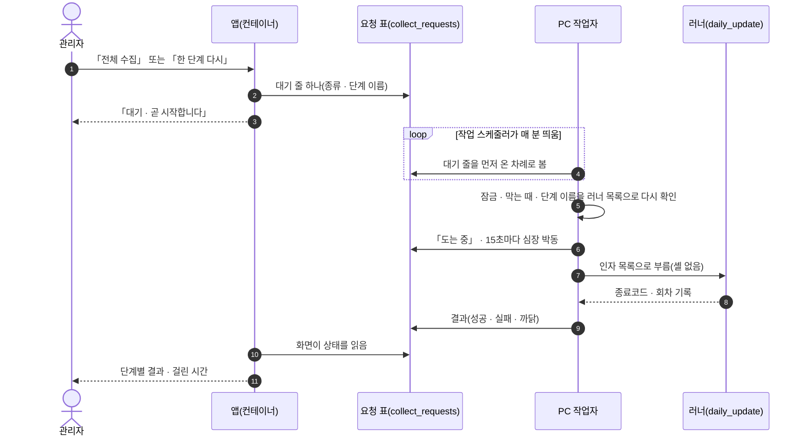
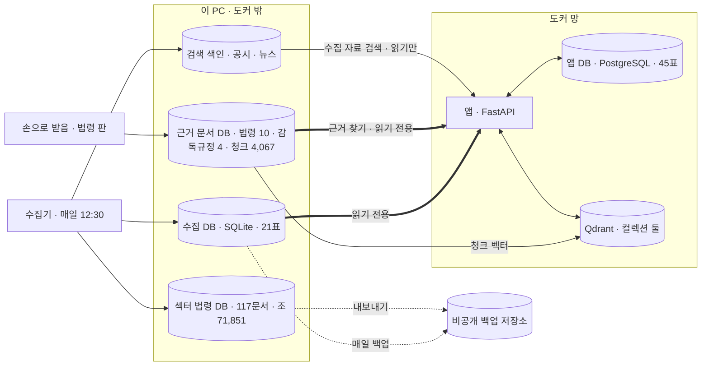
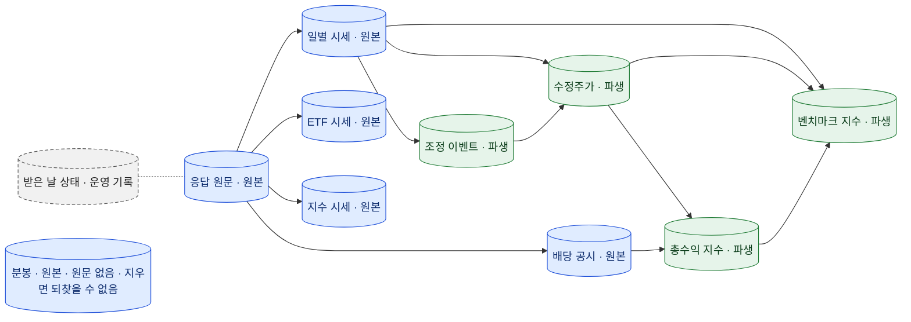
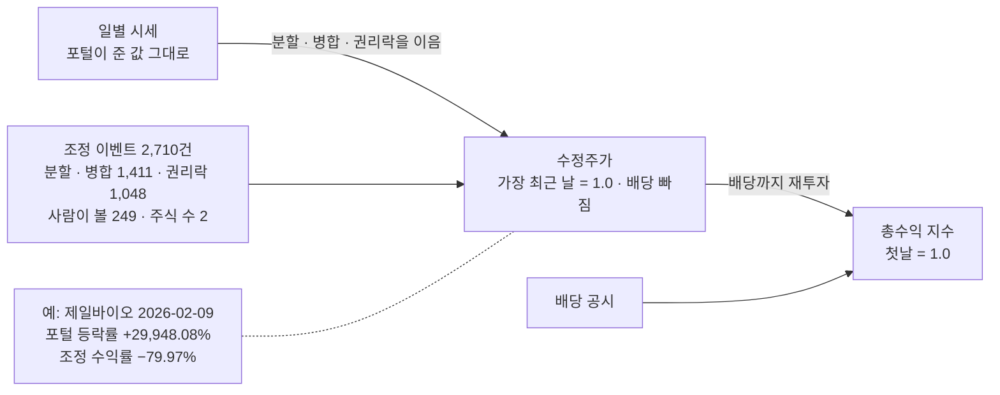
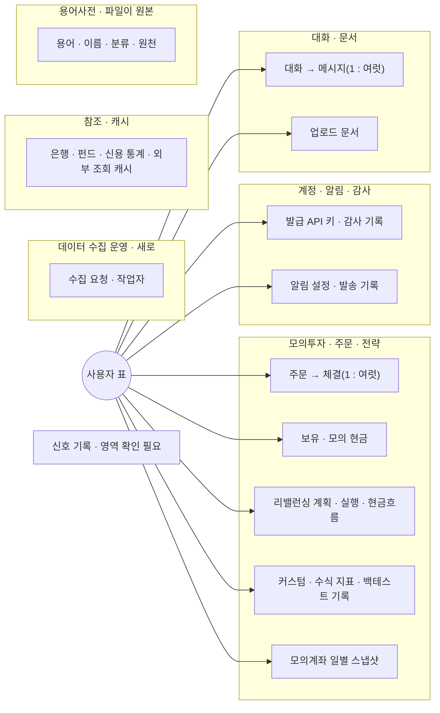
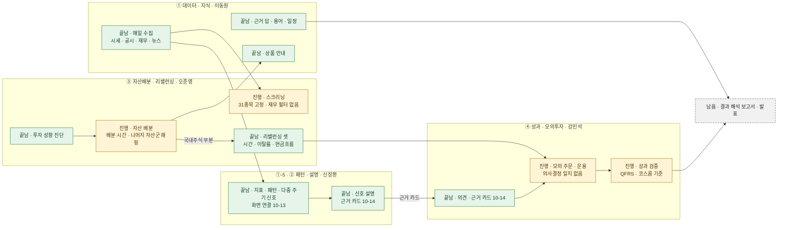

<!-- 옮김 2026-10-19 — 원래 자리 docs/_git-drafts/2026-10-19-S126/발표개편-초안/보고.md · 작업 기록(그때 쓴 그대로 · 세션 번호 등 내부 표기 포함) · 정본: docs/발표/2차/발표자료.html -->
# 발표 자료 개편 초안 v0.9 — 보고

**끝 · 2026-10-19 10:17 (시작 09:05)**

1. 발표 자료 v0.9 초안 한 파일을 지었다 — 본문 48 · 부록 9(<section> 57) · 장마다 제목과 한 문장 · 오른쪽 위 질문 넷 이정표 · 말할 거리마다 「출처: 파일:줄」 · v0.1 틀(CSS · 키 · ?all · 말할 거리 · .missing)을 그대로 물려받음.
2. 영상 15편이 모두 실제 mp4 를 가리킨다 — 장 안 고정 칸 6(25 V07 · 30 V03 · 34 V01 · V05 · 38 V04 · V06) + 누르면 덮개 창에서 재생(22장 여정 단추 일곱 · 23장 영상 지도 열다섯 · 부록 A1 · 장마다 영상 단추 다섯) · 파일이 없으면 지시서 문구.
3. 그림 26 은 자리만(이름 · 보여 줄 것 · 들어갈 요소) · Mermaid 먼저인 여섯(G10 · G13 · G14 · G15 · G16 · G25)은 이 보고 부록 A(문법 확인 전) · 화면 72개 점수와 남은 일 수는 생성기가 점검표 TSV 를 읽어 셈.
4. 숫자는 저장소를 다시 열어 재료와 다른 것을 고쳤다 — 시험 2,169 · 결함 134(재료 2,114 · 129) · 10-18 복구 리허설 · 깊은 검사 통과(재료는 「아직」) · 10-17 회차는 절전으로 끊긴 것(DF-126) · 점검표 점수 몇 줄(5절).
5. 요소 점검표(개발 11 · 퀀트 8)를 두고 약한 곳을 기존 장에 얹었다(9 · 11 · 15 · 20 · 23 · 39 · 44 · A8 · B) · 팀원 12장 · 이동원 두 칸은 채울 칸(10-20) · 이동원 대본(36장 · 약 38분) · 질의응답지(54문 · 여섯 묶음)는 개인 폴더(이 보고에 내용을 옮기지 않음).

| 머리표 | 내용 |
|---|---|
| 낸 것 | `발표자료.html`(이 폴더) · 이 보고 · 이동원 대본 · 질의응답지(`docs/_local/git-drafts-개인/2026-10-19-발표개편/` · 이 보고에는 내용을 옮기지 않음 · 10절) |
| 정본 자리 | 발표 자료는 `docs/발표/2차/발표자료.html` 자리에 놓일 것을 전제로 영상 경로를 짰다(판 올리기 · 옮기기는 메인) |
| 기준 | 저장소 파일을 2026-10-19 오전에 다시 읽음 · 러너 기록은 2026-10-18 13:05 회차 · 백업 상태 18:06 · 점검표 TSV 는 생성할 때 읽음 |

## 진행

- 2026-10-19 09:05 시작 · 지시서와 재료 01 ~ 04 · v0.1 발표 자료 · 영상 README · 문서작성기준 12절 · 강사님 안내 원문 읽음
- 2026-10-19 09:22 숫자 출처 확인 끝(테스트 계획서 v1.45 · 근거 답 품질 보고서 · 점검표 TSV · ERD v1.9 · 인프라 구성도 · 러너 코드 · 러너 기록 넷 · 조사서 다섯 · 계획서 · 중간 점검 글) · 생성기 작성 시작
- 2026-10-19 09:49 첫 판 생성(뼈대 57장 · 장마다 제목 + 한 문장 · 영상 · 그림 자리 · 말할 거리) · 메인 추가 지시(요소 점검표 · 대본 · 질의응답지) 받음
- 2026-10-19 10:00 요소 점검표 반영(9 · 11 · 15 · 20 · 23 · 39 · 44 · A8 · B 에 얹음) · 화면 글 점검 통과 · 문장 손질 · 대본 · 질의응답지로 넘어감
- 2026-10-19 10:13 대본(36장 · 약 38분) · 질의응답지(54문) 개인 폴더에 씀 · 인용 점검 · 보고.md 절 차례를 지시서대로 고침
- 2026-10-19 10:16 끝 · 마지막 점검(제목 · 한 줄 겹침 손질 · 인용 230건 점검 · 화면 글 점검 통과) · 이 보고 맨 위에 끝 시각

## 1. 장 목록 — 번호 · 제목 · 한 문장 · 영상/그림 · 숫자 출처

「한 문장」 은 말할 거리의 첫 문장(존댓말)이다. 화면의 제목 · 한 줄(명사형)은 발표자료.html 에 있다. 셈(장 수 · 그림 · 영상 · 화면 글 점검)은 9절.

| 번호 | 제목(화면) | 한 문장 | 영상 · 그림 | 숫자 출처 |
|---|---|---|---|---|
| 1 | 표지 | Qurious 는 자기 투자 규칙이 있는 개인투자자가, 그 규칙을 믿어도 되는지 판단하게 돕는 로보 어드바이저입니다. | — | 팀 한 문장(지난 판 :131) |
| 2 | 비용을 빼고도 돈을 번 개인, 열 명 중 셋이 안 됨 | 2020 ~ 2022년 개인투자자 10만 2천 명 가운데 비용을 빼고도 돈을 번 사람은 국내 투자 기준 28% 였습니다. | — | 지난 판 :149-154(자본시장연구원 26-04 · 예탁결제원 2025 결산) |
| 3 | 로보어드바이저 계약의 99.6%는 맡기는 계약 | 검증을 통과한 로보어드바이저 계약 거의 전부가 일임 계약이라, 스스로 판단하려는 사람을 위한 도구는 드뭅니다. | — | 지난 판 :164-169(코스콤 RA 테스트베드 · 금융위원회 2026-04-20) |
| 4 | 일곱 걸음의 판단 여정, 그 밑의 매일 공식 자료 | 사용자는 일곱 걸음으로 판단하고, 그 밑에는 매일 쌓는 공식 자료가 있습니다. | G01 | 지난 판 :178-187 · 영상 README |
| 5 | 질문 넷, 장마다 한 문장 | 오늘은 네 가지 질문에 차례로 답합니다. 어떤 시장인가, 어떻게 돌아가나, 데이터는 어떻게 생겼나, 누가 무엇을 만들었고 얼마나 믿을 만한가입니다. | G02 | — |
| 6 | 국내 상장 주식 3,308종목, 상장폐지 종목까지 | 코스피 · 코스닥 · 코넥스의 상장폐지 종목까지 담았고, 거래 시간 · 결제 · 세금 규칙이 데이터 설계를 정했습니다. | G03 · 단추 F06 | 계획서 :310 · 조사서  :133-148 |
| 7 (줄일 수 있음) | 개인과 공식 자료 사이, 근거를 보여 주는 칸이 빈 자리 | 개인은 1,442만 명인데, 도구는 맡기는 쪽(일임)과 수익률을 약속하는 쪽(유사투자자문)에 몰려 있습니다. | G04 | 지난 판 :149-153 · :164-166 · 출처 대장 :2-15 |
| 8 | 출처 14곳, 이용 조건에 따라 저장 · 화면 · 공개를 나눔 | 출처 14곳의 이용 조건을 대장에 적고, 조건에 따라 저장 · 화면 표시 · 공개 저장소를 갈랐습니다. | G05 · 단추 F02 | 출처 대장 :2-15 · 이용조건 조사서 :23-29 |
| 9 | 규제 다섯 줄이 그대로 기능 규칙 다섯 줄로 | 투자 권유로 읽히지 않게, 규제가 정한 선을 먼저 설계에 넣었습니다. 규제 다섯 가지가 그대로 기능 규칙 다섯 가지가 됐습니다. | G06 | 실사용자 조사서 :30 · 지난 판 :166 · rfp-2 :92 · ADR-0001 · 출처 대장 :2 · :12 |
| 10 (줄일 수 있음) | 거래 기준 23항목 중 20항목이 시장마다 다름 | 거래 기준 23항목 가운데 20항목이 시장마다 달라, 시장마다 칸을 따로 두고 산식만 하나로 둡니다. | G07 · 단추 F07 | 조사서 :16 · :18 ·  :133-155 |
| 11 | PC 한 대 · 도커 서비스 10개 · 도커 밖 수집기 | 사람이 쓰는 입구는 8966 하나이고, 수집 DB 는 수집기만 쓰고 앱은 읽기만 합니다. | G08 | 인프라 구성도 :23 ·  · :172 · docker-compose.yml |
| 12 | 매일 12:30, 한 회차 21단계 | 받기 8 · 계산 7 · 백업 5 · 근거 문서 1, 스물한 단계가 한 회차이고 10월 18일 회차는 12:30 에 시작해 13:05 에 끝났습니다. | G09 | daily_update.py :210-284 · daily_update_last.json(10-18 13:05) |
| 13 (줄일 수 있음) | 화면의 「수집」 단추: 앱은 요청만, 실행은 PC 작업자 | 앱은 컨테이너 안에서 읽기만 하므로, 실행은 PC 쪽 작업자가 매 분 요청 표를 보고 러너를 부르는 방식으로 나눴습니다. | G10 | collect_worker.py :1-25 · ERD :12 |
| 14 | 근거 답의 세 단계, 찾기 → 쓰기 → 거르기 | 질문마다 법령 · 감독규정 조문을 찾고, 찾은 조문만 보고 답을 쓰고, 서버가 세 가지 거름으로 검사한 뒤에야 출처 번호와 함께 보입니다. | G11 | 근거 답 품질 보고서 :27 · :42 ·  · |
| 15 | 실거래 · 증권사 키 · 원자료, 넘지 않는 선 | 실거래 주문은 서버 한 곳에서 막고, 증권사 키는 사용자마다 따로 두고, 원자료는 비공개 저장소에만 둡니다. | G12 | 인프라 구성도 :172 · :187-196 · :208-210 · docker-compose.yml · 테스트 계획서 :225-226 |
| 16 | 저장소 여섯, 두 DB 가 만나는 길은 읽기 전용 하나 | 시장 자료는 수집 DB, 사용자 기록은 앱 DB, 근거는 따로 둔 근거 문서 DB 와 벡터 저장소에 있습니다. | G13 | ERD :12 · 그림 1 ·  :81-85 |
| 17 | 받은 원본은 그대로, 계산한 표는 매일 다시 | 수집 DB 의 표는 원본 · 파생 · 운영 기록 셋으로 나뉘고, 계산 규칙이 바뀌어도 원본에서 다시 만들 수 있습니다. | G14 | ERD :363 · 그림 3 · |
| 18 | 같은 날 같은 종목의 가격, 세 표에 따로 | 받은 가격 · 분할을 이은 수정주가 · 배당까지 재투자한 총수익을 따로 두어, 분할을 폭락으로 읽지 않고 배당을 빠뜨리지 않습니다. | G15 | data_guide_stats.json(10-18) · ERD :417 ·  · |
| 19 (줄일 수 있음) | 앱 DB 45표, 관계 대부분이 사용자 한 사람에서 | 주문 · 체결 · 보유 · 리밸런싱 · 대화 · 용어가 모두 사용자 한 사람에 매여 있어, 사용자마다 장부가 섞이지 않습니다. | G16 | ERD :12 ·  :477-484 · :515 |
| 20 | 화면의 숫자마다 출처와 기준일 | 포털은 다음 영업일 오후에 값을 주므로, 앱이 보여 주는 마지막 일봉은 직전 거래일 것이고 화면에 그 날짜를 밝힙니다. | G17 | ERD :137-139 · 출처 대장 :2 · 결함대장 DF-15(:1679) |
| 21 | 표 열여섯 · 2,192만 행, 매일 이어 붙임 | 2020년부터 지금까지 일봉 450만 행, 분봉 403만 행, 재무 188만 행, 공시 78만 건을 매일 이어 붙이고 있습니다. | G18 | data_guide_stats.json(10-18 13:05 · 열여섯 줄 합) |
| 22 | 일곱 걸음, 네 사람 | 성향 진단에서 근거 상담까지 일곱 걸음이 이어지고, 걸음마다 맡은 사람이 영상으로 보여 드립니다. | V01 · V02 · V03 · V04 · V05 · V06 · V07 | 지난 판 :178-190 · 영상 README |
| 23 | 영상 열다섯 편, 여정 일곱과 기능 여덟 | 여정 밖의 기능(데이터 관제 · 자료 안내 · 금융 필수 지식 · 분석 도구)은 기능 영상으로 따로 보여 드립니다. | G22 · 영상 15편 | 영상 README  ·  · |
| 24 (채울 칸) | 근거를 댈 수 없으면 답하지 않는 금융 AI 상담 | 질문마다 2026년에 시행 중인 조문을 찾아 출처 번호를 달고, 근거가 없으면 지어내지 않습니다. | — | 품질 보고서 :82 · 조사서 :141 · 지난 판 :197-201 |
| 25 | 이동원 ③ 영상 | 답이 있는 질문 · 근거가 없는 질문 · 투자 권유 질문, 세 질문에 다르게 답합니다. | V07 | 영상 README |
| 26 | 정답 조문 50문항 중 47, 근거 밖 질문에 지어낸 답 0 | 잘 찾는지, 지어내지 않는지, 그것을 재는 자동 채점을 믿을 수 있는지 셋을 쟀고, 믿을 수 없는 자동 채점은 버렸습니다. | — | 품질 보고서  ·  · |
| 27 | 팀 기능 모두가 같은 날짜의 자료를 읽게 한 매일 수집 · 관제 · 백업 | 정기 12:30 회차는 기록에 남은 18번 중 17번 성공했고, 매일 102개 파일 · 2,191만 행을 비공개 저장소에 백업합니다. | G19 · 단추 F01 | daily_update_history.jsonl · hf_backup_status.json · DF-126 · 문서그림지침 :318 · :323 |
| 28 (채울 칸) | 답 모델 다섯 모두 출처 번호는 맞힘, 그중 둘은 근거 없는 질문에 지어냄 | 시험한 답 모델 다섯이 모두 출처 번호 검사는 통과했지만, 그중 둘은 근거가 없는 질문에 답을 지어냈습니다. | — | 품질 보고서 :44 ·  ·  · 점검표 :3 · 계획서 :175 |
| 29 (채울 칸) | 규칙 신호 · 차트 패턴과 그 이유를 쉬운 말로 | (채울 칸 · 신장환 · 10-20) 2차 맡은 칸: 지표 · 차트 패턴 · 다중 주기 신호 · 추천 이유 설명 | — | docs/계획서/프로젝트계획서.md:43 |
| 30 (채울 칸) | 신장환 ③ 영상 | (채울 칸 · 신장환 · 10-20) 재생 전 한 줄 | V03 | 영상 README |
| 31 (채울 칸) | 패턴 통계 · 다중 주기 신호 · 신호 설명을 화면까지 | (채울 칸 · 신장환 · 10-20) 패턴 통계 · 다중 주기 신호 · 신호 설명을 화면까지 | — | docs/github-archive/2026-10-12/이슈-2차-중간점검/00-본문.md:327-328(6.2 남은 일 1 |
| 32 (채울 칸) | 3차에 맡는 칸, 기본 · 커스텀 인디케이터 | (채울 칸 · 신장환 · 10-20) 해결 · 남은 과제 · 배운 점 | — | docs/시험/대장/기능완성도-점검표.tsv:6 |
| 33 (채울 칸) | 성향 진단에서 자산 배분 · 리밸런싱까지 | (채울 칸 · 오준영 · 10-20) 2차 맡은 칸: 투자 성향 진단 · 자산배분 · 스크리닝 · 리밸런싱(시간 · 이탈률 · 현금흐름) | — | docs/계획서/프로젝트계획서.md:43 |
| 34 (채울 칸) | 오준영 ③ 영상 | (채울 칸 · 오준영 · 10-20) 재생 전 한 줄 | V01 · V05 | 영상 README |
| 35 (채울 칸) | 리밸런싱 세 방식과 그 시험 | (채울 칸 · 오준영 · 10-20) 리밸런싱 세 방식과 그 시험 | — | docs/시험/테스트계획서.md:26(요약 2 |
| 36 (채울 칸) | 3차는 증권사 API 연동 자동화 주담당 | (채울 칸 · 오준영 · 10-20) 해결 · 남은 과제 · 배운 점 | — | docs/시험/대장/기능완성도-점검표.tsv:4 |
| 37 (채울 칸) | 비용을 뺀 성과와 모의투자 판단 기록 | (채울 칸 · 강민석 · 10-20) 2차 맡은 칸: 비용 반영 성과 · 의견 변환 · 모의 주문 | — | docs/계획서/프로젝트계획서.md:43 |
| 38 (채울 칸) | 강민석 ③ 영상 | (채울 칸 · 강민석 · 10-20) 재생 전 한 줄 | V04 · V06 | 영상 README |
| 39 (채울 칸) | QFRS · 코스콤 테스트베드, 두 기준으로 보는 성과 | (채울 칸 · 강민석 · 10-20) QFRS · 코스콤 테스트베드, 두 기준으로 보는 성과 | — | docs/github-archive/2026-10-12/이슈-2차-중간점검/10-2026-10-18-요약-2차마무리.md(④ 76 |
| 40 (채울 칸) | 3차에는 QuantConnect LEAN 으로 성과 검증 | (채울 칸 · 강민석 · 10-20) 해결 · 남은 과제 · 배운 점 | — | docs/github-archive/2026-10-12/이슈-2차-중간점검/00-본문.md:335(6.2 9번) |
| 41 | 자동화 시험 2,169건, 마지막 결과 2,167 통과 · 실패 2 | 고친 곳을 일부러 깨 보아 시험이 잡는지 확인했고, 결함 134건 중 99건을 닫았습니다. | G20 | 테스트 계획서 v1.45 :5 · :25 · :27 · :1633 · :1768 |
| 42 (줄일 수 있음) | 10-18 백업으로 복구 리허설 · 값까지 보는 깊은 검사 통과 | 27장의 운영 숫자를 검증 쪽에서 다시 보면, 10월 18일 백업으로 복구 리허설과 깊은 검사를 통과했고 원격 확인이 남았습니다. | — | hf_backup_status.json(10-18 18:06) · ERD |
| 43 | 화면 72개, 같은 배점표로 다시 매김(팀 내부 점검) | 강사님 평가가 있는 화면은 그 점수에서 출발했고, 새로 만든 화면은 UI · 서버 · 연동 · 시험 배점표로 매겼습니다. | G21 | 점검표 TSV :2-73 |
| 44 | 일은 한 묶음씩, 채택과 원격 쓰기는 사람이 | 일은 한 묶음씩 나눴고, 시험 · 점검표 · 결정 대장으로 확인했으며, AI 도구는 로컬에서 초안 · 조사 · 코드 작성을 돕고 범위 · 채택 · 원격 쓰기는 사람이 정했습니다. | G24 | 코딩표준 :173-189 · TIL README :4 · 테스트 계획서 :88 · 결정대장 · 코드리뷰기록 :21 · :98-100 |
| 45 | 화면 72개 중 57개, 2차 안에서 남은 일이 적힘 | 화면 72개 가운데 57개는 2차 안에서 남은 일이 적혀 있고, 가장 흔한 빈칸은 「화면 동작 자동 시험」 과 「기능끼리 잇기」 입니다. | G25 | 점검표 「100%까지」 칸 · 중간 점검 :21 · :247-281 · :332-340 |
| 46 | 3차와 그 뒤, 같은 자료 위에 인디케이터 · 시장 확장 · 수집 품질 | 3차(10-22 ~ 11-11)는 「나만의 투자 인디케이터」 이고, 2차에서 만든 자료 · 비용 · 성과 기준을 그대로 쓰며, 시장을 넓히는 설계는 이미 조사해 두었습니다. | G26 · 단추 F04 | 계획서 :44-45 ·  · 조사서 :20 · :51 · 벤치마크 조사서 :25 |
| 47 | 공개 저장소 · README · 영상, 그리고 발표장 시연 순서 | 데모 사이트 대신 공개 저장소와 README, 영상 목록으로 보여 드리고, 발표장에서는 아래 순서로 시연합니다. | — | 지난 판 :342 · 영상 README 1 · 2절 · AWS 팀 결정(10-16) |
| 48 | 마무리 | 자기 투자 규칙이 있는 개인투자자가, 그 규칙을 믿어도 되는지 판단하게 돕는 로보 어드바이저입니다. 질문 받겠습니다. | — | 지난 판 :336-348 |
| A1 | 부록 A1 · 영상 목록 | 발표 영상 열다섯 편의 목록과 길이 · 칸마다 재생 | 영상 15편 | 영상 README  ·  · |
| A2 | 부록 A2 · 배경 숫자와 출처 | 배경 숫자 여덟과 출처 · 조회일 | — | 지난 판 :149-169 · 계획서 :310 · 조사서 :141 · 품질 보고서 :82 |
| A3 | 부록 A3 · 출처 14곳과 이용 조건 | 출처 14곳의 이용 조건 전체 | — | 출처 대장 :2-15 |
| A4 | 부록 A4 · 자료 29종 | 모으는 자료 스물아홉 가지의 묶음 · 갱신 · 출처 | — | 자료 대장 :2-30 |
| A5 | 부록 A5 · 포트와 외부 통신 | 열린 포트 여섯과 바깥으로 나가는 길 | — | 인프라 구성도  ·  · docker-compose.yml |
| A6 | 부록 A6 · 거래 기준 21줄 | 국내 주식 · 미국 주식 · 코인의 거래 기준 21줄 비교(조회 2026-10-10) | G23 | 조사서  :131-155 |
| A7 | 부록 A7 · 근거 답 품질 표 | 근거 답 품질 보고서 표 1 전체(측정 2026-10-03 ~ 10-06) | — | 품질 보고서  :31-38 |
| A8 | 부록 A8 · 용어 | 이 발표에 나오는 용어 열넷의 뜻과 나오는 장 | — | 지난 판 :171 · ERD :1089-1091 · 품질 보고서 :106 · :116 · 백테스트 보고서 :83 |
| B | 부록 B · 미완성 목록과 범위 | 한 것과 안 한 것, 화면별 남은 일의 수, 2차 안에 남은 일 | — | rfp-2 :90-94 · 중간 점검 :21 · :329-341 · 점검표 「100%까지」 |

## 2. 그림 26 자리

장에는 `<figure class="fig-todo" data-fig="Gxx">` 로 이름 · 보여 줄 것 · 들어갈 요소를 적었다. 「바탕 · 할 일」 은 그림 목록 재료의 칸이다. Mermaid 먼저인 여섯은 부록 A.

| 그림 | 장 | 이름 | 보여 줄 것 | 들어갈 요소 | 바탕 · 할 일 |
|---|---|---|---|---|---|
| G01 | 4 | 우리가 만든 것 한 장 | 사용자는 일곱 걸음으로 판단하고, 그 밑에 매일 쌓는 공식 자료가 있다 | 위 줄 일곱 칸: 성향 진단 · 자산 배분 → 상품 안내 → 신호 · 패턴 → 모의 주문 → 리밸런싱 → 계좌 · 성과 → 근거 상담 ; 칸마다 담당 색과 영상: 오준영 V01 · 이동원 V02 · 신장환 V03 · 강민석 V04 · 오준영 V05 · 강민석 V06 · 이동원 V07 ; 아래 넓은 띠 둘: 「매일 12:30 공식 자료 수집 · 검증 · 백업」(이동원) · 「신호마다 쉬운 말 설명」(신장환) ; 색: 이동원 남색 · 신장환 황갈 · 오준영 청록 · 강민석 하늘(지난 판 담당 색 그대로) ; 바탕: 22장의 여정 칸(HTML)에 바닥 띠만 더함 | 지금 자료의 여정 지도(HTML · 22장) · 바닥 띠를 더해 새로 |
| G02 | 5 | 질문 넷 이정표 | 오늘 발표는 네 질문에 차례로 답하고, 같은 이정표가 장마다 오른쪽 위에 작게 따라간다 | 1 어떤 시장인가 · 6 ~ 10장 · 썸네일 G03 시장 지도 ; 2 어떻게 돌아가나 · 11 ~ 15장 · 썸네일 G08 구성도 ; 3 데이터는 어떻게 생겼나 · 16 ~ 21장 · 썸네일 G13 저장소 여섯 ; 4 누가 무엇을 만들었고 얼마나 믿을 만한가 · 22 ~ 44장 · 썸네일 G01 여정 ; 작은 판(높이 40px)을 장마다 오른쪽 위에 · 이 초안의 글자 이정표를 바꿈 | 새로 · 작은 판(40px)은 장마다 오른쪽 위 글자 이정표를 바꿈 |
| G03 | 6 | 국내 주식 시장 지도 | 우리가 다루는 시장과, 데이터 설계를 정한 거래 시간 · 결제 · 세금 규칙 | 왼쪽 시장 셋: 코스피 1,021 · 코스닥 2,123 · 코넥스 211 · 합 3,308(상장폐지 포함 · 2020-01-02 ~ 2026-09-29 일봉) ; 가운데 하루 시간 줄: 08:00 대체거래소(NXT) 시작 · 08:30 ~ 09:00 시가 단일가 · 09:00 ~ 15:30 정규장 · 15:20 ~ 15:30 종가 단일가 · 16:00 ~ 20:00 애프터마켓(2026-09-14 신설) ; 오른쪽 규칙 카드 셋: 결제 T+2 · 거래세 2026년 코스피 0.05% + 농특세 0.15% = 0.20% · 가격 제한 ±30% ; 그림 아래 한 줄: 공식 종가는 15:30 · 종목 수 기준일 2026-09-29 | 하루 시간표 그림(Design 52:3)의 정규장 줄 · 새로 |
| G04 | 7 | 시장 참여자 지도 | 개인투자자와 공식 자료 사이에 「근거를 보여 주는 칸」 이 비어 있고, 우리가 그 칸에 선다 | 가운데: 개인투자자 1,442만 명 · 한 종목만 가진 사람 31.5% ; 위: 감독 · 검증(금융위원회 · 금융감독원 · 코스콤 RA 테스트베드) ; 왼쪽: 자료 공급자(공공데이터포털 · OpenDART · 한국은행 ECOS · 국가법령정보센터 · 한국천문연구원) ; 오른쪽: 서비스(로보어드바이저 일임 99.6% · 유사투자자문 위법 105개 업체 133건 · 증권사 모의투자) ; 비어 있는 자리의 점선 칸: Qurious(공식 자료 + 출처 + 기준일) ; 새 숫자 없음 · 2 · 3장의 숫자를 한 지도에 | 새로 |
| G05 | 8 | 출처 × 이용 조건 | 자료마다 쓸 수 있는 범위가 달라 저장 · 화면 · AI 근거 · 공개를 나눴다 | 금융위원회 시세: 공공누리 제4유형 · 출처 표시 · 상업적 이용 금지 · 변경 금지 · 다시 나눠 주지 않음 ; OpenDART: 이용은 됨 · 원자료를 다시 나눠 주지 않음 · 재배포 · 재가공 책임은 이용자 ; 정책브리핑: 기사마다 유형이 다름 · 제1유형 기사만 본문 ; GDELT 언론사 기사: 제목 · 주소 · 시각 · 언론사만 · 근거 답에 넣지 않음 ; 야후: 개인 · 비상업 · 비공개로만 · 원문을 남기지 않음 ; KRX 정보데이터시스템: 약관이 자동 수집을 막음 · 사람이 받은 파일만 ; 법령: 저작권 보호 대상 아님 ; 열: 저장한다 · 화면에 보인다 · AI 근거 답에 넣는다 · 공개 저장소에 둔다 · 칸은 「예 · 아니요 · 제목만 · 사람이 받은 파일만」 글자(색 점만으로 뜻을 두지 않음) | 자료 안내 화면 캡처(보조) · 새로 |
| G06 | 9 | 규제 → 설계 다섯 줄 | 규제 다섯 가지가 그대로 기능 규칙 다섯 가지가 됐다 | ① 종목 · 매매 시기 조언은 「투자판단」(자본시장법 제6조 제7항) → 신호는 모두에게 같은 「규칙 신호 집계」 · 상담은 권유 · 예측 질문을 돌려보냄 ; ② 실현되지 않은 수익률 광고 금지(금융위원회 2026-04-20) → 화면에 수익률 약속 없음 · 성과는 비용을 뺀 기록만 ; ③ 실거래 자동 주문은 과제 범위 밖 → 서버 한 곳에서 실거래 주문 길을 막음 ; ④ 공공누리 제4유형 · 다시 나눠 주지 않음 → 원자료는 비공개 저장소에만 ; ⑤ 약관(네이버 검색 API · KRX 자동 수집 금지) → 쓰지 않음 · 사람이 받은 파일만 ; 그림 아래 한 줄: 법률 자문이 아닌 조사서의 해석 | 새로 |
| G07 | 10 | 국내 · 미국 시간 줄 | 미국 정규장은 한국 시각으로 밤이고, 결제 · 세금 · 하루 경계가 달라 따로 처리한다 | 시간 줄 두 줄(한국 시각 0 ~ 24시): 국내 09:00 ~ 15:30 · 미국 정규장 서머타임 22:30 ~ 05:00(점선: 표준시 23:30 ~ 06:00 · 11-01 바뀜) ; 비교 카드 셋: 결제 T+2 대 T+1 · 거래세 0.20% 대 없음 · 일봉 날짜 = 거래소 현지 날짜(미국은 뉴욕 날짜) ; 같게 두는 것: 값 규칙 · 지표 산식 · 성과 산식(입력의 날짜 경계 · 연환산 일수만 시장 것) ; 부록 A6 에 거래 기준 21줄 비교 전체 | 미국 · 코인 데이터 확장 그림(부록용 · Design 49:3) · 새로 |
| G08 | 11 | 전체 구성도 | PC 한 대에서 도커 서비스 10개와 도커 밖 수집기 · PC 작업자가 함께 돌고, 사람이 쓰는 입구는 8966 하나다 | ① 도커 망: 앱(FastAPI · 8966) · PostgreSQL · Redis · Qdrant · Neo4j · Ollama(로컬 답 모델 · 기본은 도커 안 · 이 PC 에 따로 깐 Ollama 로 바꿀 수 있음) · Celery 워커 · 비트 · 한 번 도는 둘(자료 넣기 · 모델 받기) · LEAN 은 필요할 때 ; ② 이 PC · 도커 밖: 작업 스케줄러(매일 12:30 러너) · PC 작업자(매 분) · 수집 DB · 근거 문서 DB · 섹터 법령 DB · 검색 색인 ; ③ 바깥: 공공데이터포털 · OpenDART · 국가법령정보센터 · 한국은행 ECOS · 한국천문연구원 · GDELT · 야후 · 비공개 백업 저장소 · KIS 모의 · Alpaca 모의 ; 굵은 선 하나: 수집 DB → 앱(읽기 전용) ; 바탕: 로컬 네트워크 구성도(2026-10-03)를 고쳐 그림 · 더할 것: PC 작업자 · 근거 문서 DB · 섹터 법령 DB · 검색 색인 · 한국은행 · GDELT · 한국천문연구원 | 로컬 네트워크 구성도(FigJam 3:100)를 고쳐 그림 · README 의 아키텍처 v2.0 은 쓰지 않음 |
| G09 | 12 | 러너 21단계 | 하루 한 회차가 받기 8 · 계산 7 · 백업 5 · 근거 문서 1 로 이어진다 | 받기 8: 시세 · 배당 · 공시 · 재무 · 기업 일정 · 정책뉴스 · 언론사 기사 · 시장금리 ; 계산 7: 검색 색인 · 시장 달력 · 수정주가 · 총수익 · 벤치마크 · 일봉(ETF · 지수 일봉과 분봉을 받아 적재) · 신호 ; 백업 5: 목록표 · 내보내기 · 대조 · 올리기 · 일봉 올리기 ; 근거 문서 1: 섹터 법령(7일에 한 번 개정 대조) ; 덩어리 아래 10-18 걸린 시간: 검색 색인 785.5초 · 일봉 567.9초 · 내보내기 369.8초 · 언론사 기사 152.9초 ; 10-18 은 일요일이라 수정주가 · 총수익 · 벤치마크는 「새 자료 없음」 으로 건너뜀 | 새로 · 수집 일정 화면 캡처는 20단계 옛 판이라 쓰지 않음 |
| G10 | 13 | 수집 요청 시퀀스 | 앱은 요청만 남기고, PC 작업자가 매 분 가져가 러너를 부른다(새 포트 없음) | 다섯 줄 시퀀스: 관리자 → 앱 → 요청 표 → PC 작업자(매 분) → 러너 ; ① 관리자가 「전체 수집」 또는 「한 단계 다시」 를 누름 ; ② 앱은 요청 표에 대기 줄 하나만 남김 ; ③ 작업 스케줄러가 매 분 PC 작업자를 띄움 · 잠금 · 심장 박동 ; ④ 단계 이름을 러너의 단계 목록으로 다시 확인한 뒤 러너를 인자 목록으로 부름(셸 없음) ; ⑤ 회차 기록으로 결과를 적고 화면이 그 결과를 읽음 ; Mermaid 원문을 먼저 확인한 뒤 Figma 로 | 새로 · Mermaid 먼저(부록 A) |
| G11 | 14 | 근거 답의 길 | 찾기 → 쓰기 → 거르기를 지나야 출처 번호와 함께 보인다 | 찾기: 낱말 검색과 의미 검색을 섞음 · 일상 말을 법령 말로 넓힘(「코스피」 → 「유가증권시장」) · 정답 조문이 상위 5개 안에 든 비율 0.860 → 0.940 ; 쓰기: 찾은 조문만 넣고 문장마다 출처 번호 · 이 PC 의 로컬 답 모델 ; 거르기(서버 거름 셋): 출처 번호 검사 · 근거 없이 「없다」 고 단정하는 답 · 질문을 되풀이하는 답 ; 통과: 출처 번호와 출처 카드가 달린 답 ; 걸림: 「근거로 답하지 못했습니다」 + 찾은 조문 발췌(「질문과 맞는지 확인 전」 으로 접음) ; 바탕: 「근거 답 서버 검사 갈래와 화면」 그림에 앞의 찾기 칸만 더함 | 「근거 답 서버 검사 갈래와 화면」(Design 25:2) · 앞에 찾기 칸만 더함 |
| G12 | 15 | 안전 경계 | 실거래 · 키 · 원자료에는 넘지 않는 선이 있고, 아직 남은 위험도 안다 | 안 · 밖 두 영역과 경계선 ; 자물쇠 다섯: 실거래 차단 지점 하나(모의로 낮춤) · 사용자마다 따로 둔 증권사 키 · 수집 DB 읽기 전용 · 비밀값은 설정 파일에만 · 원자료는 비공개 저장소에만 ; 주문 앞 위험 관문: 중복 주문 쿨다운 · 하루 주문 수 · 종목 비중 · 하루 손실 한도 · 비상 정지 · 위험 저장소가 없으면 실전 주문을 내지 않음(시험으로 지킴) ; 남은 위험 칸 둘: 개발용 DB 포트 여섯이 모든 망 연결에 열림 · 앱 컨테이너에 도커 소켓이 붙음(LEAN 백테스트용) ; 남은 위험 아래 한 줄: 팀 공용 구성 파일이라 고치기 전에 논의 | 새로 |
| G13 | 16 | 저장소 여섯 | 데이터는 저장소 여섯에 나뉘고, 두 DB 는 읽기 전용 길 하나에서만 만난다 | 수집 DB: SQLite · 21표 · 매일 12:30 수집기가 씀 ; 앱 DB: PostgreSQL · 45표 · 사용자 동작마다 ; 근거 문서 DB: 법령 10 · 감독규정 4 · 청크 4,067 · 손으로 받음 ; 섹터 법령 DB: 117문서 · 조 71,851 · 7일에 한 번 대조 ; 검색 색인: 공시 · 뉴스 · 매일 바뀐 것만 ; 벡터 저장소(Qdrant): 컬렉션 둘(올린 문서 · 근거 문서 청크) ; 굵은 화살표 하나: 수집 DB → 앱(읽기 전용) · 점선: 수집 DB → 비공개 백업 ; Mermaid 원문을 먼저 확인한 뒤 Figma 로 | ERD 그림 1(저장소 넷) · 새로 · Mermaid 먼저(부록 A) |
| G14 | 17 | 원본 · 파생 · 운영 기록 | 받은 원본은 지우지 않고, 계산한 표는 매일 다시 만든다 | 원본(파랑): 응답 원문 · 일별 시세 · 배당 공시 · ETF 시세 · 지수 시세 · 분봉 ; 파생(초록): 조정 이벤트 · 수정주가 · 총수익 지수 · 벤치마크 지수 ; 운영 기록(회색 점선): 받은 날 상태(완료 · 빈 날 · 휴장 · 오류) ; 화살표 = 재료 → 만든 것 · 원통 아래 작은 글: 매일 12:30 에 무엇을 하나 · 지우는가 ; 분봉 원통의 표시: 원문 없음 · 지우면 되찾을 수 없음 ; Mermaid 원문을 먼저 확인한 뒤 Figma 로 | ERD 그림 3 · Figma 로 옮김 · Mermaid 먼저(부록 A) |
| G15 | 18 | 시세 세 표 | 같은 날 같은 종목의 가격을 세 표에 따로 두어 분할을 폭락으로 읽지 않는다 | 세 줄 계보: 일별 시세(포털이 준 값 그대로) → 수정주가(분할 · 병합 · 권리락을 이음 · 가장 최근 날 = 1.0) → 총수익 지수(배당 재투자 · 첫날 = 1.0) ; 세 표의 행 수 4,506,634 로 같음(마지막 거래일 2026-10-15) ; 예 카드: 제일바이오 감자 뒤 거래 재개일(2026-02-09) · 포털 등락률 +29,948.08% 대 조정 수익률 −79.97% ; 조정 이벤트 2,710건: 분할 · 병합 1,411 · 권리락 1,048 · 사람이 볼 249 · 주식 수로 조정 2(2026-10-02 실측) ; 주의 글: 수정주가와 총수익은 누적 방향이 반대 · 섞어 계산하지 않음 ; Mermaid 원문을 먼저 확인한 뒤 Figma 로 | ERD 그림 4(글 그림) · Figma 로 옮김 · Mermaid 먼저(부록 A) |
| G16 | 19 | 앱 DB 영역 | 앱 DB 의 관계 대부분이 사용자 한 사람에서 뻗는다 | 영역 블록: 모의투자 · 주문 · 전략 / 계정 · 알림 · 감사 / 대화 · 문서 / 참조 · 캐시 / 용어사전 / 데이터 수집 운영(새로 · 수집 요청 · 작업자) ; 사용자 표에서 뻗는 선 · 40표 판 기준 관계 33개 중 26개 ; 예: 주문 1건 : 체결 여러 건 · 대화 1건 : 메시지 여러 건 ; 용어사전은 파일이 원본 · 표는 사본(앱이 켜질 때 바뀐 것만 넣음) ; 새로 생긴 신호 기록 표의 영역은 확인한 뒤 배치 ; Mermaid 원문을 먼저 확인한 뒤 Figma 로 | ERD 그림 5 · 4.2절 영역 그림 · Figma 로 옮김 · Mermaid 먼저(부록 A) |
| G17 | 20 | 기준일 시간 줄 | 포털이 다음 영업일 오후에 값을 주므로 화면의 마지막 일봉은 직전 거래일이고, 숫자마다 기준일을 밝힌다 | 시간 줄: D일 15:30 장 마감 → D+1 영업일 13시 뒤 공개(포털 안내) · 12:30 회차가 이미 받음 → 화면에 「기준일 D · 출처」 ; 화면 캡처 한 장: 상품 안내 상세의 출처 · 기준일(발표 영상 V02 장면 2) ; 재무도 시점을 지킴: 그날 전에 접수된 판만 보임(받은 재무 72,248판 중 4,288판 · 5.9% 가 기한보다 늦게 접수된 정정본) ; 바탕: 하루 시간표 그림의 위 두 줄(정규장 · 시세 출처) | 하루 시간표(Design 52:3)를 줄여 다시 · 캡처는 개인정보 확인 뒤 |
| G18 | 21 | 오늘의 규모 | 2020년부터 표 열여섯에 2,192만 행을 매일 이어 붙인다 | 가로 막대(행 수 · 오른쪽 끝에 마지막 날): 일봉 4,506,634(× 3 표 · 수정주가 · 총수익이 같은 수) · 마지막 날 2026-10-15 ; 5분봉 2,180,136 · 재무 1,880,757 · 60분봉 1,854,439 · ETF 1,225,122 ; 공시 777,766 · 지수 257,592 · 금융 일정 67,295 · 시장금리 51,573 ; 언론사 기사 41,455 · 정책뉴스 33,167 · 벤치마크 19,968 · 배당 9,207 · 거래일 달력 2,922(2027-12-31 까지) ; 한 색 · 값 표시 · 축 0 부터 · 큰 숫자는 본문의 2,192만 하나만 | 새로(차트 · 코드 SVG 또는 Figma 는 메인이 정함) |
| G19 | 27 | 회차 달력 · 백업 카드 | 정기 12:30 회차의 성공 · 실패 · 빠진 날이 기록에 남는다 | 달력 띠 2026-09-28 ~ 10-18 · 하루 한 칸 · 글자 이름표(성공 · 실패 · 안 돎 · 늦게 돎) · 색만으로 뜻을 두지 않음 ; 성공: 09-28 ~ 10-08(11번) · 10-12 ~ 10-16(5번) · 10-18 ; 실패: 10-10(DART 점검으로 배당 · 일정 단계) ; 안 돎: 10-09(한글날 · PC 꺼짐 → 10-10 10:46 따라잡기) · 10-11(12:30 회차 없음 · 16:02 따라잡기) ; 늦게 돎: 10-17(12:30 회차가 PC 절전으로 21단계 중 17단계에서 끊김 → 14:03 다시 · 성공) ; 백업 카드: 102파일 · 21,915,105행 · 파케이 약 1.13 GB · 원 DB 약 5.4 GB · 10-18 스냅숏 | 데이터 관제 화면 캡처(10-10 · 보조) · 새로 |
| G20 | 41 | 시험 · 결함 | 시험 2,169건이 돌고, 결함 134건 중 99건을 닫았다 | 도넛 하나(시험 2,169 · 2026-10-18 결과): 통과 2,167 · 건너뜀 2 · 실패 2 ; 도넛 둘(결함 134 · 2026-10-18): 열림 26 · 일부 닫힘 9 · 닫힘 99 ; 아래 한 줄: 깨 보기 · 10-18 에 마흔세 곳을 깨 마흔둘을 잡음(하나는 일부러 겹쳐 둔 장치) ; 남은 실패 2의 정체: 야후 자료 사용을 막는 봉인 시험이 신호 보조 스크립트 하나를 잡음(열림 · 고칠 조건 정해짐) ; 자동 실행(CI)은 없음 · 방식을 먼저 논의하기로 함 | 새로(차트) |
| G21 | 43 | 화면 72개 점수 | 같은 배점표로 메뉴마다 어디가 앞서고 어디가 비었는지 보인다(팀 내부 점검) | 로보 어드바이저 11 · 89(65 ~ 95) / 데이터 5 · 89(88 ~ 96) ; 직접매매 3 · 72(61 ~ 85) / 모의투자 5 · 70(66 ~ 77) ; 퀀트자동매매 6 · 70.5(58 ~ 89) / 미국주식 4 · 72.5(60 ~ 81) ; 투자 인디케이터 9 · 84(42 ~ 95) / ML·딥러닝 5 · 72(40 ~ 93) ; 투자분석 기초 5 · 75(40 ~ 93) / 금융 필수 지식 14 · 65(45 ~ 94) ; 시스템관리 2 · 73(72 ~ 74) / 계정 · 로그인 · 가입 3 · 88(88 ~ 90) ; 전체 72화면 가운데 값 76 · 메뉴 이름 · 화면 수 · 가운데 값(최소 ~ 최대) · 그림 제목 옆에 「팀 내부 점검 · 실사용자 시험 아님」 | 새로(차트) · 값은 생성기가 점검표에서 셈 · 2차 중간 점검 그림은 확인 전 |
| G22 | 23 | 영상 지도 | 여정 영상 일곱 편과 기능 영상 여덟 편이 어디를 보여 주나 · 칸마다 화면 이름 · 담당 · 길이 | (칸 HTML) | 새로 · 지금은 누르면 재생되는 HTML 칸(Figma 판에서도 누르기를 남길지 메인) |
| G23 | A6 | 거래 기준 21줄 | 국내 주식 · 미국 주식 · 코인의 거래 기준을 한 표로(표 그대로 옮김) | 1 정규 거래 시간 · 2 장 전후 거래 · 공식 종가 · 3 서머타임 · 4 휴장 달력 · 5 하루 경계(일봉 날짜) ; 6 결제 주기 · 7 배당락일 규칙 · 8 거래 비용 · 9 거래세 · 10 양도 · 배당 과세 ; 11 호가 단위 · 12 가격 제한 · 시장 안정 장치 · 13 최소 수량 · 소수점 · 14 통화 · 환율 ; 15 기업행동 · 16 상장폐지 · 생존 편향 · 17 데이터 출처 · 이용 조건 · 18 연환산 일수 ; 19 모의 주문 수단 · 20 벤치마크 · 21 값 규칙 · 지표 산식 · 성과 산식(셋은 같게) ; 글씨가 작아지므로 1 ~ 10 · 11 ~ 21 두 쪽으로 나누는 안(부록 장 수가 늘어남) | 조사서 표 6 그대로 · 두 쪽으로 나누는 안 |
| G24 | 44 | 일하는 방식 한 장 | 한 묶음을 이슈 → 브랜치 → 병합 요청 · 작업 기록으로 나누고, 시험 · 점검표 · 결정 대장으로 확인하며, 정하는 것은 사람이 한다 | 흐름 한 줄: 이슈 · 논의 → 브랜치 → 코드 · 시험 → 병합 요청 본문(시험 결과 · 문서 판) → 병합 → 작업 기록 한 장 ; 확인 장치: 시험(새 시험은 옛 코드에서 먼저 실패) · 깨 보기 12묶음 · 화면 점검표 72화면 · 결정 대장 결론 64줄 · 설계 결정 기록 4건 ; 두 칸 표 · AI 도구: 초안 · 조사 · 코드 작성 · 로컬에서만 ; 두 칸 표 · 사람: 범위 · 역할 · 채택 · 무엇을 잴지 · 원격 쓰기(이슈 · 논의 · 병합 요청) ; 사람 판단이 남은 예: AI 채점을 사람 판정에 대 보고 맞지 않아 품질 지표에서 뺌(0.658) ; 작업 기록 97장(이동원) · 이슈 · 댓글 사본을 저장소에 보관 · 문서는 판으로 고치고 지난 판은 사본으로 남김 ; 솔직히: 팀원끼리 남긴 리뷰 승인 기록은 확인되지 않음 · AI 초안 문서에 표시를 할지는 팀이 아직 정하지 않음 | 코딩 표준 그림 3 의 흐름을 바탕으로 새로 |
| G25 | 45 | 끊긴 흐름과 남은 일 | 끝남 · 진행 · 남음 세 상태로 흐름의 빈 곳을 보인다 | 왼쪽: 끊긴 흐름(끝남 · 진행 · 남음 세 상태 · 점선 = 아직 잇지 않은 곳 · 중간 점검 그림을 10-18 기준으로 다시) ; ① 주 경로 하나로: 성향 → 배분 → 상품 · 리밸런싱 → 신호 · 설명 → 의견 → 모의 주문 → 성과(네 명) ; ② 모의투자 검증 · 의사결정 일지 · 제안요청서 산출물 셋(결과 해석 보고서 · 의사결정 일지 · 성과 검증 보고서) ; ③ 화면 동작 자동 시험: 15개 화면의 남은 칸 ; ④ 근거 상담 재순위 보류 · 빗나간 근거 · 투자분석 기초 두 화면(45 · 40점) · 미국 주문의 해외 비용 · 지정가 · 해외 매도(3차 뒤쪽) ; ⑤ 운영: 원격 저장소 확인 · 절전으로 끊긴 회차 기록 · 알려진 시험 실패 2 ; 오른쪽 다섯 줄은 고르는 칸(원문 그대로 옮김) | 중간 점검 그림 4(10-12 ~ 10-14 상태) · 10-18 기준으로 다시 · Mermaid 먼저(부록 A) |
| G26 | 46 | 다음 걸음 셋 | 3차 역할 · 데이터 확장 · 운영 품질, 이미 조사한 다음 걸음 셋 | 줄 1 · 3차 역할: 기본 · 커스텀 인디케이터(신장환) · TradingView · Pine 성과 확인(이동원) · LEAN 성과 검증(강민석) · 증권사 API 연동(오준영) ; 줄 2 · 데이터 확장: 시장 레지스트리 하나 + 규격 하나 + 시장마다 저장소 + 읽는 관문 하나(미국 · 코인 데이터 확장 설계 그림을 작게) ; 줄 3 · 운영 품질: 표 단위 품질 검사 · 출처마다 시각까지 정한 신선도 약속 · 알림과 「회차가 안 돌았음」 감시 · 영구 종목 ID · 정정 감지 ; 곁가지: 근거 답 키울 곳(공시 · 뉴스 근거 평가 · 재순위 · 근거 충실도 지표) · 실사용자 피드백(종목 하나를 기준으로 근거 모으기) ; 칸마다 근거 문서 이름 | 미국 · 코인 데이터 확장 설계 그림(Design 49:3)을 작게 · 나머지 새로 |

## 3. 「발표 전 확인」 숫자 · 사실

숫자를 지어내지 않고 비워 두거나 기준일을 붙인 곳이다. 장 번호 순.

1. 2장 · 성과가 나빴던 쪽의 특징을 말하려면 자본시장연구원 보고서 원문 쪽수 확인
2. 5장 · 1차 발표 피드백 문구(「무엇을 소개하려는지 모르겠다」)의 원문 기록 확인 — 저장소 docs 에 없음
3. 6장 · 종목 수 3,308(코스피 1,021 · 코스닥 2,123 · 코넥스 211)은 2026-09-29 기준 — 다시 세거나 기준일을 말로 붙임
4. 8장 · G05 의 「공개 저장소」 열 값은 대장에 칸이 없음 — 출처마다 이용 조건 글로 다시 확인
5. 11장 · 발표 PC 의 답 모델이 도커 안 Ollama 인지 이 PC 의 Ollama 인지(compose 기본은 도커 안 · 품질 측정은 내장 GPU)
6. 12장 · 회차 시각 · 걸린 초는 10-18 회차 — 발표 직전 회차로 바꿀지
7. 16장 · 러너 숫자 파일의 kb_law 13,792 가 무엇을 센 값인지(청크 4,067 과 단위가 다름) — 확인 전에는 ERD 값만
8. 18장 · 조정 이벤트 2,710건(분할 1,411 · 권리락 1,048 · 사람이 볼 249 · 주식 수 2)은 2026-10-02 실측 — 다시 셀지
9. 19장 · 앱 DB 45표 기준 관계 수 · 신호 기록 표(signal_snapshots)의 업무 영역 — ERD 표 8 은 40표 판
10. 20장 · G17 캡처 후보(F5-상품상세-연습상자.png)에 개인정보 · 계좌가 없는지
11. 21장 · 숫자 파일 합 21,921,301(13:05)과 백업 목록표 21,915,105(13:04)의 6,196행 차이
12. 21장 · 발표 전날 회차 숫자로 막대 값을 바꿀지
13. 22장 · 여정 칸 이름 · 설명 낱말 팀원 확인(10-20)
14. 24장 · 증권신고서 기준 30억원(시행령 제120조 · 2026-07-28 개정) 조문을 발표 전 다시 열기
15. 27장 · 10-11 에 12:30 회차가 돌지 않은 까닭(16:02 따라잡기만 기록됨)
16. 27장 · 회차 수 18 · 성공 17 은 10-18 까지 — 발표 전날까지 넓힐지
17. 29장 · 신장환 본인 소개 · 지향 직무 · 앞 사람에게서 받는 것(10-20)
18. 30장 · 신장환 영상 재생 전 한 줄(10-20)
19. 31장 · 신장환 직접 구현한 기능 · 코드 한 군데 · 숫자 셋 고르기(10-20)
20. 32장 · 신장환 해결 · 남은 과제 · 배운 점 · 넘김 한 줄(10-20)
21. 33장 · 오준영 본인 소개 · 지향 직무 · 앞 사람에게서 받는 것(10-20)
22. 34장 · 오준영 영상 재생 전 한 줄(10-20)
23. 35장 · 오준영 직접 구현한 기능 · 코드 한 군데 · 숫자 셋 고르기(10-20)
24. 36장 · 오준영 해결 · 남은 과제 · 배운 점 · 넘김 한 줄(10-20)
25. 37장 · 강민석 본인 소개 · 지향 직무 · 앞 사람에게서 받는 것(10-20)
26. 38장 · 강민석 영상 재생 전 한 줄(10-20)
27. 39장 · 강민석 직접 구현한 기능 · 코드 한 군데 · 숫자 셋 고르기(10-20)
28. 40장 · 강민석 해결 · 남은 과제 · 배운 점 · 넘김 한 줄(10-20)
29. 41장 · 시험 2,169 · 결과 2,167/2/2 · 결함 134(26 · 9 · 99)는 테스트 계획서 v1.45(10-18) — 발표 전날 결과서로 다시
30. 42장 · 원격 저장소 확인(status --remote)은 아직 — 발표 전에 돌리면 이 장 「남은 것」 을 고침
31. 43장 · 메뉴별 점수는 점검표 TSV(2026-10-19 읽음) — 발표 전날 다시 셈
32. 45장 · 남은 일 다섯 줄 고르기(메인)
33. 45장 · 제안요청서 기능 요구 15칸 중 「없음 5」 는 10-12 기준 — 다시 확인
34. 47장 · 저장소 공개 범위 · README 영상 목록 칸 · 다른 브라우저 · 로그인하지 않은 창에서 링크
35. 47장 · 발표 PC 에 영상 15편 · 포스터 그림이 docs/발표/영상/파일/발표/ 에 있는지
36. 부록 B · 제안요청서 기능 요구 15칸(있음 1 · 일부 9 · 없음 5)은 10-12 기준 — 다시 셈
37. 공통 · 영상 15편 · 포스터 그림(.jpg)이 `docs/발표/영상/파일/발표/` 에 같은 이름으로 들어왔는지 · 장중 녹화 여섯 편의 길이(부록 A1 은 파일이 있으면 실제 길이로 바뀜)
38. 공통 · 러너 숫자 파일 · 백업 상태 · 점검표를 발표 전날 다시 읽어 12 · 18 · 21 · 27 · 42 · 43장과 부록 B 를 옮길지(생성기를 다시 돌리면 43장 · 부록 B 는 점검표를 새로 읽음)

## 4. 메인이 정할 것

1. 팀원 장을 지금처럼 네 장(맡은 일 장을 결과 장에 합침)으로 둘지, 다섯 장으로 늘릴지 — 늘리면 본문 48 → 51.
2. 영상 두 편 장(34 오준영 V01 · V05 · 38 강민석 V04 · V06)을 지금처럼 나란히 두 칸으로 둘지, 장을 나눌지(본문 +2).
3. 기능 영상을 몇 편 재생할지 — 지금 23장에서 F01 · F04 · F05 · F03 을 굵게(영상 안내 문서 1절 그대로) · F08 은 주담당이 정함.
4. 기능 영상 넷을 어디서 틀지 — 이동원 대본은 F04 · F05 · F03 을 23장(영상 지도)에서, F01 을 27장(영상 단추)에서 튼다(이동원 몫 합계 약 38분 · 줄일 수 있음 장을 빼면 약 35분).
5. 덮개 창 재생(22 · 23 · A1 · 장마다 영상 단추)을 남길지 — v0.1 틀에 더한 기능이다. 브라우저에서 눌러 보기 · Esc 닫기 확인은 메인 몫.
6. 줄일 수 있음 표시 장 다섯(7 · 10 · 13 · 19 · 42)을 본문에 둘지.
7. 45장 오른쪽 남은 일 다섯 줄 고르기(지금은 재료 부록 B 의 다섯 후보를 원문 꼴로 둠).
8. 숫자 기준일을 발표 전날 회차 · 결과서로 다시 옮길지(12 · 21 · 27 · 41 · 42 · 43장) — 43장 · 부록 B 는 생성기를 다시 돌리면 점검표를 다시 읽는다.
9. 차트 그림 셋(G18 · G20 · G21)을 Figma 손그림으로 할지 코드 SVG 로 할지.
10. 「채울 칸 있음」 표시 장(24 · 28 · 29 ~ 40)을 발표 때 숨길지 — 지금은 표시만(data-draft · 머리의 작은 표).
11. 퀀트 요소 가운데 장이 약한 둘을 어떻게 할지 — 「백테스트 방법 · 성과 지표 읽는 법」(지금 39장 강민석 재료 칸) · 「편향 통제」(지금 20 · 23장 말할 거리 · A8). 새 장을 두면 본문 49 ~ 50.
12. 「한 것 · 안 한 것」(범위) 한 줄을 본문 어디에 둘지(4장 아래 또는 45장) — 지금은 부록 B.
13. 부록 A6(거래 기준 21줄)을 두 쪽으로 나눌지(부록 9 → 10).
14. 질문 이정표를 지금의 글자 판으로 둘지 G02 작은 그림 판으로 바꿀지.
15. 발표 전체 길이 어림 약 58분 — 이동원 38:15(대본) · 팀원 장 12장을 장마다 40초로 · 팀원 영상 다섯 중 녹화된 V01 2:05 · V03 2:00 · 녹화 전 셋은 2:30 으로 어림. 시간 제한이 생기면 줄일 수 있음 다섯 · F03 · 42장부터 뺀다.
16. Google Fonts 줄을 그대로 둘지 — 발표 PC 가 인터넷 없이 돌면 맑은 고딕으로 바뀐다(글자 폭이 달라 줄바꿈이 달라질 수 있음).
17. 4장(G01 · 바닥 띠 포함 요약)과 22장(여정 칸 · 영상 단추)이 같은 여정을 두 번 보인다 — 둘 다 둘지.

## 5. 팀원 채울 칸 — 2026-10-20

팀원 장은 코드 · 문서로 확인되는 것만 「문서로 확인된 것」 · 「고를 수 있는 재료」 칸에 적었고, 본인만 아는 칸은 비웠다. 장 제목은 계획서 역할 · 중간 점검 글에서 옮긴 임시 문장이라 본인이 바꾼다.

| 사람 | 장 | 채울 것 |
|---|---|---|
| 신장환 | 29 ① 나 | 이름 · 관심 분야 · 보유 기술과 강점 · 지향 방향(직무 · 산업 · 해결할 문제) · 내 칸 한 문장(→ 장 제목) · 앞 사람에게서 받는 것 |
| 신장환 | 30 ③ 영상 | 재생 전 한 줄 · 더 나은 판을 찍으면 같은 이름으로 바꿔 끼움 |
| 신장환 | 31 ④ 맡은 일과 결과 | 직접 구현한 기능 · 코드 한 군데(파일 · 함수) · 화면 캡처 · 숫자 셋 이하(재료 칸에서 고르거나 새로) · 한계 한 줄 |
| 신장환 | 32 ⑤ 해결 · 남은 과제 · 배운 점 | 해결 · 남은 과제 · 배운 점 · 지향 직무와 잇는 다음 준비 · 넘김 한 줄(→ 오준영) |
| 오준영 | 33 ① 나 | 이름 · 관심 분야 · 보유 기술과 강점 · 지향 방향(직무 · 산업 · 해결할 문제) · 내 칸 한 문장(→ 장 제목) · 앞 사람에게서 받는 것 |
| 오준영 | 34 ③ 영상 | 재생 전 한 줄 · 더 나은 판을 찍으면 같은 이름으로 바꿔 끼움 |
| 오준영 | 35 ④ 맡은 일과 결과 | 직접 구현한 기능 · 코드 한 군데(파일 · 함수) · 화면 캡처 · 숫자 셋 이하(재료 칸에서 고르거나 새로) · 한계 한 줄 |
| 오준영 | 36 ⑤ 해결 · 남은 과제 · 배운 점 | 해결 · 남은 과제 · 배운 점 · 지향 직무와 잇는 다음 준비 · 넘김 한 줄(→ 강민석) |
| 강민석 | 37 ① 나 | 이름 · 관심 분야 · 보유 기술과 강점 · 지향 방향(직무 · 산업 · 해결할 문제) · 내 칸 한 문장(→ 장 제목) · 앞 사람에게서 받는 것 |
| 강민석 | 38 ③ 영상 | 재생 전 한 줄 · 더 나은 판을 찍으면 같은 이름으로 바꿔 끼움 |
| 강민석 | 39 ④ 맡은 일과 결과 | 직접 구현한 기능 · 코드 한 군데(파일 · 함수) · 화면 캡처 · 숫자 셋 이하(재료 칸에서 고르거나 새로) · 한계 한 줄 |
| 강민석 | 40 ⑤ 해결 · 남은 과제 · 배운 점 | 해결 · 남은 과제 · 배운 점 · 지향 직무와 잇는 다음 준비 · 넘김 한 줄(→ 41장 검증) |
| 이동원 | 24 ① 나 | 관심 분야 · 보유 기술 · 강점 한 줄 |
| 이동원 | 28 ⑤ | 지향 직무와 잇는 한 줄 |

## 6. 요소 점검표 — 개발 프로젝트 발표 × 퀀트 프로젝트 발표

01 재료의 차례(본문 48 · 부록 9)를 깨지 않고 기존 장에 얹었다. 새 장이 필요해 보이는 곳은 「메인이 정할 것」 으로 올렸다. 「이 판에서 한 것」 의 숫자는 모두 장의 말할 거리에 출처가 있다.

<표 6-1> 개발 프로젝트 공통 요소

| 요소 | 맡는 장 | 이 판에서 한 것 | 약한 곳 → 제안 |
|---|---|---|---|
| 문제 · 목표 · 대상 사용자 | 1 · 2 · 3 · 4 | 표지의 대상 사용자 · 2 · 3장 문제 숫자 · 4장 말할 거리에 2차 과제 이름 · 기간 | 목표를 숫자로 적은 장은 없음 → 4장 말할 거리로 대신(새 장 필요 없음) |
| 요구사항 · 범위(한 것 · 안 한 것) | 9 · 10 · 45 · 부록 B | 9장 ③ 실거래 범위 밖 · 10장 미국은 모의만 · 부록 B 에 과제가 뺀 것 셋 · 2차 범위 · 기능 요구 15칸 | 본문에 「한 것 · 안 한 것」 한 장이 없음 → 4장 아래 한 줄 또는 45장 왼쪽 위(메인 결정) |
| 시스템 아키텍처 · 기술 스택과 고른 까닭 | 11 · 12 · 13 · 14 · 15 · A5 | 구성도 · 러너 · 수집 요청 · 근거 답 · 경계 · 11장 말할 거리에 고른 까닭 셋(도커 밖 수집기 · SQLite · 로컬 모델) | 고른 까닭은 말로만 → G08 아래 작은 글 셋(Figma 때) |
| 데이터 구조(ERD) · 데이터 흐름 | 16 · 17 · 18 · 19 · 20 · 21 · 12 | 저장소 여섯 · 원본/파생 · 시세 세 표 · 앱 DB 영역 · 기준일 · 규모 · 러너 흐름(그림 넷은 Mermaid 먼저) | — |
| 핵심 기능 시연(영상) | 22 · 23 · 25 · 30 · 34 · 38 · A1 | 15편 모두 실제 파일 칸 · 덮개 창 재생 · 여정 일곱은 22장 칸 단추 | 장중 · 회차 뒤 녹화 여섯(V04 · V05 · V06 · F06 · F07 · F08)이 들어와야 함 |
| 품질 · 시험(시험 수 · 깨 보기 · 결함) | 41 · 43 · 26 · 44 | 시험 2,169 · 깨 보기 43곳 중 42 · 결함 134 · 화면 72개 점검 · 근거 답 평가 | 자동 실행(CI)이 없다는 점은 41장에 밝힘 |
| 성능 · 운영(러너 · 백업 · 복원 리허설) | 12 · 21 · 27 · 42 | 회차 12:30 → 13:05 · 단계 초 · 기록에 남은 18번 중 17 · 백업 102파일 · 복구 리허설 548초 · 깊은 검사 0 | 앱 응답 시간(근거 답 생성 초)은 숫자가 없음 → 질의응답지에서 「모름 + 확인 방법」 |
| 보안 · 개인정보 · 라이선스 · 이용 조건 | 8 · 9 · 15 · A3 · A5 | 이용 조건 표 · 규제 → 설계 · 경계와 남은 위험 · 15장 말할 거리에 계정 칸 한계(로그인 · 가입) | 라이선스(강사님 기초 코드 · 용어 자료 원저작자 허가)는 장에 없음 → A3 의 용어 자료 줄 · 질문 대비 |
| 협업 방식(역할 · 병합 요청 흐름 · 문서 판) | 44 · 22 · 29 ~ 40 | G24(흐름 · 확인 장치 · AI 도구와 사람) · 문서 판 관리 줄 · 리뷰 기록이 없다는 사실 | 역할 분담 표는 장에 없음 → 22장 담당 색과 사람별 장의 「문서로 확인된 것」 칸이 대신 |
| 한계 · 남은 과제 · 확장 계획 | 45 · 46 · 부록 B · 28 · 32 · 36 · 40 | 57화면의 남은 일 · 다음 걸음 셋 · 범위 표 | 45장 오른쪽 다섯 줄은 메인이 고름 |
| 배운 점 | 28 · 32 · 36 · 40 | 이동원은 채움(지향 직무와 잇는 한 줄만 채울 칸) · 팀원 셋은 채울 칸 | 팀원 10-20 |

<표 6-2> 퀀트 프로젝트 고유 요소

| 요소 | 맡는 장 | 이 판에서 한 것 | 약한 곳 → 제안 |
|---|---|---|---|
| 시장 구조와 자료 공급자(국내 · 미국 · 공공데이터 · 공시) | 6 · 7 · 8 · 10 · A3 · A6 | 시장 지도 · 참여자 지도 · 출처 14곳 · 국내 · 미국 차이 · 거래 기준 21줄 | — |
| 자료 품질(수정주가 · 상장폐지 · 시점 정합) | 6 · 17 · 18 · 20 | 상장폐지 포함 · 원본은 그대로 · 시세 세 표 · 이 판에서 20장에 「재무는 그날 전에 접수된 판만」(정정본 5.9%)을 더함 | — |
| 편향 통제(미래 정보 · 생존 편향 · 데이터 스누핑) | 6 · 20 · 23 · A8 | 생존 편향 6장 · 미래 정보 20장(이 판에서 더함) · 데이터 스누핑은 23장 말할 거리(F05 를 틀 때 · 홀름 보정 · 시간 순서 5겹 · 기준선 넷 · 0 / 8) · A8 용어 | 본문에 한 장으로 모은 곳이 없음 → 「편향 통제」 한 장을 새로 둘지(본문 49 · 메인 결정) |
| 백테스트 방법(비용 · 슬리피지 · 매수 후 보유 기준선 · 기간) | 39 · A8 | 39장(강민석) 재료 칸에 백테스트 보고서 v0.2 의 결과(삼성전자 1년 · 실제 비용 + 슬리피지 10bp · 기준 전략 넷 모두 매수 후 보유 +94.25% 를 못 이김 · 실제 비용 = 단순 10bp × 약 2.1) · A8 용어 | 이동원 장에는 없음 · 강민석 님이 고르지 않으면 발표에서 빠짐 → 팀원 확인 또는 새 장(메인 결정) |
| 성과 지표 읽는 법과 한계(수익률 · 샤프 · 최대 낙폭 · 승률) | 39 · A8 | 39장 재료 칸에 QFRS · 테스트베드 지표 · 모의계좌 6일 −0.44%(표본이 짧아 판단 불가) · A8 에 최대 낙폭 · 샤프 | 「승률」 풀이는 저장소 문서에 없음 · 지표 읽는 법 장이 없음 → 39장(강민석) |
| 위험관리(한도 · 비상 정지 · 적합성 · 투자 권유 아님 고지) | 9 · 15 · 22 · 영상 | 15장 G12 에 주문 앞 위험 관문 줄(시험 TC-RG · TC-RK) · 9장 말할 거리에 적합성(V01 첫 장) · 영상마다 고지 · 22장 아래 줄 | — |
| 모의투자와 실거래의 차이 | 9 · 15 · 20 · 38 · 39 | 실거래 차단(9 · 15) · 15장 말할 거리에 「모의 체결가 = 수집 DB 마지막 종가」 · 20장 현재가 결함 | 화면 글로 한 줄 보인 곳은 없음 → 38 · 39장(강민석) 또는 15장 남은 위험 칸 |
| 근거 답(RAG) 평가 방법 | 14 · 26 · 28 · A7 | 평가셋 · 사람 판정 · 95% 구간 · 서버 거름 · 표 1 전체 | — |

융합하는 방식: 「개발 발표」 의 뼈대(문제 → 구조 → 데이터 → 시연 → 품질 → 한계)를 질문 넷 이정표가 그대로 맡고, 퀀트 고유 요소는 그 뼈대의 같은 자리에 얹었다. 시장 구조는 「1 / 4 시장」, 자료 품질과 편향 통제는 「3 / 4 데이터」(17 · 18 · 20장), 백테스트와 성과 지표는 「4 / 4 사람 · 검증」 의 강민석 장(39)과 검증 묶음, 위험관리와 실거래 차이는 「2 / 4 시스템」 의 경계 장(15)이 맡는다. 퀀트 청중이 먼저 묻는 넷(비용을 뺐나 · 기준선과 견줬나 · 미래 정보가 섞이지 않았나 · 표본이 충분한가)에 대해, 이동원 장은 근거 답 평가(26 · 표본 한계)와 자료 시점(18 · 20)으로, 백테스트 쪽은 39장 재료 칸(매수 후 보유 기준선 · 실제 비용 · 6일 표본)으로 답하게 짰다. 이동원 질의응답지의 「퀀트 방법론」 묶음(B1 ~ B9)이 같은 넷을 질문으로 받는다.

## 7. 재료와 달라진 사실 — 저장소를 다시 열어 고친 것

1. 테스트 계획서가 v1.42(10-17) → v1.45(10-18): 시험 2,114 → 2,169 · 결과 2,112 / 2 / 2 → 2,167 통과 / 2 건너뜀 / 2 실패 · 결함 129 → 134(열림 26 · 일부 닫힘 9 · 닫힘 99). 실패 2 의 정체는 결함대장 DF-110(야후 봉인 시험이 신호 스크립트를 잡음 · 담당 강민석 · 열림)로 확인했다(`docs/시험/테스트계획서.md:25 · 27 · 1768`).
2. 복구 리허설 · 깊은 검사: 재료는 「최신 스냅숏 기준 아직」 이었으나 10-18 15:44 리허설 성공(548.1초 · 21,915,105행 · 내용 지문 102/102 · 원문 sha256 52,744/52,744) · 18:06 깊은 검사 어긋남 0(검사 67) — 42장 제목을 이 사실로 바꾸고 45장 「운영」 줄에서 리허설을 뺐다. 남은 것은 원격 확인(remote ok=None)(`data/collector/state/hf_backup_status.json` 18:06).
3. 10-17: 12:30 회차가 13:33 PC 절전으로 21단계 중 17단계에서 끊겼고(결함 DF-126 · 열림 · 이력에 남지 않음) 14:03 에 다시 돌았다(`docs/시험/테스트계획서.md:1784`). 재료의 「14:03 시작 까닭 확인 필요」 를 풀었다. 그래서 27장은 「기록에 남은 18번 중 17번」 이라고 쓴다.
4. 10-09 는 한글날 PC 꺼짐(10-10 10:46 따라잡기 · `docs/github-archive/2026-10-10/이슈-정기수집-회차시각-논의/00-본문.md:21`) · 10-11 은 16:02 따라잡기 회차가 러너 오류로 이력에서 빠졌던 것(고침 · TIL 10-15:19 · 테스트 계획서 <표 9-1>). 10-11 12:30 에 돌지 않은 까닭은 문서에 없다.
5. 점검표 점수(10-19 읽음)가 재료(10-18)와 다른 줄: 리밸런싱 엔진 84 → 93 · 자산배분 88 → 89 · 모의계좌 현황 70 → 73 · 국내주식 모의주문 72 → 77 · 의사결정 72 → 71. 장에는 지금 값을 썼다.
6. 깨 보기 폴더 10 → 12묶음 · 이동원 작업 기록 94 → 97장(10-19 셈).
7. 러너 단계 이름표는 코드 그대로(「시장 달력」 · 「일봉」 · 「일봉 올리기」). 10-18 은 일요일이라 수정주가 · 총수익 · 벤치마크가 「새 자료 없음」 으로 건너뛰었다(21단계 모두 「성공」 은 아님 · `daily_update_last.json`).
8. 근거 답 서버 거름은 품질 보고서 표 11 에 넷(넷째는 걸렸을 때의 발췌 화면)이다. 장에는 「거름 셋 + 걸렸을 때의 화면」 으로 썼다.
9. DF-15(현재가 자리에 직전 거래일 종가)는 「일부 닫힘」 이다(`docs/시험/테스트계획서.md:1679`).
10. 도커 서비스 10개 · 포트 여섯은 `docker-compose.yml` 을 다시 읽어 같음을 확인했다(마지막 변경 2026-10-08).
11. 1차 발표 피드백 문구(「무엇을 소개하려는지 모르겠다」)는 저장소 docs 어디에도 원문이 없다(5장 말할 거리 · 발표 전 확인).

## 8. 열어 보는 법 · 메인이 브라우저에서 볼 것

- 이 초안 자리에서 열면 영상 칸은 「영상 파일을 찾지 못했습니다」 가 맞다(경로가 `docs/발표/2차/` 기준). 초안 자리에서 영상까지 보려면 주소 끝에 `?vdir=../../../발표/영상/파일/발표/` 를 붙인다.
- `?all` 은 모든 장 한 쪽(인쇄 · Figma 옮기기) · N 말할 거리(줄바꿈이 보이게 고침) · F 전체 화면 · 덮개 창은 Esc 로 닫고 덮개 창 안에서 F 는 영상 전체 화면.
- 볼 것: 장마다 넘침(긴 제목은 56px 로 줄임 · 그림 자리 글이 많은 장 8 · 11 · 12 · 27 · 43 · 44 · 45) · 34 · 38장 두 칸 영상 · 23장 칸 열다섯 · 부록 A3 · A4 · B 표가 한 쪽에 드는지. 브라우저 없이 어림한 높이로는 27장(그림 + 코드 칸 + 영상 단추)이 가장 빠듯하다.
- 스크립트는 `node --check` 로 문법만 확인했다(브라우저 동작은 확인하지 않음 · 지시서 8절).
- 생성기: 스크래치 폴더의 `deckgen/build.py`(파이썬 · encoding=utf-8) · 장 글은 `deck_data_a.py`(1 ~ 23) · `deck_data_b.py`(24 ~ 48) · `deck_data_c.py`(부록), 틀은 `deck_parts.py`, 이 보고는 `report.py` · `report_write.py`. 고친 뒤 다시 돌리면 HTML 과 이 보고가 같이 바뀐다.

## 9. 셈 — 파이썬(생성기가 만든 파일을 다시 셈)

| 항목 | 값 |
|---|---|
| <section 수 | 57 |
| 본문 장(1 ~ 48) | 48 |
| 부록 장(A1 ~ A8 · B) | 9 |
| 그림 자리 수 · 서로 다른 번호 | 26 · 26 |
| 빠진 그림 번호 | 없음 |
| 장 안 영상 칸(src 고정) | 6칸 · V07 · V03 · V01 · V05 · V04 · V06 |
| 덮개 창 재생 단추 · 칸 | 42개 |
| 15편 가운데 쓰인 이름 | 15 / 15 |
| 목록 밖 영상 이름 | 없음 |
| 포스터(.jpg) 고정 칸 | 6 |
| 말할 거리(aside.notes) 수 | 57 |
| 말할 거리에 출처 줄이 없는 장 | 없음 |
| 채울 칸 있음 표시 장 | 24, 28, 29, 30, 31, 32, 33, 34, 35, 36, 37, 38, 39, 40 |
| 줄일 수 있음 표시 장 | 7, 10, 13, 19, 42 |
| 스크립트 문법(node --check) | 통과 |
| 발표자료.html 크기 | 179,291 바이트 |

화면 글 점검(말할 거리 · 스크립트 · 스타일 · 주석을 뺀 화면 글 기준 · 지시서 6절 · 문서작성기준 12.1):

| 점검 | 건수 | 보기 |
|---|--:|---|
| 화면 · 세션 번호(S + 숫자) | 0 |  |
| 말할 거리 · 세션 번호 | 0 |  |
| 파일 전체 · 세션 번호 | 0 |  |
| 화면 · th 번호 | 0 |  |
| 화면 · PR | 0 |  |
| 화면 · 정할 것 | 0 |  |
| 화면 · HF | 0 |  |
| 화면 · 결론: · 요약: | 0 |  |
| 화면 · 이모지 · 도형 상태 기호 | 0 |  |
| 말할 거리 · 이모지 · 도형 기호 | 0 |  |
| 화면 · 긴 줄표(—) | 17 | 파일을 찾지 못했습니다 — 저장소의 docs/발표/ / 파일을 찾지 못했습니다 — 저장소의 docs/발표/ / 파일을 찾지 못했습니다 — 저장소의 docs/발표/ / 파일을 찾지 못했습니다 — 저장소의 docs/발표/ |
| 화면 + 말할 거리 · 「아니라」 | 4 | 지 않습니다.」 법률 자문이 아니라는 점을 덧붙인다. / 수와 같은 기준으로 잰 값이 아니라는 점도 함께 말씀 / AWS 는 「안 했다」 가 아니라 「쓰지 않기로 정 / 법률 자문이 아니라는 점을 덧붙인다. |

긴 줄표는 지시서가 정한 「영상 파일을 찾지 못했습니다 — …」 문구 일곱 곳과 표의 빈 값(—)뿐이다. 「아니라」 넷 가운데 셋은 「법률 자문이 아니라는 점」 같은 부정이고, 「A 가 아니라 B」 꼴은 45장 말할 거리의 「「안 했다」 가 아니라 「쓰지 않기로 정했다」」 하나다(04 점검 3번 · 한 덱에 한 번).

인용 점검: 발표자료 · 보고 · 대본 · 질의응답지에 적힌 `파일:줄` 230건이 모두 그 파일 안의 줄이고, 적힌 파일은 모두 저장소에 있다(이 작업에서 셈 · 줄 내용은 숫자를 옮길 때 하나씩 열어 봄).

## 10. 이동원 대본 · 질의응답지 — 개인 폴더(내용은 옮기지 않음)

- `docs/_local/git-drafts-개인/2026-10-19-발표개편/이동원-대본.md` · 이동원이 말하는 장 36개(1 ~ 28 · 41 ~ 48) · 장마다 한 문장 · 말할 글 · 넘김 한 줄 · 걸리는 시간 · 숫자 출처 · 영상 장은 재생 전 · 중 · 뒤 · 맨 위 시간 합계 표 · 합계 약 38:15(말 26:30 · 영상 11:45 · 줄일 수 있음 5장을 빼면 35:00)
- `docs/_local/git-drafts-개인/2026-10-19-발표개편/이동원-질의응답지.md` · 54문 · 여섯 묶음(개발 일반 10 · 퀀트 방법론 9 · 데이터 · 출처 · 이용 조건 8 · AI · RAG 10 · 운영 · 시험 9 · 팀 · 협업 · 내 역할 8) · 질문마다 관련 장 · 왜 묻나 · 답의 뼈대(30초) · 근거 파일 · 후속 질문 · 모르면 인정과 확인 방법 · 10-16 연습본(30문) · 10-18 갱신본(50문)을 합치고 옛 숫자를 바꿈 · 팀원 몫으로 넘길 질문 · 말하지 말 것 열둘
- 두 파일은 git 무시 폴더(`.gitignore` 103행 `docs/_local/`)에 있어 공개 저장소에 올라가지 않는다 · 숫자는 근거 파일에서만 옮겼고, 저장소 문서에서 찾지 못한 옛 연습본 숫자 셋(테스트베드 계약자 수 · 정책뉴스 건수 · AWS 월 어림)은 뺐다.
- 대본은 기능 영상 F04 · F05 · F03 을 23장, F01 을 27장에서 튼다(메인이 정할 것 4번).
- 생성기: 스크래치 `deckgen/script_gen.py` · `qa_gen.py` · 인용 점검 `audit.py`.

## 부록 A. Mermaid 원문 — 덱에는 넣지 않음(발표 PC 는 인터넷 없이 돈다)

문법은 확인하지 않았다(브라우저 · mermaid 라이브러리를 쓰지 않음). 메인이 머리 없는 Edge + mermaid.parse() 로 확인한 뒤 Figma 로 옮긴다.

### G10 수집 요청 시퀀스 (13장)

근거: `scripts/collect_worker.py:1-25` · `docs/데이터/ERD.md:12`.

### G13 저장소 여섯 (16장)

근거: `docs/데이터/ERD.md:12 · 50-69 · 81-85`(섹터 법령 DB 는 앱이 아직 읽지 않음 · `:82`).

### G14 원본 · 파생 · 운영 기록 (17장)

근거: `docs/데이터/ERD.md:363 · 369-387 · 393-400`.

### G15 시세 세 표 (18장)

근거: `docs/데이터/ERD.md` 그림 3(:369-387) · 그림 4 · `:417 · 427-433 · 441` · 행 수 4,506,634 는 러너 숫자 파일(10-18 13:05).

### G16 앱 DB 영역 (19장)

근거: `docs/데이터/ERD.md:12` · <표 8>(:477-484 · 40표 판) · 그림 5(:490-513) · `:515`. 수집 요청 · 신호 기록 표가 사용자에 매이는지는 확인 전이라 선을 긋지 않았다.

### G25 끊긴 흐름 (45장 · 중간 점검 그림 4 를 10-18 기준으로)

근거: `docs/github-archive/2026-10-12/이슈-2차-중간점검/00-본문.md:247-281`(그림 4 원본) · `:327-332`(6.2 남은 일 1 · 2 끝 · 5 일부 끝). 바꾼 칸은 G1 · G2 · M1(진행 → 끝남) 셋이고 나머지는 원본 그대로다 — 칸 상태는 메인이 10-18 기준으로 한 번 더 본다. 상태 글자(끝남 · 진행 · 남음)를 칸 안에 넣어 색만으로 뜻을 두지 않았다.

