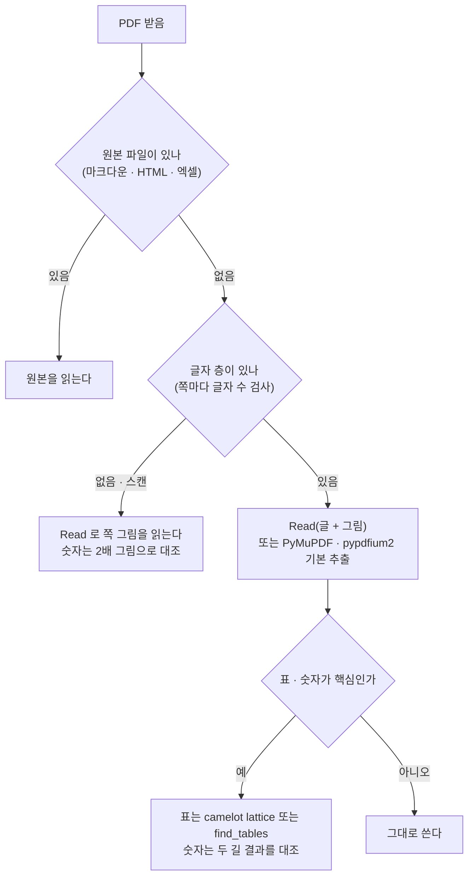

# PDF 정확히 읽기 — 도구 후보 · 한국어 강의 자료 실측 비교 조사서 v0.1

| 문서 정보 | |
|---|---|
| **판 · 상태** | v0.1 · 초안(검토 전 · 정할 것 여섯은 2026-10-16 밤 사용자가 정함 — 0절) |
| **구분** | 조사서 — PDF 글 · 표 · 숫자를 정확히 읽는 도구(파이썬 꾸러미 · MCP 서버 · 명령줄 · 클라우드) 후보 조사와 우리 PDF 로 한 실측 |
| **작성** | 이동원(데이터 파트 · 조사 지시 · 검토) · 후보 조사 · 실측 · 초안은 조사 에이전트(PyPI · npm 등록 정보 · 공식 문서 · 논문 · 블로그만 읽음 · github.com 은 열지 않음 · 우리 PDF 를 바깥 서비스로 보내지 않음) |
| **조회일** | 2026-10-16 (KST) — 판 · 라이선스 · 크기는 이 날 PyPI · npm 에서 읽은 값이다. 판은 자주 바뀐다 |
| **기준** | 시험 PDF 는 부모 저장소 `learning/` · `docs/pdf/` 의 사본(읽기만) · 실측 환경 Windows 11 · 파이썬 3.12 · 격리 venv(개인 작업 폴더 안 · 올리지 않음) · 전역 파이썬은 설치 없이 실행만 |
| **확실도 표기** | 「높음」 = 우리가 직접 돌려 잰 값 · 원문(공식 문서 · 등록 정보 · 논문 초록)을 직접 확인 · 「중간」 = 한 곳의 2차 자료 또는 원문 일부만 확인 · 「낮음」 = 검색 요약만 보았거나 회사 자체 발표 · 「근거 없음 — 확인 필요」 = 숫자를 적지 않음 |
| **최종 수정** | 2026-10-16 (KST) |

> **이 문서로 알 수 있는 것**
> 1. 우리 강의 자료 PDF(브라우저로 만든 PDF)에서는 **가장 단순한 추출(PyMuPDF · pypdfium2 · pypdf · kreuzberg 기본값)이 가장 정확했다** — 6쪽 숫자 173개를 모두 맞히고 표 · 카드 행 34개를 모두 지켰다. 「레이아웃을 살린다」 는 모드들은 여러 줄 표 칸을 옆 칸과 섞었다.
> 2. Claude 의 Read 도구는 PDF 쪽마다 **뽑은 글 + 쪽 그림을 함께** 준다. 글 부분은 PyMuPDF 기본 출력과 글자 하나까지 같았고, 글자 층이 없는 스캔 쪽은 그림만 와서 그림을 보고 읽는다.
> 3. 「조용히 틀리는」 경우가 있다 — 스캔 PDF 는 모든 추출 도구가 오류 없이 빈 글을 내고, pymupdf4llm(레이아웃 끔)은 코드 상자 글을 통째로 빼먹고(숫자 173개 중 69개 빠짐), 이 PC 의 전역 markitdown 0.1.5 는 PDF 를 아예 못 연다.
> 4. 표를 「표로」 받으려면 camelot lattice 가 정답 21행을 군더더기 없이 모두 맞혔다. PyMuPDF `find_tables` · pdfplumber `extract_tables` 도 21행을 맞혔지만 설명 상자까지 표로 잡는다.
> 5. 투자분석 강의 PDF 는 **로컬 마크다운 원본(`learning/th01-investment-analysis/docs/NN.md`)에서 만든 파생본**이다 — 개념 학습 글로 옮길 때는 PDF 를 파싱하지 말고 원본 마크다운을 읽는 것이 가장 정확하다.

---

## 0. 요약 5줄 · 확인할 것 · 정할 것

**요약 5줄**

1. 시험 PDF 7쪽(글자 층 6쪽 + 스캔 1쪽)을 2배 그림으로 그려 눈으로 정답을 만들고, 도구 17가지(모드 포함)와 Read 도구 · OCR 을 같은 채점기(글자 오류율 · 숫자 토큰 · 표 행 · 순서)로 쟀다.
2. 글자 층이 있는 쪽에서는 PyMuPDF · pypdfium2 · pypdf · kreuzberg 기본 추출이 글자 오류율 0.7%(슬라이드 쪽 읽는 순서 차이 두 곳뿐 — 옆 띠 숫자 · 카드 아래 상자) · 숫자 173/173 · 표 행 34/34 로 가장 정확했다.
3. Read 도구는 「뽑은 글 + 쪽 그림」 을 함께 주며, 글 부분은 PyMuPDF 기본과 같았다(06 p16 숫자 24/24 · 표 행 7/7). 스캔 쪽은 그림만 와서 그림으로 읽었고 맞았다.
4. 표는 camelot lattice(21/21 · 군더더기 0) · PyMuPDF find_tables · pdfplumber extract_tables(21/21 · 상자 오검출) 순으로 좋았고, markitdown 0.1.8 은 2/21 로 가장 나빴다.
5. 추천: (가) MCP 는 지금 붙이지 않고 Read + 설치 없는 PyMuPDF 대조 스크립트, (나) 투자분석 강의는 마크다운 원본을 읽기, (다) 앱에 넣을 때는 AGPL 인 PyMuPDF 대신 pypdfium2(Apache-2.0) + pdfplumber(MIT).

**확인할 것**(2026-10-16 밤 반영 현황을 줄 끝에)

- `learning/th01-investment-analysis/docs/` 의 마크다운 원본(01~16.md · voca.md)은 부모 저장소 `.gitignore:26` 으로 빠진 강의 자료다 — 개념 학습 글로 옮길 때 원본을 「읽는 것」 은 되지만 저장소에 넣지 않는 규칙은 그대로다.
- 시험용 venv 가 **821MB** 다(onnxruntime · opencv · pandas · kreuzberg · PyMuPDF). 결과를 옮긴 뒤 지울지 정해야 한다(되돌리기 = 폴더 삭제 · 다시 만드는 설치 명령은 개인 작업 메모 끝) → 2026-10-16 밤 지움(사용자 결정 — 정할 것 바).
- 전역 파이썬의 markitdown 0.1.5 는 PDF 변환이 안 된다(`pdfminer` 없음 → `MissingDependencyException`). 「markitdown 있음」 을 PDF 읽기 수단으로 적어 둔 곳이 있으면 고쳐야 한다. → 2026-10-16 밤 확인: 저장소 문서에는 그렇게 적은 곳이 없다.
- 정답은 Claude 가 그림을 보고 만든 것이다(사람 검수 아님). 다만 정답을 도구 출력보다 먼저 만들었고, 6쪽 중 5쪽에서 세 도구 출력과 정규화 뒤 글자 하나까지 같아 품질은 높다고 본다.
- 시험한 PDF 는 대부분 브라우저 인쇄 PDF(글 순서 = 화면 순서)라 「쉬운」 편이다. 공시 · 법령 · 논문 2단 PDF 는 결과가 다를 수 있으니, 새 종류가 생기면 같은 시험 틀(scripts/)로 두 쪽만 다시 잰다.

**정할 것(추천 첫 칸 · 판단 재료는 7절)**

| 번호 | 정할 것 | 추천(첫 칸) | 다른 안 |
|---|---|---|---|
| 가 | 조사 · 문서 작업 중 PDF 읽는 기본 길 | **Read 도구 + 숫자 · 표가 핵심인 쪽만 PyMuPDF 기본 추출로 대조(설치 없음)** | MCP 서버를 새로 붙임 · 스크립트만 |
| 나 | PDF 읽기 MCP 를 붙일지 | **지금은 붙이지 않음** | markitdown-mcp · pymupdf4llm-mcp · docling-mcp |
| 다 | 강의 자료 → 개념 학습 글로 옮길 때의 원천 | **투자분석 강의는 마크다운 원본 · 그 밖은 PyMuPDF 기본 + 표는 camelot lattice + Read 그림 대조** | PDF 를 Read 로만 |
| 라 | 스캔 교재(07-ml) 처리 | **Read 로 쪽마다 읽고 숫자는 2배 그림으로 대조** | RapidOCR(방향 판별 끔)로 일괄 · 하지 않음 |
| 마 | 앱에 PDF 읽기가 들어갈 때 쓸 꾸러미 | **pypdfium2 + pdfplumber(둘 다 AGPL 아님)** | kreuzberg(MIT · 한글 hwp 도) · opendataloader-pdf(자바 필요) |
| 바 | 시험용 venv(821MB) | **결과를 옮긴 뒤 지움** | 남겨 두고 다시 잴 때 씀 |

**→ 2026-10-16 밤 사용자 결정(D114): 여섯 모두 추천(첫 칸)대로** — 가 Read + PyMuPDF 기본 추출로 숫자 대조 · 나 MCP 는 붙이지 않음 · 다 투자분석 강의는 마크다운 원본 · 라 스캔 교재는 Read + 2배 그림 대조 · 마 앱에 들어가면 pypdfium2 + pdfplumber · 바 시험용 venv 지움(같은 날 지움 — 시험 틀 · 정답 · 결과 표는 개인 작업 폴더에 남김).

---

## 1. 방법

**<표 1> 시험 쪽** — 쪽마다 2배 PNG 를 그려 Read 도구로 보고 정답을 옮겨 적었다(도구 출력을 보기 전에). 강의 자료 원문이라 정답 · 뽑은 글 · 그림은 개인 작업 폴더(올리지 않음)에만 두고, 이 문서에는 두 줄 이하 인용만 싣는다.

| 쪽 | 만든 도구(PDF 정보) | 고른 까닭 |
|---|---|---|
| 투자분석 06 「재무제표 분석 I」 8쪽 | Chromium(브라우저 인쇄) | 고정폭 글꼴로 줄 맞춘 시나리오 표 · 여러 줄 칸이 있는 3열 표 · 흐름도 상자 · 숫자(음수 · 퍼센트) |
| 같은 자료 15쪽 | Chromium | 2열 표 · 코드 상자 속 공식과 숫자 |
| 투자분석 14 「포트폴리오 이론」 3쪽 | Chromium | 파이썬 코드(들여쓰기 · 숫자 많음) · 3열 표 |
| 같은 자료 6쪽 | Chromium | 숫자가 많은 문장(연도 · 퍼센트 · 범위 `29~30%`) |
| 투자분석 용어집 12쪽 | Chromium | 5열 표 · 한자(標準偏差 등) · 여러 줄 칸 · 코드 |
| 06-data-crawling 교재 7쪽 | Google(슬라이드 출력) | 카드 5개 가로 배치 · 180° 돌린 옆 띠 글 |
| 07-ml 교재 3쪽 | 글자 층 없음(스캔 · 그림 PDF) | 글자 추출이 불가능한 경우 · OCR · Read 그림 읽기 |
| (Read 독립 시험) 06 16쪽 · 07-ml 4쪽 | Chromium · 스캔 | 정답을 만들 때 보지 않은 쪽으로 Read 를 따로 시험 |

**<표 2> 지표 뜻(이 문서에서 쓰는 말)**

| 지표 | 뜻 | 이 문서에서의 쓰임 · 헷갈리는 점 |
|---|---|---|
| 글자 층 | PDF 안에 그림이 아니라 「글자」 로 들어 있는 정보. 있으면 복사 · 검색이 된다 | 스캔 PDF 는 글자 층이 없어 그림만 있다. 그때 글자 추출 도구는 오류 없이 빈 글을 낸다 |
| 글자 오류율(CER) | 정답 글자를 출력 글자로 바꾸는 데 드는 고침(넣기 · 빼기 · 바꾸기) 수 ÷ 정답 글자 수 | 「띄어쓰기 무시」 판은 공백을 다 지우고 잰다. 「포함」 판과의 차이가 띄어쓰기 문제의 크기. 순서가 바뀌어도 오류로 센다 |
| 정규화 | 비교 전에 정답 · 출력 모두에 같은 손질을 하는 것 | 유니코드 NFKC · 대시 · 따옴표 통일 · 이모지와 장식 기호 · 마크다운 표시(`#` · `**` · 세로 막대 · 링크 주소) 지움. 그래서 이모지 손실은 오류로 세지 않았다 |
| 숫자 토큰 | `-1,000` · `+33%` · `0.0004` 처럼 붙어 있는 숫자 덩어리 | 정답에 있는데 출력에 없으면 「빠짐」, 출력에만 있으면 「생김」(없는 숫자가 생긴 것). 6쪽 정답에 173개 |
| 표 · 카드 행 보존 | 표 한 행(또는 슬라이드 카드 하나)의 칸 글이 출력에서 한 덩어리로 순서대로 남았나 | 여러 줄 칸이 옆 칸과 줄 단위로 섞이면 「깨짐」. 정답 34행(표 행 · 고정폭 표 행 · 카드) |
| 낱말 순서 | 정답 낱말 순서를 출력이 얼마나 지켰나(최장 공통 부분열 ÷ 정답 낱말 수) | 1.00 이면 순서 그대로 |
| OCR | 그림 속 글자를 읽어 글로 바꾸는 기술(광학 문자 인식) | 스캔 PDF 에만 필요. 이 문서의 OCR 시험은 RapidOCR 하나 |
| MCP | Claude 같은 AI 도구에 바깥 기능을 붙이는 표준 연결 방식(Model Context Protocol) | MCP 서버를 붙이면 Claude 가 그 도구를 직접 부른다. 이 조사에서는 설치하지 않고 후보만 적었다 |
| AGPL | 그 코드를 넣은 프로그램을 네트워크로 서비스해도 전체 소스 공개 의무가 생기는 라이선스 | 팀 규칙상 Public 저장소의 앱 코드에 AGPL · GPL 꾸러미를 넣지 않는다. 도구로만 쓰는 것(우리 PC 에서 돌리기)은 상관없다 |

---

## 2. 후보

**<표 3> 후보 — 기능** (「실측」 = 이 조사에서 직접 돌림 · 「조사」 = 문서만)

| 이름 | 종류 | 로컬 실행 | 한국어 | 표 | OCR(스캔) | 출력 꼴 | MCP 로 붙이기 | 이 조사 |
|---|---|---|---|---|---|---|---|---|
| pypdf | 파이썬 꾸러미 | 됨 | 우리 시험 정상 | 없음(글만) | 없음 | 글 | 커뮤니티 mcp-pdf 안에 포함 | 실측(전역 6.9.2) |
| PyMuPDF | 파이썬 꾸러미 | 됨 | 정상 | `find_tables` | Tesseract 를 따로 깔면 연동 함수 있음(확인 필요) | 글 · 블록 · 표 | pymupdf4llm-mcp | 실측 |
| pymupdf4llm | 파이썬 꾸러미 | 됨(레이아웃은 ONNX 모델 · CPU) | 정상 | 마크다운 표 | 위와 같음 | 마크다운 | pymupdf4llm-mcp(PyMuPDF 쪽 이름공간) | 실측(켬 · 끔) |
| pdfplumber | 파이썬 꾸러미 | 됨 | 정상 | `extract_tables` | 없음 | 글 · 표 | 커뮤니티 mcp-pdf · pdf-mcp 안에 포함 | 실측 |
| pdfminer.six | 파이썬 꾸러미 | 됨 | 정상 | 없음 | 없음 | 글 | — | 실측 |
| pypdfium2 | 파이썬 꾸러미(PDFium) | 됨 | 정상 | 없음 | 없음 | 글 · 그림 그리기 | — | 실측 |
| markitdown | 파이썬 꾸러미(마이크로소프트) | 됨(PDF 는 `[pdf]` 선택 설치 필요) | 정상 | 글자 위치로 표를 다시 짬 | 자체 OCR 언급 없음 · Azure 문서 분석 선택 설치(`az-doc-intel` · 클라우드) | 마크다운 | **markitdown-mcp**(공식 · 알파 0.0.1a7) | 실측(0.1.5 · 0.1.8) |
| kreuzberg | 파이썬 꾸러미(Rust 핵심) | 됨 | 정상 · `.hwp` `.hwpx` 도 읽음 | 기본 설정에서는 0개(설정 확인 필요) | Tesseract · EasyOCR · PaddleOCR 연동 | 글 · 마크다운 | README 에 언급 없음 | 실측 |
| opendataloader-pdf | 파이썬 · Node 래퍼 + 자바 | 됨(자바 11+ 필요) | 정상 | 마크다운 표 · 하이브리드 모드 | 하이브리드 모드(로컬 docling 서버 · RapidOCR `korean` 선택 가능) | 마크다운 · JSON(좌표) · HTML · 글 | PyPI 에 별도 MCP 꾸러미 없음 | 실측(로컬 모드) |
| pdf_oxide | 파이썬 꾸러미(Rust) | 됨 | **한국어 띄어쓰기를 지움** | 마크다운 표 | `ocr` 선택 설치 | 글 · 마크다운 | — | 실측 |
| pdftext | 파이썬 꾸러미(pypdfium2 위 · Marker 가 씀) | 됨 | 정상 · 이모지 → `�` | 없음 | 없음 | 글 · JSON | — | 실측 |
| camelot-py | 파이썬 꾸러미(표 전용) | 됨 | 정상 | lattice · stream | `ocr` 선택 설치 | 표(DataFrame) | — | 실측(표) |
| tabula-py | 파이썬 + 자바 | 됨(자바) | 근거 없음 — 확인 필요 | 표 전용 | 없음 | 표 | — | 조사(시간 · camelot 과 같은 갈래) |
| Docling | 파이썬 꾸러미 | 됨 · torch 모델 | 근거 없음 — 확인 필요 | 모델로 표 인식 | OCR 엔진 여럿 | 마크다운 · JSON | **docling-mcp**(기본은 Docling Serve 서비스에 붙음 · `[local]` 은 전체 docling) | 조사(torch) |
| Marker(marker-pdf 2.0) | 파이썬 + 로컬 VLM 추론 서버 | 됨(GPU 권장) | 근거 없음 — 확인 필요 | 텍스트 층 재구성 + VLM | VLM 으로 | 마크다운 · JSON | — | 조사(무거움) |
| MinerU | 파이썬 + 모델 · VLM | 됨 · 원격 API 길도 있음 | 근거 없음 — 확인 필요 | 모델 | 모델 | 마크다운 · JSON | mineru-mcp(**클라우드 API** · 반출) · mcp-mineru(로컬 · 무거움) | 조사 |
| unstructured | 파이썬 | PDF 는 `unstructured-inference`(torch) 필요 | 근거 없음 — 확인 필요 | 모델 | 모델 · Tesseract | 요소 목록 | 근거 없음 — 확인 필요 | 조사 |
| RapidOCR | 파이썬(ONNX) | 됨 · 모델은 처음 실행 때 내려받음 | 한국어 모델 있음 | 없음 | 있음 | 줄 글 | — | 실측(OCR) |
| Tesseract(pytesseract) | 명령줄 + 래퍼 | 됨(본체 · `kor` 데이터 따로 설치) | `kor` 데이터 | 없음 | 있음 | 글 · hOCR | — | 조사 |
| PaddleOCR · olmOCR | 파이썬 · 모델 | 됨(무거움 · olmOCR 은 GPU) | PaddleOCR 한국어 모델 | 모델 | 있음 | 글 · 마크다운 | — | 조사 |
| **Claude Read 도구(내장)** | Claude Code 내장 | 내용은 Anthropic API 로 감(지금 대화와 같은 길) | 정상 | 그림으로 봄 | 그림으로 봄 | 글 + 쪽 그림 | 이미 붙어 있음 | 실측 |
| @modelcontextprotocol/server-pdf | MCP 서버(npm · MCP 공식 조직) | 됨 · 학술 사이트 URL 도 엶 | PDF.js 기준 | 없음(보기 화면) | 없음 | 보기 화면 · 글 조각 | 그 자체 | 조사 |
| @sylphlab/pdf-reader-mcp · mcp-pdf · pdf-mcp · mcp-pdf-reader | MCP 서버(커뮤니티) | 됨 | 속에 쓰는 꾸러미를 따름 | 꾸러미에 따름 | mcp-pdf 는 Tesseract | 글 | 그 자체 | 조사 |
| LlamaParse · Upstage Document Parse · Mistral OCR · Azure Document Intelligence · CLOVA OCR | 클라우드 | **안 됨(PDF 를 올림)** | Upstage 는 한국 회사 | 됨 | 됨 | 마크다운 · JSON | 근거 없음 — 확인 필요 | 조사만(반출 금지) |

**<표 4> 후보 — 라이선스 · 크기 · 판 · 유지**(크기는 PyPI 파일 크기, 「설치」 는 우리 venv 에서 잰 폴더 크기)

| 이름 | 라이선스 | 앱 코드에 넣어도 되나(Public) | 크기 | Windows | 마지막 판(날짜) | 유지 | 출처 · 확실도 |
|---|---|---|---|---|---|---|---|
| pypdf | BSD-3-Clause | 됨 | 0.41MB(순수 파이썬) | 됨 | 6.21.0 (2026-10-16) · 전역은 6.9.2 | 활발(판 123) | [1] · 높음 |
| PyMuPDF | AGPL-3.0 또는 Artifex 상용 | **안 됨**(도구로만) | 19.8MB · 설치 105MB | 됨 | 1.28.2 (2026-08-06) | 활발 | [1] · 높음 |
| pymupdf4llm | AGPL-3.0 또는 상용 · 필수 의존 pymupdf-layout | **안 됨** | 0.18MB + layout 42.9MB + onnxruntime 37MB | 됨 | 1.28.2 (2026-08-06) | 활발 | [1] · 높음 |
| pymupdf-layout | README 배지는 AGPL · PyPI 분류자는 「Other/Proprietary License」 — **원문끼리 엇갈림** | 안 됨 | 42.9MB | 됨 | 1.28.2 (첫 판 2025-11-05) | 새것 | [1] · [3] · 중간 |
| pdfplumber | MIT | 됨 | 0.06MB(+ pdfminer.six · pypdfium2 · Pillow) | 됨 | 0.11.10 (2026-06-15) | 활발 | [1] · 높음 |
| pdfminer.six | MIT | 됨 | 6.6MB | 됨 | 20260107 | 유지 | [1] · 높음 |
| pypdfium2 | Apache-2.0 또는 BSD-3(+ PDFium 의존 라이선스) | 됨 | 3.95MB | 됨 | 5.14.0 (2026-10-04) | 활발 | [1] · 높음 |
| markitdown | MIT | 됨(하지만 표 품질이 낮음) | 0.09MB + magika(onnxruntime) | 됨 | 0.1.8 (2026-09-21) · 전역은 0.1.5 | 활발 | [1] · 높음 |
| markitdown-mcp | MIT | (도구) | 0.01MB · `markitdown[all]` 끌어옴 | 됨 | 0.0.1a7 (2026-09-14) 알파 | 활발 | [1] · [3] · 높음 |
| kreuzberg | MIT | 됨 | 36.7MB · 설치 96MB | 됨 | 4.10.4 (2026-09-21) | 활발(판 139) | [1] · [3] · 높음 |
| opendataloader-pdf | Apache-2.0 | 됨(자바 런타임 필요) | 22.65MB(JAR 포함) | 됨 | 2.5.13 (2026-10-13) · 첫 판 2025-09-01 | 활발(판 79) | [1] · [3] · 높음 |
| pdf_oxide | MIT 또는 Apache-2.0 | 됨 | 11.6MB · 설치 27MB | 됨 | 0.3.78 (2026-09-08) | 새것(첫 판 2025-11-05) | [1] · 높음 |
| pdftext | Apache-2.0 | 됨 | 0.03MB(pypdfium2 5.10.1 고정) | 됨 | 0.7.1 (2026-07-08) | 유지 | [1] · 높음 |
| camelot-py | MIT | 됨(opencv · pandas 끌어옴) | 0.11MB + opencv 113MB · pandas 68MB(설치) | 됨 | 2.0.0 (2026-06-04) | 유지 | [1] · 높음 |
| tabula-py | MIT | 됨(자바) | 12MB | 됨 | 2.10.0 (2024-10-17) | 느림 | [1] · 높음 |
| Docling · docling-mcp | MIT(모델은 따로) | 코드 됨 · torch | 본체 작음 · 모델 · torch 수 GB(근거 없음 — 확인 필요) | 됨 | 2.140.0 (2026-10-16) · mcp 3.3.0 | 매우 활발 | [1] · [3] · 높음(라이선스) |
| marker-pdf | 코드 Apache-2.0 · **모델 가중치는 수정 OpenRAIL-M**(연구 · 개인 · 매출 500만 달러 미만 회사 무료) | 가중치 조건 따져야 | 본체 0.2MB + 추론 서버 · 모델 | 됨(GPU 권장) | 2.0.0 (2026-07-20) | 활발 | [1] · [3] · 높음 |
| mineru | 자체 「MinerU Open Source License」 | 원문 조건 확인 필요 | 3.7MB + gradio · llama.cpp · 모델 | 됨 | 4.0.12 (2026-10-11) | 매우 활발 | [1] · 중간 |
| unstructured | Apache-2.0 | 코드 됨 · PDF 는 torch | 1.7MB + inference(torch) | 됨 | 0.27.27 (2026-10-15) | 활발 | [1] · 높음 |
| rapidocr | Apache-2.0(모델 파일 라이선스는 확인 필요) | 코드 됨 | 27MB · 설치 45MB + 한국어 모델 12.86MB(modelscope.cn 에서 받음) | 됨 | 3.10.0 (2026-10-08) | 활발 | [1] · 높음 |
| @modelcontextprotocol/server-pdf | MIT | (도구) | 7.4MB | 됨(Node) | 2.0.3 (2026-09-25) | 활발 | [2] · [4] · 높음 |
| @sylphlab/pdf-reader-mcp | MIT | (도구) | 0.03MB + pdfjs-dist | 됨(Node) | 0.3.23 (2025-04-07) | **1년 넘게 갱신 없음** | [2] · 높음 |
| pymupdf4llm-mcp | 등록 정보 칸 비어 있음(속은 AGPL 꾸러미) | (도구) | 0.02MB | 됨 | 1.28.0 (2026-07-02) | 유지 | [1] · 중간 |
| mcp-pdf · pdf-mcp | MIT | (도구) | 작음 · pdf-mcp 는 fastembed 모델 받음 | 됨 | 2026.9.22 · 3.5.0 | 활발 | [1] · 높음 |

---

## 3. 실측

### 3.1 글자 층이 있는 6쪽

<표 5> 은 6쪽을 모두 더한 값이고, <표 6> 은 쪽별 값이다. 시간은 이 PC(22코어)에서 쪽 PDF 하나당 걸린 시간의 중앙값이며, opendataloader 는 자바 기동을 포함해 7쪽을 한 번에 돌린 시간을 나눈 값이다.

**<표 5> 글자 층 있는 6쪽 합계 — 정답 대비(정답 숫자 토큰 173개 · 표 · 카드 행 34개 · 한자 29자 · 코드 들여쓰기 3줄)**

| 도구 | 글자 오류율(띄어쓰기 무시) | 글자 오류율(띄어쓰기 포함) | 숫자 맞음 | 숫자 빠짐 | 없는 숫자 생김 | 표 · 카드 행 보존 | 낱말 순서 | 한자 | 코드 들여쓰기 | 깨진 글자 | 쪽당 시간(중앙값) |
|---|---:|---:|---:|---:|---:|---:|---:|---:|---:|---:|---:|
| kreuzberg(기본) | 0.7% | 0.8% | 173/173 | 0 | 0 | 34/34 | 0.99 | 29/29 | 0/3 | 0 | 0.024초 |
| PyMuPDF get_text(기본) | 0.7% | 0.8% | 173/173 | 0 | 0 | 34/34 | 0.99 | 29/29 | 3/3 | 0 | 0.033초 |
| pypdf extract_text(기본) | 0.7% | 0.8% | 173/173 | 0 | 0 | 34/34 | 0.99 | 29/29 | 0/3 | 0 | 0.083초 |
| pypdfium2 | 0.7% | 0.8% | 173/173 | 0 | 0 | 34/34 | 0.99 | 29/29 | 0/3 | 0 | 0.014초 |
| pdftext | 0.8% | 0.9% | 173/173 | 0 | 0 | 34/34 | 0.99 | 29/29 | 0/3 | 28 | 0.038초 |
| pdfminer.six | 4.8% | 5.1% | 173/173 | 0 | 1 | 23/34 | 0.95 | 29/29 | 0/3 | 0 | 0.116초 |
| pymupdf4llm(레이아웃 켬 · 기본) | 5.2% | 6.0% | 170/173 | 3 | 2 | 26/34 | 0.89 | 29/29 | 3/3 | 0 | 0.742초 |
| opendataloader-pdf(마크다운) | 5.5% | 5.2% | 173/173 | 0 | 1 | 28/34 | 0.94 | 29/29 | 0/3 | 0 | 0.538초 |
| pypdf layout 모드 | 10.1% | 9.5% | 173/173 | 0 | 0 | 15/34 | 0.91 | 29/29 | 0/3 | 0 | 0.071초 |
| pdfplumber extract_text | 10.2% | 9.6% | 173/173 | 0 | 1 | 15/34 | 0.91 | 29/29 | 0/3 | 0 | 0.134초 |
| pdfplumber layout=True | 10.2% | 9.6% | 173/173 | 0 | 1 | 15/34 | 0.91 | 29/29 | 3/3 | 0 | 0.113초 |
| PyMuPDF get_text(sort=True) | 10.2% | 9.6% | 173/173 | 0 | 1 | 15/34 | 0.91 | 29/29 | 3/3 | 0 | 0.038초 |
| markitdown 0.1.8[pdf] | 10.5% | 10.1% | 173/173 | 0 | 1 | 12/34 | 0.90 | 29/29 | 0/3 | 0 | 0.198초 |
| pdf_oxide extract_text | 24.5% | 26.2% | 173/173 | 0 | 7 | 16/34 | 0.76 | 29/29 | 3/3 | 0 | 0.015초 |
| pymupdf4llm(레이아웃 끔) | 25.4% | 25.5% | **104/173** | **69** | 0 | 25/34 | 0.68 | 29/29 | 0/3 | 0 | 0.153초 |
| pdf_oxide to_markdown | 29.2% | 30.8% | 173/173 | 0 | 1 | 15/34 | 0.68 | 29/29 | 0/3 | 0 | 0.018초 |
| markitdown 0.1.5(전역 · 이미 있음) | 100.0% | 100.0% | 0/173 | 173 | 0 | 0/34 | 0.00 | 0/29 | 0/3 | 0 | (실패) |

- 「깨진 글자」 는 원문 출력에서 센 U+FFFD(`�`) · 사용자 영역 글자 · 낱자모 · `(cid:)` 의 합이다. pdftext 의 28개는 모두 이모지 자리의 `�` 다. 한글이 낱자모로 깨지거나 `(cid:)` 가 나온 도구는 없었다.
- 「없는 숫자 생김」 1개는 모두 슬라이드 옆 띠 글(`PART 02 · HTTP`)에서 왔다 — pdfplumber 계열 · markitdown 은 거꾸로 읽어 `20`, pdfminer · opendataloader · PyMuPDF `sort=True` · pdf_oxide to_markdown 은 띠 글이 본문 사이에 끼어 `02` 로 남았다. pdf_oxide extract_text 의 7개는 용어집 표 글을 **두 번** 낸 것이다(한 번은 띄어쓰기 없이 · 한 번은 있게 — `r=0.9` · `p<0.05` · `VaR 5%` 가 두 번씩).
- pymupdf4llm(레이아웃 켬)의 숫자 차이 3 · 2 는 숫자를 잘못 읽은 것이 아니라 코드 상자에서 공백이 빠져 `- 1` 이 `-1` 로 붙은 것이다(4절).

**<표 6> 쪽별 글자 오류율(띄어쓰기 무시) · 숫자 맞음**

| 도구 | 06 p8 표 · 흐름도 | 06 p15 코드 상자 | 14 p3 코드 · 표 | 14 p6 숫자 글 | 용어집 p12 5열 표 · 한자 | 크롤링 p7 슬라이드 |
|---|---:|---:|---:|---:|---:|---:|
| kreuzberg(기본) | 0.0% · 34/34 | 0.0% · 24/24 | 0.0% · 38/38 | 0.0% · 20/20 | 0.0% · 31/31 | 7.5% · 26/26 |
| PyMuPDF get_text(기본) | 0.0% · 34/34 | 0.0% · 24/24 | 0.0% · 38/38 | 0.0% · 20/20 | 0.0% · 31/31 | 7.5% · 26/26 |
| pypdf extract_text(기본) | 0.0% · 34/34 | 0.0% · 24/24 | 0.0% · 38/38 | 0.0% · 20/20 | 0.0% · 31/31 | 7.5% · 26/26 |
| pypdfium2 | 0.0% · 34/34 | 0.0% · 24/24 | 0.0% · 38/38 | 0.0% · 20/20 | 0.0% · 31/31 | 7.5% · 26/26 |
| pdftext | 0.0% · 34/34 | 0.0% · 24/24 | 0.0% · 38/38 | 0.0% · 20/20 | 0.4% · 31/31 | 7.5% · 26/26 |
| pdfminer.six | 0.0% · 34/34 | 0.0% · 24/24 | 2.8% · 38/38 | 0.0% · 20/20 | 3.4% · 31/31 | 38.2% · 26/26 |
| pymupdf4llm(레이아웃 켬 · 기본) | 6.8% · 34/34 | 0.0% · 24/24 | 0.0% · 35/38 | 0.0% · 20/20 | 0.0% · 31/31 | 43.2% · 26/26 |
| opendataloader-pdf(마크다운) | 2.8% · 34/34 | 3.6% · 24/24 | 0.5% · 38/38 | 0.0% · 20/20 | 0.7% · 31/31 | 46.5% · 26/26 |
| pypdf layout 모드 | 6.8% · 34/34 | 0.0% · 24/24 | 0.0% · 38/38 | 0.0% · 20/20 | 12.3% · 31/31 | 67.3% · 26/26 |
| pdfplumber extract_text | 6.8% · 34/34 | 0.0% · 24/24 | 0.0% · 38/38 | 0.0% · 20/20 | 12.3% · 31/31 | 68.0% · 26/26 |
| pdfplumber layout=True | 6.8% · 34/34 | 0.0% · 24/24 | 0.0% · 38/38 | 0.0% · 20/20 | 12.3% · 31/31 | 68.0% · 26/26 |
| PyMuPDF get_text(sort=True) | 6.8% · 34/34 | 0.0% · 24/24 | 0.0% · 38/38 | 0.0% · 20/20 | 12.3% · 31/31 | 68.0% · 26/26 |
| markitdown 0.1.8[pdf] | 6.8% · 34/34 | 0.0% · 24/24 | 2.8% · 38/38 | 0.0% · 20/20 | 12.3% · 31/31 | 66.7% · 26/26 |
| pdf_oxide extract_text | 16.1% · 34/34 | 0.6% · 24/24 | 19.4% · 38/38 | 18.9% · 20/20 | 35.3% · 31/31 | 72.6% · 26/26 |
| pymupdf4llm(레이아웃 끔) | 12.0% · 33/34 | 15.9% · 15/24 | 74.7% · **2/38** | 0.0% · 20/20 | 0.0% · 31/31 | 88.4% · **3/26** |
| pdf_oxide to_markdown | 52.7% · 34/34 | 8.9% · 24/24 | 18.0% · 38/38 | 22.6% · 20/20 | 18.8% · 31/31 | 75.0% · 26/26 |
| markitdown 0.1.5(전역 · 이미 있음) | 100.0% · 0/34 | 100.0% · 0/24 | 100.0% · 0/38 | 100.0% · 0/20 | 100.0% · 0/31 | 100.0% · 0/26 |

읽는 법: 단순 추출 다섯 가지의 오류는 슬라이드 쪽(크롤링 p7)에만 있고, 그것도 순서 차이 두 곳이다 — 옆 띠의 큰 숫자 `07` 이 맨 앞에 오고, 4xx 카드 아래 「크롤링 실전 팁 403 404 429」 상자가 5xx 카드 설명 뒤로 간다(글자 · 숫자는 모두 맞음 · `scripts/diff_one.py` 로 확인). 브라우저로 만든 PDF 는 글이 화면 순서대로 들어 있어서, 좌표로 순서를 다시 짜는 모드(`sort=True` · `layout`)가 오히려 표 칸을 섞는다.

### 3.2 표를 표로 받기

**<표 7> 표 전용 시험 — 정답 표 4개 21행 중 칸 내용이 행 그대로 맞은 수**(「뽑힌 행 수」 가 21 보다 크면 표가 아닌 상자도 표로 잡은 것)

| 도구 | 06 p8 (3열 4행) | 06 p15 (2열 2행) | 14 p3 (3열 5행) | 용어집 p12 (5열 10행) | 합계 | 뽑힌 행 수 |
|---|---:|---:|---:|---:|---:|---:|
| camelot lattice | 4/4 | 2/2 | 5/5 | 10/10 | **21/21** | **21** |
| PyMuPDF find_tables | 4/4 | 2/2 | 5/5 | 10/10 | 21/21 | 56 |
| pdfplumber extract_tables | 4/4 | 2/2 | 5/5 | 10/10 | 21/21 | 55 |
| pymupdf4llm 레이아웃 끔(마크다운 표) | 4/4 | 2/2 | 5/5 | 10/10 | 21/21 | 21 |
| opendataloader-pdf(마크다운 표) | 4/4 | 2/2 | 5/5 | 9/10 | 20/21 | 28 |
| pymupdf4llm 레이아웃 켬(마크다운 표) | 2/4 | 0/2 | 5/5 | 10/10 | 17/21 | 21 |
| camelot stream | 2/4 | 2/2 | 5/5 | 2/10 | 11/21 | 94 |
| pdf_oxide to_markdown | 2/4 | 2/2 | 5/5 | 2/10 | 11/21 | 31 |
| markitdown 0.1.8(마크다운 표) | 2/4 | 0/2 | 0/5 | 0/10 | **2/21** | 24 |
| kreuzberg(기본 설정) | 0/4 | 0/2 | 0/5 | 0/10 | 0/21 | 0 |

- camelot lattice 는 선이 그어진 표만 찾는다 — 우리 강의 자료 표는 모두 선이 있어 군더더기가 없었다. 선 없는 표는 stream 모드를 써야 하는데, stream 은 여러 줄 칸을 행 둘로 나눴다(11/21).
- PyMuPDF · pdfplumber 는 배경색 상자(공식 · 코드 · 예시 상자)를 1열 표로 함께 잡았다. 표만 쓰려면 열 수 2 이상 · 머리 행 검사로 걸러야 한다.
- 표 시험 4쪽에 걸린 시간: camelot lattice 1.63초 · pdfplumber 0.58초 · PyMuPDF 0.38초.

### 3.3 스캔 PDF · OCR · Read 도구

**<표 8> 글자 층 없는 쪽(07-ml 교재)** — 글자 오류율은 띄어쓰기 무시 판

| 방법 | 07-ml p3 (그림 속 글 + 정의 상자) | 07-ml p4 (그래프 + 물음 3줄) | 비고 |
|---|---:|---:|---|
| 글자 추출 도구 전부(pypdf · PyMuPDF · pdfplumber · pdfminer · pypdfium2 · kreuzberg · pdftext · markitdown · pdf_oxide · pymupdf4llm) | 100%(빈 글) | — | **오류 없이 빈 글** · opendataloader 는 그림 링크 2개만 |
| RapidOCR 3.10 한국어 모델 · 기본 설정 | 43.4% | 59.5% | 몇 줄이 뜻 없는 글자(`EC극 위HCIOY(L`) — 줄을 뒤집힌 것으로 오판한 꼴 |
| RapidOCR · 방향 판별 끔 | 19.2% | **1.3%** | 남은 오류 = 그림 속 작은 글 오독(`컴퓨터` → `검퓨터`) · 공백 빠짐 · 그림 글 순서 |
| Claude Read(그림으로 읽음) | (정답 만든 쪽이라 따로 안 잼) | **0.0%** · 숫자 3/3 | PDF 로 먼저 읽고 2배 그림으로 대조 |

**<표 9> Read 도구의 글 부분 — 정답 만들 때 보지 않은 06 p16 으로 비교**(기준 = PyMuPDF · pypdfium2 · kreuzberg 출력이 서로 같아 그것을 기준으로 씀)

| 출력 | 기준 대비 글자 오류율 | 숫자 | 표 행(7) | 원문 유사도(공백만 접음) |
|---|---:|---:|---:|---:|
| Read 도구 글 부분 | 0.0% | 24/24 | 7/7 | PyMuPDF · pypdfium2 · kreuzberg 와 1.000 |
| pdfplumber | 0.0% | 24/24 | 7/7 | 0.924 |
| pdfminer.six | 4.4% | 24/24 | 5/7 | 0.881 |

- Read 도구는 PDF 쪽마다 「뽑은 글(문서 내용) + 쪽 그림」 을 함께 준다. Anthropic 문서도 같은 말을 한다 — 「The system converts each page of the document into an image.」 「The text from each page is extracted and provided alongside each page's image.」([5])
- 글 부분은 단순 추출과 같아서 표가 「행마다 한 줄」 로 붙어 나오고, 머리말 · 쪽 번호는 글 끝에 붙는다. 칸 경계는 그림으로 확인해야 한다.
- 비용 · 한도([5] · [6]): 쪽마다 글 토큰 약 1,500–3,000 + 그림 토큰. Read 한 번에 20쪽까지 · 10쪽 넘는 PDF 는 쪽 범위를 꼭 준다. 33쪽 강의 자료 한 편을 통째로 읽으면 대략 5만~10만 토큰이 든다(1,500~3,000 × 33 · 그림 토큰 제외 — 추정).

---

## 4. 오류 꼴

**<표 10> 쪽마다 눈으로 읽어 모은 오류 꼴**(인용은 두 줄 이하)

| 오류 꼴 | 나온 도구 · 쪽 | 보기 | 우리에게 주는 위험 |
|---|---|---|---|
| 여러 줄 칸이 옆 칸과 줄 단위로 섞임 | pdfplumber · PyMuPDF `sort=True` · pypdf layout · markitdown · pdfminer(일부) — 06 p8 · 용어집 p12 | `초기 고정비 매우 팹 1개에 수십조 투자, 매년 수조 불황기 …` / `큼 감가상각 빠름` | 칸 뜻이 뒤섞여 「큼」 · 「빠름」 이 어느 칸 말인지 잃는다 |
| 마크다운 표에서 여러 줄 칸을 행 둘로 쪼갬 | pymupdf4llm(레이아웃 켬) · camelot stream · pdf_oxide | `\|초기 고정비 매우\|팹 1개에 …\|` 다음 행 `\|큼\|감가상각\|빠름\|` | 표 행 수가 늘고 칸 글이 잘림 |
| 열을 합치고 머리말까지 표로 | markitdown 0.1.8 — 용어집 p12 · 06 p8 | `\| 용어 한자 \| 영어 \| 아주 쉬운 뜻 \| …` | 5열 표가 4열로 · 한자 열이 사라진 것처럼 보임 |
| 같은 글을 두 번 냄 | pdf_oxide extract_text — 용어집 p12 | `r=0.9 → 강한양의상관` 뒤에 다시 `r=0.9 → 강한 양의 상관` | 숫자 · 문장이 두 번 세어짐(요약 · 검색에서 한쪽으로 쏠림) |
| 한국어 띄어쓰기 지움 | pdf_oxide — 거의 모든 쪽 | `\| 용어 \| 한자 \| 영어 \| 아주쉬운뜻 \| 실전예시 \|` | 검색 · 낱말 단위 처리가 틀어짐 |
| 코드 상자 글이 통째로 빠짐(오류 메시지 없음) | pymupdf4llm(레이아웃 끔) — 14 p3 숫자 2/38 · 06 p15 15/24 · 크롤링 p7 3/26 | (출력에 코드 블록 자체가 없음) | **조용한 누락** — 숫자 · 공식이 사라져도 모른다 |
| 코드 상자에서 낱말 사이 공백이 빠짐 | pymupdf4llm(레이아웃 켬) — 14 p3 | `importnumpyasnp` · `[stock_weight, 1- stock_weight]` | 코드를 그대로 옮기면 실행이 안 됨(구문 색칠된 조각 사이 공백) |
| 180° 돌린 글을 거꾸로 읽음 | pdfplumber 계열 — 크롤링 p7 옆 띠 | `PTTH` / `· 20 TRAP`(원래 `PART 02 · HTTP`) | 없는 숫자(`20`)가 생김 |
| 가로 카드를 줄 단위로 섞음 | pdfplumber · PyMuPDF `sort=True` · markitdown · pdf_oxide — 크롤링 p7 | `100 – 199 200 – 299 300 – 399 400 – 499 500 – 599` | 카드별 설명이 뒤섞여 어느 범위 설명인지 잃음 |
| 이모지가 `�` 로 | pdftext — 이모지 있는 4쪽 | (공장 · 엑스 · 로켓 이모지 자리) | 본문 뜻은 남음 · 기호 의미(예: 적자를 뜻하던 엑스 표시)는 잃음 |
| 머리말 · 쪽 번호가 본문에 섞임 | 거의 모든 도구(opendataloader 일부만 걸러냄) · Read 도구는 글 끝에 붙임 | `투자분석 강의 교안` · `8 / 33` | 여러 쪽을 이어 붙이면 문장 사이에 끼어듦 |
| 링크 주소가 글에 섞임 | pymupdf4llm(레이아웃 끔) | 위키백과 주소의 `%EC%84%B1` 같은 조각 | 숫자 검사에서 없는 숫자(`84%`)로 잡힘 |
| 스캔 쪽을 빈 글로(오류 없음) | 글자 추출 도구 전부 — 07-ml | (빈 글) | **조용한 누락** — 「빈 글이면 스캔」 검사가 꼭 있어야 함 |
| OCR 이 줄 방향을 잘못 판별 | RapidOCR 기본 설정 — 07-ml p3 · p4 | `EC극 위HCIOY(L`(원래 `1) 사람이 개입하고 있는가?`) | 뜻 없는 글이 진짜처럼 섞임 · 방향 판별을 끄면 사라짐 |
| PDF 변환 자체가 안 됨 | 전역 markitdown 0.1.5 | `MissingDependencyException` | 「도구가 있다」 와 「PDF 가 읽힌다」 는 다르다 |

---

## 5. 바깥 비교 실험

**<표 11> 다른 곳의 비교 — 한국어 실험은 한 건뿐**

| 자료 | 무엇을 | 결과(원문 그대로 · 짧게) | 우리 실측과 | 확실도 |
|---|---|---|---|---|
| AutoRAG 「PDF 한글 텍스트 추출 실험」(velog · 2024-06-17 · [7]) | PyPDFium2 · PyMuPDF · PyPDF2 · PDFMiner · PDFPlumber 를 의료 · 법률 · 금융 · 상거래 · 공공 한국어 PDF 로 눈 비교(표 · 그림 문서는 뺌 · 정량 지표 없음) | 「PDFMiner, PDFPlumber, PyPDFium2 성능 차이는 거의 없다고 느껴졌다」 · PyPDF2 꼴찌(줄바꿈) · 상거래 문서는 대부분 깨짐 | 우리 PDF 에서는 pypdf(지금 판)가 단순 추출 최상위와 같았다 — 그 사이 pypdf 판이 크게 바뀜(PyPDF2 → pypdf 6.x) | 중간(본문은 열었으나 상세 표는 바깥 Notion) |
| Adhikari 외 「A Comparative Study of PDF Parsing Tools Across Diverse Document Categories」(arXiv 2410.09871 · [8]) | DocLayNet 6분야(과학 · 특허 · 금융 · 법규 · 입찰 · 설명서) · 10개 도구 · 한국어 없음 | 「PyMuPDF and pypdfium generally outperformed others, but all parsers struggled with Scientific and Patent documents.」 표 탐지는 「TATR excelled …」 | 글 추출 순위가 우리와 같은 방향(PyMuPDF · pypdfium2 상위) | 높음(초록 확인) |
| opendataloader-pdf README 자체 벤치마크([3]) | 200개 PDF · 하이브리드 모드 | 「0.907 overall … 0.928 table」 · 로컬 모드 「0.015s/page」 | 우리는 로컬 모드만 — 글 5.5% · 표 20/21 | 낮음(제작사 자체 발표) |
| marker README([3]) | olmocr-bench(1,403개 PDF) | 점수 그림만 · 수치는 원문 그림 | 시험 안 함 | 낮음(제작사 자체 발표) |
| Upstage Document Parse 블로그([9]) | 자체 DP-Bench | TEDS 93.48 · LlamaParse 보다 약 4배 빠름(검색 요약) | 클라우드라 시험 안 함 | 낮음 |
| LlamaParse 독립 비교([10]) | 계약서 질의 · 800개 넘는 문서 | 80.0% · 78% 편집 유사도(검색 요약) | 클라우드라 시험 안 함 | 낮음 |

Mistral OCR · Azure Document Intelligence · CLOVA OCR 의 정확도 수치는 이 조사에서 원문을 보지 않았다 — 근거 없음 — 확인 필요.

---

## 6. 추천

**<그림 1> PDF 를 받았을 때 고르는 길**

### 6.1 (가) 조사 · 문서 작업 중 Claude 가 PDF 를 읽을 때

- **추천: MCP 는 지금 붙이지 않는다. Read 도구를 기본으로 쓰고, 숫자 · 표가 핵심인 쪽만 PyMuPDF 기본 추출(전역 파이썬에 이미 있음 · 설치 없음)로 뽑아 두 결과의 숫자를 대조한다.**
- 까닭: Read 의 글 부분은 이미 가장 정확했던 단순 추출과 같고(<표 9>), 그림까지 함께 와서 표 칸 · 흐름도는 그림으로 확인할 수 있다. MCP 후보 중 markitdown-mcp 는 속의 markitdown 이 표 2/21(<표 7>)이고, pymupdf4llm-mcp 는 레이아웃 켬에서 코드 공백 빠짐 · 끔에서 코드 상자 누락(<표 5>)이 있으며, 공식 server-pdf 는 「보기 화면」 도구다.
- 긴 PDF 는 Read 로 통째로 읽지 말고, 먼저 스크립트로 쪽마다 글자 수를 세어 스캔 쪽 · 표 쪽을 가려낸 뒤 그 쪽만 Read 로 본다(토큰 절약 · <표 9> 아래 비용).
- 설치 명령(사용자 확인용): 없음(전역 PyMuPDF 1.28.2 사용). 대조 스크립트는 개인 작업 폴더의 시험 틀(`extract_all.py` · `score.py` — 올리지 않음)을 줄여 쓰면 된다.
- 되돌리는 법: 해당 없음(설치 없음).
- 위험: Read 로 읽은 내용은 Anthropic API 로 간다(지금 대화와 같은 길 · 새 반출 아님). 클라우드 파서에는 올리지 않는다.
- MCP 를 꼭 붙인다면(사용자 확인 뒤): `claude mcp add markitdown -- uvx markitdown-mcp@0.0.1a7` (되돌리기 `claude mcp remove markitdown`). 다만 표가 많은 PDF 에는 권하지 않는다(<표 7>). 위험 = 알파판 · `markitdown[all]` 이 클라우드 선택지 꾸러미까지 끌어옴(설정하지 않으면 보내지 않음).

### 6.2 (나) 강의 자료 → 개념 학습 글로 옮길 때

- **투자분석 강의 16편 + 용어집: PDF 를 읽지 말고 마크다운 원본을 읽는다.** `learning/th01-investment-analysis/docs/06.md` 340줄에 정답 표 행이 그대로 있고(`| 초기 고정비 매우 큼 | 팹 1개에 수십조 투자, 매년 수조 감가상각 | …`), PDF 는 `docs/_tools/md2pdf.py`(2026-08-03)가 이 원본(2026-07-31)으로 만든 파생본이다(`docs/pdf/_변환리포트.json` 에 `02.md` 등 기록). 원본에는 PDF 에서 잃는 것(표 칸 경계 · 코드 들여쓰기 · 이모지 · mermaid 흐름도 원문)이 모두 있다. 확실도 높음.
  - 주의: 강사님 저장소 사본(`lecture/docs/06.md`)은 같은 문장이 없는 다른 판이다 — 어느 판을 기준으로 할지는 개념 학습 판 관리 규칙을 따른다.
- **원본이 없는 PDF(크롤링 교재 · OT 자료 같은 구글 슬라이드 출력)**: PyMuPDF 기본 추출(글 · 숫자) + Read 그림으로 카드 · 표 경계 확인. 슬라이드는 단순 추출도 카드 순서는 지켰다(<표 6> 크롤링 p7 · 9/9 행).
- **표**: 선 있는 표는 camelot lattice(21/21 · 군더더기 0). 설치가 부담이면 PyMuPDF `find_tables` 결과에서 1열 상자를 걸러 쓴다.
- **스캔 교재(07-ml)**: Read 로 쪽마다 그림을 읽고, 숫자 · 고유명사는 2배 그림으로 한 번 더 본다. RapidOCR 는 방향 판별을 끄면 깨끗한 쪽은 1.3% 까지 맞지만, 그림 속 작은 글은 틀린다(19.2%).
- 설치 명령(사용자 확인용 · camelot 을 쓸 때만): `python -m venv %USERPROFILE%\pdftools` → `%USERPROFILE%\pdftools\Scripts\python -m pip install camelot-py==2.0.0` (opencv · pandas 포함 약 200MB).
- 되돌리는 법: `%USERPROFILE%\pdftools` 폴더 삭제.
- 위험: 외부 코드(PyPI 바이너리 휠: opencv · pdfium). 뽑은 글은 강의 자료 원문이므로 저장소에 넣지 않는다(개념 학습 글은 우리 말로 다시 씀).

### 6.3 (다) 앱에 넣을 일이 생길 때

- **추천: pypdfium2(Apache-2.0 · BSD-3) 로 글을 뽑고, 표는 pdfplumber(MIT) `extract_tables`.** 우리 시험에서 pypdfium2 는 PyMuPDF 와 같은 정확도(<표 5> · 쪽당 0.014초)였고 휠이 3.95MB 로 작다. pdfplumber 표는 21/21(상자 걸러내기 필요).
- **넣지 않을 것**: PyMuPDF · pymupdf4llm(AGPL-3.0) · pymupdf-layout(라이선스 원문 엇갈림) · MinerU(자체 라이선스 · 원문 확인 전) · Marker 모델 가중치(수정 OpenRAIL-M 조건).
- 다른 안: kreuzberg(MIT · Rust · 한글 `.hwp` · `.hwpx` 도 읽음 · 96MB) — 한글 문서가 함께 들어올 때 · opendataloader-pdf(Apache-2.0) — 컨테이너에 자바 런타임이 더 필요.
- 설치 명령(사용자 확인용 · 앱 요구 꾸러미에 줄 추가): `pypdfium2==5.14.0` · `pdfplumber==0.11.10`(pdfplumber 가 pdfminer.six · Pillow · pypdfium2 를 끌어옴 · 판 고정).
- 되돌리는 법: 요구 꾸러미 줄을 지우고 이미지 다시 빌드.
- 위험: 바이너리 휠(PDFium) 공급망 — 판 고정 · 해시 고정. 사용자가 올린 PDF 를 읽는 기능이면 암호 PDF · 폭탄 PDF(쪽 수 · 크기 한도) 검사가 따로 필요(이 조사 범위 밖 · 확인 필요).

### 6.4 시험 틀 다시 쓰기

개인 작업 폴더의 시험 틀(page_scan · render_pages · extract_all · score · table_test · read_check · ocr_test · summarize — 올리지 않음)은 다른 PDF 에도 그대로 쓴다. 새 종류(공시 · 법령 · 논문 2단)가 생기면 쪽 두 개의 정답만 `truth/truth_data.py` 에 더하고 다시 돌린다(약 10분).

---

## 7. 정할 것 — 판단 재료

**<표 12> 정할 것과 판단 재료**

| 번호 | 추천(첫 칸) | 판단 재료 |
|---|---|---|
| 가 · 기본 길 | Read + PyMuPDF 대조(설치 없음) | Read 글 = 단순 추출과 같음(<표 9>) · 그림 함께 옴 · 스캔도 읽음(<표 8>) · 단점은 토큰(쪽당 1,500–3,000 + 그림) |
| 나 · MCP | 지금은 붙이지 않음 | markitdown 표 2/21 · pymupdf4llm 누락 · 공용 설정 파일을 바꾸는 일이라 이득이 분명할 때만 |
| 다 · 강의 자료 원천 | 투자분석 강의는 마크다운 원본 | 원본에 PDF 정답 표 행이 그대로 있음(06.md 340줄) · PDF 는 2026-08-03 파생본 · 원본은 저장소에 넣지 않는 강의 자료 |
| 라 · 스캔 교재 | Read 로 읽고 대조 | Read p4 0.0% · RapidOCR(방향 판별 끔) p4 1.3% · p3 19.2% · 07-ml 은 5쪽뿐 |
| 마 · 앱 꾸러미 | pypdfium2 + pdfplumber | 라이선스(Apache · BSD · MIT) · 정확도 PyMuPDF 와 같음 · 크기 작음 |
| 바 · venv | 결과를 옮긴 뒤 지움 | 821MB · 시험 틀은 다시 만들 수 있음(설치 명령은 개인 작업 메모) |

---

## 8. 한계 · 남은 것

- 시험 쪽이 7쪽(+ Read 독립 2쪽)이고, 6쪽이 브라우저 인쇄 PDF 다. 공시(DART) · 법령 · 학술지 2단 · 한글(hwp)에서 바꾼 PDF 는 재지 않았다 — 결과를 넓혀 쓰기 전에 6.4절 틀로 두 쪽씩 다시 잰다.
- OT 자료(구글 슬라이드 · 66쪽 중 15쪽이 그림 쪽)와 용어집 2쪽은 시간 때문에 정답을 만들지 않았다.
- 무거운 후보(Docling · Marker · MinerU · unstructured · PaddleOCR · olmOCR)와 tabula 는 설치하지 않고 문서로만 보았다. 특히 Docling · MinerU 의 한국어 · 표 성능은 근거 없음 — 확인 필요.
- kreuzberg 의 표 추출은 기본 설정에서 0개였다 — 설정으로 켜는지 확인 필요.
- PyMuPDF 의 Tesseract 연동 OCR 은 Tesseract 가 없어 시험하지 않았다.
- pymupdf-layout 의 라이선스(AGPL 배지 ↔ 「Other/Proprietary」 분류자) 엇갈림은 원문 LICENSE 를 열지 못해(github.com) 그대로 둔다.
- 정답은 Claude 가 그림을 보고 만들었다(사람 검수 아님). 정규화로 이모지 · 장식 기호를 지워 그 손실은 세지 않았다.

---

## 출처

**<표 13> 출처 목록**

| 번호 | 출처 | 주소 · 위치 | 조회 |
|---|---|---|---|
| [1] | PyPI JSON API(판 · 날짜 · 라이선스 · 파일 크기 · 의존) | `https://pypi.org/pypi/<이름>/json` — 이름 44개 · 결과 사본 `out/pypi_meta.json` | 2026-10-16 21:03 KST |
| [2] | npm 레지스트리(판 · 라이선스 · 크기) | `https://registry.npmjs.org/<이름>` — 7개 | 같은 때 |
| [3] | PyPI README 원문(description 칸) | pymupdf-layout · pymupdf4llm · marker-pdf · mineru · opendataloader-pdf · markitdown · markitdown-mcp · docling · docling-mcp · kreuzberg · pdf-oxide · mcp-pdf · pdf-mcp · pymupdf4llm-mcp · pdfplumber · camelot-py — 사본 `out/readmes/` | 2026-10-16 21:1x KST |
| [4] | npm README 원문 | @modelcontextprotocol/server-pdf · @sylphlab/pdf-reader-mcp — 사본 `out/readmes/` | 같은 때 |
| [5] | Anthropic 「PDF support」 | https://platform.claude.com/docs/en/build-with-claude/pdf-support (docs.claude.com 에서 넘어감) | 2026-10-16 |
| [6] | Claude Code Read 도구 설명(이 세션의 도구 정의) | 「max 20 pages/request; required for PDFs over 10 pages」 | 2026-10-16 |
| [7] | AutoRAG 「PDF 한글 텍스트 추출 실험」 | https://velog.io/@autorag/PDF-%ED%95%9C%EA%B8%80-%ED%85%8D%EC%8A%A4%ED%8A%B8-%EC%B6%94%EC%B6%9C-%EC%8B%A4%ED%97%98 (2024-06-17) | 2026-10-16 |
| [8] | Adhikari 외, arXiv 2410.09871 | https://arxiv.org/abs/2410.09871 (v1 2024-10-13 · 개정 2025-04-03) | 2026-10-16 |
| [9] | Upstage 블로그(검색 결과 요약만) | https://www.upstage.ai/blog/en/let-llms-read-your-documents-with-speed-and-accuracy | 2026-10-16 |
| [10] | LlamaParse 독립 비교(검색 결과 요약만) | https://openbenchmarks.com/document-processing/best-pdf-parsing-apis-for-rag · https://www.applied-ai.com/briefings/pdf-parsing-benchmark/ | 2026-10-16 |
| [11] | 우리 실측 | 개인 작업 폴더(올리지 않음 — 뽑은 강의 자료 원문이 함께 있어서) `out/scores.tsv` · `scores_summary.tsv` · `table_scores.tsv` · `timing_*.tsv` · `summary_tables.md` · `scripts/*.py` · `truth/truth_data.py` | 2026-10-16 21:04~21:25 KST |
| [12] | 로컬 파일 사실 | `learning/th01-investment-analysis/docs/_tools/md2pdf.py`(2026-08-03) · `docs/06.md`(340줄 · 2026-07-31) · `docs/pdf/_변환리포트.json` · 부모 저장소 `.gitignore:26` · PDF 정보(producer `Skia/PDF m147` · creator `Chromium`) | 2026-10-16 |

---

## 대응표 — 조사 물음 → 어디로 갔나 · 뺀 것과 까닭

**<표 14> 대응표**

| 조사 항목 | 이 문서의 자리 | 뺐거나 줄인 것 · 까닭 |
|---|---|---|
| 1. 후보 목록 — 칸 14개(이름 · 종류 · 로컬 · 한국어 · 표 · OCR · 출력 꼴 · 라이선스 · 크기 · Windows · 마지막 판 · 유지 · MCP · 출처 · 확실도) | 2절 <표 3>(기능) · <표 4>(라이선스 · 크기 · 판 · 유지 · 출처 · 확실도) | 칸이 많아 두 표로 나눔. 「Windows」 는 모두 됨이라 <표 4> 한 칸으로 |
| 적어도 넣을 후보: pypdf · PyMuPDF(+ pymupdf4llm) · pdfplumber · pdfminer.six · markitdown(+ MCP) · Docling(+ MCP) · Marker · MinerU · unstructured · camelot / tabula · Claude 내장 PDF 읽기 | 모두 <표 3> · <표 4> | Docling · Marker · MinerU · unstructured 는 torch · 큰 모델이라 설치하지 않고 조사만(조사 범위) · tabula 는 camelot 과 같은 갈래라 시간 때문에 실측 안 함 |
| 실무에서 한국어 PDF · 표에 쓰는 것 · 국내 비교 실험 표 | <표 3>(kreuzberg · opendataloader-pdf · pdf_oxide · pdftext · RapidOCR · 클라우드) · 5절 <표 11> | 한국어 정량 비교는 찾지 못함 — 찾은 한국어 실험은 1건(눈 비교) |
| 2. 정답 만들기 — 세 PDF 에서 쪽 둘씩 + 그 밖 하나 | 1절 <표 1> · 개인 작업 폴더 `truth/truth_data.py`(올리지 않음) | 06 · 14 는 둘씩, 용어집은 하나(p12 · 5열 표 · 한자가 다 있어 p2 는 시간 때문에 뺌), 그 밖 둘(크롤링 p7 · 07-ml p3) |
| 3. 실측 — 이미 있는 셋 · Read · 가벼운 설치 | 3절 <표 5> ~ <표 9> | 전역 markitdown 은 PDF 불가로 0점 — venv 의 0.1.8 로 따로 잼 |
| 실측 항목: 한글 깨짐 · 띄어쓰기 · 숫자 오류 수 · 표 · 읽는 순서 · 머리말 · 쪽 번호 섞임 · 걸린 시간 | <표 5>(깨진 글자 · 띄어쓰기 포함 · 숫자 · 표 행 · 낱말 순서 · 시간) · <표 10>(머리말 섞임) | 머리말 · 쪽 번호 섞임은 거의 모든 도구가 같아(18곳 중 15~18곳) 숫자 칸 대신 <표 10> 한 줄로 |
| 오류 꼴은 쪽마다 눈으로 | 4절 <표 10> | — |
| 4. 추천 (가)(나)(다) + 설치 명령 · 되돌리는 법 · 위험 | 6절 6.1 ~ 6.3 · <그림 1> | MCP 설치 명령은 적기만(설정 변경은 사용자 확인 뒤) |
| 5. 정할 것(추천 첫 칸) + 판단 재료 | 0절 표 · 7절 <표 12> | — |
| 결과 파일 꼴: 머리표 → 알 수 있는 것 다섯 줄 → 요약 · 확인할 것 · 정할 것 → 후보 · 실측 · 오류 꼴 · 추천 · 설치 명령 → 출처 → 대응표 | 이 문서 순서 그대로 | 「한계 · 남은 것」(8절)을 더함 |
| 공통 규칙: 출처 없는 숫자 금지 | 모든 숫자에 S 번호 · 실측 파일 | Mistral · Azure · CLOVA 수치는 원문을 안 봐 적지 않음 |
