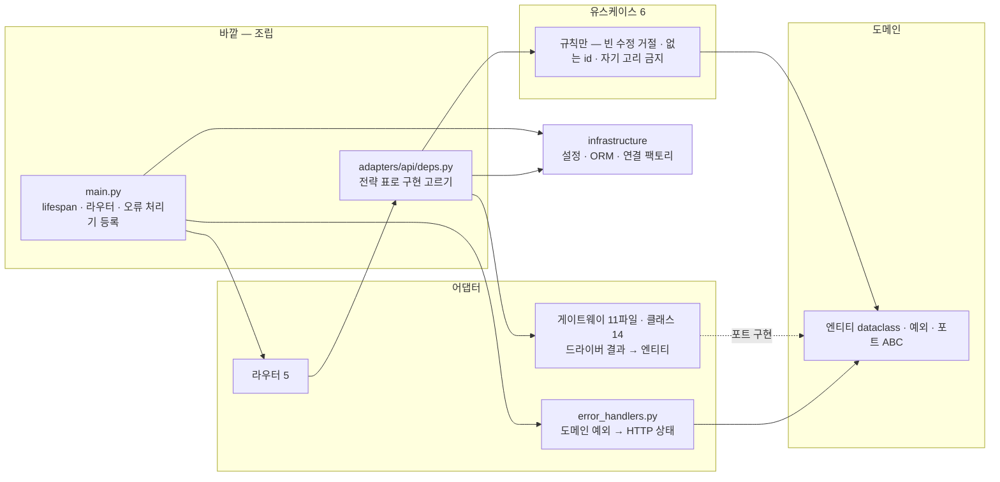
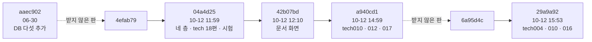
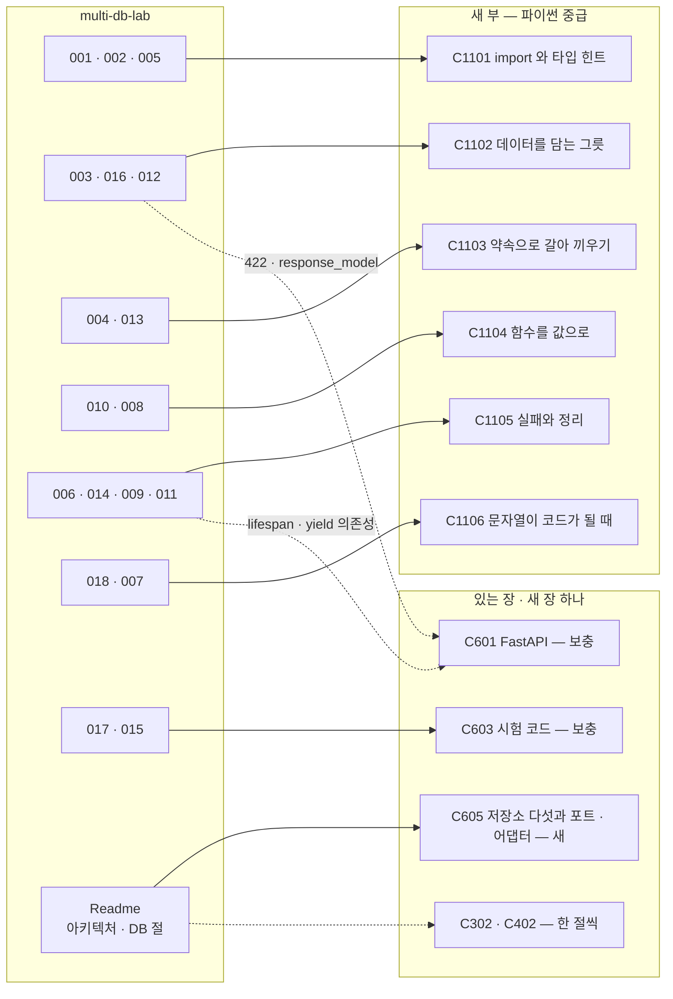
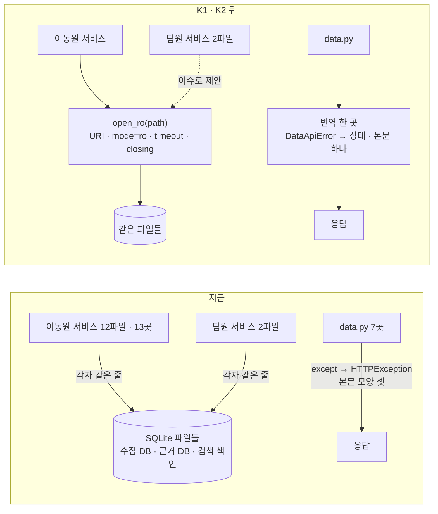
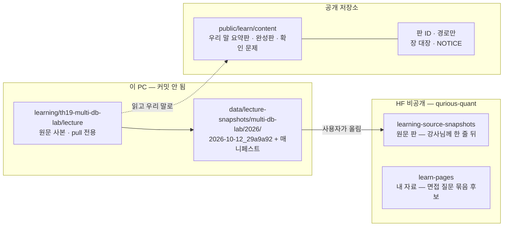

# 강사님 multi-db-lab — 개념 학습에 넣는 법 · 우리 코드에 쓸 것 · 이용 조건 조사서 v0.1

| 문서 정보 | |
|---|---|
| **판 · 상태** | v0.1 · 초안(검토 전) — 6.0 정한 것(2026-10-13 · 이동원 결정 여섯 — 모두 추천안) · 장 · 코드 반영은 개념 학습 리팩터링 · 개선 세션 |
| **구분** | 조사서 — 학습 콘텐츠 배치 · 코드 참고 · 이용 조건(구현 · 화면 설계는 하지 않음) |
| **작성** | 이동원 — 조사 초안 · 검수 전(이 PC 의 사본만 읽음 · github.com 은 열지 않음 · 외부 원문은 PEP 749 한 건) |
| **조회일** | 2026-10-13 (KST) |
| **기준** | 강사님 원본 `edumgt/multi-db-lab` — 이 PC 의 얕은 사본 `learning/th19-multi-db-lab/lecture` 판 `29a9a92`(커밋 2026-10-12 15:53 KST · 이 PC 가 받은 때 10-13 08:56) · 우리 코드 `main` `8975696` + 작업 트리(커밋 전 파일 포함 · 읽기만) · 장 대장 84줄 · 개념 학습 설계서 v0.1 |
| **확실도** | 🟢 파일 · 공식 원문을 직접 열어 봄, 또는 이 PC 에서 직접 돌려 봄 · 🟡 다른 조사서 · 팀 기록에서 옮김, 또는 추정 · 🔴 판단 |
| **이웃 조사** | `docs/조사/금융지식-개념학습-배치-조사.md`(배치 원칙 · 장 대장 · HF `learning-source-snapshots`) · `docs/조사/교재원천-갱신따라가기-조사.md`(결정 「E 와 C 융합」) · `docs/조사/학습-API문서-앱통합-조사.md`(안 C — 학습은 앱 안 입구) — 겹치는 결론은 다시 조사하지 않고 가리킨다 |
| **검토** | 검토 전 |
| **최종 수정** | 2026-10-13 (KST) |
| **최근 개정** | 새 문서 — 6.0 정한 것을 더함(2026-10-13) |

> **이 문서로 알 수 있는 것**
> 1. multi-db-lab 에는 무엇이 들어 있고(기술 노트 18편 · 코드 · 시험 · 화면), 얼마나 빨리 바뀌고 있나?
> 2. 그 내용을 우리 개념 학습의 어느 장에 어떤 꼴로 넣나 — 보충할 장 · 새 장 · 넣지 않을 것은?
> 3. 우리 저장 계층(PostgreSQL · SQLite 수집 DB · Redis · Qdrant · Neo4j)에 가져올 원리는 무엇이고, 어느 파일을 언제 바꾸나?
> 4. 이용 조건은 무엇이고, 원문 · 우리 글 · 판 ID · 면접 질문을 각각 어디에 두나?
> 5. 안 셋 중 무엇을 추천하고, 이동원이 정할 것은 무엇인가?
>
> **읽는 순서** — 이동원: 요약 → 6절 → 7절 → 4절 · 팀원: 요약 → 4.1절(자기 파일 줄) · 처음 온 사람: 부록 A → 요약

## 요약

1. **무엇이 있나.** multi-db-lab 은 FastAPI 앱 하나에 DB 12종을 붙인 실습 저장소다. 강사님은 2026-10-12 하루에 이 앱을 클린 아키텍처로 다시 짜고, 코드에 쓰인 파이썬 문법을 주제별로 푼 기술 노트 18편(tech001~018 · 2,569줄 · 예제 코드 블록 137)과 DB 없이 도는 시험 23개를 더했다. 그날 나온 판이 적어도 다섯이다(이 PC 가 받은 넷 + 받지 않은 하나) 🟢. Readme 의 목적 문장은 아직 「멀티-데이터베이스 실습」 이고 「면접」 이라는 말은 저장소에 없다 — 「파이썬 개발자 면접 전 필독 중급과정」 은 강사님 말씀을 전해 들은 것이다 🟢.
2. **우리 장과 맞대면.** 18편은 장 대장의 개념 학습 60줄 어디에도 없는 「파이썬 언어 · 설계」 층이다. 겹치는 곳은 뼈대 둘(6.1 FastAPI · 6.3 시험 코드)과 3.2 벡터 검색 · 4.2 지식 그래프의 한 절씩뿐이다. 18편 모두 확인 문제가 없고, 강사님 코드가 전부 동기(`def`)라 우리 서버(`app/routes/` 의 `async def` 265개)에 필요한 「비동기와 블로킹」 은 빠져 있다 🟢.
3. **추천 배치는 안 A.** 새 부 「파이썬 중급」 6장 — 18편을 주제로 묶어 우리 말 · 우리 예제로 다시 쓴다 — 과 새 장 하나(저장소 다섯과 포트 · 어댑터), 뼈대 6.1 · 6.3 보충이다. 장마다 셀프 확인 문제를 붙이고, 면접 질문 묶음은 공개 저장소 밖에 둔다. 원문을 1:1 로 옮기지 않는다.
4. **코드에 가져올 것은 강사님 코드가 아니라 원리 넷이다.** ① SQLite 읽기 전용 연결 규칙을 한 곳에(지금 같은 줄이 15곳 · 그중 2곳은 팀원 파일) ② 데이터 API 오류를 뿌리 하나 + 번역 한 곳으로(지금 `app/routes/data.py` 7곳 · 본문 모양 셋) ③ 계층 import 시험(AST) ④ 캐시 왕복 시험(지금 문자열 `"123"` 을 넣으면 정수 123 이 나온다). 강사님의 `lru_cache` 지연 싱글턴은 SQLite 연결에 쓰지 않는다 — 첫 호출이 겹치면 본문이 두 번 돈다. 셋 다 이 PC 에서 직접 돌려 확인했다 🟢.
5. **이용 조건.** LICENSE 파일이 없다(추적 파일 87개 중 0) 🟢 — 권리는 저작자에게 있고, 우리 근거는 수업 중 구두 허가다. 공개 저장소에는 우리 글과 출처(판 `29a9a92` · 경로)만 두고 원문은 넣지 않는다. 원문 판 보관은 이미 정한 흐름(로컬 판 → 강사님께 한 줄 → HF 비공개 `learning-source-snapshots`)에 th19 를 한 줄 더하는 것으로 맞춘다 🟡.

---

## 1. 방법

| 한 일 | 범위 | 쓴 곳 |
|---|---|---|
| 강사님 사본 읽기 | `Readme.md` 1,412줄 전부 · `tech001~018.md` 전부 · `backend/` 47개 중 핵심 12개(도메인 셋 · 게이트웨이 넷 · 조립 · 오류 번역 · 문서 라우터 · 앱 진입 · 연결 팩토리)와 패키지 입구(`__init__.py`) 7개 · `tests/` 전부 · `frontend/` 의 문서 화면(`docs.js` · `index.html` 일부 · `usecases.js` 칩 목록) | 2 · 3절 |
| 강사님 사본 이력 읽기 | `git log` · `git reflog` · `git diff --stat`(이 PC 가 받은 판 사이) · `git ls-files`(LICENSE 찾기) — 커밋 작성자 · 이메일은 읽지 않음 | 2.3 · 5절 |
| 우리 쪽 읽기 | 개념 학습 설계서 v0.1 · 장 대장 84줄 · 장 파일 34편 머리말 · 관련 조사서 셋 · `NOTICE.md` · 저장 계층 코드(`app/database/` · `app/lib/redis_cache.py` · `app/services/collector_db.py` 외) · `git log` 로 파일 주인 | 3 · 4절 |
| 직접 돌림 | 저장소 밖 작업 폴더 · 네트워크 없음 — 강사님 시험 · mypy · 문서 주장 다섯 · 우리 설정의 숨은 경고 | 2.6절 · 부록 C |
| 외부 원문 | PEP 749(애너테이션 지연 평가 · `__future__` 의 앞날) 한 건 | 2.4절 |
| 하지 않은 것 | github.com · 원격 판 보기 · 강사님 앱 · DB 띄우기 · 우리 SQLite 파일 열기(읽기 전용 앱이 깨질 수 있어 이 PC 에서 열지 않는 규칙) | 8절 |

## 2. multi-db-lab 에는 무엇이 있나

### 2.1 한눈에

표 1 은 「저장소가 어떤 덩어리로 되어 있나」 에 답한다.

**표 1. 덩어리별 내용 (판 `29a9a92` · 추적 파일 87개)**

| 덩어리 | 크기 | 무엇 | 확실도 |
|---|---|---|:-:|
| `Readme.md` | 1,412줄 · 58KB | 목적 · 기술 스택 · 클린 아키텍처 네 원 · 「Python 중급 · Clean Architecture 적용 내역」(학습 항목 → 파일 · 검증 수단) · DB 13개 의존성 상세(연결 · 쿼리 · Docker 실행 · 환경 변수) · API 요약 · 캔버스 엔진 | 🟢 |
| `tech001~018.md` | 2,569줄 · 약 8.7만 자 · 코드 블록 137 | 코드에 쓰인 파이썬 문법을 한 편에 한 주제로. 편마다 맨 위에 「쉽게 이해하기」 상자(한 줄 요약 · 비유 · 이 프로젝트에서는 · 기억할 것) | 🟢 |
| `backend/` | `.py` 47개 | 도메인(엔티티 · 예외 · 포트 ABC) · 유스케이스 6 · 게이트웨이 11파일(구현 클래스 14) · 보안 2 · 라우터 5 · 조립(`deps.py`) · 오류 번역(`error_handlers.py`) · 설정 · ORM · 연결 팩토리 | 🟢 |
| `tests/` | `.py` 7개 · 시험 함수 17 · 항목 23 | 인메모리 가짜 저장소(`fakes.py`) · 도메인 · 유스케이스 · 아키텍처(AST) · 문서 라우터 — DB 없이 돈다(조건 하나 — 2.6절) | 🟢 |
| `frontend/` | `index.html` 378줄 · JS 넷 1,482줄 | 바닐라 JS 화면 — 게시판(AG Grid) · DB 사용 사례 카드 · 캔버스 「멀티 DB 엔진」 · 기술 문서 읽기 화면 | 🟢 |
| 실행 설정 | `docker-compose.yml` 43줄 | PostgreSQL 과 API 둘만 띄운다(외부 네트워크 `shared-net` 이 미리 있어야 함). 나머지 DB 는 Readme 의 `docker run` 명령 · 클라우드 셋(Supabase · Pinecone · DynamoDB)은 계정 키가 있어야 함 | 🟢 |

그림 1 은 「코드가 어떤 층으로 나뉘고 무엇이 무엇을 import 하나」 에 답한다.

**그림 1. multi-db-lab 의 층과 의존 방향** · 범례: 실선 = import 하는 방향, 점선 = 포트를 구현



결론: 이 저장소가 가르치는 축은 둘이다 — **「DB 가 달라도 같은 약속(포트)으로 다룬다」** 와 **「그 코드에 쓰인 파이썬 문법」**. 앞의 것은 Readme 와 코드에, 뒤의 것은 tech 18편에 있다.

### 2.2 목적 문장

- Readme 첫 문단은 이 저장소를 「멀티-데이터베이스 실습 프로젝트」 라고 소개한다(3행). 제목은 「FastAPI Grid Lab」 이다 🟢.
- 문서 화면 안내는 「이 프로젝트의 코드에 실제로 쓰인 파이썬 중급 문법 18 가지」 라고 쓴다(`frontend/index.html` 274행) 🟢.
- 「면접」 · 「필독」 은 저장소 어디에도 없다(전체 검색 0건) 🟢. 「면접 전 필독 중급과정」 은 강사님이 바꾸는 중인 방향으로 읽는다 🟡 — 장을 쓰기 직전에 다시 받아 확인한다.

### 2.3 바뀌는 속도

그림 2 는 「이 PC 가 어느 판을 받았나」 에 답한다(`git reflog` — 얕은 사본이라 이 PC 가 받은 판만 보인다).

**그림 2. 이 PC 가 받은 판** · 범례: 상자 = 판(커밋 시각 KST), 실선 = 부모 → 자식, 점선 = 사이에 이 PC 가 받지 않은 판이 있음(몇 개인지 모름)



**표 2. 받은 판과 바뀐 것**

| 판 | 커밋 시각(KST) | 이 PC 가 받은 때 | 바뀐 것 |
|---|---|---|---|
| `aaec902` | 06-30 15:18 | 09-18 처음 받음 | Redis · OpenSearch · ClickHouse · Cassandra · Qdrant 추가(커밋 제목) |
| `04a4d25` | 10-12 11:59 | 10-12 12:07 | 101파일 · +6,757 −1,555 — 옛 `models/` · `services/` · `repositories/` 를 지우고 네 층으로 · tech 18편 · 시험 · 문서 API · 문서 화면(`aaec902` 와 견준 `git diff --stat` — 받지 않은 `4efab79` 까지의 변경이 섞임) |
| `42b07bd` | 10-12 12:10 | 10-12 14:24 | 문서 패널 · 사용 사례 설명(커밋 제목) |
| `a940cd1` | 10-12 14:59 | 10-12 15:21 | tech010 · 012 · 017 다듬기(커밋 제목) |
| `29a9a92` | 10-12 15:53 | 10-13 08:56 | tech004 · 010 · 016 세 편이 크게 늘어남(세 편 합쳐 바뀐 줄 438) · 문서 화면 정리(`a940cd1` 과 견준 `git diff --stat` — 받지 않은 `6a95d4c` 의 변경이 섞임) |

- 얕은 사본이라 받은 판 사이의 판은 보이지 않는다 — `29a9a92` 의 부모는 이 PC 에 없는 `6a95d4c`, `04a4d25` 의 부모는 없는 `4efab79` 다(`git cat-file`) 🟢. 그래서 10-12 에 나온 판은 **적어도 다섯**이다.
- 우리 변경 추적 기준점(`docs/github-archive/2026-09-28/이슈-강사님자료-변경추적/기준점.tsv`)의 th19 줄은 아직 `aaec902`(10-02 확인)다 🟢 — 그 뒤 판들은 추적 보고에 아직 오르지 않았다. 사본이 얕아 스캐너가 사이 판을 다 세지 못할 수 있다 🟡.

결론: **장은 「바탕 판 ID」 를 적고 쓴다.** 하루에 판이 적어도 다섯 나온 자료라, 쓰는 날의 판과 다음 판을 견줄 수 있어야 한다(5.2절).

### 2.4 tech001~018 한 편씩

표 3 은 「18편이 각각 무엇을, 얼마나, 어느 수준으로 다루고, 정확성에서 짚을 곳이 있나」 에 답한다. 수준은 우리 판단(🔴)이다. 「짚을 곳」 은 이 PC 에서 직접 돌리거나 원문으로 확인했다(🟢 · 부록 C).

**표 3. 기술 노트 18편**

| 편 | 주제(우리 말) | 줄 · 코드 블록 | 수준 🔴 | 짚는 강사님 코드 | 짚을 곳 |
|---|---|---|---|---|---|
| 001 | 패키지와 `__init__.py` · 한 창구로 내보내기(퍼사드) · `__all__` | 121 · 5 | 기초 | `backend/usecases/__init__.py` | 「입구에 무거운 초기화를 넣지 말라」(26행) — 그런데 강사님 `backend/__init__.py`(13행)가 앱 전체를 import 한다 → 2.6절 |
| 002 | `from __future__ import annotations` · 전방 참조 | 115 · 5 | 중급 | (일반 예) | 「3.14 부터 기본이 될 예정」(105~108행) → PEP 749 는 Final 이고 3.14 대상이다. 3.14 에서도 이 줄은 그대로 동작하고, 3.13 지원이 끝난 뒤의 판부터 경고 · 그 뒤 최소 두 판 지나 제거 예정이다 🟢. 우리 서버는 3.12 |
| 003 | dataclass — `frozen` · `slots` · `default_factory` · `replace` · pydantic 과 나눠 쓰기 | 116 · 6 | 중급 | `domain/entities.py` | 「frozen 이면 set 원소 · dict 키로 안전」(56행) → list 칸이 있으면 `hash()` 가 TypeError 이고, frozen 은 얕아서 `tags.append` 는 된다(직접 돌림) |
| 004 | ABC 와 Protocol — 추상 메서드 · 이름만 보는 강제 · 템플릿 메서드 | 200 · 8 | 중급~심화 | `domain/ports.py` · `gateways/lab_mongo.py` · `tests/test_domain.py` | 「ABC 는 이름만 본다 — 시그니처는 mypy 몫」 은 직접 돌려 맞음 |
| 005 | 타입 힌트 심화 — `Literal` · `type` 문 · `ClassVar` · `Final` · `Annotated` · `cast` · 층별 mypy | 127 · 11 | 중급 | `entities.py` · `deps.py` · `lab_redis.py` · `mypy.ini` | `mypy.ini` 의 한글 주석 때문에 Windows 기본(cp949)으로는 mypy 가 설정을 못 읽는다(직접 돌림) |
| 006 | 예외 — 네 절 · 계층 · `raise … from` · 드라이버별 뿌리 예외 · 번역은 바깥에서 | 144 · 7 | 중급 | `domain/exceptions.py` · `error_handlers.py` · 게이트웨이 | — (우리 데이터 API 에 쓸 곳 → 4.1 K2) |
| 007 | `json` — `dumps` · `loads` · `ensure_ascii` · `JSONDecodeError` · 왕복 시험 | 104 · 7 | 기초 | `lab_redis.py` · `entities.py` | — (우리 캐시에 왕복 문제 → 4.1 K4) |
| 008 | `functools` — `lru_cache` 지연 싱글턴 · `cached_property` · `partial` · `wraps` | 89 · 5 | 중급 | `infrastructure/clients.py` · `settings.py` | 문서에 없는 주의 — 첫 호출이 동시에 들어오면 본문이 두 번 돈다(직접 돌림 · 두 스레드 → 2회) |
| 009 | 컨텍스트 매니저 — `with` · `@contextmanager` · yield 의존성 · lifespan · `ExitStack` | 120 · 8 | 중급 | `lab_postgres.py` · `orm.py` · `main.py` | 우리 SQLite 에 더할 것 — `sqlite3` 연결의 `with` 는 닫지 않는다(직접 돌림) |
| 010 | 고차 함수 · 클로저 · 데코레이터 · 늦은 바인딩 · 전략 표 · 바운드 메서드 콜백 | 327 · 15 | 중급~심화 | `deps.py` · `clients.py` | — |
| 011 | 이터레이터 · 제너레이터 · Redis `scan_iter` · `itertools` | 105 · 7 | 중급 | `orm.py` · `lab_redis.py` · `tests/fakes.py` | — |
| 012 | 메서드 종류(인스턴스 · `classmethod` · `staticmethod` · `property`) · 던더 · 밑줄 이름 규칙 | 164 · 5 | 기초 | `entities.py` · `lab_redis.py` | — |
| 013 | 인자 — 키워드 전용 `*` · 위치 전용 `/` · 언패킹 · 가변 기본값 · `zip(strict=)` | 112 · 8 | 기초 | `ports.py` · `lab_postgres.py` · `lab_clickhouse.py` | 맨 위 상자(5행)의 예 `list(limit, *, offset=0)` 는 `ports.py` 에 없다 — 상자와 코드가 어긋남 |
| 014 | `logging` — 모듈 로거 · 레벨 · `%s` 지연 포매팅 · `logger.exception` · 남기지 않을 것 | 98 · 6 | 중급 | `clients.py` · `error_handlers.py` · `jwt_token_provider.py` | — |
| 015 | `ast` — 정규식 대신 문법 트리로 import 방향 시험 | 108 · 6 | 심화 | `tests/test_architecture.py` | — (우리도 같은 원리의 시험이 하나 있다 → 4.1 K3) |
| 016 | pydantic · pydantic-settings — 경계 검증 · v1 → v2 바뀐 이름 · 조용히 달라진 동작 | 244 · 11 | 중급~심화 | `schemas/lab.py` · `settings.py` | — (우리 `app/config.py` 가 v1 모양 → 4.1 K6) |
| 017 | pytest — 어설션 재작성 · `raises` · `parametrize` · 픽스처 · 가짜 저장소 | 159 · 8 | 기초 | `tests/test_usecases.py` · `test_docs_router.py` | 「17개 시험이 2초」(139행) · Readme 의 「17 passed」(146행)는 옛 숫자 — 지금 항목 23(직접 돌림) |
| 018 | 문자열 — f-string · 중괄호 이스케이프 · SQL · CQL · Cypher 바인딩 · 인코딩 | 116 · 9 | 기초 | `lab_clickhouse.py` · `lab_cassandra.py` | 맨 위 상자(5행)는 Cassandra 자리표를 `?` 라 하나 본문 · 코드는 `%s` |

- 공통 모양: 18편 모두 「쉽게 이해하기」 상자가 있고, 끝에 「한눈에 정리하기」 가 있는 편은 넷(001 · 002 · 010 · 017)이다. **확인 문제는 0편**이다(002 의 「문제 1 · 2」 는 문제 상황 제시) 🟢.
- 제목에 그림 문자(💡 · ⚠️ · ❌ · ⭕)를 많이 쓴다 — 우리 교재 문장 규칙(설계서 2.2절 「제목에 이모지 없음」)과 달라 그대로 옮길 수 없다 🟢.
- 「이 프로젝트에서는」 으로 코드 경로를 짚는 방식은 우리 장 틀 ⑥ 칸(서비스 코드 발췌)과 같은 생각이다. 다만 짚는 코드가 강사님 코드다 — 우리 장은 우리 코드를 짚는다 🔴.

### 2.5 DB 다루는 법 — 우리 저장 계층과 견주기

표 4 는 「강사님 코드가 각 DB 를 어떻게 다루고, 우리 다섯 저장소와 무엇이 같고 다른가」 에 답한다.

**표 4. DB 다루는 법 — 강사님 · 우리**

| 저장소 | 강사님(`backend/`) | 우리(`app/` · `collector/`) | 견줄 점 |
|---|---|---|---|
| PostgreSQL | SQLAlchemy 2.0 **동기** — 사용자 · 게시글은 ORM, 실습 표는 Core(`engine.begin()` 블록 = 정상이면 commit · 예외면 rollback · `RETURNING`) · psycopg 3 🟢 | SQLAlchemy 2.0 **비동기**(asyncpg) · 기동 때 연결(`app/database/postgres.py`) · 요청마다 세션(yield 의존성) · Alembic 마이그레이션(`app/main.py`) 🟢 | 트랜잭션 경계 · yield 의존성은 같은 원리. 비동기 · 마이그레이션은 강사님 자료에 없다 |
| SQLite | **없음** 🟢 | 수집 DB · 근거 DB · 검색 색인 — 앱은 `mode=ro` URI 로만, 요청마다 열고 닫는다(15곳) · 스레드에서 읽기(`asyncio.to_thread`) 🟢 · 수집 DB 는 WAL 이라 도커 앱(읽기 전용으로 붙임)이 보조 파일(`-shm` · `-wal`)을 잃으면 「unable to open database file」 이 난다 · 근거 DB · 검색 색인은 롤백 저널로 바꿨다 🟡(팀 장애 기록) | 강사님 자료에 짝이 없는 우리 고유 주제 → 새 장 C605 |
| Redis | 동기 · 값 = JSON 문자열 · 목록은 `SCAN` + `MGET`(KEYS 는 서버를 멈춤) · `decode_responses=True` 🟢 | `redis.asyncio` · 세션 · 시세 캐시 · 레이트 리밋 · JWT 차단 목록(`app/lib/redis_cache.py`) · `keys()` 는 KEYS 를 쓰나 부르는 곳 0 · 문자열 값 왕복이 안전하지 않음(4.1 K4) 🟢 | SCAN · 왕복 시험은 가져올 만하다 |
| Qdrant | 외부 ID 를 `uuid5(이름공간, id)` 로 → 같은 id 는 늘 같은 점(멱등 upsert) · 컬렉션이 없으면 만듦(cosine) · `query_points` 🟢 | `kb_text.point_id()` 가 32자 16진수 → UUID(`app/services/kb_text.py:304`) · 앱은 LangChain `QdrantVectorStore` + 동기 클라이언트(`rag_pipeline.py`) · 수집기는 HTTP 로 직접(`collector/kb_index.py`) 🟢 | 결정적 점 ID 는 **이미 같은 원리** — 장 3.2 의 비교 예로만 |
| Neo4j | 동기 드라이버 · `MERGE`(있으면 맞추고 없으면 만듦) · GDS 플러그인으로 PageRank · degree 🟢 | 비동기 드라이버 · 제약 · 색인 · 회사 · 섹터 시드(`app/database/neo4j.py`) · GDS 안 씀 🟢 | `MERGE` 의 멱등은 장 4.2 재료. GDS 는 플러그인이 있어야 해 우리는 쓰지 않는다 |
| 그 밖 여덟 | MongoDB · DynamoDB · Supabase · Pinecone · Weaviate · OpenSearch · ClickHouse · Cassandra — 포트 셋(`LabRecordRepository` · `VectorStore` · `EmployeeRepository`) 뒤에 🟢 | 쓰지 않음 | 비교 표 한 줄씩만(새 장 C605) |

강사님 코드의 공통 짜임(그림 1 을 글로):

- 포트(ABC)는 안쪽(도메인)이 갖고 구현(게이트웨이)은 바깥에 둔다. 게이트웨이는 드라이버 객체를 **생성자로 받는다**.
- 구현을 고르는 곳은 한 곳이다 — `deps.py` 의 전략 표(이름 → 만드는 함수).
- 드라이버 예외는 게이트웨이에서 도메인 예외로 바꾸고(`raise … from`), 도메인 예외 → HTTP 상태는 `error_handlers.py` 한 곳에서 정한다(예외 클래스의 MRO 를 따라 가장 가까운 줄).
- 연결은 `lru_cache` 를 붙인 함수가 첫 호출 때 만들고, 닫는 함수는 등록부(`ResourceRegistry`)에 모았다가 앱이 끝날 때 거꾸로(LIFO) 부른다 — 하나가 실패해도 나머지는 닫는다.
- 「도메인은 프레임워크를 모른다 · 유스케이스는 HTTP 를 모른다」 를 AST 시험이 매번 확인한다.

### 2.6 시험 · 정적 검사 — 직접 돌린 결과

판 `29a9a92` 를 `git archive` 로 저장소 밖 작업 폴더에 꺼내 돌렸다(네트워크 없음 · 2026-10-13 12:04 KST · Python 3.12.13 · pytest 8.3.3 · FastAPI 0.120.1 · pydantic 2.13.4 · mypy 1.20.2). 강사님이 고정한 판(FastAPI 0.115.8 · mypy 1.14.1)과는 다르다. 출력 원문은 부록 C.

**표 5. 직접 돌린 결과**

| 무엇 | 결과 | 읽는 법 |
|---|---|---|
| `pytest tests` 그대로 | 모음 단계에서 멈춤 — `ModuleNotFoundError: No module named 'neo4j'` · 오류 2 | 「DB 없이 도는 시험」 이지만 `backend/__init__.py` 13행의 `from backend.main import app` 때문에 **어느 모듈을 import 해도 앱 전체와 DB 드라이버 전부가 따라 들어온다.** 이 PC 에는 그중 9종이 없다 |
| 사본에서 그 두 줄만 주석 처리 | `23 passed in 0.66s` | 시험 자체는 DB · 드라이버 없이 돈다. 걸린 것은 패키지 입구 한 줄이다(tech001 이 피하라고 한 모양) |
| `mypy backend`(Windows 기본) | `UnicodeDecodeError: 'cp949' codec can't decode …` | `mypy.ini` 의 한글 주석을 cp949 로 읽다 멈춘다 |
| `PYTHONUTF8=1` 을 주고 `mypy backend` | `Success: no issues found in 47 source files` | Readme 의 「46」 은 문서 라우터를 더하기 전 숫자 |

결론: **가짜 저장소로 DB 없이 규칙만 시험한다는 원리는 그대로 맞다.** 우리 쪽에 옮길 때는 「패키지 입구에서 무거운 것을 import 하지 않는다」 와 「설정 파일 인코딩」 을 함께 챙긴다. 강사님 저장소의 이 두 가지는 우리 장 본문에 쓰지 않는다(장은 우리 예제로 설명) 🔴.

### 2.7 화면 — 우리 학습 화면과 견줄 것

- 기술 문서 화면(`frontend/assets/docs.js`)은 18편을 묶음 넷(파이썬 기초 다지기 · 클래스와 함수 · 예외 · 자원 · 데이터 · 검증 · 테스트 · 도구)으로 나누고, 「추천 읽기 순서」 칩 · 이전/다음 · 마지막에 읽은 문서 기억(브라우저 저장소)을 둔다 🟢.
- 기능 화면마다 「관련 기술 문서」 칩을 붙인다(`usecases.js` 의 `docs: [...]` — 예: Redis 화면 → 007 · 011 · 018) 🟢. 앱 통합 조사서의 추천(안 C — 「학습은 앱 안 입구」)과 같은 생각이다 → 4.1 K8.
- 마크다운을 `marked` 로 그린 뒤 거르지 않는다(자기 저장소 파일만 그리므로) 🟢. 우리 학습 화면은 DOMPurify 로 거르고 서버도 한 번 더 막는다(설계서 5.8절) — 이 부분은 우리 쪽이 더 엄격하다.

## 3. 우리 개념 학습과 맞대기

### 3.1 지금 우리 쪽

- 장 목록 정본은 장 대장 84줄이다 — 금융 필수 지식 24 · 개념 학습 60(있음 7 · 뼈대 19 · 겹침 2 · 없음 32) 🟡(금융지식 조사서 0절 · 줄 수는 대장 파일로 확인 🟢).
- 장 파일은 34편(완성 7 · 뼈대 27) · 글 규격 `learn-v1` · 장 틀 아홉 칸 · 교재 문체(「~합니다」 · 질문형 제목 · 실제로 돌린 출력만 · 프로젝트 내부 말 없이)다 🟢.
- 개념 학습은 별도 HTML(`/learn/`)에서 앱 셸 안으로 옮기기로 했다(화면 설계 먼저) 🟡 — 장을 더하는 일과 화면을 옮기는 일은 따로 갈 수 있다.

### 3.2 배치 원칙 — 왜 전부 「개념 학습」 인가

금융지식 조사서의 배치 원칙은 「읽는 법(투자자)은 금융 필수 지식, 만드는 법 · 재는 법(구현자)은 개념 학습」 이다 🟡(그 조사서 요약 4). multi-db-lab 은 처음부터 끝까지 「만드는 법」 이라 **18편과 DB 절 모두 개념 학습 쪽**이다. 금융 필수 지식에 넣을 것은 없다 🔴.

### 3.3 18편 → 우리 장

그림 3 은 「어느 편이 우리 어느 장으로 가나」 에 답한다. C11xx 는 새 부의 가칭 번호다(3.4절).

**그림 3. 18편 · Readme 를 우리 장에 배치** · 범례: 실선 = 장의 본문, 점선 = 한 절만 보탬



표 6 은 같은 내용을 편마다 적고 「왜 거기인가」 를 더한다.

**표 6. 보낼 곳 · 꼴 · 까닭** — 18편 모두 자리가 있다(빠진 편 0)

| 편 | 보낼 곳 | 꼴 | 까닭 |
|---|---|---|---|
| 001 · 002 · 005 | 새 C1101 「import 와 타입 힌트」 | 요약판 → 완성판 | 셋 다 「코드가 읽히는 순간」(import · 애너테이션 평가 · 정적 검사)을 다룬다. 002 는 3.14 사실을 고쳐 쓴다 |
| 003 · 016 · 012 | 새 C1102 「데이터를 담는 그릇」 | 요약판 → 완성판 | dataclass(안쪽) · pydantic(경계)의 나눔이 한 줄기이고, 메서드 종류는 그 그릇의 문법이다. 016 의 FastAPI 쪽(422 · `response_model`)은 C601 로 |
| 004 · 013 | 새 C1103 「약속으로 갈아 끼우기」 | 요약판 → 완성판 | ABC · Protocol(약속)과 인자 설계(약속의 모양)가 한 줄기 |
| 010 · 008 | 새 C1104 「함수를 값으로」 | 요약판 → 완성판 | 고차 함수 · 데코레이터 · 클로저 · `lru_cache` · `partial` 은 모두 「함수를 받고 돌려준다」. `lru_cache` 의 동시 첫 호출 주의를 더한다 |
| 006 · 014 · 009 · 011 | 새 C1105 「실패와 정리」 | 요약판 → 완성판 | 예외(실패를 알림) · 로그(남김) · `with` · 제너레이터(정리를 보장)가 한 흐름. SQLite `with` 의 함정 · `closing` 을 더한다 |
| 018 · 007 | 새 C1106 「문자열이 코드가 될 때」 | 요약판 → 완성판 | SQL 바인딩(인젝션) · JSON 왕복 · 인코딩(cp949) — 셋 다 「문자열의 경계」 |
| 017 · 015 | 뼈대 C603 「시험 코드」 보충 | 완성판 | 뼈대의 질문(가짜 객체 · 의존성 덮어쓰기)에 가짜 저장소 · 어설션 재작성 · AST 아키텍처 시험이 그대로 답이 된다 |
| 016 · 009 · 010 의 FastAPI 부분 | 뼈대 C601 「FastAPI」 보충 | 완성판 | 422 · `response_model` · yield 의존성 · lifespan · `Depends` 에 넘기는 클로저 + **비동기와 블로킹**(강사님 자료에 없음 — 3.5절) |
| Readme 아키텍처 · DB 절 | 새 C605 「저장소 다섯과 포트 · 어댑터」 | 완성판 | 우리 다섯 저장소를 예로 「무엇을 어디에 두나」 + 「저장소가 바뀌어도 규칙은 그대로」. 여덟 DB 는 비교 표 한 줄씩 |
| Readme Qdrant · 벡터 절 | C302 「임베딩과 벡터 검색」 한 절 | 보충 | 결정적 점 ID(`uuid5` ↔ 우리 16진수 → UUID) · 거리와 점수(Weaviate 는 `1 − distance` 로 맞춤) |
| Readme Neo4j 절 | C402 「지식 그래프 맛보기」 한 절 | 보충 | `MERGE` 의 멱등 · GDS 는 언제 필요한가 — 뼈대 질문 1(「용어 755개에 그래프 DB 가 필요할까」)의 재료 |

### 3.4 장 대장에 더할 줄(초안)

표 7 은 「장 대장에 무엇을 더하나」 에 답한다. 번호는 대장의 관례(C + 부 번호 + 두 자리)를 따른 **가칭**이다. 7 ~ 10부는 팀원 장(C7xx ~ C10xx)이 쓰고 있어 새 부는 11부가 된다. 목차에 보일 자리(읽는 차례로는 6부 앞이 자연스럽다)는 따로 정한다(7절 물음 2).

**표 7. 더할 줄(초안 · 대장 칸 일부)**

| 번호 | slug 후보 | 제목 | 메뉴 | 주담당 | 지금 상태 | 출처 후보 | 비고 |
|---|---|---|---|---|---|---|---|
| C1101 | `python-import-typing` | import 와 타입 힌트 — 패키지 · `__future__` · mypy | 개념 학습 | 이동원 | 없음 | multi-db-lab tech001 · 002 · 005(판 `29a9a92`) · PEP 563 · 649 · 749 · mypy 문서 | 우리 예: `from __future__` 를 쓰는 `app/` 파일 109개 |
| C1102 | `python-data-containers` | 데이터를 담는 그릇 — dataclass · pydantic v2 · 메서드 종류 | 개념 학습 | 이동원 | 없음 | tech003 · 016 · 012 · pydantic 이행 안내 | 우리 예: `app/config.py` 의 v1 모양 경고(K6) |
| C1103 | `python-interfaces` | 약속으로 갈아 끼우기 — ABC · Protocol · 인자 설계 | 개념 학습 | 이동원 | 없음 | tech004 · 013 · `abc` · `typing` 문서 | C605 와 짝 |
| C1104 | `python-functions-as-values` | 함수를 값으로 — 고차 함수 · 클로저 · 데코레이터 · functools | 개념 학습 | 이동원 | 없음 | tech010 · 008 · `functools` 문서 | `lru_cache` 동시 첫 호출(직접 돌린 출력) |
| C1105 | `python-errors-cleanup` | 실패와 정리 — 예외 계층 · 로깅 · with · 제너레이터 | 개념 학습 | 이동원 | 없음 | tech006 · 014 · 009 · 011 | 우리 예: `app/routes/data.py` 오류 번역 7곳(K2) · SQLite `closing`(K1) |
| C1106 | `python-strings-json` | 문자열이 코드가 될 때 — f-string · 바인딩 · JSON · 인코딩 | 개념 학습 | 이동원 | 없음 | tech018 · 007 | 우리 예: 캐시 왕복(K4) · Windows cp949 |
| C605 | `storage-ports-adapters` | 저장소 다섯과 포트 · 어댑터 — PostgreSQL · SQLite · Redis · Qdrant · Neo4j | 개념 학습 | 이동원 | 없음 | multi-db-lab Readme(아키텍처 · DB 절) · 우리 저장 계층 코드 | WAL · `mode=ro` · 보조 파일 장애 사례 |
| C601 · C603 · C302 · C402 | (있는 줄) | — | — | — | 뼈대 그대로 | 「출처 후보」 칸에 multi-db-lab 해당 편과 판 ID 를 더함 | 보충 절 |

### 3.5 강사님 자료에 없는데 우리에게 필요한 것

표 8 은 「우리 코드 기준으로 비어 있는 곳」 에 답한다. 「면접 전 필독」 을 우리 서비스 기준으로 채우려면 이 줄들이 함께 있어야 한다 🔴.

**표 8. 빈 곳**

| 주제 | 왜 필요한가(우리 근거) | 넣을 곳 |
|---|---|---|
| 비동기와 블로킹 — `async def` · `await` · 이벤트 루프 · `asyncio.to_thread` | `app/routes/` 의 함수가 `async def` 265개 · `def` 66개 · `to_thread` 를 쓰는 곳 59 🟢. 강사님 라우터 파일의 함수 26개는 모두 `def`(앱 전체에서 `async def` 는 lifespan · 오류 처리기 둘뿐) · tech 18편에 `asyncio` · `await` 설명 0 🟢 | C601 보충(뼈대 질문 1 이 바로 이것) |
| SQLite — 읽기 전용 URI · WAL 보조 파일 · 스레드마다 연결 | 연결 15곳 · 실제 장애 사례(「unable to open database file」) 🟡 | C605 |
| 마이그레이션(Alembic) | 앱 기동 때 `upgrade head` · 모르는 revision 이면 마이그레이션을 건너뛰고 연결만 하는 처리(`app/main.py` 주석) 🟢 | C602(Docker Compose) 또는 C605 🔴 |
| 동시성 제어(낙관적) | 이미 뼈대 C604 가 있다 | 그대로 |
| GIL · 메모리 · 얕은 복사와 깊은 복사 | 면접에 흔히 나온다는 판단 🔴 — 우리 코드 근거는 약하다 | 면접 질문 묶음에만 |

### 3.6 넣지 않을 것

**표 9. 넣지 않을 것과 까닭**

| 무엇 | 까닭 |
|---|---|
| 캔버스 「멀티 DB 엔진」(`engine.js`) | 여러 DB 를 한 표에 합쳐 보이는 교육용 장면 — 우리 서비스 기능과 닿지 않는다 |
| DynamoDB · Supabase · Pinecone 실습 | 클라우드 계정 · 키가 있어야 한다. 팀 원칙(유료 클라우드 0원 · AWS 보류)과 맞지 않는다 — C605 비교 표 한 줄만 |
| MongoDB · Weaviate · OpenSearch · ClickHouse · Cassandra 실습 | 우리 스택에 없다 — 비교 표 한 줄만 |
| 인증 절(JWT · passlib · bcrypt) | 우리는 자체 JWT · 세션(`app/lib/jwt_auth.py` · `session.py`)이 있고 모양이 다르다. 강사님은 `bcrypt==4.0.1` 로 고정해 두었다(passlib 1.7.4 와 새 bcrypt 의 충돌을 피한 것으로 보인다 🟡) — 면접 질문 한두 개로만 |
| 게시판 · AG Grid 화면 | 우리 기능과 무관 |
| 실습용 값(기본 계정 · `change-me` 비밀값 · 외부 네트워크 이름) | 실습 편의를 위한 값 — 가져오지 않는다 |
| 원문을 1:1 로 번역 · 옮겨 적기 | 원문 커밋 금지 · 구조를 따라 한 2차적 저작물로 읽힐 위험(5.1절) |

### 3.7 꼴 — 요약판 · 완성판 · 셀프 확인 문제 · 면접 질문 묶음

표 10 은 「무엇을 어떤 꼴로, 어디에 두나」 에 답한다.

**표 10. 꼴 넷**

| 꼴 | 뜻(이 문서에서) | 좋은 점 | 걸리는 점 | 둘 곳 | 추천 |
|---|---|---|---|---|---|
| 요약판 | 장 하나를 한 쪽 안팎으로 — `[!GOAL]` · 핵심 3 ~ 5(표) · 서비스 코드 한 곳(파일:줄) · 직접 돌린 출력 하나 · 확인 문제 3 · 더 읽을거리(공식 문서 + 원문 판 링크). 머리말 `status: draft` | 빨리 깔 수 있다(편당 반나절 🔴) · 강사님이 고쳐도 덜 흔들린다 | 깊이가 얕다 | 공개 기본 교재(`public/learn/content/`) | 새 6장의 **첫 단계** |
| 완성판 | 장 틀 아홉 칸을 다 채움 — 그림 · 예제 여럿 · 실제 출력 · 흔한 실수 · 확인 문제. `status: ready` | 교재 수준 · 면접에서 그대로 설명할 재료 | 편당 하루 🔴 | 공개 기본 교재 | C601 · C603 · C605 부터. 새 6장은 코드 고침(K1 ~ K4)과 짝지어 차례로 |
| 셀프 확인 문제 | 장 끝 `<details>` 3 ~ 5문항 — 답과 「왜」 를 접어 둠 | 18편에 없는 것 · 교재 관례(장 틀 ⑧) | 문항을 우리가 새로 써야 한다 | 장 안(공개) | **모든 장에** |
| 면접 질문 묶음 | 장마다 5문항 + 답 뼈대(상황 · 판단 · 숫자 · 원칙 · 우리 코드 증거) | 강사님이 말한 「면접 전 필독」 쓰임에 바로 닿는다 | 공개 저장소에는 교재만 둔다(이동원 결정 사항) | **공개 저장소 밖** — HF 비공개 `learn-pages`(앱의 「내 자료」) 또는 개인 공간 | 둘 곳은 7절 물음 3 |

- 글 규격에 빌릴 만한 것 하나 — 18편이 모두 쓰는 맨 위 「한 줄 요약 · 기억할 것」 상자. 우리 `[!GOAL]` 상자 아래 두 줄을 더하는 꼴이다(`learn-v1` 에 상자 이름 하나 · 화면 이식 때 함께) 🔴.
- 원문 1:1 번역은 꼴에 넣지 않는다(5.1절).

셀프 확인 문제의 꼴 — C1105 「실패와 정리」 에 넣을 세 문항(우리 말로 새로 씀 · 교재 문체):

<details><summary>문제 1. try 블록이 성공한 뒤 else 블록에서 예외가 나면, 같은 try 의 except 가 잡나요?</summary>

잡지 않습니다. `except` 는 `try` 블록 안에서 난 예외만 봅니다. `else` 는 `try` 가 성공했을 때만 도는 자리라, 거기서 난 예외는 바깥으로 올라갑니다. 성공 경로의 코드를 `try` 안에 넣지 않는 까닭이 이것입니다 — 그 코드의 예외까지 엉뚱한 `except` 에 잡히기 때문입니다.

</details>

<details><summary>문제 2. with sqlite3.connect(path) as conn: 블록을 빠져나오면 연결이 닫히나요?</summary>

닫히지 않습니다. 이 `with` 는 블록이 정상으로 끝나면 commit, 예외로 끝나면 rollback 만 합니다. 블록 뒤에도 `conn.execute(...)` 가 그대로 됩니다(부록 C 의 출력). 닫으려면 `contextlib.closing(sqlite3.connect(...))` 으로 감싸거나 `finally: conn.close()` 를 씁니다.

</details>

<details><summary>문제 3. logger.info(f"읽음 {n}건") 대신 logger.info("읽음 %s건", n) 을 권하는 까닭 두 가지는?</summary>

첫째, 그 레벨이 꺼져 있으면 `%s` 방식은 문자열을 만들지 않습니다. f-string 은 호출 전에 이미 만들어집니다. 둘째, 메시지 틀(`"읽음 %s건"`)이 값과 따로 남아 로그 수집 도구가 같은 틀의 로그를 한 묶음으로 셀 수 있습니다.

</details>

면접 질문 묶음의 꼴 예시는 공개 저장소로 옮기지 않는 결과 노트(`결과.md`)에만 둔다.

## 4. 우리 코드에 쓸 것

### 4.1 가져올 후보 · 바꿀 곳 · 추천 시점

표 11 은 「강사님 자료의 어떤 원리를, 우리 어느 파일에, 언제 들이나」 에 답한다. 강사님 코드를 그대로 받지 않고 원리만 우리 구조로 옮긴다. 「원칙」 칸은 판단의 이름이다(부록 A).

**표 11. 가져올 후보 (K1 ~ K9)**

| # | 가져올 원리 · 강사님 근거 | 지금 우리 코드(증거) | 바꿀 곳(우리 파일) | 주의 | 원칙 | 추천 시점 · 누가 |
|---|---|---|---|---|---|---|
| K1 | 연결 만드는 규칙을 한 곳에 — `infrastructure/clients.py`(팩토리 한 곳) · tech009(`with` · `@contextmanager`) · tech006(드라이버 예외 → 우리 예외) | `sqlite3.connect(f"{…as_uri()}?mode=ro", uri=True, timeout=5)` 가 **파일 14개 · 15곳**에 따로 있다 — 이동원 파일 12개 13곳 · 팀원 파일 둘(`app/services/mtf_signals.py:163` 신장환 · `app/services/rebalance_prices.py:51` 오준영). `mtf_signals` 만 `timeout` 이 없고(기본값이 5초라 결과는 같음), `closing()` 으로 닫는 곳은 `rebalance_prices` 하나 🟢. 커밋 전 새 파일 둘(`company_health.py` · `macro_credit.py`)도 같은 줄을 또 썼다 🟢 | 읽기 전용 연결 도우미 하나(가칭 `open_ro(path)` — URI · `mode=ro` · `timeout` · `closing` 을 묶은 컨텍스트 매니저). 자리는 새 `app/lib/sqlite_ro.py`(가칭) — 수집 DB · 근거 DB · 검색 색인을 모두 여니 `collector_db.py` 보다 이름이 맞다 🔴 → 이동원 13곳을 바꾸고, 팀원 2곳은 이슈 초안으로 제안 | `lru_cache` · 모듈 전역 연결로 만들지 않는다(스레드마다 연결 · `check_same_thread` · WAL 보조 파일) · `journal_mode` 를 건드리지 않는다 · 앱은 쓰지 않는다 · 정적 규칙 시험 「`sqlite3.connect(` 는 이 도우미 안에만」 | SSoT · 일관성 | 2차 기능을 마친 뒤 리팩터링 · 개선 세션(작은 PR 하나) · 이동원 |
| K2 | 오류는 뿌리 하나 + HTTP 번역은 한 곳 — `domain/exceptions.py` · `error_handlers.py`(MRO 표) · tech006 2 · 8절 | `app/routes/data.py` 가 7곳(88 · 108 · 148 · 172 · 197 · 213 · 230행)에서 `except XError → HTTPException` 을 되풀이하고, 본문 모양이 셋(`e.message` · `e.detail` · `e.detail()`) + 고정 503 하나 🟢 · 이름이 `Error` 로 끝나는 오류 클래스만 세어도 앱 21 · 수집기 8 = 29개이고 공통 뿌리가 없다(`Exception` · `ValueError` · `RuntimeError` · `HTTPException` 을 제각각 상속) 🟢 | 1단계: 데이터 오류들(`OhlcvError` · `SearchError` · `FinancialsError` · `FetchPlanError` · `RequestError` · `GuideUnavailable` …)에 공통 뿌리(가칭 `DataApiError(status, message, **extra)` · `detail()` 하나) + `data.py` 의 번역 도우미 하나. 2단계(선택): 상태 번호를 서비스 오류에서 빼고 「클래스 → 상태」 표 한 곳으로(강사님 방식) | 응답 본문 모양 = API 계약 → 계약 시험 먼저 · 화면 넷이 `detail` 을 읽는다(`collect-requests.js` · `collect.js` · `datahub.js` · `research.js` — 모두 이동원 파일) · API 명세서 판 · 앱 전체 처리기(`add_exception_handler`)는 `app/main.py`(강사님 기초 파일)라 쓰지 않는 쪽 | SRP · 일관성 | 리팩터링 · 개선 세션 · 이동원 |
| K3 | 계층 규칙을 시험으로 — `tests/test_architecture.py` · tech015 | 우리도 AST 로 import 를 읽는 시험이 있다(`tests/test_base_code_merge_guard.py` — 걷어낸 AWS 모듈이 되살아나지 않게) 🟢 · 서비스 층에서 FastAPI 를 import 하는 파일 1(`app/services/url_guard.py:37` — `HTTPException` 을 일부러 쓰고 까닭을 독스트링에 적음) 🟢 | `tests/` 에 새 시험 「`app/services` · `collector` 는 fastapi 를 import 하지 않는다」 + 허용 목록(`url_guard.py`) | 팀원 서비스에 걸리는 줄은 실패가 아니라 목록으로 · 팀 공용 장치라 대화방 글 먼저 | 의존 방향 · 규칙을 문서가 아니라 시험으로 | 팀 논의 뒤 · 이동원 초안 |
| K4 | 왕복 시험 — `tests/test_domain.py` · tech007 4절 | `app/lib/redis_cache.py` 의 `RedisCache` 는 문자열 값을 그대로 넣고(93행) 꺼낼 때 `json.loads` 를 먼저 해 본다(87행). 그래서 `"123"` → 123 · `"null"` → None(없는 값과 구별이 안 됨) · `"true"` → True 가 된다(같은 규칙을 Redis 없이 돌림) 🟢. 지금 넣는 값(`"revoked"` · 정수 · dict)은 안전하다 🟢 | Redis 없는 왕복 시험(가짜 클라이언트) 하나로 「문자열 값은 왕복이 안전하지 않다」 를 못박음 · 코드 고침은 따로 정함 | `redis_cache.py` 는 강사님 기초 코드와 같은 줄 — 고치면 기초 코드를 받을 때 갈림이 하나 는다 | 일관성 · 말없는 변환 금지 | 시험은 작아 바로 할 수 있음 · 고침은 기초 코드 반영 때 · 이동원 |
| K5 | `KEYS` 대신 `SCAN` — `lab_redis.py` · tech011 4절 | `RedisCache.keys()` 가 `KEYS` 를 쓴다(122행) · 부르는 곳 0 · 강사님 기초 코드도 같음 🟢 | 쓰게 될 때 `scan_iter` 로 | — | 운영 안전 | 보류(쓰는 곳이 생기면) |
| K6 | pydantic v2 설정 모양 — tech016 7절 | `app/config.py:231` 의 `class Config:` 가 `PydanticDeprecatedSince20`(DeprecationWarning 하위)를 내는데, `pytest.ini`(10 ~ 11행)가 DeprecationWarning 을 걸러 시험에서 보이지 않는다(직접 돌림 · pydantic 2.13.4) 🟢 · 강사님 기초 코드도 같음 | `model_config = SettingsConfigDict(env_file=…, extra="ignore")` | 강사님 기초 파일 — 바꾸면 갈림 하나 | 숨은 경고 없애기 | 기초 코드 반영 때 · 또는 강사님께 알림 · 보류 |
| K7 | 끝낼 때 정리를 하나씩 격리 — `ResourceRegistry.close_all()`(거꾸로 · 하나가 실패해도 나머지) · tech006 7절 · tech009 5절 | `app/main.py` lifespan 끝(74 ~ 76행)이 Redis → PostgreSQL → Neo4j 를 차례로 닫는다 — 앞이 예외면 뒤가 안 닫힌다 · 기동 경고는 `print` 9곳 🟢 | `app/main.py`(강사님 기초) | 기초 파일 · 영향은 끝날 때뿐 | 정리 보장 | 보류 · 강사님께 제안할 거리 |
| K8 | 기능 화면 → 관련 개념 장 칩 — `frontend/assets/usecases.js` 의 `docs: [...]` | 학습은 `/learn/` 에 따로 · 앱 통합 조사서 안 C 「학습은 앱 안 입구」 🟡 | 개념 학습 이식(화면 설계 · Figma) 때 화면 정의에 「관련 장」 칸 | 팀원 화면에도 닿음 → 화면 설계 절차 | 이동 끊김 줄이기 | 개념 학습 이식 세션 · 이동원 |
| K9 | 층마다 다른 mypy 엄격도 — `mypy.ini` · tech005 12절 | mypy 설정 없음 🟢 | 데이터 파트(`collector_db.py` · `data_*.py`)만 엄격하게 시작 | Windows 에서 한글 주석 설정은 cp949 로 읽힌다(직접 돌림) → `PYTHONUTF8=1` 또는 설정에 한글 주석을 두지 않음 | 정확성 | 3차 뒤 · 선택 |

### 4.2 가져오지 않을 것

**표 12. 가져오지 않을 것**

| 무엇 | 까닭 | 확실도 |
|---|---|:-:|
| `lru_cache` 지연 싱글턴으로 연결 만들기(`clients.py`) | 우리는 기동 때 연결하고 없으면 `RuntimeError`(PostgreSQL · Neo4j), Redis 는 지연 생성 — 지금 구조로 충분하다. `lru_cache` 는 첫 호출이 겹치면 본문이 두 번 돌고(직접 돌림), SQLite 연결에는 맞지 않는다 | 🟢 |
| 네 층(도메인 · 유스케이스 · 어댑터 · 인프라)으로 앱 전체를 다시 짜기 | 강사님 기초 코드 · 팀원 코드 전부에 닿고, 기초 코드를 받을 때마다 갈림이 커진다 — 개념은 장으로 설명하고 우리 파트에서 작게(K2 · K3)만 | 🔴 |
| Qdrant `uuid5` ID | 우리 `point_id()` 가 이미 결정적이다 — 같은 원리 | 🟢 |
| Neo4j GDS(PageRank · degree) | 플러그인이 있어야 하고, 용어 760개 규모에는 이르다 — 장 4.2 의 판단 재료로만 | 🟡 |
| 문서 목록 API(`docs_router.py`) · 문서 화면 | 우리 학습 API(7개 · slug 규칙 · 판 · 충돌 · 거르기)가 이미 더 넓다 | 🟢 |

### 4.3 K1 · K2 를 그림으로

그림 4 는 「K1 · K2 를 하면 무엇이 한 곳으로 모이나」 에 답한다.

**그림 4. 지금과 K1 · K2 뒤** · 범례: 실선 = 지금 하는 일, 점선 = 제안



### 4.4 코드 고침과 장을 짝짓기

표 13 은 「어느 코드 고침을 어느 장과 같은 때 하나」 에 답한다. 짝지으면 장의 예제가 우리 코드의 실제 고침이 되고, 그 고침이 「상황 · 판단 · 숫자 · 원칙」 으로 설명할 증거가 된다 🔴.

**표 13. 짝**

| 코드 | 장 | 장에 들어갈 것 |
|---|---|---|
| K1 SQLite 연결 한 곳 | C1105 · C605 | `with` 는 닫지 않는다(출력) · `closing` · `mode=ro` · WAL 보조 파일 |
| K2 오류 뿌리 하나 | C1105 | 예외 계층 · `raise … from` · 번역 한 곳 · 고치기 전후 표 |
| K3 계층 import 시험 | C603 | AST 로 import 를 읽는 법 · 허용 목록 |
| K4 캐시 왕복 시험 | C1106 | JSON 왕복 출력(`"123"` → 123) |
| K8 관련 장 칩 | 이식 화면 | — |

## 5. 이용 조건

### 5.1 사실

**표 14. 이용 조건에 닿는 사실**

| 항목 | 사실 | 확실도 · 근거 |
|---|---|:-:|
| LICENSE | 없다 — 추적 파일 87개 중 LICENSE · COPYING · NOTICE 0 · Readme 에 저작권 · 이용 조건 문장도 없다 | 🟢 `git ls-files` · 전체 검색 |
| 권리 | 라이선스가 적히지 않은 저작물은 모든 권리가 저작자에게 있다 — `NOTICE.md` 2절이 강사님 다른 저장소에 대해 같은 원칙을 적어 두었다 | 🟢 NOTICE · 법 일반 원칙 🟡 |
| 허가 | 수업 중 구두 허가(NOTICE 2절 — 사용 · 수정 · 프로젝트화) · 2026-10-07 강사님 「어차피 공개되니 상관없다」 는 **비공개 보관 허락이지 공개 커밋 허락이 아니다**(금융지식 조사서 요약 7) · th19 까지 덮는지는 여쭙지 않았다 | 🟡 |
| 우리 쪽 자리 | th19 는 미편입 · pull 전용(부모 저장소 `.gitignore` 로 빠짐 · 커밋 대상 아님) | 🟢 프로젝트 규칙 |
| 원본 공개 | 강사님 저장소는 로그인 없이 받히는 공개 저장소다. 다만 공개 = 재배포 허가는 아니다(NOTICE 2절과 같은 논리) · 강사님 원본이 사라진 전례가 있다(`api-test2`) | 🟢 |
| 작성자 정보 | 강사님 원본 이력에 개인 메일이 섞인 저장소가 있다 → 커밋 작성자 · 이메일은 읽지 않는다(변경 추적 스캐너 규칙) — 이번 조사도 판 · 날짜 · 제목만 봤다 | 🟢 |
| 인용 | 우리 글에 짧게 인용할 때는 「」 + 출처(저장소 · 파일 · 판). 기준은 저작권법의 인용 · 출처 명시 조항(제28조 · 제37조) — 조문은 이번에 다시 열지 않았다 | 🟡 |
| 구조 따라 하기 | 18편의 순서 · 제목 · 비유를 그대로 옮기면 2차적 저작물로 읽힐 수 있다 → 우리 주제 묶음(6장) · 우리 예제 · 우리 비유로 쓴다 | 🔴 |

### 5.2 무엇을 어디에 두나

그림 5 는 「원문 · 우리 글 · 판 ID · 면접 질문이 어디에 머무나」 에 답한다.

**그림 5. 둘 곳** · 범례: 실선 = 옮김, 점선 = 읽고 우리 말로 씀



**표 15. 둘 곳**

| 무엇 | 둘 곳 | 공개 | 근거 |
|---|---|:-:|---|
| 원문 사본(tech · Readme · 코드) | `learning/th19-multi-db-lab/lecture`(이 PC · pull 전용) | ✗ | 지금 그대로 |
| 원문 판 묶음 | 결정된 흐름 ②(교재원천 조사서 4.1절 · 표 10)를 따른다 — `data/lecture-snapshots/` 아래 `multi-db-lab/2026/2026-10-12_29a9a92/` + 매니페스트 → HF 비공개 `qurious-quant/learning-source-snapshots` 는 사용자가 올린다 · **올리기 전 강사님께 한 줄**(th01 · th07 과 함께) | ✗ | 「E 와 C 융합」 결정에 th19 를 한 줄 더함 · 허용 목록 = `tech*.md` · `Readme.md`(코드는 고를 것) |
| 우리 글(요약판 · 완성판 · 확인 문제) | `public/learn/content/*.md`(기본 교재) | ✓ | 우리 말 · 우리 예제 |
| 출처 기록 | 장의 「더 읽을거리」 에 원문 링크 + 판 ID · 장 대장 「출처 후보」 칸 · 코드를 참고해 고치면 `NOTICE.md` 표에 「참고(복사 없음)」 한 줄 | ✓(원문 없이 ID · 경로만) | NOTICE 머리 「새 자료를 받을 때마다 복사하기 전에 이 문서의 표를 먼저 고친다」 |
| 면접 질문 묶음 | HF 비공개 `learn-pages`(「내 자료」) 또는 개인 공간 | ✗ | 공개 저장소에는 교재만 둔다(이동원 결정 사항) |
| `learn-pages` 에 원문 섞기 | 하지 않는다 | — | 금융지식 조사서 요약 7 「`learn-pages` 에는 섞지 않는다」 |

## 6. 안 셋과 추천

### 6.0 정한 것 (2026-10-13 · 이동원)

| # | 물음 | 정한 것 |
|:-:|---|---|
| 1 | 배치 안 | **안 A** — 주제로 묶어 우리 말 · 우리 코드 예제로 다시 쓴다(18편 모두 · 틀린 주장은 바로잡아) |
| 2 | 새 부의 이름 · 자리 | **「파이썬 중급」 새 부** — 목차는 6부(서버 · 운영) 앞 · 장 대장 번호 C11xx(60 → 67줄) |
| 3 | 면접 질문 묶음 | **HF 비공개 `learn-pages`**(앱의 「내 자료」) — 공개 저장소에는 교재만 |
| 4 | 원문 판 보관 | **정한 흐름에 한 줄** — 로컬 판 → 올리기 전 강사님께 한 줄 → HF 비공개 `learning-source-snapshots` · 공개 쪽에는 우리 글 · 판 ID 만 |
| 5 | 코드 후보 K1 ~ K4 | **2차 기능을 마친 뒤 리팩터링 · 개선 세션** — K1 → K4 차례의 작은 PR, 장과 짝지어 · 팀원 파일은 이슈로 제안 · K3 은 팀 공용 장치라 대화방 글 먼저 |
| 6 | 강사님 판 다시 받기 | **장을 쓰기 직전에 한 번 + 장마다 바탕 판 ID 기록** |


표 16 은 「어느 안으로 갈까」 에 답한다. 품은 이동원 한 사람 기준 추정이다 🔴.

**표 16. 안 셋**

| | 안 A — 주제로 묶어 다시 쓰기 (추천) | 안 B — 18편을 1:1 로 | 안 C — 최소 |
|---|---|---|---|
| 무엇 | 새 부 「파이썬 중급」 6장(C1101 ~ C1106) + 새 C605 + 뼈대 C601 · C603 완성 + C302 · C402 한 절씩 · 장마다 확인 문제 · 면접 묶음은 비공개 | 새 부 18장(편마다 요약판) + C601 · C603 보충 · 확인 문제 · 면접 묶음 | 새 장 없음 — C601 · C603 에 보충 절 · 면접 묶음 한 편(비공개) |
| 장 대장 | 60 → 67줄 | 60 → 78줄 | 60줄 그대로 |
| 품 🔴 | 요약판 6(편당 반나절) + 완성판 3(편당 하루) ≈ 6일 — 코드 고침(K1 ~ K4)과 짝지어 나눠 함 | 요약판 18 ≈ 9일 + 강사님 판을 18장으로 따라갈 일 | ≈ 2일 |
| 좋은 점 | 우리 장 틀(아홉 칸) · 문체 · 우리 코드 예제와 맞는다 · 원문 구조를 따라 하지 않는다 · 비동기 · SQLite 처럼 강사님 자료에 없는 우리 주제를 같이 넣는다 | 강사님 편과 장이 1:1 이라 판 비교가 쉽다 | 2 · 3차 일정을 가장 덜 밀어낸다 |
| 걸리는 점 | 편을 장에 다시 배치하는 판단이 든다 · 강사님이 편을 나누거나 합치면 표 6 을 고쳐야 한다 | 원문 구조를 그대로 따른다(5.1절) · 장이 짧아 아홉 칸과 맞지 않는다 · 하루에 판이 적어도 다섯 나온 자료를 18장으로 따라가야 한다 | 「내용 자체를 개념 학습에」 라는 요청을 좁힌다 — 범위를 줄이는 판단은 먼저 묻는 것이 규칙 |
| 맞는 조건 | 리팩터링 세션에 장 6 ~ 7편을 나눠 쓸 시간이 있다 | 강사님이 18편을 「완성」 으로 굳힌 뒤 | 2 · 3차 일정이 빠듯해 개념 학습을 3차 뒤로 미룰 때 |

**추천은 안 A 다.** 까닭 셋 — ① 우리 장 틀 · 문체(실제로 돌린 출력 · 우리 코드)를 지키면서 18편을 모두 쓴다(빠진 편 0 — 표 6). ② 원문을 1:1 로 따라가지 않아 이용 조건(5절)과 강사님의 잦은 고침 양쪽에서 덜 흔들린다. ③ 코드 고침(K1 ~ K4)과 장을 짝지으면(표 13) 장의 예제가 우리 코드의 실제 개선이 되고, 「면접 전 필독」 쓰임에 필요한 설명 증거가 함께 쌓인다.

**추천이 바뀌는 조건** — 강사님이 18편을 면접 과정으로 다시 짜며 편 구성을 크게 바꾸면, 바뀐 판을 받은 뒤 표 6 의 대응을 다시 본다. 2차 일정이 밀리면 안 C 로 시작해 A 로 넓힌다.

## 7. 정할 것

> 2026-10-13 여섯 모두 추천안으로 정했다 — 6.0 절. 아래 표는 그때의 판단 재료로 남긴다.

추천을 첫 칸에 두었다. 한 번에 넷씩 묻는다면 1 ~ 4 가 먼저다.

**표 17. 이동원이 정할 것**

| # | 물음 | 고를 것(첫 칸 = 추천) | 판단 재료 |
|:-:|---|---|---|
| 1 | 배치 안 | **A 주제로 묶어 다시 쓰기** / B 18편 1:1 / C 최소 | 6절 표 16 — A 는 18편을 모두 쓰되 우리 틀로 · B 는 구조를 따라 하고 따라갈 일이 18장 · C 는 요청을 좁힘 |
| 2 | 새 부의 이름 · 자리 | **「파이썬 중급」 · 목차는 6부(서버 · 운영) 앞 · 대장 번호는 C11xx** / 6부 안에 절로(C605 ~ C611) / 부록으로 | 읽는 차례로는 6부의 선수 지식 · 대장 번호 관례에서 7 ~ 10부는 팀원 장 · 이름은 실제 서비스처럼(「면접」 은 공개 화면에 쓰지 않는 쪽 🔴) |
| 3 | 면접 질문 묶음을 둘 곳 | **HF 비공개 `learn-pages`(앱의 「내 자료」)** / 저장소 밖 개인 공간 / 장 안 확인 문제로만(면접 표시 없이) | 공개 저장소에는 교재만 · `learn-pages` 는 팀 비공개라 팀원도 본다 — 혼자 보려면 개인 공간 |
| 4 | 원문 판 보관 | **결정된 흐름에 th19 한 줄 더 — 로컬 판 → 강사님께 한 줄 → HF `learning-source-snapshots`** / 로컬만 두고 공개 쪽에는 판 ID 만 / `learn-pages` 에 사본 | 5.2절 · 앞 결정(「E 와 C 융합」)과 같은 길 · `learn-pages` 에 원문을 섞지 않는다는 앞 권고 |
| 5 | 코드 후보 K1 ~ K4 의 때 | **2차 기능을 마친 뒤 리팩터링 · 개선 세션에서 K1 → K2 → K3 → K4 순 작은 PR, 장과 짝지어** / 장을 쓸 때만 / 3차 뒤 | 1차 목표는 2차의 모든 기능이 동작하는 것 · K4 시험은 작아 앞당길 수 있다 · K3 은 팀 논의가 먼저 |
| 6 | 강사님 판을 언제 다시 받나 | **장을 쓰기 직전에 한 번(사용자가 받음) + 장마다 바탕 판 ID** / 강사님이 「완성」 이라 하실 때까지 기다림 / 지금 판(`29a9a92`) 고정 | 10-12 하루에 판이 적어도 다섯 · 변경 추적 기준점은 아직 `aaec902` |

## 8. 한계 · 못 본 것

- 원격 최신 판을 보지 않았다 — 이 PC 의 사본(`29a9a92`) 기준이다. 그 뒤 강사님이 더 고쳤을 수 있다.
- 얕은 사본이라 판 사이 차이는 이 PC 가 받은 다섯 판 사이만 볼 수 있다. `42b07bd` · `a940cd1` 은 커밋 제목으로만 적었다.
- 강사님 앱을 띄우지 않았고 DB 도 띄우지 않았다 — 화면 · 게이트웨이 동작은 코드로만 읽었다.
- 시험 · mypy 는 강사님이 고정한 판과 다른 판으로 돌렸다(2.6절).
- 「면접 전 필독」 이라는 목적 변경은 저장소에서 확인하지 못했다(전해 들은 말).
- th19 에 대한 강사님 허가 범위를 여쭙지 않았다.
- 우리 SQLite 파일의 저널 방식은 팀 장애 기록으로만 적었다 — 이 PC 에서 열지 않았다(열면 읽기 전용 앱이 깨질 수 있다).
- 팀원 장(C7xx ~ C10xx)과의 겹침은 제목으로만 견줬다 — 겹침은 보이지 않았다.
- 품(일수)은 추정이다.

---

## 부록 A. 용어

| 말 | 뜻 | 이 문서에서 | 헷갈리기 쉬운 점 |
|---|---|---|---|
| 포트(port) | 바깥이 지켜야 할 약속(추상 클래스) — 「저장한다 · 목록을 준다」 처럼 무엇을 하는지만 적는다 | `LabRecordRepository` · C1103 · C605 | 네트워크 포트와 다르다 |
| 어댑터 · 게이트웨이 | 포트를 실제 DB 드라이버로 구현한 클래스 — DB 의 모양을 우리 모양(엔티티)으로 바꾼다 | 강사님 게이트웨이 클래스 14 | 「어댑터 패턴」 의 일반 뜻보다 좁게 쓴다 |
| 유스케이스 | 앱이 하는 일 하나를 규칙과 함께 담은 클래스 — HTTP · DB 를 모른다 | `LabRecordUseCase` 등 6 | 라우터와 다르다 — 라우터는 번역만 한다 |
| 클린 아키텍처 | 코드를 안쪽(규칙) → 바깥(기술)의 원으로 나누고 import 는 바깥 → 안쪽만 허용하는 짜임 | 그림 1 | 폴더 이름보다 의존 방향이 핵심이다 |
| 조립 지점 | 어떤 구현을 어디에 꽂을지 정하는 단 한 곳 | `deps.py` | — |
| 전략 표 | `if/elif` 대신 「이름 → 만드는 함수」 사전 | `LAB_REPOSITORY_FACTORIES` | — |
| 지연 싱글턴 | 처음 쓸 때 한 번 만들고 그 뒤로 같은 것을 돌려줌 | `@lru_cache` 를 붙인 연결 함수 | 동시에 첫 호출이 들어오면 두 번 만들어질 수 있다 |
| 읽기 전용 연결 | SQLite 를 `file:…?mode=ro` URI 로 열어 쓰기를 막음 | 우리 15곳 | 읽기 전용이어도 WAL 보조 파일이 있어야 열린다 |
| WAL | SQLite 의 쓰기 방식 하나 — 바뀐 내용을 옆 파일(`-wal`)에 먼저 적는다 | 수집 DB | 롤백 저널은 다른 방식이다 |
| 얕은 사본 | 최근 판만 받은 git 사본(shallow clone) | th19 사본 | 이력 전체가 없다 |
| 판 ID | 원본의 어느 판인지 가리키는 값 — 여기서는 커밋 해시 | `29a9a92` | 파일 하나의 판(blob 해시)과 다르다 |
| SSoT | 한 사실은 한 곳에(Single Source of Truth) | K1 | 「한 파일에 몰아넣기」 와 다르다 — 규칙의 정본이 한 곳이라는 뜻 |
| SRP | 한 모듈은 한 가지 일만(단일 책임) | K2 | — |
| 2차적 저작물 | 원저작물을 번역 · 각색 · 변형해 만든 저작물 — 원저작자 허가가 필요 | 5.1절 | 아이디어 · 사실 자체는 보호 대상이 아니다 |
| 요약판 · 완성판 | 이 문서에서 정한 장의 두 깊이 | 3.7절 | 장 머리말의 `draft` · `ready` 에 대응한다 |

## 부록 B. 출처

**강사님 원본** — `edumgt/multi-db-lab` · 이 PC 의 사본 `learning/th19-multi-db-lab/lecture` · 판 `29a9a92`(2026-10-12 15:53 KST) · 조회 2026-10-13

- `Readme.md` 1 ~ 4행(목적) · 137 ~ 391행(Python 중급 · 클린 아키텍처 적용 내역 · 146 ~ 147행 검증 숫자) · 395 ~ 1127행(DB 의존성 상세) · 1405 ~ 1412행(캔버스 엔진)
- `tech001.md` ~ `tech018.md`(표 3 의 행 번호)
- `backend/__init__.py`(13행) · `backend/main.py` · `backend/domain/{entities,exceptions,ports}.py` · `backend/adapters/api/{deps,error_handlers,docs_router}.py` · `backend/adapters/gateways/{lab_postgres,lab_redis,vector_stores,graph_neo4j}.py` · `backend/infrastructure/clients.py`
- `tests/{conftest,fakes,test_architecture,test_docs_router,test_domain,test_usecases}.py` · `mypy.ini` · `requirements.txt` · `requirements-dev.txt` · `docker-compose.yml` · `Dockerfile`
- `frontend/index.html`(274행) · `frontend/assets/docs.js` · `frontend/assets/usecases.js`
- 이력: `git reflog`(받은 다섯 판) · `git diff --stat a940cd1 29a9a92` · `git diff --stat aaec902 04a4d25`

**우리 파일** — `main` `8975696` + 작업 트리

- `docs/설계/개념학습-설계.md`(3 · 5.8 · 6 · 9절) · `docs/설계/대장/개념학습-장대장.tsv`(84줄) · `public/learn/content/*.md`(34편 머리말) · `public/learn/learn.js`
- `docs/조사/금융지식-개념학습-배치-조사.md`(0절 · 요약 4 · 5 · 7) · `docs/조사/교재원천-갱신따라가기-조사.md`(4.1절 · 표 10) · `docs/조사/학습-API문서-앱통합-조사.md`(요약 4)
- `NOTICE.md`(머리 · 1 · 2절) · `docs/github-archive/2026-09-28/이슈-강사님자료-변경추적/기준점.tsv`(th19 줄)
- `app/main.py:30-76` · `app/config.py:231-233` · `pytest.ini:9-11` · `app/database/postgres.py` · `app/database/neo4j.py` · `app/lib/redis_cache.py:81-123` · `app/services/collector_db.py:182` · `app/services/mtf_signals.py:163` · `app/services/rebalance_prices.py:51` · `app/routes/data.py:88-231` · `app/services/url_guard.py:37 · 157 · 162` · `app/services/kb_text.py:304` · `tests/test_base_code_merge_guard.py`

**외부 원문**

- PEP 749 — Implementing PEP 649 · <https://peps.python.org/pep-0749/> · 상태 Final · 대상 Python 3.14 · `from __future__ import annotations` 는 3.14 에서 그대로 동작하고, 3.13 지원이 끝난 뒤의 판부터 경고 · 최소 두 판 뒤 제거 · 조회 2026-10-13 🟢

## 부록 C. 직접 돌린 기록

환경: 이 PC · Windows 11 · Python 3.12.13(anaconda) · SQLite 3.53.2 · 저장소 밖 작업 폴더 · 네트워크 없음 · 2026-10-13 12:00 ~ 12:10 KST. 강사님 판은 `git archive` 로 꺼낸 사본이고 원래 사본은 바꾸지 않았다.

**C-1. 강사님 시험 — 그대로**

```output
E   ModuleNotFoundError: No module named 'neo4j'
=========================== short test summary info ===========================
ERROR tests/test_docs_router.py
ERROR tests/test_usecases.py
!!!!!!!!!!!!!!!!!!! Interrupted: 2 errors during collection !!!!!!!!!!!!!!!!!!!
2 errors in 1.52s
```

**C-2. 강사님 시험 — 사본의 `backend/__init__.py` 두 줄(`from backend.main import app` · `__all__`)만 주석 처리**

```output
.......................                                                  [100%]
23 passed in 0.66s
```

**C-3. mypy — Windows 기본, 그다음 `PYTHONUTF8=1`**

```output
UnicodeDecodeError: 'cp949' codec can't decode byte 0xed in position 3: illegal multibyte sequence
```

```output
Success: no issues found in 47 source files
```

**C-4. 문서 주장 다섯** — 표준 라이브러리만. 4번은 `RedisCache` 의 넣기 · 꺼내기 규칙(`redis_cache.py` 93 · 87행)을 Redis 없이 그대로 흉내 냈다. 2번은 두 스레드가 0.2초짜리 첫 호출에 거의 같이 들어가게 했다.

```output
[1a frozen 인데 tags.append] ['a', 'b']
[1b hash] TypeError: unhashable type: 'list'
[2 lru_cache 동시 첫 호출 → 본문 실행 횟수] 2
[2 그 뒤 호출은 같은 객체] True
[3 with 블록 뒤에도 연결이 살아 있음 — 행 수] 1
[3b 없는 파일 mode=ro] OperationalError: unable to open database file
[4 왕복 'revoked'] 'revoked' · 같은가=True · 타입=str
[4 왕복 '123'] 123 · 같은가=False · 타입=int
[4 왕복 'null'] None · 같은가=False · 타입=NoneType
[4 왕복 'true'] True · 같은가=False · 타입=bool
[4 왕복 {'가': 1}] {'가': 1} · 같은가=True · 타입=dict
[5 시그니처가 다른 구현] WrongSig 생성됨
python 3.12.13 · sqlite 3.53.2
```

**C-5. 우리 설정 모양 — `class Config:` 를 둔 `BaseSettings`**

```output
type PydanticDeprecatedSince20 DeprecationWarning 하위인가 = True
Support for class-based `config` is deprecated, use ConfigDict instead. Deprecated in Pydantic V2.0 to be removed in V3.0. See Pydantic V2 Migration Guide at ht
pydantic 2.13.4 pydantic-settings 2.12.0
```

장에 이 출력을 싣는다면, 같은 실험을 `public/learn/examples/` 의 예제 파일로 다시 만들고 장 출력과 예제 출력을 시험으로 대조한다(개념 학습의 기존 관례).
