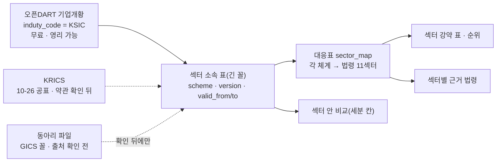

# 국내 종목 섹터 분류 — 현업 체계 비교 · 무료 출처 · 섹터 소속 표 꼴 조사서 v0.1

| 문서 정보 | |
|---|---|
| **판 · 상태** | v0.1 · 초안(검토 전 · 거래소 새 분류 KRICS 의 이용 조건은 2026-10-26 공표 뒤 원문으로 다시 확인) |
| **구분** | 조사서 — 섹터 분류 체계(GICS · WICS · KSIC · KRX 업종 · KRICS) 비교 · 무료 · 합법으로 받을 수 있는 출처 · 섹터 소속 표 꼴 추천 |
| **작성** | 이동원(데이터 파트 · 조사 지시 · 검토) · 초안은 조사 에이전트(공개 보도 · 약관 원문 · MSCI 팩트시트 · 로컬 자료 읽기 · github.com 은 열지 않음 · 오픈DART 는 부르지 않음 · 수집 DB 는 열지 않음) |
| **조회일** | 2026-10-17 (KST) — 웹 출처는 모두 이 날 조회 |
| **기준** | 우리 코드 `main` `12fd9fd` · 강사님 자료 lumina-invest(`app/services/korea_universe.py` · `app/data/korea-universe.json` updated_at 2026-10-14) · 교재 `learning/06-data-crawling/` — 모두 읽기만 |
| **확실도 표기** | 「높음」 = 원문(약관 · 보도자료 · 공식 화면 · MSCI 팩트시트 · 우리 코드 줄)을 직접 확인 · 「중간」 = 2차 자료 두 곳 이상이나 원문을 옮긴 글로 확인 · 「낮음」 = 2차 자료 한 곳 또는 추정 |
| **최종 수정** | 2026-10-17 (KST) |
| **관련 문서** | [섹터별 근거 법령 조사서](섹터별-근거법령-조사.md)(법령 11섹터) · [순위 화면 · 종목 목록 · 종목 비교 조사서](순위화면-종목목록-종목비교-조사.md)(종목 허브 · 섹터 칸) · [실사용자 피드백 — 종목 선정 근거 조사서](실사용자피드백-종목선정근거-조사.md)(섹터 안 강약) |

> **이 문서로 알 수 있는 것**
> 1. 동아리에서 받은 섹터 파일이 어느 체계인가 — GICS 1단계(11섹터) 꼴이고, 원 출처와 재배포 권리는 아직 모른다.
> 2. 국내에서 쓰는 섹터 분류 다섯(GICS · WICS · KSIC · KRX 업종 · 거래소 새 분류 KRICS)의 정의 · 단계 · 제공처 · 이용 조건 · 갱신.
> 3. 무료 · 합법으로 받을 수 있는 출처 — 가장 확실한 것은 오픈DART 기업개황의 업종코드(KSIC)다.
> 4. 체계 여럿을 한 표에 담는 섹터 소속 표 꼴(판 · 기준일 · 유효 기간)과 법령 11섹터로 가는 대응표.
> 5. 2026-10-17 에 정한 것 넷(D117)과, 그 결정을 뒤집을 조건.

---

## 0. 맨 위 요약 · 정한 것 · 남은 것

### 0.1 요약 5줄

1. **동아리 섹터 파일은 GICS 1단계(11섹터) 꼴이다** — MSCI 공개 팩트시트로 GICS 섹터를 확인한 24종목이 모두 파일과 같았고, 와이즈인덱스 WICS 에너지 구성종목 42개 가운데 33개가 파일에서 다른 섹터였으며, 거래소 업종(KSIC 바탕)과는 지주사 · 화학 · 전기·전자에서 크게 갈린다. 거래소가 2010년부터 S&P 에게 받아 공표해 온 GICS 1단계 결과를 보통주만 남겨 내려받은 판으로 추정한다(체계는 확실도 높음 · 원 출처는 중간 — 미확인).
2. **이용 조건**: 거래소 정보데이터시스템 · OPEN API · 공공데이터포털 사본 · 와이즈인덱스(WICS)는 모두 제3자 제공 · 재배포에 사전 허락이 필요하고, GICS 결과는 S&P · MSCI 의 지적재산이다(3절 원문). 반대로 **오픈DART 기업개황의 업종코드(KSIC)는 공공데이터법상 영리 이용도 막지 못하는, 가장 확실한 무료 · 합법 출처**다 — 우리 수집기는 아직 업종코드(`induty_code`)를 받지 않는다.
3. **거래소 새 분류 KRICS**(섹터 9 · 산업그룹 24 · 산업 60 · 하위산업 129)가 2026-10-26 부터 KRX 인덱스 사이트에 1 · 2단계로 공표되고 매년 4월 정기 변경된다. 대표지수 · KB RISE ETF(11-02)도 이 분류로 넘어간다. 이용 조건은 원문을 못 봤고, 9섹터에 유틸리티 · 통신 이름이 없어 법령 11섹터와는 2단계 대응표가 필요하다(4절).
4. **표 꼴 추천**: 체계 여럿을 한 표에 담는 긴 꼴(체계 · 판 · 기준일 · 출처 · 종목코드 · 대 · 중 · 소 · 세 분류 · 유효 시작 · 끝일 · 이용 조건) + 각 체계 → 법령 11섹터 대응표 · ETF 는 따로 · 첫 판 앞 기간은 「모름」(7절).
5. **정한 것(2026-10-17 · D117)**: 2차엔 오픈DART KSIC 를 받고 KRICS 를 정본 후보로 · 동아리 파일 값은 출처 확인 전엔 쓰지 않음 · 시점 이력은 유효 시작 · 끝일 + 판 · 법령 11섹터 표는 그대로 두고 KRICS 2단계 → 11섹터 대응표(8절).

### 0.2 정한 것 (2026-10-17 · 사용자 · 판단 재료는 8절 <표 8>)

| # | 물음 | 정한 것 |
|---|---|---|
| 가 | 2차 섹터 소속 칸의 기준 | 오픈DART 기업개황 업종코드(KSIC)를 받고, 10-26 공표 뒤 KRICS 를 정본 후보로 본다 |
| 나 | 동아리 파일 값을 어디까지 쓰나 | 원 출처가 확인될 때까지 쓰지 않는다 — 화면 · API · HF · git 모두. 종목 허브의 섹터 칸은 「준비 중」 으로 둔다 |
| 다 | 시점 이력 방식 | 유효 시작일 · 끝일 + 판 칸 · 이력 줄을 지우지 않음 · 첫 판 앞은 「모름」 |
| 라 | 법령 11섹터와 KRICS 9섹터 | 법령 표는 11섹터 그대로 · KRICS 2단계(24) → 11섹터 대응표 + 종목 예외 줄 |

### 0.3 남은 것(확인 필요)

1. 오픈DART `induty_code` 가 KSIC 몇 자리인지 — 실제 응답 한 건으로 확인(근거는 오픈DART 질의응답을 옮긴 글 · 중간).
2. KRICS 공표 화면(10-26)의 이용 조건 · 3 · 4단계 공개 여부 · 유틸리티 · 통신 종목이 가는 섹터.
3. 동아리 파일의 원 출처 — 동아리에 한 줄 물으면 5절 추정이 확정된다(사용자 몫).
4. 원문을 못 연 곳: KRX 화면의 GICS 공표 문구(블로그 인용으로만) · KIS 종목정보파일 약관(팝업) · 토스증권 업종 근거 · GICS 섹터 정의 원문.

---

## 1. 동아리 섹터 파일 — 무엇인가 (집계만)

> 원 출처와 재배포 권리를 모르는 자료다. 이 절은 **집계와 판정만** 싣고, 종목 하나하나의 섹터 줄은 싣지 않는다(개인 초안에만 둠 · 0.2 나).

- 시트 하나(`grid_20260917`) · 칸 넷(섹터코드 · 섹터명 · 종목코드 · 종목명) · 2,622줄 · 종목코드 중복 0.
- 섹터별 종목 수: 정보기술 674 · 산업 468 · 헬스케어 373 · 임의소비재 354 · 소재 311 · 필수소비재 158 · 커뮤니케이션 146 · 금융 94 · 유틸리티 18 · 에너지 17 · 부동산 9.
- 종목코드 25줄이 영문 섞인 새 단축코드(2024년부터 쓰는 꼴)라 그 뒤에 뽑은 파일이다 — 만든 때 속성 2026-09-17 과 맞는다.
- **보통주만** 있다 — 강사님 KIS 종목 마스터(2,763 · 2026-10-14)와 견주면 파일에 없는 226 은 우선주 114 · 스팩 71 · 리츠 23 · 외국 주식 12 등이다. 부동산 9종목은 리츠가 아니라 부동산 개발 · 신탁 회사다.
- 분봉을 모으는 401종목 가운데 ETF 50 을 뺀 351 이 모두 파일에 있다(정보기술 70 · 산업 70 · 소재 48 · 헬스케어 40 · 임의소비재 35 · 필수소비재 29 · 금융 27 · 커뮤니케이션 26 · 에너지 3 · 유틸리티 3 · 부동산 0).

**<표 1> 파일 섹터별로 많이 겹치는 거래소(KRX) 업종** (2,537종목 · 업종은 KIS 마스터의 지수업종 · 상위 넷)

| 파일 섹터 | 종목 수 | KRX 업종 상위 4 |
|---|--:|---|
| 정보기술 | 647 | 전기·전자 278 · KOSDAQ 업종미분류 152 · 기계·장비 95 · 의료·정밀기기 34 |
| 산업 | 454 | 기계·장비 108 · 전기·전자 75 · 건설 46 · 금속 44 |
| 헬스케어 | 363 | 제약 171 · 일반서비스 80 · 의료·정밀기기 67 · KOSDAQ 업종미분류 18 |
| 임의소비재 | 337 | 운송장비·부품 100 · 유통 67 · 섬유·의류 45 · 전기·전자 26 |
| 소재 | 303 | 화학 131 · 금속 82 · 비금속 25 · 종이·목재 23 |
| 필수소비재 | 157 | 음식료·담배 78 · 화학 40 · 유통 15 · 금융 11 |
| 커뮤니케이션 | 142 | 오락·문화 55 · KOSDAQ 업종미분류 42 · 일반서비스 22 · IT 서비스 9 |
| 금융 | 90 | 금융 44 · 증권 18 · KOSDAQ 업종미분류 12 · 보험 11 |
| 유틸리티 | 18 | 전기·가스 10 · 일반서비스 5 · 건설 2 · 미분류 1 |
| 에너지 | 17 | 화학 7 · 유통 5 · 금융 3 · 미분류 1 |
| 부동산 | 9 | 부동산 3 · 금융 3 · 건설 2 · 미분류 1 |

읽는 법: KRX 업종 하나가 여러 섹터로 흩어진다 — 「화학」 은 소재 · 필수소비재(화장품) · 에너지(정유)로, 지주회사가 든 「금융」 은 주력 사업 섹터로 간다. 파일은 KRX 업종을 다시 묶은 것이 아니라 **사업 성격 기준(GICS 꼴) 분류**다(확실도 높음). 「KOSDAQ 업종미분류」 268 은 강사님 코드가 KOSDAQ 대분류 코드를 이름에 잇지 못한 것이다(`korea_universe.py` 의 마스터 읽기 — 대 · 중분류가 0000 이면 미분류) — 거래소 원자료(교재 `krx_sector.csv` · 2026-07-23)에는 「IT 서비스」 229 등으로 다 분류돼 있다.

## 2. 현업 분류 체계 비교

**<표 2> 체계별 정의 · 구조 · 제공처**

| 체계 | 정의(원문 또는 요지) | 단계 · 개수 | 제공처 | 근거 · 확실도 |
|---|---|---|---|---|
| GICS | 「four-tiered, hierarchical industry classification system」(MSCI) · 회사마다 주된 사업 활동으로 하위산업을 정함(요지) | 섹터 11 · 산업군 25 · 산업 74 · 하위산업 163(2023-03 개편 뒤) | MSCI · S&P DJI 공동 | MSCI GICS 화면 · 개수는 개편 안내를 옮긴 글 → 개수 중간 |
| KRX 공표 GICS | 「KRX 상장종목에 대한 GICS 1, 2단계 산업분류결과 및 관련 시장데이터」 | 1단계 경제섹터 · 2단계 산업군만 | 거래소(S&P 에게 받음 · 2010-07-01 공표 시작) | KRX 보도자료 2010-06-28 · 높음 |
| WICS | 「국제적으로 통용되는 분류 기준을 국내 실정에 맞게 재구성」 · 매출 비중이 가장 큰 사업 기준(방법론을 옮긴 글) | 대분류 10 · 중분류 28 · 소분류 80 안팎(글마다 엇갈림) · 부동산은 금융 아래 중분류 | 에프앤가이드(와이즈인덱스) | 와이즈인덱스 WICS 화면 · 구조 높음 · 개수 중간 |
| FICS | 에프앤가이드의 옛 분류 | 경제 섹터 10 · 산업군 25 · 산업 62(블로그) | 에프앤가이드 | 2025-10-20 FnGuide 리포트 분류를 WICS 로 통일(고객지원 공지) · 높음 |
| KRX 업종 | 「한국표준산업분류기준에 기초한 기존 KRX 업종분류」(2010 보도) | 한 단계 · KOSPI 26 · KOSDAQ 24(교재 표 실측) | 거래소 정보데이터시스템 「업종분류 현황」 | 높음 |
| KSIC(한국표준산업분류) | 생산 활동 기준 · 여러 활동이면 부가가치(매출) 비중이 큰 주된 활동 | 대 21 · 중 77 · 소 234 · 세 501 · 세세 1,205(11차 · 2024-07-01 시행) | 국가데이터처(옛 통계청) · 회사별 값은 오픈DART 기업개황 `induty_code` | 개수 중간~높음 · `induty_code` = KSIC 는 중간 |
| KRICS(거래소 산업분류) | 「KRX 산업분류체계 방법론」 · 국내 산업 구조 반영 · 모빌리티 섹터 신설 | 섹터 9 · 산업그룹 24 · 산업 60 · 하위산업 129 | 거래소 · 2026-10-26 KRX 인덱스 사이트 공표 예정 · 공개는 1 · 2단계(보도) | 4절 · 중간 |
| 증권사 HTS 업종(키움) | 업종 시세 = 거래소 업종지수 · 따로 테마형 「인포스탁 섹터」 화면 | KRX 업종과 같음 | 키움 | 개발가이드 · 영웅문 도움말 · HTS 안 GICS 화면 유무는 원문 미확인 → 중간 |
| 국내 앱(네이버 증권) | 종목분석 탭의 업종 = WICS 꼴 | WICS 소분류 | 화면 자료는 에프앤가이드 제공 | 블로그 둘 · 화면은 도구로 못 엶 → 중간 |
| KIS 종목 마스터 | 지수업종 대 · 중 · 소분류(= KRX 업종 코드) + KRX 섹터지수 소속 칸 + KOSPI200 섹터업종 칸 | KRX 업종과 같음 | 한국투자증권 공개 내려받기 | 강사님 코드 · 높음 |

**<표 3> 이용 조건 · 갱신 · 시점 이력 · 우리 쓰임**

| 체계 | 이용 조건(요지 · 원문은 3절) | 갱신 | 시점 이력(그날의 섹터) | 우리 쓰임(섹터 강약 · 섹터 안 비교 · 법령 · 순위)에 맞나 |
|---|---|---|---|---|
| GICS(동아리 파일 판) | 지적재산(S&P · MSCI) + 거래소 화면 정보 재배포 금지 · 파일은 원 출처 · 권리 불명 | 2026-09-17 한 판뿐 | 없음 | 법령 11섹터와 딱 맞음 · 섹터 안 비교엔 1단계뿐이라 거침 · **권리가 약점** |
| KRX 공표 GICS | 거래소 약관(사전 허락 없는 복제 · 배포 금지) + S&P · MSCI 지적재산 | 원문 미확인 | 원문 미확인 | 위와 같음 · KRICS 로 넘어가며 앞날 불확실 |
| WICS | 사전 동의 없는 복제 · 배포 · 제3자 배포 금지 | 원문 미확인 | 구성종목 조회에 날짜 인자가 있음(교재 노트북) → 날짜별 조회 가능해 보임(중간) | 세분이 좋아 섹터 안 비교에 좋음 · 10섹터라 법령 11섹터와 1:1 아님 |
| KRX 업종 | 거래소 약관 · OPEN API 는 비상업 · 제3자 제공 금지 | 원문 미확인 | 날짜 인자로 그날 기준 조회(교재 노트북 · 중간) | 지주사 · 화학이 뭉쳐 강약 표엔 맞지 않음 · 공식 · 날짜 조회는 장점 |
| KSIC(오픈DART) | 약관 밖은 공공데이터법(오픈DART 약관 제16조 ④) · 공공데이터법 제3조 ④ 「영리적 이용인 경우에도 이를 금지 또는 제한하여서는 아니 된다」 · 호출 한도 하루 2만 안팎 | 분류표는 수년마다(10차 2017 · 11차 2024) · 회사 값은 회사가 바꿀 때 | 기업개황은 지금 값만 → 우리가 쌓으면 이력 | **합법 · 무료 · 영리까지 가장 확실**(중간) · 생산 기준이라 사업 성격과 어긋남(예: 방산 · ICT 회사가 「전자부품 제조업」) → 강약 표는 대응표 필요 |
| KRICS | 원문 미확인(10-26 뒤 KRX 인덱스 사이트 약관) | 매년 4월 정기 변경 + 수시 심사 + 변경 요청 절차(보도) | 원문 미확인 — 정기 변경이 해마다 있으니 우리가 판을 쌓아야 함 | **국내 공식 · 앞으로의 기준** · 9섹터 ≠ 법령 11섹터 → 2단계 대응표 필요 |

## 3. 이용 조건 원문 (두 줄 이하 · 조회일 2026-10-17)

**<표 4> 출처별 이용 조건 — 원문**

| 출처 | 조항 원문 | 확실도 |
|---|---|---|
| KRX Data Marketplace(정보데이터시스템) 이용약관 | 제10조 ② 「자동화 수단을 이용하여 정보를 무단 수집·복제·배포하는 행위」 금지 · 제12조 ② 「이용자는 당 사이트의 정보를 거래소의 사전 허락 없이 복사·복제·배포·전송·공중송신하여서는 아니 됩니다.」 | 높음 |
| KRX OPEN API 이용약관 | 제6조 ② 「API 서비스를 비상업적인 목적으로만 이용할 수 있으며」 · 제11조 ② 「API 이용자는 한국거래소로부터 제공받은 정보를 제3자에게 제공할 수 없다.」 | 높음 |
| 공공데이터포털 「금융위원회_KRX상장종목정보」 | 「이용허락범위 제4유형 : 출처표시 + 상업적 이용금지 + 변경금지」 · 「상업적 목적 여부와 상관 없이 제3자 무단 제공 및 재배포가 엄격히 금지됩니다.」 | 높음 |
| GICS(KRX 공표분) | 「GICS기준 및 GICS 산업분류결과는 S&P와 MSCI의 지적재산이며」(KRX 보도자료 2010-06-28) | 높음 |
| GICS(MSCI 공식 화면) | 구조 설명만 있고 이용 · 라이선스 문장은 없음 | 높음(없다는 것) · S&P 화면은 열리지 않음 |
| WICS(와이즈인덱스) | 법적고지 「이용자는 회사가 제공하는 서비스를 무단으로 전재하거나 사전 동의 없이 복제, 전송, 출판, 배포, 방송 기타 방법에 의하여 이용하거나 제3자에게 무단으로 배포할 수 없습니다.」 | 높음 |
| KIS 종목정보파일(종목 마스터) | 이용약관이 팝업이라 본문을 못 엶 | 원문 미확인 |
| 오픈DART | 제16조 ④ 「약관에 명시되지 않은 저작권과 관련된 사항은 저작권법 및 공공데이터법에 따릅니다.」 · 약관 안에 상업 이용 · 재배포 · 출처 표시 조항은 없음 | 높음 |
| KRICS(거래소 새 분류) | 이용 조건 문장을 찾지 못함 | 원문 미확인 |

읽는 법: **거래소 쪽(정보데이터시스템 · OPEN API · 공공데이터포털 사본)과 와이즈인덱스는 모두 「제3자 제공 · 재배포 금지(사전 허락 · 동의 필요)」** 다. 우리 앱 화면에 보이는 것이 「제3자 제공」 인지는 해석이 갈린다(중간 — 거래소에 묻는 것이 확실). GICS 는 거기에 더해 **S&P · MSCI 의 지적재산**이라 섹터 이름 열하나는 써도 종목별 결과를 다시 펴는 것은 따로 허락이 필요하다(중간). 반대로 **오픈DART 는 공공데이터법을 따라 영리 이용도 막지 못한다**.

## 4. 거래소 새 분류 KRICS 와 거래소가 공표해 온 GICS

### 4.1 KRICS (2026-09-22 발표 · 10-26 공표 예정)

- 구조: 「9개 섹터에 2단계 24개 산업그룹을 뒀고, 3단계 60개 산업, 4단계 129개 하위산업으로 구성됐다.」(보도 · 중간)
- 9섹터: 에너지화학 · 소재 · 산업재 · 모빌리티 · 정보기술 · 금융 및 부동산 · 소비재 · 헬스케어 · 미디어 및 콘텐츠(KB자산운용 공지 2026-10-02 원문).
- 공표: 「'KRX 산업분류체계 방법론'을 제정하고」 · 「KRX 인덱스 웹사이트를 통해 산업분류 결과를 공표」(아시아경제 2026-09-22). 공개 범위는 「상장종목의 1·2단계 산업분류와 주가, 거래량 등」 → **3 · 4단계는 공개 대상이라고 적히지 않았다**(중간).
- 갱신: 「산업분류는 매년 4월 최근 공시된 사업보고서와 감사보고서의 연결 재무정보를 바탕으로 정기 변경한다」 · 「신규 상장이나 주요 기업 이벤트 등으로 산업분류 변경이 명확하게 예상되는 경우에는 수시 심사를 실시한다」(인사이트코리아 · 비즈월드 — 같은 보도자료 · 중간~높음). 상장법인 · 지수 이용자가 변경 검토를 요청할 수 있다.
- 지수 적용: 「하반기 중 코스피200, 코스닥150 등 대표지수에 KRX 산업분류를 적용」 · KB RISE ETF 기초지수(KRX 300 · 코리아 밸류업)는 2026-11-02 에 「글로벌 산업분류(GICS)를 참고하여 다음 10개 산업군」 → 「KRX 산업분류(KRICS)를 참고하여 다음 9개 산업군」 으로 바뀐다(KB자산운용 공지 원문).
- 3단계로 따로 둔 산업: 조선 및 선박 · 배터리(산업재) · 반도체 · 디스플레이(정보기술) · 문화 엔터테인먼트 · 게임(미디어 및 콘텐츠). 모빌리티 = 자동차 · 부품과 여객운송. → **9섹터에 유틸리티 · 통신 이름이 없다** — 한국전력 · SK텔레콤이 어느 섹터로 가는지는 공표를 봐야 안다.
- 이용 조건: 어느 기사에도 없다 → 원문 미확인.
- 우리에게 뜻: 2차 마감(10-21) 닷새 뒤 거래소가 국내 전 종목 섹터를 공식 공표한다. 지금 GICS 꼴 11섹터를 정본으로 굳히면 한 달 안에 기준이 바뀐다.

### 4.2 거래소가 공표해 온 GICS — 동아리 파일 출처의 가장 유력한 뿌리

- KRX 보도자료 「한국거래소, 글로벌산업분류기준(GICS) 도입」(2010-06-28 · 본문 읽음): 「공표내용은 KRX 상장종목에 대한 GICS 1, 2단계 산업분류결과 및 관련 시장데이터(주가, 거래량 등)이며,」 · 「GICS기준 및 GICS 산업분류결과는 S&P와 MSCI의 지적재산이며, KRX는 S&P 및 MSCI의 산업분류결과를 제공받아 공표」 · 「한국표준산업분류기준에 기초한 기존 KRX 업종분류와 관련 데이터는 현행과 동일하게 산출·제공할 계획임」.
- 거래소 화면 안내 문구 「한국거래소는 투자참고를 위해 S&P로부터 국내 상장종목의 GICS기준 산업분류(1단계 경제섹터 및 2단계 산업군) 결과를 제공받아 공표하고 있습니다.」 는 블로그 두 곳(2021)이 옮긴 것으로만 봤다(중간).
- 같은 블로그가 옮긴 거래소 「산업별 현황(GICS)」 종목 수(2021)와 파일(2026-09-17)의 섹터 비율이 거의 같다(금융 95 ↔ 94 · 유틸리티 17 ↔ 18 · 에너지 19 ↔ 17 · 필수소비재 164 ↔ 158 · 소재 314 ↔ 311 · 부동산 21 ↔ 9 는 파일이 리츠를 뺀 만큼).
- 교재 노트북(2026-07) 원문: 「국내 종목의 GIGS 기준 정보 역시 한국거래소에서 제공하고 있으나 GICS는 독점적 지적 재산으로 명시되어 사용에 무리가 있음」(「GIGS」 는 원문 오타) — 교재도 지적재산 문제로 GICS 를 쓰지 않았다.
- WICS 와 가르는 증거: WICS 는 대분류 10 이고 「부동산」 은 금융 아래 중분류다(와이즈인덱스 공식 화면). 파일은 부동산을 따로 둔 11섹터 → 2016년 부동산 섹터 신설 뒤의 GICS 꼴.

## 5. 동아리 파일 출처 추정 — 표본 대조 결과(종목 줄은 싣지 않음)

- **WICS 에너지 42종목**(교재 `kor_sector.csv` · 와이즈인덱스 2026-07-23): 파일에서도 에너지인 것은 9개뿐 — 산업 22 · 유틸리티 4 · 소재 3 · 정보기술 2 · 임의소비재 1 · 커뮤니케이션 1. WICS 는 풍력 · 연료전지 · 신재생 설비 회사까지 에너지로 묶고, 파일은 설비 = 산업재 · 발전 사업자 = 유틸리티 · 태양광 모듈 = 정보기술로 나눈다 — GICS 정의와 같은 꼴(GICS 정의 원문은 못 엶 · 중간). → **파일은 WICS 가 아니다**(높음). 덧붙여 이 교재 표는 노트북 반복문이 주소의 섹터 칸을 에너지(`G10`)로 고정해 에너지 섹터만 열 번 받은 것이라 WICS 대조 자료로는 에너지 42종목밖에 쓸 수 없다.
- **표본 48종목**(이차전지 · 지주사 · 게임 · 결제 · 바이오 · 리츠 · 부동산 · 유통 · 섹터 고루): 지주사를 주력 사업으로 나누고(KRX 는 「기타금융」 한 칸), 결제 처리 회사를 금융으로(GICS 2023-03 개편 — 결제 처리 정보기술 → 금융), 대형마트를 필수소비재로(같은 개편) 둔다 → **2023 개편 뒤 GICS 판 꼴**(중간). 파이낸셜뉴스(2026-09-07)가 KRX 업종의 문제 사례로 짚은 두 종목도 파일은 사업 성격 쪽으로 나눈다. 매출 구성이 바뀌는 중이라 **분류가 곧 바뀔 수 있는 종목**도 있다(시점 이력이 필요한 까닭).
- **공개 GICS(MSCI 팩트시트 여섯)와 맞대기 — 24종목 모두 같음**: 팩트시트의 「TOP 10 CONSTITUENTS … Sector」 칸에 적힌 GICS 섹터(예: 삼성SDI 정보기술 · LG에너지솔루션 산업재 · 지주사 SK스퀘어 산업재 · 삼성물산 산업재 — KRX 업종으로는 셀 회사 둘이 같은 「전기·전자」, 삼성물산이 「유통」)와 파일이 모두 같았다(높음 — MSCI PDF 본문).

**<표 5> 파일이 어느 체계와 가까운가**

| 후보 | 맞는 증거 | 어긋나는 증거 | 판단 |
|---|---|---|---|
| **GICS 1단계(거래소가 S&P 에게 받아 공표한 판 꼴)** | 섹터 이름 11 · 부동산 따로 · MSCI 공개 24/24 같음 · 2023 개편 반영 · WICS 에너지 42 중 33 이 GICS 정의대로 갈림 · 섹터별 종목 수 비율이 거래소 GICS 현황(2021)과 비슷 | 표본 60 가운데 설명 못 하는 종목 없음 · 한 종목은 GICS 원문으로 못 봄 | **가장 가깝다 · 중간~높음**(체계는 높음 · 「거래소 공표분을 받은 것」 까지는 중간) |
| WICS | 이름이 비슷한 섹터가 많음 | 대분류 10(부동산 없음) · 지주사 · 풍력 · 연료전지를 에너지로 둠 | 아니다 · 높음 |
| KRX 업종(KSIC 바탕) | 없음 | 지주사 · 화학 · 전기·전자가 여러 섹터로 흩어짐(<표 1>) | 아니다 · 높음 |
| KRICS | 없음 | 9섹터 · 10-26 공표 전 · 파일은 09-17 | 아니다 · 높음 |

- 종목코드 앞의 「A」 는 에프앤가이드 기업 화면 주소 꼴과 같아 보이나 원문 화면을 열지 못해 제공처를 단정하지 않는다(낮음). 시트 이름 `grid_20260917` 은 웹 화면 표를 그날 내려받은 기본 이름 꼴로 보인다(낮음).
- 확인 못 한 것: 키움 HTS 안에 GICS 섹터 화면이 있는지 · 동아리가 어디서 받았는지(물으면 바로 풀림).

## 6. 무료 · 합법으로 받을 수 있는 출처

**<표 6> 출처 후보 판정**

| 출처 | 무엇을 주나 | 무료 | 합법 · 재배포 | 시점 | 판정 |
|---|---|---|---|---|---|
| 오픈DART 기업개황 `company.json` | `induty_code`(업종코드 = KSIC · 중간) · `corp_cls` · `stock_code` | 예(인증키) | 공공데이터법상 영리 이용도 제한 못 함 · 재배포 조항 없음 | 지금 값만 → 우리가 쌓으면 이력 | **2차 전에 바로 쓸 수 있는 유일하게 확실한 출처** — 351종목 = 351회 호출(하루 한도 안) · 기업개황은 DART 고유번호로 부르는데 그 대응은 이미 있다(`collector/sources/dart.py` `corp_code_map()` · `build_corp_code_map()`) · 지금 업종코드를 받는 코드는 0 |
| KRX 정보데이터시스템 「업종분류 현황」 · 「지수구성종목」 | KRX 업종 · 시총 · 업종지수 · 섹터지수 구성종목 | 예 | 자동화 수집 금지 · 사전 허락 없는 복제 · 배포 금지 | 날짜 조회 | 사람이 내려받아 내부 참고만 · 화면 재배포는 허락 필요 |
| KRX OPEN API | 시세 · 지수 | 예(신청) | 비상업 · 제3자 제공 금지 | — | 업종 분류 API 유무 원문 미확인 · 조건이 가장 빡빡 |
| 공공데이터포털 「KRX상장종목정보」 | 종목 기본정보(업종 없음) | 예 | 공공누리 4유형 · 재배포 금지 | 날짜 | 섹터엔 못 씀 |
| KIS 공개 종목 마스터 | KRX 업종 코드 · KRX 섹터지수 소속 · KOSPI200 섹터업종 | 예(로그인 없이) | 약관 원문 미확인 | 날마다 새 파일(지금 값만) | 강사님 코드가 이미 씀 · 섹터지수 소속 칸이 강약 보조로 쓸모 · 약관 확인 필요 |
| 와이즈인덱스 WICS 구성종목 | WICS 섹터별 종목 | 예(화면) | 사전 동의 없는 복제 · 배포 금지 | 날짜 인자 | **자동 수집 · 재배포는 하지 않는다**(우리 규칙 · 약관) |
| KRICS(10-26 공표) | 1 · 2단계 섹터 · 주가 · 거래량 | 원문 미확인 | 원문 미확인 | 원문 미확인 | **10-26 뒤 약관부터 확인** — 가장 유력한 장기 정본 |
| 동아리 파일 | GICS 꼴 1단계 · 보통주 2,622 | — | 원 출처 · 재배포 권리 모름 | 2026-09-17 한 판 | **출처 확인 전엔 쓰지 않음**(0.2 나) |

덧붙임(사용자 손이 필요한 일): 거래소 데이터사업부(공공데이터포털 안내의 문의처)에 「KRICS · GICS 공표분을 비영리 학습 앱 화면에 보여도 되는지」 를 묻는 것이 이용 조건을 가장 확실히 푼다.

## 7. 섹터 소속 표 꼴 추천

### 7.1 체계 여럿을 한 표에 「긴 꼴」 로

**<표 7> 섹터 소속 표 칸(추천)**

| 칸 | 뜻 | 예 |
|---|---|---|
| scheme | 분류 체계 | `ksic_dart` · `krx_industry` · `krics` |
| scheme_version | 판 | `KSIC-11` · `KRICS-2026-10` |
| as_of | 그 판의 기준일 | 2026-10-26 |
| source | 출처 | `오픈DART 기업개황` |
| symbol | 6자리 종목코드(영문 섞인 코드 그대로) | `373220` · `0001A0` |
| level1_code · level1_name | 대분류(섹터) | KSIC 대분류 C · 제조업 |
| level2 · level3 · level4 | 중 · 소 · 세 분류(있는 만큼) | KSIC `264` |
| valid_from · valid_to | 이 값이 맞았던 기간(끝은 비우면 「지금」) | 2026-10-20 · (빈칸) |
| license_note | 이용 조건 표기 | `공공데이터 · 출처 표시` |
| fetched_at | 받은 때(KST) | 2026-10-20 14:00 |

- 시점 이력: 값이 바뀌면 새 줄을 넣고 옛 줄의 `valid_to` 를 채운다(이력 줄을 지우지 않음). 첫 판 앞 기간은 **「모름」** 으로 둔다 — 지금 섹터로 과거를 덮으면 백테스트가 그때는 몰랐던 정보를 쓰는 셈(룩어헤드)이다.
- 대응표 하나 더: `sector_map(from_scheme, from_code, to_scheme, to_code, rule, note)` — KRICS 2단계 → 법령 11섹터, KSIC 소분류 → 11섹터처럼 쓴다. 한 칸이 둘로 갈리면 `rule = 종목 예외` 로 종목 단위 줄을 둔다.
- ETF: 섹터 표에 넣지 않고 `level1 = ETF` 한 줄 또는 별도 `etf_sector_map`(ETF → 기초지수 이름 → 섹터 · 출처 = 운용사 기초지수 이름). 401 의 ETF 50 이 섹터 강약 표에 섞이지 않게.
- 법령 11섹터와: 법령 표(`collector/kb_data/sector_laws.tsv` · `collector/kb_sector.py` 의 섹터 이름 열하나)는 그대로 둔다. 어느 체계를 정본으로 하든 「법령 섹터 코드」 로 가는 대응표만 바꾸면 되게.

### 7.2 어디에 · 언제

- 값(종목 ↔ 섹터)은 수집 DB 새 표(로컬) · 코드 · 대응표 · 체계 설명은 git. 오픈DART KSIC 값은 HF 비공개에 올려도 된다(공공데이터 · 중간).
- 갱신: 오픈DART 기업개황 = 분기 1회(정기보고서 뒤) + 새 상장 때 · KRICS = 매년 4월 정기 변경 뒤 + 수시 심사 반영 때.
- **2차(10-21) 몫**: ① 표 꼴 · 대응표 꼴 확정 ② 오픈DART 기업개황 `induty_code` 351종목 받기(한 번 · 하루 한도 안 · 응답 한 건으로 자리 수부터 확인) → KSIC 칸.
- **3차 몫**: ③ 10-26 KRICS 공표 화면 · 약관 확인 → 받아 넣기 ④ KRICS 2단계 ↔ 법령 11섹터 대응표 ⑤ 판이 바뀔 때마다 이력 줄 쌓기 · 섹터 강약 표를 정본 체계로 바꿀지 결정.

**<그림 1> 섹터 소속 — 출처 → 표 → 쓰임** (실선 = 지금 받음 · 점선 = 확인 뒤 · 동아리 파일은 출처 확인 전엔 쓰지 않음)

## 8. 정한 것 — 판단 재료

**<표 8> 정한 것 넷 (2026-10-17 · 사용자 · 결정 대장 D117)**

| # | 물음 | 고른 것 | 다른 안 | 판단 재료(출처 · 확실도) |
|---|---|---|---|---|
| 가 | 2차(10-21) 섹터 소속 칸의 기준 | **오픈DART KSIC 를 받고, 10-26 뒤 KRICS 를 정본 후보로** | 동아리 파일을 참고 판으로 함께 · 동아리 파일을 정본으로 · WICS | 파일 = GICS 꼴(중간~높음 · 5절) · 법령 11섹터와 맞지만 권리 불명 · 거래소가 10-26 에 KRICS 공표(4.1) · 오픈DART 는 공공데이터법으로 영리도 됨(<표 3>) · WICS 는 사전 동의 없는 배포 금지 · 10섹터(3절 · 2절) |
| 나 | 동아리 파일 값을 어디까지 쓰나 | **원 출처가 확인될 때까지 쓰지 않음** | 로컬 화면에 「참고 분류(출처 확인 중)」 꼬리표로 · 분석 내부에만 | 원 출처는 KRX 공표 GICS 판으로 추정(중간) — 그렇다면 거래소 약관 제12조 ② · S&P · MSCI 지적재산이 걸린다(3절) |
| 다 | 시점 이력 방식 | **유효 시작일 · 끝일 + 판 칸(이력 줄 안 지움) · 첫 판 앞은 「모름」** | 날마다 통째 저장 · 지금 값만 | KRICS 매년 4월 정기 변경(4.1) · 매출 구성이 뒤집히는 종목(5절) · 지금 값으로 과거를 덮으면 룩어헤드 |
| 라 | 법령 11섹터와 KRICS 9섹터 | **법령 표는 11섹터 그대로 · KRICS 2단계(24) → 11섹터 대응표 + 종목 예외 줄** | 법령 표를 9섹터로 다시 짬 · GICS 꼴에 고정 | KRICS 에 유틸리티 · 통신 이름이 없음 · 에너지화학 · 금융 및 부동산처럼 합쳐진 섹터(4.1) · 3 · 4단계 공개 여부 미확인 |

## 9. 용어 풀이

- **섹터 · 산업군 · 산업 · 하위산업**: 분류의 큰 칸부터 작은 칸. 이 글에서 「섹터」 는 맨 위 칸(GICS 11 · KRICS 9). 헷갈리는 점 — KRX 「업종」 은 한 단계뿐이라 섹터와 크기가 다르다.
- **GICS**: MSCI 와 S&P 가 만든 세계 공용 증시 분류. 회사가 실제로 무엇으로 돈을 버는지로 나눈다. 헷갈리는 점 — 분류 이름은 널리 쓰여도 종목별 분류 결과는 두 회사의 지적재산이다.
- **WICS · FICS**: 에프앤가이드의 국내용 분류. 네이버 증권 종목분석의 업종이 WICS 꼴. FICS 는 2025-10 부터 에프앤가이드 리포트에서도 WICS 로 바뀌는 중.
- **KSIC(한국표준산업분류)**: 국가 표준. 「무엇을 만드나(생산 활동)」 로 나눈다. 그래서 방산 · ICT 회사가 「전자부품 제조업」 이 되기도 한다. 오픈DART 기업개황의 업종코드가 이것.
- **KRX 업종**: 거래소 산업별 지수의 업종(KSIC 바탕 · 코스피 26 · 코스닥 24). 증권사 HTS 의 「업종 시세」 가 이것.
- **KRICS**: 거래소가 2026-09-22 발표한 새 증시 분류(9섹터 · 4단계). 10-26 부터 공표.
- **시점 이력(그날의 섹터)**: 과거 어느 날 그 종목이 어느 섹터였는지. 지금 섹터로 과거를 계산하면 그때는 몰랐던 정보를 쓰는 셈(룩어헤드)이 된다.
- **지주회사**: 다른 회사 주식을 들고 지배하는 회사. KRX 업종은 「기타금융」 한 칸, GICS 는 주력 사업이나 「복합기업(산업재)」 으로 나눈다.

## 10. 뒤집을 조건

- 동아리가 「파일은 ○○에서 받았다」 고 알려 주면 5절 출처 추정을 그 원문으로 바꾸고, 그 출처의 이용 조건으로 0.2 나를 다시 정한다.
- KRICS 공표 화면 약관이 「비영리 · 출처 표시면 자유」 라면 KRICS 를 정본으로 앞당긴다. 재배포 금지면 KRICS 도 내부 분석만.
- MSCI 원문으로 확인한 24종목 밖에서 파일 ≠ GICS 가 여럿 나오면 「파일 = 거래소 공표 GICS 판」 을 「GICS 를 흉내 낸 손 분류」 로 낮춘다.
- 오픈DART `induty_code` 가 KSIC 가 아닌 다른 코드로 나오면(실제 응답으로 확인) 6절 판정을 고친다.

## 11. 출처 목록 (조회일 모두 2026-10-17)

- 거래소: GICS 도입 보도자료(2010-06-28) <https://www.newswire.co.kr/newsRead.php?no=482218> · KRX Data Marketplace 이용약관 <https://data.krx.co.kr/contents/MDC/INFO/informationController/MDCINFO003.cmd> · KRX OPEN API 약관 <https://openapi.krx.co.kr/contents/OPP/INFO/OPPINFO002.jsp> · 공공데이터포털 KRX상장종목정보 <https://www.data.go.kr/data/15094775/openapi.do>
- KRICS 보도: 아시아경제 <https://core.asiae.co.kr/article/2026092210104587389> · DigitalToday <https://www.digitaltoday.co.kr/en/view/106426/krx-introduces-krics-industry-classification-adds-mobility-sector> · 스마트투데이 <https://www.smarttoday.co.kr/ko-kr/articles/111917> · 인사이트코리아 <https://www.insightkorea.co.kr/news/articleView.html?idxno=255155> · 비즈월드 <http://www.bizwnews.com/news/articleView.html?idxno=147121> · KB자산운용 공지 <https://kbam.co.kr/support/notice/840> · 파이낸셜뉴스 2026-09-07 <https://www.fnnews.com/news/202609071805574257> · <https://www.fnnews.com/news/202609071831303201>
- GICS: MSCI GICS 화면 <https://www.msci.com/indexes/index-resources/gics> · MSCI 2023 개편 시행 안내 <https://www.msci.com/documents/1296102/29559863/Implementation_of_2023_GICS_Changes.pdf/3b8bf06e-fe28-42f3-f6bc-73681bd3ec29?t=1666901607879> · MSCI 한국 지수 팩트시트(Min Vol · Selection · Korea · IMI Quality Capped · 20/35 Custom · Large Cap Growth) <https://www.msci.com/documents/10199/255599/msci-korea-imi-minimum-volatility-index-krw-gross.pdf> · <https://www.msci.com/documents/10199/255599/msci-korea-selection-index-krw-gross.pdf> · <https://www.msci.com/resources/factsheets/index_fact_sheet/msci-korea-index.pdf> · <https://www.msci.com/documents/10199/255599/msci-korea-imi-quality-capped-index-usd-price.pdf> · <https://www.msci.com/documents/10199/255599/msci-korea-2035-custom-index-usd-net.pdf> · <https://www.msci.com/www/index-factsheets/msci-korea-large-cap-growth/0402075822> · 구조 개수 <https://compensia.com/changes-to-gics-code-classification-system-to-take-effect-in-2023>
- WICS · FICS: <https://www.wiseindex.com/About/WICS> · <https://www.wiseindex.com/Etc/LegalNotice> · 거래소 GICS 안내 문구 · 2021 섹터 수를 옮긴 글 <https://purplechip.tistory.com/32>
- KSIC · DART: 오픈DART 기업개황 가이드 <https://opendart.fss.or.kr/guide/detail.do?apiGrpCd=DS001&apiId=2019002> · 오픈DART 이용약관 <https://opendart.fss.or.kr/intro/terms.do> · 공공데이터법 <https://law.go.kr/LSW/lsInfoP.do?lsiSeq=251023> · `induty_code` = KSIC 를 옮긴 글 <https://moonsong-investor.tistory.com/118>
- 증권사: 키움 OpenAPI+ 개발가이드 <https://download.kiwoom.com/web/openapi/kiwoom_openapi_plus_devguide_ver_1.1.pdf> · KIS Developers <https://apiportal.koreainvestment.com/apiservice-category>
- 로컬(읽기만): 동아리 섹터 파일(개인 폴더 · git 밖 · 집계만) · `data/hf_export/intraday_universe/intraday_universe.parquet`(u2-20260930) · 교재 `learning/06-data-crawling/crawl_data/krx_sector.csv` · `kor_sector.csv` · `7.국내주식데이터수집.ipynb` · 강사님 `learning/th06-lumina-invest/lecture/app/data/korea-universe.json` · `collector/kb_sector.py` · `collector/kb_data/sector_laws.tsv`

## 12. 대응표 — 조사 항목이 어디로 갔나

| 조사 항목 | 간 곳 | 빠진 것 · 까닭 |
|---|---|---|
| 1 현업 분류 체계 비교(정의 · 단계 · 제공처 · 이용 조건 · 갱신 · 시점 이력) | 2절 <표 2> · <표 3> · 3절 <표 4> · 4절 | 토스증권 업종 근거 · GICS 정의 원문 → 원문 미확인 |
| 2 무료 · 합법 출처 | 6절 <표 6> | KRICS · KIS 약관 원문 → 확인 필요 |
| 3 동아리 파일 출처 추정 | 1절 · 5절 <표 5> | 종목별 대조 줄(WICS 에너지 42 · 표본 48 · MSCI 24)은 싣지 않음 — 출처 확인 전(개인 초안) |
| 4 데이터 구성 추천 | 7절 <표 7> · <그림 1> | — |
| 5 정할 것 | 0.2 · 8절 <표 8> | — |

## 개정 이력

| 판 | 날짜 | 무엇이 바뀌었나 | 왜 | 근거 |
|---|---|---|---|---|
| v0.1 | 2026-10-17 | 처음 씀 — 체계 다섯 비교 · 이용 조건 원문 · 출처 판정 · 동아리 파일 출처 추정(집계만) · 섹터 소속 표 꼴 · 정한 것 넷(D117) | 종목 허브의 섹터 칸 · 섹터 강약 표의 기준을 정하기 전에 현업 체계 · 권리를 확인(사용자 요청 2026-10-17) | 배경 조사(개인 초안 `docs/_local/git-drafts-개인/2026-10-17-섹터분류리서치/`) · 결정 대장 D117 |
