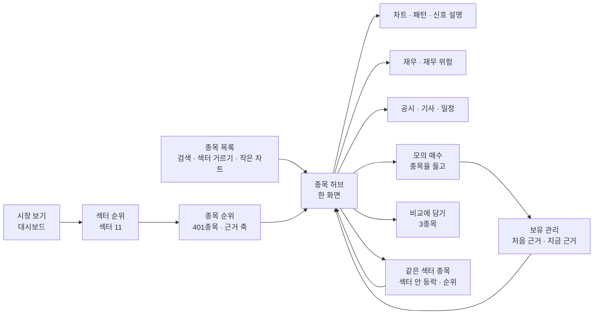

# 순위 화면 · HTS 같은 종목 목록 · 종목 비교 · 앱 흐름 — 조사서 v0.1

| 문서 정보 | |
|---|---|
| **판 · 상태** | v0.1 · 초안(검토 전) |
| **구분** | 조사 — 실사용자 피드백 셋째 묶음(순위 화면 · HTS 같은 종목 목록 · 종목 비교 · 앱 흐름)의 화면 · 정보 구조 벤치마킹 근거와 역할 표. 피드백은 세 번에 나눠 받았다 — 이 글에서 「원문 1」 = 처음 받은 여섯(① ~ ⑥ · 실사용자 피드백 조사 3절) · 「원문 2」 = 투자 정보 리서치 화면 둘(그 조사 9절) · 「원문 3」 = 이 글이 다루는 순위 · 종목 목록 · 종목 비교 · 앱 흐름 피드백 |
| **작성** | 이동원(팀장) |
| **검토** | 검토 전 |
| **최종 수정** | 2026-10-15 (KST) |
| **기준** | 원문 조회 2026-10-14 · 코드 사실은 `main` `4977a12` 읽기만(줄 번호는 이 커밋 기준 — `public/js/core.js` 는 같은 시각 다른 작업이 위 메뉴 넘침을 고치는 중이라 작업 트리에서는 `navigate` 가 594행으로 밀려 있다 · 메뉴 6-160 · 비교 트레이 377-435 는 같음) |
| **관련 문서** | [실사용자 피드백 — 종목 선정 근거 조사](실사용자피드백-종목선정근거-조사.md)(이 글에서 「실사용자 피드백 조사」 — 「매수 · 매도 · 보유」 낱말 · 투자 권유 규제는 그 조사 5절(규제 원문 · 「규칙 신호 집계」 꼴 · 피할 낱말)과 정할 것 3, 섹터 강약 표(4.2절 · 정할 것 4) · 작은 차트 격자(6.3절) · TradingView 약관(6.2절) · 근거 일지(8절)도 그 조사 몫이라 이 문서는 가리키기만 한다) · [개별 종목 · 투자 근거 · 익절 손절 조사](개별종목-투자근거-익절손절-조사.md)(이 글에서 「앞선 조사서」 — 「종목 근거 서랍」 은 그 문서 8절 <표 17> L4) · [자동매매 직접 전략 · 투자 성향 조사](자동매매-직접전략-투자성향-조사.md)(같은 날 조사 — 직접 전략 입력 · 투자 성향) |
| **최근 개정** | 새 문서 |

> **이 문서로 알 수 있는 것**
>
> 1. 실서비스의 순위 화면은 무엇으로 줄 세우고 어떻게 보이나 · 우리 재료로 무엇을 묶을 수 있나 (1절)
> 2. 증권사 HTS 같은 종목 목록 + 차트에서 무엇을 가져오나 — 「종목 연동」 (2절)
> 3. 종목 비교는 무엇을 나란히 놓나 · 우리 빈칸 (3절)
> 4. 「기능을 나열한 느낌」 을 여정 일곱 단계로 보면 어디가 끊겼나 · 세 안 (4절)
> 5. 누구 몫인가 · 이동원 몫 차례 · 정할 것 여덟 (5 · 6절 · 정할 것)

## 요약 5줄

1. 실서비스의 「순위」 는 두 갈래다 — **시세 순위**(키움 영웅문4 등락률 · 거래대금 · 시가총액 상위 화면 · 토스 구매 TOP100)와 **근거 점수 순위**(Zacks Rank · Seeking Alpha Quant Ratings: 요인 여럿 → 5단계). 피드백이 바라는 것은 뒤쪽이고, 뒤쪽 서비스는 공통으로 **같은 섹터 안에서 견주고 · 요인별 등급을 보이고 · 한 번 눌러 밑 자료로 가고 · 바뀐 이력과 과거 성과 계산법을 밝힌다**(<표 1>). 국내 증권사는 섹터 → 종목 길을 둔다 — 토스 카테고리 순위(「n개 중 m개 종목 상승」 · 카테고리 안 회사와 ETF) · 미래에셋 종목 화면의 업종 탭(보고 있는 종목의 업종 구성 종목 등락).
2. 우리 앱에는 순위의 재료가 이미 많다 — 다중 주기 신호 기록 `signal_snapshots`(401종목 · 매 거래일 12:30) · 신호 설명 API(`/api/explain` — 「종목 선정」 설명 자리를 비워 둠) · 재무 주요계정 · 재무 위험 · 공시 · 일정 · 군집 · 계절성. 빠진 것은 **앱 쪽 401종목의 섹터 소속 · 섹터 안 상대 강도 · ADX · 수급 · 여러 축을 한 줄로 모으는 규칙**이다(<표 2> · <표 3>). 순위 화면은 실사용자 피드백 조사의 「섹터 강약 표」(그 조사 4.2절 — 기술 열 넷 + 조건 충족 n/4)와 **한 화면으로 합치고**, 이 문서는 거기에 기초 축(성장성 · 수익성 · 재무 위험 · 공시 사건) 열과 종목 허브로 가는 길을 더한다.
3. HTS 의 핵심은 화면 수가 아니라 **「종목 연동」** 이다 — 키움 관심종목 · 조건검색은 종목 하나를 누르면 열린 화면 묶음 전체가 그 종목으로 바뀐다. 우리 앱은 `navigate(viewKey)` 가 화면 키만 받고(`public/js/core.js:567`) 종목을 넘기는 공유 상태가 없어, 같은 종목을 화면마다 다시 입력한다. 토스증권 PC 도 「종목상세 한 화면 · 보유 · 관심 사이드창 · 차트 4개 · 차트에서 바로 주문」 으로 동선을 줄였다(<표 4>).
4. 우리 「비교 트레이」 는 종목 비교가 아니라 **백테스트 · 모델 결과 기록 비교**다(글자 요약 · 최대 15건 · 이 브라우저만 — `public/js/core.js:377-435`). 종목 비교의 실무 기준은 3 ~ 4종목(모바일 2) · 다른 칸만 보기(NN/g)이고, 토스는 「동종 업계 비교」(2차 출처) · PC 멀티차트 4개(보도 기사)로 확인됐다. **「토스 종목 비교」 라는 이름의 공식 원문은 찾지 못해 사용자 확인이 필요하다**(<표 5>).
5. 앱 흐름은 70화면이 13묶음에 기능 이름으로 놓여, 여정 7단계(시장 → 섹터 → 종목 → 근거 → 모의 매수 → 보유 → 매도 판단) 가운데 **섹터 → 종목 · 종목 → 근거 · 근거 → 모의 매수**의 세 이음이 끊겨 있다(<표 6>). 추천은 **「종목 허브」(어디서든 종목을 누르면 열리는 한 화면 — 앞선 「종목 근거 서랍」 을 키운 꼴) + 순위 화면을 입구로** 두고 기존 화면은 허브의 탭 · 링크로 잇는 안 A 다(<표 7>). 새로 만드는 것은 순위 표 · 허브 껍데기 · 종목 연동 셋이다.

## 남은 확인

조사 때 「확인할 것」 으로 남긴 여덟이다. 아직 확인하지 않았다 — 확인하면 이 절에 결과를 적는다.

1. **실사용자 피드백 조사의 규제 절과 맞춤** — 그 조사 5절은 같은 날 나중 판에 생겼다. 이 문서의 정할 것 2 는 그 조사 정할 것 3 「규칙 신호 집계」(모두에게 같은 값 · 규칙 이름 · 기준일 · 보유 여부 안 씀)를 순위 표에도 그대로 쓰는 쪽으로 맞췄다. `opinion`(보유 여부를 입력으로 받는 의견 — `app/services/opinion.py:21-27`)은 순위 · 허브에 띄우지 않고 모의 장부 안 과거형 기록으로만(그 조사 5.2절 (나))이 두 문서 공통 추천이다 — 확인 전.
2. **「토스 종목 비교」 가 무엇인지** 사용자에게 화면 캡처 한 장을 받는다 — 종목 상세의 「동종 업계 비교」 인지, PC 「멀티차트」 인지, 다른 기능인지(3절) — 확인 전.
3. **피드백 첨부 파일**(원문 1의 「첨부」)은 이 조사에서도 보지 못했다 — 받으면 <표 6> 의 「사용자 고통」 칸을 맞춘다 — 확인 전.
4. **이슈 초안 5건**(팀 묶음 1 · 신장환 · 오준영 · 강민석 · 이동원 작업 1) — `docs/github-archive/` 글 폴더로 옮긴 뒤 한 건씩 10분 간격으로 올린다. 팀 묶음(0)을 먼저 올리고 파트별 이슈에 그 번호를 적는다 — 확인 전.
5. **`signal_snapshots.opinion` 칸을 채우는 배치가 아직 없다** — `app/services/mtf_signals.py` · `scripts/signals_daily.py` 에서 `opinion` 검색 0건(코드 읽기 · 2026-10-14). 강민석 님 이슈에 물음으로 넣었다 — 확인 전.
6. 계획서는 「스크리닝」 을 ③ 오준영 몫으로(`docs/계획서/프로젝트계획서.md:165`), 점검표는 화면 `robo-screening` 을 신장환 몫으로 적는다(`docs/시험/대장/기능완성도-점검표.tsv`) — 순위 화면은 두 몫에 닿는다(5절). 팀 묶음 이슈의 첫 물음이다 — 확인 전.
7. **파트별 이슈는 실사용자 피드백 조사와 합쳐 사람마다 한 건으로** — 그 조사 <표 20>(11.2절)도 같은 세 사람에게 물을 것을 두었고 겹친다: 신장환 님 ADX · RS 함수 위치(그 조사 ① = 이 조사 이슈 초안 2-3) · 강민석 님 의견을 어느 화면에(그 조사 ① = 이슈 초안 2-2) · 근거 한 줄 남기기(그 조사 ② = 이슈 초안 2-4) · 신호 뒤 수익 분포(그 조사 ③ ≈ 이슈 초안 2-5). 이슈를 몰아 올리지 않는 규칙과도 맞으므로, 이슈 초안 1 ~ 3 의 머리 주석에 겹치는 번호를 적어 두었다(이슈 초안 2-n = 그 초안 2절 「여쭐 것」 의 n번) — 확인 전.
8. **섹터 파일이 이미 있다** — 「개별 종목 섹터」(grid_20260917 · 섹터코드 · 섹터명 · 종목코드 · 종목명 · 2,622종목 · GICS 11섹터 꼴 — `collector/kb_sector.py:6` · `:49` · `docs/조사/섹터별-근거법령-조사.md:37` · `:225` 「팀 공유 파일 · 커밋하지 않는 자료」). 실사용자 피드백 조사 M3 은 KIND 업종 칸에서 섹터 대응표를 사람이 새로 만들자고 했는데, 그 전에 이 파일을 먼저 볼 것. 파일의 원천(어디서 내려받았나) · 이용 조건 · 지금 놓인 자리는 확인 필요다 — 확인 전.

## 정할 것(결정 전) — 넷씩 · 추천 첫 칸

결정 전이다. 「정할 것 대장 번호」 는 팀장이 쓰는 결정 대장의 번호다(대장은 작업 파일이라 저장소에 두지 않는다).

### 첫째 묶음 — 방향

| 번호 | 물음 | (가) 추천 | (나) | (다) | 근거 · 확실도 | 정할 것 대장 번호 |
| --- | --- | --- | --- | --- | --- | --- |
| 1 | 화면 뼈대 | 종목 허브 + 순위 화면을 입구로 · 기존 화면은 허브 탭 · 링크로 | 순위 화면만 새로 | 메뉴 재배치만 | 토스 PC 「종목상세 한 화면 · 화면 전환 없이」(2025-10-28 원문) · 키움 종목 연동(원문) · NN/g 여정 단계 — 높음 | D91 |
| 2 | 순위 표시 꼴 | 실사용자 피드백 조사 정할 것 3 「규칙 신호 집계」 를 순위 표에도 + 축마다 섹터 안 백분위 열(한 점수로 뭉치지 않음 — 그 조사 정할 것 4 와 같은 원칙) | 5단계 이름표(「강한 매수」 등) | 종합 점수 숫자 하나 | Seeking Alpha 「종합은 단순 평균이 아님 · 요인 등급 공개」 · TradingView 기술 등급(−1 · 0 · +1 평균)(원문) · 실사용자 피드백 조사 5절 — 높음(해석은 중간) | D92 |
| 3 | 순위 대상 | 401종목(신호 기록이 매일 있는 분봉 유니버스) + 섹터 11 | 31종목(지금 스크리닝) | 전 종목(섹터 파일 2,622) | `docs/데이터/데이터사전.md:156` · `collector/kb_sector.py:6` — 높음 | D93 |
| 4 | 종목 비교 | 허브 · 순위 · 목록에 「비교에 담기」 를 새로 · 3종목(모바일 2) · 지금 트레이는 「결과 비교」 로 이름만 바꿈 | 지금 트레이에 종목도 넣기 | 3차로 미룸 | NN/g 「동적 비교표는 대개 3 ~ 4 · 모바일 2」(원문) · 트레이 코드 — 높음 | D94 |

### 둘째 묶음 — 범위 · 순서

| 번호 | 물음 | (가) 추천 | (나) | (다) | 근거 · 확실도 | 정할 것 대장 번호 |
| --- | --- | --- | --- | --- | --- | --- |
| 5 | 2차(10-21) 전에 할 것 | 서버 둘(섹터 소속 · 허브 데이터 묶음 — 새 계산 없음) + Figma 세 안만 · 화면 구현은 3차 | 순위 화면까지 2차 전 | 모두 3차 | 앞선 조사서 원칙 「2차 로보 어드바이저 칸 앞에 아무것도 끼우지 않는다」 · 구현 우선순위(이동원 2차 몫 먼저) — 높음 | D95 |
| 6 | 종목 연동 | 공통 셸에 「지금 종목」 하나 + `navigate` 에 종목 인자 · 각 화면이 받는 쪽은 주인이 | 화면마다 따로 | 하지 않음 | 키움 0130 · 0156 원문 · `core.js:567` — 높음 | D96 |
| 7 | 관심 종목 저장 | 서버(사용자별 · 기기 바뀌어도 남음) | 브라우저 저장(localStorage) | 만들지 않음 | 토스 「WTS와 MTS에 연동」(원문) · 비교 트레이의 localStorage 한계 — 중간 | D97 |
| 8 | 수급(외국인 · 기관) 축 | 3차에 출처 · 이용 조건 조사 먼저 → 수집 여부 결정 | 2차 전에 수집 | 빼기 | 국내 증권사의 흔한 축(토스 골라보기 「기관과 외국인이 동시에 사들이는 주식」 · 미래에셋 외인/기관 탭 — 원문) · 우리 수집 표 없음(코드 검색) · 출처 약관 미확인 — 중간 | D98 |

## 1. 순위 화면 — 실서비스 꼴 · 우리 재료 · 묶는 안

**용어.** 「순위 화면」 = 여러 종목을 한 기준으로 줄 세워 보여 주는 화면. 이 문서에서는 시세 순위(등락률 · 거래대금)와 근거 점수 순위(여러 근거 축을 합친 순서)를 나눠 부른다. 「근거 축」 = 종목을 견주는 한 방향의 잣대(추세 · 성장성 · 재무 위험 등). 헷갈리는 점 — 근거 점수 순위는 「앞으로 오른다」 는 예측이 아니라 「정해 둔 규칙에서 근거가 몇 개 맞나」 의 순서다.

<표 1> 실서비스의 순위 — 무엇으로 줄 세우고 어떻게 보이나

| 서비스 | 줄 세우는 기준 | 섹터 견주기 | 보이는 방식 | 고지 · 성과 공개 | 출처 · 확실도 |
| --- | --- | --- | --- | --- | --- |
| 키움 영웅문4 순위 화면(0181 전일대비등락률상위 · 0184 당일거래상위 · 0186 거래대금상위 · 0187 시가총액상위 · 0194 누적등락률상위 등) | 시세 · 거래 | 없음(시장 단위) | 표 · 항목명을 눌러 정렬 · 자동조회 | 근거 점수 아님 | 영웅문4 도움말 0186 원문 — 높음 |
| 키움 조건검색 순위 조건 | 등락률 · 거래대금 · 외국인지분율 등을 조건식으로 | 없음 | 조건 결과 목록 — 「상위/하위순이 아닌 종목코드 빠른 순서」 | — | 조건검색 도움말 PDF 원문 — 높음 |
| 토스증권 MTS(2021 출범) | 구매 TOP100 · 관심 TOP100 · 수익률 · 시가총액 · 성장률 · 영업이익 · 최근 3개월 거래량 | 자체 업종 분류 TICS(매출 기준 234개 — 다른 기사 256개) | 모바일 목록 | 첫 쪽 고지 「투자 판단을 위한 단순 참고용 … 종목 추천을 위해 작성된 것이 아닙니다」 | ZDNet 2021-02-03 · 연합인포맥스 · tossinvest.com — 높음(업종 수는 시점 차이로 엇갈림 — 확인 필요) |
| Zacks Rank | 이익 추정 수정 · 실적 서프라이즈 → 1 Strong Buy ~ 5 Strong Sell | Industry Rank = 업종 안 종목 등급 평균 · 「한 업종에서만 고르지 말고 상위 50% 업종 여러 곳에서」 | 종목마다 등급 · 1주 전 등급 칸 | 「1 to 3 months」 시기 지표 · 등급별 연 수익(1988 ~ · 월마다 동일 가중 계산) 공개 | zacks.com/help/est_research.php · zrank/about_zrank_inds.php · zrank/zacks-industry-rank — 높음 |
| Seeking Alpha Quant Ratings | 100여 지표를 **같은 섹터 종목과** 견줌 → 요인 다섯(Value · Growth · Profitability · Momentum · EPS Revisions) A+ ~ F → 종합 5단계 + 점수 1.0 ~ 5.0 | 있음(요인마다 섹터 안 견주기) | 「종합은 다섯 등급의 단순 평균이 아니다」 · 「한 번 눌러 밑 자료와 섹터 평균」 · 등급 이력(언제 · 왜 바뀌었나) | 과거 성과 문구는 글마다 고지 | help.seekingalpha.com Quant Ratings FAQ · seekingalpha.com/article/4263303 — 높음 |
| finviz 스크리너 | 사용자가 고른 거르기(filters) 조합 | 섹터 → 업종 두 층 거르기 | 거르기 조합을 preset 으로 저장 · 여러 보기(개요 · 가치 · 차트) | — | finviz.com/help/screener.ashx — 높음 |
| TradingView 스크리너 · 기술 등급 | 거르기 조합 · 열 묶음(column sets) · 기술 등급 — 지표마다 매도 −1 · 중립 0 · 매수 +1 을 내고 묶음 · 전체 등급은 그 평균(오실레이터 묶음에 ADX(14, 14) 포함) | 섹터로 묶어 보기 | 표 · 차트 보기 · 열 머리 눌러 정렬 | 등급 낱말 「Strong Buy ~ Strong Sell」 — 우리는 낱말만 빼고 구조를 빌림(실사용자 피드백 조사 <표 7>) | tradingview.com/support 「What do the ratings in the Screener mean?」 · 「Technical Ratings」 · 「screeners walkthrough」 — 높음(공식 도움말 조각) |
| 토스증권 「지금 뜨는 카테고리」 · 「주식 골라보기」 | 카테고리(TICS) 등락률 순위 — 「1위 폐배터리재활용 +4.9% 3개 중 3개 종목 상승」 꼴로 오른 종목 수를 함께 · 카테고리 쪽은 「69개 회사 · 20개 ETF」 와 「매출의 10% 이하인 회사」 표시 · 골라보기는 미리 만든 조건(예: 「기관과 외국인이 동시에 사들이는 주식」 — 등락률 · 외국인 · 기관 순매수 비교) | 카테고리가 곧 섹터 층 — 카테고리 → 회사 · ETF 로 내려감 | 순위 목록 · 조건 묶음 | 같은 쪽 고지 「단순 참고용 … 종목 추천을 위해 작성된 것이 아닙니다」 | tossinvest.com 카테고리 쪽 · tossinvest.com/screener/18(검색 결과의 원문 조각) — 중간 ~ 높음 |
| 미래에셋 HTS [0100] 주식종합 · [0544] 종합종목검색 | 순위 탭(상승률 · 하락률 · 거래량 · 거래대금 · 회전율 · 증가율 · 시가총액 · 체결강도 + 상세 거르기) · 테마 탭(이슈별 묶음) · 외인/기관 탭(기간별 순매수 상위) | **업종 탭 — 「현재 보고 있는 종목이 속해 있는 업종이 선택되어 … 화면 최하단에는 해당 업종의 구성종목들의 등락 정보」** | 한 화면 안 탭 · 종합종목검색은 증권사 추천 조건(마켓레이더) + 지표 간략 설명 | — | securities.miraeasset.com/kairos/0100.htm · 0544.htm — 높음(도움말 원문 조각) |
| 한국투자 MTS 종목 발굴 | — | — | — | — | 이번에 원문을 읽지 못함 — 확인 필요 |

<표 1> 에서 우리 화면이 가져올 것은 다섯이다.

- **섹터 안 견주기** — 「같은 섹터 안에서도 강한 종목 · 약한 종목을 나눠야 한다」(원문 1 ①)에 바로 답한다. Seeking Alpha 는 요인마다, Zacks 는 업종 단위로 한다. 국내 증권사는 **섹터 층에 「n개 중 m개 상승」**(토스 카테고리)과 **종목 화면 안 업종 탭**(미래에셋 주식종합 — 보고 있는 종목의 업종 구성 종목 등락)을 둬, 섹터 → 종목 · 종목 → 같은 업종 종목으로 오간다. 우리 허브의 「같은 섹터 종목」 탭이 이 꼴이다.
- **요인별 등급을 먼저, 종합은 그다음** — 종합 한 글자만 보이면 「왜」 가 사라진다. Seeking Alpha 가 종합이 평균이 아님을 밝히는 것도 같은 까닭이다.
- **한 번 눌러 밑 자료** — 원문 3 「종목을 클릭하면 근거나 현재 기업의 상황」 과 같다 → 종목 허브(4절).
- **바뀐 이력** — 「언제 · 왜 바뀌었나」 를 남긴다. 우리 `signal_snapshots` 는 판 · 날짜마다 줄을 남기므로 이력이 이미 있다(`app/models/signal.py:6-8`).
- **성과 공개는 계산법과 함께** — Zacks 는 기간 · 동일 가중 · 월 계산을 밝힌다. 우리는 등급별 과거 성과를 백테스트로 낼 수 있으나 성과 정의는 강민석 님 몫(C3 · C4)이고, 보여 줄지는 실사용자 피드백 조사 5절(규제)을 따른다.

**실사용자 피드백 조사 「섹터 강약 표」 와의 관계.** 그 조사 4.2절은 섹터를 두 층(섹터 ETF ÷ 시장 → 종목 ÷ 섹터 ETF)으로 고르고, RS 20 · 60일 · ADX(14) · 정배열 · 거래대금을 **열로 나눠** 「조건 충족 n/4」 로 세는 표를 제안했다. 피드백 원문 3의 「순위」 는 그 표에 **성장 가능성 등 기초 근거**를 더한 것이므로 두 화면을 따로 만들지 않는다. 합친 꼴은 「한 행 = 섹터 안 종목 · 열 = 기술 넷(그 조사) + 기초 넷(성장성 · 수익성 · 재무 위험 · 공시 사건 — 이 문서) · 열 머리를 눌러 정렬(키움 0186 · TradingView 꼴) · 행을 누르면 종목 허브」 다. 「종합 순위」 는 고정하지 않고, 사용자가 정렬할 열을 고른다 — 한 점수로 뭉치면 근거가 사라진다는 그 조사의 원칙과 Seeking Alpha 의 「요인 등급 먼저」 가 같은 말이다.

<표 2> 우리 앱의 순위 재료 — 근거 축별 (판정: 있음 · 반쯤 · 없음 — 실사용자 피드백 조사 <표 2> A1 ~ A12 와 같은 말)

| 축 | 쓸 재료 | 자리(파일:줄) | 범위 | 주인 | 판정 |
| --- | --- | --- | --- | --- | --- |
| 추세 · 다중 주기 신호 | `signal_snapshots` — 신호 · 강도 · 신뢰도 0 ~ 1 · 종합 점수 −6 ~ +6 · 주기 일치도 · 주기별 근거 · 패턴 · 규칙 근거 문장 | `app/models/signal.py:21-42` · `docs/데이터/데이터사전.md:156` | 401종목 · 매 거래일 12:30 | 신장환 | 있음 |
| 추세 강도(ADX) | 없음 — 용어사전 한 항목뿐 | 실사용자 피드백 조사 A1 | — | 신장환(지표 정의 한 곳 C2) | 없음 |
| 섹터 안 상대 강도 | 없음 — 재료는 총수익 지수 · 섹터 파일(GICS 11섹터 꼴 · 2,622종목) | 실사용자 피드백 조사 A2 · `collector/total_return.py` · `collector/kb_sector.py:6` | — | 이동원(데이터) · 신장환(지표) — 겹침 | 없음 |
| 섹터 소속 | 앱 쪽은 31종목에만 업종 이름이 있고 401종목에는 없다. 팀 공유 섹터 파일(「개별 종목 섹터」 grid_20260917 · 2,622종목 · GICS 11섹터 꼴)은 근거 법령 수집에만 쓰였다 · KIND 업종 칸은 받지만 읽지 않음(실사용자 피드백 조사 남은 확인 3) | `app/services/stock_clusters.py:26-27` · `:52-53` · `collector/kb_sector.py:6` · `:49` | 31종목 | 이동원(데이터) | 반쯤 — 파일의 원천 · 이용 조건 · 자리 확인 필요 |
| 성장성 · 수익성 | 재무 주요계정 1,880,381행 · `/api/data/financials`(기준일에 알 수 있었던 판) | `docs/데이터/데이터사전.md:63` · `app/routes/data.py:201` | 3,990곳 × 2019 ~ 2026 | 이동원 | 반쯤 — 성장률 · 이익률 칸은 계산하지 않음 |
| 재무 위험 | `/api/risk/company`(Altman Z'' 등 · 금융회사는 값 대신 까닭) | `app/routes/risk.py:24` · 점검표 agent-cb 95점 | 상장사 | 이동원 | 있음 — 이자보상 · 현금흐름 없음 |
| 공시 · 일정 사건 | 공시 776,290행 · `/api/data/search` · 일정 화면 | `docs/데이터/데이터사전.md:62` · `app/routes/data.py:177` | 2020-01 ~ | 이동원 | 있음 — 「종목별 최근 사건」 묶음 칸은 없음 |
| 수급(외국인 · 기관 매매) | 수집 표 없음 — collector 검색에서 수급 표 이름 0건(「외국인」 낱말은 `total_return.py` · README 에만) | 코드 검색 | — | 이동원(수집) | 없음 — 확인 필요 |
| 변동성 · 낙폭 | ATR(지표 한 곳) · 군집 특성 · 위험 관문 | `app/services/ta_utils.py` · `app/services/risk_guard.py` | — | 신장환 · 오준영 · 강민석 | 반쯤 |
| ML 점수 · XAI | Ridge 5일 점수 [-1, 1] · LightGBM XAI(캐시 3시간) | `app/services/ml_symbol_score.py:1-20` · `app/routes/stocks.py:200-205` | 31종목 | 신장환 | 반쯤 |
| 시세 순위 | 일별 시세 4,498,032행 · `/api/stocks/market`(지수만) · 코인만 `/api/paper/crypto/rankings` | `docs/데이터/데이터사전.md:58` · `app/routes/stocks.py:51` · `app/routes/paper.py:177` | 전 종목 | 이동원 | 반쯤 — 국내 종목 순위 API 없음 |
| 의견(매수 · 매도 · 보유) | 의견 규칙 표 · `signal_snapshots.opinion` 칸 | `app/services/opinion.py:1-51` · `app/models/signal.py:41-42` | 칸만 — 채우는 배치 없음 | 강민석 | 반쯤 — 보유 여부를 입력으로 받음(실사용자 피드백 조사 5절(규제)) |
| 지금 스크리닝 | `/api/stocks/signals` — 31종목 고정 · 요청마다 계산(약 13.5초) · 신뢰도 · 점수 절댓값 순 정렬 | `app/routes/stocks.py:165-213` · 점검표 robo-screening | 31종목 | 신장환(화면) · 오준영(계획서 ③ 스크리닝) | 있음 — 범위 좁음 |

<표 3> 묶는 안 — 있는 것만 묶기(1단계)와 새로 필요한 것(2단계)

| 단계 | 할 일 | 새 계산 | 주인 후보 | 때 |
| --- | --- | --- | --- | --- |
| 1단계 | 순위 표(= 실사용자 피드백 조사 섹터 강약 표의 첫 판) — 그날 `signal_snapshots` 401줄의 종합 점수 · 신뢰도 · 주기 일치도 열 + 규칙 신호 집계(실사용자 피드백 조사 정할 것 3 꼴) + 근거 문장 한 줄 · 열 머리 정렬 | 없음(읽기 API 하나) | 신장환 님 표 — 읽기 API 는 이동원이 만들어도 되는지 물음 | 3차 화면 · API 는 2차 뒤 |
| 1단계 | 종목을 누르면 — 신호 설명(`/api/explain`) · 일봉(`/api/stocks/candles`) · 재무(`/api/data/financials`) · 재무 위험(`/api/risk/company`) · 공시 · 기사(`/api/data/search`) 묶음 = 앞선 「종목 근거 서랍」 L4 | 없음 | 이동원(주인 없는 화면) | 서버는 2차 전 가능 |
| 1단계 | 섹터 소속 — 401종목 ↔ 섹터 파일 11섹터 조인 · 섹터 거르기 | 조인만 | 이동원 | 2차 전 가능(작음) |
| 2단계 | 섹터 안 상대 강도(20 · 60 · 120일 총수익 ÷ 섹터 가운데 값) · ADX | 있음 | 정의 신장환 · 데이터 이동원 | 3차 |
| 2단계 | 축별 등급(섹터 안 백분위 → 다섯 칸) · 「매수 쪽 근거 n · 매도 쪽 근거 m」 규칙 | 있음 | 팀 결정(신장환 · 오준영 · 강민석 겹침) | 3차 |
| 2단계 | 성장성 · 수익성 칸(매출 · 영업이익 증가율 · 이익률 — 기준일에 알 수 있었던 판으로) | 있음(단순) | 이동원 | 3차 |
| 2단계 | 등급별 과거 성과(백테스트) · 고지 | 있음 | 강민석(성과 정의) | 3차 · 실사용자 피드백 조사 5절(규제) 뒤 |
| 2단계 | 수급 축 | 수집부터 | 이동원 | 3차 · 출처 조사 먼저 |

## 2. HTS 같은 종목 목록 + 차트

**용어.** 「HTS」(Home Trading System) = 증권사가 PC 에 설치해 쓰게 하는 주식 거래 프로그램(키움 영웅문4 등). 「MTS」 는 모바일, 「WTS」 는 웹. 이 문서에서 「HTS 같은 종목 목록」 은 검색 · 섹터 거르기 · 시세 칸 · 작은 차트가 있는 목록과, 고르면 큰 차트가 열리는 흐름을 말한다. 헷갈리는 점 — HTS 의 힘은 화면 하나가 아니라 **화면끼리 종목을 주고받는 「종목 연동」** 에 있다.

<표 4> 증권사 화면 흐름 원문 — 무엇을 가져오나

| 기능 | 원문 요지 | 출처 | 우리 앱 | 가져올 꼴 |
| --- | --- | --- | --- | --- |
| 관심 그룹 | 직접 만든 그룹 + 증권사 종목 검색군 · 칸(필드) 고르기 · 정렬 저장 · 종목 메모 · 북마크 | 영웅문4 [0130] 관심종목 | 관심 종목 없음(실사용자 피드백 조사 A10) | 관심 목록(서버 저장 — 정할 것 7) |
| 신호 칸 | 종목 줄에 한 글자 신호 — 뉴 뉴스 · 공 공시 · 검 조건검색 · 시 시세감시 · 리 리서치 · 스 스탑로스 · 색은 일반 녹색 · 매도 파랑 · 매수 빨강 | [0130] | 없음 | 목록 줄에 「공시 · 일정 · 신호 바뀜」 표시(우리 공시 · 일정 · 신호 기록으로) |
| 종목분류 칸 | 관리 · 투자위험 · 경고 · 주의 · 유의 · 거래정지 | [0130] | 확인 필요(코드 검색 안 함) | 위험 표시 칸 — 숨기지 않고 표시 |
| 종목 연동 | 「동일한 화면그룹에 종목을 연동」 — 한 번 · 두 번 클릭 · 키보드 위아래로 · 두 번 클릭하면 사용자 지정 화면 | [0130] | 없음 — `navigate(viewKey)` 만(`core.js:567`) · 공유 상태 검색 0건 | 셸의 「지금 종목」 + 화면 인자(정할 것 6) |
| 조건 결과 → 연동 | 「새로운 종목이 검색되어 리스트에 추가될 때 오픈되어 있는 화면들이 해당 종목으로 연동」 · 결과를 관심종목으로 · 미니차트 | 영웅문4 [0156] 조건검색실시간 | 없음 | 순위 · 거르기 결과에서 허브 · 관심 · 비교로 |
| 순위 화면 묶음 | 거래대금 · 등락률 · 시가총액 상위 · 항목명 눌러 정렬 · 자동조회 | [0186] 거래대금상위 | 없음(국내) | 시세 순위 탭(1단계 재료 — 일별 시세) |
| 돌려보기 | 관심 그룹 시세를 정한 시간마다 자동으로 넘김 | [0130] | 없음 | 후순위 |
| 종목상세 한 화면 | 「차트, 호가, 뉴스, 커뮤니티 등 … 한 화면에 배치해 화면 전환없이」 · 위치 · 순서 개인화 | 토스증권 PC 보도자료 2025-10-28 | 근거가 7곳에 흩어짐(앞선 조사서) | 종목 허브(4절) |
| 종목 화면 안 업종 탭 | 「현재 보고 있는 종목이 속해 있는 업종이 선택되어 … 해당 업종의 구성종목들의 등락 정보」 · 순위 · 테마 · 외인/기관 탭이 같은 화면에 | 미래에셋 HTS [0100] 주식종합 | 없음 — 섹터 소속부터 없음(401종목) | 허브의 「같은 섹터 종목」 가지(<그림 1>) |
| 사이드창 | 「보유종목과 관심종목을 한눈에 탐색」 · 화면 속 화면(PIP) | 같은 보도자료 | 없음 | 허브 옆 보유 · 관심 목록(3차) |
| 멀티차트 · 차트 주문 | 「최대 4개의 차트를 동시에」 · 「차트 화면 내에서 주문과 주문 정정 … 별도의 주문 화면으로 이동해야 했으나 … 하나의 흐름으로」 · 탭 순서 자유 | 2026-06-04 보도(전자신문 등 다섯 곳 같은 문장) | 없음 | 허브에서 「모의 매수」 로 종목 넘기기(주문 화면은 강민석 님 것) |

**우리 앱과 잇는 길(코드 읽기).**

- 차트 부품 — Lightweight Charts 5.2.1(`public/js/vendor/lightweight-charts/lightweight-charts-5.2.1.min.js` · `robo.js` · `riskcb.js` · `productchart.js` 가 씀) · ApexCharts 3.49.2(`public/app.html:10`). 큰 차트는 지금 주가 차트(`trading-chart`)를 다시 쓴다.
- 일봉 길 — `/api/stocks/candles` 는 국내 일봉을 수집 DB 다리가 먼저 받고 캐시를 거치지 않는다(`app/routes/stocks.py:73-76`) → KIS(게이트웨이 있을 때) → 야후(점검표 trading-chart). 목록에 작은 차트 수십 개를 그리면 종목마다 이 API 를 부르게 된다 → **작은 차트용 묶음 API**(여러 종목 · 최근 60봉 종가만 · 한 번에)가 새로 필요하다(이동원 · 데이터 관문 C1).
- 종목 검색 — `/api/stocks/search` 는 KRX 상장법인목록 로컬 엔진이 먼저, 없으면 야후 자동완성(`app/routes/stocks.py:112-153`) → 있음. 섹터 거르기는 섹터 소속 조인(<표 3> 1단계) 뒤에 된다.
- 종목 입력 칸 — `public/app.html` 의 placeholder 에 「종목 · 005930」 이 든 입력 칸만 9곳(자바스크립트로 그리는 화면은 빠진 수 — 하한). 종목 연동이 없으므로 같은 종목을 이 칸들에 다시 친다.
- 작은 차트 — 실사용자 피드백 조사 6.3절의 공용 「작은 차트 격자」 부품(축 없는 선 · 섹터 기준선 점선 · 기준일)을 목록 화면에도 그대로 쓴다. 이 문서가 더하는 것은 그 부품에 자료를 한 번에 대는 묶음 API 하나다.
- 캡처 재배포 — TradingView 자료는 표시 전용 사용권 · 배포 금지 · 캡처 게시 때 표시 의무가 있다(실사용자 피드백 조사 6.2절 <표 10> — 높음). 증권사 화면 그림도 각 사의 저작물로 보고, 이 조사는 화면 캡처를 싣지 않고 도움말 글 요약과 원문 주소만 둔다. 키움 · 토스 이용약관의 해당 조항 원문은 이번에 읽지 못했다(확인 필요 · 확실도 낮음). Figma 에는 우리 화면만 그린다.

## 3. 종목 비교 — 토스 · 실무 기준 · 우리 빈칸

**용어.** 「종목 비교」 = 종목 2 ~ 4개를 한 화면에 나란히 놓고 같은 칸(수익률 · 재무 · 지표)을 견주는 기능. 헷갈리는 점 — 우리 앱의 「비교 트레이」 는 이름이 비슷하지만 **백테스트 · 모델 결과를 모아 보는 기록**이다(아래).

<표 5> 종목 비교 — 무엇을 나란히 놓나

| 출처 | 견주는 것 | 몇 개 · 진입 | 출처 · 확실도 |
| --- | --- | --- | --- |
| 토스증권 「동종 업계 비교」 | 시가총액 · 주가 · PER · PBR · PSR · 부채비율 · 유동비율 · ROE · 배당성향 · 배당수익률 | 종목 상세 안 · 개수 미확인 | 블로그 「네이버 증권 vs 토스증권」(2026-05-30) — 중간(공식 원문 아님) |
| 토스증권 PC 멀티차트 | 차트 최대 4개 — 「여러 종목을 한눈에 비교」 · 한 종목 여러 주기 | 4 · 전체화면 | 2026-06-04 보도 다섯 곳 — 높음 |
| 토스증권 TICS 업종 분류 | 「유사 종목을 비교하기 쉽도록」 자체 업종 분류 | — | 연합인포맥스 — 높음 |
| 네이버 증권 | 종목간 차트 비교 · 동일섹터 내 기업 간 주가수익률 · 배당수익률 · PER · PBR · ROE · 부채비율 · 매출액증가율 · 매출총이익률 | — | 같은 블로그 — 중간 |
| NN/g 비교표 원칙 | 「5개까지」 · 「동적 비교표는 대개 3 ~ 4개」 · 「모바일은 2개」 · 「모두 같은 칸은 숨기고 다른 것만」 · 보일 칸을 사용자가 고름 | 3 ~ 4(모바일 2) | nngroup.com/articles/comparison-tables — 높음 |
| 우리 비교 트레이 | 「추가된 곳 · 이름 · 요약 지표(글자) · 시각」 | 최대 15건 · localStorage · 붙는 곳 4(백테스트 · 지표 백테스트 · 모델 비교 · 퀀트) | `public/js/core.js:377-435` — 코드 |
| 우리 지표 비교 분석(company-compare) | 고정 자료 CO_DATA(23Q2 ~ 24Q1) | 정적 목업 45점 · 주담당 이동원 | 점검표 — 코드 |

우리 앱의 빈칸은 다섯이다.

1. **종목을 담는 입구** — 허브 · 순위 표 · 종목 목록에 「비교에 담기」(최대 3 · 모바일 2 — 정할 것 4).
2. **수익률 선 겹치기** — 기준일을 100으로 맞춘 선(총수익 지수를 쓰면 배당까지 든다 — 우리 강점). Lightweight Charts 로 여러 선.
3. **재무 · 지표 나란히** — company-compare 를 DART 재무로 바꾸는 3차 칸(점검표 「100%까지」 칸)과 같은 일이다 → 합친다.
4. **근거 축 등급 나란히** — 순위 화면의 축(<표 2>)을 그대로 다시 쓴다. 같은 섹터 가운데 값 줄을 함께(Seeking Alpha 「섹터 평균」 꼴).
5. **다른 칸만 보기** — NN/g 원칙.

「토스 종목 비교」 라는 이름의 기능 원문은 공식 도메인(tossinvest.com · toss.im) 한정 검색을 포함해 다섯 번 찾았으나 없었다. 사용자가 본 화면이 「동종 업계 비교」 인지, PC 멀티차트인지, 최근에 생긴 다른 기능인지 캡처로 확인해야 한다(남은 확인 2).

## 4. 앱 흐름 평가 — 「기능을 나열한 느낌」 을 여정으로 다시 보기

**용어.** 「사용자 여정」(journey) = 사용자가 목표를 이루려고 거치는 단계의 차례. NN/g 는 여정 단계를 「discover, try, buy, use, seek support」(전자상거래) · 「engagement, education, research, evaluation, justification」(큰 구매)처럼 시나리오마다 정한다(Journey Mapping 101). 이 문서의 여정은 「시장 보기 → 섹터 고르기 → 종목 고르기 → 근거 확인 → 모의 매수 → 보유 관리 → 매도 판단」 일곱 단계다. 「종목 허브」 = 종목 하나에서 차트 · 근거 · 재무 · 공시 · 주문으로 가지를 뻗는 한 화면.

지금 메뉴(`public/js/core.js:6-160` GNB_MENUS)는 13묶음 74항목이고, 바깥 쪽으로 나가는 링크 4개를 빼면 앱 안 화면이 70개다. 묶음 이름이 「로보 어드바이저 · 데이터 · 직접매매 · 모의투자 · 퀀트자동매매 · 미국주식 · 투자 인디케이터 · ML · 투자분석 기초 · 금융 필수 지식 · 개념 학습 · 시스템관리 · 내 계정」 으로 **과제 목표 기능(만든 쪽의 나눔)** 을 따른다. 통합 대시보드의 개요도 메뉴 항목을 그대로 링크로 늘어놓는다(`public/js/dashboard.js:12`). 피드백의 「기능을 나열한 느낌」 은 이 구조에서 나온다고 본다(확실도 중간 — 첨부 파일 확인 전).

<표 6> 여정 일곱 단계 — 지금 화면과 끊긴 곳

| 단계 | 지금 화면(화면 키) | 끊긴 곳 | 근거 |
| --- | --- | --- | --- |
| 1 시장 보기 | dashboard · macro-dashboard · quant-dashboard · us-dashboard | 시장 화면에서 섹터 · 종목으로 내려가는 길이 없다(대시보드 개요는 기능 링크) | `public/js/dashboard.js:12` |
| 2 섹터 고르기 | company-sector(정적 목업 42점) · macro-industry · 미국 섹터 ETF 11종 표 | 국내 섹터 강약 표가 없고, 섹터를 눌러 그 섹터 종목으로 가지 못한다 | 점검표 · 실사용자 피드백 조사 A2 · A3 |
| 3 종목 고르기 | robo-screening(31종목) · ml-cluster · quant-seasonal(종목 찾기) | 순위 · 거르기가 없고 31종목 밖은 고를 수 없다 | `app/routes/stocks.py:165-176` |
| 4 근거 확인 | robo-patterns · trading-chart · agent-news · agent-cb · invest-fundamental · company-dashboard · XAI | 근거가 7곳에 흩어져 있고 화면마다 종목을 다시 입력한다 | 앞선 조사서 요약 2 · `core.js:567` |
| 5 모의 매수 | paper-stock · trading-order | 근거 화면에서 종목을 들고 주문으로 가는 단추가 없다 | 코드 검색(종목 인자 0건) |
| 6 보유 관리 | paper-dashboard · trading-portfolio · robo-portfolio · robo-rebalance | 보유 종목마다 처음 근거 · 지금 근거를 견주는 곳이 없다 | 실사용자 피드백 조사 A11 |
| 7 매도 판단 | robo-decision · quant-auto · 손절 · 익절 칸 | 근거가 깨졌을 때 알림이 없다 | 실사용자 피드백 조사 A12 |

<그림 1> 종목 허브를 가운데 둔 흐름(초안 — Figma 판은 이동원이 따로 그린다)

<그림 1> 은 「어느 화면에서든 종목 이름을 누르면 허브가 열린다」 를 보인다. 순위 · 목록은 허브로 들어가는 입구이고, 허브의 가지는 이미 있는 화면 · API 다. 보유 관리에서 다시 허브로 돌아오는 고리가 「포트폴리오를 계속 관리해야 한다」(원문 1 ⑥)에 답한다.

<표 7> 세 안 견주기

| 안 | 내용 | 새로 만드는 것 | 좋은 점 | 나쁜 점 |
| --- | --- | --- | --- | --- |
| A 종목 허브 + 순위 입구(추천) | 허브 한 화면을 가운데 두고 순위 · 목록 · 비교 · 모의 매수를 잇는다 · 기존 화면은 허브 탭 · 링크 | 순위 표 · 허브 껍데기 · 종목 연동 | 피드백 셋(순위 · 클릭하면 근거 · 흐름)을 함께 · 기존 화면을 버리지 않음 · 앞선 「종목 근거 서랍」 과 같은 길 | 셸(공통) 변경이 모든 화면에 닿음 → 팀 합의 필요 |
| B 순위 화면만 | 순위 화면 하나를 새로 · 종목을 누르면 기존 화면으로 | 순위 표 | 작다 · 빠르다 | 흩어진 근거 · 다시 입력 문제는 그대로 |
| C 메뉴 재배치만 | GNB 를 여정 순서로 다시 묶고 이름을 바꿈 | 없음 | 코드가 거의 없음 | 화면 사이 이음이 생기지 않음 — 「유기적 연결」 에 못 답함 |

## 5. 역할 표 — 누구 몫 · 겹침 · 이동원이 해도 되나

역할 근거: 계획서 v2.0 4절(`docs/계획서/프로젝트계획서.md:153-177`) · 점검표 주담당 칸. 사용자 원칙 — 겹치지 않으면 이동원이 구현한다.

<표 8> 항목별 역할

| 번호 | 항목 | 주인 | 겹침 | 이동원이 구현? |
| --- | --- | --- | --- | --- |
| R1 | 순위 읽기 API(`signal_snapshots` 그날 줄 정렬) | 신장환(표 작성자 · T2) | 이동원(데이터 관문 C1) · 강민석(의견 칸) | 물어서 — 신장환 님이 맡거나 허락하면 이동원 |
| R2 | 섹터 소속 조인(401종목 ↔ 섹터 11) · 섹터 거르기 | 이동원(①-2 데이터) | 없음 | 예 — 2차 전 가능 |
| R3 | 섹터 안 상대 강도 · ADX 정의 | 신장환(지표 정의 한 곳 C2) | 이동원(총수익 지수 데이터) · 실사용자 피드백 조사 <표 20> 신장환 님 ① 과 같은 물음 | 아니오 — 정의는 신장환 님 · 데이터는 이동원 |
| R4 | 축별 등급 · 「근거 개수」 종합 규칙 | 미정 — 신장환(신호) · 오준영(③ 스크리닝) · 강민석(④ 의견 변환) 셋에 걸침 | 큼 | 아니오 — 팀 결정(Assignee 비움) |
| R5 | 성장성 · 수익성 칸(재무 증가율 · 이익률) | 이동원(재무 데이터 · agent-cb) | 없음 | 예 — 3차 |
| R6 | 공시 · 일정 사건 축(종목별 최근 사건) | 이동원(①-2 · ①-4) | 없음 | 예 |
| R7 | 수급 수집 | 이동원(①-2) | 없음 | 예 — 출처 · 이용 조건 조사 먼저(정할 것 8) |
| R8 | 종목 허브(종목 근거 서랍을 키운 꼴) — 껍데기 · 데이터 묶음 | 이동원(주인 없는 화면) | 각 탭 원천 화면의 주인(차트 · 패턴 신장환 · 모의 주문 강민석 · 배분 오준영) | 예 — 껍데기와 묶음만 · 탭 안은 원천 API 그대로 |
| R9 | 종목 연동(셸의 「지금 종목」 · `navigate` 종목 인자) | 공통 셸 — 이동원(IA · 화면 모으기) | 모든 화면 주인(받는 쪽) | 셸만 예 — 받는 쪽은 각 주인(이슈로) |
| R10 | HTS 같은 종목 목록(검색 · 섹터 거르기 · 시세 칸 · 작은 차트) | 주인 없는 화면 → 이동원 | trading-chart(신장환 · 추정) | 예 — 큰 차트는 기존 화면 다시 씀 |
| R11 | 작은 차트 묶음 API | 이동원(C1) | 없음 | 예 |
| R12 | 관심 종목(서버 저장) | 주인 없음 → 이동원 | 강민석(사용자 계좌 자료) · 오준영(포트폴리오) | 물어서 예 |
| R13 | 종목 비교(담기 · 3종목 · 수익률 선 · 재무 나란히) | 이동원(company-compare 주담당) | 비교 트레이(결과 비교 — 여러 주인 화면에 붙음) | 예 — 트레이 이름 바꾸기는 물어서 |
| R14 | 「모의 매수」 로 종목 넘기기 | 강민석(paper-stock) | 이동원(허브의 단추) | 단추만 예 — 받는 쪽은 강민석 님 |
| R15 | 보유 종목 처음 근거 · 근거 깨짐 알림 | 강민석(일지 C5) · 오준영(위험) | 실사용자 피드백 조사와 겹침 | 아니오 — 실사용자 피드백 조사 참고 |
| R16 | 의견(opinion)을 순위 · 허브에 띄울지 | 강민석(`P01-④-2`) | 실사용자 피드백 조사 5절(규제) | 아니오 — 팀 결정 + 규제 |
| R17 | 등급별 과거 성과 · 고지 | 강민석(C3 · C4) | 실사용자 피드백 조사 5절(규제) | 아니오 |
| R18 | 메뉴를 여정 순서로(IA) | 이동원(IA 통합본 모으기 — 계획서 4.4) | 모두 | 물어서 — 팀 이슈 |

## 6. 이동원 몫 — 세션 목록 줄

원칙: 2차 로보 어드바이저 칸 앞에 끼우지 않는다 · 서버 먼저 · 화면은 Figma 세 안 → 결정 뒤 · 시험부터. 실사용자 피드백 조사 11.1절의 줄(M1 ~ M8)과 같은 일은 한 줄로 센다 — 오른쪽 칸. 칸 이름은 이동원 세션 목록이다(그 목록은 작업 파일이라 저장소에 두지 않는다).

<표 9> 이동원 몫 차례

| 때 | 줄 | 내용 | 막는 것 | 실사용자 피드백 조사 줄과 같은 것 |
| --- | --- | --- | --- | --- |
| 2차 전(10-21까지) — 작은 것만 | L-R2 | 섹터 소속 조인 API — 401종목 ↔ 섹터 11 · 거르기 인자 · 시험부터 · 먼저 섹터 파일(grid_20260917)의 원천 · 이용 조건 확인 | 섹터 파일 확인 | 실사용자 피드백 조사 M3(업종 대응 자료) — 섹터 파일이 쓸 수 있으면 M3 의 대응표 손일이 줄어든다 |
| 2차 전 | L-R8a | 종목 허브 데이터 묶음 API — 앞선 L4 와 같은 칸(이미 있는 API 묶기 · 새 계산 없음 · 칸마다 기준일 · 출처) | 팀 이슈 답(입구 단추) | 실사용자 피드백 조사 M6(종목 카드 = L4 서랍) — 같은 부품 |
| 2차 전 | Figma | 순위(= 섹터 강약 표) · 종목 허브 · 종목 목록 세 안씩 — 이동원이 그림 | 없음 | 실사용자 피드백 조사 M2(리서치 화면 세 안)와 따로 |
| 3차(10-22 ~) | L-R10 · R11 | 종목 목록 화면 + 작은 차트 묶음 API | 정할 것 1 결정 | 실사용자 피드백 조사 M5(작은 차트 격자 부품)를 다시 씀 |
| 3차 | L-R8b · R9 | 허브 화면 · 셸 종목 연동 | 팀 이슈 답 · 정할 것 6 | 실사용자 피드백 조사 M6 의 화면 몫 |
| 3차 | L-R13 | 종목 비교(company-compare 를 DART 재무로 바꾸는 칸과 합침) | 정할 것 4 | 없음 |
| 3차 | L-R5 · R6 | 순위 표의 기초 열(성장성 · 수익성 · 사건) | R4 등급 규칙 결정 | 실사용자 피드백 조사 M4(섹터 강약 표)에 열을 더함 — 한 화면 |
| 3차 뒤쪽 | L-R7 | 수급 — 출처 · 이용 조건 조사서 먼저 | 정할 것 8 | 없음 |

## 7. 우리에게 주는 뜻

- **차별점은 「근거를 이어 주는 흐름」 이다.** 증권사 HTS 는 기능이 많지만 초보에게 어렵고(토스 출범 간담회의 지적), 미국 점수 서비스는 근거 축 등급을 보여 주지만 국내 종목 · 한국어 · 공시 원문 근거가 없다. 우리 재료(공시 · 재무 · 신호 기록 · 근거 답)를 「순위 → 허브 → 비교 · 모의 매수 → 보유 관리」 로 이으면 사용자 원칙 「사용자 친화성을 차별점으로」 에 맞는다.
- **새 계산보다 잇기가 먼저다.** <표 3> 1단계는 새 계산 없이 이미 있는 API 를 묶어 된다. 점수 규칙(R4)처럼 팀 결정이 필요한 것은 2단계로 미룬다.
- **계좌와 무관한 표와 계좌에 맞춘 의견을 나눈다.** 순위 화면은 모든 사용자에게 같은 표(규칙 신호)로, 보유 여부를 쓰는 의견은 모의 계좌 안에서만 — 규제 판단은 실사용자 피드백 조사를 따른다.

## 8. 이 결론을 뒤집을 조건

- 실사용자 피드백 조사 5절(규제)이 「종목별 매수 쪽 · 매도 쪽 표시」 자체를 막는다고 보면 → 순위는 축별 등급 · 시세 순위만 남기고 방향 낱말을 뺀다.
- 사용자가 본 「토스 종목 비교」 가 다른 기능이면 → 3절 <표 5> 를 다시 쓴다.
- 팀이 종목 상세를 특정 주담당 화면(예: 주가 차트)에 두기로 정하면 → 허브는 그 화면이 되고 이동원은 데이터 묶음 API 만(앞선 조사서의 같은 조건).
- 2차 일정이 밀리면 → 2차 전 줄(<표 9>)도 3차로 옮긴다.

## 9. 확실도 낮은 주장

| 주장 | 확실도 | 까닭 · 확인 방법 |
| --- | --- | --- |
| 「토스 종목 비교」 = 동종 업계 비교 + PC 멀티차트 | 낮음 | 이름 그대로의 공식 원문 없음 → 사용자 캡처 |
| 토스 「동종 업계 비교」 의 칸 목록 | 중간 | 블로그(2차 출처) → 앱 화면 확인 |
| 키움 · 토스 화면 캡처 재배포 제약 | 낮음 | 각 사 이용약관 조항 원문을 읽지 못함 → 약관 원문(TradingView 는 실사용자 피드백 조사 6.2절 — 높음) |
| 섹터 파일(grid_20260917)을 앱 섹터 소속으로 써도 된다 | 낮음 | 원천 · 이용 조건 · 자리 미확인(커밋하지 않는 팀 공유 파일) → 파일을 가져온 사람에게 확인 |
| 수급 수집 표가 없다 | 중간 | 코드 이름 검색만 → 데이터 사전 · ERD 대조 |
| 「기능 나열 느낌」 의 원인이 메뉴 구조라는 해석 | 중간 | 첨부 파일 · 실사용자 대화 확인 전 |
| 토스 TICS 업종 수(234 · 256) | 중간 | 기사마다 다름 — 시점 차이 추정 |
| 종목 입력 칸 9곳 | 중간 | app.html placeholder 기준 하한 — JS 로 그리는 화면 빠짐 |
| trading-chart 주담당 신장환 | 중간 | 점검표에 「(추정)」 |

## 10. 출처

<표 10> 바깥 출처(조회 2026-10-14)

| 번호 | 출처 | 주소 | 읽은 방법 | 확실도 |
| --- | --- | --- | --- | --- |
| O1 | 키움 영웅문4 도움말 [0130] 관심종목 | download.kiwoom.com/hero4_help_new/0130.htm | tavily 추출(원문) | 높음 |
| O2 | 키움 영웅문4 도움말 [0156] 조건검색실시간 | download.kiwoom.com/hero4_help_new/0156.htm | 검색 결과의 원문 조각 | 높음 |
| O3 | 키움 영웅문4 도움말 [0186] 거래대금상위 | download.kiwoom.com/hero4_help_new/0186.htm | 검색 결과의 원문 조각 | 높음 |
| O4 | 키움 조건검색 개별조건 도움말 PDF | download.kiwoom.com/hero4_help_doc/KiwoomHero4_AdvancedSearch.pdf | 검색 결과의 원문 조각 | 높음 |
| O5 | 토스증권 PC 대규모 업데이트 보도자료(2025-10-28) | corp.tossinvest.com/ko/news-room/detail?id=42391 | tavily 고급 추출(원문) | 높음 |
| O6 | 토스증권 PC 멀티차트 · 차트주문(2026-06-04) | etnews.com/20260604000081 · fetv.co.kr 303645 · etoday.co.kr 2590417 · v.daum.net(아시아경제) | 기사 원문(보도자료 쪽 home.tossinvest.com id=50451 은 스크립트로 그려져 본문을 못 읽음) | 높음 |
| O7 | 토스증권 MTS 간담회(2021-02-03) | zdnet.co.kr/view?no=20210203142942 | tavily 추출(원문) | 높음 |
| O8 | 토스증권 6개월(연합인포맥스) | news.einfomax.co.kr/news/articleView.html?idxno=4170011 | tavily 추출(원문) | 높음 |
| O9 | 토스증권 첫 쪽 고지 | tossinvest.com | 검색 결과 조각 | 중간 |
| O10 | 네이버 증권 vs 토스증권(블로그 · 2026-05-30) | blog.naver.com/akdlf7369/224301083746 | 검색 결과 조각 | 중간 |
| O11 | Zacks — 도움말 · 업종 순위 | zacks.com/help/est_research.php · zacks.com/zrank/about_zrank_inds.php · zacks.com/zrank/zacks-industry-rank | tavily 추출(zacks.com/stocks/zacks-rank 는 봇 차단) | 높음 |
| O12 | Seeking Alpha Quant Ratings FAQ | help.seekingalpha.com/premium/quant-ratings-and-factor-grades-faq · seekingalpha.com/article/4263303 | 검색 결과의 원문 조각 | 높음 |
| O13 | finviz Screener 도움말 | finviz.com/help/screener.ashx | tavily 추출(원문) | 높음 |
| O14 | NN/g Comparison Tables | nngroup.com/articles/comparison-tables/ | tavily 추출(원문) | 높음 |
| O15 | NN/g Journey Mapping 101 | nngroup.com/articles/journey-mapping-101/ | tavily 추출(원문) | 높음 |
| O16 | TradingView 도움말 — 스크리너 등급 · Technical Ratings · 스크리너 안내 | tradingview.com/support/solutions/43000475547 · 43000614331 · 43000718885 · 43000718866 | 검색 결과의 원문 조각 | 높음 |
| O17 | 실사용자 피드백 — 종목 선정 근거 조사(같은 날 조사 · 이 저장소로 옮긴 문서) | [실사용자피드백-종목선정근거-조사.md](실사용자피드백-종목선정근거-조사.md) 4.2 · 5 · 6.2 · 6.3 · 11.2 · 12절 | 파일 읽기 | — |
| O18 | 토스증권 카테고리 쪽 · 주식 골라보기 | tossinvest.com(카테고리 「우주항공」 쪽 · 2025-07-23 게시 시각) · tossinvest.com/screener/18 | 검색 결과의 원문 조각 | 중간 ~ 높음 |
| O19 | 미래에셋 HTS 도움말 [0100] 주식종합 · [0544] 종합종목검색 | securities.miraeasset.com/kairos/0100.htm · 0544.htm | 검색 결과의 원문 조각 | 높음 |

<표 11> 안쪽 출처(코드 · 문서 — 읽기만)

| 자리 | 본 것 |
| --- | --- |
| `public/js/core.js:6-160` | 메뉴 13묶음 74항목 · 바깥 링크 4 |
| `public/js/core.js:377-435` | 비교 트레이(15건 · localStorage · 붙는 곳 4) |
| `public/js/core.js:567` | `navigate(viewKey)` — 화면 키만 |
| `public/js/dashboard.js:12` | 대시보드 개요가 메뉴 항목을 링크로 늘어놓음 |
| `app/models/signal.py:21-42` | `signal_snapshots` 칸 |
| `app/services/opinion.py:1-51` | 의견 규칙 표 · θ 0.6 · 보유 여부 입력 |
| `app/routes/explain.py:1-35` | 신호 설명 API · 「종목 선정」 자리 |
| `app/routes/stocks.py:51-213` | 시세 · 일봉 · 검색 · 스크리닝 API |
| `app/routes/data.py` · `risk.py` · `graph.py` | 재무 · 공시 검색 · 재무 위험 · 관계 종목(Neo4j) |
| `app/services/stock_clusters.py:26-53` | 31종목만 업종 · 401종목은 업종 없음 |
| `collector/kb_sector.py:6` | 섹터 파일 2,622종목 · GICS 11섹터 꼴 |
| `docs/데이터/데이터사전.md:58-64` · `:156` | 일별 시세 · 공시 · 재무 · 뉴스 행 수 · 신호 기록 401종목 |
| `docs/계획서/프로젝트계획서.md:153-177` | 2 · 3차 역할 |
| `docs/시험/대장/기능완성도-점검표.tsv` | 화면별 주담당 · 점수 |
| `docs/조사/개별종목-투자근거-익절손절-조사.md` | 「종목 근거 서랍」 L4 |

## 11. 용어집

| 용어 | 뜻 | 이 문서에서 | 헷갈리는 점 |
| --- | --- | --- | --- |
| 근거 축 | 종목을 견주는 한 방향의 잣대 | 추세 · 상대 강도 · 성장성 · 재무 위험 · 사건 · 수급 · 변동성 | 축 점수가 높다 ≠ 오른다 |
| 섹터 안 백분위 | 같은 섹터 종목 가운데 몇 % 위치인가 | 축별 등급의 바탕(Seeking Alpha 꼴) | 섹터가 작으면 흔들린다 — 종목 수를 함께 표시 |
| 상대 강도 | 종목 수익률을 시장 · 섹터 수익률로 나눈 값 | 같은 섹터 안 강약 | RSI(상대강도지수)와 다른 것 |
| ADX | 추세의 세기(방향 아님)를 0 ~ 100 으로 | 추세 강도 축 | 높다 ≠ 오름 추세 |
| 규칙 신호 | 정해 둔 규칙이 낸 매수 쪽 · 관망 · 매도 쪽 신호 | `signal_snapshots.signal` | 투자 권유가 아니다 — 낱말은 실사용자 피드백 조사 5.4절 |
| 의견(opinion) | 신호 · 신뢰도 · 보유 여부 · 위험 관문 → 매수 · 매도 · 보유 | 모의 계좌 안 기록용 | 보유 여부가 들어가 사람마다 다르다 |
| 종목 연동 | 한 화면에서 고른 종목을 다른 화면들이 따라감 | 셸의 「지금 종목」 | 화면 이동과 다르다 |
| 종목 허브 | 종목 하나에서 근거 · 차트 · 재무 · 공시 · 주문으로 가지를 뻗는 한 화면 | 안 A 의 가운데 | 앞선 「종목 근거 서랍」 을 키운 것 |
| 비교 트레이 | 화면들에서 「비교에 추가」 한 결과를 모은 표 | 지금 앱 — 결과 기록 비교 | 종목 비교가 아니다 |
| HTS · MTS · WTS | PC 설치 · 모바일 · 웹 거래 시스템 | 증권사 화면 벤치마킹 | — |
| 유니버스 | 계산 대상 종목 묶음 | 401종목(분봉 유니버스 u2 판) | 판마다 다르다(u1 400 · u2 401) |

## 부록 A. 만든 방법 · 한계

- 내부 재료(메뉴 · 비교 트레이 · 의견 · 신호 기록 · API)와 바깥 원문(Zacks · Seeking Alpha · finviz · NN/g · 키움 · 토스)을 읽었다. 미래에셋 HTS 도움말(주식종합 · 종합종목검색) · 토스 카테고리 · 주식 골라보기 원문은 뒤에 찾아 <표 1> · <표 4> 에 더했다.
- 「토스 종목 비교」 공식 원문은 찾지 못했다(대신 카테고리 순위 · 주식 골라보기 원문을 찾음). 찾은 횟수는 작업 기록에 여섯 번, 3절 본문에 다섯 번으로 남아 한 번 다르다 — 확인 필요.
- 증권사 약관의 저작권 조항은 한 번 찾았으나 못 찾았다(TradingView 는 실사용자 피드백 조사 6.2절).
- 처음 읽은 실사용자 피드백 조사 초안에는 <표 2>(A1 ~ A12)까지만 있고 규제 절이 없었다. 규제 절이 생긴 같은 날 나중 판을 다시 읽고 맞췄다 — 섹터 강약 표(그 조사 4.2절)와 순위 화면을 한 화면으로 · 정할 것 2 를 그 조사 정할 것 3 으로 · 이슈 초안 1 ~ 3 머리 주석에 그 조사와 겹치는 물음 · 그 조사 M3 전에 섹터 파일 확인(남은 확인 8).
- 코드 · 저장소 파일은 고치지 않았고, github.com · `.env` · 수집 DB 는 열지 않았다(git 쓰기 · 원격 없음).

## 부록 B. 개정 이력

| 판 | 날짜 | 바뀐 것 | 까닭 | 근거 |
|---|---|---|---|---|
| v0.1 | 2026-10-15 | 새 문서 — 2026-10-14 조사 초안을 저장소 조사서로 옮김(실서비스 순위 꼴 · 우리 순위 재료 · 묶는 두 단계 · 증권사 화면 흐름 · 종목 비교 · 여정 일곱 단계 · 세 안 · 역할 표 · 이동원 몫 차례 · 정할 것 여덟 · 뒤집을 조건 · 확실도 낮은 주장) | 작업 폴더 초안(저장소 밖)은 팀원이 열 수 없어, 팀 글이 가리킬 수 있게 저장소로 옮겼다 | 바깥 출처 O1 ~ O19(<표 10>) · 안쪽 출처(<표 11>) |
