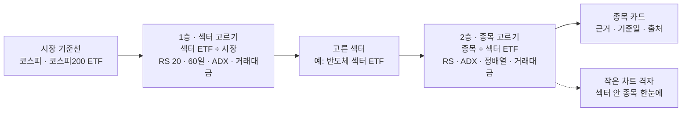
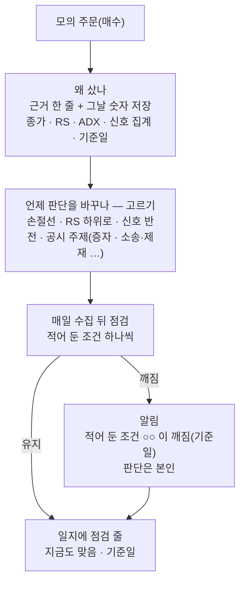
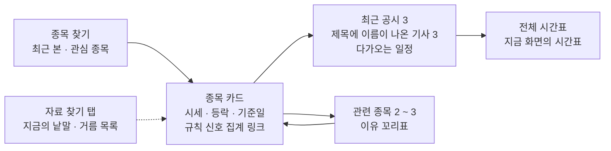

# 실사용자 피드백 — 섹터 · 종목 선정, 투자 근거, 투자 정보 리서치 화면 조사서 v0.1

| 문서 정보 | |
|---|---|
| **판 · 상태** | v0.1 · 초안(검토 전) |
| **구분** | 조사 — 실사용자 피드백 여섯 + 투자 정보 리서치 화면 피드백 둘의 근거(실제 서비스 꼴 · 규제 원문 · 사용자 친화성 차별점 · 역할 나눔 · 정할 것 — 구현 · 화면 설계는 하지 않음) |
| **작성** | 이동원(팀장) |
| **검토** | 검토 전. 신호 · 손절익절 규칙은 신장환 님, 모의 주문 · 성과는 강민석 님, 자산배분 · 위험은 오준영 님 영역이라 그쪽 내용은 모두 「의견 · 물을 것」 이다 — 반영할지 · 언제 할지는 주담당이 정한다 |
| **최종 수정** | 2026-10-15 (KST) |
| **기준** | 원문 조회 2026-10-14(KST — 웹 출처는 모두 이 날 조회) · 코드 사실은 `main` `4977a12` 읽기만. 같은 시각 다른 작업이 고치는 파일 다섯(`public/js/core.js` · `main.js` · `gnbmore.js` · `public/css/qurious.css` · `tests/test_nav_dashboard_shell.py`)은 도움말 한 줄(`core.js:280`) 말고는 판정에 쓰지 않았다 |
| **관련 문서** | [순위 화면 · 종목 목록 · 종목 비교 조사](순위화면-종목목록-종목비교-조사.md)(같은 피드백의 순위 · 종목 목록 · 앱 흐름 쪽) · [자동매매 직접 전략 · 투자 성향 조사](자동매매-직접전략-투자성향-조사.md)(직접 전략 입력 · 투자 성향 진단 — 7절 끝) · [개별 종목 · 투자 근거 · 익절 손절 조사서](개별종목-투자근거-익절손절-조사.md)(이 글에서 「앞선 조사서」 — 종목 근거 서랍 L4 · 규제 낱말 <표 15> · 현업 꼴 일곱 <표 7>) · [상품 차트 · 근거 설명 조사서](상품차트-근거설명-조사.md)(TradingView 표시 의무 3.2절) · [ETF 범위 조사서](ETF범위-보여주는방식-조사.md). 겹치는 결론은 다시 조사하지 않고 가리킨다 |
| **최근 개정** | 새 문서 |

> **이 문서로 알 수 있는 것**
>
> 1. 피드백 여섯마다 — 얼마나 흔한 고통인가 · 실제 서비스는 어떻게 푸나 · 우리 앱은 어디까지 왔나(2 · 3절)
> 2. 같은 섹터 안 강한 종목 · 약한 종목을 무엇으로 가르나 — ADX · RS · RRG 의 원문과 한계(4절)
> 3. 「매수 · 매도 · 보유」 를 보여 주려면 어떤 꼴 · 낱말이어야 하나(5절)
> 4. 차트 캡처 · 조건 설정 · 포트폴리오 관리를 사용자 친화적으로 푸는 꼴(6 · 7 · 8절)
> 5. 투자 정보 리서치 화면을 「종목 위주」 로 고치는 계획 안 셋(9절)
> 6. 차별점 다섯 · 역할 나눔 · 정할 것(10 · 11 · 12절)

---

## 요약 5줄

1. 피드백 여섯과 리서치 화면 피드백 둘은 뿌리가 같다 — **종목 하나를 기준으로 근거가 모이지 않는다.** 재료(시세 · 공시 77만(`public/js/research.js:10`) · 기사 · 일정 · 신호 · XAI · 군집)는 있으나 ADX · 섹터 안 상대 강도 · 작은 차트 격자 · 관심 종목 · 보유 종목 근거 기록은 없다(<표 2> — 있음 1 · 반쯤 6 · 없음 5). 국내 실투자자 설문에서도 근거 자료(증권사 보고서)를 덜 읽는 까닭 1 ~ 3위가 「길어서 · 필요한 정보를 찾기 어려워서 · 내용이 어려워서」 였다(2026-08 · 1,005명 · 기사 원문).
2. 섹터 안 강약은 실무에서 **종목 ÷ 기준선(상대 강도 · RS)** 과 그 흐름(RRG)으로 가르고, **ADX 는 방향이 아니라 추세의 세기만** 잰다(Wilder 14기간 · 25 위 강한 추세 · 20 아래 추세 없음 · 그 사이 회색 지대 · 지연 · 휩소 — StockCharts 원문). 그래서 「섹터 강약 표」 는 RS · ADX · 이동평균 정배열 · 거래대금을 한 점수로 뭉치지 않고 **열로 나눠** 보여야 근거가 된다(4절).
3. 「차트를 일일이 캡처」 는 현업이 **스크리너 결과를 작은 차트 격자로** 바꿔 푼다(TradingView 스크리너 차트 보기 2024-03-06 · finviz 차트 보기 2026-07-28). TradingView 자료는 표시 전용 사용권 · 배포 금지 · 캡처 게시 때 표시 의무가 있어, 캡처를 저장하지 말고 **우리 자료로 그리는 것**이 맞다(6절).
4. 「매수 · 매도 · 보유」 는 자본시장법상 **「투자판단」(종목 · 취득·처분 · 시기)** 에 관한 조언이다(제6조 제7항). 모두에게 같은 값을 보이는 **「규칙 신호 집계」**(매수 쪽 조건 n · 매도 쪽 m · 규칙 이름 · 기준일)로 써야 개별성 없는 정보가 된다. 10-14 에 생긴 의견 규칙(`app/services/opinion.py`)은 **보유 여부를 입력으로** 받으므로 종목 검색에 그대로 띄우면 특정 투자자 상대 권유로 읽힐 수 있다(5절 · 추정 — 법률 자문 아님).
5. 리서치 화면은 결과마다 종목 이름표를 셋까지 이미 붙이지만 **뉴스는 6자리 코드로 보이고**(`public/js/research.js:282-283`) 종목 중심 입구가 거름 칸 안에 숨어 있다. 추천은 **「종목 먼저」 첫 화면(안 A)** — 서버 먼저(뉴스 이름표에 종목 이름 · 관련 종목 2 ~ 3개와 이유 꼬리표) · 화면은 Figma 결정 뒤 · 대략 3 ~ 4 세션(9절).

## 남은 확인

조사 때 「확인할 것」 으로 남긴 다섯이다. 아직 확인하지 않았다 — 확인하면 이 절에 결과를 적는다.

1. **첨부 파일** — 피드백 주인의 첨부를 받으면 3절 해석을 다시 맞춘다(지금은 채팅 글만) — 확인 전.
2. **의견 규칙을 화면에 띄울 계획** — `opinion.py`(P01-④-2)의 결과를 어느 화면이 보이는지. 띄운다면 5.2절 꼴(장부 기록 · 과거형 · 보유 여부를 쓰지 않는 종목 검색)을 강민석 님 이슈로 묻는다 — 확인 전.
3. **업종 칸** — KIND 상장법인 목록 다운로드에는 업종 · 주요제품 칸이 있다(칸 이름 확인 · 조회 2026-10-14). 우리 종목 검색은 그 다운로드를 이미 받지만 회사명 · 종목코드 · 시장구분만 쓴다(`app/services/krx_companies.py:7-9` · `:21` — 업종 읽기 0건). 업종 값은 한국표준산업분류 꼴 낱말(예: 「특수 목적용 기계 제조업」 — 글자 깨짐을 풀어 읽은 것이라 중간)이라 섹터 묶음으로 옮기는 대응표가 필요하다 — 섹터 강약 표 · 관련 종목의 전제 — 확인 전.
4. **뉴스 이름표 정밀도 기록** — 표본 200 · 목표 0.9(`collector/tagging.py:18`)를 잰 결과가 있는지. 관련 종목 기능의 전제다 — 확인 전.
5. **순서 원칙** — 「2차 로보 어드바이저 칸 앞에 아무것도 끼우지 않는다」(앞선 조사서 8절)를 이 문서의 줄(11절 M1 ~ M8)에도 그대로 둘지 — 확인 전.

## 정할 것(결정 전) — 4개씩 · 추천 첫 칸 · 근거는 12절 <표 21> · <표 22>

결정 전이다. 「정할 것 대장 번호」 는 팀장이 쓰는 결정 대장의 번호다(대장은 작업 파일이라 저장소에 두지 않는다).

| # | 물음 | 추천(첫 칸) | 정할 것 대장 번호 |
|---|---|---|---|
| 1 | 리서치 화면을 어떻게 고치나 | 안 A 「종목 먼저」 첫 화면(서버 몫은 세 안 공통이라 먼저) | D90-1 |
| 2 | 관련 종목 2 ~ 3개의 기준 | 「같은 글에 함께 나온 종목」 + 「같이 움직인 종목」 두 갈래 · 칩마다 이유 꼬리표 | D90-2 |
| 3 | 「매수 · 매도 · 보유」 를 어떤 꼴로 | 「규칙 신호 집계」 — 모두에게 같은 값 · 규칙 이름 · 기준일 · 보유 여부 안 씀 | D90-3 |
| 4 | 섹터 안 강약의 기준선 | 두 층 — 섹터 ETF ÷ 시장, 종목 ÷ 섹터 ETF · RS · ADX · 정배열 · 거래대금을 열로 | D90-4 |
| 5 | 작은 차트 격자를 어디에 | 섹터 강약 표 먼저 → 스크리닝 결과 · 보유 종목 · 관련 종목 | D90-5 |
| 6 | 포트폴리오 근거 관리 | 「근거 일지」 — 모의 주문 때 근거 한 줄 + 깨짐 조건 → 매일 점검 · 알림 | D90-6 |
| 7 | 조건을 쉽게 거는 꼴 | 미리 만든 조건 묶음 + 고른 종목 수 즉시 + 초보 · 중급 전환 | D90-7 |
| 8 | 차별점으로 내세울 것 | 10절 다섯(D1 ~ D5) — README · 발표에는 구현된 것만 | D90-8 |

---

## 1. 방법

- **피드백 원문** — 요청 원문 파일(작업 메모 — 저장소 밖)의 첫 원문(피드백 여섯)과 「이어 받은 원문 2」(리서치 화면 둘 — 조사 중에 범위에 더해져 9절로 다뤘다).
- **우리 파일** — 코드 검색(ADX · sector · screening · opinion · memo · alert · sparkline · favorite)과 해당 줄 읽기. 판정은 코드 읽기 판정이다. 의견 규칙(`app/services/opinion.py`)은 2026-10-14 커밋 `71cc94d` · `bb7d1de` 로 들어온 판을 읽었다.
- **바깥 원문** — StockCharts ChartSchool(ADX · Price Relative) · StockCharts 글(RRG) · TradingView 블로그 · 정책 페이지 · finviz 블로그 · 법령 조문 사본(casenote — 국가법령정보센터는 화면이 스크립트로 그려져 앞선 조사서와 같이 사본을 읽음) · 기사(한국경제 · SBS Biz) · 논문 초록(Journal of Finance — RePEc 요약). 네이버 증권은 robots.txt 가 막아 열지 않았다.
- **판정 말** — 있음(화면에서 그 일을 하고 결과가 실제 자료에서 나옴) · 반쯤(한쪽만 있거나 범위가 좁거나 고정 자료) · 없음. 앞선 조사서 <표 1> 과 같다.
- **확실도** — 높음 = 원문(공식 문서 · 법령 사본 · 우리 파일)을 직접 열었다 · 중간 = 기사 · 2차 자료 · 검색 요약이거나 둘을 맞춘 추정 · 낮음 = 원문을 못 열었거나 근거가 간접이다(<표 1>).
- **하지 않은 것** — github.com · GitHub API · `.env*` · 수집 DB(`data/collector/market.sqlite3`) 열기 · 시험 · 러너 · 증권사 API · 우리 코드 실행. **피드백 주인이 보낸 첨부 파일은 보지 못했다**(요청 원문 14줄 — 전해 받은 글에도 첨부가 없었다). 피드백 해석은 채팅 글만으로 했다.

<표 1> 확실도를 어떻게 매겼나

| 확실도 | 이 문서에서 | 예 |
|---|---|---|
| 높음 | 원문을 직접 열어 문장을 확인했다 | StockCharts ADX 「25 위 · 20 아래」 · 자본시장법 제9조 제4항 |
| 중간 | 기사 · 검색 요약으로 봤거나, 원문 둘을 맞춰 추정했다 | 키움 간편모드 170만(기사 원문) · 「우리에게 뜻하는 것」 같은 법 해석 |
| 낮음 | 원문을 못 열었거나 간접 근거뿐이다 | 피드백 여섯이 「얼마나 흔한가」 의 수치 · 국내 증권사의 작은 차트 격자 |

---

## 2. 지금 우리 앱 — 피드백 여섯에 닿는 것 (코드 읽기 · 기준 `main` `4977a12` · 2026-10-14)

<표 2> 피드백에 닿는 우리 기능 — 있음 · 반쯤 · 없음

| # | 기능 | 판정 | 지금 꼴 | 자리(파일:줄) | 닿는 피드백 |
|:-:|---|:-:|---|---|:-:|
| A1 | ADX · +DI · −DI 계산 | 없음 | 앱 코드 검색 0건. 용어사전 한 항목뿐(「ADX 25 이상이면 추세가 뚜렷함」) | `app/services/glossary_data/terms.json:2882-2900` | ① |
| A2 | 섹터 안 상대 강도(종목 ÷ 섹터 · 시장) · 순위 | 없음 | 섹터 카드 화면은 고정 자료 6섹터 · 평균 PER · PBR · 「긍정 · 중립 · 부정」 전망을 글자로 박아 둠. 도움말은 「산업별 상대 강도를 비교하세요」 라고 하나 계산이 없다 | `public/js/company.js:200-210` · `public/js/core.js:280` | ① |
| A3 | 섹터 ETF 비교 | 반쯤 | 미국 섹터 ETF 11종(XLK 등) 최근 값 표 — 국내 섹터 · 테마 ETF 비교는 없음. ETF 분류 규칙(자산군 · 묶음)은 상품 안내용으로 있음 | `app/services/sync_scheduler.py:50-62` · `app/routes/macro.py:47-59` · `public/app.html:2521-2528` · `app/services/etf_classify.py:1-15` | ① |
| A4 | 종목 군집화(같이 움직인 묶음) | 있음 | 상관 거리 + KMeans · 31종목(업종과 견줌) 또는 분봉 수집 종목 401(ETF 제외) — 「같이 움직였나」 이지 「누가 더 강한가」 가 아니다 | `app/services/stock_clusters.py:1-12` · `app/routes/clusters.py:1-6` | ① 일부 · 리서치 ⑦ |
| A5 | 스크리닝(신호 점수 · 신뢰도) | 반쯤 | 31종목 고정 · 업종은 사람이 단 글자(「IT/반도체」 …) | `app/services/stock.py:28-34` · `:62` | ① ③ |
| A6 | 여러 종목 작은 차트 격자 · 미니 차트 | 없음 | 코드 검색(sparkline · mini chart · small multiple) 0건 — 차트는 한 번에 한 종목 | 검색 결과 0 | ② |
| A7 | 조건 설정 | 반쯤 | 자유 산식 · 백테스트 템플릿 4종 + 숫자 칸 · 손절 · 익절 % — 「이 조건에 맞는 종목 수」 즉시 보기 · 미리 만든 조건 묶음 · 쉬운 말 조건은 없음 | `app/routes/stocks.py:1066-1125`([자동매매 조사](자동매매-직접전략-투자성향-조사.md) 2절 <표 2>) · `public/js/formula.js:134` | ③ |
| A8 | 고른 종목의 근거 보기 | 반쯤 | 근거가 화면 7곳에 흩어짐(앞선 조사서 <표 3> 1행) · 다중 주기 신호는 규칙 근거 문장 칸이 있음 | `app/models/signal.py:38`(`reasons`) | ④ |
| A9 | 매수 · 매도 · 보유 표시 | 반쯤 | XAI 예측 「매수 · 관망 · 매도 + 확률 + 기준선 미달 경고」(31종목) · **의견 변환 규칙(2026-10-14 새로)** — 신호 · 신뢰도 · **보유 여부** · 위험 관문 → 매수 · 매도 · 보유 · 관망(θ = 0.6) · 자동매매 신호 기록용 · 종목 검색에서 바로 보이는 곳은 없음 | `app/services/opinion.py:15-51` · `app/models/signal.py:41-42` · `app/routes/ml.py:311-333` | ⑤ |
| A10 | 관심 종목 · 즐겨찾기 | 없음 | 코드 검색 0건 | 검색 결과 0 | ⑥ · 리서치 ⑧ |
| A11 | 보유 종목마다 처음 근거 · 점검 기록(투자 일지) | 없음 | 모의 주문의 `reason` 은 「체결 못 하는 까닭」 뿐 · 메모는 리밸런싱 입출금 · 산식 판에만 | `app/services/paper_trading.py:249` · `app/models/rebalance.py:74` · `app/models/formula.py:39` | ⑥ |
| A12 | 알림 | 반쯤 | 주문 체결 · 잔고 부족 · 오류 · 위험 정지 알림만 — 가격 · 근거 깨짐 · 손절선 닿음 알림은 없음 | `app/routes/stocks.py:798-967` | ⑥ |

**합계** — 있음 1(A4) · 반쯤 6(A3 · A5 · A7 · A8 · A9 · A12) · 없음 5(A1 · A2 · A6 · A10 · A11).

- **A9 는 규제 쪽에서 눈여겨볼 곳이다.** 의견 규칙이 「보유 여부」 를 입력으로 받으므로(`opinion.py:35-49`), 이것을 사람에게 보이면 「그 사람의 계좌에 맞춘 의견」 이 된다 — 자본시장법이 투자자문에서 빼 주는 「개별성 없는 조언」(제7조 제3항)과 반대쪽이다(5절). 자동매매 장부 안에서 쓰는 것과 종목 검색 화면에 띄우는 것은 다르게 다뤄야 한다.
- **A2 의 「긍정 · 부정」 은 고정 문자열이다.** 계산이 아닌 전망 낱말이 실제 서비스 화면에 남으면 근거 없는 의견이 된다(5.4절 <표 8> 에 더함).

---

## 3. 피드백 여섯 — 한 표로

피드백 여섯을 **낱낱이** 잰 국내 설문은 찾지 못했다(근거 없음 · 확인 필요). 가까운 숫자는 셋이다 — 모두 원문(기사 · 보고서)으로 봤고 설문 원자료 · 문항(복수 응답인지)은 못 봤다.

- **실투자자 1,005명**(30 · 40대 주식 · 펀드 · ETF 투자자 · 리멤버 리서치 · 2026-08-27 ~ 29 · 서울신문 의뢰) — 투자 정보를 증권사 보고서에서 얻는다 41.9% · 유튜브 등 영상 29.7%. 보고서를 덜 읽는 까닭은 「길어서」 39.6% · 「필요한 정보를 찾기 어려워서」 28.8% · 「내용이 어려워서」 25.2% · 「불신」 14.9%.
- **성인 1,000명**(20 ~ 59세 · 피앰아이 · 2026-06-11 ~ 17)의 주식 정보 출처 — 유튜브 37.4% · SNS 16.2% · 지인 추천 16.2% · AI 15.6% · 증권사 보고서 14.6%.
- **유사투자자문 관련 소비자 상담** — 2017년 1,855건 → 2020년 16,491건(한국소비자원 집계 · 자본시장연구원 이슈보고서 21-17 · 2021-09-14). 리딩방은 「주식투자 경험이 부족한 개인투자자를 대상으로」 종목 추천 · 매매기법을 공유한다(같은 보고서).

뜻 — 근거 자료는 있는데 **길고 · 찾기 어렵고 · 어렵다**(피드백 ④ · 리서치 화면 피드백과 같은 고통). 그리고 「무엇을 살까」 를 바로 말해 주는 곳에 수요가 몰린다(피드백 ⑤ 의 수요이자 그 꼴의 위험 — 5절). 그 밖의 피드백은 **증권사 · 해외 서비스가 같은 고통을 기능으로 따로 고친 흔적**을 간접 근거로 적는다.

<표 3> 피드백 여섯 × 실제 서비스 꼴 · 우리 앱의 지금 · 빈칸 · 제안 · 규제 주의

| # | 피드백 | 얼마나 흔한가(간접 근거) | 실제 서비스 꼴 | 우리 앱 지금 | 빈칸 | 제안(절) | 규제 · 약관 주의 | 확실도 |
|:-:|---|---|---|---|---|---|---|:-:|
| ① | ADX 로 추세는 보지만 같은 섹터 안 강한 · 약한 종목을 나눠 골라야 한다 | 「같은 지수 30종목 안에서 좋은 이름 · 나쁜 이름 가르기」 가 RRG 의 대표 쓰임으로 따로 글이 있다(StockCharts 2018-11-13). 학술: 개별 종목 모멘텀의 상당 부분이 산업 모멘텀(Moskowitz · Grinblatt 1999 — 미국 · 초록) — 캐나다에서는 재현 안 됨(Cleary 외 2005) | StockCharts RRG(지수 구성 종목을 사분면에) · Price Relative(종목 ÷ 기준선) · Seeking Alpha 같은 섹터 안 비교(앞선 조사서 <표 4>) | A1 없음 · A2 없음(고정 자료) · A3 미국 섹터 ETF 만 · A4 군집 | 업종 칸 · 섹터 기준선 · RS · ADX 계산 · 섹터 안 순위 | 섹터 강약 표 — 두 층(4.2절) | 「강한 종목」 은 잰 값 · 기간 · 기준선 이름을 함께. 「주도주 · 대장주 · 유망」 금지(<표 8>) | 중간 |
| ② | 차트를 일일이 캡처해 확인해야 한다 | TradingView(2024-03-06) · finviz(2026-07-28)가 「스크리너 결과를 차트로」 를 따로 내놓았다. 국내 수치는 근거 없음 | 스크리너 결과의 작은 차트 격자 · 기간 · 봉 크기 · 차트 꼴 고르기 | A6 없음 | 작은 차트 격자 · 근거 카드 안 그림 | 공용 「작은 차트 격자」(6절) | TradingView 자료는 표시 전용 · 배포 금지 · 캡처 게시 때 「TradingView」 표시 10pt 이상 → 캡처 저장 대신 우리 자료로 그림 | 높음(기능 · 약관) · 낮음(흔한 정도) |
| ③ | 조건을 사용자 친화적으로 설정하고 싶어도 못 한다 | 키움이 초보용 「간편모드」(2025-10 출시 · 누적 170만 · 2026-08-12 기준)에서 조건검색을 「핵심 조건 위주로 간소화」 했다(한국경제 2026-08-19). 토스증권 「주식 골라보기」(2024-07 PC) 「기업가치, 수익성, 배당 등 … 키워드들을 필터로 … 몇 번의 클릭만으로」(SBS Biz 2024-07-18) | 미리 만든 조건 묶음 · 간편 ↔ 기존 모드 전환 · 키워드 필터 | A7 반쯤(산식 · 템플릿 4 · 숫자 칸) · A5 31종목 | 묶음 · 고른 종목 수 즉시 · 초보 · 중급 나눔 | 조건 묶음 + 개수 즉시 + 모드 전환(7절) | 묶음 이름에 「저평가 · 유망」 같은 판단 낱말 대신 조건 그대로(「PER 10 미만 · 3년 매출 증가」) | 높음(기사 원문) · 중간(우리 판정) |
| ④ | 종목을 골라도 근거를 확인하기 어렵다 | 실투자자가 증권사 보고서를 덜 읽는 까닭 — 「길어서」 39.6% · 「필요한 정보를 찾기 어려워서」 28.8% · 「내용이 어려워서」 25.2%(2026-08 · 1,005명). 근거 없이 종목을 「찍어 주는」 유사투자자문 관련 상담 2017년 1,855건 → 2020년 16,491건 · 금융위 2024-08 개정(앞선 조사서 6.1) | 한 종목 한 화면 · 점수 쪼개기 · 칸 정의 각주 · 기준일(앞선 조사서 <표 7>) | A8 반쯤 — 7곳에 흩어짐 | 종목 카드 | 종목 카드 = 앞선 조사서 L4 「종목 근거 서랍」 과 같은 부품(9.5절 · 10절 D1) | 고지 문안(앞선 조사서 6.3) | 높음(우리 코드) · 중간(현업) |
| ⑤ | 종목을 검색하면 매수 · 매도 · 보유 중 무엇인지 보여 주는 기능이 없다 | TradingView 기술 등급(Strong Sell ~ Strong Buy) · 증권사 투자의견 · Seeking Alpha 등급 — 현업에 흔한 꼴(앞선 조사서 <표 4> · <표 5>). 성인 주식 정보 출처 1위가 유튜브 37.4%(2026-06 · 1,000명) — 「무엇을 살까」 를 바로 말해 주는 곳에 수요가 몰린다(해석 — 중간) | 지표마다 매수 · 중립 · 매도를 나열하고 개수로 등급 | A9 반쯤 — XAI(31종목) · 의견 규칙(10-14) · 검색에는 없음 | 종목 검색 · 카드에서 보이는 신호 집계 | 「규칙 신호 집계」(5.3절) | 제6조 제7항 투자판단 · 제9조 제4항 투자권유 · 제7조 제3항 개별성 없는 조언 · 제101조 유사투자자문업 — 모두에게 같은 값 · 보유 여부 반영 안 함 · 낱말 | 높음(조문) · 중간(해석) |
| ⑥ | 포트폴리오를 계속 관리해야 하는데 그 근거와 차트를 뽑아 주면 좋겠다 | Simply Wall St 가 「내러티브」(처음 근거 · 가정 · 적정가)와 갱신 기록을 남기게 하고 「언제 사고 · 들고 · 팔지 알기 위해」 쓰라고 안내한다. TradingView 는 관심 목록 · 저장 필터 뉴스 알림 | 근거 노트 + 갱신 기록 + 알림 | A10 없음 · A11 없음 · A12 반쯤 | 근거 일지 · 깨짐 알림 · 보유 종목 차트 격자 | 근거 일지(8절) | 알림을 「매도하세요」 가 아니라 「적어 둔 조건 ○○ 이 깨짐(기준일) — 판단은 본인」 으로 | 중간 |

---

## 4. 섹터 안 상대 강도 — 원문과 한계

### 4.1 지표마다 무엇을 재고 어디까지 믿나

<표 4> 섹터 안 강약을 가르는 지표 — 원문 기준과 한계

| 지표 | 무엇을 재나 | 원문 기준 | 한계(원문) | 우리 화면에서 | 확실도 |
|---|---|---|---|---|:-:|
| ADX(평균 방향 지수) · +DI · −DI | ADX = **추세의 세기**(방향 아님) · +DI · −DI = 방향(+DI 가 크면 사는 쪽 우세) | Wilder 1978 · 기본 14기간. 「Wilder suggests that a strong trend is present when ADX is above 25 and no trend is present when ADX is below 20」 · 「gray zone between 20 and 25」 · 「Many technical analysts use 20 as the key level」 | 「a fair amount of lag」(평활 탓 지연) · 「filter as many good signals as bad」 · 휩소 · 「Stocks with low volatility may not generate signals」 · 자료 길이에 따라 값이 다름(30기간 ≠ 150기간) | 열 하나: ADX 값 + 「추세 있음 · 회색 · 없음」 글자 + 방향(+DI · −DI 중 큰 쪽). **ADX 높음 ≠ 오른다** 를 칸 머리에 | 높음 |
| 상대 강도(Price Relative · RS) | 종목 ÷ 기준선 — 오르면 기준선보다 강함 | 「Price Relative = Base Security / Comparative Security」 · 섹터 · 지수와 견주는 데 씀 | 값 자체는 종목끼리 견줄 수 없음(「cannot be compared from one security to the next」) → **n일 변화율 · 순위**로 견준다 · 가격이 내려도 RS 는 오를 수 있음 | 열: 섹터 대비 20일 · 60일 초과 수익(%p) + 섹터 안 백분위 | 높음 |
| RRG(상대 회전 그래프) | RS 의 추세(JdK RS-Ratio) × 그 속도(JdK RS-Momentum) — 100 기준 사분면 | 선도(둘 다 100 위) → 약화 → 부진 → 개선, 보통 시계 방향. 지수 30종목을 한 그림에 놓고 강한 · 약한 이름을 가름(2018-11-13 글) | 추세 추종이라 늦다 · 한쪽에 머무는 회전 · 갈고리 · 글쓴이도 결정 전에 가격 차트 · 지지선을 다시 본다. **JdK RS-Ratio · RS-Momentum 은 등록 상표**(RRG Research) · 계산식 원문은 이 조사에서 못 봄 | 그림은 선택. 쓴다면 「RRG」 상표 대신 우리 이름(「상대 강도 흐름 지도」)과 우리 근사식을 밝힘 | 중간(사분면 · 상표 높음 · 계산식 낮음) |
| 모멘텀 순위 | n개월 수익률 순위 | 산업 모멘텀이 개별 종목 모멘텀의 큰 몫을 설명(미국 · Journal of Finance 54(4) · 1249-1290 · 초록) | 캐나다 재현 실패(Cleary · Doucette · Schmitz 2005) · 요인 모멘텀이 산업 모멘텀을 흡수한다는 후속 연구(Arnott 외 2018 — 검색 요약) | 열: 3 · 6 · 12개월 수익률(섹터 안 순위) — 「과거 수익률 순위 · 미래 보장 아님」 | 중간 |
| 이동평균 정배열 | 단기 > 중기 > 장기 이동평균(예 20 > 60 > 120일) | 국내 관행 용어 — 정의 원문은 이 조사에서 못 엶. StockCharts 는 ADX 신호를 50일 이동평균으로 거르는 예를 든다(「Only buy signals are used when trading above the 50-day moving average」) | 횡보장에서 자주 뒤집힘 · 늦음 | 열: 정배열 · 역배열 · 섞임 글자 | 낮음(용어 원문) · 높음(계산) |
| 거래대금 | 가격 × 거래량 — 사고팔 수 있나 | 원문 기준 없음(관행) | 거래대금이 적으면 RS 순위가 몇 건 거래의 착시일 수 있음(추정) | 열: 20일 평균 거래대금 · 하한 미만은 흐리게 · 숨기지 않음 | 낮음 |

**읽는 법** — ADX 와 RS 는 다른 것을 잰다. 「추세가 뚜렷한가(ADX)」 와 「섹터보다 나은가(RS)」 를 한 점수로 섞으면 사용자가 「왜 이 종목인가」 를 셀 수 없다(앞선 조사서 <표 7> ② 「점수를 셀 수 있게 쪼갬」). 그래서 열로 나누고, 마지막 열에 「조건 충족 n / 4」 만 둔다.

### 4.2 제안 — 섹터 강약 표 (두 층)

피드백 주인은 **ETF 섹터 선정**과 **투자 기업 선정**을 함께 어려워했다. 두 일을 한 그림의 두 층으로 둔다.

<그림 1> 두 층 — 섹터를 고르고(섹터 ETF ÷ 시장), 섹터 안에서 고른다(종목 ÷ 섹터 ETF)

그림 원문은 Mermaid — Figma 판으로 다시 그리는 일은 남았다.

<표 5> 섹터 강약 표 — 열 제안 (한 행 = 섹터 안 한 종목 · 1층은 한 행 = 섹터 ETF 하나)

| 열 | 값 | 까닭 | 자료 |
|---|---|---|---|
| 종목 · 작은 차트 | 이름 · 60일 선 · 섹터 ETF 선(점선) | 캡처 대신(6절) | 수집 DB 일봉 |
| RS 20일 · 60일 | 섹터 대비 초과 수익 %p · 섹터 안 백분위 | 강약의 본뜻 | 일봉 + 섹터 ETF 일봉 |
| ADX(14) · 방향 | 값 · 「추세 있음 · 회색 · 없음」 · +DI / −DI 중 큰 쪽 | 피드백 주인이 이미 쓰는 지표 | 일봉(고가 · 저가 · 종가) |
| 정배열 | 정 · 역 · 섞임 | 추세의 꼴 | 일봉 |
| 거래대금 | 20일 평균 | 유동성 | 일봉 |
| 조건 충족 | n / 4 | 셀 수 있는 요약 — 점수 아님 | 위 넷 |
| 기준일 · 기준선 | 「2026-10-14 종가 · 기준선 ○○ ETF」 | 근거 표시 | — |

**전제(확인 필요)** — ① 종목 → 섹터 대응: 수집 DB 에 업종 칸이 없다(수집기 코드 검색에 업종 · industry · sector 칸 0건). KIND 상장법인 목록 다운로드에는 업종 · 주요제품 칸이 있고 우리 앱이 이미 그 파일을 받는다(`app/services/krx_companies.py:21` — 업종은 읽지 않음). 업종 값이 한국표준산업분류 꼴이라 섹터(반도체 · 2차전지 …)로 묶는 대응표를 사람이 한 번 만들어야 한다. 섹터 ETF 구성 종목(PDF)은 수집하지 않는다(확인 필요). ② 섹터 기준선: 국내 ETF 일봉은 수집 DB `etf_daily` 에 있다(`app/services/etf_classify.py:4-5`). 섹터 ETF 를 이름 규칙으로 고르는 방식은 ETF 분류 규칙과 같은 길이다(중간 — DB 를 열지 않아 어떤 섹터 ETF 가 있는지는 못 봄). ③ 지표 계산 함수(ADX · RS)를 어디에 두나 — 인디케이터는 신장환 님 영역이라 이슈로 묻는다(11.2절).

---

## 5. 「매수 · 매도 · 보유」 표시 — 규제 원문과 꼴

앞선 조사서 6절이 제7조 제3항(개별성 없는 조언) · 금융위 2024-08 유사투자자문업 개정 안내 · 금융소비자보호법 제22조(광고) · 피할 낱말 <표 15> 를 이미 다뤘다. 여기서는 **「매수 · 매도 · 보유」 라는 표시 자체**가 어느 조문에 닿는지만 더한다.

### 5.1 원문

<표 6> 「매수 · 매도 · 보유」 표시에 닿는 조문 (casenote 조문 사본 · 조회 2026-10-14)

| 조문 | 문언(짧게) | 표시된 판 | 우리 표시에 닿는 곳 | 확실도 |
|---|---|---|---|:-:|
| 자본시장법 제6조 제7항 — 투자자문업 | 「금융투자상품 … 의 가치 또는 금융투자상품등에 대한 투자판단 … 에 관한 자문에 응하는 것을 영업으로 하는 것」 · 투자판단 = 「종류, 종목, 취득·처분, 취득·처분의 방법·수량·가격 및 시기 등에 대한 판단」 | 시행 2021-12-21 판(사본 표시 — 최신 판 여부 확인 필요) | 「매수 · 매도 · 보유」 는 문언상 **종목의 취득 · 처분 · 시기 판단**이다 | 높음(문언) |
| 같은 법 제7조 제3항 | 개별성 없는 조언(다수인 대상 · 일방적)은 투자자문업으로 보지 않음 | 시행 2024-08-14 | 모두에게 같은 값 · 일방적 표시면 예외 쪽 | 높음(앞선 조사서) |
| 같은 법 제9조 제4항 — 투자권유 | 「특정 투자자를 상대로 금융투자상품의 매매 … 의 체결을 권유하는 것」 | 시행 2026-03-17 판 | **보유 여부 · 계좌를 입력으로 한 의견**은 「특정 투자자 상대」 로 읽힐 수 있다 | 높음(문언) |
| 같은 법 제101조 — 유사투자자문업 | 「투자자문업자 외의 자로서 고객으로부터 일정한 대가를 받고 … 개별성 없는 조언」 · 금융위 신고 · 신고 유효기간 5년(⑥) | 시행 2024-08-14 판 | 대가(유료)가 붙으면 개별성 없는 정보도 신고 대상 | 높음(문언) |

### 5.2 우리에게 뜻하는 것 (추정 — 법률 자문 아님)

- 지금은 무료 · 교육 · 모의라 투자자문업(「영업으로」) · 유사투자자문업(「대가를 받고」)의 직접 대상은 아니라고 본다(추정). 「실제 서비스」 로 갈 때 갈림길은 둘이다 — **유료화**(→ 유사투자자문 신고) · **개인 맞춤 의견**(→ 투자자문업 등록 · 로보어드바이저 요건 — 앞선 조사서 6.2 미확인 그대로).
- 개별성의 경계를 **화면 규칙**으로 둔다.
  - (가) 종목 검색 · 섹터 강약 표 · 종목 카드의 신호는 **보유 여부 · 성향 · 계좌를 입력으로 쓰지 않는다** — 누가 보든 같은 값.
  - (나) 보유 여부를 쓰는 의견(`opinion.py` — `buy_new` · `sell_held` · `hold_held` …)은 **모의 자동매매 장부 안의 「규칙이 낸 주문 이유 기록」** 으로만 보인다 — 과거형 · 규칙 키 풀이(예: `buy_new` → 「미보유 · 매수 신호 · 신뢰도 0.6 이상이라 규칙이 매수 주문을 냈음」).
  - (다) 근거 자리마다 고지(앞선 조사서 6.3 문안).
- 증권사 리서치의 「투자의견」 은 인가받은 금융투자회사가 내고, 투자의견 비율 · 목표주가 괴리율을 공시하게 돼 있다고 보도된다(2017-09 괴리율 공시 — 한국경제 · 기사만 봄 · 규정 원문 미확인 · 중간). 우리가 그 낱말을 빌리면 같은 무게로 읽히므로 **「투자의견」 이라는 말을 쓰지 않고**, 대신 그 공시의 정신(과거 분포 · 적중을 함께)을 빌린다(5.3절 셋째 줄).

### 5.3 꼴 — 「규칙 신호 집계」

<표 7> 「매수 · 매도 · 보유」 를 보이는 꼴 비교

| 꼴 | 예 | 장점 | 위험 | 판단 |
|---|---|---|---|---|
| 큰 배지 하나 | 「매수」 | 가장 쉽다 | 권유로 읽힘 · 왜인지 셀 수 없음 · 틀려도 모름 | 피함 |
| 등급 낱말 | 「Strong Buy ~ Strong Sell」(TradingView 기술 등급) | 현업에 흔함 | 「강력 매수」 낱말(앞선 조사서 <표 15>) | 낱말만 빼고 구조를 빌림 |
| **규칙 신호 집계(추천)** | 「규칙 신호 — 매수 쪽 3 · 중립 2 · 매도 쪽 1 (규칙 6개 · 일봉 · 2026-10-14 종가)」 + 펼치면 규칙마다 값 · 문턱 · 이유 문장(다중 주기 신호 `reasons` 재사용 — `app/models/signal.py:38`) + **「이 규칙들이 지난 1년 매수 쪽 신호를 낸 뒤 20일 수익 분포 · 표본 n · 비용 반영」** + 고지 | 셀 수 있음 · 누구에게나 같은 값 · 틀린 기록도 보임 | 과거 분포를 「적중률 n%」 한 숫자로 줄이면 과장(앞선 조사서 <표 15>) — 표본 · 기간 · 비용을 늘 같이 | **추천** |
| 개인 맞춤 의견 | 「당신은 보유 중이니 매도」 | 쓰기 편함 | 특정 투자자 상대 권유(제9조 제4항) | 모의 장부의 과거형 기록으로만(5.2 (나)) |

「지난 1년 신호 뒤 수익 분포」 는 앞선 조사서가 「안 됨」 으로 둔 **예측 적중 대조**(<표 2> 9행 — 신호는 매일 기록되나 대조 화면 없음)와 같은 일이다. 신호 기록과 n일 뒤 실제 수익을 잇는 자료는 데이터 파트가 댈 수 있다.

### 5.4 피할 낱말 — 앞선 조사서 <표 15> 에 더할 줄

<표 8> 더할 줄만 (앞선 줄은 그 표 그대로)

| 피할 말 | 까닭 | 바꿀 말 | 지금 있는 자리 |
|---|---|---|---|
| 「투자의견」 | 인가받은 증권사 리서치의 말 — 같은 무게로 읽힘 | 「규칙 신호 집계」 | 새로 쓸 때 |
| 「긍정 · 중립 · 부정」 전망 | 계산 없는 고정 글자 | 「섹터 대비 RS 상위 · 중간 · 하위(20일 · 기준선 ○○)」 또는 지움 | `public/js/company.js:202-207`(섹터 카드 — 주인 없는 화면 → 이동원) |
| 「매수하세요 · 보유하세요 · 계속 들고 가세요」 | 행동을 권함 | 「매수 쪽 조건 n / m」 · 「적어 둔 보유 조건 유지」 | 새로 쓸 때 |
| 「주도주 · 대장주 · 유망 종목」 | 판단 낱말 · 근거가 안 보임 | 「섹터 안 RS 상위 n%(기간 · 기준선)」 | 새로 쓸 때 |
| 「강한 종목 · 약한 종목」(잰 값 없이) | 무엇이 강한지 흐림 | 「섹터 대비 상대 강도 상위 · 하위」 + 기간 | 섹터 강약 표 |
| 「매도 신호입니다(알림)」 | 행동 지시로 읽힘 | 「적어 둔 조건 ○○ 이 깨졌습니다(기준일) — 판단은 본인에게 있습니다」 | 근거 일지 알림(8절) |

---

## 6. 「차트 일일이 캡처」 를 없애는 꼴

### 6.1 실제 서비스

<표 9> 여러 종목을 한눈에 — 작은 차트 격자의 실제 꼴

| 서비스 | 꼴(원문) | 기간 · 꼴 고르기 | 누구에게 | 확실도 |
|---|---|---|---|:-:|
| TradingView 스크리너 「차트 보기」 | 「data is presented in charts with price change on the selected interval and trading volume」(2024-03-06 블로그) | 1일=5분봉 · 5일=15분 · 1달=1시간 · 3달=4시간 · 6달 · 연초 이후=1일 · 1년=1주 · 5년 · 전체=1달 · 영역(기본) · 캔들 · 선 | 스크리너 사용자 전체(요금제 구분은 글에 없음) | 높음(기능) · 쪽당 개수는 글에 없음 |
| finviz 스크리너 「Charts」 | 「see 50 stocks as charts in a single view」 · 「easier to scan price action, recognize patterns, and identify the stocks that deserve a closer look」(2026-07-28 블로그) | 미리 정한 기간(일 · 주 · 월 …) · 봉 크기 · 차트 높이 · 막대 수 슬라이더 · 저장한 차트 서식 | 「Finviz members」 · 링크는 Elite | 높음 |
| TradingView 관심 목록 고급 보기 · News Flow | 관심 목록의 섹터 분포 · 뉴스 탭 · 관심 목록 · 종목으로 거른 뉴스 · 저장한 거름으로 뉴스 알림 | — | 전체 | 중간(도움말 검색 요약 · 블로그) |
| 토스증권 PC | 관심 종목 모바일 · PC 동기화 · 「종목 상세 패널 커스텀」 · PC 차트를 모바일에서 이어 보기(SBS Biz 2024-07-18) | — | 전체 | 높음(기사 원문) |
| 키움 · 미래에셋 · 인베스팅닷컴 | 작은 차트 격자 원문은 이 조사에서 확인 못 함 | — | — | 낮음 |

### 6.2 약관 — 캡처를 저장 · 재배포하지 않는 까닭

<표 10> TradingView 정책(in.tradingview.com/policies · 조회 2026-10-14)

| 절 | 문언 | 우리에게 |
|---|---|---|
| 3절 — 자료 사용권 | 「licensed for exclusive display-only use」 · 자동 매매 · 가격 참조 · 주문 검증 금지 · 「any distribution of TradingView content」 금지 · 「creating products or services based on TradingView content」 금지 | TradingView 화면을 캡처해 근거 카드 · 일지에 저장하거나 남에게 보이는 기능은 만들지 않는다 |
| 4절 — 표시(Attribution) | 차트 캡처를 글 · 영상에 쓰면 「Attribution must include a reference to TradingView」 · 「clearly visible at all times」 · 「Font size should not be less than 10 PT = 13PX = 3.4MM」 · 어기면 영구 정지될 수 있음 | 사용자가 직접 캡처해 쓰는 것은 사용자 몫 — 우리 화면은 우리 자료로 그린다 |

**할 일** — 근거 카드 · 근거 일지 · 격자에 들어가는 그림은 **우리 수집 시세를 우리 앱 안에서 그린 것**이다(Lightweight Charts 를 쓰면 그 라이브러리의 표시 의무는 [상품 차트 조사서](상품차트-근거설명-조사.md) 3.2절). 일지에 남길 때는 **그림이 아니라 그날의 숫자**(종가 · RS · ADX · 신호 집계 · 기준일)를 저장하고, 볼 때 다시 그린다 — 캡처 파일이 쌓이지 않고 기준일도 남는다.

### 6.3 제안 — 공용 「작은 차트 격자」

- 한 칸 = 종목 이름 · 60일 선 · 기간 등락 · 섹터 기준선(점선) · 기준일. 칸을 누르면 종목 카드(9.5절).
- 쓰는 곳 차례 — 섹터 강약 표(이동원 화면) → 스크리닝 결과(신장환 님 화면 — 입구는 이슈 답 뒤) → 보유 종목(강민석 · 오준영 님 화면 — 이슈) → 관련 종목(리서치 화면).
- 성능 — 칸 20 ~ 50개를 모두 캔버스 차트로 그리면 무거울 수 있다(추정 · 확인 필요). 격자는 축 없는 SVG 선(스파크라인)으로, 종목 카드에서만 온전한 차트로 그리는 안을 시험으로 견준다.

---

## 7. 사용자 친화 조건 설정

<표 11> 조건을 쉽게 거는 꼴 — 실제 서비스 · 우리 제안

| 꼴 | 실제 서비스(원문) | 우리 제안 | 위험 | 확실도 |
|---|---|---|---|:-:|
| 미리 만든 조건 묶음 | 토스증권 「주식 골라보기」 — 「기업가치, 수익성, 배당 등 투자자들이 자주 검색하는 키워드들을 필터로」(SBS Biz 2024-07-18) · 키움 간편모드 조건검색 「핵심 조건 위주로 간소화」(한국경제 2026-08-19) | 묶음 5 ~ 8개 — 예 「섹터 대비 강함 + 추세 있음」 = 섹터 안 RS 상위 30% · ADX 20 이상 · 정배열. **묶음 이름은 조건 그대로** | 묶음 이름이 판단 낱말이 되기 쉬움(「저평가 성장주」 같은 이름을 토스가 쓴다는 개인 글이 있으나 원문 확인 못 함 — 낮음) | 높음 |
| 「이 조건이 고른 종목 수」 즉시 | 스크리너들이 결과 수를 보인다(화면 관행 — 이 조사에서 원문 확인 못 함) | 칩 · 슬라이더를 움직일 때마다 개수 · 0 이면 「어느 조건이 막았나」 를 조건별 개수로 | 조건마다 다시 세는 비용 — 31종목이면 가볍고, 전 종목이면 서버 집계 필요 | 중간 |
| 슬라이더 · 칩 | — | 숫자 칸 대신 범위 슬라이더 + 켜기 · 끄기 칩 | 정밀 입력이 필요한 중급자 → 숫자 칸을 접어 둠 | 낮음(원문 없음 · 설계 제안) |
| 쉬운 말 조건 | 이 조사에서 국내 원문 확인 못 함 | 「반도체에서 요즘 섹터보다 강한 종목」 → 우리 로컬 모델이 **조건 칩으로 바꿔 되보여 주고**, 사용자가 확인한 뒤에만 실행 · 칩 밖 조건은 만들지 않음 | 해석 틀림 · 모델 응답 시간 — 늘 칩으로 되보여 주는 것이 안전장치 | 낮음 |
| 초보 · 중급 나눔 | 키움 영웅문S# 「간편모드」 — 기존모드와 한 번에 전환 · 2025-10 출시 · 누적 170만(2026-08-12 기준) | 초보 = 묶음 · 칩만 / 중급 = 숫자 칸 · 자유 산식(지금 화면) | 두 판의 결과가 달라 보이면 혼란 → 같은 조건을 두 꼴로만 보임 | 높음 |

직접 전략 입력 · 투자 성향 진단은 같은 날 조사한 [자동매매 직접 전략 · 투자 성향 조사](자동매매-직접전략-투자성향-조사.md)의 몫이다 — 여기서는 「종목을 고르는 조건」 만 다뤘다.

---

## 8. 포트폴리오 계속 관리 — 근거 일지

### 8.1 실제 서비스

<표 12> 보유 종목의 근거를 남기고 다시 보는 꼴

| 서비스 | 꼴 | 원문 | 확실도 |
|---|---|---|:-:|
| Simply Wall St 내러티브 | 사용자가 종목 이야기 · 가정(성장률 등) · 적정가(Valuator)를 쓰고, 갱신 기록이 줄로 남는다(「updated with most recent annual report」 · 「made no meaningful changes to valuation assumptions」) · 「set the narrative valuations as your own fair value to know when to buy, hold or sell」 · 「does not constitute a recommendation to buy or sell any stock」 | learn 글 · 커뮤니티 갱신 기록 제목(검색 요약) · 도움말 본문은 403 | 중간 |
| TradingView | 관심 목록 · News Flow 저장 거름 · 뉴스 알림(「News Alerts」) · 가격 알림 | 블로그 · 도움말(검색 요약) | 중간 |
| 키움 StopLoss · 자동감시주문 | 이익실현 · 손실제한 · 트레일링 스탑 · 「시세급변 … 손실이 발생할 수 있음」 | 앞선 조사서 <표 5> | 높음 |

### 8.2 제안 — 「왜 샀나 → 지금도 맞나 → 언제 바꾸나」

<그림 2> 근거 일지 — 모의 장부와 잇는 흐름

- **저장은 숫자로** — 그날의 근거를 그림이 아니라 숫자 · 기준일 · 출처로 저장하고, 볼 때 그때 숫자와 지금 숫자를 나란히 그린다(6.2절). 「처음 근거 vs 지금」 이 한 화면에 있으면 사용자가 「계속 관리할 근거와 차트」 를 따로 캡처할 일이 없다.
- **깨짐 조건은 고르기만** — 자유 글이 아니라 목록에서 고른다(손절선 · RS 하위 n% · 신호 집계 반전 · 공시 주제 이름표). 이름표는 이미 있다(주제 21 — `public/js/research.js:24-26` · `collector/tagging.py`).
- **알림 낱말** — 5.4절 <표 8> 마지막 줄.
- **주인** — 모의 주문 칸 · 장부 화면은 강민석 님, 위험 관문(`risk_gate`)과 겹치는 점은 오준영 님, 근거 숫자 묶음(종목 카드와 같은 묶음)은 이동원(11절).

---

## 9. 투자 정보 리서치 화면 — 「종목 위주」 · 관련 종목 2 ~ 3개

### 9.1 원문 피드백

> 1. 관련 종목 2~3개 정도씩 나열해주는 기능도 추가로 넣을 수 있어?
> 2. 기사를 추가로 보는 느낌이고 종목 위주로 봐야되는데 이런 부분이 부족한 느낌?
>
> 즉, 지금 사용자한테 친화적이지 않다는 느낌을 받았다고 합니다.

### 9.2 지금 화면 (코드 읽기)

<표 13> 투자 정보 리서치 화면 — 지금 꼴 (화면 키 `agent-news` · 이동원 몫)

| 무엇 | 지금 | 자리(파일:줄) | 피드백과의 거리 |
|---|---|---|---|
| 첫 화면 | 낱말 찾기 + 거름 칸(종류 · 종목 · 주제 · 기간 · 차례) + 공시 · 기사 목록 20건씩 · 「더 보기」 | `public/js/research.js:3-7` · `:98-117` | 처음 보는 것이 **기사 목록** — 「기사를 추가로 보는 느낌」 |
| 종목 중심 보기 | 거름 칸에서 종목을 골라야 같은 자리가 그 종목의 공시 · 기사 · 일정 시간표로 바뀜 | `research.js:4-6` · `:119-155` | 입구가 거름 칸 안에 숨어 있음 |
| 결과 한 줄 | 출처 꼬리표 · 날짜 · 회사 · 제목 · 이름표(종목 셋 · 주제 셋) · 요약 · 핵심 숫자(공시) · 원문 링크 | `research.js:271-296` | 종목 이름표 셋 = 「관련 종목 2 ~ 3」 의 씨앗 |
| 뉴스의 종목 이름표 | **6자리 코드로 보임**(「종목 005930」) — 이름은 공시만 서버가 실어 줌 | `research.js:282-283` · `app/services/data_search.py:221` | 사람이 못 읽음 |
| 종목 시세 · 등락 · 기준일 | 없음 | — | 「종목 위주」 의 첫 칸이 비어 있음 |
| 관련 종목 · 관심 종목 | 없음 | <표 2> A10 | 피드백 1 |
| 종목별 건수 | 없음 — facets 는 출처별 건수만 | `data_search.py:188-193` · `:225` | 「이 결과에 많이 나온 종목」 을 못 셈 |
| 뉴스 이름표 규칙 | 상장사 이름 사전 — 3글자 미만 · 흔한 낱말 이름 셋(「이마트 · 에스엠 · 대한항공우」) · 스팩 · 우선주 뺌 · **긴 이름부터** · **제목 + 부제만**(본문 안 봄) · 한 건에 5개까지 · 공시는 DART 종목 코드 칸 그대로 | `collector/tagging.py:154-236` | 공시 이름표는 오탐이 없고, 뉴스 이름표는 사전 품질에 달림 |
| 이름표 정밀도 | 표본 200 사람 판정 · 목표 0.9 — **측정 결과는 이 조사에서 확인 못 함** | `collector/tagging.py:18-19` | 관련 종목의 전제 |

### 9.3 실제 서비스 — 뉴스와 종목을 잇는 꼴

<표 14> 금융 서비스가 뉴스 · 공시를 종목 중심으로 보이는 꼴

| 서비스 | 꼴 | 원문 | 확실도 |
|---|---|---|:-:|
| TradingView News Flow | 「뉴스 스크리너」 — 관심 목록 · 종목 · 시장 · 기업 행사 · 지역 · 통신사로 거름 · 거름 꼴 저장 → 맞는 새 뉴스 알림 · 관심 목록 고급 보기에 뉴스 탭 | 블로그 「Customized real-time updates: meet News Flow」 · 도움말 「Filter by symbol」 · 「Filter by watchlist」(검색 요약) | 중간 |
| 토스증권 | 관심 종목 동기화 · 종목 상세 패널 배치 · 「AI 시그널」(내 주식이 왜 움직였는지 — 앞선 조사서 <표 5>) | SBS Biz 2024-07-18 · 앞선 조사서 | 높음(기능) |
| finviz | 종목 화면(quote) 안 뉴스 목록 | 이 조사에서 원문 안 봄 | 낮음 |
| 네이버 증권 종목 뉴스 | — | robots.txt 로 열지 않음 | — |

**공통 꼴(추정)** — 뉴스가 **종목 안에** 있다(종목 → 그 종목 뉴스). 「뉴스 → 종목」 길은 기사 옆 종목 칩(이름 · 등락)으로 잇는다 — 칩에 등락을 붙이는 꼴은 해외 포털에서 흔하다고 보나 이 조사에서 원문을 못 봤다(낮음).

### 9.4 관련 종목 2 ~ 3개 — 갈래 넷

<표 15> 「관련 종목」 을 무엇으로 고르나

| 갈래 | 뜻 | 우리 재료 | 장점 | 위험 · 보정 | 확실도 |
|---|---|---|---|---|:-:|
| 같은 글에 함께 나온 종목(공동 등장) | 최근 n일 공시 · 기사 제목에 같이 나온 횟수 | 검색 색인의 종목 이름표(있음) | 「왜 관련인가」 를 그 글로 보여 줄 수 있다 | 뉴스 이름표 오탐이 그대로 옮음 · 시황 기사(「코스피 … 삼성전자 · SK하이닉스 …」)가 대형주끼리 묶음 → 최소 횟수 · 그 종목 전체 기사 수로 나눔 · 공시는 한 종목이라 공동 등장이 거의 없음 | 중간 |
| 같이 움직인 종목(상관) | 일간 수익률 상관 거리 | 군집 API(31종목 · 분봉 수집 401 — `app/routes/clusters.py:1-6`) | 숫자로 설명된다 | 범위 밖 종목은 없음 · 상관은 기간에 따라 바뀜 → 기간 · 기준일 표기 | 높음(코드) |
| 같은 업종 | 업종 분류 | 31종목 수기 업종(`app/services/stock.py:29-34`) · KIND 다운로드의 업종 칸(있음 — 우리 코드는 아직 안 읽음) | 사람이 알아듣기 쉽다 | 업종이 한국표준산업분류 꼴이라 잘거나(「특수 목적용 기계 제조업」) 거침(지주사 · 복합 기업) → 섹터 묶음 대응표 | 중간 |
| 같은 섹터 ETF 에 함께 담김 | ETF 구성 종목(PDF) | 수집 안 함(확인 필요) | 「섹터」 와 바로 이어짐 | 자료부터 없음 | 낮음 |

**보이는 꼴** — 칩 2 ~ 3개 · **칩마다 이유 꼬리표**(「같은 기사 12건 · 30일」 · 「같이 움직임 · 1년」 · 「같은 업종」) · 이유를 댈 수 없는 관련 종목은 보이지 않는다(말없이 아무 종목이나 채우지 않음).

### 9.5 리팩토링 계획 안

<표 16> 리서치 화면 — 안 셋

| | 안 A 「종목 먼저」 (추천) | 안 B 「결과 줄 보강」 | 안 C 「종목 근거 서랍으로 잇기」 |
|---|---|---|---|
| **무엇이 바뀌나** | 첫 화면 = 종목 찾기 + 최근 본 · 관심 종목 줄 → 종목을 고르면 **종목 카드**(이름 · 시세 · 등락 · 기준일 · 규칙 신호 집계 링크 · 최근 공시 3 · 기사 3 · 다가오는 일정 · 관련 종목 2 ~ 3 이유 꼬리표) → 「전체 시간표」. 지금 목록(낱말 찾기)은 「자료 찾기」 탭으로 | 지금 화면 그대로 · 결과 줄의 코드 → 종목 이름 · 종목 칩에 등락 · 기준일 · 목록 위에 「이 결과에 많이 나온 종목 셋」 줄 | 리서치 화면은 그대로 · 종목 칩을 누르면 앞선 조사서 L4 「종목 근거 서랍」 이 열림(용어 서랍처럼 어느 화면에서나) |
| **서버 칸** | ① 뉴스 이름표에 종목 이름 싣기(코드 → 이름 · 상장폐지 표시) ② 관련 종목 API(공동 등장 · 상관 · 이유 꼬리표) ③ 카드 묶음은 처음엔 화면이 이미 있는 API(검색 `API-DATA-03` · 일정 `API-CAL-02` · 시세 `API-STK-03` · 군집)를 불러 묶음 — 새 계산 없음 | ① + 종목별 건수(facets 에 종목 더하기) | ① ② + 서랍 묶음 |
| **화면 칸** | Figma 세 안 → 결정 → 화면(첫 화면 · 카드 · 탭) | 결과 줄 · 목록 위 한 줄 | 서랍 하나 + 칩 입구 |
| **이름표 정밀도 위험** | 카드의 「최근 기사 3」 에 오탐이 그대로 → 카드엔 공시(종목 코드 칸 — 오탐 없음)를 위에, 기사는 「제목에 이름이 나온 기사」 라고 밝힘 | 「많이 나온 종목」 이 오탐에 흔들림 | A 와 같음 |
| **대략 세션** | 3 ~ 4(서버 1 · Figma 1 · 화면 1 ~ 2) | 1 | 2 ~ 3(L4 와 합침) |
| **장점** | 피드백 둘을 정면으로 푼다 · 카드 부품을 L4 서랍 · 섹터 강약 표 · 근거 일지가 함께 씀 | 가장 빠름 | 다른 화면에서도 같은 근거 |
| **단점** | 화면 변경이 큼 | 「기사를 보는 느낌」 은 그대로 | 첫 화면은 여전히 기사 목록 |

**추천 — 안 A.** 단, 서버 ① ② 는 세 안 모두에 필요하므로 먼저 하고(안 B 의 서버 몫과 같다), **종목 카드는 L4 종목 근거 서랍과 한 부품으로** 만든다 — 같은 것을 두 번 만들지 않는다.

<그림 3> 안 A — 종목 먼저 흐름

### 9.6 시험 아이디어 (코드는 쓰지 않음 — 이름만)

1. **이름표 정밀도** — 표본 200 사람 판정 정밀도 0.9 이상(이미 정한 목표) + **놓침 표본**: 상장 이름과 다른 이름(예: 상장명 「NAVER」 와 기사의 「네이버」)은 별칭 사전이 없어 놓칠 수 있다(별칭 사전이 없다는 것은 코드로 확인 — 이름 사전 재료는 최근 시세 날의 종목 이름 + 공시 회사 이름뿐 · `collector/search_index.py:218-230` · `collector/tagging.py:168-184` / 실제로 얼마나 놓치는지는 시험으로).
2. **뉴스 칩이 이름으로 나온다** — 코드만 나오는 칩 0.
3. **관련 종목** — 자기 자신 제외 · 2 ~ 3개 · 칩마다 이유 꼬리표 · 이유 없는 칩 0 · 상장폐지 종목 표시 · 같은 입력이면 같은 차례(동점 규칙).
4. **공동 등장 보정** — 최소 횟수 미만은 빠짐 · 시황 기사 묶음만으로 묶이지 않음(가짜 기사 묶음으로).
5. **종목 카드** — 칸마다 기준일 · 출처 · 자료가 없으면 「없음」 글자(빈칸으로 숨기지 않음).
6. **화면 낱말** — 「추천 · 유망 · 매수하세요 · 투자의견」 0(<표 8>).
7. 수집 DB 를 읽는 함수를 부르는 시험은 `COLLECTOR_DB_PATH` 를 없는 경로로 준다.

---

## 10. 우리에게 주는 뜻 — 사용자 친화성 차별점 다섯

현업은 근거를 **전문가용 숫자 표**(finviz · 와이즈리포트)로 주거나 **한 줄 요약**(토스 「AI 시그널」 · 미래에셋 「AI이슈체크」 — 앞선 조사서 <표 5>)으로 준다. 우리가 노릴 자리는 그 사이 — **잰 값 · 규칙 · 기준일 · 한계를 쪼개서 쉬운 말로** 보이는 것이다(시장 자리 판단 — 추정). 실투자자가 증권사 보고서를 덜 읽는 까닭 1 ~ 3위가 「길어서 · 필요한 정보를 찾기 어려워서 · 내용이 어려워서」 였다는 설문(3절 첫머리)은, 근거 자료의 양보다 **찾기 · 읽기 쉬움**이 모자라다는 뜻이다 — 사용자 친화성을 차별점으로 삼을 근거다.

<표 18> 내세울 차별점 다섯 (D1 ~ D5 는 이 글 안의 차별점 이름표다 — 정할 것 대장 번호가 아니다)

| # | 차별점 | 사용자에게 한 줄 | 현업 근거 | 우리 재료 · 지금 | 남은 일 | 확실도 |
|:-:|---|---|---|---|---|:-:|
| D1 | **근거가 먼저 보이는 종목 카드** | 「어느 화면에서든 종목 이름을 누르면 같은 카드 — 시세 · 신호 · 공시 · 기사 · 일정 · 관련 종목, 칸마다 기준일」 | 한 종목 한 화면(앞선 조사서 <표 7> ①) · 토스 패널 · TradingView News Flow | 재료 있음 · 묶는 곳 없음(<표 2> A8) | 서버 ① ② · Figma · 카드(9.5절 · L4) | 중간 |
| D2 | **섹터 강약 표 — 숫자를 쪼개 보이기** | 「섹터를 고르고, 섹터 안에서 고른다 — RS · ADX · 정배열 · 거래대금을 따로」 | StockCharts RRG · Price Relative · ADX 원문 · 산업 모멘텀 연구 | 없음(A1 · A2) | 업종 대응 · 섹터 기준선 · 지표 함수(4.2절) | 중간 |
| D3 | **캡처 대신 작은 차트 격자** | 「고른 종목을 한 화면에 작은 차트로 — 누르면 카드」 | TradingView 스크리너 차트 보기 · finviz Charts | 없음(A6) · 시세는 있음 | 공용 격자 부품(6.3절) | 높음(현업) |
| D4 | **「매수 · 매도 · 보유」 대신 규칙 신호 집계** | 「매수 쪽 3 · 매도 쪽 1 — 어떤 규칙이 무엇을 봤는지 · 그 규칙의 지난 기록까지」 | TradingView 기술 등급(구조) · 자본시장법 제6 · 7 · 9 · 101조 | 반쯤(A9 · 신호 `reasons`) | 집계 꼴 · 적중 대조 자료(5.3절) | 높음(조문) · 중간(해석) |
| D5 | **근거 일지 — 왜 샀나 · 지금도 맞나 · 언제 바꾸나** | 「살 때 적은 근거를 매일 다시 재고, 깨지면 알려 준다 — 판단은 본인」 | Simply Wall St 내러티브 · TradingView 알림 · 키움 감시주문 | 없음(A10 · A11) | 장부 칸 · 점검 · 알림(8절) | 중간 |

「쉬운 조건 묶음 + 고른 종목 수 즉시 + 초보 · 중급 전환」(7절)은 D2 · D3 를 쓰는 입구라 따로 세우지 않았다 — 하나를 더 고른다면 이것이 여섯째다.

### 10.1 그 밖에 우리에게 주는 뜻

1. **새 모델보다 「묶는 층」 이 먼저다.** 피드백 여덟 중 일곱은 이미 있는 재료(시세 · 공시 · 기사 · 일정 · 신호 · 군집)를 종목 기준으로 묶어 보이면 풀린다(카드 · 격자 · 표). 새 계산은 ADX · RS 둘뿐이다.
2. **데이터 빈칸 둘이 섹터 기능을 막는다** — 업종 대응(KIND 다운로드의 업종 칸 읽기 + 섹터 묶음 대응표)과 섹터 기준선(국내 섹터 ETF 일봉). 둘 다 데이터 파트 몫이고, 이것 없이는 「같은 섹터 안 강약」 이 안 된다.
3. **규제 경계를 화면 규칙으로 고정한다** — 종목 검색 · 섹터 · 카드의 신호는 누구에게나 같은 값, 보유 여부를 쓰는 의견은 모의 장부 안의 과거형 기록. 이 규칙을 문서 작성 기준 · UI 명세서에 적고 낱말 검사 시험으로 지킨다.
4. **TradingView 는 그리기 · 교차 검증 도구이지 우리 근거 그림의 원천이 아니다**(표시 전용 사용권 · 배포 금지). 근거 그림은 우리 자료로 그리고, 저장은 숫자로 한다.
5. **리서치 화면은 서버 몫부터** — 뉴스 이름표에 종목 이름 싣기 · 관련 종목 API 는 어느 안이든 필요하고, 화면은 Figma 결정 뒤다.
6. **순서** — 2차 로보 어드바이저 구현 칸 앞에 끼우지 않는다. 이 문서의 줄(M1 ~ M8)은 리팩터링 · 개선 · 2차 투자분석 칸 · 데이터 칸에 붙인다(11절).

---

## 11. 역할별 나눔

### 11.1 이동원 — 세션 목록 줄 (칸 이름은 이동원 세션 목록 · 그 목록은 작업 파일이라 저장소에 두지 않는다)

원칙 — **2차 로보 어드바이저 구현 칸 앞에 아무것도 끼우지 않는다**(앞선 조사서 8절). 앞선 조사서 줄(L3 ~ L11)과 겹치지 않게 「M」 으로 적는다.

<표 19> 이동원 몫 — 붙일 칸 · 조건

| # | 무엇 | 붙일 칸 | 조건 |
|:-:|---|---|---|
| M1 | 리서치 서버 — 뉴스 이름표에 종목 이름 싣기 · 관련 종목 API(공동 등장 · 상관 · 이유 꼬리표) · 시험부터(9.6절 1 ~ 4) | 리팩터링 · 개선(또는 2차 「투자분석 네 화면 + 개별 종목 분석」 칸의 남는 몫) | 정할 것 1 · 2 결정 · 이름표 정밀도 기록 확인(남은 확인 4) |
| M2 | 리서치 화면 Figma 세 안(A · B · C) → 결정 → 화면 | M1 다음 | 화면은 Figma 결정 뒤 |
| M3 | 업종 대응 자료 — KIND 다운로드의 업종 · 주요제품 칸 읽기(이미 받는 파일) · 업종 → 섹터 묶음 대응표 · 섹터 ↔ 국내 섹터 ETF 대응표 · 데이터 문서 | 데이터 칸(일일 수집과 함께) | 대응표는 사람이 한 번 검토 |
| M4 | 섹터 강약 표 — 기업 지표 「섹터」 화면(지금 고정 자료 · 「긍정 · 부정」 글자 지우기) · 두 층 · 열 넷 + 조건 충족 n/4 | 리팩터링 · 개선(기업 지표 세 화면 — 앞선 조사서 L8 옆) | M3 · 신장환 님 지표 함수 답 · 정할 것 4 |
| M5 | 공용 작은 차트 격자 부품 — 섹터 강약 표에서 먼저 · 다른 화면 입구는 이슈 답 뒤 | M4 와 함께 | 정할 것 5 |
| M6 | 종목 카드 = L4 종목 근거 서랍과 한 부품(리서치 안 A 의 카드) | 2차 「투자분석 네 화면 + 개별 종목 분석」(L4 칸) | L4 의 팀 이슈 T1 답 |
| M7 | 낱말 표 보강 — <표 8> 여섯 줄을 앞선 조사서 <표 15> · 문서 작성 기준 · UI 명세서에 | 리팩터링 · 개선(L8 옆) | 없음 |
| M8 | 차별점 다섯을 README · 발표 자료에 — **구현된 것만** | 프로젝트 발표 준비 칸 | 구현 뒤 |

### 11.2 팀원 이슈 초안 뼈대 (담당 · 물을 것 · 판단 재료)

<표 20> 팀원 몫 — 물을 것 (고치자는 말 없이 「의견 · 반영할지 답할 칸」 으로)

| 담당 | 물을 것 | 판단 재료 |
|---|---|---|
| **신장환 님** — 신호 · 인디케이터 · XAI | ① ADX · +DI · −DI · RS(종목 ÷ 기준선) 계산 함수를 인디케이터 쪽(`app/services/ta_utils.py` 등)에 둘지 — 섹터 강약 표(이동원 화면)가 쓰려 함 ② 「규칙 신호 집계」(지표마다 매수 · 중립 · 매도 + 개수)를 신호 API 에 둘지 · 다중 주기 신호의 `reasons` 를 그대로 쓸 수 있는지 ③ 스크리닝 결과에 작은 차트 격자 입구를 둘지 ④ 「강력 매수」 · 「익절 고려」 낱말(앞선 이슈와 같은 줄) | StockCharts ADX(20 · 25 · 지연 · 휩소) · Price Relative · 4.1절 <표 4> · 5.3절 <표 7> |
| **강민석 님** — 모의 주문 · 성과 · 의견 규칙 | ① 의견 규칙(`opinion.py`)의 결과를 어느 화면에 어떤 꼴로 보일지 — 보유 여부를 쓰므로 종목 검색에는 띄우지 않고 장부의 과거형 기록으로(5.2절 (나)) ② 모의 주문에 「근거 한 줄 · 깨짐 조건」 칸을 둘지(8절) ③ 신호 뒤 n일 수익 분포(적중 대조)를 성과 쪽에서 낼지 — 집계 꼴의 셋째 줄 | 자본시장법 제9조 제4항 · 제6조 제7항 · `opinion.py:35-51` · Simply Wall St 갱신 기록 |
| **오준영 님** — 자산배분 · 리밸런싱 · 위험 | ① 근거 일지의 「깨짐」 이 위험 관문(`risk_gate` · 일 손실 한도)과 겹칠 때 무엇이 먼저인지 ② 보유 종목 점검을 리밸런싱 주기와 맞출지 ③ 자산배분 · 보유 화면에 작은 차트 격자 · 관련 종목을 쓸지 | `opinion.py:35-36` · 8.2절 <그림 2> |

---

## 12. 정할 것 — 고를 것 · 근거 (결정 전 · 4개씩 · 추천 첫 칸)

<표 21> 첫 묶음 — 정할 것 1 ~ 4

| # | 물음 | 고를 것 (첫 칸 = 추천) | 근거(출처 · 확실도) |
|---|---|---|---|
| 1 | 리서치 화면을 어떻게 고치나 | **① 안 A 종목 먼저(서버 공통 몫 먼저)** · ② 안 B 결과 줄 보강만 · ③ 안 C 서랍으로 잇기 · ④ 미룸 | 피드백 원문 「종목 위주로 봐야」 · TradingView News Flow 종목 · 관심 목록 거름 · 토스 관심 종목 · 종목 패널(중간 ~ 높음) |
| 2 | 관련 종목 2 ~ 3개의 기준 | **① 공동 등장 + 같이 움직임 두 갈래 · 이유 꼬리표** · ② 같은 업종만(업종 자료부터) · ③ 같이 움직임만(군집 API) · ④ 공동 등장만 | <표 15> · 군집 API(높음) · 이름표 정밀도 미확인(낮음) |
| 3 | 「매수 · 매도 · 보유」 를 어떤 꼴로 | **① 규칙 신호 집계(모두에게 같은 값 · 규칙 이름 · 기준일 · 지난 기록)** · ② 낱말 그대로 + 고지 · ③ 보유 여부 반영 개인 의견(장부 안에서만) · ④ 보이지 않음 | 자본시장법 제6조 제7항 · 제7조 제3항 · 제9조 제4항 · 제101조(높음 — 해석은 중간) |
| 4 | 섹터 안 강약의 기준선 | **① 두 층 — 섹터 ETF ÷ 시장 · 종목 ÷ 섹터 ETF, 열 넷** · ② KRX 업종 지수 대비 · ③ 시장 지수 대비만 · ④ 점수 하나로 합침 | StockCharts Price Relative · RRG · ADX(높음) · 섹터 ETF 자료 여부(중간 — DB 를 열지 않음) |

<표 22> 둘째 묶음 — 정할 것 5 ~ 8

| # | 물음 | 고를 것 (첫 칸 = 추천) | 근거(출처 · 확실도) |
|---|---|---|---|
| 5 | 작은 차트 격자를 어디에 | **① 섹터 강약 표 먼저 → 스크리닝 · 보유 · 관련 종목은 이슈 답 뒤** · ② 모든 화면 한 번에 · ③ TradingView 위젯으로 · ④ 안 함 | TradingView 차트 보기(2024-03-06) · finviz Charts(2026-07-28) · TradingView 정책 3 · 4절(높음) |
| 6 | 포트폴리오 근거 관리 | **① 근거 일지 — 근거 한 줄 + 깨짐 조건 고르기 → 매일 점검 · 알림** · ② 메모 칸만 · ③ 가정 · 적정가 입력(Simply Wall St 꼴) · ④ 안 함 | Simply Wall St 내러티브(중간) · 키움 감시주문(높음) |
| 7 | 조건을 쉽게 거는 꼴 | **① 조건 묶음 + 고른 종목 수 즉시 + 초보 · 중급 전환** · ② 쉬운 말 조건(로컬 모델) 먼저 · ③ 슬라이더만 · ④ 지금 그대로 | 키움 간편모드 170만 · 조건검색 간소화(높음) · 토스 골라보기(높음) |
| 8 | 차별점으로 무엇을 내세우나 | **① D1 ~ D5 다섯(README · 발표엔 구현된 것만)** · ② D1 · D2 · D4 셋만 · ③ 조건 묶음까지 여섯 · ④ 차별점은 발표 직전에 | 10절 <표 18>(중간) |

---

## 13. 뒤집을 조건

<표 23> 이 문서의 판단을 바꿀 조건

| 판단 | 뒤집을 조건 |
|---|---|
| 피드백 해석(3절) | 첨부 파일이 다른 고통(예: 특정 화면 · 특정 지표)을 가리킴 → 3절 표를 다시 씀 |
| 리서치 안 A 추천 | 이름표 정밀도가 0.9 에 크게 못 미침 → 카드에 기사 칸을 빼고 공시 · 일정만 · 이름표부터 고침(안 B 의 서버 몫만 먼저) |
| 관련 종목 두 갈래 | KIND 업종 칸이 쓸 만하면 「같은 업종」 을 첫 갈래로 · 공동 등장 보정이 시험에서 안 되면 상관만 |
| 섹터 기준선 = 섹터 ETF | 수집한 국내 ETF 에 섹터 ETF 가 모자람 → KRX 업종 지수(수집 필요) · 또는 섹터 안 종목 평균 |
| 「규칙 신호 집계」 꼴 | 법률 검토로 「개별성 없는 정보」 라도 「매수 쪽 n」 꼴이 문제라는 해석이 나옴 → 숫자 값 · 조건 충족만 보이고 매수 · 매도 낱말을 뺌 |
| 작은 차트 격자를 캔버스로 | 칸 50개에서 느림 → 격자는 SVG 선 · 카드만 캔버스 |
| 근거 일지 | 강민석 님이 모의 주문에 칸을 두지 않기로 함 → 이동원 화면(종목 카드)의 「내 메모」 로 줄여 둠 |

### 13.1 확실도가 낮은 주장 (다시 확인할 것)

1. 피드백 여섯 낱낱이 「얼마나 흔한 고통인가」 의 수치 — 낱낱을 잰 설문은 없다. 가까운 설문 둘(3절 첫머리)은 기사 원문으로만 봤고 설문 원자료 · 문항(복수 응답인지)은 못 봤다.
2. 키움 · 미래에셋 · 인베스팅닷컴의 작은 차트 격자 꼴 — 원문을 못 봤다.
3. 「이 조건이 고른 종목 수」 즉시 보기가 스크리너의 관행이라는 것 — 원문 미확인.
4. 기사 옆 종목 칩에 등락을 붙이는 꼴이 해외 포털에서 흔하다는 것 — 원문 미확인.
5. RRG 의 JdK RS-Ratio · RS-Momentum 계산식 — 상표 · 비공개로 보이며 원문을 못 봤다.
6. 이동평균 「정배열」 의 정의 원문 · 거래대금 하한의 근거 — 관행.
7. 증권사 투자의견 비율 · 목표주가 괴리율 공시 의무 — 기사(2017-09 시행 보도)만 봤고 규정 조문은 못 봤다.
8. 「우리는 투자자문업 · 유사투자자문업의 직접 대상이 아니다」 — 법 해석이며 법률 자문이 아니다.
9. 「NAVER ↔ 네이버」 같은 별칭을 실제로 얼마나 놓치는지 — 별칭 사전이 없다는 것은 코드로 확인했으나(`collector/search_index.py:218-230`) 놓침 비율은 시험으로 잴 것.
10. 수집 DB `etf_daily` 에 국내 섹터 ETF 가 충분하다는 것 — DB 를 열지 않아 못 봤다.
11. Simply Wall St 내러티브의 세부 작동(알림 여부) — 도움말 본문이 403 이었다.
12. 토스증권이 묶음 이름에 「저평가 성장주」 같은 판단 낱말을 쓴다는 것 — 개인 글뿐.

---

## 14. 출처

<표 24> 출처 (조회 2026-10-14 KST)

| # | 출처 | 주소 | 쓴 곳 | 확실도 |
|:-:|---|---|---|:-:|
| 1 | StockCharts ChartSchool — Average Directional Index (ADX) | <https://chartschool.stockcharts.com/table-of-contents/technical-indicators-and-overlays/technical-indicators/average-directional-index-adx> | 4.1 | 높음 |
| 2 | StockCharts ChartSchool — Price Relative / Relative Strength | <https://chartschool.stockcharts.com/table-of-contents/technical-indicators-and-overlays/technical-indicators/price-relative-relative-strength> | 4.1 | 높음 |
| 3 | J. de Kempenaer, 「Using RRG to find some good and some not so good names inside the DJ Industrials index」, StockCharts, 2018-11-13 | <https://articles.stockcharts.com/article/articles-rrg-2018-11-using-rrg-to-find-some-good-and-some-not-so-good-names-inside-the-dj-industrials-index/> | 3 · 4.1 | 높음 |
| 4 | StockCharts RRG 글 묶음(사분면 · 갈고리 · 한쪽 회전) | <https://articles.stockcharts.com/article/articles-rrg-2019-04-one-sided-rotations-and-hooks-on-relative-rotation-graphs/> | 4.1 | 중간(검색 요약) |
| 5 | Moskowitz · Grinblatt, 「Do Industries Explain Momentum?」, Journal of Finance 54(4), 1999, 1249-1290 (RePEc 초록) | <https://ideas.repec.org/a/bla/jfinan/v54y1999i4p1249-1290.html> | 3 · 4.1 | 중간(초록 · 검색 요약) |
| 6 | Cleary · Doucette · Schmitz, 캐나다 산업 모멘텀(2005) | <https://businessperspectives.org/images/pdf/applications/publishing/templates/article/assets/1215/imfi_en_2005_02_Cleary.pdf> | 4.1 | 중간(검색 요약) |
| 7 | TradingView 블로그 「Chart view in Stock, ETF, and Crypto coins screeners」, 2024-03-06 | <https://www.tradingview.com/blog/en/chart-view-in-stock-etf-crypto-coins-screeners-43429> | 3 · 6.1 | 높음 |
| 8 | finviz 블로그 「Screen For Stocks With Fully Customizable Charts」, 2026-07-28 | <https://finviz.com/blog/see-your-screener-results-w-fully-customizable-charts/> | 3 · 6.1 | 높음 |
| 9 | TradingView Terms of Use, Policies, and Disclaimers(3 · 4절) | <https://in.tradingview.com/policies> | 6.2 | 높음 |
| 10 | TradingView 블로그 「Customized real-time updates: meet News Flow」 · 도움말 Filter by symbol · watchlist | <https://www.tradingview.com/blog/en/customized-real-time-updates-news-flow-46582> · <https://in.tradingview.com/support/solutions/43000732561-filter-by-symbol> | 6.1 · 9.3 | 중간 |
| 11 | 한국경제 「키움증권 '영웅문S# 간편모드', 누적 이용자 170만 돌파」, 2026-08-19 | <https://www.hankyung.com/article/202608198512P> | 3 · 7 | 높음(기사 원문) |
| 12 | SBS Biz 「토스증권, PC 서비스 정식 출시…MTS 넘어 WTS 확장」, 2024-07-18 | <https://biz.sbs.co.kr/amp/article/20000182295> | 3 · 6.1 · 7 · 9.3 | 높음(기사 원문) |
| 13 | Simply Wall St 「Building Your Narrative Around a Stock」 · 「Narrative Based Investing」 · 커뮤니티 갱신 기록 | <https://simplywall.st/article/building-your-narrative-around-a-stock> · <https://learn.simplywall.st/blog-posts/narrative-based-investing> | 3 · 8.1 | 중간(도움말 403 · 검색 요약) |
| 14 | 자본시장법 제6조(casenote 사본 · 시행 2021-12-21 판 표시) | <https://casenote.kr/법령/자본시장과_금융투자업에_관한_법률/제6조> | 5.1 | 높음(문언) |
| 15 | 자본시장법 제9조(casenote 사본 · 시행 2026-03-17 판) | <https://casenote.kr/법령/자본시장과_금융투자업에_관한_법률/제9조> | 5.1 | 높음 |
| 16 | 자본시장법 제101조(casenote 사본 · 시행 2024-08-14 판) | <https://casenote.kr/법령/자본시장과_금융투자업에_관한_법률/제101조> | 5.1 | 높음 |
| 17 | 한국경제(2017-06-27) — 목표주가 괴리율 공시 2017-09 시행 보도 | <https://www.hankyung.com/amp/2017062756306> | 5.2 | 중간(기사) |
| 18 | 앞선 조사서 — 개별 종목 · 투자 근거 · 익절 손절(규제 6절 · 현업 4절 · L3 ~ L11) | `docs/조사/개별종목-투자근거-익절손절-조사.md` | 전반 | 높음(우리 문서) |
| 19 | 우리 코드 — 2절 <표 2> · 9.2절 <표 13> 의 파일:줄 | 저장소 `main` `4977a12` | 2 · 9 | 높음 |
| 20 | KIND 상장법인목록 다운로드(칸: 회사명 · 시장구분 · 종목코드 · 업종 · 주요제품 · 상장일 · 결산월 · 대표자명 · 홈페이지 · 지역) | <https://kind.krx.co.kr/corpgeneral/corpList.do?method=download> | 남은 확인 3 · 4.2 · 9.4 | 높음(칸 이름) · 중간(업종 값 — 글자 깨짐을 풀어 읽음) |
| 21 | 서울신문 「유튜버가 찍어준 종목… 정보 출처는 결국 '증권사 보고서'」, 2026-09-14(설문: 리멤버 리서치 · 2026-08-27 ~ 29 · 30 · 40대 투자자 1,005명 / 피앰아이 · 2026-06-11 ~ 17 · 20 ~ 59세 1,000명) | <https://m.go.seoul.co.kr/news/plan/distrustResearch/2026/09/14/20260914008001> | 요약 · 3 · 10 | 높음(기사 원문) · 중간(설문 원자료 미확인) |
| 22 | 박혜진, 「유사투자자문업 현황과 개선방향」, 자본시장연구원 이슈보고서 21-17, 2021-09-14 | <https://www.kcmi.re.kr/report/report_view?report_no=1249> | 3 | 높음 |

---

## 15. 용어

<표 25> 용어 — 뜻 · 이 문서에서 · 헷갈리는 점

| 용어 | 뜻 | 이 문서에서 | 헷갈리는 점 |
|---|---|---|---|
| ADX(평균 방향 지수) | 추세가 얼마나 뚜렷한지(세기)를 0 ~ 100 으로 잰 값(Wilder 1978 · 기본 14기간) | 섹터 강약 표의 한 열 | **방향이 아니다** — 내리는 추세도 ADX 가 높다. 방향은 +DI · −DI |
| +DI · −DI | 오르는 쪽 · 내리는 쪽 움직임의 세기 | ADX 열의 방향 글자 | 둘이 엇갈리는 날은 휩소가 많다 |
| 상대 강도(RS · Price Relative) | 종목 가격 ÷ 기준선 가격 | 「섹터 대비 n일 초과 수익」 · 순위 | RSI(상대강도지수)와 다르다 — RSI 는 한 종목 안의 오름 · 내림 비교 |
| RRG(상대 회전 그래프) | RS 의 추세와 그 속도를 두 축으로 한 사분면 그림 | 선택 그림 | 「JdK RS-Ratio · RS-Momentum」 은 상표 — 우리 이름으로 |
| 정배열 | 짧은 이동평균이 긴 이동평균보다 위에 차례로 놓인 꼴 | 섹터 강약 표 열 | 국내 관행 용어 — 늦게 바뀐다 |
| 거래대금 | 가격 × 거래량 | 유동성 열 | 거래량(주식 수)과 다르다 |
| 작은 차트 격자(small multiples) | 같은 꼴의 작은 차트를 여러 개 나란히 | 캡처 대신 쓰는 부품 | 각 칸의 축 범위가 다르면 크기 비교가 틀린다 → 기간 등락 % 를 글자로 |
| 투자판단 | 종류 · 종목 · 취득 · 처분 · 방법 · 수량 · 가격 · 시기에 대한 판단(자본시장법 제6조 제7항) | 「매수 · 매도 · 보유」 가 여기에 닿음 | 「정보」 와 「판단」 의 경계는 개별성 · 대가 · 영업성으로 갈림 |
| 투자권유 | 특정 투자자를 상대로 매매를 권유하는 것(제9조 제4항) | 보유 여부를 쓴 의견의 위험 | 모두에게 같은 값을 일방적으로 보이는 것과 다르다 |
| 유사투자자문업 | 대가를 받고 개별성 없는 조언을 하는 업 — 금융위 신고(제101조) | 유료화 때의 갈림길 | 무료면 이 조문의 「대가」 요건에 닿지 않는다(추정) |
| 규칙 신호 집계 | 정해 둔 규칙마다 매수 쪽 · 중립 · 매도 쪽을 세어 보이는 꼴 | D4 · 5.3절 | 「점수」 가 아니다 — 규칙 수 · 이름이 늘 같이 |
| 이름표(종목) | 공시 · 기사에 붙인 종목 코드 | 리서치 화면 · 관련 종목 | 공시 이름표는 DART 칸 그대로라 정확, 뉴스 이름표는 이름 사전 맞춤이라 오탐 · 놓침이 있다 |
| 공동 등장 | 같은 글에 두 종목이 함께 나옴 | 관련 종목 갈래 | 시황 기사는 대형주를 늘 함께 적는다 → 보정 필요 |
| 근거 일지 | 보유 종목마다 처음 근거 · 깨짐 조건 · 점검 기록을 남기는 장부 | D5 · 8절 | 매매 기록(체결 장부)과 다르다 — 「왜」 를 남김 |

---

## 부록. 개정 이력

| 판 | 날짜 | 바뀐 것 | 까닭 | 근거 |
|---|---|---|---|---|
| v0.1 | 2026-10-15 | 새 문서 — 2026-10-14 조사 초안을 저장소 조사서로 옮김(피드백 여섯 + 리서치 화면 둘 · 우리 기능 12 판정 · 섹터 안 강약 지표 · 「매수 · 매도 · 보유」 조문 넷 · 작은 차트 격자 · 조건 설정 · 근거 일지 · 리서치 화면 안 셋 · 차별점 다섯 · 역할 나눔 · 정할 것 여덟 · 뒤집을 조건) | 작업 폴더 초안(저장소 밖)은 팀원이 열 수 없어, 팀 글이 가리킬 수 있게 저장소로 옮겼다 | 출처 22건(<표 24>) · 우리 코드 `main` `4977a12` |
