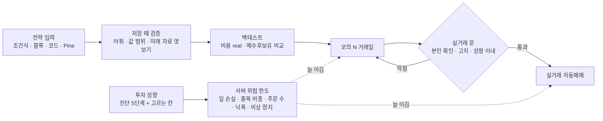

# 자동매매 직접 전략 입력 · 투자 성향 다양화 조사서 v0.1

| 문서 정보 | |
|---|---|
| **판 · 상태** | v0.1 · 초안(검토 전) |
| **구분** | 조사 — 자동매매 「직접 전략 입력」 의 꼴 · 차례 · 안전장치, 「투자 성향」 의 규제 원문 · 실제 서비스 꼴 · 우리 설계 안, 공개 프로젝트 라이선스의 근거 |
| **작성** | 이동원(팀장) |
| **검토** | 검토 전. 자동매매 · 위험 한도 · 증권사 연동은 **오준영 님 영역**, 성과 · 모의투자 · LEAN 은 **강민석 님 영역**, 패턴 · XAI · 손절익절 규칙은 **신장환 님 영역**이라 그 부분의 제안은 모두 「제안」 이다 — 반영할지 · 언제 할지는 주담당이 정한다 |
| **최종 수정** | 2026-10-15 (KST) |
| **기준** | 원문 조회 2026-10-14(KST — 웹 출처는 모두 이 날 조회) · 코드 사실은 `main` `f73b467` 읽기만 · 계획서 · 논의결정대장(읽기만) |
| **관련 문서** | [실사용자 피드백 — 종목 선정 근거 조사](실사용자피드백-종목선정근거-조사.md)(같은 날 조사 — 종목을 고르는 조건은 그 조사 7절) · [순위 화면 · 종목 목록 · 종목 비교 조사](순위화면-종목목록-종목비교-조사.md)(같은 날 조사 — 순위 · 종목 허브 · 모의 매수로 잇기) · [모의투자 — 증권사 규칙 · 시작 금액 조사서 v0.1](모의투자-증권사규칙-시작금액-조사.md) · [개별 종목 분석 · 투자 근거 · 익절 · 손절 조사서 v0.1](개별종목-투자근거-익절손절-조사.md)(6절 「정보 제공」 문구 · 피할 낱말) · [기능 확장 시장조사 v0.1](기능확장-시장조사.md)(4절 로보어드바이저) |
| **최근 개정** | 새 문서 |

> **이 문서로 알 수 있는 것**
> 1. 직접 전략 입력의 꼴 넷과 각 꼴의 실제 사례 · 장단점 · 우리 코드와의 거리(3.1 <표 3>).
> 2. 실제 서비스 · 공개 프로젝트가 쓰는 「백테스트 → 모의 → 실거래」 차례(3.6 <표 4>)와 위험 장치를 우리 위험 한도와 한 표로 견준 것(3.7 <표 5>).
> 3. 잘못된 전략을 막는 장치 여섯(3.8 <표 6>).
> 4. 적합성 · 적정성 원칙 · 금투협 준칙 · 「시스템매매」 정의의 원문(4.1 · 4.2)과 우리 진단과의 거리(4.4 <표 9>), 「기본 = 우리 설계 + 고르는 칸」 설계 안(4.5 <표 10>).
> 5. 공개 프로젝트 라이선스(5절 <표 11>) · 역할별 나눔(6절) · 정할 것(7절).

---

## 요약 5줄

1. 직접 전략 입력의 꼴 넷(조건식 · 블록 · 코드 · Pine) 가운데 **지금 코드와 가장 가까운 것은 「조건식 칸」** 이다 — 자동매매는 이미 전략 스펙 JSON(`entry` · `exit` · 지표 · 조건 · 가중치)을 받아 규칙을 평가한다(`app/services/auto_trade.py:351-418`). 화면에서 그 JSON 을 만들고 저장 때 검증만 붙이면 된다. 코드(파이썬 클래스) 꼴은 남의 코드를 서버에서 돌리는 격리 부담이, Pine 꼴은 주문까지 잇는 데 바깥에 열린 웹훅 주소(80 · 443 포트 · 3초 · 2단계 인증 필수)가 걸린다.
2. 실제 서비스 · 공개 프로젝트는 모두 **「백테스트 → 모의 → 실거래」 차례와 「전략이 끌 수 없는 위험 장치」** 를 둔다 — 젠포트(가상매매는 등록 다음 거래일부터 · 「실전투자 진행 전 한번 더 검증」) · freqtrade(「Always start … in Dry-Run」 · Protections 넷) · LEAN(위험 관리 모델 여섯 · 기본 5%) · Pine(`strategy.risk.*` 여섯 — 「There is no way to deactivate」) · 키움 자동감시주문(시스템 장애 · 매매정지 · 권리발생 때 강제 중지 + 비상 SMS). 우리 위험 한도 다섯 칸(일 손실 3% · 종목 30% · 하루 20건 · 쿨다운 30분 · 비상 정지)은 이와 대부분 겹치고, **빠진 것은 낙폭 기준 정지 · 연속 손실 정지 · 섹터 노출** 셋이다.
3. 투자 성향은 **금소법 제17조(적합성) · 제18조(적정성) · 시행령 제11조(「손실에 대한 감수능력이 적정한 수준」) · 금투협 표준투자권유준칙** 원문을 읽었다. 옛 판 준칙은 5단계(안정형 ~ 공격투자형)와 「평가 결과 · 위험 선호 중 낮은 쪽」 을 조문으로 못 박았으나, **최신 판(2025-09-11 개정)은 배점 · 명칭 · 유형 수를 「회사에서 자율적으로」(회사참고사항 8-2) 두고 「5단계 이상」 은 투자일임 · 금전신탁 특칙(제22조 · 회사참고사항 22-2)에 남겼다** — 로보 어드바이저처럼 맡겨 굴리는 서비스에 가장 가까운 기준이 「5단계 이상」 이고, 사용자 요청 「기본은 우리 설계 + 사람마다 고르는 설정」 과 맞는 틀이다. 최신 판은 또 **「일반적 투자자성향」 과 「현재 투자자금성향」 을 나눠 파악(원금 보존 자금이면 가장 낮은 위험으로 제한) · 비대면 재진단 「1일 최대 3회」 · 유효기간 12 ~ 24개월(제9조) · 위험등급 「최소 6단계」(제16조) · 로보어드바이저 「알고리즘의 중대한 변경 … 미리 고지」(제23조)** 를 둔다. 성향보다 높은 상품은 「투자자가 원하는 경우에도 … 권유할 수 없음」 이고, 본인이 고르면 「투자성향에 적합하지 않은 투자성 상품 거래 확인서」 를 받는다.
4. 우리 진단(7문항 · 35점 · 5단계)은 준칙 이름 · 필수 항목(손실 감내 · 투자 기간)과 맞지만, **5단계가 시스템 프로파일 셋으로 접히고(`app/services/robo_profile.py:30-36`) · 진단 결과를 서버에 저장하지 않아(`app/routes/ml.py:334-341` — 계산해 돌려주기만) 자동매매 위험 한도와 이을 수 없으며 · 진단보다 높은 단계를 고르는 흐름 · 재진단 횟수 제한 · 유효기간 · 쏠림 점검이 없다.** 또 「시스템매매(시스템트레이딩)」 정의(옛 판 준칙 · 미래에셋 고지서 2021)는 사용자가 조건 일부를 정해도 제공 조건이 한정되고 가격 예측 이론을 품으면 시스템매매로 보므로, 우리 조건식 칸도 고지 다섯 줄(수익 보장 아님 · 이해 없이 큰 손실 · 지나친 매매 · 시세 · 체결 지연과 주문 거부 · 조건 설정 확인 — 미래에셋 「시스템트레이딩 위험고지서」 · 영업규정 제2-7조)을 달 자리다.
5. 공개 프로젝트 라이선스(PyPI · npm 등록부 · 2026-10-14): **GPL · AGPL — freqtrade · backtrader · backtesting.py · lumibot** / **MIT · Apache — jesse · LEAN · bt · zipline-reloaded · Blockly**. 우리 저장소 뿌리에 LICENSE 파일이 없으므로 GPL 쪽은 설계 · 문서만 참고하는 것이 안전하다(추정). 정할 것은 열두 건(넷씩 세 묶음 · 7절)이고, 역할은 이동원 몫 세션 줄 여섯 · 팀원 이슈 초안 셋(6절)으로 나눴다.

## 남은 확인

조사 때 「확인할 것」 으로 남긴 아홉이다. 「상태」 칸에는 옮길 때(2026-10-15) 처리 · 확인한 것만 적었고, 나머지는 확인 전이다.

| # | 무엇 | 왜 | 상태 |
|:-:|---|---|---|
| 1 | <그림 1> 은 Mermaid 글 그림이다 — 문법 확인 전(머리 없는 Edge + `mermaid.parse()` 로 확인 필요) · 문서 그림 규칙상 Figma 그림 한 장으로 바꿀지 | 조사 시간 안에 Figma · 렌더 확인을 하지 않았다 | 문법은 옮길 때 확인함(2026-10-15 · 머리 없는 Edge + `mermaid.parse()` · mermaid 11.4.1 · 오류 0) · Figma 로 바꿀지는 확인 전 |
| 2 | 금투협 준칙 최신 판(2025-09-11 · historySeq=1743)은 요약 도구로 조문 목록(제1 ~ 25조)과 제8 · 9 · 16 · 23조 인용을 받았고, **재평가 「1일 … 최대 3회」 · 유효기간 「12~24개월」 · 제23조 3) · 제24조 문장은 원문 조각 추출로 두 번째 확인했다.** 남은 것: 옛 판 제5조 ②(5단계) · ③(낮은 쪽)이 최신 판 제8조 회사참고사항(회사 자율)으로 바뀌었다는 해석과 「5단계 이상」 이 제22조 회사참고사항 22-2 에 있다는 것(요약 도구만) — 정할 것 5 의 근거라 사람이 원문으로 한 번 확인 | 일부는 요약 도구 인용뿐이다 | 확인 전 |
| 3 | 「시스템매매」 정의(옛 판 제2조 6호)는 최신 판 훑기에서 찾지 못했다 — 다른 규정으로 옮겼는지, 「영업 및 업무에 관한 규정」 제2-7조(화면에 「개정 2009-10-27」)가 지금 판에도 같은지 | 판 날짜가 오래됐다 | 확인 전 |
| 4 | 시행령 제11 · 12조는 「시행 2023. 11. 2.」 PDF 에서 읽었다 — 그 뒤 개정이 있는지 | 법률은 2026-01-02 시행 판을 읽었다 | 확인 전 |
| 5 | `evaluate_spec_rules` 가 지원하지 않는 지표면 규칙 판정 없이 점수 판정으로 돌아가고 `rule_based: false` 만 남는다(`auto_trade.py:382-384` · `:405-417`) — 「말없는 대체」 원칙에 걸리는지 주담당(오준영 님) 판단 거리로 이슈 A 에 넣을지 | 코드 읽기 관찰 · 시험으로 재지 않았다 | 확인 전 |
| 6 | 역할 줄: 성향 진단 화면은 WBS 1.5.u 「오준영 / 이동원」 · 스프린트 1.5 「오준영」 · 「내 정보 투자 성향 칸」 은 이동원 할 일(계정 줄)로 읽었다 — 이 나눔이 맞는지 | `docs/계획서/WBS.md:126` · `스프린트계획.md:80` · `이동원파트-할일.md:70` | 확인 전 |
| 7 | 원문을 못 읽은 곳(미래에셋 · 삼성의 자동 주문 화면 · 퀀터스 · 파운트 · 에임 · Jesse 전략 메서드 이름 · 금투협 별지 hwp 넷 · 미래에셋 고지서 본문)은 8절 <표 13> 에 「미확인」 으로 남겼다(한국투자 · backtrader 는 마지막에 원문을 읽어 넣었다) | 조사 시간 안에 읽지 못함 | 확인 전 |
| 8 | 저장소 `docs/조사/` 로 옮기면 관련 문서 · 이슈 뼈대의 상대 링크(작업 폴더 기준 경로)를 같은 폴더 링크로 고쳐야 한다 · 맨 위 작업용 머리 절과 HTML 주석은 지운다 | 초안 링크는 작업 폴더 기준이었다 | 옮길 때 처리함(2026-10-15) — 관련 문서 · 6.2절 이슈 뼈대의 링크를 같은 폴더 링크로 고치고, 머리 절은 요약 · 남은 확인 · 정할 것 절로 나눴다 |
| 9 | 이슈 A(오준영 님)는 #162 · #183(2026-10-14 위험 계층 · 위험 기준 수량 구현 · #184 머지)의 후속이다 — 새 이슈로 열지, #183 검토 글에 의견으로 붙일지 사용자 판단(「분석 이슈에 댓글 쌓지 않기」 원칙과 맞춰) | 겹침을 피하려고 이미 구현된 것은 물음에서 뺐다 | 확인 전 |

## 정할 것(결정 전) — 넷씩 세 묶음 · 첫 칸이 추천 (근거 · 확실도는 7절)

결정 전이다. 「정할 것 대장 번호」 는 팀장이 쓰는 결정 대장의 번호다(대장은 작업 파일이라 저장소에 두지 않는다).

| 묶음 | # | 정할 것 | 추천(첫 칸) | 다른 칸 | 정할 것 대장 번호 |
|---|---|---|---|---|---|
| 1 전략 입력 | 1 | 직접 전략 입력의 첫 꼴 | **조건식 칸** — 지금 스펙 JSON 을 화면에서 만들고 저장 때 검증 | 블록(Blockly) · 파이썬 클래스 올리기 · Pine 만 | D89-1 |
| | 2 | 실거래까지의 문 | **백테스트(비용 real) → 모의 N 거래일 → 실거래는 본인 확인 + 고지 + 성향 이내** (N 은 팀 결정) | 모의까지만(실거래 문 없음) · 백테스트 뒤 곧바로 실거래 | D89-2 |
| | 3 | Pine 의 자리 | **차트 · 검증용 — 주문은 조건식 스펙으로 옮긴 것만** | TradingView 웹훅 → 모의 주문 · 웹훅 → 실거래 | D89-3 |
| | 4 | 전략과 서버 위험 한도 | **서버 한도가 늘 이김 — 전략은 더 좁게만** | 전략이 한도를 덮어씀 · 한도는 사용자 자유 | D89-4 |
| 2 투자 성향 | 5 | 성향 단계 | **5단계 그대로 + 시스템 프로파일도 다섯(5 → 3 접힘을 풂)** | 프로파일 셋 유지 · 단계 없이 칸별(추출 방식) | D89-5 |
| | 6 | 진단 규칙 | **지금 7문항 + 「이번 자금」 한 문항(원금 보존 자금이면 가장 낮은 단계로 제한) + 재진단 하루 3회까지(다시 하는 까닭 기록) + 유효기간 12개월(지나면 다시)** | 지금 그대로 · 옛 판 「평가 결과 · 위험 선호 중 낮은 쪽」 · 금투협 별지 문항으로 교체(원문 미확인) | D89-6 |
| | 7 | 사용자가 고르는 칸 | **모의는 아무 단계 · 진단보다 높으면 「부적합 확인」 한 번 + 화면 띠 · 실거래 자동매매는 진단 단계 이내** | 진단 결과만 · 확인 없이 자유 | D89-7 |
| | 8 | 성향별 기본 한도 값 | **위험중립형 = 지금 기본값 · 다른 단계는 같은 칸을 좁히거나 넓힘 — 값은 백테스트 뒤 팀 결정** | 성향 무관 한 값 · 모든 칸을 사용자가 | D89-8 |
| 3 운영 · 범위 | 9 | 공개 코드 가져오기 | **MIT · Apache 는 고지 유지 후 참고 가능 · GPL · AGPL 은 설계 · 문서만** | 모두 설계만 · GPL 도 가져옴 | D89-9 |
| | 10 | 자동매매 고지 | **켜기 · 전략 저장 · 실거래 전환 세 곳에 고지 다섯 줄(수익 보장 아님 · 이해 없이 큰 손실 · 지나친 매매 · 시세 · 체결 지연과 주문 거부 · 조건 설정 확인) + 확인 체크 · 기본 전략이 크게 바뀌면 미리 알림** | 처음 한 번만 · 꼬리말만 | D89-10 |
| | 11 | 비상 정지 범위 | **사용자별(지금) + 관리자 전체 정지 + 자동 정지 사유 알림 · 사용자 정지는 「멈추기만」 · 「멈추고 정리(청산)」 중 고름** | 사용자별만 · 전략별까지 따로 | D89-11 |
| | 12 | 이번 과정 범위 | **3차까지 조건식 칸 + 성향 다섯 · 고르는 칸 + 성향별 한도 — 블록 · 코드 · 웹훅은 개선 세션 뒤** | 모두 3차 안에 · 조사만 | D89-12 |

---

## 0. 한눈에

전략이 실거래까지 가는 문과 그 문을 늘 지키는 위험 한도 · 투자 성향의 관계는 <그림 1> 과 같다.

**<그림 1> 전략 입력에서 실거래까지 — 문 셋과 늘 이기는 위험 한도**

원천: 이 문서 3.6 · 3.7 · 4.5절 · 2026-10-14 · 그림 판 v0.1(글 그림 — Figma 원본 없음)

---

## 1. 방법

**<표 1> 조사 방법**

| 질문 | 본 곳 | 방법 |
|---|---|---|
| ① 지금 앱 | `app/services/robo_profile.py` · `risk_guard.py` · `aggressive_mode.py` · `auto_trade.py` · `strategy_loader.py` · `app/routes/stocks.py` · 계획서 · 논의결정대장 | 읽기만(줄 번호로 근거) · `git log` 로 최근 손댄 사람 |
| ② 직접 전략 입력 | 키움 공식 도움말 · OpenAPI+ 개발가이드 PDF · 젠포트 사용자 매뉴얼 PDF(뉴지스탁) · TradingView Pine 공식 문서 · 지원 문서 · freqtrade · QuantConnect · lean.io 공식 문서 · Blockly 공식 문서 | 공식 쪽 원문. 긴 쪽은 요약 도구에 「원문 그대로 인용」 을 시켜 읽고 인용문만 옮김 |
| ③ 투자 성향 · 규제 | 국가법령정보센터(법률 조문 · 시행령 PDF) · 금융투자협회 법규정보시스템(표준투자권유준칙 옛 판 · 최신 판 · 영업 및 업무에 관한 규정) · 금투협 펀드 안내 · 코스콤 · 금융위 | 원문. 판 날짜를 칸마다 적음 |
| ④ 실제 서비스 | 핀트 공식 누리집 · 블로그 · 키움 · 한국투자 도움말 · 주식거래 설명서 · 젠포트 · 코스콤 뉴스 | 화면 흐름 · 막는 장치 · 고지 문구 |
| ⑤ 공개 프로젝트 라이선스 | PyPI JSON(`/pypi/<이름>/json`) · npm 등록부(`/blockly/latest`) · lean.io | 등록부의 `license` · `classifiers` 칸을 그대로 옮김(github.com 은 열지 않음) |

- **확실도 표기** — 「높음」 = 공식 원문(법령 · 협회 규정 · 공식 문서 · 등록부)을 직접 읽음 · 「중간」 = 원문이나 판 날짜가 오래됐거나, 요약 도구를 거쳐 읽음 · 「낮음」 = 추정 · 근거 숫자 없음 · 「미확인」 = 원문을 못 읽음
- **하지 않은 것** — 코드 작성 · 시험 실행 · 증권사 API 호출 · 로그인 · github.com 페이지 열람(라이선스는 PyPI · npm 등록부로만 봄) · 법률 자문(이 문서의 법 해석은 모두 「추정」)

---

## 2. 지금 앱 (코드 읽기 판정 · `main` `f73b467`)

**<표 2> 지금 앱의 성향 · 위험 한도 · 전략 입력**

| 무엇 | 지금 꼴 | 자리(파일:줄) | 주담당(계획서) · 최근 손댄 사람(git log) |
|---|---|---|---|
| 투자 성향 진단 | 7문항(연령 · 사용 시기 · 투자 경험 · 소득 안정성과 투자금 비중 · 1년 감내 손실 · 투자 목적 · 금융 지식) × 1 ~ 5점 = 7 ~ 35점 → 5단계(안정형 7 ~ 12 · 안정추구형 13 ~ 18 · 위험중립형 19 ~ 24 · 적극투자형 25 ~ 30 · 공격투자형 31 ~ 35) → **시스템 프로파일 셋**(안정형 · 안정추구형 → conservative / 위험중립형 → moderate / 적극 · 공격 → aggressive) | `app/services/robo_profile.py:11-58` | 성향진단 · 자산배분 = 오준영(`docs/계획서/스프린트계획.md:80`) · 화면 = 오준영 / 이동원(`WBS.md:126`) · git: Lee Dongwon 2026-09-30 `f31011c` |
| 목표 달성 확률 | 월 단위 GBM 몬테카를로 · 고지 「기대수익률·변동성이 미래에도 유지된다는 가정의 확률 추정치이며 수익을 보장하지 않습니다.」 | `robo_profile.py:61-111` | 같음 |
| 위험 한도 | 일 손실 **3%** → 비상 정지 · 종목 비중 **30%**(넘으면 수량을 줄이거나 생략) · 하루 자동 주문 **20건** · 같은 종목 · 방향 쿨다운 **30분** · 비상 정지(kill switch) — 사용자 행의 `risk_*` 칸에서 읽고, Redis 가 없으면 메모리로 | `app/services/risk_guard.py:1-59` · `:165-181` | 위험 = 오준영 · git: Lee Dongwon 2026-09-30 |
| 공격 모드 | 5분봉 점수 · 쿨다운 · 하루 주문 수만 환경값으로 덮어씀 — **「종목 비중·일손실 한도·비상 정지는 그대로 둔다」** | `app/services/aggressive_mode.py:1-14` · `:39-40` | git: Lee Dongwon 2026-10-12 |
| 자동매매 전략 | 외부(domain-rag-lab)에서 **「합격한 전략」** 의 스펙 JSON 을 HTTP 로 받음(`/backtests/strategies`) — `universe` · `position_sizing.max_symbols` · `signal_weights`(technical · lightgbm · buy/sell 임계값 ±0.6) · `entry` / `exit` 규칙(지표 `ma_cross` · `momentum`, 조건 `short_above_long` · `breakout_high` · `always` · `never` 등) | `app/services/strategy_loader.py:1-60` · `auto_trade.py:305-418` · `app/routes/stocks.py:674-683` | 자동매매 = 오준영 · git: GoonGuMa 2026-10-14 `02c5b43` |
| 비상 정지 · 실계좌 | `emergency_halt` · `live_account_daily_loss` · `cancel_open_live_orders` · 실주문(`_place_live_order` · 게이트웨이) — 팀 설계 문서: 점검 순서 「비상 정지 → 신호 → 일손실 → 일 주문 수 → 종목 비중 → 쿨다운 → 주문 → 사후 일손실」 · 「비상 정지는 자동매매를 끄고 추적 중인 접수/부분체결 게이트웨이 주문의 취소를 요청한다. 보유 주식을 시장가로 전량 청산하지 않는다」 · 「정지 해제만으로 자동매매가 재시작되지는 않는다」 · 한도는 QUANT 장부 기준(PAPER 리밸런싱에 자동 적용 아님) · 「하한가·VI·거래정지 … 시장 상태 판정 … 아직 없음」 | `auto_trade.py:239` · `:421` · `:509` · `:526` · `:681` · `docs/설계/자동매매-위험계층-손절.md:24-55`(v0.2) | 같음 · 설계 문서 = 오준영(#162 후속 · #184 머지) |
| 직접 실험(백테스트) | 템플릿 넷(`rsi_ma` · `macd_bb` · `volume_rsi` · `triple_ma`) 또는 기본 전략 넷(`rsi` · `ma` · `bollinger` · `composite`) + 숫자 칸(short 2 ~ 30 · mid 3 ~ 120 · rsi 5 ~ 40 · buy_th 5 ~ 50) + 손절 · 익절 % + 비용 모델(real · flat · none) | `app/routes/stocks.py:1066-1125` | 커스텀 인디케이터 = 신장환 / 강민석(`WBS.md:149`) |

읽은 뜻: 우리는 이미 **「템플릿 + 숫자 칸」(백테스트)** 과 **「규칙 JSON」(자동매매)** 두 가지 반쯤 된 직접 입력을 갖고 있다. 다만 규칙 JSON 은 사용자가 만들 수 없고 외부에서 「합격한」 것만 받는다. 위험 한도는 사용자별 다섯 칸이 있고 성향과는 이어져 있지 않다.

---

## 3. 직접 전략 입력

용어 먼저 — **직접 전략 입력**은 이 문서에서 「사용자가 진입 · 청산 조건 · 수량 · 대상 종목을 스스로 정하고, 서비스가 그 규칙대로 판단 · 주문하는 것」 을 뜻한다. 서비스가 미리 정한 전략 가운데 하나를 고르는 「전략 선택」 과 헷갈리기 쉽다 — 핀트의 「고객님이 선택한 전략」 은 선택이고, 젠포트의 「새포트만들기」 는 입력이다.

### 3.1 꼴 넷 견주기

**<표 3> 직접 전략 입력의 꼴 넷**

| 꼴 | 실제 예(원문) | 사용자가 넣는 것 | 좋은 점 | 약한 점 | 우리 코드와의 거리 | 확실도 |
|---|---|---|---|---|---|---|
| **조건식** | 키움 조건검색 — 「모든 조건설정은 HTS를 통해 이루워 지며, 실시간 조건검색 종목이 API를 통해 송신되는 구조」 · 실시간 편입(I) · 이탈(D) · 「화면당 실시간 조건검색은 최대 10개」(S14) / 젠포트 조건식 — `{종가} > 1,000` · `A and B` · `과거값(…)` 같은 함수(S15) | 지표 · 비교 · 그리고 / 또는 · 우선순위 | 어휘가 정해져 있어 검증이 쉽다 · 비전공자도 읽는다 | 표현력이 어휘만큼 | **가장 가깝다** — 스펙 `entry` · `exit` 규칙과 평가 함수가 이미 있다(`auto_trade.py:351-386`) | 높음 |
| **블록(노코드)** | 젠포트 새포트만들기 「STEP 1 기본설정(매수비중, 목표/손절가, 보유기간) → STEP 2 매매대상 → STEP 3 매매조건(조건식 · 우선순위) → STEP 4 포트최적화」(S15) / Blockly — 「An open-source, flexible library for developers to build visual programming editors with drag-and-drop blocks」 · Apache-2.0(S26) | 칸 고르기 · 블록 끼우기 | 처음 쓰는 사람에게 가장 쉽다 | 편집기를 만드는 비용 · 블록이 결국 같은 조건식을 만든다 | 중간 — 결과를 같은 스펙 JSON 으로 내면 서버는 그대로 | 높음(사례) · 중간(비용) |
| **코드** | freqtrade 전략 클래스 — `populate_indicators` 「Adds several different TA indicators」 · `populate_entry_trend` · `populate_exit_trend` · `stoploss` · `minimal_roi` · `protections`(S20 · S21) / LEAN 알고리즘 프레임워크 — Alpha · Portfolio construction · Risk management(「plug-in risk models」) · Execution(S24) | 파이썬 · C# 클래스 | 표현력이 가장 크다 | 남의 코드를 서버에서 돌린다(격리 · 자원 제한) · 「Strategies that look into the future will perform well during backtesting」(S21) | 멀다 | 높음 |
| **Pine** | TradingView `strategy()` + `input.*`(minval · maxval · step · options · confirm · group) + `strategy.risk.*` 여섯 · 체결 알림 · 웹훅(S17 · S18 · S19) | Pine 스크립트 · 설정 창의 입력 칸 | 차트와 한 몸 · 위험 명령이 언어에 들어 있다 | TradingView 안에서만 돈다 · 주문으로 잇는 길은 웹훅(80 · 443 포트만 · 3초 · 2단계 인증 필수) | 3차 Pine 칸(이동원)과 겹침 · 주문 연결은 없음 | 높음 |

### 3.2 조건식 — 키움 · 젠포트

- **키움 조건검색**: 조건식은 HTS(영웅문)에서 만들고, OpenAPI 는 저장된 조건식을 불러와(`GetConditionLoad` · `GetConditionNameList`) 일반조회(0) · 실시간조회(1)로 종목 목록을 받는다. 실시간은 편입 「I」 · 이탈 「D」 이벤트로 오고, 「1번으로 조회 할 수 있는 화면 개수는 최대 10개」 다(S14). 조건식 **작성**은 증권사 화면, **실행**은 API — 입력과 실행이 나뉜 꼴이다.
- **키움 자동감시주문**(서버자동스탑로스): 「사용자가 보유종목 또는 특정종목의 감시조건과 주문설정을 저장한 후 유효기간 동안 키움증권 감시 시스템에서 감시를 진행하며 감시조건이 충족하는 시점에 자동으로 주문을 실행」 · 「HTS, MTS의 ON/OFF 상태에 상관없이」 · 유효기간 국내 주식 90일 · 미국 주식 「30일이내」 · 「감시조건 추가 후 반드시 '감시시작'을 클릭해야 감시가 시작」 · 「주문가능수량 … 은 고려하지 않음. 감시에 의한 주문은 실행되고 주문은 원장에서 거부될 수 있습니다」(S12 · S13). 같은 국내 [0624] 도움말 안에 「최대 90일」 과 「30일 이내」 표기가 함께 있다는 이전 확인 기록이 있다(이번에는 90일 쪽만 다시 읽음 — 엇갈림 그대로 둠). 한국투자 서버자동(STOP) 주문은 최장 30일이다(S31).
- **젠포트 조건식**: 「보다 상세한 매수/매도조건식 및 우선순위를 설정」 · 가공 팩터(「시장의 Raw Data 뿐만 아니라 점수, 등수 등의 가공된 팩터(조건)도 제공하기 때문에 초보자부터 숙련자까지」)(S15). 사용자 전략을 「결과공개(전략미공개)」 로 공유하면 「복사는 가능하나 수정은 불가능」 하다(S15).

### 3.3 블록(노코드)

젠포트는 칸 넷(기본 설정 · 매매 대상 · 매매 조건 · 최적화)으로 전략을 만들게 하고, 조건식은 그 안의 한 칸이다(S15). 블록 편집기를 직접 만든다면 Blockly 가 표준 부품이다 — npm 등록부 `blockly` 13.4.0 · `license: Apache-2.0`(S26). 블록은 결국 같은 조건식(JSON)을 내므로, **서버 쪽은 조건식 칸과 같게 두고 화면만 바꾸는 꼴**로 나중에 더할 수 있다.

### 3.4 코드 — freqtrade · LEAN · 그 밖

- **freqtrade**: 전략은 `IStrategy` 를 잇는 클래스이고 지표 · 진입 · 청산 세 메서드를 채운다(S21). `stoploss` 는 「highly recommended to protect your capital」, `minimal_roi` 는 「the minimal Return On Investment (ROI) a trade should reach before exiting, independent from the exit signal」(S21). 위험 장치는 전략 클래스의 `protections` 속성에 꽂는다(S20 · 3.7 <표 5>). 실행 전 「Before running a strategy in dry or live more, you should always use these commands first」(lookahead · recursive analysis)(S21). PyPI 판 2026.9 · **GPLv3**(S25).
- **LEAN**(QuantConnect): 알고리즘 프레임워크가 Alpha → 포트폴리오 구성 → 위험 관리 → 실행으로 나뉘고, 위험 관리는 끼우는 모델이다(S24). **Apache 2.0** — 「With a permissive Apache 2.0 license」(S24) · PyPI 의 `lean` CLI 1.0.229 도 Apache(S25).
- **backtrader**: 「Base class to be subclassed for user defined strategies」(`bt.Strategy`) · `__init__`(지표 준비) · `prenext` 「before the minimum period of all datas/indicators have been meet」 · `next` 「called for all remaining data points」(판단 자리) · `notify_order` · `notify_trade` · `start` · `stop`(S29) · PyPI 1.9.78.123 **GPLv3+** · 마지막 올림 2023-04-19(S25).
- **Jesse**: 「Jesse waits until it receives a new candle. When it does, it goes through a series of functions to make decisions.」 · 포지션 사건마다 부르는 함수(예: 「when your entry order gets executed and you open a new position, the `on_open_position` event is called」)(S30). 전략 클래스 이름 · 진입 메서드 이름은 그 쪽에 없어 미확인 · PyPI 3.3.4 **MIT**(S25).

### 3.5 Pine — 입력 칸 · 위험 명령 · 알림 · 웹훅

- **입력 칸**(S18): `input.int` · `input.float` · `input.bool` · `input.string` · `input.source` · `input.timeframe` · `input.symbol` · `input.session` · `input.time` · `input.price` · `input.color` · `input.text_area` · `input.enum`. 값 묶기 — `minval` 「The minimum valid value」 · `maxval` · `step`(기본 1) · `options` 「A list specifying the possible values」(`minval` · `maxval` · `step` 과 함께 못 씀) · `confirm` 「If `true`, the input widget appears in a “Confirm inputs” dialog box when users add the script to the chart」 · `group`(설정 창 절 제목). 「Inputs are only accessible while a script runs on a chart.」
- **위험 명령**(S17): `strategy.risk.allow_entry_in` · `max_cons_loss_days` · `max_drawdown`(「cancels all pending orders, closes any open market position, and stops all additional trade actions」) · `max_intraday_filled_orders` · `max_intraday_loss`(「the maximum allowed loss per trading day」) · `max_position_size`. 「All risk management commands execute on every tick and order execution event … There is no way to deactivate any of these commands on specific script executions.」
- **시뮬레이션 · 알림**(S17): 「TradingView uses a broker emulator to simulate trades while running a strategy script.」 · 「each order placement command comes with its own built-in alert functionality」 · 「Alerts from order fill events execute immediately」 · 「No trading strategy can guarantee future performance」.
- **웹훅**(S19): 「only ports 80 and 443 are accepted」 · 「If a remote server takes longer than three seconds to process a request, the request will be cancelled.」 · 「webhook alerts are only allowed when 2-factor authentication is enabled」 · 보내는 IP 넷(52.89.214.238 · 34.212.75.30 · 54.218.53.128 · 52.32.178.7) · 「Transmitting sensitive data through webhooks can expose it to unauthorized parties」.

Pine 의 위험 명령 여섯은 우리 위험 한도 칸과 이름만 다르고 뜻이 거의 같다(3.7 <표 5>). 3차 Pine 칸에서 우리 칸 이름과 1:1 대응표를 두면, Pine 으로 검증한 전략을 조건식 스펙으로 옮길 때 한도가 새지 않는다.

### 3.6 백테스트 → 모의 → 실거래 차례

**<표 4> 실제 서비스 · 공개 프로젝트의 차례**

| 곳 | 백테스트 | 모의 | 실거래 문 | 확실도 · 출처 |
|---|---|---|---|---|
| 젠포트 | 일봉(2007년 이후) · 틱(2017년 이후 · 「정확도는 높지만 … 느리다」) | 「가상매매포트」 — 「등록한 다음 거래일부터 모의투자 진행, 실전투자 진행 전 한번 더 검증하는 단계」 | 「실전매매포트」 — 자동매매 프로그램(젠트레이더)이 실계좌와 연동 · 증권사 전용 포트를 따로 만듦(NH 판) | 높음 · S15 |
| freqtrade | backtesting + lookahead · recursive analysis | dry-run — 「Always start by running a trading bot in Dry-Run and do not engage money before you understand how it works」 · `dry_run_wallet` 「the starting amount … for the simulated wallet」 | live — `dry_run` 「Define if the bot must be in Dry Run or production mode」(설정 한 칸으로 전환) | 높음 · S21 · S22 · S34 |
| TradingView | 브로커 에뮬레이터 | 미확인(이번에 안 읽음) | 체결 알림 → 웹훅 → 바깥 앱 | 높음(알림 · 웹훅) · S17 · S19 |
| 키움 | — | 상시 모의(앞 조사서) | 자동감시주문 — 계좌 비밀번호 저장 필수 · 「감시시작」 클릭 필수 | 높음 · S12 |
| 금투협 규정 | — | — | 일반투자자가 시스템매매를 신청하면 고지 + 설명서 + 서명 · 사전교육 이수 확인 · 별도 신청서(4.2) | 중간(판 날짜) · S5 |
| 우리 지금 | 커스텀 인디케이터 백테스트(비용 real) | 가상 QUANT 장부 · 증권사 모의 | 실주문 경로가 있다(`auto_trade.py:239` · `:421`) — 「모의를 먼저 거쳤는가」 를 보는 문은 없다 | 높음(코드 읽기) · S27 |

### 3.7 위험 한도 · 비상 정지 견주기

**<표 5> 위험 장치 — 우리 · Pine · freqtrade · LEAN · 키움**

| 장치 | 우리 `risk_guard` | Pine `strategy.risk.*` | freqtrade Protections | LEAN 위험 모델 | 키움 자동감시주문 |
|---|---|---|---|---|---|
| 하루 손실 정지 | 일 손실 3% → 비상 정지 | `max_intraday_loss` | — | — | — |
| **낙폭 기준 정지** | **없음**(하루 단위만) | `max_drawdown` | MaxDrawdown 「Stop trading if max-drawdown is reached」(예시 `max_allowed_drawdown: 0.2`) | `MaximumDrawdownPercentPortfolio`(기본 5% · isTrailing false) | — |
| 종목 비중 · 동시 보유 | 30% — 수량을 줄이거나 생략 · 동시 보유 종목 수는 스펙 `max_symbols` | `max_position_size`(수량) | `stake_amount` 「Amount … your bot will use for each trade」 · `max_open_trades` 「Number of open trades your bot is allowed to have」 · `tradable_balance_ratio` 「Ratio of the total account balance the bot is allowed to trade」(S34) | — | 주문 수량 = 매도가능수량 대비 % 등 |
| **섹터 노출** | **없음** | — | — | `MaximumSectorExposureRiskManagementModel`(기본 20%) | — |
| 하루 주문 수 | 20건 | `max_intraday_filled_orders` | — | — | 감시조건 개수(해외선옵 각 10개 · 국내는 확인 필요) |
| 재진입 대기 | 같은 종목 · 방향 30분 | — | CooldownPeriod 「Don't enter a trade right after selling a trade」 | — | — |
| **연속 손실 정지** | **없음** | `max_cons_loss_days` | StoplossGuard 「Stop trading if a certain amount of stoploss occurred within a certain time window」 | — | — |
| 수익 낮은 종목 잠금 | 없음 | — | LowProfitPairs | — | — |
| 종목별 손절 · 추적 손절 | 공격 모드 익절 · 손절(가상 장부) | (주문 명령으로) | `stoploss` | `MaximumDrawdownPercentPerSecurity` · `TrailingStopRiskManagementModel`(기본 5%) | 스탑로스 · 트레일링스탑 |
| 비상 정지 · 강제 중지 | 사용자별 kill switch · `emergency_halt` — 자동매매를 끄고 미체결 취소 요청 · 보유 청산은 안 함 · 매매정지 · VI 판정은 아직 없음(설계 문서 3절) | 조건 충족 때 자동 정지 — 끌 수 없음 | (잠금 기간 `stop_duration_candles` · `stop_duration`) | 기본 `NullRiskManagementModel`(아무것도 안 함) | 매매정지 · ISIN 변경 · 액면분할 등 권리발생 · 시스템 장애 때 「감시를 강제 중지처리 … 비상SMS수신 연락처로 통보」 |
| 출처 | S27 | S17 | S20 | S23 | S12 · S13 |

읽은 뜻: 우리 다섯 칸은 하루 단위 장치(일 손실 · 하루 주문 수 · 쿨다운)에 몰려 있다. **여러 날에 걸친 장치(낙폭 기준 정지 · 연속 손실 정지)와 쏠림 장치(섹터 노출)** 가 빠져 있다. 팀이 잠정으로 둔 MDD 합격선(포트폴리오 −20% · 개별 전략 −15% — 논의결정대장 D5 #21 ⑧ · 잠정 · 미합의)을 정지 기준으로도 쓸 수 있다(제안). 또 키움처럼 **「왜 멈췄는지」 를 알리는 것**이 정지만큼 중요하다 — 우리는 `notification.py` 가 있으므로 정지 사유 알림을 붙일 자리가 있다(제안 · 정할 것 11). 한국투자 오토스탁은 사용자 정지를 **일시정지(주문 취소 · 새 주문 멈춤) · 삭제 · 청산(보유 잔고 일괄 매도)** 으로 나눈다(S32). 우리 비상 정지는 그중 「일시정지」 에 해당하는 한 가지(자동매매 끄기 + 미체결 취소 요청 · 청산 없음 — `docs/설계/자동매매-위험계층-손절.md:42`)라, 「멈추고 정리(청산)」 를 고르는 칸을 더할지가 정할 거리다(정할 것 11). 키움이 자동으로 멈추는 「매매정지 · 권리발생」 은 우리 설계 문서도 「하한가·VI·거래정지 별도 시장 상태 판정 … 아직 없음」(`:53`)이라 적은 빈칸이다.

### 3.8 잘못된 전략 막기 — 검증 · 격리

**<표 6> 잘못된 전략을 막는 장치 여섯**

| 막을 것 | 꼴 | 사례 · 출처 | 우리에게(제안) |
|---|---|---|---|
| 지원하지 않는 지표 · 조건 | 어휘 목록 밖이면 저장을 거부하고 이유를 보임 | 우리 지금: 지원하지 않는 지표면 규칙 판정 없이 점수 임계값 판정으로 돌아가고 `rule_based: false` 만 남는다(`auto_trade.py:382-384` · `:405-417`) | 저장 때 거부 + 이유(말없는 대체를 막음) — 주담당 판단 |
| 값 범위 | 칸마다 최소 · 최대 · 간격 · 고르기 | Pine `minval` · `maxval` · `step` · `options`(S18) · 우리 백테스트 `Query(ge, le)`(`stocks.py:1070-1085`) | 스펙 칸마다 범위를 스키마로 |
| 미래 자료 엿보기(lookahead bias) | 신호는 다음 봉에 체결 · 분석 명령 | freqtrade 「the strategy author needs to take care to avoid having the strategy utilize data from the future」(S21) | 백테스트 엔진 규칙 + 시험(강민석 · 신장환 님 영역) |
| 과최적화 | 표본 밖 구간 · 비용 · 매수후보유와 함께 | 젠포트 FAQ 「유동성(거래대금)이 풍부하고 보유주식을 많이 가져갈수록 실전과 유사한 결과」(S15) · 앞 조사 6절(좋은 구간만 보여 주지 않기) | 결과 화면에 고른 기간 전체 · 비용 · 매수후보유 비교 |
| 남의 코드 실행 | 격리 실행 · 자원 제한 · 네트워크 차단 | 코드 꼴을 고를 때만 필요(일반 원칙 · 출처 없음) | 조건식 · 블록 꼴이면 필요 없음 |
| 처음 쓰는 사람의 실수 | 확인 대화 · 명시적 시작 | Pine `confirm = true`(S18) · 키움 「'감시시작'을 클릭해야 감시가 시작」(S12) | 실거래 전환 때 확인 대화 + 고지(정할 것 10) |

### 3.9 우리에게 주는 뜻 · 뒤집을 조건

**우리에게 주는 뜻**

- 첫 꼴은 **조건식 칸**이 비용 대비 가장 크다. 서버에는 스펙 JSON · 규칙 평가 · 위험 한도가 이미 있고, 빠진 것은 「사용자가 만든 스펙을 저장 · 검증 · 판 관리하는 길」 과 「모의를 거쳤는가를 보는 실거래 문」 이다.
- **서버 위험 한도가 늘 이긴다**는 원칙이 공개 프로젝트 모두에 있다(Pine 은 끌 수 없음 · LEAN 은 끼우는 층 · freqtrade 는 전략 밖 Protections · 우리 공격 모드도 비중 · 일 손실 · 비상 정지는 유지). 사용자 전략은 한도를 「더 좁게」 만 바꾸게 하는 것이 안전하다.
- Pine 은 3차 TradingView 칸에서 **검증 · 보기**로 쓰고, 주문은 우리 스펙으로 옮긴 것만 하는 것이 로컬 우선 운영과 맞는다 — 웹훅을 받으려면 80 · 443 포트로 바깥에 열린 주소가 있어야 하는데(S19), 클라우드 배포는 미뤄 둔 상태다(추정 — 운영 방침).

**뒤집을 조건**

- 팀이 「비전공자 학습 효과」 를 위해 블록 편집기를 원하면 → 블록(Blockly · Apache-2.0)을 첫 꼴로. 서버 쪽은 같은 스펙 JSON 이라 손해가 적다.
- 사용자 파이썬 전략이 꼭 필요하면 → 서버 실행이 아니라 「사용자 PC 에서 돌리고 결과만 올림」 꼴로(격리 부담을 피함).
- 공인 주소로 배포가 생기면 → 웹훅 → 모의 주문(정할 것 3 둘째 칸)을 다시 본다.

---

## 4. 투자 성향

용어 먼저 — **적합성 원칙**은 「권유할 때」 상대의 정보를 파악해 맞지 않는 상품을 권하지 말라는 것이고, **적정성 원칙**은 「권유 없이」 소비자가 스스로 사려 할 때 정해진 위험 상품이면 미리 정보를 파악해 적정하지 않으면 알리고 확인받으라는 것이다. 이름이 비슷해 헷갈리기 쉽다 — 가르는 기준은 「권유가 있었나」 다.

### 4.1 규제 원문

**<표 7> 투자 성향 관련 원문 (조회일 2026-10-14)**

| 원문 | 핵심 문장(인용) | 판 · 확실도 · 출처 |
|---|---|---|
| 금융소비자보호법 제17조(적합성원칙) | ② 「일반금융소비자에게 다음 각 호의 금융상품 계약 체결을 권유(금융상품자문업자가 자문에 응하는 경우를 포함한다 …)하는 경우에는 면담ㆍ질문 등을 통하여 … 정보를 파악하고, … 서명 … 기명날인, 녹취 … 으로 확인을 받아 이를 유지ㆍ관리하여야 하며, 확인받은 내용을 일반금융소비자에게 지체 없이 제공」 · 투자성 상품은 「가. … 취득 또는 처분 목적 나. 재산상황 다. 취득 또는 처분 경험」 · ③ 「적합하지 아니하다고 인정되는 계약 체결을 권유해서는 아니 된다」 | [시행 2026. 1. 2.] 법률 제21065호 · 높음 · S1 |
| 같은 법 제18조(적정성원칙) | ① 「계약 체결을 권유하지 아니하고 금융상품 판매 계약을 체결하려는 경우에는 미리 면담ㆍ질문 등을 통하여 … 정보를 파악」 · ② 「적정하지 아니하다고 판단되는 경우에는 … 그 사실을 알리고 … 확인을 받아야 한다」 | 같은 판 · 높음 · S1 |
| 시행령 제11조 | ② 확인 방법에 「안전성과 신뢰성이 확보된 전자적 수단」 · ③ 투자성 상품에 더 파악할 것: 「일반금융소비자의 연령」 · 「금융상품을 취득ㆍ처분한 경험」 · 「금융상품에 대한 이해도」 · 「기대이익 및 기대손실 등을 고려한 위험에 대한 태도」 · ④ 판단 기준: 「손실에 대한 감수능력이 적정한 수준일 것」 | [시행 2023. 11. 2.] 대통령령 제33656호 PDF · 중간(뒤 개정 확인 필요) · S2 |
| 시행령 제12조 | ① 적정성 대상 투자성 상품: 파생상품 · 파생결합증권 · 조건부로 주식 전환 · 채무 감면되는 사채 · 고난도금융투자상품 · 고난도투자일임계약 · 고난도금전신탁계약 등 | 같은 PDF · 중간 · S2 |
| 금투협 표준투자권유준칙 제5조(옛 판) | ② 「투자성향을 안정형, 안정추구형, 위험중립형, 적극투자형, 공격투자형의 5단계로 분류」 · ③ 「평가결과 투자성향」 과 「위험선호 투자성향」 이 다르면 위험선호 쪽, 「다만, 위험선호 투자성향이 평가결과 투자성향보다 높은 경우에는 평가결과 투자성향에 따라 분류」(= 둘 중 낮은 쪽) · ④ 상품 위험도 「초저위험, 저위험, 중위험, 고위험, 초고위험의 5단계」(현업 설명서는 지금 6등급 — <표 8> 한국투자) · ⑥ 결과를 「지체 없이 제공」 · ⑦ 「관련기록을 5년 이상」 / 제6조 ① 권유 희망 여부를 먼저 확인 · 불원 고객에게 권유 금지 · ② 부적합 권유 금지 / 별표 「시스템매매위험고지서」 · 「일중매매거래위험고지서」 | historySeq=428(판 날짜 미확인) · 중간 · S3 |
| 같은 준칙 최신 판 회사참고사항 | 「투자자유형을 점수화 방식으로 판단하고자 할 경우 투자자정보의 항목별 배점기준 및 … 분류 기준을 회사 자체적으로 마련」 · 「(단, 5단계 이상으로 구분하여야 함)」 — 이 문구는 제22조(투자일임 및 금전신탁에 대한 특칙) 회사참고사항 22-2 의 것(요약 도구 확인 · 일반 투자권유 쪽에는 단계 수 문장이 없음) · 8-2 「배점기준 등은 회사에서 자율적으로」 · 「유형 수를 증감하거나 명칭 등을 변경하여 사용할 수 있음」 · 「추출(Factor-out)방식 또는 상담보고서 방식을 활용할 경우 투자자성향을 특정 유형으로 분류할 필요는 없음」 · 「투자자가 특정 유형에 편중되어 분포되거나 고위험 투자자가 지나치게 많은 것으로 나타난 경우, 질문 및 배점기준 등을 주기적으로 점검」 · 「일정기간[(예: 1년 이상] 투자예정인 경우에 한하여 주식 및 이와 유사한 위험등급 이상의 상품운용에 적합한 것으로 판단하는 것이 바람직」 · 투자 기간(단기 ~ 장기) × 위험 감내도 표 예시 · 13-3 「'손실감내수준'과 '투자목적을 고려한 투자기간' 항목 필히 확인」 | 「개정 2025년 09월 11일」(historySeq=1743) · 높음 · S4 |
| 같은 판 확인서 · 10-4 | 「투자성향에 적합하지 않은 투자성 상품 거래 확인서」 유의사항 — 「금융회사는 투자권유를 할 수 없으므로 본인 판단 하에 투자여부를 결정」 · 「투자권유를 희망하지 않는 경우 금융회사는 적합성 원칙 준수 의무를 부담하지 않습니다」 · 「투자자성향 대비 고위험 상품에 투자하는 경우에는 예상보다 더 큰 폭의 손실」 · 「분쟁 또는 소송이 발생하는 경우 귀하의 권리구제에 불리하게 사용될 수 있으므로 신중하게」 / 10-4 「투자자가 원하는 경우에도 부적합한 상품은 권유할 수 없음」 · 위반 예 「최종 투자의사 확인 전에 미리 … 확인 서류 등을 받아두는 행위」 · 「"투자자성향별 적합한 금융투자상품" 표를 활용하여 투자자가 본인의 투자자성향 대비 고위험 상품에 대한 투자임을 쉽게 인식할 수 있도록」 | 같은 판 · 높음 · S4 |
| 같은 판 조문 넷(제1 ~ 25조 목록 끝까지 확인) | 제8조(투자자정보 파악 및 투자자성향 분석 등) — 「[별표●]에 따라 분류된 투자자의 성향 … 을 투자자에게 지체 없이 제공」 · 회사참고사항: 분류 방식은 회사 자율(예시에 6단계 「매우높은위험선호형 ~ 매우낮은위험선호형」 도 있음) · 「일반적 투자자성향」 과 「현재 투자자금성향」 을 나눠 파악할 수 있고 원금 보존 자금이면 매우 낮은 위험(예: 6등급)으로 권유 범위를 제한하는 것이 바람직 · 재평가 — 「회사는 투자자가 평가 결과를 안 후에 위험등급이 높아 부적합한 금융상품 거래를 위해 의도적으로 자신의 정보를 변경하지 않도록 하여야 함」 · 대면은 이해도 · 위험 태도처럼 바뀌기 어려운 정보의 「당일 변경 불허」 · 「(비대면거래) … 재평가횟수를 사전 제한하고, 1일 평가 가능횟수는 최대 3회를 원칙으로 하되, 고객특성(예 : 고령자, 장애인) … 자체 기준에 따라 횟수를 조정할 수 있음」 · 「재평가를 실시하는 경우 투자자의 재평가 요구사유를 파악하고 그 내용을 기록ㆍ유지」 · 「온라인 거래시에도 적합성원칙 등 투자권유절차를 구현할 수 있는 시스템을 온라인상에 구축」 / 제9조(투자자정보의 유효기간) — 「투자자정보를 파악한 날로부터 12~24개월 … 동안 … 변경되지 않은 것으로 간주할 수 있다」 · 지나면 다시 파악 · 9-2 「"일반적 투자자성향"과 "현재 투자자금성향"으로 구분하여 파악하는 회사는 "일반적 투자자성향"에 대해서만 유효기간을 설정함」 · 투자일임은 연 1회 이상 변경 확인 · 분기 1회 이상 통지 / 제16조(투자성 상품의 위험등급 산정) — 「위험등급은 최소 6단계 이상으로 구분하고, 1등급을 가장 높은 위험으로 한다」 / 제23조(로보어드바이저에 대한 특칙) — 「로보어드바이저의 의미와 해당 로보어드바이저의 투자전략 및 위험요인 등을 충분히 설명하고 투자자의 이해여부를 확인」 · 온라인 계약이면 「주요 특성 및 유의사항 등을 … 게시」 · 「로보어드바이저 알고리즘의 중대한 변경 등 주요사항 변경시에는 투자자에게 미리 고지」 · 참고사항: 로보어드바이저 명칭이 더 나은 수익을 보장하지 않음을 설명 / 제24조 2) 판매 관련 자료는 「10년 … 또는 5년 이내의 범위에서 유지, 관리」(금소법 제28조 · 시행령 제26조) | 「개정 2025년 09월 11일」 · 높음(재평가 · 유효기간 · 제23조 3) · 제24조 문장은 원문 조각 추출로 두 번째 확인) · 중간(제8조 분류 예시 · 제16조 단계 이름은 요약 도구 인용만) · S4b |
| 금투협 펀드 투자 안내 | 「'표준투자권유준칙'상으로는 투자자를 … 5등급이상으로 분류」 · 「각 금융투자회사는 이 표준투자권유준칙을 참고하여 회사의 특성에 맞도록 변경 또는 수정하여 사용」 | 높음 · S6 |
| 코스콤 RA 테스트베드 심사항목 | 「(개인 맞춤성) 다양한 측면의 투자자 성향분석 기능과 성향에 따라 유의미하게 구분되는 복수의 포트폴리오 산출 능력」 · 「(법규 준수성) 법령에서 금지하는 투자 방지 기능」 · 분산투자 · 합리적 리밸런싱 · 다계좌 · 시스템 보안성 · 안정성 / 금융위 2016 운영방안: 사전심사에서 「가상의 투자자 정보를 바탕으로 알고리즘의 투자자 성향별 포트폴리오 산출역량을 심사」 | 높음 · S7 · S9 |

### 4.2 「시스템매매」 와 자동매매 고지

- **정의**(준칙 옛 판 제2조 6호 · 우리은행 게시 사본도 같은 문장 · 최신 판 훑기에서는 찾지 못함 — 확인 필요): 「"시스템매매"란 투자자 자신의 판단을 배제하고 사전에 내장된 일련의 조건에 의하여 금융투자상품 매매종목, 매매시점 또는 매매호가에 대한 의사결정정보를 제공하거나 이에 의하여 자동매매주문을 내는 전산소프트웨어에 의하여 금융투자상품을 매매하는 투자방법을 말한다. 이 경우 투자자가 자신의 판단으로 일부 조건을 설정하는 경우라도 해당 소프트웨어에서 제공되는 조건이 한정되어 있고 그 조건이 금융투자상품의 가격예측에 관한 특정한 이론을 내재하고 있으면 해당 소프트웨어에 의한 금융투자상품의 매매도 시스템매매로 본다.」(S3 · 중간 — 최신 판 확인 필요)
- **고지 의무**(금투협 「금융투자회사의 영업 및 업무에 관한 규정」 제2-7조(시스템매매에 대한 위험 고지) · 화면 표시 개정일 2009-10-27): 일반투자자가 시스템매매 프로그램 매매를 신청하면 1호 「시스템매매가 반드시 수익을 보장해 주지는 않는다는 내용」 · 2호 「해당 프로그램에 대한 올바른 이해 없이 증권 또는 장내파생상품의 매매거래를 하는 경우 커다란 손실을 입을 수 있다는 내용」 을 고지하고, 별표 8 「시스템매매 위험고지서」 를 참조한 설명서를 주고 서명을 받는다. ② ~ ④ 는 사전교육 이수 확인 · 설명서의 누리집 · 온라인 거래 화면 게시 · 별도 신청서를 다룬다(S5 · 요약 도구를 거쳐 1 · 2호만 원문 인용 · 중간).
- **실제 고지 문구 — 미래에셋 「시스템트레이딩 위험고지서」(심의필 R(최)2021-166 · 원문 PDF · 높음 · S10b)**: 정의는 준칙과 같은 꼴(「투자자 자신의 판단으로 일부조건을 설정하는 경우라도 그 프로그램에서 제공되는 조건이 한정되어 있고 그 조건이 주가의 예측에 관한 특정한 이론을 내재하는 것인 경우 이를 시스템트레이딩 프로그램으로 봅니다」)이고, 고지는 다섯 항목이다 — ① 「당해 프로그램이 반드시 투자이익을 보장해주는 것은 아닙니다」(「프로그램 자체에 내장된 기술지표나 주가예측이론 또한 미래의 시장 변동을 예측할 수 없으므로」) ② 「당해 프로그램에 대한 올바른 이해 없이 금융투자상품의 매매를 하게 되는 경우 큰 손실을 입을 수도 있으며 이로 인한 손실은 모두 고객에게 귀속됩니다」 · 「반드시 사전에 당사를 통하여 관련교육을 받은 후에 사용」 ③ 「시스템트레이딩은 지나친 매매거래를 유발시킬 수 있습니다」(수수료 · 증권거래세로 손실 증대) ④ 「급격한 시장변화나 전산장애 등으로 시세지연, 체결지연, 또는 주문거부 등 당해 프로그램이 정상적으로 운영될 수 없는 상황이 발생할 수도 있습니다」 ⑤ 「매매시점, 매매호가 등 제반조건을 제대로 설정하였는지 반드시 확인하여야 합니다」(착오 · 조작 실수의 손실은 고객 귀속). 그 밖에 핀트 「로보어드바이저가 고객에게 맞는 투자 또는 수익달성을 보장하지 않습니다」 · 「로보어드바이저 테스트베드 심의결과가 해당 알고리즘의 품질이나 수익성을 보장하지 않습니다」(S16) · freqtrade 「This software is for educational purposes only. Do not risk money which you are afraid to lose.」(S22).
- **고빈도 알고리즘 거래**: 금융위 보도참고(2023-01-27) — 「앞으로 고빈도 알고리즘 거래를 하려는 투자자는 거래소에 사전 등록 해야」 · 「'23.1.25. 시행 → 3개월 유예기간 → 4.25. 등록 의무화」 · 알고리즘 거래 = 「금융상품에 대한 주문의 생성·가격·시점, 주문 제출 후 관리방법 등을 컴퓨터 알고리즘을 통해 자동적으로 결정하는 거래」(S10 · 중간). 「고빈도」 를 가르는 숫자 기준은 이 보도에 없다(확인 필요). 거래소 파생상품 야간거래 안내는 「신고된 알고리즘거래계좌에 대해 … 미체결 호가 잔량을 일괄 취소할 수 있는 Kill Switch 기능이 제공될 예정」 이라 적는다(S11 · 파생 시장 문서 · 주식 현물은 미확인).

읽은 뜻(추정 — 법률 자문 아님): 우리 조건식 칸은 「제공되는 조건이 한정」 된 소프트웨어이고 지표 규칙은 가격 예측 이론을 품으므로 **정의상 시스템매매에 들어갈 가능성이 높다.** 고지 의무는 금융투자회사에 걸리는 협회 규정이라 우리에게 바로 걸리지 않지만, 미래에셋 고지서의 다섯 줄과 「처음 켤 때 확인」 은 그대로 따라 둘 만하다(정할 것 10). 특히 ③ 「지나친 매매」 는 우리 공격 모드(5분 주기 · 매 사이클 매수)에 바로 해당하는 말이다. 우리 자동매매 규모(5분 주기 · 하루 20건 기본)는 「고빈도」 와 거리가 멀다고 보지만 기준 숫자를 못 봐 확실도는 낮다.

### 4.3 실제 서비스 꼴

**<표 8> 성향 · 전략을 고르게 하는 실제 꼴**

| 곳 | 성향 | 사용자가 고르는 것 | 막는 장치 · 고지 | 확실도 · 출처 |
|---|---|---|---|---|
| 핀트(디셈버앤컴퍼니 · 투자일임 · 자문) | 「고객님의 투자성향, 투자금액, 시장 상황 등을 고려해 투자 포트폴리오를 구성」 · 블로그에 「나의 운용레벨과 투자 스타일」 | 「투자 자문 계약은 고객님이 선택한 전략과 투자성향 … 에 따라 … 포트폴리오를 추천」 · 「고객이 직접 원하는 테마, 종목, 비중을 파이(투자 포트폴리오)로 구성하면 … 리밸런싱 자문 … 매매 주문(리밸런싱)을 고객님의 선택으로 진행」 · 「언제든 다른 전략으로 바꿀 수 있어요」 | 「로보어드바이저가 고객에게 맞는 투자 또는 수익달성을 보장하지 않습니다」 · 테스트베드 심의결과가 품질 · 수익성을 보장하지 않음 · 「테스트베드 공시 수익률과는 일부 차이가 있을 수 있습니다」 · 준법감시인 심사필 번호 · 「자율주행 계약을 그만하시겠어요? 지금 그만두시면 처음부터 다시 진행」 | 높음 · S16 |
| 젠포트(뉴지스탁) | 「자신의 투자성향에 맞는 전략을 만들어 그게 맞는 종목정보 획득」 | 전략을 직접 만듦 · 젠마켓에서 남의 전략을 복사 · 수정 | 백테스트 → 가상매매 → 실전매매 차례 · 「결과공개(전략미공개)」 포트는 수정 불가 · 하루 2회 넘는 백테스트는 유료(v1.7 · 옛 판) | 높음(매뉴얼) · 중간(판 날짜) · S15 |
| 키움 자동감시주문 | (성향과 잇지 않음) | 감시 조건 · 주문 조건 · 유효기간 | 비밀번호 저장 · 감시 시작 클릭 · 강제 중지 + 비상 SMS · 「자동감시주문의 개념과 스탑로스, 트레일링스탑 기능에 대한 정확한 이해가 필요하므로 반드시 유의사항과 도움말을 충분히 숙지」 | 높음 · S12 · S13 |
| 코스콤 RA 테스트베드 | 성향별로 「유의미하게 구분되는 복수의 포트폴리오」 를 심사 | — | 2025년 정기 심사 36개사 155개 참여 · 86개 통과 · 누적 906 · 725 · 사후운용심사(2023-06 ~) 42개사 327개 | 높음 · S7 · S8 |
| 한국투자 서버자동(STOP) 주문 · 오토스탁 | (성향과 잇지 않음) | STOP 주문 — 「손절매, 이익실현, 이익제한(trailing stop)의 조건을 설정한 후 해당 조건에 부합될 때 자동으로 주문을 수행하는 조건주문」 · 「최대감시기간은 주문설정일을 포함하여 최장 30일」 / 오토스탁 자동주문 — 조건 설정 → 주문표 | 「감시조건에 도달하여 주문 실행된 경우 서버에서의 감시는 종료 … 미체결잔량에 대한 추가자동주문은 발생하지 않습니다」 · 03:00 ~ 04:00 배치 때 접수 제한 · 오토스탁 상태 넷 — **「일시정지」(해당 종목 주문 취소 · 앞으로의 자동주문 정지) · 「주문실행」 · 「삭제」 · 「청산」(「자동매매를 강제종료하고자 할 경우 보유잔고를 일괄청산(매도)」)** · 「시장이 급락하는 경우 자동주문을 일시정지 후 … 다시 실행」 | 높음 · S31 · S32 |
| 한국투자 주식거래 설명서 | 상품위험등급 6단계 — 「매우높은 위험 · 높은 위험 · 다소높은 위험 · 보통 위험 · 낮은 위험 · 매우낮은 위험」 · 「투자주의종목, 투자경고종목, 투자위험종목 및 관리종목은 상품위험등급이 1등급(매우높은위험)상품」 | — | 「설명을 제대로 이해하지 못한 상태에서 설명을 이해했다는 서명을 하거나 녹취기록을 남기는 경우, 추후 권리구제가 어려울 수 있습니다」 · 설명서 22호(2025.10.27 개정) | 높음 · S33 |
| 미래에셋 · 삼성 자동 주문 · 퀀터스 · 파운트 · 에임 | 미확인 | 미확인 | 미확인 | 미확인 — 이번에 원문을 못 읽음 |

### 4.4 우리 진단과 기준의 거리

**<표 9> 우리 성향 진단 ↔ 법 · 준칙 · 심사 기준**

| 기준 | 원문 | 우리 지금 | 거리 | 고칠 곳(제안) |
|---|---|---|---|---|
| 5단계 이상 | 옛 판 제5조 ② · 최신 판은 투자일임 · 금전신탁 특칙(22-2)에 「5단계 이상」(S3 · S4 · S6) | 5단계 이름 그대로(`robo_profile.py:30-36`) | 맞음 | — |
| 단계가 배분 · 한도까지 이어짐 | RA 「성향에 따라 유의미하게 구분되는 복수의 포트폴리오」(S7) · 팀 잠정 「순서성 + 구분성」(D5 #21 ⑥) | 5단계 → 프로파일 **셋**(안정형 = 안정추구형 · 적극 = 공격) | **어긋남** — 두 쌍이 같은 배분 · 한도를 받는다 | 프로파일 다섯(정할 것 5) |
| 필수 항목 — 손실 감내 · 투자 기간 | 준칙 13-3(S4) · 시행령 제11조 ③ 「위험에 대한 태도」(S2) | `loss` · `horizon` 문항 있음 | 맞음 | — |
| 일반 성향과 이번 자금 성향을 나눔 | 최신 판 제8조 회사참고사항 — 원금 보존 자금이면 매우 낮은 위험으로 제한(S4b) · 옛 판 제5조 ③ 「평가 · 선호 중 낮은 쪽」(S3) | 합산 하나 · 「소득 안정성과 투자금 비중」 문항이 일부만 다룸 | **없음** | 「이번 자금」 한 문항(정할 것 6) |
| 재진단 횟수 · 사유 기록 | 최신 판 제8조 — 「의도적으로 자신의 정보를 변경하지 않도록」 · 비대면 「1일 평가 가능횟수는 최대 3회를 원칙」 · 「재평가 요구사유를 파악하고 그 내용을 기록ㆍ유지」(S4b) | 제한 없음(저장도 없어 몇 번이든 다시 계산) | **없음** — 높은 단계를 열려고 답을 바꿔 가며 다시 하는 것을 못 막는다 | 하루 3회 + 다시 하는 까닭 한 칸(정할 것 6) |
| 진단 유효기간 | 최신 판 제9조 — 12 ~ 24개월 · 지나면 다시(S4b) | 없음 | **없음** | 12개월(정할 것 6 · 값은 12 ~ 24 안에서 팀 결정) |
| 알고리즘 변경 고지 | 최신 판 제23조 「알고리즘의 중대한 변경 … 미리 고지」(S4b) | 전략 스펙에 판(`strategy_version`)은 있으나 사용자 알림은 없음(`stocks.py:424-425` · `:674-683`) | 일부 | 기본 전략 · 배분 규칙이 크게 바뀌면 미리 알림(정할 것 10) |
| 투자 기간과 주식 적합성 | 「1년 이상 투자예정인 경우에 한하여 주식 … 적합」(S4) | 기간 문항은 점수에만 더함 | **없음** | 기간 1년 이내면 실거래 자동매매 막음(제안) |
| 결과 제공 · 기록 보관 | 법 제17조 ② 「지체 없이 제공」 · 옛 준칙 「5년 이상」 · 최신 준칙 제24조 「10년 … 또는 5년 이내의 범위」(금소법 제28조)(S1 · S3 · S4b) | 결과는 화면에 보이나 **서버에 저장하지 않음** — `POST /robo/risk-profile` 은 계산해 돌려주기만(`app/routes/ml.py:334-341`) · 자산배분은 요청 본문의 `risk_profile` 을 받음(`ml.py:142`) | **없음** — 그래서 성향을 자동매매 한도와 이을 수도 없다 | 진단 시각 · 판 · 답 · 고른 단계 저장(이동원 계정 칸 · 오준영 서버 칸) |
| 진단보다 높은 단계 고르기 | 확인서 유의사항 · 10-4(S4) | 흐름 없음 | **없음** | 고르는 칸 + 「부적합 확인」(정할 것 7) |
| 쏠림 점검 | 「특정 유형에 편중 … 주기적으로 점검」(S4) | 없음 | **없음** | 관리자 화면에 단계별 분포 한 줄(제안) |
| 권유 희망 여부 | 준칙 제6조 ①(S3) | 해당 칸 없음 | 우리는 권유를 하지 않는 「정보 제공」 꼴이라 낮은 우선(추정) | 고지 문구로 대신(앞 조사 6절) |

### 4.5 「기본 = 우리 설계 + 사람마다 고르는 칸」 설계 안

사용자 요청의 두 조건(기본값은 우리 설계 · 사람마다 고르는 설정)을 칸 단위로 나누면 <표 10> 과 같다. 「못 바꾸는 칸」 은 서버가 늘 지키는 바닥이고, 「바꿀 수 있는 칸」 은 그 바닥 위에서만 움직인다.

**<표 10> 성향 설정 — 바꿀 수 있는 칸 · 못 바꾸는 칸 (제안)**

| 칸 | 기본값(우리 설계) | 사용자가 | 못 넘는 선 | 근거 |
|---|---|---|---|---|
| 성향 단계 | 진단 결과(「이번 자금」 이 원금 보존이면 가장 낮은 단계) | 모의는 다섯 중 아무 단계 · 진단보다 높으면 「부적합 확인」 한 번 | 실거래 자동매매는 진단 단계 이내 | 준칙 확인서 · 10-4(S4) · 제8조(S4b) |
| 재진단 · 유효기간 | 하루 3회까지 · 다시 하는 까닭 한 칸 · 12개월 지나면 다시(유효기간은 「일반 성향」 에만 — 「이번 자금」 은 넣을 때마다) | 언제든 다시(횟수 안에서) | 하루 3회 · 유효기간이 지나면 실거래 자동매매 멈춤(모의는 계속) | 제8조 · 제9조 · 9-2(S4b) |
| 일 손실 한도 | 위험중립형 3%(지금 기본) · 다른 단계 값은 팀 결정 | 더 낮게만 | 단계 상한 | `risk_guard.py:43` · 정할 것 8 |
| 종목 비중 | 위험중립형 30% | 더 낮게만 | 단계 상한 | `risk_guard.py:44` |
| 하루 주문 수 · 쿨다운 | 20건 · 30분 | 더 적게 · 더 길게만 | 단계 상한 | `risk_guard.py:45-46` |
| 낙폭 기준 정지(새 칸) | 팀 잠정 MDD 합격선(포트폴리오 −20% · 개별 전략 −15%)을 출발점으로 | 더 낮게만 | 단계 상한 | D5 #21 ⑧(잠정) · Pine `max_drawdown` · LEAN 5% |
| 연속 손실 정지(새 칸) | 값은 근거 없음 — 팀 결정 | 더 엄하게만 | — | Pine `max_cons_loss_days` · freqtrade StoplossGuard |
| 실거래 전환 | 모의 N 거래일 뒤 · 본인 확인 · 고지 | 켜고 끄기 | 성향 · 기간 조건을 못 넘음 | 정할 것 2 · 10 |
| 비상 정지 | 꺼짐 | 언제든 켬 | 관리자 전체 정지는 사용자가 못 끔 | 정할 것 11 |

값이 정해지지 않은 칸(위험중립형 밖 단계의 숫자 · 연속 손실 일수 · 모의 N 거래일)은 **근거 없음 — 확인 필요**로 두고 지어내지 않았다. 정할 때는 우리 백테스트로 단계별 낙폭 · 수익 분포를 본 뒤 「순서성 + 구분성」(D5 #21 ⑥)을 지키는 값을 고르는 것이 팀 결정과 맞다.

### 4.6 우리에게 주는 뜻 · 뒤집을 조건

**우리에게 주는 뜻**

- 우리 진단은 이름 · 필수 항목에서 준칙과 맞고, 고칠 곳은 **접힘(5 → 3) · 서버 저장(지금 없음) · 고르는 칸 · 재진단 횟수 · 유효기간 · 「이번 자금」 문항 · 쏠림 점검**이다. 저장이 없으면 나머지가 모두 설 자리가 없으므로 저장이 먼저다. 재진단 횟수 제한(비대면 하루 3회)은 「높은 단계를 열려고 답을 바꿔 가며 다시 하기」 를 막는 장치라, 사람마다 고르는 칸을 열수록 함께 있어야 한다.
- 최신 준칙 제23조(로보어드바이저 특칙)의 「알고리즘의 중대한 변경 … 미리 고지」 는 우리 「기본 = 우리 설계」 쪽에 걸리는 말이다 — 기본 전략 · 배분 규칙을 바꾸면 그 성향을 쓰는 사용자에게 먼저 알린다.
- 법(제17 · 18조)은 판매업자 · 자문업자에게 걸린다. 우리는 돈을 받지 않는 교육 · 모의 중심 서비스라 직접 대상이 아니라고 본다(추정 · 낮음 — 법률 자문 아님). 그래도 목표가 「실제로 쓸 수 있는 수준」 이므로 같은 꼴(진단 → 단계 → 높은 단계는 확인 → 기록)을 따라 두면 실서비스로 옮길 때 고칠 곳이 적다.
- 준칙은 배점 · 명칭 · 유형 수 · 추출 방식을 「회사 자율」 로 둔다(S4). 「기본은 우리 설계 + 고르는 칸」 은 이 틀 안에 있다.
- 상품 안내 화면은 이미 「위험은 숫자만 · 공식 투자위험등급이 아님 · 공식 6색 흉내 안 냄」 으로 정했다(논의결정대장 2026-10-12 ④). 현업 상품위험등급은 지금 6단계(매우높은 위험 ~ 매우낮은 위험 · 주의 · 경고 · 위험 · 관리종목은 1등급 — 한국투자 설명서 S33 · 최신 준칙 제16조 「최소 6단계 이상 … 1등급을 가장 높은 위험」 S4b)이고 옛 판 준칙은 5단계였다. 성향과 상품을 잇는 표시는 **공식 등급 대신 숫자 구간(1년 변동성 · 최대 낙폭)** 으로 해야 이 결정과 부딪히지 않는다. 다만 「투자주의 · 경고 · 위험 · 관리종목」 처럼 거래소가 붙인 지정은 숫자가 아니라 사실이므로, 자동매매 대상에서 빼는 칸(못 바꾸는 칸 후보)으로 쓸 만하다(제안).

**뒤집을 조건**

- 실계좌 자동매매를 여러 사용자에게 열거나 돈을 받기 시작하면 → 투자자문 · 일임(전자적 투자조언장치 · RA 테스트베드) 영역 → 법 직접 적용으로 보고 다시 판단.
- 최신 판 원문을 사람이 다시 읽어 제8조 회사참고사항의 「1일 최대 3회」 · 제9조 「12~24개월」 문장이 요약 도구 인용과 다르면 → 정할 것 6 의 숫자를 고친다.
- 단계별 백테스트에서 이웃 단계의 낙폭 · 수익이 구분되지 않으면(구분성 실패) → 다섯 대신 셋 유지(정할 것 5 둘째 칸)가 오히려 정직하다.

---

## 5. 공개 프로젝트 라이선스

**<표 11> 공개 자동매매 · 백테스트 프로젝트 라이선스 (PyPI JSON · npm 등록부 · 2026-10-14)**

| 이름 | 판 · 마지막 올림 | 라이선스(등록부 원문) | 가져오기(제안) |
|---|---|---|---|
| freqtrade | 2026.9 · 2026-09-29 | `GPLv3` · 「GNU General Public License v3 (GPLv3)」 | 코드 복사 없이 설계 · 문서만 |
| backtrader | 1.9.78.123 · 2023-04-19 | `GPLv3+` | 설계만 · 오래 멈춤 |
| backtesting(backtesting.py) | 0.6.6 · 2026-07-22 | `AGPL-3.0` | 설계만(AGPL 은 네트워크 서비스에도 공개 의무 · 일반 지식) |
| lumibot | 4.6.18 · 2026-10-10 | `GPL-3.0` | 설계만 |
| nautilus_trader | 1.231.0 · 2026-08-02 | `LGPL-3.0-or-later` | 라이브러리로 쓰는 것은 가능할 수 있으나 확인 필요 |
| jesse | 3.3.4 · 2026-10-12 | 「MIT License」(classifier) | 고지 유지 후 참고 가능 |
| lean(CLI) · LEAN 엔진 | 1.0.229 · 2026-08-28 | Apache(classifier) · lean.io 「permissive Apache 2.0 license」 | 고지 유지 후 참고 가능 |
| zipline-reloaded | 3.1.1 · 2025-07-19 | `Apache-2.0` | 고지 유지 후 참고 가능 |
| bt | 1.4.1 · 2026-10-10 | `MIT` | 고지 유지 후 참고 가능 |
| pyfolio-reloaded | 0.9.9 · 2025-06-02 | Apache License 2.0 | 고지 유지 후 참고 가능 |
| hummingbot | 20260922 · 2026-10-07 | `Apache 2.0` | 고지 유지 후 참고 가능(코인 중심) |
| vectorbt | 1.1.2 · 2026-10-09 | 등록부에 표기 없음 | 확인 필요 — 쓰지 않음 |
| Blockly(npm) | 13.4.0 | `Apache-2.0` · 「an open source project of the Raspberry Pi Foundation」 | 블록 꼴을 고르면 후보 |

읽은 뜻: 우리 저장소 뿌리에 LICENSE 파일이 없다(`ls` 확인). 라이선스가 정해지지 않은 공개 저장소에 GPL · AGPL 코드를 섞으면 저장소 전체의 공개 조건이 GPL 쪽으로 끌려갈 수 있다(추정 · 중간 — 법률 자문 아님). **설계 · 개념은 어느 쪽이든 참고할 수 있고, 코드를 옮길 때만 MIT · Apache 쪽으로** 가는 것이 안전하다(정할 것 9). 가져오기 전에는 늘 사용자에게 먼저 묻는다(팀 원칙).

---

## 6. 역할별 나눔

### 6.1 이동원 몫 — 세션 목록 줄

**<표 12> 이동원 몫 세션 목록 줄 (제안 · 결정 뒤 · 칸 이름은 이동원 세션 목록 — 그 목록은 작업 파일이라 저장소에 두지 않는다)**

| # | 세션 목록 칸 | 할 일 | 먼저 정할 것 | 붙일 자리 |
|---|---|---|---|---|
| L1 | 3차 TradingView · Pine | Pine 전략 본보기에 `input.*` 범위(`minval` · `maxval` · `options` · `confirm` · `group`)와 `strategy.risk.*` 여섯을 넣고, 우리 위험 한도 칸 이름과 1:1 대응표 · 「가상 거래 결과」 고지 | 정할 것 3 · 4 | 3차 Pine 칸과 같은 세션 |
| L2 | 개념 학습 F10 「투자 성향과 적합성」 | 제17 · 18조 · 시행령 제11조 · 준칙 5단계(옛 판 · 최신 판은 회사 자율 + 일임 「5단계 이상」) · 최신 판 제8 · 9 · 16 · 23조(이번 자금 · 재진단 하루 3회 · 유효기간 · 위험등급 6단계 · 로보어드바이저 특칙) · 「시스템매매」 정의 · 고지 다섯 줄 — 원문 인용 · 조회일 · 「이 서비스는 판매업자가 아님」 설명 | 없음(조사로 충분) | 개념 학습 장 쓰는 세션 |
| L3 | 계정 「투자 성향 칸」(할 일 표 계정 줄) | 진단 결과 · 고른 단계 · 「부적합 확인」 시각 · 진단 판을 내 정보에 저장 · 표시 | 정할 것 5 ~ 7 · 서버 칸은 오준영 님과 | 계정 세션 |
| L4 | 투자 성향별 상품 안내 | 성향 단계 ↔ 상품 숫자 구간(1년 변동성 · 최대 낙폭) 띠 — 2026-10-12 결정 ④(공식 등급 흉내 안 냄)를 지킨 채 | 정할 것 7 | 상품 안내 다음 판 |
| L5 | 주인 없는 화면 확인 | 「전략 만들기(조건식 칸)」 화면이 주인 없는 화면인지 확인 → 그렇다면 Figma 먼저 | 정할 것 1 · 12 · 주인 확인 | 리팩터링 · 개선 세션 |
| L6 | 데이터 몫 | 조건식 칸 어휘(지표 · 팩터 이름 · 뜻 · 기준일 · 출처)를 데이터 사전에서 뽑은 목록 파일 — 젠포트 「가공된 팩터」 꼴 | 정할 것 1 | 데이터 세션 |

### 6.2 팀원 몫 — 이슈 초안 뼈대

아래는 뼈대다 — 올릴 글은 `docs/github-archive/` 글 폴더에 따로 쓰고 사용자가 올린다. 담당이 애매한 칸은 비워 둔다.

**이슈 A — 성향 다섯 단계 → 자동매매 위험 한도 기본값 · 바꿀 수 있는 칸**
- 담당: 오준영 님(자산배분 · 리밸런싱 · 위험 · 증권사 연동) · 함께: 이동원(성향 칸 화면 · 계정)
- 관련: #162(계좌 위험 한도 · 포지션 크기 · 감시 주문 — 2026-10-14 후속 구현 #184 머지) · #183(위험 기준 수량 · 제한적 재주문 검토) · `docs/설계/자동매매-위험계층-손절.md` v0.2 — **이미 구현된 위험 계층 · 위험 기준 수량과 겹치지 않는 것만** 묻는다(성향 연결 · 새 정지 칸 · 진단 저장)
- 물을 것: ① 5단계 → 프로파일 셋 접힘(`robo_profile.py:30-36`)을 풀까 ② 단계별 기본 한도 값(위험중립형 = 지금 3% · 30% · 20건 · 30분) ③ 사용자가 좁히기만 하는 칸 · 못 바꾸는 칸(<표 10>) ④ 새 칸 둘(낙폭 기준 정지 · 연속 손실 정지)을 둘까 · 성향 한도를 QUANT 장부에만 걸까, PAPER 리밸런싱에도 걸까(설계 문서 「장부 경계」) · 사용자 정지에 「청산」 을 고르는 칸을 더할까 ⑤ 사용자 전략 스펙(JSON)을 화면에서 만들 때 「domain-rag-lab 합격 전략만」 받는 지금 꼴과 어떻게 잇나 ⑥ 지원하지 않는 지표의 점수 판정 대체(`auto_trade.py:382-384` · `:405-417`)를 저장 때 거부로 바꿀까 ⑦ 진단 결과를 서버에 저장할 칸(지금은 `POST /robo/risk-profile` 이 계산해 돌려주기만 — `app/routes/ml.py:334-341` · 자산배분은 요청 본문의 `risk_profile` 을 받음 `ml.py:142`)
- 판단 재료: 이 문서 3.7 <표 5> · 3.8 <표 6> · 4.4 <표 9> · 4.5 <표 10> · 정할 것 4 · 5 · 8 · 11

**이슈 B — 사용자 전략의 백테스트 → 모의 → 실거래 문**
- 담당: 강민석 님(성과 · 모의투자 · LEAN)
- 물을 것: ① 모의 N 거래일과 통과 기준(성과 지표 · 비용 반영) ② 전략 판(버전)별 성과 기록 — 앞 조사서의 「모의 회차」 안 A 와 묶을까 ③ LEAN(Apache-2.0) 교차 검증에 사용자 전략도 넣을까
- 판단 재료: 3.6 <표 4> · 정할 것 2 · [모의투자 조사서](모의투자-증권사규칙-시작금액-조사.md) 6절

**이슈 C — 조건식 칸 어휘에 패턴 · 손절 · 익절 규칙 · 판단 근거 표시**
- 담당: 신장환 님(패턴 · XAI · 손절익절 규칙)
- 물을 것: ① 손절 · 익절 · 추적 손절을 조건식 칸 어휘로 어떻게 적나 ② 사용자 전략 판정 때 「어느 조건이 참이었나」 를 XAI 카드에 보일까 ③ 기본 인디케이터 화면의 낱말 바꾸기(3차)와 함께 할까
- 판단 재료: 3.2 · 3.8 · [개별 종목 · 익절 · 손절 조사서](개별종목-투자근거-익절손절-조사.md) 5 · 6절

---

## 7. 정할 것 — 근거 (결정 전)

**묶음 1 — 전략 입력**

| # | 추천(첫 칸) | 근거 | 확실도 |
|---|---|---|---|
| 1 | 조건식 칸 | 스펙 JSON 과 평가 함수가 이미 있음(`auto_trade.py:351-418`) · 키움도 조건식 작성 → API 실행으로 나눔(S14) · 젠포트 조건식(S15) · 코드 꼴은 격리 · 미래 자료 엿보기 부담(S21) | 중간 |
| 2 | 백테스트 → 모의 N 거래일 → 실거래는 본인 확인 + 고지 + 성향 이내 | 젠포트 「실전투자 진행 전 한번 더 검증하는 단계」(S15) · freqtrade 「Always start … in Dry-Run」(S22) · 금투협 제2-7조 사전교육 이수 확인(S5) · N 은 근거 없음 — 팀 결정 | 중간 |
| 3 | Pine 은 차트 · 검증용 · 주문은 스펙으로 옮긴 것만 | 웹훅 80 · 443 · 3초 · 2단계 인증 · IP 넷 · 비밀값 금지(S19) · 브로커 에뮬레이터와 우리 판정 차이(S17 · 앞 조사 5.5) · 배포 미룸 | 중간 |
| 4 | 서버 한도가 늘 이김 · 전략은 더 좁게만 | Pine 「There is no way to deactivate」(S17) · LEAN 끼우는 위험 모델(S23 · S24) · freqtrade Protections(S20) · 우리 공격 모드도 비중 · 일 손실 · 비상 정지 유지(`aggressive_mode.py:10`) | 높음 |

**묶음 2 — 투자 성향**

| # | 추천(첫 칸) | 근거 | 확실도 |
|---|---|---|---|
| 5 | 5단계 + 프로파일 다섯 | 최신 판 준칙 「5단계 이상」 은 투자일임 · 금전신탁 특칙(22-2) — 맡겨 굴리는 로보 어드바이저에 가장 가까운 기준(S4) · 옛 판 제5조 ②(S3) · RA 「유의미하게 구분되는 복수의 포트폴리오」(S7) · 팀 잠정 「순서성 + 구분성」(D5 #21 ⑥) · 지금 접힘(`robo_profile.py:30-36`) | 중간 |
| 6 | 7문항 + 「이번 자금」 한 문항 + 재진단 하루 3회 + 유효기간 12개월 | 최신 판 제8조 회사참고사항 — 「일반적 투자자성향」 · 「현재 투자자금성향」 을 나눠 파악 · 원금 보존 자금이면 매우 낮은 위험으로 권유 범위 제한 · 비대면 재평가 1일 최대 3회(S4b) · 제9조 유효기간 12 ~ 24개월(S4b) · 13-3 필수 두 항목은 이미 있음(S4) · 시행령 제11조 ③ 「위험에 대한 태도」(S2) · 옛 판 제5조 ③ 「낮은 쪽」 은 최신 판에서 조문으로 찾지 못함(S3) | 높음(문장 · 두 도구로 확인) · 중간(우리에게 적용 — 우리는 판매업자가 아님) |
| 7 | 모의는 아무 단계 · 높은 단계는 「부적합 확인」 + 띠 · 실거래는 진단 이내 | 확인서 유의사항 · 10-4 「원하는 경우에도 부적합한 상품은 권유할 수 없음」(S4) · 핀트 「언제든 다른 전략으로 바꿀 수 있어요」(S16) · 우리는 법 직접 대상이 아님(추정) | 중간 |
| 8 | 위험중립형 = 지금 기본값 · 다른 단계는 백테스트 뒤 팀 결정 | `risk_guard.py:41-47` · D5 #21 ⑧ MDD −20% · −15%(잠정) · LEAN 기본 5%(S23) · freqtrade 예시 0.2(S20) · 다른 단계 값은 근거 없음 | 낮음 |

**묶음 3 — 운영 · 범위**

| # | 추천(첫 칸) | 근거 | 확실도 |
|---|---|---|---|
| 9 | MIT · Apache 는 고지 유지 후 참고 · GPL · AGPL 은 설계 · 문서만 | PyPI · npm 등록부(S25 · S26) · 저장소 LICENSE 없음 · 가져오기 전 묻기(팀 원칙) | 높음(표기) · 중간(영향) |
| 10 | 켜기 · 전략 저장 · 실거래 전환 세 곳에 고지 다섯 줄 + 확인 체크 · 기본 전략이 크게 바뀌면 미리 알림 | 미래에셋 시스템트레이딩 위험고지서 다섯 항목(S10b) · 영업규정 제2-7조 1 · 2호(S5) · 「시스템매매」 정의(S3 · S10b) · 최신 준칙 제23조 「알고리즘의 중대한 변경 등 주요사항 변경시에는 투자자에게 미리 고지」(S4b) · 핀트 · freqtrade · Pine 고지(S16 · S22 · S17) | 높음(문구) · 중간(자리) |
| 11 | 사용자별 + 관리자 전체 정지 + 정지 사유 알림 · 사용자 정지는 「멈추기만」 과 「멈추고 정리(청산)」 를 고름 | 키움 강제 중지 + 비상 SMS(S13) · 한국투자 오토스탁 일시정지 · 삭제 · 청산(S32) · 거래소 파생 Kill Switch(S11) · 우리 `emergency_halt`(`auto_trade.py:681`) · 우리 설계 문서 「보유 주식을 시장가로 전량 청산하지 않는다」 · 「정지 해제만으로 … 재시작되지는 않는다」(`docs/설계/자동매매-위험계층-손절.md:42` · `:55`) | 중간 |
| 12 | 3차까지 조건식 칸 + 성향 다섯 · 고르는 칸 + 성향별 한도 · 블록 · 코드 · 웹훅은 개선 세션 뒤 | 2차 로보 어드바이저 10-01 ~ 10-21 · 3차 10-22 ~ 11-11(`docs/계획서/WBS.md:52` · `논의결정대장.md:182`) — 2차 마감이 먼저 · 3차 Pine 칸과 묶음 · 역할(6절) | 중간 |

---

## 8. 확실도 낮은 주장 · 못 읽은 것

**<표 13> 확실도 낮음 · 미확인 목록**

| # | 주장 · 빈칸 | 확실도 | 확인할 길 |
|:-:|---|---|---|
| 1 | 우리 서비스는 금소법 제17 · 18조의 직접 대상이 아니다(판매업자 · 자문업자가 아님) | 낮음(추정 · 법률 자문 아님) | 금융위 · 금감원 질의 또는 법률 검토 |
| 2 | LICENSE 없는 공개 저장소에 GPL 코드를 섞으면 공개 조건이 GPL 로 끌려간다 | 중간(추정) | 라이선스 전문가 · 팀 결정으로 LICENSE 먼저 정하기 |
| 3 | 위험중립형 밖 단계의 한도 값 · 연속 손실 일수 · 모의 N 거래일 | 근거 없음 | 단계별 백테스트 → 팀 결정 |
| 4 | 최신 준칙(2025-09-11)에서 「5단계 이상」 이 제22조 회사참고사항 22-2 에 있다는 것 · 제8조 분류 예시 · 제16조 단계 이름(요약 도구 인용만) — 재평가 · 유효기간 · 제23조 3) · 제24조는 두 도구로 확인함 · 옛 판 제5조 ②③ · 제2조 6호는 최신 판 조문 목록에 그 꼴로 없다(제5조는 지금 「일반금융소비자·전문금융소비자의 구분」) | 중간 | historySeq=1743 본문을 사람이 조문별로 다시 읽기 |
| 5 | 영업규정 제2-7조가 지금도 같은 문장이다(화면 개정일 2009-10-27) | 중간 | 법규정보시스템 최신 판 |
| 6 | 시행령 제11 · 12조가 2023-11-02 판 뒤 바뀌지 않았다 | 중간 | 국가법령정보센터 현행 시행령 |
| 7 | 우리 자동매매 규모는 「고빈도 알고리즘 거래」 등록 대상이 아니다 | 낮음 — 기준 숫자를 못 봄 | 거래소 규정 · 시행세칙 |
| 8 | 웹훅을 받으려면 바깥에 열린 공인 주소가 필요하다 | 중간(80 · 443 · IP 목록에서 추정) | TradingView 지원 문서 · 시험 |
| 9 | 거래소 Kill Switch 가 주식 현물에도 있다 | 미확인(파생 야간 문서만) | 거래소 유가증권 업무규정 |
| 10 | 미래에셋 고지서는 2021년 심의필(R(최)2021-166) 판이다 — 지금도 같은 판을 쓰는지 | 중간(원문 PDF 는 읽음 · 판 날짜만) | 미래에셋 누리집 |
| 11 | 미래에셋 · 삼성의 자동 주문 · 조건 주문 화면 · 퀀터스 · 파운트 · 에임의 성향 고르기(한국투자는 도움말 원문 확인 — <표 8>) | 미확인 | 공식 누리집 · 도움말 |
| 12 | Jesse 전략 클래스 · 진입 메서드 이름 · freqtrade 원격 정지 명령(backtrader 전략 꼴 · freqtrade 비중 칸은 마지막에 읽어 넣음) | 미확인 | docs.jesse.trade · freqtrade.io |
| 13 | 금투협 별지 제1호(투자자정보 확인서) · 제2호(배점) · 제3호(상품 위험도 분류) · 제4호(성향별 권유 가능 상품) | 미확인(hwp) | 법규정보시스템 첨부 |
| 14 | 화면(`public/js/`)이 진단 결과를 브라우저에 따로 남기는지 — 서버는 저장하지 않음을 코드로 확인(`app/routes/ml.py:334-341`) | 확인 필요(화면 코드는 안 읽음) | `public/js/` 의 진단 화면 읽기 |

---

## 9. 출처

**<표 14> 출처 (조회일 모두 2026-10-14 KST)**

| # | 출처 | 주소 | 확실도 |
|---|---|---|---|
| S1 | 국가법령정보센터 — 금융소비자 보호에 관한 법률 제17조 · 제18조 · [시행 2026. 1. 2.] 법률 제21065호 | https://www.law.go.kr/LSW/lsLinkCommonInfo.do?lsJoLnkSeq=1010081863 | 높음 |
| S2 | 국가법령정보센터 — 같은 법 시행령 PDF · [시행 2023. 11. 2.] 대통령령 제33656호 · 제11조 · 제12조 | https://www.law.go.kr/LSW/lsPdfPrint.do?ancYnChk=0&lsiSeq=253255&efYd=20231102&efGubun=Y&joAllCheck=Y&joEfOutPutYn=on&mokChaChk=N&bylChaChk=N | 중간(판) |
| S3 | 금융투자협회 법규정보시스템 — 표준투자권유준칙(옛 판) 제2조 6호 · 제5조 · 제6조 · 제7조 · 별지 · 별표 목록 | https://law.kofia.or.kr/service/law/lawFullScreenContent.do?seq=149&historySeq=428 | 중간(판) |
| S4 | 같은 시스템 — 표준투자권유준칙 「개정 2025년 09월 11일」 회사참고사항 · 확인서 | https://law.kofia.or.kr/service/law/lawFullScreenContent.do?seq=149&historySeq=1743 | 높음 |
| S4b | 같은 판(historySeq=1743) 조문 목록(제1 ~ 25조) · 제5조 · 제6조 · 제8조 · 제9조 · 제16조 · 제23조 · 제24조 — 요약 도구 인용 + 원문 조각 추출로 두 번째 확인(재평가 · 유효기간 · 제23조 3) · 제24조) | https://law.kofia.or.kr/service/law/lawFullScreenContent.do?seq=149&historySeq=1743 | 높음(두 번 확인한 문장) · 중간(요약 도구 인용만 있는 부분) |
| S5 | 같은 시스템 — 금융투자회사의 영업 및 업무에 관한 규정 제2-7조(시스템매매에 대한 위험 고지) | https://law.kofia.or.kr/service/law/detailArticlePrint.do?seq=136&historySeq=266&contentSeq=23084 | 중간(판 · 요약 도구) |
| S6 | 금융투자협회 펀드 안내 「현명한 펀드투자방법」 | https://fund.kofia.or.kr/fs/fund/html/pop_edu2.html | 높음 |
| S7 | 코스콤 — RA 테스트베드 심사단계 · 심사항목 | https://www.koscom.co.kr/portal/main/contents.do?menuNo=200590 | 높음 |
| S8 | 코스콤 뉴스 「RA 시장 성장의 숨은 조력자 '코스콤 로보어드바이저 테스트베드'」(2026-01-28) | https://www.koscom.co.kr/portal/bbs/B0000064/view.do?nttId=30513&menuNo=200629 | 높음 |
| S9 | 금융위원회 보도자료 「로보어드바이저 테스트베드 기본 운영방안」(2016) | https://www.fsc.go.kr/no010101/72307 | 높음 |
| S10 | 금융위원회 보도참고(2023-01-27) — 고빈도 알고리즘 매매 · 사전 등록 | https://www.fsc.go.kr/no010101/79339 | 중간(요약 도구) |
| S10b | 미래에셋증권 「시스템트레이딩 위험고지서」(심의필 R(최)2021-166) — 원문 PDF 두 쪽 | https://img.securities.miraeasset.com/download/pdf/hki3038n05.pdf (안내 쪽 https://securities.miraeasset.com/hki/hki3038/n05.do) | 높음 |
| S11 | 한국거래소 「파생상품시장 야간거래 안내」 PDF | https://open.krx.co.kr/contents/OPN/01/01041401/ (파일명 「한국거래소 파생상품시장 야간거래 안내.pdf」) | 중간 |
| S12 | 키움 도움말 [0624] 주식 자동감시주문 | https://download.kiwoom.com/hero4_help_new/0624.htm | 높음 |
| S13 | 키움 도움말 [2022] 미국주식 자동감시주문 · [4718] 해외선옵 자동감시 주문 | https://download.kiwoom.com/htsg_help/kiwoom_fx/2022.html · https://download.kiwoom.com/htsg_help/kiwoom_fx/4718.html | 높음 |
| S14 | 키움 OpenAPI+ 개발가이드 1.1 PDF — 9.1 조건검색(실시간) | https://download.kiwoom.com/web/openapi/kiwoom_openapi_plus_devguide_ver_1.1.pdf | 높음 |
| S15 | 뉴지스탁 젠포트 사용자매뉴얼 v1.88(NH 전용) · v1.7 PDF · 「수급 대형주 전략」 자료 | https://genport.newsystock.com/gentrader/Download/genport_manual_for_NH.pdf · https://genport.newsystock.com/GenTrader/Down/genport_manual_v1.7_ver.pdf | 높음(내용) · 중간(판 날짜) |
| S16 | 핀트(디셈버앤컴퍼니) 상품 · 공지 · 파트너 안내 · 블로그 | https://www.fint.co.kr/products?tab=theme · https://www.fint.co.kr/support/notice · https://partners.fint.co.kr/fint/guide/us-bond-strategy | 높음 |
| S17 | TradingView Pine Script 문서 — Concepts / Strategies | https://www.tradingview.com/pine-script-docs/concepts/strategies/ | 높음 |
| S18 | TradingView Pine Script 문서 — Concepts / Inputs | https://www.tradingview.com/pine-script-docs/concepts/inputs/ | 높음 |
| S19 | TradingView 지원 — About webhooks | https://www.tradingview.com/support/solutions/43000529348-about-webhooks/ | 높음 |
| S20 | freqtrade 문서 — Plugins(Protections) | https://www.freqtrade.io/en/stable/plugins/ | 높음 |
| S21 | freqtrade 문서 — Strategy customization | https://www.freqtrade.io/en/stable/strategy-customization/ | 높음 |
| S22 | PyPI — freqtrade 2026.9 설명(Dry-Run 권고 · Disclaimer) | https://pypi.org/project/freqtrade/ | 높음 |
| S23 | QuantConnect 문서 — Risk Management · Supported Models | https://www.quantconnect.com/docs/v2/writing-algorithms/algorithm-framework/risk-management/supported-models | 높음 |
| S24 | lean.io 첫 쪽 | https://www.lean.io/ | 높음 |
| S25 | PyPI JSON — freqtrade · backtrader · jesse · lean · nautilus_trader · vectorbt · hummingbot · zipline-reloaded · backtesting · bt · pyfolio-reloaded · lumibot | https://pypi.org/pypi/<이름>/json | 높음 |
| S26 | npm 등록부 `blockly` latest · Blockly 문서 첫 쪽 | https://registry.npmjs.org/blockly/latest · https://docs.blockly.com/ | 높음 |
| S27 | 우리 코드 `main` `f73b467` — 부록 A | (저장소) | 높음(코드 읽기) |
| S28 | 우리 계획서 · 논의결정대장 — WBS 1.5.u · 2.1 · 스프린트 1.5 · D5 #21 ⑥ ⑧ · 2026-10-12 상품 안내 ④ · 이동원 할 일 계정 줄 | `docs/계획서/` | 높음 |
| S29 | backtrader 문서 — Strategy | https://www.backtrader.com/docu/strategy/ | 높음 |
| S31 | 한국투자증권 도움말 주식StopLoss [8251] — 주식 서버자동(STOP) 주문 유의사항 | http://truefriend.com/pro_help/8251.html | 높음 |
| S32 | 한국투자증권 도움말 주문상태관리 [8242] — 오토스탁 자동주문 | http://securities.koreainvestment.com/pro_help/8242.html | 높음 |
| S33 | 한국투자증권 「주식거래 설명서」 설명서 22호(2025.10.27 개정) PDF | https://file.koreainvestment.com/updata/namo/21093445주식거래설명서_전문.pdf | 높음 |
| S30 | Jesse 문서 — Strategies | https://docs.jesse.trade/docs/strategies/ | 높음(쪽 내용) · 미확인(메서드 이름) |
| S34 | freqtrade 문서 — Configuration | https://www.freqtrade.io/en/stable/configuration/ | 높음 |

---

## 10. 용어집

**<표 15> 용어**

| 용어 | 뜻 | 이 문서에서 | 헷갈리는 점 |
|---|---|---|---|
| 직접 전략 입력 | 사용자가 진입 · 청산 조건 · 수량 · 대상을 스스로 정함 | 꼴 넷(조건식 · 블록 · 코드 · Pine) | 「전략 선택」(정해진 것 고르기)과 다르다 |
| 조건식 | 지표 · 비교 · 그리고 / 또는로 쓴 규칙 | 첫 꼴 추천(정할 것 1) | 키움은 작성(HTS)과 실행(API)이 나뉜다 |
| 백테스트 | 과거 자료로 규칙을 돌려 본 가상 결과 | 실거래 문의 첫 단계 | 비용 · 미래 자료 엿보기에 따라 크게 달라진다 |
| 모의(가상매매 · dry-run · paper) | 실제 돈 없이 지금 시세로 돌림 | 실거래 전 N 거래일 | 체결 규칙이 실거래와 다르다(앞 조사) |
| 미래 자료 엿보기(lookahead bias) | 그 시점에 알 수 없던 자료를 판단에 씀 | 저장 · 백테스트 검증 칸 | 백테스트만 좋아 보이게 만든다 |
| 위험 한도 | 서버가 지키는 손실 · 비중 · 주문 수 상한 | 「늘 이김」(정할 것 4) | 전략의 손절 · 익절과 다르다 — 한도는 전략 밖 |
| 비상 정지(kill switch) | 모든 자동 주문을 멈춤 | 사용자별 · 관리자 전체(정할 것 11) | 「일 손실 정지」 는 조건이 걸려 자동으로 켜지는 비상 정지다 |
| 적합성 원칙 | 권유할 때 정보를 파악하고 맞지 않으면 권유 금지(금소법 제17조) | 4.1 | 「권유」 가 있을 때 |
| 적정성 원칙 | 권유 없이 살 때 정해진 위험 상품이면 미리 파악 · 부적정하면 알리고 확인(제18조) | 4.1 | 「권유가 없을 때」 · 대상 상품이 정해져 있다 |
| 일반적 투자자성향 · 현재 투자자금성향 | 사람의 평소 성향 · 이번에 넣는 돈의 성격(원금 보존이 필요한 돈인가) | 「이번 자금」 한 문항(정할 것 6) | 옛 판은 「평가 결과 · 위험 선호 중 낮은 쪽」 이라는 다른 나눔을 썼다 |
| 재진단 · 유효기간 | 진단을 다시 하는 횟수 제한(비대면 하루 3회) · 진단을 믿는 기간(12 ~ 24개월) | 정할 것 6 | 유효기간이 지나도 진단이 틀렸다는 뜻은 아니다 — 다시 확인하라는 뜻 |
| 부적합 확인 | 성향보다 높은 상품을 권유 없이 본인 판단으로 고른다는 확인 | 고르는 칸(정할 것 7) | 미리 받아 두면 위반(준칙 10-4 위반 예) |
| 시스템매매 | 사전에 내장된 조건으로 판단 · 자동 주문하는 소프트웨어 매매 | 조건식 칸도 들어갈 가능성(4.2) | 사용자가 조건 일부를 정해도 시스템매매일 수 있다 |
| 웹훅 | 알림이 울릴 때 정해진 주소로 보내는 HTTP 요청 | Pine → 주문 연결 길(정할 것 3) | 받는 쪽 주소가 바깥에 열려 있어야 한다 |
| 브로커 에뮬레이터 | TradingView 가 체결을 흉내 내는 장치 | Pine 백테스트 | 우리 백테스트와 판정이 다를 수 있다 |
| GPL · AGPL · MIT · Apache | 오픈소스 라이선스 | 가져오기 판단(정할 것 9) | GPL · AGPL 은 섞은 코드의 공개 조건을 끌고 간다 |

---

## 부록 A. 읽은 우리 파일 · 줄 (판정 근거)

- `app/services/robo_profile.py:1-111` — 문항 · 단계 · 프로파일 · 목표 확률 · 고지
- `app/services/risk_guard.py:1-202` — 위험 한도 다섯 칸 · 기본값 · 수량 줄임 · 상태
- `app/services/aggressive_mode.py:1-40` — 공격 모드가 지키는 것 · 덮어쓰는 것
- `app/services/auto_trade.py:53-54` · `:239` · `:300-418` · `:421` · `:509` · `:526` · `:681` — 스펙 적용 · 규칙 평가 · 실주문 · 비상 정지
- `app/services/strategy_loader.py:1-60` — 외부 「합격 전략」 스펙 받기
- `app/routes/stocks.py:424-425` · `:546` · `:593` · `:624-625` · `:674-683` · `:1066-1125` — 전략 칸 · 커스텀 백테스트 칸
- `docs/계획서/WBS.md:56` · `:123` · `:126` · `:149` · `docs/계획서/스프린트계획.md:80` · `docs/계획서/논의결정대장.md:108-116` · `:257` · `docs/계획서/이동원파트-할일.md:40` · `:70`
- `app/routes/ml.py:67` · `:74` · `:142` · `:328-341` — 성향 진단 경로(저장 없음) · 자산배분이 요청 본문의 `risk_profile` 을 받음
- `docs/설계/자동매매-위험계층-손절.md:24-57`(v0.2) — 위험 점검 순서 · 장부 경계 · 비상 정지와 미체결
- `docs/github-archive/2026-10-10/이슈-위험한도-포지션크기-감시주문/00-본문.md` · `02-…-구현결과.md` · `03-…-선택기능.md` — #162 와 2026-10-14 후속 구현 답글(겹침 확인용)
- 저장소 뿌리 `LICENSE*` — 없음(`ls`)
- `git log -n 3` — 위 서비스 파일들의 최근 손댄 사람(부록 <표 2> 오른쪽 칸)

## 부록 B. 개정 이력

| 판 | 날짜 | 바뀐 것 | 까닭 | 근거 |
|---|---|---|---|---|
| v0.1 | 2026-10-15 | 새 문서 — 2026-10-14 조사 초안(그날 판 v0.1 「처음 씀」)을 저장소 조사서로 옮김(직접 전략 입력 꼴 넷 · 백테스트 → 모의 → 실거래 차례 · 위험 장치 견주기 · 잘못된 전략 막기 · 투자 성향 규제 원문 · 실제 서비스 꼴 · 우리 진단과 기준의 거리 · 설계 안 · 공개 프로젝트 라이선스 · 역할별 나눔 · 정할 것 열두 건) | 작업 폴더 초안(저장소 밖)은 팀원이 열 수 없어, 팀 글이 가리킬 수 있게 저장소로 옮겼다 | 출처 S1 ~ S34(<표 14>) · 우리 코드 `main` `f73b467`(부록 A) |
