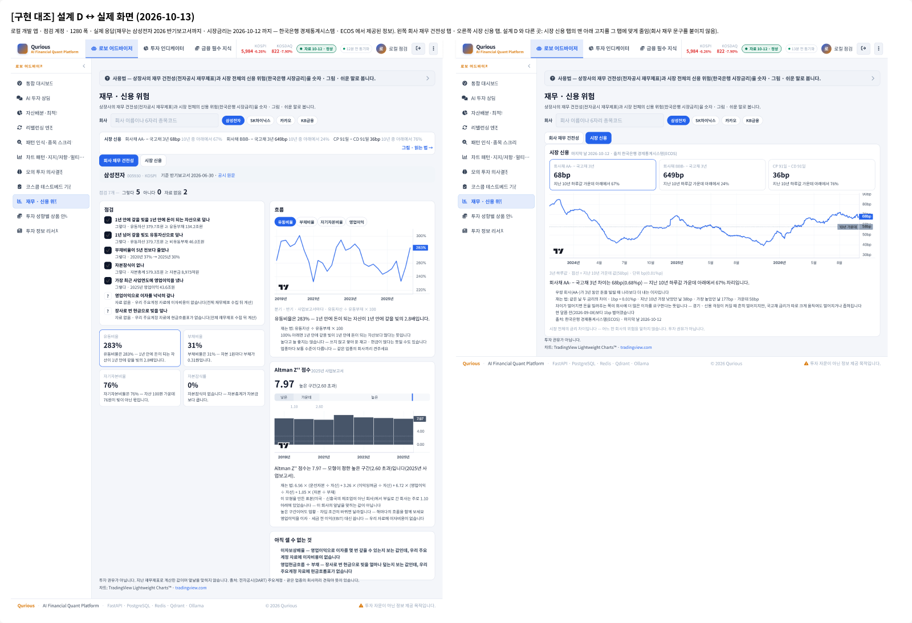

# 재무 · 신용 위험 — 지표 · 기준 · 출처 조사서 v0.1 — Qurious 로보 어드바이저

| 문서 정보 | |
|---|---|
| **판 · 상태** | v0.1 · 초안(검토 전) |
| **구분** | 조사 — 2차 로보 어드바이저 「신용 리스크 분석」 자리를 「재무 · 신용 위험」 으로 바꿀 때 쓴 지표 · 기준 · 자료 원천 · 이용 조건 |
| **작성** | 이동원(팀장) — 조사 초안 · 검수 전 |
| **검토** | 검토 전 |
| **최종 수정** | 2026-10-13 (KST) |
| **기준** | 조회일 2026-10-13 · 코드 `main` `8975696` + 이 조사로 만든 파일(`app/services/company_health.py` · `macro_credit.py` · `collector/ecos.py`) · 한국은행 ECOS 는 공식 샘플 키(`sample` — 한 번에 10줄)로 실제 응답을 받아 봤다 · 우리 수집 DB 는 열지 않았다(재무 계정 목록은 앱의 읽기 함수가 돌려준 응답으로 봄) |
| **관련 문서** | [API 명세서 `API-RISK-01` · `02`](../인터페이스/API명세서.md) · [UI 명세서 8절](../화면/UI명세서.md) · [공시 · 재무 · 뉴스 이용 조건 조사서](공시-재무-뉴스-이용조건-조사.md)(DART 재무의 시점 자료 · 판 고르기) · [상품 차트 · 근거 설명 조사서](상품차트-근거설명-조사.md)(숫자를 그림 + 쉬운 말로 · 차트 라이브러리 · 말투) |

> **이 문서로 알 수 있는 것**
> 1. 옛 화면이 왜 쓸모가 없었고, 무엇으로 바꿨나 (1절)
> 2. 회사 재무 건전성 숫자 넷과 점검 일곱 — 정의 · 우리 자료에서 셀 수 있는 것과 없는 것 (2 · 3절)
> 3. Altman Z'' — 식 · 경계 · 출처마다 다른 곳(상수 3.25) · 우리가 쓰는 꼴과 한계 (4절)
> 4. 자본잠식 — 거래소 기준을 판정에 쓰지 않는 까닭 (5절)
> 5. 시장 신용 — 한국은행 ECOS 시장금리 항목 · 실측 · 이용약관 원문 (6절)
>
> **읽는 순서** — 결정만: 요약 → 8절 · 구현: 2 · 4 · 6절 → API 명세서 · 화면 문구: 3.2 · 4.3

**확실도 표기** — 🟢 원문 · 실측으로 확인(약관 원문 · API 실제 응답 · 우리 코드가 돌려준 값) · 🟡 2차 자료 여럿이 같은 말(원 논문 · 공식 규정 원문은 못 엶) · 🔴 한 곳뿐이거나 서로 다름

## 요약

1. **옛 「신용 리스크 분석」 은 자료가 없는 화면이었다.** 개인 · 기업 CB(신용정보) 조건을 글로 만들어 범용 대화 API 에 물었고, 대화 쪽 도구가 비어 있는 CB 표를 되풀이 읽어 답이 약 2분 걸렸다. CB 원자료는 신용정보회사 것이라 우리가 모을 수 없다. → 우리가 이미 모으는 **전자공시(DART) 재무**와, 새로 받는 **한국은행 ECOS 시장금리**로 바꿨다.
2. **회사 쪽은 숫자 넷 + 점검 일곱 + Altman Z''** — 유동비율 · 부채비율 · 자기자본비율 · 자본잠식률. 점검은 해외 서비스의 「재무 건전성 6점검」 꼴(단기 · 장기 지급 능력 · 부채비율 추세 · 현금흐름 · 이자보상)을 따르되, DART 주요계정에 **현금흐름표 · 이자비용이 없어** 둘은 「자료 없음」 으로 남기고 숨기지 않는다(대신 영업이익 · 자본잠식 점검을 더함).
3. **Altman Z'' 는 보이되 한계 문장과 함께.** 식(6.56 · 3.26 · 6.72 · 1.05)과 경계(1.10 · 2.60)는 2차 자료가 모두 같다 🟡. 신흥시장 판의 상수 3.25 는 자료마다 붙거나 빠진다 — 우리는 붙이지 않고 경계도 원래 것을 쓴다. EBIT 자리에 영업이익을 넣는다(주요계정에 EBIT 이 없다).
4. **시장 쪽은 ECOS 표 `817Y002`(시장금리 · 일별)의 다섯 항목** — 국고채 3년 · 회사채 3년 AA- · BBB- · CD 91일 · CP 91일. 2026-10-12 실측: AA- − 국고채 3년 = 68bp · BBB- − 국고채 3년 = 649bp · CP − CD = 36bp 🟢. 약관은 상업적 이용을 허용하고(제5조①) **출처 표시를 의무로**(제7조②), 인증키 양도를 금한다(제6조②5) 🟢.
5. **판정 기준을 만들지 않는다.** 자본잠식 50% 같은 거래소 기준은 원문을 못 열었고(🟡) 시장마다 · 개정마다 달라, 점검은 「자본잠식이 없나」 사실만 답한다. 낱말도 「통과 · 실패」 가 아니라 「그렇다 · 아니다 · 자료 없음」(사용자 결정 2026-10-13).

---

## 1. 무엇을 바꿨나

**그림 1. 바꾼 화면 — 설계 D 의 실제 구현(2026-10-13 · 왼쪽 회사 재무 건전성 탭 · 오른쪽 시장 신용 탭)**

원본: [Figma · Qurious · 재무 · 신용 위험 · 05 쪽 「[구현 대조] 설계 D ↔ 실제 화면」](https://www.figma.com/design/Q9y9udfl92n9O7IJhOTUlI?node-id=17-2) · 숫자는 그날의 실제 응답(재무는 삼성전자 2026 반기보고서까지 · 시장금리는 2026-10-12 까지 — 한국은행 경제통계시스템 · ECOS 에서 제공된 정보) · 투자 권유가 아니다

**<표 1> 옛 화면과 새 화면**

| | 옛 「신용 리스크 분석」 | 새 「재무 · 신용 위험」 |
|---|---|---|
| 묻는 것 | 개인 CB(기간 · 성별 · 연령) · 기업 CB(기간 · 규모 · 업종 코드) 집계 | 상장사 한 곳의 재무 건전성 · 시장 전체의 신용 스프레드 |
| 자료 | 개인 · 기업 CB 표 — **비어 있음**(원자료는 신용정보회사 것 · 모을 길 없음) | 우리 DART 재무(매일 러너 · 시점 고정) · ECOS 시장금리(매일 러너) |
| 길 | 화면 → 범용 대화 API → 대화 도구가 빈 표를 되풀이 읽음 → 약 2분 뒤 글 | 화면 → 전용 API 둘(`API-RISK-01` · `02`) → 숫자 · 문장 · 출처 |
| 대화 쪽 | 옛 CB 도구 둘 | 같은 자리에 새 도구 둘(재무 건전성 · 신용 스프레드) · 같은 도구 되풀이를 막음 |

## 2. 회사 재무 건전성 — 숫자 넷

### 2.1 정의와 우리 자료

DART 「다중회사 주요계정」(재무상태표 · 손익계산서의 큰 줄만)에서 셀 수 있는 것만 쓴다. 우리 재무 자료에 실제로 들어 있는 계정은 아래와 같다(2026-10-13 · 앱의 재무 읽기 함수 응답) 🟢.

- 일반 회사(삼성전자 · 카카오): 유동자산 · 비유동자산 · 자산총계 · 유동부채 · 비유동부채 · 부채총계 · 자본금 · 이익잉여금 · 자본총계 · 매출액 · 영업이익 · 법인세차감전 순이익 · 당기순이익 · 총포괄손익
- 금융회사(KB금융): **유동 · 비유동 구분이 없고** 예수부채 · 보험계약부채 · 보험계약자산 · 파생상품자산 · 부채 · 당기손익-공정가치측정금융자산 · 순이자손익 · 이자수익 · 이자비용 · 순수수료손익이 있다

**<표 2> 숫자 넷**

| 숫자 | 식 | 쉬운 뜻 | 견줄 때 주의 | 확실도 |
|---|---|---|---|---|
| 유동비율 | 유동자산 ÷ 유동부채 × 100 | 1년 안에 갚을 빚을 1년 안에 돈이 되는 자산으로 얼마나 덮나 | 100% 는 정의에서 나오는 자리(둘이 같다)일 뿐 좋고 나쁨의 선이 아니다 · 업종마다 보통 수준이 다르다 | 🟢 정의 |
| 부채비율 | 부채총계 ÷ 자본총계 × 100 | 자기 돈 1원당 빌린 돈 | 업종마다 크게 다르다(설비 · 금융업은 높다) · 자본이 0 이하면 셀 수 없다 | 🟢 정의 |
| 자기자본비율 | 자본총계 ÷ 자산총계 × 100 | 자산 가운데 자기 돈의 몫 | 금융회사도 셀 수 있다(유동 구분이 필요 없다) | 🟢 정의 |
| 자본잠식률 | (자본금 − 자본총계) ÷ 자본금 × 100 · 0 아래면 0 | 손실로 처음 넣은 돈(자본금)이 얼마나 깎였나 | 100% 이상 = 완전 자본잠식 | 🟢 정의 · 🟡 거래소 쓰임(5절) |

### 2.2 금융회사 · 구분 없는 재무제표

은행 · 보험 · 증권은 예금 · 보험 같은 부채가 장사 밑천이고 유동 · 비유동 구분이 없다. 유동비율 · 부채비율 · Z'' 는 이 회사들에 뜻이 없어 **값 대신 까닭**을 보인다. 금융회사인지는 「유동 · 비유동 계정이 없음 + 금융업 계정(예수부채 · 보험계약부채 · 순이자손익 등)이 있음」 으로 가른다. 구분이 없는데 금융업 계정도 없으면 금융회사라 부르지 않고 「구분 없는 재무제표」 라고만 쓴다(잘못 이름 붙이지 않게).

### 2.3 시점 고정

재무는 **접수일 다음 거래일부터** 쓴 판만 쓴다(그날 장중에는 아직 몰랐다). 정정 공시가 나오면 그 뒤부터 새 값을 쓰고 그 기간에 「정정됨」 표시를 붙인다. 처음 보고된 값은 우리 자료에 남아 있지 않아 되살리지 않는다(결정 2026-10-13). 판 고르기는 데이터 API(`API-DATA-04`)와 같은 함수 한 곳에서만 한다.

## 3. 점검 일곱

### 3.1 참고한 꼴

해외 개인 투자자용 서비스 Simply Wall St 의 회사 화면 「Balance Sheet Health」 는 **점검 여섯의 점수**를 보이고, 그 아래를 단기 · 장기 지급 능력 · 부채비율 추이 · 영업현금흐름으로 덮는 빚 · 이자보상으로 나눈다 🟡(회사 화면 여러 장에서 같은 꼴 · 방법 설명 쪽은 못 엶 [6]).

### 3.2 우리 점검

**<표 3> 점검 일곱 — 질문 꼴 · 답은 「그렇다 · 아니다 · 자료 없음」**

| 열쇠 | 질문 | 무엇으로 | 우리 자료 |
|---|---|---|---|
| `short_term` | 1년 안에 갚을 빚을 1년 안에 돈이 되는 자산으로 덮나 | 유동자산 ≥ 유동부채 | 있음 |
| `long_term` | 1년 넘어 갚을 빚도 유동자산으로 덮나 | 유동자산 ≥ 비유동부채 | 있음 |
| `debt_trend` | 부채비율이 5년 전보다 줄었나 | 사업보고서 부채비율 — 가장 최근 해와 5년 전(없으면 가장 오래된 해 · 견준 해를 글로) | 있음 |
| `no_impairment` | 자본잠식이 없나 | 자본총계 ≥ 자본금 | 있음 |
| `operating_profit` | 가장 최근 사업연도에 영업이익을 냈나 | 사업보고서 영업이익 > 0 · 이어진 손실 해 수를 글로 | 있음 |
| `interest_coverage` | 영업이익으로 이자를 넉넉히 갚나 | 영업이익 ÷ 이자비용 | **없음** — 일반 회사 주요계정에 이자비용이 없다 |
| `ocf_coverage` | 장사로 번 현금으로 빚을 덮나 | 영업현금흐름 ÷ 부채 | **없음** — 주요계정에 현금흐름표가 없다 |

- 자료가 없는 둘은 **빼지 않는다**(숨기면 점검이 다섯뿐인 줄 안다). 「자료 없음」 + 까닭 + 응답의 `unavailable` 칸. 전체 재무제표(DART 단일회사 전체 재무제표)를 모으면 셀 수 있다 — 수집은 3차(결정 2026-10-13).
- 「통과 · 실패」 는 투자 판단 · 등급처럼 읽혀 쓰지 않는다. 신호등 색도 쓰지 않는다(✔ ✕ ? 모양과 글).

## 4. Altman Z''

### 4.1 식과 경계

**<표 4> Z'' — 출처 셋이 같은 것 · 다른 것** · 조회일 2026-10-13

| 항목 | 내용 | 확실도 |
|---|---|---|
| 식 | Z'' = 6.56 X1 + 3.26 X2 + 6.72 X3 + 1.05 X4 | 🟡 [1][2][3] 같음 |
| X1 ~ X4 | 운전자본 ÷ 총자산 · 이익잉여금 ÷ 총자산 · EBIT ÷ 총자산 · 자본(장부) ÷ 총부채 | 🟡 [1][2] 같음 |
| 경계 | 2.60 초과 · 1.10 ~ 2.60 · 1.10 미만 | 🟡 [1][2][3] 같음 |
| 쓰는 곳 | 제조업이 아닌 회사 · 신흥시장 회사(원래 Z 의 「매출 ÷ 총자산」 을 뺐다) | 🟡 [1][4] |
| **상수 3.25** | 신흥시장 판(Altman · Hartzell · Peck 1995)은 앞에 3.25 를 더한다는 자료가 둘, 빼는 자료가 하나 | 🔴 서로 다름 [2][3] · 원 논문 못 엶 [4] |

### 4.2 우리가 쓰는 꼴

- **상수 3.25 를 더하지 않는다.** 더하면 모든 점수가 3.25 오르는데 경계(1.10 · 2.60)는 더하지 않은 식의 것이라, 섞으면 거의 모든 회사가 「높은 구간」 이 된다.
- **EBIT 자리에 영업이익**(주요계정에 EBIT 이 없다) — 영업외 손익이 큰 회사는 차이가 난다. 문장에 적는다.
- **사업보고서만**(해마다) — 반기 · 분기 영업이익은 한 해치가 아니라 식에 넣으면 점수가 작게 나온다.
- 구간 이름은 「높은 · 가운데 · 낮은 구간」 — 「안전 · 부실」 이라고 부르지 않는다.

### 4.3 한계 문장(화면에 함께)

이 모형을 만든 표본(미국 · 신흥국의 제조업이 아닌 회사)에서 부실로 간 회사는 주로 1.10 아래에 있었다는 뜻일 뿐, 한국 회사의 부도 확률이 아니다 · 업종 · 회계 기준이 다르면 경계의 뜻도 달라진다 · 금융회사에는 쓰지 않는다.

## 5. 자본잠식 — 거래소 기준을 판정에 쓰지 않는 까닭

언론 보도로 본 거래소 기준(관리종목 · 실질심사)은 아래와 같다 🟡(규정 원문 · 거래소 표는 못 엶 [7][8]).

- 코스닥: 사업연도(반기) 말 자본잠식률 50% 이상이면 관리종목 · 두 번 이어지면 실질심사 · 완전 자본잠식은 퇴출 사유로 보도
- 유가증권시장: 두 해 이어 자본잠식률 50% 이상이면 실질심사 대상이 될 수 있음
- 2026-05 금융위원회 승인으로 반기 기준 완전 자본잠식 요건이 더해졌다는 보도 — 시행일 · 세부는 확인 못 함

시장마다 다르고 해마다 바뀌며 원문을 열지 못했다. 그래서 점검은 「자본잠식이 없나」(사실)만 답하고, 50% 같은 선을 화면에 그리지 않는다. 자본잠식률 숫자는 그대로 보인다.

## 6. 시장 신용 — 한국은행 ECOS

### 6.1 항목과 실측

ECOS 표 `817Y002` 「1.3.2.1. 시장금리(일별)」 — 항목 27개 중 다섯을 쓴다(공식 샘플 키로 항목 목록 · 값을 받아 확인) 🟢 [9].

**<표 5> 받는 다섯 항목**

| 열쇠 | 항목 코드 | 이름(ECOS) | 첫 날 | 2026-10-12 값 |
|---|---|---|---|---|
| `treasury_3y` | 010200000 | 국고채(3년) | 1998-11-13 | 3.921% |
| `corp_aa_3y` | 010300000 | 회사채(3년, AA-) | 1995-01-03 | 4.602% |
| `corp_bbb_3y` | 010320000 | 회사채(3년, BBB-) | 2000-09-30 | 10.409% |
| `cd_91d` | 010502000 | CD(91일) | 1995-01-03 | 3.24% |
| `cp_91d` | 010503000 | CP(91일) | 1995-01-03 | 3.60% |

**<표 6> 스프레드 셋 — 같은 날 두 금리가 다 있는 날만**

| 열쇠 | 식 | 2026-10-12 | 쉬운 뜻 |
|---|---|---|---|
| `aa` | 회사채 AA- − 국고채 3년 | 68bp | 우량 회사가 나라보다 더 내는 이자 |
| `bbb` | 회사채 BBB- − 국고채 3년 | 649bp | 투자등급 끝자리 회사가 더 내는 이자 |
| `cp_cd` | CP 91일 − CD 91일 | 36bp | 기업 단기 자금이 은행 단기 자금보다 비싼 정도 |

- 위치는 「지난 10년 하루값 가운데 같거나 낮은 날의 몫(%)」 으로 보인다 — 높고 낮음의 선을 만들지 않는다.
- 이 숫자는 **시장 전체**의 금리 차이다. 어느 한 회사의 위험이 아니다(화면 고지).

### 6.2 API 의 꼴 — 실측으로 확인한 것 🟢

- 인증키는 **주소 경로**에 들어간다: `/api/StatisticSearch/{키}/json/kr/{시작}/{끝}/817Y002/D/{첫날}/{끝날}/{항목}` → 오류 글 · 로그에서 키를 지운다(수집기).
- 오류도 HTTP 200 으로 오고 본문의 `RESULT.CODE` 로 갈린다(예: 샘플 키로 100줄을 부르면 `ERROR-301` 「sample은 최대 10건 이내」).
- **없는 항목 코드도 「자료 없음」(`INFO-200`) 으로 온다** — 거래일이 들어 있을 긴 기간이 비면 실패로 다룬다(코드가 틀린 것을 「오늘은 자료가 없다」 로 넘기지 않게).

### 6.3 이용약관 원문 🟢

ECOS 화면 아래 「경제통계 Open API 이용약관」(2020-11-05 시행) [10] — 우리에게 닿는 조항:

| 조 | 원문(그대로) | 우리에게 |
|---|---|---|
| 제2조 3 | "“이용자” 란 제공된 공유서비스를 직접 이용하거나 새로운 창작물의 일부로 재가공하여 배포하는 자를 말합니다." | 화면 · 대화 답에 가공해 보이는 것이 상정된 쓰임 |
| 제4조 ③ | "Open API 서비스의 이용기간은 제공기관이 인증키를 발급한 날부터 2년으로 하며, … 2년 단위로 연장할 수 있습니다." | 키 만료일을 관리자 할 일에 적는다 |
| 제5조 ① | "이용자는 통계정보를 상업적으로 이용할 수 있습니다. 다만 상업적인 이용을 제한하는 통계정보를 … 승인을 받은 후에 이용하여야 하며 …" | 시장금리는 제한 표시 없음 — 쓸 수 있다 |
| 제6조 ② 5 | "Open API 인증키의 양도, 증여 및 담보 목적물 사용" (중단 · 조치 사유) | 키는 받은 사람 PC 의 `.env` 에만 · 팀원에게 넘기지 않는다(팀원은 각자 신청) |
| 제7조 ② | "이용자는 통계정보를 이용하는 경우 ECOS에서 제공된 정보임을 표시하여야 합니다." | 화면 · 응답 `source` · 대화 도구 답에 출처 표시 |
| 제9조 ⑤ | "제공기관은 통계정보의 계속적 제공 또는 추가되는 통계정보의 지속적 제공을 보장하지 않습니다." | 항목이 사라지면 수집기가 실패로 알린다(조용히 비지 않게) |

## 7. 화면에 쓴 것 — 말투

- 문장 · 점검 까닭은 서버가 숫자와 함께 만든다(화면은 그대로) — 숫자 · 문장이 어긋나지 않게.
- 돈은 조원 · 억원 꼴(379,711,982,000,000 같은 날숫자를 쓰지 않는다).
- 권유 낱말(추천 · 매수 · 안전한 등)을 쓰지 않는다 · 모든 화면 끝에 「투자 권유가 아닙니다」 · 「같은 업종의 회사끼리 견줘야 뜻이 있습니다」.

## 8. 뒤집을 조건

| 지금 | 뒤집을 때 |
|---|---|
| 이자보상 · 현금흐름 점검은 「자료 없음」 | DART 전체 재무제표를 모으면(3차) 셀 수 있다 — 점검 기준(예: 이자보상 몇 배)은 그때 다시 조사 |
| 업종과 견주지 않는다 | 섹터 파일(11섹터)로 같은 섹터 가운데 값을 낼 수 있다 — 표본이 작은 섹터를 어떻게 보일지 먼저 |
| Z'' 상수 3.25 를 더하지 않음 | 원 논문(1995)을 열어 신흥시장 판의 경계가 따로 있음이 확인되면 그 판으로 |
| 거래소 기준선을 그리지 않음 | 거래소 규정 원문 · 시행일을 확인하면 「관리종목 기준(시장별)」 을 참고 줄로 |
| 시장 신용은 국내만 | 미국 · 코인으로 넓힐 때(사용자 2026-10-13 기억) — 미국은 FRED 의 회사채 스프레드 계열이 같은 자리 · 이용 조건 조사 먼저 |

## 9. 한계

- Z'' 계수 · 경계는 2차 자료로만 확인했다(원 논문 못 엶). 상수 3.25 는 자료마다 다르다.
- 거래소 자본잠식 기준은 보도로만 봤다.
- 「점검 여섯」 꼴은 Simply Wall St 의 회사 화면에서 본 구조이고, 그 서비스의 기준값(예: 이자보상 몇 배)은 확인하지 않았다 — 우리는 그 기준값을 쓰지 않는다.

## 출처

| 번호 | 출처 | 조회일 | 확실도 |
|---|---|---|---|
| [1] | metricgate — Altman Z-Score(식 · 경계) <https://metricgate.com/docs/altman-z-score/> | 2026-10-13 | 🟡 2차 |
| [2] | Wall Street Prep — Altman Z-Score <https://www.wallstreetprep.com/knowledge/altman-z-score> | 2026-10-13 | 🟡 2차 |
| [3] | ETF Trends — The Altman Z-Score <https://www.etftrends.com/advisor-solutions-content-hub/the-altman-z-score/2/> | 2026-10-13 | 🟡 2차 |
| [4] | Altman · Hartzell · Peck (1995) "Emerging market corporate bonds: A scoring system" — 참고문헌 목록에서만 확인(원문 못 엶) · 예: <https://eumed.net/tesis-doctorales/2010/aim/MODELO%20ALTMAN.htm> | 2026-10-13 | 🔴 원문 없음 |
| [5] | 우리 재무 읽기 함수 응답(삼성전자 · 카카오 · KB금융 계정 목록) | 2026-10-13 | 🟢 실측 |
| [6] | Simply Wall St 회사 화면 「Balance Sheet Health」 여러 장(예: <https://simplywall.st/stocks/de/utilities/etr-sct/sse-shares/health>) | 2026-10-13 | 🟡 화면 구조 |
| [7] | 아주경제 「[공시학개론] 자본잠식 대해부」 <https://www.ajunews.com/view/20240401214823595> | 2026-10-13 | 🟡 보도 |
| [8] | 2026 코스닥 상장폐지 기준 정리(보도 · 블로그) <https://brunch.co.kr/@bexy00/528> · <https://www.heraldk.com/article/2026080602401474486> | 2026-10-13 | 🟡 보도 |
| [9] | 한국은행 ECOS Open API — `StatisticTableList` · `StatisticItemList` · `StatisticSearch` 공식 샘플 키 실제 응답 <https://ecos.bok.or.kr/api/> | 2026-10-13 | 🟢 실측 |
| [10] | 한국은행 경제통계 Open API 이용약관(2020-11-05 시행) — ECOS 화면 아래 「경제통계 Open API 이용약관」 이 부르는 공개 호출로 받은 원문 | 2026-10-13 | 🟢 원문 |

## 개정 이력

| 판 | 날짜 | 무엇이 바뀌었나 | 왜 |
|---|---|---|---|
| v0.1 | 2026-10-13 | 처음 — 옛 화면 진단 · 숫자 넷 · 점검 일곱 · Altman Z'' · 자본잠식 기준 · ECOS 항목 · 실측 · 약관 원문 · 뒤집을 조건 | 「신용 리스크 분석」 을 「재무 · 신용 위험」 으로 바꾸기 전에 지표 · 자료 · 이용 조건을 확인 |
