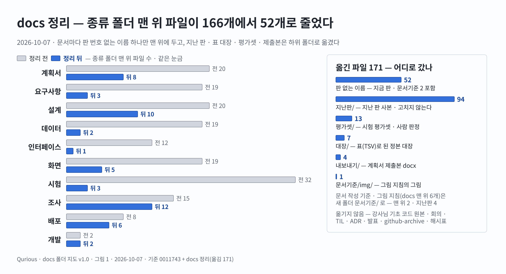
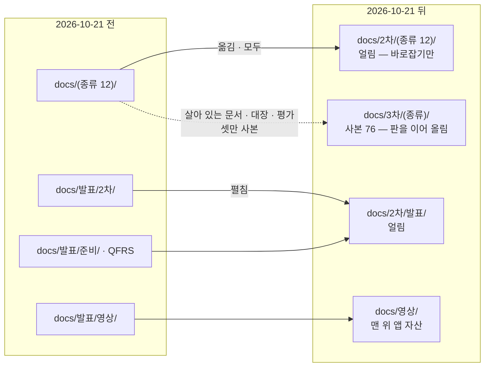
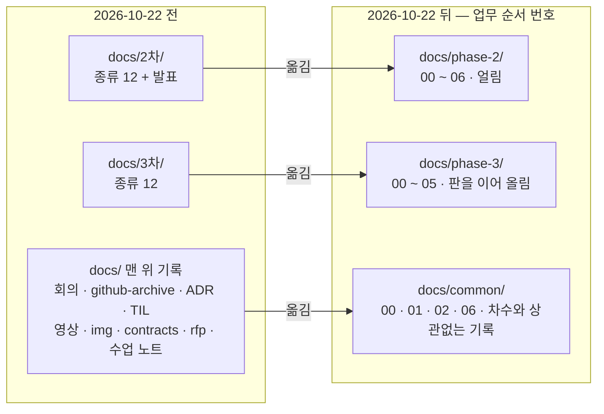
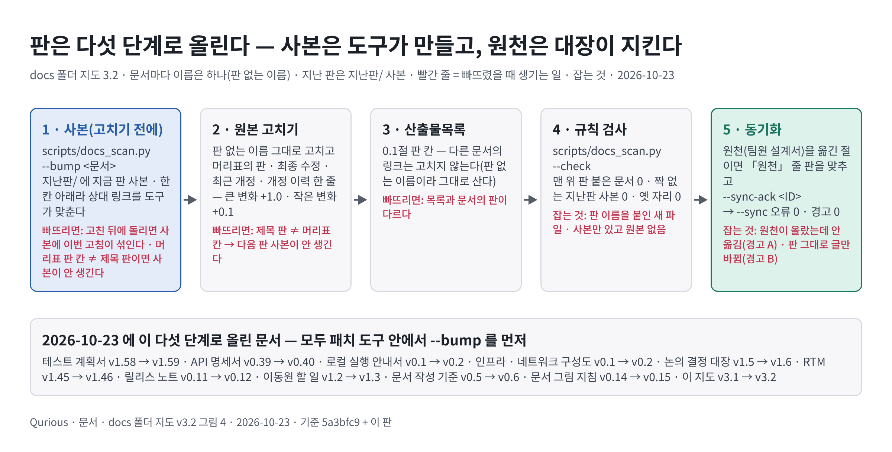

# docs 폴더 지도 — Qurious

| 문서 정보 | |
|---|---|
| **판 · 상태** | v3.4 · 루트 낱장 마크다운 넷(`onprem.md` · `pipeline.md` · `screening.md` · `tradingview.md`)을 `common/` 의 references 로 옮김 — 7절 <표 7-2>(2026-10-31 · 사용자 결정) · 앞 판의 글은 개정 이력 아래 표 |
| **구분** | 8. 개발 · 형상 관리 — 문서의 자리 · 이름 · 판 |
| **작성** | 이동원(팀장) |
| **검토** | 검토 전 — 정리 PR 에 팀원 한 명 이상의 「읽었음」 을 받는다 |
| **최종 수정** | 2026-10-31 (KST) |
| **기준** | v3.2 는 3.2 <그림 4>(Figma `77:47` · 이 판) · v3.1 은 3.2 판 올리기 다섯째 단계(동기화 점검 `docs_scan.py --sync` · 2026-10-23 결정) · v3.0 은 코드 `main` `c9bd397`(#313 머지) + 번호 폴더(옮김 1,676 · 새로 깨진 상대 링크 0 — 7절) · v2.0 은 코드 `main` `e819cd2`(2차 최종 머지 #310 · 태그 `phase2-final-2026-10-21`) + 차수 폴더 정리(옮김 899 · 3차 사본 76 · 새로 깨진 상대 링크 0 — 4.1절) · v1.x 는 `main` `0011743` + 2026-10-07 정리(옮긴 파일 171 · 정리 전부터 깨져 있던 상대 링크 15 는 그대로 — 4.2절) |
| **관련 문서** | [산출물목록](산출물목록.md) · [문서 작성 기준](phase-3/00-management/standards/문서작성기준.md) · [문서 그림 지침](phase-3/00-management/standards/문서그림지침.md) · [기록 색인](common/00-management/github-archive/README.md) |

> **이 문서가 답하는 질문**
> 1. 어떤 문서가 어느 폴더에 있나 — 2차 · 3차 가운데 어디를 고치나?
> 2. 판을 올릴 때 무엇을 하나 — 지난 판은 어디에 남나?
> 3. GitHub 글에 걸린 옛 주소(`…/docs/3차/시험/…` · `…/docs/시험/…` · `…_v1.12.md`)는 어디로 갔나?
>
> **읽는 순서** — 팀원: 2절 → 3절 · 옛 링크를 따라온 사람: 7절(2026-10-22) → 6절(2026-10-21) → 5절(2026-10-07) · 처음 온 사람: 1절 그림

---

## 1. 한눈에 — 세 번의 정리

**2026-10-07 — 판 없는 이름.** 종류 폴더 맨 위에 판마다 파일이 쌓여(테스트 계획서 16판 · RTM 13판 · 시험 폴더 한 곳에 32파일) 원하는 문서를 찾기 어려웠다. 2026-10-07 에 문서마다 이름 하나만 맨 위에 두고, 지난 판 · 표 대장 · 평가셋 · 제출본을 하위 폴더로 나눴다.



**<그림 1> docs 정리 전후 — 종류 폴더 맨 위 파일 166 → 52**
원본: Figma 「Qurious · 문서 그림」 · 페이지 「[작업 중] docs 폴더 지도 v1.0」 · Design [`45:3`](https://www.figma.com/design/6lstWS4YwuhJPhGB9XoBMD?node-id=45-3) · 기준 `0011743` + 이 정리 · 숫자는 정리 전 `git ls-tree HEAD` · 정리 뒤 폴더를 직접 셌다

**2026-10-21 — 차수 폴더.** 2차(10-01 ~ 10-21)를 닫으며 문서를 차수로 나눴다. 2차에 쓴 문서는 모두 `2차/` 로 옮겨 그날 판 그대로 얼리고, 3차(10-22 ~ 11-11)에도 고치는 문서만 `3차/` 에 사본을 만들어 거기서 판을 이어 올린다(<그림 2> · 6절). 날짜 · 번호로 쌓이는 기록(TIL · github-archive · 회의 · ADR)은 차수와 상관없어 맨 위에 그대로 두었고, 앱 사용법 창 · 녹화 도구가 3차에도 쓰는 시연 영상은 맨 위 `영상/` 으로 옮겼다. 옮기기 전 모습은 태그 `phase2-final-2026-10-21` 로 언제든 다시 본다 — [`…/tree/phase2-final-2026-10-21/docs`](https://github.com/EST-team-project/Qurious/tree/phase2-final-2026-10-21/docs).



**<그림 2> 차수 폴더 — 옮김(실선) · 3차 사본(점선)**
원본: 이 Mermaid 코드(문서와 함께 고친다) · 숫자는 옮기기 도구 미리 보기(옮김 899 · 3차 사본 76 · 2026-10-21)


**2026-10-22 — 번호 폴더.** 강사님 피드백 「일반인은 업무 순서를 모르니 폴더에 번호를 매기고, 분석 · 설계 · 테스트 밖의 자료 성격은 합쳐 7 ~ 8개로」 에 따라 차수 안 종류 폴더를 업무 순서 번호 묶음 일곱(00 관리 · 01 분석 · 02 설계 · 03 개발 · 04 테스트 · 05 배포 · 06 회고 · 최종 보고)으로 합쳤다. 여러 종류를 묶은 번호 폴더 안에는 옛 종류를 하위 폴더로 두고(02-design/ui), 차수와 상관없는 기록(회의 · github-archive · ADR · TIL · 영상 · 그림 · 계약 · 제안요청서)도 `common/` 의 같은 번호로 옮겼다. 이름은 실무 관행(영어 소문자 · 하이픈 · 두 자리 번호)을 따랐다 — 7절.



**<그림 3> 번호 폴더 — 차수 안은 업무 순서 번호, 차수 밖 기록은 common**
원본: 이 Mermaid 코드(문서와 함께 고친다) · 숫자는 7절(옮김 1,676 · 2026-10-22)

---

## 2. 폴더 지도 (2026-10-22 번호 폴더)

```text
docs/
├─ README.md             이 문서 — 폴더 지도 · 이름 · 판 규칙 · 옮긴 자리
├─ 산출물목록.md          정본 색인 — 문서마다 지금 판(0.1절) · 2차 최종 판(0.1-1절) · 상태
├─ phase-3/              3차(10-22 ~ 11-11)에 고치는 문서 — 판을 여기서 이어 올린다
│  ├─ 00-management/     관리 — plans/(계획서 · WBS · 스프린트 · 파트별 할 일) · standards/(문서 작성 기준 · 그림 지침)
│  ├─ 01-analysis/       분석 — requirements/(RTM · 유스케이스 · 대장/) · research/(조사서 · 배경조사/)
│  ├─ 02-design/         설계 — system/(기능 설계 · 동작 원리 · 목표 기능 설계 · 대장/) · data/(ERD · 데이터 사전 · 대장/) · ui/(IA · UI 명세 · 와이어프레임) · api/(API 명세서 · 대장/)
│  ├─ 03-development/    개발 — conventions/(코딩 표준 · 코드 리뷰 기록) · data-collection/(데이터 수집 안내)
│  ├─ 04-testing/        테스트 — 테스트 계획서 · 백테스트 보고서 · 검증 기록 · 평가셋/ · 깨보기/ · 대장/
│  └─ 05-deployment/     배포 · 운영 — 배포 계획서 · 로컬 실행 안내서 · 릴리스 노트 · 장애 대응 절차서
├─ phase-2/              2차(10-01 ~ 10-21)를 닫은 판 — 얼림(바로잡기만 · 3.3절) · 같은 번호 00 ~ 05
│  └─ 06-retrospective/  2차 발표 — 발표자료.html(한 파일 판) · 발표자료-원본.html · 질의응답 · 그림/ · media/ · 준비/
├─ common/               차수와 상관없이 쌓이는 기록 — 같은 번호
│  ├─ 00-management/     meetings/(팀 대화방 글) · github-archive/(올린 이슈 · 댓글 · PR 본문 · 색인) · commit-map-2026-09-23.tsv
│  ├─ 01-analysis/       references/(제안요청서 rfp-1 · rfp-2 · 수업 노트 01 ~ 05 · 개념 노트 screening · tradingview)
│  ├─ 02-design/         adr/(설계 결정 기록) · contracts/(KIS 자동매매 API 계약) · references/(강사님 설계서 사본 onprem · pipeline) · img/(README 첫 그림 · 폴더 지도 그림) · supabase_schema.sql
│  └─ 06-retrospective/  videos/(시연 영상 — 앱 사용법 창 · 녹화 도구가 읽음) · til/(TIL)
├─ _git-drafts/          개인 git 초안 — git bash · 다음 세션 프롬프트 · 일회용 도구 · 실행 로그만 · 올리지 않는다(.gitignore · 3.3절)
└─ _local/               개인 로컬 자료(섹터 xlsx · 강의 양식 docx · git-drafts-개인/ · 외부원문/) — 올리지 않는다(.gitignore · 3.3절)
```

**<표 1> 번호 묶음 — 업무 순서**(강사님 피드백 · 사용자 결정 2026-10-22 · 7절)

| 번호 | 폴더 | 뜻 | 안의 종류(차수 안 / common) |
|:-:|---|---|---|
| 00 | `00-management` | 관리 · 행정 — 팀 운영 · 일정 · 문서 규칙 | plans · standards / meetings · github-archive |
| 01 | `01-analysis` | 분석 — 요구사항 · 조사 | requirements · research / references |
| 02 | `02-design` | 설계 — 시스템 · 데이터 · 화면 · API | system · data · ui · api / adr · contracts · img · references |
| 03 | `03-development` | 개발 — 코딩 표준 · 리뷰 · 수집 안내 | conventions · data-collection |
| 04 | `04-testing` | 테스트 · 검증 | 번호 폴더가 곧 종류 |
| 05 | `05-deployment` | 배포 · 운영 | 번호 폴더가 곧 종류 |
| 06 | `06-retrospective` | 회고 · 최종 보고 — 발표 · 영상 · TIL | 2차 발표 / videos · til |

**<표 1-0> 종류 폴더 안 — 무엇을 어디에 두나**(2차 · 3차 모두 같은 꼴 — 예의 `phase-3/` 는 지금 고치는 자리, `phase-2/` 는 얼린 자리)

| 자리 | 담는 것 | 판 | 예 |
|---|---|---|---|
| (맨 위) | 문서마다 **판 번호 없는 이름 하나** — 머리표의 판이 최신이다 | 머리표 · 개정 이력 | `phase-3/04-testing/테스트계획서.md` |
| `지난판/` | 지난 판 사본 `<이름>_v<판>.md` — 넣은 뒤에는 고치거나 옮기지 않는다 | 이름에 | `phase-3/04-testing/지난판/테스트계획서_v1.52.md` |
| `대장/` | 표(TSV)로 된 정본 대장 — 한 파일을 고쳐 간다(스캐너 · 시험이 읽는 것은 3차 쪽) | 없음 | `phase-3/01-analysis/requirements/대장/시험-요구대장.tsv` |
| `평가셋/` | 평가셋 · 사람 판정 · 표본 밖 질문 — 테스트 폴더만 | 이름에 — 평가 도구가 판 이름으로 읽는다 | `phase-3/04-testing/평가셋/근거검색-평가셋_v1.tsv` |
| `내보내기/` | 다른 형식으로 낸 제출본(docx) — 계획서 폴더만 | 이름에 | `phase-2/00-management/plans/내보내기/프로젝트계획서_v2.0.docx` |
| `img/` | 그림 PNG · SVG — 이름에 그림 판을 붙인다 | 이름에 | `phase-2/02-design/ui/img/collect-decisions_v1.3.png` · 3차 새 그림은 `phase-3/<번호>-<묶음>[/<종류>]/img/` |
| `배경조사/` | 조사 · 분석 작업 기록 — 그때 쓴 그대로 · 맨 위 주석에 원래 자리 · 정본 — 조사 폴더만 | 없음(이름에 날짜) | `phase-3/01-analysis/research/배경조사/<날짜>-<주제>/` |
| `깨보기/` | 깨 보기 결과 표(대조군 · 깬 것 · 잡은 시험) — 테스트 폴더만 | 없음(이름에 날짜) | `phase-2/04-testing/깨보기/2026-10-16-상품안내-비중자동/깨보기-결과.md` |
| `설계안/` | 화면 안 여럿을 실제 앱 캡처와 함께 견주는 설계안 — `<날짜>-<주제>/설계안.md` + `img/` · 화면 폴더만 | 문서 머리표에 | `phase-2/02-design/ui/설계안/` |

### 2.1 무엇을 찾으면 어디로 (2026-10-19 · 차수 폴더 2026-10-21 · 번호 폴더 2026-10-22)

사용자 피드백(2026-10-19): 조사 · 그림은 docs 의 종류 폴더 하위로 세션마다 바로 둔다(초안 폴더 `_git-drafts` 에 쌓지 않는다).

**<표 1-1> 찾는 길**

| 찾는 것 | 어디 |
|---|---|
| 3차에 고치는 문서(계획서 · RTM · 설계서 · API 명세서 · UI 명세서 · 테스트 계획서 …) | `phase-3/<번호>-<묶음>[/<종류>]/<이름>.md` — <표 1> |
| 2차를 닫은 판(그날 판 그대로) | `phase-2/<번호>-<묶음>[/<종류>]/<이름>.md` · 산출물목록 0.1-1절 · 태그 `phase2-final-2026-10-21`(옛 경로) |
| 조사서(정본) | `phase-2/01-analysis/research/<이름>-조사.md` · 색인 같은 폴더 `README.md` — 3차에 고칠 때는 3차로 사본(3.4절) |
| 조사 · 분석 작업 기록 · 점검 결과 · 팀원 설계 초안(검토 전) | 3차: `phase-3/01-analysis/research/배경조사/<날짜>-<주제>/` · 2차: `phase-2/01-analysis/research/배경조사/` |
| 발표 자료(덱 · 질의응답 · 완성 그림 · 준비 기록) | 2차: `phase-2/06-retrospective/` · 3차 발표: `phase-3/06-retrospective/`(처음 쓸 때 생김) |
| 시연 영상 안내 · 장면 파일 · mp4 | `common/06-retrospective/videos/` |
| 깨 보기 결과 표 | 3차: `phase-3/04-testing/깨보기/<날짜>-<묶음>/` · 2차: `phase-2/04-testing/깨보기/` |
| 팀 대화방에 올린 글 | `common/00-management/meetings/` |
| 올린 GitHub 글(이슈 · 댓글 · PR 본문) | `common/00-management/github-archive/<날짜>/<글 폴더>/` · 색인 같은 폴더 `README.md` |
| 설계 결정 기록(ADR) · 계약 · README 그림 | `common/02-design/adr/` · `common/02-design/contracts/` · `common/02-design/img/` |
| TIL | `common/06-retrospective/til/` |
| (개인 · 올리지 않음) 지시서 · 요청 원문 · 사적인 글 | `_local/git-drafts-개인/` |
| (개인 · 올리지 않음) git bash · 커밋 메시지 · 명령 · 다음 세션 프롬프트 · 도구 · 로그 | `_git-drafts/<날짜>-S<번호>/` |

---

## 3. 이름 · 판 규칙

### 3.1 새 문서

3차 종류 폴더 맨 위(`phase-3/<번호>-<묶음>/<종류>/` — 04 · 05 는 번호 폴더 바로 아래)에 판 번호 없는 이름으로 만들고, 머리표에 `v0.1` 을 적는다. 산출물목록 0.1절에 한 줄을 더한다. 2차 폴더(`phase-2/`)에는 새 문서를 만들지 않는다(얼림 · 3.3절). 묶음 폴더 바로 아래(`02-design/` 처럼 종류가 여럿인 번호 폴더)에는 문서를 두지 않는다 — `docs_scan --bump` 가 멈춘다.

### 3.2 판 올리기 (다섯 단계)

| 단계 | 할 일 | 명령 · 확인 |
|:-:|---|---|
| 1 | 지금 파일을 `지난판/<이름>_v<지금 판>.md` 사본으로 만든다 | `python scripts/docs_scan.py --bump docs/phase-3/<번호>-<묶음>[/<종류>]/<이름>.md` — 사본은 한 칸 아래 폴더라 상대 링크를 새 자리에 맞춰 쓴다 |
| 2 | 같은 파일(판 없는 이름)을 고치고 머리표의 판 · 최종 수정 · 개정 이력을 올린다 | 큰 변화는 X.0 → (X+1).0, 작은 변화는 +0.1 |
| 3 | 산출물목록 0.1절의 판 칸을 고친다 | **다른 문서의 링크는 고치지 않아도 된다** — 최신을 가리키는 이름이 그대로라서 |
| 4 | 규칙 검사 | `python scripts/docs_scan.py --check` — 맨 위의 판 붙은 문서 0 · 짝 없는 지난판 사본 0 · 옛 자리(`docs/2차` · `docs/3차` · `docs/<옛 종류>` · 옛 맨 위 기록)에 남은 문서 0 |
| 5 | 원천이 있는 통합 문서면 동기화 점검 | 팀원 설계서를 옮기거나 가리키는 절이면(동기화 대장 `phase-3/01-analysis/requirements/대장/설계-동기화.tsv` 에 줄이 있다) 절 머리 「원천」 줄의 판을 맞추고 `python scripts/docs_scan.py --sync-ack <ID>` → `python scripts/docs_scan.py --sync` 오류 0 · 경고 0 — 원천이 올랐거나(경고 A) 판은 그대로인데 절 글이 바뀌었으면(경고 B) 읽고 옮길 일이다(머지는 막지 않는다) |

- **링크를 걸 때** — 같은 번호 폴더 안 3차 문서끼리는 `../ui/IA.md`, 다른 번호 폴더는 `../../04-testing/테스트계획서.md`(04 · 05 는 한 칸 덜), 2차 판은 `../../../phase-2/<번호>-<묶음>/<종류>/<이름>.md`, 그때의 판을 가리키려면 `지난판/<이름>_v<판>.md`.
- GitHub 글 · 대화방 글에는 지금 문서를 `…/blob/main/docs/phase-3/<번호>-<묶음>[/<종류>]/<이름>.md` 로 건다. 2026-10-22 전 주소는 7절 표로, 2차 최종 판은 태그 `phase2-final-2026-10-21`(그 태그 안에서는 옛 경로 `…/docs/<종류>/<이름>.md`)로 본다.
- 판 이름을 붙인 채 맨 위에 새 파일을 만들지 않는다. `--check` 가 잡는다.

다섯 단계와 각 단계를 빠뜨렸을 때 생기는 일은 <그림 4> 와 같다.



**<그림 4> 판 올리기 다섯 단계 — 빠뜨리면 생기는 일 · 잡는 것**
원본: Figma 「Qurious · 문서 그림」 · 페이지 「[작업 중] docs 폴더 지도 v3.2」 · Design [`77:47`](https://www.figma.com/design/6lstWS4YwuhJPhGB9XoBMD?node-id=77-47) · 기준 `5a3bfc9` + 이 판 · 2026-10-23

### 3.3 예외 — 얼림의 예외 · 주의

| 경로 | 이유 |
|---|---|
| `common/01-analysis/references/`(01 ~ 05 · rfp-1 · rfp-2 · screening · tradingview) · `common/02-design/references/`(onprem · pipeline — **글은 같고 안의 상대 링크 접두만 우리 고침**: 강사님 판은 루트 기준이라 `app/…` 앞에 `../../../../` 를 붙였다. 기초 코드를 다시 반영할 때 이 두 파일은 링크 줄만 충돌할 수 있다) · `common/02-design/supabase_schema.sql` · `common/02-design/contracts/` | 강사님 기초 코드 원본과 바이트까지 같다 — 2026-10-21 까지는 3-way 병합 때 경로가 같도록 맨 위에 두었으나, 2026-10-22 사용자 결정(「전부」)으로 옮겼다. **기초 코드를 다시 반영할 때는 강사님 판의 `docs/<이름>` 을 이 자리로 대응한다(7절 <표 7-2>)**. 계약은 세 저장소 공통이지만 다른 저장소는 자기 사본을 둔다 |
| `common/00-management/commit-map-2026-09-23.tsv` | 계정 이관 해시표 — 팀장 작업 규칙이 가리키는 파일(옛 경로는 7절로 바꿔 읽는다) |
| `common/` 기록(meetings · github-archive · adr · til) | 날짜 · 번호로 쌓이는 기록 — 차수와 상관없다. 글 속 옛 경로는 그때 글 그대로 둔다(링크만 고침 · 7절) |
| `common/06-retrospective/videos/` | 앱 사용법 창 · 녹화 도구 · 시험이 3차에도 이 자리를 읽는다(3차에 다시 찍어도 얼린 2차를 고치지 않게) |
| `phase-2/02-design/ui/img/v0.2/` · `phase-2/02-design/ui/img/ui-spec/` 의 옛 판 그림 | 지난판 사본(IA · 와이어프레임 · UI 명세서)이 이 경로를 부른다 — 옮기거나 지우지 않는다 |
| `_local/` · `_git-drafts/` | 커밋하지 않는 개인 자료 · 팀장 개인 git 초안 — `.gitignore` 로 올리지 않으므로 팀원 PC 에는 없다(번호 폴더 밖 · 이름 그대로) |
| **2차 얼림의 예외** | ① 완료보고서(`phase-2/00-management/plans/완료보고서.md`) — 팀원 칸(3 · 7절)을 10-24 까지 이 자리에서 채운다 · 3차 사본은 그 뒤 `--to3` 로(3.4절) ② 2차 문서의 틀린 사실 바로잡기(판을 올리지 않고 개정 이력에 한 줄) ③ **화면 설계 소급 절**(2026-10-30 · 사용자 결정) — [화면 대장](phase-3/02-design/ui/화면대장.md)의 묶음마다 2차 UI 명세서에 새 절을 더하고 판을 올린다(v0.30 = 16장 · v0.31 = 17장 …). 틀린 사실 바로잡기가 아니라 새 절이라 ② 와 따로 둔다 · 조건: 절 머리에 「소급 작성 · <날짜> · 기준 태그 `phase2-final-2026-10-21`」 을 밝히고 내용은 그 태그 코드에서만 읽는다(그 뒤의 변화는 3차 문서의 「2차 → 3차 차이」 로) · 머리표 · 개정 이력 · 화면 대장 · 산출물목록에 소급임을 적는다 · `docs_scan.py --bump` 가 내는 「2차는 얼린 자리다」 경고는 이 경우 알려진 경고다 |

### 3.4 2차에만 있는 문서를 3차에 고칠 때 (2026-10-21 · 경로 2026-10-22)

조사서 · 완료보고서처럼 3차 사본을 만들지 않은 문서는 고치기 전에 한 번 3차로 사본을 만든다.

1. `python scripts/docs_scan.py --to3 docs/phase-2/<번호>-<묶음>[/<종류>]/<이름>.md` — `phase-3/` 의 같은 자리에 사본이 생긴다. 상대 링크는 새 자리에 맞추고, 가리키던 2차 문서에 3차 사본이 있으면 3차를 가리킨다.
2. 3차 사본을 고치고 판을 올린다(3.2절 2 ~ 4). 산출물목록 0.1절에 그 줄이 없으면 더한다.
3. 2차 원본은 그대로 둔다(얼림) — 2차 판 전체는 태그 `phase2-final-2026-10-21` 로도 다시 본다.

---

## 4. 링크를 어떻게 고쳤나

### 4.0 2026-10-22 번호 폴더

옮기기 도구가 옛 자리 → 새 자리 지도로 파일을 옮기고, 상대 링크를 옛 자리 기준으로 풀어 새 자리 기준으로 다시 썼다 — 숫자 · 규칙은 7절. 사본 저장소에서 같은 도구 · 같은 인자로 먼저 돌려 「새로 깨진 링크 0 · 다시 돌리면 0곳 · 옛 폴더 0」 을 보고, 작업 트리에 적용한 결과가 사본과 글 파일 2,074개 모두 바이트까지 같은지 견줬다.

### 4.1 2026-10-21 차수 폴더

| 링크 | 처리 | 수 |
|---|---|--:|
| 저장소 안 문서의 상대 링크 | 옛 자리로 대상을 풀고 새 자리로 다시 썼다. 가리킬 쪽 — 3차 사본 · 맨 위 살아 있는 문서(이 문서 · 산출물목록 · `영상/`) · docs 밖 파일(README · 코드 주석)은 3차에 사본이 있으면 3차, 없으면 2차 / 2차 문서 · 기록(TIL · 회의 · ADR · github-archive) · 산출물목록 0.1-1절은 2차 | 2,566 |
| 글 속 전체 경로(`docs/…` 글자) | 3차 사본 · 맨 위 살아 있는 문서 · `영상/` · docs 밖 파일에서만 새 자리로 — 2차 · 기록 안의 글자는 그때 글 그대로 | 367 |
| GitHub 절대 주소(`…/blob/main/docs/…`) | 올린 글 보관본 밖에서만 새 자리로(대화방 안내 글 · 계획서 지난판) | 29 |
| 코드 · 시험 · 스크립트 속 경로 조각(`"docs" / "시험"`) | 대장 · 평가셋 · 스캐너가 쓰는 문서는 3차로 · 발표는 2차 · 영상은 맨 위 | 34 조각 + 주석 |
| **올린 글 보관본**(`github-archive/<날짜>/`) 속 `blob/main/docs/…` | **고치지 않았다** — 올린 글과 같게 둔다. 종류 폴더 · 발표를 가리키던 주소는 404 가 된다 → 6절 규칙으로 새 자리를 찾거나 태그 주소로 연다 | 그대로 |
| 원래 깨진 상대 링크 | 그대로 — 옮기기 전 530쌍(파일 · 링크) = 옮긴 뒤 530쌍 · 새로 깨진 링크 0(3차 사본이 원본의 깨진 링크를 함께 가져가 개수로는 535 → 567) | 새로 0 |

### 4.2 2026-10-07 판 없는 이름

| 링크 | 처리 | 수 |
|---|---|--:|
| 저장소 안 문서의 상대 링크 | 옛 자리 기준으로 대상을 풀고 새 자리 기준으로 다시 썼다 — 그때 최신이던 판은 판 없는 이름으로, 지난 판은 지난판 사본으로(내용이 같다) | 2,496 |
| 저장소 안 문서의 GitHub 절대 주소 | 경로만 새 자리로(대화방 안내 파일) | 25 |
| 명령 인자 속 문서 경로(`--doc` · `--check` · `--src`) | 지난판이 아니라 판 없는 이름으로 — 스캐너가 지난판을 다시 채우지 않게 | 94 |
| 글 속 전체 경로(`docs/…` 글자) | 새 자리로 | 270 |
| 코드 · 시험 속 경로 | 평가 도구 넷 · 스캐너 넷 · 계획서 docx 도구 · 시험 셋 · 주석 | 23 조각 + 주석 |
| **올린 글 보관본**(`github-archive/<날짜>/`) | **고치지 않았다** — 올린 글과 같게 둔다. 그 안의 옛 주소는 5절 표로 찾는다 | (236 그대로) |
| 정리 전부터 깨져 있던 상대 링크 | 그대로 두었다(지난 판 속 옛 이름 · 예시 글) | 15 |

---

## 5. 옮긴 자리 (2026-10-07)

> 2026-10-21 뒤에는 이 표의 「새 경로」 앞에 `2차/`(얼린 판) 또는 `3차/`(3차 사본 — 6절 <표 6-2>)를 붙여 읽는다(발표는 6절 <표 6-1>).

GitHub 에 이미 올린 글 속 옛 주소는 열리지 않는다(쓰기를 몰아서 하지 않으려고 올린 글은 고치지 않았다). 옛 경로를 이 표에서 찾아 새 경로로 연다. **「이름바꿈」 줄의 새 경로는 앞으로도 최신 판**이다.

<!-- docs_reorg:moved -->
**<표 2> 옮긴 자리 — 옛 경로 → 새 경로 (171)**

| 옛 경로 (`docs/` 뒤) | 새 경로 (`docs/` 뒤) | 종류 |
|---|---|---|
| `img/doc-figure-flow_v0.3.png` | `문서기준/img/doc-figure-flow_v0.3.png` | 그림 |
| `개발/코드리뷰기록_v0.1.md` | `개발/코드리뷰기록.md` | 이름바꿈(최신 v0.1) |
| `개발/코딩표준_v0.1.md` | `개발/코딩표준.md` | 이름바꿈(최신 v0.1) |
| `계획서/WBS_v0.1.md` | `계획서/WBS.md` | 이름바꿈(최신 v0.1) |
| `계획서/논의결정대장_v0.9.md` | `계획서/지난판/논의결정대장_v0.9.md` | 지난판 |
| `계획서/논의결정대장_v1.0.md` | `계획서/지난판/논의결정대장_v1.0.md` | 지난판 |
| `계획서/논의결정대장_v1.1.md` | `계획서/지난판/논의결정대장_v1.1.md` | 지난판 |
| `계획서/논의결정대장_v1.2.md` | `계획서/논의결정대장.md` | 이름바꿈(최신 v1.2) |
| `계획서/스프린트계획_v0.1.md` | `계획서/스프린트계획.md` | 이름바꿈(최신 v0.1) |
| `계획서/완료보고서_v0.1.md` | `계획서/완료보고서.md` | 이름바꿈(최신 v0.1) |
| `계획서/이동원파트-할일_v0.1.md` | `계획서/지난판/이동원파트-할일_v0.1.md` | 지난판 |
| `계획서/이동원파트-할일_v0.2.md` | `계획서/지난판/이동원파트-할일_v0.2.md` | 지난판 |
| `계획서/이동원파트-할일_v0.3.md` | `계획서/이동원파트-할일.md` | 이름바꿈(최신 v0.3) |
| `계획서/이해관계자목록_v0.1.md` | `계획서/이해관계자목록.md` | 이름바꿈(최신 v0.1) |
| `계획서/착수보고서_v0.1.md` | `계획서/착수보고서.md` | 이름바꿈(최신 v0.1) |
| `계획서/프로젝트계획서_v1.0.docx` | `계획서/내보내기/프로젝트계획서_v1.0.docx` | 내보내기 |
| `계획서/프로젝트계획서_v1.0.md` | `계획서/지난판/프로젝트계획서_v1.0.md` | 지난판 |
| `계획서/프로젝트계획서_v1.1.docx` | `계획서/내보내기/프로젝트계획서_v1.1.docx` | 내보내기 |
| `계획서/프로젝트계획서_v1.1.md` | `계획서/지난판/프로젝트계획서_v1.1.md` | 지난판 |
| `계획서/프로젝트계획서_v1.2.docx` | `계획서/내보내기/프로젝트계획서_v1.2.docx` | 내보내기 |
| `계획서/프로젝트계획서_v1.2.md` | `계획서/지난판/프로젝트계획서_v1.2.md` | 지난판 |
| `계획서/프로젝트계획서_v2.0.docx` | `계획서/내보내기/프로젝트계획서_v2.0.docx` | 내보내기 |
| `계획서/프로젝트계획서_v2.0.md` | `계획서/프로젝트계획서.md` | 이름바꿈(최신 v2.0) |
| `데이터/ERD_v1.0.md` | `데이터/지난판/ERD_v1.0.md` | 지난판 |
| `데이터/ERD_v1.1.md` | `데이터/지난판/ERD_v1.1.md` | 지난판 |
| `데이터/ERD_v1.2.md` | `데이터/지난판/ERD_v1.2.md` | 지난판 |
| `데이터/ERD_v1.3.md` | `데이터/지난판/ERD_v1.3.md` | 지난판 |
| `데이터/ERD_v1.4.md` | `데이터/지난판/ERD_v1.4.md` | 지난판 |
| `데이터/ERD_v1.5.md` | `데이터/지난판/ERD_v1.5.md` | 지난판 |
| `데이터/ERD_v1.6.md` | `데이터/지난판/ERD_v1.6.md` | 지난판 |
| `데이터/ERD_v1.7.md` | `데이터/지난판/ERD_v1.7.md` | 지난판 |
| `데이터/ERD_v1.8.md` | `데이터/ERD.md` | 이름바꿈(최신 v1.8) |
| `데이터/데이터사전_v1.0.md` | `데이터/지난판/데이터사전_v1.0.md` | 지난판 |
| `데이터/데이터사전_v1.1.md` | `데이터/지난판/데이터사전_v1.1.md` | 지난판 |
| `데이터/데이터사전_v1.2.md` | `데이터/지난판/데이터사전_v1.2.md` | 지난판 |
| `데이터/데이터사전_v1.3.md` | `데이터/지난판/데이터사전_v1.3.md` | 지난판 |
| `데이터/데이터사전_v1.4.md` | `데이터/지난판/데이터사전_v1.4.md` | 지난판 |
| `데이터/데이터사전_v1.5.md` | `데이터/지난판/데이터사전_v1.5.md` | 지난판 |
| `데이터/데이터사전_v1.6.md` | `데이터/지난판/데이터사전_v1.6.md` | 지난판 |
| `데이터/데이터사전_v1.7.md` | `데이터/지난판/데이터사전_v1.7.md` | 지난판 |
| `데이터/데이터사전_v1.8.md` | `데이터/데이터사전.md` | 이름바꿈(최신 v1.8) |
| `데이터/표-속성대장.tsv` | `데이터/대장/표-속성대장.tsv` | 대장 |
| `문서그림지침_v0.1.md` | `문서기준/지난판/문서그림지침_v0.1.md` | 지난판 |
| `문서그림지침_v0.2.md` | `문서기준/지난판/문서그림지침_v0.2.md` | 지난판 |
| `문서그림지침_v0.3.md` | `문서기준/지난판/문서그림지침_v0.3.md` | 지난판 |
| `문서그림지침_v0.4.md` | `문서기준/문서그림지침.md` | 이름바꿈(최신 v0.4) |
| `문서작성기준_v0.1.md` | `문서기준/지난판/문서작성기준_v0.1.md` | 지난판 |
| `문서작성기준_v0.2.md` | `문서기준/문서작성기준.md` | 이름바꿈(최신 v0.2) |
| `배포/CI-CD명세_v1.0.md` | `배포/지난판/CI-CD명세_v1.0.md` | 지난판 |
| `배포/CI-CD명세_v1.1.md` | `배포/지난판/CI-CD명세_v1.1.md` | 지난판 |
| `배포/CI-CD명세_v1.2.md` | `배포/CI-CD명세.md` | 이름바꿈(최신 v1.2) |
| `배포/로컬실행안내서_v0.1.md` | `배포/로컬실행안내서.md` | 이름바꿈(최신 v0.1) |
| `배포/릴리스노트_v0.1.md` | `배포/릴리스노트.md` | 이름바꿈(최신 v0.1) |
| `배포/배포계획서_v0.1.md` | `배포/배포계획서.md` | 이름바꿈(최신 v0.1) |
| `배포/배포구성도_v0.1.md` | `배포/배포구성도.md` | 이름바꿈(최신 v0.1) |
| `배포/장애대응절차서_v0.1.md` | `배포/장애대응절차서.md` | 이름바꿈(최신 v0.1) |
| `설계/개념학습-설계_v0.1.md` | `설계/개념학습-설계.md` | 이름바꿈(최신 v0.1) |
| `설계/기능동작원리_v0.1.md` | `설계/기능동작원리.md` | 이름바꿈(최신 v0.1) |
| `설계/기능설계_v0.1.md` | `설계/기능설계.md` | 이름바꿈(최신 v0.1) |
| `설계/목표기능1-데이터지식-설계_v0.1.md` | `설계/지난판/목표기능1-데이터지식-설계_v0.1.md` | 지난판 |
| `설계/목표기능1-데이터지식-설계_v1.0.md` | `설계/지난판/목표기능1-데이터지식-설계_v1.0.md` | 지난판 |
| `설계/목표기능1-데이터지식-설계_v1.1.md` | `설계/지난판/목표기능1-데이터지식-설계_v1.1.md` | 지난판 |
| `설계/목표기능1-데이터지식-설계_v1.2.md` | `설계/지난판/목표기능1-데이터지식-설계_v1.2.md` | 지난판 |
| `설계/목표기능1-데이터지식-설계_v1.3.md` | `설계/지난판/목표기능1-데이터지식-설계_v1.3.md` | 지난판 |
| `설계/목표기능1-데이터지식-설계_v1.4.md` | `설계/지난판/목표기능1-데이터지식-설계_v1.4.md` | 지난판 |
| `설계/목표기능1-데이터지식-설계_v1.5.md` | `설계/지난판/목표기능1-데이터지식-설계_v1.5.md` | 지난판 |
| `설계/목표기능1-데이터지식-설계_v1.6.md` | `설계/목표기능1-데이터지식-설계.md` | 이름바꿈(최신 v1.6) |
| `설계/목표기능2-패턴예측-XAI-설계_v0.1.md` | `설계/지난판/목표기능2-패턴예측-XAI-설계_v0.1.md` | 지난판 |
| `설계/목표기능2-패턴예측-XAI-설계_v0.2.md` | `설계/목표기능2-패턴예측-XAI-설계.md` | 이름바꿈(최신 v0.2) |
| `설계/목표기능3-리밸런싱-설계_v0.1.md` | `설계/목표기능3-리밸런싱-설계.md` | 이름바꿈(최신 v0.1) |
| `설계/용어사전-설계_v0.1.md` | `설계/용어사전-설계.md` | 이름바꿈(최신 v0.1) |
| `설계/인프라-네트워크구성도_v0.1.md` | `설계/인프라-네트워크구성도.md` | 이름바꿈(최신 v0.1) |
| `설계/통합본-반입대장.tsv` | `설계/대장/통합본-반입대장.tsv` | 대장 |
| `설계/통합본-이식계획_v0.1.md` | `설계/통합본-이식계획.md` | 이름바꿈(최신 v0.1) |
| `설계/통합본-이식대장.tsv` | `설계/대장/통합본-이식대장.tsv` | 대장 |
| `시험/근거검색-평가셋_v0.tsv` | `시험/평가셋/근거검색-평가셋_v0.tsv` | 평가셋 |
| `시험/근거검색-평가셋_v1.tsv` | `시험/평가셋/근거검색-평가셋_v1.tsv` | 평가셋 |
| `시험/근거답-사람판정_v1.tsv` | `시험/평가셋/근거답-사람판정_v1.tsv` | 평가셋 |
| `시험/근거답-평가셋_v0.tsv` | `시험/평가셋/근거답-평가셋_v0.tsv` | 평가셋 |
| `시험/근거답-평가셋_v1.tsv` | `시험/평가셋/근거답-평가셋_v1.tsv` | 평가셋 |
| `시험/근거답-평가셋_v2.tsv` | `시험/평가셋/근거답-평가셋_v2.tsv` | 평가셋 |
| `시험/근거충실도-사람판정_v1.tsv` | `시험/평가셋/근거충실도-사람판정_v1.tsv` | 평가셋 |
| `시험/기능완성도-점검_v0.1.md` | `시험/기능완성도-점검.md` | 이름바꿈(최신 v0.1) |
| `시험/기능완성도-점검표.tsv` | `시험/대장/기능완성도-점검표.tsv` | 대장 |
| `시험/백테스트보고서_v0.1.md` | `시험/백테스트보고서.md` | 이름바꿈(최신 v0.1) |
| `시험/섹터법령-사람판정_v1.tsv` | `시험/평가셋/섹터법령-사람판정_v1.tsv` | 평가셋 |
| `시험/섹터법령-사람판정_v2.tsv` | `시험/평가셋/섹터법령-사람판정_v2.tsv` | 평가셋 |
| `시험/섹터법령-사람판정_v3.tsv` | `시험/평가셋/섹터법령-사람판정_v3.tsv` | 평가셋 |
| `시험/섹터법령-평가셋_v1.tsv` | `시험/평가셋/섹터법령-평가셋_v1.tsv` | 평가셋 |
| `시험/섹터법령-표본밖_v1.tsv` | `시험/평가셋/섹터법령-표본밖_v1.tsv` | 평가셋 |
| `시험/섹터법령-표본밖_v2.tsv` | `시험/평가셋/섹터법령-표본밖_v2.tsv` | 평가셋 |
| `시험/테스트계획서_v1.0.md` | `시험/지난판/테스트계획서_v1.0.md` | 지난판 |
| `시험/테스트계획서_v1.1.md` | `시험/지난판/테스트계획서_v1.1.md` | 지난판 |
| `시험/테스트계획서_v1.10.md` | `시험/지난판/테스트계획서_v1.10.md` | 지난판 |
| `시험/테스트계획서_v1.11.md` | `시험/지난판/테스트계획서_v1.11.md` | 지난판 |
| `시험/테스트계획서_v1.12.md` | `시험/지난판/테스트계획서_v1.12.md` | 지난판 |
| `시험/테스트계획서_v1.13.md` | `시험/지난판/테스트계획서_v1.13.md` | 지난판 |
| `시험/테스트계획서_v1.14.md` | `시험/지난판/테스트계획서_v1.14.md` | 지난판 |
| `시험/테스트계획서_v1.15.md` | `시험/테스트계획서.md` | 이름바꿈(최신 v1.15) |
| `시험/테스트계획서_v1.2.md` | `시험/지난판/테스트계획서_v1.2.md` | 지난판 |
| `시험/테스트계획서_v1.3.md` | `시험/지난판/테스트계획서_v1.3.md` | 지난판 |
| `시험/테스트계획서_v1.4.md` | `시험/지난판/테스트계획서_v1.4.md` | 지난판 |
| `시험/테스트계획서_v1.5.md` | `시험/지난판/테스트계획서_v1.5.md` | 지난판 |
| `시험/테스트계획서_v1.6.md` | `시험/지난판/테스트계획서_v1.6.md` | 지난판 |
| `시험/테스트계획서_v1.7.md` | `시험/지난판/테스트계획서_v1.7.md` | 지난판 |
| `시험/테스트계획서_v1.8.md` | `시험/지난판/테스트계획서_v1.8.md` | 지난판 |
| `시험/테스트계획서_v1.9.md` | `시험/지난판/테스트계획서_v1.9.md` | 지난판 |
| `요구사항/RTM_v1.0.md` | `요구사항/지난판/RTM_v1.0.md` | 지난판 |
| `요구사항/RTM_v1.1.md` | `요구사항/지난판/RTM_v1.1.md` | 지난판 |
| `요구사항/RTM_v1.10.md` | `요구사항/지난판/RTM_v1.10.md` | 지난판 |
| `요구사항/RTM_v1.11.md` | `요구사항/지난판/RTM_v1.11.md` | 지난판 |
| `요구사항/RTM_v1.12.md` | `요구사항/RTM.md` | 이름바꿈(최신 v1.12) |
| `요구사항/RTM_v1.2.md` | `요구사항/지난판/RTM_v1.2.md` | 지난판 |
| `요구사항/RTM_v1.3.md` | `요구사항/지난판/RTM_v1.3.md` | 지난판 |
| `요구사항/RTM_v1.4.md` | `요구사항/지난판/RTM_v1.4.md` | 지난판 |
| `요구사항/RTM_v1.5.md` | `요구사항/지난판/RTM_v1.5.md` | 지난판 |
| `요구사항/RTM_v1.6.md` | `요구사항/지난판/RTM_v1.6.md` | 지난판 |
| `요구사항/RTM_v1.7.md` | `요구사항/지난판/RTM_v1.7.md` | 지난판 |
| `요구사항/RTM_v1.8.md` | `요구사항/지난판/RTM_v1.8.md` | 지난판 |
| `요구사항/RTM_v1.9.md` | `요구사항/지난판/RTM_v1.9.md` | 지난판 |
| `요구사항/강사님자료-기능대조_v0.1.md` | `요구사항/강사님자료-기능대조.md` | 이름바꿈(최신 v0.1) |
| `요구사항/시험-요구대장.tsv` | `요구사항/대장/시험-요구대장.tsv` | 대장 |
| `요구사항/요구-대장.tsv` | `요구사항/대장/요구-대장.tsv` | 대장 |
| `요구사항/유스케이스명세서_v0.1.md` | `요구사항/지난판/유스케이스명세서_v0.1.md` | 지난판 |
| `요구사항/유스케이스명세서_v0.2.md` | `요구사항/지난판/유스케이스명세서_v0.2.md` | 지난판 |
| `요구사항/유스케이스명세서_v0.3.md` | `요구사항/유스케이스명세서.md` | 이름바꿈(최신 v0.3) |
| `인터페이스/API-ID대장.tsv` | `인터페이스/대장/API-ID대장.tsv` | 대장 |
| `인터페이스/API명세서_v0.1.md` | `인터페이스/지난판/API명세서_v0.1.md` | 지난판 |
| `인터페이스/API명세서_v0.10.md` | `인터페이스/지난판/API명세서_v0.10.md` | 지난판 |
| `인터페이스/API명세서_v0.11.md` | `인터페이스/API명세서.md` | 이름바꿈(최신 v0.11) |
| `인터페이스/API명세서_v0.2.md` | `인터페이스/지난판/API명세서_v0.2.md` | 지난판 |
| `인터페이스/API명세서_v0.3.md` | `인터페이스/지난판/API명세서_v0.3.md` | 지난판 |
| `인터페이스/API명세서_v0.4.md` | `인터페이스/지난판/API명세서_v0.4.md` | 지난판 |
| `인터페이스/API명세서_v0.5.md` | `인터페이스/지난판/API명세서_v0.5.md` | 지난판 |
| `인터페이스/API명세서_v0.6.md` | `인터페이스/지난판/API명세서_v0.6.md` | 지난판 |
| `인터페이스/API명세서_v0.7.md` | `인터페이스/지난판/API명세서_v0.7.md` | 지난판 |
| `인터페이스/API명세서_v0.8.md` | `인터페이스/지난판/API명세서_v0.8.md` | 지난판 |
| `인터페이스/API명세서_v0.9.md` | `인터페이스/지난판/API명세서_v0.9.md` | 지난판 |
| `조사/Figma-문서그림-실무관행-조사_v0.1.md` | `조사/Figma-문서그림-실무관행-조사.md` | 이름바꿈(최신 v0.1) |
| `조사/공시-재무-뉴스-이용조건-조사_v0.1.md` | `조사/지난판/공시-재무-뉴스-이용조건-조사_v0.1.md` | 지난판 |
| `조사/공시-재무-뉴스-이용조건-조사_v0.2.md` | `조사/공시-재무-뉴스-이용조건-조사.md` | 이름바꿈(최신 v0.2) |
| `조사/교재원천-갱신따라가기-조사_v0.1.md` | `조사/교재원천-갱신따라가기-조사.md` | 이름바꿈(최신 v0.1) |
| `조사/근거답-출처표시-화면-조사_v0.1.md` | `조사/근거답-출처표시-화면-조사.md` | 이름바꿈(최신 v0.1) |
| `조사/근거충실도-자동지표-조사_v0.1.md` | `조사/지난판/근거충실도-자동지표-조사_v0.1.md` | 지난판 |
| `조사/근거충실도-자동지표-조사_v0.2.md` | `조사/지난판/근거충실도-자동지표-조사_v0.2.md` | 지난판 |
| `조사/근거충실도-자동지표-조사_v0.3.md` | `조사/근거충실도-자동지표-조사.md` | 이름바꿈(최신 v0.3) |
| `조사/기능확장-시장조사_v0.1.md` | `조사/기능확장-시장조사.md` | 이름바꿈(최신 v0.1) |
| `조사/로컬LLM-퀀트활용-조사_v0.1.md` | `조사/로컬LLM-퀀트활용-조사.md` | 이름바꿈(최신 v0.1) |
| `조사/로컬용량-HF원격저장-조사_v0.1.md` | `조사/로컬용량-HF원격저장-조사.md` | 이름바꿈(최신 v0.1) |
| `조사/섹터별-근거법령-조사_v0.1.md` | `조사/섹터별-근거법령-조사.md` | 이름바꿈(최신 v0.1) |
| `조사/신용평가CSV-인제스트-조사_v0.1.md` | `조사/신용평가CSV-인제스트-조사.md` | 이름바꿈(최신 v0.1) |
| `조사/학습-API문서-앱통합-조사_v0.1.md` | `조사/학습-API문서-앱통합-조사.md` | 이름바꿈(최신 v0.1) |
| `화면/IA_v0.1.md` | `화면/지난판/IA_v0.1.md` | 지난판 |
| `화면/IA_v0.2.md` | `화면/지난판/IA_v0.2.md` | 지난판 |
| `화면/IA_v0.3.md` | `화면/지난판/IA_v0.3.md` | 지난판 |
| `화면/IA_v0.4.md` | `화면/지난판/IA_v0.4.md` | 지난판 |
| `화면/IA_v1.0.md` | `화면/지난판/IA_v1.0.md` | 지난판 |
| `화면/IA_v1.1.md` | `화면/지난판/IA_v1.1.md` | 지난판 |
| `화면/IA_v1.2.md` | `화면/지난판/IA_v1.2.md` | 지난판 |
| `화면/IA_v1.3.md` | `화면/IA.md` | 이름바꿈(최신 v1.3) |
| `화면/UI명세서_v0.1.md` | `화면/지난판/UI명세서_v0.1.md` | 지난판 |
| `화면/UI명세서_v0.2.md` | `화면/지난판/UI명세서_v0.2.md` | 지난판 |
| `화면/UI명세서_v0.3.md` | `화면/UI명세서.md` | 이름바꿈(최신 v0.3) |
| `화면/와이어프레임_v0.1.md` | `화면/지난판/와이어프레임_v0.1.md` | 지난판 |
| `화면/와이어프레임_v0.2.md` | `화면/지난판/와이어프레임_v0.2.md` | 지난판 |
| `화면/와이어프레임_v0.3.md` | `화면/지난판/와이어프레임_v0.3.md` | 지난판 |
| `화면/와이어프레임_v0.4.md` | `화면/지난판/와이어프레임_v0.4.md` | 지난판 |
| `화면/와이어프레임_v0.5.md` | `화면/와이어프레임.md` | 이름바꿈(최신 v0.5) |
| `화면/화면설계절차_v0.1.md` | `화면/지난판/화면설계절차_v0.1.md` | 지난판 |
| `화면/화면설계절차_v0.2.md` | `화면/화면설계절차.md` | 이름바꿈(최신 v0.2) |
| `화면/화면자리조사_v0.1.md` | `화면/화면자리조사.md` | 이름바꿈(최신 v0.1) |
<!-- /docs_reorg:moved -->

---

## 6. 옮긴 자리 (2026-10-21)

옮긴 파일이 899개라 하나하나 적지 않고 규칙으로 적는다. 옛 주소의 새 자리는 아래 <표 6-1> 로 바꿔 읽는다(파일 이름 · 하위 폴더는 그대로).

**<표 6-1> 옮긴 자리 — 규칙 다섯**

| 옛 자리 | 새 자리 | 무엇 |
|---|---|---|
| `docs/<종류>/…`(종류 12 — 계획서 · 요구사항 · 설계 · 데이터 · 인터페이스 · 화면 · 시험 · 조사 · 배포 · 개발 · 문서기준 · 데이터수집) | `docs/2차/<종류>/…` | 모두 — 2차를 닫은 판(얼림) |
| `docs/발표/2차/…` | `docs/2차/발표/…` | 펼침 — 차수를 한 번만(덱 · 질의응답 · 그림 · media · 지난판) |
| `docs/발표/준비/…` · `docs/발표/QFRS+Testbed.md` | `docs/2차/발표/준비/…` · `docs/2차/발표/QFRS+Testbed.md` | 2차 발표 준비 기록 · 발표 자료 |
| `docs/발표/영상/…` | `docs/영상/…` | 시연 영상 — 맨 위 앱 자산(장면 · mp4 · 목록.json · README) |
| (사본) 3차에도 고치는 문서 | `docs/3차/<종류>/…` | 살아 있는 문서 50 · 대장 13 · 평가셋 13(<표 6-2>) |

옮긴 수는 위 네 줄을 합해 899, 3차 사본은 76이다. 옛 주소 예 — `…/blob/main/docs/시험/테스트계획서.md` 는 지금 문서 `…/blob/main/docs/3차/시험/테스트계획서.md`, 2차를 닫은 판 `…/blob/main/docs/2차/시험/테스트계획서.md`, 옮기기 전 그대로 `…/blob/phase2-final-2026-10-21/docs/시험/테스트계획서.md` 로 연다.

**<표 6-2> 3차 사본 76 — 종류별**

| 종류 | 문서 | 대장 · 평가셋 |
|---|---|---|
| 계획서 | WBS · 논의결정대장 · 스프린트계획 · 이동원파트-할일 · 이해관계자목록 · 착수보고서 · 프로젝트계획서 | — |
| 요구사항 | RTM · 강사님자료-기능대조 · 유스케이스명세서 | 대장 2 |
| 설계 | 개념학습-설계 · 기능동작원리 · 기능설계 · 리밸런싱-작업재개 · 리밸런싱-준비판정-보완 · 목표기능1-데이터지식-설계 · 목표기능2-패턴예측-XAI-설계 · 목표기능3-리밸런싱-설계 · 배분-리밸런싱-연결 · 용어사전-설계 · 위험기준수량-미체결재주문 · 인프라-네트워크구성도 · 자동매매-위험계층-손절 · 통합본-이식계획 | 대장 3 |
| 데이터 | ERD · 데이터사전 | 대장 6 |
| 인터페이스 | API명세서 | 대장 1 |
| 화면 | IA · UI명세서 · 와이어프레임 · 화면설계절차 · 화면자리조사 | — |
| 시험 | 근거답-품질보고서 · 기능완성도-점검 · 리밸런싱-실수집자료-정산검증 · 리밸런싱-화면검증-근거 · 백테스트보고서 · 자동매매-계정분리-검증 · 테스트계획서 | 대장 1 · 평가셋 13 |
| 배포 | CI-CD명세 · 로컬실행안내서 · 릴리스노트 · 배포계획서 · 배포구성도 · 장애대응절차서 | — |
| 개발 | 코드리뷰기록 · 코딩표준 | — |
| 문서기준 | 문서그림지침 · 문서작성기준 | — |
| 데이터수집 | 데이터수집안내 | — |

**<표 6-3> 3차 사본을 만들지 않은 것**

| 무엇 | 까닭 | 3차에 고칠 때 |
|---|---|---|
| 조사서(`2차/조사/` · 색인) | 그때의 근거 — 3차에 다시 고치는 것만 판을 올린다(사용자 결정) | `--to3`(3.4절) |
| 완료보고서(`2차/계획서/완료보고서.md`) | 팀원 칸을 10-24 까지 2차 자리에서 채운다(사용자 결정) | 10-24 뒤 `--to3` |
| 날짜 든 시험 기록 둘(`2차/시험/2026-10-19-KIS-…`) | 그날의 검증 기록 | 새 기록은 `3차/시험/` |
| 지난판 · 그림 · 설계안 · 깨보기 · 배경조사 · 내보내기 docx | 기록 · 그때 판 — 3차 사본의 링크가 2차 쪽을 가리킨다 | 새 것은 `3차/<종류>/` 하위에 |
| 2차 발표(`2차/발표/`) | 2차 발표 자료 | 3차 발표는 `3차/발표/` |

**`.gitignore`** — 계획서 폴더 맨 위의 강의 양식(docx · doc · hwp · pptx · pdf) 규칙은 옛 자리(`docs/계획서/`)와 새 자리(`docs/*/계획서/`)를 함께 막는다. 옛 자리 줄을 지우면 다른 PC 에 남은 양식 파일(git 이 옮기지 않는 무시 파일)이 「??」 로 떠 커밋에 섞일 수 있다.

---

## 7. 옮긴 자리 (2026-10-22 번호 폴더)

강사님 피드백(2026-10-22) — 「docs/2차 정리는 잘 했는데 폴더 별 넘버링부터 · 일반인은 업무 순서를 모르니 번호를 매기고, 분석 · 설계 · 테스트 밖의 자료 성격은 합쳐 7 ~ 8개로」. 사용자 결정은 세 가지다. 첫째, 일곱 묶음으로 합치되 합친 곳은 옛 종류를 하위 폴더로 둔다. 둘째, 이름은 실무 관행을 따른다 — 영어 소문자 · 하이픈 · 두 자리 번호이고, 번호 폴더와 바로 아래 종류까지만 영어다(그 아래 `지난판/` · `대장/` · `배경조사/` 와 파일 이름은 그대로). 셋째, 뿌리 기록 폴더까지 전부 옮긴다(`docs/common/`).

이름 관행의 근거 — 파일 · 폴더 이름은 소문자 · 하이픈 · ASCII 만([Google 개발자 문서 스타일 가이드 「Filenames」](https://developers.google.com/style/filenames) · Azure 문서 기여 지침), 순서 번호는 가장 큰 번호의 자릿수만큼 0 을 채운다(대학 연구자료 관리 지침 다수 — 예: [Penn State 라이브러리](https://guides.libraries.psu.edu/rdshbg/organization)), 한글 경로는 macOS 와 git 사이에서 NFD/NFC 가 갈려 같은 파일이 두 번 보이는 문제가 알려져 있다([SmartGit 안내](https://docs.syntevo.com/SmartGit/Latest/HowTos/TroubleShooting/Deduplicate-Unicode-Files-On-MacOS)). 조회일 2026-10-22 · 확실도 높음.

**<표 7-1> 차수 안 — 옛 종류 → 번호 폴더**(2차 · 3차 같은 번호 · `phase-2` 는 얼림)

| 번호 묶음 | 옛 자리(`docs/2차` · `docs/3차` 아래) | 새 자리(`docs/phase-2` · `docs/phase-3` 아래) |
|---|---|---|
| 00 관리 | `계획서/` · `문서기준/` | `00-management/plans/` · `00-management/standards/` |
| 01 분석 | `요구사항/` · `조사/` | `01-analysis/requirements/` · `01-analysis/research/` |
| 02 설계 | `설계/` · `데이터/` · `화면/` · `인터페이스/` | `02-design/system/` · `02-design/data/` · `02-design/ui/` · `02-design/api/` |
| 03 개발 | `개발/` · `데이터수집/` | `03-development/conventions/` · `03-development/data-collection/` |
| 04 테스트 | `시험/` | `04-testing/` |
| 05 배포 | `배포/` | `05-deployment/` |
| 06 회고 · 최종 보고 | `발표/`(2차만) | `06-retrospective/` |

**<표 7-2> 뿌리 기록 → `docs/common/`**

| 번호 묶음 | 옛 자리 | 새 자리 |
|---|---|---|
| 00 관리 | `docs/회의/` · `docs/github-archive/` · `docs/commit-map-2026-09-23.tsv` | `docs/common/00-management/meetings/` · `…/github-archive/` · `…/commit-map-2026-09-23.tsv` |
| 01 분석 | `docs/rfp-1.md` · `docs/rfp-2.md` · `docs/01.md` ~ `docs/05.md`(수업 노트) · 루트 `screening.md` · `tradingview.md`(개념 노트 · 2026-10-31) | `docs/common/01-analysis/references/` |
| 02 설계 | `docs/ADR/` · `docs/contracts/` · `docs/img/` · `docs/supabase_schema.sql` · 루트 `onprem.md` · `pipeline.md`(강사님 설계서 사본 · 2026-10-31) | `docs/common/02-design/adr/` · `…/contracts/` · `…/img/` · `…/supabase_schema.sql` · `…/references/` |
| 06 회고 · 최종 보고 | `docs/영상/` · `docs/TIL/` | `docs/common/06-retrospective/videos/` · `…/til/` |

그대로 둔 것: `docs/README.md` · `docs/산출물목록.md` · 개인 폴더 `docs/_git-drafts/` · `docs/_local/`(git 밖) · 모든 파일 이름.

**어떻게 옮겼나** — 도구(옛 자리 → 새 자리 지도)로 옮기고, 상대 링크는 옛 자리 기준으로 풀어 새 자리 기준으로 다시 썼다. 옮김 1,676 · 링크 7,491 · 글 속 경로 459 · 절대 주소 31 · 코드 경로 조각 37 · 고친 파일 594(docs 밖 69). 사본 저장소에서 같은 도구 · 같은 인자로 먼저 돌려 「새로 깨진 링크 0 · 다시 돌리면 0곳 · 옛 폴더 0」 을 확인했다.

**글 속 경로를 고치지 않은 곳** — 2차(얼림) · 기록(회의 · github-archive · TIL · ADR) · `지난판/` 사본 · 이 문서 5 · 6절은 그때 글 그대로다(링크는 고쳤다). 그 안의 `docs/3차/시험/…` 같은 옛 경로는 위 두 표로 바꿔 읽는다 — 예: `docs/3차/시험/테스트계획서.md` → `docs/phase-3/04-testing/테스트계획서.md`, `docs/github-archive/2026-10-20/…` → `docs/common/00-management/github-archive/2026-10-20/…`.

**이미 올린 GitHub 글** — 글 속 `…/blob/main/docs/…` 옛 주소는 404 가 된다(2026-10-21 과 같은 처리 · 글은 고치지 않음). 위 두 표로 바꿔 읽는다.

---

## 부록 D. 개정 이력

| 판 | 날짜 | 바뀐 것 | 까닭 | 근거 |
|---|---|---|---|---|
| v3.4 | 2026-10-31 | 루트 낱장 마크다운 넷의 새 자리(`common/` 의 references)를 트리 · <표 1> · <표 7-2> · 기초 코드 대응 줄에 적음 — `onprem.md` · `pipeline.md` → `common/02-design/references/` · `screening.md` · `tradingview.md` → `common/01-analysis/references/`(옮긴 두 설계서는 글은 같고 안의 상대 링크 접두만 우리 고침) | 루트에는 루트에 있어야만 하는 파일(`readme.md` · `NOTICE.md`)만 두자는 사용자 결정(10-31 · 폴더 정비) | [폴더 정비 조사 결과](phase-3/01-analysis/research/배경조사/2026-10-31-폴더정비-README/결과.md) 6절 |
| v3.3 | 2026-10-30 | 3.3 「2차 얼림의 예외」 에 ③ 화면 설계 소급 절 | 2차 UI 명세서가 v0.30(16장) · v0.31(17장)에서 새 절을 얻었는데 예외 표에는 ① ② 뿐이라 규칙과 실제가 어긋났다 | 사용자 결정 2026-10-30(「둔다」) · [화면 대장 v0.3](phase-3/02-design/ui/화면대장.md) 4절 |
| v3.2 | 2026-10-23 | 3.2 에 <그림 4>(판 올리기 다섯 단계 · 빠뜨리면 생기는 일 · 잡는 것) | 다섯째 단계(동기화)를 더한 뒤 그림이 없었다 — 문서마다 그림 한 장 이상 | Figma `77:47` · [문서 그림 지침](phase-3/00-management/standards/문서그림지침.md) <표 5> |
| v3.1 | 2026-10-23 | 3.2 판 올리기에 다섯째 단계 — 원천이 있는 통합 문서면 `docs_scan.py --sync-ack` 뒤 `--sync` 오류 0 · 경고 0 | 통합 산출물 ↔ 팀원 설계서 동기화 결정(10-23) — 원천이 바뀐 절을 판 올릴 때 기계가 알린다 | 문서 작성 기준 v0.5 4.6 ⑤ · 동기화 대장 |
| v3.0 | 2026-10-22 | **번호 폴더** — 1절 셋째 정리 · <그림 3> · 2절 지도(뿌리 common · phase-2 · phase-3) · <표 1> 번호 묶음 · <표 1-0> 예 · 2.1 찾는 길 · 3.1 ~ 3.4 새 경로 · 3.3 강사님 원본 파일도 옮김(3-way 대응은 7절) · 4.0절 · 새 7절 옮긴 자리 표 둘 · 1절 <그림 2> 이름표를 그날(2026-10-21) 이름으로 되돌림 | 강사님 피드백 「일반인은 업무 순서를 모르니 번호 · 분석 · 설계 · 테스트 밖은 합쳐 7 ~ 8개로」 · 사용자 결정(안 A · 실무 관행 이름 · 뿌리까지 전부) | 옮기기 도구 · 사본 리허설(새로 깨진 링크 0 · 바이트 대조 2,074 같음) · 이름 관행 출처 7절 |
| v2.0 | 2026-10-21 | **차수 폴더** — 1절 둘째 정리 · <그림 2> · 2절 지도 · <표 1> 예 · 2.1 찾는 길 · 3.1 · 3.2(옛 자리 검사 · 3차 첫 판) · 3.3 얼림 예외 · 새 3.4(`--to3`) · 4.1(상대 링크 2,566 · 글 경로 367 · 절대 주소 29 · 코드 조각 34 · 새로 깨짐 0) · 새 6절(규칙 다섯 · 3차 사본 76 · 뺀 것) | 2차를 얼리고 3차를 따로 이어 쓰기(사용자 2026-10-21 안 C — 「2차 얼림 + 3차 복사본」) | 태그 `phase2-final-2026-10-21` · `scripts/docs_scan.py`(--check · --to3) |
| v1.6 | 2026-10-19 | 2.1절 「무엇을 찾으면 어디로」 표 · 2절 지도의 `_git-drafts`(git bash · 다음 세션 프롬프트 · 도구 · 로그만) · `_local/git-drafts-개인/`(지시서/ · 요청원문/) · `발표/2차/` | 사용자 피드백(2026-10-19) 「git bash 관련이나 다음 세션 프롬프트 정도만 보관 … 찾기 너무 어려움」 · 「팀원도 봐야되니」 · 「세션마다 항상」 — 초안 폴더 정리(S117 ~ S126 · 904 파일 판단 · 옮김 83) | 옮긴 자리 표 `_git-drafts/2026-10-19-S127/배경-폴더정리/옮긴자리.tsv`(올리지 않음) · `docs_scan --check` · `post_check` 전 · 뒤 같음 |
| v1.5 | 2026-10-16 | 2절 지도 — 화면 `설계안/` 한 줄 · 폴더 표에 `설계안/` | 화면 사용법 창(F07) 설계안을 문서로 남기는 자리 | `docs/phase-2/02-design/ui/설계안/2026-10-16-사용법모달/` |
| v1.4 | 2026-10-16 | 2절 지도 — 시험 `깨보기/` · 조사 `배경조사/` · 회의 `대화방/` · 발표 `준비/` · `_git-drafts` 는 작업 입력만 · `_local` 의 `git-drafts-개인/` · `외부원문/` · <표 1> 두 줄(`배경조사/` · `깨보기/`) | 사용자 피드백(2026-10-16) — 문서는 git 초안 폴더가 아니라 docs 안 관련 폴더에(찾기 · 판 관리) · 지난 초안 799 파일을 판단해 68 옮김(팀 자리 47 · 개인 21 · 지운 것 0) | 옮긴 자리 표 `docs/_git-drafts/2026-10-16-S117/배경-초안정리/옮긴자리.tsv`(올리지 않음) · 새 색인 넷 |
| v1.3 | 2026-10-15 | 2절 지도 — `_local/` 한 줄 · 실제와 어긋난 네 곳(데이터수집 + 지난판/ · 화면 img 안 하위 폴더 셋 · 조사 + 대장/ · 여러 파일 조사 폴더 · 배포 + img/ · 지난판/) 맞춤 / 3.3절 — `xlsx/` · 양식 docx 줄을 `_local/` 줄로 · 화면 옛 그림 경로 줄 더함 | 사용자 「docs 폴더 내부 정리를 조금 해야 될 것 같습니다(뭔가 번잡하네)」 → 세 안 중 작은 안 A(옮김 2 · 링크 고침 0 · 코드 영향 0) 채택 | 조사 결과 `_git-drafts/2026-10-15-S113/배경-⑥-docs정리-로컬용량/결과.md` 3절 · `docs_scan --check` 통과 · `.gitignore` 한 줄 |
| v1.2 | 2026-10-12 | 2절 폴더 지도에 `데이터수집/`(키 이름 · 도움 요청 · HF private 보관 규칙 · 저장하지 않는 자료) | 사용자 지시 「docs 폴더에 데이터수집 폴더명으로 하나 만들어서」 — 필요한 자료는 그때그때 HF private 데이터셋으로 | `docs/phase-3/03-development/data-collection/데이터수집안내.md` v0.1 |
| v1.1 | 2026-10-08 | 2절 폴더 지도 · 3.3절 예외 표에 `_git-drafts/`(개인 git 초안 · `.gitignore`) 한 줄씩 | 저장소 밖에 두던 초안을 찾기 쉽게 docs 안으로 옮기되 올리지는 않는다(사용자 2026-10-08) | `.gitignore` 한 줄 · `scripts/rtm_scan.py` 제외 폴더 한 줄(옮기기 전후 RTM 결과 바이트까지 같음) |
| v1.0 | 2026-10-07 | 첫 판 — 폴더 지도 · 하위 폴더 규칙 · 판 올리는 네 단계 · 예외 · 링크 처리 · 옮긴 자리 표 171줄 · <그림 1> | 판 파일이 맨 위에 쌓여 찾기 어려웠다(팀장 결정 — 최신은 판 없는 이름, 지난 판은 지난판/ 사본) | 정리 PR(`docs/reorganize-by-kind`) |

**머리표 「판 · 상태」 칸에서 옮긴 이전 판의 글** — 지금 판의 글은 머리표를 본다.

| 판 | 글 |
|---|---|
| v3.3 | v3.3 · 3.3 「2차 얼림의 예외」 에 ③ 화면 설계 소급 절(2026-10-30 · 사용자 결정) |
| v3.2 | v3.2 · 3.2 판 올리기 다섯 단계 그림(<그림 4> · 2026-10-23) |
| v3.1 | v3.1 · **번호 폴더**(2026-10-22 · 강사님 피드백) — 뿌리 `common/` · `phase-2/`(얼림) · `phase-3/` · 업무 순서 번호 00 ~ 06 · 영어 이름은 번호 폴더 + 바로 아래 종류까지 · 7절 옮긴 자리 |
| v2.0 | v2.0 · **차수 폴더**(2026-10-21) — `2차/`(2차를 닫은 판 · 얼림) · `3차/`(3차에 고치는 문서의 사본 · 판을 여기서 이어 올림) · 맨 위 `영상/` · 기록은 맨 위 그대로 · 6절 옮긴 자리 |
| v1.6 | v1.6 · 「무엇을 찾으면 어디로」 표(2.1절 · 2026-10-19 — 사용자 「찾기 너무 어려움 · 팀원도 봐야」) · `_git-drafts` 는 git bash · 다음 세션 프롬프트(+ 도구 · 로그)만 · v1.5 · 화면 `설계안/`(화면 안 여럿을 그림과 함께 견주는 설계안 — 결정 뒤에도 남김 · 2026-10-16) · v1.4 · 초안 폴더의 문서를 관련 폴더로(조사/배경조사 · 발표/준비 · 시험/깨보기 · 회의/대화방 · _local) — `_git-drafts` 는 작업 입력만(2026-10-16) · v1.3 · 개인 로컬 자료를 `_local/`(올리지 않음) 한 자리로 · 지도를 실제 폴더에 맞춤(조사 · 화면 그림 · 배포 · 데이터수집) · 지난 v1.2 는 `_git-drafts/` 의 자리 |
