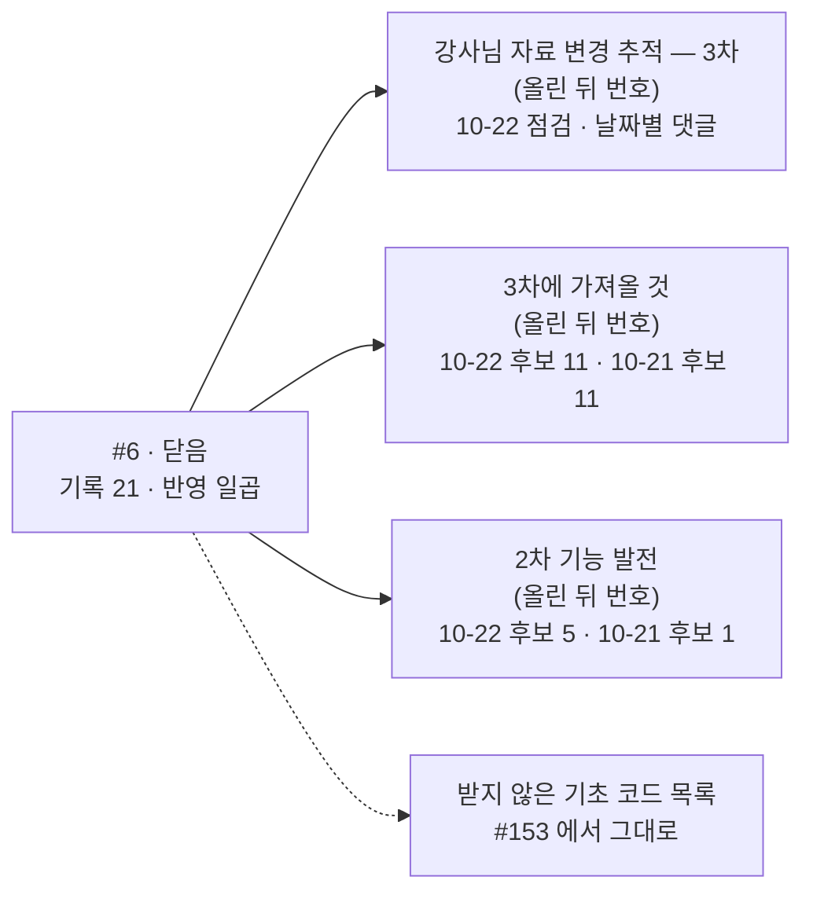

<!-- 진행: 15:01 · 초안 끝 · post_check 통과 · mermaid 문법 확인(v11 · 0 오류) · 메인 검토 전 -->
<!-- 올리기 전 · #6 닫는 댓글(D) · 올리는 순서: ① 새 추적 이슈(A · 2026-10-22/이슈-강사님자료-변경추적-3차/00-본문.md) → ② 3차에 가져올 것(B · 2026-10-22/이슈-강사님자료-3차-가져올것/00-본문.md) → ③ 2차 기능 발전(C · 2026-10-22/이슈-강사님자료-2차-발전시킬것/00-본문.md) → ④ 이 댓글을 #6 에 달고 「Close with comment」 로 닫기 · 건 사이 10분 · A · B · C 번호를 메인에게 알려 주면 메인이 이 파일의 「(올린 뒤 번호)」 를 채운 뒤 올린다 · 댓글 22(22-2026-10-22-th03-th06-th07.md)는 올리지 않음 — A 본문 3절로 옮김 · 팀원 멘션 없음 · 이 주석 두 줄은 빼고 올림 -->

## #6 을 닫습니다 — 3차 추적 이슈로 이어 갑니다

> **쉬운 요약 3줄**
> 1. 이 이슈는 09-28 부터 10-21 까지(2차 기간) 강사님 자료 변경을 점검 · 반영 기록 21개로 남겼다. 강사님 기초 코드(lumina-invest)를 우리 앱에 받은 일곱 번의 반영이 여기서 시작됐다.
> 2. 3차(10-22 ~ 11-11)는 새 이슈 「강사님 자료 변경 추적 — 3차」(올린 뒤 번호)에서 이어 간다. 10-22 점검(댓글 22 로 쓰던 것)은 이 이슈에 올리지 않고 그 이슈 본문으로 옮겼다.
> 3. 아직 남은 후보는 「강사님 자료에서 3차에 가져올 것」(올린 뒤 번호)과 「강사님 자료로 2차 기능 발전시키기」(올린 뒤 번호) 두 이슈 본문으로 옮겼다. 이 이슈의 댓글은 닫힌 채 기록으로 남는다.

### 이 이슈가 한 일

번호는 저장소 원본 파일의 번호다 — 웹 댓글 차례와 다를 수 있다(파일 17 = 웹 10번째 댓글). 원본: [`docs/common/00-management/github-archive/2026-09-28/이슈-강사님자료-변경추적`](https://github.com/EST-team-project/Qurious/tree/8739d61/docs/common/00-management/github-archive/2026-09-28/이슈-강사님자료-변경추적)

**<표 1> 점검 · 반영 기록 21**

| 파일 | 날짜 | 다룬 곳 | 핵심 한 줄 |
|---|---|---|---|
| 01 | 09-28 | th03 · th06 · th07 · th08 · th20 | 첫 기준점(23곳) · 강사님 일정표가 2차 10-01 ~ 10-21 · 3차 10-22 ~ 11-11 임을 처음 확인 |
| 02 | 09-29 | th03 | 40커밋 전체 다시 보기 · 기능 26 대조(있음 4 · 일부 13 · 없음 8) → 강사님 자료 기능대조 문서 |
| 03 | 09-30 | th06 | 리밸런싱 · 위험 한도 · 웹훅 · 수식 지표 · 투자성향 · XAI 가 기초 코드에 들어옴 · 우리 파일 18개와 겹침 |
| 04 | 10-01 | th06 · th07 · th20 | compose 준비 확인 · Ollama 컨테이너 · 3-way 충돌 0 |
| 05 | 10-01 | th06 반영 | compose 를 강사님 판 그대로 받음 · 답변 모델은 우리 값 유지 |
| 06 | 10-02 | th03 · th06 · th07 | 로그인 유지 · 답변 엔진 고르기를 같은 날 반영 · 「쿠키 다시 굽기」 위험을 고치고 시험(DF-37) |
| 07 | 10-03 | th01 · th03 · th06 · th07 · th10 | KIS 게이트웨이 · 통합 대시보드 11커밋 · 받으면 위험한 곳 둘(실거래 관문 우회 · 지운 모듈 import) |
| 08 | 10-03 | th06 반영(서버) | 위험 둘을 시험부터 막고 받음 · KIS 키는 사용자마다(PR #98) |
| 09 | 10-03 | th06 반영(화면) | 첫 화면 · 위 메뉴 · 설정 화면을 Figma 로 고른 뒤 받음 · 기준점 옮김(PR #100) |
| 10 | 10-07 | th03 · th06 · th07 · th24 | 서버 계좌 하나로 도는 KIS 배치 · 자동매매 주기 10분 → 3분이 말없이 들어올 위험 |
| 11 | 10-07 | 추가분 | 백테스트 응답에 자료 출처 · 구간을 싣기(우리가 바로 쓸 것) |
| 12 | 10-08 | th03 · th07 · th24 | 공통 채팅 모델 7b → 3b — 우리 7b 안 받기가 더 굳어짐 |
| 13 | 10-08 | th06 반영(서버) | 운용 값 넷을 우리 값으로 지키며 받음 · 화면 32곳 · 리밸런싱 19곳은 뒤로(PR #141) |
| 14 | 10-10 | th06 · th07 | 새 8커밋을 받을 것 25 · 부딪힘 12 · 받지 않을 것 33 으로 가름 · th07 금융 글 고지 삭제 |
| 15 | 10-12 | th06 반영(1단계) | Pine v6 · 판단 불가 · KIS 일봉 · 지킴이 여섯 · 기준점을 서버 · 화면 두 줄로(PR #164) |
| 16 | 10-12 | th03 · th06 | 체결 확인 예산 · Lightweight Charts 봉 차트 본보기 → 상품 상세 창(PR #171) |
| 17 | 10-13 | th06 | DART 재무 · 패턴 분석 · 받으면 화면이 안 열리는 곳 하나 → 재무 꼴은 재무 · 신용 위험에(PR #175) |
| 18 | 10-14 | th02 · th03 · th06 · th07 | 프로젝트2 발표 공지 · 전략설정 · 수익률 검증 · KIS 배치 시작 · 비상 정지 |
| 19 | 10-15 | 답글(신장환 님) | 일목균형표 · 매물대 커밋은 2차에 받지 않음 · 받을 때도 신호 점수에 섞지 않음 |
| 20 | 10-17 | th02 · th03 · th06 · th07 · th21 · th24 | 응답에 출처 · 기준 시각 · 상태 칸을 싣는 꼴 — 우리 칸 이름도 맞춤 |
| 21 | 10-21 | th03 · th06 · th07 · th11 · th24 | 발표 평가 설문 · python-ml-class 머신러닝 실습 후보 · 새 화면 넷은 팀원 몫 |

```text
09-28        10-01   10-03       10-08     10-12        10-17   10-21
  │ 01 02 03  │04 05 06│07 08 09  │10 11 12 13│14 15 16 17 18│19 20 │21
  ●──●──●─────●──◆──◆──●──◆──◆────●──●──●──◆─●──◆──●──●──●───●──●──●
  ● 점검   ◆ 반영 기록(05 · 06 · 08 · 09 · 13 · 15)
  09-30 PR #68 은 03 과 같은 날 · 본보기를 쓴 PR 둘(#171 · #175)은 따로
```

**반영한 것**

| 날짜 | 받은 판(lumina-invest) | 무엇 | 어디 |
|---|---|---|---|
| 09-30 | `b055ab0` | 리밸런싱 · 위험 한도 · TradingView · 수식 지표 · 시험 59건(우리 고침은 지킴) | PR #68 · 논의 #69 |
| 10-01 | `affb05c` compose | 준비 확인 · Ollama 컨테이너(답변 모델은 우리 값) | 파일 05 |
| 10-02 | `289bfb5` | 로그인 유지 · 답변 엔진 고르기 · 쿠키 위험 고침(DF-37) | 파일 06 |
| 10-03 | `9478811` | 서버(실거래 관문 · 지운 모듈 시험부터 · KIS 키 사용자마다) · 화면(첫 화면 · 위 메뉴 · 설정) | PR #98 · #100 |
| 10-08 | `e815be3` 서버 | 운용 값 넷 지킴 · 채팅 모델 · 문서 저장 · 검색은 우리 판 | PR #141 |
| 10-12 | `5b0a768` 1단계 | Pine v6 변환 · 판단 불가 신호 · KIS 일봉 · 지킴이 여섯 | PR #164 |
| 10-12 · 13 | 본보기 | Lightweight Charts 봉 차트 → 상품 상세 창 · 재무 꼴 → 재무 · 신용 위험 | PR #171 · #175 |

### 남은 것 — 어디로 옮겼나

<그림 1> 이 이슈에서 세 이슈로



| 남은 것 | 옮긴 곳 |
|---|---|
| 10-22 점검(댓글 22 로 쓰던 것 · 올리지 않음) + 10-22 14:18 에 받은 12커밋 | 새 추적 이슈 본문 3절 |
| 강사님 새 화면 넷(KIS 모의투자결과 · 전략설정 · 설정별 성과 · 수익률 검증) 가져오기 1차 — 10-22 판에서 다시 바뀐 것 | 3차 이슈 3-1 |
| 10-22 후보 — 3차 과제에 들일 것 11 | 3차 이슈 3-1 ~ 3-11 |
| 10-22 후보 — 2차 기능을 고칠 것 5(결함 둘 포함) | 2차 이슈 2-1 ~ 2-5 |
| 10-21 점검(댓글 21)의 후보 12 | 3차 이슈 부록 11 · 2차 이슈 부록 1 |
| 받지 않은 기초 코드 목록(운용 값 · 팀원 코드와 부딪히는 B1 ~ B7) | [#153](https://github.com/EST-team-project/Qurious/issues/153) 그대로 |
| 기준점 TSV | 이 이슈 폴더에 그대로 두고 새 추적 이슈에서 옮긴다(스캐너 기본 경로) |

**바로잡기** — 댓글 21 의 「발표 평가 설문은 1 이 가장 우수하다」 는 강사님이 10-21 09:57(`5e98301`)에 뒤집었다. 이제 1 매우 미흡 ~ 5 매우 우수(높을수록 우수)다.

(그림 자리 — 메인이 Figma 로: 09-28 ~ 10-21 점검 21 · 반영 일곱의 시간선 한 줄 — 점검은 점, 반영은 마름모 · PR 번호(#68 · #98 · #100 · #141 · #164 · #171 · #175))

이 이슈는 여기서 닫습니다. 이어지는 점검은 새 추적 이슈(올린 뒤 번호)에서 봐 주세요.
