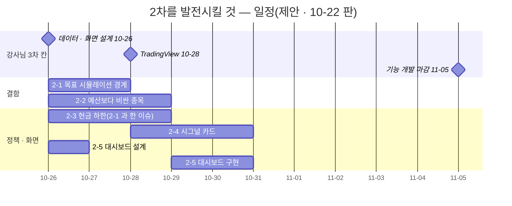
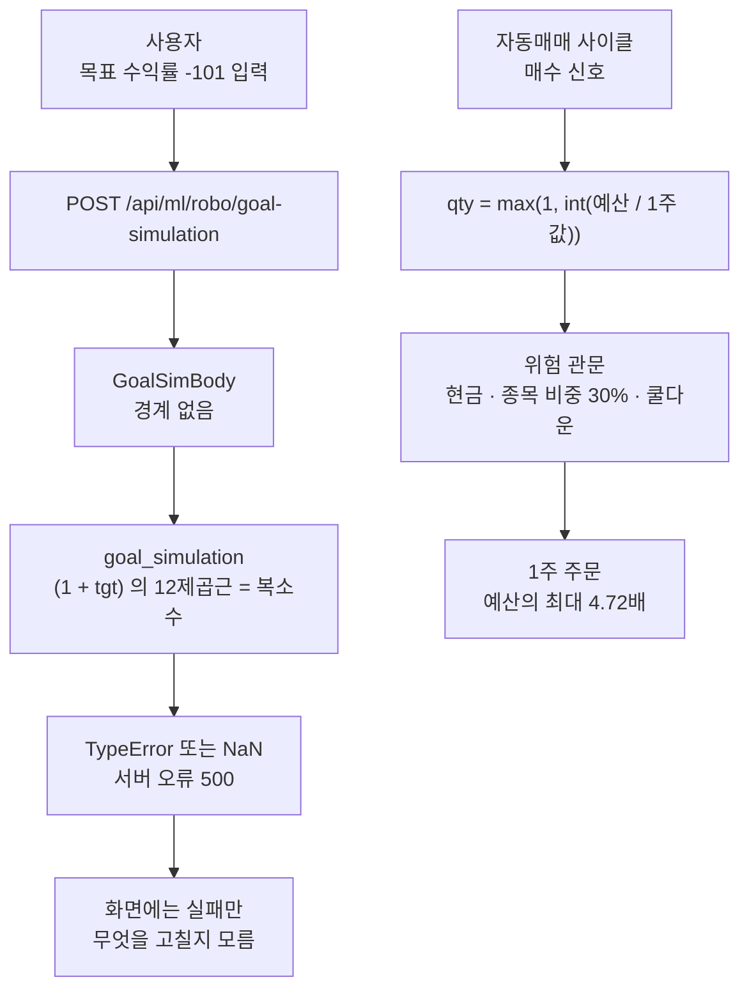
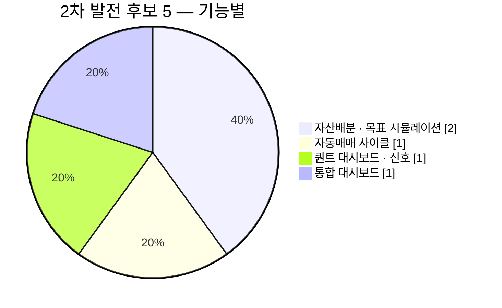

<!-- 올린 이슈 본문 · #317 · 2026-10-22 올림(사용자 확인) · 이동원 · 10-22 고침(웹 본문도 이 파일로): 「올린 뒤 번호」 자리 → #319 · #318 · <그림 4> 줄(웹에서 그 줄을 지우고 PNG 를 끌어 놓음) · 2-1 고침 상태(결함 DF-144) · 옛 머리: 초안(C) 15:01 · post_check · mermaid 확인 -->

> **쉬운 요약 3줄**
> 1. 강사님 자료의 10-22 변경 가운데 **이미 만든 2차 기능(로보 어드바이저 · 대시보드 · 모의투자 · 자동매매 사이클)을 고치거나 낫게 할 것 5개**를 모았다. 그중 둘은 **우리 코드에서 그대로 재현되는 결함**이다.
> 2. 결함 ① 목표 시뮬레이션에 수익률 −101 을 넣으면 서버 오류 500 이 난다(422 가 맞다 · 강사님 배포본 감리가 찾았고 강사님도 아직 안 고침). 결함 ② 자동매매가 1회 매수 예산보다 비싼 종목도 1주를 산다 — 우리 31종목 가운데 10-21 종가가 30만 원을 넘는 종목이 9개다.
> 3. 나머지 셋은 자산배분 현금 하한(정책 결정) · 퀀트 대시보드 시그널 카드(근거별 점수 · 매수/매도 탭) · 대시보드 꼴이다. 받을지와 언제는 담당이 정한다.

3차 과제에 새로 들일 것은 짝 이슈 「강사님 자료에서 3차에 가져올 것」(#318)에, 날짜별 변경 점검은 「강사님 자료 변경 추적 — 3차」(#319)에 둔다.

## 한눈에 보기

무게: 아주 작음 = 1시간 안 · 작음 = 반나절 안 · 중간 = 하루 안팎 · 큼 = 이틀 넘게(어림). 확실도: 🟢 코드로 확인 / 🟡 추론 · 추가 확인 필요 / 🔴 문제 확정.

| # | 후보 | 2차 기능 | 주담당 | 무게 | 확실도 | 추천 순위 | 3차 일정(제안) |
|---|---|---|---|---|---|:-:|---|
| 2-1 | 목표 시뮬레이션 입력 경계 — 수익률 −101 → 500(감리 HIGH `FD-FIND-002`) + 결함대장 새 줄 · **고침(10-22 · 결함 DF-144 · 주담당 확인 대기)** | 자산배분 · 최적화 › 목표 시뮬레이션 | 오준영 님(@GoonGuMa) · 이동원(부 — 고침) | 작음 | 🔴 | 1 | 10-23 ~ 24(부담당 PR) |
| 2-2 | 1회 매수 예산보다 비싼 종목을 1주 사지 않기 | 자동매매 사이클(모의 · KIS 모의) | 강민석 님(@rkdalstjr) · 오준영 님(@GoonGuMa)과 맞춤 | 작음 | 🔴 | 2 | 10-26 ~ 28 |
| 2-3 | 자산배분 현금 하한 2% · 자산군 상한(감리 CRITICAL `FD-FIND-001` 의 고침) | 자산배분 · 상품 안내 | 오준영 님(@GoonGuMa) | 작음 ~ 중간 | 🟢 | 3 | 2-1 과 같은 이슈 |
| 2-4 | 퀀트 대시보드 시그널 카드 — 근거별 점수 · 매수/매도 탭 · 카드 → 차트 · 「수익 확률 아님」 · 로딩 창 | 퀀트 대시보드 · 신호 설명 | 신장환 님(@janghwan-god) · 화면 고침은 이동원 | 중간 | 🟢 | 4 | 10-28 ~ 30 |
| 2-5 | 대시보드 꼴 — 관심 종목 차트 카드 · 출처 · 갱신 줄 · 패널 안 실패 문구 · 칸 높이 | 통합 대시보드 | 화면은 이동원 · 대시보드 주인 확인(점검표 「강민석(추정)」) | 중간 | 🟢 | 5 | 10-26 설계 · 10-29 ~ 30 |

결함 ② 의 크기를 우리 자료로 재 보면 아래와 같다 — 우리 수집 DB 의 10-21 종가 기준, 자동매매 대상 31종목 가운데 1회 예산보다 비싼 종목과 그 종목 1주를 샀을 때 쓰는 돈(예산의 몇 배)이다.

```text
1주 값 > 1회 예산인 종목 수(31종목 중 · 10-21 종가)
  KIS 모의 배치 예산 30만 원   █████████                 9종목
  사용자 기본 예산 100만 원    ███                       3종목

예산 30만 원일 때 1주를 사면 쓰는 돈(예산의 배수)
  삼성바이오로직스 1,417,000   ███████████████████████▌  4.72배
  SK하이닉스       1,294,000   █████████████████████▌    4.31배
  삼성전기         1,168,000   ███████████████████▌      3.89배
  고려아연           913,000   ███████████████▏          3.04배
  삼성SDI            554,000   █████████▏                1.85배
  SK                 482,000   ████████                  1.61배
  LG에너지솔루션     411,500   ██████▊                   1.37배
  현대자동차         309,500   █████▏                    1.03배
  POSCO홀딩스        301,000   █████                     1.00배
```

<그림 1> 2차 발전 후보를 3차 일정 위에 · 마름모 = 강사님 3차 칸 · 막대 = 제안 기간



<그림 2> 결함 둘이 사용자에게 보이는 길



<그림 3> 후보 수 — 2차 기능별



<그림 4> −101 은 이제 500 대신 422 와 안내 글로 막고, 1주 매수는 예산 30만 원이면 31종목 중 9종목에서 예산을 넘는다 · 범례: 왼쪽 = 2-1 바꾸기 전 · 뒤(결함 DF-144) · 오른쪽 = 2-2 재현(우리 수집 DB 10-21 종가)

(그림 — 웹에서 이 줄을 지우고 이 파일을 끌어 놓아 붙임: `docs/common/00-management/github-archive/2026-10-22/이슈-강사님자료-2차-발전시킬것/img/phase2-defects-repro_v1.0.png`)

<sub>원본: [Figma · Qurious · 문서 그림 · 「#317 강사님 자료로 2차 기능 발전시키기」](https://www.figma.com/design/6lstWS4YwuhJPhGB9XoBMD?node-id=68-3) · 그림 판 v1.0 · 기준 `4bed63b` · 2026-10-22 · 같은 숫자는 위 막대 글 · 2-1 · 2-2 절</sub>

---

## 2-1. 목표 시뮬레이션 입력 경계 — 수익률 −101 이면 500

| 칸 | 내용 |
|---|---|
| 무엇 | 강사님 domain-rag-lab 「감리대응」 의 운영 검증(10-21 · 강사님 lumina-invest 배포본 대상)이 HIGH 결함 `FD-FIND-002` 를 찾았다 — 목표 시뮬레이션에 기대 수익률 또는 목표 수익률 −101 을 넣으면 HTTP 500(기대 422). 강사님은 10-22 에 CRITICAL(2-3)만 고치고 이것은 「범위 밖이라 보류」 했다. **우리 코드가 강사님 판과 같아 그대로 재현된다** |
| 강사님 근거 | 검증 결과 [`docs/fd-live-verification.md:8-9`](https://github.com/edumgt/domain-rag-lab/blob/fda3ed1/docs/fd-live-verification.md#L8-L9) · 보류 메모 [`todo.md:1969`](https://github.com/edumgt/lumina-invest/blob/594d3ff/todo.md#L1969) |
| 우리 닿는 곳 | 입력 모델 [`app/routes/ml.py:316-323`](https://github.com/EST-team-project/Qurious/blob/8739d61/app/routes/ml.py#L316-L323)(경계 없음) · 라우트 [`:342-347`](https://github.com/EST-team-project/Qurious/blob/8739d61/app/routes/ml.py#L342-L347) · 계산 [`app/services/robo_profile.py:71-87`](https://github.com/EST-team-project/Qurious/blob/8739d61/app/services/robo_profile.py#L71-L87) · 화면 [`public/js/robo.js:213`](https://github.com/EST-team-project/Qurious/blob/8739d61/public/js/robo.js#L213) |
| 주담당 · 무게 · 확실도 | 오준영 님(@GoonGuMa · 2차 ③ 자산배분 · 「자산배분 · 최적화」 화면) · 이동원(부담당) · 작음(입력 경계 + 결과 확인 + 시험 둘 · 20줄 안팎) · 🔴 재현 |
| 일정 | 10-23 ~ 24 — HIGH 라 빨리 닫으려고 **부담당(이동원)이 작은 PR 로 고친다**. 주담당은 그 PR 에서 확인한다 |

**재현**(우리 함수를 그대로 불러 봄 · 앱은 띄우지 않음 · 코드 · DB 는 바꾸지 않음)

| 입력 | 결과 | 라우트에서 |
|---|---|---|
| `target_return_pct=-101` | `TypeError` — `(1 + tgt) ** (1/12)` 가 복소수가 되어 `r_m > 0` 비교가 실패(`robo_profile.py:86-87`) | 500 |
| `expected_return_pct=-101` | `np.log1p(-1.01)` = NaN(`:77`) → 결과에 NaN → JSON 으로 만들지 못함 | 500 |
| `expected_return_pct=-99.9` | 정상 | 200 |

**바꾸기 전 → 뒤**(제안 · 값의 범위는 주담당이 정한다)

```python
# 지금 — app/routes/ml.py:316
class GoalSimBody(BaseModel):
    amount_manwon: float = 5000
    monthly_contribution_manwon: float = 0
    horizon_years: int = 3
    target_return_pct: float = 8.0
    expected_return_pct: float = 7.0
    expected_volatility_pct: float = 12.0
    n_paths: int = 3000

# 바꾼 뒤(제안) — 잘못된 입력은 계산 전에 422
class GoalSimBody(BaseModel):
    amount_manwon: float = Field(5000, ge=0)
    monthly_contribution_manwon: float = Field(0, ge=0)
    horizon_years: int = Field(3, ge=1, le=40)
    target_return_pct: float = Field(8.0, gt=-100)      # -100% 이하는 뜻이 없다
    expected_return_pct: float = Field(7.0, gt=-100)
    expected_volatility_pct: float = Field(12.0, ge=0)
    n_paths: int = Field(3000, ge=500, le=20000)
```

계산이 끝난 뒤 확률 · 백분위가 유한한지 한 번 더 보고, 아니면 422 와 「입력 범위를 확인하세요」 를 돌려준다(입력 경계가 놓친 조합의 안전판).

**재사용 판정**

| 조각 | 판정 | 줄 | 까닭 |
|---|:-:|--:|---|
| 강사님 고친 판 | — | — | 아직 없음(강사님도 보류) — 우리가 먼저 고친다 |
| 입력 경계(pydantic `Field`) | ❌ 새로 | 8 | 위 꼴 |
| 결과 유한성 확인 | ❌ 새로 | 5 | `math.isfinite` |
| 시험 둘(감리 재현 입력) | ❌ 새로 | 20 안팎 | `-101` 두 칸이 422 · `-99.9` 는 200 |
| 결함대장 새 줄 | ❌ 새로 | 1 | 다음 번호(DF-144 제안) · 재현 · 확인 방법 · 파트 오준영 |

**바뀐 뒤 구조** — 새 모듈 없음. `app/routes/ml.py` 가 `pydantic.Field` 를 import 하고, 시험은 기존 `tests/test_robo_profile.py` 꼴에 둘을 더한다.

**고친 것(10-22 · 결함 DF-144 · 부담당 이동원)** — 위 제안을 따르되, 화면에 영어 오류(「Input should be greater than -100」)가 아니라 한국어 안내 글이 보이게 했다.

| 곳 | 바뀐 것 |
|---|---|
| 입력 모델 `app/routes/ml.py` `GoalSimBody` | 칸마다 범위 표 `GOAL_SIM_LIMITS`(목표 · 기대 연수익률 −100% 초과 ~ 1,000% · 연변동성 0 ~ 300% · 원금 0 ~ 10,000,000 만원 · 월 적립 0 ~ 1,000,000 만원 · 기간 1 ~ 40년)와 검사기 하나 — 넘으면 계산 전에 422 와 칸 이름 · 안내 글 |
| 계산 함수 `app/services/robo_profile.py` `goal_simulation` | 수익률 −100% 이하 · 넘친 결과(inf · NaN)를 `ValueError` 로 — 라우트가 422 와 그 글로 돌려준다(입력 경계가 놓친 조합의 안전판) |
| 시험 `tests/test_robo_profile.py` | TC-GSB 다섯(15건) — −101 · −100 은 422 · −99.9 는 200 · 나머지 칸 경계 열 · 계산 함수 안전판 · 라우트 안전판 |

켜 둔 앱(점검 계정)에서도 −101 → 422 「목표 연수익률은 -100% 보다 크고 1,000% 이하로 넣어 주세요 — …」, −99.9 → 200 을 확인했다. 범위 값은 주담당이 PR 에서 정하면 표 한 곳만 바꾼다. 경로 수(`n_paths`)는 지금처럼 500 ~ 20,000 으로 조용히 맞춘다.

---

## 2-2. 1회 매수 예산보다 비싼 종목을 1주 사지 않기

| 칸 | 내용 |
|---|---|
| 무엇 | 자동매매 사이클이 매수 수량을 `max(1, int(예산 / 1주 값))` 으로 정해, **1주 값이 1회 매수 예산보다 비싸도 1주를 산다**. 강사님은 10-22 에 「1주 값이 예산을 넘으면 매수를 건너뛰고 까닭을 남긴다」 로 고쳤다. 우리 사이클은 강사님 옛 판과 같다 |
| 강사님 근거 | 고친 줄 [`app/services/auto_trade.py:1206-1212`](https://github.com/edumgt/lumina-invest/blob/594d3ff/app/services/auto_trade.py#L1206-L1212) · 시험 [`tests/test_quant_cycle_integration.py:305`](https://github.com/edumgt/lumina-invest/blob/594d3ff/tests/test_quant_cycle_integration.py#L305)(예산 50만 원 · 1주 140만 원 → 주문 0) |
| 우리 닿는 곳 | 수량 [`app/services/auto_trade.py:1111-1113`](https://github.com/EST-team-project/Qurious/blob/8739d61/app/services/auto_trade.py#L1111-L1113) · 다음 관문 [`:1024-1057`](https://github.com/EST-team-project/Qurious/blob/8739d61/app/services/auto_trade.py#L1024-L1057)(현금 · 종목 비중 · 쿨다운 — 1회 예산은 다시 보지 않음) · 비중 한도 [`app/services/risk_guard.py:165-181`](https://github.com/EST-team-project/Qurious/blob/8739d61/app/services/risk_guard.py#L165-L181)(기본 30% `:44`) · KIS 모의 배치 예산 30만 원 [`app/services/kis_batch.py:157`](https://github.com/EST-team-project/Qurious/blob/8739d61/app/services/kis_batch.py#L157) · 사용자 기본 100만 원 [`app/models/trading.py:123`](https://github.com/EST-team-project/Qurious/blob/8739d61/app/models/trading.py#L123) · 대상 31종목 [`app/services/stock.py:29`](https://github.com/EST-team-project/Qurious/blob/8739d61/app/services/stock.py#L29) |
| 주담당 · 무게 · 확실도 | 강민석 님(@rkdalstjr · 2차 모의 주문 · 운용) — 같은 파일을 오준영 님(@GoonGuMa)이 10/30 까지 고치므로(3차 위험관리가 같은 사이클을 쓴다) 고칠 때 맞춤 · 작음(두 줄 + 시험 하나) · 🔴 |
| 일정 | 10-26 ~ 28 — 3차 LEAN 신호 → KIS 모의 주문(10-27)이 같은 수량 길을 쓰기 전에 |

**확인한 것**

- 식과 비중 함수를 그대로 불러 봤다(평가액 1천만 원 · 비중 30% · 보유 0): 예산 30만 원 · 1주 140만 원 → 1주(4.67배) · 50만 원 · 140만 원 → 1주(2.80배) · 100만 원 · 129만 4천 원 → 1주(1.29배). 비중 한도(300만 원)가 막지 않는다.
- 우리 수집 DB 의 10-21 종가로 31종목을 세면 30만 원을 넘는 종목 9 · 100만 원을 넘는 종목 3 이다(위 막대). KIS 모의 배치(예산 30만 원)라면 9종목, 사용자 기본(100만 원)이라면 3종목에서 일어난다.
- 「위험 기준 수량」 갈래(`:1114` `size_kind == "risk_pct"`)는 `risk_quantity` 가 예산을 인자로 받아 따로 정한다 — 이 결함은 기본 「예산 기준 수량」 갈래만이다. 사이클 전체 · 실제 주문은 돌리지 않았다.

**바꾸기 전 → 뒤**(제안 · 강사님 고친 꼴)

```python
# 지금 — app/services/auto_trade.py:1112-1113
budget = per_trade_budget * buy_ratio
qty = max(1, int(budget / price))          # 1주 값 > 예산이어도 1

# 바꾼 뒤(제안)
budget = per_trade_budget * buy_ratio
qty = int(budget / price)
if execution.size_kind != "risk_pct" and qty <= 0:
    await _risk_skip(symbol, stock["name"], "buy", price,
                     f"1주 가격 {price:,.0f}원이 1회 매수 예산 {budget:,.0f}원을 넘어 매수하지 않습니다.")
    continue
```

```text
지금                                   바뀐 뒤
예산 30만 · 1주 141만 7천 원            예산 30만 · 1주 141만 7천 원
 → 1주 주문(141만 7천 원 · 4.72배)       → 주문 0 · 로그 「1주 가격 … 매수하지 않습니다」
 → 화면 「자동 매수 1주」                 → 화면 「위험관리 생략」 줄 · 알림(notify_risk_skip)
```

**재사용 판정**

| 조각 | 판정 | 줄 | 까닭 |
|---|:-:|--:|---|
| 수량 식 · 생략 줄 | 🟡 이식 | 5 | 우리 「위험 기준 수량」 갈래와 겹쳐(3-way 충돌 1) 손으로 |
| 강사님 시험 | 🟡 이식 | 12 | 우리 사이클 시험 고정물(`tests/test_quant_cycle_integration.py`)로 다시 씀 |
| 「위험관리 생략」 기록 · 알림 | ✅ 그대로 | 0 | 우리 `_risk_skip`(`:1059`)이 이미 기록 · 알림을 한다 |

**바뀐 뒤 구조** — 새 모듈 없음. 생략 까닭은 기존 사이클 기록(`cycle_log["risk"]["skipped"]`)과 알림으로 화면에 보인다.

---

## 2-3. 자산배분 현금 하한 2% · 자산군 상한

| 칸 | 내용 |
|---|---|
| 무엇 | 같은 감리의 CRITICAL `FD-FIND-001` 은 강사님 배포본에서 장기 · 공격형 자산배분의 현금 비중이 음수(−1 ~ −4%)가 된 것이다. 강사님은 10-22 에 자산군마다 하한 · 상한(현금 2 ~ 30% · 대체 0 ~ 20% · 국내주식 0 ~ 60% · 해외주식 0 ~ 50% · 채권 0 ~ 60%)을 두고, 기간 가중치를 채권 · 현금에서 「하한까지 뺄 수 있는 만큼만」 빼도록 고쳤다. **우리 판은 음수는 이미 막혀 있지만 현금 하한이 없어 30칸 중 11칸에서 현금이 1% · 0% 다** |
| 강사님 근거 | [`app/services/robo_profile.py:43-54`](https://github.com/edumgt/lumina-invest/blob/aa7e236/app/services/robo_profile.py#L43-L54)(`BASE_ALLOCATIONS` · `ALLOCATION_BOUNDS` · `compute_allocation`) · 감리 결과 [`docs/fd-live-verification.md:5-6`](https://github.com/edumgt/domain-rag-lab/blob/fda3ed1/docs/fd-live-verification.md#L5-L6) |
| 우리 닿는 곳 | 비중 정본 [`app/services/asset_allocation.py:13-23`](https://github.com/EST-team-project/Qurious/blob/8739d61/app/services/asset_allocation.py#L13-L23)(`:18` `boost = min(6, …, 현금, 채권)`) · 이 비중을 읽는 라우트 [`app/routes/ml.py:148`](https://github.com/EST-team-project/Qurious/blob/8739d61/app/routes/ml.py#L148) · 상품 안내(`app/routes/products.py` · `public/js/productweights.js`) |
| 주담당 · 무게 · 확실도 | 오준영 님(@GoonGuMa) · 작음 ~ 중간(정책 결정 + 함수 한 곳 + 상품 안내 시험) · 🟢(30칸을 강사님 식 · 우리 식 · 옛 식에 같은 입력으로 돌려 봄) — 「현금 0%」 가 결함인지는 정책 판단 |
| 일정 | 2-1 과 같은 이슈에 한 단락 · 10-26 ~ 28 |

**다른 11칸**(국내주식 · 해외주식 · 국내채권 · 대체자산 · 현금, %)

| 성향 · 기간 | 우리(`asset_allocation.py`) | 강사님 새 판 | 강사님 옛 판(감리 지적) |
|---|---|---|---|
| 중립형 7년 | 34 · 29 · 26 · 10 · **1** | 33.5 · 28.5 · 26 · 10 · **2** | 34 · 29 · 26 · 10 · 1 |
| 중립형 8년 | 35 · 30 · 25 · 10 · **0** | 34 · 29 · 25 · 10 · **2** | 35 · 30 · 25 · 10 · 0 |
| 중립형 9 · 10년 | 35 · 30 · 25 · 10 · **0** | 34.5 · 29.5 · 24 · 10 · **2** | 36 · 31 · 24 · 10 · **−1** |
| 공격형 4년 | 46 · 36 · 9 · 8 · **1** | 45.5 · 35.5 · 9 · 8 · **2** | 46 · 36 · 9 · 8 · 1 |
| 공격형 5년 | 47 · 37 · 8 · 8 · **0** | 46 · 36 · 8 · 8 · **2** | 47 · 37 · 8 · 8 · 0 |
| 공격형 6 ~ 10년 | 47 · 37 · 8 · 8 · **0** | 국내 46.5 → 48 · 해외 36.5 → 38 · 채권 7 → 4 · 대체 8 · 현금 **2** | 현금 **−1 ~ −4** |

1 ~ 3년과 안정형 10칸은 셋이 모두 같다.

```text
공격형 10년 현금 비중(%)
  강사님 옛 판   ▏-4            ← 감리 CRITICAL(음수)
  우리 지금      ▏0             ← 음수는 막았지만 바닥
  강사님 새 판   ██ 2           ← 하한 2% · 채권에서 더 옮김
```

**바꾸기 전 → 뒤**(제안 · 정본 한 곳에)

```python
# 지금 — app/services/asset_allocation.py:18
boost = min(6, max(0, horizon_years - 3), weights["현금"], weights["국내채권"])

# 바꾼 뒤(제안) — 채권 · 현금에서 각각 「하한까지 뺄 수 있는 만큼만」 빼서 국내 · 해외주식에 반씩
CASH_FLOOR, BOND_FLOOR = 2.0, 0.0
tilt = min(6, max(0, horizon_years - 3))
from_bond = min(tilt, weights["국내채권"] - BOND_FLOOR)
from_cash = min(tilt, max(0.0, weights["현금"] - CASH_FLOOR))
for key in ("국내주식", "해외주식"):
    weights[key] += (from_bond + from_cash) / 2        # 상한(국내 60 · 해외 50)은 경계표로 확인
weights["국내채권"] -= from_bond
weights["현금"] -= from_cash
```

이 식으로 세 성향 × 1 ~ 10년 30칸을 돌려 보면 강사님 새 판의 값과 같다(합계 100 · 안정형과 1 ~ 3년은 지금과 같음 · 저장소 밖에서 계산).

**재사용 판정**

| 조각 | 판정 | 줄 | 까닭 |
|---|:-:|--:|---|
| 강사님 `compute_allocation` · 경계표 | 🟡 이식 | 30 안팎 | **`asset_allocation.py` 한 곳에** 넣는다 — 강사님 `robo_profile.py` 를 통째로 받으면 쓰이지 않는 둘째 비중 함수가 생긴다 |
| 강사님 시험 넷(경계 · 감리 재현 둘 · 단조성 · 잘못된 입력) | 🟡 이식 | 40 안팎 | 우리 함수 이름으로 |
| 상품 안내 화면 · 시험 | 확인 | — | 비중 숫자가 바뀌므로 함께 돌려 본다 |

---

## 2-4. 퀀트 대시보드 시그널 카드 — 근거별 점수 · 매수/매도 탭 · 카드 → 차트

| 칸 | 내용 |
|---|---|
| 무엇 | 강사님 퀀트 대시보드가 「일봉 기술지표 시그널(점수 상위 5)」 에서 **「대표 강력 매수 / 강력 매도 시그널 · 최대 10종목」 탭**으로 바뀌었다. 카드마다 **근거별 점수**(예: 「골든크로스(MA5 가 MA20 상향 돌파) +3」 · 「RSI 중립 0」) · MA5 / MA20 · 일봉 기준일 · 출처 · 주문 허용 여부 · KIS 모의 보유 줄이 붙고, 카드를 누르면(Enter · Space 도) 아래 차트가 그 종목으로 바뀐다. 0.6초가 넘으면 모래시계 · 경과 초 창이 뜨고(「닫아도 조회는 계속」), 사용법 창에 일봉 점수 계산표가 들어갔다. 시장 지수 카드는 뺐다. 카드 머리에 「강력 매수는 +3점 이상이며 수익 확률을 뜻하지 않습니다」 를 적는다 |
| 강사님 근거 | 근거별 점수 [`app/services/stock.py:611-666`](https://github.com/edumgt/lumina-invest/blob/594d3ff/app/services/stock.py#L611-L666) · 카드 [`public/js/quant.js:70-119`](https://github.com/edumgt/lumina-invest/blob/594d3ff/public/js/quant.js#L70-L119) · 고지 문구 [`:84`](https://github.com/edumgt/lumina-invest/blob/594d3ff/public/js/quant.js#L84) · 로딩 창 [`:18-45`](https://github.com/edumgt/lumina-invest/blob/594d3ff/public/js/quant.js#L18-L45) · 탭 · 카드 선택 [`:121-162`](https://github.com/edumgt/lumina-invest/blob/594d3ff/public/js/quant.js#L121-L162) · 사용법 계산표 [`public/js/core.js:176`](https://github.com/edumgt/lumina-invest/blob/594d3ff/public/js/core.js#L176) · 매도 후보 [`app/routes/stocks.py:113`](https://github.com/edumgt/lumina-invest/blob/594d3ff/app/routes/stocks.py#L113)(`side=sell` · −3점 이하) |
| 우리 닿는 곳 | 신호 [`app/services/stock.py:420`](https://github.com/EST-team-project/Qurious/blob/8739d61/app/services/stock.py#L420)(근거별 점수 없음 · [`:440`](https://github.com/EST-team-project/Qurious/blob/8739d61/app/services/stock.py#L440) 「골든크로스 (강력 매수)」 그대로) · 화면 [`public/js/quant.js:30-32`](https://github.com/EST-team-project/Qurious/blob/8739d61/public/js/quant.js#L30-L32)(셋을 한꺼번에) · [`:37`](https://github.com/EST-team-project/Qurious/blob/8739d61/public/js/quant.js#L37)(「강력 매수」 → 「매수 · 강」) · [`:60-64`](https://github.com/EST-team-project/Qurious/blob/8739d61/public/js/quant.js#L60-L64)(`/api/stocks/quant/list` · 고정 목록) |
| 주담당 · 무게 · 확실도 | 신장환 님(@janghwan-god · 화면 주담당 · 신호 서버 · ①-5 설명) · 화면 고침은 이동원(화면 개선 권한) · 중간 · 🟢 |
| 일정 | 10-28 ~ 30 — 3차 차트 꼴(짝 이슈 3-4)과 같은 화면이라 함께 |

근거별 점수는 「왜 매수인가」 를 쉬운 말로 보이는 바탕이 된다(실사용자 피드백 「종목 선정 근거」 와 같은 방향). 매도 탭은 강사님 후보 API(`side=sell`)가 우리에 없는 국내 시장 종목 목록에 기대므로, 우리 `/api/stocks/quant/list` 를 점수 순으로 거르는 꼴로 바꿔 쓴다.

**재사용 판정**

| 조각 | 판정 | 줄 | 까닭 |
|---|:-:|--:|---|
| 서버 `components`(근거 · 점수) · 「강력 매수」 낱말 빼기 | 🟡 이식 | 30 안팎 | 신호 정의가 바뀌면 지난 결과를 다시 계산해야 한다(강사님은 `signal_revision: 2`) — 신장환 님 정의 판 규칙대로 |
| 카드 · 탭 · 카드 → 차트 | 🟡 이식 | 80 안팎 | 자료는 우리 목록 API 칸으로 |
| 로딩 창 | ✅ 그대로 | 25 | 우리도 같은 꼴(모래시계 · 경과 시간)을 수집 화면에 씀 — 공용으로 |
| KIS 모의 보유 줄 | 🟡 이식 | 20 | 우리는 사용자 키 — 보유 조회가 생긴 뒤(짝 이슈 3-5) |
| 사용법 창 계산표 | ✅ 그대로 | 표 둘 | 우리 사용법 창(`core.js` `VIEW_GUIDES`)과 같은 틀 |

```text
지금(우리 카드)                          바뀐 뒤(제안)
┌─────────────────────┐                 ┌──────────────────────────────┐
│ 삼성전자 005930      │                 │ [매수 시그널] [매도 시그널]    │
│ 216,250             │                 │ 삼성전자 005930 · 216,250     │
│ 매수 · 강            │                 │ 매수 · 강  +3점              │
│ RSI 57.2            │                 │  · MA5 가 MA20 위로 교차 +3   │
└─────────────────────┘                 │  · RSI 57.2 중립 0            │
 근거가 낱말 하나                         │ MA5 / MA20 · 일봉 10-21 · 출처 │
                                         │ 「+3점 이상 · 수익 확률 아님」 │
                                         └──────── 누르면 아래 차트 ──────┘
```

---

## 2-5. 대시보드 꼴 — 관심 종목 차트 카드 · 출처 · 갱신 줄 · 칸 높이

| 칸 | 내용 |
|---|---|
| 무엇 | 강사님 stock-coin-trade 대시보드는 Top 10 을 지우고 **관심 4종목 차트 카드**로 바꿨다 — 카드마다 종목명 · 코드 · 현재가 · 등락(색) · 「주식 실습에서 열기 →」 · 일봉 120봉 + 거래량 · 1분 갱신, 시세를 못 받으면 **패널 안에 실패 문구**, 아래에 **출처 한 줄**(차트 라이브러리 · 시세 원천 · 갱신 주기). lumina-invest 대시보드는 좌우 카드의 소제목 높이와 칸 높이를 맞추고 홀수 끝 칸을 두 칸 폭으로 바꿨다 |
| 강사님 근거 | 관심 종목 카드 [`frontend/index.html:123-167`](https://github.com/edumgt/stock-coin-trade/blob/910e338/frontend/index.html#L123-L167) · 출처 줄 [`:112`](https://github.com/edumgt/stock-coin-trade/blob/910e338/frontend/index.html#L112) · 칸 정리 [`public/css/app.css:730-740`](https://github.com/edumgt/lumina-invest/blob/594d3ff/public/css/app.css#L730-L740) · [`public/js/dashboard.js:5`](https://github.com/edumgt/lumina-invest/blob/594d3ff/public/js/dashboard.js#L5) |
| 우리 닿는 곳 | [`public/js/dashboard.js:10`](https://github.com/EST-team-project/Qurious/blob/8739d61/public/js/dashboard.js#L10)(`metric()`) · [`public/css/app.css:668-679`](https://github.com/EST-team-project/Qurious/blob/8739d61/public/css/app.css#L668-L679)(두 칸 폭 `.overview-metric.wide` 는 이미 있음) |
| 주담당 · 무게 · 확실도 | 화면 고침은 이동원(화면 개선 권한) · 대시보드 주인은 확인 중(점검표 「강민석(추정)」 — 강민석 님(@rkdalstjr)께 한 줄) · 중간 · 🟢 |
| 일정 | 10-26 설계(Figma) · 10-29 ~ 30 구현 — 대시보드 보강 묶음(코인 Top 10 카드 · 기본 칸)과 함께 |

**재사용 판정**

| 조각 | 판정 | 줄 | 까닭 |
|---|:-:|--:|---|
| 관심 종목 차트 카드 | 🟡 이식 | 45 | 4.2.0 함수(`addCandlestickSeries`)를 우리 5.2.1 꼴로 · 시세는 우리 수집 자료 · 지금 값 서버 |
| 출처 한 줄 · 패널 안 실패 문구 | ✅ 그대로(꼴) | 5 | 우리 출처 · 기준 시각 원칙과 같다 |
| 칸 높이 CSS | ✅ 그대로 | 10 | `display:contents` 로 묶음을 한 격자에 |
| 시세 원천(KIS 일봉 공개 API) | ❌ 받지 않음 | — | 원천 · 인증 구조가 다르다 |

주식 · 코인 Top 10 의 원천 줄은 짝 이슈 3-11 에 있다.

---

## 다른 이슈에서 다루는 것(한 줄 참조)

| 무엇 | 2차 기능과 닿는 곳 | 어디서 |
|---|---|---|
| KIS 잔고 사이클 두 곳(봇이 산 종목만 자동 매도 · 보유 목록 빠짐 = 미확인) | 2차 자동매매 · 모의 주문의 결함 성격 | 짝 이슈 3-5 — 3차 증권사 연동(오준영 님 10-26 · 10-28)에서 함께 고치는 것이 자연스럽다 |
| 수익률 검증 · 설정별 성과 화면(가져오기 1차) | 2차 성과 검증을 넓힘 | 짝 이슈 3-1 |
| 같은 차트 꼴을 주가 차트(직접매매 · `trading.js` ApexCharts 캔들)에도 | 2차 화면 | 짝 이슈 3-4 가 꼴을 정한 뒤 화면 묶음에서 |

## 부록 — 10-21 점검에서 넘어온 후보(1)

| 10-21 # | 후보 | 원천 | 주담당 | 시점 |
|---|---|---|---|---|
| 8 | 상세 창 접근성 꼴(행 → 대화 창 · 닫기 단추 첫 포커스 · Esc · 포커스 되돌림) — 데이터 관제 · 자료 안내 상세 | stock-coin-trade `55cc6c7` | 이동원 | 품질 묶음 |

자세한 칸은 [10-21 점검 결과 <표 6>](https://github.com/EST-team-project/Qurious/blob/8739d61/docs/phase-2/01-analysis/research/배경조사/2026-10-21-강사님자료-점검/결과.md)에 있다.

## 용어 풀이

| 낱말 | 뜻 | 이 글에서 | 헷갈리는 점 |
|---|---|---|---|
| 422 · 500 | 422 는 「입력이 규칙에 맞지 않는다」, 500 은 「서버 안에서 처리하다 실패했다」 는 HTTP 응답 | 2-1 | 잘못된 입력은 422 로 거절해야 사용자가 무엇을 고칠지 안다 |
| 감리 · CRITICAL · HIGH | 감리 = 제3자가 산출물이 요구에 맞는지 점검하는 일. CRITICAL · HIGH 는 강사님 검증의 자체 심각도 | 2-1 · 2-3 | 감리의 「적합 · 부적합」 판정과 같은 말이 아니다. 검증 대상은 강사님 배포본이고, 우리 앱에도 같은 결함이 있는지는 우리 함수로 따로 확인했다 |
| 1회 매수 예산 | 자동매매가 한 번 살 때 쓰는 돈 = 1회 투자금 × 매수 비율 | 2-2 | 「위험 기준 수량」(손절까지 잃을 돈으로 수량을 정함)과 다른 갈래다 |
| 종목 비중 한도 | 한 종목 평가액이 총 평가액의 몇 % 를 넘지 않게 하는 위험 규칙(기본 30%) | 2-2 | 1회 예산을 지키는 규칙이 아니다 — 그래서 비싼 종목 1주가 지나간다 |
| 현금 하한 | 자산배분에서 현금 비중이 내려갈 수 있는 가장 낮은 값 | 2-3 | 음수를 막는 것과 하한을 두는 것은 다르다 — 우리 판은 음수만 막는다 |
| 근거별 점수(components) | 신호 점수를 규칙마다 나눈 것(예: 골든크로스 +3 · RSI 0) | 2-4 | 합이 최종 점수와 같아야 한다. 점수는 수익 확률이나 AI 신뢰도가 아니다 |
| 강력 매수 · 매수 · 강 | 강사님 규칙에서 +3점 이상 | 2-4 | 우리 화면은 투자 권유로 읽히지 않게 「매수 · 강」 으로 보인다 |

## 한계 · 뒤집을 조건

- 결함 둘은 우리 함수(`goal_simulation` · 수량 식 · `cap_buy_quantity`)를 저장소 밖에서 불러 재현했다. 앱 · 사이클 전체 · 실제 주문은 돌리지 않았다. 500 은 FastAPI 가 NaN 이 든 응답을 만들지 못하는 동작에서 추론한 것이다(감리는 강사님 배포본에서 500 을 실측).
- 31종목 가격은 우리 수집 DB 의 10-21 종가다. 값이 오르내리면 「예산을 넘는 종목 수」 도 바뀐다.
- 2-3 은 정책 판단이다 — 주담당이 「현금 0% 도 괜찮다」 고 정하면 고칠 것이 아니라 화면 · 상품 안내에 「장기 공격형은 현금 0%」 를 밝히는 일로 바뀐다.
- 2-2 는 「1주라도 사는 것이 맞다(소액 계좌 체험)」 로 정하면, 생략 대신 「예산을 넘어 1주를 샀다」 는 기록 · 알림을 남기는 쪽으로 바뀐다.

## 정할 것(추천은 첫 칸)

| # | 정할 것 | 선택지(추천 첫 칸) | 판단 재료 |
|---|---|---|---|
| 1 | 2-1 누가 고치나 | **정함(10-22)** — HIGH 라 빨리 닫으려고 부담당 이동원이 작은 PR 로 고친다 · 주담당은 PR 에서 확인 | 주담당 영역 · 강사님도 아직 안 고침 · 고칠 줄 20 안팎 |
| 2 | 2-2 담당 | **정함(10-22)** — 강민석 님(2차 모의 주문 · 운용) · 고칠 때 오준영 님(3차 위험관리)과 맞춤 | 수량 길은 3차 LEAN → KIS 주문(10-27)도 쓴다 |
| 3 | 2-2 예산을 넘는 종목 | 매수 생략 + 까닭 기록(강사님 꼴) / 1주 사고 기록 · 알림 / 예산을 1주 값까지 늘리는 설정 칸 | 31종목 중 9 · 3종목 |
| 4 | 2-3 현금 하한 | 하한 2% · 자산군 상한(강사님 경계표)을 `asset_allocation.py` 한 곳에 / 지금처럼 음수만 막음 / 하한 값만 다르게 | 11칸 표 · 상품 안내가 이 비중을 그대로 읽음 |

## 이 이슈의 규칙

- 후보가 새로 생기거나 바뀌면 **이 본문을 고치고**, 댓글에는 무엇을 고쳤는지 한 줄만 남긴다. 날짜별 점검은 추적 이슈(#319)에 댓글로 남는다.
- 담당이 받기로 하면 그 줄에 담당 이슈 · PR 번호를 적고, 끝나면 취소선으로 남긴다.
- 강사님 자료는 경로 · 줄 번호 · 커밋 제목만 적는다. 커밋 작성자 · 이메일 · 배포 스크립트의 서버 주소는 싣지 않는다.

근거 문서: [강사님 자료 점검(2026-10-22)](https://github.com/EST-team-project/Qurious/blob/main/docs/phase-3/01-analysis/research/배경조사/2026-10-22-강사님자료-점검/결과.md)(PR 머지 뒤 열립니다)
