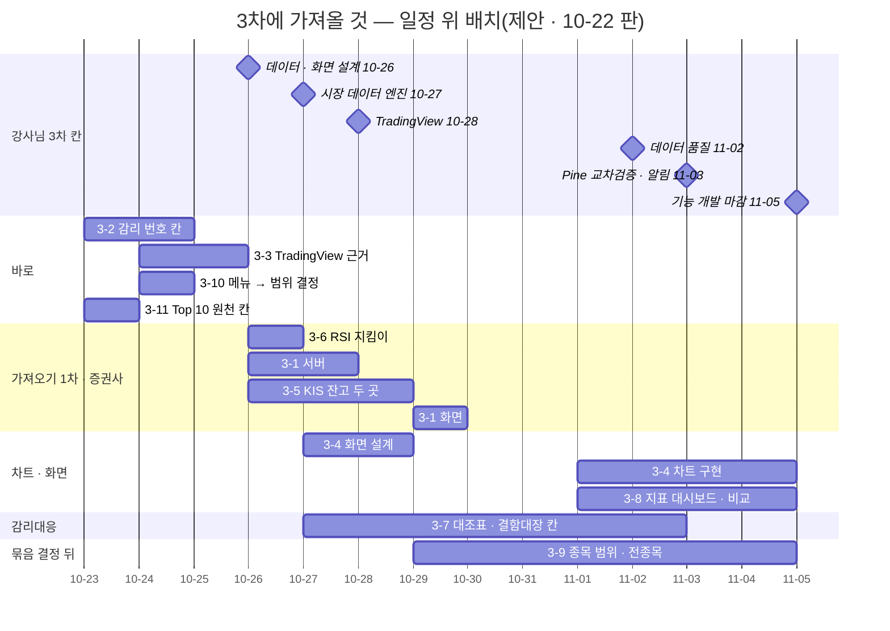
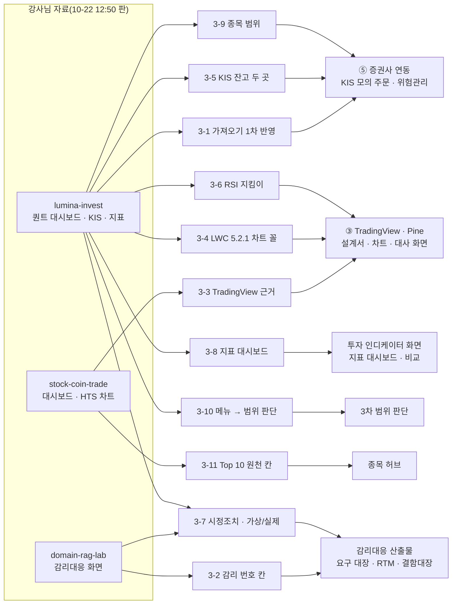
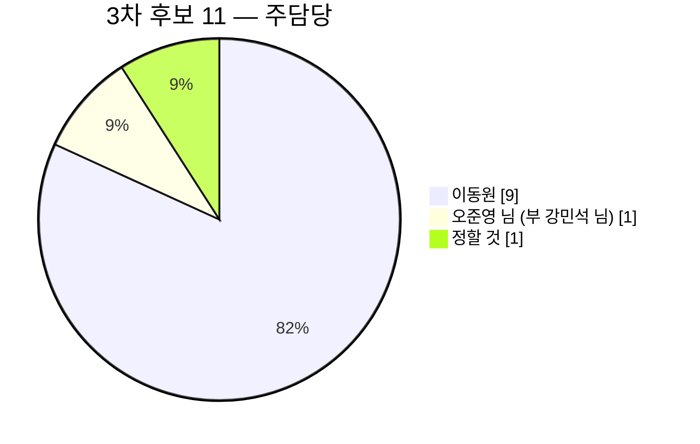

<!-- 올린 이슈 본문 · #318 · 2026-10-22 올림(사용자 확인) · 이동원 · 10-22 고침(웹 본문도 이 파일로): 「올린 뒤 번호」 자리 → #319 · #317 · <그림 4> 줄(웹에서 그 줄을 지우고 PNG 를 끌어 놓음) · 옛 머리: 초안(B) 15:01 · post_check · mermaid 확인 -->

> **쉬운 요약 3줄**
> 1. 강사님 자료(lumina-invest · stock-coin-trade · domain-rag-lab)의 10-22 12:50 까지 변경 가운데 **3차 과제 — TradingView · Pine · 증권사 연동 · 감리대응 산출물 · 투자 인디케이터 화면 — 에 새로 들일 것 11개**를 한곳에 모았다. 10-21 점검에서 넘어온 후보 11개는 부록에 있다.
> 2. 바로 할 것은 셋이다 — 진행 중인 「강사님 기능 가져오기 1차」 에 이번 변경을 반영(설정 키 8 → 9 · 전종목 후보 기본값), 요구 대장에 강사님 감리 번호 칸, 3차 TradingView 설계에 「국내 종목 차트는 위젯이 아니라 Lightweight Charts + 우리 자료」 근거 한 줄.
> 3. 3차 차트 화면의 본보기가 생겼다 — 강사님 퀀트 대시보드 차트가 우리와 같은 Lightweight Charts 5.2.1 로 바뀌며 볼린저 밴드 채움 · RSI 둘째 창 · 판단 화살표를 그린다. 이 이슈는 후보 목록이다. 받을지와 언제는 담당이 정한다.

이미 만든 2차 기능을 고치거나 낫게 할 것(결함 포함)은 짝 이슈 「강사님 자료로 2차 기능 발전시키기」(#317)에, 날짜별 변경 점검은 「강사님 자료 변경 추적 — 3차」(#319)에 둔다.

## 한눈에 보기

무게: 아주 작음 = 1시간 안 · 작음 = 반나절 안 · 중간 = 하루 안팎 · 큼 = 이틀 넘게(모두 어림). 확실도: 🟢 코드로 확인 / 🟡 추론 · 추가 확인 필요 / 🔴 문제 확정. 일정은 이동원 3차 할 일 v1.0 의 줄 번호(①-nn 맡은 파트 · ②-nn 따로 하려는 것)와 날짜를 따랐다.

| # | 후보 | 주담당 | 무게 | 확실도 | 추천 순위 | 3차 일정(마감) | 11-05 안 |
|---|---|---|---|---|:-:|---|---|
| 3-1 | 가져오기 1차에 이번 변경 반영 — 설정 키 8 → 9 · 전종목 후보 기본값 · 보유 조회 API · KIS 요약 카드 | 이동원(가져오기) · 서버 손질은 오준영 님(@GoonGuMa) · 강민석 님(@rkdalstjr) | 작음 | 🟢 | 1 | 10-27 서버(②-04) · 10-29 화면(②-08) | 들어감 |
| 3-2 | 요구 대장 · RTM 에 강사님 감리 번호 칸(`RA` · `IND` · `MGT`) | 이동원 | 작음 | 🟢 | 2 | 10-24(②-02) | 들어감 |
| 3-3 | 3차 TradingView 근거 「국내 종목 = Lightweight Charts + 우리 자료」 · 기능대조 문서 낡은 3줄 | 이동원 | 아주 작음 | 🟡 | 3 | 10-25(①-03 칸 전) | 들어감 |
| 3-4 | Lightweight Charts 5.2.1 차트 꼴 — 밴드 채움 · RSI 창 · 판단 화살표 · 십자선 범례 | 이동원 | 중간 | 🟢 | 4 | 10-28 화면 설계 · 11-04 구현(①-15) | 들어감 |
| 3-5 | KIS 잔고 사이클 두 곳 — 봇이 산 종목만 자동 매도 · 보유 목록 빠짐 = 미확인 | 오준영 님(@GoonGuMa) · 강민석 님(@rkdalstjr · 부) | 작음 ~ 중간 | 🟢 · 🟡 | 5 | 10-26 계좌 · 시세 · 10-28 연결 검증 | 들어감 |
| 3-6 | RSI 는 TradingView 정의 그대로 — 지킴이 시험 한 줄 | 이동원 | 작음 | 🟢 | 6 | 10-26(②-04 3-way 전) | 들어감 |
| 3-7 | 결함대장 시정조치 칸 · 「가상 · 실제」 칸 · 운영 확인 기록 꼴 | 이동원 | 중간 | 🟡 | 7 | 10-27 대조표 · 11-02 결함대장(②-06) | 들어감 |
| 3-8 | 지표 대시보드 작업 공간 · 지표 비교 꽉 찬 표 | 이동원 | 중간 ~ 큼 | 🟢 | 8 | 11-01 ~ 11-04(①-16) | 빠듯함 |
| 3-9 | 모의 · 실전 종목 범위를 환경마다 · 고정 31종목 → 적격 전종목 후보 | 정할 것 | 큼 | 🟢 | 9 | 국내 시장 종목 목록 묶음 | 어려움 |
| 3-10 | 강사님 메뉴 정리를 3차 뒤쪽 화면 범위 판단 근거로 | 이동원(결정) | 결정만 | 🟢 | 정함(10-22) | 10-24 | 들어감 |
| 3-11 | 주식 · 코인 Top 10 원천 칸에 「`b6f1e92` 판(끝 판에서 지워짐)」 | 이동원 | 아주 작음 | 🟢 | 11 | 종목 허브 시작 전 | 들어감 |

같은 내용을 무게로 다시 보면 아래와 같다. 막대 한 칸이 대략 두 시간이다(어림 · 결정만은 0).

```text
3-1  가져오기 1차 반영      ██▌                  작음
3-2  감리 번호 칸           ██                   작음
3-3  TradingView 근거       ▌                    아주 작음
3-4  LWC 차트 꼴            ████▌                중간
3-5  KIS 잔고 두 곳         ███                  작음 ~ 중간
3-6  RSI 지킴이             █▌                   작음
3-7  시정조치 · 가상/실제   ████                 중간
3-8  지표 대시보드 · 비교   ██████▌              중간 ~ 큼
3-9  종목 범위 · 전종목     ██████████           큼
3-10 메뉴 → 범위 판단                            결정만
3-11 Top 10 원천 칸         ▌                    아주 작음
```

<그림 1> 3차 일정 위의 후보 · 마름모 = 강사님 3차 칸 · 막대 = 제안 기간(담당이 정하면 바뀐다)



<그림 2> 후보가 3차 산출물로 이어지는 길



<그림 3> 후보 수 — 주담당별



<그림 4> 후보 11 가운데 9 는 11-05 기능 개발 마감 안에 들어간다 — 지표 대시보드(3-8)는 빠듯하고 종목 범위(3-9)는 어렵다 · 범례: 막대 색 = 주담당 · 점선 막대 = 11-05 안에 어려움 · 마름모 = 강사님 3차 칸

(그림 — 웹에서 이 줄을 지우고 이 파일을 끌어 놓아 붙임: `docs/common/00-management/github-archive/2026-10-22/이슈-강사님자료-3차-가져올것/img/phase3-candidates-schedule_v1.0.png`)

<sub>원본: [Figma · Qurious · 문서 그림 · 「#318 강사님 자료에서 3차에 가져올 것」](https://www.figma.com/design/6lstWS4YwuhJPhGB9XoBMD?node-id=65-3) · 그림 판 v1.0 · 기준 `4bed63b` · 2026-10-22 · 같은 일정은 <그림 1>(Mermaid 간트) · 「한눈에 보기」 표</sub>

---

## 3-1. 가져오기 1차에 이번 변경 반영 — 설정 키 8 → 9 · 전종목 후보 기본값

| 칸 | 내용 |
|---|---|
| 무엇 | 오늘 진행 중인 「강사님 기능 가져오기 1차」(KIS 모의투자결과 · 전략설정 · 설정별 성과 · 수익률 검증 — 네 화면 서버 · 마이그레이션 `0011 → 0026`)의 체크 줄을 이번 변경으로 고친다. 오전에는 「네 화면 서버 파일 변화 0」 이었는데, 12:50 판까지 둘이 바뀌었다 |
| 강사님 근거 | 새 설정 [`app/config.py:184`](https://github.com/edumgt/lumina-invest/blob/594d3ff/app/config.py#L184)(`QUANT_KOREA_ALLOW_PAPER_EXPANSION: bool = True`) · 전략설정 칸 [`app/services/strategy_settings.py:141`](https://github.com/edumgt/lumina-invest/blob/594d3ff/app/services/strategy_settings.py#L141) · 보유 조회 [`app/routes/kis_monitor.py:127`](https://github.com/edumgt/lumina-invest/blob/594d3ff/app/routes/kis_monitor.py#L127) · 적용 범위 칸 [`kis_monitor.py:188-191`](https://github.com/edumgt/lumina-invest/blob/594d3ff/app/routes/kis_monitor.py#L188-L191) · 요약 카드 CSS [`public/css/app.css:797`](https://github.com/edumgt/lumina-invest/blob/594d3ff/public/css/app.css#L797) |
| 우리 닿는 곳 | [`app/config.py`](https://github.com/EST-team-project/Qurious/blob/8739d61/app/config.py) — 전략설정 모듈이 읽는 키 중 9개가 없다 · [`app/routes/kis_monitor.py:27`](https://github.com/EST-team-project/Qurious/blob/8739d61/app/routes/kis_monitor.py#L27)(`/monitor` · `/orders` 뿐) |
| 주담당 · 무게 · 확실도 | 가져와 배치하는 일은 이동원, 서버를 우리 구조(사용자마다 키 · 사용자별 설정)로 고치는 일은 전략설정 오준영 님 · KIS 모의투자결과 · 설정별 성과 · 수익률 검증 강민석 님 · 작음 · 🟢 |
| 3차 일정 | 10-27 서버(②-04) · 10-29 화면(②-08) — 이미 일정에 있다 |

**바뀐 것과 할 일**

| 확인한 것 | 오전 판 | 12:50 판 | 할 일(제안) |
|---|---|---|---|
| 네 화면 서버 파일 | 변화 0 | `kis_monitor.py` +45 −1 · `strategy_settings.py` +3 −1 | 보유 조회 API 는 그대로 받지 않고 검사 규칙만(3-5) · 적용 범위 칸은 우리에 범위 설정이 생길 때(3-9) |
| 우리 `config.py` 에 없는 설정 키 | 8 | **9**(`QUANT_KOREA_ALLOW_PAPER_EXPANSION` 더함) | 아홉 키를 더하되 **이 키의 기본값은 False** — 받는 순간 「서버 계좌 하나 · 전종목」 으로 말없이 바뀌지 않게 지킴이 시험 한 줄 |
| 마이그레이션 끝 번호 | `0011` | `0011` 그대로 | `0011 → 0026` 계획 그대로 |
| 시험 | 우리 판으로 덮지 않음 | 새 시험(전종목 · 예산 · 전략설정 저장)도 우리에 없는 함수를 부름 | 그대로 덮지 않는다 |
| 화면 | 요약 카드 CSS(`#kism-kpis`) | 더해 `kis_monitor.js` 배지 글 한 줄(적용 범위) | 화면 받을 때 함께 |

**재사용 판정**

| 파일(강사님) | 판정 | 줄 | 까닭 |
|---|:-:|--:|---|
| `app/config.py` 새 키 한 줄 | 🟡 이식 | 1 | 이름은 받고 기본값은 우리 것(False) |
| `app/services/strategy_settings.py` 새 칸 | 🟡 이식 | 2 | 전략설정 서버를 받을 때 함께 — 칸 설명의 「31종목」 은 우리 고정 목록과 같다 |
| `app/routes/kis_monitor.py` `/holdings` | ❌ 새로(규칙만) | 39 → 우리 꼴 20 안팎 | 서버 계좌 하나(`gateway.get_balance(env="paper")`) 전제 — 사용자 키로 다시 씀(3-5) |
| `public/css/app.css` `#kism-kpis` | ✅ 그대로 | 31 | 파일 끝에 붙는 CSS · 3-way 쉬움 |

**바꾸기 전 → 뒤**

```text
지금(우리 config)                 1차를 받은 뒤(제안)
──────────────────────────────    ──────────────────────────────────────
QUANT_KOREA_ALLOW_PAPER_EXPANSION  QUANT_KOREA_ALLOW_PAPER_EXPANSION
  (없음 → 전략설정 라우터를           = False  ← 우리 기본값(지킴이)
   붙이면 앱이 뜨지 않음)            강사님 판 기본값 True 는 받지 않음
설정 키 9개 없음                   9개 모두 있음 · 값은 사용자별 설정 층이 덮음
```

**바뀐 뒤 구조** — `app/config.py` 에 키 아홉 · `tests/test_base_code_merge_guard.py` 에 「전종목 후보 기본값은 False」 한 줄 · 전략설정 서버는 사용자별 설정 안(10-22 리서치 안 A)대로.

---

## 3-2. 요구 대장 · RTM 에 강사님 감리 번호 칸

| 칸 | 내용 |
|---|---|
| 무엇 | 강사님 「감리대응」 화면의 예시 ① 은 우리 과제(로보어드바이저 · 인디케이터) 요구 41건이다 — `RA-001 ~ 015`(로보어드바이저) · `IND-001 ~ 016`(인디케이터) · `MGT-001 ~ 010`(공통 관리). 우리 요구 대장과 이름이 차례대로 1 : 1 로 맞는데 이어 둔 곳이 0건이다. 칸 하나를 더하면 감리 화면 문서와 우리 RTM 을 같은 번호로 맞댈 수 있다 |
| 강사님 근거 | [`frontend/assets/audit-response-data.json:4`](https://github.com/edumgt/domain-rag-lab/blob/fda3ed1/frontend/assets/audit-response-data.json#L4)(`RA-001`) · [`:154`](https://github.com/edumgt/domain-rag-lab/blob/fda3ed1/frontend/assets/audit-response-data.json#L154)(`IND-001`) · [`:314`](https://github.com/edumgt/domain-rag-lab/blob/fda3ed1/frontend/assets/audit-response-data.json#L314)(`MGT-001`) |
| 우리 닿는 곳 | [요구 대장 `요구-대장.tsv`](https://github.com/EST-team-project/Qurious/blob/8739d61/docs/phase-3/01-analysis/requirements/대장/요구-대장.tsv) · [RTM 3절 추적표](https://github.com/EST-team-project/Qurious/blob/8739d61/docs/phase-3/01-analysis/requirements/RTM.md#L288) |
| 주담당 · 무게 · 확실도 | 이동원 · 작음(칸 하나 · 39줄 · 짝은 이미 정해짐) · 🟢(이름 대조 — 유사도 0.73 ~ 1.00) |
| 3차 일정 | 10-24(②-02) — 감리대응 대조(3-7)의 바탕 |

**짝**(이름을 공백 · 가운뎃점을 접어 견줌)

| 강사님 번호 | 우리 요구 | 쌍 |
|---|---|--:|
| `RA-001 ~ 014` | `P01-①-1 ~ ④-3`(2차 목표 기능 ① ~ ④ 의 세부) | 14 |
| `RA-015` | 화면 요구 `U1 ~ U5` | 1 |
| `IND-001 ~ 015` | `P02-①-1 ~ ⑤-3`(3차 ① ~ ⑤ 의 세부) | 15 |
| `IND-016` | 화면 요구 `U6 ~ U10` | 1 |
| `MGT-001 ~ 010` | 짝 없음 — 단계별 산출물 목록이라 산출물 목록 쪽에 | — |

**바꾸기 전 → 뒤**

```text
요구ID      … 주담당  부담당  담당상태          요구ID      … 담당상태  감리번호
P01-①-1    … 이동원  …       확정        →     P01-①-1    … 확정      RA-001
P02-③-1    … 이동원  강민석  확정              P02-③-1    … 확정      IND-011
```

**재사용 판정** — 강사님 자료에서 가져오는 것은 번호뿐이다(❌ 새로 · 칸 하나). RTM 스캐너가 새 칸을 읽게 하려면 `scripts/rtm_scan.py` 를 함께 본다.

---

## 3-3. 3차 TradingView 근거 「국내 종목 = Lightweight Charts + 우리 자료」 · 기능대조 문서 낡은 3줄

| 칸 | 내용 |
|---|---|
| 무엇 | 강사님 stock-coin-trade 대시보드가 10-22 오전에 TradingView 임베드 위젯으로 국내 4종목을 그리려다 실패했다 — 위젯이 KRX 종목 대신 기본값 AAPL 을 그렸고, 정적 임베드 판에서는 네 칸 모두 「TradingView 에서만 제공되는 심볼입니다」 알림이 떴다. 강사님은 「위젯 데이터 라이선스 제한」 으로 보고 Lightweight Charts 4.2.0 + 자체 일봉 API 로 갈아탔다 |
| 강사님 근거 | [`todo.md:950-951`](https://github.com/edumgt/stock-coin-trade/blob/910e338/todo.md#L950-L951) · [`frontend/index.html:18`](https://github.com/edumgt/stock-coin-trade/blob/910e338/frontend/index.html#L18) |
| 우리 닿는 곳 | [`강사님자료-기능대조.md:32`](https://github.com/EST-team-project/Qurious/blob/8739d61/docs/phase-3/01-analysis/requirements/강사님자료-기능대조.md#L32) 「강사님도 TradingView 위젯은 한 번도 임베드하지 않았다」 · [`:47`](https://github.com/EST-team-project/Qurious/blob/8739d61/docs/phase-3/01-analysis/requirements/강사님자료-기능대조.md#L47) · [`:59`](https://github.com/EST-team-project/Qurious/blob/8739d61/docs/phase-3/01-analysis/requirements/강사님자료-기능대조.md#L59) 「둘 다 없음」 — 10-22 시도 · 철회로 낡았다(끝 판에는 다시 0건) |
| 주담당 · 무게 · 확실도 | 이동원 · 아주 작음(문서 넷째 줄까지) · 🟡 — KRX 가 위젯에서 막힌다는 것은 강사님 관찰이다. TradingView 위젯 안내(조회 2026-10-22)로는 「아직 지원하지 않는 거래소가 있다」 까지만 확인했다 |
| 3차 일정 | 10-25 — ③ 설계서 v0.1(①-03 · 10-26 오전 칸) 앞 |

**바꾸기 전 → 뒤**

```text
기능대조 :32 지금                       고친 뒤(제안)
──────────────────────────────────      ────────────────────────────────────────
강사님도 TradingView 위젯은              강사님은 10-22 위젯을 붙였다가 KRX 종목이
한 번도 임베드하지 않았다                 그려지지 않아 걷어냈다(48f03f8 → 910e338)
(tv.js · embed-widget 0건)               — 국내 종목 차트는 Lightweight Charts +
                                          우리 저장 자료로 그린다(③ 설계서 근거)
```

---

## 3-4. Lightweight Charts 5.2.1 차트 꼴 — 밴드 채움 · RSI 창 · 판단 화살표 · 십자선 범례

| 칸 | 내용 |
|---|---|
| 무엇 | 강사님 퀀트 대시보드 차트가 ApexCharts 에서 Lightweight Charts 5.2.1 로 바뀌었다. 종가 · MA5/20/60 · 볼린저 상하단에 **두 선 사이 채움**(그리기 도우미 `attachPrimitive`) · **RSI14 둘째 창**(30 · 70 선) · **최신 판단 화살표**(`createSeriesMarkers`) · 십자선을 따라 바뀌는 범례 · 최근 60봉 보기 · 앞 요청 취소(`AbortController`) · 차트 위 「판단 근거」 상자(규칙마다 점수)가 들어 있다 |
| 강사님 근거 | [`public/js/quant.js:164`](https://github.com/edumgt/lumina-invest/blob/594d3ff/public/js/quant.js#L164)(차트 함수) · [`:241`](https://github.com/edumgt/lumina-invest/blob/594d3ff/public/js/quant.js#L241)(밴드 채움) · [`:278`](https://github.com/edumgt/lumina-invest/blob/594d3ff/public/js/quant.js#L278)(화살표) · [`:282-292`](https://github.com/edumgt/lumina-invest/blob/594d3ff/public/js/quant.js#L282-L292)(RSI 창 · 창 높이) |
| 우리 닿는 곳 | 같은 판 · 같은 경로의 벤더 파일을 이미 쓴다 — [`public/js/productchart.js:33`](https://github.com/EST-team-project/Qurious/blob/8739d61/public/js/productchart.js#L33) · [`public/js/riskcb.js:26`](https://github.com/EST-team-project/Qurious/blob/8739d61/public/js/riskcb.js#L26). 아직 ApexCharts 인 곳 — TradingView 비교 차트 [`public/js/tradingview.js:83-89`](https://github.com/EST-team-project/Qurious/blob/8739d61/public/js/tradingview.js#L83-L89) · 퀀트 차트 [`public/js/quant.js:109`](https://github.com/EST-team-project/Qurious/blob/8739d61/public/js/quant.js#L109) · 주가 차트 [`public/js/trading.js:36`](https://github.com/EST-team-project/Qurious/blob/8739d61/public/js/trading.js#L36) |
| 주담당 · 무게 · 확실도 | 이동원(3차 ③ — 차트 · 대사 화면) · 퀀트 차트 화면 주담당은 신장환 님(@janghwan-god) · 중간 · 🟢 |
| 3차 일정 | 10-27 ~ 28 화면 설계(TradingView 칸) · 11-01 ~ 04 구현(①-15 차트 · 대사 화면) |

stock-coin-trade 의 HTS 화면도 같은 날 Lightweight Charts 로 바꿨지만 **4.2.0** 이다(`addCandlestickSeries` 등 v4 함수). 우리 5.2.1 사본에는 그 함수가 없어 이름을 바꿔 써야 한다 — lumina-invest 판(v5)을 본보기로 삼는 편이 낫다.

**재사용 판정**

| 조각(강사님 `quant.js`) | 판정 | 줄 | 까닭 |
|---|:-:|--:|---|
| 차트 만들기 · 선 시리즈 · 범례 | ✅ 그대로 | 30 안팎 | v5 함수 그대로 · 벤더 파일 같음 |
| 밴드 채움(`attachPrimitive`) | ✅ 그대로 | 30 | 시리즈 좌표만 씀 — 자료 꼴과 상관없음 |
| RSI 둘째 창 · 30/70 선 | ✅ 그대로 | 10 | 창(pane) 기능은 v5 부터 |
| 판단 화살표 | 🟡 이식 | 5 | 우리 신호 · TradingView 신호 · LEAN 신호 셋을 색으로 나눠 여러 개 |
| 「판단 근거」 상자 | 🟡 이식 | 15 | 근거별 점수(`components`)는 서버가 줘야 함(2차 이슈 2-4) |
| 자료 읽기(`/api/stocks/quant/indicators`) | 🟡 이식 | 10 | 우리 일봉 · 지표 API 와 칸 이름을 맞춤 |

**바꾸기 전 → 뒤**

```text
지금(우리 TradingView 비교 화면)          바뀐 뒤(제안 · ①-15)
───────────────────────────────────       ──────────────────────────────────────
ApexCharts 선 차트 한 장                   Lightweight Charts 5.2.1 (벤더 사본)
 · 수익 곡선 비교                           위 창: 종가 · MA · 볼린저 밴드 채움
 · 신호 · 손절 · 익절 표시 없음              + 우리 / TradingView / LEAN 신호 화살표
                                            + 손절 · 익절 가격선(createPriceLine)
                                           아래 창: RSI14 · 30 / 70 선
                                           범례: 십자선 날짜의 값 · 데이터 기준일
```

**바뀐 뒤 구조** — 새 파일 `public/js/lwchart.js`(가칭 · 만들기 · 밴드 채움 · 신호 화살표 · RSI 창을 함수로) → `tradingview.js` · `quant.js` · `trading.js` 가 import. 벤더 파일 불러오기는 지금 `productchart.js:33` 의 `LWC_SRC` 꼴 그대로 한 곳에서.

---

## 3-5. KIS 잔고 사이클 두 곳 — 봇이 산 종목만 자동 매도 · 보유 목록 빠짐 = 미확인

| 칸 | 내용 |
|---|---|
| 무엇 | 강사님은 KIS 실주문(모의) 사이클을 KIS 잔고 기준으로 바꾸며 ① **봇이 산 종목만 자동 매도 대상**으로 두고(사람이 같은 계좌에서 산 종목은 자동 청산에서 뺌) ② 잔고 응답에 보유 목록 칸이 없으면 「빈 계좌」 가 아니라 오류로 본다. 12:50 판은 여기에 읽기 전용 보유 조회 API(수량은 0 이상 정수 · 가격은 유한한 양수가 아니면 비움 · 12초 제한)를 더했다 |
| 강사님 근거 | 봇 소유 범위 [`app/services/auto_trade.py:912-927`](https://github.com/edumgt/lumina-invest/blob/594d3ff/app/services/auto_trade.py#L912-L927) · 잔고 검사 [`:774`](https://github.com/edumgt/lumina-invest/blob/594d3ff/app/services/auto_trade.py#L774) · 미확정 매도 수량 [`:792`](https://github.com/edumgt/lumina-invest/blob/594d3ff/app/services/auto_trade.py#L792) · 보유 조회 [`app/routes/kis_monitor.py:127-163`](https://github.com/edumgt/lumina-invest/blob/594d3ff/app/routes/kis_monitor.py#L127-L163) · 시험 [`tests/test_kis_monitor_route.py:257`](https://github.com/edumgt/lumina-invest/blob/594d3ff/tests/test_kis_monitor_route.py#L257)(빈 계좌와 실패를 다르게) |
| 우리 닿는 곳 | 우리는 10-19 #212 로 같은 방향(가상 체결로 대신하지 않음)을 먼저 고쳤다. 다른 곳은 둘 — ① 매도 후보가 KIS 보유 전부다: 공격 모드 계획 [`auto_trade.py:935-940`](https://github.com/EST-team-project/Qurious/blob/8739d61/app/services/auto_trade.py#L935-L940) · 위험 수량 손절 [`:966-982`](https://github.com/EST-team-project/Qurious/blob/8739d61/app/services/auto_trade.py#L966-L982) · 매도 신호 [`:1152-1154`](https://github.com/EST-team-project/Qurious/blob/8739d61/app/services/auto_trade.py#L1152-L1154) ② 보유 칸이 빠지면 빈 계좌 [`kis_execution.py:57-61`](https://github.com/EST-team-project/Qurious/blob/8739d61/app/services/kis_execution.py#L57-L61) |
| 주담당 · 무게 · 확실도 | 오준영 님(@GoonGuMa · 3차 ⑤ 증권사 연동) · 강민석 님(@rkdalstjr · 부담당 · 2차 모의 주문 · 운용) · 작음 ~ 중간 · 🟢 코드 길 / 🟡 ① 이 실제로 일어나는 조합(공격 모드 · 위험 수량 손절 · 같은 계좌 직접 매수)은 돌려 보지 않음 |
| 3차 일정 | 10-26 「계좌 · 시세」 · 10-28 「연결 검증」(오준영 님 일정) — 설계안 B05 · B06 시험과 같은 자리 |

**재사용 판정**

| 조각 | 판정 | 줄 | 까닭 |
|---|:-:|--:|---|
| 봇 소유 범위(가상 장부 종목 + 봇 매수 주문 기록) | 🟡 이식 | 15 안팎 | 우리 주문 기록 칸(`LiveOrder.origin`)과 출처 이름을 맞춤 |
| 잔고 검사(보유 칸 없음 = 오류 · 수량 정수) | 🟡 이식 | 10 | `kis_execution.account_snapshot` 한 곳에 |
| 읽기 전용 보유 조회 라우트 | ❌ 새로 | 20 안팎 | 서버 계좌 하나 전제 — 사용자 키로 |
| 강사님 시험 셋 | 🟡 이식 | 20 | 우리 고정물로 다시 씀 |

**바꾸기 전 → 뒤**

```text
지금                                       바뀐 뒤(제안)
────────────────────────────────────       ─────────────────────────────────────
매도 후보 = KIS 보유 전부                   매도 후보 = 봇이 산 종목(주문 기록)
 → 사용자가 같은 모의계좌에서 직접 산           + 가상 장부 종목만
   종목도 손절 · 공격 모드로 팔 수 있음          사람이 산 종목은 「자동 청산 제외」
raw.get("holdings", [])                     "holdings" 칸이 목록이 아니면 오류
 → 칸이 빠지면 빈 계좌로 읽음                    → 「잔고 미확인 · 주문 보류」 로 기록
```

---

## 3-6. RSI 는 TradingView 정의 그대로 — 지킴이 시험 한 줄

| 칸 | 내용 |
|---|---|
| 무엇 | 강사님은 RSI 의 경계값을 「가격 변화가 전혀 없으면 50」 으로 바꿨다. 우리는 3차 Pine · LEAN 교차 검증의 기준을 TradingView 정의(변화가 없으면 100)로 두었으므로 이 변경은 받지 않는다. 다음에 강사님 기초 코드를 3-way 로 받을 때 말없이 덮이지 않게 지킴이 시험 한 줄을 둔다 |
| 강사님 근거 | [`app/services/stock.py:522`](https://github.com/edumgt/lumina-invest/blob/594d3ff/app/services/stock.py#L522) · 시험 [`tests/test_daily_signal_rules.py`](https://github.com/edumgt/lumina-invest/blob/594d3ff/tests/test_daily_signal_rules.py)(보합 = 50) |
| 우리 닿는 곳 | [`app/services/ta_utils.py:42-50`](https://github.com/EST-team-project/Qurious/blob/8739d61/app/services/ta_utils.py#L42-L50) · [`app/services/stock.py:360`](https://github.com/EST-team-project/Qurious/blob/8739d61/app/services/stock.py#L360)(`_calc_rsi` 가 `ta_utils.rsi` 를 부름) · 지킴이 묶음 [`tests/test_base_code_merge_guard.py`](https://github.com/EST-team-project/Qurious/blob/8739d61/tests/test_base_code_merge_guard.py) |
| 주담당 · 무게 · 확실도 | 이동원(3차 Pine 대조) · 지표 정의는 신장환 님 · 작음 · 🟢(돌려 봄) — TradingView 내장 RSI 의 0 처리 차례는 기억에 기댄 것이라 근거 문서에서 다시 확인한다 |
| 3차 일정 | 10-26(가져오기 1차 서버 3-way 앞) |

```text
입력(80봉)          강사님 새 판   우리(TradingView 정의)
오르기만            100            100
내리기만            0              0
변화 없음           50             100   ← 갈리는 곳 · 지킴이가 지킬 값
```

---

## 3-7. 결함대장 시정조치 칸 · 「가상 · 실제」 칸 · 운영 확인 기록 꼴

| 칸 | 내용 |
|---|---|
| 무엇 | 강사님 감리대응 화면은 시정조치를 **계획**(개선유형 필수 · 협의 · 권고 · 시점 단기 · 장기 · 예정일)과 **결과**(조치 전후 · 증빙 · 재시험 · 반영불가 근거 · 재확인)로 나누고, 「생성 ID 를 실제 구현 증거로 보지 않음 · 자체 시험 통과만으로 조치 완료 처리 금지」 처럼 **가상과 실제를 칸마다 가른다**. lumina-invest 의 10-22 운영 확인 문서 둘도 같은 꼴이다 — 「강력 매수가 KIS 매수로 바로 이어지지 않은 직접 원인」 을 공개 API · 저장 설정 · 배치 기록 · 주문 기록 대조로 밝히고, 「접수는 체결이 아님」 · 「검증용 주문은 보내지 않음」 · 한계를 함께 적었다 |
| 강사님 근거 | [`docs/audit-guide-review.md:27-28`](https://github.com/edumgt/domain-rag-lab/blob/fda3ed1/docs/audit-guide-review.md#L27-L28) · [`docs/operations/quant-signal-validation-20261022.md:13-21`](https://github.com/edumgt/lumina-invest/blob/594d3ff/docs/operations/quant-signal-validation-20261022.md#L13-L21) |
| 우리 닿는 곳 | [테스트 계획서 5장 표 9 결함대장](https://github.com/EST-team-project/Qurious/blob/8739d61/docs/phase-3/04-testing/테스트계획서.md#L1702) — 칸은 ID · 요약 · 심각도 · 상태 · 재현 · 확인 방법 · 영향 · 파트 · 관련. 개선유형 · 예정일 · 조치 전후 · 재시험 결과 칸이 없다 |
| 주담당 · 무게 · 확실도 | 이동원(테스트 계획서 · 감리대응) · 중간 · 🟡(「계획만 한 시험 · 실제 돌린 시험」 을 같은 표에서 가르는 칸이 우리에 있는지는 확인 필요) |
| 3차 일정 | 10-27 감리대응 대조표 · 11-02 결함대장 칸(②-06 · 데이터 품질 칸과 같은 날) |

```text
결함대장 칸 — 지금                       더할 칸(제안)
ID · 요약 · 심각도 · 상태                 + 개선유형(필수 · 협의 · 권고)
재현 · 확인 방법 · 영향 · 파트 · 관련      + 예정일 · 완료일
                                          + 조치 전 → 뒤(한 줄씩)
                                          + 재시험 결과(시험 ID · 날짜)
                                          + 근거 종류(실제 실행 / 계획 · 가상)
```

---

## 3-8. 지표 대시보드 작업 공간 · 지표 비교 꽉 찬 표

| 칸 | 내용 |
|---|---|
| 무엇 | 강사님 지표 대시보드가 「작업 공간」 으로 바뀌었다 — 머리(종목 · 현재가 · 등락 · 출처 · 수집 상태) · 섹션 이동 단추 넷 · 차트 넷(매출 추이 · 영업이익 / 순이익 · 자본 / 부채 도넛 · 수익성 가로 막대) · 기업 스냅샷 · 출처 줄(「누락값은 N/A 이며 0 으로 바꾸지 않음 · 사업부문 매출은 제공하지 않음」). 지표 비교는 AG Grid 표가 화면 높이를 꽉 채우고 표 안에서만 스크롤한다 |
| 강사님 근거 | [`public/js/company-dashboard.js:11`](https://github.com/edumgt/lumina-invest/blob/594d3ff/public/js/company-dashboard.js#L11) · 출처 줄 [`:20`](https://github.com/edumgt/lumina-invest/blob/594d3ff/public/js/company-dashboard.js#L20) · [`public/css/company-compare.css`](https://github.com/edumgt/lumina-invest/blob/594d3ff/public/css/company-compare.css) |
| 우리 닿는 곳 | [`public/js/company.js`](https://github.com/EST-team-project/Qurious/blob/8739d61/public/js/company.js)(320줄 · 강사님 746줄 · 줄 유사도 0.38) · 기능 완성도 지표 대시보드 75점 · 지표 비교 45점(고정 목업) |
| 주담당 · 무게 · 확실도 | 이동원(10-07 결정 · ①-16) · 중간 ~ 큼 · 🟢 |
| 3차 일정 | 11-01 ~ 04(①-16 기업 지표 세 화면) — 강사님 재무 응답 칸을 우리 DART 재무(①-01 G3)로 채워야 해 빠듯하다 |

**재사용 판정**

| 파일(강사님) | 판정 | 줄 | 까닭 |
|---|:-:|--:|---|
| `public/js/company-dashboard.js` | 🟡 이식 | 54 | 응답 칸(`amountUnit` · `balanceSource` · `quarters` 등)을 우리 재무 API 칸으로 |
| `public/css/company-dashboard.css` · `company-compare.css` | ✅ 그대로 | 37 · 25 | 우리 색 토큰만 맞춤 |
| `app.html` 지표 대시보드 블록 | 🟡 이식 | 40 안팎 | 화면은 Figma 결정 뒤 |
| 강사님 재무 서버(`app/services/dart.py` 등) | ❌ 받지 않음 | — | 앱이 DART 를 직접 부르지 않고 수집 자료를 읽는다(10-21 점검 묶음 5) |

**바뀐 뒤 구조** — `public/js/company-dashboard.js`(새 · 차트 넷 · 스냅샷) ← `company.js` 가 import · 자료는 우리 재무 API(수집 DB 시점 고정 재무) · 출처 줄은 우리 「근거:」 줄 꼴.

---

## 3-9. 모의 · 실전 종목 범위를 환경마다 · 고정 31종목 → 적격 전종목 후보

| 칸 | 내용 |
|---|---|
| 무엇 | 강사님은 KIS Testbed(모의) 에서 고정 31종목 제한을 풀고 코스피 · 코스닥 적격 종목 전체에서 후보를 고르게 했다. 실전 계좌 범위는 따로 둔다(`allow_universe_expansion(env)` — 모의는 `QUANT_KOREA_ALLOW_PAPER_EXPANSION` · 실전은 `QUANT_KOREA_ALLOW_LIVE_EXPANSION`). 운영 문서 기준 2,762종목에서 후보 40 · 사이클 매수 상한 · 예산 · 위험관리는 그대로다 |
| 강사님 근거 | [`app/services/brokers/stock_coin_trade_gateway.py:51`](https://github.com/edumgt/lumina-invest/blob/594d3ff/app/services/brokers/stock_coin_trade_gateway.py#L51) · [`app/config.py:184-185`](https://github.com/edumgt/lumina-invest/blob/594d3ff/app/config.py#L184-L185) · [`app/services/auto_trade.py:932`](https://github.com/edumgt/lumina-invest/blob/594d3ff/app/services/auto_trade.py#L932) · [`docs/operations/testbed-universe-expansion-20261022.md`](https://github.com/edumgt/lumina-invest/blob/594d3ff/docs/operations/testbed-universe-expansion-20261022.md) |
| 우리 닿는 곳 | 고정 31종목 [`app/services/stock.py:29`](https://github.com/EST-team-project/Qurious/blob/8739d61/app/services/stock.py#L29) · 게이트웨이 환경 [`stock_coin_trade_gateway.py:64`](https://github.com/EST-team-project/Qurious/blob/8739d61/app/services/brokers/stock_coin_trade_gateway.py#L64) · 국내 시장 종목 목록(`korea_universe.py` · `korea_market_scan.py`)은 우리에 없다 |
| 주담당 · 무게 · 확실도 | 정할 것 — 종목 목록 규칙(이동원) · 주문 범위(오준영 님) · 자동매매 후보 연결(강민석 님) · 큼(묶음 전체) · 🟢 |
| 3차 일정 | 국내 시장 종목 목록 묶음과 함께 — 11-05 안에는 어렵다(이동원 할 일 ① 만으로 넘침) |

```text
지금                                      받으면(제안)
QUANT_STOCKS 31종목 고정                   모의(사용자 키 · paper): 적격 전종목 후보
 (자동매매 · 신호 · 화면 모두)               실전: 31종목 그대로(따로 승인)
                                          후보 40 · 매수 상한 · 예산 · 위험관리 그대로
                                          범위 판단 함수 하나를 후보 API · 사이클 ·
                                          KIS 화면이 같이 씀
```

---

## 3-10. 강사님 메뉴 정리를 3차 뒤쪽 화면 범위 판단 근거로

| 칸 | 내용 |
|---|---|
| 무엇 | 강사님이 lumina-invest 위 메뉴에서 **미국주식 · ML·딥러닝 · 투자분석 기초 · 금융 필수 지식 묶음 넷과 「섹터 인디케이터」 줄**을 뺐다. 화면 블록은 남아 주소로는 열린다. 퀀트 대시보드는 「퀀트자동매매」 에서 「투자 인디케이터」 묶음으로 옮겼다 |
| 강사님 근거 | [`public/js/core.js:6`](https://github.com/edumgt/lumina-invest/blob/594d3ff/public/js/core.js#L6)(메뉴 정의) · [`:69-72`](https://github.com/edumgt/lumina-invest/blob/594d3ff/public/js/core.js#L69-L72)(투자 인디케이터 맨 위에 퀀트 대시보드) |
| 우리 닿는 곳 | 우리 메뉴 [`public/js/core.js:48`](https://github.com/EST-team-project/Qurious/blob/8739d61/public/js/core.js#L48) — 미국주식 [`:107`](https://github.com/EST-team-project/Qurious/blob/8739d61/public/js/core.js#L107) · ML [`:130`](https://github.com/EST-team-project/Qurious/blob/8739d61/public/js/core.js#L130) · 투자분석 기초 [`:140`](https://github.com/EST-team-project/Qurious/blob/8739d61/public/js/core.js#L140) · 학습 [`:156`](https://github.com/EST-team-project/Qurious/blob/8739d61/public/js/core.js#L156) — 메뉴 꼴은 우리 안(위 고정 다섯 + 왼쪽 전체 트리)이라 **메뉴 자체는 받지 않는다** |
| 주담당 · 무게 · 확실도 | 이동원(결정) · 결정만 · 🟢 |
| 3차 일정 | 10-24 — 이동원 할 일의 「넘치면 뺄 후보」(3차 뒤쪽 화면을 정직한 표시 · 나눔 선만 / 미국 · 코인 저장을 미룸)를 고를 때 근거 한 줄 |

이 화면들의 3차 몫(투자분석 기초 넷 · 미국주식 넷 · ML 셋)은 모두 이동원 몫이고, 이동원 할 일 ① 만으로 11-05 까지 넘친다. 강사님 배포본도 이 화면을 메뉴에서 내렸다는 사실은 「3차에는 정직한 표시 · 출처 줄까지, 기능 확장은 뒤로」 쪽의 근거가 된다(뒤집을 조건은 아래).

---

## 3-11. 주식 · 코인 Top 10 원천 칸에 「`b6f1e92` 판」

| 칸 | 내용 |
|---|---|
| 무엇 | 강사님 stock-coin-trade 대시보드의 「주식 Top 10 · 코인 Top 10」 이 10-22 끝 판에서 사라졌다(관심 4종목 차트로 바뀜). 우리 3차 가져올 기능 목록의 두 줄(주식 Top 10 → 종목 허브 순위 · 코인 Top 10 카드)은 그 원천 줄을 가리킨다 — 꼴을 볼 때는 `b6f1e92` 판에서 본다고 적어 둔다 |
| 강사님 근거 | [`frontend/index.html:58-81`](https://github.com/edumgt/stock-coin-trade/blob/b6f1e92/frontend/index.html#L58-L81)(주식) · [`:83-105`](https://github.com/edumgt/stock-coin-trade/blob/b6f1e92/frontend/index.html#L83-L105)(코인) |
| 우리 닿는 곳 | [기능 대응표 `01-기능-대응표.md:47-48`](https://github.com/EST-team-project/Qurious/blob/8739d61/docs/phase-2/01-analysis/research/배경조사/2026-10-18-강사님배포본-가져올기능/01-기능-대응표.md#L47-L48)(2차 폴더는 얼림 — 3차 사본 · 세션 목록 쪽에 적음) |
| 주담당 · 무게 · 확실도 | 이동원 · 아주 작음 · 🟢 |
| 3차 일정 | 종목 허브 묶음 시작 전 — 우리 계획(네이버 시세 긁기는 받지 않고 수집 DB 로 만들기)은 그대로 |

코인 Top 10 카드는 대시보드 보강과 이어지므로 짝 이슈 「2차 기능 발전」 의 2-5(대시보드 꼴)에도 한 줄 적었다.

---

## 부록 — 10-21 점검에서 넘어온 후보(11)

10-21 점검 결과 <표 6> 의 12 후보 가운데 3차 묶음에 붙은 것이다. 칸 내용은 [그 문서](https://github.com/EST-team-project/Qurious/blob/8739d61/docs/phase-2/01-analysis/research/배경조사/2026-10-21-강사님자료-점검/결과.md)에 있고, 여기서는 자리만 옮긴다. 나머지 하나(상세 창 접근성 꼴)는 2차 이슈 부록에 있다.

| 10-21 # | 후보 | 원천 | 주담당 | 묶음 · 시점 | 이 이슈와 겹침 |
|---|---|---|---|---|---|
| 1 | 딥러닝 실습(데이터셋 · Colab 노트북) + python-ml-class 딥러닝 | lumina-invest `3f20bdd` | 이동원 | 개념 학습 3차 요약판 · 늦어도 리팩터링 기간 | — |
| 2 | 회귀 · 분류 · 튜닝 · 비지도 · 시계열 실습 | python-ml-class | 이동원 | 개념 학습 3차 요약판 | 3-10 (ML 화면 범위) |
| 3 | DART 재무 · 기업 대시보드 탭 · 지표 설명 창 | lumina-invest 10-12 판들 | 이동원 | 종목 허브 | 3-8 |
| 4 | 섹터 인디케이터 서버 · 설명 창 | lumina-invest `c6e9c2f` | 이동원(+ 신장환 님) | 종목 허브 | 3-8 · 3-10(메뉴에서 빠짐) |
| 5 | AG Grid | lumina-invest `995b9c7` | 이동원 | 종목 허브 | 3-8(지표 비교 꽉 찬 표) |
| 6 | 국내 시장 종목 목록 규칙 | lumina-invest `791036d` | 이동원 + 오준영 님 | 시장 범위 · 데이터 확장 | 3-9 |
| 7 | Pine v6 문법 점검 | lumina-invest `pine-lint.js` | 이동원 | TradingView 10-28 | 3-4 와 같은 칸 |
| 9 | 품질 열 항목(ISO/IEC 25010 + 창의성 · 실 제품화) | domain-rag-lab `7254bb1` 설문 | 이동원(+ 전 팀) | 품질 · 감리대응 | 3-7 |
| 10 | 아이콘 안전 그리기 | lumina-invest `ed32833` | 이동원(공용 셸) | 리팩터링 기간 | — |
| 11 | 체결 확인 순환 · 기본값 | lumina-invest `92652a2` | 강민석 님 · 오준영 님 | 증권사 연동 · 주담당 결정 | 3-5 |
| 12 | 파이썬 중급 출처 줄 | multi-db-lab `9ee1219` | 이동원 | 개념 학습 3차 요약판 | — |

---

## 용어 풀이

| 낱말 | 뜻 | 이 글에서 | 헷갈리는 점 |
|---|---|---|---|
| Lightweight Charts | TradingView 가 공개한 차트 그리기 라이브러리. 자료는 우리가 넣는다 | 3-3 · 3-4 | **임베드 위젯과 다르다** — 위젯은 TradingView 의 시세를 그대로 보여 주는 조각이라 KRX 종목이 막힐 수 있다. 라이브러리는 우리 저장 자료로 그린다 |
| v4 · v5 | Lightweight Charts 의 큰 판 | 3-4 | 시리즈를 만드는 함수가 다르다(v4 `addCandlestickSeries` · v5 `addSeries(CandlestickSeries)`). 창(pane) 나누기는 v5 부터 |
| 그리기 도우미(primitive) | 차트 위에 직접 도형을 그리는 v5 기능 | 3-4 밴드 채움 | 시리즈가 아니라 범례 · 십자선 값에는 나오지 않는다 |
| KIS Testbed | 한국투자증권 모의투자 서버 | 3-1 · 3-5 · 3-9 | 우리 앱 안의 「모의투자(가상 장부)」 와 다르다. 강사님 앱은 서버 계좌 하나, 우리 앱은 사용자마다 키 |
| 적용 범위(order universe) | 자동매매가 후보로 볼 수 있는 종목 집합 | 3-9 | 「전종목」 이어도 사이클 매수 상한 · 예산 · 위험관리는 그대로다 |
| 3-way | 기준 판 · 우리 판 · 강사님 판 셋을 맞대 합치는 것 | 3-1 · 3-6 | 충돌 표시가 없어도 값이 말없이 바뀔 수 있다 — 그래서 지킴이 시험을 먼저 쓴다 |
| 지킴이 시험 | 「이 값은 우리 것을 지킨다」 를 확인하는 시험 | 3-1 · 3-6 | 기능 시험이 아니라 받을 때 덮이지 않았는지 보는 시험 |
| 감리 번호 | 강사님 감리대응 화면의 요구 번호(`RA` 로보어드바이저 · `IND` 인디케이터 · `MGT` 공통 관리) | 3-2 | 우리 요구 ID(`P01-*` · `P02-*`)를 바꾸는 것이 아니라 칸을 하나 더하는 것 |
| 시정조치 | 점검에서 나온 지적을 고치는 계획과 그 결과 기록 | 3-7 | 자체 시험 통과만으로 「조치 완료」 로 적지 않는다는 것이 강사님 화면의 원칙이다 |

## 한계 · 뒤집을 조건

- 기준은 강사님 저장소의 10-22 12:50 판(lumina-invest `594d3ff` · stock-coin-trade `10a7993` · domain-rag-lab `fda3ed1`)과 우리 `main` `8739d61` 이다. 우리 앱은 띄우지 않았고, 3-way 충돌 수는 저장소 밖에서 미리 돌린 값이다.
- 무게와 일정은 어림이다. 이동원 할 일 v1.0 은 ① 맡은 파트만으로 11-05 까지 넘친다 — 이 이슈의 후보도 그 안에서 고른다.
- 3-3 은 강사님 관찰에 기댄다. TradingView 가 KRX 위젯 자료를 열면(공식 안내가 바뀌면) 「국내 종목 = Lightweight Charts」 근거는 「표시 원천을 우리 자료로 두는 까닭」 하나만 남는다.
- 3-9 는 국내 시장 종목 목록 묶음을 3차에 받지 않기로 하면 개인 판(11-11 뒤)으로 간다.
- 3-10 은 강사님이 메뉴를 다시 넣거나, 강사님 3차 칸에 그 화면이 다시 나오면 근거가 약해진다.

## 정할 것(추천은 첫 칸)

| # | 정할 것 | 선택지(추천 첫 칸) | 판단 재료 |
|---|---|---|---|
| 1 | 3-1 전종목 후보 설정의 기본값 | False(우리 기본 · 지킴이) / 강사님 판 True | 우리는 사용자마다 키 · 국내 시장 목록 묶음이 아직 없음 |
| 2 | 3-4 첫 적용 화면 | TradingView 연동 화면의 비교 차트(①-15) 먼저 / 퀀트 대시보드 먼저 / 둘 다 | ③ 산출물 · 퀀트 화면 주담당은 신장환 님 |
| 3 | 3-9 나눔 선 | 종목 목록 규칙 = 이동원 · 주문 범위 = 오준영 님 · 후보 연결 = 강민석 님 / 이동원이 다 / 3차에 받지 않음 | 10-21 점검 묶음 7 · 오준영 님 3차 일정(10-26 ~ 30) |
| 4 | 3-10 3차 뒤쪽 화면 | **정함(10-22)** — 정직한 표시 · 출처 줄 · 나눔 선만(할 일 8.3 선택지 마 · 11-05 마감 추천 안) | 강사님 메뉴 정리 · 이동원 할 일 6절 숫자 |

## 이 이슈의 규칙

- 후보가 새로 생기거나 바뀌면 **이 본문을 고치고**, 댓글에는 무엇을 고쳤는지 한 줄만 남긴다. 날짜별 점검은 추적 이슈(#319)에 댓글로 남는다.
- 담당이 받기로 하면 그 줄에 담당 이슈 · PR 번호를 적고, 끝나면 취소선으로 남긴다.
- 강사님 자료는 경로 · 줄 번호 · 커밋 제목만 적는다. 커밋 작성자 · 이메일 · 배포 스크립트의 서버 주소는 싣지 않는다.

근거 문서: [강사님 자료 점검(2026-10-22)](https://github.com/EST-team-project/Qurious/blob/main/docs/phase-3/01-analysis/research/배경조사/2026-10-22-강사님자료-점검/결과.md)(PR 머지 뒤 열립니다) · [이동원 3차 할 일 v1.0](https://github.com/EST-team-project/Qurious/blob/main/docs/phase-3/00-management/plans/이동원파트-할일.md)(PR 머지 뒤 v1.0 이 열립니다) · [증권사 연동 설계안(오준영)](https://github.com/EST-team-project/Qurious/blob/8739d61/docs/phase-3/02-design/system/증권사-연동-자동화-설계.md)
