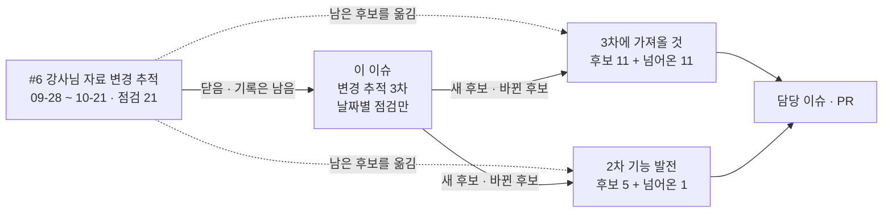
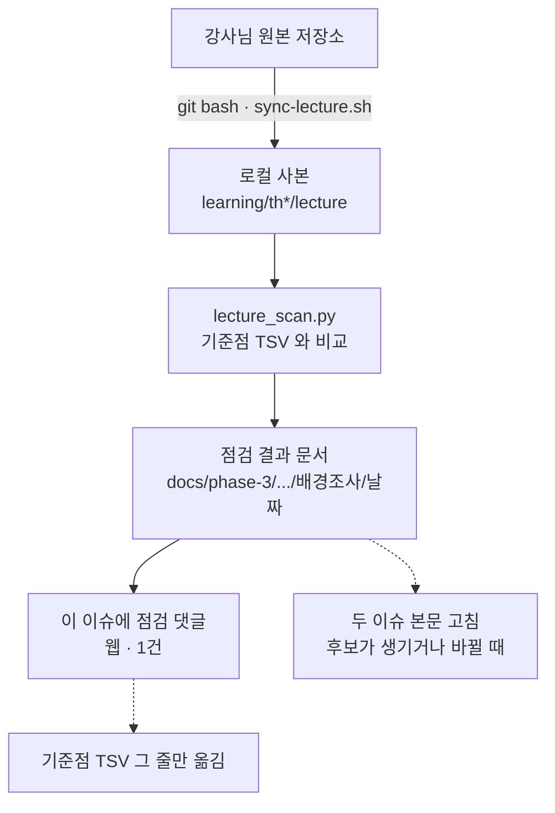
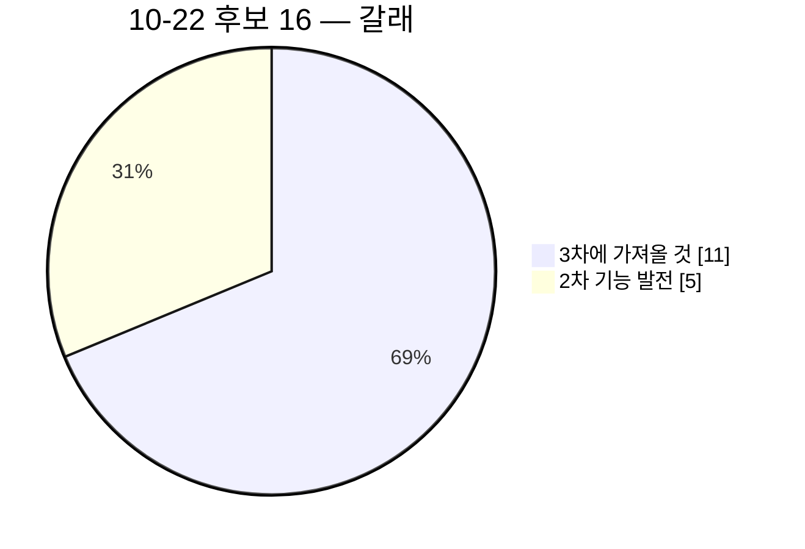

<!-- 올린 이슈 본문 · #319 · 2026-10-22 올림(사용자 확인 · 차례 A → B → C → D) · 이동원 · 10-23 고침(발표일 11-12 두 줄 — 웹 본문도 이 파일로 · 사용자 확인 10-23 S139 시작) · 10-22 고침(웹 본문도 이 파일로): 「올린 뒤 번호」 자리 → #319 · #318 · #317 · <그림 4> 줄(웹에서 그 줄을 지우고 PNG 를 끌어 놓음) · 받지 않기로 한 것에 업비트 한 줄 · 7절 1 · 2 정함 · 옛 머리: 초안(A) 15:01 · post_check · mermaid 확인 -->

> **쉬운 요약 3줄**
> 1. 3차(10-22 ~ 11-11) 동안 강사님 자료가 바뀔 때마다 이 이슈에 점검 댓글을 단다. 09-28 부터 쓰던 [#6](https://github.com/EST-team-project/Qurious/issues/6) 은 2차 기간의 점검 21개를 남긴 채 닫았다.
> 2. 10-21 확인 뒤 새로 들어온 것은 lumina-invest 10커밋 · stock-coin-trade 8커밋 · domain-rag-lab 8커밋(감리대응 화면)이다. **우리 코드에서 그대로 재현되는 결함이 둘** 나왔다 — 목표 시뮬레이션에 수익률 −101 을 넣으면 서버 오류 500, 자동매매가 1회 매수 예산보다 비싼 종목도 1주를 산다.
> 3. 가져올 것은 이 이슈에 쌓지 않고 두 이슈 본문에서 관리한다 — 「강사님 자료에서 3차에 가져올 것」(#318) · 「강사님 자료로 2차 기능 발전시키기」(#317). 이 이슈의 댓글은 날짜별 점검 기록만 남긴다.

## 1. 이 이슈는

| 항목 | 내용 |
|---|---|
| 무엇을 보나 | 모노레포 `learning/th01 ~ th25` 의 `lecture/` — 강사님 원본 저장소의 읽기 전용 사본 24곳(서브모듈 13 · 최근 커밋 하나만 받아 두는 얕은 사본 11 · th04 는 사본 없음) · 특강 자료 폴더 |
| 기간 | 2026-10-22 ~ 11-11(3차) |
| 언제 | 하루 한 번(아침) 또는 이동원이 「받았다」 고 알릴 때 |
| 받아 오기 | 이동원이 git bash 에서 `bash scripts/sync-lecture.sh` 로 받는다. AI 도구는 원격에 접속하지 않는다 |
| 뽑는 법 | `python scripts/lecture_scan.py --md` — 기준점과 지금 끝을 견준다(로컬 git 기록만 읽음) |
| 기준점 | [`기준점.tsv`](https://github.com/EST-team-project/Qurious/blob/8739d61/docs/common/00-management/github-archive/2026-09-28/이슈-강사님자료-변경추적/기준점.tsv) — #6 의 원본 폴더에 그대로 둔다(스캐너 기본 경로 [`scripts/lecture_scan.py:35`](https://github.com/EST-team-project/Qurious/blob/8739d61/scripts/lecture_scan.py#L35)). 점검 댓글을 올린 뒤 그 줄만 옮긴다. lumina-invest 는 서버 · 화면 두 줄 |
| 원본 파일 | 이 이슈와 댓글은 저장소 파일이 원본이다 — [`docs/common/00-management/github-archive/2026-10-22/이슈-강사님자료-변경추적-3차`](https://github.com/EST-team-project/Qurious/tree/main/docs/common/00-management/github-archive/2026-10-22/이슈-강사님자료-변경추적-3차)(PR 머지 뒤 열립니다) |

**#6 을 닫은 까닭**

1. 2차 기간(09-28 ~ 10-21)의 점검 21개가 한 이슈에 쌓여, 「지금 남은 후보가 무엇인가」 를 한곳에서 보기 어렵다 — 후보가 날짜별 댓글마다 흩어져 있다.
2. 3차가 10-22 에 시작했다. 3차 과제에 새로 들일 것과 이미 만든 2차 기능을 고칠 것을 나눠 두면, 담당이 자기 줄을 찾기 쉽다.
3. #6 의 기록은 닫힌 채 남는다(파일 원본도 저장소에 있다). 10-22 점검(올리지 않은 댓글 22)은 이 본문 3절로 옮겼다.

<그림 1> #6 에서 세 이슈로



## 2. 추적 방법

<그림 2> 하루 점검의 흐름 · 실선 = 이동원 손 · 점선 = 파일만



```text
아침 받기 ──▶ 스캐너 ──▶ 점검 문서 ──▶ 이 이슈 댓글 ──▶ 두 이슈 본문 ──▶ 기준점
(이동원)      (로컬)     (로컬 파일)   (웹 · 한 건)     (필요할 때)      (그 줄만)
```

**무엇을 보고 무엇을 싣지 않나**

| 본다 | 싣지 않는다 |
|---|---|
| 커밋 제목 · 바뀐 파일 경로 · 줄 수 · 비교 링크 | 커밋 작성자 · 이메일 |
| 우리 코드와 맞닿는 곳(경로 · 줄) · 우리에게도 같은 결함이 있는지(우리 함수로 재현) | 강사님 글 본문(경로 · 줄 번호만) |
| 금융 글 경로의 변화(th01 · th07 · th24) — 개념 학습에 반영할지 | 배포 스크립트의 서버 주소 · 비밀값 · 감리 원문 파일(.hwpx · 가이드 PDF) |
| 감리 · 운영 검증 결과 | 작업본에 강사님 최신 얹기(merge) — 따로 요청할 때만 |

**댓글 하나에 들어가는 것** — 쉬운 요약 3줄 → 「Qurious 에 닿는 것」 표(다루는 이슈 번호) → 폴더 표 → 바뀐 곳의 커밋 제목과 비교 링크.

## 3. 10-22 현재 상태

10-21 확인(#6 댓글 21) 뒤 10-22 11:18 · 14:18 두 번 받은 것을 합쳤다. 기준은 lumina-invest `594d3ff`(10-22 12:50) · stock-coin-trade `10a7993`(11:56) · domain-rag-lab `fda3ed1`(10-21 12:12), 우리는 `main` `8739d61`.

**<표 1> 폴더별**

| 폴더 | 원본 | 지금 끝 | 10-21 확인 뒤 새로 | 요지 |
|---|---|---|---|---|
| th06-lumina-invest | `edumgt/lumina-invest` | `594d3ff` 10-22 12:50 | **10커밋** · 38 files changed, 1483 insertions(+), 244 deletions(-) | 감리 CRITICAL 고침(자산배분 경계) · KIS 실주문 사이클 · 퀀트 대시보드 개편(근거별 점수 · 매수/매도 탭 · Lightweight Charts) · 1주 > 예산이면 매수 생략 · 모의 전종목 후보 · 지표 대시보드 작업 공간 · 메뉴 묶음 넷 뺌 |
| th03-stock-coin-trade | `edumgt/stock-coin-trade` | `10a7993` 10-22 11:56 | **8커밋** · 8 files changed, 416 insertions(+), 155 deletions(-) | 대시보드 Top 10 → 관심 4종목 차트(TradingView 위젯은 KRX 를 못 그려 걷어냄) · HTS 화면 하드코딩 시세 제거 · Lightweight Charts 4.2.0 · lumina-invest 강력 매수 후보 중계 |
| th07-domain-rag-lab | `edumgt/domain-rag-lab` | `fda3ed1` 10-21 12:12 | **8커밋** · 36 files changed, 5601 insertions(+), 30 deletions(-) | 「감리대응」 화면(문서 19 · 우리 과제 요구 41 · 강사님 배포본 운영 검증 84 · 결함 둘) · 발표 설문 척도 뒤집기 |
| th11 · th02 · th01 · th05 · th08 ~ th10 · th12 · th13 · th20 | 서브모듈 | — | 0 | 변화 없음 |
| th14 · th19 · th21 · th24 등 얕은 사본 11 | 얕은 사본 | — | 0 | 변화 없음(스캐너의 「이력 바뀜」 은 얕은 사본 표시) |
| 특강 2 ~ 4일차 자료 폴더 | 모노레포 · git 밖 | — | 0 | 폴더만 있고 비어 있음 |

```text
10-21 확인 뒤 새 커밋(10-22 14:18 받은 것까지)
lumina-invest      ██████████  10   (11:18 받은 3 + 14:18 받은 7)
stock-coin-trade   ████████     8   (3 + 5)
domain-rag-lab     ████████     8   (감리대응 · 10-21 에 올라옴)
나머지 21곳                     0
```

**<표 2> Qurious 에 닿는 것 — 다루는 곳**

「3-n」 은 「3차에 가져올 것」(#318), 「2-n」 은 「2차 기능 발전」(#317)의 줄이다. 어떻게 · 누가는 그 이슈에 있다.

| 무엇 | 커밋 | Qurious 에서 | 다루는 곳 | 확실도 |
|---|---|---|---|---|
| 목표 시뮬레이션 입력 경계 누락 — 수익률 −101 이면 500(422 가 맞음) · 감리 HIGH · 강사님도 아직 안 고침 | th07 `297acdf` | `app/routes/ml.py` `GoalSimBody` 가 강사님 판과 같아 우리에서도 재현 | 2-1 | 🔴 |
| 1주 값이 1회 매수 예산보다 비싸면 매수 생략 | th06 `c5f903e` | `app/services/auto_trade.py` 는 옛 판(`max(1, …)`) — 31종목 중 10-21 종가 30만 원 넘는 9종목에서 예산 초과 | 2-2 | 🔴 |
| 자산배분 현금 하한 2% · 자산군 상한(감리 CRITICAL 고침) | th06 `aa7e236` | 우리는 음수는 막았지만 30칸 중 11칸이 현금 1% · 0% | 2-3 | 🟢 |
| 신호 근거별 점수 · 매수/매도 탭 · 카드 → 차트 · 「수익 확률 아님」 | th06 `00be53b` · `c5f903e` · `594d3ff` | 퀀트 대시보드 카드 · 신호 서버가 옛 판 | 2-4 | 🟢 |
| 관심 종목 차트 카드 · 출처 줄 · 대시보드 칸 높이 | th03 `910e338` · th06 `026cae5` | 통합 대시보드 | 2-5 | 🟢 |
| 가져오기 1차(네 화면 서버)가 다시 바뀜 — 설정 키 8 → 9 · 모의 전종목 기본 True · 보유 조회 API | th06 `f74b75a` · `594d3ff` | 진행 중인 가져오기 1차 | 3-1 | 🟢 |
| 감리 요구 번호 `RA` · `IND` · `MGT` | th07 `83ec789` ~ `fda3ed1` | 요구 대장 · RTM 과 이름이 1 : 1 인데 이어 둔 곳 0 | 3-2 | 🟢 |
| TradingView 임베드 위젯이 KRX 종목을 못 그림 → Lightweight Charts | th03 `48f03f8` → `910e338` | 3차 TradingView 설계 근거 · 기능대조 문서 낡은 줄 | 3-3 | 🟡 |
| 퀀트 차트 ApexCharts → Lightweight Charts 5.2.1(밴드 채움 · RSI 창 · 판단 화살표) | th06 `9e8c0ba` · `60bb2f0` | 우리와 같은 벤더 사본 — 3차 차트 · 대사 화면 본보기 | 3-4 | 🟢 |
| KIS 실주문 사이클을 KIS 잔고 기준으로 · 봇이 산 종목만 자동 매도 · 보유 목록 빠짐 = 오류 | th06 `aa7e236` · `594d3ff` | 같은 방향은 #212 로 먼저 고침 · 다른 곳 둘 | 3-5 | 🟢 · 🟡 |
| RSI — 가격 변화가 없으면 50 | th06 `00be53b` | 우리는 TradingView 정의(100) — 받지 않고 지킴이 | 3-6 | 🟢 |
| 감리대응 시정조치 계획 · 결과서 · 「가상 · 실제」 원칙 · 운영 확인 문서 | th07 `fda3ed1` · th06 `f74b75a` | 결함대장 칸 · 시험 결과서 | 3-7 | 🟡 |
| 지표 대시보드 작업 공간 · 지표 비교 꽉 찬 표 | th06 `026cae5` · `d30ea9c` | 지표 대시보드 75 · 지표 비교 45 | 3-8 | 🟢 |
| 모의 · 실전 종목 범위를 환경마다 · 31종목 → 적격 전종목 | th06 `f74b75a` | 우리는 31종목 고정 | 3-9 | 🟢 |
| 메뉴 묶음 넷(미국주식 · ML·딥러닝 · 투자분석 기초 · 금융 필수 지식) · 섹터 줄을 메뉴에서 뺌 | th06 `d30ea9c` · `60bb2f0` | 우리 메뉴는 우리 안 — 3차 뒤쪽 화면 범위 판단 근거 | 3-10 | 🟢 |
| 대시보드 Top 10 삭제 | th03 `48f03f8` | 가져올 기능 목록의 원천 두 줄 | 3-11 | 🟢 |
| HTS 관심종목 목록을 「AI 추천」 이라 부름(실제로는 일봉 규칙 점수) | th03 `10a7993` | 우리는 규칙 신호를 AI 라 부르지 않음 | 받지 않음 | 🟢 |
| 발표 평가 설문 척도 뒤집기 | th07 `5e98301` | 10-21 확인 글의 한 줄이 낡음 | 아래 「바로잡기」 | 🟢 |

### lumina-invest(th06) — 새 10커밋 (`92652a2` → `594d3ff`)

Qurious 의 출발점인 기초 코드라 우리도 가진 파일이 많다. 이번 10커밋이 닿는 우리 같은 이름 파일 가운데 가장 많이 갈라진 것은 `public/js/quant.js` 다(줄 유사도 0.60 → 0.33 · 강사님이 퀀트 대시보드를 다시 씀). 저장소 밖에서 3-way 를 미리 돌려 보니 새 커밋이 더한 충돌은 `auto_trade.py` 1 · `quant.js` 3 · `dashboard.js` 2 뿐이고, 나머지는 원래 있던 충돌 그대로다. 제목만 보면 놓치는 것 둘 — `aa7e236` 은 제목이 자산배분이지만 자동매매 사이클(`auto_trade.py` +160 −15)이 더 크게 바뀌었고, `d30ea9c` 는 제목이 「회사 비교 분석」 이지만 위 메뉴 묶음 넷을 뺐다.

비교: https://github.com/edumgt/lumina-invest/compare/92652a2...594d3ff

| 커밋 | 시각 (KST) | 제목 |
|---|---|---|
| `aa7e236` | 10-22 10:40 | feat(robo_profile): Implement asset allocation bounds and computation logic to prevent negative cash allocation in long-term scenarios (FD-FIND-001) |
| `5999e7a` | 10-22 10:51 | feat: 앱 스타일 업데이트 및 KIS 모니터 요약 카드 레이아웃 추가 |
| `00be53b` | 10-22 11:03 | feat: 주식 후보 및 시그널 로딩 기능 개선, KIS 주문 허용 여부 추가 |
| `f74b75a` | 10-22 11:31 | feat: KIS Testbed 전종목 후보 및 주문 확대 기능 추가 |
| `c5f903e` | 10-22 11:38 | feat: 매수 예산 초과 시 매수 생략 기능 추가 및 신호 카드 선택 기능 개선 |
| `9e8c0ba` | 10-22 11:48 | feat: 퀀트 대시보드 로딩 개선 및 차트 라이브러리 업데이트 |
| `60bb2f0` | 10-22 11:56 | feat: 퀀트 대시보드의 밴드 차트 기능 추가 및 관련 스크립트 업데이트 |
| `026cae5` | 10-22 12:21 | feat(dashboard): enhance layout and metrics display for improved user experience |
| `d30ea9c` | 10-22 12:34 | feat: 회사 비교 분석 기능 추가 및 관련 스타일 시트 작성 |
| `594d3ff` | 10-22 12:50 | feat: KIS Testbed 보유 조회 API 추가 및 매도/매수 후보 필터링 기능 개선 |

- Windows 에서 만들 수 없는 파일(`public/js/common.js:RVContext`)이 `f74b75a` 에 다시 들어왔다가 `594d3ff` 에서 빠졌다. 끝 판에는 없다.
- 새 화면 넷(KIS 모의투자결과 · 전략설정 · 설정별 성과 · 수익률 검증)의 마이그레이션 끝 번호는 여전히 `0011` 이다.

### stock-coin-trade(th03) — 새 8커밋 (`b6f1e92` → `10a7993`)

대시보드는 하루에 세 번 고쳐 끝 판에는 TradingView 위젯이 남아 있지 않다(Lightweight Charts 4.2.0 + 자체 일봉 API). HTS 화면은 하드코딩 시세를 걷어내고 시세 원천을 붙였으며, 관심종목을 lumina-invest 의 공개 후보 API 를 서버가 대신 읽는 중계로 채웠다(연결 실패 503 · 형식 오류 502 · 실패는 캐시하지 않음). 제목이 「1」 인 커밋(`c2c2649`)이 그 중계 서버와 시험 넷을 더한 커밋이다.

비교: https://github.com/edumgt/stock-coin-trade/compare/b6f1e92...10a7993

| 커밋 | 시각 (KST) | 제목 |
|---|---|---|
| `48f03f8` | 10-22 10:40 | feat: 대시보드 하단 주식 Top 10 및 코인 Top 10 제거, 관심 4종목 TradingView 차트 추가 |
| `7d864c6` | 10-22 10:51 | feat: TradingView Advanced Chart 위젯으로 주식 차트 임베드 및 스타일 수정 |
| `910e338` | 10-22 11:03 | feat: TradingView Lightweight Charts로 주식 차트 교체 및 실시간 데이터 표시 기능 추가 |
| `c82aca7` | 10-22 11:30 | feat: 관심종목 실시간 시세 자동 반영 기능 추가 및 KIS API 연동 |
| `a8633fb` | 10-22 11:38 | feat: Replace KIS stock data with Yahoo Finance API integration |
| `cb2ee45` | 10-22 11:41 | feat: TradingView Lightweight Charts로 차트 교체 및 데이터 표시 기능 추가 |
| `c2c2649` | 10-22 11:48 | 1 |
| `10a7993` | 10-22 11:56 | feat: AI 추천 기능 개선 및 UI 수정 |

### domain-rag-lab(th07) — 새 8커밋 (`7254bb1` → `fda3ed1`) · 감리대응

`fda3ed1` 뒤 변화는 0 이다. 감리대응 화면은 우리 과제를 예시로 쓴다 — 요구 41건(`RA-001 ~ 015` 로보어드바이저 · `IND-001 ~ 016` 인디케이터 · `MGT-001 ~ 010` 공통 관리)과 문서 탭 19종(RFP · 과업대비표 · 요구사항 정의서 · 추적표 · 설계서 · GAP 분석 · 시정조치 계획 · 결과서 · 회의록 · 변경요청서 · 검사기준서 · 시험 시나리오 · 결과표 등). 강사님 배포본 운영 검증 84건(운영 화면 25 · 소스 시험 50 · 비중 수식 9)에서 결함 둘이 나왔고, 둘 다 같은 입력으로 우리 함수에서도 확인했다(CRITICAL 은 우리 판에서 음수는 안 나오지만 현금 하한이 없음 · HIGH 는 그대로 재현). 화면의 원칙 — 「생성 ID 를 실제 구현 증거로 보지 않음 · 자체 시험 통과만으로 조치 완료 처리 금지 · 미승인 변경요청은 미적용」 — 은 우리 결함대장 · 시험 결과서에도 쓸 만하다(3-7).

비교: https://github.com/edumgt/domain-rag-lab/compare/7254bb1...fda3ed1

| 커밋 | 시각 (KST) | 제목 |
|---|---|---|
| `5e98301` | 10-21 09:57 | fix: 설문 점수 체계 및 보고서 내용 수정, 평가 기준 변경 |
| `83ec789` | 10-21 10:23 | Add audit response page with CSS and JavaScript functionality |
| `8c845bc` | 10-21 10:29 | Refactor code structure for improved readability and maintainability |
| `f74f727` | 10-21 10:53 | feat: add audit RTM canvas functionality and extract RFP requirements |
| `0273cb4` | 10-21 11:19 | feat: update audit-navigation script version and add new audit design and gap functionalities |
| `d29eaf6` | 10-21 11:24 | Refactor audit design and response components |
| `297acdf` | 10-21 11:41 | feat(audit): add mergeAuditLiveResults function for enhanced verification handling |
| `fda3ed1` | 10-21 12:12 | feat: Update audit response page and add new audit guide documentation |

### 바로잡기

- #6 댓글 21(10-21)의 발표 평가 설문 「1 이 가장 우수하다」 는 그 뒤 `5e98301`(10-21 09:57)에서 뒤집혔다 — 이제 **1 매우 미흡 ~ 5 매우 우수(높을수록 우수)** 이고, 옛 응답은 `6 − 점수` 로 바꿔 합산한다.

### 지킨 것

- 금융 글 경로(th01 · th07 · th24)는 그대로다 — th07 강의 쪽에는 「감리대응」 단추 줄만 늘었다. 특강 2 ~ 4일차 자료는 아직 없다.
- 새 커밋의 더한 줄에서 이메일 · IP · 비밀번호 · 토큰 · 계좌꼴을 세어 보니 실제 값은 배포 스크립트의 서버 접속 주소 1건이었다(옮기지 않음). 감리 자료는 0건. 커밋 작성자 · 이메일은 싣지 않았다.

## 4. 가져올 것은 두 이슈로

| 이슈 | 담는 것 | 후보 | 추천 상위 셋 |
|---|---|--:|---|
| 「강사님 자료에서 3차에 가져올 것」(#318) | 3차 과제 — TradingView · Pine · 증권사 연동 · 감리대응 산출물 · 투자 인디케이터 화면 — 에 새로 들일 기능 | 11 + 10-21 에서 넘어온 11 | 가져오기 1차에 이번 변경 반영 · 요구 대장 감리 번호 칸 · TradingView 근거 한 줄 |
| 「강사님 자료로 2차 기능 발전시키기」(#317) | 이미 만든 2차 기능(로보 어드바이저 · 대시보드 · 모의투자 · 자동매매 사이클)을 고치거나 낫게 할 것(결함 포함) | 5 + 10-21 에서 넘어온 1 | 목표 시뮬레이션 입력 경계 · 1회 예산보다 비싼 종목 1주 매수 · 현금 하한 |

<그림 3> 10-22 후보의 갈래



받지 않기로 한 것(두 이슈 밖): 메뉴 묶음 정리 그 자체 · stock-coin-trade 차트의 4.2.0 함수 · 「AI 추천」 낱말 · RSI 를 50 으로 · 배포 스크립트 · 운영 문서 본문 · stock-coin-trade 의 업비트 시세를 우리 저장소 · 데이터셋에 쌓는 것(업비트 Open API 이용약관 제5조가 데이터의 무단 복제 · 배포를 막고, 과거 시세는 「개인적 이용」 만 허용한다 — 코인 봉은 Binance Vision 으로 쌓는다).

<그림 4> 점검은 #319 댓글로 날짜마다 쌓고, 가져올 것은 #318 · #317 본문을 고쳐 한곳에 둔다 · 범례: 실선 = 점검마다 · 점선 = 필요할 때만 · 칩 = 어디서 하는 일인지

(그림 — 웹에서 이 줄을 지우고 이 파일을 끌어 놓아 붙임: `docs/common/00-management/github-archive/2026-10-22/이슈-강사님자료-변경추적-3차/img/lecture-tracking-flow_v1.0.png`)

<sub>원본: [Figma · Qurious · 문서 그림 · 「#319 강사님 자료 변경 추적 — 3차」](https://www.figma.com/design/6lstWS4YwuhJPhGB9XoBMD?node-id=64-2) · 그림 판 v1.0 · 기준 `4bed63b` · 2026-10-22 · 같은 흐름은 2절 <그림 2>(Mermaid) · 숫자는 3절 <표 1></sub>

## 5. 앞으로 댓글 규칙

1. **댓글 = 날짜별 점검 기록만.** 쉬운 요약 3줄 → 「Qurious 에 닿는 것」(다루는 이슈 줄 번호) → 폴더 표 → 커밋 제목 · 비교 링크.
2. **가져올 후보가 생기거나 바뀌면 두 이슈의 본문을 고친다.** 그 이슈에는 무엇을 고쳤는지 댓글 한 줄, 이 이슈 댓글에는 「3-n · 2-n 에 더함」 한 줄.
3. 담당이 받아 PR 이 머지되면 그 이슈 줄에 PR 번호를 적고, 이 이슈에는 다음 점검 댓글에서 한 줄로 알린다.
4. 이 이슈는 3차 발표(~~11-11~~ 11-12 오전 — 10-22 강사님 일정) 뒤 닫는다. 그 전에 댓글이 20개를 넘으면 닫고 다음 판으로 잇는다.

## 6. 용어 풀이

| 낱말 | 뜻 | 이 글에서 | 헷갈리는 점 |
|---|---|---|---|
| 사본(lecture) | 강사님 원본 저장소를 모노레포 안에 읽기 전용으로 받아 둔 것 | 1절 | 우리 작업본(`projects/`)과 다르다. 사본은 고치지 않는다 |
| 얕은 사본 | 최근 커밋 하나만 받아 둔 사본 | <표 1> | 스캐너가 「이력 바뀜」 이라고 보여도 강사님이 이력을 다시 쓴 것이 아니다 |
| 기준점 | 지난번에 본 커밋 — 다음 점검은 그 뒤만 본다 | 1절 · 7절 | 점검 댓글을 올린 뒤에 그 줄만 옮긴다. 옮기지 않으면 다음 점검이 같은 커밋을 다시 센다 |
| 3-way | 기준 판 · 우리 판 · 강사님 판 셋을 맞대 합치는 것 | 3절 | 충돌이 없어도 값이 말없이 바뀔 수 있다 |
| 감리 | 발주자를 대신해 제3자가 산출물이 요구에 맞는지 점검하는 일 | 3절 | 강사님 화면의 CRITICAL · HIGH 는 자체 검증의 심각도다. 감리의 적합 · 부적합 판정과 같은 말이 아니다 |
| 가져오기 1차 | 강사님 lumina-invest 의 새 화면 넷(KIS 모의투자결과 · 전략설정 · 설정별 성과 · 수익률 검증)을 우리 앱에 들이는 첫 묶음 | <표 2> | 서버는 사용자마다 설정하는 꼴로 고쳐 받는다 |

## 7. 정할 것(추천은 첫 칸)

| # | 정할 것 | 선택지(추천 첫 칸) | 판단 재료 |
|---|---|---|---|
| 1 | 기준점 TSV 자리 | **정함(10-22)** — #6 폴더에 그대로(스캐너 기본 경로) / 이 이슈 폴더로 옮기고 스캐너 기본값을 고침 | 옮기면 `scripts/lecture_scan.py:35` 를 함께 고쳐야 한다 |
| 2 | 기준점을 옮기는 때 | **정함 · 옮김(10-22 · 이 글을 올린 뒤)** — stock-coin-trade `10a7993` · domain-rag-lab `fda3ed1` · python-ml-class `79628ff` · docker-class `a215b9f` · 얕은 사본 넷은 지금 끝으로, lumina-invest 두 줄은 가져오기 1차 뒤 / 지금 모두 / 그대로 | 기준점이 10-08 · 10-18 에 머물러 스캐너(10-22 14:58 실행)가 stock-coin-trade 35 · lumina-invest 서버 51 · 화면 58 · domain-rag-lab 9 커밋을 다시 센다 |
| 3 | 이 이슈를 닫는 때 | 3차 발표(11-12) 뒤 / 댓글 20개 / 11-05 기능 마감 | #6 은 댓글 21개에서 닫았다 |

## 8. 한계

- 10-22 상태는 이동원이 14:18 ~ 14:19 에 받은 로컬 사본 기준이다(그 뒤 14:23 에 다시 확인 — 변화 없음). 강사님 배포 사이트가 저장소보다 새것인지는 저장소로는 알 수 없다.
- 「우리에게도 같은 결함」 은 우리 함수를 저장소 밖에서 불러 확인했다. 앱을 띄워 라우트로 부르지는 않았다.
- 우리 판과 갈라진 정도(유사도 · 3-way 충돌 수)는 미리보기 값이다. 실제로 받을 때는 그때 다시 돌린다.

**뒤집을 조건** — 기준점 TSV 자리를 옮기기로 하면 1절 표와 스캐너 기본값을 함께 고친다. 강사님이 3차 동안 새 저장소를 더하면(th26 ~) 1절의 범위를 고친다. 두 이슈로 나눈 것이 오히려 찾기 어렵다는 말이 나오면 한 이슈로 합치고 갈래는 칸으로 둔다.
