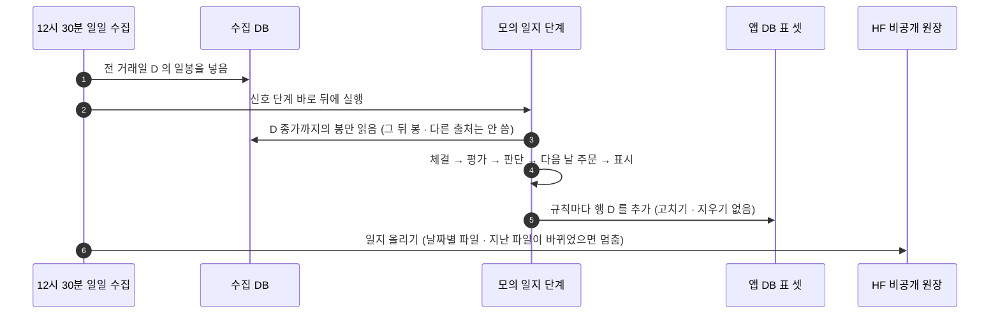
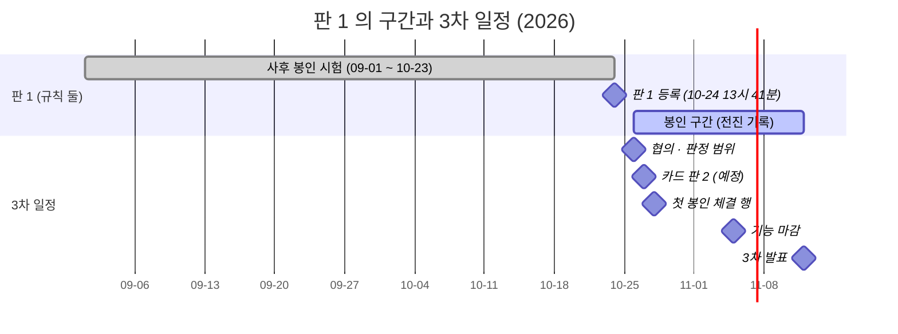
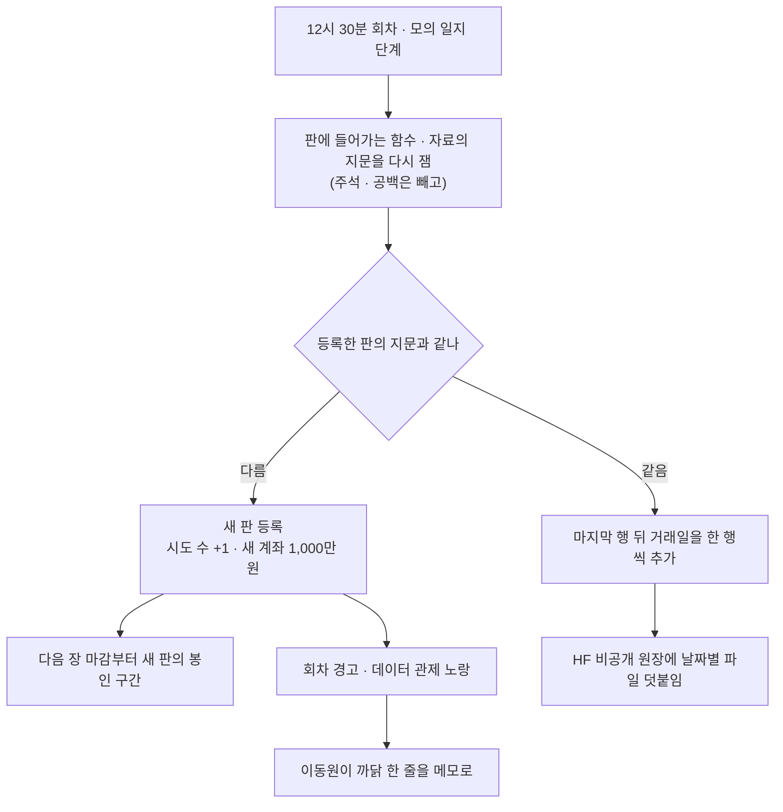
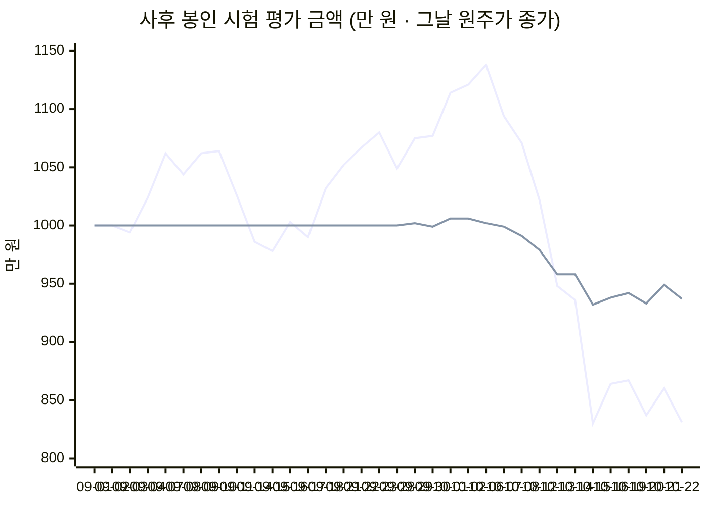

<!-- 올린 이슈 본문 · #333 · 올림(10-24 · 사용자 확인 — #332 다음 · PR #334 머지 전후) · 다음 할 일: 팀원 답글이 오면 이 폴더에 원문으로 · 판정 범위는 10-26 협의(#335 안건 ①) · 옛 주석: 새 이슈 초안 · 2026-10-24 · 이동원 → 팀(강민석 · 신장환 · 오준영) · 제목 「[3차] 모의투자 그림자 일지 — 판 1 등록 · 10-26 봉인 시작 · 매일 남기는 것과 판정」 · 올리는 때: 그림자 일지 PR 머지 뒤 · 사용자가 웹에서 · 오준영 님 확인 이슈와 10분 간격(이 글 먼저) · 그림 둘은 웹에서 「(그림 — …)」 줄을 지우고 그 파일을 끌어 놓아 붙임 · 링크는 그 PR 머지 뒤 main 기준 · 숫자는 이동원 PC 앱 DB · 내보내기 폴더(2026-10-24 13:42 계산)와 맞춤 · 대신하는 것: 논의 #13(D7) 갱신 댓글 03 초안(논의를 더 쓰지 않음 · 사용자 10-24 · 3차 전용 새 이슈로) · 이 주석 줄은 빼고 올림 -->
# [3차] 모의투자 그림자 일지 — 판 1 등록 · 10-26 봉인 시작 · 매일 남기는 것과 판정

강민석 님(@rkdalstjr) · 신장환 님(@janghwan-god) · 오준영 님(@GoonGuMa),

3차 기간(10-26 ~ 11-12) 동안 규칙 둘이 **매 거래일 어떻게 판단하고 다음 날 아침 시가에 어떻게 샀을지**를 한 줄씩 남기는 「그림자 일지」 를 켰습니다. 증권사에 주문을 내지 않는 기록이고, 판 1 은 **10-24(토) 13:41** 에 등록해 **10-26(월) 장 마감부터** 봉인 구간이 시작됩니다. 이 글은 무엇이 남는지 · 각자 어디에 닿는지 · 판정은 언제 어떻게 정하는지를 한곳에 모았습니다.

| 머리표 | 내용 |
|---|---|
| 목적 | 3차의 카드 전략(①②) · TradingView 와 LEAN 교차 검증(③ · ④) · 증권사 모의 경로(⑤)가 **같은 규칙 · 같은 날짜**로 맞대어 볼 전진 기록을 남긴다 |
| 기준일 | 2026-10-24(토) KST · 판 1 등록 13:41 · 봉인 시작 10-26(월) · 3차 기능 마감 11-05(목) · 발표 11-12(목) |
| 기준 코드 | `main` 그림자 일지 PR 머지 커밋(규칙 지문은 등록 때 고정 — 카드 `443aed4f32f9` · 기본 규칙 `e574c622ee81`) |
| 어디서 왔나 | 9월 설계 논의 #13 의 ⑤ 일지 · ⑥ 체결가 · ⑦ 봉인 판정 · ⑧ 실행처를 3차에 구현 — 결정은 [논의 결정 대장](https://github.com/EST-team-project/Qurious/blob/main/docs/phase-3/00-management/plans/논의결정대장.md) 부록 C(10-23 · 10-24) |
| 정본 | [모의투자 그림자 일지 설계 v0.1](https://github.com/EST-team-project/Qurious/blob/main/docs/phase-3/02-design/system/모의투자-그림자일지-설계.md) — 이 글과 다르면 설계 문서가 맞습니다 |
| 읽는 법 | 1절 → 6절(내 이름) → 7절(일정). 확실도는 **🟢 확실**(코드 · 시험 · 기록으로 셈) · **🟡 추정**(문서 · 일정으로 판단) · **⚪ 정할 것** |

## 1. 한눈에

1. **매 거래일 1행** — 「그날 시가 체결 → 그날 종가 평가 → 그날 종가까지의 봉으로 판단 → 다음 거래일 시가 주문」 을 한 행에 담습니다. 매매가 없는 날(관망)도 남깁니다. 🟢
2. **규칙 둘 · 판 1 · 시도 수 2** — 신장환 님 카드 판 1(`ma_cross_20_60` · 삼성전자) · 지금 자동매매 기본 규칙(31종목 점수 상위 3). 둘 다 **앱의 실제 판단 함수를 그대로** 부르고, 주문 크기도 자동매매 기본값 그대로입니다. 🟢
3. **규칙 코드가 바뀌면 기계가 새 판으로 등록**합니다(시도 수 +1 · 새 계좌). 고치는 것을 막는 장치가 아니라 **바뀐 날을 남기는 장치**라, 코드를 고치실 때 따로 알려 주실 필요가 없습니다. 🟢
4. **사후 봉인 시험(09-01 ~ 10-22 · 34거래일)** 은 판 1 등록 직후 한 번만 계산했습니다 — 카드 규칙 **−6.3%** · 기본 규칙 **−16.9%**. 규칙을 정한 뒤에 생긴 날이 아니라 **판정에는 쓰지 않습니다**(5절). 🟢
5. **판정 범위(백테스트 대비 괴리 숫자)는 결과 전에 정합니다** — 첫 봉인 체결 행이 10-28 에 생기므로 10-26 협의에서 강민석 님께 여쭙니다. ⚪

**그림 1. 3차 모의투자 그림자 일지 — 한눈에**

(그림 — 웹에서 이 줄을 지우고 이 파일을 끌어 놓아 붙임: `docs/common/00-management/github-archive/2026-10-24/이슈-3차-모의투자-그림자일지/img/paper-journal-overview_v1.0.png`)

<sub>원본: [Figma · Qurious · 문서 그림 · 「3차 모의투자 그림자 일지 — 한눈에」](https://www.figma.com/design/6lstWS4YwuhJPhGB9XoBMD?node-id=92-3) · 그림 판 v1.0 · 2026-10-24 · 같은 내용의 표는 2 · 3 · 5 · 6절</sub>

## 2. 하루에 무엇을 남기나

수집 DB 의 일봉은 공공데이터포털이 **다음 영업일 낮**에 줍니다. 그래서 거래일 D 의 행은 **D+1 12:30 일일 수집이 D 의 봉을 넣은 뒤**(13:30 즈음) 생깁니다. 한 행에 D 의 시가 · 종가가 다 들어 있어 **한 번 쓰고 다시 고치지 않습니다.**

**그림 2. 한 행 = 거래일 하루 · 판마다 봉인 구간 · 남는 곳**

(그림 — 웹에서 이 줄을 지우고 이 파일을 끌어 놓아 붙임: `docs/phase-3/02-design/system/img/paper-journal-day_v0.1.png`)

<sub>원본: [Figma · Qurious · 문서 그림 · 모의투자 그림자 일지 설계 그림 2-1](https://www.figma.com/design/6lstWS4YwuhJPhGB9XoBMD?node-id=89-3) · 설계 문서 <그림 2-1> 과 같은 그림</sub>

| 차례 | 행 D 에서 하는 일 | 쓰는 값 | 남는 칸 |
|--:|---|---|---|
| ① | 앞 행(전 거래일)이 낸 주문을 **D 시가**로 가상 체결 | 원주가 시가 · 매수 + 10bp / 매도 − 10bp · 수수료 · 세금 세목 | `fills` |
| ② | D 종가로 평가 | 원주가 종가 × 수량 + 현금 | `cash` · `positions` · `equity` · `day_return` |
| ③ | D 종가까지의 봉으로 판단 | 수정주가 2년 창 · 앱 판단 함수 그대로 | `decisions`(기본 규칙은 31종목 점수 `ranking` 도) |
| ④ | 다음 거래일 시가에 낼 주문 | 판단가 = D 종가 · 자동매매 기본 크기 | `orders` · `skipped`(크기 셈에서 빠진 것과 까닭) |
| ⑤ | 표시 | 일손실 3% · 조정 사건(분할 등) · 참고 코드 바뀜 | `flags` |

**그림 3. 12:30 회차 안에서 — 수집 다음에 일지, 마지막에 원장**



**한 행의 모양(줄임)** — 카드 규칙 10-22 행 🟢

```text
trade_date 2026-10-22 · grade post_hoc · status ok
fills      (없음 — 10-21 판단이 관망)
equity     9,371,983원  = 현금 6,583,483 + 삼성전자 13주 × 214,500
decisions  삼성전자 · SMA20 < SMA60 → 매도 신호
orders     10-23 시가 매도 6주 (보유 13주의 절반)
flags      (없음)
```

## 3. 등록한 규칙 둘 — 판 1

| 칸 | 카드 규칙 `card_ma_cross_20_60` | 기본 규칙 `auto_default` |
|---|---|---|
| 무엇 | 신장환 님 전략 카드 판 1 — 이동평균 20 · 60 교차(일봉) | 지금 자동매매의 기본 규칙(전략 카드 없이) |
| 종목 | 카드에 적힌 `005930` 삼성전자 하나 | 31종목 중 그날 점수 상위 3 |
| 판단 | 카드 진입 · 청산 규칙(청산 우선) — SMA20 > SMA60 매수 · SMA20 < SMA60 매도 | 앱 신호 점수(RSI · 5/20 교차 · 볼린저) → 강력 매수 ~ 강력 매도 |
| 크기 | 매수 신호마다 100만 원어치 · 종목 비중 30% 까지 · 매도 신호마다 보유의 50% · 하루 주문 20건 | 같음 |
| 시작 자금 | 1,000만 원 | 1,000만 원 |
| 일손실 3% | 표시만 — 「실제 자동매매였다면 비상 정지」 · 주문은 이어감 | 같음 |

**이 함수를 고치면 새 판이 됩니다** 🟢 — 주석 · 문서 문자열 · 공백만 바뀐 PR 은 판을 바꾸지 않습니다(구문 나무로 잼).

| 파일 (`app/services/`) | 판에 들어가는 것 | 어느 규칙 |
|---|---|---|
| `stock.py` | `get_quant_indicators` · `_generate_signal` · `_calc_rsi` · `_calc_sma` · `_calc_bollinger` · `_rounded` | 둘 다 |
| `ta_utils.py` | `rma` · `rsi` · `bollinger` | 둘 다 |
| `collector_db.py` | `read_daily_candles` · `_candle` · 조회 SQL | 둘 다 |
| `risk_guard.py` · `trading_cost.py` | `cap_buy_quantity` · `order_costs` · `cost_rate` · `tax_rates` · 연도별 세율표 · 수수료 상수 | 둘 다 |
| `auto_trade.py` | `apply_strategy_spec_to_signal` · `evaluate_spec_rules` · `_sma_last` · 신호 점수 배율 | 카드 |
| 카드 JSON (`docs/phase-3/02-design/system/예시/strategy-card-ma-cross-v1.json`) | 파일 내용 전체 | 카드 |
| `stock.py` 의 31종목 목록 | 종목 · 이름 | 기본 |
| 참고만(판은 그대로) — `auto_trade.py` `_run_quant_cycle` · `_execute_virtual_trade` · `apply_strategy_spec_to_symbols` · `stock.get_candles` | 바뀌면 그날 행에 「참고 코드 바뀜」 표시 | 둘 다 |

## 4. 판 · 봉인 구간 — 언제부터가 증거인가

**봉인 시작일** = 등록 시각 뒤 처음 장 마감(15:30)하는 거래일입니다. 판 1 은 토요일에 등록해 **10-26(월)** 이 첫 봉인 거래일입니다. 그 앞(09-01 ~ 10-23)은 「사후 봉인 시험」 등급으로, 사람이 이미 그 기간 시장을 봤기 때문에 한 단계 약한 증거로 따로 둡니다.

**그림 4. 판 1 — 사후 봉인 시험과 봉인 구간 · 3차 일정**



**봉인 구간에 쌓이는 거래일 수** 🟢 (거래일 달력 기준)

```text
10-26 ─────────────── 11-05 ───────── 11-11 │ 11-12 발표
 ▓▓▓▓▓ ▓▓▓▓              ▓ ▓▓▓▓
 9거래일(기능 마감까지)    13거래일(발표 전날까지)
 ※ 11-11 행은 11-12 낮 회차 뒤에 생겨 발표 자료에는 11-10 행까지 들어갑니다(🟡 회차가 정시에 돌 때)
```

**그림 5. 판이 바뀌는 때 — 회차마다 지문을 다시 잽니다**



- 새 판은 **새 계좌**(1,000만 원 · 보유 없음)로 시작하고 판마다 따로 판정합니다. 판 수 = 시도 수입니다(규칙 통틀어 셈).
- 옛 판의 남은 날은 계산하지 않습니다(옛 코드가 없음) — 옛 판 마지막 행 ~ 새 판 봉인 시작 사이는 「기록 없음」 으로 메모에 남깁니다.

## 5. 사후 봉인 시험 결과 — 09-01 ~ 10-22 (34거래일)

판 1 등록 직후 한 번만 열어 계산했습니다(개봉 기록이 메모 표에 있습니다). **판정에 쓰는 것은 10-26 뒤 전진 행이고, 이 절은 일지가 제대로 도는지와 규칙의 동작을 보는 자료입니다.** 10-23 행은 10-23 일봉이 들어오는 10-26 회차 뒤에 생깁니다.

**그림 6. 평가 금액(만 원)** — 처음부터 출렁이는 선 = 기본 규칙(1,000 → 10-06 1,138 → 831) · 09-28 까지 1,000 에 붙어 있는 평평한 선 = 카드 규칙(→ 937)



| 칸 | 카드 규칙 (삼성전자) | 기본 규칙 (상위 3) | 확실도 |
|---|---|---|:-:|
| 체결 | 매수 7 · 매도 0 | 매수 11(그중 2건은 현금이 모자라 수량을 줄임) · 매도 0 | 🟢 |
| 미체결 | 0 | **61 — 모두 「현금 부족」**(09-10 부터 현금 8,152원) | 🟢 |
| 끝 평가(10-22 종가) | 9,371,983원 · **−6.28%** | 8,310,352원 · **−16.90%** | 🟢 |
| 가장 높았던 날 | 10,062,328원(10-02 · +0.62%) | 11,378,452원(10-06 · +13.78%) | 🟢 |
| 고점 대비 가장 깊은 하락 | −7.39%(10-15) | −27.01%(10-15) | 🟢 |
| 가장 나빴던 하루 | −2.75%(10-15) | −11.32%(10-15) | 🟢 |
| 일손실 3% 넘은 날 | 0 | **8** — 09-11 · 09-14 · 10-07 · 10-12 · 10-13 · 10-15 · 10-20 · 10-22 | 🟢 |
| 끝 보유 | 삼성전자 13주(평균 262,763원 · 종가 214,500원) | 6종목 — SK하이닉스 1 · 삼성전자 6 · 삼성전기 2 · 한국전력 6 · 삼성에스디에스 5 · 한미반도체 12 | 🟢 |
| 다음 주문(10-23 시가) | 매도 6주(13주의 절반) | 매수 3건(KT 21 · CJ제일제당 5 · SK하이닉스 1) — 현금 8,152원으로는 한 주도 못 사 미체결 | 🟢 |

**끝 수익률(%) 견주기** 🟢

```text
             −20%        −10%          0%
카드 규칙                       ▓▓▓▓▓▓│  −6.3%
기본 규칙         ▓▓▓▓▓▓▓▓▓▓▓▓▓▓▓▓▓│ −16.9%
```

**읽을 거리 셋**

1. **카드 규칙은 09-23 까지 매도 신호 · 보유 없음이라 주문이 없었습니다.** 09-28 에 SMA20 이 SMA60 위로 올라 매수 신호가 이어졌고, 처음 세 번은 100만 원어치(3주씩), 그 뒤로는 종목 비중 30% 상한에 걸려 1주로 줄거나 건너뛰었습니다(체결 7번 · 13주). 10-21 은 SMA20 과 SMA60 이 **252,775원으로 똑같아** 진입 · 청산 모두 아니어서 관망, 10-22 에 SMA20 이 아래로 내려가 매도 신호 → 10-23 시가에 절반(6주)을 팝니다. 🟢
2. **기본 규칙은 첫 닷새(09-02 ~ 09-07 체결)에 현금의 95% 를 썼고 09-10 에는 8,152원만 남아, 09-08 부터 매수 주문 61건이 모두 「현금 부족」 미체결**입니다. 판단 대상이 그날 점수 상위 3 뿐이라, 보유 종목이 상위 3 밖에서 매도 점수(−1 이하)였던 경우가 **32거래일에 86번** 있었지만 한 번도 팔지 않았습니다(매도 0건). 실제 자동매매 코드와 같은 동작이라 일지는 그대로 두고, 오준영 님께 따로 확인 이슈로 여쭙니다(6절). 🟢
3. **10-15 −11.32%** 는 보유 종목의 그날 원주가 종가 하락 그대로입니다 — 삼성전기 −15.4% · 한미반도체 −11.6% · SK하이닉스 −11.1% · 삼성전자 −9.5%(누적 조정계수 변화 없음 · 분할 등 아님). 🟢

## 6. 각자 닿는 곳

| 누구 | 3차 역할 | 이 일지와 닿는 곳 | 부탁 | 언제 |
|---|---|---|---|---|
| **강민석 님** | ④ LEAN 성과 검증 | 판정(E2) · 같은 기간 LEAN 백테스트와 맞대기(신호 · 주문 · 체결가 · 비용 · 회전) | **괴리 허용 범위를 결과 전에** — 아래 판정 표 ③ | 10-26 협의(첫 봉인 체결 행 10-28 전) |
| **신장환 님** | ①② 인디케이터 · 전략 카드 | 등록 규칙 하나가 카드 판 1 | 카드 판 2 가 main 에 들어오면 판 2 로 등록 — 카드 파일을 바꾸는 PR 에 이 이슈 번호를 적어 주시면 그 회차에서 판 2 를 확인합니다 | 10-27 예정 |
| **오준영 님** | ⑤ 증권사 연동 | 등록 규칙 하나가 지금 자동매매 기본 규칙 · KIS 모의 경로는 일지와 따로(체결 현실성은 그쪽 몫) | 확인 거리 셋 — 같은 날 올리는 확인 이슈(카드 종목이 상위 3 과 안 겹칠 때 · 상위 3 밖 보유 · 현금이 바닥난 뒤의 매수) | 그 이슈에서 |
| **이동원** | ③ TradingView · Pine(Strategy Tester + LEAN 교차 검증) · 일지 실행기 | 회차 · 표 · 원장 · 판 바뀜 까닭 · 화면과 조회 API(판정 화면을 정한 뒤) | — | 매 거래일 · 판이 바뀐 다음 날 |

**판정 — E2 칸과 정할 것** (판 명세의 판정 칸에 이미 적혀 있고, ③ 의 숫자만 비어 있습니다)

| E2 칸 | 일지가 남기는 것 | 판정 범위 | 확실도 |
|---|---|---|:-:|
| ① 기록 누락 0일 | 거래일마다 행 · 늦게 계산했으면 「재계산」 표시 | 누락 0 · 재계산은 표시만 | 🟢 |
| ② 판 안 규칙 변경 0회 | 행마다 지문 = 판 지문 · 바뀌면 새 판 | 기계가 지킴 · 판 수 = 시도 수 | 🟢 |
| ③ 백테스트 대비 괴리 | 판단 · 주문 · 체결가 · 비용 세목 · 회전 | **10-26 협의에서 정함** — 참고: QuantConnect 실거래 · 백테스트 맞대기(Live Reconciliation)의 경험값 — 수익 상관 0.8 이상 「좋음」 · DTW 거리 0.2 미만 「무난」(그 플랫폼 기준이라 참고로만) | ⚪ |
| 성과 | 평가액 · 일수익 → 누적 수익 · MDD · 샤프 | 기술 통계로만 — 14거래일이면 연 샤프의 95% 구간이 ±8.3 안팎이라 판정에 쓰지 않음 | 🟢 |

## 7. 일정 — 처음 생기는 행들

| 날 | 12:30 회차 뒤 생기는 것 | 확실도 |
|---|---|:-:|
| 10-26(월) | 10-23 행(마지막 사후 행) — 카드 규칙의 10-22 매도 주문이 10-23 시가에 체결 | 🟡 회차가 정시에 돌 때 |
| 10-27(화) | **10-26 행 = 첫 봉인 판단**(체결은 10-23 판단분) | 🟡 |
| 10-28(수) | **10-27 행 = 첫 봉인 판단의 체결(10-27 시가)** — 판정 범위는 이 전에 | 🟡 |
| 11-05(목) | 기능 마감 — 봉인 9거래일 | 🟢 달력 |
| 11-12(목) | 3차 발표 — 봉인 구간 13거래일(10-26 ~ 11-11) · 발표 자료에는 11-10 행까지 12행(11-11 행은 발표 날 낮에 생김) | 🟢 달력 · 🟡 회차 |

PC 가 꺼지거나 회차가 실패한 날은 다음 회차가 빠진 날을 차례로 채우고 그 행에 「재계산」 을 표시합니다. 규칙이 D 까지의 자료만 쓰고 체결이 다음 날 시가라 늦게 계산해도 값은 같습니다. 🟢

## 8. 자료 자리

| 자리 | 무엇 | 누가 볼 수 있나 |
|---|---|---|
| 앱 DB 표 셋 | `paper_journal_versions`(판) · `paper_journal_days`(매 거래일 1행) · `paper_journal_notes`(개봉 기록 · 판 바뀜 까닭 · 해석) — **추가만** | 표는 모두의 앱 DB 에 생기지만(마이그레이션 `0026`) 행은 이동원 PC 회차만 씀 — 팀은 아래 HF 원장으로 봄 |
| HF 비공개 원장 | `qurious-quant/qurious-paper-log` — `versions/` · `rows/<규칙>/v<판>/<거래일>.parquet` · `notes/` · `manifest.json`(파일마다 내용 지문) | 팀 HF 조직 회원(private) |
| 자료 안내 화면 | 30번째 자료 「모의투자 그림자 일지」 — 칸 설명 · 행 수 | 로그인 사용자 |
| 데이터 관제 화면 | 「팀 공유 저장소」 줄에 일지 올리기 시각 · 새 파일 수 | 로그인 사용자 |
| 명령 | `python scripts/paper_journal.py status`(판 · 행 수 · 지문이 같은지) · `daily --dry-run`(쓰지 않고 계산할 날만) | 저장소 뿌리에서(행은 이동원 PC 에만 있음) |

공개 자리(GitHub · Pages)에는 일지 원자료를 올리지 않습니다 — 이 글의 숫자는 요약입니다.

## 9. 한계

| 한계 | 왜 | 어떻게 다루나 | 확실도 |
|---|---|---|:-:|
| 가상 체결이라 거절 · 지연 · 시장 충격이 없음 | 증권사에 주문하지 않음 | 체결 현실성은 KIS 모의 경로 점검(오준영 님) 몫 | 🟢 |
| 판단이 하루 늦게 계산됨 | 일봉이 다음 영업일 낮에 들어옴 | 행 D 는 D 까지의 자료만 써서 값은 같음 · 지연 몫은 백테스트와 맞댈 때 따로 | 🟢 |
| 배당 · 분할을 장부에 넣지 않음 | 자동매매 장부와 같게 | 보유 중 조정 사건(누적 조정계수가 바뀐 날)은 그날 행에 표시만 · 배당 입금은 없음 | 🟢 |
| 표본이 짧음 | 3차 안에 13거래일 | 성과는 기술 통계로만 · 판정은 ① ② ③ | 🟢 |
| 카드 종목 해석이 실제 코드와 다를 수 있음 | 실제 코드는 카드 종목이 AI 상위 3 과 안 겹치면 상위 3 에 카드를 씀 · 일지는 카드에 적힌 종목만 | 오준영 님 확인 이슈 첫째 | 🟢 코드 · 🟡 의도 |
| 화면 · 조회 API 없음 | 판정 화면을 먼저 정해야 함 | 강민석 님과 판정 화면을 정한 뒤 | 🟢 |

## 10. 닫는 조건

- [ ] 판정 범위(③ 숫자)가 판 명세의 판정 칸 · 메모에 적힘 — 10-26 협의 뒤
- [ ] 카드 판 2 가 나오면 판 2 등록 확인(이 글에 댓글 한 줄)
- [ ] 봉인 구간 행이 3차 발표 자료에 들어감(11-12) — 그 뒤 이 이슈를 닫고, 발표 뒤 이어 쌓는 일은 새 이슈로

## 용어

| 말 | 뜻 | 이 글에서 | 헷갈리는 점 |
|---|---|---|---|
| 그림자 일지 | 실제 주문 없이 규칙의 판단 · 가상 체결을 매일 남기는 기록 | 앱 DB `paper_journal_days` 한 행 = 한 판의 거래일 하루 | 모의계좌 · 자동매매 장부와 다른 표 — 섞지 않음 |
| 판 · 시도 수 | 규칙을 고정한 한 벌 · 지금까지 등록한 판의 수 | 판 1 = 10-24 등록 · 시도 수 2(규칙 둘) | 지표 정의의 「판」(정의 버전)과 다른 말 |
| 판 지문 | 판에 들어가는 함수 · 자료의 SHA-256 묶음 | 3절 표의 함수 · 카드 · 종목 목록 | 파일 전체가 아니라 함수 단위 · 주석은 빼고 잼 |
| 봉인 구간 · 봉인 시작일 | 결과를 보기 전에 떼어 둔 기간 · 그 첫 거래일 | 판 1 은 10-26(월)부터 | 판마다 따로 — 판 2 는 판 2 등록 뒤 첫 마감일부터 |
| 사후 봉인 시험 | 이미 지난 기간을 규칙을 고정한 뒤 한 번만 여는 시험 | 09-01 ~ 10-23 · 5절 | 전진 기록보다 한 단계 약한 증거 — 판정에 쓰지 않음 |
| 재계산 | 예정보다 늦게 계산한 전진 행 | PC 꺼짐 · 회차 실패 뒤 | 값은 같음 — 늦었다는 표시일 뿐 |
| 괴리 | 같은 기간 백테스트와 일지가 어긋난 정도 | 판정 ③ | 수익률 차이 하나가 아니라 신호 · 주문 · 체결 · 비용 · 성과 네 층 |

## 근거

- [모의투자 그림자 일지 설계 v0.1](https://github.com/EST-team-project/Qurious/blob/main/docs/phase-3/02-design/system/모의투자-그림자일지-설계.md) — 하루 흐름 · 규칙 둘 · 판 지문 · 봉인 · 표 셋 · 체결 · 빠진 날 · HF 원장 · 회차 단계 · 판정 칸 · 시험 · 한계
- [논의 결정 대장](https://github.com/EST-team-project/Qurious/blob/main/docs/phase-3/00-management/plans/논의결정대장.md) 부록 C — 10-23 결정 넷 · 10-24 결정 일곱 · 판 1 등록 기록
- [테스트 계획서](https://github.com/EST-team-project/Qurious/blob/main/docs/phase-3/04-testing/테스트계획서.md) TC-PJ 16 · 4.30 깨 보기 열 가지
- [모의투자 지속 운영 · 데이터 조사](https://github.com/EST-team-project/Qurious/blob/main/docs/phase-3/01-analysis/research/배경조사/2026-10-23-모의투자-지속운영-데이터/결과.md) — 왜 전진 기록인가 · 판정 틀 · 몇 주로는 성과를 판정할 수 없는 까닭
- [10-26 협의 안건](https://github.com/EST-team-project/Qurious/blob/main/docs/common/00-management/meetings/2026-10-26-강민석-협의-안건.md)
