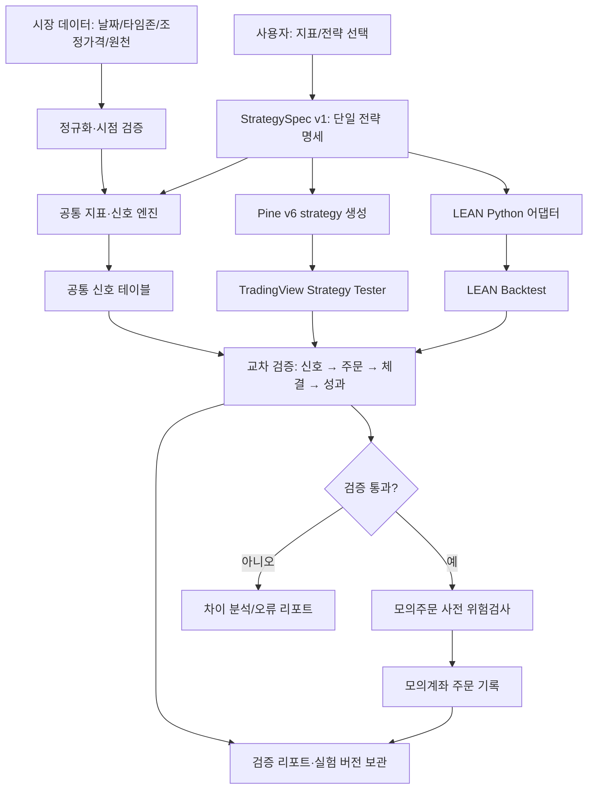
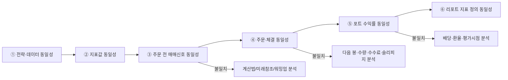
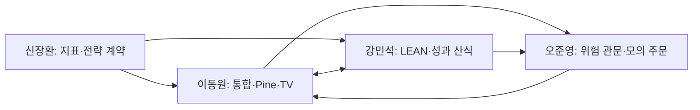
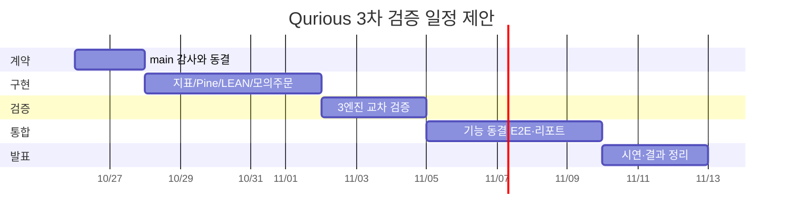

<!-- 팀원 글 원문 · [Research][3차] Qurious 퀀트 서비스 벤치마킹·기능 해부·교차 검증 실행계획 · 작성 기준일 2026-10-26 · **#385 로 올라감**(사용자 · 2026-10-29 · 작성자는 받지 못함 · 사용자가 파일로 줌 · S160) · 원문 그대로(아래 줄부터 · 파일명 Qurious_quant_benchmark_issue_2026-10-26_2 (1).md · 27,753 바이트) · 사용자 요청: 백엔드보다 화면과 이동원 파트 쪽을 더 리서치해 화면 설계에 반영 → 조사 결과 phase-3/01-analysis/research/배경조사/2026-10-29-화면-벤치마킹/결과.md · 주의: 이 글의 「main 감사 미완료 · 미확인」 은 10-26 시점이고 그 뒤 Pine 생성기(판 1·2) · LEAN 일일 대조 v4 · 모의주문(#368) 등이 main 에 들어왔다 -->

# [Research][3차] Qurious 퀀트 서비스 벤치마킹·기능 해부·교차 검증 실행계획 (main 기준)

> **기준일:** 2026-10-26 (KST)  
> **기준 저장소:** [`EST-team-project/Qurious`의 `main`](https://github.com/EST-team-project/Qurious/tree/main)  
> **상태:** 경쟁사 공식 공개자료 조사 완료 / **`main` 소스 직접 감사 미완료** / 계정 로그인·유료 기능 실사용 미검증  
> **목적:** 2차 로보어드바이저의 기능을 보존하면서, 3차 투자 인디케이터의 전략 정의 → Pine·LEAN 검증 → 모의주문 연결까지 재현 가능한 시연 경로 완성  
> **주의:** 이 문서는 리서치 및 구현 제안이다. 완료 여부·파일 경로·API 현황은 `main` 코드에 대한 실제 감사 후에만 확정한다. 실제 투자 추천·수익 보장이 아니다.

## TL;DR — 의사결정 5개

1. **기능 복제보다 검증 재현성 우선:** 국내외 서비스는 이미 팩터 전략, AI 코드 작성, 백테스트, 모의/실전 연동을 제공한다. Qurious만의 제품 가설은 **같은 투자 규칙을 여러 실행 환경에서 비교하고 차이를 설명하는 것**.
2. **명세 하나를 공유:** `StrategySpec v1`을 신호·데이터·체결·비용·버전의 단일 출처(SSoT)로 사용하되, 지금 있는 타입이 있다면 교체보다 확장한다.
3. **교차 검증은 단계적으로:** (a) 지표값 → (b) 주문 전 매수·매도 신호 날짜 → (c) 주문·체결 → (d) 비용·포트폴리오 → (e) 성과를 구분. **수익률 유사성만으로 통과시키지 않는다.**
4. **범위 방어:** TradingView 외부 Webhook 수신, 실거래, 다종목 자동 최적화, 대규모 AI 기능은 3차 필수 범위 밖에서 별도 판단한다.
5. **코드 감사 선행:** 현재 공개 읽기 경로로 `main`을 직접 받아올 수 없어 이미 구현되었다/미완성이라고 판단하지 않는다. 아래 [main 감사표](#0-main-기준-증거-수집---가장-먼저)를 먼저 채운다.

---

## 0. `main` 기준 증거 수집 — 가장 먼저

> 이슈 작성 환경에서 저장소 URL·raw README·GitHub API에 접근이 실패했다. **비공개 저장소라는 뜻이 아니라 현재 접근 방법의 제한**이다. 아래 상태는 모두 `미확인`에서 시작하며 검증 후 채운다.

**감사 기준:** `main`의 커밋 SHA `__________________` / 확인 일시 `__________________` / 검증자 `__________________`.

| 확인 대상 | `main`에서 찾을 근거 | 기대 증거 | 상태 |
|---|---|---|---|
| 2차 기존 기능 | README, 화면 라우트, 서비스 파일, API 문서 | 코드 경로 + 작동 화면 + 테스트 | ⏳ 미확인 |
| 기본·커스텀 지표 | 지표 계산 함수·단위 테스트 | 지표명, 계산기준, warm-up, fixtures | ⏳ 미확인 |
| 전략 스키마 | 전략 DTO/모델/DB·JSON 예제 | 전략 ID·버전·파라미터·타임존 | ⏳ 미확인 |
| Pine 생성·내보내기 | Pine 변환기·API·예제 코드 | v6 `strategy()` 컴파일 결과 | ⏳ 미확인 |
| TradingView 결과 수집 | CSV 업로드·수동 비교·결과 파서 | 동일 조건의 거래 내역 | ⏳ 미확인 |
| LEAN 실행 | 코드 어댑터·실행 스크립트·README | 버전·데이터·실행 명령·결과 파일 | ⏳ 미확인 |
| 모의주문 API | 증권사 어댑터·모의 계좌 설정 | 주문·체결·오류·중복 방지 로그 | ⏳ 미확인 |
| 성과 분석 | CAGR/MDD/Sharpe 함수·응답·화면 | 지표 산식·주기·데이터 기준 | ⏳ 미확인 |
| 테스트·CI | `tests/`, GitHub Actions | 재현 가능한 자동 테스트 | ⏳ 미확인 |

**감사 명령 예시** (Windows PowerShell / 저장소 접근 권한이 있는 팀원 로컬 환경):

```powershell
git switch main
git pull --ff-only
git rev-parse HEAD
git ls-files | Select-String -Pattern 'pine|tradingview|lean|indicator|backtest|portfolio|order|strategy|test|workflow'
```

민감한 자격 증명·`.env` 파일·모의계좌 토큰은 이슈에 게시하지 않는다. 감사표에는 파일 경로와 함수 이름, commit permalink, 실행 재현 명령만 기재한다.

## 1. 제품 포지셔닝 — 경쟁사가 이미 하는 일, Qurious가 집중할 일

| 경쟁 서비스 | 공개자료상 핵심 사용 흐름 | Qurious에서 배우기 | 과잉 해석 금지 |
|---|---|---|---|
| [퀀터스](https://www.quantus.kr/ko) | 종목/팩터 선정 → 전략 설계 → 백테스트/과최적화 검증 → 주문 연계 | 팩터·시장 유니버스 입력 UX, 검증 결과 설명 | 홈페이지 데모·시연과 모든 사용자에게 제공되는 실기능을 동일시하지 않기 |
| [젠포트](https://genport.newsystock.com/) | 투자금·보유기간·종목수·스타일 질문 → 전략 → 백테스트 → 모의/예약 매매 | 단계형 노코드 온보딩, 결과 화면, 거래 내역 | 초기 무료 체험과 전문/틱 백테스트 권한 구분 |
| [인텔리퀀트](https://www.intelliquant.ai/) | 코드/블록/AI 대화 → 코드 반영/되돌리기 → 백테스트 → iQ Live | AI 코드 제안 검토·승인·되돌리기, 에러 수정 | 유료 API/자동매매 권한 확인 |
| [Composer](https://www.composer.trade/) | 자연어·노코드 전략 빌더 → 시각적 규칙(Symphony) → 백테스트 → 자동 운용 | 전략 규칙 UI, 수정 가능 구조, AI 초안 | 한국 이용자의 실제 계좌 개설 가능 여부 별도 확인 |
| [TradingView](https://www.tradingview.com/) | Pine 지표/전략 → 차트 신호 → Strategy Tester → 거래·성과 → 알림 | `indicator()`와 `strategy()` 분리, 차트 신호·체결 대조 | TradingView는 주문을 브로커 에뮬레이터로 시뮬레이션함 |
| [QuantConnect LEAN](https://www.quantconnect.com/) | Python/C# 알고리즘 → 데이터·체결/수수료/슬리피지 모델 → 백테스트 → 결과 | 독립 실행·재현성·결과 표준화 | 오픈소스 엔진과 유료 CLI/클라우드 플랜은 다름 |
| [Portfolio Visualizer](https://www.portfoliovisualizer.com/) | 자산비중·리밸런싱 → 포트폴리오 백테스트·위험·팩터 분석 | 벤치마크 비교, 자산배분·위험 설명 | ETF 자산배분 도구를 매매 신호 백테스터와 혼동 금지 |
| [Portfolio123](https://www.portfolio123.com/) | 유니버스 → 멀티팩터 랭킹/스크리너 → 포트폴리오 시뮬레이션 | 랭킹·유니버스·팩터 조합 추적 | point-in-time 재무 데이터와 시세 지표 범위 구별 |

### 기능·구현 적합성 매트릭스

**기호:** ● 공식 사이트/문서로 기능 확인 · △ 부분적 연관/제한 조건 · — 이번 조사에서 해당 용도로 확인되지 않음. `Qurious`의 구현 현황을 뜻하지 않음.

| 서비스 | 노코드 전략 | AI 전략 지원 | 전략 백테스트 | 포트 위험분석 | 사용자 Pine | Python/LEAN | 주문 연동 |
|---|:---:|:---:|:---:|:---:|:---:|:---:|:---:|
| 퀀터스 | ● | ● | ● | ● | — | — | ● |
| 젠포트 | ● | △ | ● | ● | — | — | ● |
| 인텔리퀀트 | ● | ● | ● | △ | — | — | ● |
| Composer | ● | ● | ● | △ | — | — | ● |
| TradingView | △ | △ | ● | △ | ● | — | △ |
| QuantConnect | — | △ | ● | ● | — | ● | ● |
| Portfolio Visualizer | △ | △ | ● | ● | — | — | — |
| Portfolio123 | ● | ● | ● | ● | — | △ | ● |

> 기능은 제품군 수준의 공시/문서에 근거한다. 'AI 지원'은 모델 정확도·가용성 검증이 아니며, '주문 연동'도 대상 국가·증권사·플랜을 보장하지 않는다. **시장 공백**은 '기능이 없다'가 아니라 '재현 가능한 다중 엔진 검증을 한 번에 설명하는 UX의 개선 여지'라는 검증 전 가설이다.

### 기능 해부 (입력 → 내부 처리 → 출력 → 제약 → 담당)

| 참조 제품 | 입력 | 핵심 처리/규칙 | 출력물·UX | Qurious 적용 대상 |
|---|---|---|---|---|
| 퀀터스 | 국가, 유니버스, 팩터 가중치, 종목 수, 리밸런싱 | 선정·점수·분산·과거 검증 | 전략 카드, 성과·리스크, 조건·주문 | 이동원(설계 화면), 신장환(지표), 강민석(위험 지표) |
| 젠포트 | 금액, 보유 기간, 종목 수, 스타일 | 질문 응답을 전략 조건으로 변환 | 3단계 사용자 여정, 성과, 거래이력 | 이동원(UX), 오준영(모의주문) |
| 인텔리퀀트 | 자연어 요청, JS/블록 전략 | AI 초안 → 사용자 승인 → 오류/성과 검토 | 편집·적용·되돌리기·백테스트 | 신장환(규칙), 이동원(공통 명세) |
| Composer | 사용자 아이디어, 조건 노드, 자산 비중 | 조건 트리·전략 조합 | 시각 전략·백테스트·자동 운용 | 신장환(조건 구조), 오준영(배분) |
| TradingView | Pine v6, 심볼·타임프레임·설정 | 전략 주문 생성과 브로커 에뮬레이터 | 차트 진입/청산, List of Trades, Strategy Report | 이동원(③) + 강민석(거래 대사) |
| LEAN | Python 알고리즘, 로컬/클라우드 데이터, 모델 | 이벤트 기반 주문·체결·수수료·슬리피지 | 로그·주문·포트폴리오/통계 | 강민석(④) + 이동원(비교 리포트) |
| Portfolio Visualizer | ETF·종목·비중·리밸런싱 | 월 수익률 기반 포트 성과·팩터회귀 | CAGR, drawdown, rolling 성과·상관 | 오준영(자산배분), 강민석(성과 정의) |
| Portfolio123 | 재무 팩터, 유니버스, 랭킹 룰 | 주식 랭킹·시뮬레이션 | 종목 후보, 랭킹 결과·과거 성과 | 신장환(지표/팩터 고도화, P2) |

## 2. 제안 아키텍처 (3차 MVP)



**전략 명세는 실행 가능한 Python 임의 코드가 아닌 검증된 데이터 객체**로 시작한다. AI는 명세를 *제안*할 수 있지만, 실행 승인·허용된 지표·파라미터 검사·신호 검증을 건너뛰지 않는다.

### 최소 공통 계약 `StrategySpec v1` (설계 예시, 기존 구현과 병합 필요)

```json
{
  "schema_version": "1.0",
  "strategy_id": "ma_cross_20_60",
  "strategy_version": "v1",
  "market": "KRX",
  "symbol": "SAMPLE",
  "bar_interval": "1d",
  "timezone": "Asia/Seoul",
  "price_basis": "adjusted_close_for_signal_raw_open_for_fill",
  "signal_rule": {"type": "ma_crossover", "fast": 20, "slow": 60},
  "decision_policy": "D_close_only",
  "execution_policy": "next_trading_session_open",
  "side": "long_only",
  "initial_cash": 10000000,
  "position_sizing": {"mode": "target_weight", "weight": 1.0},
  "cost_model": {"commission_bps": 1.5, "slippage_bps": 0.0, "tax_model": "none_in_fixture"},
  "data_snapshot": {"source": "fixture", "as_of": "2026-10-26", "sha256": "SET_ON_EXECUTION"},
  "warmup_bars": 60
}
```

`SAMPLE`은 실제 거래 심볼이 아니라 **테스트 더미**. 비용은 비교를 위한 **예시값**이며 실제 증권사 비용·세금의 확정값이 아니다. `as_of`는 시세 기준 시점을 나타내며 소스 데이터 가용 시점은 별도 필드 또는 데이터 계약으로 관리한다. `adjusted_close`와 `raw_open`은 조정주가/배당/분할 처리 불일치가 발생할 수 있어 사전 검토 후 고정한다.

## 3. 신뢰성 검증을 위한 두 번째 시각화



| 검증 대상 | 최소 체크 | 판정 정책 |
|---|---|---|
| 데이터 | 기준일·거래일·타임존·조정가격·원천 버전 | 서로 다르면 **비교 불가**, 억지로 숫자 비교하지 않음 |
| 지표 | 20/60 MA, RSI/EMA 계산 방식·워밍업 | fixture에서 숫자 오차 범위를 문서화 |
| 신호 | `bar_date`, `signal_date`, `action`, `reason` | 정확 일치 우선, 허용 오차 없음(정의된 캘린더 기준) |
| 주문/체결 | `submit_at`, `fill_at`, `qty`, `price`, `fees` | 각 차이를 상세 원인별 분류 |
| 포트/성과 | equity path, CAGR, MDD, Sharpe, benchmark | 거래 일치 후 수치 비교. 허용 오차는 정식 계약에서 결정 |
| 미래 데이터 누수 | D 이후 데이터 변경 시 D 이전 신호 변화 없음 | 변화 발생 시 실패 |
| 재현성 | spec, 데이터 스냅샷, 코드 버전, 실행 환경 저장 | 동일 입력 재실행시 동일 해시/출력 |

> TradingView 기본 전략 주문은 종가 계산 → 다음 틱(일봉 기준 통상 다음 봉 시가) 체결이다. `process_orders_on_close`와 계산 옵션을 바꾸면 달라진다. LEAN의 fill/fee/slippage 모델과 맞추지 않으면 '불일치'는 버그가 아닌 서로 다른 가정의 결과일 수 있다.

## 4. 팀원별 목표·업무·의존성·완료 기준

사용자가 확정한 업무표를 **담당자별 소유권의 기준**으로 삼는다. 아래 제안은 개발 범위를 임의 변경하는 내용이 아니라 실제 산출물/검증 책임을 분명히 하는 보강안이다.

| 담당 | 공식 담당 업무 | 이번 이슈의 구체적 책임 | 연계/인수 산출물 |
|---|---|---|---|
| **이동원 (팀장)** | 2차 ①-④(용어사전·자료·근거 RAG·일정 배치), 3차 ③ TradingView/Pine | `StrategySpec` 통합·Pine v6 전략 변환·컴파일 확인·TradingView CSV/증거·대사 UI | 지표/전략 스펙 ← 신장환, 성과 계약 ← 강민석, 모의주문 신호 → 오준영 |
| **신장환** | 2차 ⑤ XAI·② 패턴 인식 예측, 3차 ① 기본 인디케이터·② 커스텀 | SMA/RSI/MACD 명세·커스텀 지표 제약·미래참조 차단·공통 신호 생성 | 함수/fixture/API 계약 → 이동원·강민석 |
| **오준영** | 2차 ③ 자산배분·스크리닝·리밸런싱, 3차 ⑤ 증권사 API 연동 자동화 | 포트 목표 비중·주문 전 위험검사·모의계좌 어댑터·중복 방지·주문 상태 | 검증 통과 신호 ← 이동원/강민석 |
| **강민석** | 2차 ④ 성과 해석·모의투자, 3차 ④ QuantConnect LEAN 성과 검증 | LEAN 환경/데이터 맞춤·비용/체결/성과 정의·거래별 대사·성능 리포트 | Python/TV의 신호·체결 CSV 비교 ↔ 이동원 |

### 팀원간 연결도



### 인수 기준 / DoD (Definition of Done)

- **신장환:** 최소 3개 기본 지표 + 1개 커스텀 지표의 입력/출력·warm-up 규칙·예외·fixture가 공개된 문서와 테스트로 일치. 미래 데이터를 붙여도 과거 신호가 바뀌지 않음.
- **이동원:** 최소 2개 합의된 전략이 Pine v6 `strategy()`로 생성되고 실제 TradingView에서 컴파일·실행되며 코드·실행 옵션·스크린샷/CSV와 함께 대사 가능. `indicator()`만 출력하고 전략 검증으로 표시하지 않음.
- **강민석:** 동일 입력(동일 스냅샷·초기자본·수수료·체결 정책)의 내부 엔진·LEAN·TV 거래 명세를 연결하고, 불일치 예시 1건 이상을 원인별로 설명. LEAN CLI 사용/유료 조건을 실제 실행 환경에서 확인.
- **오준영:** 모의계좌만 사용; 중복 요청 시 중복 주문 없음, 부족한 현금/초과 비중 시 주문 차단, 실행 로그에서 신호 ID → 주문 ID → 체결 상태 추적 가능. 실거래 기본 비활성.
- **공통:** 비밀정보 출력·API 키 커밋 금지, 실패 시 재시도/상태 기록, 최종 결과에 데이터·전략·실행 버전 표시.

### 담당 교차 테스트

| 주 테스트 | 검토자 | 테스트 데이터 | 필수 결과 |
|---|---|---|---|
| 지표 계산·미래참조 | 신장환 | 결측/급등/주식분할 포함 fixtures | 스냅샷 고정·안정된 신호 |
| Pine 생성·TV 컴파일 | 이동원 | MA 크로스 + RSI 임계값 | 문법 오류 0 / 거래 목록 증거 |
| LEAN 교차 검증 | 강민석 | 동일 캘린더·기간·비용 | 이탈 여부와 원인 표 |
| 모의주문 안전성 | 오준영 | 중복·잔고부족·API 실패 이벤트 | 중복 0 / 위험 차단 / 상태 추적 |
| 최종 종단 시연 | 전체 | 승인된 동일 StrategySpec | 전략 정의→검증→설명→모의 주문 |

## 5. 권장 우선순위: 기간 내 가능한 것만

| 중요도 | 기능 | 팀 | 의존성 | 판정 |
|---|---|---|---|---|
| **P0** | main 구현 현황 감사·범위 동결 | 이동원 + 전체 | 없음 | 커밋 SHA·근거 링크 |
| **P0** | 전략·데이터·비용·성과 계약 v1 | 신장환/강민석, 이동원 통합 | 코드 감사 | 계약/fixture 승인 |
| **P0** | Pine 전략 2종 컴파일·출력 | 이동원 | StrategySpec | Strategy Tester 증거 |
| **P0** | LEAN 결과·거래 단위 비교 | 강민석 | 동일 데이터/비용 | 불일치 원인 리포트 |
| **P0** | 모의계좌 위험 검사·중복 방지 | 오준영 | 신호 계약 | 실패 테스트 |
| **P1** | 전략 신뢰성 대시보드 | 이동원 + 강민석 | P0 검증 | 이유가 표시된 결과 |
| **P1** | 전략·데이터·실험 버전 추적 | 이동원 + 신장환 | 공통 계약 | 재현 가능한 실행 기록 |
| **P1** | 기존 자산배분/모의투자와 연결 UX | 오준영 + 이동원 | P0 안정성 | 통합 시연 |
| **P2** | 자연어 AI→전략 명세 초안 | 신장환 + 이동원 | 안전한 명세 검증 | 별도 실험 |
| **P2** | 외부 공개 HTTPS webhook 수신 | 오준영 + 이동원 | 보안·배포 결정 | 별도 이슈 |
| **P2** | 다종목·다변수 최적화·전략 마켓 | 전체 | MVP 완성 이후 | 범위 밖 |

### 일정안(날짜는 권고안, 팀 내부 일정 우선)



## 6. 실제 비용/접근성과 구현 리스크 (2026-10-26 공식 자료 재확인)

| 서비스 | 공개 무료/가격 정보 | Qurious에 미치는 제약 |
|---|---|---|
| 퀀터스 | 가입 후 무료 시그널, 일부 AI 분석 사용량. 유료 전략 이용권 금액은 현재 공개 자료로 확인 불충분 | 기능 벤치마킹은 공식 소개·허용 범위에서 수행 |
| 젠포트 | 홈페이지 '백테스트 20회 무료' 표시, 초급·중급·프로 모드별 제한, 유료 멤버십 존재. 동적 요금 숫자는 재검증 필요 | 비교 체험은 무료 구간 위주, 로그인 후 권한 별도 점검 |
| 인텔리퀀트 | BASIC 무료: 백테스트 일 10회; PRO 월 **30,000원**: 일 100회; PREMIUM 월 **100,000원**: 횟수 무제한 | 한국/미국 분석 가능 범위·기록 내보내기·AI 크레딧 분리 |
| Composer | Starter **$0**, Advanced **$10/월**, Pro **$32/월(연간 결제 기준)** | 전략 규모 제한·계좌 개설 관할/자격 확인 필요 |
| TradingView | Free **$0**, Essential **$12.95/월(연간 결제 기준)**; 추가 실시간 거래소 데이터 과금 가능 | Pine 기능/차트 바 수/알림 권한 차이 확인 |
| QuantConnect | 무료 웹 플랜 존재, **LEAN CLI 및 로컬 CLI 백테스트는 유료 조직 요건**; LEAN 엔진 소스는 공개 | 무료 클라우드 실행과 유료 CLI를 혼동 금지; Windows Docker/WSL2 검토 |
| Portfolio Visualizer | Free; Basic **$30/월(연간 결제)**; Pro **$55/월(연간 결제)** | 무료 포트폴리오 자산 수·기간 제한; 실거래 대체 X |
| Portfolio123 | 30일 스크리너/백테스트 체험 공식 명시, 연구/API 상품 별도 | 시장·기능·API 상품별 비용은 개별 검증 필요 |

**주의할 외부 연동:** TradingView Webhook은 공개 URL을 요구하고 **포트 80 또는 443**, 서버 응답 **3초 제한**, 2FA 조건이 있다. `localhost` 모의 앱에 직접 입력해서 작동할 수 없으며, 서버 노출·인증·재전송·중복 주문 보안 검토 없이 거래 연동하지 않는다.

## 7. 벤치마크를 직접 반복하는 실험 프로토콜

실사용 UX 평가는 현재 미실행. 이후 계정 소유자/해당 도구가 있는 팀원이 아래를 동일 기준으로 수행한다.

| 실험 | 통일할 입력 | 관찰할 화면/증거 | 채점 방식 |
|---|---|---|---|
| **E1: MA(20/60)** | 공통 심볼, 일봉, 기간, 비용, D→D+1 체결 | 입력 단계, Pine/CSV 다운로드, 거래 목록 | 불가능한 환경은 N/A, 숫자 직접 비교 금지 |
| **E2: RSI(14) 조건** | Wilder RSI 여부·진입·청산 정의 | 지표값, 사전 신호, 거래 목록 | 신호 날짜와 설정값 추적 |
| **E3: 비용 민감도** | 동일 수수료·슬리피지 가정 | 비용 전후 수익률·거래 수·MDD | 화면이 설명 가능한가? |
| **E4: 결과 재현** | 저장한 전략 재실행 | 버전, 데이터일, 결과 재현 | 재현 성공/실패/미지원 |
| **E5: 초보자 UX** | 설명을 읽지 않은 신규 사용자 | 완료 단계·오류·용어 설명 | 과업 성공 여부, 막힌 화면 캡처 |

실험마다 `[서비스 / 날짜 / 플랜 / 실제 화면 URL 또는 이미지 / 입력값 / 추출 데이터 / 확인된 제약 / 근거]`를 별도 기록한다. 로그인·유료 도구 없이 확인한 홍보 화면을 실사용 결과로 표시하지 않는다.

## 8. 리스크 레지스터

| 리스크 | 영향 | 예방·탐지 | 결정/담당 |
|---|---|---|---|
| `main` 코드와 기획서 차이 | 중복개발·우선순위 오류 | 커밋 고정·작동 화면·테스트와 대조 | 이동원 P0 |
| look-ahead/리페인팅 | 가짜 전략 성과 | D 이후 데이터 변경 불변성 테스트 | 신장환 P0 |
| 조정주가·거래일 차이 | TV vs LEAN 다른 신호 | data snapshot/거래일·corporate action 명시 | 강민석 P0 |
| Pine `indicator()` vs `strategy()` 혼동 | 성과 검증 불가 | 컴파일+Strategy Tester 결과 필수 | 이동원 P0 |
| 체결/수수료 가정 차이 | 수익률 비교 왜곡 | 신호→체결→성과 순으로 대사 | 강민석 P0 |
| 모의주문 중복·계좌 오류 | 오작동 | idempotency·kill switch·paper-only | 오준영 P0 |
| 로컬 LEAN 도구 유료 요건 | 실행 차단·비용 | 현재 환경/CLI 라이선스 확인 | 강민석 P0 |
| AI 생성 전략 환각 | 정의와 코드의 불일치 | JSON 제약·승인·컴파일·테스트 | 이동원/신장환 P1 |
| 원자료 라이선스·API 약관 | 재배포·보안 문제 | 원천·권한·저장/공개 범위 명시 | 전체 P1 |
| 시연 범위 확대 | 마감 지연 | P0 통과 전 P2 추가 금지 | 이동원 |

## 9. 실제 수용 조건(이슈 종료 체크리스트)

### 조사 완료 조건
- [ ] `main` SHA 및 주요 기능별 **파일/함수/permalink** 채움
- [x] 국내외 공식 사이트 8종 공개 기능·가격/접근성 조사
- [ ] 실제 로그인/조작 기반 사용자 여정 캡처(가능한 제품만)
- [ ] 비교 불가능한 실험 결과는 N/A로 표시하고 근거 기록

### 구현/검증 완료 조건
- [ ] 팀원이 StrategySpec v1·데이터·비용·성과 계약에 합의
- [ ] 지표값/미래참조 회귀 테스트 통과
- [ ] Pine `strategy()` 2종 TV 실제 컴파일·거래증거 확보
- [ ] LEAN과 비교할 동일 데이터 범위/비용/체결 정의 고정
- [ ] 거래별 비교표(`signal_at`, `filled_at`, `qty`, `price`, `cost`) 생성
- [ ] 결과 차이 1건 이상 원인 설명 포함
- [ ] 모의계좌만 사용, 중복·잔고부족·API 장애 테스트 통과
- [ ] 전략·데이터·실행 버전 및 결과 해시 저장
- [ ] 최종 사용자 흐름 1개를 처음부터 끝까지 시연
- [ ] 완료된 기능과 미완료/외부 의존 기능을 발표에서 분리

## 10. 현재 결정 요청 (팀 내)

1. 비교용 **고정 전략 2종** (권고: MA 20/60, RSI 14)을 확정할 것인가?
2. **공통 시세 범위·종목·기간·수정주가 정책**은 무엇인가? 데이터를 세 플랫폼에서 완전히 맞출 수 없다면 어느 비교까지 포함할 것인가?
3. **LEAN 실행의 실제 방식** (직접 엔진 / CLI / 클라우드)과 개인별 접근·예산은?
4. **모의주문 범위**: 한국투자증권(KIS) 등 현재 연결된 증권사만 할 것인지, 내부 paper adapter까지 포함할 것인지?
5. **기존 이슈와 중복 체크** 후 이 이슈를 상위 리서치·통합 관리 이슈로 둘 것인지?

## 11. 참고 자료 (서비스 공식 페이지·공식 기술 문서)

- 퀀터스 — https://www.quantus.kr/ko
- 퀀터스 공개 검증 원칙 — https://www.quantus.kr/proof
- 젠포트 소개 — https://genport.newsystock.com/
- 젠포트 백테스트/무료 범위 — https://genport.newsystock.com/GenPro/Make.aspx
- 젠포트 멤버십 — https://genport.newsystock.com/membership/Membership.aspx
- 인텔리퀀트 소개 — https://www.intelliquant.ai/
- 인텔리퀀트 요금 — https://www.intelliquant.ai/membership
- Composer 기능 — https://www.composer.trade/
- Composer 요금 — https://www.composer.trade/pricing
- TradingView Pine 전략 및 체결 — https://www.tradingview.com/pine-script-docs/concepts/strategies/
- TradingView Webhook 제약 — https://www.tradingview.com/support/solutions/43000529348-how-to-configure-webhook-alerts/
- TradingView 요금 — https://www.tradingview.com/pricing/
- QuantConnect 공식 요금 — https://www.quantconnect.com/pricing
- LEAN CLI 백테스트(유료 조건) — https://www.quantconnect.com/docs/v2/lean-cli/api-reference/lean-backtest
- LEAN 오픈소스 — https://github.com/QuantConnect/Lean
- Portfolio Visualizer 분석 도구 — https://www.portfoliovisualizer.com/analysis
- Portfolio Visualizer 요금 — https://www.portfoliovisualizer.com/pricing
- Portfolio123 기능 — https://www.portfolio123.com/
- Portfolio123 체험·랭킹·스크리너 — https://invest.portfolio123.com/get-started/

---

**완료 판정 원칙:** 조사 근거와 코드 실행 증거를 분리하고, 미확인 내용을 완료로 표시하지 않는다. 투자 결과 수치가 아닌 **사용자가 검증 과정을 재현하고 차이를 이해할 수 있는지**를 제품 품질 기준으로 사용한다.
