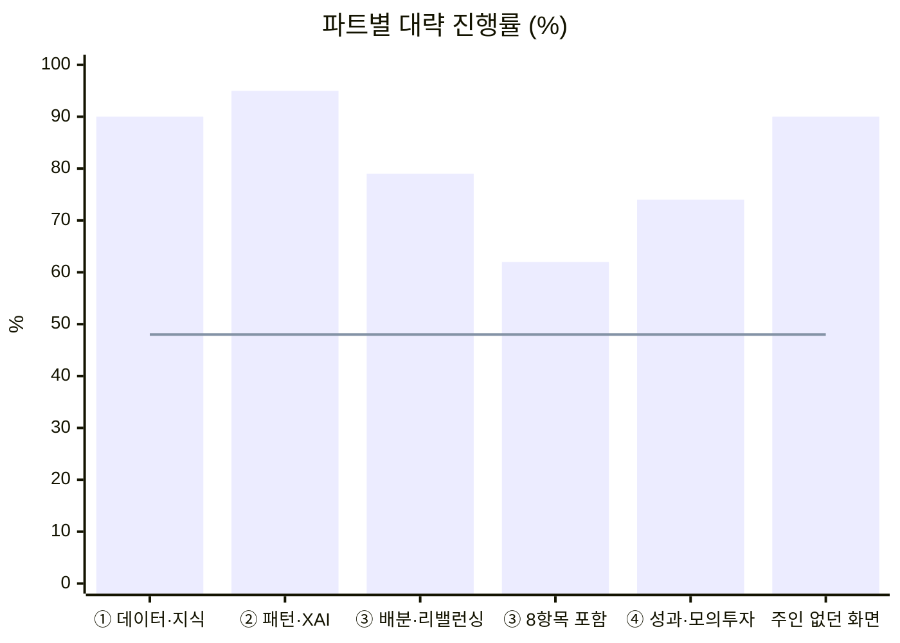
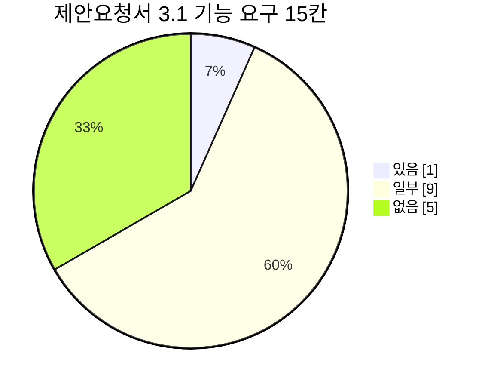
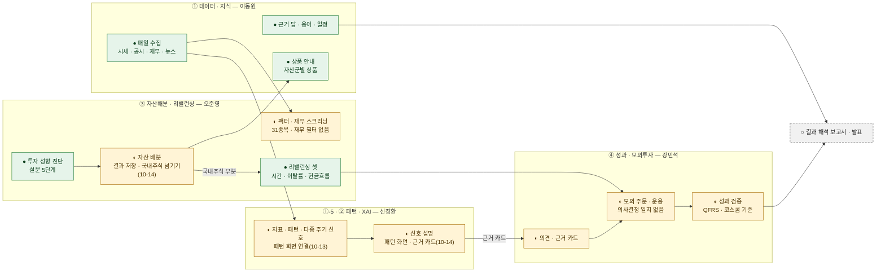
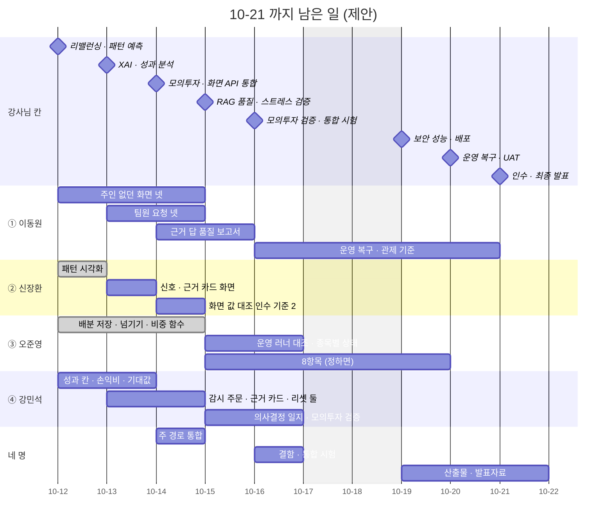

<!-- 올린 이슈 · #170 · 2026-10-12 올림(사용자 확인 2026-10-13) · 10-13 신장환 답 · 재무 · 신용 위험 PR 숫자(머지 뒤) 반영(답글 01 · 요약 댓글 02 · 웹 본문은 사용자가 이 파일로 고침) · 10-14 오준영 ② · ③ 답 반영(답글 03 · 본문 A1 ~ A17 · 머지 사실 B1 ~ B8 — #172 · #176 ~ #178 · #181 · #182 · 요약 댓글 04 올림 · 웹 본문 반영(10-14 · 이 파일로 바꿈)) · 10-14 #185 머지(계절성 · 군집화) 반영(주인 없던 2차 화면 82 → 90.2 — 1절 · 그림 2 · 3절 · 4.1절 · 6.2 12번 · 요약 댓글 05 · 웹 본문 바꿈 + 05 올림(사용자 확인 2026-10-15)) · 다음 할 일: ④ · ⑤ 답 · 6.3 가 · 다 팀 결정 · 대장 · 점검표 다시 센 뒤 진행률 숫자 · 팀원이 자기 줄을 고쳐 주면 본문을 고치고 댓글엔 요약만 · 옛 주석: 이슈 초안 · 2차 중간 점검 · 이동원 · 2026-10-12 · 올리기는 사용자(웹) · 제목: [중간 점검] 2차 로보 어드바이저 — 파트별 · 팀원별 진행과 10-21 까지 남은 일 · 그림 1 은 img/ 의 PNG 를 웹 편집기에 끌어 놓아 붙임 · 라벨(제안): 점검 · Assignee 비움  · 10-15 모델 비교 77 → 93 · 근거 답 품질 보고서 · 종목별 상태 조회 끝 표시(요약 댓글 06 초안 · 웹 본문 고침은 모델 비교 PR 머지 뒤 · 「#(PR 번호)」 채움) -->

# [중간 점검] 2차 로보 어드바이저 — 파트별 · 팀원별 진행과 10-21 까지 남은 일

신장환 님(@janghwan-god) · 오준영 님(@GoonGuMa) · 강민석 님(@rkdalstjr), 2차 「나만의 로보 어드바이저 개발 및 성과 검증」 이 강사님 일정 25칸 가운데 12칸을 지났습니다. 강사님 틀(제안요청서 · 화면별 평가표)과 우리 설계 틀(계획서 · 요구 대장 · 설계서 · 기능 완성도 점검표)을 나란히 놓고 **어디까지 왔고, 10-21(수) 오전까지 어디를 하면 되는지** 대략 정리했습니다. 작성 이동원(@dev-dongwon05253).

> 이 글의 숫자는 사람을 견주는 숫자가 아니라 **기능이 기준에 얼마나 닿았나**를 보는 숫자입니다. 파트마다 맡은 범위와 출발점(강사님 기초 코드에 이미 있던 것)이 달라 파트끼리 견주지 않습니다. 팀원 화면의 점수는 팀장이 코드 · 시험으로 매긴 것이고 주담당 확인 전입니다 — 틀린 곳은 7절대로 알려 주시면 본문을 고칩니다.

| 머리표 | 내용 |
|---|---|
| 목적 | 2차 중간 점검 — 파트별 · 팀원별 진행 · 강사님 제안요청서 대비 빈 곳 · 마감까지 남은 일(제안) |
| 기준일 | 2026-10-12(월) KST · 마감 10-21(수) 오전 — 남은 날 달력 9일 · 평일 7일 반(오늘 포함) |
| 기준 코드 | `main` `d4a9d66`(#169 머지) · 점검표는 같은 날 상품 상세 창 고침 한 줄(투자 성향별 상품 안내 89 → 92)을 넣은 v0.4 |
| 출처 | [제안요청서](https://github.com/EST-team-project/Qurious/blob/main/docs/rfp-2.md) · 강사님 화면별 평가표(2026-09-29) · [계획서 v2.0](https://github.com/EST-team-project/Qurious/blob/main/docs/계획서/프로젝트계획서.md) 4 · 5절 · [WBS](https://github.com/EST-team-project/Qurious/blob/main/docs/계획서/WBS.md) · [요구 대장](https://github.com/EST-team-project/Qurious/blob/main/docs/요구사항/대장/요구-대장.tsv) · [RTM v1.17](https://github.com/EST-team-project/Qurious/blob/main/docs/요구사항/RTM.md) · 설계서([①](https://github.com/EST-team-project/Qurious/blob/main/docs/설계/목표기능1-데이터지식-설계.md) · [② · ①-5](https://github.com/EST-team-project/Qurious/blob/main/docs/설계/목표기능2-패턴예측-XAI-설계.md) · [③](https://github.com/EST-team-project/Qurious/blob/main/docs/설계/목표기능3-리밸런싱-설계.md)) · [백테스트 보고서 v0.2](https://github.com/EST-team-project/Qurious/blob/main/docs/시험/백테스트보고서.md) · [기능 완성도 점검표](https://github.com/EST-team-project/Qurious/blob/main/docs/시험/대장/기능완성도-점검표.tsv) · 머지된 PR · 10-12 까지 받은 답글 |
| 읽는 법 | 1절 → 3절 파트별 → 4절 내 이름 → 6절 남은 일. 확실도는 **확실**(코드 · 시험 · 점검표에서 셈) · **추정**(문서를 읽고 판단) · **미확인**(주담당 확인 필요) |

## 1. 한눈에

1. **대략 진행률(요구 · 화면 두 잣대의 평균)** — ① 데이터 · 지식 **90%** · ①-5 · ② 패턴 · XAI **~~89%~~ 95%**(10-13 — `P01-②-3` 시험 있음) · ③ 자산배분 · 리밸런싱 **79%**(제안요청서 8항목을 세면 62%) · ④ 성과 · 모의투자 **74%** · 주인 없던 2차 화면 **~~75%~~ ~~82%~~ 90%**(10-14 — 재무 · 신용 위험 60 → 95 · 계절성 74 → 94 · 군집화 72 → 93). 일정은 **48%** 지났습니다(25칸 중 12칸). (확실 · 셈법은 2절)
2. **서버 · 시험은 많이 왔고, 남은 일의 큰 몫은 「화면에 잇기」 와 「기능끼리 잇기」** 입니다. ~~패턴 통계 · 다중 주기 신호 · 신호 설명은 서버 · 시험만 있고 화면이 없고,~~ 패턴 통계 · 다중 주기 신호 · 신호 설명은 패턴 화면 · 근거 카드에 이어졌고(10-13 ~ 14 #177 · #178 · #181 · #182), ~~자산 배분 결과가 리밸런싱으로 넘어가지 않으며,~~ 자산 배분 결과는 국내주식 부분만 리밸런싱으로 넘어가고(10-14 #180), 신호 → 의견 → 모의 주문 → 성과가 한 흐름으로 이어지지 않았습니다(6.1 그림 4).
3. **강사님 제안요청서 3.1 기능 요구 15칸 — 있음 1 · 일부 9 · 없음 5.** 없는 다섯은 시계열 모델 · 딥러닝 패턴 · Black-Litterman · 동적 자산배분 · 재무 필터이고, 필수 산출물 여섯 가운데 「모의 투자 의사결정 일지」 가 없습니다(5절).
4. **남은 칸 13개 가운데 10개가 통합 · 검증 · 운영 · 발표 칸**입니다. 제안 순서는 화면에 잇기(10-12 ~ 13) → 주 경로 통합(10-14 오후) → 검증(10-15 ~ 16) → 산출물 · 발표(10-19 ~ 21)입니다(6절).
5. **팀이 정할 것 여섯** — 그중 「제안요청서 8항목을 2차 요구로 셀지」 가 ③ 의 진행률과 남은 일을 가장 크게 바꿉니다(6.3).

**그림 1. 2차 중간 점검 — 한눈에**

(그림 — 웹에서 이 파일을 끌어 놓아 붙임: `docs/github-archive/2026-10-12/이슈-2차-중간점검/img/robo-midcheck-overview_v1.0.png`)

그림 1 은 10-12 숫자다 — ② 는 10-13 에 89 → 95(3절 · 답글 01) · 주인 없던 화면은 75 → 82(10-13) → 90(10-14 · 3절) · 원본: [Figma · Qurious · 문서 그림 · 「2차 중간 점검 (2026-10-12)」](https://www.figma.com/design/6lstWS4YwuhJPhGB9XoBMD?node-id=57-3) · 같은 내용의 표는 3절

**그림 2. 파트별 대략 진행률(%)** · 막대 = 진행률 · 선 = 일정이 지난 정도(48%)

막대가 선 위에 있다고 남은 일이 적다는 뜻은 아닙니다 — 남은 칸 대부분이 통합 · 검증 칸이고, 그 일은 아직 진행률에 들어 있지 않습니다.

## 2. 진행률을 이렇게 셌습니다

| 잣대 | 무엇을 | 어떻게 | 확실도 |
|---|---|---|---|
| ① 요구 | 2차 범위 요구 29개(계획서 3절 — 원문 14 · UI 5 · 제안요청서 8 · 일정표 2)의 RTM 「진행」 칸 | 시험 있음 = 1 · 시험 일부 = 0.5 · 흔적만 = 0 → 평균 | 확실(스캐너가 코드 · 시험에서 셈) |
| ② 화면 | 파트의 2차 화면 점수(강사님 배점 — UI 20 · 서버 30 · 연동 25 · 시험 25) | 기능 완성도 점검표 v0.4 의 평균 | 확실(셈) · 팀원 화면은 주담당 확인 전 |
| 대략 | — | (① + ②) ÷ 2, 반올림 | — |
| 참고 | 주담당 설계서의 인수 기준 | 완료 / 전체 | 추정 — 설계서마다 틀이 달라 대략에 넣지 않음 |

**한계** — 두 잣대 모두 강사님 기초 코드에 이미 있던 화면 · 시험을 셉니다(RTM 3절 — 「흔적은 기초 코드도 포함 · 시험 있음은 인수 기준 충족이 아님」). 2차에 새로 만든 것은 4절 「끝난 것」 에 따로 적었습니다.

## 3. 파트별 진행

| 파트 | 주담당 | ① 요구(확실) | ② 화면(확실) | 대략 | 막대 | 참고 — 설계서 인수 기준(추정) |
|---|---|:-:|:-:|:-:|---|---|
| ① 데이터 · 지식(세부 1 ~ 4) | 이동원 | 4.5 / 5 = 90 | 89.6(9화면) | **90** | ▓▓▓▓▓▓▓▓▓░ | 12 중 완료 10 · 진행 2 |
| ①-5 XAI · ② 패턴 인식 예측 | 신장환 | ~~3.5 / 4 = 88~~ 4 / 4 = 100(10-13) | 90.5(2화면) | **~~89~~ 95** | ▓▓▓▓▓▓▓▓▓▓ | 6 중 완료 4 · 진행 2 |
| ③ 자산배분 · 리밸런싱 | 오준영 | 4 / 6 = 67 | 91.0(2화면) | **79** | ▓▓▓▓▓▓▓▓░░ | 리밸런싱 인수 시험 8 — 설계서 「확인 결과」 에 통과 기록 · 기존 시험 근거로 충족(10-14 주담당 확인 — 원본 러너 운영 연동 확인은 따로) |
| 〃 제안요청서 8항목 포함 | 오준영 | 4.5 / 14 = 32 | 91.0 | **62** | ▓▓▓▓▓▓░░░░ | 자산배분 모델 · 스크리닝 알고리즘은 설계서 1절이 「별도 범위」 · 주담당 제안(10-14): BL · 동적 배분 등 큰 새 모델은 2차 후속 후보 — 팀 결정 전(6.3 가) |
| ④ 성과 해석 · 모의투자 | 강민석 | 4 / 5 = 80 | 67.0(4화면) | **74** | ▓▓▓▓▓▓▓░░░ | 설계서 없음 · 백테스트 보고서 2차 몫 E1 ~ E3 채움 |
| 주인 없던 2차 화면 | 이동원 | (요구 없음) | ~~75.0~~ ~~82.0~~ 90.2(5화면 · 10-14) | **~~75~~ ~~82~~ 90** | ▓▓▓▓▓▓▓▓▓░ | 재무 · 신용 위험 60 → 95(10-13 PR) · 계절성 74 → 94 · 군집화 72 → 93(10-14 #185) |
| 공통 · 스트레스 검증 | 정할 것(오준영 · 강민석) — 제안(10-14): 오준영 입력 · 상태 / 강민석 손실 · 성과 보고 | 0 / 1 | — | **0** | ░░░░░░░░░░ | 10-15 오후 칸 |
| **2차 전체** | 네 명 | 원문 · UI · 일정표 21개 **~~76~~ 79** · 8항목 포함 29개 **~~57~~ 59**(10-13) | 로보 어드바이저 메뉴 11화면 **~~80.5~~ 83.7**(10-13) | — | — | — |

- **①** — 세부 1 ~ 4 의 서버 · 화면은 강사님 칸(10-07 ~ 10-08)에 맞춰 나왔습니다. 남은 것은 근거 답 품질 보고(10-15 오전 칸) · 용어 관계 지도 · 화면 셋의 자동 E2E 입니다.
- **②** — 지표 정의 한 벌 · 패턴 통계(전 종목) · 다중 주기 신호 · 신호 설명이 서버 · 시험까지 왔습니다. 화면 점수(89 · 92)는 대부분 강사님 기초 코드의 스크리닝 · 패턴 화면 몫이고, 새로 만든 넷은 아직 화면에 없습니다(점검표 「100%까지」).
- **③** — 리밸런싱 셋(시간 · 이탈률 · 현금흐름)은 팀원이 쓴 시험 129건 · 실제 수집 자료 정산 6 / 6 까지 왔습니다. 진행률이 둘인 까닭은 제안요청서 3.1.3 · 3.1.4 의 8항목을 요구로 셀지 아직 정하지 않아서입니다(6.3 가). 10-14 에 배분 결과 저장 · 리밸런싱 연결(국내주식 부분) · 비중 함수 · 가벼운 비중 API 가 머지됐습니다(#180) — 진행률 숫자는 요구 대장 · 점검표를 다시 센 뒤 고칩니다.
- **④** — 요구 셋의 「시험 있음」 은 2차 전에 있던 시험(강사님 기초 코드 · 9월의 모의 장부 · 실거래 차단 고침)에서 왔고, 2차에 더한 QFRS · 코스콤 기준 · 모의계좌 성과는 화면 점수 쪽에 들어 있습니다. 점검표에는 코스콤 테스트베드 기준(50)이 「QFRS 서비스 시험 0 · 점검 0」, 모의계좌 현황(70)이 「QFRS 성과 지표 시험 0」 으로 적혀 있는데, 강민석 님이 단위 시험 · 점검 묶음이 이미 있다고 알려 주셨습니다(#109 답글). 지금 `main` 의 `tests/` · 점검 스크립트에서는 찾지 못해 **미확인**으로 두었고, 파일 위치를 알려 주시면 두 줄과 이 표를 다시 셉니다.
- **주인 없던 화면** — 투자 성향별 상품 안내(92) · 재무 · 신용 위험(~~60~~ 95 · 10-13 PR) · 계절성 분석(~~74~~ 94) · 종목 군집화(~~72~~ 93)(10-14 #185) · 모델 비교(~~77~~ 93)(10-15 #(PR 번호))를 새로 만들었습니다.

근거 — 2차 요구 29개의 RTM 진행 칸(v1.17)

| 요구 | 이름 | 주담당 | 진행 | 셈 |
|---|---|---|---|:-:|
| `P01-①-1` | 용어사전 · 연관 개념 | 이동원 | 시험 일부 | 0.5 |
| `P01-①-2` · `①-3` · `①-4` | 자료 수집 · 근거 RAG · 일정 · 배치 | 이동원 | 시험 있음 | 1 × 3 |
| `SCH-DQ` | 데이터 품질 | 이동원 | 시험 있음 | 1 |
| `P01-①-5` · `②-1` · `②-2` | XAI · 지표 · 차트 패턴 | 신장환 | 시험 있음 | 1 × 3 |
| `P01-②-3` | 다중 주기 신호 · 신뢰도 | 신장환 | ~~시험 일부~~ 시험 있음(10-13 — TC-MT 작성자 확인 🟢) | ~~0.5~~ 1 |
| `P01-③-1` · `③-2` · `③-3` | 시간 · 이탈률 · 현금흐름 리밸런싱 | 오준영 | 시험 있음 | 1 × 3 |
| `U1` | 투자성향진단 | 오준영 | 시험 있음 | 1 |
| `U2` · `U5` | 시각적 포트폴리오 · 리밸런싱 화면 | 오준영 | 흔적 있음 | 0 × 2 |
| `RFP2-3.1.3-①` | 평균-분산 | 오준영 | 시험 일부 | 0.5 |
| `RFP2-3.1.3-②` ~ `④` · `3.1.4-①` ~ `④` | 리스크 패리티 · BL · 동적 · 팩터 · 재무 · 기술 · 랭킹 | 오준영 | 흔적 있음 | 0 × 7 |
| `P01-④-1` · `④-2` · `④-3` | 비용 반영 성과 · 의견 변환 · 모의 주문 | 강민석 | 시험 있음 | 1 × 3 |
| `U4` | 목표 수익률 모의 | 강민석 | 시험 있음 | 1 |
| `U3` | 시뮬레이션 | 강민석 | 흔적 있음 | 0 |
| `SCH-STR` | 스트레스 검증 | 오준영 · 강민석 | 흔적 있음 | 0 |

`U5` 는 리밸런싱 화면이 구현돼 있는데 시험-요구 대장에서 리밸런싱 시험이 `U5` 에 붙지 않아 「흔적」 으로 셉니다(문서 쪽 고칠 곳 — 확인 부탁 ③).

근거 — 파트별 2차 화면 점수(점검표 v0.4 · 주인 없던 화면 줄은 10-14 v0.6)

| 파트 | 화면 · 점수 | 평균 |
|---|---|:-:|
| ① 이동원 | AI 투자 상담 88 · 투자 정보 리서치 84 · 데이터 관제 90 · 자료 안내 88 · 수집 일정 · 단계 96 · 자료 직접 받기 88 · 적재 · 백업 89 · 일정 93 · 용어사전 90 | 89.6 |
| ② 신장환 | 패턴 인식 · 종목 스크리닝 89 · 차트 패턴 · 지지/저항 · 멀티타임프레임 92 | 90.5 |
| ③ 오준영 | 자산배분 · 최적화 89 · 리밸런싱 엔진 93 | 91.0 |
| ④ 강민석 | 모의 투자 의사결정 71 · 코스콤 테스트베드 기준 50 · 모의계좌 현황 70 · 국내주식 모의주문 77 | 67.0 |
| 주인 없던 화면 · 이동원 | 투자 성향별 상품 안내 92 · ~~신용 리스크 분석 60~~ 재무 · 신용 위험 95(10-13) · ~~계절성 분석 74~~ 계절성 분석 94(10-14) · ~~모델 비교 77~~ 모델 비교 93(10-15) · ~~종목 군집화 72~~ 종목 군집화 93(10-14) | ~~75.0~~ ~~82.0~~ 90.2 |
| 주인 「추정」 | 통합 대시보드 78(점검표 「강민석(추정)」 — 평균에 넣지 않음) | — |

## 4. 팀원별 진행 — 스스로 설계해 더한 기능 포함

「끝난 것」 은 머지된 PR · 코드에서 확인했고(확실), 「남은 것」 은 문서 · 답글에서 옮긴 제안입니다(추정). 담당은 계획서 4절 정본 그대로입니다.

### 4.1 이동원 @dev-dongwon05253 — ① 세부 1 ~ 4 · 주인 없던 화면 · 문서 모으기

| 구분 | 내용 | 근거 |
|---|---|---|
| 끝난 것 · ①-2 수집 | 매일 12:30 러너 스무 단계(시세 · ETF · 지수 · 분봉 · 공시 · 재무 · 정책뉴스 · 언론사 메타데이터 · 신호 등) · HF private 백업 · 수집 화면 셋(수집 일정 · 단계 / 자료 직접 받기 / 적재 · 백업) · 화면 수집 단추 · 자료 안내 · 투자 정보 리서치 | #81 · #111 · #113 · #139 · #144 · #146 · #148 · #155 · #157 · #158 |
| 끝난 것 · ①-3 근거 답 | 법령 10 · 감독규정 4 · 섹터 법령 114 를 기준일 시행 판으로 · 출처 번호 검사 · 「없다」 단정 · 질문 되풀이 거름 · 검색 평가셋 50 Recall@5 0.940 · AI 투자 상담의 출처 카드 | #93 · #97 · #102 · #104 · #110 · #120 · #125 |
| 끝난 것 · ①-4 · ①-1 | 거래일 달력 · 일정 열 종류 · 일정 화면 · 데이터 관제 · 용어 760 · 연관 칩 · 모든 화면 용어 설명 | #87 · #89 · #91 · #112 |
| 끝난 것 · 주인 없던 화면 | 투자 성향별 상품 안내 — 자산군별 ETF(우리 수집) · 예금 · 적금 · 연금저축(금감원 실시간) · 상품 상세 창 · 재무 · 신용 위험(10-13) · 계절성 분석 · 종목 군집화(10-14) | #167 · 상세 창 PR · #175 · #185 |
| 끝난 것 · 공통 | 강사님 기초 코드 반영 넷 · 기능 완성도 점검 · 계획서 · WBS · RTM · API 명세 · 테스트 계획서 | #98 · #100 · #105 · #141 · #164 |
| 남은 것(제안) | ~~근거 답 품질 보고서~~(10-14 #191) · ~~재무 · 신용 위험~~(10-13 PR) · ~~모델 비교~~(10-15 #(PR 번호)) · ~~종목 군집화 · 계절성~~(10-14 #185) · 팀원 요청 넷(~~종목별 상태 조회~~ 10-15 #124 08 · 회차 기록 확보 · 따라잡기 회차 막기 · 신호 설명 API 대장 등록) · 운영 · 복구(10-20 오전 칸) | [할 일 v0.3](https://github.com/EST-team-project/Qurious/blob/main/docs/계획서/이동원파트-할일.md) 7절 · #124 · #163 · #169 |
| 넘치면 미룰 것(제안) | 용어 관계 지도 · 교재 밑줄 · 투자분석 기초 네 화면 · 랜딩 · 내 정보 보강 | 산출물 목록 12.1절 |

### 4.2 신장환 @janghwan-god — ①-5 XAI · ② 패턴 인식 예측

| 구분 | 내용 | 근거 |
|---|---|---|
| 끝난 것 · 설계 | 설계서 v0.1 → v0.4 — 지표 정의를 실제 2,653종목으로 재서 「RSI 30 미만」 날이 정의에 따라 2.6배 다르게 세어지는 갈래를 찾음 | #119 · #140 |
| 끝난 것 · ②-1 | 지표 정의 한 벌(TradingView 정의 — RSI · ATR 은 Wilder · 볼린저는 모집단) · 시험 12 · 자동매매 점수도 같은 정의(오준영 님 #127) | #122 |
| 끝난 것 · ②-2 | 패턴 통계 — 3,098종목 · 사건 154만 · 5거래일 뒤 수익률(11종 모두 기준선과 0.4%p 안 — 패턴 이름만으로 다음 주가 갈린다고 말할 근거가 없음을 숫자로 보임) · 시험 7 | #131 |
| 끝난 것 · ②-3 | 다중 주기 신호 — 세 단계 · 신뢰도 0 ~ 1 · 거래일마다 401종목 기록 · 앱 DB 를 먼저 확인 · 시험 20 | #140 · #166 |
| 끝난 것 · ①-5 | 신호 설명 — 쉬운 문장 · 근거 표(지표 값 · 규칙 · 기여도) · 신뢰도 풀이 · `GET /api/explain` · 시험 19 | #169 |
| 끝난 것 · 규칙 | 손절 · 익절 규칙 명세의 판정 칸 정리(judge 셋 · entry) | #161 답글 |
| 끝난 것 · 성과 검증 설명 | 성과 검증 결과의 설명을 SHAP 캐시에서 그 전략의 매수 · 매도 규칙으로(#153 B2) — 10-13 답글로 더함 | #173(10-13 머지) |
| 끝난 것 · 화면(10-13) | 패턴 시각화 — 일봉 캔들 · 매일 기록한 신호(T2) 읽기 · 쉬운 말 설명 · 패턴 11종 5거래일 뒤 통계 · 가격 수준 · 근거 표(기여도 막대) · 시험 TC-PV · 성과 검증 「비교에 추가」 단추 고침 | #177 · #178 · #176(10-13 머지) |
| 남은 것(제안) | ~~패턴 시각화(10-12 오후 칸) · 신호 · 근거 카드 화면(10-13 오전 칸 — 근거 카드는 강민석 님과 나눔)~~(10-13 ~ 14 — 패턴 화면 #177 · #178 · 근거 카드 #181 · #182) · ~~기본 인디케이터 화면 B1 ~ B3~~(3차로 — 그 화면 요구가 `P02-①-1` · `①-2` · `U6` 3차 · #161 A7 과 함께 · 그때까지 B1 은 화면에 그대로 · 10-13 답글) · 인수 기준 2(TradingView 화면 값 대조) | 설계서 10절 W2 · W4 · W5 · #153 답글 |

### 4.3 오준영 @GoonGuMa — ③ 자산배분 · 리밸런싱(+ 제안요청서 8항목)

| 구분 | 내용 | 근거 |
|---|---|---|
| 끝난 것 · 설계 | 리밸런싱 설계서 v0.1 · 작업 재개 · 준비 판정 보완 · 실수집 자료 정산 검증 결과서 | 설계서 ③ · #114 · #165 |
| 끝난 것 · 정책 | 이탈률 경계(0.01%p 정수) · 현금흐름 예산(입금 · 배당은 매수만 · 출금은 매도만) · 출금 순서 | #114 |
| 끝난 것 · 일정 | 월 · 분기 · 연 첫 거래일 예약 · 데이터 갱신 뒤 하루 1회 자동 점검 | #116 · #118 |
| 끝난 것 · 체결 | 전 거래일 종가 판단 → 다음 거래일 시가 예약 체결 · 판단 통일 · 예약 취소 · 휴장일 이동 · 미체결 종료 | #121 · #136 · #145 |
| 끝난 것 · 검증 | 필수 자료(시세 · 달력) 준비 판정 · 실제 수집 자료 정산 6 시나리오 통과 · 리밸런싱 시험 묶음 여섯 129건 | #129 · #165 |
| 끝난 것 · 그 밖 | 자동매매 종목 점수의 RSI 를 공통 Wilder 정의로 | #127 |
| 끝난 것 · 연결(10-14) | 배분 결과 저장(사용자별 최신 한 건 · 실패하면 이전 저장본 유지) · 리밸런싱으로 넘기기(국내주식 부분 · 가져오지 않는 자산군 · 현금 비중 확인 뒤 수동 저장 · 주문 없음) · 비중 함수 `asset_allocation()` · 가벼운 비중 API · 투자 기간 보정의 음수 비중 고침(공격형 10년 현금 −4 → 0) | #180 · #179 |
| 남은 것(제안) | 운영 러너 기록과 정산 대조 · 종목별 상태 조회 연결(데이터 쪽 계약 뒤) · ~~배분 결과 저장 · 리밸런싱으로 넘기기 · 비중 함수~~(10-14 #180) · 해외주식 · 채권 · 대체자산 ETF 매핑(#179 A 후속) · U2 · U5 시험-요구 대장 연결(7절 ③) · 배분 시간(첫 부름 14초 · 점검 25초) · 배당 자동 입금(#123 과 함께 범위를 따로 — 10-14 주담당 제안) · 스트레스 검증(정할 것) · 8항목(정하면) | #123 · #124 · #165 · #168 · #179 · 점검표 |

### 4.4 강민석 @rkdalstjr — ④ 성과 해석 · 모의투자

| 구분 | 내용 | 근거 |
|---|---|---|
| 끝난 것 · 설계 | 성과 판단 근거 「QFRS · 코스콤 테스트베드」 — 학술 지표 묶음과 제도권 심사 지표를 함께 쓰는 까닭 | #115 |
| 끝난 것 · ④-1 | QFRS 성과 묶음 — MDD · 샤프 · 소르티노 · 스털링 · 칼마 · DSR | #85 · #86 |
| 끝난 것 · 화면 | 코스콤 테스트베드 기준(기간 수익률 · 표준편차 · 베타 · 젠센 알파 · 추적 오차 · IR · 회전율) · 모의계좌 현황(자산 구성 · 성과 지표 · 자산 추이) | #90 · #92 |
| 끝난 것 · ④-3 | 거래일 스냅샷 배치 · KST 날짜 · 계좌와 코스피 날짜 짝짓기 · 시연 자료 생성은 관리자만 · 마이그레이션 정리 | #96 · #137 · #138 |
| 끝난 것 · 보고서 | 백테스트 보고서 v0.2 — E1(기준 전략 4종 vs 매수후보유) · E2(실제 비용 = 고정 10bp 의 약 2.1배) · E3(모의계좌 6일) | #147 |
| 끝난 것 · 모의 계좌 리셋(10-12) | 리셋 경계의 가짜 일별 수익률 막기(회차 epoch) · 리셋이 자동매매 · 증권사 주문 기록을 지우지 않게 | #172 · #150 A1 · A2 |
| 끝난 것 · 근거 카드(10-14) | 고정 문구 → 실제 신호 이유 · 기준일 · 고지 · 제목 「최근 규칙 판단 근거」 | #181 · #182 · #160 B1 |
| 정한 것 · 답글 | 근거 카드 · 손익비 · 기대값 · 체결 시점(시가 · 종가 · 장중) · 감시 주문 · 낱말을 반영하기로 · judge 칸 셋 제안 | #160 · #161 답글 |
| 남은 것(제안) | 성과 분석(10-13 오후 칸) · 모의투자(10-14 오전 칸) · 모의투자 검증(10-16 오전 칸) · #160 반영 ~~다섯~~ 넷(B1 끝 — #181 · #182) · ~~리셋 둘(#150)~~(10-12 #172) · 주문 미리보기 비용(DF-21) · QFRS 시험 위치 확인(#109) · 의사결정 일지 · 성과 검증 보고서(정할 것) | 계획서 5.1절 · 점검표 |

## 5. 강사님 제안요청서 대비

### 5.1 기능 요구 15칸(3.1)

상태는 코드 검색 · 점검표 · RTM 으로 판단했습니다. 있는지 없는지는 확실, 「일부」 의 정도는 추정입니다.

| 제안요청서 | 우리 기능 · 지금 | 상태 | 근거 · 닿는 요구(주담당) |
|---|---|:-:|---|
| 3.1.1 ML · DL 가격 예측(RF · XGBoost · LSTM · Transformer · 군집 국면) | 모델 비교 8종(RF · GB · SVM · MLP · 앙상블 등) · LightGBM 방향 분류 · KMeans 종목 군집 — XGBoost · LSTM · Transformer 없음(딥러닝은 설명 화면) · 시장 국면 군집 없음 | ◐ 일부 | 점검표 모델 비교 77 · 딥러닝 40 · 따로 받는 요구 없음(RTM 표 3) · ML 화면은 주인 없던 화면(이동원) |
| 3.1.1 학습 파이프라인 | 수집 · 전처리는 매일 러너 · 학습 · 검증은 화면을 열 때 시계열 교차 검증 — 우리 수집 자료로 다시 돌리기 남음 | ◐ 일부 | `P01-①-2`(이동원) · 할 일 v0.3 7절 |
| 3.1.1 성능 지표(Accuracy · F1 · Sharpe) | 정확도 · 샤프 · MDD 있음 · F1 없음 | ◐ 일부 | `P01-④-1`(강민석) |
| 3.1.2 기술적 패턴(머리어깨 · 쌍봉 · 삼각형) | 캔들 5종 · 지지/저항 · 돌파 · 골든크로스 · 52주 신고가 + 전 종목 통계 — 머리어깨 · 쌍봉 · 삼각형 없음 | ◐ 일부 | `P01-②-2`(신장환) |
| 3.1.2 시계열(ACF/PACF · ARIMA · Fourier) | 없음(계절성 화면은 월별 평균) | ○ 없음 | 코드 검색 0 · 받는 요구 없음 |
| 3.1.2 딥러닝 패턴(CNN · LSTM) | 없음 | ○ 없음 | RTM 7절 ⑥ — 받는 요구 없음 |
| 3.1.2 멀티 신호 통합 · 앙상블 | 다중 주기 신호 — 세 주기 점수 가중합 · 신뢰도 0 ~ 1 · 거래일 기록(학습 앙상블은 아님) | ● 있음 | `P01-②-3`(신장환) |
| 3.1.3 평균-분산(Markowitz) | 최소분산과 기대수익 기울임을 섞은 비중(공매도 없음 · 종목당 5 ~ 60%) — 효율적 투자선 · 자산군 상하한 없음 | ◐ 일부 | `RFP2-3.1.3-①`(오준영 · 요구 상태 「제안」) |
| 3.1.3 리스크 패리티 · 최소분산 | 최소분산은 위 비중 안에 섞여 있음 · 리스크 패리티 없음 | ◐ 일부 | `RFP2-3.1.3-②` |
| 3.1.3 Black-Litterman | 없음(용어사전에 용어만) | ○ 없음 | `RFP2-3.1.3-③` |
| 3.1.3 동적 자산배분 | 없음 — 리밸런싱은 정한 목표 비중으로 되돌림 | ○ 없음 | `RFP2-3.1.3-④` |
| 3.1.4 팩터 스크리닝(가치 · 모멘텀 · 퀄리티 · 저변동성) | 31종목에서 샤프 · 예측 수익 순위 — 가치 · 퀄리티 없음 · 전 종목 아님 | ◐ 일부 | `RFP2-3.1.4-①` |
| 3.1.4 재무 필터(PER · PBR · ROE · 부채비율) | 재무 자료는 있음(DART 주요계정 188만 행 · 기준일 거름) · 스크리닝에 잇지 않음 | ○ 없음 | `RFP2-3.1.4-②` · 재무 API(이동원) |
| 3.1.4 기술적 스크리닝(정배열 · 52주 신고가) | 52주 신고가 탐지 있음 · 정배열 없음 · 전 종목 매일 거르기 없음 | ◐ 일부 | `RFP2-3.1.4-③` |
| 3.1.4 랭킹(복합 점수) | 샤프 · 예측 순위를 신뢰도 가중으로 합침 | ◐ 일부 | `RFP2-3.1.4-④` |

**그림 3. 제안요청서 3.1 기능 요구 15칸의 상태**

같은 낱말 「스크리닝」 이 두 곳에 있습니다 — 화면 「패턴 인식 · 종목 스크리닝」 은 점검표 주담당이 신장환 님이고, 제안요청서 3.1.4 스크리닝 요구 넷은 요구 대장 주담당이 오준영 님입니다(6.3 가와 함께 정리하면 좋겠습니다).

5.2 비기능 · 산출물 · 평가 기준 — 표 셋

**비기능(3.2)**

| 항목 | 지금 | 상태 | 근거 |
|---|---|:-:|---|
| 공개 데이터 | 공공데이터포털 · KRX · DART · 법령 · 정책브리핑 · 출처별 이용 조건 판정 — 화면 일부에 야후 참조가 남음 | ◐ | RTM 검사 결과 `RFP2-3.2-①` |
| Python 3.10 이상 | 3.12 | ● | RTM 검사 결과 |
| 재현성(시드 · 결과) | 수집 DB 복원 리허설(원문 해시 52,390 / 52,390) · 모델 시드 일부 고정 — 전체 시드 확인 전 | ◐ | 점검표 적재 · 백업 · `RFP2-3.2-③` |
| 문서화 | 설계서 · 요구 · RTM · API 명세 · 테스트 계획서 · 산출물 목록(빈 산출물 0) | ● | 산출물 목록 13.1절 |

**산출물(6.1 필수 · 6.2 선택)**

| 산출물 | 지금 | 상태 | 자리(제안) |
|---|---|:-:|---|
| AI 예측 모델 소스코드 | 모델 비교 · 신호 · 패턴 코드가 저장소에 있음 | ◐ | 모델 설명은 설계서 ② · 결과 해석 보고서 |
| 포트폴리오 최적화 모듈 · 결과 | 비중 계산 모듈 · 결과 저장(사용자별 최신 한 건 · 10-14 #180) 있음 · 결과 문서 없음 | ◐ | ③ |
| 주식 스크리닝 시스템 · 선정 결과 리포트 | 코드 · 화면 있음 · 결과 리포트 없음 | ◐ | 6.3 가 뒤 |
| 퀀트 모델 결과 해석 보고서 | 백테스트 보고서 E1 해석 · 패턴 통계 해석(설계서 ② 3.5) — 한 문서로 모은 것 없음 | ◐ | 6.3 라 |
| 모의 투자 의사결정 일지 | 매일 계좌 스냅샷은 있음 · 「스크리닝 → 구성 → 매매 결정」 기록 없음 | ○ | 6.3 라 |
| 성과 검증 보고서(수익률 · MDD · 샤프 · 승률 · Profit Factor) | 백테스트 보고서 v0.2 — 승률은 보유 구간 기준 · Profit Factor 없음(#160 B2 계획) | ◐ | ④ |
| (선택) 대시보드 | 웹 화면 — 통합 대시보드 · 모의계좌 현황 · 코스콤 기준 | ● | — |
| (선택) 자동화 파이프라인 | 매일 수집 → 신호 기록 → 리밸런싱 하루 점검까지 이어짐 · 스크리닝은 자동 아님 | ◐ | — |

**평가 기준 수치(7.1) — 지금 있는 근거**

| 기준 | 지금 근거 | 읽는 법 | 확실도 |
|---|---|---|---|
| 방향성 정확도 55% 이상 | 모델 설명의 검증 정확도 0.41 = 기준선 0.41(삼성전자 1종목 · 백테스트 보고서 3절 ⑤) | 1종목 값 · 전 종목 측정 없음 | 확실(값) · 추정(읽는 법) |
| KOSPI 대비 초과수익 | E1 기준 전략 4종 모두 매수후보유(+94.25% · 삼성전자 1년 · 실제 비용)에 못 미침 · E3 모의계좌 6일은 KOSPI 와 거의 같음 | 아직 아님 · 1종목 · 기간이 짧음 | 확실 |
| MDD −20% 이내 | E3 −1.44%(6일) | 판단하기에 짧음 | 확실 |
| 샤프 1.0 이상 | E3 −1.20(6일) | 판단하기에 짧음 | 확실 |
| 스크리닝 종목 상위 30% | 측정 없음 | 6.3 가 · 라 | — |

## 6. 10-21 까지 남은 일과 제안 순서

### 6.1 흐름에서 끊긴 곳

**그림 4. 로보 어드바이저 흐름 — 끝남 · 진행 · 남음** · 범례: ● 끝남(초록) · ◐ 진행(노랑) · ○ 남음(회색 점선) · 점선 화살표 = 아직 잇지 않은 곳

### 6.2 남은 일 — 제안 순서

**그림 5. 10-21 까지 — 강사님 칸(◆)과 제안 작업(막대)** · 주말 제외 · 막대는 제안이고 담당은 계획서 정본 그대로

| # | 남은 일 | 정본 담당 | 제안 시점 | 근거 |
|:-:|---|---|---|---|
| 1 | 끝(10-13 #177 · #178) — 패턴 통계 · 다중 주기 신호를 화면에(패턴 시각화) | 신장환 | 10-12 오후 칸 | 설계서 ② W4 · 점검표 |
| 2 | 끝(10-14 #181 · #182) — 신호 설명 문장(#169)을 화면에 · 의사결정 근거 카드 | 신장환 · 강민석 | 10-13 오전 칸 | 설계서 ② W5 · #153 · #160 B1 |
| 3 | 성과 — 손익비 · 기대값 · 계획 대비 실제 손실 · 체결 시점 선택 | 강민석 | 10-13 오후 칸 | #160 B2 · B3 |
| 4 | 모의투자 — 감시 주문 · ~~리셋 둘~~(10-12 #172) · 주문 미리보기 비용 | 강민석 | 10-14 오전 칸 | #160 B5 · #150 · DF-21 |
| 5 | ~~배분 결과 저장 · 리밸런싱으로 넘기기 · 비중 함수~~ 끝(10-14 #180 · 국내주식 부분) · 배분 시간 · 나머지 자산군 ETF 매핑(#179 A) | 오준영 | 10-14 오후 통합 전 | 점검표 · #168 · #179 |
| 6 | 주 경로 하나로 — 성향 → 배분 → 상품 · 리밸런싱 → 신호 · 설명 → 의견 → 모의 주문 → 성과 | 네 명 | 10-14 오후 칸 | 계획서 5.1절 |
| 7 | 근거 답 품질 보고서(검색 · 근거 답 평가 · 공시 · 뉴스 근거) | 이동원 | 10-15 오전 칸 | 설계서 ① W8 |
| 8 | 스트레스 검증(급락 · 금리 · 환율 시나리오) | 정할 것(6.3 다) — 제안(10-14): 오준영 입력 · 상태 / 강민석 손실 · 성과 보고(오준영 님 안) · 시나리오 자료는 이동원(이동원 의견) | 10-15 오후 칸 | 요구 대장 `SCH-STR` · 답글 03 |
| 9 | 모의투자 검증 · 의사결정 일지(거래일 5일 안팎) | 강민석(칸 19) | 10-16 오전 칸 | 계획서 5.1절 표 9 · 4.4절 표 7 C5(제안) |
| 10 | 결함대장 · 통합 시험 결과 | 네 명 | 10-16 오후 칸 | 계획서 5.1절 |
| 11 | 데이터 쪽 요청 — 종목별 상태 조회 · 회차 기록 · 따라잡기 회차 막기 → 리밸런싱 연결 | 이동원 → 오준영 | 10-13 ~ 16 | #124 · #163 답글 |
| 12 | 주인 없던 2차 화면 — ~~재무 · 신용 위험~~(10-13 PR) · ~~종목 군집화 · 계절성~~(10-14 #185) · ~~모델 비교~~(10-15 #(PR 번호)) | 이동원 | 10-12 ~ 16 | 할 일 v0.3 7절 |
| 13 | 운영 · 복구 — 관제 기준(신선도 판정 시각 · 시세 단계 멈춤) · 복원 리허설 정리 | 이동원 | 10-20 오전 칸 | 점검표 데이터 관제 · 수집 일정 |
| 14 | 제안요청서 산출물 셋 — 결과 해석 보고서 · 의사결정 일지 · 성과 검증 보고서 | 정할 것(6.3 라) | 10-19 ~ 20 | 제안요청서 6.1 |
| 15 | 보안 · 성능 · 배포(로컬 배포본) · UAT · 발표자료(각자 기능 장표) | 네 명 | 10-19 ~ 21 | 계획서 5.1절 칸 21 ~ 25 |

### 6.3 팀이 정할 것

| # | 정할 것 | 왜 지금 | 제안 |
|:-:|---|---|---|
| 가 | 제안요청서 3.1.3 · 3.1.4 의 8항목을 2차 요구로 셀지 | ③ 진행률이 79 ↔ 62 로 갈림 · RTM 7절 ① 의 기한(10-08)이 지남 · ③ 설계서는 「자산배분 모델 · 스크리닝 알고리즘은 별도 범위」 | 셀 것과 뺄 것을 나눠 요구 대장에 적기 — 이미 있는 것(최소분산 혼합 · 순위 합산)은 「일부」 로 세고, 없는 것을 2차 밖으로 두면 그렇게 적기 · **주담당 제안(10-14)**: 기존 배분 계산 · 결과 저장 · 연결을 먼저, BL · 동적 배분 등 큰 새 모델은 2차 후속 후보 · 스크리닝 화면 · 알고리즘 경계는 신장환 님과 · 이동원 의견: 찬성(뺄 것은 요구 대장 · RTM 에 「2차 후속 · 까닭」 한 줄씩) — 팀 결정 전 |
| 나 | 시계열 모델 · 딥러닝 패턴(CNN · LSTM)을 2차 범위에서 뺄지 | 받는 요구가 없음(RTM 7절 ⑥ · 기한 10-12 오후 칸 전) | 빼면 설계서 ② 비목표 표 · RTM 에 「범위 밖」 한 줄 |
| 다 | 스트레스 검증 칸(10-15 오후)의 주담당 | 계획서 4.4절 표 7 에 「오준영 · 강민석 💬」 로 남음 | 두 분 의견으로 — 오준영 님 제안(10-14): 오준영 = 배분 · 리밸런싱 입력 · 상태 확인 / 강민석 = 손실 · 성과 보고 기준 · 이동원 의견: 찬성 · 데이터 쪽 시나리오 자료(ECOS 시장금리 · 주가지수)는 이동원이 맡음 — 강민석 님 의견 기다림 |
| 라 | 제안요청서 필수 산출물 셋의 자리와 담당 | 의사결정 일지는 없고, 결과 해석 · 성과 검증은 여러 문서에 흩어져 있음 | 성과 검증 보고서 = 백테스트 보고서를 넓힘 · 의사결정 일지 = 모의투자 검증 칸(계획서 표 7 C5 의 제안 그대로) · 결과 해석 보고서 = 파트마다 한 절, 모으기는 이동원 |
| 마 | 통합 대시보드 · 주가 차트의 주인(점검표 「추정」) | 주 경로 통합(10-14)의 첫 화면 | #109 에서 이어 정하기 |
| 바 | AWS 배포 칸(10-19 오후) | 계획서 비목표 — AWS 는 필수가 아님 | 로컬 배포본으로 대체를 확정 |

## 7. 확인 부탁

편하실 때 자기 줄만 봐 주세요. 틀린 곳이나 빠진 기능(특히 스스로 설계해 더한 것)을 답글로 알려 주시면 본문을 고치고, 고친 곳은 댓글 한 줄로 남기겠습니다. 6.3 은 이 이슈 답글이나 팀 대화방 어느 쪽이든 좋습니다.

- [x] ① 신장환 님(@janghwan-god) — 4.2절 · 3절 ② 줄 · 인수 기준 6 을 「서버 끝 · 화면 남음」 으로 본 것 · 기본 인디케이터 화면 B1 ~ B3 을 2차에 둘지 — **답(10-13)**: 맞음 · B1 ~ B3 은 3차 · #173 으로 성과 검증 규칙 설명 끝 · TC-PS · TC-MT · TC-XR 🟢
- [x] ② 오준영 님(@GoonGuMa) — 4.3절 · 3절 ③ 줄 · 리밸런싱 인수 시험 8 을 모두 통과로 본 것 · 6.3 가 — **답(10-14)**: 4.3 완료 범위 맞음 · 인수 시험 8 은 기존 시험 근거로 충족(운영 연동 확인은 따로) · 6.3 가 · 다 제안 · 배당 자동 입금은 따로 · 배분 → 리밸런싱 연결은 #180 · #179
- [ ] ③ 오준영 님 · 이동원 — 시각적 포트폴리오(`U2`) · 리밸런싱 화면(`U5`)을 리밸런싱 화면이 받는다고 보고 시험-요구 대장에 잇는 것 — **진행(10-14)**: 주담당이 화면 검증 근거를 확인해 알려 주면 대장 줄은 이동원이 붙임
- [ ] ④ 강민석 님(@rkdalstjr) — 4.4절 · 3절 ④ 줄 · QFRS 시험 · 점검 묶음의 파일 위치 · ④ 화면 넷을 이렇게 묶은 것
- [ ] ⑤ 이동원(@dev-dongwon05253) — 6.3 결정을 결정 대장 다음 판에 옮기고, 2차 발표 뒤 마지막 숫자를 한 번 더 적고 이 이슈를 닫기(제안)

## 8. 용어 풀이

| 말 | 뜻 | 이 글에서 | 헷갈리는 점 |
|---|---|---|---|
| 강사님 칸 | 강사님 일정표의 반나절 단위 — 2차는 25칸 | 「10-14 오후 칸」 = 화면 · API 통합 | 칸 번호 · 산출물은 계획서 5.1절 표 9 |
| 주담당 · 부담당 | 그 기능의 설계 → 산출물 → 코드를 맡는 사람 · 질문을 먼저 받는 사람 | 계획서 4절 정본 그대로 | 확인은 네 명 모두 |
| RTM 진행 칸 | 요구마다 코드 · 시험 흔적의 단계(시험 있음 · 시험 일부 · 흔적 있음 · 구현 전) | 잣대 ① | 「시험 있음」 은 인수 기준을 채웠다는 뜻이 아님 |
| 흔적 있음 | 요구 이름이 코드에 보이는 것(동작은 모름) | 0 으로 셈 | 강사님 기초 코드의 화면 글자도 흔적이 됨 |
| 기능 완성도 점검표 | 화면마다 UI 20 · 서버 30 · 연동 25 · 시험 25 로 매긴 점수표 | 잣대 ② | 강사님 평가표(09-29)에서 시작해 그 뒤 바뀐 근거만 더하고 뺌 |
| 인수 기준 | 「무엇이 되면 끝인가」 를 시험 · 명령으로 확인할 수 있게 적은 줄 | 3절 참고 칸 | 설계서마다 개수 · 틀이 다름 |
| 제안요청서 8항목 | 3.1.3 자산배분 넷 · 3.1.4 스크리닝 넷 | ③ 의 두 진행률 | 강사님 원문 세부 기능 표에는 없고 목표 기능 ③ 머리글이 말함 |
| 다중 주기 신호 | 분봉 · 일봉 · 주봉 지표 점수를 합친 매수 · 매도 · 관망과 신뢰도 0 ~ 1 | ② | 학습한 모델의 확률이 아님 |
| QFRS | MDD · 샤프 · 소르티노 · 스털링 · 칼마 · DSR 을 함께 보는 성과 지표 묶음 | ④ | 지표 하나가 아니라 묶음 |
| 코스콤 테스트베드 기준 | 국내 로보 어드바이저 심사에서 보는 수익률 · 위험 · 회전율 지표 | ④ 화면 | 실제 심사를 받았다는 뜻이 아님 |
| 정산(리밸런싱) | 예약한 주문을 그날 수집한 시가로 장부에 반영하는 일 | ③ | 체결 시각은 날짜까지만 기록 |
| 매수후보유 | 처음에 사서 끝까지 들고 있는 비교 기준 | 5.2 평가 기준 · E1 | 지수 보유와 다름(종목 하나) |
| 최소분산 · 리스크 패리티 · Black-Litterman | 변동이 가장 작은 비중 · 자산마다 위험 기여를 같게 한 비중 · 시장 균형 비중에 투자자 의견을 더해 고친 비중 | 5.1 | 우리 코드는 최소분산에 기대수익 기울임을 섞은 하나뿐 |
| DF-nn | 결함대장 번호 | 4 · 6절 | 이슈 번호(#)와 다름 |
