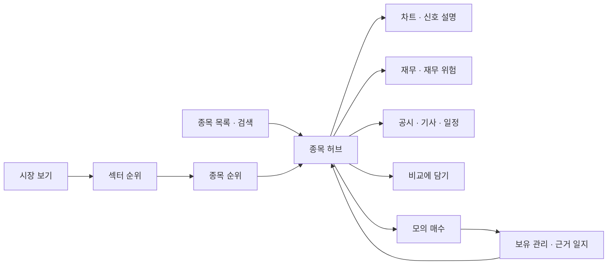

<!-- 이슈 초안 · 팀 묶음(실사용자 피드백 — 흐름 잇기) · 2026-10-15 · 올리기는 사용자(웹) · 팀 묶음을 먼저 올리고 그 번호를 「#(팀 글 번호)」 자리에 · 건 사이 10분 · 이 주석 줄은 빼고 올림 · 라벨(제안): 논의 · ux · 3차 · Assignee: 비움 -->

# [논의] 실사용자 피드백 — 순위에서 종목 근거 · 모의 매수 · 보유 관리까지 한 흐름으로 잇기

> **팀 전체에 드리는 조사 결과 묶음**입니다. 각자 영역의 코드를 고치자는 글이 아니라, 실제 사용자에게 받은 피드백을 우리 앱 · 실서비스와 견주고 영역마다 아이디어를 드리는 글입니다. 반영할지 · 언제 할지는 각 주담당이 정합니다. Assignee 는 비웁니다(여러 파트).
>
> - 파트별 글 — 신장환 님(@janghwan-god) #(번호) · 오준영 님(@GoonGuMa) #(번호) · 강민석 님(@rkdalstjr) #(번호)
> - 조사서 두 편(조회일 2026-10-14 · 확실도 표기): [실사용자 피드백 — 섹터 · 종목 선정 · 투자 근거 · 리서치 화면 조사서](https://github.com/EST-team-project/Qurious/blob/main/docs/조사/실사용자피드백-종목선정근거-조사.md)(받은 피드백 1 ~ 8) · [순위 화면 · HTS 같은 종목 목록 · 종목 비교 · 앱 흐름 조사서](https://github.com/EST-team-project/Qurious/blob/main/docs/조사/순위화면-종목목록-종목비교-조사.md)(받은 피드백 9 ~ 11)
> - 우리 코드 판정은 모두 **코드 읽기 판정**입니다(`main` `8921f92` · 시험으로 재지 않음). 틀린 곳은 알려 주세요.
> - 2차(10-21) 구현 칸 앞에는 아무것도 끼우지 않는 것이 전제입니다 — 구현은 3차 후보이고, 영역마다 주담당이 정합니다.

## 1. 받은 피드백

키움증권에서 모의투자를 하는 실제 사용자(ETF 섹터 · 투자 기업 고르기가 어렵다는 분)의 말을 세 번에 나눠 받았습니다(<표 1>). **첨부 자료는 아직 확인 전이라 글 원문만으로 해석했습니다.**

<표 1> 받은 피드백 열하나

| # | 받은 말(요지) | 이 글에서 닿는 곳 |
| --- | --- | --- |
| 1 | ADX 로 추세는 보지만, 같은 섹터 안에서도 강한 종목 · 약한 종목을 나눠 골라야 한다 | 섹터 강약 표 |
| 2 | 차트를 일일이 캡처해 확인해야 한다 | 작은 차트 격자 |
| 3 | 조건을 사용자 친화적으로 설정하고 싶어도 못 한다 | 조건 묶음 |
| 4 | 종목을 골라도 근거를 확인하기 어렵다 | 종목 허브 |
| 5 | 종목을 검색하면 매수 · 매도 · 보유 중 무엇인지 보여 주는 기능이 없다 | 규칙 신호 집계(4절) |
| 6 | 포트폴리오를 계속 관리해야 하니 그 근거(차트 포함)를 뽑아 주면 좋겠다 | 근거 일지 |
| 7 | (투자 정보 리서치 화면) 관련 종목을 2 ~ 3개씩 나열해 달라 | 리서치 화면 |
| 8 | (같은 화면) 기사를 더 보는 느낌이고, 종목 위주로 봐야 하는데 부족하다 | 리서치 화면 |
| 9 | 근거를 봐도 무엇에 투자할지 모르겠다 — 섹터별 · 종목별 순위로 매수 쪽 · 보유 · 매도 쪽을 보고, 종목을 누르면 근거와 지금 기업 상황이 나오면 좋겠다 | 순위 화면 · 종목 허브 |
| 10 | 증권사 HTS 같은 종목 목록 + 차트(검색 · 섹터 거르기), 토스증권의 종목 비교 같은 기능 | 종목 목록 · 종목 비교 |
| 11 | 전체 평가 — 기능을 나열한 느낌이고, 사용자에게 유기적으로 이어지는 기본 흐름이 부족하다 | 앱 흐름(2절) |

「토스 종목 비교」 는 공식 설명을 못 찾아, 종목 상세의 「동종 업계 비교」 인지 PC 「멀티차트」 인지 확인하는 중입니다.

## 2. 뿌리 — 근거가 종목 하나를 기준으로 모이지 않는다

재료(시세 · 공시 · 기사 · 일정 · 다중 주기 신호 · XAI · 군집 · 재무 위험)는 이미 있습니다. 빠진 것은 그 재료를 **종목 하나 기준으로 묶고, 화면끼리 종목을 넘기는 층**입니다. 여정을 일곱 단계로 놓고 지금 화면을 대 보았습니다(<표 2>).

<표 2> 여정 일곱 단계 — 지금 끊긴 곳

| 단계 | 지금 화면 | 끊긴 곳 |
| --- | --- | --- |
| 시장 보기 | 통합 · 거시 대시보드 | 개요가 메뉴 항목을 링크로 늘어놓음(`public/js/dashboard.js:12`) |
| 섹터 고르기 | 섹터 인디케이터 · 미국 섹터 ETF 표 | 국내 섹터는 고정 자료 6섹터(`public/js/company.js:200-210`) · 섹터를 눌러 그 종목으로 못 감 |
| 종목 고르기 | 패턴 인식 · 종목 스크리닝 | 31종목 고정 · 요청마다 계산 · 순위 · 거르기 없음(`app/routes/stocks.py:165-213`) |
| 근거 확인 | 차트 패턴 · 주가 차트 · 리서치 · 재무 · 신용 위험 · XAI 등 7곳 | 화면 이동이 화면 키만 받아(`public/js/core.js:594`) 화면마다 종목을 다시 입력 |
| 모의 매수 | 국내주식 모의주문 | 근거 화면에서 종목을 들고 가는 단추 없음 |
| 보유 관리 | 모의계좌 현황 · 리밸런싱 | 처음 근거 · 지금 근거를 견주는 곳 없음 |
| 매도 판단 | 자동매매 현황 · 손절 · 익절 칸 | 적어 둔 근거가 깨졌을 때 알림 없음 |

메뉴는 13묶음 74항목이 과제 목표 기능 이름으로 묶여 있습니다(`public/js/core.js:6-160`). 「나열한 느낌」 은 이 구조에서 나온다고 봅니다(확실도 중간 — 첨부 확인 전).

사용자 친화성이 차별점이 될 근거도 있습니다. 30 · 40대 투자자 1,005명 설문에서 증권사 보고서를 덜 읽는 까닭 1 ~ 3위가 「길어서」 39.6% · 「필요한 정보를 찾기 어려워서」 28.8% · 「내용이 어려워서」 25.2% 였습니다(리멤버 리서치 2026-08 · 서울신문 2026-09-14 보도 — 설문 원자료는 못 봄). 근거의 양보다 **찾기 · 읽기 쉬움**이 모자랍니다.

## 3. 실서비스는 어떻게 잇나

- **키움 영웅문4** — 관심종목 · 조건검색에서 종목을 누르면 「동일한 화면그룹에 종목을 연동」 합니다(도움말 [0130] · [0156]).
- **토스증권 PC** — 「차트, 호가, 뉴스, 커뮤니티 등 … 한 화면에 배치해 화면 전환없이」(2025-10-28 보도자료). 카테고리 순위에는 「n개 중 m개 종목 상승」 을 함께 보입니다.
- **미래에셋 HTS [0100]** — 보고 있는 종목의 업종 구성 종목 등락을 같은 화면 탭에 둡니다.
- **Seeking Alpha · Zacks** — 같은 섹터 안 요인별 등급 · 한 번 눌러 밑 자료 · 등급 이력 · 과거 성과 계산법 공개.
- **TradingView · finviz 스크리너** — 결과를 작은 차트 격자로 보여 「캡처」 를 기능으로 풉니다(2024-03-06 · 2026-07-28 블로그).
- **키움 「간편모드」 · 토스 「주식 골라보기」** — 조건검색을 핵심 조건 · 미리 만든 묶음으로 줄였습니다(2026-08-19 · 2024-07-18 기사).

## 4. 「매수 · 매도 · 보유」 표시 — 규제 원문 요지와 꼴

<표 3> 닿는 조문(자본시장법 · 조문 사본 조회 2026-10-14 · 추정 — 법률 자문 아님)

| 조문 | 요지 | 우리 표시에 |
| --- | --- | --- |
| 제6조 제7항 | 투자판단 = 종목 · 취득 · 처분 · 시기 등에 대한 판단 · 그 자문을 영업으로 하면 투자자문업 | 「매수 · 매도 · 보유」 는 문언상 투자판단 |
| 제7조 제3항 | 다수에게 일방적으로 하는 개별성 없는 조언은 투자자문업으로 보지 않음 | 누가 보든 같은 값이면 이쪽 |
| 제9조 제4항 | 투자권유 = 특정 투자자를 상대로 매매를 권유 | 보유 여부 · 계좌를 입력으로 한 의견은 이쪽으로 읽힐 수 있음 |
| 제101조 | 대가를 받고 개별성 없는 조언을 하면 유사투자자문업(신고) | 유료화 때의 갈림길 |

그래서 우리 말로는 **「규칙 신호 집계」** 를 제안합니다. 예: 「규칙 신호 — 매수 쪽 3 · 중립 2 · 매도 쪽 1(규칙 6개 · 일봉 · 2026-10-14 종가)」 + 펼치면 규칙마다 값 · 문턱 · 이유 문장 + 그 규칙들의 지난 기록(표본 · 기간 · 비용과 함께) + 「투자 권유가 아님」 고지. 큰 배지 하나(「매수」), 「강력 매수」 같은 등급 낱말, 「투자의견」(인가받은 증권사 리서치의 말)은 쓰지 않는 쪽입니다.

보유 여부를 입력으로 받는 의견은 지금 차트 패턴 화면의 멀티타임프레임 카드에 배지로 보입니다(#188 · #189) — 어떤 꼴로 둘지는 강민석 님 글에서 여쭙니다.

## 5. 제안 — 종목 허브를 가운데에

<그림 1> 종목 허브를 가운데 둔 흐름

- **종목 허브** — 어디서든 종목 이름을 누르면 열리는 한 화면(<그림 1> 가운데). 탭 안은 각 파트의 기존 API · 화면을 그대로 씁니다(새 계산 없음). #159 의 「종목 근거 서랍」 을 키운 꼴입니다.
- **순위 화면 = 섹터 강약 표** — 섹터를 고르고(섹터 ETF ÷ 시장) 섹터 안에서 고르는(종목 ÷ 섹터 ETF) 두 층. 열은 기술 근거(상대 강도 20 · 60일 · ADX · 이동평균 정배열 · 거래대금)와 기초 근거(성장성 · 수익성 · 재무 위험 · 최근 공시)이고, 한 점수로 뭉치지 않고 열 머리로 정렬합니다. 1단계는 매일 쌓이는 신호 기록(401종목 · `docs/데이터/데이터사전.md:156`)과 재무 · 공시로, 상대 강도 · ADX 열은 지표 함수가 생긴 뒤입니다.
- **작은 차트 격자(공용 부품)** — 한 칸 = 종목 · 60일 선 · 기준선 점선 · 기준일. 우리 수집 시세로 그리고 저장은 숫자로 합니다(TradingView 자료는 표시 전용 사용권 · 배포 금지 · 캡처 게시 때 표시 의무 — 정책 3 · 4절). 다른 화면에 쓸지는 주담당이 정합니다.
- **종목 연동** — 공통 셸에 「지금 보고 있는 종목」 하나. 받는 쪽은 각 화면 주인이 붙입니다.
- **종목 비교** — 허브 · 순위 · 목록에서 「비교에 담기」(3종목 · 모바일 2 — NN/g 비교표 원칙). 지금 비교 트레이(`public/js/core.js:377-435`)는 백테스트 · 모델 결과 비교라 따로 둡니다.
- **근거 일지** — 모의 매수 때 근거 한 줄과 「언제 판단을 바꾸나」(손절선 · 상대 강도 하위 · 신호 반전 · 공시 주제)를 고르고, 매일 점검해 깨지면 「적어 둔 조건 ○○ 이 깨졌습니다(기준일) — 판단은 본인에게 있습니다」 로 알립니다.
- **조건 묶음** — 미리 만든 묶음(이름은 조건 그대로) + 고른 종목 수 즉시 + 초보 · 중급 전환.
- **리서치 화면 「종목 먼저」** — 뉴스 이름표를 종목 이름으로, 관련 종목 2 ~ 3개(같은 글에 함께 나온 종목 · 같이 움직인 종목 + 이유 꼬리표).

꼴과 범위는 이동원 쪽에서 정하는 중이고, 화면은 Figma 안을 먼저 그린 뒤 정합니다. 종목 허브 · 섹터 강약 표 · 작은 차트 격자 · 규칙 신호 집계 · 근거 일지 다섯이 사용자 친화성을 차별점으로 내세울 후보이고, README · 발표에는 구현된 것만 씁니다. 용어는 <표 4> 에 모았습니다.

<표 4> 용어

| 용어 | 뜻 | 헷갈리는 점 |
| --- | --- | --- |
| ADX | 추세의 세기를 0 ~ 100 으로 잰 값(기본 14기간 · 25 위 뚜렷 · 20 아래 없음) | 방향이 아니다 — 내리는 추세도 높다 |
| 상대 강도 | 종목 가격 ÷ 기준선(섹터 · 시장) — n일 변화율 · 순위로 견줌 | RSI(한 종목 안의 오름 · 내림 비교)와 다르다 |
| 규칙 신호 집계 | 정해 둔 규칙마다 매수 쪽 · 중립 · 매도 쪽을 세어 보이는 꼴 | 점수가 아니다 — 규칙 수 · 이름 · 기준일이 늘 같이 |
| 종목 연동 | 한 화면에서 고른 종목을 다른 화면들이 따라감 | 화면 이동과 다르다 |
| 근거 일지 | 보유 종목마다 처음 근거 · 깨짐 조건 · 점검 기록 | 체결 장부와 다르다 — 「왜」 를 남김 |

## 6. 역할 — 누구 몫 · 겹침(제안)

<표 5> 항목별 역할

| 항목 | 주인(제안) | 겹침 | 자세한 물음 |
| --- | --- | --- | --- |
| 순위 읽기 API · ADX · 상대 강도 정의 · 규칙 신호 집계 | 신장환 | 이동원(데이터) | 신장환 님 글 |
| 축별 등급 · 「근거 개수」 종합 규칙 | 미정 | 신장환 · 오준영 · 강민석 | 아래 물음 2 |
| 위험 축 정의 · 근거 일지 깨짐과 위험 관문 · 배분에 담기 | 오준영 | 이동원(허브 단추) | 오준영 님 글 |
| 의견 표시 꼴 · 모의 매수로 종목 넘기기 · 근거 한 줄 · 신호 뒤 수익 분포 | 강민석 | 규제 검토 · 이동원(허브 단추) | 강민석 님 글 |
| 섹터 소속 · 성장성 · 수익성 · 공시 사건 · 수급 · 리서치 서버 | 이동원 | 없음 | — |
| 종목 허브 · 종목 목록 · 종목 비교 · 관심 종목 · 셸 종목 연동 | 이동원(주인 없는 화면) | 탭 원천 화면 · 받는 쪽은 각 주인 | 아래 물음 3 |

## 7. 물을 것 — 팀 전체

1. **방향** — 종목 허브를 가운데 두고 순위 화면을 입구로, 기존 화면은 허브의 탭 · 링크로 잇는 안에 찬성하시나요? 종목 상세를 특정 화면(예: 주가 차트)에 두는 편이 낫나요? 메뉴만 여정 순서로 다시 묶는 안은 화면 사이 이음이 생기지 않아 보조로 봅니다.
   - 판단 재료: <표 2> · 3절(키움 종목 연동 · 토스 PC 한 화면)
   - 답할 칸: 찬성 · 다른 안(어떤) · 의견
2. **종합 규칙 담당** — 순위 화면의 「축별 등급 · 근거 개수」 규칙을 누가 정할까요?
   - 판단 재료: 계획서는 스크리닝을 ③ 오준영 님 몫으로(`docs/계획서/프로젝트계획서.md:165`), 기능 점검표는 스크리닝 화면을 신장환 님 몫으로 적음 · 의견 변환은 ④ 강민석 님(`:166`)
   - 답할 칸: 신장환 · 오준영 · 강민석 · 팀 공동 · 의견
3. **종목 연동 받는 쪽** — 셸에 「지금 종목」 을 두면 각자 화면에서 받는 쪽을 붙여 주실 수 있나요? 어느 화면부터가 좋을까요?
   - 판단 재료: `public/js/core.js:594`(화면 키만 받음) · 종목 코드 · 이름을 치는 칸이 화면 틀(`public/app.html`)에만 아홉 곳(스크립트로 그리는 화면은 뺀 수)
   - 답할 칸: 붙임(화면 목록) · 3차에 · 안 함 · 의견
4. **때** — 이동원 쪽에서 2차 전 범위를 정하는 중입니다. 2차 전에는 새 계산이 없는 서버 둘(섹터 소속 · 허브 데이터 묶음)과 Figma 안만, 화면은 3차로 두는 안에 의견 부탁드립니다.
   - 판단 재료: 2차 로보 어드바이저 칸 앞에 끼우지 않는다는 원칙
   - 답할 칸: 찬성 · 더 미룸 · 의견
5. **낱말 원칙** — 종목 검색 · 순위 · 허브의 신호는 보유 여부 · 성향 · 계좌를 입력으로 쓰지 않고 누가 보든 같은 「규칙 신호 집계」 로, 보유 여부를 쓰는 의견은 모의 장부 안의 기록으로 두는 것을 팀 공통 원칙(문서 작성 기준 · UI 명세서 · 낱말 검사 시험)으로 둘지.
   - 판단 재료: <표 3> · #159 낱말 표
   - 답할 칸: 찬성 · 고칠 곳 · 의견

## 8. 채울 칸 · 누가 · 언제

| 칸 | 누가 | 언제 |
| --- | --- | --- |
| 1 방향 · 4 때 | 네 명 모두 | 2차 점검(10-21) 전이면 좋음 |
| 2 종합 규칙 담당 | 신장환 · 오준영 · 강민석 | 3차 정보 구조(메뉴 · 화면 연결) 정리(10-26) 전 |
| 3 연동 받는 화면 | 각 화면 주인 | 같은 때 |
| 5 낱말 원칙 | 네 명 모두 | 같은 때 |

답은 댓글로 주시면 <표 5> 에 옮기겠습니다. 파트별 자세한 물음은 위 세 글에 있습니다.
