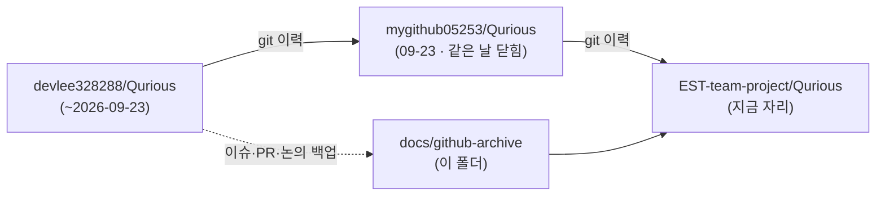

# GitHub 기록 — 옛 글 75건과 새 글의 원본

> 옛 저장소 `devlee328288/Qurious` 의 이슈·PR·논의는 2026-09-23 계정 문제로 더는 열리지 않습니다.
> 백업(2026-09-23 14:00 KST 무렵 받음)에서 **이 폴더의 Markdown 문서**로 옮겼습니다. 번호는 옛 번호 그대로입니다.
> **2026-09-28 부터** 새 저장소 `EST-team-project/Qurious` 에 올리는 글의 원본도 여기에 둡니다.
> 옛 글과 새 글 모두 **원 작성일 폴더 → 글 폴더**로 정리합니다 — GitHub 글이 사라져도 이 폴더와 GitLab 미러에 남습니다.

## 0. 폴더 지도

```
docs/github-archive/
├── README.md          ← 이 색인 (규칙 · 날짜별 목록 · 올림 상태)
├── 갱신대장.md         ← 올린 글 · 안 올린 글의 갱신 상태 (S58~) — 글 폴더마다 01-2026-09-28-갱신.md · 6절 닫기 점검 (S61~)
├── Github-링크.md      ← 이동원이 모아 둔 새 저장소 이슈 · 논의 주소 (S61 커밋 · 09-29 오전 기준 — 정본 번호는 3절)
├── 답글-수신함.md      ← 이동원이 팀원 답글을 붙여 넣는 곳 → Claude 가 세션마다 글 폴더로 옮김 (S61~)
├── attachments/       ← 옛 글에 붙어 있던 이미지
├── 2026-09-15/   ← 옛 글 13건
├── 2026-09-17/   ← 옛 글 18건
├── 2026-09-18/   ← 옛 글 2건
├── 2026-09-19/   ← 옛 글 7건
├── 2026-09-20/   ← 옛 글 11건
├── 2026-09-21/   ← 옛 글 23건
├── 2026-09-23/   ← 옛 글 1건
├── 2026-09-28/        ← 새 글 18건
│   ├── 이슈-화면IA-v0.1/          00-본문.md · 01-2026-09-28-v0.2.md  (#14 · 댓글 01 올림) · 02 옛 닫기 초안(올리지 않음 — 링크 깨짐) · 03 닫기(10-12 · 닫을 때 붙임)
│   ├── 이슈-강사님자료-변경추적/   00-본문.md · 01-2026-09-28-기준점.md · 02 ~ 07 점검 댓글 · 08 · 09 반영 결과(#6 · 09 는 10-04 올림) · 10 점검 댓글(10-07 · th03 · th06 · th07 · th24 — #6 에 올릴 것) · 11 · 12 점검 댓글(10-07 오후 · 10-08 아침 받은 것 — #6 에 10-08 올림) · 13 반영 결과(10-08 · th06 `e815be3` 서버 쪽 — #6 에 올릴 것) · 14 점검 댓글(10-10 · th06 새 8커밋 `e815be3..5b0a768` · th07 금융 경로의 고지 삭제 — #6 에 10-10 올림 · 기준점 th07 줄을 `35f9027` 로) · 15 반영 결과(10-12 · th06 `5b0a768` 1단계 · 지킴이 여섯 · 기준점 두 줄 — #6 에 10-12 올림) · 16 점검 댓글(10-12 오후 · th06 새 2커밋 `5b0a768..8624e81` · th03 10커밋 · 체결 확인 예산 · 차트 기다림 45초 — #6 에 올릴 것 · 기준점은 그대로) · 기준점.tsv  (이슈는 닫음 → #6 에서 이어 감)
│   ├── PR-docs-screen-ia-v0-1/    00-본문.md  (#16)
│   ├── PR-docs-screen-ia-v0-2/    00-본문.md  (#19)
│   ├── PR-feat-daily-data-update/ 00-본문.md  (#23)
│   ├── 이슈-I14-모의계좌-장부/     00-본문.md  (#24 · #25 머지로 닫힘)
│   ├── PR-fix-i14-paper-ledger/   00-본문.md  (#25)
│   ├── 이슈-화면결함-파트별/       00-본문.md  (#26)
│   ├── PR-fix-git-bash-utf8-and-records/  00-본문.md  (#27)
│   ├── PR-docs-wireframe-v0-2/    00-본문.md  (#28)
│   ├── PR-docs-records-26-28/     00-본문.md  (#29)
│   ├── PR-fix-quote-change-a1/    00-본문.md  (#30)
│   ├── 이슈-DF08-다리-뒤-기준일/   00-본문.md  (#35)
│   ├── PR-feat-collector-candles-df08/  00-본문.md  (#33)
│   ├── PR-docs-erd-v1-1-and-meetings/   00-본문.md  (#34)
│   ├── 이슈-HF-데이터셋-private/   00-본문.md  (#37)
│   ├── PR-docs-archive-refresh-s58/  00-본문.md  (#36)
│   └── PR-fix-collector-df01-shares/  00-본문.md  (#39)
├── 2026-09-29/        ← 새 글 10건
│   ├── PR-docs-test-plan-v1-2/        00-본문.md  (#42)
│   ├── 이슈-로드맵-인덱스-v2/          00-본문.md  (#47 · 옛 `#1` → #4 를 대신)
│   ├── PR-docs-archive-new-numbers-s61/  00-본문.md  (#46)
│   ├── PR-fix-collector-utf8-df11-df16/  00-본문.md  (#48)
│   ├── 논의-기능목록-역할희망/         00-본문.md · 01 · 02 갱신 · 03 마무리(역할 확정 · 닫기 — 문서 주소 셋이 깨짐) · 04 닫기(10-12 · 03 을 대신)  (D9 · #52)
│   ├── PR-docs-api-spec-and-design-s63/  00-본문.md  (#51)
│   ├── PR-fix-route-cache-df17/        00-본문.md  (#53)
│   ├── PR-docs-writing-standard-v0-1/  00-본문.md  (#55)
│   ├── PR-docs-erd-dictionary-v1-2/    00-본문.md  (#56)
│   └── PR-docs-rtm-v1-1-test-plan-v1-3/  00-본문.md  (#60)
├── 2026-09-30/        ← 새 글 8건
│   ├── PR-chore-lumina-invest-b055ab0/  00-본문.md  (#68)
│   ├── 논의-강사님최신-반영/           00-본문.md  (#69 · 옛 D8 번호와 다른 글)
│   ├── PR-feat-local-run-scripts/      00-본문.md  (#71)
│   ├── 이슈-로컬실행-사용법/           00-본문.md · 01 · 02 · 03 갱신 댓글  (#70)
│   ├── 이슈-계정-CRUD-점검/            00-본문.md  (#76 · 작업 기록 — PR #75 가 닫음)
│   ├── PR-feat-account-crud-mypage/    00-본문.md  (#75)
│   ├── 이슈-통합본-반입-용어사전/      00-본문.md  (번호는 올린 뒤 · 작업 기록 — PR 이 닫는다)
│   └── PR-feat-rag-lab-import-glossary/  00-본문.md  (#77)
├── 2026-10-01/        ← 새 글 5건
│   ├── PR-docs-plan-v2-and-goal1-design/  00-본문.md  (#78)
│   ├── [논의] 리밸런싱 3종의 실행 주기·허용 이탈률·현금흐름 기준 설정/  00-본문.md(③ 주담당 글 · #79 이슈) · 01 내 의견(부담당 · 10-01 올림) · 02 거래일 달력 주소(10-02 · 10-07 올림) · 03 배당 지급일이 생김(10-05 · 10-07 올림) · 04 주담당 답글(10-06 · 적용 범위 · 입출금 뒤 점검 · 예약 뒤 변경) · 05 세 물음 의견(10-06 · 10-07 올림)
│   ├── PR-feat-learning-pages/        00-본문.md  (#80)
│   ├── PR-feat-ohlcv-v1-intake/       00-본문.md  (#81)
│   └── PR-feat-finance-lectures-placement/  00-본문.md  (#84)
├── 2026-10-02/        ← 새 글 5건
│   ├── 이슈-QFRS-마이그레이션-정리/    00-본문.md · 01 강민석 님 답글(10-02) · 02 코드 대조 확인(10-03 · 올림) · 03 갱신(10-03 · 번호 0013 → 0014 · 올림) · 04 갱신(10-06 · 번호 0014 → 0016 · 올릴 것)  (#88)
│   ├── PR-feat-glossary-screen-and-w3-docs/  00-본문.md  (#87)
│   ├── PR-feat-trading-calendar-and-glossary-relations/  00-본문.md  (#89)
│   ├── PR-feat-data-hub-calendar-ohlcv-api/  00-본문.md  (#91)
│   └── PR-feat-legal-kb-fetch-and-index/  00-본문.md  (#93)
├── 2026-10-03/        ← 새 글 7건
│   ├── PR-feat-kb-search-eval-and-glossary-candidates/  00-본문.md  (#97)
│   ├── PR-chore-instructor-base-9478811-server/  00-본문.md  (#98)
│   ├── 논의-강사님기초코드-9478811-반영/  00-본문.md · 01-2026-10-03-화면-결정.md(10-04 올림) · 02-2026-10-18-갱신.md  (#99)
│   ├── PR-chore-instructor-base-9478811-screens/  00-본문.md  (#100)
│   ├── 이슈-백테스트보고서-결과칸-요청/  00-본문.md · 01 닫기(10-12 · 짝 #134 는 PR #147 로 닫힘)  (#103 · 10-04 올림)
│   ├── PR-docs-deliverables-v01-doc-figures/  00-본문.md  (#101)
│   └── PR-feat-kb-ask-and-local-llm-research/  00-본문.md  (#102)
├── 2026-10-04/        ← 새 글 7건
│   ├── PR-feat-kb-answer-screen/  00-본문.md  (#104)
│   ├── 이슈-점검-인디케이터-화면/  00-본문.md  (#107 · 10-04 올림 · 신장환 님)
│   ├── 이슈-점검-자산배분-리밸런싱-자동매매/  00-본문.md  (#108 · 10-04 올림 · 오준영 님)
│   ├── 이슈-점검-모의투자-성과-테스트베드/  00-본문.md  (#106 · 10-04 올림 · 강민석 님)
│   ├── 이슈-점검-주인미정-화면-배지규칙/  00-본문.md  (#109 · 10-04 올림 · 팀) · 01 주인 정함(10-07 올림)
│   ├── PR-feat-completion-audit-and-crawl-points/  00-본문.md  (#105 · 머지 c8c07fd)
│   ├── PR-feat-kb-statute-links-and-legal-terms/  00-본문.md  (#110 · 머지 079a7dd) · 01 갱신(10-06 · DF-64 일부 닫힘 · 올릴 것)
│   └── PR-feat-disclosure-financials-search-events/  00-본문.md  (#111 · 머지 1a7574e)
├── 2026-10-05/        ← 새 글 2건
│   ├── PR-feat-agm-dividend-pay-sector-laws-hf-archive/  00-본문.md  (#112 · 머지 f83e551)
│   └── PR-feat-news-calendar-month-research-sector-eval/  00-본문.md  (#113 · 머지 4293b82)
├── 2026-10-06/        ← 새 글 3건 · 팀원 글 2건
│   ├── PR-feat-sector-route-calendar-research-api-docs/  00-본문.md  (#120 · 머지 619ae7a) · 01 갱신(10-06 오후 · 섹터 분류 2판 · 올릴 것)
│   ├── PR-feat-kb-faithfulness-guards-sector-words/  00-본문.md  (#125 · 머지 e0ffe8e · 근거 충실도 평가 도구 · 근거 답 거름 둘 · 실패 발췌 화면 · 섹터 낱말 2판)
│   ├── PR-docs-kb-faithfulness-judge-decision/  00-본문.md  (#126 · 머지 13a6ae9 · 근거 충실도 판정 결정 · 머지 뒤 실측 둘)
│   ├── 이슈-리밸런싱정책-시험DB/  00-본문.md  (올리지 않음 — 팀원 PR #129 가 DF-73 · DF-75 를 고침 · 10-07 사용자 확인)
│   ├── 이슈-123-배당자동입금-규칙/  00-본문.md(#123 팀원 원문) · 01 의견(이동원 · 10-07 초안 · 올림 확인 전)
│   └── 이슈-124-리밸런싱-예외처리/  00-본문.md(#124 팀원 원문) · 01 의견(이동원 · 10-08 새 판 — #136 과 맞댐 · 올림) · 02 답글(오준영 · 채택 정책 · 구현 결과 · 데이터 몫 둘 남음 · 닫지 않음) · 03 답글(이동원 · 수집 단추 · 종목별 상태 계획 · 10-10 올림) · 04 추가 답글(이동원 · PR #148 머지 · 12:30 시각 조사 알림 · 10-10 올림) · 05 답글(오준영 · 종목별 상태 칸 넷 · 회차 기록 확보 요청 · 10-12 받음) · 06 추가 답글(오준영 · 실제 수집 가격 정산 검증 끝 · 운영 러너 대조는 따로 · 10-12 받음) · 07 의견(이동원 · 데이터 몫 둘 계약 — 종목별 상태 10-16 · 회차 기록 사본 10-19 · 10-14 올림)
├── 2026-10-07/        ← 새 글 4건 · 팀원 글 1건
│   ├── PR-docs-collect-screens-credit-csv-roles/  00-본문.md  (#128 · 머지 0011743 · 데이터 수집 화면 결정 · 조사서 둘(신용평가 CSV · 교재 원천 갱신) · 주인 없는 화면)
│   ├── PR-docs-reorganize-by-kind/  00-본문.md  (#130 · 머지 f0fa9cf · docs 폴더 정리 — 문서마다 이름 하나 · 지난판 · 대장 · 평가셋 · 판 올리는 도구)
│   ├── PR-chore-lecture-etf-json-to-hf/  00-본문.md  (#132 · 머지 a617f2a · 공개 저장소의 강의 시세 JSON 둘을 추적에서 빼고 HF 비공개로 — 강의 빌드가 「HF 보관」 을 건너뜀)
│   ├── 이슈-134-백테스트보고서-v0.2/  00-본문.md(#134 팀원 원문) · 01 검수(이동원 · 재현 8 호출 · 올림 확인 전)
│   └── PR-feat-collect-screens-server/  00-본문.md  (#139 · 머지 ef8cf5b · 크롤링 세 화면 서버 — 단계 이름표를 러너 한 곳에 · 수집 일정 API · 한 단계 다시 · 주소 검사 · DF-79 ~ 81) · 01 갱신(10-08 · 머지 뒤 첫 정기 회차 19 / 19 · 올림) · 02 131400 대조 · DF-85 고침(10-08 · 올릴 것 — 러너 묶음 PR 뒤)
├── 2026-10-08/        ← 새 글 4건 · 팀원 글 1건
│   ├── PR-chore-th06-base-sync-e815be3/  00-본문.md  (#141 · 머지 73f075b · 강사님 기초 코드 th06 서버 쪽 반영 · 점검 계정 KIS 모의 연동)
│   ├── PR-feat-collect-screens-ui/  00-본문.md  (#144 · 머지 5f3c325 · 크롤링 세 화면 구현 — 수집 일정 · 단계 / 자료 직접 받기 / 적재 · 백업 · 「DB 초기화」 없앰)
│   ├── PR-feat-runner-signals-step/  00-본문.md  (#146 · 머지 006c31a · 러너에 신호 단계 · 앱 DB 꺼짐은 건너뜀 · 한 단계 다시 뒤 기준일 다시 잼(DF-85) · 자료 안내 화면 1단계)
│   ├── 이슈-기초코드-받지않은것/  00-본문.md  (이동원 · 올리지 않음 — 2026-10-10 v2 가 대신 · 강사님 10-07 판에서 받지 않은 것 — 운용 값 넷 · 리밸런싱 19곳 · 정합성 요약 · DF-84)
│   └── 이슈-142-러너-신호-단계-연결/  00-본문.md(#142 팀원 원문 · 신호 배치를 러너에) · 01 답글(이동원 · 10-08 · 올림) · 02 연결 결과(10-08 · 주소 문제 · 앱 DB 꺼짐은 돌리기 전 확인 · 10-10 올림)
├── 2026-10-10/        ← 새 글 15건(PR 다섯 · 이슈 열 — 모두 올림 — 이슈 다섯은 10-12 · #159 ~ #163) — 글은 처음부터 여기에(사용자 10-10 「_git-drafts 와 구분」)
│   ├── PR-feat-collect-request-worker/  00-본문.md  (#148 · 머지 83a0b12 · 화면 수집 요청 서버 — 요청 표 · API 넷 · PC 작업자 · 러너 막힘 75)
│   ├── PR-docs-research-four-and-followups/  00-본문.md  (#154 · 머지 809c2dc · 조사서 넷 · 결함 후보 셋(DF-94 ~ 96) · 글 정리)
│   ├── PR-feat-collect-request-screen/  00-본문.md  (#155 · 머지 5d470c3 · 화면 수집 단추 — 줄마다 다시 받기 · 전체 수집 · 작업자 띠 · 대기 창 · 관제 한 줄 · 막는 때에는 끔)
│   ├── 이슈-시장범위-미국-코인-기준/  00-본문.md  (#151 · 옛 기록 #149 · 이동원 · 10-10 올림 · 미국 주식 · 코인 범위 · 시장별 기준 20 · 역할 안 A/B/C · 데이터 담당 의견 포함)
│   ├── 이슈-모의계좌-시작금액-회차/  00-본문.md  (#150 · 이동원 · 10-10 올림 · 강민석 님께 · 시작 금액 고르기 · 리셋 = 새 회차 · 결함 후보 둘)
│   ├── 이슈-증권사-모의환경/  00-본문.md  (#152 · 옛 기록 #151 · 이동원 · 10-10 올림 · 오준영 님께 · 증권사별 모의 환경 · 여러 모의 계좌 · 3차 연동 참고)
│   ├── 이슈-개념학습-기능별-장-검수/  00-본문.md  (#149 · 옛 기록 #152 · 이동원 · 10-10 올림 · 주담당 셋께 · 기능별 개념 장 목록 검수 · 정의 · 산식의 정본)
│   ├── 이슈-기초코드-받지않은것-v2/  00-본문.md  (#153 · 이동원 · 10-10 올림 · 강사님 10-08 판까지 — 운용 값 넷 · 팀원 코드와 부딪히는 B1 ~ B7 · 받지 않기로 한 것 · DF-84 — 10-08 초안(v1)을 대신 · 01 담당 알림(10-12 올림 · 1단계로 받은 것 — 신장환 · 강민석 님) · 02 답글(신장환 · B2 규칙 설명 받음 · B4 패턴 차트 받음 · 자동 갱신은 안 받음 · 10-12 받음)) · 04 의견 초안(이동원 · B7 답 — #6 댓글 18 을 가리킴 · 10-14 · 올리는 차례 10)
│   ├── 이슈-개별종목-투자근거/  00-본문.md  (#159 · 이동원 · 10-12 올림 — **먼저** · 팀 묶음 · 한 종목 근거 판정 17 · 현업 꼴 일곱 · 익절 · 손절 안 A · 낱말 표 · T1 ~ T4)
│   ├── 이슈-손절익절규칙-신호근거/  00-본문.md  (#161 · 이동원 · 10-12 올림 — 팀 묶음 뒤 · 신장환 님께 · 규칙 명세 청산 칸 · 판정 기준 · 신호 이유 · A1 ~ A9) · 04 의견 초안(이동원 · 「차이 원인」 칸 · W2 Pine 나누기 · 10-14 · 올리는 차례 9)
│   ├── 이슈-근거카드-성과-교차검증/  00-본문.md  (#160 · 이동원 · 10-12 올림 — 팀 묶음 뒤 · 강민석 님께 · 근거 카드 · 손절 뒤 실제 손실 · TradingView ↔ LEAN 대사 · B1 ~ B6) · 02 답글(강민석 · B1 끝 — #181 · #182 · 10-14 받음) · 03 의견(이동원 · B1 끝 확인 · 작은 것 셋 · signals_yahoo.py 덮어쓰기 부탁 · 10-14 올림) · 04 추가 댓글(이동원 · main 전체 시험 2건 실패 — signals_yahoo.py 가 야후 봉인 시험에 걸림 · DF-110 · 10-14 올림)
│   ├── 이슈-위험한도-포지션크기-감시주문/  00-본문.md  (#162 · 이동원 · 10-12 올림 — 팀 묶음 뒤 · 오준영 님께 · 위험 계층 · 포지션 크기 · 증권사 감시 주문 · C1 ~ C6) · 01 ~ 03 답글(오준영 · C1 · C3 ~ C6 반영 · C2 · C5 선택 기능 → #183 · 10-14 받음) · 04 의견(이동원 · C1 · C3 ~ C6 확인 · 웹 본문 2절 [0624] 30일 → 90일 고침 · 10-14 올림)
│   ├── 이슈-정기수집-회차시각-논의/  00-본문.md  (#163 · 이동원 · 10-12 올림 · 12:30 그대로 · 놓친 날 보이기 · DF-99 · 100 — 오준영 님 · Q1 ~ Q5) · 01 답글(오준영 · Q1 ~ Q5 모두 찬성 · DF-99 는 러너에서 막기 · DF-100 은 회차 ok 와 준비 판정을 나눔 · 10-12 받음) · 02 의견(이동원 · Q1 · Q4 · Q5 그대로 · DF-99 (가)는 10-19 까지 · 10-14 올림) · 03 결과(이동원 · 약속 셋 끝 · 올림 · **닫힘** 10-16)
│   ├── PR-docs-research-stock-evidence-collect-time/  00-본문.md  (#156 · 머지 5da1bf6 · 조사서 둘(개별 종목 근거 · 정기 회차 시각) · 이슈 초안 다섯 · 대화방 글 고침 · 글 정리)
│   └── PR-feat-collect-fill-and-why/  00-본문.md  (#157 · 머지 9e580b6 · 수집 단추 남은 것 — 실패한 단계의 까닭 · 빠진 날 세기 · 빠진 날 채우기 요청 · 390 머리글 · b 가 브랜치에서 꺼내 올림 · 번호는 올린 뒤)
├── 2026-10-11/        ← 새 글 1건(#158 머지)
│   └── PR-feat-data-guide-columns-numbers/  00-본문.md  (#158 · 머지 b247d41 · 자료 안내 2단계 — 칸 정의 · 숫자 파일 · 칸 절 · DF-103 · 104 · b 가 브랜치에서 꺼내 올림)
├── 2026-10-12/        ← 새 글 6건(#164 · #167 · #169 · #171 머지 · 이슈 #168 · #170)
│   ├── PR-chore-th06-base-sync-5b0a768-step1/  00-본문.md  (#164 · 머지 8c71d92 · 강사님 기초 코드 반영 1단계 — 지킴이 여섯 · Pine v6 · 판단 불가 · KIS 일봉 · 기준점 두 줄 · b 가 브랜치에서 꺼내 올림)
│   ├── PR-feat-product-guide-etf-savings/  00-본문.md  (#167 · 머지 8bf26b0 · 투자 성향별 상품 안내 — 서버 셋 · 화면 안 A · 요건 상수표 · 규제 원문 데이터셋 · 기능 완성도 다시 매김)
│   ├── PR-feat-product-detail-chart/  00-본문.md  (#171 · 머지 cc65330 · 상품 상세 창 — 서버 API-PROD-04 · 가운데 모달 설계 F · Lightweight Charts 5.2.1 · 검토 셋은 a 에서 y / n · b 가 브랜치에서 꺼내 올림)
│   ├── PR-feat-signal-explain/  00-본문-발췌.md  (팀원 #169 · 머지 d4a9d66 · 신호 설명 — 본문 끝의 부탁 셋만 원문 발췌 · 사용자가 붙여 줌)
│   ├── 이슈-2차-중간점검/  00-본문.md · img/robo-midcheck-overview_v1.0.png  (#170 · 10-12 올림 · 파트별 · 팀원별 진행 · 제안요청서 대비 · 10-21 까지 남은 일 · 그림 다섯 · 멘션 넷) · 01 답글(신장환 · 10-13) · 02 요약 댓글(10-13 올림) · 03 답글(오준영 · ② · ③ · 10-14 받음) · 04 요약 댓글(이동원 · 오준영 님 답 A1 ~ A17 · 머지 사실 B1 ~ B8 을 본문에 · 웹 본문도 바꿈 · 10-14 올림) · 05 요약 댓글 초안(이동원 · #185 머지로 주인 없던 2차 화면 82 → 90.2 · 웹 본문을 00-본문으로 바꾼 뒤 · 10-14 · 올리는 차례 — #185 머지 뒤 · 건 사이 10분)
│   └── 이슈-자산배분-비중함수-요청/  00-본문.md  (#168 · 올림 10-12 · 오준영 님께 비중표를 함수 하나로 · Assignee 비움 · 닫음 10-14) · 01 닫는 댓글(이동원 · 칸 셋이 #180 으로 채워짐 · 10-14 올림 · 「Close with comment」 로 닫음)
├── 2026-10-13/        ← 새 글 2건(#175 머지 · 이슈 #174) · 다른 글 폴더의 댓글 둘(#58 결론 · #6 댓글 17 — 모두 올림)
│   ├── PR-feat-financial-credit-risk/  00-본문.md  (#175 · 머지 eac00cc · 재무 · 신용 위험 — 서버 API-RISK-01 · 02 · ECOS 수집 · 설계 D · ⚠️ 10-14 12:30 전 머지 · 검토 셋은 a 에서 y / n · b 가 브랜치에서 꺼내 올림)
│   └── 이슈-비교에추가-단추-오류/  00-본문.md  (#174 · 10-13 올림 · 신장환 님 #176 으로 고침 · 성과 검증 「비교에 추가」 단추 · 담당 제안 신장환 님 · 전략 분석 쪽은 이 PR 에서 고침)
└── 2026-10-14/        ← 새 글 1건(#185 머지 · 계절성 · 군집화) · 팀원 글 2건(#179 · #183 — 오준영) · 다른 글 폴더의 팀원 답글 다섯(#170 03 · #162 01 ~ 03 · #160 02) · 이동원 답글 열(차례 ① ~ ⑧ 과 추가 댓글 둘(#183 03 · #160 04) 올림 · ⑨ #161 04 · ⑩ #153 04 도 올림(사용자 확인 10-15) — 이 폴더 둘 · 다른 글 폴더 여덟) · #170 웹 본문 바꿈 + 05 올림 · #6 댓글 18 올림
    ├── PR-fix-gnb-overflow-more-menu/  00-본문.md  (#191 · 머지 0a7b1b7 · 위 메뉴 넘침 고침(DF-109 · 융합안 D) · 근거 답 품질 보고서 v0.1 · 검토 셋은 a 에서 y / n · b 가 브랜치에서 꺼내 올림)
    ├── PR-feat-seasonality-stock-clusters/  00-본문.md  (#185 · 머지 f73b467 · 계절성 분석 · 종목 군집화 — 서버 API-SEAS-01 · API-CLUS-01 · ECOS 지수 둘 · Figma 결정 화면 · 검토 셋은 a 에서 y / n · b 가 브랜치에서 꺼내 올림)
    ├── 이슈-179-배분저장-리밸런싱연결/  00-본문.md(#179 팀원 원문 · 오준영 · 배분 결과 저장 · 리밸런싱 연결 · 공통 비중 API — #180 머지 · 이동원에게 C) · 01 의견(이동원 · C 공통 비중 계약 · 10-14 올림) · 02 답글(오준영 · C 계약 확정 — latest = 마지막 성공 계산 한 건 · 키 다섯 · 404 일 때만 기본 비중 · 응답 모델 eeff5cc · 10-14 받음)
    └── 이슈-183-위험기준수량-재주문/  00-본문.md(#183 팀원 원문 · 오준영 · C2 위험 기준 수량 · C5 재주문 · C4 감시 주문 — 이동원에게 C4) · 01 의견(이동원 · C4 찬성 · 2차는 안내만 · 10-14 올림) · 02 답글(오준영 · 추적 계약 다섯 · 0624 90일 정정 · 「잔고편입 30일」 구분은 원문 3절과 다름 · #151 · #152 번호는 우리 기록과 반대 — 오준영 님이 맞음(우리 기록을 고침 · 사용자 확인 2026-10-16 · D85) · 10-14 받음) · 03 추가(이동원 · #184 가 깬 시험 알림 — 같은 종목 미확인 주문 보류 규칙 ↔ 강사님 시험 · 10-14 올림) · 04 답글(오준영 · DF-112 1안 · 10-15 받음) · 05 답글(오준영 → 신장환 님 C2 · DF-112 커밋 `9e43aa9` 은 브랜치 · 10-16 받음)
```

| | 옛 글 (2026-09-15 ~ 09-23) | 새 글 (2026-09-28 ~) |
|---|---|---|
| 날짜 폴더 | 옛 저장소에 **처음 쓴 날** | 파일로 **처음 쓴 날** |
| 글 폴더 이름 | 종류-옛 번호 (`이슈-001` · `PR-002` · `논의-006`) | 종류-짧은 이름 (`이슈-화면IA-v0.1`) — 새 번호는 올린 뒤 3절 색인에 |
| 글 폴더 안 | `00-기록.md` — 본문과 댓글 전부 (원문 그대로) | `00-본문.md` → `01-날짜-주제.md`(내 댓글) → `NN-날짜-답글-이름.md`(팀원 답글) |
| 새 저장소에 올렸는지 | 3절 「새 저장소」 칸 | 3절 「새 저장소」 칸 |

- 다시 올린 옛 글에 답글이 오면 **그 글 폴더**에 `01-날짜-답글-이름.md` 부터 쌓는다 (옛 기록 `00-기록.md` 는 고치지 않는다).
- 올림 현황 (2026-09-28 S58 · 사용자 보고): 옛 글 75건 중 **17건** — 이슈 8(원 작성 09-15 전부: 옛 `#1` · `#3` · `#4` · `#5` · `#8` · `#9` · `#11` · `#12`) · 논의 9(원 작성 09-17 까지 전부: 옛 `#6` · `#7` · `#10` · `#13` · `#17` · `#18` · `#20` · `#29` · `#30`) — 새 번호 미기입. ~~S57: 6건~~. 새 글 16건 중 올림 15(… PR #30 · **#33 · #34**) · S57 이슈 1건은 번호 확인 전. → **S59 채움**: S57 이슈 「다리 뒤 기준일」 = **#35**(사용자 보고) · S58 PR = **#36**(머지 `abc4853`). 옛 글 17건의 새 번호 · HF 이슈 번호는 아직. → **S61 채움**: 옛 글 17건 새 번호(S60 이 09-29 목록 페이지로 확인 · S61 이 논의 9건 페이지로 갱신 댓글 확인) + S61 검색에서 옛 글 6건이 더 올라간 것을 확인(옛 `#14` → #38 · `#15` → #40 · `#16` → #41 · `#19` → #43 · `#21` → #44 · `#22` → #45) — **올림 23건**. → **S63 채움**: 옛 `#23` → **#49** · `#24` → **#50** · 인덱스 v2 → **#47**(사용자 `Github-링크.md` 09-29 12:31 · S63 이 이슈 목록 페이지로 제목 확인 · #40 닫힘 확인) — 옛 글 **올림 25건**. → **S65 채움**: D8 옛 `#69` → **#54**(09-29 · 본문 + 갱신 댓글 · 사용자 `Github-링크.md`) — 옛 글 **올림 26건**. → **S68 채움**: 옛 `#25` → **#57** · `#26` → **#58** · `#27` → **#59**(09-29) · `#28` → **#61**(09-30) — 이슈 페이지를 한 건씩 열어 제목 · 옛 주소로 확인 · 넷 다 검색 `comments:>0` 에 걸려 갱신 댓글도 붙은 것으로 본다(🟡) — 옛 글 **올림 30건**. 갱신 댓글 상태 · 닫기 후보는 [갱신 대장](갱신대장.md) 1절 · 6절.
- **올린 글도 최신으로** (S58~): 올린 뒤 바뀐 사실은 그 글 폴더에 `01-날짜-갱신.md` 댓글 파일로 남긴다 — 점검 결과와 순서는 [갱신 대장](갱신대장.md).
- 글 폴더를 더한 PR 은 **그 PR 안에서 3절 표에 줄을 더한다** — 번호 칸은 「(올린 뒤 적음)」으로 두면 된다. 줄이 빠지면 `python scripts/post_check.py` 가 `📇 색인 없음` 으로 알린다(S55 · PR #28 이 폴더 2개를 색인 없이 더했다).

## 1. 지금 답이 필요한 논의 — 결론 초안 8건

2026-09-23 에 논의마다 결론 초안을 올렸는데, 곧바로 옛 저장소가 닫혀 팀원이 읽을 수 없게 됐습니다.
**의견은 팀 대화방(Discord)에 남겨 주세요** — 이동원이 결정 대장에 옮깁니다.
결정 대장 v0.9 는 [`docs/계획서/지난판/논의결정대장_v0.9.md`](../2차/계획서/지난판/논의결정대장_v0.9.md) 입니다 — 옛 PR [#75](2026-09-23/PR-075/00-기록.md) 는 머지되기 전에 옛 저장소가 닫혔습니다.

| 논의 | 옛 번호 | 새 번호 | 주제 | 초안 | 의견 기한 (KST) |
|---|---|---|---|---|---|
| D0 | [#6](2026-09-15/논의-006/00-기록.md) | [#10](https://github.com/EST-team-project/Qurious/discussions/10) | 팀 운영·기록 방식 | [결론 초안](2026-09-15/논의-006/00-기록.md#discussioncomment-18561533) | ~~09-27(일) 23:59~~ **09-30(수) 23:59** |
| D1 | [#7](2026-09-15/논의-007/00-기록.md) | [#11](https://github.com/EST-team-project/Qurious/discussions/11) | Qurious 2.0은 누구의 어떤 문제를 푸는가 | [결론 초안](2026-09-15/논의-007/00-기록.md#discussioncomment-18561553) | ~~09-27(일) 23:59~~ **09-30(수) 23:59** |
| D2 | [#10](2026-09-15/논의-010/00-기록.md) | [#12](https://github.com/EST-team-project/Qurious/discussions/12) | 유료 서비스(AWS 등)를 어디까지 쓸지와 데모 방식 | [결론 초안](2026-09-15/논의-010/00-기록.md#discussioncomment-18561567) | ~~09-27(일) 23:59~~ **09-30(수) 23:59** |
| D3 | [#30](2026-09-17/논의-030/00-기록.md) | [#32](https://github.com/EST-team-project/Qurious/discussions/32) | lumina-invest 기능 범위 — 화면이 한 번도 부르지 않는 API가 31개입니다 | [결론 초안](2026-09-17/논의-030/00-기록.md#discussioncomment-18561638) | ~~09-27(일) 23:59~~ **09-30(수) 23:59** |
| D4 | [#17](2026-09-17/논의-017/00-기록.md) | [#20](https://github.com/EST-team-project/Qurious/discussions/20) | 1차 프로젝트 매듭짓기 — 비용·누수·검정 규격을 2·3차 공통으로 정합니다 | [결론 초안](2026-09-17/논의-017/00-기록.md#discussioncomment-18561510) | ~~09-26(토) 18:00~~ **09-30(수) 23:59** |
| D5 | [#18](2026-09-17/논의-018/00-기록.md) | [#21](https://github.com/EST-team-project/Qurious/discussions/21) | 2차 로보어드바이저 설계 — 무엇에 투자하고, 무엇으로 계산하고, 무엇과 비교할까 | [결론 초안](2026-09-17/논의-018/00-기록.md#discussioncomment-18561594) | ~~09-27(일) 23:59~~ **09-30(수) 23:59** |
| D6 | [#20](2026-09-17/논의-020/00-기록.md) | [#22](https://github.com/EST-team-project/Qurious/discussions/22) | 3차 커스텀 인디케이터 설계 — 같은 'RSI 14'가 세 벌이라 결론이 58.3% 뒤집힙니다 | [결론 초안](2026-09-17/논의-020/00-기록.md#discussioncomment-18561614) | ~~09-27(일) 23:59~~ **09-30(수) 23:59** |
| D7 | [#13](2026-09-15/논의-013/00-기록.md) | [#13](https://github.com/EST-team-project/Qurious/discussions/13) | 모의투자는 무엇으로 체결하고 무엇을 기록할까 — 실행 데모와 포워드 데이터 축적 | [결론 초안](2026-09-15/논의-013/00-기록.md#discussioncomment-18561493) | ~~09-26(토) 18:00~~ **09-30(수) 23:59** |
| D8 | [#69](2026-09-21/논의-069/00-기록.md) | ~~아직 안 올림~~ [#54](https://github.com/EST-team-project/Qurious/discussions/54) (09-29 · General · [갱신 댓글](2026-09-21/논의-069/01-2026-09-28-갱신.md) 포함 · S65 채움 · 사용자 `Github-링크.md`) | CI(자동 시험)를 둘 것인가, 둔다면 어떤 식으로 — 먼저 세웠던 것을 걷어내고 여쭙습니다 | 초안 없음 | — |
| D9 | — (새 글 · S63) | ~~아직 안 올림~~ [#52](https://github.com/EST-team-project/Qurious/discussions/52) (09-29 · S64 채움) | [기능 전체 목록과 역할 희망 — 2차 · 3차에서 하고 싶은 것을 골라 주세요](2026-09-29/논의-기능목록-역할희망/00-본문.md) | ~~역할을 정하는 글이 아니라 희망을 모으는 글~~ → **2026-10-01 팀이 역할을 정했다** — [마무리 댓글](2026-09-29/논의-기능목록-역할희망/03-2026-10-01-역할확정.md)을 올리고 닫는다 | ~~10-02(금) 17:30 보고 전까지 (제안)~~ 끝남 |
| 강사님 반영 | — (새 글 · S68) | [#69](https://github.com/EST-team-project/Qurious/discussions/69) (09-30 · 설계 · S69 채움 · 사용자 `Github-링크.md` · 페이지 확인) — ⚠️ D8 의 **옛** 번호 `#69` 와 다른 글 | [강사님 lumina-invest 최신을 받았습니다 — 「나만의」 방향으로 고칠 곳 10가지](2026-09-30/논의-강사님최신-반영/00-본문.md) | 갈림길 10가지(장부 · 화면 비용 · CI · 새 화면 분류 …) | 10-06(화) 09:00 (제안) |

의견 기한은 2026-09-23(S49)에 전부 **09-30(수) 23:59** 로 늦췄습니다(D4·D7 포함) — 옛 값은 취소선으로 남겼습니다. ~~2차 시작일 09-27 은 그대로입니다.~~ → **2차는 10-01(목) 시작**입니다(강사님 공식 일정 · S52 확인 — 기한 09-30 이 시작보다 앞입니다).

## 2. 올리는 규칙과 명령

1. **글 하나 = 폴더 하나**, 그 폴더는 원 작성일 폴더 안에 둔다 — `YYYY-MM-DD/종류-이름/`.
2. 폴더 안 파일은 **올리는 순서대로 번호**를 붙인다 — 0절 표 참조.
3. **파일 하나 = GitHub 글 하나.** GitHub 는 이슈·댓글·PR 본문이 **65,536자**를 넘으면 거절한다.
   올리기 전에 `python scripts/post_check.py` — 60,000자부터 경고, 넘으면 실패. 넘으면 본문·댓글로 나눠 올린다.
4. **링크는 절대 주소로** (`https://github.com/EST-team-project/Qurious/blob/main/…`). 상대 경로는 GitHub 글 안에서 깨진다.
   `@멘션`은 백틱으로 감싸 두고 알림이 필요한 사람만 올리는 사람이 직접 붙인다. 옛 번호는 백틱(`` `#28` ``) — 새 저장소 번호와 겹친다.
5. **올리는 사람은 이동원이다.** AI 도구는 파일만 쓰고 GitHub 에 접속하지 않는다(개인 전역 규칙 10절 · 2026-09-28).
   **이슈 · 논의 · 거기 다는 댓글은 웹에서** 파일 내용을 붙여 넣어 올린다(S52 · 2026-09-28). git bash 로는 커밋 · push · PR 만 한다.
   한 번에 한 건, 결과를 보고 다음 건. ⚠️ **옛 글을 다시 올릴 때는 하루에 몇 건만** — 09-23 에 flag 된 계정의 글을
   26분에 약 20건 다시 올린 직후 계정이 flagged 됐다(원인 추정). 긴 글은 **쉬운 요약 + 이 폴더의 기록 파일 링크**로 올리는 편이 안전하다.

```bash
cd /c/Users/kik32/workspace/EST-Camp-AI-Quant/team_project/Qurious
python scripts/post_check.py                                   # 길이·링크·멘션 검사 (새 글 전부 + 한도 넘는 옛 글) + 색인 없는 글 폴더
T=$(gh auth token --user dev-dongwon05253); [ -n "$T" ] && echo "토큰 OK" || echo "토큰 없음 — 여기서 멈춤"

# 이슈 · 논의 · 댓글은 웹에서 (S52~) — 파일 내용을 붙여 넣고, 새 번호를 3절 색인에 적는다

# PR 만들기 (브랜치를 push 한 뒤)
GH_TOKEN=$T gh pr create --repo EST-team-project/Qurious --base main --head <브랜치> --title "제목" \
  --body-file docs/github-archive/<날짜>/<글 폴더>/00-본문.md
```

- 이슈 · 논의 · 댓글은 **웹에서** 파일 내용을 그대로 붙여 넣는다 — 원본과 GitHub 글이 같아진다(S52 부터 명령으로 올리지 않는다).
- 새 번호가 생기면 Claude 에게 알려 주면 파일에 직접 채운다 — **`sed` 자리 채우기는 쓰지 않는다**(S51 PR #16 이 `#번호` 글자 그대로 머지됐다).

## 3. 날짜별 색인

글자 수는 `python scripts/post_check.py` 와 같은 방식(UTF-16 단위)으로 잰 **파일 전체** 크기다. 옛 글은 본문과 댓글이 한 파일에 있어,
60,000자를 넘는 것은 본문·댓글 크기를 따로 적었다. 이 폴더로 옮기며 상대 링크가 길어져 옮기기 전보다 조금 커졌다.

### 2026-09-15 — 13건 · 올림 12 (이슈 전부 · 논의 전부 — PR 은 기록만) · 새 번호 S61 채움

| 글 | 제목 | 상태 | 원 작성 | 댓글 | 글자 | 새 저장소 |
|---|---|---|---|---|---:|---|
| [이슈 #1](2026-09-15/이슈-001/00-기록.md) | [로드맵] Qurious 2.0 설계 인덱스: 분석 Issue·논의 Discussion 전체 목록 | 열림 | 이동원(`devlee328288`) | 1 | ❌ 13.7만 — 본문 13.6만 ❌ · 댓글 1건(최대 1,659) | [#4](https://github.com/EST-team-project/Qurious/issues/4) · 갱신 댓글 ⏳ → **v2 로 대신**(2026-09-29/이슈-로드맵-인덱스-v2/) 올린 뒤 닫기 |
| [PR #2](2026-09-15/PR-002/00-기록.md) | chore: 강사님 lumina-invest 최신본(6d91401)을 반영하고 AWS 인프라·연동을 걷어낸다 | 머지됨 · 2026-09-15 11:27 | 이동원(`devlee328288`) | 0 | 6,569 |  |
| [이슈 #3](2026-09-15/이슈-003/00-기록.md) | [분석] A16 1차 Alpha_Stack 유산 인벤토리 | 열림 | 이동원(`devlee328288`) | 0 | 17,420 | [#5](https://github.com/EST-team-project/Qurious/issues/5) · 갱신 댓글 ⏳ |
| [이슈 #4](2026-09-15/이슈-004/00-기록.md) | [분석] A17 강사님 배포 자료 인벤토리: 2·3차 평가 관점과 재사용 자산 | 열림 | 이동원(`devlee328288`) | 0 | 14,679 | [#6](https://github.com/EST-team-project/Qurious/issues/6) · 갱신 댓글 ⏳ · 강사님 자료 추적 댓글도 여기 |
| [이슈 #5](2026-09-15/이슈-005/00-기록.md) | [분석] A15 과제 명세·문서 현황과 RFP 대비 구현 격차표 | 열림 | 이동원(`devlee328288`) | 0 | 35,117 | [#7](https://github.com/EST-team-project/Qurious/issues/7) · 갱신 댓글 🟡 · [닫기 댓글](2026-09-15/이슈-005/02-2026-09-29-닫기.md) 을 붙여 **닫힘**(RTM v1.1 = #60 머지 뒤 · S68 사용자 확인) |
| [논의 #6](2026-09-15/논의-006/00-기록.md) | [논의] D0 팀 운영·기록 방식 | General | 이동원(`devlee328288`) | 6·6 | ⚠️ 6.1만 — 본문 4.1만 · 댓글 6건(최대 7,164) | [#10](https://github.com/EST-team-project/Qurious/discussions/10) · 갱신 댓글 🟢 |
| [논의 #7](2026-09-15/논의-007/00-기록.md) | [논의] D1 Qurious 2.0은 누구의 어떤 문제를 푸는가 | 방향성·목표 | 이동원(`devlee328288`) | 6·2 | 53,914 | [#11](https://github.com/EST-team-project/Qurious/discussions/11) · 갱신 댓글 🟢 |
| [이슈 #8](2026-09-15/이슈-008/00-기록.md) | [분석] A14 클라우드 인프라·CI/CD — 걷어낸 것·남은 것·무료로 할 수 있는 것 | 열림 | 이동원(`devlee328288`) | 0 | 21,692 | [#8](https://github.com/EST-team-project/Qurious/issues/8) · 갱신 댓글 🟡 |
| [이슈 #9](2026-09-15/이슈-009/00-기록.md) | [분석] A1 실행 환경·루트 설정·앱 진입점 — 주 경로에 꼭 필요한 서비스는 무엇인가 | 열림 | 이동원(`devlee328288`) | 1 | 32,034 | [#9](https://github.com/EST-team-project/Qurious/issues/9) · 갱신 댓글 🟡 |
| [논의 #10](2026-09-15/논의-010/00-기록.md) | [논의] D2 유료 서비스(AWS 등)를 어디까지 쓸지와 데모 방식 | 인프라·비용 | 이동원(`devlee328288`) | 4·2 | 54,938 | [#12](https://github.com/EST-team-project/Qurious/discussions/12) · 갱신 댓글 🟢 |
| [이슈 #11](2026-09-15/이슈-011/00-기록.md) | [분석] A8 [Execution] 증권사 브로커 계층 — 모의투자로 실제 연결되는 증권사는 어디인가 | 열림 | 이동원(`devlee328288`) | 1 | 33,456 | [#17](https://github.com/EST-team-project/Qurious/issues/17) · 갱신 댓글 🟡 |
| [이슈 #12](2026-09-15/이슈-012/00-기록.md) | [분석] A9 [Execution] 주문·포트폴리오·자동매매 — 가상 체결은 무엇을 기록하고 무엇을 빠뜨리나 | 열림 | 이동원(`devlee328288`) | 1 | 48,783 | [#18](https://github.com/EST-team-project/Qurious/issues/18) · 갱신 댓글 🟡 |
| [논의 #13](2026-09-15/논의-013/00-기록.md) | [논의] D7 모의투자는 무엇으로 체결하고 무엇을 기록할까 — 실행 데모와 포워드 데이터 축적 | 설계(1·2·3차) | 이동원(`devlee328288`) | 2·3 | ⚠️ 6.5만 — 본문 6.1만 · 댓글 2건(최대 3,252) | [#13](https://github.com/EST-team-project/Qurious/discussions/13) · 갱신 댓글 🟢 |

### 2026-09-17 — 18건 · 올림 17 (논의 5 전부 · 이슈 12 — S61 · S63 · S68 확인 · 옛 `#31` 은 다시 올리지 않음 권장)

| 글 | 제목 | 상태 | 원 작성 | 댓글 | 글자 | 새 저장소 |
|---|---|---|---|---|---:|---|
| [이슈 #14](2026-09-17/이슈-014/00-기록.md) | [분석] A6 퀀트 ML 파이프라인·백테스트·ML 실험(LEAN 포함) — 성과 계산 엔진 5개가 서로 다른 규칙을 씁니다 | 열림 | 이동원(`devlee328288`) | 0 | 35,815 | [#38](https://github.com/EST-team-project/Qurious/issues/38) · 갱신 댓글 🟡 (S61 확인) |
| [이슈 #15](2026-09-17/이슈-015/00-기록.md) | [알림] 강사님 원본 최신화 점검 (2026-09-17) — domain-rag-lab만 변경, 가져올 것은 거의 없습니다 | 열림 | 이동원(`devlee328288`) | 0 | 5,029 | [#40](https://github.com/EST-team-project/Qurious/issues/40) · 갱신 댓글 🟡 · ~~닫아도 됨~~ **닫음(2026-10-12 · 사용자 · 댓글 없이)** |
| [이슈 #16](2026-09-17/이슈-016/00-기록.md) | [분석] A7 로보어드바이저 자산배분·스크리닝 — 'AI가 최적 계산'이라는 화면에서 자산군 비중은 고정표입니다 | 열림 | 이동원(`devlee328288`) | 1 | 22,237 | [#41](https://github.com/EST-team-project/Qurious/issues/41) · 갱신 댓글 🟡 (S61 확인) |
| [논의 #17](2026-09-17/논의-017/00-기록.md) | [논의] D4 1차 프로젝트 매듭짓기 — 비용·누수·검정 규격을 2·3차 공통으로 정합니다 | 설계(1·2·3차) | 이동원(`devlee328288`) | 5·3 | 49,982 | [#20](https://github.com/EST-team-project/Qurious/discussions/20) · 갱신 댓글 🟢 |
| [논의 #18](2026-09-17/논의-018/00-기록.md) | [논의] D5 2차 로보어드바이저 설계 — 무엇에 투자하고, 무엇으로 계산하고, 무엇과 비교할까 | 설계(1·2·3차) | 이동원(`devlee328288`) | 3·0 | 48,110 | [#21](https://github.com/EST-team-project/Qurious/discussions/21) · 갱신 댓글 🟢 |
| [이슈 #19](2026-09-17/이슈-019/00-기록.md) | [분석] A5 기술지표·커스텀 인디케이터 — 화면에서 본 지표와 백테스트가 쓰는 지표가 다릅니다 | 열림 | 이동원(`devlee328288`) | 1 | 24,147 | [#43](https://github.com/EST-team-project/Qurious/issues/43) · 갱신 댓글 🟡 (S61 확인) |
| [논의 #20](2026-09-17/논의-020/00-기록.md) | [논의] D6 3차 커스텀 인디케이터 설계 — 같은 'RSI 14'가 세 벌이라 결론이 58.3% 뒤집힙니다 | 설계(1·2·3차) | 이동원(`devlee328288`) | 2·0 | 44,608 | [#22](https://github.com/EST-team-project/Qurious/discussions/22) · 갱신 댓글 🟢 |
| [이슈 #21](2026-09-17/이슈-021/00-기록.md) | [분석] A2 데이터 계층 — 테이블 25개는 마이그레이션과 맞는데, 장부가 다섯 군데로 흩어져 있습니다 | 열림 | 이동원(`devlee328288`) | 1 | 23,062 | [#44](https://github.com/EST-team-project/Qurious/issues/44) · 갱신 댓글 🟡 (S61 확인) |
| [이슈 #22](2026-09-17/이슈-022/00-기록.md) | [분석] A3 인증·세션·권한 — 로그아웃 한 번이 전 사용자의 JWT를 끊습니다 | 열림 | 이동원(`devlee328288`) | 2 | 28,182 | [#45](https://github.com/EST-team-project/Qurious/issues/45) · 갱신 댓글 🟡 (S61 확인) |
| [이슈 #23](2026-09-17/이슈-023/00-기록.md) | [분석] A4 시장 데이터·캐시·동기화 — 예약 작업 2개가 한 번도 실행된 적이 없습니다 | 열림 | 이동원(`devlee328288`) | 10 | ❌ 8.1만 — 본문 2.5만 · 댓글 10건(최대 10,783) | [#49](https://github.com/EST-team-project/Qurious/issues/49) · 갱신 댓글 🟡 (S63 채움 · 목록 페이지) |
| [이슈 #24](2026-09-17/이슈-024/00-기록.md) | [분석] A10 LLM 공급자·에이전트·RAG — 설정을 바꿔도 세 갈래는 계속 로컬로 가고, 크롤링한 문서는 읽히지 않는다 | 열림 | 이동원(`devlee328288`) | 1 | 33,089 | [#50](https://github.com/EST-team-project/Qurious/issues/50) · 갱신 댓글 🟡 (S63 채움 · 목록 페이지) · [갱신 02](2026-09-17/이슈-024/02-2026-10-04-갱신.md)(채팅 RAG · 숨은 문맥 — 올릴 것) |
| [이슈 #25](2026-09-17/이슈-025/00-기록.md) | [분석] A11 크롤링·인제스트 — robots.txt를 확인하지 않고, 같은 저장소 안에 중복 방지의 정답과 오답이 같이 있다 | 열림 | 이동원(`devlee328288`) | 4 | 54,478 | [#57](https://github.com/EST-team-project/Qurious/issues/57) · 갱신 댓글 🟡 (09-29 · S68 채움 · 페이지 · 검색) |
| [이슈 #26](2026-09-17/이슈-026/00-기록.md) | [확인 요청] 번역 데이터(AI 허브)를 2·3차에 쓸 것인가 — 이용정책 3개 조항 확인 필요 | 열림 | 이동원(`devlee328288`) | 0 | 4,549 | [#58](https://github.com/EST-team-project/Qurious/issues/58) · 갱신 댓글 🟡 (09-29 · S68 채움 · 페이지 · 검색) |
| [이슈 #27](2026-09-17/이슈-027/00-기록.md) | [분석] A12 알림·감사·시스템 — 알림을 끄면 팀 공용 채널로 나가고, 로그인 기록은 한 줄도 없습니다 | 열림 | 이동원(`devlee328288`) | 1 | 25,363 | [#59](https://github.com/EST-team-project/Qurious/issues/59) · 갱신 댓글 🟡 (09-29 · S68 채움 · 페이지 · 검색) |
| [이슈 #28](2026-09-17/이슈-028/00-기록.md) | [분석] A13 프론트엔드 SPA — 3차 산출물인 Pine Script가 지금은 TradingView에서 실행되지 않습니다 | 열림 | 이동원(`devlee328288`) | 1 | 20,271 | [#61](https://github.com/EST-team-project/Qurious/issues/61) · 갱신 댓글 🟡 (09-30 · S68 채움 · 페이지 · 검색) |
| [논의 #29](2026-09-17/논의-029/00-기록.md) | [의견 공유] 2차, 3차 의견 공유합니다 | 방향성·목표 | `rkdalstjr` | 1·2 | 17,836 | [#31](https://github.com/EST-team-project/Qurious/discussions/31) · 갱신 댓글 🟢 |
| [논의 #30](2026-09-17/논의-030/00-기록.md) | [논의] D3 lumina-invest 기능 범위 — 화면이 한 번도 부르지 않는 API가 31개입니다 | 설계(1·2·3차) | 이동원(`devlee328288`) | 3·0 | ❌ 6.6만 — 본문 5.8만 · 댓글 3건(최대 5,889) | [#32](https://github.com/EST-team-project/Qurious/discussions/32) · 갱신 댓글 🟢(끝 문단 그대로 — ①④⑦⑧ 은 v2 에서) |
| [이슈 #31](2026-09-17/이슈-031/00-기록.md) | [알림] 강사님 강의 자료 4곳 신규 확인 (2026-09-17) — KRX·DART 수집 경로와 ML 모델 예제가 2차에 바로 걸립니다 | 열림 | 이동원(`devlee328288`) | 13 | ❌ 9.8만 — 본문 1.2만 · 댓글 13건(최대 14,689) |  |

### 2026-09-18 — 2건

| 글 | 제목 | 상태 | 원 작성 | 댓글 | 글자 | 새 저장소 |
|---|---|---|---|---|---:|---|
| [이슈 #32](2026-09-18/이슈-032/00-기록.md) | [인계] 1차 AlphaStack이 2차에 넘기는 것 — 재사용 자산 4종과 숙제 5건 | 열림 | 이동원(`devlee328288`) | 2 | 14,845 | 새 저장소 [#63](https://github.com/EST-team-project/Qurious/issues/63)(사용자 확인 2026-10-12) |
| [이슈 #33](2026-09-18/이슈-033/00-기록.md) | [분석] 포털 시세 데이터의 실제 구조 — 원주가·거래정지·상장폐지 실측과 전처리 설계 | 열림 | 이동원(`devlee328288`) | 11 | ❌ 9.6만 — 본문 6.6만 ❌ · 댓글 11건(최대 8,861) | 새 저장소 [#64](https://github.com/EST-team-project/Qurious/issues/64)(사용자 확인 2026-10-12) |

### 2026-09-19 — 7건

| 글 | 제목 | 상태 | 원 작성 | 댓글 | 글자 | 새 저장소 |
|---|---|---|---|---|---:|---|
| [PR #34](2026-09-19/PR-034/00-기록.md) | feat: 시세 수집기 — 원문 보존·vs 기반 수정주가·중단 재개 (09-22 가동) | 머지됨 · 2026-09-19 11:33 | 이동원(`devlee328288`) | 0 | 12,037 |  |
| [PR #35](2026-09-19/PR-035/00-기록.md) | fix: PR #34 이후 누락분 — Celery 태스크 등록·Beat 이름·수집 시작일 실측 | 머지됨 · 2026-09-19 12:26 | 이동원(`devlee328288`) | 0 | 6,951 |  |
| [PR #36](2026-09-19/PR-036/00-기록.md) | feat: 배당 수집기 — PR(가격수익)에서 TR(총수익)의 재료까지, 그리고 S29 'T-2 역산' 정정 | 머지됨 · 2026-09-19 14:10 | 이동원(`devlee328288`) | 2 | 21,623 |  |
| [PR #37](2026-09-19/PR-037/00-기록.md) | fix: 배당 수집기 후속 수정 — 열두 달 훑기·주식배당 제외·reparse 버그 (#36 에서 누락된 3커밋) | 머지됨 · 2026-09-19 15:21 | 이동원(`devlee328288`) | 0 | 13,190 |  |
| [이슈 #38](2026-09-19/이슈-038/00-기록.md) | TR(총수익) 계열 계산 — 설계·구현·검증 | 닫힘(완료) · 2026-09-19 15:51 | 이동원(`devlee328288`) | 0 | 17,822 |  |
| [PR #39](2026-09-19/PR-039/00-기록.md) | feat: TR(총수익) 계열 — 모아 둔 배당 9,188건이 이제 쓰인다, 그리고 자회사 배당 1건 적발 | 머지됨 · 2026-09-19 15:51 | 이동원(`devlee328288`) | 0 | 5,927 |  |
| [이슈 #40](2026-09-19/이슈-040/00-기록.md) | [작업] 거래비용 — 체결·수수료·세금·슬리피지를 저장하고 백테스트에 반영한다 | 닫힘(완료) · 2026-09-20 12:57 | 이동원(`devlee328288`) | 2 | 30,596 |  |

### 2026-09-20 — 11건

| 글 | 제목 | 상태 | 원 작성 | 댓글 | 글자 | 새 저장소 |
|---|---|---|---|---|---:|---|
| [PR #41](2026-09-20/PR-041/00-기록.md) | fix: KIS 주문 TR ID 를 신 TR 로 바꾼다 — 구 TR 은 사전고지 없이 막힌다 | 머지됨 · 2026-09-20 12:30 | 이동원(`devlee328288`) | 0 | 7,281 |  |
| [PR #42](2026-09-20/PR-042/00-기록.md) | feat: 매매비용을 코드로 옮긴다 — 백테스트 세 갈래가 같은 요율표를 쓴다 | 머지됨 · 2026-09-20 12:30 | 이동원(`devlee328288`) | 0 | 12,316 |  |
| [PR #43](2026-09-20/PR-043/00-기록.md) | feat: 주문이 정산금액으로 현금을 옮긴다 — orders 확장 + order_fills 신설 | 머지됨 · 2026-09-20 12:30 | 이동원(`devlee328288`) | 0 | 10,857 |  |
| [PR #44](2026-09-20/PR-044/00-기록.md) | fix: #43 을 main 으로 잇는다 — 머지 순서가 어긋나 orders 확장이 main 에 빠졌다 | 머지됨 · 2026-09-20 12:33 | 이동원(`devlee328288`) | 0 | 2,883 |  |
| [PR #45](2026-09-20/PR-045/00-기록.md) | feat: 증권사 체결을 들여온다 — 비용이 처음으로 추정을 벗어난다 (+ 주문 버그 2건) | 머지됨 · 2026-09-20 12:57 | 이동원(`devlee328288`) | 0 | 11,303 |  |
| [이슈 #46](2026-09-20/이슈-046/00-기록.md) | [작업] JWT 폐기가 전 사용자를 끊는다 — 이름표를 jti 로, 폐기 API 에 인증을 (#22 결함 1·2) | 닫힘(완료) · 2026-09-20 16:39 | 이동원(`devlee328288`) | 0 | 9,726 |  |
| [PR #47](2026-09-20/PR-047/00-기록.md) | fix: 로그아웃 한 번이 전 사용자를 끊던 것을 멈춘다 — 폐기 이름표를 jti 로 (#22 결함 1·2) | 머지됨 · 2026-09-20 16:39 | 이동원(`devlee328288`) | 0 | 6,498 |  |
| [PR #48](2026-09-20/PR-048/00-기록.md) | docs: 밀린 TIL 5장을 채운다 — PR #35~#45 와 #47 | 머지됨 · 2026-09-20 16:39 | 이동원(`devlee328288`) | 1 | 4,950 |  |
| [이슈 #49](2026-09-20/이슈-049/00-기록.md) | [문서] 프로젝트 계획서 v1.0 — 강사님 양식 9칸을 저장소 실측치로 채운다 | 닫힘(완료) · 2026-09-20 17:04 | 이동원(`devlee328288`) | 0 | 3,116 |  |
| [PR #50](2026-09-20/PR-050/00-기록.md) | docs: 프로젝트 계획서 v1.0 — 양식 9칸을 실측으로 채우고, 정본 .md + 제출용 .docx 로 낸다 | 머지됨 · 2026-09-20 17:04 | 이동원(`devlee328288`) | 0 | 7,498 |  |
| [이슈 #51](2026-09-20/이슈-051/00-기록.md) | [분석] 요율표 실측 판정 — 모의 체결로는 검증할 수 없다: 4중 차단과 output2 누락, 2026 법정요율 대조 (#40 후속) | 열림 | 이동원(`devlee328288`) | 0 | 23,568 | [#67](https://github.com/EST-team-project/Qurious/issues/67) (09-30 게시 · S70 채움 · 사용자 `Github-링크.md` · 페이지 확인) · [갱신 댓글 02](2026-09-20/이슈-051/02-2026-10-01-갱신.md)(2026 매도세 재대조 끝 · 제36001호 · 코드가 맞음 — S72) |

### 2026-09-21 — 23건

| 글 | 제목 | 상태 | 원 작성 | 댓글 | 글자 | 새 저장소 |
|---|---|---|---|---|---:|---|
| [이슈 #52](2026-09-21/이슈-052/00-기록.md) | [작업] 벤치마크 지수를 자체 계산한다 — KOSPI 평균 0.066% 재현, 감자 1건 보정 | 닫힘(완료) · 2026-09-21 14:23 | 이동원(`devlee328288`) | 0 | 5,088 |  |
| [이슈 #53](2026-09-21/이슈-053/00-기록.md) | [작업] HF 백업 경로 — 파케이만으로 SQLite 를 되살린다 (복원 실측 13,428,316행) | 열림 | 이동원(`devlee328288`) | 1 | 6,220 |  |
| [이슈 #54](2026-09-21/이슈-054/00-기록.md) | [작업] 요율표 관측 장치 수리 — 제비용은 output2 에 있었다, 주문 0건으로 모의 수수료 0원 확정 (#51 후속) | 열림 | 이동원(`devlee328288`) | 0 | 4,693 |  |
| [이슈 #55](2026-09-21/이슈-055/00-기록.md) | [결함] 원천 표가 아직 오염돼 있다 — 052670 감자가 adj_clpr·tr_index 에 300배로 남아 있다 (#52 는 지수만 고쳤다) | 열림 | 이동원(`devlee328288`) | 0 | 3,743 |  |
| [이슈 #56](2026-09-21/이슈-056/00-기록.md) | [결함] 코스닥 재현 오차 평균 0.871% — 코스피의 13배, 가설 2개는 기각됐다 | 열림 | 이동원(`devlee328288`) | 0 | 3,648 |  |
| [PR #57](2026-09-21/PR-057/00-기록.md) | feat: 벤치마크 지수를 자체 계산하고 HF 백업 경로를 연다 | 머지됨 · 2026-09-21 14:23 | 이동원(`devlee328288`) | 0 | 4,427 |  |
| [PR #58](2026-09-21/PR-058/00-기록.md) | fix: 제비용은 output2 에 있었고, ETF 면제는 배선돼 있지 않았다 | 머지됨 · 2026-09-21 14:23 | 이동원(`devlee328288`) | 0 | 6,241 |  |
| [이슈 #59](2026-09-21/이슈-059/00-기록.md) | [작업] 실시간 수집 데모 — 요구사항대로 적재하고 "어떻게 가져왔는지"를 화면으로 보여준다 (강사님 요청) | 열림 | 이동원(`devlee328288`) | 0 | 6,969 |  |
| [이슈 #60](2026-09-21/이슈-060/00-기록.md) | [결함] ETF 면제가 체결 경로에만 걸려 있었다 — 매도 정산 0.20%p 과대 계상 (실측 2만원/1천만원) | 열림 | 이동원(`devlee328288`) | 0 | 4,086 |  |
| [이슈 #61](2026-09-21/이슈-061/00-기록.md) | [분석] 강사님 4일차 요구사항 격차 지도 — 242항목 대조 (있다 29% · 부분 32% · 없다 38%) | 닫힘(완료) · 2026-09-21 15:07 | 이동원(`devlee328288`) | 0 | 18,823 |  |
| [이슈 #62](2026-09-21/이슈-062/00-기록.md) | [작업] 강사님 요구 29개 → 4파트 역할 분배안 v1.0 (심사 4안 중 합성 · Assignee 비움) | 열림 | 이동원(`devlee328288`) | 1 | 33,493 |  |
| [이슈 #63](2026-09-21/이슈-063/00-기록.md) | [분석] AWS 요금제별 월 비용과 출구 전략 — 전체 24/7 은 월 305만원, 증빙 전략은 실질 0원 (검증 정정 47건) | 닫힘(2026-10-16) | 이동원(`devlee328288`) | 0 | 41,683 | 새 저장소 번호 기록 없음(09-28 다시 올림 · [01 갱신](2026-09-21/이슈-063/01-2026-09-28-갱신.md)) · **팀 결정(2026-10-16) — 2 · 3차에 AWS 안 씀** · [02 마무리](2026-09-21/이슈-063/02-2026-10-16-팀결정-AWS안씀.md)(올림 · 닫음 — 사용자 확인 2026-10-16) |
| [이슈 #64](2026-09-21/이슈-064/00-기록.md) | [분석] Organization 신설·저장소 이관·멀티레포 분리 판단 — 옮기는 건 쉽고, 쪼개는 건 하지 말아야 한다 (검증 정정 32건) | 열림 | 이동원(`devlee328288`) | 0 | 38,379 |  |
| [PR #65](2026-09-21/PR-065/00-기록.md) | fix: S39 작업 5커밋이 main 에 없다 — PR #58 을 main 으로 잇는다 | 머지됨 · 2026-09-21 15:06 | 이동원(`devlee328288`) | 0 | 2,119 |  |
| [PR #66](2026-09-21/PR-066/00-기록.md) | fix: 실거래로 나가는 문이 셋이었다 + CI 게이트 착수 — 산출물 4종 동봉 | 머지됨 · 2026-09-21 15:07 | 이동원(`devlee328288`) | 0 | 4,231 |  |
| [이슈 #67](2026-09-21/이슈-067/00-기록.md) | [작업] ~~CI 를 신호등으로 전환~~ → CI 워크플로 제거 + 형태를 D8 #69 에서 논의 | 닫힘(완료) · 2026-09-21 15:36 | 이동원(`devlee328288`) | 0 | 6,029 |  |
| [PR #68](2026-09-21/PR-068/00-기록.md) | docs: CI 를 병합 게이트가 아니라 회귀 신호로 둔다 — 룰셋은 걸지 않는다 | 머지됨 · 2026-09-21 15:36 | 이동원(`devlee328288`) | 0 | 2,395 |  |
| [논의 #69](2026-09-21/논의-069/00-기록.md) | [논의] D8 CI(자동 시험)를 둘 것인가, 둔다면 어떤 식으로 — 먼저 세웠던 것을 걷어내고 여쭙습니다 | General | 이동원(`devlee328288`) | 0·0 | 5,648 | [#54](https://github.com/EST-team-project/Qurious/discussions/54) (09-29 · 갱신 댓글 포함 · S65 채움) |
| [PR #70](2026-09-21/PR-070/00-기록.md) | chore: CI 워크플로를 걷어내고, 어떤 식으로 세울지 먼저 논의한다 (D8 #69) | 머지됨 · 2026-09-21 15:51 | 이동원(`devlee328288`) | 0 | 3,068 |  |
| [이슈 #71](2026-09-21/이슈-071/00-기록.md) | [작업] 요구사항 추적표(RTM) v1.0 — 27 vs 29 매듭을 계층 ID 로 풀고, 사각지대 8개를 찾았다 | 열림 | 이동원(`devlee328288`) | 0 | 5,989 |  |
| [PR #72](2026-09-21/PR-072/00-기록.md) | docs: RTM v1.0 — 개수 매듭을 계층 ID 로 풀고, 사각지대 8개를 찾았다 | 머지됨 · 2026-09-21 15:52 | 이동원(`devlee328288`) | 0 | 3,333 |  |
| [PR #73](2026-09-21/PR-073/00-기록.md) | docs: RTM v1.0 을 main 에 다시 잇는다 — #72 가 죽은 브랜치 위에 머지됐다 (세 번째) | 머지됨 · 2026-09-21 15:55 | 이동원(`devlee328288`) | 0 | 2,264 |  |
| [PR #74](2026-09-21/PR-074/00-기록.md) | docs: ERD·데이터 사전 v1.0 — 1,343만 행에 설명을 붙이고, 두 DB 가 안 이어진 것을 찾았다 | 머지됨 · 2026-09-21 16:26 | 이동원(`devlee328288`) | 0 | 4,056 |  |

### 2026-09-23 — 1건

| 글 | 제목 | 상태 | 원 작성 | 댓글 | 글자 | 새 저장소 |
|---|---|---|---|---|---:|---|
| [PR #75](2026-09-23/PR-075/00-기록.md) | docs: 논의 결정 대장 v0.9 — 결론 초안 8건을 한 표로 모으고, 1차 비용이 2배였음을 찾았다 | 열림 | 이동원(`devlee328288`) | 0 | 3,350 |  |

### 2026-09-28 — 새 글 18건

글자 수 넷(IA 이슈 · 추적 이슈 · #16 · #27)은 S55 에 다시 쟀다 — 앞서 적은 값은 파일을 마지막으로 고치기 전에 잰 것이었다.

| 글 | 제목 | 글자 | 새 저장소 |
|---|---|---:|---|
| [이슈 화면IA-v0.1](2026-09-28/이슈-화면IA-v0.1/00-본문.md) | [설계] 화면 정보구조(IA) v0.1 — 49개 화면을 「규칙 → 검증 → 기록」으로 다시 묶는 안 · 💬 6개 | 1,921 | [#14](https://github.com/EST-team-project/Qurious/issues/14) · 💬 답 대기 — v0.2(S52)에서 Q7 을 더해 **열어 둔다** · 댓글 `01-2026-09-28-v0.2.md` · **닫는 조건이 채워짐**(IA v0.3 이 PR #75 로 main 에 · S71) — [닫기 댓글](2026-09-28/이슈-화면IA-v0.1/02-2026-09-30-닫기.md) 준비 · 닫을지는 사용자 판단 · **닫음(2026-10-12 · 사용자)** — 닫기 댓글은 [03](2026-09-28/이슈-화면IA-v0.1/03-2026-10-12-닫기.md)(02 를 대신) |
| [이슈 강사님자료-변경추적](2026-09-28/이슈-강사님자료-변경추적/00-본문.md) | [추적] 강사님 자료(learning/th01~th23) 변경 — 확인할 때마다 댓글로 남깁니다 · [20 댓글 — 올림](2026-09-28/이슈-강사님자료-변경추적/20-2026-10-16-th03-th06-th07-th24.md) | 1,307 | 올린 뒤 **닫음**(S52 · 사용자 판단) — 강사님 자료 변경은 [#6](https://github.com/EST-team-project/Qurious/issues/6) 에서 이어 간다 |
| [PR docs-screen-ia-v0-1](2026-09-28/PR-docs-screen-ia-v0-1/00-본문.md) | docs: 화면 IA v0.1 · GitHub 기록 폴더를 날짜별로 · 강사님 자료 변경 추적 | 2,573 | [#16](https://github.com/EST-team-project/Qurious/pull/16) · 머지 `db00327` · ⚠️ 본문의 `#번호` 는 채우지 못한 채 올라갔다(S52 발견 · 웹 본문은 고치지 않기로) |
| [이슈 화면IA-v0.1 댓글 01](2026-09-28/이슈-화면IA-v0.1/01-2026-09-28-v0.2.md) | IA v0.2 올렸습니다 — 주 경로 12개를 브라우저로 눌러 봤습니다 (S52 · #14 에 웹으로 · PR 머지 뒤) | 1,147 | [#14](https://github.com/EST-team-project/Qurious/issues/14) 에 올림 09-28 (S55 에 확인 · 댓글 고정 링크는 미기입) |
| [PR docs-screen-ia-v0-2](2026-09-28/PR-docs-screen-ia-v0-2/00-본문.md) | docs: 화면 IA v0.2 · 와이어프레임 착수 · 계획서 v1.2 (강사님 공식 일정) | 2,792 | [#19](https://github.com/EST-team-project/Qurious/pull/19) · 머지 `1f339ee` (S54 에 채움) |
| [PR feat-daily-data-update](2026-09-28/PR-feat-daily-data-update/00-본문.md) | feat: 수집기 일일 자동 갱신 — 단계마다 멈춘 날이 달랐다 | 3,428 | [#23](https://github.com/EST-team-project/Qurious/pull/23) · 머지 `773bc08` (S54 에 채움) |
| [이슈 I14-모의계좌-장부](2026-09-28/이슈-I14-모의계좌-장부/00-본문.md) | [작업] I14 모의계좌 현금 장부를 하나로 — 자동매매 현금 → `paper_accounts` · 보유 초과 매도 400 (웹 제목은 파일에 없어 요약으로 적음) | 5,503 | [#24](https://github.com/EST-team-project/Qurious/issues/24) · #25 머지로 닫힘(`Closes #24`) (S54 에 채움) |
| [PR fix-i14-paper-ledger](2026-09-28/PR-fix-i14-paper-ledger/00-본문.md) | fix: 모의투자 현금 장부를 하나로 — 자동매매가 산 주식은 공짜였다 (I14) | 3,504 | [#25](https://github.com/EST-team-project/Qurious/pull/25) · 머지 `e764e5f` (S54 에 채움) |
| [이슈 화면결함-파트별](2026-09-28/이슈-화면결함-파트별/00-본문.md) | [작업] 화면이 실제보다 더 말하는 곳 18건 — 파트별 체크리스트 (와이어프레임 v0.2 조사) (웹 제목은 S54 안내문 기준) | 7,919 | [#26](https://github.com/EST-team-project/Qurious/issues/26) · 열림 · Assignee 비움 · 데이터 파트 몫은 A1 하나 (S55 에 채움) |
| [PR fix-git-bash-utf8-and-records](2026-09-28/PR-fix-git-bash-utf8-and-records/00-본문.md) | fix: 내 셸에선 되고 사용자 셸에선 죽었다 — status·post_check UTF-8 · 기록 색인 19~25 줄 | 3,141 | [#27](https://github.com/EST-team-project/Qurious/pull/27) · 머지 `67ea840` (S55 에 채움) |
| [PR docs-wireframe-v0-2](2026-09-28/PR-docs-wireframe-v0-2/00-본문.md) | docs: 와이어프레임 v0.2 — 주 경로 12개를 다 그렸더니 IA 판정 셋이 틀렸다 | 2,191 | [#28](https://github.com/EST-team-project/Qurious/pull/28) · 머지 `33d495f` (S55 에 채움) |
| [PR docs-records-26-28](2026-09-28/PR-docs-records-26-28/00-본문.md) | docs: 기록 색인에 #26~#28 — 폴더 둘이 색인 없이 들어온 것을 post_check 가 알린다 | 2,675 | [#29](https://github.com/EST-team-project/Qurious/pull/29) · 머지 `508d858` (S56 에 채움) |
| [PR fix-quote-change-a1](2026-09-28/PR-fix-quote-change-a1/00-본문.md) | fix: 등락률이 늘 비어 있었다 — 전일 종가는 전일 종가가 아니었다 (A1) · 테스트계획서 v1.1 · 산출물목록 v1.4 | 3,672 | [#30](https://github.com/EST-team-project/Qurious/pull/30) · 머지 `df345b4` (S57 에 채움) |
| [이슈 DF08-다리-뒤-기준일](2026-09-28/이슈-DF08-다리-뒤-기준일/00-본문.md) | [작업] 수집 DB 다리(DF-08) 뒤 — 「현재가」가 어제 종가가 된 곳 5곳 (파트별 체크리스트) | 4,533 | [#35](https://github.com/EST-team-project/Qurious/issues/35) · Assignee 비움 (S59 에 채움) · [갱신 댓글](2026-09-28/이슈-DF08-다리-뒤-기준일/01-2026-09-29-갱신.md) 올림(S68 사용자 확인) |
| [PR feat-collector-candles-df08](2026-09-28/PR-feat-collector-candles-df08/00-본문.md) | feat: 국내 주식 일봉을 수집 DB 에서 읽는다 — 모아 둔 446만 행이 처음으로 화면에 닿는다 (DF-08) | 5,640 | [#33](https://github.com/EST-team-project/Qurious/pull/33) · 머지 `0d95471` (S58 에 채움) |
| [PR docs-erd-v1-1-and-meetings](2026-09-28/PR-docs-erd-v1-1-and-meetings/00-본문.md) | docs: ERD v1.1 · 데이터 사전 v1.1 — 그림은 그대로, 길과 값이 바뀌었다 · 회의 폴더 · 일일 기록 양식(제안) | 3,840 | [#34](https://github.com/EST-team-project/Qurious/pull/34) · 머지 `1238b04` (S58 에 채움) |
| [이슈 HF-데이터셋-private](2026-09-28/이슈-HF-데이터셋-private/00-본문.md) | [작업] HF 데이터셋은 private 으로 만든다 — 만들 때 지정 · 올리기 전 검사 (팀 체크리스트) | 3,061 | [#37](https://github.com/EST-team-project/Qurious/issues/37) · 열림 · Assignee 비움 (S60 에 채움 · 09-29 이슈 목록으로 확인) |
| [PR docs-archive-refresh-s58](2026-09-28/PR-docs-archive-refresh-s58/00-본문.md) | docs: 올린 글도 최신으로 — 옛 글 43건 갱신 댓글 · 갱신 대장 · HF private 이슈 초안 · 옛 링크 28곳 | 1,876 | [#36](https://github.com/EST-team-project/Qurious/pull/36) · 머지 `abc4853` (S59 에 채움) |
| [PR fix-collector-df01-shares](2026-09-28/PR-fix-collector-df01-shares/00-본문.md) | fix: DF-01 — 정지 뒤 감자·병합을 주식 수로 잡는다 (052670 300배 → −80% · 086460) | 6,076 | [#39](https://github.com/EST-team-project/Qurious/pull/39) · 머지 `33772be` (S60 에 채움) |

### 2026-09-29 — 새 글 8건

| 글 | 제목 | 글자 | 새 저장소 |
|---|---|---:|---|
| [PR docs-test-plan-v1-2](2026-09-29/PR-docs-test-plan-v1-2/00-본문.md) | docs: 테스트계획서 v1.2 — 결함대장을 처음 다시 쟀다 · 강사님 th03 기능 대조 v0.1 | 3,829 | [#42](https://github.com/EST-team-project/Qurious/pull/42) · 머지 `58367d4` (S61 에 채움 · 사용자 확인) |
| [이슈 로드맵-인덱스-v2](2026-09-29/이슈-로드맵-인덱스-v2/00-본문.md) | [로드맵] Qurious 2.0 인덱스 v2 — 새 번호로 다시 묶은 이슈·논의 목록과 닫는 조건 | 8,245 | [#47](https://github.com/EST-team-project/Qurious/issues/47) (S63 채움 · 사용자 `Github-링크.md` · 목록 페이지) — #4 [닫기 댓글](2026-09-15/이슈-001/02-2026-09-29-v2-로-옮김.md) · ~~닫기는 확인 전~~ **#4 닫힘**(S64 확인 · 페이지 · `Github-링크.md` 에서 빠짐) · [갱신 댓글](2026-09-29/이슈-로드맵-인덱스-v2/01-2026-09-29-갱신.md)(#49 · #50 · D9) 준비 · [갱신 댓글 (2)](2026-09-29/이슈-로드맵-인덱스-v2/02-2026-09-29-갱신.md)(D8 = #54 · S65) **올림**(S68 사용자 확인) |
| [PR docs-archive-new-numbers-s61](2026-09-29/PR-docs-archive-new-numbers-s61/00-본문.md) | docs: 올린 글 23건에 새 번호 · 인덱스 v2 · 닫아도 되는 글 — 갱신 대장 v0.2 | 3,068 | [#46](https://github.com/EST-team-project/Qurious/pull/46) · 머지 `29a7e8a` (S62 에 채움) |
| [PR fix-collector-utf8-df11-df16](2026-09-29/PR-fix-collector-utf8-df11-df16/00-본문.md) | fix: 사람이 돌리는 명령 15곳이 한 글자에 죽지 않게 · preprocess 가 인자를 본다 (DF-11 · DF-16) | 6,033 | [#48](https://github.com/EST-team-project/Qurious/pull/48) · 머지 `5adfb81` (S63 에 채움) |
| [논의 기능목록-역할희망](2026-09-29/논의-기능목록-역할희망/00-본문.md) | [논의] D9 기능 전체 목록과 역할 희망 — 2차 · 3차에서 하고 싶은 것을 골라 주세요 | 15,658 | [#52](https://github.com/EST-team-project/Qurious/discussions/52) (General · 09-29 게시 · S64 채움 · 사용자 `Github-링크.md` · 페이지 확인) · [갱신 댓글](2026-09-29/논의-기능목록-역할희망/01-2026-09-29-갱신.md)(일정표 요구 5 · 차트 라이브러리) **올림**(S68 사용자 확인) · [갱신 댓글 (2)](2026-09-29/논의-기능목록-역할희망/02-2026-09-30-갱신.md)(카드 `P01-①-1` 서버 쪽 됨 · 통합본 묶음 19 · 화면 설계 절차) 준비 — 통합본 반입 PR 머지 뒤 · [마무리 댓글 03](2026-09-29/논의-기능목록-역할희망/03-2026-10-01-역할확정.md)(역할 확정 · 따라오는 카드 제안 · **닫기** — S72 PR 머지 뒤 · 「Close with comment」 로 한 번에) · **닫음(2026-10-12 · 사용자)** — [닫기 댓글 04](2026-09-29/논의-기능목록-역할희망/04-2026-10-12-닫기.md) 를 달고 「해결됨」 |
| [PR docs-api-spec-and-design-s63](2026-09-29/PR-docs-api-spec-and-design-s63/00-본문.md) | docs: API 명세서 v0.1 · 기능 설계서 v0.1 — 요구 29개의 흩어진 설계를 모으고 API 146개에 요구 ID 를 붙인다 · D9 역할 희망 본문 | 4,795 | [#51](https://github.com/EST-team-project/Qurious/pull/51) · 머지 `2c83f75` (S64 에 채움 · 사용자 확인) |
| [PR fix-route-cache-df17](2026-09-29/PR-fix-route-cache-df17/00-본문.md) | fix: 일봉 · 지표 API 가 12:30 갱신을 바로 보여 주게 — 수집 DB 가 받는 요청은 라우트 캐시를 거치지 않는다 (DF-17) | 5,431 | [#53](https://github.com/EST-team-project/Qurious/pull/53) · 머지 `1108c02` (S65 에 채움 · GitLab 동기화) |
| [PR docs-writing-standard-v0-1](2026-09-29/PR-docs-writing-standard-v0-1/00-본문.md) | docs: 문서 작성 기준 v0.1(제안) — 산출물을 팀원이 읽는 틀로 (실무 양식 25곳 조사) | 3,231 | [#55](https://github.com/EST-team-project/Qurious/pull/55) · 머지 `42fc3e6` (S66 에 채움) |
| [PR docs-erd-dictionary-v1-2](2026-09-29/PR-docs-erd-dictionary-v1-2/00-본문.md) | docs: ERD · 데이터 사전 v1.2 — 문서 작성 기준을 처음 적용 · 표 속성 대장 · 코드 정의 (칸 설명은 코드에서 읽는다) | 4,532 | [#56](https://github.com/EST-team-project/Qurious/pull/56) · 머지 `e8e79fc` (S67 에 채움 · GitLab 동기화) |
| [PR docs-rtm-v1-1-test-plan-v1-3](2026-09-29/PR-docs-rtm-v1-1-test-plan-v1-3/00-본문.md) | docs: RTM v1.1 · 테스트계획서 v1.3 — 요구 59개를 대장으로 잇고, 시험 188건이 어느 요구를 재는지 다시 센다 | 5,000 | [#60](https://github.com/EST-team-project/Qurious/pull/60) · 머지 `acbdc35` (S68 에 채움) |

### 2026-09-30 — 새 글 8건

| 글 | 제목 | 글자 | 새 저장소 |
|---|---|---:|---|
| [PR chore-lumina-invest-b055ab0](2026-09-30/PR-chore-lumina-invest-b055ab0/00-본문.md) | chore: 강사님 lumina-invest 최신(b055ab0)을 기초 코드로 반영 — 리밸런싱 · 위험 한도 · TradingView · 수식 지표 · 시험 59건 (우리 고침은 지킨다) | 4,004 | [#68](https://github.com/EST-team-project/Qurious/pull/68) · 머지 `88d5813` (S69 에 채움) |
| [논의 강사님최신-반영](2026-09-30/논의-강사님최신-반영/00-본문.md) | [논의] 강사님 lumina-invest 최신을 받았습니다 — 「나만의」 방향으로 고칠 곳 10가지 (설계 · 의견 기한 제안 10-06 09:00) | 4,827 | [#69](https://github.com/EST-team-project/Qurious/discussions/69) (09-30 · 설계 · S69 채움 · 사용자 `Github-링크.md` · 페이지 확인 · 댓글 0) — 이 글이 #13 · #18 · #44 · #41 · #43 · #61 의 옛 서술을 대신한다(갱신 대장 1절 S68) |
| [PR feat-local-run-scripts](2026-09-30/PR-feat-local-run-scripts/00-본문.md) | feat: 로컬 실행 스크립트 — PowerShell 세 줄로 띄우고 기능 45건을 점검한다 (로컬 실행 안내서 v0.1) | 2,799 | [#71](https://github.com/EST-team-project/Qurious/pull/71) · 머지 `92087da` (S70 에 채움) |
| [이슈 로컬실행-사용법](2026-09-30/이슈-로컬실행-사용법/00-본문.md) | [안내] 로컬 실행 스크립트 사용법 — start · check · stop 세 줄로 Qurious 전체를 띄우고 확인합니다 | 4,460 | [#70](https://github.com/EST-team-project/Qurious/issues/70) (09-30 게시 · S70 채움 · 사용자 `Github-링크.md` · 페이지 확인) · [갱신 댓글](2026-09-30/이슈-로컬실행-사용법/01-2026-09-30-갱신.md)(개발 모드 · 점검 56) **올림**(S71 사용자 보고) · [갱신 댓글 (2)](2026-09-30/이슈-로컬실행-사용법/02-2026-09-30-갱신.md)(`rag-lab/` · 점검 62 · 시험 367) 준비 — 통합본 반입 PR 머지 뒤 · [갱신 댓글 (3)](2026-09-30/이슈-로컬실행-사용법/03-2026-10-18-갱신.md)(메뉴 개편 — 위 탭 여섯 · 왼쪽 전체 메뉴 · 아바타 › 내 정보) **올림**(2026-10-18 · 사용자 확인 S125 · #265 머지 뒤) |
| [이슈 계정-CRUD-점검](2026-09-30/이슈-계정-CRUD-점검/00-본문.md) | [작업] 계정 관리 — 이메일 대소문자 무관 · 비밀번호 규칙 · 마이페이지(이름 · 비밀번호 · 탈퇴) · 로그인 유지 | 2,747 | [#76](https://github.com/EST-team-project/Qurious/issues/76) · **닫힘**(PR #75 머지 · S71 채움 · 사용자 보고) — 작업 기록 |
| [PR feat-account-crud-mypage](2026-09-30/PR-feat-account-crud-mypage/00-본문.md) | feat: 계정 관리 — 이메일 대소문자 무관 · 마이페이지(수정 · 탈퇴) · 로그인 유지 · 개발 모드 · 기능별 동작 원리서 v0.1 · IA · 와이어프레임 v0.3 | 3,146 | [#75](https://github.com/EST-team-project/Qurious/pull/75) · 머지 `90dde10` (S71 에 채움 · 로컬 `git log`) |
| [이슈 통합본-반입-용어사전](2026-09-30/이슈-통합본-반입-용어사전/00-본문.md) | [작업] 통합본(investment-rag-lab) 반입 · 용어사전 서버 쪽 — 용어 755개를 API 넷으로 (화면 · 연관 개념은 다음 작업) | 3,485 | (올린 뒤 적음) — 작업 기록 · PR 이 `Closes` 로 닫는다 |
| [PR feat-rag-lab-import-glossary](2026-09-30/PR-feat-rag-lab-import-glossary/00-본문.md) | feat: 통합본 반입(rag-lab/ · AWS 만 빼고 314파일) · 용어사전 서버 쪽 — 용어 755개 · 표 다섯 · API 넷 (이식 계획서 · 용어사전 설계서 · 화면 설계 절차 v0.1) | 3,191 | [#77](https://github.com/EST-team-project/Qurious/pull/77) · 머지 `a9b3737` (09-30 17:11 · S72 에 채움) |

### 2026-10-01 — 새 글 5건

| 글 | 제목 | 글자 | 새 저장소 |
|---|---|---:|---|
| [PR docs-plan-v2-and-goal1-design](2026-10-01/PR-docs-plan-v2-and-goal1-design/00-본문.md) | docs: 프로젝트 계획서 v2.0(역할 확정) · 목표 기능 ① 상세 설계서 v0.1 · 요구 대장 담당 칸 | 1,735 | [#78](https://github.com/EST-team-project/Qurious/pull/78) · 머지 `5f8fdcf` (S73 에 채움 · 로컬 `git log`) |
| [논의 리밸런싱 3종 기준](<2026-10-01/[논의] 리밸런싱 3종의 실행 주기·허용 이탈률·현금흐름 기준 설정/00-본문.md>) | [논의] 리밸런싱 3종의 실행 주기 · 허용 이탈률 · 현금흐름 기준 설정 (③ 리밸런싱 주담당 글) | 2,691 | 번호 확인 전(사용자가 본문을 옮겨 둠 · **[#79](https://github.com/EST-team-project/Qurious/issues/79) — 이슈로 올라감 · 열림**(S74 페이지 한 건 확인)) · [내 의견 01](<2026-10-01/[논의] 리밸런싱 3종의 실행 주기·허용 이탈률·현금흐름 기준 설정/01-2026-10-01-항목별-의견.md>)(부담당 · 코드 줄 · 규정 원문 · 실데이터 측정) **올리기 전** |
| [PR feat-learning-pages](2026-10-01/PR-feat-learning-pages/00-본문.md) | feat: 개념 학습 — 교재 사이트(/learn) · 팀 자료(HF 비공개 · 앱 편집기) · RAG 장 · 뼈대 32편 | 2,189 | [#80](https://github.com/EST-team-project/Qurious/pull/80) · 머지 `9327db7` (S74 채움) |
| [PR feat-ohlcv-v1-intake](2026-10-01/PR-feat-ohlcv-v1-intake/00-본문.md) | feat: OHLCV 규격 자료 — ETF · 지수 일봉 · 분봉 400종목 · HF krx-ohlcv · 받은 파일 검사 · 개념 학습 1부 | 2,338 | [#81](https://github.com/EST-team-project/Qurious/pull/81) |
| [PR feat-finance-lectures-placement](2026-10-01/PR-feat-finance-lectures-placement/00-본문.md) | feat: 금융 강의 — 「금융 필수 지식」 강의실 · 주제 화면 아홉 · 강의 시세 API(수집 DB 먼저 · 저장 없음) · 통합본 19묶음 화면 자리 조사 · 아키텍처 그림 v2.0 | 2,308 | [#84](https://github.com/EST-team-project/Qurious/pull/84) · 머지 `1732cd3` (S77 에 채움 · 로컬 `git log`) |

### 2026-10-02 — 새 글 5건

| 글 | 제목 | 글자 | 새 저장소 |
|---|---|---:|---|
| [이슈 QFRS-마이그레이션-정리](2026-10-02/이슈-QFRS-마이그레이션-정리/00-본문.md) | [확인] 모의계좌 스냅샷(QFRS) — 마이그레이션 정리 넷 · 스냅샷을 쓰는 길 셋 | 3,674 | [#88](https://github.com/EST-team-project/Qurious/issues/88) — 담당 파트가 보는 확인 글 |
| [PR feat-glossary-screen-and-w3-docs](2026-10-02/PR-feat-glossary-screen-and-w3-docs/00-본문.md) | feat: 용어사전 화면 · 모든 화면의 용어 설명 · 서비스 이름 Qurious · 강사님 기초 코드 289bfb5 · Qdrant 늘 켬 · W3 문서 새 판 | 3,507 | [#87](https://github.com/EST-team-project/Qurious/pull/87) |
| [PR feat-trading-calendar-and-glossary-relations](2026-10-02/PR-feat-trading-calendar-and-glossary-relations/00-본문.md) | feat: 거래일 달력 · 금융 일정 · 데이터 상태 API · 배당락일 결함(DF-39) · 연관 개념(헷갈리는 말 25) — 목표 기능 ① W4 서버 쪽 | 3,165 | [#89](https://github.com/EST-team-project/Qurious/pull/89) |
| [PR feat-data-hub-calendar-ohlcv-api](2026-10-02/PR-feat-data-hub-calendar-ohlcv-api/00-본문.md) | feat: 데이터 관제 · 일정 화면 · OHLCV 규격 주소 · HF 백업 완전(DF-40 ~ 43) — 목표 기능 ① W4 끝 | 3,967 | [#91](https://github.com/EST-team-project/Qurious/pull/91) |
| [PR feat-legal-kb-fetch-and-index](2026-10-02/PR-feat-legal-kb-fetch-and-index/00-본문.md) | feat: 근거 문서 받기 · 판 고르기 · 조문 청크 · 벡터 색인 첫 판 — 목표 기능 ① W5 시작 | 1,930 | [#93](https://github.com/EST-team-project/Qurious/pull/93) |

### 2026-10-03 — 새 글 7건

| 글 | 제목 | 글자 | 새 저장소 |
|---|---|---:|---|
| [PR feat-kb-search-eval-and-glossary-candidates](2026-10-03/PR-feat-kb-search-eval-and-glossary-candidates/00-본문.md) | feat: 근거 찾기 API · 청크 머리(편 · 장 경로) · 검색 평가셋 v0 · 후보 용어 다섯 · 분류 화면 결함(DF-44) — 목표 기능 ① W5 | 3,847 | [#97](https://github.com/EST-team-project/Qurious/pull/97) |
| [PR chore-instructor-base-9478811-server](2026-10-03/PR-chore-instructor-base-9478811-server/00-본문.md) | chore: 강사님 기초 코드 9478811 서버 쪽 반영 — KIS 키 사용자별(ADR-0004) · 게이트웨이 실거래 관문 · 마이그레이션 0013 · 문서 판 올림 | 2,937 | [#98](https://github.com/EST-team-project/Qurious/pull/98) — 10-03 16:23 머지 |
| [논의 강사님기초코드-9478811-반영](2026-10-03/논의-강사님기초코드-9478811-반영/00-본문.md) | [논의] 강사님 기초 코드 9478811 반영 — KIS 키는 사용자마다 · 실주문 추적 표 둘 · 첫 화면과 메뉴 | 6,042 | [#99](https://github.com/EST-team-project/Qurious/discussions/99) — 댓글 [01 화면 결정](2026-10-03/논의-강사님기초코드-9478811-반영/01-2026-10-03-화면-결정.md)(10-04 올림) · [02 갱신](2026-10-03/논의-강사님기초코드-9478811-반영/02-2026-10-18-갱신.md)(결정 ② → D129) 올림(2026-10-18 · 사용자 확인 S125 · #265 머지 뒤) |
| [PR chore-instructor-base-9478811-screens](2026-10-03/PR-chore-instructor-base-9478811-screens/00-본문.md) | chore: 강사님 기초 코드 9478811 화면 쪽 반영 — 첫 화면 투자 대시보드 · 위 메뉴 들어가는 만큼 + 전체 메뉴 · 설정 새 칸 · 문서 판 올림 | 2,760 | [#100](https://github.com/EST-team-project/Qurious/pull/100) — 10-03 18:04 머지 |
| [이슈 백테스트보고서-결과칸-요청](2026-10-03/이슈-백테스트보고서-결과칸-요청/00-본문.md) | [요청] 백테스트 보고서 v0.1 결과 칸 — 비용 반영 성과(강민석 님 · 10-13 오후 칸 전) | 2,066 | [#103](https://github.com/EST-team-project/Qurious/issues/103) — 10-04 올림 · **닫음(2026-10-12 · 사용자)** — 닫기 댓글 [01](2026-10-03/이슈-백테스트보고서-결과칸-요청/01-2026-10-12-닫기.md) |
| [PR docs-deliverables-v01-doc-figures](2026-10-03/PR-docs-deliverables-v01-doc-figures/00-본문.md) | docs: 빠진 주요 산출물 15개 v0.1 · 문서 그림 지침(Figma) · 문서 작성 기준 v0.2 | 1,572 | [#101](https://github.com/EST-team-project/Qurious/pull/101) — 10-03 20:24 머지 |
| [PR feat-kb-ask-and-local-llm-research](2026-10-03/PR-feat-kb-ask-and-local-llm-research/00-본문.md) | feat: 근거 번호가 달린 답 API · 로컬 LLM 조사서 · 답 모델 비교 — 목표 기능 ① W6 | 1,827 | [#102](https://github.com/EST-team-project/Qurious/pull/102) — 10-03 22:18 머지 |

### 2026-10-04 — 새 글 7건

| 글 | 제목 | 글자 | 새 저장소 |
|---|---|---:|---|
| [PR feat-kb-answer-screen](2026-10-04/PR-feat-kb-answer-screen/00-본문.md) | feat: 근거 답 화면 — 답 아래 출처 카드 · 처음 엔진 자동 · 숨은 지난 대화 고침 · 목표 기능 ① 설계서 v1.0 | 2,380 | [#104](https://github.com/EST-team-project/Qurious/pull/104) — 10-04 14:46 머지 · `92a8288` |
| [이슈 점검-인디케이터-화면](2026-10-04/이슈-점검-인디케이터-화면/00-본문.md) | [점검] 인디케이터 화면 기능 완성도 — 점수표 · 지표 정의 · 성과 리포트 · 확장 후보 (신장환 님) | 3,148 | [#107](https://github.com/EST-team-project/Qurious/issues/107) — 10-04 올림(사용자가 웹에서 · 제목은 줄여 「[이슈] 점검 - 인디케이터 화면」) |
| [이슈 점검-자산배분-리밸런싱-자동매매](2026-10-04/이슈-점검-자산배분-리밸런싱-자동매매/00-본문.md) | [점검] 자산배분 · 리밸런싱 · 자동매매 · 증권사 연동 화면 기능 완성도 (오준영 님) | 2,876 | [#108](https://github.com/EST-team-project/Qurious/issues/108) — 10-04 올림 |
| [이슈 점검-모의투자-성과-테스트베드](2026-10-04/이슈-점검-모의투자-성과-테스트베드/00-본문.md) | [점검] 모의투자 · 성과 · 테스트베드 · 투자 대시보드 화면 기능 완성도 (강민석 님) | 3,260 | [#106](https://github.com/EST-team-project/Qurious/issues/106) — 10-04 올림 |
| [이슈 점검-주인미정-화면-배지규칙](2026-10-04/이슈-점검-주인미정-화면-배지규칙/00-본문.md) | [점검] 주인이 정해지지 않은 화면 22개와 기능 완성도 배지 갱신 규칙 (팀) | 2,436 | [#109](https://github.com/EST-team-project/Qurious/issues/109) — 10-04 올림 · [05 답글](2026-10-04/이슈-점검-주인미정-화면-배지규칙/05-2026-10-16-답글-강민석.md)(강민석 · 10-16 — 「시험 추가 완료」 · #214 `test_qfrs_metrics.py` 15 · TC-QFRS) · [06 기록](2026-10-04/이슈-점검-주인미정-화면-배지규칙/06-2026-10-16-확인-이동원.md)(점검표 두 줄 50 → 65 · 70 → 73 · 올리지 않음) · **닫힘(2026-10-16 · 사용자 — 완료)** |
| [이슈 점검-주인미정-화면-배지규칙 댓글 01](2026-10-04/이슈-점검-주인미정-화면-배지규칙/01-2026-10-07-주인-정함.md) | 주인이 정해지지 않은 화면 22개 — 이동원이 맡기로 했습니다(2026-10-07) | 881 | #109 에 올림(10-07) |
| [이슈 점검-주인미정-화면-배지규칙 댓글 02](2026-10-04/이슈-점검-주인미정-화면-배지규칙/02-2026-10-12-다시매김-알림.md) | 기능 완성도를 다시 매겼습니다(2026-10-12) — 둘째 물음(② 배지 갱신 규칙) 재료 | 1,242 | #109 에 올림(10-12 · #167 머지 뒤) |
| [이슈 점검-주인미정-화면-배지규칙 답글 03](2026-10-04/이슈-점검-주인미정-화면-배지규칙/03-2026-10-12-답글-강민석.md) | (팀원 글) 강민석 — 댓글 02 의 「남은 것」 가운데 QFRS 단위 시험 · 테스트베드 점검 묶음은 이미 코드에 있다 | 207 | #109 · 받음(10-12 · 사용자 전달 · S109) |
| [이슈 점검-주인미정-화면-배지규칙 답글 04](2026-10-04/이슈-점검-주인미정-화면-배지규칙/04-2026-10-12-답글-이동원.md) | 답글 03 에 — 점검표에 「없음」 으로 적힌 까닭 · main `d4a9d66` 에서 QFRS 시험을 다시 찾은 결과 · 파일 이름만 알려 달라 | 979 | #109 에 올림(2026-10-12 · 사용자 확인 10-13) |
| [PR feat-completion-audit-and-crawl-points](2026-10-04/PR-feat-completion-audit-and-crawl-points/00-본문.md) | feat: 기능 완성도 점검 — 화면 69 점수표 · 배지 팀 줄 · 크롤 조각 점 번호 고침 · 시장조사 | 2,232 | [#105](https://github.com/EST-team-project/Qurious/pull/105) — 10-04 머지 · `c8c07fd` |
| [PR feat-kb-statute-links-and-legal-terms](2026-10-04/PR-feat-kb-statute-links-and-legal-terms/00-본문.md) | feat: 근거 답 정확도 — 질문 말 → 법령 말 · 위임 조 함께 넣기 · 평가셋 50 · 사람 판정 20 (DF-59) | 2,718 | [#110](https://github.com/EST-team-project/Qurious/pull/110) · 머지 `079a7dd` |
| [PR feat-disclosure-financials-search-events](2026-10-04/PR-feat-disclosure-financials-search-events/00-본문.md) | feat: 공시 · 재무 수집 · 이름표 · 수집 자료 검색 · 일정 넷 — 목표 기능 ① W7 서버 쪽 | 2,781 | [#111](https://github.com/EST-team-project/Qurious/pull/111) · 머지 `1a7574e` |

### 2026-10-05 — 새 글 2건

| 글 | 제목 | 글자 | 새 저장소 |
|---|---|---:|---|
| [PR feat-agm-dividend-pay-sector-laws-hf-archive](2026-10-05/PR-feat-agm-dividend-pay-sector-laws-hf-archive/00-본문.md) | feat: 주총 · 배당 지급 일정 · 섹터별 근거 법령 · HF 보관본 둘 — 목표 기능 ① W7 남은 것 서버 쪽 | 3,280 | [#112](https://github.com/EST-team-project/Qurious/pull/112) · 머지 `f83e551` |
| [PR feat-news-calendar-month-research-sector-eval](2026-10-05/PR-feat-news-calendar-month-research-sector-eval/00-본문.md) | feat: 뉴스 두 출처 · 일정 2판 · 리서치 화면 서버 쪽 · 섹터 법령 근거 답 평가 — 목표 기능 ① W7 | 4,018 | [#113](https://github.com/EST-team-project/Qurious/pull/113) · 머지 `4293b82` |

### 2026-10-06 — 새 글 2건 · 팀원 글 2건

| 글 | 제목 | 글자 | 새 저장소 |
|---|---|---:|---|
| [PR feat-sector-route-calendar-research-api-docs](2026-10-06/PR-feat-sector-route-calendar-research-api-docs/00-본문.md) | feat: 섹터 질문 분류 · 일정 2판 · 리서치 화면 · API 문서 화면 — 목표 기능 ① W7 화면 · 시스템관리 | 5,067 | #120 · 머지 619ae7a(10-06 12:21) |
| [PR feat-kb-faithfulness-guards-sector-words](2026-10-06/PR-feat-kb-faithfulness-guards-sector-words/00-본문.md) | feat: 근거 충실도 평가 도구 · 근거 답 거름 둘 · 실패 발췌 화면 · 섹터 낱말 2판 — 목표 기능 ① W8 | 4,650 | #125 · 머지 `e0ffe8e` |
| [PR docs-kb-faithfulness-judge-decision](2026-10-06/PR-docs-kb-faithfulness-judge-decision/00-본문.md) | docs: 근거 충실도 판정 결정 · 머지 뒤 실측 둘 — 목표 기능 ① W8 | 2,256 | #126 |
| [이슈 리밸런싱정책-시험DB](2026-10-06/이슈-리밸런싱정책-시험DB/00-본문.md) | [요청] 리밸런싱 시험 두 가지 — 새 시험 DB 에 표가 없고(DF-73), 한국어 Windows 에서 고정물이 JSON 을 못 읽습니다(DF-75) | 3,417 | 올리지 않음 — 팀원 PR #129 가 고침(10-07 사용자 확인) |
| [이슈 123-배당자동입금-규칙](2026-10-06/이슈-123-배당자동입금-규칙/00-본문.md) · [01 의견](2026-10-06/이슈-123-배당자동입금-규칙/01-2026-10-07-의견-이동원.md) | (팀원 글) 배당 자동 입금 규칙 — 이동원 데이터 쪽 의견(지급 · 권리 · 정정 자료) | 2,782 | [#123](https://github.com/EST-team-project/Qurious/issues/123) · 의견 올림(사용자 확인 2026-10-19 S126 · 날짜는 받지 못함) |
| [이슈 124-리밸런싱-예외처리](2026-10-06/이슈-124-리밸런싱-예외처리/00-본문.md) · [01 의견](2026-10-06/이슈-124-리밸런싱-예외처리/01-2026-10-08-의견-이동원.md) · [02 답글](2026-10-06/이슈-124-리밸런싱-예외처리/02-2026-10-08-답글-오준영.md) · [03 답글](2026-10-06/이슈-124-리밸런싱-예외처리/03-2026-10-10-답글-이동원.md) · [04 추가 답글](2026-10-06/이슈-124-리밸런싱-예외처리/04-2026-10-10-답글-이동원.md) · [05 답글](2026-10-06/이슈-124-리밸런싱-예외처리/05-2026-10-12-답글-오준영.md) · [06 추가 답글](2026-10-06/이슈-124-리밸런싱-예외처리/06-2026-10-12-답글-오준영.md) | (팀원 글) 리밸런싱 수동 · 현금흐름 점검과 예약 변경 예외 — 이동원 의견(가격 확정 시점 · 대기 기준 · #136 과 맞댄 새 판) · 주담당 정리(채택 정책 · #136 · #145 · 데이터 몫 둘 남음 · 닫지 않음) | 3,102 | [#124](https://github.com/EST-team-project/Qurious/issues/124) · 01 의견 올림(10-08 · 02 답글이 그 댓글을 가리킴) · 02 받음(10-10 전달) · 03 올림(10-10 · 데이터 몫 둘 계획) · 04 올림(10-10 · PR #148 머지 · 12:30 시각 조사 알림 · 1,046자) · 05 받음(10-12 · 종목별 상태 칸 넷 · 회차 기록 확보 요청) · 06 받음(10-12 · 실제 가격 정산 검증 끝 · 닫지 않음) |

- 같은 날 팀원 글: **#117 리밸런싱 정책 이슈**(팀원이 올림 · 사용자 확인 2026-10-06 · 제목 「[안내] 리밸런싱 정책 - 시험 DB」 — 사용자 확인 2026-10-12) — 우리 기록 폴더는 없다(링크는 `Github-링크.md`).
- 2026-10-08 무렵 다른 사람 글: **#143 「[안내] 강사님 기초 코드 중 받지 않은 것」**(사용자 확인 2026-10-12 · 우리 첫 판 초안 「이슈-기초코드-받지않은것」 과 제목이 달라 다른 사람이 올린 글로 본다 · 작성자 확인 전) — 우리 기록 폴더는 없다.
- 같은 날 팀원 글: **#123 · #124**(리밸런싱 주담당이 #79 에서 떼어 냄) — 2026-10-08 부터 위 표의 글 폴더에 원문과 이동원 의견을 둔다(사용자 「팀원 글도 저장」).

### 2026-10-07 — 새 글 4건 · 팀원 글 1건

| 글 | 제목 | 글자 | 새 저장소 |
|---|---|---:|---|
| [PR docs-collect-screens-credit-csv-roles](2026-10-07/PR-docs-collect-screens-credit-csv-roles/00-본문.md) | docs: 데이터 수집 화면 결정 · 조사서 둘(신용평가 CSV · 교재 원천 갱신) · 주인 없는 화면 — 목표 기능 ① | 2,685 | #128 · 머지 `0011743` |
| [PR docs-reorganize-by-kind](2026-10-07/PR-docs-reorganize-by-kind/00-본문.md) | docs: docs 폴더를 종류별로 정리 — 문서마다 이름 하나 · 지난판 · 대장 · 평가셋 · 판 올리는 도구 | 3,860 | [#130](https://github.com/EST-team-project/Qurious/pull/130) · 머지 `f0fa9cf` (2026-10-07 에 채움) |
| [PR chore-lecture-etf-json-to-hf](2026-10-07/PR-chore-lecture-etf-json-to-hf/00-본문.md) | chore: 공개 저장소의 강의 시세 JSON 둘을 추적에서 빼고 HF 비공개로 — 강의 빌드가 「HF 보관」 을 건너뜀 | 2,769 | [#132](https://github.com/EST-team-project/Qurious/pull/132) · 머지 `a617f2a` (2026-10-07 에 채움) |
| [PR feat-collect-screens-server](2026-10-07/PR-feat-collect-screens-server/00-본문.md) · [01 갱신](2026-10-07/PR-feat-collect-screens-server/01-2026-10-08-갱신-이동원.md) · [02 131400 대조](2026-10-07/PR-feat-collect-screens-server/02-2026-10-08-131400-대조-이동원.md) | feat: 크롤링 세 화면 서버 — 단계 이름표를 러너 한 곳에 · 수집 일정 API · 한 단계 다시 · 주소 검사 · 10-08 갱신(머지 뒤 첫 정기 회차 · 확인 필요 한 줄 · DF-85) | 4,801 | [#139](https://github.com/EST-team-project/Qurious/pull/139) · 01 갱신 댓글 올림(10-08) · 02 올릴 것 |
| [이슈 134-백테스트보고서-v0.2](2026-10-07/이슈-134-백테스트보고서-v0.2/00-본문.md) · [01 검수](2026-10-07/이슈-134-백테스트보고서-v0.2/01-2026-10-07-검수-이동원.md) · [02 약속](2026-10-07/이슈-134-백테스트보고서-v0.2/02-2026-10-16-약속-이동원.md) | (팀원 글) 백테스트 보고서 v0.2 응답 — 이동원 검수(재현 8 호출 · 비용 모델 · 회전율 %) | 8,977 | [#134](https://github.com/EST-team-project/Qurious/issues/134) · 검수 올림 확인 전 · 02 약속 알림 올림(2026-10-17 · 사용자 알림) |
| [이슈 137회귀-성과지표API](2026-10-07/이슈-137회귀-성과지표API/00-본문.md) | [버그] #137 뒤 모의투자 성과 지표 API 가 404 — 성과 화면 · 로보 어드바이저 화면 | — | 올리지 않음(기록으로만 — 팀원 #138 이 같은 날 17:15 두 라우트를 되살림 · DF-83) · 2026-10-16 개인 초안 폴더에서 옮김 |

### 2026-10-08 — 새 글 4건 · 팀원 글 1건

| 글 | 제목 | 글자 | 새 저장소 |
|---|---|---:|---|
| [PR chore-th06-base-sync-e815be3](2026-10-08/PR-chore-th06-base-sync-e815be3/00-본문.md) | chore: 강사님 기초 코드 th06 서버 쪽 반영(9478811 → e815be3) · 점검 계정 KIS 모의 연동 | 5,907 | [#141](https://github.com/EST-team-project/Qurious/pull/141) |
| [PR feat-collect-screens-ui](2026-10-08/PR-feat-collect-screens-ui/00-본문.md) | feat: 크롤링 세 화면 구현 — 수집 일정 · 단계 / 자료 직접 받기 / 적재 · 백업 · 「DB 초기화」 없앰 | 6,925 | [#144](https://github.com/EST-team-project/Qurious/pull/144) · 머지 `5f3c325` (2026-10-10 에 채움) |
| [PR feat-runner-signals-step](2026-10-08/PR-feat-runner-signals-step/00-본문.md) | feat: 러너에 신호 단계 연결(#142) · 앱 DB 꺼짐은 건너뜀 · 한 단계 다시 뒤 기준일 다시 잼(DF-85) · 자료 안내 화면 1단계 | 1,611 | [#146](https://github.com/EST-team-project/Qurious/pull/146) · 머지 `006c31a` (2026-10-10 에 채움) |
| [이슈 기초코드-받지않은것](2026-10-08/이슈-기초코드-받지않은것/00-본문.md) | [기초 코드] 강사님 lumina-invest 10-07 판 — Qurious 가 아직 받지 않은 것 | 3,132 | 올리지 않음 — [2026-10-10 v2](2026-10-10/이슈-기초코드-받지않은것-v2/00-본문.md) 가 대신 |
| [이슈 142-러너-신호-단계-연결](2026-10-08/이슈-142-러너-신호-단계-연결/00-본문.md) · [01 답글](2026-10-08/이슈-142-러너-신호-단계-연결/01-2026-10-08-답글-이동원.md) · [02 연결 결과](2026-10-08/이슈-142-러너-신호-단계-연결/02-2026-10-08-연결-결과-이동원.md) | (팀원 글) 일일 러너에 다중 주기 신호 단계(signals) 연결 요청 — 이동원 답글(받음 · 다음 러너 묶음 PR · 연결 전 채우기) | 1,433 | [#142](https://github.com/EST-team-project/Qurious/issues/142) · 01 답글 올림(10-08) · 02 올림(10-10) |

### 2026-10-10 — 새 글 15건 · 모두 올림(PR 다섯 머지 · 이슈 열 — 다섯은 10-12 올림)

| 글 | 제목 | 글자 | 새 저장소 |
|---|---|---:|---|
| [PR feat-collect-request-worker](2026-10-10/PR-feat-collect-request-worker/00-본문.md) | feat: 화면 수집 요청 서버 — 요청 표 · API 넷 · PC 작업자(매 분) · 러너 막힘 75 · 막는 때 한 곳 | 4,441 | [#148](https://github.com/EST-team-project/Qurious/pull/148) · 머지 `83a0b12` (2026-10-10 13:47) |
| [PR docs-research-four-and-followups](2026-10-10/PR-docs-research-four-and-followups/00-본문.md) | docs: 조사서 넷(기초 코드 융합 · 시장 범위 · 모의투자 · 금융 지식 배치) · 결함 후보 셋 · 글 정리 | 2,213 | [#154](https://github.com/EST-team-project/Qurious/pull/154) · 머지 `809c2dc` (2026-10-10 17:27) |
| [PR feat-collect-request-screen](2026-10-10/PR-feat-collect-request-screen/00-본문.md) | feat: 화면 수집 단추 — 줄마다 다시 받기 · 전체 수집 · 작업자 띠 · 대기 창 · 관제 한 줄(관리자) · 막는 때에는 끔 | 3,865 | [#155](https://github.com/EST-team-project/Qurious/pull/155) · 머지 `5d470c3` (2026-10-10 17:53) |
| [이슈 시장범위-미국-코인-기준](2026-10-10/이슈-시장범위-미국-코인-기준/00-본문.md) | [논의] 미국 주식 · 코인 — 2 · 3차 범위와 시장별 거래 기준 · 역할 나누기 | 8,800 | [#151](https://github.com/EST-team-project/Qurious/issues/151) · 올림(10-10 · 데이터 담당 의견 포함) · 번호 바로잡음(옛 기록 #149 · 2026-10-16 사용자 확인) |
| [이슈 모의계좌-시작금액-회차](2026-10-10/이슈-모의계좌-시작금액-회차/00-본문.md) | [의견 요청] 모의 계좌 시작 금액을 직접 정하기 · 리셋 기록 · 성과 기준점 — 증권사 · 플랫폼 조사 결과 | 9,322 | [#150](https://github.com/EST-team-project/Qurious/issues/150) · 올림(10-10 · 강민석 님께) |
| [이슈 증권사-모의환경](2026-10-10/이슈-증권사-모의환경/00-본문.md) | [의견 요청] 증권사별 모의투자 환경 차이 · 한 사람 여러 모의 계좌 — 3차 증권사 연동 참고 조사 | 7,810 | [#152](https://github.com/EST-team-project/Qurious/issues/152) · 올림(10-10 · 오준영 님께) · 번호 바로잡음(옛 기록 #151 · 2026-10-16 사용자 확인) |
| [이슈 개념학습-기능별-장-검수](2026-10-10/이슈-개념학습-기능별-장-검수/00-본문.md) | [개념 학습] 기능별 개념 장 목록 — 자기 기능 장이 맞는지 봐 주세요 (검수 · 의견) | 5,079 | [#149](https://github.com/EST-team-project/Qurious/issues/149) · 올림(10-10 · 주담당 셋께) · 번호 바로잡음(옛 기록 #152 · 2026-10-16 사용자 확인) |
| [이슈 기초코드-받지않은것-v2](2026-10-10/이슈-기초코드-받지않은것-v2/00-본문.md) · [01 담당 알림](2026-10-10/이슈-기초코드-받지않은것-v2/01-2026-10-12-1단계-받은것-담당알림.md) · [02 답글](2026-10-10/이슈-기초코드-받지않은것-v2/02-2026-10-12-답글-신장환.md) · [03 답글](2026-10-10/이슈-기초코드-받지않은것-v2/03-2026-10-12-답글-강민석.md) | [기초 코드] 강사님 lumina-invest 10-08 판까지 — Qurious 가 아직 받지 않은 것 (담당별로 정해 주세요) | 5,274 | [#153](https://github.com/EST-team-project/Qurious/issues/153) · 올림(10-10 · 10-08 초안(v1)을 대신) · 01 올림(10-12 · 담당 알림) · 02 받음(신장환 · B2 · B4 · 10-12) · 03 받음(강민석 · 운용 값 셋 안 받음 · B1 안 받음 · B2 부분 · B3 Figma 뒤 · B4 분담 유지 · B6 받음 · 10-12) |
| [이슈 개별종목-투자근거](2026-10-10/이슈-개별종목-투자근거/00-본문.md) · [01 답글](2026-10-10/이슈-개별종목-투자근거/01-2026-10-12-답글-강민석.md) · [02 답글](2026-10-10/이슈-개별종목-투자근거/02-2026-10-12-답글-신장환.md) | [의견 모음] 개별 종목 분석 · 투자 근거 — 지금 되는 것 · 빈 곳 · 현업 비교 · 역할별 제안 (1차 Alpha_Stack 대비) | 8,742 | [#159](https://github.com/EST-team-project/Qurious/issues/159) · 올림(2026-10-12) · 01 받음(강민석 · T1 ~ T4 찬성 · T2 손익비는 2:1 기본값 + 1.5:1 ~ 3:1 조정 의견 · 10-12) · 02 받음(신장환 · T1 ~ T4 찬성 · T1 문장은 #169 GET /api/explain · T2 손익비 take.v 1.5 ~ 3 · 10-12) |
| [이슈 손절익절규칙-신호근거](2026-10-10/이슈-손절익절규칙-신호근거/00-본문.md) · [02 답글](2026-10-10/이슈-손절익절규칙-신호근거/02-2026-10-12-답글-강민석.md) · [03 답글](2026-10-10/이슈-손절익절규칙-신호근거/03-2026-10-12-답글-신장환.md) | [의견 요청] 손절 · 익절 규칙 명세의 청산 칸 · 판정 기준 · 신호 이유 문장 — 개별 종목 투자 근거 조사 결과(신장환 님) | 8,627 | [#161](https://github.com/EST-team-project/Qurious/issues/161) · 올림(2026-10-12) · 02 받음(강민석 · A1 judge 를 open | close | intrabar 셋으로 · A3 찬성 · Q2 사실 · 10-12) · 03 받음(신장환 정리 — judge = close · next_open · intrabar · 진입은 entry 칸 close · next_open 따로 · A3 응답 칸 이름도 judge · entry · 10-12) |
| [이슈 근거카드-성과-교차검증](2026-10-10/이슈-근거카드-성과-교차검증/00-본문.md) · [01 답글](2026-10-10/이슈-근거카드-성과-교차검증/01-2026-10-12-답글-강민석.md) | [의견 요청] 자동매매 근거 카드 · 손절 뒤 실제 손실 · TradingView ↔ LEAN 대사 항목 — 개별 종목 투자 근거 조사 결과(강민석 님) | 6,101 | [#160](https://github.com/EST-team-project/Qurious/issues/160) · 올림(2026-10-12) · 01 받음(강민석 · B1 · B2 · B3 · B5 · B6 반영 · B4 3차 11-03 전 · Q2 사실임 · 10-12) · [02 받음](2026-10-10/이슈-근거카드-성과-교차검증/02-2026-10-14-답글-강민석.md)(강민석 · B1 끝 — 본문 PR 번호는 자리표시자 · 실제 #181 · #182 · 10-14) · [05 받음](2026-10-10/이슈-근거카드-성과-교차검증/05-2026-10-15-답글-강민석.md)(강민석 · B1 · B2 · B6 끝 · B3 진행 · B5 다음 · B2 = #192 · B3 = #193 · 10-15) · **닫힘(2026-10-16 · 사용자 — 완료 · B3 체결 시점 · B5 스탑 주문은 #215 · #216 · #221 ~ #224)** |
| [이슈 위험한도-포지션크기-감시주문](2026-10-10/이슈-위험한도-포지션크기-감시주문/00-본문.md) | [의견 요청] 계좌 위험 한도와 종목 손절 · 포지션 크기 · 증권사 감시 주문 — 개별 종목 투자 근거 조사 결과(오준영 님) | 5,993 | [#162](https://github.com/EST-team-project/Qurious/issues/162) · 올림(2026-10-12) · [01](2026-10-10/이슈-위험한도-포지션크기-감시주문/01-2026-10-14-답글-오준영.md) · [02](2026-10-10/이슈-위험한도-포지션크기-감시주문/02-2026-10-14-답글-오준영-구현결과.md) · [03](2026-10-10/이슈-위험한도-포지션크기-감시주문/03-2026-10-14-답글-오준영-선택기능.md) 받음(오준영 · C1 · C3 ~ C6 반영 · C5 결함 둘 고침 · C2 · C5 선택 기능 → #183 · 10-14) |
| [이슈 정기수집-회차시각-논의](2026-10-10/이슈-정기수집-회차시각-논의/00-본문.md) · [01 답글](2026-10-10/이슈-정기수집-회차시각-논의/01-2026-10-12-답글-오준영.md) · [03 결과](2026-10-10/이슈-정기수집-회차시각-논의/03-2026-10-15-결과-이동원.md) | [의견 모으기] 매일 수집 회차 시각 12:30 — 그대로 두기 · 놓친 날 보이기 · 리밸런싱 점검과 맞닿은 결함 후보 둘 | 4,654 | [#163](https://github.com/EST-team-project/Qurious/issues/163) · 올림(2026-10-12) · 01 받음(오준영 · Q1 ~ Q5 · 10-12) · 03 결과 올림 · **닫힘**(2026-10-16 사용자 확인 — 약속 셋 끝 · Q4 2차 뒤 · Q5 지켜봄) |
| [PR docs-research-stock-evidence-collect-time](2026-10-10/PR-docs-research-stock-evidence-collect-time/00-본문.md) | docs: 조사서 둘(개별 종목 근거 · 익절 손절 / 정기 수집 회차 시각) · 이슈 초안 다섯 · 대화방 글 고침 · 글 정리 | 2,330 | [#156](https://github.com/EST-team-project/Qurious/pull/156) |
| [PR feat-collect-fill-and-why](2026-10-10/PR-feat-collect-fill-and-why/00-본문.md) | feat: 수집 단추 남은 것 — 실패한 단계의 까닭 · 빠진 날 세기 · 빠진 날 채우기 요청 · 390 머리글 | 4,722 | [#157](https://github.com/EST-team-project/Qurious/pull/157) |

- 이슈 넷(#149 ~ #152)은 2026-10-10 배경 조사(시장 범위 · 모의투자 · 금융 필수 지식 · 개념 학습)의 결과다 — 근거 조사서 넷은 같은 날 `docs/조사/` 로 옮겼다(조사서 PR). 본문 속 조사서 경로 글자는 그 PR 머지 뒤 웹에서 링크로 바꿀 수 있다. 「받지 않은 것」 v2 는 강사님 10-08 판 융합 조사의 (나) 묶음을 담당별로 묻는다. 같은 날 #6 댓글 14(th06 새 8커밋 · th07 금융 경로)는 2026-09-28 글 폴더에 둔다(0절 지도). 이슈 다섯(개별 종목 근거 넷 · 12:30 회차 논의)은 조사서 둘을 옮긴 PR 이 머지된 뒤 올린다 — 본문의 조사서 링크가 main 을 가리킨다. 개별 종목 근거는 팀 묶음을 먼저 올리고 그 번호를 주담당 글 셋의 「#(팀 글 번호)」 자리에 적는다.
- 2026-10-10 부터 **글은 초안이라도 처음부터 이 폴더에** 둔다 — `docs/_git-drafts/` 는 git 명령 · 스크립트 · 커밋 메시지 · 다음 세션 프롬프트 같은 작업 파일만(사용자 지적 · S103).

### 2026-10-11 — 새 글 1건 · 올림 1(#158 머지)

| 글 | 제목 | 글자 | 새 저장소 |
|---|---|---:|---|
| [PR feat-data-guide-columns-numbers](2026-10-11/PR-feat-data-guide-columns-numbers/00-본문.md) | feat: 자료 안내 2단계 — 칸 정의 · 숫자 파일 · 칸 절 · 올리기 뒤 러너 오류(DF-103) · 수정주가 한도(DF-104) | 4,990 | [#158](https://github.com/EST-team-project/Qurious/pull/158) |

### 2026-10-12 — 새 글 6건 · #164 · #167 · #171 머지 · 이슈 #168 · #170

| 글 | 제목 | 글자 | 새 저장소 |
|---|---|---:|---|
| [PR chore-th06-base-sync-5b0a768-step1](2026-10-12/PR-chore-th06-base-sync-5b0a768-step1/00-본문.md) | chore: 강사님 기초 코드 반영 1단계 — Pine v6 · 판단 불가 · KIS 일봉 · 지킴이 여섯 · 기준점 두 줄 | 5,116 | [#164](https://github.com/EST-team-project/Qurious/pull/164) · 머지 `8c71d92` (2026-10-12 10:38) |
| [PR feat-product-guide-etf-savings](2026-10-12/PR-feat-product-guide-etf-savings/00-본문.md) | feat: 투자 성향별 상품 안내 — ETF 한눈에 · 목록 · 예금 · 적금 · 연금저축 · 화면 안 A · 요건 상수표 | 5,590 | [#167](https://github.com/EST-team-project/Qurious/pull/167) · 머지 `8bf26b0` (2026-10-12 14:17) |
| [PR feat-product-detail-chart](2026-10-12/PR-feat-product-detail-chart/00-본문.md) | feat: 상품 상세 창 — 숫자를 그림과 쉬운 말로 · 레버리지 세 값 · 가운데 모달 · Lightweight Charts 5.2.1 | 5,344 | [#171](https://github.com/EST-team-project/Qurious/pull/171) · 머지 `cc65330` (2026-10-12 17:32) · 검토 셋 셋 모두 승인(2026-10-12) |
| [이슈 2차-중간점검](2026-10-12/이슈-2차-중간점검/00-본문.md) · [10 요약 초안](2026-10-12/이슈-2차-중간점검/10-2026-10-18-요약-2차마무리.md) · [11 답글](2026-10-12/이슈-2차-중간점검/11-2026-10-19-답글-오준영.md) · [12 답글](2026-10-12/이슈-2차-중간점검/12-2026-10-19-답글-오준영.md) | [중간 점검] 2차 로보 어드바이저 — 파트별 · 팀원별 진행과 10-21 까지 남은 일 | 28,235 | [#170](https://github.com/EST-team-project/Qurious/issues/170) · 올림(2026-10-12 · 사용자 확인 10-13) · 팀원 답 기다림(자기 줄 고침 · 6.3 팀이 정할 것 여섯) · 10-13 신장환 님 ① 답([답글 01](2026-10-12/이슈-2차-중간점검/01-2026-10-13-답글-신장환.md) · 본문 고침 · [요약 댓글 02](2026-10-12/이슈-2차-중간점검/02-2026-10-13-본문고침-신장환답.md)) · 10-14 오준영 님 ② · ③ 답([답글 03](2026-10-12/이슈-2차-중간점검/03-2026-10-14-답글-오준영.md) · 4.3 완료 범위 맞음 · 8항목은 기존 배분 우선 · 스트레스 검증 분담 제안 · 배당 자동 입금 분리) · 웹 본문을 [00-본문](2026-10-12/이슈-2차-중간점검/00-본문.md)으로 바꾸고 [요약 댓글 04](2026-10-12/이슈-2차-중간점검/04-2026-10-14-본문고침-오준영답.md) 올림(10-14) · [요약 댓글 05 초안](2026-10-12/이슈-2차-중간점검/05-2026-10-14-요약-185머지.md)(#185 머지 — 주인 없던 2차 화면 82 → 90.2 · 올림 2026-10-15) · 요약 댓글 06 ~ 09 올림(아래 날짜별 줄 · 09 는 2026-10-16 · 웹 본문도 바꿈) · ④ · ⑤ 기다림 · **10-18 다시 셈(③ 83 · ④ 76 · 2차 전체 81 · 60 · 로보 85.4 · 일정 80%) + 요약 10 올림(웹 본문도 바꿈 · 2026-10-18 · 사용자 확인 S125)** · **10-19 오준영 님 답 둘 — 11: 7절 ③ U2 · U5 화면 근거 PR #279(머지 `a84baa7`) · Docker 확인 · 12: 이 PC 로컬 HF 동기화 운영 연동 · 준비 조건은 새 이슈 #280 으로 나눔(앞 댓글 「당일 종료 기록 전달」 은 정정)** |
| [이슈 자산배분-비중함수-요청](2026-10-12/이슈-자산배분-비중함수-요청/00-본문.md) | [요청] 자산 배분 비중표를 함수 하나로 — 상품 안내가 같은 표를 읽게 | 1,425 | [#168](https://github.com/EST-team-project/Qurious/issues/168) · 올림(2026-10-12 · #167 머지 뒤) · 칸 셋을 #180 이 채움 · [01 닫기](2026-10-12/이슈-자산배분-비중함수-요청/01-2026-10-14-닫기.md) 올리며 **닫음(2026-10-14)** |
| [PR feat-signal-explain 발췌](2026-10-12/PR-feat-signal-explain/00-본문-발췌.md) | (팀원 PR) 신호 설명 — 매일 기록한 신호를 쉬운 문장 · 근거 표로 · GET /api/explain · TC-XR — 본문 끝의 부탁(API ID 대장 · 명세서 · 시험-요구 대장)만 받음 | 166 | [#169](https://github.com/EST-team-project/Qurious/pull/169) · 머지 `d4a9d66` (2026-10-12) · 부탁은 이동원 다음 PR 에서 반영 |

- 같은 날 다른 글 폴더에 더한 댓글 초안 둘 — [#6 댓글 15](2026-09-28/이슈-강사님자료-변경추적/15-2026-10-12-th06-1단계-받음-기준점-두줄.md)(반영 결과 · 2,734자) · [#153 댓글 01](2026-10-10/이슈-기초코드-받지않은것-v2/01-2026-10-12-1단계-받은것-담당알림.md)(담당 알림 · 1,579자 · 멘션 둘) — 둘 다 #164 를 적어 올림(2026-10-12).
- 같은 날 닫기 댓글 초안 셋(열린 글 59건 점검 — 지금 닫아도 됨 #14 · #40 · 논의 #52 · #103) — [#14 닫기 03](2026-09-28/이슈-화면IA-v0.1/03-2026-10-12-닫기.md) · [#52 닫기 04](2026-09-29/논의-기능목록-역할희망/04-2026-10-12-닫기.md) · [#103 닫기 01](2026-10-03/이슈-백테스트보고서-결과칸-요청/01-2026-10-12-닫기.md) — 올릴 때 「Close with comment」 · 건 사이 10분 · #40 은 댓글 없이 닫기(기록상 이미 닫힘 — 웹에서 상태부터). **넷 모두 닫음(2026-10-12 · 사용자)** — #52 는 04 를 달고 「해결됨」.
- 같은 날 #6 점검 댓글 초안 하나 — [16 th06 새 2커밋 · th03 10커밋](2026-09-28/이슈-강사님자료-변경추적/16-2026-10-12-th06-새2커밋-th03-10커밋.md)(4,811자 · 담당 제안 표 · 멘션 셋 · 기준점은 받은 뒤에 옮김) — **#6 에 올림(2026-10-12 · 사용자 확인 10-13)**
- 같은 날 #109 댓글 초안 하나 — [02 다시 매김 알림](2026-10-04/이슈-점검-주인미정-화면-배지규칙/02-2026-10-12-다시매김-알림.md)(기능 완성도 72줄 다시 매김 · 팀원 파트별 숫자 · 배지는 관리자에게만 · 배지 규칙 ② 재료 · 상품 안내 PR 머지 뒤) — **#109 에 올림(2026-10-12 · #167 머지 뒤)**

### 2026-10-13 — 새 글 2건 · #175 머지 · 이슈 #174 · 댓글 둘(다른 글 폴더 · 모두 올림)

| 글 | 제목 | 글자 | 새 저장소 |
|---|---|---:|---|
| [PR feat-financial-credit-risk](2026-10-13/PR-feat-financial-credit-risk/00-본문.md) | feat: 재무 · 신용 위험 — 회사 재무 건전성 · 시장 신용 스프레드(ECOS) · 대화 도구 · 설계 D | 5,006 | [#175](https://github.com/EST-team-project/Qurious/pull/175) · 머지 `eac00cc` (2026-10-13 14:46 — 10-14 12:30 회차 전) · 검토 셋 셋 모두 승인(2026-10-13) |
| [이슈 비교에추가-단추-오류](2026-10-13/이슈-비교에추가-단추-오류/00-본문.md) | [결함] 성과 검증 「비교에 추가」 단추가 눌러도 동작하지 않음 — onclick 속성이 `)` 앞에서 닫힘 | 1,366 | [#174](https://github.com/EST-team-project/Qurious/issues/174) · 올림(2026-10-13) · 신장환 님 [#176](https://github.com/EST-team-project/Qurious/pull/176)(머지 `9346ba7` · 10-13 15:22)으로 고침 · 전략 분석 쪽은 #175 에서 고침 |

- [#58 결론 · 닫기 02](2026-09-17/이슈-026/02-2026-10-13-결론-닫기.md) — AI 허브 번역 데이터: 원본은 HF(private 포함) · Colab 금지(이용정책 3항 · 자주 찾는 질문 — 국외 반출) · 각자 신청 · 각자 로컬 · 로컬에서 미세조정한 가중치만 HF(더 확인한 뒤) · 시연은 수치 · 그래프만 · 멘션 셋 — 근거 [조사서](../2차/조사/AI허브-번역데이터-이용조건-조사.md) · **올림 · 닫음(2026-10-13 · 사용자 확인 10-14)**
- [#6 댓글 17 th06 새 10커밋](2026-09-28/이슈-강사님자료-변경추적/17-2026-10-13-th06-새10커밋.md) — 🔴 기업 대시보드 불러오기 함수 지움(받을 때 빼고 지킴이) · 🟡 여섯(비용 평탄 10bp · 패턴 ±7 · LEAN 원시 종가 · 판단 문장 · 저장소 우선 · 앱이 DART 직접 호출) · 담당 제안 표 · 멘션 둘 — **#6 에 올림(2026-10-13 · 사용자 확인 10-14)**
- 같은 날 팀원 답글: **#170 신장환 님 7절 ① 답**(사용자가 붙여 줌) — [답글 01](2026-10-12/이슈-2차-중간점검/01-2026-10-13-답글-신장환.md) · 반영: 본문(② 89 → 95 · B1 ~ B3 은 3차 · #173 성과 검증 설명) · 시험-요구 대장 TC-PS · TC-MT · TC-XR 🟢 · [요약 댓글 02](2026-10-12/이슈-2차-중간점검/02-2026-10-13-본문고침-신장환답.md) — **웹 본문을 고치고 올림(2026-10-13 · 사용자 확인 10-14)**

### 2026-10-14 — PR 2건(#185 · #191 머지) · 팀원 글 2건 · 팀원 답글 다섯(다른 글 폴더) · 이동원 답글 열(모두 올림) · 추가 댓글 둘 올림 · #170 05 올림

| 글 | 제목 | 글자 | 새 저장소 |
|---|---|---:|---|
| [PR feat-seasonality-stock-clusters](2026-10-14/PR-feat-seasonality-stock-clusters/00-본문.md) | feat: 계절성 분석 · 종목 군집화 — 코스피 · 코스닥 ECOS 지수 · 홀름 판정 · 시장 몫을 뺀 상관 군집 · Figma 결정 화면 | 6,149 | [#185](https://github.com/EST-team-project/Qurious/pull/185) · 이동원 · 머지 `f73b467` (2026-10-14 15:38) · 검토 셋 승인(2026-10-14) |
| [PR fix-gnb-overflow-more-menu](2026-10-14/PR-fix-gnb-overflow-more-menu/00-본문.md) | fix: 위 메뉴 넘침 고침 — 탭 줄 끝 「더보기 N ▾」 · 아바타 메뉴 · 부제 → 아이콘 → 탭 차례로 접기(DF-109) · 근거 답 품질 보고서 v0.1 | 6,113 | [#191](https://github.com/EST-team-project/Qurious/pull/191) · 이동원 · 머지 `0a7b1b7` (2026-10-14 17:10) · 검토 셋 승인(2026-10-14) |
| [이슈 179-배분저장-리밸런싱연결](2026-10-14/이슈-179-배분저장-리밸런싱연결/00-본문.md) | (팀원 글) [검토 요청] 배분 결과 저장·리밸런싱 연결 구현: 국내주식 부분 적용과 공통 비중 API | 2,540 | [#179](https://github.com/EST-team-project/Qurious/issues/179) · 오준영 · 구현 #180 머지(`658e11a` · 10-14 09:38 · 이전 0021) · 이동원에게 C(상품 안내 공통 비중 계약) |
| [이슈 183-위험기준수량-재주문](2026-10-14/이슈-183-위험기준수량-재주문/00-본문.md) | (팀원 글) C2 위험 기준 수량 · C5 취소 확정 매도 잔량 재주문 · C4 증권사 감시 주문 — 제목은 사용자가 붙여 준 것이 #179 와 같아 확인 필요 | 3,295 | [#183](https://github.com/EST-team-project/Qurious/issues/183) · 오준영 · 브랜치 `fix/risk-execution-guidance`(커밋 `02c5b43` · 이전 0022 · #184 로 머지 `962b43d` 10-14 14:15) · 이동원에게 C4(화면 · 개념 학습 표현) · [04 답글](2026-10-14/이슈-183-위험기준수량-재주문/04-2026-10-15-답글-오준영.md)(오준영 · DF-112 1안 — 같은 종목 미확인 주문 보류 규칙 유지 · 사이클 시험 보완 · 수정 전 · 10-15) · [05 답글](2026-10-14/이슈-183-위험기준수량-재주문/05-2026-10-16-답글-오준영.md)(오준영 → 신장환 님 C2 · 위험 금액은 상한 · 수량을 정한 제한 표시 · 진입 당시 손절 기준 저장 · ATR 은 선택지 · 신장환 님 답 뒤 구현 · DF-112 고침 커밋 `9e43aa9` 은 브랜치 · main 전 · 10-16 받음) · [06 확인](2026-10-14/이슈-183-위험기준수량-재주문/06-2026-10-16-확인-이동원.md)(이동원 · DF-112 닫힘 — #207 머지 뒤 시험 넷 통과 · TC-ATI 대장 등록 · 올림 2026-10-16) |

- 같은 날 팀원 답글(사용자가 붙여 줌): **#170 오준영 님 ② · ③ 답** — [답글 03](2026-10-12/이슈-2차-중간점검/03-2026-10-14-답글-오준영.md) · **#162 오준영 님 셋** — [01 반영 방향](2026-10-10/이슈-위험한도-포지션크기-감시주문/01-2026-10-14-답글-오준영.md) · [02 구현 결과](2026-10-10/이슈-위험한도-포지션크기-감시주문/02-2026-10-14-답글-오준영-구현결과.md) · [03 선택 기능](2026-10-10/이슈-위험한도-포지션크기-감시주문/03-2026-10-14-답글-오준영-선택기능.md) · **#160 강민석 님 B1 끝** — [답글 02](2026-10-10/이슈-근거카드-성과-교차검증/02-2026-10-14-답글-강민석.md)(본문의 PR 번호는 자리표시자 그대로 · 실제 #181 · #182).
- **이동원 답글 열 — 올리는 차례대로**(① ~ ⑩ 모두 올림 — ⑨ · ⑩ 은 사용자 확인 2026-10-15 · 팀원이 이동원에게 묻거나 확인을 바란 글 · `main` `1a59b6f` 코드로 대조 · 건 사이 10분 · 쓰기 13건 = 댓글 10 · 웹 본문 고침 2 · 닫기 1): ① [#160 03](2026-10-10/이슈-근거카드-성과-교차검증/03-2026-10-14-의견-이동원.md) · ② [#179 01](2026-10-14/이슈-179-배분저장-리밸런싱연결/01-2026-10-14-의견-이동원.md) · ③ [#124 07](2026-10-06/이슈-124-리밸런싱-예외처리/07-2026-10-14-의견-이동원.md) · ④ #170 웹 본문을 [00-본문](2026-10-12/이슈-2차-중간점검/00-본문.md)으로 바꾼 뒤 [요약 댓글 04](2026-10-12/이슈-2차-중간점검/04-2026-10-14-본문고침-오준영답.md) · ⑤ [#183 01](2026-10-14/이슈-183-위험기준수량-재주문/01-2026-10-14-의견-이동원.md) · ⑥ #162 웹 본문 2절을 [00-본문](2026-10-10/이슈-위험한도-포지션크기-감시주문/00-본문.md)으로 고친 뒤 [04](2026-10-10/이슈-위험한도-포지션크기-감시주문/04-2026-10-14-의견-이동원.md) · ⑦ [#168 01 닫기](2026-10-12/이슈-자산배분-비중함수-요청/01-2026-10-14-닫기.md)(Close with comment) · ⑧ [#163 02](2026-10-10/이슈-정기수집-회차시각-논의/02-2026-10-14-의견-이동원.md) · ⑨ [#161 04](2026-10-10/이슈-손절익절규칙-신호근거/04-2026-10-14-의견-이동원.md) · ⑩ [#153 04](2026-10-10/이슈-기초코드-받지않은것-v2/04-2026-10-14-의견-이동원.md)(#6 댓글 18 을 올린 뒤) — **① ~ ⑧ 올림(2026-10-14 · 사용자 확인)** — ② · ⑤ 는 오준영 님 답글로 확인([#179 02](2026-10-14/이슈-179-배분저장-리밸런싱연결/02-2026-10-14-답글-오준영.md) · [#183 02](2026-10-14/이슈-183-위험기준수량-재주문/02-2026-10-14-답글-오준영.md)) · ④ · ⑥ 은 웹 본문도 00-본문으로 바꾼 뒤 올림 · ⑦ 은 「Close with comment」 로 #168 을 닫음 · 추가 댓글 둘([#160 04 추가](2026-10-10/이슈-근거카드-성과-교차검증/04-2026-10-14-추가-이동원.md) · 아래 #183 03)도 올림 · ⑨ · ⑩ 도 [#6 댓글 18](2026-09-28/이슈-강사님자료-변경추적/18-2026-10-14-th06-10커밋-th07-발표공지.md) 을 올린 뒤 **올림(사용자 확인 2026-10-15)**. 새로 생기는 이동원 약속: 종목별 상태 조회 10-16(#124) · 회차 기록 사본 · DF-99 (가) 10-19(#124 · #163) · 상품 안내 자동 부르기 다음 PR(#179).
- **#184 가 깬 시험 알림**(S111 · #184 를 받아 합치며 전체 시험 42차에서 찾음): [#183 03 추가](2026-10-14/이슈-183-위험기준수량-재주문/03-2026-10-14-추가-이동원.md) — **올림(2026-10-14 · 사용자 확인)** · 급한 알림이었다(`main` 전체 시험에 새 실패 1 · 재현 `962b43d` 실패 · `1a59b6f` 통과 · 같은 종목 미확인 주문 보류 규칙 ↔ 강사님 시험).
- **#170 요약 댓글 05 초안**(#185 머지 뒤 · 건 사이 10분): [05](2026-10-12/이슈-2차-중간점검/05-2026-10-14-요약-185머지.md) — 주인 없던 2차 화면 다섯 평균 82.0 → **90.2**(투자 성향별 상품 안내 92 · 재무 · 신용 위험 95 · 계절성 분석 94 · 종목 군집화 93 · 모델 비교 77) · ① 데이터 · 지식 90 그대로 · 남은 이동원 몫 — 웹 본문을 [00-본문](2026-10-12/이슈-2차-중간점검/00-본문.md)으로 바꾼 뒤 올림 · **올림(웹 본문 바꿈 + 05 · 사용자 확인 2026-10-15)**.

### 2026-10-15 — PR 3건(#202 · #203 · #204 머지) · 이슈 일곱(#195 ~ #201 올림) · 팀원 글 1건(#194) · 팀원 답글 하나(#195 01) · 이동원 의견 둘(#124 08 · 09 올림) · 요약 댓글 둘(#170 06 · 07 올림) · 팀원 답글 둘(다른 글 폴더)

| 글 | 제목 | 글자 | 새 저장소 |
|---|---|---:|---|
| [PR feat-model-compare-symbol-status](2026-10-15/PR-feat-model-compare-symbol-status/00-본문.md) | feat: 모델 비교 다시 세움 — 시간 순서 평가 · 기준선 넷 · 셋 모두보다 뚜렷할 때만 「낫다」 · 종목별 수집 상태 조회(#124) | 6,336 | [#202](https://github.com/EST-team-project/Qurious/pull/202) · 2026-10-15 12:58 머지 · 이동원 · 검토 셋 승인(2026-10-15) |
| [PR feat-run-record-catchup-freshness](2026-10-15/PR-feat-run-record-catchup-freshness/00-본문.md) | feat: 운영 묶음 — 따라잡기 회차는 12:30 회차를 밀어내지 않음 · 시세 다 못 받은 날 종료코드 69(경고) · HF 판에 회차 기록 사본(#124) · 관제가 출처마다 공개 마감을 앎 | 5,754 | [#203](https://github.com/EST-team-project/Qurious/pull/203) · 2026-10-15 14:44 머지 · 이동원 · 검토 셋 승인(2026-10-15) |
| [PR feat-schedule-one-place-guide-numbers](2026-10-15/PR-feat-schedule-one-place-guide-numbers/00-본문.md) | feat: 관제 · 운영 마무리 — 회차 시각은 러너 한 곳(D104) · 관제 줄 수는 러너 숫자 파일 · 자료 안내 여덟 자료에 숫자 · 러너 오류 회차도 이력 줄 | 5,713 | [#204](https://github.com/EST-team-project/Qurious/pull/204) · 2026-10-15 16:36 머지(10-16 12:30 회차 전) · 이동원 · 검토 셋 승인(2026-10-15) |
| [PR fix-xai-today-probability](2026-10-15/PR-fix-xai-today-probability/00-본문-발췌.md) | (팀원 PR) fix: XAI 배지 — 판단 · 확률을 오늘 줄로 · 품질 관문에 걸리면 관망으로 · refresh 는 관리자만 · 캐시 v4 · TC-XA(#195) | (발췌) | [#205](https://github.com/EST-team-project/Qurious/pull/205) · 2026-10-15 17:40 머지 `0ce7ee7` · 신장환 · 이동원에게 남긴 부분만 원문 발췌(사용자가 붙여 줌 10-16) · DF-117 닫힘(코드 대조 10-16 — #195 02) · 관문 · 배지 어긋남은 DF-118 로 등록 · TC-XA 2 → 8 · 강사님 판과 갈린 줄은 테스트 계획서 지킴이 목록 |
| [이슈 화면설계-모델비교](2026-10-15/이슈-화면설계-모델비교/00-본문.md) | [화면 설계] 모델 비교 — 시간 순서를 지킨 평가 · 기준선 넷 · 「셋 모두보다 뚜렷할 때만 낫다」 (결정 알림) | 2,246 | [#201](https://github.com/EST-team-project/Qurious/issues/201) · 올림(2026-10-15) · 화면 설계 공유 B 첫 건 · Figma 보기 링크 |
| [이슈 모델비교-XAI경계](2026-10-15/이슈-모델비교-XAI경계/00-본문.md) · [01 답글](2026-10-15/이슈-모델비교-XAI경계/01-2026-10-15-답글-신장환.md) · [02 확인](2026-10-15/이슈-모델비교-XAI경계/02-2026-10-16-확인-이동원.md)(올림 2026-10-16) | [의견 요청] 모델 비교와 XAI 의 경계 · XAI 다시 학습 권한 · 같은 라벨 함수 — 신장환 님 | 1,605 | [#195](https://github.com/EST-team-project/Qurious/issues/195) · 올림(2026-10-15 · #201 보다 먼저 — 웹 본문 번호 #201 로 고침 · 사용자 확인 S115) · 신장환 님 · **01 답글(10-15) — 경계 찬성 · 다시 학습은 관리자만 · DF-114 는 XAI 학습에 영향 없음(영향 칸에서 빼 달라) · 새 결함 「XAI 배지 판단 · 확률이 5거래일 전 줄」(31종목 중 7종목 판단이 다름) — 둘 다 신장환 님 PR** |
| [이슈 작업상태조회-로그인](2026-10-15/이슈-작업상태조회-로그인/00-본문.md) · [01 답글](2026-10-15/이슈-작업상태조회-로그인/01-2026-10-16-답글-오준영.md) · [02 답글](2026-10-15/이슈-작업상태조회-로그인/02-2026-10-16-답글-이동원.md)(올림 2026-10-16) · [03 답글](2026-10-15/이슈-작업상태조회-로그인/03-2026-10-19-답글-오준영.md)(닫힘 2026-10-19 · PR #267 `9bea3ee` · **같은 날 다시 열림** — 오준영 님 요청) · [04 확인](2026-10-15/이슈-작업상태조회-로그인/04-2026-10-19-확인-이동원.md)(올림 2026-10-19 · 사용자 확인 2026-10-19 S127 · DF-116 고침 머지 확인 · DF-135 시험 환경 부탁) · [05 답글](2026-10-15/이슈-작업상태조회-로그인/05-2026-10-20-답글-오준영.md)(받음 2026-10-20 · 사용자 전달 S129 · DF-135 부탁 수락 — 발행 5건만 `importorskip` · PR 로 공유 예정 · 이슈 종료는 보완 병합 뒤 · 운영 배포는 별도 기록) | [알림] 작업 상태 조회(`GET /api/tasks/{task_id}`)에 로그인이 없습니다 — 사실 공유 | 890 | [#200](https://github.com/EST-team-project/Qurious/issues/200) · 올림(2026-10-15) · DF-116 · **01 답글(오준영 · 10-16 받음) — 로그인 + 작업 소유자 확인에 동의 · 오준영 님이 맡는 안 · 같은 파일 `DELETE` 도 인증 없음(비로그인 200 · `terminate=true`) · 범위 · 담당에 답을 달라(구현 전)** · 02 답글(이동원 · 범위 · 담당 동의 · DF-116 영향 칸에 `DELETE` · 올림 2026-10-16) |
| [이슈 실사용자피드백-흐름잇기](2026-10-15/이슈-실사용자피드백-흐름잇기/00-본문.md) | [논의] 실사용자 피드백 — 순위에서 종목 근거 · 모의 매수 · 보유 관리까지 한 흐름으로 잇기 | 7,823 | [#198](https://github.com/EST-team-project/Qurious/issues/198) · 올림(2026-10-15) · 팀 묶음 · 사람별 #196 · #197 · #199 · 조사서 링크는 #203 머지로 열림 |
| [이슈 실사용자피드백-추세축-신장환](2026-10-15/이슈-실사용자피드백-추세축-신장환/00-본문.md) | [의견 요청] 순위 화면의 추세 축 — 신호 기록 읽기 · ADX · 상대 강도 · 규칙 신호 집계 — 실사용자 피드백 조사 결과(신장환 님) | 5,756 | [#197](https://github.com/EST-team-project/Qurious/issues/197) · 올림(2026-10-15 · #198 보다 먼저 — 웹 본문 번호 #198 로 고침 · 사용자 확인 S115) |
| [이슈 실사용자피드백-위험축-오준영](2026-10-15/이슈-실사용자피드백-위험축-오준영/00-본문.md) · [01 참고 초안](2026-10-15/이슈-실사용자피드백-위험축-오준영/01-2026-10-18-참고-이동원.md) | [의견 요청] 순위 화면과 스크리닝의 경계 · 위험 축 · 근거 일지와 위험 관문 — 실사용자 피드백 조사 결과(오준영 님) | 5,005 | [#196](https://github.com/EST-team-project/Qurious/issues/196) · 올림(2026-10-15 · #198 보다 먼저 — 웹 본문 번호 #198 로 고침 · 사용자 확인 S115) · **01 참고 한 줄 올림(D110 · 2026-10-18 · 사용자 확인 S125)** |
| [이슈 실사용자피드백-의견배지-강민석](2026-10-15/이슈-실사용자피드백-의견배지-강민석/00-본문.md) | [의견 요청] 의견 배지를 어디에 어떤 꼴로 · 모의 매수로 종목 넘기기 · 근거 남기기 · 신호 뒤 수익 분포 — 실사용자 피드백 조사 결과(강민석 님) | 5,689 | [#199](https://github.com/EST-team-project/Qurious/issues/199) · 올림(2026-10-15) · 3절 보유 조회 줄은 #194 로 돌림 |
| [이슈 194-패턴신호-보유조회](2026-10-15/이슈-194-패턴신호-보유조회/00-본문.md) | (팀원 글) [결함] 패턴 화면 신호 API 의 보유 조회(#188) — 앱 DB 가 닿지 않으면 신호가 안 나오고, 종목 코드 꼴에 따라 보유를 못 찾습니다 | 2,909 | #194 · 신장환 님(팀원 글 · 사용자가 붙여 줌 · 강민석 님께) · DF-113 처리 차례 · 다음 세션에서 확인 · **닫힘(2026-10-16 · 사용자 캡처 — #237 결함 1 고침 · DF-113 라우트 시험 둘은 아직 실패(10-16 20시 main) — 다음 세션에 주담당께)** |

- **이동원 의견(올림 · 사용자 확인 2026-10-15)**: [#124 08](2026-10-06/이슈-124-리밸런싱-예외처리/08-2026-10-15-의견-이동원.md) — 07 약속 ① 종목별 상태 조회 결과(바뀐 곳 셋 · 쓰는 법 · 맞대기 14 · 예시) · #202 머지 뒤 올림 · 약속 ② 회차 기록 사본은 10-19 까지.
- **이동원 의견(올림 · #203 머지 뒤 · 사용자 확인 S115)**: [#124 09](2026-10-06/이슈-124-리밸런싱-예외처리/09-2026-10-15-의견-이동원.md) — 07 약속 ② 회차 기록 사본 결과(HF 판마다 `meta/run_record.json` · 받는 법 · 칸 표 · `finished_at` 이 빈 까닭) · 같은 PR 에서 준비 판정에 닿는 변화 셋(시세 종료코드 69 · 따라잡기 회차 · 관제 마감 14:00) · 여쭐 것 둘.
- **#170 요약 댓글 06(올림 · 웹 본문도 바꿈 · 사용자 확인 2026-10-15)**: [06](2026-10-12/이슈-2차-중간점검/06-2026-10-15-요약-모델비교.md) — 먼저 웹 본문을 [00-본문](2026-10-12/이슈-2차-중간점검/00-본문.md)(10-15 반영 판 · 모델 비교 77 → 93 · 근거 답 품질 보고서 · 종목별 상태 조회 끝)으로 바꾼 뒤 · 주인 없던 2차 화면 평균 90.2 → 93.4.
- **#170 요약 댓글 08(올림 · 웹 본문도 바꿈 · 사용자 확인 2026-10-16)**: [08](2026-10-12/이슈-2차-중간점검/08-2026-10-15-요약-관제운영마무리.md) — 데이터 관제 92 → 93 · 자료 안내 88 → 89 · ① 이동원 줄 89.8 → 90.0 · 6.2 13번(시각 한 곳 · 자료 안내 3단계 끝).
- **#163 결과 댓글 03(올림 · #163 닫음 · 사용자 확인 2026-10-16)**: [03](2026-10-10/이슈-정기수집-회차시각-논의/03-2026-10-15-결과-이동원.md) — 02 약속 셋(DF-99 (가) · Q1 늦음 판정 · 회차 시각 한 곳) 끝 · Q3 끝 · Q4 2차 뒤 · Q5 지켜봄 · 리밸런싱 하루 점검의 12:30 두 곳은 제안만.
- **#170 요약 댓글 07(올림 · 웹 본문도 바꿈 · 사용자 확인 S115)**: [07](2026-10-12/이슈-2차-중간점검/07-2026-10-15-요약-운영묶음.md) — 데이터 관제 90 → 92 · ① 이동원 줄 평균 89.6 → 89.8 · 6.2 11번(회차 기록 · 따라잡기 끝) · 13번(신선도 판정 시각 · 시세 단계 멈춤 끝 · 남은 것 넷).
- **올린 차례(사용자 · 2026-10-15 · 번호는 사용자 캡처)**: #202 머지 → #124 08 → #170 본문 고침 + 06 → #195 XAI 경계 → #196 · #197 사람별 → #198 팀 묶음 → #199 사람별 → #200 작업 상태 조회 알림 → #201 화면 설계 공유 → #203 머지. 그 뒤(사용자 확인 S115): #124 09 · #170 본문 고침 + 07 · 웹 본문 번호 고침(#195 → #201 · #196 · #197 · #199 → #198) 올림 · 대화방 글 「예약기 하나」(D106) 올림 — 답 기다림.
- **DF-113 알림은 두지 않는다** — 신장환 님 #194 가 원인(#188 매개변수 이름)과 처리 차례(강민석 님 라우트 고침 → 신장환 님 시험 고침)를 이미 적었다.

- 같은 날 팀원 답글(사용자가 붙여 줌): **#183 오준영 님 — DF-112 처리 방향(1안 · 같은 종목 접수 · 체결 미확인 주문이 있으면 새 주문 보류 규칙 유지 · 사이클 시험을 「추가 주문 없음 + 보류 사유 기록」 으로 보완 · 미체결 노출 금액 · 비중 한도 계산은 별도 시험 · 지금은 수정 전)** — [답글 04](2026-10-14/이슈-183-위험기준수량-재주문/04-2026-10-15-답글-오준영.md) · **#160 강민석 님 — B1 · B2 · B6 끝 · B3 진행(backtest() 체결 시점) · B5 다음** — [답글 05](2026-10-10/이슈-근거카드-성과-교차검증/05-2026-10-15-답글-강민석.md)(B2 = #192 · B3 = #193 · B6 = #186).
- 같은 날 팀원 답글 둘 더(사용자가 붙여 줌 · 늦은 오후): **#195 신장환 님 — 경계 찬성 · 다시 학습은 관리자만 · DF-114 는 XAI 학습에 영향 없음(영향 칸에서 빼 달라) · 새 결함 XAI 배지가 5거래일 전 줄(DF-117 · 신장환 님 PR 예정)** — [01 답글](2026-10-15/이슈-모델비교-XAI경계/01-2026-10-15-답글-신장환.md) · **#6 신장환 님 — th06 `46da4cc`(일목균형표 · 매물대 · 갭 · 거래량 급증 · 분봉)는 2차에 받지 않고 2단계 반영에서도 뺀다 · 2차 뒤에 받으면 패턴 화면 표시로만(신호 점수에 섞지 않음 — 정의 ID · 설명 규칙 표를 바꾸지 않게)** — [19 답글](2026-09-28/이슈-강사님자료-변경추적/19-2026-10-15-답글-신장환.md)(답글은 「댓글 18 표」 라 적었으나 그 표는 우리 댓글 17 = 웹 10번째 댓글 — 사용자 확인 S116)

### 2026-10-16 — 팀원 글 셋(다른 글 폴더 · 사용자가 붙여 줌) · 이동원 초안 둘 · #170 08 · #163 03 올림 · #163 닫힘 · 번호 바로잡음(D85)

| 글 | 제목 | 글자 | 새 저장소 |
|---|---|---:|---|
| [PR feat-products-auto-weights-learn-links](2026-10-16/PR-feat-products-auto-weights-learn-links/00-본문.md) | feat: 로보 어드바이저 마무리 — 상품 안내 비중 자동(#179 계약 · 404 만 기본 비중) · 개념 학습 길(F.10 새 장) · 예약기 하나 · 기록 정리 | 4,492 | [#206](https://github.com/EST-team-project/Qurious/pull/206) · 10-16 11:20 머지 · 이동원 |
| [PR feat-howto-center-dialog](2026-10-16/PR-feat-howto-center-dialog/00-본문.md) | feat: 화면 사용법 창 — 가운데 창(안 A) · 윗줄 단추 · 창 크기는 화면마다 · 끝줄 개념 학습 장 · #207 대조(DF-112 닫힘) | 5,057 | [#209](https://github.com/EST-team-project/Qurious/pull/209) · 10-16 14:00 머지 · 이동원 |
| [PR feat-response-provenance](2026-10-16/PR-feat-response-provenance/00-본문.md) | feat: 응답이 자료의 출처 · 기준을 정직하게 — 지표 백테스트 출처 · 기준일 · 환율 출처 · 수정주가 단계 시간 · 미국주식 주문 원화 장부(DF-121) | 5,487 | [#246](https://github.com/EST-team-project/Qurious/pull/246) · 10-16 17:45 머지 · 이동원 |
| [PR fix-journey-honest-quotes](2026-10-16/PR-fix-journey-honest-quotes/00-본문.md) | fix: 모의투자 여정 고치기 — 「전일 대비」 1일 기간(DF-123) · 상담 재무 숫자 지킴(DF-124) · 지연 시세 표기 · 전략 분석 종목 찾기 칸 · 상품 상세 연습 상자 | 6,241 | [#252](https://github.com/EST-team-project/Qurious/pull/252) · 10-16 22:35 머지 · 이동원 |
| [PR docs-design-v06-tradingview-rsi](2026-10-16/PR-docs-design-v06-tradingview-rsi/00-멘션-신장환.md) · [01 답글](2026-10-16/PR-docs-design-v06-tradingview-rsi/01-2026-10-16-답글-이동원.md) | (팀원 PR #208 · 신장환) 설계서 ② · ①-5 v0.6 — TradingView 화면 RSI 대조(인수 기준 2 · TC-IN) — 멘션 줄만 받음 · 01 은 이동원 답글 초안(TC-IN 12 → 13 대장 반영 · 사용법 창 PR 머지 뒤 올림) | 271 | [#208](https://github.com/EST-team-project/Qurious/pull/208) · 10-16 11:56 머지 · 신장환 |
| [이슈 피드백-대시보드-계좌칸-멈춤](2026-10-16/이슈-피드백-대시보드-계좌칸-멈춤/00-본문.md) · [01 보탬](2026-10-16/이슈-피드백-대시보드-계좌칸-멈춤/01-2026-10-16-보탬-이동원.md) · [02 답글](2026-10-16/이슈-피드백-대시보드-계좌칸-멈춤/02-2026-10-18-답글-강민석.md) · [03 다시 확인 초안](2026-10-16/이슈-피드백-대시보드-계좌칸-멈춤/03-2026-10-18-다시확인-이동원.md) · [04 답글](2026-10-16/이슈-피드백-대시보드-계좌칸-멈춤/04-2026-10-20-답글-강민석.md) | (모의투자 점검 초안 · 🔴 · 주담당 강민석) [피드백] 투자 대시보드 「투자 사이트별 현재 투자액」 이 「계좌를 불러오는 중입니다…」 에서 멈춘다 | 1,749 | [#210](https://github.com/EST-team-project/Qurious/issues/210) · 올림(2026-10-16 · 사용자 확인) · **닫힘(2026-10-16 · 강민석 — #229 · 보탬 01 은 올리지 않음)** · 이동원 · **02 답글(강민석 · 10-18 받음) — #229 로 snapshot null 이어도 탭 다섯 · 로보 탭만 안내 · 다시 확인(S123 10-18 12:03 · `ed3221f`): 맞음 · 남은 반쪽 — 계좌 칸이 리밸런싱 상태 응답을 함께 기다림(`public/js/dashboard.js:94` · 10-17 휴장 18.4초 · 오늘 12:03 은 0.5초라 재현 안 됨) → 회차 뒤 다시 잼** · **10-18 다시 열림(사용자) · 03 다시 확인 올림(2026-10-18 · 사용자 확인 S125) — 고침 맞음 · 남은 반쪽: 계좌 칸이 리밸런싱 상태를 기다림(휴장 회차 뒤 13.7초)** · **04 답글(강민석 · 10-20 받음) — 재오픈 원인 인정(`Promise.allSettled` 로 계좌 칸이 리밸런싱 상태를 함께 기다림) · PR #288: `loadAccountTabs` 를 계좌 먼저 그리고 로보 탭만 따로 채우는 직렬 2단계로 · `/api/rebalance/status` 13 ~ 18초 원인은 PR 범위 밖 · Close 보고 · PR #288 은 이 PC 의 main `6cbb9fb` 에 아직 없음(머지 전 · 받기 전 · 녹화 뒤 받기 제안) · 코드 대조(S129): 원인 문장 맞음 · 13 ~ 18초 원인 후보(코드만 읽음 · 측정 안 함)는 서버의 준비 판정 — 12:30 뒤 `readiness` → `get_status(use_cache=False)` 가 요청마다 두 번 · 러너 회차 시간대의 수집 DB 읽기 지연 · 자란 표 · 리밸런싱 엔진 화면은 #288 뒤에도 같은 응답을 기다림 · 회신 없음** |
| [이슈 피드백-설정화면-실전투자-표기](2026-10-16/이슈-피드백-설정화면-실전투자-표기/00-본문.md) · [01 답글](2026-10-16/이슈-피드백-설정화면-실전투자-표기/01-2026-10-19-답글-오준영.md) · [02 답글](2026-10-16/이슈-피드백-설정화면-실전투자-표기/02-2026-10-19-답글-오준영.md) · [03 답글](2026-10-16/이슈-피드백-설정화면-실전투자-표기/03-2026-10-19-답글-오준영.md)(닫힘 2026-10-19 · PR #271 `faeb653` · 배포 `ab6ee1a` 완료 — #272 함께) | (모의투자 점검 초안 · 🔴 · 주담당 오준영) [피드백] KIS 모의투자로 주문하는데 증권사 API 설정 화면은 「실전투자 (Live)」 · 「모의투자」 체크 꺼짐으로 보인다 | 1,839 | [#211](https://github.com/EST-team-project/Qurious/issues/211) · 올림(2026-10-16 · 사용자 확인) · 이동원 |
| [이슈 피드백-자동매매-주문실패를-체결로-표시](2026-10-16/이슈-피드백-자동매매-주문실패를-체결로-표시/00-본문.md) · [01 참고 초안](2026-10-16/이슈-피드백-자동매매-주문실패를-체결로-표시/01-2026-10-18-참고-이동원.md) · [02 답글](2026-10-16/이슈-피드백-자동매매-주문실패를-체결로-표시/02-2026-10-19-답글-오준영.md)(닫힘 2026-10-19 · PR #268 `7073cd2` · **같은 날 다시 열림** — 오준영 님 요청) | (모의투자 점검 초안 · 🔴 · 주담당 오준영) [피드백] 자동매매가 KIS 모의 주문 실패(403)를 「🟢매수 … 체결」 로 보여 주고, 가상 장부와 KIS 계좌가 갈라진다 | 2,427 | [#212](https://github.com/EST-team-project/Qurious/issues/212) · 올림(2026-10-16 · 사용자 확인) · 이동원 · **01 참고 한 줄 올림(D110 · 2026-10-18 · 사용자 확인 S125)** |
| [이슈 피드백-연결테스트-오류글](2026-10-16/이슈-피드백-연결테스트-오류글/00-본문.md) · [01 답글](2026-10-16/이슈-피드백-연결테스트-오류글/01-2026-10-19-답글-오준영.md) · [02 답글](2026-10-16/이슈-피드백-연결테스트-오류글/02-2026-10-19-답글-오준영.md)(PR #273 머지 · 오준영 님 PC 배포 `e9fa5d3` · 이슈는 열어 둠 — 닫을지는 이동원) | (모의투자 점검 초안 · 🟡 · 주담당 오준영) [피드백] 「연결 테스트」 실패 글이 영어 원문과 MDN 링크뿐이라 까닭과 할 일을 모른다 | 1,447 | [#232](https://github.com/EST-team-project/Qurious/issues/232) · 올림(2026-10-16 · 사용자 확인) · 이동원 |
| [이슈 피드백-자산배분-예측수익률-300퍼센트](2026-10-16/이슈-피드백-자산배분-예측수익률-300퍼센트/00-본문.md) · [01 답글](2026-10-16/이슈-피드백-자산배분-예측수익률-300퍼센트/01-2026-10-19-답글-오준영.md) · [02 답글](2026-10-16/이슈-피드백-자산배분-예측수익률-300퍼센트/02-2026-10-19-답글-오준영.md)(PR #274 머지 `45613cd` · 오준영 님 PC 배포 · 이슈는 열어 둠 — 닫을지는 이동원) | (모의투자 점검 초안 · 🟡 · 주담당 오준영) [피드백] 자산배분 결과 종목 카드에 「AI 예측 수익률 300.0%」(계산 상한)가 실제 예측처럼 보인다 | 1,481 | [#249](https://github.com/EST-team-project/Qurious/issues/249) · 올림(2026-10-16 저녁 · 사용자 확인) · 이동원 |
| [이슈 피드백-자산배분-다음단계-상품안내](2026-10-16/이슈-피드백-자산배분-다음단계-상품안내/00-본문.md) · [01 답글](2026-10-16/이슈-피드백-자산배분-다음단계-상품안내/01-2026-10-19-답글-오준영.md) · [02 답글](2026-10-16/이슈-피드백-자산배분-다음단계-상품안내/02-2026-10-19-답글-오준영.md)(PR #275 머지 `ca870d7` · 10-19 받은 main · 이슈는 열어 둠) | (모의투자 점검 초안 · 🟢 · 주담당 오준영) [피드백] 자산배분 결과에서 「투자 성향별 상품 안내」 로 가는 단추가 없다(한쪽 길만 있음) | 1,298 | [#248](https://github.com/EST-team-project/Qurious/issues/248) · 올림(2026-10-16 저녁 · 사용자 확인) · 이동원 |
| [이슈 피드백-진단결과-표기와-저장](2026-10-16/이슈-피드백-진단결과-표기와-저장/00-본문.md) · [01 답글](2026-10-16/이슈-피드백-진단결과-표기와-저장/01-2026-10-19-답글-오준영.md) · [02 답글](2026-10-16/이슈-피드백-진단결과-표기와-저장/02-2026-10-19-답글-오준영.md)(PR #276 머지 `8dba160` · 10-19 받은 main · 이슈는 열어 둠) | (모의투자 점검 초안 · 🟢 · 주담당 오준영) [피드백] 투자 성향 진단 결과에 영어 키(moderate)가 보이고, 결과가 이 브라우저에만 남는다 | 1,282 | [#251](https://github.com/EST-team-project/Qurious/issues/251) · 올림(2026-10-16 저녁 · 사용자 확인) · 이동원 |
| [이슈 피드백-리밸런싱-국내주식만-나머지현금](2026-10-16/이슈-피드백-리밸런싱-국내주식만-나머지현금/00-본문.md) · [01 답글](2026-10-16/이슈-피드백-리밸런싱-국내주식만-나머지현금/01-2026-10-19-답글-오준영.md) · [02 답글](2026-10-16/이슈-피드백-리밸런싱-국내주식만-나머지현금/02-2026-10-19-답글-오준영.md)(PR #277 머지 `144a023` · 10-19 받은 main · 이슈는 열어 둠) | (모의투자 점검 초안 · 🟢 · 주담당 오준영) [피드백] 리밸런싱이 저장한 배분의 국내주식만 가져오고 채권 · 해외주식 · 대체자산 65% 는 현금으로 남긴다(논의) | 1,431 | [#217](https://github.com/EST-team-project/Qurious/issues/217) · 올림(2026-10-16 · 사용자 확인) · 이동원 |
| [이슈 피드백-의사결정로그-UTC시각](2026-10-16/이슈-피드백-의사결정로그-UTC시각/00-본문.md) | (모의투자 점검 초안 · 🟡 · 주담당 강민석) [피드백] 모의 투자 의사결정 로그 시각이 UTC 그대로라 11:55 주문이 「02:55」 로 보인다 | 1,417 | [#234](https://github.com/EST-team-project/Qurious/issues/234) · 올림(2026-10-16 · 사용자 확인) · [답글](2026-10-16/이슈-피드백-의사결정로그-UTC시각/01-2026-10-16-답글-강민석.md) · **닫힘(2026-10-16 · 강민석 — #239)** · 이동원 |
| [이슈 피드백-성과지표-뜻없는숫자](2026-10-16/이슈-피드백-성과지표-뜻없는숫자/00-본문.md) · [01 보탬](2026-10-16/이슈-피드백-성과지표-뜻없는숫자/01-2026-10-16-보탬-이동원.md) · [02 다시 확인 초안](2026-10-16/이슈-피드백-성과지표-뜻없는숫자/02-2026-10-18-다시확인-이동원.md) · [03 답글](2026-10-16/이슈-피드백-성과지표-뜻없는숫자/03-2026-10-20-답글-강민석.md) · [04 확인 — 10-20 저녁 올림](2026-10-16/이슈-피드백-성과지표-뜻없는숫자/04-2026-10-20-확인-이동원.md) | (모의투자 점검 초안 · 🟡 · 주담당 강민석) [피드백] 성과 지표에 Sharpe −442 · Sterling −1,438 처럼 뜻이 없는 숫자가 그대로 보인다 | 1,524 | [#220](https://github.com/EST-team-project/Qurious/issues/220) · 올림(2026-10-16 · 사용자 확인) · **닫힘(2026-10-16 · 강민석 — 완료 · 보탬 01 은 올리지 않음)** · 이동원 · **10-18 다시 열림(사용자) · 02 다시 확인 올림(2026-10-18 · 사용자 확인 S125) — QFRS 고침 맞음 · 남은 둘(자산 추이 축 9999.9만 되풀이 · 도넛 10000만원) · D110 (바)** |
| [이슈 피드백-모의주문내역에-자동매매-섞임](2026-10-16/이슈-피드백-모의주문내역에-자동매매-섞임/00-본문.md) · [01 보탬](2026-10-16/이슈-피드백-모의주문내역에-자동매매-섞임/01-2026-10-16-보탬-이동원.md) · [02 다시 확인 초안](2026-10-16/이슈-피드백-모의주문내역에-자동매매-섞임/02-2026-10-18-다시확인-이동원.md) | (모의투자 점검 초안 · 🟡 · 주담당 강민석) [피드백] 국내주식 모의주문 「주문 내역」 에 자동매매 매수가 섞이는데 보유 · 현금에는 없다 | 1,600 | [#219](https://github.com/EST-team-project/Qurious/issues/219) · 올림(2026-10-16 · 사용자 확인) · **닫힘(2026-10-16 · 강민석 — 완료 · 보탬 01 은 올리지 않음)** · 이동원 · **10-18 다시 열림(사용자) · 02 다시 확인 올림(2026-10-18 · 사용자 확인 S125) — 고침 맞음 · 남은 반쪽(직접매매 › 주문/매매 · 이동원 화면)은 이동원이 같은 규칙으로 고침(TC-TOH) · D110 (마)** |
| [이슈 피드백-시작중지-스위치-둘](2026-10-16/이슈-피드백-시작중지-스위치-둘/00-본문.md) | (모의투자 점검 초안 · 🟡 · 주담당 강민석) [피드백] 「의사결정 시작」 과 「자동매매 시작」 이 같은 스위치인데 이름 · 설명이 달라 다른 기능으로 읽힌다(논의) | 1,913 | [#231](https://github.com/EST-team-project/Qurious/issues/231) · 올림(2026-10-16 · 사용자 확인) · [답글](2026-10-16/이슈-피드백-시작중지-스위치-둘/01-2026-10-16-답글-강민석.md) · **닫힘(2026-10-16 · 강민석 — #240)** · 이동원 |
| [이슈 피드백-직접매매포트폴리오-장부](2026-10-16/이슈-피드백-직접매매포트폴리오-장부/00-본문.md) | (모의투자 점검 초안 · 🟡 · 주담당 강민석) [피드백] 직접매매 › 포트폴리오의 「추가 · 삭제」 가 모의투자 장부를 현금 없이 바꾼다 · 평가금액이 「-」 | 1,354 | [#235](https://github.com/EST-team-project/Qurious/issues/235) · 올림(2026-10-16 · 사용자 확인 — 「올리지 않음」 으로 바꿔 둔 초안이 올라감 ) · **17:08 강민석 님이 #238 로 고침** · [01](2026-10-16/이슈-피드백-직접매매포트폴리오-장부/01-2026-10-16-바로잡음-이동원.md) 은 올리지 않음 · [답글](2026-10-16/이슈-피드백-직접매매포트폴리오-장부/02-2026-10-16-답글-강민석.md) · **닫힘(2026-10-16 · 강민석 — #238)** · 이동원 |
| [이슈 피드백-모의주문-지정가-미체결-취소](2026-10-16/이슈-피드백-모의주문-지정가-미체결-취소/00-본문.md) | (모의투자 점검 초안 · 🟢 · 주담당 강민석) [피드백] 국내주식 모의주문은 시장가 즉시 체결만 있어 미체결 · 취소를 연습할 수 없다(논의) | 1,312 | [#218](https://github.com/EST-team-project/Qurious/issues/218) · 올림(2026-10-16 · 사용자 확인) · **닫힘(2026-10-16 · 강민석 — #230 시장가 즉시 체결 안내 · 지정가 · 미체결은 다음 차수)** · 이동원 |
| [이슈 피드백-같은종목-판단-엇갈림](2026-10-16/이슈-피드백-같은종목-판단-엇갈림/00-본문.md) · [01 답글](2026-10-16/이슈-피드백-같은종목-판단-엇갈림/01-2026-10-16-답글-신장환.md) · [02 답글](2026-10-16/이슈-피드백-같은종목-판단-엇갈림/02-2026-10-16-답글-신장환.md) · [03 참고 초안](2026-10-16/이슈-피드백-같은종목-판단-엇갈림/03-2026-10-18-참고-이동원.md) · [04 답글](2026-10-16/이슈-피드백-같은종목-판단-엇갈림/04-2026-10-19-답글-오준영.md) | (모의투자 점검 초안 · 🟡 · 주담당 신장환) [피드백] 같은 종목(신한지주)을 분석 화면 넷은 「매도」, 자동매매는 「매수」 — 판단 기준이 화면마다 다르고 말이 없다(논의) | 2,604 | [#213](https://github.com/EST-team-project/Qurious/issues/213) · 올림(2026-10-16 · 사용자 확인) · 이동원 · **01 답글(신장환 · 10-16 받음) — 규칙이 화면마다 따로(지표 값은 같음) · 의사결정 카드에 출처 셋 · 2차는 「무엇으로 냈나」 한 줄 · 카드 나누기(강민석 님께 안 넷) · 규칙 맞추기는 3차(P02-①-2 · 오준영 님 C2)** · **02 답글(신장환 → 강민석 · 10-16) — 카드 배지는 본문을 불러오면 다중 주기 신호로 바뀜(「매도」 = 다중 주기 · 「점수 2.0」 = 자동매매 규칙) · 01 의 「공격 모드 · 위험 정지가 덮어씀」 은 틀림 · #225 뒤 카드 본문은 mtf-signal** · **03 참고 한 줄 올림(D110 · 2026-10-18 · 사용자 확인 S125)** · PR #278(오준영 · 판단 출처 · 최근 회차 표시) 머지 `61b3e43`(10-19 · git 기록) · **04 답글(오준영 · 10-19) — PR #278 설명 · 이 PC 로컬 반영(`release-213-20261019`) · 이슈는 열어 둠(화면 간 판단 규칙 통합은 3차)** |
| [이슈 피드백-차트패턴-6자리코드](2026-10-16/이슈-피드백-차트패턴-6자리코드/00-본문.md) · [01 답글](2026-10-16/이슈-피드백-차트패턴-6자리코드/01-2026-10-18-답글-신장환.md) · [02 확인](2026-10-16/이슈-피드백-차트패턴-6자리코드/02-2026-10-18-확인-이동원.md) | (모의투자 점검 초안 · 🟡 · 주담당 신장환) [피드백] 차트 패턴 화면에 6자리 종목코드를 넣으면 「종목 데이터 없음」 · 패턴 결과도 .KS 와 다르다 | 1,671 | [#254](https://github.com/EST-team-project/Qurious/issues/254) · 올림(2026-10-17 · 사용자 알림) · 이동원 · **01 답글(신장환 · 10-18 받음) — #226(10-16 15:39 머지)에서 이미 고침: `resolve_symbol` 이 6자리 · 소문자 → .KS · .KQ(두 API 공용) · 입력 칸 예시 · 이름 찾기는 지원 안 함 · 코드 대조 맞음(S123)** · **02 확인 댓글 올림 · 이슈 닫힘(사용자 알림 · S123 10-18)** |
| [이슈 피드백-해외종목-시세칸-환율-비용](2026-10-16/이슈-피드백-해외종목-시세칸-환율-비용/00-본문.md) · [01 답글](2026-10-16/이슈-피드백-해외종목-시세칸-환율-비용/01-2026-10-20-답글-강민석.md) · [02 확인 초안](2026-10-16/이슈-피드백-해외종목-시세칸-환율-비용/02-2026-10-20-확인-이동원.md) · [#256 04 답글 — 회귀 인정 · 핫픽스](2026-10-17/이슈-피드백-장닫힌날-모의주문-말없이-체결/04-2026-10-20-답글-강민석.md) | (모의투자 점검 둘째 바퀴 · 🟡 · 주담당 강민석) [피드백] 해외 종목 모의투자 — 시세 칸 「16,465.61 USD」 · 환율 출처가 안 보임 · 해외 비용(매도 500) · 옛 달러 단가 보유 | 3,393 | [#255](https://github.com/EST-team-project/Qurious/issues/255) · 올림(2026-10-17 · 사용자 알림) · 이동원 · **01 답글(강민석 · 10-20 받음) — PR #286 으로 핵심 둘(시세 칸 통화 단위 분리 + 환율 줄 · 미지원 시장 500 → 400)을 처리했다며 이슈를 닫겠다고 함 · 남은 물음 셋은 후속 이슈로 분리(A 해외 비용 모델 · B 옛 달러 단가 보유 정리 · C 대체 환율 주문 정책) · PR #286 은 이 PC 의 main `6cbb9fb` 에 아직 없음(머지 전 · 받기 전) · 설명과 로컬 코드 대조(S129): 미국주식 주문/매매 · 예약 체결이 같은 함수를 지나 가드 범위 확인 필요 · Before 의 매수 500 은 코드와 다름 · 후속 주인: A 강민석(비용 모델 C3) · B 이동원(미국 포트폴리오 화면) · C 정책 강민석 · 환율 서비스와 미국 예약 이동원** · **02 확인 초안은 올리지 않음(사용자 확인 전)** |
| [이슈 피드백-지표백테스트-자료출처-안보임](2026-10-16/이슈-피드백-지표백테스트-자료출처-안보임/00-본문.md) · [01 답글](2026-10-16/이슈-피드백-지표백테스트-자료출처-안보임/01-2026-10-18-답글-신장환.md) · [02 답글](2026-10-16/이슈-피드백-지표백테스트-자료출처-안보임/02-2026-10-20-답글-강민석.md) · [03 확인 — 10-20 저녁 올림](2026-10-16/이슈-피드백-지표백테스트-자료출처-안보임/03-2026-10-20-확인-이동원.md) | (모의투자 점검 둘째 바퀴 · 🟡 · 주담당 신장환 · 함께 강민석) [피드백] 성과 검증 · 커스텀 인디케이터 — 백테스트를 어느 자료 · 어느 기간으로 계산했는지 화면에 없다 | 2,199 | [#250](https://github.com/EST-team-project/Qurious/issues/250) · 올림(2026-10-16 저녁 · 사용자 확인) · 답 01 받음(10-19 · 10-20 전 #245 와 한 PR 예정) · 이동원 |
| [이슈 피드백-성과검증-종목다섯-거래0회](2026-10-16/이슈-피드백-성과검증-종목다섯-거래0회/00-본문.md) · [01 답글](2026-10-16/이슈-피드백-성과검증-종목다섯-거래0회/01-2026-10-18-답글-신장환.md) | (모의투자 점검 둘째 바퀴 · 🟢 · 주담당 신장환) [피드백] 성과 검증 · 커스텀 인디케이터 — 고를 수 있는 종목이 다섯뿐이고, 거래가 한 번도 없을 때 0.0% 로만 보인다 | 1,949 | [#245](https://github.com/EST-team-project/Qurious/issues/245) · 올림(2026-10-16 저녁 · 사용자 확인 — 제목 끝 「작업 메모」 는 10-17 웹에서 지움) · 답 01 받음(10-19 · 10-20 전 #250 과 한 PR 예정) · 이동원 |
| [이슈 강사님자료반영-오준영](2026-10-16/이슈-강사님자료반영-오준영/00-본문.md) · [01 알림](2026-10-16/이슈-강사님자료반영-오준영/01-2026-10-18-알림-성향글-이동원.md) | (배경 ③ · 강사님 lumina · 주담당 오준영) [강사님 자료 반영] 오준영 몫 — 전략설정 · 자동매매 배치 제어 · 주문 주체 | 4,932 | [#244](https://github.com/EST-team-project/Qurious/issues/244) · 올림(2026-10-16 저녁 · 사용자 확인) · 이동원 · **10-18 [01 알림](2026-10-16/이슈-강사님자료반영-오준영/01-2026-10-18-알림-성향글-이동원.md)(D124 잠정 반영 둘 — 진단 결과 글 「moderate」 · 리밸런싱 처음 계획 저장 · PR 보다 먼저 · 올림 10-18(사용자 확인 2026-10-19 S126))** · **10-21 [02 알림](2026-10-16/이슈-강사님자료반영-오준영/02-2026-10-21-알림-자동매매주기-주석-이동원.md)(자동매매 주기 주석 「기본 3분」 둘 — 실제 600초 · 올리기 전)** |
| [이슈 강사님자료반영-신장환](2026-10-16/이슈-강사님자료반영-신장환/00-본문.md) · [01 알림 초안](2026-10-16/이슈-강사님자료반영-신장환/01-2026-10-18-알림-화면반영-이동원.md) · [02 답글](2026-10-16/이슈-강사님자료반영-신장환/02-2026-10-19-답글-신장환.md)(신장환 · 10-19 — 3차 인디케이터 때 다시) | (배경 ③ · 강사님 lumina · 주담당 신장환) [강사님 자료 반영] 신장환 몫 — 식 편집기 쉬운 입력 · 백테스트 응답의 출처 칸 · 지표 구간 설명 | 4,903 | [#243](https://github.com/EST-team-project/Qurious/issues/243) · 올림(2026-10-16 저녁 · 사용자 확인 — 본문 자리표시는 10-17 웹에서 #244 · #250 · #246 으로 채움) · 이동원 · **10-18 본문 고침(A2 · A3 화면 먼저 · 잠정) + 01 알림 올림(웹 본문도 바꿈 · 2026-10-18 · 사용자 확인 S125)** |
| [이슈 강사님자료반영-강민석](2026-10-16/이슈-강사님자료반영-강민석/00-본문.md) · [01 알림 초안](2026-10-16/이슈-강사님자료반영-강민석/01-2026-10-18-알림-화면반영-이동원.md) · [02 답글](2026-10-16/이슈-강사님자료반영-강민석/02-2026-10-20-답글-강민석.md)(강민석 · 10-20 — 3차 셋 · 참고 하나 · 받지 않음 하나) | (배경 ③ · 강사님 lumina · 주담당 강민석) [강사님 자료 반영] 강민석 몫 — 수익률 검증 · 설정별 성과 · 장중 평가액 | 4,582 | [#242](https://github.com/EST-team-project/Qurious/issues/242) · 올림(2026-10-16 저녁 · 사용자 확인 — 본문 자리표시는 10-17 웹에서 #244 로 채움) · 이동원 · **10-18 본문 고침(A1 화면 먼저 · 잠정 · 닫힌 #153 · #160 몫 덧붙임) + 01 알림 올림(웹 본문도 바꿈 · 2026-10-18 · 사용자 확인 S125)** · **02 답글(강민석 · 10-20 받음) — 물음 다섯에 한 줄씩: ① 지표 카드 · 일별 평가액 차트 = 3차(2차 마감엔 넣지 않음 · 지표 정의와 차트 꼴만 참고해 우리 스냅샷으로 새로 · #134 뒤) ② 진단 카드 꼴 = 참고 · 「권고」 → 「바꿔 볼 수 있는 설정」 · 문서는 마감 뒤 ③ 방안 승인 → 모든 계정 적용 = 받지 않음(본인 모의 설정만 또는 비교만 · 관리자 일괄 적용 안 함) ④ 설정별 성과 = 3차 전략 판 관리와 묶음 ⑤ 장중 평가 시세 = 3차(이동원이 맞추는 원천 · 「지금 평가액」 과 「스냅샷 대비」) · 2차 마감 PR 에 더할 것 없음 · 코드 대조(S129): 우리 결정과 엇갈림 없음 · 「마지막 일봉 종가 유지」 는 코드와 다름(평가 · 15:40 스냅샷은 게이트웨이 요약 또는 야후 지연 현재가) · 01 알림의 대시보드 주담당 물음 · 덧붙임 셋은 답 없음 · 회신 없음** |

- **#170 08 · #163 03 올림 · #163 닫음(사용자 확인 2026-10-16)** — #170 은 웹 본문을 00-본문으로 바꾼 뒤 08, #163 은 03 뒤 닫기.
- 같은 날 팀원 글(사용자가 붙여 줌 — 세션 프롬프트 끝에 붙였다가 잘려 다시 받음): **#205 신장환 님 PR** — [발췌](2026-10-15/PR-fix-xai-today-probability/00-본문-발췌.md)(DF-117 고침 · 「관문 · 배지 어긋남」 등록은 이동원 판단 · TC-XA 2 → 8 은 대장 몫 · 강사님 판 `3d857e0` 에도 같은 옛 줄 — 다음 반영 때 우리 줄 유지) · **#200 오준영 님** — [01 답글](2026-10-15/이슈-작업상태조회-로그인/01-2026-10-16-답글-오준영.md)(로그인 + 작업 소유자 확인 · 오준영 님이 맡는 안 · `DELETE` 도 · 범위 · 담당에 답을 달라) · **#183 오준영 님 → 신장환 님 C2** — [05 답글](2026-10-14/이슈-183-위험기준수량-재주문/05-2026-10-16-답글-오준영.md)(DF-112 고침 커밋 `9e43aa9` 은 브랜치 · main 전) · **#195 신장환 님** 은 같은 글을 다시 받음(이미 [01](2026-10-15/이슈-모델비교-XAI경계/01-2026-10-15-답글-신장환.md)).
- **이동원 초안 둘(올림 · 사용자 확인 2026-10-16)**: [#195 02 확인](2026-10-15/이슈-모델비교-XAI경계/02-2026-10-16-확인-이동원.md)(#205 코드 대조 다섯 · DF-117 닫힘 · DF-118 등록 · TC-XA 2 → 8 · 갈린 줄 기록 · 띄어쓰기 하나) · [#200 02 답글](2026-10-15/이슈-작업상태조회-로그인/02-2026-10-16-답글-이동원.md)(범위 · 담당 동의 — 오준영 님 · DF-116 영향 칸에 `DELETE`).
- **번호 바로잡음(D85 · 사용자 확인 2026-10-16)**: 10-10 에 올린 이슈 넷의 번호를 웹 제목에 맞췄다 — #149 = 개념 학습 장 검수 · #150 = 모의 계좌 시작 금액(그대로) · #151 = 미국 · 코인 범위 · #152 = 증권사 모의환경(옛 기록은 #149 = 미국 · 코인 · #151 = 증권사 · #152 = 개념 학습 — #183 02 의 오준영 님 지적이 맞았다). 고친 곳: 이 색인(0절 지도 · 3절 표) · 글 폴더 머리 셋 · 조사서 셋(v0.2) · 조사 색인 · 테스트 계획서 · 기능 완성도 점검표 · 보고서 · 올린 글 셋(#162 본문 두 곳 · #183 01 · #161 본문 한 곳 — 웹도 고칠지는 사용자). 오준영 님 문서 `docs/설계/자동매매-위험계층-손절.md` 9줄의 「#151」 은 주인 몫(#183 02 에서 #152 로 잇겠다고 함).
- **AWS — 2 · 3차에 쓰지 않음(팀 결정 · 사용자 전달 2026-10-16)**: 옛 #63 「AWS 요금제별 월 비용과 출구 전략」 의 결론 — [02 마무리 초안](2026-09-21/이슈-063/02-2026-10-16-팀결정-AWS안씀.md)(새 저장소 번호가 이 색인에 없음 · 올림 · 닫음 — 사용자 확인 2026-10-16). 배포 계획서 · 로컬 실행 안내서의 AWS 대응 칸은 다음 판에서 고친다.
- **#170 요약 댓글 09(올림 · 웹 본문도 바꿈 · 사용자 확인 2026-10-16)**: [09](2026-10-12/이슈-2차-중간점검/09-2026-10-16-요약-로보마무리.md) — 상품 안내 92 → 95(비중 자동 · 개념 학습 길) · 주인 없던 2차 화면 평균 ~~90.2~~ ~~93.4~~ 94.0(표 두 칸의 옛 90.2 도 고침) · 6.2 12 · 13번.
- **둘째 PR(사용법 창 · F07) 준비 중 팀원 머지 #207(오준영 · 자동매매 계정 분리 · 11:40)** — 중간 받기로 받음 · 겹침 0 · DF-112 시험이 1안대로 넷으로 나뉘어 통과 → 결함대장 DF-112 닫힘 · 새 시험 `test_auto_trade_isolation.py` 를 대장에 TC-ATI 로 올림(둘째 PR). 같은 PR 에 대화방 안내 글 [모든 화면의 「사용법」 이 가운데 창으로](../회의/2026-10-16-사용법창-안내.md)(머지 뒤 올림).
- **모의투자 여정 점검(배경 · 관리자 계정 KIS 모의 · 사용자 지시 2026-10-16 — 세션마다)** — 끊긴 곳 21 → 주담당별 피드백 이슈 초안 16(강민석 7 · 오준영 7 · 신장환 2 · 이동원 몫은 고칠 목록 5) · 올리는 차례(추천) 🔴 셋(대시보드 계좌 칸 멈춤 · 설정 화면 「실전투자(Live)」 표기 · 주문 실패를 체결로) → 판단 엇갈림 → 나머지 — **#210 ~ #213 올림(🔴 셋 + 판단 엇갈림) · #217 ~ #220 올림(리밸런싱 국내주식만 · 모의주문 지정가 · 주문 내역 섞임 · 성과 지표) · #231 · #232 · #234 · #235 올림(스위치 둘 · 연결 테스트 글 · UTC 시각 · 직접매매 포트폴리오 — 마지막은 17:08 강민석 님이 #238 로 고침) — 사용자 확인 2026-10-16 · #219 · #220 은 강민석 님이 고쳐 닫음 · 나머지 넷(자산배분 둘 · 진단 결과 · 차트 패턴 6자리)은 올리기 전** · 걸음 기록 [결과](../2차/조사/배경조사/2026-10-16-모의투자점검/결과.md) · 점검 계정의 자동매매가 점검 전부터 켜져 있어 12:30 에 KIS 모의로 신한지주 3주가 접수됨 → 사용자 결정으로 12:47 에 끔.

### 2026-10-17 — 이동원 초안 여섯(PR 본문 · 화면 설계 셋 · 피드백 둘) · 모두 올리기 전

| 글 | 제목 | 글자 | 새 저장소 |
|---|---|---:|---|
| [PR feat-stock-hub-chat-card-term-chips](2026-10-17/PR-feat-stock-hub-chat-card-term-chips/00-본문.md) | feat: 종목 허브 서버 둘 · 상담 답 위 앱 판단 카드 · 답 끝 용어 칩 · 리서치 첫 목록 「투자 관련만」 · 용어사전 「자기자본비율」 | 4,913 | [#253](https://github.com/EST-team-project/Qurious/pull/253) · 10-17 16:51 머지 · 이동원 |
| [PR feat-us-order-reserve](2026-10-17/PR-feat-us-order-reserve/00-본문.md) | feat: 미국주식 주문 화면 C — 시세 카드 · 확인 상자 · 장 닫힌 날 예약 주문 · 종목 찾기 「찾지 못함」(DF-125) | 4,069 | [#258](https://github.com/EST-team-project/Qurious/pull/258) · 10-17 19:22 머지 · 이동원 |
| [이슈 화면설계-종목허브](2026-10-17/이슈-화면설계-종목허브/00-본문.md) | (결정 알림 · 화면은 3차) [화면 설계] 종목 허브 — 한 종목의 근거를 모으는 서랍 · 서버 먼저(화면은 3차) (결정 알림) | 2,530 | [#259](https://github.com/EST-team-project/Qurious/issues/259) · 올림(사용자 알림 · S123 10-18 확인) · 이동원 |
| [이슈 화면설계-상담-앱판단카드-용어칩](2026-10-17/이슈-화면설계-상담-앱판단카드-용어칩/00-본문.md) | (결정 알림) [화면 설계] AI 투자 상담 — 답 위 앱 판단 카드 · 답 끝 용어 칩 (결정 알림) | 2,240 | [#260](https://github.com/EST-team-project/Qurious/issues/260) · 올림(사용자 알림 · S123 10-18 확인) · 이동원 |
| [이슈 화면설계-리서치-첫목록](2026-10-17/이슈-화면설계-리서치-첫목록/00-본문.md) | (결정 알림) [화면 설계] 투자 정보 리서치 — 첫 목록은 「투자 관련만」 · 같은 제목 한 줄 · 종목 칸 Enter (결정 알림) | 1,950 | [#261](https://github.com/EST-team-project/Qurious/issues/261) · 올림(사용자 알림 · S123 10-18 확인) · 이동원 |
| [이슈 피드백-종목찾기-한글이름-502](2026-10-17/이슈-피드백-종목찾기-한글이름-502/00-본문.md) | (DF-125 · 🟡 · 공용 라우트 — 고칠 사람을 글에서) [피드백] 종목 찾기 API 가 국내 목록에 없는 한글 이름에 「없음」 대신 502 를 줍니다 · [01 고침 — 올림](2026-10-17/이슈-피드백-종목찾기-한글이름-502/01-2026-10-17-고침-이동원.md) | 1,147 | [#257](https://github.com/EST-team-project/Qurious/issues/257) · 올림(2026-10-17 · 사용자 알림) · 이동원 · 고칠 사람 이동원(역할 미정 → 이동원 · 사용자 10-17) · **01 댓글 올림 · 이슈 닫힘(사용자 알림 · S123 10-18 확인)** |
| [이슈 피드백-장닫힌날-모의주문-말없이-체결](2026-10-17/이슈-피드백-장닫힌날-모의주문-말없이-체결/00-본문.md) · [06 확인 — 10-20 저녁 올림](2026-10-17/이슈-피드백-장닫힌날-모의주문-말없이-체결/06-2026-10-20-확인-이동원.md) | (모의투자 점검 셋째 바퀴 초안 · 주담당 강민석) [피드백] 장이 닫힌 날 모의 주문이 안내 없이 지난 종가로 바로 체결됩니다 · [01 미국 쪽 — 올림](2026-10-17/이슈-피드백-장닫힌날-모의주문-말없이-체결/01-2026-10-17-미국쪽-예약-이동원.md) · [02 답글 — 강민석 · 10-20 받음](2026-10-17/이슈-피드백-장닫힌날-모의주문-말없이-체결/02-2026-10-20-답글-강민석.md) · [03 확인 초안 — 올리지 않음](2026-10-17/이슈-피드백-장닫힌날-모의주문-말없이-체결/03-2026-10-20-확인-이동원.md) · [04 답글 — 강민석 · 10-20 받음](2026-10-17/이슈-피드백-장닫힌날-모의주문-말없이-체결/04-2026-10-20-답글-강민석.md) · [05 확인 — #293 서명 한 줄뿐 · 10-20 올림](2026-10-17/이슈-피드백-장닫힌날-모의주문-말없이-체결/05-2026-10-20-확인-이동원.md) | 2,972 | [#256](https://github.com/EST-team-project/Qurious/issues/256) · 올림(2026-10-17 · 사용자 알림) · 이동원 · **01 댓글 올림(사용자 알림 · S123 10-18 확인)** · **02 답글(강민석 · 10-20 받음) — PR #287 로 「표기 추가」 해결했다는 완료 보고(주문은 안 막음 · 게이트웨이 `is_krx_market_open` 재사용 · `resolve_stock` 에 `market_open` 추가) · 받은 글이 코드 블록 중간에서 끝남(원문 끝부분은 다시 받을 것) · PR #287 은 이 PC 의 main `6cbb9fb` 에 아직 없음(머지 전 · 받기 전) · 설명과 로컬 코드 대조(S129): `quote_as_of` · `quote_label` 은 #283 이 이미 싣고 응답 예의 「10-16 종가」 는 main 글과 모양이 다름 · 「장 닫힘」 판정이 게이트웨이 표(공휴일 봄)와 `quote_now.market_state`(주말 · 시각만)로 갈려 평일 공휴일(12-25 · 12-31)에 엇갈림 · #286 과 같은 함수를 고침** · **03 확인 초안은 올리지 않음(사용자 확인 전)** |
| [이슈 팀원영역-화면반영-방식](2026-10-17/이슈-팀원영역-화면반영-방식/00-본문.md) | (팀 안내 · 잠정) [팀 안내] 강사님 새 화면 반영 방식 — 화면(프론트)만 먼저 · 미리 알림 · 반대하면 되돌림 (잠정) | 1,136 | [#263](https://github.com/EST-team-project/Qurious/issues/263) · 올림(사용자 알림 · S123 10-18 확인) · 이동원 |
| [PR feat-demo-videos-deck](2026-10-17/PR-feat-demo-videos-deck/00-본문.md) | feat: 시연 영상 녹화 도구 · 장면 파일 일곱 · 2차 발표 자료 · 금융 필수 지식 교재 단원 정리 | 3,717 | [#262](https://github.com/EST-team-project/Qurious/pull/262) · 10-17 22:05 머지 · 이동원 |

- **화면 설계 셋(D101 — 화면마다 이슈 하나 · 사용자가 천천히 올림)**: 세 안 · 고른 안은 Figma 세 파일의 결정 · 버린 안 원문에서 옮겼다(2026-10-17 · 읽기만) · Figma 링크는 보기 권한만 · 이미지는 올릴 때 첨부.
- **올리는 차례(추천)**: PR → 피드백 「종목 찾기 502」 → 화면 설계 셋(종목 허브 → 상담 → 리서치 — 리서치 글의 「#(번호)」 에 종목 찾기 글 번호) → 피드백 「장 닫힌 날 모의 주문」 · PR · 화면 설계 글의 「PR #(번호)」 는 PR 을 올린 뒤 채운다. **10-17 올림**: PR #253(16:51 머지) · 종목 찾기 502 #257 · 장 닫힌 날 #256 · 해외 종목 #255 · 차트 패턴 #254 — 화면 설계 셋은 아직 안 올림(「PR #253」 · 리서치 글의 「#257」 은 파일에 채움).

### 2026-10-18 — 이동원 초안(PR 본문 셋) · 올리기 전

| 글 | 제목 | 글자 | 새 저장소 |
|---|---|---:|---|
| [PR feat-weekly-rehearsal-team-front](2026-10-18/PR-feat-weekly-rehearsal-team-front/00-본문.md) | feat: 주 1회 복원 리허설 · 팀원 화면 잠정 반영 셋(D124) · 직접매매 최근 주문 내역 거름(DF-130) · 2차 중간 점검 반영 | 5,855 | [#264](https://github.com/EST-team-project/Qurious/pull/264) · 10-18 15:17 머지 · 이동원 |
| [PR feat-menu-fixed-tabs-tree](2026-10-18/PR-feat-menu-fixed-tabs-tree/00-본문.md) | feat: 메뉴 개편 — 위 고정 탭 여섯 · 왼쪽 「전체 메뉴」 트리 · ☰ 같은 트리 · 메뉴 글 대비(D129) | 4,403 | [#265](https://github.com/EST-team-project/Qurious/pull/265) · 10-18 18:13 머지 · 이동원 |
| [PR feat-help-video-slot](2026-10-18/PR-feat-help-video-slot/00-본문.md) | feat: 사용법 창 영상 칸(D132 첫 단계) · 시연 영상 새 메뉴로 · 사용법 영상과 발표 영상 나눔 · 팀원 화면 잠정 반영 둘(D124) | 5,752 | [#266](https://github.com/EST-team-project/Qurious/pull/266) · 10-18 21:59 머지 · 이동원 |

- **같은 날 다른 초안은 옛 글 폴더 줄에 붙였다**(위 표들의 「초안」 링크) — #170 10 요약 · #242 · #243 01 알림 · #254 01 · 02 · #210 02 · 03 · #219 02 · #220 02 · #212 01 · #213 03 · #196 01 · #244 01(오준영 님 화면 잠정 반영 알림 — PR 보다 먼저). 올리는 차례는 작업 폴더 `명령.md`.

### 2026-10-19 — 팀원 PR 본문 셋(#267 · #268 · #282 · 원문) · 이동원 이슈 둘(#269 · #270 · 10-19 올림) · 이동원 이슈 하나(#284 · 자동매매 체결가 · 10-19 올림) · 팀원 이슈 하나(#280 · 원문) · 팀원 답글 스물둘(다른 글 폴더 · 넷은 S127 에 받음)

| 글 | 제목 | 글자 | 새 저장소 |
|---|---|---:|---|
| [PR fix-task-access-200](2026-10-19/PR-fix-task-access-200/00-본문-오준영.md) | (팀원 PR 본문 · 원문 · 제목은 커밋 제목) fix: enforce task ownership for status and cancellation (#200) | 1,040 | [#267](https://github.com/EST-team-project/Qurious/pull/267) · 10-19 09:39 머지 · 오준영 |
| [PR fix-kis-order-status-212](2026-10-19/PR-fix-kis-order-status-212/00-본문-오준영.md) | (팀원 PR 본문 · 원문 · 제목은 커밋 제목) fix: separate KIS order outcomes from virtual fills (#212) | 1,385 | [#268](https://github.com/EST-team-project/Qurious/pull/268) · 10-19 10:18 머지 · 오준영 |
| [PR 282-거래0회-자료줄-설명창](2026-10-19/PR-282-거래0회-자료줄-설명창/00-본문-신장환.md) | (팀원 PR 본문 · 원문 · 제목 · 브랜치 모름 — 본문만 받음) 성과 검증 · 커스텀 거래 0회 글 · 자료 줄 · 부제(#245 · #250) · 스크리닝 「🧠 설명」 창 머리 · 본문 나눔(#269) | 2,833 | [#282](https://github.com/EST-team-project/Qurious/pull/282) · 10-19 15:26 머지 `41e6180` · 신장환 · Closes #269 · #245 · #250 열어 둠 · TC-RX 23 → 27 · TC-PV 30 → 31 대장 반영 부탁(이동원) |
| [이슈 피드백-XAI설명창-모델이름-엇갈림](2026-10-19/이슈-피드백-XAI설명창-모델이름-엇갈림/00-본문.md) · [01 답글](2026-10-19/이슈-피드백-XAI설명창-모델이름-엇갈림/01-2026-10-19-답글-신장환.md) | (초안 · 🟢 · 주담당 신장환) [피드백] 스크리닝 「설명」 창 — 머리의 「모델 GradientBoosting」 과 본문의 「LightGBM」 이 한 창에 함께 보여, 어느 모델의 판단인지 헷갈린다 | 1,184 | [#269](https://github.com/EST-team-project/Qurious/issues/269) · 올림(2026-10-19 · 사용자 확인 2026-10-19 S127) · 이동원 · **01 답글(신장환 · 10-19) — 머리를 두 줄(회귀 예측 · 분류 판단)로 나눔 · 두 모델을 섞은 「신뢰도」 를 뺌 · 10-20(UAT) 전 PR(#245 · #250 과 한 PR)** · PR #282(신장환 · Closes #269 — 머지되면 닫힘 · 위 줄) |
| [이슈 피드백-대시보드-계좌탭-오류원문](2026-10-19/이슈-피드백-대시보드-계좌탭-오류원문/00-본문.md) · [01 답글](2026-10-19/이슈-피드백-대시보드-계좌탭-오류원문/01-2026-10-20-답글-강민석.md) · [02 확인 — 10-20 저녁 올림](2026-10-19/이슈-피드백-대시보드-계좌탭-오류원문/02-2026-10-20-확인-이동원.md) | (초안 · 🟡 · 주담당 강민석 · DF-136) [피드백] 통합 대시보드 — 계좌 탭이 불러오기에 실패하면 서버 예외 글(형 이름 · 증권사 주소)을 그대로 보인다 | 1,164 | [#270](https://github.com/EST-team-project/Qurious/issues/270) · 올림(2026-10-19 · 사용자 확인 2026-10-19 S127) · 이동원 · 주담당 답 기다림 |
| [이슈 피드백-자동매매-체결가-기준](2026-10-19/이슈-피드백-자동매매-체결가-기준/00-본문.md) · [01 제안 — 10-20 올림](2026-10-19/이슈-피드백-자동매매-체결가-기준/01-2026-10-20-제안-이동원.md) | (초안 · 🟡 · 주담당 오준영) [피드백] 자동매매 가상 체결가가 장중에도 수집 DB 의 지난 종가(10-19 월요일엔 10-16 종가)라, 같은 화면의 「당일 손익」 과 기준이 다르다 | 1,973 | [#284](https://github.com/EST-team-project/Qurious/issues/284) · 올림(2026-10-19 · 사용자 확인 2026-10-19 S128) · 이동원 · 근거 D134 1단계 · DF-15 남은 곳 · 결정 「자동매매는 표기만 + 오준영 님 이슈 · 3차」 |
| [PR feat-deck-version-video-export](2026-10-19/PR-feat-deck-version-video-export/00-본문.md) | feat: 발표 자료 판 관리 · 시연 영상 mp4 내보내기(발표 자료가 재생 · 파일은 git 밖) · 장중 영상 · 개념 학습 띠 관리자 몫 · 팀 자료 쓰기 없앰(D133) | 4,361 | [#281](https://github.com/EST-team-project/Qurious/pull/281) · 10-19 13:54 머지 `f17d310` · 이동원 |
| [PR feat-quote-now-learn-inapp-deck-v1](2026-10-19/PR-feat-quote-now-learn-inapp-deck-v1/00-본문.md) | feat: 「현재가」 지금 값(quote_now) · 모의 주문 체결 직전 확인 · 개념 학습 앱 안 화면 · 발표 자료 v1.0 · README v2.0 | 4,257 | [#283](https://github.com/EST-team-project/Qurious/pull/283) · 10-19 16:27 머지 `6cbb9fb` · 이동원 |
| [이슈 수정요청-HF새자료-리밸런싱점검](2026-10-19/이슈-수정요청-HF새자료-리밸런싱점검/00-본문-오준영.md) · [01 답 — 10-20 올림](2026-10-19/이슈-수정요청-HF새자료-리밸런싱점검/01-2026-10-20-답글-이동원.md) | (팀원 이슈 · 원문 · 오준영) [수정 요청] HF 새 자료 반영 시점에 리밸런싱 점검 — 당일 러너 종료 기록 요구 분리 | 2,851 | [#280](https://github.com/EST-team-project/Qurious/issues/280) · 10-19 올림 · 오준영 · **01 데이터 쪽 답 초안(이동원 · 10-20 · ⛔ 올리지 않음 — 사용자 확인 전) — 계약 그대로 · 한 커밋의 세 파일(manifest · last_verify · run_record)로 준비 판정 · 틈 둘(태그는 그날 첫 판 → 커밋 해시 · 러너 밖 커밋에 남는 앞 회차 사본) · 바꿀 것 하나(러너 밖 올리기에서 원격 사본 지움 · 때는 사용자 확인)** |

- **같은 날 받은 팀원 글은 옛 글 폴더 줄에 붙였다**(사용자가 붙여 줌 · 원문 그대로) — #200 03(PR #267 · 닫힘 → 오준영 님 요청으로 다시 열림) · #212 02(PR #268 · 닫힘 → 다시 열림) · #211 01 · 02 · 03(PR #271 · 10:31 머지 · 닫힘 · 배포 `ab6ee1a` 완료 — #272 함께) · #232 01 · 02(PR #273 머지 · 오준영 님 PC 배포 `e9fa5d3` · 이슈는 열어 둠 — 닫을지는 이동원) · #249 01 · 02(PR #274 머지 `45613cd` · 오준영 님 PC 배포 · 이슈는 열어 둠 — 닫을지는 이동원) · #248 01 · 02(PR #275 머지 `ca870d7` · 오준영 님 PC 에 먼저 배포 · 이슈는 열어 둠) · #251 01 · 02(PR #276 · 계정별 진단 저장 · 머지 `8dba160` · 이슈는 열어 둠) · #217 01 · 02(PR #277 · 리밸런싱 가져오기 안내 — 영상 V05 화면 · 머지 `144a023` · 이슈는 열어 둠) · #243 02(신장환 · 3차 인디케이터 때 다시) · #245 01 · #250 01(신장환 · 10-18 답글). PR #271 · #272 본문은 받지 않았다. 12:13 에 받은 main(`61b3e43`)에서 PR #275 · #276 · #277 머지와 PR #278(#213 판단 출처 · 최근 회차 · 오준영 님) 머지를 확인했다(git 기록 — 머지 커밋 글). S127 에 받은 넷(사용자가 몰아서 붙여 줌): #213 04(오준영 · PR #278 설명 · 로컬 반영) · #170 11(PR #279 · Docker 확인) · #170 12(로컬 HF 동기화 · #280 등록 · 앞 댓글 정정) · #269 01(신장환 · 10-20 전 PR).
- **이동원 글**: #200 04 확인(위 #200 줄 · 10-19 올림) · 이슈 둘(이 표 · #269 · #270 · 10-19 올림) · 팀원 부탁 글(`docs/회의/2026-10-19-발표자료-팀원칸-부탁.md` · Discord · 10-19 보냄) — 모두 사용자 확인 2026-10-19 S127. S126 PR 본문은 #281 · S127 PR 본문은 #283(이 표). #284(자동매매 체결가 · 오준영 님)는 10-19 올림(사용자 확인 2026-10-19 S128).

### 2026-10-20 — 이동원 PR 본문 하나(#291 · 10-20 머지) · 팀원 글 아홉(원문) · 이동원 확인 · 답 초안 셋(⛔ 올리지 않음) · #284 제안 초안 · 팀원 PR 본문 둘(#296 · #298)

| 글 | 제목 | 글자 | 새 저장소 |
|---|---|---:|---|
| [PR feat-learn-merge-help-videos](2026-10-20/PR-feat-learn-merge-help-videos/00-본문.md) | feat: 학습 한 묶음 · 갈래 화면 강의실 꼴 · 특강 1일차 · 사용법 영상 목록 · 「시작하기 전에」 · 개념 학습 72편 | 4,421 | [#291](https://github.com/EST-team-project/Qurious/pull/291) · 10-20 11:52 머지 `77ffb98` · 이동원 |
| [PR feat-videos-in-git-specs](2026-10-20/PR-feat-videos-in-git-specs/00-본문.md) | feat: 발표 영상을 git 에 올림(팀원 재생) · 새 메뉴로 다시 찍은 30편 · UI 명세서 v0.29 · 테스트 계획서 v1.48 · 결함 DF-137 ~ 139 | 3,289 | [#299](https://github.com/EST-team-project/Qurious/pull/299) · 10-20 15:25 머지 `1b40a45` · 이동원 |
| [PR docs-deck-v11-numbers](2026-10-20/PR-docs-deck-v11-numbers/00-본문.md) · [01 갱신 — 10-20 저녁 올림](2026-10-20/PR-docs-deck-v11-numbers/01-2026-10-20-갱신-이동원.md) | docs: 발표 자료 v1.1 — 강민석 장 대신 채움 · 품질 장 숫자(74차) · 국내 시세 조회 오류 한 줄 고침(DF-141) · V04 다시 찍음 · 시험 둘 고침 | 2,699 | [#300](https://github.com/EST-team-project/Qurious/pull/300) · 10-20 16:12 머지 `842303b` · 이동원 |
| [이슈 피드백-자동매매-거짓정지-시작자산](2026-10-20/이슈-피드백-자동매매-거짓정지-시작자산/00-본문.md) · [01 답글](2026-10-20/이슈-피드백-자동매매-거짓정지-시작자산/01-2026-10-20-답글-강민석.md) · [02 확인 — 10-20 저녁 올림](2026-10-20/이슈-피드백-자동매매-거짓정지-시작자산/02-2026-10-20-확인-이동원.md) | (#297 · 10-20 올림 · 🟠 · 주담당 강민석 · 오준영 · DF-138 · 코드는 안 고침 — 사용자 10-20) [피드백] 자동매매가 첫 바퀴에 「일손실 한도 초과」 로 멈춘다 — 모의 계좌(1억)와 자동매매 장부(1천만)가 「당일 시작 자산」 열쇠를 함께 쓴다 | 1,934 | [#297](https://github.com/EST-team-project/Qurious/issues/297) |
| [PR 296-발표자료-신장환장](2026-10-20/PR-296-발표자료-신장환장/00-본문-신장환.md) | (팀원 PR 본문 · 원문 · 제목 · 브랜치 모름 — 본문만 받음) 발표 자료 신장환 장 넷 → 아홉(29 ~ 37장 · 45 → 50장) · 판 올리기는 모인 뒤 한 번 · V03 다시 찍기 | 1,828 | [#296](https://github.com/EST-team-project/Qurious/pull/296) |
| [PR 298-리밸런싱설정-발표장-오준영](2026-10-20/PR-298-리밸런싱설정-발표장-오준영/00-본문-오준영.md) | (팀원 PR 본문 · 원문 · 제목 · 브랜치 모름 — 본문만 받음) 리밸런싱 설정 구획 나눔(조건 판단 · 공통 주문 제한 · 예약/활성화) · 발표 자료 오준영 장 · V05 장면 파일 둘 | 955 | [#298](https://github.com/EST-team-project/Qurious/pull/298) |
| [PR 295-100일백테스트-확인](2026-10-20/PR-295-100일백테스트-확인/00-댓글-이동원.md) | (이동원 댓글 · 10-20 올림 · DF-139) #295 확인 라우트 `backtest-100d/exists` 500 — `Order` 가져오기 빠짐 | 489 | [#295](https://github.com/EST-team-project/Qurious/pull/295) 댓글 · 10-20 올림 |

- **같은 날 받은 팀원 글은 옛 글 폴더 줄에 붙였다**(사용자가 붙여 줌 · 원문 그대로) — #200 05 오준영(작업 상태 조회 · 로그인) · #255 01 강민석(PR #286 · 해외 종목 시세 칸) · #256 02 강민석(PR #287 · 장 닫힌 날 모의 주문) · #242 02 강민석(강사님 자료 반영 다섯 답) · #210 04 강민석(PR #288 · 대시보드 계좌 칸) · #270 01 강민석(PR #292 · 계좌 탭 오류 글 한국어) · #250 02 강민석(PR #290 · 기본 전략 성능 자료 줄) · #220 03 강민석(PR #289 · 자산 추이 Y축 · 도넛 글자) · #256 04 강민석(03 확인 셋 반영 · #255 02 지적 1번 회귀 인정 · 핫픽스).
- **이동원 초안(⛔ 올리지 않음 — 올릴지는 사용자가 정함)**: #255 02 확인(**10-20 올림** · PR #286 가드가 미국 주식 매수 · 미국 예약 체결을 막을 수 있음 — 코드 대조 전 추정) · #256 03 확인(**10-20 올림**) · #280 01 답(**10-20 올림** · 데이터 쪽 · 계약 그대로). ※ #255 02 · #256 03 은 사용자가 올림(10-20 · 강민석 님 #256 04 답글이 인용) — #280 01 도 10-20 올림(사용자 확인) · ⛔ 없음.
- **이동원 글(10-20 올림 · 사용자 확인)**: [#284 01 제안](2026-10-19/이슈-피드백-자동매매-체결가-기준/01-2026-10-20-제안-이동원.md) — 안 B(체결 직전 확인)를 3차 첫 주(10-22 ~ 23)로 · 체결가가 일손실 한도 판정까지 닿음(코드 대조 · 정하는 것은 오준영 님).
- **팀 대화방 안내**: [학습 메뉴를 하나로 합칩니다](../회의/2026-10-20-학습-한묶음-안내.md) — 공용 메뉴를 바꾸는 PR 이라 PR 보다 먼저 보낸다.
- **이동원 확인 답글 넷(10-20 저녁 올림 · 사용자 확인 2026-10-21)** — 강민석 님 10-20 답글 넷을 main `842303b` 코드로 대조: [#270 02](2026-10-19/이슈-피드백-대시보드-계좌탭-오류원문/02-2026-10-20-확인-이동원.md)(맞음 · 닫기) · [#250 03](2026-10-16/이슈-피드백-지표백테스트-자료출처-안보임/03-2026-10-20-확인-이동원.md)(맞음 · 닫기) · [#220 04](2026-10-16/이슈-피드백-성과지표-뜻없는숫자/04-2026-10-20-확인-이동원.md)(맞음 · 후속 셋이 새 이슈로 열리면 닫기) · [#256 06](2026-10-17/이슈-피드백-장닫힌날-모의주문-말없이-체결/06-2026-10-20-확인-이동원.md)(국내 쪽 맞음 · 미국 매수 고침이 들어오면 닫기 · 토스트 겹침) — 대조 근거 [배경 조사 결과](../2차/조사/배경조사/2026-10-20-팀원답글넷-대조/결과.md).
- **#297 강민석 답글(10-20 저녁 · A안 · PR #302 머지)** — [01 원문](2026-10-20/이슈-피드백-자동매매-거짓정지-시작자산/01-2026-10-20-답글-강민석.md)(사용자가 붙여 줌) · [02 확인 — 10-20 저녁 올림](2026-10-20/이슈-피드백-자동매매-거짓정지-시작자산/02-2026-10-20-확인-이동원.md)(맞음 · 닫기 · 10-20 저녁 올림) — 결함대장 DF-138 닫힘.
- **팀 대화방 확인 부탁(10-20 저녁 보냄 · 사용자 확인 2026-10-21 — 강민석 님이 #305 · #306 으로 장을 다시 짬)**: [발표 자료 강민석 님 장 — 발표 전에 넷만 확인 부탁](../회의/2026-10-20-발표자료-강민석장-확인-부탁.md).

### 2026-10-21 — 이동원 PR 본문 셋(#307 · #308 · #310 · 10-21 머지 · 2차 마감 날) · #6 댓글 21 초안 · 팀 대화방 알림

| 글 | 제목 | 글자 | 새 저장소 |
|---|---|---:|---|
| [PR fix-remove-zone-identifier](2026-10-21/PR-fix-remove-zone-identifier/00-본문.md) | fix: Windows 에서 pull 을 막는 Zone.Identifier 10개 지움 · .gitignore 한 줄 | 1,787 | [#307](https://github.com/EST-team-project/Qurious/pull/307) · 10-21 09:25 머지 `e2c4b16` · 이동원 |
| [PR docs-deck-single-file](2026-10-21/PR-docs-deck-single-file/00-본문.md) | docs: 발표 자료 한 파일 판 — 발표자료.html 하나에 그림 · 영상 · 글꼴 · 원본은 발표자료-원본.html | 1,819 | [#308](https://github.com/EST-team-project/Qurious/pull/308) · 10-21 09:26 머지 `6fa8f58` · 이동원 |
| [PR docs-phase2-final](2026-10-21/PR-docs-phase2-final/00-본문.md) | docs: 2차 최종 판 — 2차 기능 최종 점검 · 문서 여덟 · pytest-asyncio(DF-142) · 점검 도구(DF-143) | 2,770 | [#310](https://github.com/EST-team-project/Qurious/pull/310) · 10-21 13:37 머지 `e819cd2` · 태그 `phase2-final-2026-10-21` · 이동원 |
| [PR docs-phase-folders](2026-10-21/PR-docs-phase-folders/00-본문.md) | docs: 차수 폴더 — 2차 얼림 · 3차 사본 76 · 링크 2,566 다시 씀 · docs_scan --to3 (3차 첫 PR) | 2,817 | [#311](https://github.com/EST-team-project/Qurious/pull/311) · 이동원 |
| [PR test-groups](2026-10-21/PR-test-groups/00-본문.md) | chore: 시험 묶음 차례 실행(test.ps1 -Split · -Detach · run.json) · 점검 출력 줄이기(check.ps1 -Quiet · -Out) · .env.prod 추적 끊기 | 2,758 | (머지 뒤 번호) · 이동원 |

- **다른 글 폴더의 댓글(올림 · 10-21)**: [#6 댓글 21 — th03 · th06 · th07 · th11 · th24](2026-09-28/이슈-강사님자료-변경추적/21-2026-10-21-th03-th06-th07-th11-th24.md)(10-21 강사님 자료 점검 · 근거 [배경 조사 결과](../2차/조사/배경조사/2026-10-21-강사님자료-점검/결과.md)).
- **팀 대화방 알림(보냄 · 10-21)**: [3차 시작 — docs 폴더가 2차 · 3차로 나뉩니다](../회의/2026-10-21-3차시작-docs차수폴더-알림.md)(옛 [발표 자료 알림](../회의/2026-10-21-발표자료-한파일-pull오류-알림.md)은 ⛔ 올리지 않음 — 여기로 합침).

## 4. 읽는 법 — 옛 글을 옮기며 바꾼 것



| 원문에 있던 것 | 이 문서에서 |
|---|---|
| `#12` 같은 번호 · 이슈·PR·논의 주소 | 이 폴더의 파일로 잇는 **상대 경로** — 저장소 주소가 또 바뀌어도 안 깨집니다 |
| 댓글 고정 링크(`#issuecomment-…`) | 그 댓글 바로 위에 같은 이름의 앵커를 달아 그 자리로 잇습니다 |
| 코드·커밋 링크 · 본문 속 커밋 해시 | 조직 저장소 `EST-team-project/Qurious` 로, 해시는 **새 해시**로 (대응표 [`docs/commit-map-2026-09-23.tsv`](../commit-map-2026-09-23.tsv)) |
| Alpha_Stack 링크 | 옮기지 않은 저장소라 링크 대신 `경로 @ 새 해시` 글자로 — 각자 가진 사본에서 찾습니다 |
| `@아이디` 멘션 | `` `@아이디` `` 처럼 감쌌습니다 (글자 그대로) |
| 시각 | 모두 한국 시각(KST) |

**옮기지 못한 것** — PR 리뷰(승인·코드 줄 댓글), 이모지 반응, 글 수정 이력, Actions 실행 로그.
백업에 없었고, 옛 계정이 삭제돼 다시 받을 수도 없습니다.

## 5. 세션을 시작할 때

1. **답글** — 이동원이 [답글 수신함](답글-수신함.md) 맨 위에 「받은 날 · 새 번호 · 작성자」 머리줄과 원문을 붙여 둔다(S61~ · 채팅으로 알려 줘도 된다).
   → 그 글 폴더에 `NN-날짜-답글-이름.md` 로 원문 그대로 남기고, 답이 필요하면 다음 번호로 초안을 쓴다.
2. **강사님 자료** — 이동원이 모노레포에서 `bash scripts/sync-lecture.sh` 로 받아 둔다.
   → `python scripts/lecture_scan.py --md` 로 바뀐 곳을 뽑아 추적 이슈 폴더에 다음 번호 댓글 파일을 쓰고,
   `python scripts/lecture_scan.py --update` 로 `기준점.tsv` 를 옮긴다.

---

만든 도구: 옛 글은 저장소 밖 `_github_backup/restore/restore.py archive` (2026-09-23 S46) ·
날짜 폴더로 옮기고 링크 2,722곳을 다시 계산한 것은 2026-09-28 S51 (옮기기 전후 깨진 링크 수 같음).
