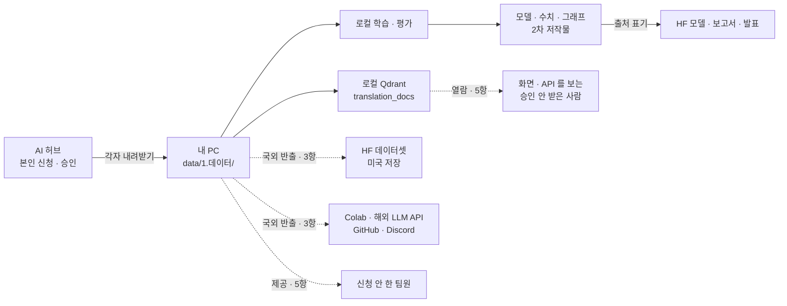

# AI 허브 번역 데이터 이용 범위 — 조사서 v0.1

| 문서 정보 | |
|---|---|
| **판 · 상태** | v0.1 · 초안(검토 전) |
| **구분** | 조사서 — 목표 기능 ① 데이터 · 이슈 #58 「번역 데이터(AI 허브)를 2·3차에 쓸 것인가」 결정 근거 |
| **작성** | 이동원(데이터 파트 · 조사) |
| **검토** | 검토 전 — 판을 올리는 PR 에 팀원 한 명 이상의 「읽었음」 |
| **최종 수정** | 2026-10-13 (KST) |
| **기준** | 외부 원문 조회 2026-10-13 11:21 ~ 11:40 KST(로그인 없이 · 파이썬으로 원문 HTML 을 받아 인용을 다시 대조) · 코드 `main` `8975696`(`app/services/translation_ingest.py` · `app/routes/ingest.py` · `.gitignore` 는 이 커밋과 같음) |
| **관련 문서** | #58 기록 [본문](../../../common/00-management/github-archive/2026-09-17/이슈-026/00-기록.md) · [09-28 갱신](../../../common/00-management/github-archive/2026-09-17/이슈-026/01-2026-09-28-갱신.md) · `pipeline.md` 「다국어 번역 데이터」 줄 |
| **최근 개정** | 처음 판 — 6.0 정한 것(2026-10-13 사용자 결정)을 더함 |

> **이 문서로 알 수 있는 것**
> 1. 앱이 쓰는 AI 허브 데이터는 무엇이고(이름 · 번호 · 판), 이용 조건 원문에는 무엇이 적혀 있나
> 2. HF private 에 올려 팀이 받기 · 한 사람이 받은 것을 팀이 함께 쓰기 · 해외 클라우드 · 만든 것 공개 · 출처 표기 — 각각 되나
> 3. 안 A(HF private 저장) · B(각자 신청 · 각자 로컬) · C(쓰지 않음) 중 무엇을 고르나
>
> **읽는 순서** — 팀원: 요약 → 4절(다섯 물음) → 6절(추천 · 할 일) · 강사님: 요약 → 3절(원문) · 처음 온 사람: 부록 A 용어 → 요약

## 요약

1. 앱 코드가 기대하는 데이터는 AI 허브 **「금융 분야 다국어 병렬 말뭉치 데이터」**(데이터 번호 71782 · 2023 구축 · 판 1.2 2024-12-04)다. 칸 이름(`doc_no` · `source_original` · `source_cleaned` · `mt` · `mtpe`)과 문서 유형 다섯 · 언어 다섯이 코드와 같다. 데이터셋 쪽에 따로 붙은 조항은 없어 「AI 허브 개방 데이터」 이용정책 10항이 그대로 적용된다(신청 때 보이는 동의서는 로그인이 필요해 못 봤다).
2. **사용자 의견 중 「HF 에 private 으로 저장」 은 이용정책이 막는다.** 3항이 「본 AI데이터 등의 국외 반출을 위해서는 … 별도로 합의가 필요합니다」 이고, 자주 찾는 질문은 「해외에 소재한 서버나 클라우드 환경으로 전송·저장하거나 해당 환경에서 학습에 활용하는 경우에도 국외 반출에 해당」 한다고 적는다. Hugging Face 문서는 Team · Enterprise 요금제가 아닌 저장소가 「always stored in the US」 라고 적는다. private 이어도 서버 위치는 같다.
3. 팀이 함께 쓰는 것도 **신청자 단위**다. 이용 신청 · 승인을 받은 내국인만 쓸 수 있고(자주 찾는 질문), 승인을 받지 않은 사람에게 「열람하게 하거나 제공」 하면 안 된다(5항). 계정과 이용 권한도 남에게 넘기지 못한다(이용약관 15조 · 17조). 팀원은 각자 신청하면 된다 — 휴대폰 본인인증을 마치면 자동 승인되고 3개월 유효하다.
4. 데이터로 만든 것 중 **모델 · 연구 결과(수치 · 그래프)는 출처를 밝히고 배포할 수 있다**(「2차 저작물은 … 자유롭게 활용하거나 판매·배포할 수 있습니다」). 원문 · 번역을 그대로 담은 검색 색인, 승인받지 않은 사람에게 원문 문장을 보여 주는 화면 · 시연은 안 된다. 출처는 데이터셋 정식 명칭 + AI 허브(aihub.or.kr) + 한국지능정보사회진흥원 사업결과임을 적는다.
5. 추천은 **안 B — 쓸 사람이 각자 신청해 자기 PC 에서만 쓴다.** 사용자 의견의 「로컬에서 사용 · 2 · 3차에 사용」 은 이 안으로 그대로 된다. HF private 에는 데이터가 아닌 것(로컬에서 학습한 모델 · 모델 카드 · 내려받기 안내)만 둔다. 데이터 자체를 HF 에 두려면 수행기관(글나무 주식회사 등)과 NIA 의 별도 합의를 먼저 받아야 한다(안 A′).

---

## 1. 조사 범위와 방법

조사 질문과 확인 방법은 <표 1> 과 같다. 원문은 파이썬 `urllib` 로 로그인 없이 받아 글만 뽑았고, 인용은 원문 HTML 에서 다시 대조했다. 검색 도구의 요약은 출처로 쓰지 않고 「어디를 볼지」 찾는 데만 썼다. 출처 번호(A · B · C)와 주소는 부록 C 에 모았다.

**<표 1> 조사 질문과 확인 방법**

| 질문 | 1차 출처 | 2차 확인 | 확실도 |
|---|---|---|:-:|
| 어느 데이터셋인가 | 데이터셋 상세 쪽 [A7] | 코드의 파일 이름 · 칸 이름 | 🟢 |
| 이용 조건 | 데이터 이용정책 [A1] | 2021-06-17 변경 공지 [A8] · 자주 찾는 질문 [A2 ~ A4] | 🟢 |
| 팀 공유 · 계정 | 이용정책 5항 · 자주 찾는 질문 | 이용약관 [A5] | 🟢 |
| 해외 클라우드 | 자주 찾는 질문 「해외에서도 …」 [A3] | Hugging Face 문서 [B1] · 블로그 [B4] | 🟢 |
| 만든 것 공개 · 출처 | 자주 찾는 질문 「영리적 …」 · 「저작권 정책」 · 「논문 …」 | HF 실제 사례 둘 [B2] · [B3] | 🟢 · 일부 🟡 |
| 데이터셋 고유 조항 · 신청 동의서 | 데이터셋 상세 쪽 · 신청 화면 [A10] | 2022 활용 가이드 PDF [A9] | 상세 쪽 🟢 · 동의서 없음(로그인) |
| 대안 말뭉치 | 각 라이선스 원문 [C2] ~ [C4] | 저작권법 제7조 [C1] | 🟢 |

확실도 — 🟢 원문을 열어 확인 · 🟡 추정(원문을 넓혀 읽음 · 2차 출처 한 곳) · 🔴 원문에 없음(추측).

#58 첫 글(2026-09-17)은 이용정책 1 · 4 · 5 · 7항과 신청 절차를 인용했고, 「해당 번역 데이터셋 고유의 추가 조항은 확인하지 못했습니다」 라고 남겼다. 이번에 그 물음과, 첫 글이 다루지 않은 2 · 3항(국외)을 함께 확인했다.

---

## 2. 어느 데이터인가

코드는 데이터셋 이름을 적지 않는다. 대신 폴더 구조(`data/1.데이터/{Training,Validation}/{01.원천데이터,02.라벨링데이터}/*.zip`) · 파일 이름 규칙(`TL_4. 뉴스기사_3. 일본어.zip`) · JSON 칸을 전제로 짜여 있다. 이 셋을 AI 허브 「데이터 찾기」 에서 「다국어」 · 「번역」 · 「말뭉치」 로 찾은 후보와 맞춰 보면 <표 2> 처럼 한 데이터셋으로 좁혀진다.

**<표 2> 코드와 데이터셋 71782 맞춰 보기** (조회 2026-10-13)

| 코드 (`translation_ingest.py`) | 데이터셋 상세 쪽 [A7] | 같은가 |
|---|---|:-:|
| `CATEGORY_MAP` 학술논문 · 규제정보 · 보고서 · 뉴스기사 · 공시정보 | 「문서 유형은 공시정보, 뉴스 기사, 규제정보, 보고서, 학술논문 등 5개로 분류함」 | 🟢 |
| `LANG_MAP` 영어 · 중국어간체 · 일본어 · 베트남어 · 인도네시아어 | 「한국어↔영어/한국어↔중국어/한국어↔일본어/한국어↔베트남어/한국어↔인도네시아어」 | 🟢 |
| `meta.doc_no` · `meta.domain` · `sents[].source_original` · `source_cleaned` · `mtpe`(없으면 `mt`) | 공통 항목 `doc_no` · `domain` · `source_original` · `source_cleaned` · `mt` · `mtpe` 「기계번역문을 포스트에디팅한 최종 번역문」 | 🟢 |
| 접두사 `TL`(라벨링) · `TS`(원천) | Training · Validation × 원천 · 라벨링 구성 | 🟢 |

데이터셋 사실은 아래와 같다.

| 항목 | 내용 | 확실도 |
|---|---|:-:|
| 이름 · 번호 | 금융 분야 다국어 병렬 말뭉치 데이터 · `dataSetSn=71782` · 분야 금융 · 유형 텍스트 | 🟢 |
| 판 | 1.0 2024-10-21 개방(Beta) → 1.1 2024-10-30 최종 개방 → **1.2 2024-12-04 「서브라벨링 추가」** · 갱신년월 2024-12 | 🟢 |
| 규모 | 2023 구축 · 한국어-영어 508,506 · 일본어 507,999 · 중국어 505,153 · 베트남어 512,400 · 인도네시아어 510,612(합 2,544,670) | 🟢 |
| 원천 | 「공공데이터포털, 뉴스, 학술논문」 · 뉴스는 저작권자 요청으로 문서 정보(`doc_info`)를 지움 | 🟢 |
| 만든 곳 | 수행기관(주관) 글나무 주식회사 · 참여 렉스코드 · 시스트란 · 트위그팜 · 한샘글로벌 | 🟢 |
| 신청 자격 | 「※ 내국인만 데이터 신청이 가능합니다.」 | 🟢 |
| 따로 붙은 조항 | 없음 — 「데이터 찾기」 개방데이터 목록(`aihubDataSe=data`)에 있고 「기관 제공 데이터」 가 아니다 → 개방 데이터 정책 10항 적용 | 🟢 쪽 확인 · 🟡 적용 판단 |
| 지금 우리 PC | 원본 없음(`data/` 에 `collector` · `hf_export` · `local-run` · `manifest.json` 뿐) · `.gitignore` 의 `data/1*/` 가 `data/1.데이터/` 를 막음 · `data/hf_export/` 에 이 데이터 없음 | 🟢 |

---

## 3. 원문 — 무엇이 적혀 있나

### 3.1 AI 허브 개방 데이터 이용정책

이용정책 쪽 [A1] 의 「AI 허브 개방 데이터」 칸이 이 데이터셋에 적용된다. 쪽에는 번호가 보이지 않지만 6번째 문장이 「제 4항 … 제5항」 을 가리키므로 차례대로 1 ~ 10항으로 센다. 원문은 <표 3> 과 같다.

**<표 3> 데이터 이용정책 원문** (조회 2026-10-13)

| 항 | 원문 | 우리에게 닿는 곳 |
|:-:|---|---|
| 소개 | 「… 본 사업의 유‧무형적 결과물인 데이터, AI 응용모델 및 데이터 저작도구의 소스, 각종 매뉴얼 등(이하 ‘AI데이터 등’)에 대한 일체의 권리는 AI데이터 등의 구축 수행기관 및 참여기관(이하 ‘수행기관 등’)과 한국지능정보사회진흥원에 있습니다.」 · 「… 영리적・비영리적 연구・개발 목적으로 활용할 수 있습니다.」 | 권리자는 수행기관 등과 NIA 다 — 강사님 허락이 이 조건을 대신하지 않는다 |
| 1 | 「본 AI데이터 등을 이용할 때에는 반드시 한국지능정보사회진흥원의 사업결과임을 밝혀야 하며, 본 AI데이터 등을 이용한 2차적 저작물에도 동일하게 밝혀야 합니다.」 | 물음 ⑤ — 지금 README · 화면에 출처가 없다 |
| 2 | 「국외에 소재하는 법인, 단체 또는 개인이 AI데이터 등을 이용하기 위해서는 수행기관 등 및 한국지능정보사회진흥원과 별도로 합의가 필요합니다.」 | 물음 ③ — 해외 업체 서버 |
| 3 | 「본 AI데이터 등의 국외 반출을 위해서는 수행기관 등 및 한국지능정보사회진흥원과 별도로 합의가 필요합니다.」 | 물음 ② ③ — HF 저장 · Colab · 해외 API |
| 4 | 「본 AI데이터는 인공지능 학습모델의 학습용으로만 사용할 수 있습니다. 한국지능정보사회진흥원은 AI데이터 등의 이용의 목적이나 방법, 내용 등이 위법하거나 부적합하다고 판단될 경우 제공을 거부할 수 있으며, 이미 제공한 경우 이용의 중지와 AI 데이터 등의 환수, 폐기 등을 요구할 수 있습니다.」 | 물음 ④ — 검색(RAG)만 하는 쓰임과의 거리 |
| 5 | 「제공 받은 AI데이터 등을 수행기관 등과 한국지능정보사회진흥원의 승인을 받지 않은 다른 법인, 단체 또는 개인에게 열람하게 하거나 제공, 양도, 대여, 판매하여서는 안됩니다.」 | 물음 ① ② ④ — 팀 공유 · 화면 · 시연 |
| 6 | 「AI데이터 등에 대해서 제 4항에 따른 목적 외 이용, 제5항에 따른 무단 열람, 제공, 양도, 대여, 판매 등의 결과로 인하여 발생하는 모든 민・형사 상의 책임은 AI데이터 등을 이용한 법인, 단체 또는 개인에게 있습니다.」 | 책임은 신청한 사람에게 |
| 7 | 「AI 허브에서 제공하는 AI 데이터셋의 판매 등 상업적 이용을 희망하는 경우 수행기관과 별도 협의가 필요합니다.」 | 수업 프로젝트라 해당 없음 |
| 8 | 「이용자는 AI 허브 제공 데이터셋 내에 개인정보 등이 포함된 것이 발견된 경우, 즉시 AI 허브에 해당 사실을 신고하고 다운로드 받은 데이터셋을 삭제하여야 합니다.」 | 뉴스 · 공시 문장에 개인정보가 보이면 |
| 9 | 「AI 허브로부터 제공받은 비식별 정보(재현정보 포함)를 인공지능 서비스 개발 등의 목적으로 안전하게 이용하여야 하며, 이를 이용해서 개인을 재식별하기 위한 어떠한 행위도 하여서는 안됩니다.」 | — |
| 10 | 「향후 한국지능정보사회진흥원에서 활용사례・성과 등에 관한 실태조사를 수행 할 경우 이에 성실하게 임하여야 합니다.」 | 신청자에게 조사가 오면 답한다 |
| 신청 | 「AI 허브를 통해 제공 중인 AI데이터 등을 다운로드 받기 위해서는 별도의 신청자 본인 확인과 정보 제공, 목적을 밝히는 절차가 필요합니다.」 · 「AI데이터를 제외한 데이터 설명, 저작 도구 등은 별도의 신청 절차나 로그인 없이 이용이 가능합니다.」 | 물음 ① — 신청자 본인 |

같은 정책의 2021-06-17 판 [A8] 에도 1 · 2 · 3항(출처 · 국외 둘)과 5항(열람 · 제공 금지)이 이미 있었다. 「학습용으로만」 문장과 7 · 8 · 9항은 그 뒤에 더해졌다 — 정책은 바뀌므로 데이터를 받기 전에 다시 본다.

### 3.2 자주 찾는 질문

자주 찾는 질문 [A2 ~ A4] 은 3쪽 21건이다. 게시일은 표시되지 않는다. 이용 조건에 닿는 일곱 건은 <표 4> 와 같다.

**<표 4> 자주 찾는 질문 원문** (조회 2026-10-13 · 필요한 문장만 그대로)

| 질문 (원문 제목) | 답 (원문) | 쪽 |
|---|---|:-:|
| 해외에서도 AI 허브 데이터를 이용할 수 있나요? | 「AI 허브 데이터는 대한민국 국적을 가진 국내 거주자(내국인)가 AI 허브를 통해 이용 신청 및 승인을 받은 경우에 한하여 국내에서 이용할 수 있습니다.」 · 「따라서 국외 소재 법인·단체·개인의 이용 및 데이터의 국외 반출은 제한되며, …」 · **「또한 데이터를 해외에 소재한 서버나 클라우드 환경으로 전송·저장하거나 해당 환경에서 학습에 활용하는 경우에도 국외 반출에 해당하므로, AI 허브 데이터는 국내 서버 및 국내 클라우드 환경에서 이용해 주시기 바랍니다.」** | 2 |
| AI 허브에서 제공되는 데이터 이용에 있어 저작권 정책이 궁금합니다. | 「AI 허브의 자료는 CC 라이선스와 같은 공개 라이선스가 아닌 AI 허브 이용정책에 동의한 후 이용하는 방식으로 제공됩니다. 이용자는 승인된 데이터를 AI 연구·학습 및 결과 도출을 목적으로 활용할 수 있으며 결과물에는 활용한 데이터셋의 정식 명칭과 AI 허브(aihub.or.kr)를 출처로 표기해 주시기 바랍니다.」 · 「다만, 다운로드한 데이터 원본 또는 단순 편집·가공한 데이터를 외부에 공개·공유·재배포하거나 제3자에게 제공하는 것은 제한됩니다.」 | 2 |
| AI 허브 데이터를 영리적(상업적) 목적으로 사용할 수 있나요? | 「AI 허브 데이터를 학습에 활용하여 개발한 AI 모델, 서비스 및 연구 결과물 등 2차 저작물은 영리·비영리 목적으로 자유롭게 활용하거나 판매·배포할 수 있습니다. 이 경우 활용한 데이터셋의 정식 명칭과 AI 허브(aihub.or.kr)를 출처로 표기해 주시기 바랍니다.」 · 「… 즉, 학습 결과물의 활용은 자유로우나 원본 데이터 자체를 제3자에게 제공하거나 배포하는 행위는 허용되지 않습니다.」 | 1 |
| 논문에 AI 허브 데이터를 활용했습니다. 출처는 어떻게 표기하나요? | 「학습·분석하여 도출한 연구 결과물(2차 저작물)은 국내외 학술지 게재가 가능합니다.」 · 「… '데이터명'과 'AI 허브 사이트명(aihub.or.kr)'은 반드시 포함해 주셔야 합니다.」 · 인용 문구 한글 · 영문(6.3절) · 「연구의 재현성을 위한 최소 범위 내 원본 이미지·텍스트 예시 인용은 허용됩니다.」 · 「별도의 공식 영문 데이터셋 명칭은 제공되지 않으며, 데이터 성격을 반영한 영문 명칭을 사용하실 수 있습니다.」 | 1 |
| 이전에 승인받은 데이터의 이용 승인이 만료되었습니다. | 「AI 허브 데이터 이용 승인은 승인일로부터 3개월간 유효합니다.」 · 「재신청 시 AI 허브 데이터 이용정책을 확인하고 이용 목적에 맞게 신청하면 자동 승인되며, 승인일로부터 3개월간 데이터를 다운로드할 수 있습니다.」 | 2 |
| 데이터 신청부터 승인까지 절차가 궁금합니다. | 「자동승인 데이터: 데이터셋 상세 페이지의 [다운로드] 버튼을 클릭하여 신청 페이지에서 이용 목적을 입력하시면 즉시 자동승인되어 다운로드하실 수 있습니다.」 · 「… 휴대폰 본인인증이 완료되지 않은 계정은 자동승인 대상에서 제외되어 반려됩니다.」 | 3 |
| 데이터 용량이 큽니다. 일부 데이터만 선택하여 다운로드할 수 있나요? | 「… 전체를 받으려면 [전체 다운로드], 일부만 받으려면 원하는 파일을 선택한 뒤 [선택 다운로드] 버튼을 눌러주세요.」 | 2 |

### 3.3 이용약관 · 개인정보처리방침

이용약관 [A5](시행 2018-01-01)에서 닿는 조항은 <표 5> 와 같다. 개인정보처리방침 [A6] 은 회원 정보 처리만 다루고 데이터 이용 조항이 없다.

**<표 5> 이용약관 원문** (조회 2026-10-13)

| 조 | 원문 | 우리에게 |
|---|---|---|
| 제2조 | 「활용기관 : 활용기관은 제공된 공유서비스를 직접 이용하거나 새로운 창작물의 일부로 재가공하여 배포하는 행정기관 등과 개인 및 법인을 말한다.」 | 새 창작물로 재가공해 배포하는 쓰임은 약관이 예정한다 |
| 제13조 ④ | 「회원은 AI 허브에서 다운로드 받은 데이터 내에 개인정보 또는 개인정보로 우려되는 정보가 포함된 것을 발견한 경우 즉시 AI 허브 운영자에 신고하고 해당 데이터셋은 삭제를 하여야 합니다.」 | 정책 8항과 같다 |
| 제15조 ① | 「… 회원은 자신의 ID 및 비밀번호를 제3자에게 이용하게 해서는 안됩니다.」 | 한 사람 계정으로 팀원이 내려받으면 안 된다 |
| 제15조 ② | 「회원은 AI 허브의 사전 승낙 없이 서비스를 이용하여 어떠한 영리행위도 할 수 없습니다.」 | 수업 프로젝트 — 해당 없음 |
| 제17조 | 「회원이 서비스의 이용권한, 기타 이용계약 상 지위를 타인에게 양도, 증여할 수 없으며, 이를 담보로 제공할 수 없습니다.」 | 신청자의 이용 권한을 팀에 넘길 수 없다 |

### 3.4 데이터셋 쪽 · 바깥 확인

**<표 6> 데이터셋 쪽 원문과 바깥 확인** (조회 2026-10-13)

| 출처 | 원문 | 이 조사에서 | 확실도 |
|---|---|---|:-:|
| 데이터셋 71782 [A7] | 「*뉴스기사의 경우, AI 허브에 데이터 업로드 시 “doc_info”를 공개하지 말아야 한다는 저 작권자의 요청에 따라, 최종데이터 제출 시, 뉴스 기사의 “doc_info” 삭제함」 | 뉴스 문장에는 따로 권리자가 있다 — 화면에 원문을 띄우지 않을 까닭이 하나 더 | 🟢 원문 · 🟡 뜻 |
| 〃 | 칸 `license` 설명 「원문에 대한 라이센스」 · 예시 JSON 의 값 `"open"` | 원천 문서의 라이선스 표시다. AI 허브 데이터를 마음대로 써도 된다는 뜻이 아니다(<표 4> 「CC 라이선스와 같은 공개 라이선스가 아닌」) | 🟢 |
| [B1] Hugging Face 문서 「Storage Regions on the Hub」 | 「This feature is part of the Team & Enterprise plans.」 · 「For non-Team or Enterprise users, repositories are always stored in the US.」 · 「Currently available regions:」 아래 목록 US · EU · 「Coming soon」 Asia-Pacific · GCC (KSA) | 우리 HF 조직 저장소는 private 여도 미국에 있다. 유료 지역 선택에도 한국은 없다 | 🟢 |
| [B2] HF 데이터셋 `MarkrAI/KoCommercial-Dataset` README | 「NIA와 AI-Hub와의 저작권 협의 하에, 조금 혼선이 생긴것 죄송합니다.」 · 「이에 기존에 저희가 code베이스로 SSL 데이터를 생성했던 코드를 그대로 공개드립니다.」 · 「AIHUB데이터는, 위의 github주소를 통해, 데이터를 생성하셔 사용하시면 됩니다.」 | AI 허브 데이터를 가공해 HF 에 올렸다가 NIA 와 협의한 뒤 데이터 대신 코드를 올린 실제 사례(공개 저장소) | 🟢 원문 · 🟡 우리 경우로 옮김 |
| [B3] HF 모델 `sappho192/aihub-ja-ko-translator` 카드 | 「This model used datasets from 'The Open AI Dataset Project (AI-Hub, South Korea)'.」 + 이용정책 2 · 3항을 한글 · 영문으로 옮김 + 데이터 대신 「합친 데이터를 다시 만드는 코드」 링크 | 모델은 HF 에, 데이터는 각자 AI 허브에서 — 안 B 와 같은 꼴 | 🟡 실무 예 |
| [B4] 블로그 「[6주차 과제] #1 ai hub 와 코랩, 그리고 ngrok」(2026-06-21) | 코랩에서 `aihubshell` 을 돌리자 「AI 허브는 해외에서의 데이터 다운로드를 제한하고 있습니다」 · 502 오류 | AI 허브가 해외 IP 의 내려받기를 기술로도 막는다 | 🟡 한 곳 · 설명 부분은 글쓴이가 받은 답을 옮긴 것(「라고 한다」) |

---

## 4. 다섯 물음의 답

답은 「그렇다 · 아니다 · 원문에 없음」 으로 먼저 적고, 근거 조항과 확실도를 붙였다. 추정은 추정이라고 적었다.

**<표 7> 다섯 물음의 답**

| 물음 | 답 | 근거 | 확실도 |
|---|---|---|:-:|
| ① 신청자 한 사람이 받은 데이터를 같은 과제 팀원이 함께 써도 되나 | **아니다.** 쓰는 사람마다 본인이 신청 · 승인을 받아야 한다. 승인받지 않은 팀원에게는 파일을 주는 것도, 화면으로 보여 주는 것(열람)도 안 된다. 신청은 어렵지 않다 — 휴대폰 본인인증을 마친 내국인이면 자동 승인이고 3개월 유효하다 | 정책 5항 · 「신청」 칸 · 질문 「해외에서도」 첫 문장 · 약관 15조 ① · 17조 · 질문 「신청부터 승인까지」 | 🟢 |
| ①-보탬 | 승인받은 팀원끼리 사본을 주고받는 것은 **원문에 따로 없다.** 5항은 「승인을 받지 않은」 사람만 막지만, 질문 「저작권 정책」 · 「영리적」 은 「제3자에게 제공」 을 조건 없이 막는다. 각자 AI 허브에서 받는 쪽이 안전하다 | 정책 5항 · 질문 둘 | 🟡 |
| ② HF **private** 조직 저장소에 올려 팀원만 받는 것이 제3자 제공 · 재배포인가 | **공개 재배포는 아니지만, 별도 합의 없이는 안 된다.** 첫째, HF 는 무료 조직 저장소를 미국에 저장한다 → 「해외에 소재한 서버나 클라우드 환경으로 전송·저장」 = 국외 반출 → 수행기관 등 · NIA 와 별도 합의가 필요하다. 둘째, 원본이나 단순 가공본을 「외부에 공개·공유·재배포」 하는 것이 제한된다. 셋째, 신청 안 한 팀원이 받으면 5항의 「제공」 이다 | 정책 3항 · 질문 「해외에서도」 · 「저작권 정책」 · [B1] · 정책 5항 | 🟢 |
| ③ 해외 클라우드 저장(Hugging Face) · 데이터 반출 제한이 있나 | **있다.** 해외 서버 · 클라우드로 보내거나 저장하거나 그곳에서 학습하면 국외 반출이고, 「국내 서버 및 국내 클라우드 환경에서」 쓰라고 한다. HF 데이터셋 · Colab · 해외 LLM API(앱 채팅의 OpenAI 모드) · GitHub · Discord 가 모두 이 문장에 든다. 국내에 있는 서버(예: 클라우드의 서울 지역)는 된다고 읽힌다 | 질문 「해외에서도」 셋째 문장 · 정책 2 · 3항 · [B1] · [B4] | 🟢 원문 · 🟡 서비스마다 서버 위치(HF 는 🟢) |
| ④ 데이터로 만든 것(검색 색인 · 임베딩 · 미세조정 모델 · 앱 화면의 번역 문장)을 공개 · 배포해도 되나 | **만든 것에 따라 다르다** — <표 8>. 모델 · 연구 결과는 된다. 원문을 담은 것은 안 된다 | 질문 「영리적」 · 「저작권 정책」 · 「논문」 · 정책 5항 | 🟢 · 일부 🟡 🔴 |
| ⑤ 출처 표기는 어디에 · 어떤 글로 | 이 데이터를 쓰는 모든 곳(README · 번역 검색 화면 · 발표 · 보고서 · 모델 카드)에 **데이터셋 정식 명칭 + AI 허브(aihub.or.kr) + 한국지능정보사회진흥원 사업결과**를 적는다. 문구는 6.3절 | 정책 1항 · 질문 「영리적」 · 「저작권 정책」 · 「논문」 | 🟢 |

물음 ④ 를 만든 것마다 나누면 <표 8> 과 같다. 앱의 번역 검색은 Qdrant 컬렉션 `translation_docs` 에 10문장씩 묶은 원문 `text` 와 번역 `translation` 을 그대로 넣고, `POST /api/ingest/translation-search` 가 그 둘을 그대로 돌려준다(`translation_search()`). 지금 앱 화면(`public/`)에는 이 API 를 부르는 곳이 없다.

**<표 8> 만든 것마다 — 공개 · 배포해도 되나**

| 만든 것 | 공개 · 배포 | 근거 | 확실도 |
|---|---|---|:-:|
| 번역 모델 · 미세조정 가중치(로컬에서 학습) | 된다 — 출처를 붙인다 | 질문 「영리적」 「AI 모델 … 2차 저작물은 … 판매·배포할 수 있습니다」 | 🟢 |
| 같은 모델을 Colab · 해외 GPU 에서 학습 | 안 된다 — 학습 단계가 국외 반출 | 질문 「해외에서도」 「해당 환경에서 학습에 활용하는 경우에도」 | 🟢 |
| 평가 수치 · 그래프 · 보고서 | 된다 — 출처를 붙인다 | 질문 「영리적」 · 「논문」 「연구 결과물」 | 🟢 |
| 검색 색인(`translation_docs` — 원문 · 번역 전문 포함) | 공유 · 공개 안 된다 — 로컬에만 | 질문 「저작권 정책」 「단순 편집·가공한 데이터 … 공유 … 제한」 · 10문장 묶음은 단순 가공 | 🟢 |
| 임베딩 벡터만(원문 없이) | **원문에 없다.** 데이터로 보고 로컬에 둔다 | — | 🔴 추측 |
| 앱 화면 · API 응답의 원문 · 번역 문장 | 신청 · 승인을 받지 않은 사람이 보는 곳이면 안 된다(「열람하게 하거나」) | 정책 5항 | 🟢 |
| 발표 · 보고서의 문장 예시 몇 개 | 「연구의 재현성을 위한 최소 범위 내 … 텍스트 예시 인용은 허용」 은 논문 안내 문장이다 — 발표로 넓혀 쓰는 것은 해석 | 질문 「논문」 | 🟡 |
| 우리 모델이 새 입력을 번역한 결과 | 된다 — 학습 결과물 | 질문 「영리적」 「학습 결과물의 활용은 자유」 | 🟡 (모델이 학습 문장을 외워 그대로 내는 경우는 원문에 없음) |

「학습용으로만」(4항)과 검색(RAG)의 관계도 짚어 둔다. 4항 문장만 보면 학습(모델 가중치를 바꾸는 일)에 쓰라는 뜻이고, 검색 색인에 넣어 꺼내 보는 쓰임은 거리가 있다. 다만 질문 「저작권 정책」 은 쓰임을 「AI 연구·학습 및 결과 도출」 로 넓게 적고, 정책 소개도 「연구・개발 목적」 을 든다. 그래서 **검색 품질을 재는 실험(로컬)은 「AI 연구」 로 읽을 수 있지만, 원문 문장을 사용자에게 보여 주는 콘텐츠 기능은 4항과 5항에 함께 걸린다** 🟡.

<그림 1> 은 위 답을 데이터가 움직이는 길로 그린 것이다. 「내 PC 밖으로 원본이 나가는 길」 이 모두 점선(안 됨)이고, 실선으로 나가는 것은 학습 · 분석으로 새로 만든 것뿐이다.

**<그림 1> 데이터가 갈 수 있는 곳** · 범례: 실선 = 된다 · 점선 = 안 된다(글 = 막는 조항)



---

## 5. 안 비교

안 셋에 「합의를 먼저 받는 A」 를 하나 더해 견줬다(<표 9>). **사용자 의견(안 A)이 우선이지만, 데이터 자체를 HF 에 두는 부분은 이용정책 3항과 자주 찾는 질문이 막는다 — 이 사실을 먼저 적는다.**

**<표 9> 안 비교**

| 안 | 내용 | 되는 근거 | 막는 근거 | 수고 · 위험 | 확실도 |
|---|---|---|---|---|:-:|
| **A** 사용자 의견 그대로 | 받은 데이터(원본 또는 가공본)를 HF private 조직 데이터셋에 올리고, 팀원이 받아 로컬 · 2 · 3차에 쓴다 | 원문에 길이 없다(아래 A′ 의 합의가 있을 때만) | 정책 3항 · 질문 「해외에서도」 · [B1] 미국 저장 · 질문 「저작권 정책」 「외부에 … 공유」 · 신청 안 한 팀원이면 5항 | 올리기는 쉽다. 어기면 이용 중지 · 환수 · 폐기를 요구받을 수 있고(4항) 책임은 신청자에게 있다(6항) | 🟢 막힘 |
| **A′** A + 별도 합의 | 수행기관(글나무 주식회사 · 데이터셋 쪽 「데이터 관련 문의처」)과 NIA(AI 허브 「문의하기」)에 국외 반출 · 팀 공유 합의를 먼저 요청 | 2 · 3항이 「별도로 합의가 필요」 — 합의하면 길이 있다 | 받아 줄지 · 며칠 걸릴지 모른다. 2차 마감 10-21 · 3차 마감 11-11 | 문의 1건 · 기다림 | 🟢 길 있음 · 🔴 결과 모름 |
| **B** 각자 신청 · 각자 로컬 | 쓸 사람만 AI 허브에서 신청 → 필요한 파일만 선택 다운로드 → 자기 PC 의 Qdrant · 학습에만. HF 에는 데이터가 아닌 것만(6.2절) | 신청자 본인의 국내 이용 · 2차 저작물 배포 허용 · 자동 승인 · 선택 다운로드 | 팀원마다 신청 · 내려받기 · 3개월마다 다시 신청 · 원문 문장을 시연 화면에 띄우지 못함 · 「학습용으로만」 과 RAG 의 거리 | 쓰는 사람마다 신청 한 번 | 🟢 (RAG 쓰임만 🟡) |
| **C** 쓰지 않음 | 인제스트 · 검색 코드를 2 · 3차 범위에서 빼고 동결 | 조항을 볼 일이 없다 | 다국어 금융 소재를 잃는다 · 강사님 일정표의 「지식 검색 UI」 칸과 겹치는지 먼저 봐야 한다(#58 09-28 갱신) | 없음 | 🟢 |

안 B 를 고를 때 승인 기간이 일정과 맞는지는 <그림 2> 와 같다. 오늘 신청하면 승인 3개월이 3차 끝(11-11)을 넘어 2027-01-13 까지 간다.

**<그림 2> 승인 3개월과 2 · 3차 일정** · 기준: 2차 10-01 ~ 10-21 · 3차 10-22 ~ 11-11 · 2026-10-13 에 신청했다고 가정

```
 10-01        10-13      10-21                 11-11                      2027-01-13
   ├── 2차 ─────┼──────────┤──────── 3차 ─────────┤                              │
                ▲ 신청 · 자동 승인                                               │
                ├──────────── 승인 3개월(이 동안 내려받기 · 다시 받기 가능) ─────────┤
```

- 「3개월」 은 원문상 내려받기 기간으로 읽힌다(「승인일로부터 3개월간 데이터를 다운로드할 수 있습니다」). 다만 「이용 승인은 … 3개월간 유효」 라는 문장도 있어, 3개월 뒤에도 계속 쓰려면 다시 신청(자동 승인)하는 쪽이 안전하다 🟡.

---

## 6. 추천

### 6.0 정한 것 (2026-10-13 · 사용자)

| 물음 | 정한 것 |
|---|---|
| 어느 안 | **안 B 에 가깝게** — 원본은 쓸 사람이 각자 신청해 자기 PC 에만 · HF(private 포함) · Colab 에 두지 않는다 · **로컬에서 미세조정한 모델 가중치만** HF 에 올린다 · 기관(수행기관 · NIA) 합의는 요청하지 않는다 · 가중치를 올리기 전에 조금 더 확인한다(아래) |
| 쓰임 | **번역 모델 미세조정까지** — 이 PC(로컬 GPU · CPU)에서만(해외 서버 학습도 국외 반출) |
| 시연 · 발표 | **수치 · 그래프만** — 원문 · 번역 문장은 보이지 않는다 |
| #58 | 결론 댓글 뒤 닫고, 할 일은 새 이슈로 |

**가중치를 올리기 전에 더 확인할 것** — ① 파생 모델 공개 범위(private · public)와 출처 문구 ② 가중치가 학습 문장을 그대로 내놓을 위험(외운 문장이 나오면 원문 제공에 가깝다) ③ 바탕 모델의 라이선스(예: 비상업 조건이 붙은 모델) ④ 이 PC 로 미세조정이 되는 모델 크기.

### 6.1 고른 것 — 안 B, 그리고 HF 에는 데이터가 아닌 것만

**사용자 의견 중 「HF 에 private 으로 저장」 은 이용정책 3항과 자주 찾는 질문이 막는다.** HF 는 우리 조직 저장소를 미국에 두고, AI 허브는 해외 서버 · 클라우드 저장을 국외 반출로 본다. private 은 보는 사람을 줄일 뿐 서버 위치를 바꾸지 않는다.

**사용자 의견 중 「로컬에서 사용 · 2 · 3차에 사용」 은 안 B 로 그대로 된다.** 쓸 사람이 각자 신청해 자기 PC 에서 인제스트 · 검색 · 실험을 한다. 「HF 를 팀 저장소로 쓴다」 는 뜻은 데이터가 아닌 것으로 살린다(6.2절).

- 고르지 않은 것 — **A′** 는 데이터 자체를 HF 에 둘 까닭이 생길 때만 문의한다. 지금 쓰임(로컬 검색 · 실험)에는 필요가 없고, 답을 기다리는 동안 이 부분 설계가 멈춘다. **C** 는 2 · 3차에 다국어 금융 소재를 쓸 계획이 없을 때 고른다.
- 뒤집을 조건 — ① AI 허브가 정책 · 자주 찾는 질문을 바꿔 해외 저장을 허용하면 A 로 ② 수행기관 · NIA 가 합의해 주면 A′ 로 ③ 신청 때 동의서(못 봄)에 팀 · 단체 이용 조항이 있으면 ① 의 답을 다시 본다.
- 강사님 「자유롭게 알아서」 는 수업 안에서 팀이 정하라는 뜻이다. 데이터 권리자는 수행기관 등과 NIA 라서(정책 소개 문장) 이 조건을 대신하지 않는다.

### 6.2 HF private 에 둘 수 있는 것 · 없는 것

**<표 10> HF private 에 둘 수 있는 것**

| 무엇 | 둘 수 있나 | 근거 | 확실도 |
|---|:-:|---|:-:|
| 인제스트 · 변환 코드 | 된다 | 데이터가 아니다(코드는 GitHub 에 이미 있음) | 🟢 |
| 내려받기 안내 — 데이터셋 이름 · 번호 71782 · 판 1.2 · 고를 파일 이름 · 신청 순서 | 된다 | 「AI데이터를 제외한 데이터 설명 … 로그인 없이 이용이 가능」 | 🟢 |
| 로컬에서 학습한 모델 + 모델 카드(출처 문구) | 된다 | 질문 「영리적」 2차 저작물 배포 · 실무 예 [B3] | 🟢 배포 · 🟡 HF 에 두는 것 자체는 원문에 따로 없음 |
| 평가 수치 · 그래프 | 된다 | 연구 결과물 | 🟢 |
| 원본 zip · JSON · 청크 · 색인 사본 | 안 된다 | 국외 반출 · 단순 가공 공유 제한 | 🟢 |
| 임베딩 벡터만 | 두지 않는다 | 원문에 없음 — 데이터로 본다 | 🔴 추측 |

### 6.3 출처 문구

자주 찾는 질문의 인용 문구를 우리 쓰임에 맞춰 줄였다. 정식 명칭 · 사이트명은 「반드시 포함」 이고 형식은 조정할 수 있다(질문 「논문」).

- 한글(README · 발표 · 보고서): 「이 기능은 과학기술정보통신부의 재원으로 한국지능정보사회진흥원의 지원을 받아 구축된 "금융 분야 다국어 병렬 말뭉치 데이터"를 활용했습니다. 이 데이터는 AI 허브(aihub.or.kr)에서 내려받을 수 있습니다.」
- 영문(모델 카드) — 원문 「This research (paper) used datasets from The Open AI Dataset Project (AI-Hub, S. Korea). All data information can be accessed through 'AI-Hub (www.aihub.or.kr)'.」 에 데이터명을 넣어: 「This project used the "Financial-domain Korean–multilingual parallel corpus" (금융 분야 다국어 병렬 말뭉치 데이터) from The Open AI Dataset Project (AI-Hub, S. Korea). All data information can be accessed through 'AI-Hub (www.aihub.or.kr)'.」 — 공식 영문 이름은 없어 성격을 담은 이름을 쓴다(원문 허용).
- 화면 한 줄(번역 검색 화면 아래): 「출처: AI 허브 「금융 분야 다국어 병렬 말뭉치 데이터」 · 한국지능정보사회진흥원 사업결과 · aihub.or.kr」

### 6.4 할 일 (안 B 로 정하면)

**<표 11> 할 일**

| # | 할 일 | 누가 | 언제 | 근거 |
|:-:|---|---|---|---|
| 1 | AI 허브 휴대폰 본인인증 → 71782 「다운로드」 → 이용 목적 입력(예: 「금융 다국어 문서 검색 · 번역 품질 실험 — 수업 프로젝트 · 국내 PC 에서만」) | 쓸 사람 각자 — 데이터 파트(이동원) 먼저 | 2차 안 | 「신청」 칸 · 질문 「신청부터 승인까지」 |
| 2 | 필요한 파일만 선택 다운로드(예: `TL_` 라벨링 중 공시정보 · 뉴스기사 × 영어) | 신청한 사람 | 1 뒤 | 질문 「선택하여 다운로드」 |
| 3 | `data/1.데이터/` 에만 둔다. git · `data/hf_export/` · HF · Colab · Discord · 해외 LLM API 로 보내지 않는다 | 신청한 사람 | 늘 | 정책 3 · 5항 · 질문 「해외에서도」 |
| 4 | 번역 검색 API 두 개를 기본 끔 · 배포 환경에서 끔(설정값), 채팅 OpenAI 모드에 번역 검색 결과를 넣지 않음(지금도 넣지 않음) | 데이터 파트 PR | 2차 안 | 정책 3 · 5항 |
| 5 | 출처 문구(6.3절)를 README · 번역 검색 화면 · 발표 · 모델 카드에 | 데이터 파트 · 발표 담당(정해지면 채울 칸) | 쓰기 시작할 때 | 정책 1항 |
| 6 | 개인정보로 보이는 문장을 찾으면 AI 허브에 신고하고 받은 데이터를 지운다 | 신청한 사람 | 찾았을 때 | 정책 8항 · 약관 13조 ④ |
| 7 | 2027-01-13 뒤에도 쓰면 다시 신청 | 신청한 사람 | 승인 3개월 끝 | 질문 「승인이 만료」 |

<그림 3> 은 위 할 일을 「이 파일을 어디에 둘까」 하나로 줄인 판단 순서다.

**<그림 3> 판단 순서 — 이 파일(또는 문장)을 어디에 둘까**

```
 이 파일(또는 문장)을 어디에 둘까?
 │
 ├─ AI 허브 원본이거나, 원본을 자르기 · 묶기만 한 것인가?  (zip · JSON · 청크 · 색인 payload)
 │    ├─ 예  → 신청한 사람의 PC(또는 국내 서버)에만 둔다.
 │    │        HF · Colab · GitHub · Discord · 해외 LLM API 로 보내지 않는다 ........ 국외 반출(3항)
 │    │        신청 안 한 사람에게 주거나 보여 주지 않는다 ............................ 제공 · 열람(5항)
 │    └─ 아니오 ↓
 ├─ 학습 · 분석으로 새로 만든 것인가?  (모델 가중치 · 정확도 수치 · 그래프 · 새 번역 결과)
 │    ├─ 예  → 배포할 수 있다. 정식 명칭 + AI 허브(aihub.or.kr) 출처를 붙인다 ......... 2차 저작물
 │    └─ 모르겠다(임베딩 벡터만 등) → 원문에 없다. 데이터로 보고 PC 에 둔다
```

---

## 7. 다른 번역 말뭉치 — 재배포가 되는 것

재배포가 허락된 공개 말뭉치는 있지만 금융 전용은 찾지 못했다(<표 12>). 금융 법령의 한 · 영 번역은 저작권 지침이 복제 · 배포를 막아 대안이 되지 않는다.

**<표 12> 대안 후보** (조회 2026-10-13)

| 말뭉치 | 라이선스 원문 | 한국어 | 금융 | 재배포 | 확실도 |
|---|---|---|---|---|:-:|
| FLORES+ [C4] | 「FLORES+ is a multilingual machine translation benchmark released under CC BY-SA 4.0.」 · 「For each language, the dataset has 997 sentences for the dev split and 1012 sentences for the devtest split.」 | 있음(`kor`) | 아니다(일반 문장) | 된다 — 저작자 표시 · 같은 조건 | 🟢 |
| Tatoeba [C3] | 「… la licence Creative Commons Attribution 2.0 France (CC-BY 2.0 FR) … utiliser, réutiliser, modifier et diffuser la phrase n’est autorisé que si le nom de l’auteur·e est cité.」(이용 약관 원문은 프랑스어 — 「이름을 밝히면 이용 · 재이용 · 수정 · 배포할 수 있다」) | 있음 — 문장 수는 세지 않음 | 아니다(일상 문장) | 된다 — 저작자 표시 | 🟢 라이선스 · 🟡 한국어 양 |
| 한국법제연구원 영문법령 [C2] | 「… 모든 자료는(이하 한국법제연구원 자료) 저작권법에 의하여 보호받는 저작물로 모든 권리는 한국법제연구원에 있습니다.」 · 「… 회사를 포함한 기타의 단체에서 내부적으로 이용하기 위해 복제하는 경우에는 그 회사가 영리 회사가 아니더라도 복제가 허용되지 않습니다.」 | 한 · 영 | 금융 법령 있음 | **안 된다** | 🟢 |

- 저작권법 제7조 제4호는 「국가 또는 지방자치단체가 작성한 것으로서 제1호부터 제3호까지에 규정된 것의 편집물 또는 번역물」 을 보호하지 않는다고 적는다([C1] · 시행 2026. 8. 11. 법률 제21336호). 영문법령은 한국법제연구원이 만든 것이라 이 호에 드는지는 해석이 갈린다 🟡 — 지침이 막는 이상 대안으로 쓰지 않는다.

---

## 8. 한계 · 못 본 것

| 한계 · 못 본 것 | 왜 | 영향 |
|---|---|---|
| **법적 판단이 아니다.** 원문 인용과 그 범위의 읽기까지만 했다 | — | 애매한 곳(🟡 · 🔴)은 AI 허브 「문의하기」 로 확인할 수 있다 |
| 신청 때 보이는 동의서 원문 | 신청 화면이 로그인 화면으로 넘어간다 [A10] | 동의서에 팀 · 단체 이용 조항이 따로 있으면 물음 ① 이 바뀔 수 있다(6.1 뒤집을 조건 ③) |
| 데이터 설명서 · 구축활용가이드 PDF | 전용 내려받기 프로그램(INNORIX EX Agent)이 필요하다 | 원천 문서별 라이선스(`license` 값)의 실제 분포를 모른다 |
| 2022 「AI-Hub 활용 가이드」 PDF [A9] | 받아 읽었다 — 신청 동의서 원문은 없고, 활용 흐름 그림에 「서비스 개발 재가공/재배포」 칸이 있을 뿐이다 | 이 조사의 답을 바꾸지 않는다 |
| 데이터 용량 | 쪽에서 자바스크립트로 채워 보이지 않는다 | 선택 다운로드 범위를 정할 때 신청 뒤 확인 |
| 우리 HF 조직의 요금제 | HF API 를 부르지 않았다 | 무료면 미국, Team · Enterprise 여도 미국 · EU 뿐이라 답은 같다 |
| 자주 찾는 질문 게시일 | 쪽에 날짜가 없다 | 조회일(2026-10-13) 기준이다. 정책도 2021 이후 바뀌었다 — 받기 전에 다시 본다 |
| 공지사항 | 「국외 · 반출 · 클라우드 · 이용정책 · 저작권 · 재배포 · 해외 · 출처 · 인용」 아홉 낱말로만 찾았다 | 다른 낱말의 공지는 못 봤을 수 있다 |
| 수행기관 · NIA 의 실제 해석 | 문의하지 않았다 | A′ 를 고르면 문의로 확인 |

---

## 부록 A. 용어 풀이

| 낱말 | 뜻 | 이 문서에서 | 헷갈리는 점 |
|---|---|---|---|
| 국외 반출 | 데이터를 나라 밖으로 내보내는 것 | 자주 찾는 질문은 해외 서버 · 클라우드로 보내거나 저장하거나 그곳에서 학습하는 것까지 넣는다 | 「private 이라 아무도 못 본다」 와는 상관없다 — 서버가 어디 있느냐다 |
| 수행기관 등 | 데이터를 만든 회사들(주관 · 참여) | 글나무 주식회사(주관) · 렉스코드 · 시스트란 · 트위그팜 · 한샘글로벌 | 합의 상대는 이들과 NIA 둘 다다 |
| NIA(한국지능정보사회진흥원) | AI 허브를 운영하는 공공기관 | 승인 · 정책의 주체 | 강사님 허락이 NIA 승인을 대신하지 않는다 |
| 열람 · 제공 | 파일을 주는 것(제공) · 보게 하는 것(열람) | 정책 5항 — 승인을 받지 않은 사람에게는 둘 다 안 된다 | 화면에 띄워 「보여 주기만」 해도 열람이다 |
| 2차 저작물(2차적 저작물) | 원래 것을 바탕으로 새로 만든 것 | 자주 찾는 질문: AI 모델 · 서비스 · 연구 결과물 | 원본을 자르기 · 묶기만 한 것(단순 가공)은 여기 들지 않는다 |
| 단순 가공 | 편집 · 수정만 거친 원본 | 10문장씩 묶은 청크 · 원문을 담은 색인 | 형식(JSON → Parquet)을 바꿔도 단순 가공이다 🟡 |
| 자동 승인 | 신청하면 심사 없이 바로 승인 | 이 데이터셋 같은 일반 개방 데이터 | 휴대폰 본인인증이 안 된 계정은 반려된다 |
| private 저장소 | 초대한 사람만 볼 수 있는 HF 저장소 | 팀 HF 조직(`qurious-quant`) | 보는 사람 범위가 좁을 뿐 서버는 같은 곳(미국)이다 |
| 병렬 말뭉치 | 같은 뜻의 두 언어 문장을 짝지은 모음 | 한국어 원문 + 기계 번역(`mt`) + 사람이 고친 번역(`mtpe`) | — |
| MTPE | 기계 번역 뒤 사람이 고쳐 다듬은 번역 | 칸 `mtpe` — 앱은 이것을 「번역」 으로 쓴다 | — |
| RAG | 검색으로 찾은 글을 붙여 답을 만드는 방식 | 앱의 번역 검색 쓰임 | 「학습」(모델 가중치를 바꾸는 일)과 다르다 — 4항 「학습용으로만」 과의 거리 |
| `license: "open"` | 데이터 파일 안의 칸 | 설명은 「원문에 대한 라이센스」 | AI 허브 데이터를 마음대로 써도 된다는 뜻이 아니다 |

## 부록 B. 만든 방법

- 원문 받기: 파이썬 `urllib`(브라우저 User-Agent) · 로그인 없이 · 받은 HTML 은 저장소 밖 임시 폴더에만 두고, `html.parser` 로 글만 뽑았다. 자주 찾는 질문 2 · 3쪽은 목록 양식과 같은 POST(`pageIndex=2` · `3`)로 받았다. 데이터셋 후보는 데이터 찾기 검색(`searchKeyword` = 다국어 · 번역 · 말뭉치)의 결과 목록에서 번호와 이름을 뽑아 좁혔다.
- 인용 대조: 표에 넣은 문장은 원문 HTML 의 해당 `<p>` 를 다시 열어 글자를 맞췄다(띄어쓰기 · 문장부호 원문 그대로 — 「저 작권자」 · 「수행 할」 같은 원문 띄어쓰기도 고치지 않았다).
- 데이터 자체는 받지 않았고, 데이터셋 쪽 예시 JSON 의 문장도 옮기지 않았다(칸 이름만).
- 다시 하려면: 부록 C 주소를 같은 순서로 열고, 정책 10항 · 자주 찾는 질문 일곱 건의 문장이 바뀌었는지 본다. 바뀌었으면 4절 답을 다시 맞춘다.

## 부록 C. 출처

| 번호 | 출처 | 주소 | 조회일 | 확실도 |
|---|---|---|---|:-:|
| A1 | AI 허브 「데이터 이용정책」 — AI 허브 개방 데이터 | <https://www.aihub.or.kr/intrcn/guid/usagepolicy.do?currMenu=151&topMenu=105> | 2026-10-13 | 🟢 |
| A2 | AI 허브 「자주찾는질문」 1쪽 | <https://www.aihub.or.kr/aihubnews/faq/list.do?currMenu=146&topMenu=104> | 2026-10-13 | 🟢 |
| A3 | 〃 2쪽(같은 주소 · 쪽 넘기기 POST `pageIndex=2`) | 〃 | 2026-10-13 | 🟢 |
| A4 | 〃 3쪽(`pageIndex=3`) | 〃 | 2026-10-13 | 🟢 |
| A5 | AI 허브 이용약관(시행 2018-01-01) | <https://www.aihub.or.kr/useStplat.do?currMenu=110&topMenu=110> | 2026-10-13 | 🟢 |
| A6 | AI 허브 개인정보처리방침 | <https://www.aihub.or.kr/indvdlinfoProcessPolcy.do?currMenu=111&topMenu=111> | 2026-10-13 | 🟢 |
| A7 | 데이터셋 「금융 분야 다국어 병렬 말뭉치 데이터」 상세 | <https://www.aihub.or.kr/aihubdata/data/view.do?currMenu=115&topMenu=100&aihubDataSe=data&dataSetSn=71782> | 2026-10-13 | 🟢 |
| A8 | 공지 「[공지] AI 허브 개방 데이터 이용정책 변경 안내」(2021-06-17) | <https://www.aihub.or.kr/aihubnews/notice/view.do?pageIndex=1&nttSn=9660&currMenu=132&topMenu=103> | 2026-10-13 | 🟢 |
| A9 | 공지 「'인공지능 통합 플랫폼 AI-Hub 활용 가이드' 발간 안내」(2022-09-30) 첨부 PDF | <https://www.aihub.or.kr/aihubnews/notice/view.do?pageIndex=1&nttSn=10035&currMenu=132&topMenu=103> | 2026-10-13 | 🟢 |
| A10 | 데이터셋 71782 신청 화면 | <https://www.aihub.or.kr/aihubdata/data/dwld.do?currMenu=115&topMenu=100&aihubDataSe=data&dataSetSn=71782> | 2026-10-13 | 못 봄(로그인) |
| B1 | Hugging Face 문서 「Storage Regions on the Hub」 | <https://huggingface.co/docs/hub/storage-regions> | 2026-10-13 | 🟢 |
| B2 | HF 데이터셋 `MarkrAI/KoCommercial-Dataset` README | <https://huggingface.co/datasets/MarkrAI/KoCommercial-Dataset> | 2026-10-13 | 🟢 원문 |
| B3 | HF 모델 `sappho192/aihub-ja-ko-translator` 카드 | <https://huggingface.co/sappho192/aihub-ja-ko-translator> | 2026-10-13 | 🟡 실무 예 |
| B4 | 블로그 「[6주차 과제] #1 ai hub 와 코랩, 그리고 ngrok」(2026-06-21) | <https://hwamgai.tistory.com/62> | 2026-10-13 | 🟡 |
| C1 | 저작권법 제7조(보호받지 못하는 저작물) | <https://www.law.go.kr/lsLinkProc.do?lsClsCd=L&mode=11&lsNm=%EC%A0%80%EC%9E%91%EA%B6%8C%EB%B2%95&joNo=000700> | 2026-10-13 | 🟢 |
| C2 | 한국법제연구원 대한민국 영문법령 「저작권 지침」 | <https://elaw.klri.re.kr/kor_service/askCopyright.do> | 2026-10-13 | 🟢 |
| C3 | Tatoeba 이용 약관(브라우저 언어가 한국어면 `/ko/` 로 넘어가고 본문은 프랑스어 원문 · 영어 쪽도 같은 뜻) | <https://tatoeba.org/en/terms_of_use> | 2026-10-13 | 🟢 |
| C4 | FLORES+ 데이터셋 카드 | <https://huggingface.co/datasets/openlanguagedata/flores_plus> | 2026-10-13 | 🟢 |

## 부록 D. 개정 이력

| 판 | 날짜 | 무엇이 바뀌었나 | 왜 | 근거 |
|---|---|---|---|---|
| v0.1 | 2026-10-13 | 추가 — 처음 판 | #58 결정 근거(사용자 의견: HF private 저장 + 로컬 + 2 · 3차 사용, 리서치로 확인한 뒤 진행) | 이 문서 |
