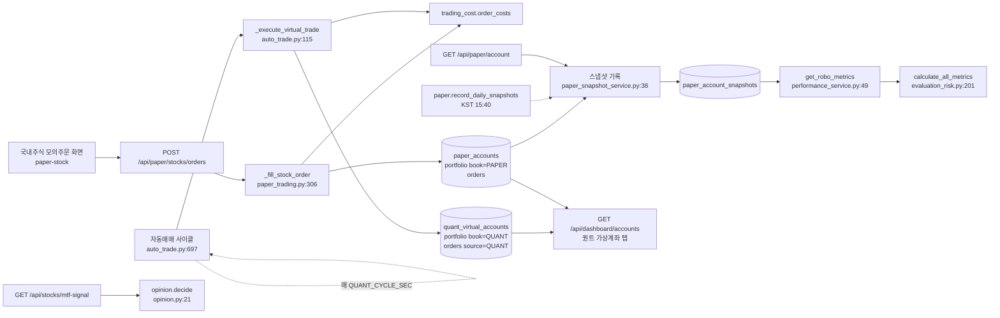

<!-- 옮김 2026-10-19 — 원래 자리 docs/_git-drafts/2026-10-18-S123/배경-팀원설계-초안/01-목표기능4-모의투자-운용-성과-설계-초안.md · 작업 기록(그때 쓴 그대로 · 세션 번호 등 내부 표기 포함) · 정본: 없음 -->
# 목표 기능 ④ 상세 설계서 v0.1 — 모의투자 운용 · 성과 해석 — Qurious

| 문서 정보 | |
|---|---|
| **판 · 상태** | v0.1 · 초안(검토 전) — 코드 기준 지금 모습(as-is) |
| **구분** | 6. 시스템 설계 — 설계 문서(2차 목표 기능 ④ 세부 1~3) · 2. 요구사항 관리(인수 기준) |
| **작성** | 초안 이동원(팀장) · 채우기와 판 올리기 강민석(주담당 @rkdalstjr) · 검수 — |
| **검토** | 검토 전 — 부담당 신장환(@janghwan-god) |
| **최종 수정** | 2026-10-18 (KST) |
| **기준** | 코드 `main` `ed3221f` 커밋 판(작업 트리의 커밋 안 된 변경 `public/js/dashboard.js` 주기 글 · `public/app.html` 산식 화면은 보지 않음) · 앱 · DB 에 요청하지 않고 코드만 읽음 · `.env` 를 보지 않음(설정 값은 `app/config.py` 기본값) |
| **관련 문서** | [기능 설계서 v0.1](../../../../02-design/system/기능설계.md) 4.4절 · [RTM](../../../requirements/RTM.md) `P01-④-1~3` · [백테스트 보고서 v0.2](../../../../04-testing/백테스트보고서.md) · [목표 기능 ② 설계서 v0.6](../../../../02-design/system/목표기능2-패턴예측-XAI-설계.md)(신호 T2) · [목표 기능 ③ 설계서 v0.1](../../../../02-design/system/목표기능3-리밸런싱-설계.md)(같은 모의 장부) · 이슈 #210(대시보드 계좌 칸) · #256(장 닫힌 날 모의 주문) |
| **최근 개정** | 새 문서 |

> **확실도** — 확인(코드에서 직접 봄) · 추정(코드 경로로 짐작 · 실행하지 않음) · 없음(코드에서 찾지 못함 → 「주담당 확인」)

> **이 문서로 알 수 있는 것**
> 1. 목표 기능 ④ 의 세 요구(비용 반영 성과 · 의견 변환 · 모의 주문)가 지금 어느 코드에서 돌아가는가 (3 ~ 6절)
> 2. 모의 장부 · 성과 기록이 어떤 표 · 칸에 남는가 (4절)
> 3. 위험 · 비용 · 장 시간 규칙이 코드에 어떻게 들어 있는가 (7절)
> 4. 코드와 요구 · 문서가 어긋나 주담당에게 이슈로 물을 곳 (9절)
>
> **읽는 순서** — 강민석: 9절 → 11절(확인할 칸) → 나머지 · 팀원: 요약 → 3절 그림 → 5절 · 처음 온 사람: 요약 → 1절 → 3절

## 요약

1. 목표 기능 ④ 는 세 줄로 돈다. 모의 주문은 `app/services/paper_trading.py` 가 모의계좌(`paper_accounts` · 장부 `PAPER`)에 체결하고, 성과는 매일 남기는 계좌 스냅샷(`paper_account_snapshots`)에서 `app/services/performance_service.py` 가 MDD · 샤프 · 소르티노 · 스털링 · 칼마 · DSR 을 계산하며, 의견은 `app/services/opinion.py` 의 규칙 표가 신호 · 신뢰도 · 보유 여부로 정한다.
2. 장부는 둘이다. 수동 주문 · 리밸런싱 · TradingView 는 모의계좌(초기 1억 원 · `app/models/paper.py:25`), 주기 자동매매는 자동매매 가상계좌(초기 1천만 원 · `app/models/trading.py:156`)를 쓴다. RTM `P01-④-3` 의 「한 장부」 문장과 다르다(9절 C7).
3. 모든 모의 체결은 같은 비용 함수(`trading_cost.order_costs`)로 수수료 · 증권거래세 · 농특세 · 유관기관 비용을 떼고, 주문 행에 비용 칸을 따로 남긴다(`app/models/trading.py:59-67`).
4. 코드에서 어긋난 곳을 열세 군데 찾았다(9절). 가장 먼저 볼 것은 의견 변환 라우트와 자동매매가 같은 「하루 시작 자산」 키에 서로 다른 장부의 금액을 쓰는 곳(C1)과, 회전율이 모든 주문을 세는 곳(C2)이다.
5. 이 문서는 팀장이 코드만 보고 쓴 초안이다. 정할 값(신뢰도 문턱 · 체결가 규칙 · 장 닫힘 처리)은 정하지 않았다고 적었고, 확인할 칸은 11절에 모았다.

---

## 1. 맥락과 범위

### 1.1 맡는 요구

**<표 1> 맡는 요구와 지금 코드** · 요구 문장은 RTM 그대로(`docs/요구사항/RTM.md:139-141`)

| 요구 ID | 요구(인수 문장 요지) | 지금 코드의 중심 | 확실도 |
|---|---|---|---|
| `P01-④-1` | 같은 백테스트의 수익률 · MDD · 샤프를 비용 반영 전과 후로 나란히 · 비용은 한 모델에서 | 백테스트: `GET /api/quant/pipeline`(`app/routes/stocks.py:1159`) · 비용 모델 `app/services/trading_cost.py` · 모의계좌 성과: `app/services/performance_service.py` · `app/services/evaluation_risk.py` | 확인 |
| `P01-④-2` | 신호 · 신뢰도 · 보유 여부의 조합마다 의견이 규칙 표 하나로 정해지고 이유와 함께 기록 | `app/services/opinion.py:21` `decide()` · 응답은 `GET /api/stocks/mtf-signal`(`app/routes/stocks.py:909`) · 전략 스펙 판정 `app/services/auto_trade.py:385` | 확인 |
| `P01-④-3` | 모든 모의 주문(수동 · 자동)이 한 장부에서 현금 · 보유를 바꾸고 총자산 = 초기 현금 − 거래비용 | `app/services/paper_trading.py:306` `_fill_stock_order()` · 자동매매 `app/services/auto_trade.py:115` `_execute_virtual_trade()` · 미국 예약 `app/services/us_reserve.py` | 확인 |

### 1.2 이 문서가 다루지 않는 것

- 실거래 주문 · 게이트웨이 · KIS 실주문 확인(`P02-⑤-*` · 3차 오준영 몫). 다만 대시보드 KIS 탭과 원클릭 시작은 ④ 화면에 있어 5 · 6절에 적었다.
- LEAN 교차 검증의 결과 해석(`P02-④-*` · 3차 강민석 몫). 화면(`quant-lean`)과 라우트만 5 · 6절에 적었다.
- 코인 · 대체자산 모의 주문의 세부 규칙. 같은 현금(`PaperAccount.cash`)을 쓰므로 총자산에는 들어간다(`app/services/paper_trading.py:837-854`).

---

## 2. 목표 · 인수 기준과 지금 상태

**<표 2> 인수 기준과 지금 상태** · 범례: 지금 = 완료 · 진행(일부 됨) · 예정 — 판정은 팀장 초안이며 주담당이 고친다

| 요구 | 인수 기준(RTM) | 확인하는 시험 | 지금 | 근거 |
|---|---|---|---|---|
| `④-1` | 비용 전후 성과를 나란히 · 비용은 한 모델 | TC-BC 14 · TC-QFRS 15(`docs/요구사항/RTM.md:314`) | 진행 — 백테스트는 비용 전후가 나란히 나온다(TC-BC). 모의계좌 성과 지표는 비용 뒤 총자산만 기록해 비용 전 값이 없다 | `app/models/paper_snapshot.py:29-42` |
| `④-2` | 규칙 표 하나로 의견 · 이유 기록 | TC-OP 14 · TC-SP 4 · TC-SR 12(`docs/요구사항/RTM.md:315`) | 진행 — 규칙 표와 응답 칸(`opinion` · `opinion_rule`)이 있고, 매일 신호 기록(T2 `signal_snapshots`)에도 의견을 저장한다. 다만 기록 때는 보유를 모르므로 미보유로 가정한다(C9) | `app/routes/stocks.py:976-984` · `app/services/mtf_signals.py:190-213` · 마이그레이션 `0023_signal_opinion` |
| `④-3` | 모든 모의 주문이 한 장부 · 총자산 = 초기 현금 − 비용 | TC-I14 9 · TC-USO 25 · TC-LT 32 · TC-USR 21 · TC-USS 11(`docs/요구사항/RTM.md:316`) | 진행 — 장부가 둘이고(C7), 매 거래일 일지(J2)는 없다. 미국주식 예약 주문은 다음 정규장 시가로 체결한다 | `app/models/trading.py:15-16` · `app/services/us_reserve.py:195` |

---

## 3. 구성도

모의 주문 · 자동매매 · 성과 기록이 만나는 곳은 <그림 1> 과 같다. 두 장부가 갈라지는 지점과, 성과 지표가 모의계좌 스냅샷 하나만 읽는다는 점이 이 그림의 요점이다.

**<그림 1> 목표 기능 ④ 의 자료 흐름** · 범례: 사각형 = 서비스 함수 · 원통 = 앱 DB 표 · 점선 = 정기 작업(Celery Beat)

그림에서 자동매매 장부(`book=QUANT`)는 성과 지표(`get_robo_metrics`)로 이어지지 않는다. 자동매매 성과는 대시보드의 「퀀트 가상계좌」 탭 합계로만 보인다(`app/routes/dashboard.py:91-115`).

---

## 4. 데이터 — 표와 칸

### 4.1 표 목록

**<표 3> ④ 가 쓰는 앱 DB 표** · 칸 이름은 모델 코드에서 옮김

| 표 | 모델(파일:줄) | 한 줄의 뜻 | ④ 에서 쓰는 칸 |
|---|---|---|---|
| `paper_accounts` | `PaperAccount`(`app/models/paper.py:28`) | 사용자 한 명의 모의계좌 현금 | `cash` · `initial_cash`(기본 `PAPER_INITIAL_CASH = 100_000_000` · `:25`) · `epoch`(초기화 회차 · `:40`) |
| `portfolio` | `Portfolio`(`app/models/trading.py:19`) | 종목 하나의 보유 — 장부별 | `book`(`PAPER` · `QUANT` · `:15-16`) · `quantity` · `avg_price` · 유일 키 `user_id + symbol + book`(`:21`) |
| `orders` | `Order`(`app/models/trading.py:34`) | 주문 한 건(체결 · 대기 스탑 · 예약) | `order_type`(buy · sell) · `status` · `broker`(virtual · quant_ai · kis) · `source`(WEB · PAPER · PINE · QUANT · OPENAPI · RESERVED) · 비용 칸 `commission` · `tax_transfer` · `tax_rural` · `fee_clearing` · `slippage_bps` · `net_amount` · `cost_basis`(`:59-67`) · `order_kind`(market · stop · reserved · `:70`) · `stop_price` · `triggered_at`(`:72-74`) |
| `order_fills` | `OrderFill`(`app/models/trading.py:76`) | 부분 체결 한 번 | `seq` · `fill_price` · `fill_quantity` · 비용 칸 — 모의 체결 함수가 이 표에 쓰는 곳은 찾지 못함(확인할 칸 Q9) |
| `paper_account_snapshots` | `PaperAccountSnapshot`(`app/models/paper_snapshot.py:14`) | 모의계좌 하루 한 줄 | `snap_date` · `cash` · `position_value` · `total_equity` · `daily_return` · `stock_value` · `crypto_value` · `alt_value` · `epoch`(`:45`) · 유일 색인 `user_id + snap_date`(`:50` · 회차가 들어 있지 않음) |
| `quant_virtual_accounts` | `QuantVirtualAccount`(`app/models/trading.py:142`) | 자동매매 장부의 현금 | `initial_capital` · `cash_balance`(기본 10,000,000 · `:156-157`) |
| `broker_settings` | `BrokerSettings`(`app/models/trading.py:105`) | 사용자별 증권사 · 자동매매 · 위험 설정 | 위험 칸 `risk_daily_loss_limit_pct` 3.0 · `risk_max_position_pct` 30.0 · `risk_max_orders_per_day` 20 · `risk_cooldown_min` 30 · `risk_kill_switch` · `risk_halt_reason`(`:132-137`) · `quant_auto_enabled`(`:139`) |
| `signal_snapshots`(T2 · 목표 기능 ② 표) | `SignalSnapshot`(`app/models/signal.py`) | 종목 하나 · 거래일 하루의 다중 주기 신호 | ④ 가 더한 칸 `opinion`(String 8 · 칸 설명 「매수 · 매도 · 보유」) · `opinion_rule`(String 32)(`app/models/signal.py:41-42` · 마이그레이션 `0023_signal_opinion`) |
| `lean_backtest_runs` | `LeanBacktestRun`(`app/models/paper.py:119`) | LEAN 백테스트 실행 한 건 | `ticker` · `strategy` · `engine` · 기간 · `strategy_return_pct` · `max_drawdown_pct` · `sharpe_ratio` · `lean_ok`(`:126-134`) |

### 4.2 주문 한 건이 장부를 바꾸는 순서

국내주식 시장가 모의 주문 한 건은 한 세션 안에서 이렇게 정산된다(`app/services/paper_trading.py:306-364`).

1. 가격이 유한한 양수인지 본다(`:313-314`). 단가는 원화 1,000원 이상이면 정수로 자른다(`_price_unit` · `:182-184`).
2. 비용을 `trading_cost.order_costs` 로 계산한다. ETF 이름이면 매도세를 떼지 않는다(`:319-326`).
3. 계좌 행을 `FOR UPDATE` 로 잠근다(`:328`).
4. 매수는 `net_amount` 가 현금보다 크면 실패 글을 돌려주고, 아니면 현금을 빼고 평균단가를 체결가 기준으로 다시 잡는다(`:331-348`). 매도는 보유가 모자라면 실패하고, 보유를 줄이고 현금을 더하며 0주가 되면 보유 줄을 지운다(`:349-355`).
5. 주문 행을 `status="filled"` · `broker="virtual"` 로 더하고 비용 칸을 채운다(`:357-361`). 커밋은 라우트가 한다(`app/routes/paper.py:126`).

평균단가에 비용을 넣지 않는 까닭은 코드 주석에 있다. 화면의 평균단가가 체결가와 달라 보이지 않게 하려는 것이고, 비용은 현금이 덜 남는 쪽으로 총자산에 들어간다(`app/services/paper_trading.py:344-346`).

---

## 5. API — 라우트에서 서비스 함수로

**<표 4> 모의투자 · 성과 API** · 접두어 `/api/paper`(`app/routes/paper.py:41`) · 인증 `get_current_user_any`

| 방법 · 경로 | 라우트(파일:줄) | 서비스 함수 | 메모 |
|---|---|---|---|
| GET `/account` | `paper.py:59` | `paper_trading.account_snapshot`(`:837`) → `record_daily_snapshot` | 조회마다 오늘 스냅샷을 다시 쓴다(`paper.py:65-69` · 거래일 판정 없음 · C5) |
| POST `/account/reset` | `paper.py:74` | `reset_account`(`paper_trading.py:70`) | 회차 +1 · WEB · PAPER 주문과 PAPER 보유 · 코인 · 대체자산 삭제 · QUANT · PINE · KIS 주문은 남김(`:89-110`) |
| GET `/stocks/quote` | `paper.py:97` | `resolve_stock`(`:129`) | 60초 캐시(`:121`) · 해외는 환율을 곱해 원화로(`:169`) · 값이 생긴 시각 칸 없음(#256) |
| GET `/stocks/positions` | `paper.py:105` | `stock_positions`(`:193`) | PAPER 장부만 · `volatility=1` 이면 1개월 연환산 변동성 |
| POST `/stocks/orders/preview` | `paper.py:111` | `stock_preview`(`:235`) | 실체결과 같은 비용 함수 · 체결 가능 여부 · 까닭 글 |
| POST `/stocks/orders` · `/buy` · `/sell` | `paper.py:132` · `137` · `142` | `stock_order`(`:294`) → `_fill_stock_order`(`:306`) | `source="PAPER"` · 장 시간 판정 없음(#256) |
| POST `/stocks/orders/pine` | `paper.py:147` | 같은 함수 · `source="PINE"` | 같은 PAPER 장부를 바꾼다 |
| GET `/stocks/orders/history` | `paper.py:153` | `stock_order_history`(`:367`) | `source` 가 WEB · PAPER · PINE 인 줄 · 상태 · 종류로 거르지 않음(C3) |
| POST · GET `/stocks/orders/stop` · DELETE `/stocks/orders/stop/{order_id}` · POST `/stocks/orders/stop/check` | `paper.py:162` · `177` · `182` · `195` | `place_stop_order`(`:865`) · `list_pending_stop_orders`(`:906`) · `cancel_stop_order`(`:920`) · `check_stop_orders`(`:935`) | 발동은 1분마다 정기 작업도 돈다(`app/celery_app.py:123` · `app/tasks/sync_tasks.py:162`) |
| GET `/performance/metrics` | `paper.py:465` | `get_robo_metrics`(`performance_service.py:49`) | 스냅샷 20개 미만 · 일변동성 0.5% 미만이면 지표를 숨긴다(`:98-122`) |
| POST `/performance/snapshot` | `paper.py:474` | `record_daily_snapshot`(`paper_snapshot_service.py:38`) | 같은 날 덮어씀 |
| POST `/performance/simulate` | `paper.py:495` | 라우트 안에서 직접 | 관리자만(`require_roles("admin")` · `:499`) · 그 사용자 스냅샷을 모두 지우고 임의 15일을 넣음(`:518-540`) |
| GET `/performance/returns-table` · `/risk-metrics` · `/turnover` · `/allocation-history` · `/benchmark` | `paper.py:554` · `562` · `570` · `578` · `587` | `get_returns_table`(`:230`) · `get_risk_metrics`(`:252`) · `get_turnover`(`:318`) · `get_allocation_history`(`:356`) · `get_benchmark_series`(`:386`) | 벤치마크는 `^KS11` 2년 일봉(`performance_service.py:162` · `:211`) |
| GET `/stocks/us-market` · GET · POST `/stocks/reservations` · DELETE `/stocks/reservations/{order_id}` | `app/routes/us_reserve.py:33` · `38` · `47` · `62` | `us_reserve.market_state`(`:115`) · `list_reservations`(`:237`) · `place`(`:136`) · `cancel`(`:166`) · 목록을 읽을 때 `fill_due`(`:195`) | 장이 닫힌 때만 예약 · 다음 정규장 시가 · 대기 상한 20(`:59`) |

**<표 5> ④ 화면이 함께 부르는 다른 API**

| 방법 · 경로 | 라우트(파일:줄) | 서비스 함수 | 메모 |
|---|---|---|---|
| GET `/api/dashboard/accounts` | `app/routes/dashboard.py:165` | `kis_tab` · `quant_tab` · `paper_tab` · `us_tab`(`:50` · `91` · `118` · `133`) | 탭 순서 `kis · quant · paper · us`(`:33`) · 탭 하나가 실패해도 나머지는 돌려준다(`_safe` · `:155`) · 인증 `get_current_user`(세션) |
| GET · POST `/api/quant/kis/quickstart` | `app/routes/stocks.py:1069` · `1075` | `kis_quickstart.readiness`(`:115`) · `start`(`:148`) | 대시보드 「KIS 모의투자 시작」 |
| GET `/api/quant/auto/status` | `app/routes/stocks.py:1101` | `auto_trade.get_status`(`:90`) | 의사결정 화면 로그 · 근거 카드 |
| GET `/api/stocks/mtf-signal` | `app/routes/stocks.py:909` | `opinion.decide`(`opinion.py:21`) | 응답에 `opinion` · `opinion_rule` · `held` · `risk_gate`(`stocks.py:976-985`) |
| GET `/api/quant/pipeline` | `app/routes/stocks.py:1159` | `quant_pipeline` | 비용 모델 `real` · `flat` · `none` · 대시보드는 `cost_bps=10&slippage_bps=0`(flat)으로 부름(`public/js/dashboard.js:43`) |
| GET `/api/backtests/lean/status` · POST `/run` · GET `/history` | `app/routes/lean.py:64` · `70` · `97` | `lean_backtest` · `lean_remote.run_or_fallback`(`:64`) | 원격 실행 실패 · 5xx 면 로컬로(TC-LR) |

---

## 6. 화면 — view 키

**<표 6> ④ 화면** · 주담당은 점검표(`docs/시험/대장/기능완성도-점검표.tsv`)의 주담당 칸 · 줄 번호는 커밋 판 `public/app.html`

| view 키 | 메뉴 이름 | 점검표 주담당 · 점수 | 화면 블록 | 화면 JS | 부르는 API |
|---|---|---|---|---|---|
| `dashboard` | 통합 대시보드 | 강민석(추정) · 78 | `app.html:131-167` | `dashboard.js` | `/api/dashboard/accounts` · `/api/rebalance/status`(`dashboard.js:94`) · `/api/quant/kis/quickstart`(`:133` · `:162`) · `/api/quant/auto/status`(`:41`) · `/api/quant/pipeline`(`:43`) · `/api/custom-indicators`(`:46`) |
| `robo-decision` | 모의 투자 의사결정 | 강민석 · 71 | `app.html:1905-1959` | `robo.js` | `/api/quant/auto/status`(`robo.js:656`) · `/api/paper/performance/metrics`(`:811`) · `/api/paper/performance/simulate`(`:786`) |
| `robo-testbed` | 코스콤 테스트베드 기준 | 강민석 · 65 | `app.html:1824-1904` | `robo.js` | `/api/paper/performance/metrics` · `turnover` · `returns-table` · `risk-metrics` · `allocation-history` · `benchmark`(`robo.js:1030-1327`) |
| `paper-dashboard` | 모의계좌 현황 | 강민석 · 73 | `app.html:323-369` | `paper.js` | `/api/paper/account`(`paper.js:27`) · 세 자산 주문 내역(`:41-43`) · `/api/paper/account/reset`(`:58`) · `/api/paper/performance/metrics`(`:806`) |
| `paper-stock` | 국내주식 모의주문 | 강민석 · 77 | `app.html:370-441` | `paper.js` | `quote`(`paper.js:82`) · `preview`(`:95`) · `orders`(`:125`) · `positions`(`:134`) · `history`(`:149`) · `stop`(`:198` · `:246` · `:261`) |
| `quant-lean` | LEAN 백테스트 (QuantConnect) | 강민석 · 65 | `app.html:642-692` | `paper.js` | `/api/backtests/lean/status`(`paper.js:547`) · `run`(`:602`) · `history`(`:669`) |

요소별 표는 [03 UI 명세서 초안](03-UI명세서-팀원화면-초안.md)에 있다.

---

## 7. 규칙 — 위험 · 비용 · 장 시간

### 7.1 비용

**<표 7> 비용 모델의 값** · 모두 `app/services/trading_cost.py`

| 항목 | 값 | 줄 |
|---|---|---|
| 위탁수수료(온라인 · KRX) | 0.000140527 | `:42` |
| 유관기관 제비용(양쪽) | 0.000036396 | `:53` |
| 농어촌특별세(코스피 매도만) | 0.0015 | `:59` |
| 증권거래세(매도만 · 시행일별) | 2026-01-01 부터 코스피 0.0005 · 코스닥 0.0020 · 코넥스 0.0010(대통령령 제36001호) | `:78-86` |
| ETF · ETN | 증권거래세 · 농특세 0(과세대상이 아님) | `:180-201` |
| 기본 슬리피지 | 10bp — 모의 체결 정산(`order_costs` 호출)에 슬리피지를 넘기는 곳은 찾지 못함(확인할 칸 Q6) | `:94` |

모의 체결 · 미리 보기 · 자동매매 체결이 모두 `order_costs` 한 함수를 부른다(`paper_trading.py:252` · `:319` · `auto_trade.py:154` · `:197`). 그래서 미리 보기의 순정산액과 실제 체결의 현금 변화가 같다.

### 7.2 위험

- 자동매매는 사이클마다 일손실 한도 · 일 주문 수 · 종목 비중 · 쿨다운 · 비상 정지를 본다(`app/services/auto_trade.py:738-747` · `:853-867` · `:904-913`). 일손실 한도를 넘으면 `emergency_halt` 가 비상 정지를 켜고 자동매매를 끈다(`:677-696`).
- 「하루 시작 자산」 은 Redis 키 `quant:day-equity:{user_id}:{날짜}` 에 그날 처음 부른 값으로 고정된다(`app/services/risk_guard.py:134-147`). 의견 변환 라우트도 같은 키를 쓴다(`app/routes/stocks.py:967`). 9절 C1 을 본다.
- 수동 모의 주문 길(`/api/paper/stocks/orders`)에는 위험 관문 호출이 없다. 막는 것은 현금 부족 · 보유 부족뿐이다(`paper_trading.py:331-351`).

### 7.3 장 시간 · 체결가

**<표 8> 주문 길별 체결가와 장 시간 판정**

| 주문 길 | 체결가 | 장 시간 판정 | 근거 |
|---|---|---|---|
| 국내주식 시장가 모의 주문 | 누를 때 받은 지연 현재가(장이 닫히면 마지막 종가) | 없음 | `paper_trading.py:302` · 이슈 #256 |
| 스탑(감시) 주문 발동 | 발동 때 받은 지연 현재가 | 없음 — 안내 글은 「장 시간에만」 | `paper_trading.py:873` · `:902` · `app/celery_app.py:122` |
| 자동매매 가상 체결 | 지표 계산의 `current_price` | 가상 체결 길에는 없음 · 게이트웨이 실주문 길에만 있음 | `auto_trade.py:759` · `:434` · `:599` |
| 미국주식 예약 | 다음 정규장 시가 × 체결 처리 때 환율 | 있음 — 장이 열려 있으면 409 · NYSE 휴장일 2026~2028 | `us_reserve.py:37-61` · `:182` |
| 리밸런싱 자동 정기 점검 | 판단일 다음 거래일 시가(목표 기능 ③) | 있음 — 거래일 달력 | [목표 기능 ③ 설계서](../../../../02-design/system/목표기능3-리밸런싱-설계.md) 8절 |

기능 설계서 4.4절은 체결가를 「다음 거래일 시가」 로 정하는 안을 적었지만(`docs/설계/기능설계.md:408`), 국내 수동 · 자동매매 길은 아직 그 규칙이 아니다. 어느 길에 어떤 체결가를 쓸지는 팀이 정하지 않았다(확인할 칸 Q1).

### 7.4 성과 지표의 기준값

- 무위험 이자율 0.02 · 한 해 252거래일 · DSR 시도 수 50 · 스털링 상위 3(`performance_service.py:53-57`).
- 스냅샷 20개 미만이거나 일간 표준편차 0.5% 미만이면 지표를 숨기고 까닭 글을 돌려준다(`:98-122`). 샤프 · 소르티노는 절댓값 10, 스털링 · 칼마는 20 을 넘으면 숨긴다(`:126-129`).
- 일별 스냅샷 정기 작업은 KST 15:40 · 거래일에만(`app/celery_app.py:115-118` · `app/tasks/paper_snapshot.py`). 달력을 못 읽으면 평일이면 기록한다.

---

## 8. 시험

**<표 9> ④ 시험 묶음** · 수는 RTM 표(`docs/요구사항/RTM.md:314-316` · `:397` · `:414` · `:560` · `:570` · `:573` · `:581-582`) · 확실도 기호는 대장 그대로 옮기지 않고 글로 적음

| 묶음 | 파일 | 수 | 요구 | 무엇을 보나(요지) |
|---|---|---:|---|---|
| TC-BC | `tests/test_backtest_costs.py` | 14 | `④-1` | 수수료 · 슬리피지가 회전마다 빠지고 비용 전 수익률과 나란히 |
| TC-QFRS | `tests/test_qfrs_metrics.py` | 15 | `④-1` · `P02-④-2` | MDD · 평균 낙폭 · 샤프 · 소르티노 · 스털링 · 칼마 · DSR 순수 계산(DB 없이) |
| TC-OP | `tests/test_opinion.py` | 14 | `④-2` | 의견 진리표 · 의견 변환 라우트 셋(DB 가 없으면 건너뜀) |
| TC-SP · TC-SR | `tests/test_strategy_spec_apply.py` · `tests/test_spec_rules_and_ml_symbol.py` | 4 · 12 | `④-2` | 합격 전략 스펙으로 신호 다시 판정 · 진입 · 청산 규칙 |
| TC-I14 | `tests/test_paper_ledger_i14.py` | 9 | `④-3` | 자동매매는 QUANT 장부만 · 두 장부 모두 총자산 = 초기 현금 − 비용 · 다른 장부 보유는 못 판다 |
| TC-LT | `tests/test_live_trading_guard.py` | 32 | `④-3` | 모의 주문이 모의 경로로 처리된다 |
| TC-USO · TC-USR · TC-USS | `tests/test_us_order_path.py` · `test_us_reserve.py` · `test_us_order_screen.py` | 25 · 21 · 11 | `④-3` | 미국주식 원화 장부 · 예약 주문 · 주문 화면 |
| TC-STOP | `tests/test_stop_orders.py` | 6(대장) | — | 스탑 등록 · 취소 · 발동 · 갭 체결 · 매도 스탑 보유 확인(일회용 DB) |
| TC-DA | `tests/test_dashboard_accounts.py` | 6 | `U9` · `U10` | 대시보드 탭 순서 · 한 탭 실패 · KIS 탭 |

시험이 없는 곳은 회전율 계산(`get_turnover`) · 스냅샷 거래일 판정(계좌 조회 길) · 리셋 뒤 성과 지표의 회차 경계 · 의견 변환 라우트와 자동매매의 「하루 시작 자산」 공유다. 모두 9절 후보와 겹친다.

---

## 9. 코드와 요구 · 문서가 어긋난 곳 — 이슈 후보

**<표 10> 어긋난 곳** · 담당 칸은 이슈를 받을 사람 후보(팀장 판단 · 정하지 않음)

| # | 무엇이 어긋나나 | 근거(파일:줄) | 영향 | 확실도 | 담당 후보 |
|:-:|---|---|---|---|---|
| C1 | 의견 변환 라우트의 위험 관문이 모의계좌(1억) 총자산으로 「하루 시작 자산」 키를 잡고, 자동매매 사이클은 같은 키를 자동매매 장부(1천만) 총자산과 견준다 | `app/routes/stocks.py:961-967` · `app/services/auto_trade.py:854-866` · `app/services/risk_guard.py:136` | 그날 패턴 화면(의견)을 먼저 열면 자동매매가 약 −90% 로 읽혀 비상 정지가 켜질 수 있다. 자동매매가 먼저면 의견의 위험 관문은 사실상 걸리지 않는다 | 추정(코드 경로 확인 · 실행 안 함) | 강민석(의견) · 오준영(자동매매) |
| C2 | 회전율 분자가 그 사용자의 모든 주문 행을 더한다 — 상태 · 출처 · 장부 거름이 없다. 분모는 모의계좌 스냅샷 평균 | `app/services/performance_service.py:328-341` | 자동매매(QUANT) 주문 · 대기 · 취소된 스탑 줄 · 발동된 스탑의 원래 줄까지 회전율에 들어간다 | 확인(코드) | 강민석 |
| C3 | 스탑이 발동하면 주문 줄이 둘 남는다(스탑 줄이 `filled` 로 바뀌고 체결 줄이 새로 생김). 주문 내역은 상태 · 종류로 거르지 않아 대기 스탑도 매수 · 매도 줄로 보인다 | `app/services/paper_trading.py:890-896` · `:957-970` · `:357-361` · `:373-377` · `public/js/paper.js:147-170` | 내역 화면에 같은 체결이 두 번 · 체결되지 않은 스탑이 체결처럼 보일 수 있다 | 확인(코드) · 화면 모습은 추정 | 강민석 |
| C4 | 성과 지표 · 수익률 표가 회차(초기화)를 거르지 않는다. 누적 수익률은 첫 스냅샷 대비 · 낙폭 곡선의 최고점도 회차를 넘는다 | `app/services/paper_snapshot_service.py:146-153` · `app/services/performance_service.py:134` · `:138` | 계좌를 초기화한 사용자의 누적 수익률 · MDD 가 이전 회차와 섞인다(일수익률만 경계에서 0 · `paper_snapshot_service.py:80-87`) | 확인(코드) | 강민석 |
| C5 | 계좌 조회 · 지표 조회 때 스냅샷을 쓰는 길에 거래일 판정이 없다. 15:40 정기 작업만 거래일을 본다 | `app/routes/paper.py:65-69` · `app/services/performance_service.py:76-77` · `app/tasks/paper_snapshot.py` | 주말에 계좌를 열면 주말 줄이 생긴다. 정기 작업 머리말이 막으려던 「1개월 = 21거래일」 창 왜곡이 다시 생긴다 | 확인(코드) | 강민석 |
| C6 | 같은 날 초기화하면 스냅샷 유일 색인(`user_id + snap_date`)이 그날 이전 회차 줄을 덮어쓴다 | `app/models/paper_snapshot.py:50` · `paper_snapshot_service.py:105-119` | 의도된 동작인지 정해야 한다 | 확인(코드) · 의도는 없음 | 강민석 |
| C7 | RTM `P01-④-3` 은 「모든 모의 주문(수동 · 자동)이 한 장부」 인데 코드는 장부 둘(PAPER · QUANT)이다. TC-I14 는 두 장부 기준으로 잰다 | `docs/요구사항/RTM.md:141` · `app/models/trading.py:15-16` · `app/services/auto_trade.py` 머리말 | 요구 문장과 시험이 다른 것을 잰다. 요구를 고칠지 장부를 합칠지 팀 결정(D7 ③) | 확인(문서 · 코드) | 강민석 · 팀 |
| C8 | 의견 값이 넷(매수 · 매도 · 보유 · 관망)이다. RTM 은 셋. 머리말은 입력에 목표 비중(T3)이 있다고 하나 함수 인자에 없다. 신뢰도 문턱 0.6 은 「설계서 값이 정해지면 바꾼다」 | `app/services/opinion.py:3-11` · `:15` · `:17-18` · `:21-27` | 요구 문장 · 설계 초안과 코드가 다르다. 문턱 근거가 없다 | 확인(코드) | 강민석 |
| C9 | 매일 신호 기록에 저장하는 의견은 미보유 · 위험 관문 없음으로 가정한다. 그래서 매도 신호는 「관망」 으로 저장되고 「보유」 는 기록에 나오지 않는다. 화면 응답은 요청마다 사용자 보유를 넣어 다시 정한다. 칸 설명은 「매수 · 매도 · 보유」 인데 실제 값에 「관망」 이 있다 | `app/services/mtf_signals.py:193-195` · `:207-212` · `scripts/signals_yahoo.py:115-120` · `app/models/signal.py:41` · `app/services/opinion.py:15` | 같은 종목 · 같은 날의 기록 의견과 화면 의견이 다를 수 있다. 과거 의견 조회 · 종목 허브가 기록 값을 쓴다(`mtf_signals.py:195`) | 확인(코드) | 강민석 · 신장환(T2) |
| C10 | 전략 스펙 판정의 점수 정규화 분모가 8 인데, 규칙 점수의 실제 범위는 ±6(RSI ±2 · 이동평균 ±3 · 볼린저 ±1)이다 | `app/services/auto_trade.py:298` · `:393` · `app/services/stock.py:424-460` · 화면 글 「−6 ~ +6」(`public/js/robo.js:699`) | 지표만 쓰면 정규화 점수가 0.75 를 넘지 못한다. 기본 매수 문턱 0.6 은 넘지만 「강력 매수」 문턱(0.85)은 닿지 않는다 | 확인(코드) · 효과는 추정 | 강민석(④-2 · TC-SP) · 오준영(자동매매) |
| C11 | 「데모 데이터」 단추는 모든 사용자에게 보이지만 API 는 관리자만 받는다. 관리자가 누르면 그 계정의 스냅샷을 모두 지운다 | `public/app.html:1938` · `public/js/robo.js:783-790` · `app/routes/paper.py:495-540` | 일반 사용자는 실패 알림만 본다. 관리자 계정의 실제 기록이 지워질 수 있다 | 확인(코드) · 화면에서 눌러 보지 않음 | 강민석 |
| C12 | 대시보드 「기본 전략 성능」 이 비용 모델 flat(수수료 10bp · 슬리피지 0)으로 부른다. 백테스트 보고서 v0.2 는 real 로 바꾸기를 권고했다 | `public/js/dashboard.js:43` · `docs/시험/백테스트보고서.md` 요약 4 · 6절 | 화면 성능이 실제 비용보다 좋게 보인다(보고서 E2: real 이 약 2.1배) | 확인(코드 · 문서) | 강민석 |
| C13 | 자동매매 주기 주석이 셋으로 갈린다 — 「기본 3분」 · 「기본 10분」 · 설정 기본 600초 | `app/celery_app.py:97` · `app/services/auto_trade.py:5` · `app/config.py:144` | 실제 주기는 `.env` 에 따라 다르다(이 문서는 보지 않음). 화면 글은 메인 작업에서 고치는 중 | 확인(코드) | 오준영 |

국내 모의 주문의 장 닫힘 표시와 스탑 주문의 「장 시간에만」 안내는 이미 이슈 #256 에 올라가 있어 표에서 뺐다. 대시보드 계좌 칸 멈춤(#210)은 #229 로 닫혔고, 계좌 칸이 리밸런싱 상태 응답을 함께 기다리는 남은 반쪽은 #210 글 폴더에 적혀 있다.

---

## 10. 남은 일

**<표 11> 남은 일** · 순서 · 날짜는 주담당이 정한다

| # | 할 일 | 관련 | 상태 |
|:-:|---|---|---|
| 1 | 9절 C1 ~ C13 가운데 이슈로 낼 것을 고른다 | 9절 | 예정 |
| 2 | 매 거래일 일지(J2 · 관망 포함 · 추가만)를 둘지 정한다 | 기능 설계서 4.4절 `④-3` 빈 곳 | 예정 |
| 3 | 신뢰도 문턱을 정하고, 기록 의견의 미보유 가정을 설계 문서에 적는다 | C8 · C9 | 예정 |
| 4 | 국내 · 자동매매 체결가 규칙(지금가 · 다음 거래일 시가)과 장 닫힘 처리를 정한다 | 7.3 · #256 | 예정 |
| 5 | 모의계좌 성과에 비용 전 값을 둘지 정한다 | 2절 `④-1` | 예정 |
| 6 | 장부를 하나로 둘지(요구 문장을 고칠지) 정한다 | C7 · D7 ③ | 예정 |

---

## 11. 확인할 칸 — 주담당 확인

1. **Q1** 국내 수동 모의 주문과 자동매매 가상 체결의 체결가 규칙을 지금 그대로 둘지, 「다음 거래일 시가」 로 바꿀지 (7.3 · 기능 설계서 4.4절).
2. **Q2** 의견 신뢰도 문턱 `CONFIDENCE_MIN = 0.6` 의 근거와 확정 값 (`opinion.py:18`).
3. **Q3** 의견 「관망」 을 RTM 의 세 의견에 더할지, 「보유」 로 합칠지 (C8).
4. **Q4** 기록 의견(미보유 가정)과 화면 의견(사용자 보유 반영)을 화면 · 종목 허브에서 어떻게 구분해 보일지, 칸 설명에 「관망」 을 더할지 (C9).
5. **Q5** 「하루 시작 자산」 키를 장부별로 나눌지, 의견 쪽 위험 관문이 어느 장부를 봐야 하는지 (C1).
6. **Q6** 모의 체결 정산에 슬리피지를 넣지 않는 것이 의도인지 (7.1 · `trading_cost.py:94` 기본 10bp 는 백테스트 쪽).
7. **Q7** 회전율에 넣을 주문의 범위 — 장부 · 출처 · 상태 (C2).
8. **Q8** 초기화 뒤 성과 지표가 볼 범위 — 지금 회차만인지 전체인지 (C4 · C6).
9. **Q9** `order_fills` 표를 모의 체결에서 쓸 계획이 있는지 (4.1).
10. **Q10** 성과 화면의 출처 표기 — 화면은 「Khushi 의 QFRS (2026)」, 코드 머리는 「Bailey & Lopez de Prado, 2014」(`app.html:1943` · `app/routes/paper.py:462`). 논문 이름 · 연도를 확인.
11. **Q11** 대시보드 주담당 — 점검표가 「강민석(추정)」 이다(`docs/시험/대장/기능완성도-점검표.tsv:2`).
12. **Q12** 테스트베드 화면의 「코스콤 테스트베드 기준」 이 가리키는 원문(평가 지표 목록 · 판)을 주담당이 확인.

---

## 부록 A. 용어

| 용어 | 뜻 | 이 문서에서 | 헷갈리는 점 |
|---|---|---|---|
| 장부(book) | 현금 · 보유를 따로 세는 단위 | `PAPER`(모의계좌) · `QUANT`(자동매매) | 같은 사용자 · 같은 종목이라도 장부가 다르면 다른 보유다 |
| 회차(epoch) | 모의계좌를 초기화할 때마다 1씩 느는 번호 | `paper_accounts.epoch` · 스냅샷의 `epoch` | 지표 계산은 지금 회차로 거르지 않는다(C4) |
| 스냅샷 | 하루 한 줄 계좌 총자산 기록 | `paper_account_snapshots` | 같은 날 다시 쓰면 덮어쓴다 |
| 스탑(감시) 주문 | 정한 값에 닿으면 시장가로 내는 주문 | `order_kind="stop"` | 체결 보장이 아니다 · 갭이면 더 나쁜 값 |
| 하루 시작 자산 | 일손실 한도를 재는 기준 금액 | Redis `quant:day-equity:*` | 그날 처음 부른 값으로 고정된다 |

## 부록 B. 만든 방법

- 라우트 · 서비스 · 모델은 `main` `ed3221f` 의 파일을 직접 읽고 줄 번호를 옮겼다. 화면 줄 번호는 `git show HEAD:public/app.html` 판에서 셌다(작업 트리의 커밋 안 된 14줄 때문에 1264행 뒤 화면은 작업 트리보다 14 작다).
- 시험 수는 RTM 표의 숫자를 옮겼다(파라미터로 늘어난 수 포함). 함수 개수와 다를 수 있다.
- 실행 · DB 조회 · 화면 확인은 하지 않았다. 「추정」 은 그 까닭이다.
- 한계: `quant_pipeline.py` · `lean_backtest.py` 내부의 성과 정의(샤프가 몇 곳에서 계산되는지)는 이 초안에서 다 따라가지 못했다.

## 부록 D. 개정 이력

| 판 | 날짜 | 무엇 | 왜 |
|---|---|---|---|
| v0.1 | 2026-10-18 | 코드 기준 초안 | 설계서가 없던 목표 기능 ④ 에 팀원 설계를 담기 위해(사용자 결정 D77) |
