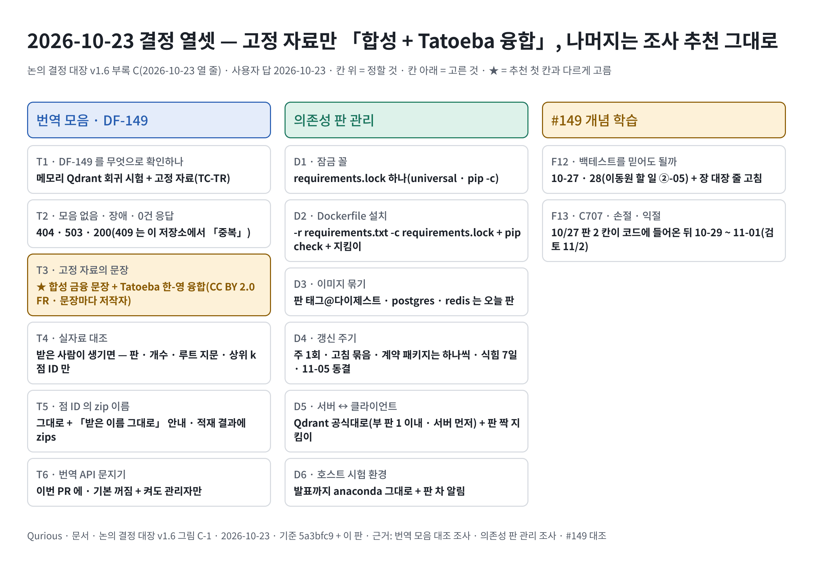

# 논의 결정 대장 v1.9 — Qurious

| 문서 정보 | |
|---|---|
| **판 · 상태** | v1.9 · 10-24 일지 결정 일곱 / v1.8 · 10-24 결정 다섯 · 그림 C-2(2026-10-24) / v1.7 · 모의투자 · 감리 번호 · N1 ~ N3 결정 열하나(2026-10-23) / v1.6 · S142 결정 열셋(2026-10-23) / v1.5 · 10-23 정정 행 값 바로잡음(2026-10-23) / v1.4 · S140 결정 다섯(2026-10-23) / v1.3 · 칸 이름 정정(2026-10-23) / v1.2 · **규칙 적용판 — 팀 대화방 의견 확인 전** |
| **구분** | 1. 착수·과업 정의(범위) · 8. 개발·형상 관리(기술 의사결정 기록) |
| **작성** | 이동원 |
| **검토** | 검토 전 — 팀 대화방 · 논의 댓글의 의견을 받으면 다음 판으로 고친다 |
| **최종 수정** | 2026-10-24 (KST) |
| **기준** | [v0.9](../../../phase-2/00-management/plans/지난판/논의결정대장_v0.9.md) 3절의 결론표 64행(2026-09-23 13:10 집계) + 의견 기한 2026-09-30(수) 23:59 지남 + 저장소에서 확인되는 그 뒤의 사실. **팀 대화방(Discord)과 새 논의 글의 댓글은 보지 못했다** — 그래서 「반대가 없었다」 가 아니라 「반대를 보지 못했다」 다 |
| **관련 문서** | [v0.9](../../../phase-2/00-management/plans/지난판/논의결정대장_v0.9.md)(확정 규칙 · 연결 · 강사님께 여쭐 것의 원문) · [계획서 v2.0](프로젝트계획서.md) 4절(역할) · [IA v1.0](../../../phase-2/02-design/ui/지난판/IA_v1.0.md) · [GitHub 기록 색인](../../../common/00-management/github-archive/README.md) 3절(논의의 새 번호) · [답글 수신함](../../../common/00-management/github-archive/답글-수신함.md) |
| **최근 개정** | v1.8 → v1.9: 10-24 그림자 일지 결정 일곱 줄(실행 자리 = 러너 새 단계 · D 종가 → D+1 시가 · HF 날짜별 파일 · 판 바뀜은 기계가 지문으로 · 등록 내용 셋 — 자동매매 기본값 · 일손실 표시만 · 카드 종목만) · 판 1 등록 기록(10-24 13:41 · 봉인 10-26) · 「의존 D4」 → D3 바로잡음 · <그림 C-2> 아래 한 줄 / v1.7 → v1.8: 10-24 결정 다섯(그림자 일지 실행기 10-25 · #329 생성 자료 · 백업 파일을 확인 이슈 넷째 항목으로 · #314 04 회신 없음 · LEAN 이미지 기본값은 10-26 협의 · 교차 검증 나눔 선 안) · 부록 C <그림 C-2>(그림자 일지 — 규칙 판마다 봉인 구간 · Figma) · 10-23 N1 줄의 날짜 바로잡음(10-22 → 10-20 #302 머지 `ca337eb`) · 10-23 감리 번호 줄 바로잡음(머리 줄 고정 점검) / v1.6 → v1.7: 10-23 결정 열하나를 일곱 줄로(그림자 일지 시작 · 담당 + 발전 과정 기록 · 저장 · 등록 규칙 · KIS 모의 · 가상 자동매매 · 미국 · 코인 · 판정 · 봉인 구간 · 감리 번호 칸 · N1 ~ N3) / v1.5 → v1.6: 10-23 S142 결정 열셋을 열 줄로(DF-149 확인 · 번역 API 응답 · 문지기 · 실자료 대조 · 점 ID · 잠금 · 이미지 묶기 · 갱신 주기 · 판 짝 · 호스트 · F12 · F13 차례) / v1.4 → v1.5: 10-23 정정 행(손절 · 익절 규칙 명세 — 칸 이름)의 `entry_mode` · `exit_mode` 값 `next_open` → `open`(취소선) / v1.3 → v1.4: 10-23 S140 결정 다섯(올린 문서 비공개 모음 · 탈퇴 503 · 그래프 로그인 · 절 지문 계산 · F03 은 11-05 이후) / v1.2 → v1.3: 10-12 「손절 · 익절 규칙 명세」 줄 아래 칸 이름 정정 행(`entry_mode` · `exit_mode` · `judge`) · 10-23 결정 셋(동기화 방식 · 3차 설계서 갈음 · F03 다시 찍기) / v1.1 → v1.2: 64행은 그대로(팀 의견을 아직 받지 못함) · 표 3 에 둘 — **첫 화면 · 위 메뉴 · 설정 칸 화면 결정**(Figma 세 안 → 팀장 결정 · D1 ③ 의 「보이는 방법」 만) · **팀 1차 결정 「각자 맡은 기능의 화면 설계는 각자」** · 10-03 「화면은 Figma 뒤」 줄을 닫음 — 전체는 부록 D |

> **이 문서가 답하는 질문**
> 1. 의견 기한(2026-09-30 23:59)이 지난 지금, 논의 9건의 안건 64개는 각각 어떤 상태인가?
> 2. 기한 뒤 논의 밖에서 정해지거나 바뀐 것은 무엇인가?
> 3. 무엇을 확인하면 이 판이 바뀌나?
>
> **읽는 순서** — 팀원: 요약 → 1절 표 1 → 2절 표 2 에서 내 담당 줄 → 4절 · 강사님: 요약 → 2절 → 3절 · 처음 온 사람: 부록 A → 요약 → 1절

## 요약

1. 기한이 지나 64안건을 각 논의의 규칙대로 옮겼다 — **확정 25 · 잠정(미합의) 27 · 조건부 8 · 연기 4.** 확정 25 가운데 14(D4 7 · D7 7)는 「D0 ② 잠정 위의 확정」 이다 — 이 둘이 기대는 확정 방식(D0 ②)이 전원 찬성에 하나 모자라(3/4) 잠정이기 때문이다.
2. **이 판은 팀 대화방의 의견을 보지 못하고 썼다.** 「기한까지 반대가 없으면 확정」 인 25행은 반대를 보지 못해 확정으로 적었을 뿐이다 — 반대가 있었다면 그 줄은 잠정으로 내려가고, D0 ② 에 반대가 있었다면 D4 · D7 의 14행이 함께 내려간다. 의견을 [답글 수신함](../../../common/00-management/github-archive/답글-수신함.md)에 붙여 주시면 v1.1 로 고친다.
3. 기한 뒤 논의 밖에서 열이 정해지거나 바뀌었다 — 역할 확정(10-01 · D0 ⑤ · D9) · 2026 매도세 0.20% 재대조(D4 ①) · 리밸런싱 논의 글 #79(이슈)(D5 ③) · 장부가 둘로 돌아옴(D7 ③ 과 어긋남) · CI 논의(D8)는 그대로 열림 · **10-03 강사님 기초 코드 `9478811` 을 받으며 넷** — KIS 키 사용자별(팀장 결정) · 게이트웨이에도 실거래 관문(D7 ①) · 첫 화면 · 위 메뉴 · 설정 칸(Figma 세 안에서 팀장 결정 · D1 ③ 의 묶음은 그대로) · **팀 1차 결정 「각자 맡은 기능의 화면 설계는 각자」**.

---

## 1. 한눈에 — 기한 뒤 상태

표 1 은 「논의마다 안건이 몇 개이고, 규칙을 적용하면 몇 개가 확정 · 잠정 · 조건부 · 연기인가」 에 답한다. 논의 번호는 옛 번호 → 새 번호(조직 저장소 · 2026-09-29 다시 올림)다.

**표 1. 논의별 상태** · 규칙 = [v0.9](../../../phase-2/00-management/plans/지난판/논의결정대장_v0.9.md) 2절 · 「잠정 위」 = D0 ② 잠정 위의 확정

| 논의 | 주제 | 안건 | 확정 | 그중 잠정 위 | 잠정(미합의) | 조건부 | 연기 |
|---|---|--:|--:|--:|--:|--:|--:|
| D0 #6 → #10 | 팀 운영 · 기록 방식 | 9 | 5 | 0 | 2 | 1 | 1 |
| D1 #7 → #11 | 누구의 어떤 문제를 푸나 | 4 | 0 | 0 | 4 | 0 | 0 |
| D2 #10 → #12 | 유료 서비스 · 데모 방식 | 8 | 0 | 0 | 7 | 0 | 1 |
| D3 #30 → #32 | 기초 코드 기능 범위 | 9 | 0 | 0 | 2 | 6 | 1 |
| D4 #17 → #20 | 1차 매듭 · 비용 · 누수 · 검정 규격 | 7 | 7 | 7 | 0 | 0 | 0 |
| D5 #18 → #21 | 2차 로보어드바이저 설계 | 9 | 0 | 0 | 9 | 0 | 0 |
| D6 #20 → #22 | 3차 인디케이터 설계 | 9 | 6 | 0 | 2 | 1 | 0 |
| D7 #13 → #13 | 모의투자 체결 · 기록 | 9 | 7 | 7 | 1 | 0 | 1 |
| **합계** | | **64** | **25** | **14** | **27** | **8** | **4** |

그림 1 은 「64행이 기한 앞뒤로 어떻게 옮겨 갔나」 에 답한다.

**그림 1. 기한 앞 → 뒤** · 왼쪽 = v0.9(09-23 집계) · 오른쪽 = 이 판

```text
 v0.9 (기한 전)                   v1.0 (기한 뒤 · 규칙 적용)
 🟢 확정 예정  26  ───────────▶  ✅ 확정        25
                     └ D7 ⑤ 1 ─▶  잠정(미합의)   27 ◀─ ⏳ 대기 26
 🟡 조건부      8  ───────────▶  🟡 조건부        8
 ⏸️ 연기        4  ───────────▶  ⏸️ 연기          4
```

확정 예정 26 가운데 하나(D7 ⑤ 모의투자 일지)는 확정되지 못했다 — 같은 내용을 다른 규칙으로 세는 짝(D2 ④)이 과반에 못 미쳐 잠정이라, v0.9 4절의 「둘 다 확정돼야 확정」 에 걸렸다. 찬성이 더 필요했던 26행은 기한 뒤 찬성을 보지 못해 모두 잠정이다 — 무응답을 찬성으로 세지 않는다.

---

## 2. 안건별 상태 — 64행

표 2 는 「안건마다 결론이 무엇이고, 기한 뒤 상태는 무엇이며, 논의 밖에서 바뀐 것은 무엇인가」 에 답한다. 「결론」 칸은 v0.9 3절 그대로다(논의 본문의 결론표가 정본).

**표 2. 안건 64행** · 「반대 못 봄」 = 팀 대화방을 보지 못한 채 규칙을 적용했다 · 명시 n/4 = 제안자와 명시 찬성만 센 값

| 논의 | 안건 | 결론 | v1.0 상태 | 기한 뒤 (논의 밖) |
|---|---|---|---|---|
| D0 #10 | ① 기록 위치 | A — 사실·작업=Issue · 결정 과정=Discussion · 되돌리기 어려운 결정=ADR · 과정=TIL · 개념=개념 노트 | ✅ 확정 · 명시 3/4 · 반대 못 봄 |  |
| D0 #10 | ② 확정 방식 | A — 결론 초안 뒤 72시간 반대 없으면 확정, 목표·비용·역할만 전원 명시 찬성 | 잠정(미합의) — 전원 찬성 기준 미달 · 명시 3/4 |  |
| D0 #10 | ③ ADR | A — 되돌리기 어려운 결정만 · 되돌릴 조건 절 필수. 경로는 실제대로 `docs/common/02-design/adr/ADR-NNNN-제목.md` | ✅ 확정 · 명시 3/4 · 반대 못 봄 |  |
| D0 #10 | ④ 작업 추적 | A — Assignee 1명 + Project 보드 + 템플릿 3종 PR | ✅ 확정 · 명시 3/4 · 반대 못 봄 |  |
| D0 #10 | ⑤ 역할 분담 | A — 1차 역할을 잇는 표. 오준영님 칸은 본인 확인 전 Assignee 비움 | 잠정(미합의) — 전원 찬성 기준 미달 · 명시 3/4 | 10-01 팀이 역할을 정했다(계획서 v2.0 4절 · 요구 대장 담당 칸) — 이 안건은 그 결정이 받는다 |
| D0 #10 | ⑥ 허브 유지 | A — HF org `qurious-quant` private 허브 유지 · 올리기 직전 private 재확인 | ✅ 확정 · 명시 3/4 · 반대 못 봄 |  |
| D0 #10 | ⑥-1 원자료(L0·L1) | 팀 org 안 private 공유 — 09-18 재작성의 "기본 끔"을 거두고 원래 A 로 되돌리자는 제안 · 09-20~21 업로드는 투표 뒤 생긴 일이라 이 표로 추인하지 않음(7.5) | 🟡 조건부 그대로 — 강사님 ③ 답 전까지 잠정 |  |
| D0 #10 | ⑥-1 파생 지표(L2) | 종목별 순위·z점수는 올리지 않음 · 자체 지수(`benchmark_index`)는 이미 올라가 있음 — 강사님 ④ 답 뒤 판정 | ⏸️ 연기 그대로 — 강사님 ④ 답 |  |
| D0 #10 | ⑦ 설명·기록 기준 | A — 두 층 쓰기 · 분석 필수 절 · 개념 노트 · 주석 규칙 | ✅ 확정 · 명시 3/4 · 반대 못 봄 |  |
| D1 #11 | ① 타깃 사용자 | B — 자기 투자 규칙을 가진 개인투자자 | 잠정(미합의) — 전원 찬성 기준 미달 · 명시 3/4 |  |
| D1 #11 | ② 목적 한 문장 | P2 — 그 규칙을 믿어도 되는지 판단하게 돕는다 (문장 원문 그대로) | 잠정(미합의) — 전원 찬성 기준 미달 · 명시 3/4 |  |
| D1 #11 | ③ 깊게의 범위 | 주 경로 12 깊게 · 최소 요건 2 · 개념 10 · 동결 25 (삭제는 D3) | 잠정(미합의) — 전원 찬성 기준 미달 · 명시 2/4 | IA v0.4 는 제안으로 둔다 — 화면 65개의 분류가 이 줄에 걸린다 |
| D1 #11 | ④ 2·3차 이야기 | S1 — 기능은 잇지 않고 같은 질문으로 각각 발표 · 검증 엔진과 모의투자 일지 공유 | 잠정(미합의) — 전원 찬성 기준 미달 · 명시 2/4 + ✅ᶜ 1 |  |
| D2 #12 | ① 유료 클라우드 | 쓰지 않음 — 팀 추가 월 0원 (AWS·Lightsail·HF Team 없음) | 잠정(미합의) — 과반 기준 미달 · 명시 2/4 | 로컬로 먼저 완성하고 강사님 AWS 안내 뒤 다시 본다(팀 합의) — 지금까지 유료 클라우드 0원 |
| D2 #12 | ② 데모 방식 | 발표 PC 로컬 시연 + 정적 결과 페이지(GitHub Pages) + 녹화 영상 백업 · HF Space는 주 경로 뒤 선택 | 잠정(미합의) — 과반 기준 미달 · 명시 2/4 |  |
| D2 #12 | ③ 유료 LLM API | 쓰지 않음 — L0 LLM 동결 유지 | 잠정(미합의) — 과반 기준 미달 · 명시 2/4 |  |
| D2 #12 | ④-1 일지 형식 | D7 ⑤ 와 같은 답 — J2 매 거래일 1행 · 장 마감 뒤 하루 1회 · 추가만 하는 기록 | 잠정(미합의) — 과반 기준 미달 · 명시 1/4 + ✅ᶜ 1 |  |
| D2 #12 | ④-2 일지 저장처 | D7 ⑤·⑧ · D0 ⑥ L5 와 같은 답 — 앱 DB(화면용) + HF private 원장 `qurious-paper-log`(보관용) | 잠정(미합의) — 과반 기준 미달 · 명시 2/4 |  |
| D2 #12 | ④-3 일지 실행처 | 기본값 = 담당 1명 로컬 PC · 장 마감 뒤 하루 1회 스크립트 · 자동화는 2차 중반에 정함 | ⏸️ 연기 그대로 — 기본값만 둠 |  |
| D2 #12 | ⑤ 공개 범위 | K1 — 공개 위치(Pages·저장소·Space)에는 원자료 0 · 전략 수준 성과 요약(수익률 곡선·MDD 등)만 · 종목별 순위·z점수 같은 L2 는 D0 ⑥-1 L2 결론(강사님 ④) 전까지 공개하지 않음 · 원자료는 HF private | 잠정(미합의) — 과반 기준 미달 · 명시 2/4 |  |
| D2 #12 | ⑥ 강사님 확인 | 확인한다 — 따로 묻지 않고 결정 대장 목록(⑥ 신설)에 모아서 한 번에 | 잠정(미합의) — 과반 기준 미달 · 명시 2/4 |  |
| D7 #13 | ① 실계좌 주문 | L1 — live 경로를 코드로 차단 (서버 관문 ✅ · 화면·저장 거부 남음) | ✅ 확정 · D0 ② 잠정 위 · 명시 2/4 · 반대 못 봄 | 실거래 차단 지점(ADR-0001)이 코드에 있다 |
| D7 #13 | ② 체결처 | V1 앱 안 가상 체결이 정본 · V3(KIS 모의 병행)는 선택 확장 | ✅ 확정 · D0 ② 잠정 위 · 명시 2/4 · 반대 못 봄 |  |
| D7 #13 | ③ 계좌·쓰기 막기 | C1 — `paper_accounts` 하나 + 봉인 전용 사용자 · 쓰기는 일지 실행기만 | ✅ 확정 · D0 ② 잠정 위 · 명시 2/4 · 반대 못 봄 | ⚠️ 09-30 강사님 기초 코드로 장부가 둘(자동매매 QUANT · 현금 1천만 원)이 됐다 — 결론(장부 하나)과 코드가 어긋난다 · 강사님 반영 논의 #69 ① 에서 정한다 |
| D7 #13 | ④ 10분 자동매매 | R2 — 기록 매 거래일 1회 · 매매는 규칙 주기 · 10분 반복 동결 · 사람 해석 주 1회 | ✅ 확정 · D0 ② 잠정 위 · 명시 2/4 · 반대 못 봄 |  |
| D7 #13 | ⑤ 일지 형식·저장처 | J2 매 거래일 1행(관망 포함 · 설계) · 결정일/체결 확정일 · 추가만 · 앱 DB + HF private 원장 | 잠정(미합의) — 짝인 D2 ④ 가 잠정이라(둘 다 확정돼야 확정) · 명시 1/4 + ✅ᶜ 1 |  |
| D7 #13 | ⑥-1 비용 | F2 — 매도세는 연도별 법령 세율표 + 수수료·슬리피지 가정 · 민감도 기준선은 D4 #17 ① 결론(1차 4수준 그대로)을 따름 | ✅ 확정 · D0 ② 잠정 위 · 명시 1/4 + ✅ᶜ 1 · 반대 못 봄 |  |
| D7 #13 | ⑥-2 체결가 | P3 다음 거래일 시가 (명시 찬성은 P3 까지) · 출처는 포털(2.6.2 A · 🟡 제안) → 일지 행 T+1 확정 | ✅ 확정 · D0 ② 잠정 위 · 명시 2/4 · 반대 못 봄 |  |
| D7 #13 | ⑦ 봉인 판정 | E2 — 사전등록 · 주 판정은 운영 일관성·괴리 · 성과는 기술 통계 + MinTRL | ✅ 확정 · D0 ② 잠정 위 · 명시 2/4 · 반대 못 봄 |  |
| D7 #13 | ⑧ 실행처·준비물 | 기본값 담당 1명 PC(로컬) · 최종은 D2 ④ 와 함께 · 담당 미정 · Actions 백업안 취소 | ⏸️ 연기 그대로 — 기본값만 둠 |  |
| D4 #20 | ① 비용 규격 | A 구조(매수·매도 편도 따로 · 매도세는 매도에만 · **연도별 법령 세율표**) · 주 결과 슬리피지 10bp 가정 · **민감도 기준선 = 1차 4수준 그대로** + 무비용 대조 | ✅ 확정 · D0 ② 잠정 위 · 명시 1/4 · 반대 못 봄 | 2026 매도세 0.20%(대통령령 제36001호 · 2025-12-31 공포) 재대조 끝 — v0.9 6절의 충돌은 법령 정보의 「현행」 표시가 최신 개정을 놓친 것이었다 · 코드 값이 맞다 |
| D4 #20 | ② label_horizon | **A — 6.** gap ≥ 6 을 기본값으로 | ✅ 확정 · D0 ② 잠정 위 · 명시 1/4 · 반대 못 봄 |  |
| D4 #20 | ③ 정본 엔진 | ~~A 엔진 하나~~ → **C′** 파이썬 경로는 그대로 두고 **비용 모델·지표 정의만 한 곳**. LEAN(야후·무비용)은 정본에서 뺌 | ✅ 확정 · D0 ② 잠정 위 · 명시 1/4 · 반대 못 봄 |  |
| D4 #20 | ④ 누수 차단 | **A + 종목축** — 3곳을 `gap ≥ label_horizon` 으로 교체, 어기면 예외. 유니버스는 **날짜별 명단**(시점 유니버스) | ✅ 확정 · D0 ② 잠정 위 · 명시 1/4 · 반대 못 봄 |  |
| D4 #20 | ⑤ 주 검정 | **A — 절차만 공통**: stationary block bootstrap · 기대 블록 10거래일 · B 10,000 · 시드 20260901. **주 지표·방향은 프로젝트별**(D5 ⑨ · D6 ⑨) | ✅ 확정 · D0 ② 잠정 위 · 명시 1/4 · 반대 못 봄 |  |
| D4 #20 | ⑥ 1차 재계산 | **A — 하지 않음.** 1차 주 검정 미수행과 **비용 2배 계산**(9.4 ①)을 1차 보고서의 한계로 남김 | ✅ 확정 · D0 ② 잠정 위 · 명시 1/4 · 반대 못 봄 |  |
| D4 #20 | ⑦ 시도 횟수 기록 | **A — 필수**(사전등록 + 시도 조합 수) + 상위 조합은 봉인 구간에서 순위 유지를 한 번 더 확인 | ✅ 확정 · D0 ② 잠정 위 · 명시 1/4 · 반대 못 봄 |  |
| D5 #21 | ① 투자 대상 | B 국내주식 + 국내상장 ETF (자산군당 1~2개 · 합쳐 8~12개, 종목 선정은 별도 Issue) | 잠정(미합의) — 과반 기준 미달 · 명시 1/4 |  |
| D5 #21 | ② 계산 도구 | B Riskfolio-Lib 하나를 정본 | 잠정(미합의) — 전원 찬성 기준 미달 · 명시 1/4 |  |
| D5 #21 | ③ 리밸런싱 | C 월 1회 확인 + 5%p 밴드 | 잠정(미합의) — 전원 찬성 기준 미달 · 명시 1/4 | 10-01 리밸런싱 논의 글 #79(이슈)(주담당)에서 다시 — 부담당 의견: 이탈률 5%p 이상 유지 · 「확인 시점」 칸 하나로 C 안(월 1회 확인)도 고르게 · 시간 기본 「사용 안 함」 유지 |
| D5 #21 | ④ 벤치마크 | B 성향별 혼합 벤치마크를 주 + KOSPI(자체 재현치) 병기 · 비중표는 '제안'으로 둠 | 잠정(미합의) — 전원 찬성 기준 미달 · 명시 2/4 |  |
| D5 #21 | ⑤ 판정 형식 | 결과를 보기 전에 판정표 양식을 Issue로 사전등록 | 잠정(미합의) — 과반 기준 미달 · 명시 1/4 |  |
| D5 #21 | ⑥ 성향 검증 | 순서성 + 구분성 두 가지 (합격선은 ① 확정 뒤 실제 데이터로) | 잠정(미합의) — 과반 기준 미달 · 명시 1/4 |  |
| D5 #21 | ⑦ 음수 현금 | 2차 첫 주에 ①②와 함께 (①②가 둘 다 뒤집히면 즉시 단독 패치) | 잠정(미합의) — 과반 기준 미달 · 명시 1/4 |  |
| D5 #21 | ⑧ MDD 합격선 | 포트폴리오 −20% · 개별 전략 −15% (강사님께 여쭐 것 ⑧ 대기) | 잠정(미합의) — 과반 기준 미달 · 명시 1/4 |  |
| D5 #21 | ⑨ 운용정보 범위 | 나 — 운용정보 화면 항목 + 일일 거래내역·잔고 기록 | 잠정(미합의) — 과반 기준 미달 · 명시 2/4 |  |
| D6 #22 | ① 지표 정의 통일 | A — TradingView 정의 (RSI=Wilder·SMA 시드, 표준편차=모집단) | 잠정(미합의) — 전원 찬성 기준 미달 · 명시 1/4 |  |
| D6 #22 | ② PineScript | B — `strategy()` 로 바꾸고 `parseInt` 누출 수정 | ✅ 확정 · 명시 1/4 · 반대 못 봄 |  |
| D6 #22 | ③ P7 대조 절차 | C — 3단계(신호일 겹침 → 부호 → 순위) | ✅ 확정 · 명시 1/4 · 반대 못 봄 |  |
| D6 #22 | ④ 저장 칸 | B — 재현 가능한 수준, **기존 6 + 새 8 = 14칸** (🔴 본문 "12개"는 셈 착오) | ✅ 확정 · 명시 1/4 · 반대 못 봄 |  |
| D6 #22 | ⑤ 파라미터 범위 | A 원칙(사전에 고정한 격자 · MinBTL 상한 이내) 유지 · 🔴 **576은 10년 전제** → 수집 DB 6.7년이면 상한 118, 격자 재산정 | 잠정(미합의) — 전원 찬성 기준 미달 · 명시 1/4 |  |
| D6 #22 | ⑥ 수급 데이터 | C — 3차 범위에서 뺀다 | ✅ 확정 · 명시 1/4 · 반대 못 봄 |  |
| D6 #22 | ⑦ 합격선 | B — 교안 기준 + 3조건(PF 추가 · 거래 단위 · 비용 차감 후) | ✅ 확정 · 명시 1/4 · 반대 못 봄 |  |
| D6 #22 | ⑧ 3차 범위 | A — 3차를 독립 주제로. 2차와 공유하는 것은 D1 ④ S1 대로 비용·검정 규격(D4) + 검증 엔진 + 모의투자 일지 형식(D7 ⑤). 결합 대시보드는 목표가 아니라 D1 ④ "S2 선택 확장" 조건에서만 | ✅ 확정 · 명시 1/4 · 반대 못 봄 |  |
| D6 #22 | ⑨ 3차 주 지표 | B — 조건부 분포 차이 + 민석님 제안 **"조합 순위"를 보조 산출물로** | 🟡 조건부 그대로 — ⑨ 규칙 빈칸 · 「나머지」 적용 제안을 받아들였다는 표시를 못 봄 · 명시 2/4 |  |
| D3 #32 | ① 알림 채널 | **B** 텔레그램만 남기고 4종 동결 · 전역 폴백 제거 · Slack 마스킹 1줄 | 🟡 조건부 그대로 — 규칙 제안(§10.2)이 받아들여졌다는 표시를 못 봄 · 명시 1/4 |  |
| D3 #32 | ② 감사·로그 | **B+** 로깅 1줄 · 인증 이벤트 · 초기화에서 감사 제외 (C 의 실거래 감사는 불필요) | 🟡 조건부 그대로 — 규칙 제안(§10.2)이 받아들여졌다는 표시를 못 봄 · 명시 1/4 |  |
| D3 #32 | ③ 권한 경계 | **B** system 은 엔드포인트 단위 admin(sync-status 제외) · tasks 인증 · 자동매매 소유자 검사 | 🟡 조건부 그대로 — 규칙 제안(§10.2)이 받아들여졌다는 표시를 못 봄 · 명시 1/4 |  |
| D3 #32 | ④ RAG·크롤링 | 🔴 추천 변경 ~~C~~ → **B′** RAG 는 P01-①-3 최소 요건(citations 배선) · 임의 URL 크롤링 폐기 · 죽은 함수 3개 삭제 · 🟡 전제: D1 ③ 에서 AI 투자 상담을 동결 → 최소 요건으로(아니면 C) | 잠정(미합의) — 전원 찬성 기준 미달 · 명시 1/4 | 문서 검색 · 근거 대화가 동작한다(10-02 · 벡터 저장소 늘 켬) — 결론과 상관없는 진척 |
| D3 #32 | ⑤ 문서 저장 구조 | ④ 확정 뒤 A·B·C·D(D = 09-18 댓글의 전체 재적재) 중 선택 | ⏸️ 연기 그대로 — ⏸️ 연기 (④ 확정 뒤) |  |
| D3 #32 | ⑤-1 id 생성 | `point_id` 를 `sha256` 으로 (3줄 · ④ 와 무관) | 🟡 조건부 그대로 — 규칙 제안(§10.2)이 받아들여졌다는 표시를 못 봄 · 명시 1/4 |  |
| D3 #32 | ⑥ 인증 구조 | 🔴 추천 변경 ~~㉰~~ → **현행 유지**(#46 로 ㉯ + 기본 비밀값 차단 적용됨) · ㉰ 는 2차 중 재검토 | 🟡 조건부 그대로 — 규칙 제안(§10.2)이 받아들여졌다는 표시를 못 봄 · 명시 1/4 |  |
| D3 #32 | ⑦ 죽은 것 정리 | 🔴 추천 변경 ~~B~~ → **B′** Celery 는 수집기 배치 전용 · Beat `sync.*` 2개 제거 · 미호출 라우터 해제 · 인덱스 3건 · 문서 머리말 | 잠정(미합의) — 전원 찬성 기준 미달 · 명시 1/4 |  |
| D3 #32 | ⑧ 화면 표기 | 🔴 추천 변경 **B′** 거짓 `● LIVE` 제거 · 라벨 교정 · 목업 표기 3곳 · 도움말 문구 교정 · `company-compare` 교체는 뺌(야후) · 자산배분 문구는 RTM #71 §6 결정 3 을 따름(D3 에서 정하지 않음) · D1 ③ 이 확정되면 A(거짓 배지·라벨만), 그 전까지 B′ 중 표기 수정만 잠정 | 🟡 조건부 그대로 — 규칙 제안(§10.2)이 받아들여졌다는 표시를 못 봄 · 명시 1/4 |  |

---

## 3. 기한 뒤 논의 밖에서 정해지거나 바뀐 것

표 3 은 「안건을 다시 투표하지 않았는데 바뀐 것은 무엇이고, 어느 줄에 닿나」 에 답한다.

**표 3. 논의 밖의 변화** · 확실도 🟢 저장소의 파일 · 코드로 확인

| 날짜 | 무엇 | 닿는 안건 | 근거 | 확실도 |
|---|---|---|---|:-:|
| 2026-09-30 | 강사님 기초 코드(`b055ab0`) 반영으로 자동매매 장부가 다시 둘 — 현금 `quant_virtual_accounts` + 보유 `book = QUANT` | **D7 ③ 과 어긋남**(결론: `paper_accounts` 하나) | [ERD v1.3](../../../phase-2/02-design/data/지난판/ERD_v1.3.md) 4.4절 · 강사님 반영 논의 #69 ① | 🟢 |
| 2026-10-01 | 2026 매도세 재대조 — 0.20%(코스피 거래세 0.05% + 농특세 0.15% · 코스닥 0.20%) · 대통령령 제36001호. 법령 정보의 「현행」 표시판(제35947호)은 최신 개정을 놓친 것이었다 | D4 ① 의 값 · D7 ⑥-1 | `app/services/trading_cost.py` 세율표 · 법령 Open API 로 다시 대조(2026-10-01) | 🟢 |
| 2026-10-01 | 팀이 2 · 3차 역할을 정했다 | D0 ⑤ · D9(#52 닫힘) | [계획서 v2.0](프로젝트계획서.md) 4절 · 요구 대장 담당 칸 | 🟢 |
| 2026-10-01 | 리밸런싱 논의 글 #79(이슈) 가 열렸고 부담당 의견을 올렸다(이탈률 「확인 시점」 칸 하나로 D5 ③ 의 C 안도 고르게) | D5 ③ | [의견 원문](../../../common/00-management/github-archive/2026-10-01/%5B%EB%85%BC%EC%9D%98%5D%20%EB%A6%AC%EB%B0%B8%EB%9F%B0%EC%8B%B1%203%EC%A2%85%EC%9D%98%20%EC%8B%A4%ED%96%89%20%EC%A3%BC%EA%B8%B0%C2%B7%ED%97%88%EC%9A%A9%20%EC%9D%B4%ED%83%88%EB%A5%A0%C2%B7%ED%98%84%EA%B8%88%ED%9D%90%EB%A6%84%20%EA%B8%B0%EC%A4%80%20%EC%84%A4%EC%A0%95/01-2026-10-01-%ED%95%AD%EB%AA%A9%EB%B3%84-%EC%9D%98%EA%B2%AC.md) | 🟢 |
| 지금 | CI 논의(D8 · #54)는 결론 초안 없이 열려 있다 — 무응답을 찬성으로 읽지 않는다고 적어 둔 논의다 | D8 | GitHub 기록 색인 3절 | 🟢 |
| 2026-10-03 | **KIS 자격증명은 사용자마다 자기 키** — 강사님 `9478811` 은 서버 계좌 하나(Secrets Manager → `.env`)를 KIS 를 고른 모두가 쓰고 설정을 저장할 때 각자 키를 지운다. 팀장 결정 「사용자마다 받는 것으로 처음부터 — 문제가 될 수 있기 때문」 | **D7 ③ 과 같은 결**(사용자마다 따로 · 섞지 않는다) · `P02-⑤-1`(오준영 — 확인 요청) | [ADR-0004](../../../common/02-design/adr/ADR-0004-KIS-자격증명은-사용자마다.md) · 팀 확인 글 초안 | 🟢 |
| 2026-10-03 | **게이트웨이 실주문 길에도 실거래 관문** — `9478811` 의 stock-coin-trade 게이트웨이는 팩토리 관문을 지나지 않았다(환경값 한 줄이면 실전). 반영할 때 같은 승인 변수를 걸었다 · 길 자체는 서버 계좌 하나라 켜지 않는다 | **D7 ① 「live 경로를 코드로 차단」 을 지킴**(v1.0 부록 C 의 「위험」 줄이 닫힘) | [ADR-0001](../../../common/02-design/adr/ADR-0001-실거래-주문-경로-차단.md) 6절 · `tests/test_live_trading_guard.py` 5절 | 🟢 |
| 2026-10-03 | ~~강사님 화면 쪽은 Figma 로 나란히 그린 뒤 정한다~~ → **정했다(아래 줄)** — 서버 쪽만 먼저 받았다(사용자 결정) | D1 ③ · IA | 강사님 자료 추적 댓글 08 | 🟢 |
| 2026-10-03 | **첫 화면 · 위 메뉴 · 설정 칸을 정했다** — Figma [「투자 대시보드 · 메뉴 정리」](https://www.figma.com/design/lfYo3gVAxj1Raekzq9xFzZ)에 지금 화면 · 강사님 새 판을 같은 데이터로 나란히 두고 세 안씩 견줘 팀장이 골랐다: ① 첫 화면 = 투자 대시보드 + 우리 서비스 맞춤 ② 위 메뉴 = 우선순위대로 화면 폭에 들어가는 만큼 + 「⋮ 더보기」 = 13묶음 전체 메뉴(강사님 둘 · 지금 아홉 · 학습 셋째를 합친 안 — 데스크톱에서 메뉴를 숨기면 덜 쓰인다는 연구로) ③ 증권사 API 설정 = 새 칸 + 쉬운 안내 | **D1 ③ 의 「보이는 방법」 만** — 묶음 이름 · 순서(2.0 메뉴 A′)는 여전히 잠정이고, 확정되면 우선순위 목록 하나만 바꿔 넣는다 · 논의 #99 💬2 닫힘 | [IA v1.0](../../../phase-2/02-design/ui/지난판/IA_v1.0.md) 1.2 · 3.4절 · 시험 TC-NV · 논의 #99 댓글 01 | 🟢 |
| 2026-10-03 | **팀 1차 결정 — 각자 맡은 기능의 화면 설계는 그 담당이 자유롭게 한다**(필요하면 팀장이 다른 화면도 돕는다). 팀장 전달 「구현하기로 나눈 기능들에 대해서는 각자가 알아서 진행이 일단 1차적인 결정 사항」 | D1 ③(2.0 메뉴)의 진행 방식 · 화면 설계 절차 v0.2(팀 검토 단계) | 팀장 전달(2026-10-03) · [화면 설계 절차 v0.2](../../02-design/ui/화면설계절차.md) | 🟡 팀 대화방 원문 미확인 |

D7 ③ 이 가장 급하다 — 확정 줄과 지금 코드가 다르다. 10-03 의 KIS 사용자별 결정은 그 결(사용자마다 따로)과 같은 쪽이다. 장부를 하나로 되돌릴지(D7 ③ 대로) 둘로 둘지(기초 코드대로)는 강사님 반영 논의 #69 ① 에서 정하고, 그 결론으로 D7 ③ 을 고치거나 다시 연다.

---

## 4. 이 판을 바꿀 조건

표 4 는 「무엇이 확인되면 어느 줄이 어떻게 바뀌나」 에 답한다.

**표 4. 뒤집을 조건**

| 이런 것이 확인되면 | 바뀌는 줄 | 어떻게 |
|---|---|---|
| 팀 대화방 · 논의 댓글에 반대가 있었다 | 그 안건 | 확정 → 잠정(미합의) |
| D0 ② 에 반대가 있었다 | D4 7 · D7 7 | 확정(잠정 위) → 잠정(미합의) |
| D0 ② 에 넷째 명시 찬성이 있었다 | D4 7 · D7 7 · D0 ② | 「잠정 위」 꼬리표를 떼고 확정 · D0 ② 확정 |
| D1 ③ 에 전원 명시 찬성이 모였다 | D1 ③ · D3 ④ ⑧ 의 전제 · IA 3절 | IA 의 2.0 메뉴를 「제안」 → 확정 |
| D3 의 규칙 제안이 받아들여졌다 | D3 조건부 6 | 조건부 → 확정 |
| 강사님 ③(공공누리) 답 | D0 ⑥-1 · D2 ⑤ | 「제3자 제공」 이면 원자료를 내리고 각자 수집 |
| 강사님 반영 논의 #69 ① 결론 | D7 ③ | 장부 하나 / 둘 |
| 리밸런싱 논의 글 #79(이슈) 결론 | D5 ③ | 그 결론으로 바꾼다 |
| KIS 담당(`P02-⑤-1` 오준영)이 서버 계좌 방식(강사님 판)을 고르자고 하면 | 표 3 의 10-03 KIS 줄 · ADR-0004 | 팀 논의 뒤 ADR-0004 를 대체(Superseded)하는 새 ADR |
| ~~첫 화면 · 위 메뉴를 Figma 로 정하면~~ ✅ 10-03 정함 | 표 3 · IA v1.0 | — |
| 팀이 위 메뉴 순서(우선순위 목록)를 바꾸자고 하면 | 표 3 의 10-03 화면 줄 · IA 그림 2 | `public/js/core.js` 의 `MENU_PRIORITY` 와 `app.html` 탭 순서를 함께(TC-NV-01 · 02) |
| 「화면 설계는 각자」 를 팀 대화방 원문으로 확인하면 | 표 3 의 10-03 팀 1차 결정 줄 | 🟡 → 🟢 |

강사님께 여쭐 것 ①~⑩ 은 [v0.9](../../../phase-2/00-management/plans/지난판/논의결정대장_v0.9.md) 5절 그대로다 — ① 의 기간만 풀렸다(2차 10-01 ~ 10-21 · 3차 10-22 ~ 11-11).

---

## 부록 A. 용어

| 용어 | 뜻 | 이 문서에서 | 헷갈리는 점 |
|---|---|---|---|
| 확정 | 그 논의의 규칙을 채운 결론 | ✅ 25행 | 이 판의 확정은 「반대를 보지 못했다」 는 뜻까지만이다 |
| 잠정(미합의) | 규칙을 채우지 못했지만 일단 그 결론으로 진행하는 것 | 27행 | 찬성이 모이면 확정 · 반대가 나오면 되돌린다 · 무응답을 찬성으로 세지 않는다 |
| D0 ② 잠정 위의 확정 | 「72시간 반대 없음」 규칙(D4 · D7)이 기대는 확정 방식(D0 ②)이 아직 잠정이라 붙이는 꼬리표 | 14행 | D0 ② 에 반대가 나오면 함께 잠정으로 내려간다 |
| 조건부 | 규칙이 비었거나 전제가 남아 판단하지 않은 줄 | 8행 | 기한이 지나도 저절로 확정되지 않는다 |
| 연기 | 다른 결정 뒤로 미룬 줄 | 4행 | 기본값만 두고 진행한다 |
| 느슨한 합의 | 정한 기간 안에 반대가 없으면 통과로 보는 규칙 | D0 · D4 · D6 · D7 | 「모두 찬성했다」 가 아니다 — 그래서 명시 n/4 를 따로 적는다 |
| 옛 번호 · 새 번호 | 닫힌 옛 저장소의 논의 번호 · 조직 저장소에 다시 올린 번호 | 표 1 · 표 2 | 옛 #69(D8)와 새 #69(강사님 반영)는 다른 글이다 |

## 부록 B. 만든 방법

- **옮긴 것** — v0.9 3절 결론표 64행을 그대로 가져와(결론 칸은 고치지 않음) 각 논의의 확정 규칙(v0.9 2절)대로 상태를 바꿨다: 🟢 확정 예정 → ✅ 확정(D4 · D7 은 「D0 ② 잠정 위」) · ⏳ 대기 → 잠정(미합의) · 🟡 조건부 · ⏸️ 연기 → 그대로. 연결 규칙(v0.9 4절)의 「D7 ⑤ ↔ D2 ④ 둘 다 확정돼야」 를 적용해 D7 ⑤ 하나를 잠정으로 내렸다. 표 2 는 짧은 파이썬으로 v0.9 표를 읽어 만들었다 — 「기한 뒤」 칸만 사람이 적었다.
- **보지 못한 것** — 팀 대화방(Discord)의 의견 · 조직 저장소에 다시 올린 논의(#10 ~ #32)의 새 댓글 · 이모지 반응. 답글 수신함은 2026-09-29 뒤 비어 있다. 그래서 명시 찬성 숫자(n/4)는 2026-09-23 집계 그대로다.
- **스캐너** — `scripts/discussion_scan.py` 는 옛 저장소 전용이라 다시 돌리지 않았다(v0.9 9절).
- **기한 뒤 칸의 근거** — 각 줄의 근거 문서 · 코드(표 3).

## 부록 C. 변경 노트 — 다음 판(v1.3)에 넣을 것

| 날짜 | 종류 | 무엇 | 옮길 곳 | 근거 |
|---|---|---|---|---|
| 의견이 오면 | 변경 | 팀 대화방 · 새 논의 댓글의 찬반 — 반대가 있으면 그 줄을 잠정으로, 넷째 찬성이 있으면 확정으로 | 표 1 · 표 2 | 답글 수신함 |
| #69 결론 뒤 | 변경 | D7 ③ 장부 하나 / 둘 | 표 2 · 표 3 | 강사님 반영 논의 #69 ① |
| #79 결론 뒤 | 변경 | D5 ③ 리밸런싱 기본값 | 표 2 | 리밸런싱 논의 글 #79(이슈) |
| 결정 뒤 | 추가 | 확정된 줄의 파생 작업(이슈 한 건씩 · 사용자가 웹에서 올림) | 새 절 | v0.9 7절 옛 절차 4 |
| 2026-10-03 | 추가 후보 | **마이그레이션 파일 이름 규칙** — #88 에서 강민석 님이 「다음 판부터 `--rev-id` 번호로」 를 제안했고 이동원은 찬성 답을 썼다(다음 번호는 `0013` — `0012` 는 이미 씀). 64안건에 없는 새 안건이라 팀 합의(찬반)를 받으면 표 2 에 새 줄로 넣는다 | 표 2 새 줄 | #88 답글 01 · 확인 02(`docs/common/00-management/github-archive/2026-10-02/이슈-QFRS-마이그레이션-정리/`) |
| 2026-10-03 | 추가 | **투자분석 기초 네 화면(거시경제 지표 · 산업 분석 · 재무제표 분석 · 기술적 분석)의 주인** — 요구 대장 · 계획서 v2.0 표 5 · IA v1.0 어디에도 주담당이 없던 강사님 기초 코드의 「배우기」 화면이다. 팀장 결정: **이동원이 기초 구현을 해 두고, 그 뒤 각 주담당이 자기 파트에 맞게 더하거나 바꾼다**(예: 기술적 분석 ↔ 지표 · 재무제표 분석 ↔ 스크리닝). 리포트 기능은 LLM 이 가격을 예측하지 않고 기준일까지 공개된 자료로 설명만 한다(조사서 「로컬 · 무료 LLM」 6.2절). 팀 확인 필요 | 표 3 · 요구 대장 새 ID(구현 착수 때) | 2026-10-03 팀장 결정 · 대화방 글 |
| 2026-10-03 | 추가 | **문서 그림 편집기** — 새 문서 그림은 Figma Design(문서마다 페이지 · 그림마다 프레임 · 이름 붙인 레이어) · 이미 그린 FigJam 그림 셋은 그대로 · 팀 Figma 요금제(student)라 FigJam 페이지를 쓸 수 없다 | 표 3 | [문서 그림 지침 v0.2](../../../phase-2/00-management/standards/지난판/문서그림지침_v0.2.md) 2.1절 |
| 2026-10-04 | 추가 | **AI 투자 상담의 근거 답 화면 — 결정 넷**(팀장 · 「화면 설계는 각자」 팀 1차 결정에 따라 이동원 몫 화면) — ⓪ 자리 = AI 투자 상담 안(화면 자리 조사의 추천 그대로 · 새 화면 아님) ① 출처 모양 = 답 아래 카드(답에 쓴 근거는 조문 글까지 펼침 · 함께 찾은 근거는 한 줄씩) ② 채팅이 근거를 쓰는 길(DF-57) = 답변 엔진에 「근거 답」 칸 · 채팅 저장소의 임베딩 교체는 보류 ③ 처음 엔진 = 「자동 — 근거 먼저」(근거가 없으면 Local Ollama 가 이어 받고 「출처 없는 일반 AI 답」 표시 · 가격 예측 · 매수 권유는 넘기지 않음) + 화면을 새로 열거나 초기화하면 새 대화(DF-60 · 모든 엔진). 팀원 의견이 오면 64안건과 같은 방식으로 반영 | 표 3 | [Figma 결정 기록](https://www.figma.com/design/4hQ9nkdEaeOb5jSlpNELaQ) · 설계서 v1.0 5.3.4 · 5.3.6 · 14.1 ⑧ · UI 명세서 v0.2 4절 |
| 2026-10-04 | 변경 | **D3 ⑤-1 「`point_id` 를 `sha256` 으로」 — 구현됨**(조건부 표시는 그대로). 크롤 조각 번호를 sha256(주소 · 조각 번호)으로 바꾸고, 다시 모을 때 같은 주소의 옛 점을 지우게 했다(결함 DF-03 닫힘 · 시험 TC-CR 6). 규칙 제안(§10.2)이 팀에서 받아들여졌다는 표시는 아직 없어 줄의 상태는 다음 판에서 의견과 함께 정한다 | 표 2 D3 ⑤-1 | [기능 완성도 점검 보고서 v0.1](../../04-testing/기능완성도-점검.md) 5.1 · `app/services/crawl_points.py` |
| 2026-10-04 | 추가 후보 | **기능 완성도 배지 갱신 규칙** — 누가(주담당) · 언제(시험 · API · 목업이 바뀌는 PR) · 무엇으로(점검표 근거 칸) · 「평가 없는 화면이면 시험 실패」 를 켤지 · 주인이 정해지지 않은 화면 22개의 주인. 팀 점검 이슈(주인 미정 화면 · 배지 규칙)에서 정한다 | 새 안건 | 점검 보고서 6절 |
| 2026-10-04 | 추가 | **근거 답의 「질문 말 → 법령 말」 대응표 자리**(팀장 · 이동원 몫 근거 RAG) — 용어사전과 따로 근거 검색 전용 표(`app/services/kb_data/synonyms.tsv` · 20줄 · 줄마다 근거 조 · 확실도). 까닭: 「누가 내 + 세금」 같은 구절 · 조건은 용어가 아니고, 법령 말을 용어사전 다른 이름에 넣으면 화면 밑줄 · 용어 찾기에도 걸린다. 용어 카드의 「법령에서는」 줄은 R01 에서 이 표를 읽어 붙인다 | 표 3 | 설계서 v1.1 11절 · 14.1 ⑩ |
| 2026-10-04 | 추가 후보 | **재순위(bge-reranker-v2-m3)를 앱에 붙이나** — 이 PC CPU 에서 후보 10 개 재순위가 질문당 약 12초 · 20 개면 약 21초이고 품질은 거의 그대로다(테스트 계획서 v1.9 <표 8-4>). 앱 이미지에 torch 를 넣을지 · 따로 도는 재순위 서버 · GPU 가 있는 곳에서만 켤지는 팀(이미지 크기 · 배포)과 함께 | 새 안건 | 설계서 v1.1 14.1 ⑪ |
| 2026-10-04 | 추가 | **재무 API 의 기준일 거르기 기본 = `strict`**(팀장 · 「현업 · 실제 서비스 방식을 리서치해 따르고 1차 것을 차별성으로」) — 그날 전에 접수된 판의 값만(Sharadar As Reported · Compustat 처음 보고값 · 1차 Alpha_Stack 정정일 규칙과 같은 뜻) · `first`(원본 접수일로 거르고 「뒤에 고쳐짐」 표시)는 고를 수 있게 · 1차에서 「접수일 다음 거래일부터」 · 「그 판 자기 제목의 정정 표시」 · 「결산 순서로 최근」 을 가져옴 · 2차 차별점은 정정본마다 새 판을 쌓는 것. 근거: DART 재무 API 는 최신 정정본만 준다(받은 판의 5.9% · 사업보고서 14.4%). ③ 재무 필터(오준영)가 쓰는 기본값 | 표 3 | [조사서](../../../phase-2/01-analysis/research/지난판/공시-재무-뉴스-이용조건-조사_v0.1.md) 3절 · [설계서 v1.2](../../../phase-2/02-design/system/지난판/목표기능1-데이터지식-설계_v1.2.md) <표 13-1> |
| 2026-10-04 | 변경 | **뉴스 출처 — 네이버 검색 API 로 모으지 않는다**(팀장 · 「리서치해서 정확하게」) — 약관(2026-09-07 개정) 검색 API 2.3 이 검색 결과(가공 · 파생물 포함) 저장 · 캐싱 · AI 입력 · 학습 · 평가 · 제3자 제공을 금지하고 개발자센터 신규 신청은 2026-07-30 에 닫혔다. 세 갈래 — 저장 · 이름표 · 검색 · 근거 답은 공공 자료(정책브리핑 정책뉴스 · 공공누리 제1유형) · 언론사 기사는 제목 + 원문 링크만(언론진흥재단 규칙상 단순 링크는 자유) · 네이버는 저장 없이 실시간 보기만(화면은 Figma 뒤). 계획서 v2.0 <표 12> 의 뉴스 줄(「검색 API 의 제목 · 요약 · 주소 · HF private」)은 계획서 다음 판에서 고친다 | 표 3 · 표 4 | 조사서 4 · 5절 |
| 2026-10-04 | 추가 | **일정 API 는 `kind` 를 비우면 화면의 네 종류만**(팀장 · 이동원 몫 일정) — 실적 · 보고서 기한 · 금통위 · FOMC 를 서버에 더했지만, 일정 화면에 올리는 것은 Figma 결정 뒤라 결정 ③(넷만 둔다)을 화면 쪽에서 그대로 지킨다. 새 종류는 이름이나 `all` 로 묻는다 | 표 3 | 설계서 v1.2 5.2.4 · TC-EV-06 · TC-DH-02 |
| 2026-10-04 | 추가 후보 | **근거 문서를 산업별 · 연도별로 모아 HF 데이터셋으로**(팀장 요청) — 해마다 그해 시행 판 · 산업(업권)별 법령 · 주 1회 대조 · 「산업」 이 업권(은행 · 보험 · 금융투자 …)인지 상장사 업종인지 먼저 정한다 | 표 3(정해지면) | 설계서 v1.2 14.1 ⑮ |
| 2026-10-05 | 변경 | **근거 문서 산업별 · 연도별 — 「산업」 = 섹터**(팀장 「우리 기본 데이터셋을 보면 산업의 종류가 즉 섹터」 · 「리서치해서 정확하게」) — 앞 줄(10-04 추가 후보)의 「업권」 해석은 버린다. 우리 섹터 파일 11섹터(GICS 꼴) + 모든 상장사에 걸리는 「공통」 · 섹터마다 업법(시행령까지) · 관련 법(법률만) — 법률 72 · 시행령 45(법령 API 로 이름 · 소관 부처 · 제1조 확인) · 해마다 그해 12월 31일(올해는 받은 날)에 시행 중인 판 · 매주 대조 · HF private `kb-sector-laws` · 근거 답 연결은 평가셋을 넓힌 뒤 따로 | 표 3 | [조사서](../../../phase-2/01-analysis/research/섹터별-근거법령-조사.md) · 설계서 v1.3 5.3.7 · 14.1 ⑮ |
| 2026-10-05 | 추가 | **모은 공시 · 재무를 HF private 보관본으로**(팀장 요청 · 수집 DB 백업 `krx-daily-market` 과 따로) — `dart-disclosure-financials` · 공시는 접수일 연도 · 재무는 known_at 연도 파일 · 기준일 거름 · 기준일마다 태그(`dart-2026-10-04`) · 받아서 대조 · SQLite 되살리기까지 확인. 매일 이어 올릴지는 열림(제안: 주 1회 · 러너 단계) | 표 3 | 설계서 v1.3 5.1.5 · `scripts/hf_dart.py` |
| 2026-10-05 | 추가 | **주주총회 · 배당금 지급 일정 규칙**(이동원 몫 일정) — 소집결의 본문의 일시 · 원 공시와 정정을 사슬로 묶어(정정은 원 공시나 바로 앞 정정을 가리킨다) 가장 늦은 판만 · 아무 정정도 가리키지 않은 날의 새 소집결의는 따로 · 그 판에 날짜가 없으면(철회 · 일시 미정) 달력에 올리지 않는다(열리지 않을 회의를 예정으로 보여 주는 쪽이 더 나쁘다) · 지급일은 본문 줄 → 정정 표 정정후 · 없으면 만들지 않고 기준일보다 앞선 날(제출 오기)은 버린다(해를 고쳐 넣지 않는다) | 표 3 | 설계서 v1.3 5.2.4 · TC-CS |
| 2026-10-05 | 추가 | **일정 API 새 종류 둘(`agm` · `dividend_pay`) — 화면 기본은 그대로**(10-04 「kind 를 비우면 화면의 네 종류만」 의 연장) — 새 여섯 종류를 화면에 올리는 것과 한 달 상한(DF-66)은 Figma 결정 뒤 | 표 3 | API 명세서 v0.8 · 설계서 v1.3 5.2.4 |
| 2026-10-05 | 변경 | **언론사 기사 메타데이터 출처 = GDELT 15분 원자료**(데이터 파트 · 리서치 결과를 보고 「GDELT 로 만든다」) — 10-04 줄의 「언론사 기사는 제목 + 원문 링크만」 을 출처까지 정한다. 언론사 RSS 는 안내 원문이 「비상업적 블로그와 개인적인 용도로만」(연합뉴스) · 「다수 이용자 대상 … AI학습 이용을 금지」(서울경제)라 버린다. GDELT DOC API 는 이 PC 에서 첫 호출부터 429 였지만 15분 원자료는 막힘 없이 받힌다 — 번역 GKG 의 한국어 원문 기사만 · 제목 · 주소 · 시각 · 언론사만(본문 없음 · 근거 답에 넣지 않음) · 하루 약 550MB 받기 · 경제지가 적고 금융 기사 비율이 낮은 한계는 문서에 둔다 | 표 3 · 표 4 | [조사서 v0.2](../../../phase-2/01-analysis/research/공시-재무-뉴스-이용조건-조사.md) 4.4 · 설계서 v1.4 <표 13-2> · 14.1 ⑭ |
| 2026-10-05 | 추가 | **정책뉴스 받는 규칙**(이동원 몫 수집) — 주소 `policyNewsService2`(옛 주소는 다른 서비스) · 본문은 기사마다 오는 공공누리 유형이 제1유형인 기사만 · 끝의 이용 안내 문단은 지우고 출처 표시를 따로 싣는다 · 사진은 받지 않는다 · 과거분은 2020-01 부터(시세 · 공시와 같은 해) · 매일 3일 창 한 번 | 표 3 | 설계서 v1.4 5.1.5 · TC-NW |
| 2026-10-05 | 추가 | **증시 일정 화면 2판 = 안 B**(이동원 몫 화면 · 「화면 설계는 각자」) — 달력 칸에는 종목 일정을 종류별 개수로, 날짜를 누르면 그날 목록(종목 찾기 · 종류 거르기 · 50건씩) · 처음 범위는 모든 종목 + 내 종목(모의계좌 보유) 맨 위. 까닭: 주총이 들어가자 3월이 한 달 3,532건(DF-66). 10-04 · 10-05 줄의 「kind 를 비우면 화면의 네 종류」 는 새 화면이 나올 때까지 그대로 | 표 3 | [Figma 결정 기록](https://www.figma.com/design/ZevHwCOXTkCIuUVXDL48pt) · 설계서 v1.4 5.2.4 · `API-CAL-03` |
| 2026-10-05 | 추가 | **투자 정보 리서치 화면 = 안 B + C 융합 해석 1**(이동원 몫 화면 · DF-61) — 한 화면 · 찾기 + 거름 칸(종류 · 종목 · 주제 · 기간 · 차례) · 종목 하나를 고르면 같은 자리가 그 종목의 공시 · 기사 · 일정 시간표로 · 처음 차례는 낱말이 있으면 관련도순 · 없으면 최신순. 「융합」 은 두 뜻이 될 수 있어 두 그림으로 다시 물어 정했다 | 표 3 | [Figma 결정 기록](https://www.figma.com/design/7fLcDQ0dQd50anuy3wgfu2) · API 명세서 v0.9(`source` · `facets`) |
| 2026-10-05 | 추가 | **섹터 법령은 근거 답에 섹터 질문일 때만**(데이터 파트 · 이동원 몫 근거 RAG · 10-04 「근거 문서를 산업별 · 연도별로」 의 근거 답 연결) — 섹터 법령 2026 판(114문서 · 9,725조각)을 근거 DB 사본에 넣은 길과 지금 앱을 같은 평가로 견줌: 섹터 질문 18 은 정답 15 대 미룸 17, 기존 질문 15 는 정답 10 대 12(섹터 조문이 기존 정답 조를 밀어냄 — 펀드 청약 철회에 주택법 조합 가입 철회 · 손실 보전에 제67조), 기존 검색 50 R@5 0.90 대 0.94. 질문에 섹터 표의 업 · 법 이름 낱말이 있을 때만 섹터 법령까지 찾는다 · 구현과 표본 밖 재평가는 W8 | 표 3 | 설계서 v1.4 5.3.7 <표 19-1> · 14.1 ⑮ · 테스트 계획서 v1.12 4.6절 · `docs/phase-3/04-testing/평가셋/섹터법령-사람판정_v1.tsv` |
| 2026-10-06 | 추가 | **시스템관리 「API 문서」 화면**(사용자 요청 · 이번 세션에 바로 · Figma 는 건너뛰고 만든 뒤 캡처로 기록) — 모양은 사용자 답 「우리 화면으로 새로 그리되 Swagger + 앱 디자인 + 따로 쪽까지 잘 융합」: 따로 된 쪽 `/api-docs/` · 목록 · 거름 · 우리 칸(API ID · 인증 · 닿는 곳 · 부르는 화면)은 앱 디자인, 고른 API 하나만 Swagger UI 로 시험 호출 · 쓰기 API 는 켤 때만 | IA 4절 · API 명세서 10절 | 사용자 답(2026-10-06 오전) |
| 2026-10-06 | 추가 | **팀원 머지와 겹친 `app.html` 은 Claude 가 3-way 로 합친다**(이번 1건 · 사용자 「제가 합치기」) — 받아 둔 `origin/main` 으로 앞으로 감기(네트워크 없음) → 내 변경을 `git merge-file` 로 다시 얹기 · 충돌 0 · 시험 다시 | — (이번 건만 · 일반 승인 아님) | 사용자 답(2026-10-06 오전) |
| 2026-10-06 | 조건부 | **개념 학습 · API 문서를 앱으로 통합할지** — 조사서 v0.1 은 안 C(공용 앱 셸 · 학습은 앱 안 입구 · API 문서는 관리자만)를 추천 · IA Q11 의 (가) 추천과 다름 · **리팩터링(개선) 세션에서 사용자 결정** — 공용 셸 · 토큰은 모든 화면에 닿아 팀 대화방 글 먼저 | 표 2(정해지면) · IA Q11 | 사용자 병렬 요청 · [조사서](../../../phase-2/01-analysis/research/학습-API문서-앱통합-조사.md) |
| ~~2026-10-03~~ | ~~위험~~ | ~~D7 ① 과 어긋날 강사님 게이트웨이~~ → **v1.1 표 3 으로 옮김**(반영할 때 관문을 함께 걸어 닫힘) | — | ADR-0001 6절 |
| 2026-10-06 | 추가 | **근거 답 실패 발췌의 화면 = 안 B(이동원 몫 화면 결정)** — 답 모델 오류 · 맞는 출처 번호 없음 · 한국어 아님으로 서버가 검색 상위 조를 발췌로 돌리면, 화면은 근거 없음과 같은 모양(「근거로 답하지 못했습니다」 · 찾은 조문은 「질문과 맞는지 확인 전」 으로 접음 · 자동 엔진이면 일반 AI 가 이어 답). 사용자가 고른 「LLM 없이 발췌」 는 그대로 펼침. 서버 응답은 그대로 | 표 3 | Figma 「AI 투자 상담」 03 설계 38:2 · 설계서 v1.6 5.3.4 · TC-KS-08 |
| 2026-10-06 | 추가 | **근거 답의 「없다」 단정 거름** — 답이 「규정은 없습니다」 · 「명시되어 있지 않습니다」 를 결론으로 쓰면 근거 없음으로(넣은 근거 몇 조에 없다는 것은 법에 없다는 뜻이 아니다 · DF-64). 지난 답 271건 중 A15 · 옛 A09 만 걸림 | 표 3 | 설계서 v1.6 5.3.4 · TC-KA-13 · 14 |
| 2026-10-06 | 추가 | **HF private 백업 두 곳 더함 · 공시 보관본 이어 올림**(사용자 결정 「로컬에 있는 것 HF 에」) — `kb-legal-base`(근거 DB + Qdrant `kb_v1` 스냅숏) · `search-index`(수집 자료 검색 색인) · `dart-disclosure-financials` 기준일 10-05. 앱의 자료 원천은 로컬 그대로 · 로컬 용량 대책은 조사서 v0.1(측정 → 정리 → HF 판 줄이기 → 구조) | 표 3 | `scripts/hf_local_backup.py` · 조사서 「로컬 용량 · HF 원격 저장」 |
| 2026-10-06 | 추가 | **문서화 작업마다 Figma 를 최대한**(팀장 규칙) — 문서마다 최소 한 장 · 수량 막대 · 전후 비교도 Figma · 표는 Markdown · 스캐너 그림은 Mermaid · 판은 페이지로 나누고 「Save to version history」 는 쓰지 않음 · 실무 관행(보이는 크기 · 색 말고 다른 단서 · 그림 대장 · 요금제 만료 대비)을 더함 | 표 3 | 문서 그림 지침 v0.3 · 조사서 「Figma 문서 그림 실무 관행」 |
| 2026-10-06 | 추가 | **섹터 분류 낱말 2판** — 일상 말 91개(반품 · 쇼핑센터 · 아파트를 사 · 식당 · 감기약 · 트럭 …)를 섹터 표 업 이름 칸에(29개 법 · 후보 97 가운데 기존 질문에 헛걸린 6개 — 짧은 말 · 다른 뜻이 흔한 말(사고팔 · 집 · 산재 · 배우 · 정전 · 고객 정보)은 뺌) · 기존 근거 질문 55개(평가셋 넷의 서로 다른 질문)에 헛걸림 0 | 표 3 | 설계서 v1.6 5.3.7 · 테스트 계획서 v1.14 4.8절 |
| 2026-10-06 | 추가 후보 | **크롤링 세 화면(자동 · 수동 크롤링 · 데이터 인제스트)을 우리 수집기에 맞게 바꾸기** — 세션 목록에 새 칸(S95 ① — S94 는 17:35 까지의 짧은 마무리 세션) · 강사님 기능 셋(네이버 종목 · 신용평가 CSV · GitHub 문서 크롤링)을 남길지는 이동원이 정함 | 표 3 | 이동원 파트 할 일 v0.1 5 · 6절 |
| 2026-10-06 | 추가 후보 | **리밸런싱 가격 · 체결 기준 통일**(#79 주담당 제안 · 부담당 찬성 · 모의투자 담당 의견 대기) — 정기 점검 · 「지금 점검」 · 수동 · 입출금 · 배당 뒤 점검 모두 「전 거래일 종가로 판정 · 다음 거래일 시가로 체결」 · 부담당 의견: 판정은 12:30 갱신 뒤 수집 DB 의 마지막 시세일 종가(#121 이 이미 `data_as_of` 로 그렇게 함 · 화면의 「첫 거래일 09:00」 표기만 맞추기) · 입출금 · 배당은 현금만 바로, 판정은 다음 회차 · 예약은 목표 비중 + 체결 때 재계산 | 표 2 D5 ③ | #79 04 · 05(2026-10-06) |
| 2026-10-08 | 추가 | **크롤링 세 화면 구현 — 구현 때 정한 셋**(이동원 몫 화면 · 사용자 결정) — 가. 화면은 PC 쪽 일(한 단계 다시 · 받기 · 원격 다시 확인 · 복원 리허설)을 하지 않고 이 PC 에서 돌릴 명령을 보여 주고 복사하게(앱은 수집 폴더를 읽기만) 나. 자료 직접 받기는 실제 수집 단위로 — 출처 고르기 · 종목 칸을 빼고 날(시세 · 공시 · 정책뉴스) · 해(재무)로 센다(실시간 화면 표시는 상관없음 — 야후 지킴이는 줄 수 봉인) 다. 백업 판정은 `scripts/hf_dataset.py` 가 쓰고 앱은 읽기만(SSoT) · 「DB 초기화」 는 단추와 서버 길 `API-ADM-01` 을 함께 없앰(DF-78 · 10-07 결정 실행) | 표 2(이동원 몫 화면) | [Figma 05 정할 것 `36:15`](https://www.figma.com/design/AfiCh50uOwrSq5F2Tk2JLZ?node-id=36-15) · UI 명세서 v0.6 5절 |
| 2026-10-08 | 추가 | **투자 정보 리서치 — 검색어를 비우면 바로 최신 소식**(이동원 몫 화면 · 사용자 결정 · DF-86) — 검색 칸의 ✕ · 글을 다 지운 순간 낱말 조건을 빼고 차례를 자동(최신순)으로 되돌려 다시 받는다 · 종류 · 종목 · 주제 · 기간 거름은 그대로 · 낱말 없이 검색해도 직접 고른 관련도순을 남기지 않는다 | 표 2(이동원 몫 화면) | [Figma 03 설계 `18:6`](https://www.figma.com/design/7fLcDQ0dQd50anuy3wgfu2?node-id=18-6) · TC-RS-06 |
| 2026-10-08 | 추가 | **「자료 안내」 새 화면 — 안 B + 안 A 의 「자료 한 장」 서랍 · 정할 것 넷 모두 추천 칸**(이동원 몫 화면 · 사용자 결정 · 사용자 요청 「우리 자료의 구성 · 수집 · 무엇을 읽나를 데이터 분석해서 보여 주는 페이지」) — ① 모든 로그인 사용자에게 · 개발 정보(표 이름 · 읽는 길 · 백업 경로 · 받는 명령)는 서버가 관리자에게만 싣는다 ② 본문은 쉬운 이름만 · 개발 말은 자료 한 장의 펼침에 ③ 첫 그림은 수집 DB 를 열지 않고 그리는 셋(자료 × 연도 바둑판 · 자료별 기간 막대 · 흐름 한 장) ④ 설명은 git 생성물(대장 · 코드 주석에서 스캐너가 만들고 검사) · 숫자는 러너가 회차마다 쓰는 상태 파일 · 앱은 둘을 읽기만 · 자리는 데이터 관제 바로 아래 · 늦음 판정 색은 관제에만 · 값 미리보기 없음 | 표 2(이동원 몫 화면) | [Figma 「자료 안내」 03 · 05](https://www.figma.com/design/VvA8jPPHsJ8bohge31hQ88) · 조사 셋(우리 자료 목록 · 실무 사례 · 화면 세 안 — 구현 PR 에 옮김) |
| 2026-10-08 | 추가 | **신호 단계(이슈 #142) — 앱 DB 가 꺼진 날은 러너가 돌리기 전에 확인해 「건너뜀」**(이동원 몫 러너 · 사용자 결정 · 조사서 안 B) — 앱 DB 를 쓰는 단계는 compose 에서 만든 PC 쪽 주소(`127.0.0.1:15432`)로 포트를 먼저 확인한다 · 닫혀 있으면 돌리지 않고 `rc` 없음 · 까닭 `app_db_down` · 뒤 할 일 `fill`(빠진 날 채우기 명령) · 회차 ok 는 그대로(리밸런싱 하루 점검을 막지 않음) · 화면은 그 줄만 노랑 · 포트가 열렸는데 실패하면 경고 · 주소를 못 만들면 돌리지 않고 경고(종료코드 78) — 종료코드 3 만 보고 건너뜀으로 바꾸면 「떠 있는데 설정이 틀린」 날이 숨는다(그날 실측) | 표 2(이동원 몫 러너) | [조사서 2.5절](../../../phase-2/01-analysis/research/러너단계결과-화면실행통로-조사.md) · TC-DU · TC-DST-16 · 17 · TC-CL-08 |
| 2026-10-08 | 추가 | **화면에서 수집 단추(한 단계 다시 · 전체 수집) — 정기 회차 12:30 은 그대로 · 통로는 앱 DB 요청 표 + PC 작업자**(이동원 몫 · 사용자 결정 · 조사서 안 1) — 13:40 자동 오후 다시 받기 안 대신 · 웹은 요청만 남기고 PC 작업자가 가져가 러너를 돌린다(PC 에 수신 포트 없음) · 단계 이름만 받음 · 관리자만 · 한 번에 하나 · 요청과 감사를 한 트랜잭션에 · 전체 수집은 11:00 ~ 13:30 막음 · 구현은 다음 차례에 서버부터(표 · 이전 · API · 작업자) → Figma → 화면 · 10-08 결정 가(화면은 명령만)는 그때 「작업자가 켜져 있으면 화면이 돌리고 꺼져 있으면 명령」 으로 바뀐다 · 앱 DB 새 표 · compose 포트 묶기는 대화방 글 먼저 | 표 2(이동원 몫) · 팀 논의(새 표 · 포트) | [조사서 3.5절](../../../phase-2/01-analysis/research/러너단계결과-화면실행통로-조사.md) · [대화방 글](../../../common/00-management/meetings/2026-10-08-수집단추-실행통로-논의.md) |
| 2026-10-10 | 추가 | **자료 안내 1단계 — 구현 때 정한 넷 승인**(이동원 몫 화면 · 사용자 승인 2026-10-10 · 구현은 PR #146) — 가. 설명 대장은 표 속성 대장에 칸을 더하지 않고 새 대장 넷(`docs/phase-3/02-design/data/대장/자료안내-{자료,출처,길잡이,뺀표}.tsv`)으로(스키마 대장 머리 줄을 고정한 시험을 건드리지 않게) · 나. 숫자는 1단계에서 요청 때 상태 + 백업 목록 두 장을 읽음(러너가 회차마다 쓰는 숫자 파일은 2단계) · 다. 상태 계산이 2.5초를 넘으면 설명 · 백업 숫자를 먼저 보내고 화면이 잠시 뒤 다시 물음 · 라. 자료 목록은 처음 다섯 줄 + 「모두 보기」 · 화면이 없는 자료는 「화면 없음 · 백업 파일」 | 표 3 | 2026-10-08 「자료 안내」 줄 · 메모 6.1절 · TC-DG |
| 2026-10-10 | 추가 | **화면 수집 단추 — 서버 결정 셋**(이동원 몫 · 사용자 결정 2026-10-10) — 가. PC 작업자는 **작업 스케줄러 「매 분」**(추천 「로그온할 때 하나」 대신 · 시작이 최대 1분 늦음 · 꺼짐 판정은 신호 3분) · 나. **화면의 「전체 수집」 · 올리기 단계도 HF 까지 올림**(켜는 결정은 작업자 등록 명령줄 `--allow-upload` 에 남김 · 공유 스위치 원칙) · 다. 요청 표(앱 DB 새 표 둘 · 이전 `0018`)는 대화방 글을 올리고 답을 기다리지 않고 서버 진행(남의 표는 건드리지 않음 · 반대가 오면 머지 전에 고침). 구현 때 정한 것: 막힘 종료코드 3 → **75(EX_TEMPFAIL)** · 막는 때는 러너 함수 한 곳(`guard_window`)에서 셈해 단계 목록에 실음 · 전체 수집은 11:00 ~ 13:30 막음 · 대기 3시간 넘으면 만료 · 작업자가 꺼져 있어도 요청은 받고 「대기 — PC 작업자 꺼짐」 | 표 3 | [조사서 — 화면 실행 통로](../../../phase-2/01-analysis/research/러너단계결과-화면실행통로-조사.md) 안 1 · TC-CQ · TC-CW · TC-DU |
| 2026-10-10 | 추가 | **화면 수집 단추 — 화면 결정 넷**(이동원 몫 · 사용자 결정 2026-10-10 · Figma 「데이터 수집 화면」 03-2 세 안) — ① **안 A**(줄마다 「다시 받기」 · 위 작업자 띠 · 아래 요청 목록) + 안 B 의 작업자 상태 · 최근 요청은 데이터 관제에 **관리자 한 줄** · ② **막는 때에는 단추를 끈다**(판정은 서버 `rules.blocked_now` — 화면이 시계로 다시 세지 않음 · 서버는 막는 때에도 요청을 받음) · ③ 대기 창은 **강사님 기초 코드(lumina-invest 10-08 판)의 대기 창 꼴을 가져와 고침**(안 C 처럼 · `app.html` 은 고치지 않음) · ④ 단계 줄의 **「명령」 은 남김**(작업자가 꺼졌을 때 이 PC 에서 직접). 구현 때 정한 것: 목록은 대기 · 도는 중이면 5초, 아니면 1분마다 다시 묻는다(처음엔 요청이 없으면 멈췄는데 작업자 띠가 25분 넘게 「꺼짐」 으로 남았다) · 작업자 이름표 「작업자 없음」 → 「없음」(화면이 「PC 작업자 」 를 붙인다) · 수집 요청 오류 글을 화면 말투(「~니다」)로 | 표 3 | [UI 명세서 v0.8](../../02-design/ui/UI명세서.md) 5.2 <표 10-2> · [Figma 03-2 결정](https://www.figma.com/design/AfiCh50uOwrSq5F2Tk2JLZ?node-id=47-2) · TC-CL-06 · 09 ~ 14 · TC-CQ-16 · 17 |
| 2026-10-10 | 추가 | **매일 수집 회차 시각 — 일단 12:30 그대로 · 팀 이슈로 논의**(사용자 결정 2026-10-10 S104 · 배경 ⑦ 조사의 추천 안 A 「12:30 유지 + 빠진 날 그날 보이기 · 따라잡기 회차 막는 때 · 앱 시각 사본 없애기」 에 대해 「이 부분은 일단 그대로 하되 이슈 생성해서 의견 논의」) — 실측: 영업일 정기 회차 8번 모두 12:30 에 전 거래일 시세가 있었음 · 회차 19 ~ 60분(중앙 37) · 리밸런싱 하루 점검과 맞닿은 결함 후보 둘(DF-99 따라잡기 회차가 12:30 회차를 밀어냄 · DF-100 치명 아닌 단계 실패에도 회차 ok 거짓)은 그 이슈에서 리밸런싱 주담당과 함께 정함 · 조사서는 `docs/phase-2/01-analysis/research/` 로 옮긴 뒤 이슈가 가리킨다 | 표 3 | 12:30 회차 조사(초안 · 다음 세션에 `docs/phase-2/01-analysis/research/`) · 테스트 계획서 v1.23 DF-99 · 100 |
| 2026-10-10 | 추가 | **팀원이 쓴 문서의 판 — 팀원 초안 1.0 → 이동원이 리서치로 다듬어 1.1 · 내용의 정본은 팀원**(팀 회의 · 사용자 전달 2026-10-10) — 다듬기는 구조 · 낱말 · 표 · 그림 · 출처 확인이지 뜻을 바꾸지 않는다 · 리서치가 팀원 내용과 다르면 고치지 않고 「확인할 점」 으로 묻는다 · 새 산출물의 틀은 그대로 팀장 초안 → 팀원 채우기(2026-10-03) | 표 1 · 문서 작성 기준 4.4절 | 사용자 전달(S103) |
| 2026-10-10 | 추가 | **수집 단추 남은 것 — 정한 것 넷**(이동원 몫 · 사용자 결정 2026-10-10 S105 · Figma 「데이터 수집 화면」 03-3 세 안) — ① 실패한 단계의 까닭은 **안 A**(실패 · 경고 줄 바로 아래 한 줄 + 로그 파일 이름 · 요청 결과 아래 한 줄 — DF-101) · ② 「빠진 날 채우기(n일)」 단추는 **빠진 날이 있을 때만** 그 단계의 「다시 받기」 자리에(확인 창 · 날짜는 러너가 적은 그대로) · ③ 한 번의 범위 상한 **31일**(양 끝 포함 · 시간 한도는 평일 수 × 단계 한도 · 120분에서 멈춤) · ④ 요청 길은 **새 요청 종류 `fill`**(요청 표에 날짜 칸 둘 · 이전 `0019` — 대화방 글의 「새 이전은 0019 부터」 를 「0020 부터」 로 고쳤다). 구현 때 정한 것: 까닭 · 로그 파일 이름 · 다시 돌림 줄의 로그 경로 · 요청 번호는 관리자 답에만(모두가 보는 데이터 관제 응답에는 싣지 않음) · 빠진 날은 러너 상태 파일(`daily_update_fill.json`)에 모으고 정기 회차 · 한 단계 다시는 그날만, 채우기는 그 범위만 지움(말없이 사라지지 않게) · 31일을 넘게 쌓이면 첫날부터 31일 안을 한 묶음으로 · 상한과 채우기 창은 러너가 단계 목록에 쓴 값 그대로(앱 사본 없음 · 옛 목록이면 받지 않음) · 작업자가 줄의 날짜를 러너 함수로 한 번 더 확인 · 좁은 화면(390) 머리글은 강사님 파일을 고치지 않고 우리 덧씌우기 CSS 로(IA I12 일부) | 표 3 | [UI 명세서 v0.9](../../02-design/ui/UI명세서.md) 5.2 <표 10-3> · [API 명세서 v0.18](../../02-design/api/API명세서.md) · [Figma 03-3 결정](https://www.figma.com/design/AfiCh50uOwrSq5F2Tk2JLZ?node-id=59-2) · TC-DU · TC-CW-13 ~ 15 · TC-CQ-18 ~ 23 · TC-DST-18 · TC-CL-15 ~ 18 |
| 2026-10-11 | 추가 | **자료 안내 2단계 — 정한 것 다섯**(이동원 몫 · 사용자 결정 2026-10-11 S106 · Figma 「자료 안내」 03-2) — ① 칸 정의 범위는 **35표 · 376칸 모두**(추천은 「사용자 자료 18표 · 222칸 먼저」 였다) · 쉬운 이름 · 단위 · 뜻은 새 칸 대장(`docs/phase-3/02-design/data/대장/자료안내-칸.tsv` — 표 속성 대장에 칸을 더하지 않는 1단계 결정 가 그대로), 칸 목록 · 차례 · 타입 · 열쇠는 코드(수집기 CREATE 문 · 앱 모델 — 수집 DB 를 열지 않음) · ② 러너가 쓰는 숫자 파일은 **관제 표 열쇠 15줄**(표마다 줄 수 · 마지막 날 · 관제와 같은 셈법 `data_status.table_states` 한 곳 — 자료 28줄로 묶는 일은 앱이) · ③ 쓰는 자리는 **회차 끝 곁 파일**(`data/collector/state/data_guide_stats.json` · 회차 끝 · 한 단계 다시 뒤 · `steps --write` — 단계 수 20 그대로) · ④ 펼친 「칸」 절은 **안 B 줄 목록 + 칸 이름 칩**(안 A 표 + 관리자 칸 이름 열 · 안 C 개발 정보 안 칸 이름 표는 99 쪽) · ⑤ 「열쇠」(한 줄을 가르는 칸) 표시는 **관리자에게만**(추천은 「모두에게」 였다 — 서버가 관리자 답에만 싣는다) · 숫자 파일 상태 안내 글 여섯은 카드 글 그대로 | 표 3(이동원 몫 화면) | [Figma 「자료 안내」 03-2](https://www.figma.com/design/VvA8jPPHsJ8bohge31hQ88?node-id=15-2) [결정] 카드 `23:22` · 안 B `17:2` · TC-DG-10 · 11 |
| 2026-10-12 | 추가 | **투자 성향별 상품 안내(옛 「맞춤 상품 추천」) — 정한 것 넷**(이동원 몫 화면 · 사용자 결정 2026-10-12 · Figma 「투자 성향별 상품 안내」 05 · ETF 범위 조사서) — ① 화면은 **안 A 묶음 탭**(자산군 탭 = 배분 비중 큰 순 · 탭 안은 거래소 유형 순서 · 레버리지 · 인버스는 맨 끝 탭 · 탭 숫자 합 = 그날 상장 ETF 전부 · B 한 목록 + 배지 · C 대표 먼저는 버림) ② **「전략 · 스타일」 묶음을 「업종 · 테마」 에서 나눔** ③ 레버리지 · 인버스 탭에 **「실제로 사려면」 요건 숫자를 둔다** — 숫자 · 기준일 · 출처 · 확실도는 요건 상수표 한 곳(`etp_requirements`)에서만 · 규제 원문은 HF private `product-guide-regulations` ④ **위험은 숫자만**(1년 변동성 · 1년 최대 낙폭) + 「공식 투자위험등급이 아님」 — 공식 6색 흉내 안 냄 |
| 2026-10-12 | 추가 | **상품 안내 — 앞서 정한 둘**(사용자 결정 2026-10-12) — 가. ETF 범위는 **숨기지 않는다**(「위험하거나 목록이 길어진다고 보여 주지 않는 것은 옳지 않다」 · 분류 못 함 · 거래 정지 · 파생형도 목록에 남기고 표시만) 나. 자산 배분 비중은 **받기만**(화면에 비중표를 복제하지 않음 · 무거운 배분 API 는 단추로만) + 자산 배분 주담당께 **비중을 순수 함수로 빼 달라는 이슈** · 강사님 자료는 **개념만** 가져와 우리 자료로 |
| 2026-10-12 | 추가 | **상품 안내 — 구현 순서**(사용자 결정 2026-10-12) — **목록(안 A)을 먼저 구현하고 차트는 다음 세션**(상품 상세 서랍 · 숫자를 그림과 쉬운 말로 · 조사서 추천 「질문 칩 + 그림 한 칸」 · Figma 세 안 → 결정 → 구현) |
| 2026-10-12 | 추가 | **데이터 수집 운영 — 필요한 자료는 그때그때 HF private 데이터셋으로 · 키 · 도움 요청은 문서로**(사용자 지시 2026-10-12) — `docs/phase-3/03-development/data-collection/` 새 폴더 · 데이터셋 하나 = 기능 · 종류 하나 · 원문마다 폴더 · 열쇠를 코드 상수표와 맞춤 · 증권사 공지 · 법령은 주소만 · 금감원 「금융상품 한눈에」 응답은 저장하지 않음 |
| 2026-10-12 | 추가 | **기능 완성도 배지는 관리자에게만**(사용자 2026-10-12 「관리자(개발자) 로그인 상태가 아니면 보이지 않아도 됩니다」) · 같은 날 전체 % 를 다시 매김(점검표 정본 · 주인 없던 22화면은 이동원 몫 줄로) |
| 2026-10-12 | 추가 | **상품 상세 — 안 B · 만든 칩만 · 차트 라이브러리**(사용자 결정 2026-10-12 · Figma 「투자 성향별 상품 안내」 03-2 · 05 `30:2`) — ① 숫자 셋(1년 수익률 · 변동성 · 최대 낙폭 — 같은 크기) + 질문 칩 + 그림 한 칸(A 요약 한 장 · C 주석 달린 1년은 버림) ② 다음 단계 칩(얼마나 흔들렸나 · 제값에 거래됐나 · 지수를 따라갔나 · 분배금)은 점선으로 미리 보이지 않는다 — 만든 칩만 ③ TradingView Lightweight Charts 5.2.1 을 강사님 기초 코드 사본 그대로(본체 · LICENSE · NOTICE) · 차트 위 로고 켜 둠 · NOTICE 글은 창 아래 크레딧 줄과 저장소 NOTICE.md | 표 3 | `API-PROD-04` · 조사서 「상품 상세 차트 · 근거 설명」 v0.1 5절 · TC-PCH · TC-PCS |
| 2026-10-12 | 추가 | **상품 상세 창 — 오른쪽 서랍 → 가운데 모달 · 설계 F(두 안 융합)**(사용자 화면 피드백 「가운데에 모달을 반응형으로 크게 띄워서 확인하는 것이 조금 더 가독성이 좋을 것」 + 결정 「둘을 잘 융합해서 단점 최소화」 · 2026-10-12) — 위 = 전체 폭(주의 띠 · 숫자 셋) · 가운데 = 두 단(왼쪽 36% 칩 · 쉬운 말 / 오른쪽 그림 · 범례 · 기간 · 표) · 창 높이 고정 · 1024 아래 한 단 · 760 아래 화면 전체 · 덮개 · 닫기 · Esc 로 닫고 초점은 목록 이름 단추로(넓은 한 단 D · 두 단 E 는 버림) | 표 3 | Figma 03-3 `37:2` · 05 `44:2` · UI 명세서 v0.12 7.1 · 조사서 v0.2 5.4 |
| 2026-10-12 | 추가 | **손절 · 익절 규칙 명세 — 판정 칸 셋 + 진입 칸**(규칙 명세 주담당 신장환 정리 · 강민석 의견 반영 · #161 답글 03) — `judge` = close(그날 종가) · next_open(다음 봉 시가) · intrabar(봉 안 고가 · 저가) / 진입 시점은 따로 `entry`(close · next_open)로 두고 둘을 조합 · 예: TradingView 기본은 entry next_open · judge intrabar / 결과 응답(A3)의 칸 이름도 `judge` · `entry` — 성과 지표 · 대사가 같은 이름을 읽는다(이동원 몫 3차 Pine 교차검증 칸도 이 이름으로) | 표 3 | `docs/common/00-management/github-archive/2026-10-10/이슈-손절익절규칙-신호근거/` 02 · 03 |
| 2026-10-23 | 정정 | **손절 · 익절 규칙 명세 — 칸 이름**(바로 위 10-12 줄 정정 · 사용자 결정 D2 = A) — 진입 · 청산 체결 시점 칸은 `entry_mode` · `exit_mode`(close · ~~next_open~~ open — 10-23 바로잡음: 인디케이터 설계서 v0.1 · v0.2 4.3 · 코드 · #314 D2 안 A 모두 `close` · `open` · `next_open` 은 옛 `entry` 칸의 값 이름), 봉 안 판정은 `judge`(close · next_open · intrabar) — 신장환 인디케이터 전략 설계 v0.1 과 같은 이름 · 10-12 줄의 `entry` 는 옛 이름이다 | 표 3 · 이동원 파트 할 일 ①-11 | #314 신장환 답글 01 · 이동원 답글 02(10-23 올림) · `docs/phase-3/02-design/system/인디케이터-전략-설계.md` |
| 2026-10-23 | 결정 | **통합 산출물 ↔ 팀원 설계서 동기화 — 「원천 고정 대장」**(사용자 결정 10-23 · 조사 추천 그대로) — `docs/phase-3/01-analysis/requirements/대장/설계-동기화.tsv` 에 통합 문서 절 · 원천 파일 · 원천 판 · 절 지문을 고정 · 통합 문서 절 머리에 「원천」 한 줄 · `docs_scan.py --sync` 는 원천이 바뀌면 경고만(머지는 막지 않음) · S140 에 대장 + 줄 → 이번 주 점검 | 기능 설계서 · RTM · UI 명세서 | `docs/phase-3/01-analysis/research/배경조사/2026-10-23-통합산출물-동기화방식/결과.md` |
| 2026-10-23 | 결정 | **협의 중인 팀원 3차 설계서 둘은 협의 끝까지 「갈음」**(사용자 결정 10-23 · 「문서 꼴대로 옮겨 적기」 의 예외) — 신장환 인디케이터 전략 · 오준영 증권사 연동 설계서는 기능 설계서 3차 절에 「팀원 설계서로 갈음」 한 줄 + 서로 다른 말 표 · 협의(10-26 ~ 27)가 끝나면 옮겨 적음 | 기능 설계서 3차 절 | 같은 조사 결과 5절 · S138 통합 산출물 점검 |
| 2026-10-23 | 결정 | **사용법 영상 F03 다시 찍기 — 더 빠르게**(사용자 결정 10-23) — 학습 홈 장면을 세 갈래로 고치고(장면 yaml) 다시 녹화 · 사용자 「영상이 조금 더 빨랐으면 · 생각보다 오래 걸린다」 → 장면 길이 · 말 속도를 줄임 | 시연 영상 README · 장면 yaml | 사용자 답(10-23) |
| 2026-10-23 | 결정 | **올린 문서 사용자 격리 — 비공개 모음을 따로(안 B)**(사용자 10-23 「리서치해서 좋은 방식으로 끝까지」 · 조사 추천 그대로) — 올린 문서 조각은 `user_docs` 에만 두고 문지기 `app/services/user_docs.py` 한 곳만 연다 · 주인 칸 `metadata.owner_id` 에 `is_tenant` 색인 · 모음 이름은 설정이 아니라 상수(+ 기초 코드 지킴이) · 조각에 이메일 대신 주인 UUID · 문서 ID · 공용 검색은 올린 꼴 조각을 뺌 · 옛 조각은 옮기기 도구(미리 보기 기본) · 탈퇴자 조각은 지움 | 코드 · API 명세서 v0.39 · ERD v1.10 · 테스트 계획서 v1.57 | 배경조사 `2026-10-23-올린문서-사용자격리/결과.md` · DF-146 |
| 2026-10-23 | 결정 | **탈퇴 · 문서 지우기에서 벡터 조각을 못 지우면 멈춘다(503)**(사용자 결정 10-23) — 올린 문서가 있을 때만 벡터 DB 를 부르고 조각부터 지운 뒤 DB 를 지운다 · 못 지우면 계정 · 문서 · 기록 그대로 두고 「잠시 뒤 다시」 · 올린 문서가 없으면 벡터 DB 와 상관없이 탈퇴 | `app/routes/auth.py` · `documents.py` · TC-DIA-01 ~ 03 | 개인정보 보호법 제21조 · 표준 개인정보 보호지침 제10조 · 탈퇴 화면의 「즉시 파기」 |
| 2026-10-23 | 결정 | **그래프 라우터는 로그인 · `/seed` 는 관리자**(D3 ③ 「권한 경계」 의 그래프 부분 · P-A 몫) — tasks 둘(P-E)은 D3 ③ 그대로 | `app/routes/graph.py` · API 명세서 F4 | DF-147 · 조사 곁가지 ① |
| 2026-10-23 | 결정 | **동기화 대장의 절 지문 = 링크 주소 빼고 공백 접기**(사용자 결정 10-23 · 조사 권고) — 절 본문에서 링크 주소를 빼고(글자는 남김) · 줄 끝 공백 지움 · 연속 공백 하나로 · 빈 줄 접기 뒤 SHA-256 앞 12자 · 고정 값은 `docs_scan.py --sync-ack` 가 채운다(손으로 쓰지 않음) | `대장/설계-동기화.tsv` · `docs_scan.py --sync`(다음) | 동기화 조사 4.2 · 표 3(판이 안 오른 채 바뀐 커밋) |
| 2026-10-23 | 결정 | **F03 다시 찍기는 11-05 이후**(사용자 결정 10-23 · 바로 위 「더 빠르게」 줄의 시점) — 장면 yaml(학습 홈 세 갈래 · 장 제목 · 테두리 · 화면 바뀐 뒤 기다림을 줄임)도 그때 함께 | 시연 영상 README · 장면 yaml | 사용자 답(10-23 S140) |
| 2026-10-23 | 결정 | **DF-149 확인 = 메모리 Qdrant 회귀 시험 + 고정 자료(합성 + Tatoeba 융합)**(사용자 결정 10-23 · 번역 T1 · T3 — T3 은 추천 「합성」 과 Tatoeba 를 「융합」) — 실제 AI허브 자료 없이 「고치기 전 0건 · 고친 뒤 1건」 이 갈린다 · 고정 자료는 팀이 쓴 금융 문장(SYN-*) + Tatoeba 한-영 여덟 쌍(CC BY 2.0 FR · 문장마다 저작자 표 `tests/fixtures/translation/ATTRIBUTION.md`) · AI허브 문장 0줄 · 시험은 앱 이미지 컨테이너 묶음(TC-TR) | `tests/test_translation_search.py`(TC-TR 11) · 고정 자료 · 테스트 계획서 v1.59 4.28 | [번역 모음 대조 조사](../../01-analysis/research/배경조사/2026-10-23-번역모음-대조-대안/결과.md) 5 · 6절 |
| 2026-10-23 | 결정 | **번역 검색 응답 = 모음 없음 404 · Qdrant · 임베딩 장애 503 · 0건 200**(사용자 결정 10-23 · 번역 T2 · 409 대신 404 — 이 저장소는 「데이터 없음」 404 · 「중복」 409 · 「연결 실패」 503) — 적재는 원자료 폴더 없음 404 · 장애 503 · 모음이 없으면 임베딩 모델을 부르지 않는다 | `app/routes/ingest.py` · API 명세서 v0.40 6절 · TC-TA | 전역 규칙 「단순 로그가 아닌 적절한 에러 응답」 · [번역 모음 대조 조사](../../01-analysis/research/배경조사/2026-10-23-번역모음-대조-대안/결과.md) 6절 2 |
| 2026-10-23 | 결정 | **번역 API 셋 문지기 = 이번 PR 에 · 기본 꺼짐 + 켜도 관리자만**(사용자 결정 10-23 · 번역 T6) — 설정 `TRANSLATION_API_ENABLED=False`(선례 `RECONCILE_ENABLED`) · 꺼짐 · 관리자 아님 모두 403(404 는 모음 없음에만) · 비동기 적재 길도 같은 문지기 | `app/config.py` · `app/routes/ingest.py` `_translation_gate` · TC-TA-01 ~ 06 | AI허브 이용정책 5항 「열람」 · [번역 모음 대조 조사](../../01-analysis/research/배경조사/2026-10-23-번역모음-대조-대안/결과.md) 6절 6 · 10-13 할 일 4 |
| 2026-10-23 | 결정 | **실자료 대조는 받은 사람이 생기면 · 점 ID 는 그대로 + 안내 · 기록**(사용자 결정 10-23 · 번역 T4 · T5) — 나눌 것은 판 · 개수 · 루트 지문 · 상위 k 점 ID 뿐(원문 · 번역 · 벡터 0) · 점 ID 가 zip 이름을 품으므로 「받은 이름 그대로」 안내 + 적재 결과에 `zips` 기록(내용 기반 ID 는 TL_ · TS_ 의 같은 문서가 부딪혀 번역을 덮어쓸 수 있어 버림) | `translation_ingest.py` `_chunk_id` 주석 · 적재 결과 `zips` | [번역 모음 대조 조사](../../01-analysis/research/배경조사/2026-10-23-번역모음-대조-대안/결과.md) 5.4 · 6절 4 · 5 |
| 2026-10-23 | 결정 | **잠금 = `requirements.lock` 하나(universal · pip `-c`) · Dockerfile = `-r requirements.txt -c requirements.lock && pip check` + 잠금 지킴이**(사용자 결정 10-23 · 의존 D1 · D2) — 강사님 `requirements.txt` 는 그대로(무엇을) · 잠금이 몇 판을 · 첫 잠금은 이미지 `pip freeze` 씨앗으로 판 0 변경(132/132 · 다시 만든 이미지도 같음) · 팀원은 pip 로 빌드 · 잠금을 고치는 사람만 uv | `requirements.lock` · `Dockerfile` · TC-DL-01 ~ 03 · 로컬실행안내서 v0.2 9절 | [의존성 판 관리 조사](../../01-analysis/research/배경조사/2026-10-23-의존성-판-관리/결과.md) 5절 1 · 2 |
| 2026-10-23 | 결정 | **이미지 = 정확한 판 태그@다이제스트 · postgres · redis 는 오늘 판**(사용자 결정 10-23 · 의존 D3) — qdrant · ollama 0.32.5 · neo4j 5.18.1 은 이 PC 것 그대로 · postgres 16.15 · redis 8.10.2 는 10-23 바탕 OS 고침으로 다시 올라온 다이제스트(새로 받음 · 데이터 볼륨 그대로) · 바탕 `python:3.12.14-slim-trixie` 도 다이제스트 | `docker-compose.yml` 여섯 줄 · `Dockerfile` FROM · TC-DL-04 · 인프라 구성도 v0.2 1.1절 | [의존성 판 관리 조사](../../01-analysis/research/배경조사/2026-10-23-의존성-판-관리/결과.md) 5절 3 · Docker 「Pin base image versions」 |
| 2026-10-23 | 결정 | **갱신 = 주 1회(월요일 세션 첫 점검) · 고침 판은 한 PR · 계약 패키지 부 · 주 판은 하나씩(카나리아 먼저) · 식힘 7일 · 11-05 동결**(사용자 결정 10-23 · 의존 D4) — 첫 묶음은 10-26(월) · 이번 PR 은 판 0 변경으로 깨끗하게 · 갱신 보고서 `scripts/personal/deps_report.py`(알리기만 · GitHub 안 부름) · 카나리아 `test.ps1 -Canary`(신호 · 종료 코드 0) · 봇 · CI 는 쓰지 않음(ADR-0003) | 보고서 · 카나리아 · TC-DR · TC-TB-09 · 10 | [의존성 판 관리 조사](../../01-analysis/research/배경조사/2026-10-23-의존성-판-관리/결과.md) 5절 4 · Renovate `minimumReleaseAge` 의 생각 |
| 2026-10-23 | 결정 | **Qdrant 서버 ↔ 클라이언트 = 공식대로(부 판 1 이내 · 서버 먼저 · 부 판 하나씩) + 판 짝 지킴이**(사용자 결정 10-23 · 의존 D5) — 지킴이 TC-DL-05(compose ↔ 잠금) · 상태 API Qdrant 줄 `server_version` · `client_version` · `version_ok` · `check.ps1` 이 어긋나면 [주의] · 첫 순서 서버 v1.19.2 → v1.20.x → 카나리아 뒤 클라이언트 | `app/lib/vector_db.py` `version_pair` · `system_info.py` · `check.ps1` · TC-DL-10 · 11 | Qdrant 「Upgrades」 · [의존성 판 관리 조사](../../01-analysis/research/배경조사/2026-10-23-의존성-판-관리/결과.md) 5절 5 |
| 2026-10-23 | 결정 | **호스트 시험 환경 = 발표까지 anaconda 그대로 + 판 차 알림**(사용자 결정 10-23 · 의존 D6) — `test.ps1` 첫머리 「호스트 파이썬 판이 잠금(앱 이미지)과 다른 패키지 N개」(10-23 · 83개) · 이미지 판 시험은 컨테이너 묶음 · 함께 정함(조사 추천 · 「끝까지」): `pytest.ini` 가 우리 코드(`app.` · `collector.`)의 폐기 API 만 오류로 — 첫날 `app/config.py` class 식 `Config` 를 잡아 고침 | `test.ps1` · `_requirements_check.py --lock` · `pytest.ini` · TC-DL-07 · 09 | [의존성 판 관리 조사](../../01-analysis/research/배경조사/2026-10-23-의존성-판-관리/결과.md) 5절 6 · 4.2 ⑤ |
| 2026-10-23 | 결정 | **개념 학습 F12 는 10-27 · 28 · F13 · C707 은 10/27(판 2 칸) 뒤 10-29 ~ 11-01**(사용자 결정 10-23 · #149 대조) — F12 를 쓸 때 장 대장 줄 고침(대조 2.2절)도 함께 · F13 은 신장환 님 판 2 칸(`judge` 등)이 코드에 들어온 것을 본 뒤 · 신장환 님 F13 검토는 11/2 | 이동원 할 일 ②-05 · 장 대장 `:23 · 24` | [#149 대조](../../01-analysis/research/배경조사/2026-10-23-149-신장환답글-대조/결과.md) 2.1절 2 · 3 |
| 2026-10-23 | 결정 | **감리대응 빈칸 — 증빙 위치 대장 · rfp-2 §6 · §7 과업 대비를 10-27 주로 앞당김**(사용자 결정 10-23 · 감리대응 대조 3.2절 1 · 추천) — 둘 다 코드와 무관한 문서라 11-05 동결 · 11-09 리허설 주간과 겹치지 않게 · 요구 대장 감리 번호 칸(10-24) · 결함대장 시정조치 칸(11-02) · 정량 합격선 현황(11-05)은 계획 날짜 그대로 | 이동원 할 일 ②-06 | [감리대응 대조](../../01-analysis/research/배경조사/2026-10-23-감리대응-대조/결과.md) 3절 <표 7> |
| 2026-10-23 | 결정 | **결함대장 시정조치 칸 = 테스트 계획서 표 9 에 칸 둘**(「조치 유형 · 예정일」 · 「재시험 TC」 · 사용자 결정 10-23 · 3.2절 3 · 추천) — 결함과 조치를 한 곳에서(정본 하나) · 새 파일 0 · DF-144 를 본보기 한 장으로 | 테스트 계획서 5절 표 9(11-02) | [감리대응 대조](../../01-analysis/research/배경조사/2026-10-23-감리대응-대조/결과.md) 3절 <표 7> 2 |
| 2026-10-23 | 결정 | **증빙 위치 대장 = 산출물목록 13.2절(새 절)**(사용자 결정 10-23 · 3.2절 4 · 추천) — 새 문서를 늘리지 않음 · 13절 「강사님 표 대조」 옆 · AWS 보류 · 부하 시험 제외는 「해당 없음 + 사유」 로 | 산출물목록 13.2절(10-27 주) | [감리대응 대조](../../01-analysis/research/배경조사/2026-10-23-감리대응-대조/결과.md) 2.2절 표 5 |
| 2026-10-23 | 결정 | **10-22 점검 결과의 감리 샘플 기관명을 「OO대학교 샘플」 로**(사용자 결정 10-23 · 3.2절 5 · 강사님이 10-22 17:36 화면 표기를 익명화한 것을 따름) — 지금 판 세 곳 고침 · 지난 커밋 이력은 재작성하지 않음 | 10-22 점검 `결과.md` | [감리대응 대조](../../01-analysis/research/배경조사/2026-10-23-감리대응-대조/결과.md) 4절 <표 8> |
| 2026-10-23 | 결정 | **모의투자 그림자 일지 = 11-05 전에 시작 · 국내 일봉 · 매 거래일 1행(관망 포함)**(사용자 결정 10-23 · 조사 9절 1 · 추천) — 되돌릴 수 없는 둘(사전등록 시점 · 실제 경로 운영 기록)은 지금부터 쌓아야 남는다 · 14거래일로는 성과 판정이 안 되므로(연 샤프 95% 구간 ±8.3) 「규칙대로 돌았다」 는 운영 기록으로 쓴다 · rfp-2 필수 산출물 「모의 투자 의사결정 일지」 의 바탕 | 일지 실행기(이동원 · 다음 작업) | [모의투자 지속 운영 조사](../../01-analysis/research/배경조사/2026-10-23-모의투자-지속운영-데이터/결과.md) 0.4 · 7절 · <표 2-4> |
| 2026-10-23 | 결정 | **일지 담당 = 실행기 · 자료 · 저장 이동원 · 사전등록 판정 · 성과 해석 강민석 님 + 주담당이 코드 · 규칙을 고치면 그것도 일지에 「규칙 판 바뀜」 으로 함께 기록(발전 과정)**(사용자 결정 10-23 · 9절 2 · 추천에 더함 — 「사람마다 작업 속도가 달라 11-05 까지 기다리기도 애매」) — 강민석 님 ④ 구현을 기다리지 않고 시작한다 · 바뀔 때마다 새 판으로 등록(날짜 · 커밋 · 바뀐 칸) · 결정 대장 2절 D7 #13 「담당 미정」 을 이 줄로 닫는다 | 10-26 협의 때 강민석 님께 알림 · 일지 판 칸 | [모의투자 지속 운영 조사](../../01-analysis/research/배경조사/2026-10-23-모의투자-지속운영-데이터/결과.md) 8절 · 9절 2 · 2절 D2 #12 · D7 #13 |
| 2026-10-23 | 결정 | **일지 저장 = 앱 DB 새 표(추가만) + HF private 원장 · 등록 규칙 둘(신장환 님 카드 판 1 `ma_cross` 20/60 일봉 + 지금 자동매매 기본 규칙 · 시도 수 2 로 적음)**(사용자 결정 10-23 · 9절 3 · 4 · 추천) — 기존 `orders` 와 섞지 않는다(회전율 · 계좌 초기화에 섞임) · 새 패키지 0 이라 11-05 의존성 동결과 무관 · 카드 판 2(10-27)는 나오면 새 판으로 더 등록 | alembic 새 표 · HF 원장 · `strategy-card-ma-cross-v1.json` | [모의투자 지속 운영 조사](../../01-analysis/research/배경조사/2026-10-23-모의투자-지속운영-데이터/결과.md) 4절 · 9절 3 · 4 |
| 2026-10-23 | 결정 | **KIS 모의 = 장중 하루 1 ~ 3건 경로 점검만 · 앱 10분 가상 자동매매는 끔 유지(회차 영속 기록이 생긴 뒤 다시 판단) · 미국 · 코인 전진 운용은 발표 뒤(자료 저장 · 비용 모형 먼저)**(사용자 결정 10-23 · 9절 5 · 6 · 7 · 추천) — 국내 예약주문 모의 미지원 · 토큰 1분 1회 · 가상 체결가 = 마지막 종가 · 회차 50회만 남음 · DF-137 열림 · 해외 비용 모형 없음 · 업비트 모의 없음 | 오준영 님 B14 · 회차 영속 기록(A2) · 이동원 ①-13(11-02) | [모의투자 지속 운영 조사](../../01-analysis/research/배경조사/2026-10-23-모의투자-지속운영-데이터/결과.md) 1.3 · 3절 · 9절 5 ~ 7 |
| 2026-10-23 | 결정 | **일지 판정 = D7 ⑦ E2 그대로(운영 일관성 · 백테스트와의 괴리 · 성과는 기술 통계 + MinTRL) + QuantConnect 두 지표(수익 상관 0.8 · DTW 0.2)는 참고 · 봉인 구간 = 규칙 판마다 등록일이 그 판의 시작(앞 판 기록은 지우지 않음) · 09-01 ~ 첫 등록 전날은 「사후 봉인 시험」 등급으로 따로**(사용자 결정 10-23 · 9절 8 · 9 · 추천 — 9 는 위 「발전 과정」 에 맞춰 판마다로) — 성과 합격선(E1)은 결과를 보고 해석을 바꾸기 쉽다 · 100일 백테스트가 09-01 ~ 10-20 을 이미 읽어 09-01 부터를 봉인이라 부르면 사실과 다르다 | 목표기능2 설계 봉인 구간 줄(다음 판) | [모의투자 지속 운영 조사](../../01-analysis/research/배경조사/2026-10-23-모의투자-지속운영-데이터/결과.md) 2절 <표 2-4> · <표 2-5> · 9절 8 · 9 |
| 2026-10-23 | 결정 | **요구 대장 「감리 번호」 칸 = `rtm_scan.py` 가 읽는다 — 형식 점검(빈칸 허용 · `RA-NNN` · `IND-NNN` 꼴 · 겹침) + RTM 에 「감리 번호 → 요구 ID」 대응표(기계 생성)**(사용자 결정 10-23 · 감리대응 대조 3.2절 2 · 추천) — 칸을 이름으로 읽어(`csv.DictReader`) 칸을 더해도 깨지지 않는다(**10-24 바로잡음** — 읽기는 그대로였지만 형식 점검이 머리 줄을 18칸으로 고정해 두어 `요구_칸` 을 함께 고쳤다 · 고치기 전 스캐너는 TC-RT-11 「머리 줄이 다르다」) · RTM 3절 큰 표는 넓히지 않는다 · 감리관은 자기 번호로 찾는다 · 우리 요구 ID 는 그대로 | `scripts/rtm_scan.py` · `요구-대장.tsv` · RTM 다음 판(10-24 이동원 할 일 ②-02) | [감리대응 대조](../../01-analysis/research/배경조사/2026-10-23-감리대응-대조/결과.md) 2.1 · 3.2절 |
| 2026-10-23 | 결정 | **강민석 님 ④ 새 확인 거리 N1 ~ N3 = 이슈 초안 하나 · N1 은 결함 번호 · 10-26 협의 전에 올림**(사용자 결정 10-23 · 추천) — N1 위험 상태 API 「오늘 주문 수」 열쇠가 갈려 늘 0(10-20 #302 머지 `ca337eb` 부작용 후보 — 10-24 `git show` 로 날짜 바로잡음) · N2 100일 백테스트 확인창이 계좌 초기화를 말하지 않음 · N3 결함 대장 DF-94 · 95 가 낡음(10-12 `a4f2b64` 로 고쳐짐 — 강민석 님 확인 뒤 이동원이 닫음) · 다른 주담당 영역은 이슈 초안으로 | 이슈 초안 · 결함 대장(다음 작업) | [강민석 ④ as-is 재료](../../01-analysis/research/배경조사/2026-10-23-강민석-4-asis-재료/결과.md) 2.5절 N1 ~ N3 |
| 2026-10-24 | 결정 | **모의투자 그림자 일지 실행기 = 10-25(일)**(사용자 결정 10-24 · 추천) — 등록일이 그 판의 봉인 구간 시작이라 빠를수록 길다(10-26 ~ 11-05 9거래일 · ~ 11-11 13거래일) · 주말이라 세션 여유 · 러너에 붙이면 10-26 ①-05 와 같은 파일이라 차례를 맞춘다 | 이동원 할 일 v1.4 ①-26 | 위 10-23 일지 결정 넷 · <그림 C-2> |
| 2026-10-24 | 결정 | **#329 로 들어온 LEAN 작업 자료 일곱 폴더(28MB · Yahoo 가격 CSV 일곱) · 백업 파일 넷 = 강민석 님 확인 이슈의 넷째 항목으로 · 이력은 고치지 않음**(사용자 결정 10-24 · 추천) — 받는 사람 · 영역이 같아 글이 늘지 않는다 · `git rm --cached` 라 그분 PC 파일은 남는다 · `.gitignore` 두 줄 제안 · 우리 PR 에서 지우면 그분이 pull 할 때 실행 결과가 지워져 고르지 않음 · 그분 답글의 남은 칸 「백업 파일 및 생성된 LEAN 작업 데이터의 커밋 포함 여부 점검」(10-28)과 같은 일 | 이동원 할 일 ②-18 · 확인 이슈 초안 | [#314 04](../../../common/00-management/github-archive/2026-10-22/이슈-협의-LEAN-KIS-모의주문-연결/04-2026-10-24-답글-강민석.md) · 커밋 `a7505a0` |
| 2026-10-24 | 결정 | **#314 강민석 님 답글(04)에는 회신하지 않음 — 알릴 일 둘은 10-26 협의에서**(사용자 결정 10-24 · 추천) — 이동원에게 묻는 말이 없고, ④-3 실제 TradingView CSV 목표(10-28 12:00)가 ①-07(10-28 오후)보다 앞이라 기다림이 없다 · 알릴 일: 그림자 일지가 `ma_cross_20_60` 판 1 을 등록 규칙으로도 씀(승인 · 합격과 별개 — 답글과 같은 뜻) · 아래 나눔 선 | 10-26 협의 | [#314 대조](../../01-analysis/research/배경조사/2026-10-24-314-강민석답글-대조/결과.md) 3절 |
| 2026-10-24 | 결정 | **LEAN 이미지 기본값 `quantconnect/lean:latest`(`app/config.py:79`) = 10-26 협의 안건**(사용자 결정 10-24 · 추천) — 10-23 이미지 묶기 결정(의존 D3 · 10-24 바로잡음)은 compose · Dockerfile 만 다뤄 이 값은 규칙 밖이다 · 강민석 님이 답글에 다이제스트를 기록해 둠 · 10-26 18:00 실행 조건 문서 · 10-27 연결 시험과 같은 자리 | 10-26 협의 | [확인 이슈 초안 결과](../../01-analysis/research/배경조사/2026-10-24-강민석4-확인거리-이슈초안/결과.md) 선택 항목 · [#314 대조](../../01-analysis/research/배경조사/2026-10-24-314-강민석답글-대조/결과.md) 1.3절 |
| 2026-10-24 | 결정 | **교차 검증 나눔 선 안 = 강민석 님 체결 · 비용 층과 한 성과 정의(#329 이어서) · 이동원 신호 층 · 줄 단위 대사표 · 화면(①-11 은 `compare_fills` 위에)**(사용자 결정 10-24 · 추천 · 10-26 협의에서 확인) — `P02-③-2` 와 `P02-④-3` 수락 기준이 같은 비교를 말하고, #329(10-23)로 체결 층 비교(날짜 · 방향 · 가격)가 먼저 들어왔다 | 이동원 할 일 9절 ③ · ①-11 · 10-26 협의 | [#314 대조](../../01-analysis/research/배경조사/2026-10-24-314-강민석답글-대조/결과.md) 5절 · 요구 대장 수락 기준 |
| 2026-10-24 | 결정 | **그림자 일지 실행 자리 = 12:30 러너 새 단계 `journal`(「모의 일지」 · `signals` 바로 뒤 · 앱 DB 단계 · 스스로 따라잡음) + `journal_upload`(「일지 올리기」 · 백업 묶음 · 앱 DB 없이)**(사용자 결정 10-24 · 추천) — 관제 · 수집 일정 · 자료 안내 줄이 러너 단계 목록에서 저절로 따라옴 · 앱 DB 가 꺼진 날은 건너뛰고 다음 회차가 빠진 날까지 채움(늦게 계산한 전진 행은 `recomputed`) · 판 바뀜 회차는 종료코드 10(경고) | `scripts/daily_update.py` STEPS · `scripts/paper_journal.py` · [설계](../../02-design/system/모의투자-그림자일지-설계.md) 9절 | 모의투자 지속 운영 조사 6.2절 |
| 2026-10-24 | 결정 | **판단 · 체결 = 거래일 D 종가까지의 봉으로 판단 → 다음 거래일 D+1 시가(원주가 ± 슬리피지 10bp · 세목 비용)로 가상 체결 · 한 행 = 거래일 하루(그날 시가 체결 → 종가 평가 → 다음 판단) · 추가만 · 거래정지면 미체결(넘기지 않음)**(사용자 결정 10-24 · 추천 · D7 ⑥-2 그대로) | `app/services/paper_journal.py` · [설계](../../02-design/system/모의투자-그림자일지-설계.md) 2 · 6절 | D7 논의 2.6.1 · 2.6.2 |
| 2026-10-24 | 결정 | **HF 원장 = `qurious-quant/qurious-paper-log`(private) 날짜별 파일 덧붙임 — 판 · 행 · 메모를 파일 하나씩 · 내용 지문 목록 · 원격에 있던 파일이 없거나 바뀌면 올리지 않음**(사용자 결정 10-24 · 추천) | `scripts/paper_journal.py upload` · [설계](../../02-design/system/모의투자-그림자일지-설계.md) 8절 | D2 ④-2 · D7 ⑤ |
| 2026-10-24 | 결정 | **「규칙 판 바뀜」 = 기계가 지문으로 알아채 새 판** — 회차마다 규칙 함수 · 설정의 지문(주석 · 공백을 뺀 구문 나무 + 명세 JSON)을 재서 등록 판과 다르면 그 회차에 새 판(시도 수 +1 · 새 계좌 · 그 뒤 첫 마감일부터 새 봉인 구간) · 이동원은 다음 세션에 까닭 한 줄(`note`)(사용자 결정 10-24 · 추천 — 프롬프트의 안 「주담당 PR 머지를 보고 이동원이 다음 세션에」 를 기계 쪽으로 바꾼 것) | [설계](../../02-design/system/모의투자-그림자일지-설계.md) 4절 · TC-PJ-06 · 14 | E2 ② · 「원천이 바뀌면 기계가 알린다」 |
| 2026-10-24 | 결정 | **판 1 등록 내용 셋 — 크기 = 자동매매 기본값 그대로(1,000만 원 · 매수 100만 원어치 · 종목 30% · 매도 보유 50% · 하루 20건 · 기본 규칙은 점수 상위 3) · 일손실 3% = 표시만(주문 이어감) · 카드 종목 = 카드에 적힌 005930 만**(사용자 결정 10-24 · 모두 추천) — 실제 코드의 「교집합이 없으면 원본 유지」 · 상위 3 에서 빠진 보유를 팔지 않는 동작은 오준영 님 확인 이슈로 | [설계](../../02-design/system/모의투자-그림자일지-설계.md) 3 · 12절 · 확인 이슈 초안(10-24) | `_run_quant_cycle` · `apply_strategy_spec_to_symbols` |
| 2026-10-24 | 기록 | **판 1 등록 = 10-24(토) 13:41 — 위 「실행기 = 10-25(일)」 보다 하루 이르지만 봉인 시작은 같은 10-26(월)** · 지문 카드 `443aed4f32f9`(시도 1) · 기본 규칙 `e574c622ee81`(시도 2) · 사후 봉인 시험 09-01 ~ 10-23(등록 직후 한 번 계산 · 34거래일 × 2 = 68행 · 개봉 기록 메모 2 · 10-23 행은 10-26 회차) · HF 첫 올리기 13:43(파일 72 · 커밋 `c6692e57`) — <그림 C-2> 의 「10-25 등록 · 사후 09-01 ~ 10-24」 는 10-24 계획 그대로 둔다 | [설계](../../02-design/system/모의투자-그림자일지-설계.md) 13절 · 이동원 할 일 ①-26 | `python scripts/paper_journal.py status` |
| 2026-10-24 | 정정 | **10-24 「LEAN 이미지 기본값」 줄의 「10-23 이미지 묶기 결정(의존 D4)」 → 「(의존 D3)」** — 이미지 묶기는 10-23 의존 D3 · D4 는 갱신 주기다(10-26 협의 안건을 쓰다 찾음) | 위 줄 | 10-23 「이미지 = 정확한 판 태그@다이제스트」 줄 |
| 2026-10-12 | 추가 | **강사님 기초 코드 「받지 않은 것」 — 강민석 몫 답**(#153 답글 03 · 주담당 판단 기록) — 운용 값 넷: 자동매매 주기 600초 · 원클릭 30만 원 · 정합성 점검 끔(개인 로그인 · 개인 체결 · 개인 계좌 보유 구조) 유지 · 유니버스는 오준영 님 판단 / B1 안 받음(서버 게이트웨이 계좌 하나 — ADR-0004 와 어긋남) · B2 부분(규칙 설명 수용 · SHAP 제자리 · 비교 기본 비용은 #134 real 유지 · 메뉴 이름 「멀티 전략 비교」 유지) · B3 Figma 뒤 · B4 분담 유지(근거 카드 W10 강민석 · 신호 설명 문장은 신장환 님께) · B6 받음(주기를 서버 값으로 — 구조만) · B7 우리 메뉴 유지 | 표 3 | `docs/common/00-management/github-archive/2026-10-10/이슈-기초코드-받지않은것-v2/03-2026-10-12-답글-강민석.md` |
| 2026-10-13 | 추가 | **재무 · 신용 위험 — 범위 · 자료**(사용자 결정 2026-10-13) — ① 옛 「신용 리스크 분석」 자리를 상장사 재무 건전성(우리 DART 재무 · 시점 고정) + 시장 신용 스프레드(한국은행 ECOS 시장금리 — 새 수집기 · 러너 단계 · 백업)로 바꾼다(「기업 재무 + ECOS 수집까지」) ② 이자보상 · 영업현금흐름 점검은 지금 「자료 없음」 + 까닭 · 전체 재무제표 수집은 3차 ③ 정정된 과거 재무의 처음 보고값은 되살리지 않고 「정정됨」 표시만 | 표 3 | `API-RISK-01` · `02` · 조사서 「재무 · 신용 위험 지표 · 출처」 v0.1 · TC-FH · TC-MC · TC-ECS |
| 2026-10-13 | 추가 | **재무 · 신용 위험 — 화면 설계 D · 낱말 · Z''**(사용자 결정 2026-10-13 · Figma 「Qurious · 재무 · 신용 위험」 [설계 D](https://www.figma.com/design/Q9y9udfl92n9O7IJhOTUlI?node-id=14-2) · [05 결정 기록](https://www.figma.com/design/Q9y9udfl92n9O7IJhOTUlI?node-id=1-4)) — ① 설계 B(탭 둘)와 C(점검 먼저 + 시장 신용 띠)의 융합 D(「B 와 C 잘 융합」 · A 한 장 두 단은 버림) — 띠의 「그림 · 읽는 법 →」 은 펼치지 않고 시장 신용 탭으로 ② 점검 낱말은 「그렇다 · 아니다 · 자료 없음」(「통과 · 실패」 는 투자 판단 · 등급처럼 읽힘) ③ Altman Z'' 는 보이되 한계 문장과 함께(구간 이름은 높은 · 가운데 · 낮은) | 표 3 | UI 명세서 v0.13 8절 · TC-FRS |
| 2026-10-13 | 추가 | **AI 허브 번역 데이터(#58) — 원본은 각자 로컬 · 가중치만 HF**(사용자 결정 2026-10-13 · 조사서 「AI 허브 번역 데이터 이용 범위」 v0.1) — 이용정책 3항 · 자주 찾는 질문이 해외 서버 · 클라우드 저장과 그 환경의 학습을 국외 반출로 본다 → 원본은 HF(private 포함) · Colab · 해외 LLM API 에 두지 않고 쓸 사람이 각자 신청해 자기 PC 에서만 · 로컬에서 미세조정한 모델 가중치만 HF 에(공개 범위 · 출처 문구 · 원문 노출 위험은 더 확인한 뒤) · 쓰임은 번역 모델 미세조정까지(이 PC 에서만) · 시연 · 발표는 수치 · 그래프만 · 기관 합의는 요청하지 않음 · #58 은 결론 댓글 뒤 닫기 | 표 3 | #58 닫기 댓글 02 초안 · 조사서 6.0 |
| 2026-10-13 | 추가 | **강사님 multi-db-lab 을 개념 학습에 — 안 A**(이동원 결정 2026-10-13 · 조사서 「강사님 multi-db-lab — 개념 학습에 넣는 법」 v0.1) — ① 문법 노트 18편을 주제로 묶어 우리 말 · 우리 코드로 다시 씀 ② 「파이썬 중급」 새 부(6부 앞 · C1101 ~ C1106) + C605 저장소 다섯 · 포트/어댑터 ③ 면접 질문 묶음은 HF 비공개 `learn-pages` ④ 원문 판은 정한 흐름(로컬 → 강사님께 한 줄 → HF `learning-source-snapshots`) ⑤ 코드 후보 K1 ~ K4 는 2차 뒤 리팩터링 세션의 작은 PR(팀원 파일은 이슈 · 계층 시험은 대화방 글 먼저) ⑥ 강사님 판은 장을 쓰기 직전에 다시 받고 장마다 바탕 판 ID | 표 3 | 조사서 6.0 |
| 2026-10-13 | 추가 | **기본 인디케이터 화면 B1 ~ B3 은 3차로**(신장환 님 · #170 답글 01 · 주담당 판단) — 그 화면(`indicator-strategy`) 요구가 `P02-①-1` · `①-2` · `U6`(3차)이고 낱말 바꾸기(#161 A7)도 3차라 함께 · 그때까지 B1(「하단 이탈 · 매수」 = 등락률 −2% 미만)은 화면에 그대로 · 설계서 v0.5 <표 16> W2 는 주담당이 고침 · 같은 답: 성과 검증 규칙 설명은 #173(10-13 머지)으로 끝 | 표 3 | #170 답글 01 |
| 2026-10-16 | 추가 | **화면 사용법 창 — 접이식 → 가운데 창(안 A) · 윗줄 「사용법」 단추 · 영상이 없으면 칸을 숨김 · 창 크기는 화면마다(작게 · 보통 · 크게) · 끝줄 = 그 화면의 개념 학습 장 + 용어사전 + 목차**(사용자 결정 2026-10-16 — 「차트나 시각 자료를 넣을 때 오른쪽에 있으면 불편 · 모달로 보여 주는 것이 좋다고 사용자들한테 들음」 · 설계안의 추천 안 B(오른쪽 서랍)와 다르게 골랐다) — 기초 코드 갈림은 core.js 7줄 · app.html 두 줄 · calendar.js 한 줄 · 각 화면 안내 글은 주담당이 확인(대화방 안내) | 표 3(논의 밖 결정) | Figma 「투자 대시보드 · 메뉴 정리」 05 결정 기록 ④ ~ ⑧ · [설계안](../../../phase-2/02-design/ui/설계안/2026-10-16-사용법모달/설계안.md) · [UI 명세서](../../02-design/ui/UI명세서.md) 2.1절 |

2026-10-23 의 번역 · 의존성 · #149 결정 열셋(위 표의 그날 열 줄 — 감리대응 넷은 그 아래)은 <그림 C-1> 과 같다 — 고정 자료(T3)만 추천과 다르게 「합성 + Tatoeba 융합」 을 골랐다.

**<그림 C-1> 2026-10-23 결정 열셋 — 정할 것과 고른 것** · 범례: 칸 위 = 정할 것 · 칸 아래 = 고른 것 · 노랑 ★ = 추천 첫 칸과 다르게 고름



<sub>원본: [Figma · Qurious · 문서 그림 · 논의 결정 대장 그림 C-1](https://www.figma.com/design/6lstWS4YwuhJPhGB9XoBMD?node-id=76-181) · 그림 판 v1.6 · 기준 `5a3bfc9` + 이 판 · 2026-10-23</sub>

2026-10-23 의 모의투자 그림자 일지 결정(위 표의 그날 일지 다섯 줄)과 10-24 의 날짜 결정은 <그림 C-2> 와 같다 — 등록일이 그 판의 봉인 구간 시작이고, 판이 바뀌어도 앞 판 기록은 지우지 않는다.

**<그림 C-2> 모의투자 그림자 일지 — 규칙 판마다 봉인 구간** · 범례: 회색 띠 = 사후 봉인 시험 · 초록 띠 = 봉인 구간 · 점선 = 예정 · 예시 · ◆ = 판 등록 · 세로 점선 = 11-05 기능 마감


<sub>원본: [Figma · Qurious · 문서 그림 · 논의 결정 대장 그림 C-2](https://www.figma.com/design/6lstWS4YwuhJPhGB9XoBMD?node-id=82-2) · 그림 판 v1.8 · 기준 `b86152a` + 이 판 · 2026-10-24</sub>

실제 판 1 등록은 10-24(토) 13:41 이다(위 10-24 「기록」 줄) — 봉인 시작은 그림과 같은 10-26(월)이고, 사후 봉인 시험의 마지막 거래일은 10-23(금)이다. 하루 흐름 · 판 바뀜은 [그림자 일지 설계](../../02-design/system/모의투자-그림자일지-설계.md) <그림 2-1>.

## 부록 D. 개정 이력

| 판 | 날짜 | 무엇이 바뀌었나 | 왜 | 근거 |
|---|---|---|---|---|
| v1.9 | 2026-10-24 | 10-24 그림자 일지 결정 일곱 줄(실행 자리 = 러너 새 단계 · D 종가 → D+1 시가 · HF 날짜별 파일 · 판 바뀜은 기계가 지문으로 · 등록 내용 셋 — 자동매매 기본값 · 일손실 표시만 · 카드 종목만) · 판 1 등록 기록(10-24 13:41 · 봉인 10-26) · 「의존 D4」 → D3 바로잡음 · <그림 C-2> 아래 한 줄 | 그림자 일지 실행기를 만들며 정할 것 일곱을 물었다(모두 추천) · 등록이 계획(10-25)보다 하루 일렀다 | 사용자 결정 10-24 · `paper_journal.py status` · 10-26 협의 안건(배경) |
| v1.8 | 2026-10-24 | 10-24 결정 다섯(그림자 일지 실행기 10-25 · #329 생성 자료 · 백업 파일을 확인 이슈 넷째 항목으로 · #314 04 회신 없음 · LEAN 이미지 기본값은 10-26 협의 · 교차 검증 나눔 선 안) · 부록 C <그림 C-2>(그림자 일지 — 규칙 판마다 봉인 구간 · Figma) · 10-23 N1 줄의 날짜 바로잡음(10-22 → 10-20 #302 머지 `ca337eb`) · 10-23 감리 번호 줄 바로잡음(머리 줄 고정 점검) | 사용자 10-24 결정 다섯 · 10-23 일지 결정을 그림으로(문서마다 그림 한 장 이상) · `git show ca337eb` 로 N1 날짜 확인 | [#314 대조](../../01-analysis/research/배경조사/2026-10-24-314-강민석답글-대조/결과.md) · [확인 이슈 초안](../../01-analysis/research/배경조사/2026-10-24-강민석4-확인거리-이슈초안/결과.md) · Figma `82:2` |
| v1.7 | 2026-10-23 | 10-23 결정 열하나를 일곱 줄로(그림자 일지 시작 · 담당 + 발전 과정 기록 · 저장 · 등록 규칙 · KIS 모의 · 가상 자동매매 · 미국 · 코인 · 판정 · 봉인 구간 · 감리 번호 칸 · N1 ~ N3) | 사용자 10-23 결정(정할 것 열하나 — 모두 추천 · 담당에 「주담당 코드 수정도 발전 과정으로 기록」 을 더함) | 모의투자 지속 운영 조사 · 감리대응 대조 · 강민석 ④ as-is 재료 |
| v1.6 | 2026-10-23 | 부록 C <그림 C-1>(결정 열셋 한 장 · Figma) · 감리대응 대조 정할 것 넷(③ · ④ 앞당김 · 표 9 칸 둘 · 산출물목록 13.2절 · 샘플 기관명 가림) · 10-23 S142 결정 열셋을 열 줄로(DF-149 확인 · 번역 API 응답 · 문지기 · 실자료 대조 · 점 ID · 잠금 · 이미지 묶기 · 갱신 주기 · 판 짝 · 호스트 · F12 · F13 차례) | 사용자 10-23 결정(S142 · 정할 것 열셋 — 고정 자료만 추천 「합성」 과 Tatoeba 를 「융합」) | 번역 모음 대조 조사 · 의존성 판 관리 조사 · #149 대조 |
| v1.5 | 2026-10-23 | 10-23 정정 행(손절 · 익절 규칙 명세 — 칸 이름)의 `entry_mode` · `exit_mode` 값 `next_open` → `open`(취소선) | #149 신장환 답글 대조에서 옮겨 적기 어긋남을 찾음 — 설계서 · 코드는 `open` | 배경조사 `2026-10-23-149-신장환답글-대조` · 인디케이터 설계서 4.3 |
| v1.4 | 2026-10-23 | 10-23 S140 결정 다섯(올린 문서 비공개 모음 · 탈퇴 503 · 그래프 로그인 · 절 지문 계산 · F03 은 11-05 이후) | 사용자 10-23 결정(S140) · DF-146 재현 | 배경조사 `2026-10-23-올린문서-사용자격리` · 결함대장 DF-146 · DF-147 |
| v1.3 | 2026-10-23 | 10-12 「손절 · 익절 규칙 명세」 줄 아래 칸 이름 정정 행(`entry_mode` · `exit_mode` · `judge`) · 10-23 결정 셋(동기화 방식 · 3차 설계서 갈음 · F03 다시 찍기) | 사용자 10-23 결정 D2 = A | #314 · 인디케이터 전략 설계 v0.1 |
| v1.2 | 2026-10-03 | 추가 — 표 3 에 둘(첫 화면 · 위 메뉴 · 설정 칸 화면 결정 · 팀 1차 결정 「화면 설계는 각자」) · 표 4 에 뒤집을 조건 둘 / 변경 — 10-03 「화면은 Figma 뒤」 줄을 닫음 · 요약 3 · 관련 문서 IA v1.0 · 64행은 그대로(팀 의견 미수신) | 강사님 기초 코드 `9478811` 화면 쪽 반영 · 매 세션 판 올리기(작은 변화 — Minor) | 이 판과 같은 PR · [Figma](https://www.figma.com/design/lfYo3gVAxj1Raekzq9xFzZ) |
| v1.1 | 2026-10-03 | 추가 — 표 3 에 논의 밖 결정 셋(KIS 키 사용자별 · 게이트웨이 관문 · 화면은 Figma 뒤) · 표 4 에 뒤집을 조건 둘 / 변경 — 부록 C 의 「위험」 줄(D7 ① 과 게이트웨이)을 표 3 으로 옮겨 닫음 · 64행은 그대로(팀 의견 미수신) | 강사님 기초 코드 `9478811` 서버 쪽 반영 · 사용자 2026-10-03 「매 세션 판 올리기」 | 이 판과 같은 PR · ADR-0004 |
| v1.0 | 2026-10-02 | 변경 — 64행을 확정 규칙대로 옮김(확정 25 · 잠정 27 · 조건부 8 · 연기 4) · 문서 작성 기준 틀(머리표 · 답하는 질문 · 요약 · 부록 A ~ D) / 추가 — 기한 뒤 논의 밖의 변화 다섯(표 3) · 뒤집을 조건(표 4) · 새 번호 | 의견 기한(09-30 23:59)이 지났다 · 사용자 「일단 지금 하나 써 놓고 하자」 | 이 판의 PR |
| v0.9 | 2026-09-23 | 결론 초안 8건 집계 · 확정 규칙 · 논의 연결 · 강사님께 여쭐 것 ①~⑩ (보정 09-23 · 09-28) | 결론 초안 게시 | [v0.9 파일](../../../phase-2/00-management/plans/지난판/논의결정대장_v0.9.md) |
