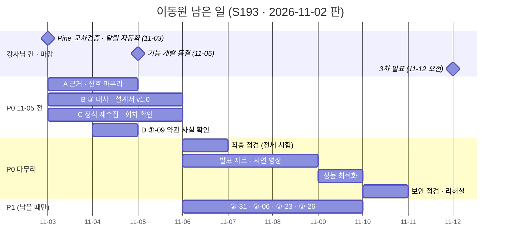

# 이동원 파트 할 일 v2.1 — 3차 남은 일 한눈에

| 문서 정보 | |
|---|---|
| **판 · 상태** | v2.1 · S194 · ②-31 알림 이동 끝 |
| **구분** | 3. 일정·업무 관리 — 담당 범위 작업 계획. 팀 전체 일정은 [WBS](WBS.md) · [스프린트 계획](스프린트계획.md), 세션 차례는 [산출물 목록](../../../산출물목록.md) 12절 |
| **작성** | 이동원(팀장 · 3차 목표 기능 ③ TradingView · Pine Script 주담당 — 부담당 강민석) |
| **검토** | 이동원 — 7절 정할 것 여섯 |
| **최종 수정** | 2026-11-03 20:50 KST (S193) |
| **최종 완료 목표** | 기능 개발 **11-05(목)** — 하루 지연은 허용, **최대 작업 일자는 11-06(금)**(사용자 11-02 · 강사님이 준 최대 일자) · 마무리 **11-06(금) ~ 11-10(화)** · 11-11(수) 마지막 작업일 · **3차 발표 11-12(목) 오전 · 오후 수료식** |
| **가용 시간** | 평일 하루 2 ~ 3 세션(사용자 확인 10-22) · 주말은 사용자가 더 할 수 있음 · 팀 PR · 답글 · 안내 이슈 같은 끼어들기가 하루 약 1 어림 단위(11-02 실측) |
| **코드 확인 기준** | 팀 main `176193dd`(PR #502 · 2026-11-02 20:16 머지) · alembic head `0042_merge_cancel_audits` · 이 PC 앱 개발 모드 재시작 20:30 |
| **기준** | 계획서 v2.0 4.3절 · 요구 대장 `P02-③-1 ~ 3` · 강사님 3차 일정표 · [오준영 3차 계획](오준영파트-할일.md)의 구조(머리 표 → 범위 → 작업별 마감 → 상태) · [지난 판 v1.32](지난판/이동원파트-할일_v1.32.md)(옛 1 ~ 9절 · 부록 전체) |
| **최근 개정** | v2.0 → v2.1: ②-31 알림 설정 본체를 마이페이지 「알림」 구역으로 이동 끝 · `app.html` 코드 검토 후속 정리(동기화 배지 · label for · aria · 구조 지킴이) |

> **이 문서로 알 수 있는 것**
> 1. 내가 할 일이 **얼마나 남았나** — 묶음별 어림 합계와 날짜에 묶인 일 (1절 · 2절)
> 2. 11-05 까지 **들어가나**, 성능 향상에 집중할 **여유가 있나** (4절)
> 3. **누가 무엇을 해야 내 일이 풀리나** — 팀원 · 사용자 몫 (5절 · 6절)
>
> **읽는 순서** — 이동원: 1절 → 4절 → 7절 · 팀원: 5절 · 처음 온 사람: 3절 → 1절
>
> **확실도** — 🟢 저장소 · 공식 원문에서 직접 확인 / 🟡 추정 · 어림 · 팀 확인 전 / 🔴 확인하지 못함
>
> **어림 단위**는 「세션 하나가 줄이는 일의 양」이다(v1.32 6.1-3절). 이 판의 남은 어림은 v1.32 0.4절(S188 · 11-02 13:20)의 묶음 합계에서 S189 ~ S192 에 끝낸 것을 빼고, 줄별로 나눈 값은 **내 어림(🟡)** 이다 — 줄마다 코드를 다시 열어 확인한 값이 아니다.

## 1. 한눈에 — 남은 일

**<표 1> 남은 일 합계 (11-02 저녁 · S193 기준)**

| 구분 | 무엇 | 남은 어림 | 가용(같은 기간) | 판단 |
|---|---|--:|---|---|
| 11-05 까지 **P0** | 묶음 A · B · C · D(①-09) — 없으면 11-12 시연이 끊긴다 | **약 3.1** | 11-03 ~ 11-05 약 6 ~ 9 − 끼어들기 3 = **3 ~ 6** | 🟡 **들어간다 — 가운데 값(약 4.5)에서 약 1.4 여유** |
| 마무리 **P0** | 묶음 E 일정 — 전체 시험 · 발표 자료 · 성능 · 보안 · 리허설 | **약 8.0** | 11-06 ~ 11-10 약 9 ~ 10 | 🟡 **여유 약 1 ~ 2** (끼어들기 버퍼 따로 없음) |
| **P1** | 있으면 좋은 것 — ②-31 · ②-06 · ①-23 · ②-26 · ②-29 · ②-28 (②-02 는 S193 조사로 끝 확인) | **약 8.8** | 위 여유 약 1 ~ 2 | 🟡 **포함하기로 함(사용자 11-02 S193) — 가용을 넘으므로 컷라인으로 관리(3.5절)** |
| **P2** | 개인 판 18줄 — 새로 열지 않는다 | — | 일정 밖 | 🟢 |
| 끝 | 재확인 불필요 22줄 + 이번에 끝난 묶음 A 큰 줄 | — | — | 🟢 |

```text
남은 어림 (한 칸 = 0.5)                     합계 약 19.9 (P2 제외)
A 종목 근거 · 신호    █▌                   0.6
B ③ TradingView       ██▌                  1.2
C 데이터 마감         ██▎                  1.1
D ①-09 약관           ▌                    0.2   ┐ 11-05 전 P0 합 3.1
E 마무리 일정 (P0)    ████████████████     8.0
P1 있으면 좋은 것     █████████████████▌   8.8
```

**결론 (🟡)** — ① **11-05 까지 필수 일은 들어간다.** 다만 시간이 묶인 일(11-03 13:30 뒤 수집 · 12:30 회차 확인 · 강민석 님 답 · 사용자 사실 확인)이 많아 **일의 양보다 날짜가 병목**이다. ② **성능 향상에 쓸 여유는 크지 않다** — 마무리 기간 P0(약 8)이 가용(약 9 ~ 10)을 거의 채운다. 성능 칸은 11-09 한 칸(1.5)뿐이다. ③ **P1 을 포함하기로 했다(11-02 사용자)** — 그러면 수요 약 19.9 가 가용 약 12 ~ 16 을 약 4 ~ 8 넘는다. 병렬 에이전트(3.5절)로 처리량을 늘리고, 모자란 몫은 **컷라인(P1 뒤 순서부터 개인 판)** 으로 자른다. 성능 칸은 11-09 한 칸(1.5)을 지킨다. ④ 팀원 이슈는 끼어들기 버퍼(하루 약 1) 안에서만 받는다 — 넘치는 날은 P1 이 아니라 **C 의 ①-29 · ②-03 부터** 마무리 기간으로 민다.

## 2. 묶음별 남은 일

묶음 이름 순(A ~ E)이다. 줄 번호는 v1.32 2 · 3절의 번호 그대로다(지난판 [2절](지난판/이동원파트-할일_v1.32.md)).

### 2.1 묶음 A — 종목 근거 · 신호 (P0 · 남은 약 0.6)

**<표 2-1> 묶음 A**

| 줄 | 남은 일 | 어림 | 날짜 | 막힌 곳 | 확실도 |
|---|---|--:|---|---|---|
| ②-10 · ②-22 · ②-24 | **구현 끝** — 모달 입구 통일 · 신호 칸 본 값 · 몫 · 주기 묶음(PR #502 · UI 명세서 v0.46). 허브 설계 파일 05 쪽(결정 기록)에 「지연 시세 딱지 그대로 · 애프터마켓 안 만듦 · 문장 다듬기 안 씀」 한 줄 + 신호 순위 1280 그림(UI 명세서 <그림 30>)이 v0.46 모습과 같은지 확인 | 0.2 | 11-03 | 사용자 확인 뒤 | 🟡 |
| ②-33 | 좁은 화면 카드 목록(`signalrankview.css` 640px 이하) · 머리줄 「상태 이름」 글 처리 — **구현 확인됨**(S193 조사 · CSS 직접 확인). 개발 앱에서 390px 눈으로 한 번 보기만 | 0.05 | 11-03 | — | 🟢 |
| ②-32 | 첫 정규 회차(11-03 12:30)에서 `signals_all` 3,950줄 기록 확인 | 0.1 | **11-03 12:30 뒤** | 날짜 | 🟡 |
| ②-32 | 신장환 님 PR(`load_day` `limit` · 전체 집계 · `_universe()`)이 오면 3-way 로 합치고 TC-HUB-61 확인 | 0.3 | 오는 날 | 신장환 님 PR · #487 04 답글(옮겼다는 알림 · 초안만 있음) | 🟡 |

### 2.2 묶음 B — ③ TradingView · Pine · LEAN (P0 · 남은 약 1.2)

**<표 2-2> 묶음 B** · 어림은 v1.32 합계 1.5 를 줄별로 나눈 값

| 줄 | 남은 일 | 어림 | 날짜 | 막힌 곳 | 확실도 |
|---|---|--:|---|---|---|
| ①-11 | 판 2 대사 — #497 보고서는 **부분 일치**(신호 40/40 · 보유 상태 5일 불일치 · TradingView CSV 없음). 내 답글 02 · #433 02 댓글은 **올림** | 0.3 | 강사님 칸 11-03 | **강민석 님 답** · CSV 낼 사람 | 🟡 |
| ①-22 | 웹훅 → 기록 → 알림 → DB E2E · ③ 설계서 v1.0 · 대사 결과 보고(차이 원인 표) · TC-ECH 유지 | 0.6 | 11-05 | ①-11 | 🟡 |
| ①-15 | 차트 · 대사 화면(어긋난 날 표시 · 데이터 기준일) | 0.2 | 11-04 | ①-11 | 🟡 |
| ①-07 | Pine 생성 코드를 TradingView 편집기에서 컴파일하는 손 확인 한 번 | 0.1 | 11-03 | 사용자 TradingView 로그인 | 🟡 |
| ①-03 | 설계서 v0.1 끝 — v1.0 은 ①-22 에서 | — | — | — | 🟢 |
| 후속 | **LEAN 체결 시점 정렬** — 설계 **끝, 판정 「조건부 가능」**(`docs/phase-3/01-analysis/research/배경조사/2026-11-02-LEAN-체결시점-정렬/` 설계 · 판정 · README). **정정**: LEAN 은 신호 **다음 거래일(D+1)** 에 체결한다(15:29 시장가가 엔진 규칙으로 MarketOnOpen 으로 바뀜 — LEAN 로그). 그런데 입력이 하루 한 값이라 「시가」가 D+1 종가다 → 차이 223.46 · 440.84bp 는 D+1 시가↔종가 간격과 같다(슬리피지 10bp 는 양쪽에서 지워짐 · 수집 DB 직접 검산). **나머지 네 날(10-23 ~ 10-28)은 시점이 아니라 일지의 매도 비율 0.5**(`app/models/trading.py:133` 기본값 · 재계산 거래대금 6,205,620원 = 보고서 값 🟡) — 정렬해도 남는다. 추천 안 B1(선택 모드 `fill_timing=next_open` · 대사 스크립트만 사용 · 수량 여유분 w) **1.5 ~ 2 세션**. 조건: 도커 1회 확인(**11-04 이동원 PC 에서 직접 — 사용자 결정 11-02: 도커 관리는 사용자가 함**) · 강민석 님 동의(협의 이슈 **#503** — 사용자가 11-02 에 올림 · 강민석 님 답 대기 · 원문 `github-archive/2026-11-02/이슈-협의-LEAN-체결시점-정렬-강민석/`) · 여유분. 11-04 까지 조건이 안 서면 **안 A 한계 문단**(판정.md 초안)으로 11-06 보고서 마감, 나머지는 개인 판 | 설계 끝 · 구현 1.5 ~ 2 | 강민석 님 합의 · 도커 확인 | 🟡 |

### 2.3 묶음 C — 데이터 파트 마감 (P0 · 남은 약 1.1)

**<표 2-3> 묶음 C**

| 줄 | 남은 일 | 어림 | 날짜 | 막힌 곳 | 확실도 |
|---|---|--:|---|---|---|
| ①-01 · 수집 | 11-02 종가를 포털이 11-03 13:30 뒤에 줌 → `run --upload` 정식 재수집 → 파생 단계 → HF 재업로드 | 0.5 | **11-03 13:30 뒤** | 포털 게시 시각 | 🟢 |
| ①-12 | 12:30 회차 사흘 연속 정상 · 품질 경고 0 확인 | 0.2 | 11-03 ~ 11-05 | 날짜 | 🟡 |
| ①-28 | 모든 PC 가 새 코드가 된 뒤 사람이 `min_protocol` 올림 | 0.3 | 11-05 전 | 다른 PC 새 코드 | 🟡 |
| ①-29 | **끝(코드 · 시험)** — 정리 작업은 10-30(`cc32c503`)에 이미 있었음(7일 지난 허용 키만 · 매일 03:40 Celery beat). S193: 백업 `scripts/personal/backup-appdb.ps1`(캐시 행 제외 + **상태 키 `quant:%` 를 `.state.csv` 로 따로 내보냄**) · 복원 `restore-appdb-state.ps1`(기본 `-DryRun` · `-Apply` 는 한 트랜잭션 upsert) · TC-DCP-05 ~ 10. 시험 12건 통과를 제가 다시 돌려 확인 · 임시 DB 왕복(원본 지문 일치) 에이전트 보고 · 개발 DB 167줄 전후 동일. **후속 끝(S193)**: 사용자 결정 셋 반영 — 복원은 대상이 더 최근이면 **지킴**(`WHERE updated_at <= EXCLUDED.updated_at`) · 상태 접두사 `quant:` + `model_compare:`(`ai_predict:` 는 TTL 3h 라 제외) · 상태 파일도 민감 대상 안내 · 리뷰어 지적 반영(공용 `_appdb-state.ps1` · 파일 이름 초 · 짝 확인 · try/finally · 폴더 ACL · `.gitignore` `*.dump` `*.state.csv`). 시험 TC-DCP-01~17 **30건 직접 재실행 통과** · 임시 DB 왕복(최근 지킴 · 멱등 포함) 에이전트 보고 · 임시 DB 0건 · `quant:` 키 2줄 그대로 · 새 백업 파일 없음 직접 확인. 남음: 안내서 · `scripts/personal/README.md` 한 줄 · 정할 것 여섯(7.2절) | 0.1 | 11-05 전 | 사용자 결정 | 🟢 |
| ②-03 | **끝(10-22)** — HF 19개 데이터셋 해시 대조 · 빠진 여섯 건 올림([결과](../../01-analysis/research/배경조사/2026-10-22-데이터-HF-보강/결과.md)). 러너가 새로 올리는 분은 대조 대상 아님 | — | — | — | 🟢 |
| ①-06 | 시장별 달력 뷰는 끝 — 내보내기 `ohlcv-v2` 는 **11-12 뒤** | — | 개인 판 | — | 🟢 |
| ①-24 · ①-25 | 매일 12:30 회차 · 일요일 리허설 확인 · 묶음마다 내 파트 점검 — 운영 예비 | (예비) | 매일 | — | 🟢 |
| ①-33 | S188 이 C 에 더한 줄인데 이 문서에 본문이 없다 — 내용은 지난판 v1.32 0.4절 합계에 들어 있을 뿐 확인하지 못함 | ? | — | 확인 | 🔴 |

**참고** — 이 PC 의 11-02 18:53 회차는 **따라가기만** 했다(DESKTOP-KD12JUJ 가 11-02 자리를 끝냄 · HF 조각 23개 맞춤 · 신호 계산 401종목 오류 0 · 업로드 안 함). 수집 DB 가격 기준일은 **20261030**(맞다). HF `main` 커밋은 이 PC 에서 읽지 않았다(🔴).

### 2.4 묶음 D — 계정 · 마이페이지 (P0 ①-09 · P1 ②-31)

**<표 2-4> 묶음 D**

| 줄 | 남은 일 | 어림 | 날짜 | 막힌 곳 | 확실도 |
|---|---|--:|---|---|---|
| ①-09 | 처리방침 p0.4 는 구현 끝. 남음: 처리 위탁 · 제3자 제공 **사실 확인** · 책임자 실제 연락처 · 알림 동의 화면 안내 이슈 게시 · #397 후속 | 0.2 | 11-04 | **사용자 확인** | 🟡 |
| ②-31 | 설정 본체를 마이페이지 구역 안으로 — **P1**. **알림 본체 이동 끝(11-03)**: `app.html` 알림 설정 본체 약 240줄을 마이페이지 「알림」 구역으로(칸 id · 서버 그대로 · 주소 `#notification-settings` 는 구역을 열고 빈 껍데기 화면 키를 남김 · `viewalias.js` 의 `MYPAGE_HOSTED`) · 시험 TC-MP-08 추가 · TC-MP-03 · 06 · TC-UC-04 고침 · 브라우저 1280 · 390 직접 확인. **Open API 본체(약 31줄)는 안 옮김** — 별도 도구에 가깝고 Alpaca 카드 처리는 사용자 결정(조사 `docs/phase-3/01-analysis/research/배경조사/2026-11-03-설정-본체-이동-범위/결과.md`). 같은 날 `app.html` 코드 검토 후속 정리도 끝: 동기화 배지 클릭 오류(`window.triggerSync`) · `label for` 102곳 · `aria-label` · 구조 지킴이 TC-AHS-01 ~ 11(동결 뒤로 미룬 정리는 `2026-11-03-app-html-코드검토/결과.md` 5.2절). 남음: 안내 이슈 초안 올리기(`github-archive/2026-11-03/이슈-안내-app-html-접근성-정리-알림본체-이동-전원/`) · Open API 를 옮길지 사용자 결정 | 0.3 (남은 것) | 11-06 | 알림 끝 · Open API 결정 대기 | 🟡 |

### 2.5 묶음 E — 마무리 · 발표 · 문서 (P0 일정 8.0 + P1 후보 7.5)

**<표 2-5> 묶음 E — 일정은 v1.32 4절 그대로**

| 날 | 강사님 칸 | 작업 | 어림 | 확실도 |
|---|---|---|--:|---|
| 11-05(목) ~ 11-06(금) | 기능 동결(목표 11-05 · 최대 11-06) | 전체 시험 `test.ps1 -Split -Detach` + 결함대장 정리 + 문서 판 올림 목록 확정(본문을 실제로 고친 문서만 판 올림 · 안 닿은 문서는 정합성 점검만) | (11-06 칸에 포함) | 🟡 |
| 11-06(금) | 서비스 통합 · 단위 시험 | 3차 최종 점검 — 전체 시험 · 기능 점검 · 화면 훑기 · 결함마다 번호와 고칠 날 | 1.0 | 🟡 |
| 11-06 ~ 11-08 | — | 발표 자료 · 시연 영상(녹화 `tools/demo/record_demo.py` · 내보내기 `export_mp4.py` · 한 파일 판 `bundle_deck.py`). 시연 한 줄 = 신호 카드 → 근거 모달 → PAPER 수량 → 주문 → 체결 알림 → 일지 | 4.0 | 🟡 |
| 11-09(월) | 통합 · 회귀 시험 · **성능 최적화** | 응답 시간 · 차트 그리기 · 러너 단계 시간 재고 고침 — 고치기 전 · 뒤 숫자 표 | **1.5** | 🟡 |
| 11-10(화) | 보안 점검 · 배포 | 보안 점검표 · README 판 · 판 동결 준비(태그) · 발표 리허설 | 1.5 | 🟡 |
| 11-11(수) | UAT · 인수 · 최종 발표자료 | 마지막 리허설 · 자료 · 영상 동결 | — | 🟢 |
| 11-12(목) | 오전 발표 · 오후 수료식 | **3차 발표** | — | 🟢 |

**P1 후보 (앞 날에 시도 · 못 하면 개인 판)** — 순서는 평가 직결 순

| 줄 | 무엇 | 어림 | 비고 |
|---|---|--:|---|
| ②-06 | 감리대응 빈칸 — **초안 완료**(`docs/phase-3/01-analysis/research/배경조사/2026-11-02-감리대응-채움안/` 세 파일). 추천: 결함대장 표 9 본표는 두고 **5절에 「표 9-2 시정조치 처리표」(DF 번호 열쇠)를 따로 둔다**(열림 30 + 일부 닫힘 10 = 40줄만 값이 필요 · 본표 칸 추가는 문서작성기준 판 올림이 따라옴). 첫 칸은 「재시험 결과 ID」. 「가상·실제」 칸은 원문 정의를 못 찾아 `증거 구분`(실제/계획/기록 없음)으로 제안. 기능 칸(검사기준서·시험 시나리오·결과표)은 새로 만들 문서 없이 기존 문서의 칸·절·한 줄로 메우는 비는 곳 8개. 남음: 사용자 결정 8건(초안 README) → 적용 | 2.0 | 평가 직결 🟢 |
| ②-26 | 3차 산출물 칸 · 보고서 5단 목차 · 레드펜 9문 자체 점검 — **초안 네 파일 완료**(`docs/phase-3/01-analysis/research/배경조사/2026-11-02-3차산출물칸-레드펜/` · 근거 직접 확인). 남음: 사용자가 담당 제안 · 레드펜 9문 원문 이름 · 쪽 번호 확인(🔴) → 계획서 5.3 반영은 판 올림 때 | 0.3 | 평가 직결 · 11-05 · 11-10 점검 |
| ①-23 | 2차 몫 남은 것 — 사용자 선택(11-02): **A 관계 지도 · B 교재 밑줄 · E+F 일정(경제지표 · 공모) · C 표본 200**(G 뜻으로 찾기 · D 공시·뉴스 10문항은 다음 판). **C 도구 끝**: `scripts/tagging_sample.py`(`draw` · `score`) · 시험 7건 통과(직접 재실행) · 표본 `docs/_local/이름표-표본200/표본_seed20261102.tsv` 200줄(공시 100 · 뉴스 100 · 층화 · 시드 고정) — **판정은 사용자 몫(1~2시간 어림)**. **A 끝**: 용어 한 장 아래 「관계 지도」(`glossary.js` · `qurious.css` · 시험 TC-GLG-01~06 + 관련 시험 14건 직접 재실행 통과 · **Playwright 로 1280 · 390 직접 확인** — PER 지도 · 점선 + ≠ 로 구분 · 390 목록으로 쌓임 · 가로 스크롤 없음 · 클릭 이동 동작 · ETF 는 빈 상태가 정직하게 보임) · 관계 후보 60건 중 **59건 적용 끝**(🟢 51 + 🟡 8 — 🟡 는 한국은행 · 금융감독원 용어사전 · 상법 · SEC · KOFIA 등 독립 출처 2건 이상으로 검증 · 사용자 승인) → `glossary_build.py` `RELATIONS` 로 `terms.json` 재생성(관계 31 → **90** · 용어 768 불변 · +531/−0 · 개발 앱 `in_sync: true`) · **깊이 1 기본 + 「더 보기」 때 깊이 2**(사용자 결정) · 모든 종류 note · 시험 TC-GLG 11건 + TC-GL 93건(임시 DB) 통과(에이전트 보고 · 일부 직접 재실행) · **Playwright 로 ETF 지도 직접 확인**(상위 펀드 · 헷갈리기 ETN · 함께 알면 좋은 말 5 · 하위 액티브/패시브 · 더 보기 → 14노드). **보류 1건**: 무차입 공매도 → 공매도 — 우리 `공매도` 풀이가 한국은행 틀(「빌린 주식을 먼저 팔고」)이라 풀이를 금감원 · 거래소 틀(「소유하지 않은 증권의 매도」)로 바꾸는 사용자 결정이 먼저. 남음: 후보 검토 · 적용 · 다크 모드 눈 확인 · Figma 캡처(후보 적용 뒤) · **B 끝**: 교재 밑줄(`termunderline.js` 새 파일 · `conceptlearn.js` +3줄 · CSS 맨 끝 구역 · 시험 TC-TUL-01~07 · 관련 시험 통과 · scan 실측 첫 호출 79ms · 평균 8~11ms · **Playwright 로 직접 확인** — 성과 지표 장에서 점선 밑줄 30개 · 코드/제목/링크/그림 안 0개 · 클릭하면 용어 서랍(수익률) · 차례 칸 「용어 밑줄 보기」 토글(끄면 0 · 켜면 30) · 390 가로 스크롤 없음). 남음: 정할 것(첫 등장 절마다/장 전체 · 스크린리더 소음 · ~~`termcard.js` 카드 닫은 뒤 포커스 복귀~~ **반영 끝(S193 · Playwright 로 직접 확인 — Esc 로 닫으면 연 밑줄 단추 「용어 설명 열기: DSR」 로 포커스 복귀 · 시험 TC-TCH-04~05d)**) · Figma 장 한 편 캡처 · 사용자 판정 → `score` → 보고서 v0.2. 주의: 층화로 유효 표본이 40~55 라 「0.9 충족」 보증은 어렵다(나쁜 이름표를 찾는 데 쓸 만함) | 약 1.7 (A 0.5 · B 0.4 · E+F 1.2 − 끝난 C) | 2차 몫 | 🟡 |
| ②-29 | **S14 · S17 구현 끝**(S193) — S14: 대사 화면 「성과 비교」 표 (i) 4칸(`수익률` · `mdd` · `win_rate` · `sharpe` — 개발 앱 `/api/glossary` 200 확인 · 거래 횟수는 표제어 없어 (i) 안 닮). S17: 「가상 매매 기준 · 실제 돈이 오가지 않는 참고용 결과이며 투자 권유가 아닙니다」 를 `app.html` 337 · 2270행(팀원 화면 HTML 한 줄씩) + `dashboard.js` 128행. 팀원 JS(`paper.js` · `robo.js`) 무변경 · 시험 TC-CPY-01~04 + 관련 시험 직접 재실행 통과. **주의문 수정 끝(S193)**: 사용자 결정(「데모 데이터 표시 + 가장 아래」) 반영 — 세 곳이 같은 문구(「…투자 권유가 아닙니다. 관리자가 시연용으로 만드는 데모 데이터는 임의로 만든 샘플이며 모의투자 결과가 아닙니다.」) · `app.html` 두 곳은 카드/화면 마지막 요소 · `dashboard.js` 는 상수 `PAPER_NOTICE` 로 패널 마지막 · 시험 TC-CPY-01~05 + 관련 10개 파일 통과(에이전트 보고) · **Playwright 로 직접 확인**(주의문 2곳 표시 · 부모의 마지막 자식). **정직한 한계**: `paper.js` 가 런타임에 100일 백테스트 카드를 `paper-dashboard` 맨 끝에 붙여서(1300행 `appendChild`) 주의문이 그 카드 **위**에 보인다(강민석 님 파일 — 안내 이슈에 한 줄 요청) · 「데모 사용 중에만 배지」는 `robo.js` · 서버 신호가 필요해 안내 이슈로. 남음: 안내 이슈 초안 게시(사용자) · 전체 화면 설계(Figma) 나머지 0.75 | 0.75 | 안내 이슈 · Figma | 🟢 |
| ②-02 | **끝** — 요구 대장 `감리번호 · 인수기준` 칸 59줄 중 39줄 채움 · RTM 2.7절 대응표 · `rtm_scan` 이 꼴 · 겹침 점검(나머지 20줄은 설계상 짝 없음) | — | 🟢 시험 통과는 이번에 안 돌림 |
| ②-28 | DSR 숫자 — **일부**: 코드는 고쳐짐(`evaluation_risk.py` `dsr_sharpe = sharpe / √periods` · 강민석 님 10-29). 남음: 재현 스크립트 다시 돌려 숫자 확인 + 개념 학습 장 10.2절 숫자 갱신(장 원문은 이 저장소에서 못 찾음 🔴) | 0.25 | 강민석 님 고침은 끝 |

### 2.6 줄 처분 — 63줄 (v1.32 0.5절 그대로)

**<표 2-6> 줄 처분**

| 처분 | 줄 수 | 줄 |
|---|--:|---|
| 끝(재확인 불필요) | 22 (+ S193 조사로 ②-02 · ②-03 · ②-33 후속 끝) | ①-01 · 02 · 04 · 05 · 08 · 10 · 14 · 16 · 17 · 18 · 19 · 26 · 27 · 31 · 32 · ②-18 ~ 21 · 23 · 25 · 30 (②-23 은 #481 의 PAPER 수량 계산이 흡수) |
| 묶음 A | 3 | ②-10 · 22 · 24 (+ 새 ②-32 · 33) |
| 묶음 B | 5 | ①-03 · 07 · 11 · 15 · 22 |
| 묶음 C | 7 | ①-06 · 12 · 24 · 25 · 28 · 29 · ②-03 |
| 묶음 D | 2 | ①-09 · ②-31 |
| 묶음 E P1 후보 | 6 | ①-23 · ②-02 · 06 · 26 · 28 · 29 |
| **개인 판 P2** | 18 | ①-13 · 20 · 21 · 30 · ②-01 · 04 · 05 · 07 ~ 09 · 11 ~ 17 · 27 — 새로 열지 않는다 |

## 3. 날짜에 묶인 일

일의 양이 아니라 **그날이 와야 하는** 일이다. 날짜가 맞을 때만 한다.

**<표 3> 날짜 달력**

| 날 · 시각 | 무엇 | 누가 | 줄 |
|---|---|---|---|
| 11-03 09:10 | 오준영 님 #183 C5 재주문 **단발 작업** — 결과는 오준영 님 글(주문번호 · 체결 · 잔고)로 판정. 내 몫 없음 · 새 글이 오면 원문 보관 · 색인 | 오준영 님 | #183 |
| 11-03 오전 | 강사님 칸 「Pine 교차검증」 | 이동원 | ①-11 |
| 11-03 12:30 | 정규 회차 — `signals_all` 3,950줄 · 품질 경고 0 · 11-02 포함 확인 | 러너 | ②-32 · ①-12 |
| 11-03 13:30 뒤 | 11-02 종가 정식 재수집 → 파생 → HF 재업로드 | 이동원 | ①-01 |
| 11-03 오후 | 강사님 칸 「알림 자동화」(구현 끝 · 디스코드 도착 11-02 확인) | 이동원 | ①-14 |
| 11-04 | 차트 · 대사 화면 · ①-09 약관 사실 확인 | 이동원 · 사용자 | ①-15 · ①-09 |
| **11-05(목)** | **기능 동결(목표)** · 전체 시험 · 결함대장 · 판 올림 목록. **하루 밀려도 괜찮다 — 최대 11-06(금) 까지** | 이동원 | E |
| 11-06 ~ 11-10 | 마무리 기간(2.5 표) | 이동원 | E |
| 11-11(수) | 마지막 작업일 · 리허설 | 팀 | — |
| **11-12(목)** | **3차 발표** | 팀 | — |

**<그림 1> 남은 일 달력(제안)** · 범례: 막대 = 작업 · ◆ = 강사님 칸 · 마감



### 3.5 병렬 에이전트 운영 규칙 · P1 컷라인 (사용자 결정 11-02 S193)

팀원 진행 상황과 이슈를 보면서 중간중간 병렬 에이전트로 동시에 진행한다. **P1 까지 포함**하되 수요가 가용을 넘으므로 컷라인으로 자른다.

**<표 3-5> 병렬 운영 규칙**

| 항목 | 규칙 |
|---|---|
| 동시 작업 | **쓰기(구현·문서 작성) 에이전트는 동시에 2개까지.** 같은 파일을 두 에이전트가 만지지 않게 파일 범위를 나눠 맡긴다 |
| 조사 에이전트 | 읽기 전용 조사는 개수 제한 없음. 결과는 반환 메시지로만 받고 **핵심 주장은 메인이 원문으로 다시 확인**한다 |
| 모델 · effort | 가벼운 작업(조사 · 정형 구현 · 초안)은 **Sonnet**, 무거운 작업(설계 판단 · 여러 모듈 · 되돌리기 어려운 변경)은 **Opus** — 모델과 effort 는 한 쌍(전역 7.3) |
| 금지 | 에이전트는 git 쓰기 · 원격 통신 · GitHub 접근을 하지 않는다(전역 10절). 팀 파일(공용 셸 · 팀원 서비스)은 고치지 않고 안내 이슈 초안만 |
| 시험 | 에이전트는 지정한 시험 파일만 돌린다. 전체 시험은 메인이 수집 회차가 끝난 뒤 한 번 |
| 팀 진행 확인 | 사용자가 `git fetch` 한 뒤 읽기 에이전트가 로컬 참조(`HEAD..origin/main`)와 보관된 팀 글만 읽는다. 세션 첫머리 · 묶음 사이마다 |
| 결과 반영 | 에이전트가 낸 문서 판 올림 거리는 **변경 노트로만** 모으고 마지막에 한 번 판을 올린다 |

**<표 3-5b> 세션 묶음 — 한 세션에 작은 일 3개 또는 큰 일 2개** (사용자 결정 11-02 S193 · 쓰기 에이전트는 동시 2개)

| 묶음 | 크기 | 일 | 어림 | 언제 | 비고 |
|:-:|---|---|--:|---|---|
| 1 | 작은 3 | ①-29 백업 상태 키 따로 내보내기(c) · ②-29 S14(내 대사 화면 1곳)+S17(HTML 한 줄·내 대시보드 한 줄·안내 이슈 초안) · ①-23 C 표본 200 추출 코드(판정은 사람) | 약 1.4 | 11-02 밤 ~ 11-03 오전 | Figma 불필요 |
| 2 | 작은 3 | ①-23 A 용어사전 관계 지도(관계 30~60건 큐레이션 포함) · ①-23 B 교재 밑줄 · ②-26 · ②-28 확인 반영(사용자 확인 뒤) | 약 1.2 | 11-03 | — |
| 3 | 큰 2 | ②-31 알림 · Open API 본체 이동(1.5~1.75) · ①-23 E+F 일정 경제지표 · 공모(1.2 · 원천 약관 확인 0.1 먼저 · 달력 새 칩은 Figma 결정 한 번) | 약 2.8 | 11-04 (**fetch · pull 뒤**) | `app.html` 공용 파일 — 겹침 점검 먼저 |
| 4 | 큰 2 | ②-06 적용(결함대장 칸 · 대응표 · 판 올림 거리) · LEAN 체결 시점 정렬(설계 판정 뒤 구현 또는 안 A) | 약 3.0 | 11-04 ~ 11-05 | 강민석 님 합의 필요(LEAN) |
| 병행 | P0 | 11-03 13:30 뒤 재수집 · 12:30 회차 확인 · ①-11 대사(강민석 님 답) · ①-22 마무리 · ①-12 · ①-28 | 약 3.1 | 날짜대로 | 묶음과 겹치면 날짜가 우선 |

묶음 1 ~ 4 합 약 8.4 + P0 3.1 = 11.5 — 11-03 ~ 11-06(4일) 순가용 약 4 ~ 8 을 넘는다. 병렬 에이전트로 처리량을 늘리되 **11-04 저녁 컷라인 점검에서 묶음 3 · 4 의 뒤쪽부터 자른다.** 선택에서 빠진 ①-23 G(리서치 뜻으로 찾기) · D(공시 · 뉴스 근거 답 10문항)는 다음 판 / 개인 판이다.

**<표 3-6> P1 컷라인 — 순서는 위에서부터** (평가 직결 → 싼 것 → 큰 것)

| 순서 | 줄 | 어림 | 누적 | 비고 |
|:-:|---|--:|--:|---|
| 1 | ②-26 3차 산출물 칸 | 0.3 | 0.3 | 평가 직결 · 초안 끝 · 사용자 확인 대기 |
| 2 | ②-06 감리대응 빈칸 | 2.0 | 2.3 | 평가 직결 · 칸 추가안 초안 진행 중 |
| 3 | ②-28 DSR 숫자 | 0.25 | 2.55 | 싼 것 · 코드는 고쳐짐 |
| 4 | ②-29 화면 설계 남은 것 | 1.25 | 3.8 | — |
| 5 | ①-23 2차 몫 남은 것 | 2.5 | 6.3 | 마무리 기간 |
| 6 | ②-31 마이페이지 2차 | 2.5 | 8.8 | 범위 재확인 뒤 줄 수 있음 · **먼저 자를 후보** |

**여유 하루**: 기능 일은 11-05 를 목표로 하되 **11-06(금)까지 쓸 수 있다**(P0 는 11-05 안에 끝내고, 넘치는 P1 과 큰 줄은 11-06 에 쓴다). 대신 11-06 의 최종 점검(전체 시험 1.0)은 11-06 저녁~주말로 밀린다 — 총 가용은 그대로이고 **날짜 선택지만 늘었다**.

**컷라인 점검**: 11-04 저녁에 (남은 P1 어림) 과 (병렬 에이전트로 늘어난 실제 속도)를 맞대, 못 들어가는 뒤 순서부터 개인 판(11-12 뒤)으로 보낸다. 팀원 이슈가 끼어들기 버퍼(하루 약 1)를 넘기면 같은 크기를 P1 뒤 순서에서 뺀다.

## 4. 11-05 까지 들어가나 · 성능 향상에 집중해도 되나

**<표 4> 수요 ÷ 가용 (🟡)**

| 기간 | 필수(P0) | 가용 | 끼어들기 | 순가용 | 수요 ÷ 가용 |
|---|--:|--:|--:|--:|--:|
| 11-03 ~ 11-05 | 약 3.1 | 약 6 ~ 9 | 약 3 | 약 3 ~ 6 | 0.5 ~ 1.0 |
| 11-06 ~ 11-10 | 약 8.0 | 약 9 ~ 10 | (따로 없음) | 약 9 ~ 10 | 0.8 ~ 0.9 |
| **합** | **약 11.1** | 약 15 ~ 19 | 약 3 | **약 12 ~ 16** | **0.7 ~ 0.9** |

- **읽는 법** — 필수 일은 **가용을 거의 다 쓴다**. 11-05 전은 가운데 값에서 맞고, 팀 PR 이 많은 날 한 번 넘치면 C 의 ①-29 · ②-03 이 마무리 기간으로 밀린다.
- **성능 향상에 쓸 여유** — 합 기준 약 0 ~ 4. 지금 계획의 성능 칸은 11-09 한 칸(1.5)이다. **P1(약 10)을 그대로 두면 성능에 더 쓸 시간이 없다.**
- **팀원 이슈는 끼어들기로 센다** — 그때그때 풀되 하루 약 1 단위를 넘기지 않는다. 설계가 필요한 이슈(예: #487 신장환 님 PR 3-way)는 줄로 넣고 같은 크기를 뺀다.
- **어림이 낮게 나오는 편** — 작은 줄에 ×1.3 을 주면 P0 합이 약 15 가 되어 가용을 넘는다(v1.32 6.1-3절 <표 5-4>의 경고와 같다).

필요한 하루 세션으로 바꾸면(합 11.1 ÷ 8일 ÷ 일에 쓰는 비율 76 ~ 85%) **약 1.6 ~ 1.8 어림 단위/일**이고, 지난 두 주 평균은 2.4 세션/일이다 — 속도는 맞지만 **팀원 이슈 · 날짜 병목이 끼면 바로 넘친다.** (이 값은 v1.32 6.3절 방식의 설명용 어림이며 Figma 문서 그림은 새로 그리지 않았다 — 기존 <그림 2> · <그림 2-1>은 지난판 v1.32 6절에 그대로 있다.)

## 5. 기다리는 곳 — 팀원

**<표 5> 팀원 · 외부**

| 상대 | 기다리는 것 | 필요한 때 | 안 오면 | 닿는 줄 |
|---|---|---|---|---|
| 강민석 님 | #497 · #433 답(내 답글 02 · 댓글 02 올림) · 9-29 원인 코드(`positionPct` 전달 — 강민석 님 몫) · TradingView CSV · #263 답 | 11-03 오전 칸 | 합성 입력 대사 + 「CSV 없음」을 한계로 적는다 | ①-11 · ①-22 |
| 신장환 님 | #487 `load_day` `limit` PR · #488 머지 뒤 대장(TC-CRD · TC-HBE · TC-SHT) · 차트 패턴 화면 입구 | 오는 날 | 현재 대상 목록으로 둔다 | ②-32 · ②-10 |
| 오준영 님 | #183 C5 11-03 09:10 결과 · #280 04 답글에 필요한 HF 사실 · PR #490 · 테스트 계획서 표 5 의 **빠진 26 묶음**(요구 ID · 확실도 작성자 확인) | 11-03 | 이동원 몫 없음 / 표 5 제목에 미정리로 적어 둠 | ①-01 · E |
| 강사님 | 11-03 칸 · 11-11 UAT | 일정대로 | — | ①-11 · E |

## 6. 사용자 몫 (내가 못 하는 것)

AI 는 원격 쓰기를 하지 않는다(전역 10절). 아래는 사용자가 하거나 정한다.

**<표 6> 올릴 글 · 확인 · 정리**

| 구분 | 항목 | 비고 |
|---|---|---|
| 올릴 글 | #280 04 답글(올리기 전 HF 사실 — 시세 기준일 · 새 커밋 — 다시 맞출 것) | 초안 있음 |
| 올릴 글 | #476 04 정정 댓글 | 초안 있음 |
| 올릴 글 | 안내 이슈 「종목 근거 모달 직행 · 쉬운 설명」 — #502 의 본 값 · 몫 · 주기 묶음 · 좁은 화면 카드 한 줄을 더하면 좋다 | 초안 있음(S188) |
| 올릴 글 | 안내 이슈 「증권사 설정 메뉴 줄 제거 · 코인 차트」 — #473 으로 이미 올렸는지 확인 | 초안 있음(S185) |
| 닫아도 되는 후보 | #478(오준영 님 PR #481 구현 · 병합 · Docker 반영 확인) · #468(오준영 님 몫 완료 · 강민석 님 몫은 확인 필요) | 닫기는 사용자 |
| 색인 | Github-링크.md · README 「안 올림」 표기가 실제로는 올린 글일 수 있음 — 번호를 알려 주면 채움 | — |
| 정리 | 미추적 루트 md 넷(`onprem.md` · `pipeline.md` · `screening.md` · `tradingview.md`) · `alembic.ini` · `start.sh` — **올리지 않기로 함**(11-02) | 학원 PC 변경 |
| 정리 | Figma 안 쓰는 파일 `E4oHE6TTaKA6vwPhjxSauN` 삭제 | 사용자 손 |
| 끝(11-02) | `.env` 의 Ollama 두 줄 지움 → 앱이 팀 표준(`qwen2.5:1.5b`)을 가리킴 · `/mcp` 로그인 · 키 환경변수 · #433 02 댓글 | 🟢 |

## 7. 정할 것 — 사용자 (추천은 첫 칸)

**<표 7> 정할 것**

| # | 정할 것 | 추천 · 까닭 |
|:-:|---|---|
| 1 | ~~성능 향상 칸을 넓힐지~~ **결정됨(11-02 S193) — P1 포함.** 남은 정할 것: 컷라인을 11-04 저녁에 다시 재서 P1 뒤 순서를 개인 판으로 자를지 | **컷라인으로 관리** — 11-04 저녁에 남은 P1 어림과 병렬 에이전트 실측 속도를 맞대 보고 자른다(3.5절). (결정 전 추천이었던 「②-06 결함대장 칸만 남기기」는 접는다)|
| 2 | LEAN 입력 일봉을 수집 DB 로 바꾸는 안(+약 0.5)을 할지 | **3차에서는 안 하고 「야후 일봉 입력」을 한계로 적는다** — 11-03 강민석 님 답이 먼저, 법적 판단(Public 저장소 야후 재배포)이 사용자 몫 |
| 3 | 근거 · 반대 근거를 보이는 수(지금 3 : 2)를 같게 할지 | 같은 크기 · 같은 수 — 조사 둘 다 같은 방향(v1.32 0.7절 3번) |
| 4 | ①-33 이 무엇인지 | 본문을 찾지 못함 — 알려 주면 줄로 넣는다 |
| 5 | 팀원 이슈에서 **어디까지 직접 풀고 어디서 이슈로 돌려보낼지** | 하루 약 1 단위 안 · 설계가 필요한 것은 줄로 넣고 맞바꿈 |
| 6 | ~~앱 DB 백업 기본값~~ **결정됨(11-02 S193)** — PC 를 오가며 자동매매를 시험하므로 상태 키(`quant:cycle_log` · `quant:reconcile:baseline`)가 중요 | **(c) 채택** — 캐시 행은 계속 빼고 `quant:%` 상태 키만 `COPY` 로 따로 내보내 복원 때 upsert(+약 0.5, ①-29). 별도 표 이전(d)은 11-12 뒤 안내 이슈로 제안 |

결정됨(참고): 수급 자료는 3차에서 다시 열지 않는다(D6 ⑥) · 신호 전체 종목은 KOSPI · KOSDAQ + ETF 우선주 포함 + 「분봉 없이 계산」 표시 · 예측력 문구는 #488 적중 대조로 교체됨 · 애프터마켓 딱지 · Ollama 문장 다듬기는 안 한다 · 신호 순위는 새 화면(안 A).

### 7.1 백업 조사에서 나온 부수 발견 (S193 · 코드로 확인)

**<표 7-1> 부수 발견**

| 발견 | 내용 | 어림 | 누구 |
|---|---|---|---|
| 만료된 상태 아닌 키가 안 지워짐 | `ai_predict:v3 · v4`(개발 DB 62줄 약 133KB) · 7일 넘은 `model_compare` 가 정리 허용 목록 밖이라 영영 안 지워진다. 둘 다 재생성 가능한 캐시(TTL 3h · 7일) | 0.1 | 이동원(①-29 파일) |
| 계정 삭제가 기준선·최근 점검을 안 지움 | `account.py:299` 는 `quant:cycle_log:{uid}` 만 지우고 `quant:reconcile:*:{uid}` 는 안 지운다 — 사용자별 데이터가 남는다(개인정보 처리방침 p0.4 와 어긋날 수 있음) | 0.1 | 코드는 이동원 확인 · 정합성 서비스는 오준영 님 → 안내 이슈 |
| 자동매매 현황 화면 이스케이프 누락 | `public/js/quant.js:176` 이 `cycle.risk.day_pnl_pct` · `orders_today` 를 `innerHTML` 에 이스케이프 없이 넣는다(같은 줄의 `label` 등은 이스케이프됨). 평소엔 서버가 숫자를 주지만 **변조된 상태 파일을 복원하면 저장형 XSS 경로**가 된다(S193 보안 점검 F4 · 위험 낮음). 파일 주인은 오준영 님 → 고치지 않고 안내 이슈 | 0.05 | 오준영 님(안내 이슈) |
| 백업 산출물 무시 규칙 | `.gitignore` 가 `data/local-run/` 경로만 막고 `*.dump` · `*.state.csv` 는 막지 않는다(`git check-ignore` 로 확인 · F1). 경로 밖에 두고 `git add -A` 하면 Public 저장소에 올라갈 수 있다 → `.gitignore` 두 줄 추가(①-29 후속에서) | 0.05 | 이동원 |
| 데모 데이터 단추가 관리자의 진짜 스냅샷을 지움 | `POST /api/paper/performance/simulate`(`app/routes/paper.py:584-607`, 관리자 전용)는 호출한 계정의 `PaperAccountSnapshot` 을 **전부 삭제**하고 랜덤 워크 15행을 넣는다. 넣는 행은 `origin`/`completeness` 가 기본값이라 `valid_daily_row()` 가 거짓 → 성과 조회가 모두 걸러 **화면엔 안 나온다**(코드로 확인). 이동원 계정이 관리자이니 **눌러 보지 말 것**(진짜 스냅샷이 사라진다). 의도 확인은 강민석 님(안내 이슈) | 0.05 | 강민석 님 |
| 100일 백테스트 카드가 주의문 아래에 붙음 | `paper.js:1300` `view.appendChild(card)` 가 `paper-dashboard` 맨 끝에 카드를 붙인다 — 주의문이 마지막이 되려면 카드를 주의문 앞에 끼우는 한 줄 | 0.05 | 강민석 님 |
| `quant:last_beat_run` | 읽는 곳(`kis_monitor.py:201`)만 있고 쓰는 곳이 없다(죽은 읽기로 보임 · 확인 못 한 외부 스크립트 가능성) | — | 오준영 님 확인 |

### 7.2 ①-29 후속에서 올라온 정할 것 (S193)

**<표 7-2> 정할 것**

| # | 정할 것 | 추천 |
|:-:|---|---|
| 1 | ~~`.gitignore` 에 `*.dump.incomplete`~~ **반영 끝(S193 · 직접 확인)** | — |
| 2 | 같은 값 재실행을 「갱신」 대신 4번째 분류 「같음」으로 셀지 | 지금 유지(데이터 문제 아님) |
| 3 | ~~Docker 행동 시험 opt-in~~ **반영 끝** — `QURIOUS_TEST_DOCKER_DB=1` 로 켠다(기본은 skip 11건 · 켜면 63건 통과) | — |
| 4 | `carry-drive.ps1 -WithData` 나 `data` 밖 백업 폴더는 `.dump` · `.state.csv` 가 USB 에 평문으로 실림 — `/XF` 로 뺄지, 의도한 경로로 둘지 | 의도한 이동 경로면 둔다 + 암호화 안내 |
| 5 | 두 PC 시계 어긋남 · `model_compare:` 값이 7일 지나면 복원해도 안 쓰임 | 안내서 한 줄 |
| 6 | ~~복원 `-Apply` 막기~~ **반영 끝** — 앱 · 워커 · 비트가 켜져 있으면 중단, `-Force` 로 감수(`-DryRun` 은 경고만) | — |

### 7.3 ①-23 E+F 일정 원천 조사 결과와 정할 것 (S193 · 에이전트 조사 + 코드 확인)

조사 문서: `docs/phase-3/01-analysis/research/배경조사/2026-11-02-일정원천-경제지표-공모/결과.md`(【원】열람 · 【요】요약 · 【검】검색 · 【못】못 읽음 구분). 직접 확인한 것: 공시 수집이 `MARKETS = {"Y","K","N"}`(유가 · 코스닥 · 코넥스)만 받고 기타법인(E)은 받지 않음(`collector/disclosure.py:55-56`) — **비상장 IPO 는 지금 수집 범위 밖**.

**<표 7-3> E · F 요약**

| 구분 | 후보 | 약관 · 필드 | 규모 | 추천 |
|---|---|---|--:|---|
| E 경제지표 발표일 | 미국 BLS · BEA(공공 도메인) · 국가데이터처 보도계획 · 한국은행 통계공표일정 | 미국은 가장 깨끗함. 한국은행은 저작권보호방침 ③(목록 밖 정보는 사전 협의) — 금통위 수집(`policy_meeting`)과 같은 조항이라 함께 결정 | 0.6 ~ 0.8 | 미국 + 국가데이터처 먼저(0.4) · 한국은행은 문의 뒤(0.2) · 핵심 부분집합만(전체 연 400건 안팎 중 약 120건). 규칙 계산은 안 함(소비자물가 공표일이 들쭉날쭉) |
| F 공모(청약) | OpenDART 증권신고서(지분증권) `estkRs` — 청약기일 · 납입기일 · 공모가 · 모집총액 | **상장일 · 환불일 칸 없음 · `corp_code` 필수**(구간 조회 불가). 응답 형식은 키로 한 건 호출해야 확인 | 0.9 ~ 1.3 (상장사 유상증자만이면 0.4) | 상장사 유상증자만 먼저, 상장일은 상장 뒤 첫 시세 날짜로 사후 표기 |
| 쓰지 않음 | KIND 공모일정(가장 완전하나 KRX 법적고지가 사전 동의 없는 복제 · 배포 금지) · 38커뮤니케이션 등 민간 · 증권사 안내 | — | — | 쓰지 않는다 |

합산 어림 1.5 ~ 2.1(계획 1.2 초과) · F 를 상장사 유상증자로 줄이면 1.0 ~ 1.2.

**<표 7-4> 정할 것(E+F)**

| # | 정할 것 | 추천 |
|:-:|---|---|
| 1 | 한국은행 방침 ③ — 문의(`bokpr@bok.or.kr`) / 그대로 / 한국은행 제외 | 금통위 수집과 한 번에 문의, 그동안 한국은행은 뒤로 |
| 2 | E 를 전체로 할지 핵심 부분집합으로 할지 | 핵심 부분집합 |
| 3 | 미국 릴리스 날짜 — KST 변환 / 미국 날짜 + ET 시각 | 미국 날짜 + ET 시각(12-01 10:00 ET 는 12-02 00:00 KST 라 혼란) |
| 4 | Figma 칩 구성(E 한 칩 vs 한국 · 미국, F 몇 개) — **새 칩이라 Figma 결정 한 번 필요** | E 두 칩(한국 · 미국) · F 한 칩 |
| 5 | F 범위 — 상장사 유상증자만 / 비상장 IPO 포함 / 상장일 | 상장사 유상증자만(IPO 는 수집 범위 · 종목 식별자 · 매칭 규칙을 바꿔야 해서 따로 결정) |
| 6 | 새 일정 표를 HF 백업(`TABLES`)에 넣을지 | 넣는다(원자료가 아닌 가공 일정 · 약관 확인 뒤) |
| 7 | 지난 날 표기 `confirmed` 를 그대로 둘지 | 그대로(공표 일정이 실제로 열렸는지 확인 규칙은 개인 판) |
| 8 | 계획 E+F 1.2 조정 | E 만 이번에, F 는 상장사 유상증자 한정 또는 다음 판 |

## 8. 개정 이력

**<표 8> 최근 개정** — v1.0 ~ v1.32 의 전체 이력은 [지난판 v1.32 부록 D](지난판/이동원파트-할일_v1.32.md)에 있다.

| 판 | 날짜 | 무엇이 바뀌었나 | 왜 |
|---|---|---|---|
| **v2.0** | 2026-11-02 | 986줄 문서를 **남은 일 중심** 8절 문서로 다시 짬 — 1절 한눈에(합계 · 결론) · 2절 묶음별 표 · 3절 날짜 · 4절 수요 ÷ 가용 · 5 · 6절 기다리는 곳 · 7절 정할 것. 옛 1 ~ 9절 · 부록 A ~ D 는 지난판 v1.32 로 | 사용자(11-02 S193) — 남은 양을 알 수 없어 「무작정 작업하는 느낌」 · 팀원 이슈는 그때그때 풀고 성능 향상에 집중하려는 판단 근거 필요. 구조는 오준영파트-할일을 본받음 · 시각 자료(mermaid 간트 · 글 막대 · Figma 그림)는 기존 방식 |
| **v2.0 추가2** | 2026-11-02 | 사용자 답(S193): 백업 (c) 채택 · LEAN 체결 시점 정렬 설계 먼저 · ①-23 A · B · C · E+F · 세션 묶음(작은 3 · 큰 2) 표 3-5b | 질문 네 건에 대한 사용자 결정 |
| **v2.0 추가** | 2026-11-02 | **P1 포함 결정**(사용자 S193) · 3.5절 병렬 에이전트 운영 규칙 · P1 컷라인 | 사용자 지시 — 팀원 진행 · 이슈를 보며 병렬로, 쓰기 동시 2개 · 조사 제한 없음, 가벼운 작업 Sonnet · 무거운 작업 Opus |
| v1.32 | 2026-11-02 | 0.10 S191 진행 신설 · 문서 판 올림 열두 개 | S191 |
| v1.31 | 2026-11-02 | 0절 신설 — PRD · WBS · MVP · 묶음 A ~ E · 줄 처분 63 | 이월만 적던 것을 묶음 이름 · 첫 일로 |

## 부록 A. 옛 절 → 지난판 v1.32 대응표

다른 문서가 「이동원파트-할일 8.3절」 처럼 옛 절 번호로 가리키던 곳은 지난판 [v1.32](지난판/이동원파트-할일_v1.32.md)에서 찾는다.

**<표 A> 옛 절 번호 → 어디에 있나**

| 옛 절 | 내용 | 지금 |
|---|---|---|
| 0절 (0.1 ~ 0.10) | PRD · MVP · 묶음 · 줄 처분 · 팀 변동 확인 · S189 ~ S191 진행 | 1 · 2 · 7절로 정리 / 원문은 지난판 |
| 현황판 | 10-30 · 10-31 상태표 | 지난판 |
| 요약 · 1절 | 마감 · 범위 · 세는 법 | 머리 표 · 지난판 |
| 2절 (표 2) | ① 맡은 파트 27줄 | 2절 묶음 표 / 줄별 상세(2.2절)는 지난판 |
| 3절 (표 3) | ② 따로 하려는 것 18줄 | 2.5 · 2.6절 / 원문은 지난판 |
| 4절 (표 4) | 마무리 기간 | 2.5절 |
| 5절 (그림 1) | 일정 간트 | 3절 <그림 1> |
| 6절 | 11-05 까지 들어가나 · 재셈(6.1-1 ~ 6.1-3) · 맞대기 | 4절 / 원문은 지난판 |
| 7절 | 의존 | 5절 / 원문 · 흐름도는 지난판 |
| 8절 (8.1 ~ 8.3) | 버퍼 · 위험 R1 ~ R9 · 뺄 후보 | 4절 · 7절 / 위험 표 원문은 지난판 |
| 9절 | 정할 것 | 7절 |
| 부록 A ~ D | 용어 · 만든 방법 · 변경 노트 · 개정 이력 | 지난판 |
