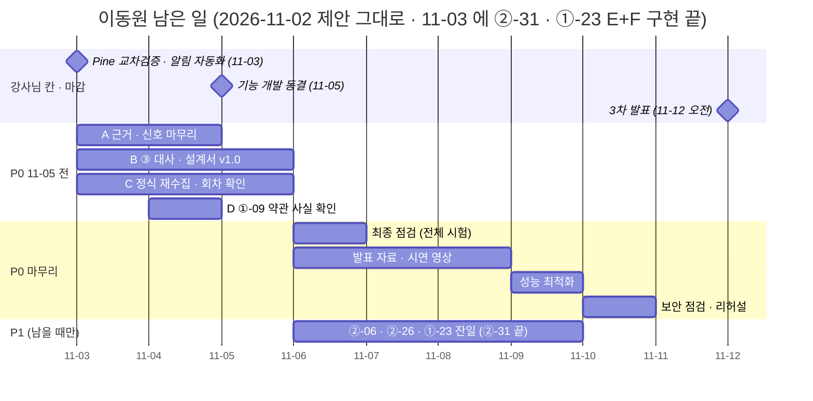

# 이동원 파트 할 일 v2.3 — 3차 남은 일 한눈에

| 문서 정보 | |
|---|---|
| **판 · 상태** | v2.3 · 11-06 S209 · **0절 「지금 상태」 신설** — 11-03 이후 끝낸 일과 남은 일은 0절이 맞다. 1 ~ 7절의 표·날짜는 v2.2(11-03) 기록이라 0절과 다르면 0절을 따른다 |
| **구분** | 3. 일정·업무 관리 — 담당 범위 작업 계획. 팀 전체 일정은 [WBS](WBS.md) · [스프린트 계획](스프린트계획.md), 세션 차례는 [산출물 목록](../../../산출물목록.md) 12절 |
| **작성** | 이동원(팀장 · 3차 목표 기능 ③ TradingView · Pine Script 주담당 — 부담당 강민석) |
| **검토** | 이동원 — 7절 정할 것(7.5절 11-03 추가분 포함) |
| **최종 수정** | 2026-11-10 KST (S219 — 0절만 갱신) |
| **최종 완료 목표** | 기능 개발 **11-05(목)** — 하루 지연은 허용, **최대 작업 일자는 11-06(금)**(사용자 11-02 · 강사님이 준 최대 일자) · 마무리 **11-06(금) ~ 11-10(화)** · 11-11(수) 마지막 작업일 · **3차 발표 11-12(목) 오전 · 오후 수료식** |
| **가용 시간** | 평일 하루 2 ~ 3 세션(사용자 확인 10-22) · 주말은 사용자가 더 할 수 있음 · 팀 PR · 답글 · 안내 이슈 같은 끼어들기가 하루 약 1 어림 단위(11-02 실측) |
| **코드 확인 기준** | 팀 main `1095bbe`(PR #513 · 2026-11-03 12:49 머지 · #509 · #510 · #511 포함 · 이 PC 도 같은 커밋) · alembic head `0042_merge_cancel_audits`(11-03 코드로 다시 확인) |
| **기준** | 계획서 v2.0 4.3절 · 요구 대장 `P02-③-1 ~ 3` · 강사님 3차 일정표 · [오준영 3차 계획](오준영파트-할일.md)의 구조(머리 표 → 범위 → 작업별 마감 → 상태) · [지난 판 v1.32](지난판/이동원파트-할일_v1.32.md)(옛 1 ~ 9절 · 부록 전체) |
| **최근 개정** | v2.2 → v2.3: 0절 「지금 상태 (11-06 S209)」 신설 — S196 ~ S209 에 끝낸 일 · 남은 일 · 시각에 묶인 일 · 기다리는 것. 1 ~ 7절은 11-03 기록 그대로(고치지 않음). **앞으로 세션이 끝날 때마다 0절만 갱신한다**(사용자 11-06 S209 — 과거 기록과 섞여 헷갈린다) |

> **이 문서로 알 수 있는 것**
> 1. 내가 할 일이 **얼마나 남았나** — 묶음별 어림 합계와 날짜에 묶인 일 (1절 · 2절)
> 2. 11-05 까지 **들어가나**, 성능 향상에 집중할 **여유가 있나** (4절)
> 3. **누가 무엇을 해야 내 일이 풀리나** — 팀원 · 사용자 몫 (5절 · 6절)
>
> **읽는 순서** — 이동원: 1절 → 4절 → 7절 · 팀원: 5절 · 처음 온 사람: 3절 → 1절
>
> **확실도** — 🟢 저장소 · 공식 원문에서 직접 확인 / 🟡 추정 · 어림 · 팀 확인 전 / 🔴 확인하지 못함
>
> **어림 단위**는 「세션 하나가 줄이는 일의 양」이다(v1.32 6.1-3절). 이 판의 남은 어림은 v1.32 0.4절(S188 · 11-02 13:20)의 묶음 합계에서 S189 ~ S192 에 끝낸 것을 빼고, 줄별로 나눈 값은 **내 어림(🟡)** 이다 — 줄마다 코드를 다시 열어 확인한 값이 아니다. v2.2 는 P0 값을 그대로 두고(줄별 합 11.15 ≈ 표의 11.1), 끝난 줄이 생긴 P1 은 **「재집계 필요」** 로 적었다.

## 0. 지금 상태 (11-10 화 S219 오후) — 헷갈리면 이 절이 맞다

> 1 ~ 7절은 v2.2(11-03) 때의 계획·표·날짜다. 기능 동결(11-05)·마무리 기간 표가 이미 지났고 묶음별 어림 숫자도 다시 세지 않았다. **지금 무엇이 끝났고 무엇이 남았나는 이 절만 본다.** 근거는 저장소(`git log`) · 세션 기록(기억) · S209 에 직접 확인한 것이며, 줄 번호(①-xx · ②-xx)로 다시 맞추지는 않았다(🟡).

### 0.1 기준

| 항목 | 값 |
|---|---|
| 팀 main | **`d61241cf`**(PR #630 · 11-10 11:59 · 이동원 S218 정합 점검 — ERD v1.19 · 데이터 사전 v1.20 · 릴리스 노트 v0.23 · 산출물목록 v3.26 · 그 앞 `4c33797e` = PR #629 S216 정리 · 두 원격 `d61241cf` 로 같음) — 그 앞 **`12f29f19`**(PR #628 · 11-10 09:2x · 이동원 S216 발표 묶음 — 조립기 · 강민석 슬라이드 8장 · 영상 C·D · 3차 영상 mp4 전체 · 통합 덱 59장 + 한 파일 판 · 그 앞 `0959fb13` = PR #627 강민석 님 터미널 사진 3장 · 사이 `18e8eeb6` = PR #626 S215 문서) — 그 앞 **`c5b53a0e`**(PR #624 · 11-09 15:57 · 이동원 S214 문서 · 그 앞 `b94e1835` = PR #623 오준영 님 영상 B·C · fetch 로 확인 16:0x — 새 커밋 없음) — 그 앞 **`81e51d06`**(PR #621 · 11-09 · 강민석 님 `a5b4ce9d` 입출금 수익률 · epoch · 마이그레이션 0047 · alembic head 하나) — 그 앞 `2f838b43`(PR #620 · 11-09 14:35 · 이동원 S213 문서 · 그 앞 `f54fac15` = PR #616 로보 투자 성향 안내 정렬(#611) · `7834613d` = PR #615 신장환 님 발표 자료 · `8ce61ea0` = PR #610 · `c55efc2c` = PR #609 · 11-09 10:53 · 이동원 점검표 재측정 · 시험 결함 수정 · 이슈 답글 보관 · 발표 보강 · 통합 덱 + 강민석 님 코인 거래비용 `d8262904` 포함) — 이 PC 도 같은 커밋 · alembic head 하나(`crypto_order_costs_20261109`). 그 앞은 `ce339e36`(PR #605) · `26347ac3`(PR #604) |
| 이 PC 미커밋 | **S219 발표 피드백 6건 처리분 전부 커밋 전**(마무리 git 블록 `docs/_git-drafts/2026-11-10-S219/`): 이동원 발표자료 v0.9(17장) · 발표대본 v0.11 · `예상질의응답.html`(신설) · 영상 E 장면 파일 · mp4 · 첫 장면 그림 · 영상 README · 전체 발표 초안 표 6-2 · 통합 덱 원본 · 한 파일 판 · 빌더(`INLINE_VIDEOS` · `EXCLUDE_SCENES`) · 루트 `readme.md` v3.1 · 산출물목록 v3.27 · TIL S219 · 이 문서 0절 · 지난판 사본 둘(`발표대본_v0.10.md` · `발표자료_v0.8.html`). 앞 PR #630(`d61241cf`) 뒤 **S218 마무리 2번 블록은 PR #631 로 머지 끝**(`ddbb45e9`). 일부러 안 올리는 것: `Github-링크.md`(사용자 파일) · `test_node_requirement.py`(줄바꿈) · `docs/common/06-retrospective/videos/` · `.claude/` · `onprem.md` · `pipeline.md` · `screening.md` · `tradingview.md` · `terms.json.bak` |
| 날짜 | **11-10(화) 영상 이동원 C·D — 끝(S216) · 정합 점검 — 끝(S218)** · **11-11(수) 동결 · 마지막 작업일**(mp4 · 한 파일 판은 사용자 결정으로 11-10 에 먼저 올림 — 팀원 확인 뒤 수정분만 다시) · **11-12(목) 오전 발표** · 오후 수료식 |

### 0.2 11-03 이후 끝낸 일 (세션 순)

**<표 0-2> 끝난 일**

| 세션 · 날짜 | 끝난 일 |
|---|---|
| S196 · 11-03 | 개념 학습 장 9개 · ②-28 DSR 재현·개념장 숫자 갱신 · 공매도 용어 풀이 |
| S197 · 11-04 | 데이터 신선도 가드 · lumina 이식 · TIL 8편 · D2·D3 설계서 |
| S198~S199 · 11-04 | 학습 장 C202~C205 초안 · #503 LEAN 체결 시점 정렬 구현 + 도커 재대조(41/41 · 12건) · 이슈 닫힘 |
| S200~S201 · 11-04 | 그림자 일지 판 2(PR #537) · PR #539 머지 · 오준영 님 #149 검수 반영 · 강민석 님 #520/#521/#533 답글 |
| S202~S203 · 11-05 | 신호 순위 · 퀀트 카드 필터 + 새로고침(지금 가격 붙이기) · macro 새로고침 인자 · 3차 영상 후보 조사 |
| S204 · 11-05 | 3차 영상 자막 점검 파이프라인 — 10편 통과 · 한 파일 판 21.3MB |
| S205 · 11-05 | 알림 비밀 9칸 암호화(마이그레이션 0044 · PR #576) · 390px 화면 잘림 10곳 수정(PR #575) |
| S206 · 11-06 | 발표 개편 — 기승전결 · 17장 · 대본 v0.3 · 덱 v0.2 |
| S207 · 11-06 | TIL S198~204 복원 · 동기화 대장 SY-08/09 해소 · 기능 점검 평균 77.1 · 이슈 18건 닫힘 |
| S208 · 11-06 | 종목 근거 조사 4편 · 「지금 값 보기」 + 정확도 문구(PR #591 · #592) · phase-4 설계 본인 보관 · 점검 도구 네 건 수정(PR #594) |
| S210 · 11-06 (후반) | **강사 자료 리서치**(th14~th25 · py-util 새 커밋): 수집 속도를 직접 올릴 새 패턴은 없고 쓸 것은 운영·관측·품질 12후보 · th25 = 관리자 포털(인증은 데모) · py-util 보안 수정은 Qurious 에 거의 해당 없음 · 결과 `research/배경조사/2026-11-06-강사자료-이동원파트-발전/결과.md` · 사용자가 sync-lecture 로 th13 `6cfe77f` · th25 `5f03ff2` 받음 · 사용자 결정으로 **phase-4 설계 3.1절 반영**(로컬 보관) + **발표 대본·슬라이드 17장 끝에 이어갈 길 한 줄**(17장 55 → 60초 · 구현 아닌 계획) · 발표 전 코드 변경은 고칠 결함이 없어 **없음**(`vector_db.py` · 업로드 파일명 직접 확인) |
| S210 · 11-06 | **문서 판 올림 4건**(API 명세서 v0.65 · UI 명세서 v0.52 · 테스트 계획서 v1.98 · RTM v1.84 — 새로고침 지금 가격이 `/api/quote/now` 로 간 것 · `rows[].market` · TC-RKS-19) · RTM 요구 표의 시험 건수 0 이던 46곳 복구 · **알림 암호화 후속 ①③**: `kakao_sender_key` GET 응답 가림 + POST 가림값 유지(DF-172 · 일회용 PG 에서 TC-NS-12 포함 알림 시험 30건 통과) · 처리방침·동의문 변경 기록 한 줄(운영 문서) · 결함대장 DF-171~173 · B군 7건 · C군 3건 이슈 닫힘 반영(링크 43 → 33) |
| S211 · 11-07 (토) | 이 PC 를 하드에서 S210 상태로 받음(`git pull` 뒤 `from-drive`) · **PR #602 읽기 검토 → alembic head 둘 발견**(`0044_notification_secrets` ↔ `0045_paper_kis_track`, 둘 다 `0043` 에서 갈라짐 · 병합 리비전 없음 · 이 PC 앱 로그 `Multiple head revisions`) → 안내 이슈 **#603 사용자가 올림** · 병합 리비전 `0046_merge_notif_paper_kis` 작성 · **일회용 PG 시험 통과**(원본 `upgrade head` 실패 재현 · 병합본 빈 DB 끝까지 적용 · 두 갈래 적용 DB 는 0046 만 기록 · 기존 `test_migration_heads.py` 가 파일 없으면 실패/있으면 통과) · 하드 `from-drive` 적용(S207~S210 초안 · 기억 · 설정 받음) · **#559 「(회차 +1)」 두 곳 삭제**(`paper.js` 백테스트 카드 경고 줄 · 실행 확인창 · `node --check` 통과 · 커밋 전) · 강민석 님 #476 최종 답글 보관(대사 구현 · 실제 KIS 연동 E2E 미수행) · #579 답글은 S209 에 이미 보관 · 기억 색인 압축 |
| S212 · 11-09 (월) | 하드(집 PC S211 상태)와 이 PC 비교 — 집에서 한 일은 S211 뿐 · 강사님 자료는 이 PC 가 더 새것이라 받을 것 없음 · `git pull` 뒤 `from-drive -Apply -Force`. **PR #605 머지**: 점검표 `notification-settings` 58 → 62 · 0044 → head 전환을 일회용 PG 로 재현(대사 두 리비전 → 0046)해 운영 문서 · 배포계획서 · 릴리스노트에 반영. **오전 일감 후속(커밋 전)**: ① 점검표 **오래된 50행 재측정**(5묶음 읽기 전용 점검 → 이동원 줄 10행 반영 · 팀원 줄 4행 초안 · 확신 낮음 2행 후보 · 유지 34행 · 평균 77.34 → **77.68**) ② **열린 이슈 34건 전수 검토** — 닫아도 되는 후보 13건 · 답글 초안 9건을 이슈 폴더로 옮김(올리는 사람은 사용자) ③ **main 에서 실패하던 시험 2건 수정**(PR #602 가 끼운 수집 단계 `paper_kis_reconcile` 때문 · `test_daily_update` · `test_paper_journal` 통과) ④ **학습 콘텐츠 79편 본문 기준 전수 점검** — ready 7 · draft 28 · skeleton 44 · 「확인 필요」 표시 32곳(사용자 지적 반영) ⑤ 강민석 님 · 오준영 님 #603 답글 보관(운영 DB 0046 전환 완료) ⑥ 영상 C = 일지 판 고정·지문 + 대사(터미널 출력 카드), D = 목록 필터·새로고침 쓰는 법 확인 · 일지 `status` 44행 · 지문 같음 ⑦ **전체 시험(일회용 PG · 7묶음) 4,530건 중 통과 4,462 · 실패 37(환경 34 + 고친 3) · 건너뜀 31 · 화면 훑기 77개 화면 문제 0** · 되살아난 `signals_yahoo.py` 지움 · RTM 대장 2파일 등록 ⑧ **발표 보강(사용자 피드백 2건)**: 「각자 한 것은 구조도 · 화면 · 그래프로 상세히, 근거는 수치와 사실로」 → 이동원 대본 v0.7 · 슬라이드 **29장**(상세 장 10개, 약 22분 15초) · 「강사님 언급 빼고 사용자 피드백(날짜)만」 반영 · 신호 근거 장의 틀린 문장(시가 체결은 일지 규칙) 정정 · 대사 숫자 44/44(11-05까지) 통일 ⑨ **통합 덱** `전체-발표자료-원본.html` 45장(이동원 29 + 영상 2 · 신장환 영상 2 · 오준영 6 + 영상 1 · 구분 장 4 · 표지) · 도구 `tools/deck/build_team_deck.py` · 한 파일 판 21.6MB 재생성(미커밋) · 이슈 13건 닫힘 · 답글 9건 올림 · 강민석 님 #603 · #444 · 오준영 님 #603 답글 보관 |
| S219 · 11-10 (화 오후) | **발표 피드백 6건(사용자 11-10 S218) 처리**: ① 글 줄이기 — 자기 덱 19 → **17장**, 장당 글자 수 평균 482 → 약 290(그림 안 글자 포함 단일 기준 · 목표 200은 도식 장에서 못 맞춤 — 9장 417 · 12장 453) ② **영상 E**(2:02 · pace 1.5 · 상세 자막)로 옛 11 · 12장과 영상 A · D 를 대체(통합 덱 13번) · 영상 C 는 일지 슬라이드 뒤(16번)로 옮김 ③ 7장 Bansal(무슨 실험 · 결과 · 우리 화면 — 논문 초록 · 본문 재확인, 「쏠림 덜함」은 파일럿) ④ 14장 Pine = 삼성전자 일봉 2025-01~07 에 카드 규칙을 그린 차트 ⑤ 10 · 11 · 15장 도식 글 줄임 ⑥ **`예상질의응답.html`** 신설(33문 + 보충 18 · 에이전트 작성 후 대표 수치 대조 · A12 = 2차 batch 질문 「수집 예약은 몇 개」). 통합 덱 56장 · 한 파일 판 29.2 MiB 단독 검증(영상 7 · 그림 4 · 외부 요청 0) · 표 6-2 이동원 약 13분 30초 · 합계 약 35분 45초. **루트 README v3.1**(에이전트 · 3차 최종 판 11-10 기준). 산출물목록 v3.27 · TIL S219. |
| S218 · 11-10 (화 낮) | **정합 점검(읽기 → 판 올림 PR #630)**: 산출물목록 0.1절 판 칸 7곳은 실제 문서와 일치 · 스캐너 `--check` 통과인데 **손으로 쓴 서두 수치가 11-01 값**이라 ERD v1.19 · 데이터 사전 v1.20 에서 바로잡음(수집 26표 318칸 24,191,640행 · 앱 65표 745칸 · 관계 61 중 users 40 · 설명 비율 73% · 26% · 설명 없는 앱 표 35 · users 아닌 관계 16 → 21 · 그림 노드 15 → 26표) · 릴리스 노트 v0.23(11-09 저녁 #625 ~ #627 · 11-10 #628 · #629 빠졌던 것 반영) · 산출물목록 v3.26 · 11절 세션 줄. **#614**: 강민석 님 `339ca958` 은 PR #625 로 이미 main 에 있고 코드 대조(21/63/126/252 · 무위험 2% 내부 가정 · 화면 표시 `robo.js:1514`) 일치 · `test_performance_testbed` 11건 통과 · 일지 45행 지문 ✅. **phase-4 모의투자 규칙 조사(로컬 보관)**: 타임폴리오 · 키움 대학그룹 규정 정리(기록은 기억 `project-paper-rule-profiles-timefolio-kiwoom-1110`). git 블록 사고 셋(스테이징된 강의 포인터 · 긴 명령 줄 갈라짐 · `submodule.recurse` pull 실패) 모두 안전하게 멈췄고 해결 · 루트 저장소 S217 push 끝 · 하드 `to-drive` 12:06(hooks 폴더 운반 첫 실측 — `.pytest_cache` 도 따라옴) · TIL S218 |
| S217 · 11-10 (화 오전 · phase-4 개인) | 스킬 · 훅 1차 구현(훅 전역 `git_guard` · 스킬 `git-handoff` · `session-closeout` 프로젝트 스코프 · 시험 209 / 38 / 25 통과) · 모노레포 루트 `carry-drive` 가 hooks 폴더 운반 · `setup-claude-tools` 가 훅 등록(루트 저장소 커밋 2개 · S218 에 push) · TIL S217(phase-4 · git 밖) |
| S216 · 11-10 (화 오전) | **강민석 님 PR #627 pull**(사진 3장 · 숫자 대조 일치) · **조립기 3건 수정**(강민석 덱의 노트 JS 배열 · 쪽번호 · CSS 루트 id · 원본 1440×810) · **강민석 발표자료 8장 추가**(사진 3장 · 노트 포함 · 13 → 14장 · 사용자 결정) · **영상 C·D 녹화**(발표용 54.5초 · 61.1초 · 사용법용 175초씩 · 자막 점검 통과 · 카드 실행 시각 11-10 08:49 · D 자막 「위 10종목」 → 「위쪽 종목(최대 10개)」) · **통합 덱 59장 + 한 파일 판 30.1 MiB** 단독 폴더 검증(영상 8 · 그림 8 · 외부 참조 0 — 사용자 피드백 「발표 자료만 받아도 영상 · 이미지가 나와야」) · **표 6-2 실측**(이동원 영상 2분 44초 · 강민석 대본 2,577자 ≈ 7분 50초 · 합계 약 38분 15초) · git 블록 실행 끝 → **PR #628 머지** · 사용자 결정으로 3차 영상 mp4 전체와 한 파일 판까지 올림 |
| S215 · 11-09 (월 오후) | **오준영 님 영상 B·C 4편 확인**(구간별 프레임 6장 + 자막 시각 대조 · 이상 없음 · 연속 재생은 아님 · 댓글 초안 03) · **영상 C 준비**(`status` 45행 · 지문 ✅ · 장면 파일 자막 시각 정정 3곳) · **릴리스 노트 v0.22 안 고침**(영어 제목 17줄 한국어 · 11-09 절 PR 12건) · **판 올림 3건**: API 명세서 v0.66(코인 거래비용 · Modified Dietz · 비상 정지 `cancellation`) · ERD v1.18 · 데이터 사전 v1.19(앱 DB 65표 · `paper_kis_reconciliations` · `crypto_orders` 비용 9칸 · `epoch` 2칸 · 서브에이전트 둘 + 스캐너 `--check` 직접 재확인) · 발표 대본 · 사실표 · 슬라이드의 「64표」 → 65표 · 통합 덱 45장 재생성 · **#622 강민석 님 답글 보관**(발표 초안 있음 · 4분 축소 계획 · 11-10 PR) + 시간 안내 답글 초안 02 · **발표 시간 배정 결정**(사용자: 사람별 10~15분 · 전체 최대 60분 · 목표 50분 이내 · 전체-발표-초안 6.6절 표 6-2) · 산출물목록 v3.24 · TIL S215 |
| S214 · 11-09 (월 오후) | **TIL S211~S213 복원**(규칙이 프로젝트 문서에 없던 것이 원인 → 0절 끝 「세션 끝 체크 2줄」) · **산출물 전체 점검**(읽기 전용 에이전트 — 팀원 몫 · 목록 오류 · 미등록 5건 등록 · 판 칸 정정) · **사용자 허락으로 fetch/pull**(main `81e51d06` = PR #621) · #612 강민석 님 최종 답글(Modified Dietz · epoch) **코드 대조 끝**(답글과 일치 · 회전율 부수 효과) · alembic head 하나 · 일지 지문 ✅ · #619 오준영 님 답글(영상 B·C 녹화하겠다) 보관 · 문서 판 올림 4건(위) · **발표 구성 개편**(사용자 피드백 3건 + 조율 4건: 쪽번호 덱 전체 하나 · 문제 정의·시장 조사 맨 앞 · 한계 맨 끝 강민석 발표 · 이동원 29→19장 · 한계 핵심 5개 · 낡은 일봉 영상 B 제외 · 조립기 `TAIL_SLIDES`/`EXCLUDE_SCENES`/`fix_numbers` · **통합 덱 45장**) · 이슈 #618 · #619(답 둘) · #622 · #614 반영 · **PR #623 pull**(main `b94e1835` · 영상 B·C 포스터·자막 확인) · git 블록 `_git-drafts/2026-11-09-S214` · 다음 세션 프롬프트 같은 폴더 |
| S213 · 11-09 (월) | **학습 콘텐츠 79편 전부 조사 후 쓰기로 결정(사용자) · 조사 W1~W6 끝(메모 31편 · 종합 01~07)** · 팀 답글 보관: 강민석 님 #123(두 번) · #263 · #612 · 오준영 님 #613 · 신장환 님 PR #615 · **이슈 7건 올림(사용자)**: #611~#614 · #617(신호 판정) · #618(강민석 LEAN 대사 녹화 요청) · #619(오준영 B·C 녹화 요청) · **Pine 문구 정정**(컴파일 1회 확인 · 비교 미확인) · 일지 45행(전진 10) 갱신 · 대본 v0.9 · 영상 장면 yaml 8개(P-/V- 이동원 C·D · 오준영 B·C) · 통합 덱 49장 · 산출물목록 v3.23 · 12:30 회차 성공 · 수집 종가 = KIS 15:40 값 |
| S209 · 11-06 | P3-5 신호 순위 새로고침 지금 가격 결함 재현·수정(PR #596) · 신호 적중률 유효 표본 측정(날 138개 · 매수 쪽 구간 약 46~52%) → **정확도 문구에 구간 반영**(PR #596) · 강민석 님 #562 · #579 답글 보관 · #559 문구 재대조 답글(사용자가 올림) · 오준영 님 알림 초안 · KIS 문의 초안 · KIS 15:40 측정 · 이 문서 0절 |

### 0.3 남은 일

**<표 0-3> 남은 일** (우선순위는 사용자와 정한다)

| 일 | 상태 · 막힌 곳 |
|---|---|
| **발표 피드백 6건 뒷일(S219)** | 처리 끝(커밋 전). 남은 것: ① 자기 덱 9장(수집 → 증권사 구조도 417자) · 12장(판 2 사건 453자)이 아직 200자를 넘음 — 줄일지 사용자 결정 ② 일지 행이 12:56 회차 뒤 **46행**(마지막 11-09)인데 슬라이드 11장 · 영상 C 는 45행 값 — 발표 직전 `status` 를 다시 찍어 맞출지(영상 C 는 재녹화) ③ 질의응답 H 「확인 못 함 · 약한 수치」 목록(5.9GB 는 해결 · 28단계 평일 회차 시간 · 12:30 을 고른 까닭 등) ④ 2차 batch 질문의 다른 문구가 기억나면 질의응답 A13 에 추가 ⑤ 강민석 님 PR #628 8장(사진) 확인 대기 그대로 |
| 루트 README v3.1(S219) | 끝(커밋 전 · 에이전트). 사용자가 정할 점: 그림 1(SVG)의 옛 숫자(76 · 282 · 132)를 다시 그릴지 · 오준영 증권사 연동 줄을 「진행」 으로 둔 이유(RTM v1.86 은 시험 있음 · 발표 전이라 완료 미표기) · `docs/산출물목록.md` 루트 README 줄은 이번에 v3.1 로 고침 |
| S209 코드 커밋 · PR | **끝** — PR #596 머지(새로고침 지금 가격 · 정확도 문구 · 문서). 정확도 문구가 굳어 영상 11-10 전에 화면이 다시 바뀌지 않는다 |
| S210 변경 커밋 · 작은 PR | **#597 머지로 끝.** 산출물목록 0.1절 판 칸(API 0.65 · UI 0.52 · 계획서 1.99 · RTM 1.85)은 오준영 님이 같은 날 고치는 문서라 이 PC 에서 안 고침 — 한 번에 맞춘다 |
| alembic head 둘 병합(#603) | **끝 · 닫힘(11-09 사용자)** — PR #604 머지 · 운영 DB 는 11-09 에 오준영 님이 `0046` 까지 전환 완료(답글 02 보관) · 강민석 님은 이후 리비전에서 `alembic heads` 를 확인하겠다고 답함(01) |
| #559 「(회차 +1)」 | 화면 문구 삭제는 PR #604 로 머지(S211) → 닫아도 되는 후보. **그러나 새로 찾은 것(S212, 코드 읽기)**: 100일 백테스트 결과(`BacktestSnapshot`)를 읽는 곳이 `app/` 에 없고 카드는 「QFRS 지표가 100일치로 계산됩니다」 라고 말한다 → 강민석 님 화면이라 확인 요청 필요(아래 새 줄). 영상 · 발표에 이 카드는 쓰지 않는다 |
| 이슈 답글 · 닫기 | **끝(11-09 사용자 보고)** — 답글 초안 9건을 모두 올리고 닫을 이슈 13건을 닫음(`Github-링크.md` 33 → 21건). 열려 있는 20건 중 이동원이 움직일 일: 아래 새 줄 · 강민석 님 답 기다림 #386 · #444 는 **구현 완료 · 닫힘**(11-09 강민석 님 `d8262904` · 주문 전용 30초 검증 신설 · 코인 거래비용 · 마이그레이션 `crypto_order_costs_20261109` · 이동원 코드 대조로 확인) · 오준영 님 답 기다림 #79 · #123 |
| 문서 판 올림 | **끝(S210)** — 위 4건. 남은 것: 산출물목록 판 칸 · 기능동작원리 3.3절의 `/api/stocks/quote`(다른 화면 줄이라 손대지 않음) |
| 근거 4칸 재배열(P3-3) | 보류 — 모달에 이미 있다. 목업 없이 영상 직전에 바꾸지 않는다 |
| 차트 확정 종가 수평선(P3-4) · 보유 표 근거 입구(P3-6) | 11-11 전 여유 있을 때. 공용 차트라 퀀트 대시보드 회귀 필요 |
| KIS 문의 | 초안 `docs/_local/종목근거-조사-2026-11-06/05-KIS-문의글-초안.md` — 보내는 사람은 사용자. 답이 오기 전 새 시세 노출을 늘리지 않는다 |
| 알림 비밀 암호화 후속 | ① `kakao_sender_key` 가리기 **끝(PR #597 머지 · `f4f15b6b`)** · ② 결함대장 **DF-171~173 기록 끝** · ③ 처리방침·동의문 변경 기록 **끝** · ④ 0044~0046 전환 순서 문서 **끝(PR #605)**. 남은 결정: DF-171 전화번호·채팅 ID·이메일 평문(범위 결정 필요) · DF-173 관제 화면 표시(오준영 님 영역과 겹침). 테스트계획서 표의 DF-172 칸은 아직 「PR 대기」 — 판 올림 때 한 번에 |
| 점검표 `notification-settings` 재점검 | **끝(S212 · PR #605)** — 58 → 62 |
| 점검표 오래된 행 재측정 | **끝(S212 · 커밋 전)** — 50행 점검 → 이동원 줄 10행 반영(`macro-*` · `login` · `register` · `market-calendar` · `indicator-tradingview` · `us-dashboard` · `us-order` · `trading-*`) · 평균 77.68. **강민석 님 줄 4행(`paper-stock` 77→79 · `quant-lean` 65→69 · `robo-decision` 71→72 · `robo-testbed` 65→69)은 초안 — 확인 요청 필요**. 확신 낮음 후보 `mypage` 90→91 · `fin-lectures` 80→81 은 올리지 않음. 기록 `04-testing/기능완성도-이동원-2026-11-09.md` |
| 스캐너 남은 3곳 · #370 A-3 | 스캐너 3곳(`API-STK-39` · `API-NOTI-04` · `API-LEAN-03`)은 휴리스틱 한계라 고치지 않고 「(다른 곳)」 로 둠. **`#370 A-3` 은 #370 본문의 「지수 띠 시각 표시」 제안**(S212 이슈 검토에서 확인 — 앞서 「정의 없음」 이라 쓴 것은 틀림). 작음 · 발표 영향 없음 |
| **학습 콘텐츠 79편** | **작업이 많이 남음(사용자 지적 · S212 본문 기준 점검)**: `ready` 7(9%) · `draft` 28(35%, 「확인 필요」 등 미해결 표시 32곳 — 금융 기초 4편이 가장 많음) · `skeleton` 44(56%, 「이 장은 아직 뼈대입니다」 와 질문 목록뿐 · 285~1,227자). 금융 필수 지식 13편은 ready 0. 기록 `04-testing/학습콘텐츠-현황-2026-11-09.md`. 11-11 동결 전에 끝낼 범위를 사용자와 정해야 함 — 남은 시간 안에 44편 본문은 불가능하므로 (가) 발표·영상이 쓰는 장만 ready 로 (나) 나머지는 「준비 중」 으로 앱에서 숨김 유지(TC-CLV-07)하고 발표에서 한계로 말하기 중 선택 |
| **100일 백테스트 결과 미연결(새로 찾음)** | 코드 읽기만(실행 재현 안 함): `BacktestSnapshot` 을 읽는 라우트가 없고 QFRS 는 `PaperAccountSnapshot` 만 읽는다. `paper.js` 1459행 「완료 후 QFRS 지표가 100일치로 계산됩니다」 · 49행 「자산추이 · QFRS 카드에 반영됨」 이 사실과 다를 가능성. 강민석 님 화면 → 확인 요청 이슈 초안이 필요(결함 번호는 판 올림 때) |
| 수집 단계 시험 · 의존 모델 수정 | **끝(PR #609 머지)** — `test_daily_update` · `test_paper_journal` · `scripts/pipeline_profile.py`. 결함대장 번호는 판 올림 때 |
| **발표 통합 · 시간 배정** | **11-09 S214 사용자 결정으로 구조 확정**: 맨 앞 = 문제 정의 · 시장 조사(이동원이 자기 파트까지 이어서) · 맨 끝 = 한계 · 이어갈 길(강민석 님 발표) · 쪽 번호는 덱 전체 하나(N / 45). 통합 덱 **59장**(11-10 S216 · 강민석 14장 포함 · 한 파일 판 30.1 MiB · 단독 폴더 검증 · 아래 「45장」 설명은 S214 때 값): 이동원 19장(앞 17 + 한계 2 · 약 15분 5초 · 한계 1분 50초 포함) · 신장환 7장(3분 55초) · 오준영 6장(4분 20초) · 강민석 구분 장(자기 파트는 #622 답 대기). **시간 배정은 11-09 S215 사용자 결정 — 사람별 10 ~ 15분 · 전체 최대 60분 · 목표 50분 이내**(전체-발표-초안 6.6절 · 현재 예상 합 약 39 ~ 44분 · 이동원 약 16분은 리허설로 재 본 뒤 판단). 자세한 규칙 `06-retrospective/전체-발표-초안.md` 6.5절 |
| 새 슬라이드 숫자 발표 직전 확인 | 12:30 회차 뒤 일지 행 수(44 → 45) · 수집 회차 시간 · 종목 수 · 시험 건수. 캡처 화면(신호 순위 · 근거 모달 · 데이터 관제 · 일지 명령 출력)은 값이 바뀌면 다시 찍음 |
| TradingView 한계 문장 발표에 넣기 | **정정(11-09 S213)** — 처음 「컴파일 미확인」 으로 적었으나 10-30 S167 기록(생성기 출력 판 1 · 판 2 를 TradingView 편집기에서 컴파일 · `Compiled.` 스크린샷)이 있어 대본 v0.8 · 슬라이드 4 · 25 · 27장(S214 개편 뒤 구조 9장 · TradingView 16 · 17장) · 사실표를 「생성기 출력 2종 1회 확인 · 템플릿 · 자유 산식 출력은 미확인 · CSV 비교 · 알림 수신은 못 함」 으로 고침. 템플릿 · 산식 출력까지 컴파일해 보려면 TradingView 로그인 약 10분 |
| #365 레드펜 9문 점검표 | **11-05 칸을 11-09 S214 에 소급해 채움**(코드 읽기 · 🟢 0 · 🟡 8 · 🔴 1[#5 시장 충격] · 3절의 #3 · #9 빈 곳은 일부 틀림으로 정정) — **발표 한계는 5개만 말하기로 결정(사용자 11-09 S214 — 사용자는 대본을 읽지 않고 발표하므로 핵심만)**: 28장 신호 적중 + 29장 넷(일지 짧음 · TradingView 일부만 · 체결과 비용은 가정 · 스트레스 점검과 실패 시나리오 없음) → 대본 v0.10 · 슬라이드 v0.7 · 통합 덱 56장 재생성 끝. 시간봉 · 실시간 재판단 · 수집 들쭉날쭉 · 관리자 화면 계획은 예상 질문 답으로. 남은 것: 11-10 칸은 11-10 에 · #7 프리모템 한 쪽은 한계 한 줄로 대신해 **쓰지 않아도 됨**(사용자 결정 대기) · 위치 `research/배경조사/2026-11-02-3차산출물칸-레드펜/03-…` |
| 강민석 님 발표 자료 요청 | **이슈 #622 로 올림(11-09 S214 사용자 알림)** `github-archive/2026-11-09/이슈-발표자료요청-강민석/00-본문.md` — 후보 5개 · 4분 안팎 · 이동원 초안 대행 제안. **11-09 강민석 님이 `강민석/발표자료.html` 을 직접 올림(14장 · 노트 14개) · 11-10 사진 3장(PR #627) → 8장에 넣음(S216) — 강민석 님이 8장을 확인하면 끝** · 시간 배정 알림 답글 초안 02 는 사용자가 올림 |
| #614 강민석 님 최종 답글(11-09 S214 · 이슈 닫힘) | 위험지표 표본 통일(21/63/126/252) · KOSPI 가격지수 + 무위험 2% **내부 가정**(코스콤 공식 아님) · 알파/IR 5개 관측치 제한 · 분산 0 베타 `null` · KIS KST 타임스탬프. 원문 01 보관. **커밋 `339ca958` 은 원격에도 아직 없음(15시대 fetch)** → 머지 뒤 pull · 코드 대조 · 학습 장에 「코스콤과 같은 식」 금지 · 일지 지문 `status` 재확인(성과 계산을 건드렸으면) · 답글 불필요 |
| #562 LEAN ATR 손절 검증 항목 | 강민석 님이 닫았지만 올린 답은 100일 백테스트 문구 수정이라 **항목 해소 여부 미확인** |
| #559 100일 백테스트 문구 | **재대조 끝(S209 · 코드 읽기)** — 계좌·삭제 범위·1억·일반 유지는 맞고 **「(회차 +1)」 두 곳만 어긋남**(백테스트 계좌에 회차 없음). 답글 초안 `github-archive/2026-11-05/이슈-100일백테스트-안내문구-강민석/03-…` — **사용자가 #559 에 올림(11-06) · #559 는 닫히지 않음**. 강민석 님 답을 기다림. 두 곳이 정리되면 영상 후보(11-10 전) |
| **학습 콘텐츠 조사 · 쓰기(S213 결정)** | 사용자 결정: 발표와 분리하고 **79편 전부 조사 후 쓴다**(서두르지 않음). 조사 **W1~W6 끝**(메모 31편 · 종합 `docs/_local/learn-research-2026-11-09/01~07-W*-종합.md` · git 제외). **남음: W7 python 6편 조사**(11-10 이후 · Firecrawl 크레딧 24시간 뒤 복구 · 공식 문서는 WebFetch 로도 열림) → 본문 쓰기(보수적 기본값 · 본문 에이전트 2개씩) → 첫 묶음은 `rag-basics` 정정 묶음(낡은 서술 9곳). `tests/test_learn.py` 장 수 단언 79 유지 |
| 팀 확인 필요(이슈 초안 후보 · 사용자가 올림) | 모의 선물 손익 증거금 기준(초안 있음) · `_ETF_BRANDS` 에 KoAct · FOCUS 없음 · 같은 069500 수익률이 화면마다 다름 · 부트스트랩 양 끝 덜 뽑힘 · 계절성 화면 문구 · 코인 최소 주문 1,000원 vs 업비트 5,000원 · 테스트베드 「코스콤 테스트베드 기준에 맞춘」 문구 + 기준 지수 표기 불일치 · W6 에서 나온 6건(bcrypt 동기 호출 · `check_revision` 누락 통과 · `agent.run` 소프트 한도 재시도 · `docker.sock` `:ro` · `compose.fd.yml` 부재 · `record_daily_snapshots` 시간 한도). 모두 코드 읽기 결과 |
| 올리기 전 초안(사용자) | 모의 선물 손익(`github-archive/2026-11-09/이슈-모의선물-손익-증거금기준-강민석/00-본문.md`) · #123 05 답글 · #612 02 답글(`SIM` 출처 질문) |
| 영상 녹화 11-10 | **이동원 C · D 녹화 끝(S216 · PR #628)** — 12:30 회차 전에 찍어 카드 값(45행 · 마지막 11-06)이 그대로 맞다. 12:30 회차가 돌면 행 수가 46으로 바뀌므로 **영상 · 슬라이드 13장은 그 전 값(45행)임을 알고 둔다**(다시 찍을 일이 생기면 `status` 를 다시 돌려 카드 갱신). **오준영 B·C → #619 답함(11-09 S214): 직접 녹화하겠다 · PR + 댓글을 올리면 이동원이 확인** · **오준영 B·C 영상 확인 끝(S215 · 이상 없음 · 댓글 초안 03 — 올리는 것은 사용자)** · **강민석 A → #618 답함(11-09 S214): 영상 대신 터미널 출력 사진 2장(BEFORE/AFTER) 제출 · 숫자는 두 보고서와 대조해 일치** — **사진은 PR #627 로 왔고(3장) 통합 덱 강민석 8장으로 넣음(S216 · 강민석 님 확인 대기)** |
| 문서 판 올림 3건(S215) | **끝(PR #626)** — API 명세서 v0.66 · ERD v1.18 · 데이터 사전 v1.19(스캐너 `--check` 통과). ERD · 사전 본문의 옛 표 수는 **S218 에 끝(PR #630 · ERD v1.19 · 사전 v1.20)** — 다시 세지 않은 것: 사전 1.1절 보존 기간 집계(「30표가 정하지 않음」 · 탈퇴가 지우는 26표 등 — 대장을 세면 45표가 나오는데 옛 문장의 기준을 몰라 다음 판 과제) |
| 문서 판 올림 4건 | **끝(11-09 S214 · 커밋 전)** — 테스트 계획서 v1.101(DF-172 닫힘 · TC-SCA · TC-PN 문구) · TradingView 설계서 v0.8(「손으로 한 번」 정정) · RTM v1.86(Pine 문구 + 표 재생성 4,597건 · 330파일) · 릴리스 노트 v0.22(10-28~11-06 PR 160건 **기계 초안**). 남은 것: ① 릴리스 노트 초안을 묶고 쉬운 말로 다듬기 · DF 번호 붙이기 ② **대장에 없는 시험 파일 7개**(강민석 님 5 · 오준영 님 2)는 담당 판 올림에서 등록 ③ 테스트 계획서 표 5 건수는 다시 세지 않음(v1.100 그대로) ④ 산출물목록 0.1절 미등록: 기준전략 시기분할 폴더 · 신호적중 대조 폴더 · 3차 영상 README |
| #263 결정 대장 | 세 분 모두 확인(강민석 님 동의 11-09) → 결정 대장에 한 줄 + #263 닫기는 이동원 몫. 대장 본문 파일 위치가 불명 → 사용자에게 물음 |
| **phase-4 모의투자 규칙 프로필(개인)** | 사용자 제안(11-10 S218): 대회별로 투자금 · 수수료 · 한도를 바꿀 수 있는 **규칙 프로필** · 타임폴리오(종목 15% · 섹터 시장×2 · 미체결 포함 타겟) · 키움 대학그룹(0.35% + 제세금 · 상한가 부분체결). 🔴 키움 상시모의투자 투자금 · 초기화 · 종목 제한 · 타임폴리오 2026 회차 원문은 사용자가 화면으로 확인. 종목코드 `\d{6}` 검증이 영문 섞인 새 코드 35개를 거부(`stocks.py:890` 등). **키움 프로필은 팀 프로젝트 — 11-12 발표 뒤 설계 · 이슈 초안** |
| 시험 수 · RTM(S218 재측정) | `pytest --collect-only` **4,608건 · 331파일**, RTM v1.86 은 4,597 · 330 → 차이 +11 = `test_performance_testbed`(#625 강민석 님). 팀원 파일이라 담당 판 올림에서 `rtm_scan.py --doc` — 발표 슬라이드 15장(「시험 4,530건」)은 발표 직전에 다시 확인 |
| 점검 부스러기(S218) | `post_check.py` 색인 없는 글 폴더 4개(11-03 · 11-04 두 곳 · 11-06 — 이번 세션 것 아님) · `github-archive/README.md` PR 표에 #624 · #625 줄 없음 · 테스트 계획서 · RTM 「관련 문서」 칸이 옛 판 링크(ERD v1.8 · API v0.10 · 계획서 v1.13)를 가리킴(지난판 링크라 틀리진 않으나 확인) · ERD · 사전 판 올림 PR 에서 웹 머지 커밋 작성자가 개인 Gmail 로 찍힘(#629 · #630 — 사용자 웹 설정) · `carry-drive.ps1` 이 `.pytest_cache` 를 운반(제외 목록 후보 · 커밋된 파일이라 새 커밋 필요) |

### 0.4 시각·날짜에 묶인 일

| 날 · 시각 | 무엇 |
|---|---|
| **발표 직전(S219 번호 · 자기 덱 17장 · 통합 덱 56장)** | 11장(일지 `status` 출력 45 → 46행) · 영상 C 자막(45행) · 질의응답 D1 · 8장(수집 28단계 · 새 시험 91/149) · 13장(시험 4,530건 — 4,608 은 수집 기준) · 15장 · 16 ~ 17장(한계 — 강민석 님 발표). 덱을 고치면 `build_team_deck.py` → `bundle_deck.py` → 빈 폴더 단독 검증을 되풀이 |
| 11-06 15:40 · 17:00 | KIS 삼성전자 일봉 종가 측정(읽기만 · 실주문 0). **15:40:18 측정 끝**: KIS 에 11-06 봉이 이미 있다(삼성전자 188,700) · 수집 DB 는 11-05 까지라 오늘 값 대조는 다음 수집 뒤. 11-04 에 15:40 값(218,000)이 수집 종가와 같고 17:00 값(217,000)과 달랐던 정황이 있다(추정). **17:00:01 측정도 끝(S210)**: 삼성전자 189,500(15:40 값 188,700 · +0.42%) · SK하이닉스 1,149,000(1,132,000 · +1.50%) · 카카오 32,000(32,300 · −0.93%) · 현대차 277,500(279,500 · −0.72%) — 네 종목 모두 15:40 과 달랐다. 11-04 에는 15:40 값이 수집 종가와 같았고 17:00 값이 달랐으므로 같은 모양이다(정황 한 건 더). **어느 쪽이 공식 종가인지는 다음 거래일(11-09) 12:30 수집 뒤 수집 종가와 대조해야 안다.** 앞 4거래일(11-02 ~ 11-05)은 KIS 와 수집 종가 차이 0.0. 20:30 은 하지 않는다. 공식 종가와 대조 전이라 `SETTLE_TIME` 변경은 보류 |
| 11-09 | 영상 일정 사전 알림(채팅) — **S212 에 알림 끝** · 12:30 수집 뒤: KIS 종가 대조(수집 DB 11-06 종가 ↔ 15:40 · 17:00 값) → 일지 11-06 행(44 → 45행) 확인 → 그 뒤 영상 C 의 행 수 확정 · **끝(11-09 13:55 S213)**: 12:30 회차 ✅ 전부 성공(시세 · 수정주가 · TR · 벤치마크 20261106) · **수집 DB 11-06 종가 = KIS 15:40 값 네 종목 모두 차이 0**(삼성전자 188,700 · SK하이닉스 1,132,000 · 카카오 32,300 · 현대차 279,500) · 17:00 값과는 네 종목 모두 다름(−800 · −17,000 · +300 · +2,000) → 11-04 와 합쳐 **두 거래일 연속 수집 종가 = 15:40 값**(17:00 값이 시간외 반영인지는 확인 못 함) · `SETTLE_TIME` 변경은 보류 해제 사유 없음 · 일지 `status` **45행 · 마지막 11-06 · 지문 ✅**(auto_default 평가 7221552.42) · 슬라이드 19 · 20장 · 대본 v0.9 · 사실표 갱신 |
| **11-10** | ~~영상 이동원 C·D 녹화~~ **끝(S216 오전)** · 알림 암호화 운영 전환(오준영 님 몫 · 11-10 까지) · **정합 점검 끝(S218 · PR #630)** — 남은 후보: UI 명세서 `paper-crypto` 상세 절 없음(강민석 님 화면 · 「주담당이 채움」) · RTM 시험 수 · 레드펜 자체점검표 11-10 칸 · 12:30 회차 뒤 일지 46행 확인 |
| 발표 직전 | **(S214 장 개편 뒤 번호 · 이동원 자기 덱 기준)** 슬라이드 13장(일지 45행 · `status` 출력)을 가장 가까운 회차 값으로 다시. 8장(수집 28단계 · 새 시험 91/149) · 15장(시험 4,530건) · 16~17장(Pine 33 · 웹훅 41 · 중복 13) 숫자도 시험을 다시 돌려 확인. (수집 14장 · 일봉 662초 장은 뺌 — 대본 부록 A) **11-09 사용자 피드백(「각자 한 것은 구조도 · 화면 · 그래프로 상세히, 근거는 수치와 사실로」)으로 이동원 대본 v0.7 · 슬라이드 29장(약 22분 15초)으로 보강** — 통합 덱 `전체-발표자료-원본.html` 45장 |
| 11-11 동결 뒤 | ~~mp4 · 한 파일 판 커밋~~ → 11-10 사용자 결정으로 PR #628 에 이미 올림. 동결 뒤에는 **고친 것만**(덱을 다시 만들면 한 파일 판도 다시 만들고 단독 폴더 검증을 되풀이) |
| **11-12 오전** | **3차 발표** |

### 0.5 기다리는 것

- **사용자(S219 마무리 뒤)**: git 블록 `docs/_git-drafts/2026-11-10-S219/` 를 돌린 뒤 「돌렸다」 · 일지 행 46 을 슬라이드 · 영상 C 에 맞출지 · 자기 덱 9 · 12장 글 줄일지 · 2차 batch 질문의 다른 문구(질의응답 A13).
- **사용자(S218 마무리 뒤)**: `bash scripts/sync-lecture.sh [--dry-run]`(훅 허용 간격 지난 뒤 직접) · `! gh --version`(훅이 `!` 경로에도 걸리는지 · S217 미확인) · 규칙 프로필 설계 문서를 쓸지 결정 · 키움 상시모의투자 · 타임폴리오 2026 회차 화면 텍스트.
- **사용자가 GitHub 에서**: 이슈 14건(#444 포함) 닫기 · 답글 9건 올리기는 **11-09 에 끝**(사용자 보고). 열려 있는 20건 중 발표(11-12) 뒤에 닫을 것은 #319 · #333 · #385 · #318. 남은 결정: #263(강민석 님 무응답) · #332 · #317 · #47(후속 명시 후 닫을지) · #370(A-3 · A-1 미룸) · #476(⑤ 흐름 띠를 이어갈 길로 두고 닫을지) · #473(제목 확인) · #533(12:30 회차 뒤 갱신).
- **오준영 님**: PR #594 알림 댓글 초안(`github-archive/2026-11-06/이슈-인코딩-공통화면시험-이동원/01-…`)을 올린 뒤 전체회귀 문서 ERR-045 · 046 갱신.
- **강민석 님 · 신장환 님**: 새 글이 오면 원문 보관 + 색인 + 기억. **강민석 님은 PR #628 의 8장(사진) 확인을 기다림**(본인 파일을 이동원이 고쳤다 — 마음에 안 들면 커밋 `669720a6` 만 되돌리면 된다). **팀원 확인 요청**: 신장환 · 오준영 님은 한 파일 판 `전체-발표자료.html` 만 내려받아 본인 슬라이드 · 영상이 나오는지 확인.
- **PR #616 (11-09 13:29 머지 · #611 오준영 님 로보 투자 성향 확인 요청에 대한 수정)**: 안정형·안정추구형이 같은 기본 배분, 적극투자형·공격투자형이 같은 기본 배분이라는 점을 화면 문구에 적음(`robo_profile.py` · `app.html` · `robo.js`). **학습 장 `investor-profile-suitability` · `asset-allocation-quant` 의 조사 메모(11-09 오전)는 이 PR 전의 코드 기준이라 본문 쓰기 전에 다시 대조**. #611 에 대한 답글이 오준영 님 이름으로 오면 보관.
- **#612 강민석 님 최종 답글(11-09 S214 · 이슈 닫힘)**: 입출금 수익률 Modified Dietz · `Order.epoch` · `CashflowEvent.epoch` 구현(커밋 `a5b4ce9d` · 마이그레이션 `0047_paper_cashflow_order_epoch` · PG 54 통과) · `SIM` = 레거시 출처. 원문 `github-archive/2026-11-09/이슈-모의장부-…-강민석/03-…` 보관. **pull 끝(14:46 · main `81e51d06` = PR #621)**: ① head 하나 ✅(`test_migration_heads` 통과) ② 일지 `status` 지문 ✅(평가금 그대로) — 남은 것: 코드 본문 대조 ③ 슬라이드 수익률 · 시험 건수 ④ ERD · 데이터 사전 · API · 계획서 판 올림 ⑤ 학습 장 문구(직접매매 · `SIM` · Modified Dietz). 내 답글은 불필요.
- **새 글 대기(S213)**: #617(신호 판정 합의) · #618 · #619(녹화 요청) · #611~#614 의 답글 — 오면 원문 그대로 보관 → 색인 → 코드 대조 → 필요하면 답글 초안(조사 포함). 신장환 님 PR #615 는 pull 뒤 통합 덱 52장으로 재생성 + 대본의 Pine · 컴파일 · LEAN · 기준선 110 서술을 내 정정과 대조.

> 이 절의 갱신 규칙 — 세션을 마칠 때 0.1 ~ 0.5 를 그 시점으로 고치고, 끝난 일은 0.2 에 한 줄 더한다. 1 ~ 7절은 고치지 않는다(판이 올라갈 때 지난판으로 간다).
>
> **세션 끝 체크 2줄 (11-09 S214 신설 — TIL 이 S198~204 · S211~213 에 두 번 빠졌다)**: ① **TIL 한 편** `docs/common/06-retrospective/til/이동원/YYYY-MM-DD-제목-S###.md` + `til/README.md` 목록 줄. 세션 시작에 `ls til/이동원` 으로 마지막 세션 번호를 먼저 본다. ② `산출물목록.md` 0.2절 7줄.

## 1. 한눈에 — 남은 일 (v2.2 · 11-03 기록)

**<표 1> 남은 일 합계 (P0 는 11-02 저녁 값 그대로 · P1 은 11-03 에 끝난 줄이 있어 재집계 필요)**

| 구분 | 무엇 | 남은 어림 | 가용(같은 기간) | 판단 |
|---|---|--:|---|---|
| 11-05 까지 **P0** | 묶음 A · B · C · D(①-09) — 없으면 11-12 시연이 끊긴다 | **약 3.1** | 11-03 ~ 11-05 약 6 ~ 9 − 끼어들기 3 = **3 ~ 6** | 🟡 **들어간다 — 가운데 값(약 4.5)에서 약 1.4 여유** |
| 마무리 **P0** | 묶음 E 일정 — 전체 시험 · 발표 자료 · 성능 · 보안 · 리허설 | **약 8.0** | 11-06 ~ 11-10 약 9 ~ 10 | 🟡 **여유 약 1 ~ 2** (끼어들기 버퍼 따로 없음) |
| **P1** | 있으면 좋은 것 — ②-06 · ①-23 · ②-26 · ②-29 · ②-28 (②-31 은 11-03 끝) | **재집계 필요** (값 있는 줄 합 약 1.3) | 위 여유 약 1 ~ 2 | 🟡 포함하기로 함(사용자 11-02) — 옛 합 8.8 은 쓰지 않고 컷라인은 11-04 저녁에 새 값으로 본다 |
| **P2** | 개인 판 18줄 — 새로 열지 않는다 | — | 일정 밖 | 🟢 |
| 끝 | 재확인 불필요 22줄 + 끝난 묶음 A 큰 줄 + 11-03 에 끝난 ②-31 · ①-23 E+F 구현 · 새 항목 넷(2.7절) | — | — | 🟢 |

```text
남은 어림 (한 칸 = 0.5)                     P0 합 약 11.1 · P1 재집계 필요 (P2 제외)
A 종목 근거 · 신호    █▌                   0.6
B ③ TradingView       ██▌                  1.2
C 데이터 마감         ██▎                  1.1
D ①-09 약관           ▌                    0.2   ┐ 11-05 전 P0 합 3.1
E 마무리 일정 (P0)    ████████████████     8.0
P1 있으면 좋은 것     (재집계 필요 — 값 있는 줄 합 1.3 + ②-06 · ①-23 미정)
```

**결론 (🟡)** — ① **11-05 까지 필수 일은 들어간다.** 다만 시간이 묶인 일(11-03 13:30 뒤 수집 · 12:30 회차 확인 · 강민석 님 답 · 사용자 사실 확인)이 많아 **일의 양보다 날짜가 병목**이다. ② **성능 향상에 쓸 여유는 크지 않다** — 마무리 기간 P0(약 8)이 가용(약 9 ~ 10)을 거의 채운다. 성능 칸은 11-09 한 칸(1.5)뿐이다. ③ **P1 을 포함하기로 했다(11-02 사용자)** — 11-03 에 세 줄이 끝나 옛 수요 약 19.9 는 쓸 수 없다 — P1 합은 재집계 필요. P0 약 11.1 은 가용 약 12 ~ 16 안이다. 병렬 에이전트(3.5절)로 처리량을 늘리고, 모자란 몫은 **컷라인(P1 뒤 순서부터 개인 판)** 으로 자른다. 성능 칸은 11-09 한 칸(1.5)을 지킨다. ④ 팀원 이슈는 끼어들기 버퍼(하루 약 1) 안에서만 받는다 — 넘치는 날은 P1 이 아니라 **C 의 ①-29 · ②-03 부터** 마무리 기간으로 민다.

## 2. 묶음별 남은 일

묶음 이름 순(A ~ E)이다. 줄 번호는 v1.32 2 · 3절의 번호 그대로다(지난판 [2절](지난판/이동원파트-할일_v1.32.md)).

### 2.1 묶음 A — 종목 근거 · 신호 (P0 · 남은 약 0.6)

**<표 2-1> 묶음 A**

| 줄 | 남은 일 | 어림 | 날짜 | 막힌 곳 | 확실도 |
|---|---|--:|---|---|---|
| ②-10 · ②-22 · ②-24 | **구현 끝** — 모달 입구 통일 · 신호 칸 본 값 · 몫 · 주기 묶음(PR #502 · UI 명세서 v0.46). 허브 설계 파일 05 쪽(결정 기록)에 「지연 시세 딱지 그대로 · 애프터마켓 안 만듦 · 문장 다듬기 안 씀」 한 줄 + 신호 순위 1280 그림(UI 명세서 <그림 30>)이 v0.46 모습과 같은지 확인 | 0.2 | 11-03 | 사용자 확인 뒤 | 🟡 |
| ②-33 | 좁은 화면 카드 목록(`signalrankview.css` 640px 이하) · 머리줄 「상태 이름」 글 처리 — **구현 확인됨**(S193 조사 · CSS 직접 확인). 개발 앱에서 390px 눈으로 한 번 보기만 | 0.05 | 11-03 | — | 🟢 |
| ②-32 | 첫 정규 회차(11-03 12:30)에서 `signals_all` 3,950줄 기록 확인 | 0.1 | **11-03 12:30 뒤** | 날짜 | 🟡 |
| ②-32 | 신장환 님 PR(`load_day` `limit` · 전체 집계 · `_universe()`)이 오면 3-way 로 합치고 TC-HUB-61 확인 | 0.3 | 오는 날 | 신장환 님 PR · #487 04 답글(옮겼다는 알림 · 초안만 있음) | 🟡 |

### 2.2 묶음 B — ③ TradingView · Pine · LEAN (P0 · 남은 약 1.2)

**<표 2-2> 묶음 B** · 어림은 v1.32 합계 1.5 를 줄별로 나눈 값

| 줄 | 남은 일 | 어림 | 날짜 | 막힌 곳 | 확실도 |
|---|---|--:|---|---|---|
| ①-11 | 판 2 대사 — #497 보고서는 **부분 일치**(신호 40/40 · 보유 상태 5일 불일치 · TradingView CSV 없음). 내 답글 02 · #433 02 댓글은 **올림**. 수정본 보고서 확인(11-03)은 이 표 아래 목록 | 0.3 | 강사님 칸 11-03 | **강민석 님 답** · `positionPct` 전달 수정 · CSV 낼 사람 | 🟡 |
| ①-22 | 웹훅 → 기록 → 알림 → DB E2E · ③ 설계서 v1.0 · 대사 결과 보고(차이 원인 표) · TC-ECH 유지 | 0.6 | 11-05 | ①-11 | 🟡 |
| ①-15 | 차트 · 대사 화면(어긋난 날 표시 · 데이터 기준일) | 0.2 | 11-04 | ①-11 | 🟡 |
| ①-07 | Pine 생성 코드를 TradingView 편집기에서 컴파일하는 손 확인 한 번 | 0.1 | 11-03 | 사용자 TradingView 로그인 | 🟡 |
| ①-03 | 설계서 v0.1 끝 — v1.0 은 ①-22 에서 | — | — | — | 🟢 |
| 후속 | **LEAN 체결 시점 정렬** — 설계 **끝, 판정 「조건부 가능」**(`docs/phase-3/01-analysis/research/배경조사/2026-11-02-LEAN-체결시점-정렬/` 설계 · 판정 · README). **정정**: LEAN 은 신호 **다음 거래일(D+1)** 에 체결한다(15:29 시장가가 엔진 규칙으로 MarketOnOpen 으로 바뀜 — LEAN 로그). 그런데 입력이 하루 한 값이라 「시가」가 D+1 종가다 → 차이 223.46 · 440.84bp 는 D+1 시가↔종가 간격과 같다(슬리피지 10bp 는 양쪽에서 지워짐 · 수집 DB 직접 검산). **나머지 네 날(10-23 ~ 10-28)은 시점이 아니라 일지의 매도 비율 0.5**(`app/models/trading.py:133` 기본값 · 재계산 거래대금 6,205,620원 = 보고서 값 🟡) — 정렬해도 남는다. 추천 안 B1(선택 모드 `fill_timing=next_open` · 대사 스크립트만 사용 · 수량 여유분 w) **1.5 ~ 2 세션**. 조건: 도커 1회 확인(**11-04 이동원 PC 에서 직접 — 사용자 결정 11-02: 도커 관리는 사용자가 함**) · 강민석 님 동의(협의 이슈 **#503** — 사용자가 11-02 에 올림 · 강민석 님 답 대기 · 원문 `github-archive/2026-11-02/이슈-협의-LEAN-체결시점-정렬-강민석/`) · 여유분. 11-04 까지 조건이 안 서면 **안 A 한계 문단**(판정.md 초안)으로 11-06 보고서 마감, 나머지는 개인 판 | 설계 끝 · 구현 1.5 ~ 2 | 강민석 님 합의 · 도커 확인 | 🟡 |

**①-11 수정본 보고서 확인 (11-03)**

- 5일 가운데 9/29 는 「원인 확인」 으로 정정됐다 — #433 과 같은 원인(전액 요청이 시작 현금을 넘어 첫 주문 거절).
- 나머지 4일(10-23 · 26 · 27 · 28)은 「원인 미확정」 그대로다.
- 카드 `max_position_pct` 30% 가 LEAN 경로에 안 넘어가 100% 요청과 어긋난다. 전달 수정 뒤 재실행은 미완이며 강민석 님 몫이다.
- 내 #503 후보(체결가 차이 = 시가 대 종가 · 나머지 네 날 = 일지 매도 비율 0.5)는 보고서에 반영 대기다.
- 11-04 도커 확인은 사용자가 한다.

### 2.3 묶음 C — 데이터 파트 마감 (P0 · 남은 약 1.1)

**<표 2-3> 묶음 C**

| 줄 | 남은 일 | 어림 | 날짜 | 막힌 곳 | 확실도 |
|---|---|--:|---|---|---|
| ①-01 · 수집 | 11-02 종가를 포털이 11-03 13:30 뒤에 줌 → `run --upload` 정식 재수집 → 파생 단계 → HF 재업로드 | 0.5 | **11-03 13:30 뒤** | 포털 게시 시각 | 🟢 |
| ①-12 | 12:30 회차 사흘 연속 정상 · 품질 경고 0 확인 | 0.2 | 11-03 ~ 11-05 | 날짜 | 🟡 |
| ①-28 | 모든 PC 가 새 코드가 된 뒤 사람이 `min_protocol` 올림 | 0.3 | 11-05 전 | 다른 PC 새 코드 | 🟡 |
| ①-29 | **끝(코드 · 시험)** — 정리 작업은 10-30(`cc32c503`)에 이미 있었음(7일 지난 허용 키만 · 매일 03:40 Celery beat). S193: 백업 `scripts/personal/backup-appdb.ps1`(캐시 행 제외 + **상태 키 `quant:%` 를 `.state.csv` 로 따로 내보냄**) · 복원 `restore-appdb-state.ps1`(기본 `-DryRun` · `-Apply` 는 한 트랜잭션 upsert) · TC-DCP-05 ~ 10. 시험 12건 통과를 제가 다시 돌려 확인 · 임시 DB 왕복(원본 지문 일치) 에이전트 보고 · 개발 DB 167줄 전후 동일. **후속 끝(S193)**: 사용자 결정 셋 반영 — 복원은 대상이 더 최근이면 **지킴**(`WHERE updated_at <= EXCLUDED.updated_at`) · 상태 접두사 `quant:` + `model_compare:`(`ai_predict:` 는 TTL 3h 라 제외) · 상태 파일도 민감 대상 안내 · 리뷰어 지적 반영(공용 `_appdb-state.ps1` · 파일 이름 초 · 짝 확인 · try/finally · 폴더 ACL · `.gitignore` `*.dump` `*.state.csv`). 시험 TC-DCP-01~17 **30건 직접 재실행 통과** · 임시 DB 왕복(최근 지킴 · 멱등 포함) 에이전트 보고 · 임시 DB 0건 · `quant:` 키 2줄 그대로 · 새 백업 파일 없음 직접 확인. 남음: 안내서 · `scripts/personal/README.md` 한 줄 · 정할 것 여섯(7.2절) | 0.1 | 11-05 전 | 사용자 결정 | 🟢 |
| ②-03 | **끝(10-22)** — HF 19개 데이터셋 해시 대조 · 빠진 여섯 건 올림([결과](../../01-analysis/research/배경조사/2026-10-22-데이터-HF-보강/결과.md)). 러너가 새로 올리는 분은 대조 대상 아님 | — | — | — | 🟢 |
| ①-06 | 시장별 달력 뷰는 끝 — 내보내기 `ohlcv-v2` 는 **11-12 뒤** | — | 개인 판 | — | 🟢 |
| ①-24 · ①-25 | 매일 12:30 회차 · 일요일 리허설 확인 · 묶음마다 내 파트 점검 — 운영 예비 | (예비) | 매일 | — | 🟢 |
| ①-33 | S188 이 C 에 더한 줄인데 이 문서에 본문이 없다 — 내용은 지난판 v1.32 0.4절 합계에 들어 있을 뿐 확인하지 못함 | ? | — | 확인 | 🔴 |

**참고** — 이 PC 의 11-02 18:53 회차는 **따라가기만** 했다(DESKTOP-KD12JUJ 가 11-02 자리를 끝냄 · HF 조각 23개 맞춤 · 신호 계산 401종목 오류 0 · 업로드 안 함). 수집 DB 가격 기준일은 **20261030**(맞다). HF `main` 커밋은 이 PC 에서 읽지 않았다(🔴).

### 2.4 묶음 D — 계정 · 마이페이지 (P0 ①-09 · P1 ②-31)

**<표 2-4> 묶음 D**

| 줄 | 남은 일 | 어림 | 날짜 | 막힌 곳 | 확실도 |
|---|---|--:|---|---|---|
| ①-09 | 처리방침 p0.4 는 구현 끝. 남음: 처리 위탁 · 제3자 제공 **사실 확인** · 책임자 실제 연락처 · 알림 동의 화면 안내 이슈 게시 · #397 후속 | 0.2 | 11-04 | **사용자 확인** | 🟡 |
| ②-31 | 설정 본체를 마이페이지 구역 안으로 — **P1**. **알림 본체 이동 끝(11-03)**: `app.html` 알림 설정 본체 약 240줄을 마이페이지 「알림」 구역으로(칸 id · 서버 그대로 · 주소 `#notification-settings` 는 구역을 열고 빈 껍데기 화면 키를 남김 · `viewalias.js` 의 `MYPAGE_HOSTED`) · 시험 TC-MP-08 추가 · TC-MP-03 · 06 · TC-UC-04 고침 · 브라우저 1280 · 390 직접 확인. **Open API 본체도 11-03 에 이동 끝**(세부는 표 아래 목록). 같은 날 `app.html` 코드 검토 후속 정리도 끝: 동기화 배지 클릭 오류(`window.triggerSync`) · `label for` 102곳 · `aria-label` · 구조 지킴이 TC-AHS-01 ~ 11(동결 뒤로 미룬 정리는 `2026-11-03-app-html-코드검토/결과.md` 5.2절). 안내 이슈 #506 · #514 는 올림 | — (구현 끝) | — | — | 🟡 |

**②-31 Open API 이동 (11-03)**

- 사용자 결정(11-03)으로 Open API 본체(Alpaca 카드 포함)를 「외부 연동」 구역으로 옮겼다.
- 주소 `#paper-openapi` 유지 · `paper.js` 는 export 와 요약만 · `viewalias.js` 별칭.
- 보안 검수 반영(`autocomplete` · `aria-label`) · 시험 TC-MP-09 ~ 11.
- 조사 `docs/phase-3/01-analysis/research/배경조사/2026-11-03-설정-본체-이동-범위/결과.md`.
- 안내 이슈: 전원 대상 #506 · 강민석 님 대상 #514(모의투자 차트 공용화 + Open API 이동). 남은 일 없음.

### 2.5 묶음 E — 마무리 · 발표 · 문서 (P0 일정 8.0 + P1 후보 — 재집계 필요)

**<표 2-5> 묶음 E — 일정은 v1.32 4절 그대로**

| 날 | 강사님 칸 | 작업 | 어림 | 확실도 |
|---|---|---|--:|---|
| 11-05(목) ~ 11-06(금) | 기능 동결(목표 11-05 · 최대 11-06) | 전체 시험 `test.ps1 -Split -Detach` + 결함대장 정리 + 문서 판 올림 목록 확정(본문을 실제로 고친 문서만 판 올림 · 안 닿은 문서는 정합성 점검만) | (11-06 칸에 포함) | 🟡 |
| 11-06(금) | 서비스 통합 · 단위 시험 | 3차 최종 점검 — 전체 시험 · 기능 점검 · 화면 훑기 · 결함마다 번호와 고칠 날 | 1.0 | 🟡 |
| 11-06 ~ 11-08 | — | 발표 자료 · 시연 영상(녹화 `tools/demo/record_demo.py` · 내보내기 `export_mp4.py` · 한 파일 판 `bundle_deck.py`). 시연 한 줄 = 신호 카드 → 근거 모달 → PAPER 수량 → 주문 → 체결 알림 → 일지 | 4.0 | 🟡 |
| 11-09(월) | 통합 · 회귀 시험 · **성능 최적화** | 응답 시간 · 차트 그리기 · 러너 단계 시간 재고 고침 — 고치기 전 · 뒤 숫자 표 | **1.5** | 🟡 |
| 11-10(화) | 보안 점검 · 배포 | 보안 점검표 · README 판 · 판 동결 준비(태그) · 발표 리허설 | 1.5 | 🟡 |
| 11-11(수) | UAT · 인수 · 최종 발표자료 | 마지막 리허설 · 자료 · 영상 동결 | — | 🟢 |
| 11-12(목) | 오전 발표 · 오후 수료식 | **3차 발표** | — | 🟢 |

**P1 후보 (앞 날에 시도 · 못 하면 개인 판)** — 순서는 평가 직결 순

| 줄 | 무엇 | 어림 | 비고 |
|---|---|--:|---|
| ②-06 | 감리대응 빈칸 — 표 9-2 적용 끝(11-03 · 안 C) · 남은 결정 7건은 7.5절 · 세부는 표 아래 목록 | **재집계 필요** | 평가 직결 🟢 |
| ②-26 | 3차 산출물 칸 · 보고서 5단 목차 · 레드펜 9문 자체 점검 — **초안 네 파일 완료**(`docs/phase-3/01-analysis/research/배경조사/2026-11-02-3차산출물칸-레드펜/` · 근거 직접 확인). 남음: 사용자가 담당 제안 · 레드펜 9문 원문 이름 · 쪽 번호 확인(🔴) → 계획서 5.3 반영은 판 올림 때 | 0.3 | 평가 직결 · 11-05 · 11-10 점검 |
| ①-23 | 2차 몫 남은 것 — **E+F 일정은 구현 끝(11-03)** (2.7절) ─ 앞 판 내용 — 사용자 선택(11-02): **A 관계 지도 · B 교재 밑줄 · E+F 일정(경제지표 · 공모) · C 표본 200**(G 뜻으로 찾기 · D 공시·뉴스 10문항은 다음 판). **C 도구 끝**: `scripts/tagging_sample.py`(`draw` · `score`) · 시험 7건 통과(직접 재실행) · 표본 `docs/_local/이름표-표본200/표본_seed20261102.tsv` 200줄(공시 100 · 뉴스 100 · 층화 · 시드 고정) — **판정은 사용자 몫(1~2시간 어림)**. **A 끝**: 용어 한 장 아래 「관계 지도」(`glossary.js` · `qurious.css` · 시험 TC-GLG-01~06 + 관련 시험 14건 직접 재실행 통과 · **Playwright 로 1280 · 390 직접 확인** — PER 지도 · 점선 + ≠ 로 구분 · 390 목록으로 쌓임 · 가로 스크롤 없음 · 클릭 이동 동작 · ETF 는 빈 상태가 정직하게 보임) · 관계 후보 60건 중 **59건 적용 끝**(🟢 51 + 🟡 8 — 🟡 는 한국은행 · 금융감독원 용어사전 · 상법 · SEC · KOFIA 등 독립 출처 2건 이상으로 검증 · 사용자 승인) → `glossary_build.py` `RELATIONS` 로 `terms.json` 재생성(관계 31 → **90** · 용어 768 불변 · +531/−0 · 개발 앱 `in_sync: true`) · **깊이 1 기본 + 「더 보기」 때 깊이 2**(사용자 결정) · 모든 종류 note · 시험 TC-GLG 11건 + TC-GL 93건(임시 DB) 통과(에이전트 보고 · 일부 직접 재실행) · **Playwright 로 ETF 지도 직접 확인**(상위 펀드 · 헷갈리기 ETN · 함께 알면 좋은 말 5 · 하위 액티브/패시브 · 더 보기 → 14노드). **보류 1건**: 무차입 공매도 → 공매도 — 우리 `공매도` 풀이가 한국은행 틀(「빌린 주식을 먼저 팔고」)이라 풀이를 금감원 · 거래소 틀(「소유하지 않은 증권의 매도」)로 바꾸는 사용자 결정이 먼저. 남음: 후보 검토 · 적용 · 다크 모드 눈 확인 · Figma 캡처(후보 적용 뒤) · **B 끝**: 교재 밑줄(`termunderline.js` 새 파일 · `conceptlearn.js` +3줄 · CSS 맨 끝 구역 · 시험 TC-TUL-01~07 · 관련 시험 통과 · scan 실측 첫 호출 79ms · 평균 8~11ms · **Playwright 로 직접 확인** — 성과 지표 장에서 점선 밑줄 30개 · 코드/제목/링크/그림 안 0개 · 클릭하면 용어 서랍(수익률) · 차례 칸 「용어 밑줄 보기」 토글(끄면 0 · 켜면 30) · 390 가로 스크롤 없음). 남음: 정할 것(첫 등장 절마다/장 전체 · 스크린리더 소음 · ~~`termcard.js` 카드 닫은 뒤 포커스 복귀~~ **반영 끝(S193 · Playwright 로 직접 확인 — Esc 로 닫으면 연 밑줄 단추 「용어 설명 열기: DSR」 로 포커스 복귀 · 시험 TC-TCH-04~05d)**) · Figma 장 한 편 캡처 · 사용자 판정 → `score` → 보고서 v0.2. 주의: 층화로 유효 표본이 40~55 라 「0.9 충족」 보증은 어렵다(나쁜 이름표를 찾는 데 쓸 만함) | **재집계 필요** — 옛 값 1.7 은 본문 상태(A · B · E+F 끝)와 맞지 않는다 | 2차 몫 | 🟡 |
| ②-29 | **S14 · S17 구현 끝**(S193) — S14: 대사 화면 「성과 비교」 표 (i) 4칸(`수익률` · `mdd` · `win_rate` · `sharpe` — 개발 앱 `/api/glossary` 200 확인 · 거래 횟수는 표제어 없어 (i) 안 닮). S17: 「가상 매매 기준 · 실제 돈이 오가지 않는 참고용 결과이며 투자 권유가 아닙니다」 를 `app.html` 337 · 2270행(팀원 화면 HTML 한 줄씩) + `dashboard.js` 128행. 팀원 JS(`paper.js` · `robo.js`) 무변경 · 시험 TC-CPY-01~04 + 관련 시험 직접 재실행 통과. **주의문 수정 끝(S193)**: 사용자 결정(「데모 데이터 표시 + 가장 아래」) 반영 — 세 곳이 같은 문구(「…투자 권유가 아닙니다. 관리자가 시연용으로 만드는 데모 데이터는 임의로 만든 샘플이며 모의투자 결과가 아닙니다.」) · `app.html` 두 곳은 카드/화면 마지막 요소 · `dashboard.js` 는 상수 `PAPER_NOTICE` 로 패널 마지막 · 시험 TC-CPY-01~05 + 관련 10개 파일 통과(에이전트 보고) · **Playwright 로 직접 확인**(주의문 2곳 표시 · 부모의 마지막 자식). **정직한 한계**: `paper.js` 가 런타임에 100일 백테스트 카드를 `paper-dashboard` 맨 끝에 붙여서(1300행 `appendChild`) 주의문이 그 카드 **위**에 보인다(강민석 님 파일 — 안내 이슈에 한 줄 요청) · 「데모 사용 중에만 배지」는 `robo.js` · 서버 신호가 필요해 안내 이슈로. 남음: 안내 이슈 초안 게시(사용자) · 전체 화면 설계(Figma) 나머지 0.75 | 0.75 | 안내 이슈 · Figma | 🟢 |
| ②-02 | **끝** — 요구 대장 `감리번호 · 인수기준` 칸 59줄 중 39줄 채움 · RTM 2.7절 대응표 · `rtm_scan` 이 꼴 · 겹침 점검(나머지 20줄은 설계상 짝 없음) | — | 🟢 시험 통과는 이번에 안 돌림 |
| ②-28 | DSR 숫자 — **일부**: 코드는 고쳐짐(`evaluation_risk.py` `dsr_sharpe = sharpe / √periods` · 강민석 님 10-29). 남음: 재현 스크립트 다시 돌려 숫자 확인 + 개념 학습 장 10.2절 숫자 갱신(장 원문은 이 저장소에서 못 찾음 🔴) | 0.25 | 강민석 님 고침은 끝 |

**②-06 세부**

- 적용: 테스트 계획서 v1.90 5.2절에 「표 9-2 시정조치 처리표」(DF 번호 열쇠)를 둠. 표 9 본표(아홉 칸)와 DF 줄은 그대로.
- 첫 칸은 「재시험 결과 ID」, 개선유형 기본값은 「미확정」, 시작 행은 닫은 결함 다섯(DF-144 · 155 · 159 · 162 · 163).
- 문서 작성 기준 v0.8 5.9절에 한 줄을 더함.
- 아직 안 함: 열린 30 + 일부 닫힘 10 = 40줄의 칸 채움.
- 아직 안 함: 기능 칸(검사기준서 · 시험 시나리오 · 결과표)을 기존 문서로 메우는 비는 곳 8개.
- 「가상 · 실제」 칸은 원문 정의를 못 찾아 `증거 구분`(실제/계획/기록 없음)으로 제안한 채다.
- 초안: `docs/phase-3/01-analysis/research/배경조사/2026-11-02-감리대응-채움안/` 세 파일.

### 2.6 줄 처분 — 63줄 (v1.32 0.5절 그대로)

**<표 2-6> 줄 처분**

| 처분 | 줄 수 | 줄 |
|---|--:|---|
| 끝(재확인 불필요) | 22 (+ S193 조사로 ②-02 · ②-03 · ②-33 후속 끝) | ①-01 · 02 · 04 · 05 · 08 · 10 · 14 · 16 · 17 · 18 · 19 · 26 · 27 · 31 · 32 · ②-18 ~ 21 · 23 · 25 · 30 (②-23 은 #481 의 PAPER 수량 계산이 흡수) |
| 묶음 A | 3 | ②-10 · 22 · 24 (+ 새 ②-32 · 33) |
| 묶음 B | 5 | ①-03 · 07 · 11 · 15 · 22 |
| 묶음 C | 7 | ①-06 · 12 · 24 · 25 · 28 · 29 · ②-03 |
| 묶음 D | 2 | ①-09 · ②-31 (②-31 은 11-03 구현 끝) |
| 묶음 E P1 후보 | 6 | ①-23 · ②-02 · 06 · 26 · 28 · 29 |
| **개인 판 P2** | 18 | ①-13 · 20 · 21 · 30 · ②-01 · 04 · 05 · 07 ~ 09 · 11 ~ 17 · 27 — 새로 열지 않는다 |

### 2.7 11-03 에 끝낸 일 — ①-23 E+F 일정과 새로 연 항목 넷

첫 줄은 ①-23 의 E+F 일정이고 나머지 넷은 11-02 저녁의 줄 처분에 없던 새 항목(사용자 요청)이다.
모두 구현 끝이며 새 항목 넷은 컷라인 합(표 3-6)에 넣지 않는다.
시험 ID 는 시험 파일에서 직접 확인했고 통과 여부는 이 판에서 다시 돌리지 않았다.

**<표 2-7> 끝낸 일**

| 항목 | 한 줄 요약 | 시험 | 확실도 |
|---|---|---|---|
| ①-23 E+F 일정 | 경제지표 · 공모 일정 수집과 달력 칩 14종, 12:30 회차에서 실수집 확인 | TC-EV-07 ~ 15 | 🟡 |
| 퀀트 대시보드 개선 | 종목 검색 줄 · 이름표 · 카드 10장 · 관찰 목록 표, 요청 31+1 → 1 | TC-SCD-01 ~ 13 · TC-SDR-17 · TC-RKS-13 ~ 15 | 🟡 |
| 공용 일봉 차트 | 캔들 · 거래량 · 지표 · 신호 점 · 일정 표식을 한 차트로 공용화 | TC-SCH-04 ~ 09 | 🟡 |
| TradingView 활용 | 조사 끝, 무료 위젯은 KRX 불가라 외부 링크로 두고 웹훅 표현 정리 | readme 한계 문장 | 🟡 |
| 날짜별 근거 안 A | 신호 칸 기록 시점 · 모달 날짜 고르기 · 「늦게 계산」 칩 | TC-HUB-64 ~ 70 · TC-SDR-18 ~ 21 | 🟡 |

**①-23 E+F 일정 세부**

- 결정(11-03): E 전체 + F-lite(상장사 유상증자 청약 · 납입만). 상장일 · 비상장 IPO 는 다음 판.
- 한국은행 공표일정은 뺌(저작권보호방침 ③). 기존 금통위 수집 `policy_meeting` 의 같은 조항과 함께 루트 `readme.md` 한계에 적음.
- 경제지표: 국가데이터처 · 미국 BLS · BEA(`collector/econ_calendar.py` · 표 `econ_release`).
- 공모: OpenDART 증권신고서(지분증권) `estkRs`(`collector/offering.py`).
- 달력 칩 10 → 14종(`EVENT_KINDS` 14 — `econ_kr` · `econ_us` · `offer_sub` · `offer_pay` 추가).
- 안전장치: 연속 실패 · 시간 상한 · 013 보존 · 부분 응답 보호. 시험이 실제 사이트를 못 부르게 `conftest`.
- 12:30 회차 실수집: `econ_release` 663행(한국 182 + 미국 481) · 공모 청약 35 + 납입 35 — 수집 DB 직접 셈.
- HF 업로드까지 정상: 회차 로그 13:04 `upload` 종료코드 0 · `econ_release` 663행 일치.
- 달력 화면 확인은 사용자 전달이다. 이 판에서 화면을 다시 열어 보지 않았다.
- 남은 것: 경제지표가 달력 칸을 많이 차지하는 기본값(`public/js/calendar.js` 38줄 `MARKET_KINDS` 에 경제지표 둘).
- 남은 것: `app/routes/calendar.py` 의 `kind` 설명에 새 종류 4개가 없음.
- 남은 것: `public/js/core.js` 사용법 요약에 경제지표 · 공모가 없음 · 달력 새 칩 Figma 구현 대조.

**퀀트 대시보드 개선 (안 A+B) 세부**

- 종목 검색 줄 · 두 신호 이름표 · 카드 처음 10장 · 관찰 목록 표 한 장 · 신호 띠 · 외부 차트 링크.
- 화면이 부르는 요청 31+1 → 1. 신호 순위에도 종목 검색 줄, 퀀트에 「신호 · 근거 보기」 단추.
- 파일: `quant.js` · `app.html` · `core.js` · `stockdrawer.js` · `signal-rank.js` · `signalrankview.js`.
- 시험 TC-SCD-10 삭제 · TC-SCD-06 뜻 변경.
- 조사 `배경조사/2026-11-03-퀀트대시보드-화면개선/`. 안내 이슈 #512(신장환 님 대상)와 보충 댓글 올림. 남은 일 없음.

**공용 일봉 차트 세부**

- `stockchart.js` 가 캔들 · 거래량 · MA · 볼린저 · 크로스헤어 값 · RSI · MACD · 신호 한 점 · 일정 표식을 그린다.
- 근거 모달 · 모의투자 시세 · 스탑 · 퀀트가 같은 차트를 쓴다.
- 지표는 화면에서 계산하고 서버 `ta_utils` 와 TC-SCH-04 가 대조한다.
- 조사 `배경조사/2026-11-03-차트-데이터분석-제공방식/`. 안내 이슈 #514(강민석 님 대상)와 보충 댓글 올림.
- 동결 뒤 후보: 신호 표식 시계열(날짜 범위 API 필요) · 상대수익률 · 기간별 수익률 표.

**TradingView 기능 활용 세부**

- 조사 끝(`배경조사/2026-11-03-TradingView-기능활용/`): 무료 임베드 위젯은 KRX 종목 · 지수를 그리지 못한다.
- 근거: 위젯 시장 목록에 KRX 없음 · `KRX:005930` 이 「This symbol doesn't exist」. 신형 위젯 · 한국 IP 는 확인 못 함.
- 그래서 앱 안 임베드는 하지 않고 외부 차트 링크 · 메뉴 라벨 「외부 차트 알림 연동」 으로 둠.
- 웹훅의 「자동매매」 · 「경보 주문」 표현은 화면 제목 · 학습 문서(`paper-ledger.md`)에서 「모의 기록」 으로 정리. 사용자 결정 「가장 범용적인 선까지만」.
- 루트 `readme.md` 한계에 웹훅 · 위젯 문장 있음(직접 확인). 서버 응답 문구(`tradingview.py` 등)는 팀원 영역이라 그대로.

**날짜별 근거 안 A 세부**

- 허브 신호 칸에 `computed_at` · `record_kind` · `lag_days` · `signal_on` · `fell_back` 등을 더함(`VERSION` 3 → 4 · 직접 확인).
- 모달에서 날짜 고르기 · 「늦게 계산」 칩. 조사 `배경조사/2026-11-03-날짜별-근거-기록시점/`.
- 안 B(기록 방식 · 최초 기록 시각 칸)는 팀원 파일을 건드리므로 동결 뒤 후보.

### 2.8 11-03 종결 · 받은 것

**<표 2-8> 종결과 팀 머지**

| 항목 | 한 줄 요약 | 이동원 몫 | 확실도 |
|---|---|---|---|
| #508 감시 방식 3안 | 오준영 님 결정: 1안(서버 감시 유지 · 보완)이 완료 범위, 2안은 선택 후속, 3안은 범위 밖 | 없음 — 이슈 종결 | 🟡 |
| #124 리밸런싱 예외처리 | PR #511 머지 뒤 오준영 님이 해결 처리하고 닫음, `connection` 인자는 코드로 대조해 일치 | 없음 | 🟢 |
| 팀 머지 넷 | #509 · #510 · #511 · #513 을 이 PC 가 12:49 머지 `1095bbe` 까지 받음, 점검 셋 통과 | 없음 | 🟢 |

**#508 세부** (오준영 님 글 기준 · KIS 쪽 사실은 다시 확인 안 함)

- 11-04 스톱지정가 시험은 확정 일정이 아님 — 11-04 일정에 넣지 않음.
- KIS 공식 문의는 미접수이며 1안 완료의 조건이 아님. 이동원은 접수하지 않음(필요하면 오준영 님이 직접).
- 현재 `monitoring=server_polling` · `broker_hosted_stop=false`. 정리 PR #513(문서 3파일) 머지.
- 루트 `readme.md` 운영 한계에 감시 방식 한 줄 추가함(직접 확인).

**#124 세부**

- 이동원이 만든 제공자 `app/services/collector_status.py` 의 `symbol_day_status(..., connection=None)` 인자 추가가 PR 설명과 일치.
- 확인 댓글 초안(선택)은 올릴 필요 낮음.

**팀 머지 점검** (이 판 작성 때 직접 돌림)

- `rtm_scan --check`: RTM v1.78 블록 9개가 코드와 일치.
- `api_scan --doc --check`: API 명세서가 코드와 같음.
- `docs_scan --sync`: 오류 0 · 경고 0 · 안내 4.

## 3. 날짜에 묶인 일

일의 양이 아니라 **그날이 와야 하는** 일이다. 날짜가 맞을 때만 한다.

**<표 3> 날짜 달력**

| 날 · 시각 | 무엇 | 누가 | 줄 |
|---|---|---|---|
| 11-03 09:10 | 오준영 님 #183 C5 재주문 **단발 작업** — 결과는 오준영 님 글(주문번호 · 체결 · 잔고)로 판정. 내 몫 없음 · 새 글이 오면 원문 보관 · 색인. **끝**: 수동 재개(PR #505) 뒤 10:18 재주문 성공(오준영 님 글) | 오준영 님 | #183 |
| 11-03 오전 | 강사님 칸 「Pine 교차검증」 | 이동원 | ①-11 |
| 11-03 12:30 | 정규 회차 — `signals_all` 3,950줄 · 품질 경고 0 · 11-02 포함 확인 (회차는 지남 — ①-23 실수집은 2.7절, 나머지는 이 판에서 안 봄) | 러너 | ②-32 · ①-12 |
| 11-03 13:30 뒤 | 11-02 종가 정식 재수집 → 파생 → HF 재업로드 | 이동원 | ①-01 |
| 11-03 오후 | 강사님 칸 「알림 자동화」(구현 끝 · 디스코드 도착 11-02 확인) | 이동원 | ①-14 |
| 11-04 | 차트 · 대사 화면 · ①-09 약관 사실 확인 | 이동원 · 사용자 | ①-15 · ①-09 |
| 11-04 | LEAN 체결 시점 도커 확인(사용자 PC) | 사용자 | 후속 |
| 11-04 | 이름표 표본 200 판정 | 사용자 | ①-23 |
| 11-04 저녁 | P1 컷라인 점검(3.5절) | 이동원 | P1 |
| **11-05(목)** | **기능 동결(목표)** · 전체 시험 · 결함대장 · 판 올림 목록. **하루 밀려도 괜찮다 — 최대 11-06(금) 까지** | 이동원 | E |
| 11-06 ~ 11-10 | 마무리 기간(2.5 표) | 이동원 | E |
| 11-11(수) | 마지막 작업일 · 리허설 | 팀 | — |
| **11-12(목)** | **3차 발표** | 팀 | — |

**<그림 1> 남은 일 달력(제안)** · 범례: 막대 = 작업 · ◆ = 강사님 칸 · 마감



### 3.5 병렬 에이전트 운영 규칙 · P1 컷라인 (사용자 결정 11-02 S193)

팀원 진행 상황과 이슈를 보면서 중간중간 병렬 에이전트로 동시에 진행한다. **P1 까지 포함**하되 수요가 가용을 넘으므로 컷라인으로 자른다.

**<표 3-5> 병렬 운영 규칙**

| 항목 | 규칙 |
|---|---|
| 동시 작업 | **쓰기(구현·문서 작성) 에이전트는 동시에 2개까지.** 같은 파일을 두 에이전트가 만지지 않게 파일 범위를 나눠 맡긴다 |
| 조사 에이전트 | 읽기 전용 조사는 개수 제한 없음. 결과는 반환 메시지로만 받고 **핵심 주장은 메인이 원문으로 다시 확인**한다 |
| 모델 · effort | 가벼운 작업(조사 · 정형 구현 · 초안)은 **Sonnet**, 무거운 작업(설계 판단 · 여러 모듈 · 되돌리기 어려운 변경)은 **Opus** — 모델과 effort 는 한 쌍(전역 7.3) |
| 금지 | 에이전트는 git 쓰기 · 원격 통신 · GitHub 접근을 하지 않는다(전역 10절). 팀 파일(공용 셸 · 팀원 서비스)은 고치지 않고 안내 이슈 초안만 |
| 시험 | 에이전트는 지정한 시험 파일만 돌린다. 전체 시험은 메인이 수집 회차가 끝난 뒤 한 번 |
| 팀 진행 확인 | 사용자가 `git fetch` 한 뒤 읽기 에이전트가 로컬 참조(`HEAD..origin/main`)와 보관된 팀 글만 읽는다. 세션 첫머리 · 묶음 사이마다 |
| 결과 반영 | 에이전트가 낸 문서 판 올림 거리는 **변경 노트로만** 모으고 마지막에 한 번 판을 올린다 |

**<표 3-5b> 세션 묶음 — 한 세션에 작은 일 3개 또는 큰 일 2개** (사용자 결정 11-02 S193 · 쓰기 에이전트는 동시 2개)

| 묶음 | 크기 | 일 | 어림 | 언제 | 비고 |
|:-:|---|---|--:|---|---|
| 1 | 작은 3 | ①-29 백업 상태 키 따로 내보내기(c) · ②-29 S14(내 대사 화면 1곳)+S17(HTML 한 줄·내 대시보드 한 줄·안내 이슈 초안) · ①-23 C 표본 200 추출 코드(판정은 사람) | 약 1.4 | 11-02 밤 ~ 11-03 오전 | Figma 불필요. **끝** |
| 2 | 작은 3 | ①-23 A 용어사전 관계 지도(관계 30~60건 큐레이션 포함) · ①-23 B 교재 밑줄 · ②-26 · ②-28 확인 반영(사용자 확인 뒤) | 약 1.2 | 11-03 | **끝**(초안까지) · 사용자 확인 대기: ②-26 · ②-28 |
| 3 | 큰 2 | ②-31 알림 · Open API 본체 이동(1.5~1.75) · ①-23 E+F 일정 경제지표 · 공모(1.2 · 원천 약관 확인 0.1 먼저 · 달력 새 칩은 Figma 결정 한 번) | 약 2.8 | 11-04 (**fetch · pull 뒤**) | `app.html` 공용 파일 — 겹침 점검 먼저. **끝(11-03)** — 달력 새 칩 Figma 대조만 남음 |
| 4 | 큰 2 | ②-06 적용(결함대장 칸 · 대응표 · 판 올림 거리) · LEAN 체결 시점 정렬(설계 판정 뒤 구현 또는 안 A) | 약 3.0 | 11-04 ~ 11-05 | 강민석 님 합의 필요(LEAN). ②-06 표 9-2 적용 끝 · LEAN 은 #503 답 대기 |
| 병행 | P0 | 11-03 13:30 뒤 재수집 · 12:30 회차 확인 · ①-11 대사(강민석 님 답) · ①-22 마무리 · ①-12 · ①-28 | 약 3.1 | 날짜대로 | 묶음과 겹치면 날짜가 우선 |

묶음 1 ~ 4 합 약 8.4 + P0 3.1 = 11.5 — 11-03 ~ 11-06(4일) 순가용 약 4 ~ 8 을 넘는다. 병렬 에이전트로 처리량을 늘리되 **11-04 저녁 컷라인 점검에서 묶음 3 · 4 의 뒤쪽부터 자른다.** (11-03 낮 갱신: 묶음 3 이 끝나고 묶음 4 의 ②-06 적용도 끝나 이 합은 쓸 수 없다 — **재집계 필요**.) 선택에서 빠진 ①-23 G(리서치 뜻으로 찾기) · D(공시 · 뉴스 근거 답 10문항)는 다음 판 / 개인 판이다.

**<표 3-6> P1 컷라인 — 순서는 위에서부터** (평가 직결 → 싼 것 → 큰 것)

| 순서 | 줄 | 어림 | 누적 | 비고 |
|:-:|---|--:|--:|---|
| 1 | ②-26 3차 산출물 칸 | 0.3 | 0.3 | 평가 직결 · 초안 끝 · 사용자 확인 대기 |
| 2 | ②-06 감리대응 빈칸 | 재집계 필요 | 재집계 필요 | 평가 직결 · 표 9-2 적용 끝(11-03) · 결정 7건 뒤 적용분 |
| 3 | ②-28 DSR 숫자 | 0.25 | 재집계 필요 | 싼 것 · 코드는 고쳐짐 |
| 4 | ②-29 화면 설계 남은 것 | 1.25 (2.5절 줄 값은 0.75) | 재집계 필요 | — |
| 5 | ①-23 2차 몫 남은 것 | 재집계 필요 | 재집계 필요 | E+F 구현 끝(11-03) · 잔일 남음 |
| 6 | ②-31 마이페이지 2차 | 0 | — | **끝(11-03)** — 알림 · Open API 본체 모두 이동 |

11-03 낮: 어림 칸은 11-02 저녁의 처음 크기라 2.5절 줄 값과 다르다. 세 줄이 끝나 누적은 쓸 수 없고 재집계 필요다.

**여유 하루**: 기능 일은 11-05 를 목표로 하되 **11-06(금)까지 쓸 수 있다**(P0 는 11-05 안에 끝내고, 넘치는 P1 과 큰 줄은 11-06 에 쓴다). 대신 11-06 의 최종 점검(전체 시험 1.0)은 11-06 저녁~주말로 밀린다 — 총 가용은 그대로이고 **날짜 선택지만 늘었다**.

**컷라인 점검**: 11-04 저녁에 (남은 P1 어림) 과 (병렬 에이전트로 늘어난 실제 속도)를 맞대, 못 들어가는 뒤 순서부터 개인 판(11-12 뒤)으로 보낸다. 팀원 이슈가 끼어들기 버퍼(하루 약 1)를 넘기면 같은 크기를 P1 뒤 순서에서 뺀다.

## 4. 11-05 까지 들어가나 · 성능 향상에 집중해도 되나

**<표 4> 수요 ÷ 가용 (🟡)**

| 기간 | 필수(P0) | 가용 | 끼어들기 | 순가용 | 수요 ÷ 가용 |
|---|--:|--:|--:|--:|--:|
| 11-03 ~ 11-05 | 약 3.1 | 약 6 ~ 9 | 약 3 | 약 3 ~ 6 | 0.5 ~ 1.0 |
| 11-06 ~ 11-10 | 약 8.0 | 약 9 ~ 10 | (따로 없음) | 약 9 ~ 10 | 0.8 ~ 0.9 |
| **합** | **약 11.1** | 약 15 ~ 19 | 약 3 | **약 12 ~ 16** | **0.7 ~ 0.9** |

- **읽는 법** — 필수 일은 **가용을 거의 다 쓴다**. 11-05 전은 가운데 값에서 맞고, 팀 PR 이 많은 날 한 번 넘치면 C 의 ①-29 · ②-03 이 마무리 기간으로 밀린다.
- **성능 향상에 쓸 여유** — 합 기준 약 0 ~ 4. 지금 계획의 성능 칸은 11-09 한 칸(1.5)이다. **P1(약 10)을 그대로 두면 성능에 더 쓸 시간이 없다.** (11-03 낮: P1 은 세 줄이 끝나 이 말의 근거가 바뀌었다 — 재집계 필요)
- **팀원 이슈는 끼어들기로 센다** — 그때그때 풀되 하루 약 1 단위를 넘기지 않는다. 설계가 필요한 이슈(예: #487 신장환 님 PR 3-way)는 줄로 넣고 같은 크기를 뺀다.
- **어림이 낮게 나오는 편** — 작은 줄에 ×1.3 을 주면 P0 합이 약 15 가 되어 가용을 넘는다(v1.32 6.1-3절 <표 5-4>의 경고와 같다).

필요한 하루 세션으로 바꾸면(합 11.1 ÷ 8일 ÷ 일에 쓰는 비율 76 ~ 85%) **약 1.6 ~ 1.8 어림 단위/일**이고, 지난 두 주 평균은 2.4 세션/일이다 — 속도는 맞지만 **팀원 이슈 · 날짜 병목이 끼면 바로 넘친다.** (이 값은 v1.32 6.3절 방식의 설명용 어림이며 Figma 문서 그림은 새로 그리지 않았다 — 기존 <그림 2> · <그림 2-1>은 지난판 v1.32 6절에 그대로 있다.)

## 5. 기다리는 곳 — 팀원

**<표 5> 팀원 · 외부**

| 상대 | 기다리는 것 | 필요한 때 | 안 오면 | 닿는 줄 |
|---|---|---|---|---|
| 강민석 님 | #497 수정본 보고서 후속 · #433 `positionPct` 수정 · #503 답 · TradingView CSV · #263 답 | 11-03 오전 칸 | 합성 입력 대사 + 「CSV 없음」을 한계로 적는다 | ①-11 · ①-22 |
| 신장환 님 | #487 `load_day` `limit` PR · #488 머지 뒤 대장(TC-CRD · TC-HBE · TC-SHT) · 차트 패턴 화면 입구 · #512 · #509 머지 | 오는 날 | 현재 대상 목록으로 둔다 | ②-32 · ②-10 |
| 오준영 님 | #183 C5(끝) · #508 · #124 종결 · #280 04 답글에 필요한 HF 사실 · PR #490 · 테스트 계획서 표 5 의 **빠진 26 묶음**(요구 ID · 확실도 작성자 확인) | 11-03 | 이동원 몫 없음 / 표 5 제목에 미정리로 적어 둠 | ①-01 · E |
| 강사님 | 11-03 칸 · 11-11 UAT | 일정대로 | — | ①-11 · E |

## 6. 사용자 몫 (내가 못 하는 것)

AI 는 원격 쓰기를 하지 않는다(전역 10절). 아래는 사용자가 하거나 정한다.

**<표 6> 올릴 글 · 확인 · 정리**

| 구분 | 항목 | 비고 |
|---|---|---|
| 올릴 글 | #280 04 답글(올리기 전 HF 사실 — 시세 기준일 · 새 커밋 — 다시 맞출 것) | 초안 있음 |
| 올릴 글 | #476 04 정정 댓글 | 초안 있음 |
| 올릴 글 | 안내 이슈 「종목 근거 모달 직행 · 쉬운 설명」 — #502 의 본 값 · 몫 · 주기 묶음 · 좁은 화면 카드 한 줄을 더하면 좋다 | 초안 있음(S188) |
| 올릴 글 | 안내 이슈 「증권사 설정 메뉴 줄 제거 · 코인 차트」 — #473 으로 이미 올렸는지 확인 | 초안 있음(S185) |
| 닫아도 되는 후보 | #478(오준영 님 PR #481 구현 · 병합 · Docker 반영 확인) · #468(오준영 님 몫 완료 · 강민석 님 몫은 확인 필요) | 닫기는 사용자 |
| 올릴 글 | #124 확인 댓글 초안(선택) | 올릴 필요 낮음 — 오준영 님이 이슈를 닫음 |
| 확인 | 11-04 LEAN 체결 시점 도커 확인(이동원 PC) · 이름표 표본 200 판정(1 ~ 2시간 어림) | 날짜 칸(3절) |
| 색인 | Github-링크.md · README 「안 올림」 표기가 실제로는 올린 글일 수 있음 — 번호를 알려 주면 채움 | — |
| 정리 | 미추적 루트 md 넷(`onprem.md` · `pipeline.md` · `screening.md` · `tradingview.md`) · `alembic.ini` · `start.sh` — **올리지 않기로 함**(11-02) | 학원 PC 변경 |
| 정리 | Figma 안 쓰는 파일 `E4oHE6TTaKA6vwPhjxSauN` 삭제 | 사용자 손 |
| 끝(11-03) | 안내 이슈 #512(신장환 님) · #514(강민석 님)와 보충 댓글 올림 | 🟡 글자까지 같은지는 확인 못 함 |
| 끝(11-02) | `.env` 의 Ollama 두 줄 지움 → 앱이 팀 표준(`qwen2.5:1.5b`)을 가리킴 · `/mcp` 로그인 · 키 환경변수 · #433 02 댓글 | 🟢 |

## 7. 정할 것 — 사용자 (추천은 첫 칸)

**<표 7> 정할 것**

| # | 정할 것 | 추천 · 까닭 |
|:-:|---|---|
| 1 | ~~성능 향상 칸을 넓힐지~~ **결정됨(11-02 S193) — P1 포함.** 남은 정할 것: 컷라인을 11-04 저녁에 다시 재서 P1 뒤 순서를 개인 판으로 자를지 | **컷라인으로 관리** — 11-04 저녁에 남은 P1 어림과 병렬 에이전트 실측 속도를 맞대 보고 자른다(3.5절). (결정 전 추천이었던 「②-06 결함대장 칸만 남기기」는 접는다)|
| 2 | LEAN 입력 일봉을 수집 DB 로 바꾸는 안(+약 0.5)을 할지 | **3차에서는 안 하고 「야후 일봉 입력」을 한계로 적는다** — 11-03 강민석 님 답이 먼저, 법적 판단(Public 저장소 야후 재배포)이 사용자 몫 |
| 3 | 근거 · 반대 근거를 보이는 수(지금 3 : 2)를 같게 할지 | 같은 크기 · 같은 수 — 조사 둘 다 같은 방향(v1.32 0.7절 3번) |
| 4 | ①-33 이 무엇인지 | 본문을 찾지 못함 — 알려 주면 줄로 넣는다 |
| 5 | 팀원 이슈에서 **어디까지 직접 풀고 어디서 이슈로 돌려보낼지** | 하루 약 1 단위 안 · 설계가 필요한 것은 줄로 넣고 맞바꿈 |
| 6 | ~~앱 DB 백업 기본값~~ **결정됨(11-02 S193)** — PC 를 오가며 자동매매를 시험하므로 상태 키(`quant:cycle_log` · `quant:reconcile:baseline`)가 중요 | **(c) 채택** — 캐시 행은 계속 빼고 `quant:%` 상태 키만 `COPY` 로 따로 내보내 복원 때 upsert(+약 0.5, ①-29). 별도 표 이전(d)은 11-12 뒤 안내 이슈로 제안 |

결정됨(참고): 수급 자료는 3차에서 다시 열지 않는다(D6 ⑥) · 신호 전체 종목은 KOSPI · KOSDAQ + ETF 우선주 포함 + 「분봉 없이 계산」 표시 · 예측력 문구는 #488 적중 대조로 교체됨 · 애프터마켓 딱지 · Ollama 문장 다듬기는 안 한다 · 신호 순위는 새 화면(안 A).

### 7.1 백업 조사에서 나온 부수 발견 (S193 · 코드로 확인)

**<표 7-1> 부수 발견**

| 발견 | 내용 | 어림 | 누구 |
|---|---|---|---|
| 만료된 상태 아닌 키가 안 지워짐 | `ai_predict:v3 · v4`(개발 DB 62줄 약 133KB) · 7일 넘은 `model_compare` 가 정리 허용 목록 밖이라 영영 안 지워진다. 둘 다 재생성 가능한 캐시(TTL 3h · 7일) | 0.1 | 이동원(①-29 파일) |
| 계정 삭제가 기준선·최근 점검을 안 지움 | `account.py:299` 는 `quant:cycle_log:{uid}` 만 지우고 `quant:reconcile:*:{uid}` 는 안 지운다 — 사용자별 데이터가 남는다(개인정보 처리방침 p0.4 와 어긋날 수 있음) | 0.1 | 코드는 이동원 확인 · 정합성 서비스는 오준영 님 → 안내 이슈 |
| 자동매매 현황 화면 이스케이프 누락 | `public/js/quant.js:176` 이 `cycle.risk.day_pnl_pct` · `orders_today` 를 `innerHTML` 에 이스케이프 없이 넣는다(같은 줄의 `label` 등은 이스케이프됨). 평소엔 서버가 숫자를 주지만 **변조된 상태 파일을 복원하면 저장형 XSS 경로**가 된다(S193 보안 점검 F4 · 위험 낮음). 파일 주인은 오준영 님 → 고치지 않고 안내 이슈 | 0.05 | 오준영 님(안내 이슈) |
| 백업 산출물 무시 규칙 | `.gitignore` 가 `data/local-run/` 경로만 막고 `*.dump` · `*.state.csv` 는 막지 않는다(`git check-ignore` 로 확인 · F1). 경로 밖에 두고 `git add -A` 하면 Public 저장소에 올라갈 수 있다 → `.gitignore` 두 줄 추가(①-29 후속에서) | 0.05 | 이동원 |
| 데모 데이터 단추가 관리자의 진짜 스냅샷을 지움 | `POST /api/paper/performance/simulate`(`app/routes/paper.py:584-607`, 관리자 전용)는 호출한 계정의 `PaperAccountSnapshot` 을 **전부 삭제**하고 랜덤 워크 15행을 넣는다. 넣는 행은 `origin`/`completeness` 가 기본값이라 `valid_daily_row()` 가 거짓 → 성과 조회가 모두 걸러 **화면엔 안 나온다**(코드로 확인). 이동원 계정이 관리자이니 **눌러 보지 말 것**(진짜 스냅샷이 사라진다). 의도 확인은 강민석 님(안내 이슈) | 0.05 | 강민석 님 |
| 100일 백테스트 카드가 주의문 아래에 붙음 | `paper.js:1300` `view.appendChild(card)` 가 `paper-dashboard` 맨 끝에 카드를 붙인다 — 주의문이 마지막이 되려면 카드를 주의문 앞에 끼우는 한 줄 | 0.05 | 강민석 님 |
| `quant:last_beat_run` | 읽는 곳(`kis_monitor.py:201`)만 있고 쓰는 곳이 없다(죽은 읽기로 보임 · 확인 못 한 외부 스크립트 가능성) | — | 오준영 님 확인 |

### 7.2 ①-29 후속에서 올라온 정할 것 (S193)

**<표 7-2> 정할 것**

| # | 정할 것 | 추천 |
|:-:|---|---|
| 1 | ~~`.gitignore` 에 `*.dump.incomplete`~~ **반영 끝(S193 · 직접 확인)** | — |
| 2 | 같은 값 재실행을 「갱신」 대신 4번째 분류 「같음」으로 셀지 | 지금 유지(데이터 문제 아님) |
| 3 | ~~Docker 행동 시험 opt-in~~ **반영 끝** — `QURIOUS_TEST_DOCKER_DB=1` 로 켠다(기본은 skip 11건 · 켜면 63건 통과) | — |
| 4 | `carry-drive.ps1 -WithData` 나 `data` 밖 백업 폴더는 `.dump` · `.state.csv` 가 USB 에 평문으로 실림 — `/XF` 로 뺄지, 의도한 경로로 둘지 | 의도한 이동 경로면 둔다 + 암호화 안내 |
| 5 | 두 PC 시계 어긋남 · `model_compare:` 값이 7일 지나면 복원해도 안 쓰임 | 안내서 한 줄 |
| 6 | ~~복원 `-Apply` 막기~~ **반영 끝** — 앱 · 워커 · 비트가 켜져 있으면 중단, `-Force` 로 감수(`-DryRun` 은 경고만) | — |

### 7.3 ①-23 E+F 일정 원천 조사 결과와 정할 것 (S193 · 에이전트 조사 + 코드 확인)

조사 문서: `docs/phase-3/01-analysis/research/배경조사/2026-11-02-일정원천-경제지표-공모/결과.md`(【원】열람 · 【요】요약 · 【검】검색 · 【못】못 읽음 구분). 직접 확인한 것: 공시 수집이 `MARKETS = {"Y","K","N"}`(유가 · 코스닥 · 코넥스)만 받고 기타법인(E)은 받지 않음(`collector/disclosure.py:55-56`) — **비상장 IPO 는 지금 수집 범위 밖**.

**<표 7-3> E · F 요약**

| 구분 | 후보 | 약관 · 필드 | 규모 | 추천 |
|---|---|---|--:|---|
| E 경제지표 발표일 | 미국 BLS · BEA(공공 도메인) · 국가데이터처 보도계획 · 한국은행 통계공표일정 | 미국은 가장 깨끗함. 한국은행은 저작권보호방침 ③(목록 밖 정보는 사전 협의) — 금통위 수집(`policy_meeting`)과 같은 조항이라 함께 결정 | 0.6 ~ 0.8 | 미국 + 국가데이터처 먼저(0.4) · 한국은행은 문의 뒤(0.2) · 핵심 부분집합만(전체 연 400건 안팎 중 약 120건). 규칙 계산은 안 함(소비자물가 공표일이 들쭉날쭉) |
| F 공모(청약) | OpenDART 증권신고서(지분증권) `estkRs` — 청약기일 · 납입기일 · 공모가 · 모집총액 | **상장일 · 환불일 칸 없음 · `corp_code` 필수**(구간 조회 불가). 응답 형식은 키로 한 건 호출해야 확인 | 0.9 ~ 1.3 (상장사 유상증자만이면 0.4) | 상장사 유상증자만 먼저, 상장일은 상장 뒤 첫 시세 날짜로 사후 표기 |
| 쓰지 않음 | KIND 공모일정(가장 완전하나 KRX 법적고지가 사전 동의 없는 복제 · 배포 금지) · 38커뮤니케이션 등 민간 · 증권사 안내 | — | — | 쓰지 않는다 |

합산 어림 1.5 ~ 2.1(계획 1.2 초과) · F 를 상장사 유상증자로 줄이면 1.0 ~ 1.2.

**<표 7-4> 정할 것(E+F)**

| # | 정할 것 | 추천 |
|:-:|---|---|
| 1 | ~~한국은행 방침 ③ — 문의(`bokpr@bok.or.kr`) / 그대로 / 한국은행 제외~~ **결정됨(11-03) — 한국은행 일정은 E 에서 뺌** | 한계는 루트 `readme.md` 에 적음(금통위 수집의 같은 조항 포함) |
| 2 | ~~E 를 전체로 할지 핵심 부분집합으로 할지~~ **결정됨(11-03) — 전체** | 추천과 달리 전체를 택함. `econ_release` 663행 |
| 3 | 미국 릴리스 날짜 — KST 변환 / 미국 날짜 + ET 시각 | 미국 날짜 + ET 시각(12-01 10:00 ET 는 12-02 00:00 KST 라 혼란) — 구현은 추천대로(`calendar.js` 안내문이 ET 기준) |
| 4 | Figma 칩 구성(E 한 칩 vs 한국 · 미국, F 몇 개) — **새 칩이라 Figma 결정 한 번 필요** | E 두 칩(한국 · 미국) · F 한 칩 — 구현은 경제지표 두 칩 + 공모 두 칩 = 14종, Figma 대조는 남음 |
| 5 | ~~F 범위 — 상장사 유상증자만 / 비상장 IPO 포함 / 상장일~~ **결정됨(11-03) — F-lite** | 추천대로 — 상장일 · 비상장 IPO 는 다음 판 |
| 6 | ~~새 일정 표를 HF 백업(`TABLES`)에 넣을지~~ **반영 끝(11-03)** | `econ_release` 는 HF 업로드에 들어감(로그 13:04), 공모는 기존 `market_event` 에 포함 |
| 7 | 지난 날 표기 `confirmed` 를 그대로 둘지 | 그대로(공표 일정이 실제로 열렸는지 확인 규칙은 개인 판) |
| 8 | 계획 E+F 1.2 조정 | E 만 이번에, F 는 상장사 유상증자 한정 또는 다음 판 |

### 7.5 11-03 에 남은 정할 것 (사용자)

**<표 7-5> 정할 것**

| # | 정할 것 | 추천 · 근거 |
|:-:|---|---|
| 1 | 감리대응 ① — 개선유형을 누가 정하나(「필수 · 협의 · 권고」 뜻풀이 포함) | 채움안 `결과.md` 6절 2번 |
| 2 | 감리대응 ② — 「강사님 확인」 칸을 둘지 | 같은 문서 6절 3번 |
| 3 | 감리대응 ③ — 증거 구분의 이름과 값(원문을 아시면) | 6절 4번, 원문 정의를 못 찾음 🔴 |
| 4 | 감리대응 ④ — DF-146 ~ 151 을 9칸으로 고칠지 | 6절 5번 (`table_readability.py` 구분선 판정 포함) |
| 5 | 감리대응 ⑤ — 회차 번호 공백(90차 → 91차)을 규칙 한 줄로 둘지 소급할지 | 6절 6번 |
| 6 | 감리대응 ⑥ — 02 문서 표 7 의 비는 곳 여덟 가운데 이번에 할 것 | 6절 7번: ⑥ → ⑤ → ① 순 |
| 7 | 감리대응 ⑦ — 팀원 파트 열린 40줄 예정일을 안내 이슈로 부탁할지 | 6절 8번 |
| 8 | ②-26 담당 제안 · 레드펜 9문 원문 이름 · 쪽 번호 | 초안 네 파일은 끝, 원문 이름 · 쪽 번호는 🔴 |
| 9 | ②-28 DSR 개념장 10.2절 숫자 반영 | 장 원문을 이 저장소에서 못 찾음 🔴 |
| 10 | 용어 「더 보기」 | 변경 노트 5절의 항목 이름 그대로, 남은 내용은 확정 못 함 🔴 |
| 11 | `공매도` 풀이를 금감원 · 거래소 틀로 바꿀지 | ①-23 A 의 보류 1건 |
| 12 | 달력 새 칩 14종의 Figma 구현 대조 | 새 칩이라 Figma 결정 한 번 필요(7.4절 4번) |

결정이 아닌 동결 뒤 후보: 신호 표식 시계열(날짜 범위 API 필요) · 상대수익률 · 기간별 수익률 표 · 날짜별 근거 안 B.

## 8. 개정 이력

**<표 8> 최근 개정** — v1.0 ~ v1.32 의 전체 이력은 [지난판 v1.32 부록 D](지난판/이동원파트-할일_v1.32.md)에 있다.

| 판 | 날짜 | 무엇이 바뀌었나 | 왜 |
|---|---|---|---|
| **v2.3** | 2026-11-06 | 0절 「지금 상태」 신설 — 11-03 이후 끝낸 일(S196 ~ S209) · 남은 일 · 시각에 묶인 일 · 기다리는 것. 1 ~ 7절은 v2.2 기록 그대로 두고 1절 제목에 「v2.2 · 11-03 기록」 표시. 이후 세션이 끝날 때마다 0절만 갱신 | 사용자(11-06 S209) — 11-03 이후 갱신이 없어 과거 기록과 지금이 섞여 사용자도 나도 헷갈렸다 |
| **v2.2** | 2026-11-03 | ②-31 · ②-06 · ①-23 E+F 끝 반영 · 새 항목 넷(2.7절) · 종결과 팀 머지(2.8절) · 남은 결정 7.5절 · P1 어림 재집계 필요 | 11-03 사용자 요청과 결정을 반영했고 옛 P1 합 8.8 의 불일치도 드러났다 |
| v2.1 | 2026-11-03 | ②-31 알림 본체 이동 끝 · `app.html` 코드 검토 후속 정리 | 판 올림 때 빠진 이력 줄을 v2.2 에서 채움 |
| **v2.0** | 2026-11-02 | 986줄 문서를 **남은 일 중심** 8절 문서로 다시 짬 — 1절 한눈에(합계 · 결론) · 2절 묶음별 표 · 3절 날짜 · 4절 수요 ÷ 가용 · 5 · 6절 기다리는 곳 · 7절 정할 것. 옛 1 ~ 9절 · 부록 A ~ D 는 지난판 v1.32 로 | 사용자(11-02 S193) — 남은 양을 알 수 없어 「무작정 작업하는 느낌」 · 팀원 이슈는 그때그때 풀고 성능 향상에 집중하려는 판단 근거 필요. 구조는 오준영파트-할일을 본받음 · 시각 자료(mermaid 간트 · 글 막대 · Figma 그림)는 기존 방식 |
| **v2.0 추가2** | 2026-11-02 | 사용자 답(S193): 백업 (c) 채택 · LEAN 체결 시점 정렬 설계 먼저 · ①-23 A · B · C · E+F · 세션 묶음(작은 3 · 큰 2) 표 3-5b | 질문 네 건에 대한 사용자 결정 |
| **v2.0 추가** | 2026-11-02 | **P1 포함 결정**(사용자 S193) · 3.5절 병렬 에이전트 운영 규칙 · P1 컷라인 | 사용자 지시 — 팀원 진행 · 이슈를 보며 병렬로, 쓰기 동시 2개 · 조사 제한 없음, 가벼운 작업 Sonnet · 무거운 작업 Opus |
| v1.32 | 2026-11-02 | 0.10 S191 진행 신설 · 문서 판 올림 열두 개 | S191 |
| v1.31 | 2026-11-02 | 0절 신설 — PRD · WBS · MVP · 묶음 A ~ E · 줄 처분 63 | 이월만 적던 것을 묶음 이름 · 첫 일로 |

## 부록 A. 옛 절 → 지난판 v1.32 대응표

다른 문서가 「이동원파트-할일 8.3절」 처럼 옛 절 번호로 가리키던 곳은 지난판 [v1.32](지난판/이동원파트-할일_v1.32.md)에서 찾는다.

**<표 A> 옛 절 번호 → 어디에 있나**

| 옛 절 | 내용 | 지금 |
|---|---|---|
| 0절 (0.1 ~ 0.10) | PRD · MVP · 묶음 · 줄 처분 · 팀 변동 확인 · S189 ~ S191 진행 | 1 · 2 · 7절로 정리 / 원문은 지난판 |
| 현황판 | 10-30 · 10-31 상태표 | 지난판 |
| 요약 · 1절 | 마감 · 범위 · 세는 법 | 머리 표 · 지난판 |
| 2절 (표 2) | ① 맡은 파트 27줄 | 2절 묶음 표 / 줄별 상세(2.2절)는 지난판 |
| 3절 (표 3) | ② 따로 하려는 것 18줄 | 2.5 · 2.6절 / 원문은 지난판 |
| 4절 (표 4) | 마무리 기간 | 2.5절 |
| 5절 (그림 1) | 일정 간트 | 3절 <그림 1> |
| 6절 | 11-05 까지 들어가나 · 재셈(6.1-1 ~ 6.1-3) · 맞대기 | 4절 / 원문은 지난판 |
| 7절 | 의존 | 5절 / 원문 · 흐름도는 지난판 |
| 8절 (8.1 ~ 8.3) | 버퍼 · 위험 R1 ~ R9 · 뺄 후보 | 4절 · 7절 / 위험 표 원문은 지난판 |
| 9절 | 정할 것 | 7절 |
| 부록 A ~ D | 용어 · 만든 방법 · 변경 노트 · 개정 이력 | 지난판 |
