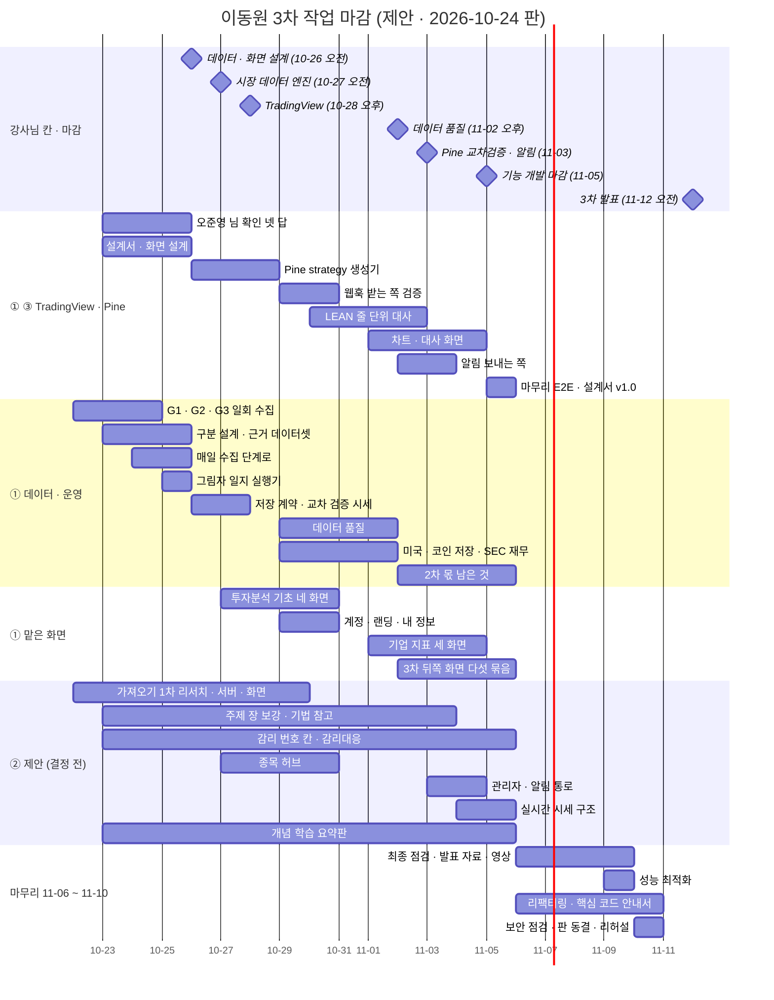
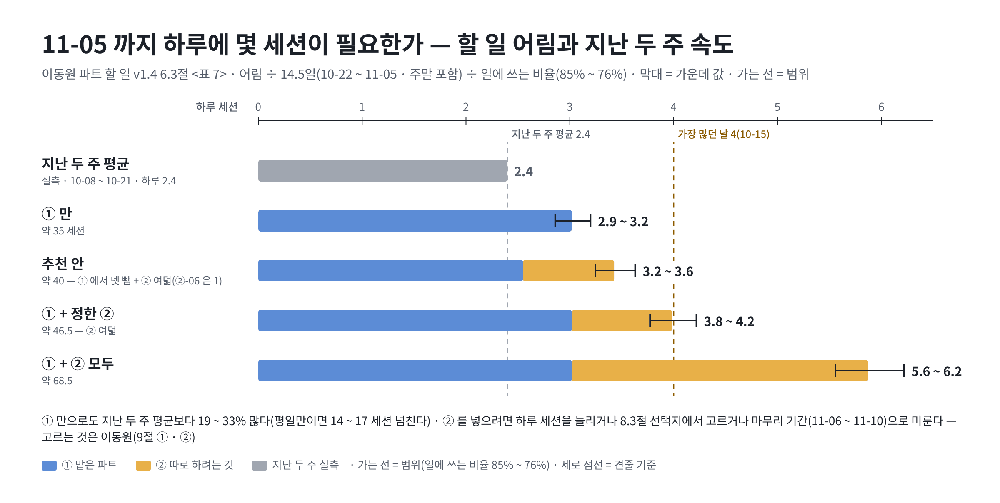
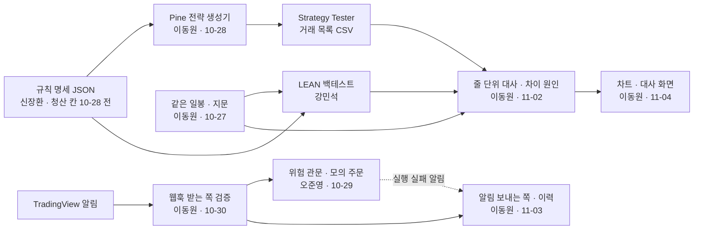

# 이동원 파트 할 일 v1.9 — 3차 작업별 마감

| 문서 정보 | |
|---|---|
| **판 · 상태** | v1.9 · ①-03 끝(③ 설계서 v0.1 · Figma [결정] 화면) · ①-08 웹훅 풀 구현 결정 · 학원 하드 작업 / v1.8 · ①-02 초안 · ①-04 끝 · 노트북 은퇴 · 후속 셋 / v1.7 · ①-27 끝 / v1.6 · ①-05 끝 / v1.5 · ①-26 끝 / v1.4 · 그림자 일지 · 확인 거리 이슈 두 줄(2026-10-24) / v1.3 · ②-06 앞당김(2026-10-23) / v1.2 · ②-05 주제 장 보강(2026-10-23) / v1.1 · 초안(이동원 검토 전) — ① 맡은 파트는 확정 역할이고 마감일은 일정 제안이다 / ② 따로 하려는 것은 「제안」 이다(넣을지 · 날짜 모두 이동원 결정 전 — 이미 정한 줄은 「결정」 칸에 날짜) |
| **구분** | 3. 일정·업무 관리 — 담당 범위 작업 계획(작업별 마감). 팀 전체 일정은 [WBS](../WBS.md) · [스프린트 계획](../스프린트계획.md), 세션 차례는 [산출물 목록](../../../../산출물목록.md) 12절 |
| **작성** | 이동원(팀장 · 3차 목표 기능 ③ TradingView · Pine Script 주담당 — 부담당 강민석) |
| **검토** | 이동원 — 9절 정할 것 일곱 · 팀원은 7절 의존 칸에 「읽었음」 한 줄 |
| **최종 수정** | 2026-10-26 (KST) |
| **최종 완료 목표** | 기능 개발 **2026-11-05(목)** · 마무리 **11-06(금) ~ 11-10(화)** — 발표 자료 · 성능 최적화 · 리팩터링 · 11-11(수)은 강사님 일정의 마지막 작업일(UAT · 인수 · 최종 발표자료 칸 · 리허설) · **3차 발표 11-12(목) 오전 · 오후 수료식**(🟢 강사님 일정 화면 · 10-22 확인) · 그 뒤는 개인 판(일정 밖 · 3절 ②-17) |
| **가용 시간** | **평일 하루 2 ~ 3 세션**(사용자 확인 2026-10-22 · 주말은 사용자가 더 할 수 있음 — 6절의 「평일만 18 ~ 21」 쪽으로 읽는다 · 뺄 후보는 다음 판에서 고름) — 이 판의 어림은 10-08 ~ 10-21 실측(하루 평균 2.4세션 · 주말 포함 · 특강 날은 2로 셈)을 그대로 썼다(6.1절) |
| **코드 확인 기준** | main `b86152a`(PR #329 · 2026-10-23 17:31 머지 · v1.4 — ①-06 · ①-11 · ①-26 · ②-02 · R2 를 다시 봄) · v1.0 ~ v1.3 은 main `8739d61`(PR #315 · 2026-10-22 11:39 머지) |
| **기준** | 계획서 v2.0 4.3절 · 요구 대장 `P02-③-1 ~ 3` · 기능 완성도 점검표(이동원 몫 53줄) · 강사님 3차 일정표 30칸(`rag-lab/frontend/assets/day4-project-schedule.js`) · 3차 묶음 붙이기안(2026-10-18) · 산출물 목록 11절(10-08 ~ 10-22 기록 35줄) · [오준영 3차 계획](../오준영파트-할일.md) · #314 협의 · 이동원 결정(2026-10-22 — 데이터 모으기 · 미국 · 코인 저장 · 새 데이터셋 둘 · 가져오기 1차 차례) · [강사님 자료 점검(10-22)](../../../01-analysis/research/배경조사/2026-10-22-강사님자료-점검/결과.md) · [결정 대장 v1.7](../논의결정대장.md) 부록 C(10-23 그림자 일지 · N1 ~ N3) · [#314 강민석 님 답(04 · 10-24 받음)](../../../../common/00-management/github-archive/2026-10-22/이슈-협의-LEAN-KIS-모의주문-연결/04-2026-10-24-답글-강민석.md) |
| **관련 문서** | [지난 판 v0.3 — 2차 할 일(강사님 틀 · 크롤링 세 화면 결정 · 주인 없는 화면 22)](이동원파트-할일_v0.3.md) · [계획서 v2.0](../프로젝트계획서.md) 4.3절 · [요구 대장](../../../01-analysis/requirements/대장/요구-대장.tsv) · [기능 완성도 점검표](../../../04-testing/대장/기능완성도-점검표.tsv) · [증권사 연동 설계안(오준영)](../../../02-design/system/증권사-연동-자동화-설계.md) · [자동매매 연동 API 계약 v0.5](../../../../common/02-design/contracts/kis-autotrade-api.md) · [3차 묶음 붙이기안](../../../../phase-2/01-analysis/research/배경조사/2026-10-18-강사님배포본-가져올기능/05-묶음-붙이기안.md) · [강사님 자료 점검(10-21)](../../../../phase-2/01-analysis/research/배경조사/2026-10-21-강사님자료-점검/결과.md) <표 5> · <표 6> · [#314 협의 원문](../../../../common/00-management/github-archive/2026-10-22/이슈-협의-LEAN-KIS-모의주문-연결/00-본문.md) · [#161 신장환 님 답글](../../../../common/00-management/github-archive/2026-10-10/이슈-손절익절규칙-신호근거/01-2026-10-12-답글-신장환.md) |
| **최근 개정** | v1.8 → v1.9: ①-03 끝(10-26 · [③ 설계서 v0.1](../../../02-design/system/TradingView-교차검증-설계.md) · Figma [결정] 화면 = 가 · 한 화면 두 칸) · ①-08 에 사용자 결정(웹훅 **실제 수신까지 풀 구현** · 운영 IP 강제 켬 · 마지막 신뢰 단계 값만) · 선행 조건 셋(요금제 · 공개 HTTPS 주소 · 보안 검토) · 외부 벤치마킹 이슈 초안은 웹훅을 P2 로 봄(요구 대장은 필수 — 사용자가 풀 구현으로 정함) / v1.6 → v1.7: ①-27 「어느 PC 에서든 12:30 회차」 끝(10-25 · 코드 · 시험 · 문서) — 남은 것은 머지 뒤 노트북 `install` · 데스크톱 `sync --discard-local` · `install` · 첫 회차 실측 / v1.5 → v1.6: ①-05 끝(10-24 · 코드 · 시험 · 문서) — 남은 것은 머지 뒤 실측 · 바로 백업 · 지난 해 채우기 / v1.4 → v1.5: ①-26 그림자 일지 실행기 끝(10-24 · 실제 1 세션) · 부록 C 에 뒤 할 일 다섯(판정 범위 메모 · 판 바뀜 까닭 · 카드 판 2 · 화면 · 오준영 님 확인 이슈) / v1.3 → v1.4: 새 줄 둘 — ①-26 모의투자 그림자 일지 실행기(10-25 · 1.5) · ②-18 강민석 님 ④ 확인 거리 이슈(10-26 오전 · 0.25) · ②-02 넣기 결정 · #314 강민석 님 답(04)과 #329 를 ①-06 · ①-11 · 표 8 · R2 · 9절 ③ 에 · 소계 · <표 7> · 요약 · 버퍼 · 간트 다시 셈 · 9절 ③ 나눔 선 정함 · <그림 2> / v1.2 → v1.3: ②-06 문서 칸 둘(증빙 위치 대장 · rfp-2 §6 · §7 과업 대비)을 10-27 주로 앞당김 · 결함대장 칸 = 표 9 에 칸 둘 / v1.1 → v1.2: ②-05 를 주제 장 보강으로(외부 강의는 설계 참고 · 전용 갈래 · 원문 흐름 장 · HF 비공개 사본 없음) · 간트 줄 · ①-11 차이 원인 칸 이름 `entry_mode` · `exit_mode` · `judge`(D2 = A) / v0.3 → v1.0: 2차 할 일 판을 지난판 사본으로 두고 **3차 작업별 마감 계획**으로 다시 썼다 — ① 맡은 파트 25줄 · ② 따로 하려는 것 17줄 · 구분 설계 · 미국 · 코인 저장의 자리 판단 · 마무리 기간 · 어림 합계와 근거 · 의존 · 그림 셋(일정 · 막대 자리 · 흐름) · 위험 · 넘치면 뺄 후보(선택지) · 정할 것 (부록 D) |

> **이 문서로 알 수 있는 것**
> 1. 이동원은 3차에 무엇을 언제까지 끝내나 — 맡은 파트(확정)와 따로 하려는 것(제안)을 나눠서
> 2. 11-05 까지 다 들어가나 — 어림 합계와 남은 날, 넘치면 무엇을 뺄 수 있나(선택지)
> 3. 누구 · 무엇에 기대나 — 팀원 일정 · 특강 · 강사님 자료 · 공공 원천 한도 · TradingView 조건
>
> **읽는 순서** — 이동원: 요약 → 6절 → 8 · 9절 · 팀원: 요약 → 2절 표 → 7절 의존 · 처음 온 사람: 부록 A 용어 → 요약
>
> **확실도** — 🟢 저장소 · 공식 원문에서 직접 확인 / 🟡 추정 · 어림 · 팀 확인 전 / 🔴 없거나 검증 안 됨

## 요약

1. **마감** — 3차 기능 개발은 **11-05(목)** 까지 끝내고, **11-06(금) ~ 11-10(화)** 은 발표 자료 · 성능 최적화 · 리팩터링에 쓴다. 맡은 파트의 마감은 강사님 3차 칸 — 10-26 오전 「데이터 · 화면 설계」 · 10-27 오전 「시장 데이터 엔진」 · 10-28 오후 「TradingView」 · 11-02 오후 「데이터 품질」 · 11-03 오전 「Pine 교차검증」 · 오후 「알림 자동화」 — 에 맞췄다(2절).
2. **맡은 파트(확정 · ①)** 는 셋이다 — ㉠ 3차 ③ TradingView · Pine(`P02-③-1 ~ 3`) ㉡ 데이터 파트의 3차 몫(10-22 에 정한 데이터 모으기 G1 ~ G3 · 실시간 표시와 저장 자료 구분 설계 · 미국 · 코인 시세 저장 · 데이터 품질 · 매일 회차 · 2차 몫 남은 것) ㉢ 이동원 결정으로 맡은 화면의 3차 몫(주인 없는 화면 · 투자분석 기초 네 화면 · 계정). 26줄 · 어림 **약 35 세션**(v1.4 — 모의투자 그림자 일지 실행기 1.5 더함).
3. **따로 하려는 것(제안 · ②)** 은 18줄이다. 11-05 전에 하려면 어림 **약 33 세션**(v1.4 — 확인 거리 이슈 0.25 더함)이고, 둘은 마무리 기간 몫 · 하나는 11-11 뒤 개인 판(일정 밖) 몫이다(3절). 강사님 기능 가져오기 1차는 「사용자마다 설정」 구조 리서치(10-22) → 이동원 결정 → 서버 → 화면 차례다(2026-10-22 결정).
4. **11-05 까지 일에 쓸 수 있는 세션은 약 26 ~ 29**(지난 두 주 속도 · 주말 포함) · 평일만이면 약 18 ~ 21 이다. **① 만으로도 6 ~ 9 세션 넘친다** — 하루 2.9 ~ 3.2 세션이 필요하다(지난 두 주 평균 2.4). ② 는 고르거나 마무리 기간 · 개인 판으로 미뤄야 하고, 그 판단은 이동원이 한다(8.3절 선택지 · 9절).
5. **자리 판단(2.1절)** — 「실시간 표시 vs 저장 자료」 구분 설계는 10-28 TradingView 칸 **앞**(10-26 · ③ 설계서와 한 묶음), 저장 계약은 10-27 칸, 미국 · 코인 시세를 실제로 받아 HF 에 올리는 일은 **뒤**(11-02)에 둔다.
6. **기대는 곳** — 신장환 님 규칙 명세 청산 칸(10-28 Pine 칸 전 · #161) · 강민석 님 LEAN 실행처와 결과 꼴(#314 — 10-24 답: 로컬 WSL Docker · Yahoo 일봉 입력 · 10-26 고정 입력 · 10-28 비교) · 교차 검증 나눔 선(`P02-③-2` ↔ `P02-④-3`) · 오준영 님 「팀장 확인」 넷과 웹훅 신호의 위험 관문. 오준영 님은 10-22 오후 · 10-23 협의가 어렵다(오준영 계획서 가용 시간과 같음) — 그쪽에 기대는 일은 빨라야 10-26 부터 움직인다(7절).

---

## 1. 범위와 세는 법

**<표 1> 묶음과 근거**

| 묶음 | 무엇 | 근거 | 이 문서에서 |
|---|---|---|---|
| ① ㉠ | 3차 ③ TradingView · Pine Script 성과 확인 — `P02-③-1` Pine 전략 · 차트 신호 / `P02-③-2` Strategy Tester + LEAN 교차 검증 / `P02-③-3` 알림 · Webhook | 계획서 v2.0 4.3절(2026-10-01 팀 확정) · 요구 대장 「확정」 세 줄 · 부담당 강민석 | 2절 ③ 줄 여덟 |
| ① ㉡ | 데이터 파트 3차 몫 — 데이터 모으기 G1 ~ G3 · 실시간 표시와 저장 자료 구분 설계 · 저장 계약 · 미국 · 코인 시세 저장 · 데이터 품질(`SCH-DQ` — 요구 대장 「제안」 · 주담당 이동원) · 매일 12:30 회차 · 2차 몫 남은 것(점검표 「100%까지」) · 내 파트 점검 | 계획서 4.2 · 4.4절(C1 데이터 관문 · SCH-DQ) · 요구 대장 · 이동원 결정(2026-10-22 데이터 모으기 · 미국 · 코인 저장 · 새 데이터셋 둘 / 2026-10-19 내 파트 점검) | 2절 데이터 줄 열(①-26 그림자 일지 — 10-23 결정) |
| ① ㉢ | 주인 없는 화면 22의 3차 몫(이동원 결정 2026-10-07) · 투자분석 기초 네 화면(2026-10-03 결정 — 이동원이 기초 구현 · 각 주담당이 변형) · 계정(로그인 · 가입 · 내 정보) | [지난 판 v0.3](이동원파트-할일_v0.3.md) 1 · 7절 <표 10> · 점검표 주담당 칸 | 2절 화면 줄 여덟 |
| ② | 따로 하려는 것 — 강사님 기능 가져오기 · 특강 반영 · 감리대응 · 종목 허브 · 실시간 시세 · 개념 학습 요약판 · 관리자 · 리팩터링 등 | 3차 묶음 붙이기안(2026-10-18 — 묶음 (가) ~ (아)) · 강사님 자료 점검(10-21 · 10-22) · 이동원 요청(10-13 ~ 10-22) | 3절 — 모두 「제안」 |
| 밖 | 다른 주담당 몫 — ① ② 인디케이터(신장환) · ④ LEAN(강민석) · ⑤ 증권사 연동(오준영) | 계획서 4.3절 | 고치지 않고 이슈로 · 7절 의존에만 |

**세는 법**

- **세션** = AI 도구와 함께 하는 작업 한 번(보통 2 ~ 4시간 · PR 하나 · 설계 → 서버 → 화면 → 시험 → 문서 판). 어림은 지난 두 주에 비슷한 꼴의 일이 쓴 세션 수로 쟀다(6.2절 <표 6>).
- **마감** = 그날 끝까지 main 에 들어가 있어야 하는 날(PR 머지 기준). 강사님 칸이 있는 일은 「칸」 이라고 적고, 그 칸에서 보일 수 있게 칸 전까지 끝낸다.
- **완료 기준**은 시험 · 화면 · 문서로 확인할 수 있게 적었다. 「시험」 은 새 시험 묶음을 시험-요구 대장에 올리고 통과하는 것이다.

---

## 2. 작업별 마감 — ① 맡은 파트(확정)

마감 순이다. 강사님 칸에 걸린 줄(①-03 · 04 · 06 · 07 · 11 · 12 · 14)과 오준영 님께 줄 답(①-02) · 매일 회차(①-24)는 8.3절 「뺄 후보」 에 넣지 않았다.

**<표 2> ① 맡은 파트 — 27줄** · 어림 = 세션 · 확실도는 「지금 상태」 와 「어림」 을 따로 적음

| # | 마감 | 작업 | 완료 기준(확인 방법) | 어림 | 의존 | 지금 상태(근거) | 확실도 |
|---|---|---|---|--:|---|---|---|
| ①-01 | **10-24(토)** | 데이터 모으기 일회 수집 → HF 비공개 — G1 ECOS 셋(기준금리 · 원/달러 · 소비자물가) · G2 DART 업종코드 · KSIC · G3 DART 전체 재무제표 | 계열 · 표마다 줄 수 · 기간 · 출처 · 이용 조건 기록 · HF 비공개 데이터셋에 올리고 받아서 대조(SHA-256) · G3 은 OpenDART 하루 한도(2만 건) 안에서 이틀로 나눔 | 1.5 | 매일 회차의 DART 단계와 한도를 나눠 씀(8.2 R9) | 결정 · 2026-10-22 시작 · ECOS 수집은 시장금리 · 지수 계열만(`collector/ecos.py` `SERIES` · `INDEX_STAT`) · 재무는 주요계정만 | 지금 🟢 · 어림 🟡 |
| ①-26 | **10-25(일)** — 매 거래일 1행은 10-26(월)부터 | 모의투자 그림자 일지 실행기 — 규칙 판 등록 · 매 거래일 판단 1행 · 판 바뀜 기록(10-23 결정 · 데이터 ㉡) | 앱 DB 새 표(추가만 · alembic 새 판 · 기존 `orders` 와 섞지 않음) · 등록 규칙 둘(신장환 님 카드 판 1 `ma_cross` 20/60 일봉 + 지금 자동매매 기본 규칙 · 시도 수 2) · 거래일마다 1행(관망 포함 — 판단 봉 · 신호 · 가상 체결가 · 규칙 판) · 주담당이 코드 · 규칙을 고치면 「규칙 판 바뀜」 으로 새 판 등록(날짜 · 커밋 · 바뀐 칸) · 판마다 등록일부터 봉인 구간 · 09-01 ~ 첫 등록 전날은 「사후 봉인 시험」 등급 · HF 비공개 원장에 덧붙임 · 시험 | 1.5 | 결정 대장 v1.7 부록 C(10-23) · 10-26 협의에서 강민석 님께 알림(사전등록 판정 · 성과 해석 몫) · 러너에 붙이면 ①-05 와 같은 파일이라 차례를 맞춤(8.2 R3) · 신장환 님 카드 판 2(10-27)는 새 판으로 더 등록 | **끝(10-24)** — 러너 단계 둘(`journal` 「모의 일지」 · `journal_upload` 「일지 올리기」) · 앱 DB 표 셋(마이그레이션 `0026` · 추가만) · 판 1 등록 10-24 13:41(카드 `443aed4f32f9` 시도 1 · 기본 규칙 `e574c622ee81` 시도 2 · 봉인 10-26 ~) · 사후 봉인 시험 68행(09-01 ~ 10-22) · HF `qurious-paper-log` 첫 올리기 · 자료 안내 30번째 자료 · 시험 TC-PJ 16 · 깨 보기 열 · [설계 v0.1](../../../02-design/system/모의투자-그림자일지-설계.md) · 정한 것 일곱(결정 대장 v1.9) | 끝 🟢 · 실제 1 세션(어림 1.5) |
| ①-27 | **10-25(일)** — 사용자 지시 10-24 · 10-25 | 12:30 회차를 어느 PC 에서든 — 임대 · 맞추기 · 따라가기 · 앱 DB(일지 원장 받기 · 신호 빈 범위) | 모든 PC 같은 예약 · 한 자리 한 PC(HF 앞 커밋 비교 412) · 뒤처진 PC 맞춤(세 판) · 따라간 PC 회차 기록 · 시험 TC-LE · TC-HS · TC-DU · 깨 보기 · 머지 뒤 노트북 첫 회차 실측 | 1 | ①-24 | **끝(10-25 · 코드 · 시험 · 문서)** — [여러 PC 설계](../../../02-design/system/여러PC-회차-설계.md) · 남은 것은 머지 뒤 노트북 `install` · 데스크톱 둘 `sync --discard-local` · `install` · 첫 회차 실측 → **10-25 S148: 노트북은 빼고(사용자 결정) 데스크톱이 넘겨받음 — 맞추기 80조각 · 설치 · 바로 올리기(표 25 · 임대 가지 처음) · 운영 11-12 까지([설계 v0.2](../../../02-design/system/여러PC-회차-설계.md) 14절)** | 높음(코드 · 시험) · 중간(첫 실측 전) |
| ①-02 | **10-26(월) 오전** | 오준영 님 「팀장 확인」 넷(KIS 국내 모의계좌 우선 · 일정안 · 기존 알림 채널 활용 · TradingView 알림과 실행 실패 알림의 경계)에 답 + 웹훅 신호를 위험 관문(중복 · 손실 한도 · 비상 정지)에 태울지 함께 여쭘 | 이슈 답글 한 건 — 받는 쪽(웹훅 검증 = 이동원) · 보내는 쪽(실행 실패 알림 = 오준영) · 같이 쓰는 `notification.dispatch` · 알림 이력 표를 하나로 쓸지를 표로 | 0.25 | 이동원 차례 — 오준영 님은 10-22 오후 · 10-23 협의가 어려워(오준영 계획서 가용 시간과 같음) 10-26 오전에 읽는다 | 요청은 [오준영 3차 계획](../오준영파트-할일.md) 4절 「이동원 · 팀장 — 착수 시 검토」 → **초안(10-25 S148) — #314 05 답글(넷 답 + 웹훅 신호 위험 관문 물음 · 이력 표 하나로) · 올리는 때 10-26 오전(사용자가 웹에서)** | 지금 🟢 |
| ①-03 | **10-26(월) 오전 칸** 「데이터 · 화면 설계」 | ③ 설계서 v0.1 + TradingView 화면 설계 | 설계서 v0.1(맥락 · 목표와 비목표 · 지금 상태 · 설계 · 대안 · 뒤집을 조건)에 교차검증 명세(비교 층 넷 — 신호 · 체결 · 비용 · 데이터 · 허용 오차) · 규칙 명세 칸 → Pine 줄 대응표 · 웹훅 검증 규칙 · 알림 정책 초안 · 「국내 종목 차트는 TradingView 위젯이 아니라 Lightweight Charts + 우리 자료」 근거 한 줄이 있고, Figma 파일에 [결정] 화면 하나(안 여럿 → 고름) | 1 | ①-02 · ①-04 · 신장환 님 규칙 명세(계약 v0.5) | ③ 전용 설계서 없음(`docs/phase-3/02-design/system/` 목록) · 화면은 강사님 기초 화면 `indicator-tradingview` 84점(점검표 「3차 몫 — 웹훅 · DB E2E」) · 강사님 th03 이 10-22 에 TradingView 위젯을 붙였다가 KRX 종목이 그려지지 않아 Lightweight Charts 로 바꿈(강사님 자료 점검 10-22 · 3-1) → **끝(10-26 S149) — [설계 v0.1](../../../02-design/system/TradingView-교차검증-설계.md)(규칙 → Pine 대응표 · TradingView 가 다르게 도는 곳 넷 · 교차 검증 층 넷 · 대사표 칸 · 웹훅 검증 여덟 · 알림 정책 · 화면) · Figma [대사 화면 가안](https://www.figma.com/design/NkW5HeLKczBDZnNJJkWKEu?node-id=2-4)(데스크톱 · 좁은 화면 · 버린 안 둘 · 결정 기록) · 정한 것 — 화면 가 · IP 강제 · 웹훅 풀 구현 · 대기 — 매도세 근사 · 허용 오차(강민석 님) · 위험 관문(오준영 님)** | 끝 · 검토 대기 🟡 |
| ①-04 | **10-26(월) 오전 칸** | 「실시간 표시 vs 저장 자료」 구분 설계(국내 · 미국 · 코인) + 근거 데이터셋 `source-terms-evidence` | 기능마다 두 갈래 표(저장 자료로 충분 — 백테스트 · 대사 · 학습 · 근거 답 / 실시간이 필요 — 모의 주문 가격 · 현재가 · 손절 · 익절 판단 · AI 답이 가격을 말할 때) · 시장 · 원천마다 「화면 표시만 · 저장 가능 · 저장한다면 무엇을(판단 기록만)」 · 원천마다 이용 조건 원문 사본 · 조회일 · 해시를 HF 비공개 `source-terms-evidence` 에 | 1 | 미국 · 코인 원천 이용 조건 원문(①-13 이 그대로 씀) | 국내 현재가는 서버 한 곳(`app/services/quote_now.py` · #283 · 10-19) · 두 갈래 구분은 2차 끝에 방향만 정함(이동원 2026-10-19) → **끝(10-25 S148) — [설계 v0.1](../../../02-design/system/실시간표시-저장자료-설계.md)(10-19 표를 3차로 · 원천 × 쓰임 · 어긋남 여섯) · 근거 `source-terms-evidence` 새 판 `terms-2026-10-25`(원천 22 → 31) · 정한 것 셋(G1 필요한 곳만 받고 쌓지 않음 · G2 → ①-29 · 알리기는 10-26 협의 뒤 이슈 하나)** | 끝 |
| ①-05 | **10-26(월) 12:30 회차 전** | G1 ~ G3 을 매일 도는 수집기 단계로 | 러너 단계(ECOS 계열 더하기 · DART 업종코드 · 전체 재무제표 증분) · 시험 · 12:30 회차 한 번 실측 · 데이터 관제 · 자료 안내 줄이 저절로 따라옴(러너 단계 목록에서 만듦) | 1 | ①-01 · 러너 파일이라 12:30 전에 머지 · 받기(8.2 R3) | **끝(10-24 · 코드 · 시험 · 문서)** — 러너 새 단계 둘(`financial_full` 「재무 전체」 · `company` 「기업 업종」) · `ecos` 열한 계열(G1 셋 + 국고채 10년 · 소비자물가는 월) · 새 표 넷(`dart_company` · `ksic_code` · `financial_statement_full` · `financial_full_check`) · DART 하루 몫(회차 3,000 · 단계 상한 · 지난 해 채우기 15,000 은 회차 뒤에만) · 호출 장부 (관제 「DART n회」) · 처음 채움(전체 재무제표 1,379,142줄 · 업종 351곳 · KSIC 4,059줄 — 10-22 일회 수집 원문에서) · 시험 TC-FF 15 · TC-CI 8 · TC-ECS +2 · TC-DU +3 · TC-DST-13 강화 · 깨 보기 18 · [설계 v1.8 5.2.5](../../../02-design/system/목표기능1-데이터지식-설계.md) · 정한 것 넷(결정 대장 v1.10) — **남음: 머지 뒤 수집 DB 가 있는 PC 에서 12:30 회차 실측 · 바로 백업 · 지난 해 채우기 2015 ~ 2020(회차 밖)** | 코드 끝 🟢 · 실측 대기 🟡 · 실제 1 세션(어림 1) |
| ①-06 | **10-27(화) 오전 칸** 「시장 데이터 엔진」 | 저장 계약(`ohlcv-v2` · 시장 레지스트리 · 달력 `(market, cal_date)` — 국내 표는 그대로) + 교차 검증용 같은 시세 | 계약 문서 · 레지스트리 시험 · 국내 읽기 길이 그대로인지 회귀 시험 · 종목 · 기간 · 수정 방식을 넣으면 LEAN · 로컬 엔진 · 대사 도구가 같은 일봉을 읽는다(파일 지문 · 데이터 기준일) · TradingView 차트 자료와 우리 일봉이 다른 날을 「데이터 층」 으로 적는 표 꼴 | 1.5 | 강민석 님 LEAN 입력 꼴(#314 질문 1 — 10-24 답: Yahoo 일봉 종가 CSV 를 LEAN 사용자 정의 자료 `YFPrice` 로 넣음 · 우리 저장 일봉이 아니다) · 시장 범위 팀 글(#151) | 설계는 시장 범위 조사서 6절 · 일봉 주소 `/api/data/ohlcv` · 규격 `ohlcv-v1` · HF 비공개 `krx-ohlcv` 있음 · LEAN 입력은 Yahoo 차트 API 일봉 종가(`app/services/lean_backtest.py:98-118` · `date,close` 둘만 — 고가 · 저가 없음) — 우리 저장 일봉과 잇는 길은 없음 | 지금 🟢 · 어림 🟡 |
| ①-07 | **10-28(수) 오후 칸** 「TradingView」 | Pine v6 `strategy()` 생성기 — `P02-③-1` | 규칙 명세(JSON) 하나에서 만든 Pine 코드가 TradingView 편집기에서 오류 없이 컴파일되고 `strategy()` 라 Strategy Tester 가 켜진다(손 확인 한 번 · 화면 캡처) · 손절 · 익절(`strategy.exit` — 익절 = 진입가 + 손절 거리 × 손익비 · 카드 기본 2 · 입력 1.5 ~ 3 · #314) · 수수료 · 슬리피지 · 시작 자본 · 수량이 명세 값과 같다(생성 결과 대조 시험) · 내보내기 전에 문법 점검(강사님 `pine-lint.js` 를 받는다면) | 2 | 신장환 님 청산 칸(#161 A1 「10-28 Pine 칸 전」) — 그 전에는 계약 v0.5 칸으로 만들고 A1 이 오면 맞춘다 | 지금 Pine 은 지표 표시용뿐 — `public/js/indicator.js:92` `//@version=5` `indicator()` · `app/services/formula.py:545` v6 `indicator()` · `strategy()` 없음 · W2 템플릿은 신장환 님 `indicator()` v6, `strategy()` 는 이 생성기로 나누기로 함(#161 03 · 04) | 지금 🟢 · 어림 🟡 |
| ①-08 | **10-30(금)** | 웹훅 받는 쪽 검증 — `P02-③-3` 앞 절반 | 보낸 쪽(토큰 · TradingView 가 보내는 IP 넷) · 중복(같은 알림을 두 번 받아도 기록 한 건) · 지연(알림 시각과 받은 시각 차이가 한도를 넘으면 거부하고 까닭 기록)을 시험으로 · 3초 안에 응답하고 처리는 뒤로 · 신호가 모의 주문으로 가는 길은 ①-02 에서 정한 대로 | 1 | 오준영 님 위험 관문(10-29 위험관리) · ①-02 · TradingView 조건(8.2 R6) | `app/routes/tradingview.py:36` — 토큰(Open API 키) · 분당 제한 · 같은 종목 · 방향 1분 안 되풀이 무시(`app/services/tradingview.py:28`) · 허용 IP 는 설정으로만 켬 · 받으면 바로 모의 시장가 체결 · 지연 검사 · 알림 단위 중복 검사는 없음 → **10-26 사용자 결정: 실제 수신까지 풀 구현 · 운영에서 IP 강제를 켜고 마지막 신뢰 단계 값만 · 알림 단위 중복 키 · 기록 뒤 즉시 응답(3초) — 선행 조건 셋(웹훅이 되는 요금제 · 밖에서 닿는 HTTPS 주소 · 보안 검토)이 10-30 전에 안 되면 흉내 요청 시험까지만([설계 v0.1](../../../02-design/system/TradingView-교차검증-설계.md) 3.6 · 8절)** | 지금 🟢 · 어림 🟡 |
| ①-09 | **10-30(금)** | 계정 · 랜딩 · 내 정보 — 묶음 (아) 의 계정 몫(날짜는 2026-10-18 결정: 10-26 설계 · 10-29 ~ 30 구현) | 로그인 시도 횟수 제한 · 로그인 뒤 원래 화면으로 돌아가기 · 가입 약관 · 개인정보 동의 칸 · 비밀번호 보기 · 랜딩 쪽 · 내 정보에 투자 성향 칸 — 시험 · 화면 손 확인(비밀번호 찾기는 메일 발송이 필요해 범위를 따로 정함) | 1.5 | — | 점검표 로그인 88 · 가입 88 · 내 정보 90 — 「100%까지」 에 시도 횟수 제한 · 돌아올 주소 · 약관 동의 · 투자 성향 칸 | 지금 🟢 · 어림 🟡 |
| ①-10 | **10-30(금)** | 투자분석 기초 네 화면 — 거시경제 · 산업 · 재무제표 · 기술적 분석 | 거시 · 산업은 ECOS 계열(G1 포함)과 서버 머리 글(받은 시각 · 지연) · 재무제표는 DART 재무(시점 고정 · G3 전체 재무제표)로 목업 계산을 바꿈 · 기술적 분석은 지표 API(지표 정의 한 벌) — 숫자마다 출처 · 기준일 · 시험 | 2 | ①-01 · 특강 기법 적용(②-05)과 같은 화면 — 한 묶음이면 줄어든다(8.3 아) | 점검표 거시 78 · 산업 75 · 재무제표 45(목업 계산) · 기술적 40(설명 전용) | 지금 🟢 · 어림 🟡 |
| ①-11 | **11-02(월)** — 11-03 오전 칸 「Pine 교차검증」 전 | Strategy Tester ↔ LEAN 줄 단위 대사 — `P02-③-2` | 같은 규칙 · 종목 · 기간에서 Strategy Tester 거래 목록 CSV 와 LEAN 거래를 신호 날짜 · 진입가 · 청산가 · 수익률로 줄마다 맞대고, 어긋난 줄마다 「차이 원인」(`entry_mode` · `exit_mode` · `judge` · 데이터 · 비용) 칸이 찬 표 한 장 + 허용 오차 안 · 밖 판정 · 세 엔진(TradingView · LEAN · 우리 모의)의 시작 금액 · 통화 · 비용 칸을 한 값으로 | 2 | 강민석 님 LEAN 실행처 · 결과 꼴(#314 질문 1 · 3 — 10-24 답 · 10-26 18:00 고정 입력 결과) · `P02-④-3` 과 나눔 선(9절 ③ — #329 의 체결 비교 위에 짓기) · 신장환 님 ATR 손절 + 위험 % 수량(#161 A2 「11-02」 — 그 판 대사는 ①-22 에서) | `POST /api/tradingview/compare`(`app/routes/tradingview.py:131`)는 요약 지표(수익률 · MDD · 거래 수 · 승률 · 샤프)를 견주고, #329(10-23)부터 개별 체결 비교(`compare_fills` — 날짜 · 방향 · 가격 · `app/services/tradingview.py:326` · 응답 `fill_comparison`)도 싣는다 · 신호 층 비교 · 차이 원인 칸 · 대사표는 없음 · 비교 요청의 시작 금액 기본값 10,000(`app/routes/tradingview.py:122`) | 지금 🟢 · 어림 🟡 |
| ①-12 | **11-02(월) 오후 칸** 「데이터 품질」 | 데이터 품질 — `SCH-DQ`(제안 · 이동원) | 러너에 품질 검사 단계 하나(결측 · 중복 · 정합성 — 처음엔 경고만) · 결과를 데이터 관제에 한 줄 + 품질 현황(표 · 단계별) · 데이터 SLA(출처마다 공개 마감 — 지금 신선도 규칙을 문서로) — 시험 · 회차 한 번 실측 | 2 | 러너 파일이라 12:30 전에 머지(8.2 R3) | 러너 21단계에 품질 단계 없음(`scripts/daily_update.py` `STEPS`) · 신선도는 출처마다 공개 마감(`app/services/data_status.py` `FRESHNESS`) · 데이터 관제 93점 | 지금 🟢 · 어림 🟡 |
| ①-13 | **11-02(월)** | 미국 · 코인 시세 HF 비공개 저장 + `us-fundamentals`(SEC) | 약관이 허용하는 원천만(①-04 표) · `ohlcv-v2` 로 받기 · 검사 · HF 비공개(`us-ohlcv` · `crypto-ohlcv` · `us-fundamentals`)에 올리고 받아서 대조 · 미국 서머타임 끝(11-01) 앞뒤 시간대 시험 · 자료 안내 · 관제 줄 | 2.5 | ①-04 · ①-06 · SEC 접근 규칙(요청 속도 · 이름 밝히기 — 확인 필요) | 결정(2026-10-22) · 설계는 시장 범위 조사서 6절 · 미국 화면은 야후 시세를 화면에만(저장 없음) · Alpaca 키는 조회에만 | 지금 🟢 · 어림 🟡 |
| ①-14 | **11-03(화) 오후 칸** 「알림 자동화」 | 알림 보내는 쪽 — `P02-③-3` 뒤 절반 | 조건이 충족되면 정한 채널로 한 번 · 실패는 기록 · 재시도 상한 · 같은 알림 억제 · 알림 설정 화면에서 이력이 보인다 — 시험 | 1 | 오준영 님 실행 실패 알림이 같은 `notification.dispatch` 를 쓴다(설계안 표 · 알림 줄) — 이력 표를 같이 쓸지(①-02) | `app/services/notification.py:280` `dispatch` · `_log_dispatch` 있음 · 점검표 알림 설정 58(「실전송 · 끄면 팀 공용 채널 확인」) | 지금 🟢 · 어림 🟡 |
| ①-15 | **11-04(수)** | 차트 · 대사 화면 — 칸 「TradingView 실습 화면」 · 「대사 화면」 몫 | 가격 차트(국내는 Lightweight Charts + 우리 저장 자료) 위에 우리 신호 · TradingView 신호 · LEAN 신호와 손절 · 익절 선 · 어긋난 날 표시 · 데이터 기준일 · 좁은 화면 확인 | 1.5 | ①-04 · ①-07 · ①-11 | 차트 라이브러리는 Lightweight Charts(`public/js/vendor/lightweight-charts/` — 상품 상세 창이 씀) · 대사 화면 없음 | 지금 🟢 · 어림 🟡 |
| ①-16 | **11-04(수)** | 기업 지표 세 화면 — 지표 대시보드 · 지표 비교 · 섹터 인디케이터 | 고정 재무(23Q2 ~ 24Q1) · 섹터 전망 상수 대신 업종(G2 업종코드 · KSIC) · DART 재무(G3 · 시점 고정) · 숫자마다 「근거:」 줄 · 강사님 새 파일 묶음(DART 재무 · 섹터 인디케이터 · AG Grid)을 받는다면 붙이는 줄만 3-way | 2 | ①-01 · 강사님 새 파일을 받을지(가져오기 전 묻기 — 10-21 점검 <표 5> 5-2) · 섹터 칸은 신장환 님과 | 점검표 지표 대시보드 75 · 지표 비교 45(정적 목업) · 섹터 42(정적 목업) | 지금 🟢 · 어림 🟡 |
| ①-17 | **11-04(수)** | 직접매매 둘 — 포트폴리오 · 주문/매매 | 오준영 님 증권사 연동과 나눔 선을 먼저 정하고 · 「Mockup」 글 정리 · 저장 단추가 증권사 API 설정 화면 입력칸을 읽는 숨은 의존을 없앰 · 실주문은 관문(ADR-0001) 그대로 | 0.75 | 오준영 님 정기 실행(10-30) 뒤 | 점검표 포트폴리오 72 · 주문/매매 61 | 지금 🟢 · 어림 🟡 |
| ①-18 | **11-04(수)** | 전략 분석 — 성과 검증 화면과 합칠지 | 합치거나 따로 두는 결정(강민석 님과) · 「Mockup」 같은 글 정리 · 체결 시점 백테스트(#224)의 서버 칸 손 확인 | 0.5 | 강민석 님 성과 화면 | 점검표 76 | 지금 🟢 · 어림 🟡 |
| ①-19 | **11-05(목)** | 미국주식 넷 — 대시보드 · 주가 차트 · 주문/매매 · 포트폴리오 | 화면마다 시세 출처 · 이용 조건 · 지연 표기(①-04 표대로) · 재무 칸은 `us-fundamentals` · 해외 비용(증권사 해외 수수료 · 매도 SEC 수수료)은 비용 모듈 이슈(강민석 님) 뒤 반영 · 포트폴리오 손익 다시 계산 | 1 | ①-13 · 강민석 님 비용 모듈 | 점검표 75 · 81 · 60 · 70 · 지연 시세를 「실시간 · LIVE」 로 부르던 글은 10-16 고침(#252) | 지금 🟢 · 어림 🟡 |
| ①-20 | **11-05(목)** | 코인 모의매매 · 대체자산 | 강민석 님 모의투자 장부와 나눔 선 확인 · 가격 출처 · 정산 방식을 화면에 정직하게(①-04 표대로) · 통합 시험 하나씩 | 0.75 | 강민석 님 장부 · ①-13 | 점검표 68 · 66(「3차 뒤쪽 — 장부와 경계 확인 뒤」) | 지금 🟢 · 어림 🟡 |
| ①-21 | **11-05(목)** | ML 셋 — 회귀 분석 · 하이퍼파라미터 튜닝 · 딥러닝 | 화면마다 「원리 · 실습 열기」(개념 학습 장으로) · 시간 순서 분할 · 기준선 문장 · 딥러닝은 설명 전용을 실습(노트북)으로 바꿀지 결정 | 1 | 강사님 딥러닝 묶음(th06 노트북 · th11)을 받을지(가져오기 전 묻기) | 점검표 회귀 72 · 튜닝 70 · 딥러닝 40(설명 전용) | 지금 🟢 · 어림 🟡 |
| ①-22 | **11-05(목)** | ③ 마무리 — E2E · 설계서 v1.0 · 대사 결과 | 웹훅 → 기록 → 알림 → DB 를 한 흐름으로 E2E 시험 · ③ 설계서 v1.0 · 대사 결과 보고(차이 원인 표 · ATR 손절 판 포함) · 테스트 계획서 · RTM 에 `P02-③-*` 줄 | 1 | ①-07 ~ ①-15 · 신장환 님 A2 | — | 어림 🟡 |
| ①-23 | **11-05(목)** | 2차 몫 남은 것(점검표 「100%까지」) | 근거 답 품질 보고서 v0.2(공시 · 뉴스 근거 답 10문항 · 이름표 정밀도 표본 200) · 용어사전 작은 관계 지도 · 교재 밑줄 · 일정에 공모(청약 · 상장) · 경제지표 · 리서치 「뜻으로 찾기」 | 2.5 | — | 점검표 근거 답 88 · 리서치 84 · 일정 93 · 용어사전 90 · [근거 답 품질 보고서](../../../04-testing/근거답-품질보고서.md) v0.1 | 지금 🟢 · 어림 🟡 |
| ①-28 | **11-05(목) 전** — 사용자 결정 10-25 「넣는다」 | 판 문지기 · 작업 스케줄러 끝 날짜 인자 | 원격 임대 · 매니페스트에 최소 프로토콜 번호 — 옛 판 PC 는 올리기 · 따라가기를 멈추고 까닭을 남김 · `install --until`(12:30 회차 · 작업자 · 복구 시험 셋 — 다시 설치해도 끝 날짜가 남음) · 시험 먼저 · 깨 보기 | 0.75 | ①-27 | 지금 `scripts/` 에 `EndBoundary` 가 없어 `install` 을 다시 돌리면 손으로 넣은 11-12 가 사라진다 · [동시 켜짐 조사](../../../01-analysis/research/배경조사/2026-10-25-여러PC-동시켜짐/결과.md) 추천 1 · 2 | 지금 🟢 · 어림 🟡 |
| ①-29 | **11-05(목) 전** — 사용자 결정 10-25(①-04 G2) | 외부 시세 캐시 정리 · 백업 제외 | `data_cache` 의 나이 지난 줄을 하루 한 번 지움 · 앱 DB 백업 · 옮기기에서 `data_cache` 를 뺌 · 시험 | 0.5 | ①-04 | `app/services/data_cache.py` 는 덮어쓰기만 하고 지우지 않음 · 10-25 노트북 → 데스크톱 앱 DB 옮김에 122줄 | 지금 🟢 |
| ①-31 | **11-05(목) 전** — DF-157(10-25 S148) | 수집기 호스트 패키지 선언 · 환경 점검 | `yfinance` 를 호스트 도구 의존성에 판 고정(잠금 갱신은 의존성 판 관리 규칙대로 시험으로 확인) · 수집기가 쓰는 패키지가 다 있나 보는 환경 점검(새 PC 첫 켜짐 · c 역할 2 에서) · 시험 | 0.25 | ①-28 | 노트북에만 손으로 깔려 있어 데스크톱 첫 회차에서 분봉 60분 · 5분 실패 · 이 PC 는 `.venv` 에 0.2.66 을 깔아 맞춤 | 지금 🟢 |
| ①-30 | **11-13(금)** — 사용자 결정 10-25 「일단 둘 다 끄되 나중에 다시 킬 수 있도록」 | 운영 끝 · 다시 켜기 절차 | 예약 셋은 끝 날짜(11-12 23:59:59)로 저절로 멈췄는지 확인 · 두 데스크톱 Celery 는 `stop.ps1` 로 끔(컨테이너 · 볼륨은 남김) · 다시 켜기(`install` 셋 + 끝 날짜 + `start.ps1`)를 문서에 | 0.25 | ①-28 | 운영은 11-12 까지(사용자 10-25 · 더 발전시키는 것은 개인 프로젝트) · [설계 v0.2](../../../02-design/system/여러PC-회차-설계.md) 14.3 | 지금 🟢 |
| ①-24 | **매일 · 매주** | 운영 — 12:30 회차 · 일요일 15:00 복원 리허설 · 회차 결함 | 회차 상태 확인(`python scripts/daily_update.py status`) · 실패하면 그날 고침 | 1(예비) | — | 매일 12:30 러너 21단계 · 주 1회 리허설(#264 · 10-18 첫 바퀴 성공) | 지금 🟢 · 어림 🟡 |
| ①-25 | **묶음마다** | 내 파트 점검 · 고침 | 묶음마다 한 칸 — 「지금 설계가 장중 · 실투자 쓰임에 맞나」 를 보고, 구조 문제는 결함대장 번호 · 고칠 계획 · 발표의 「한계 · 확장」 으로 | 1.5 | — | 이동원 지시(2026-10-19 — 내 파트 점검 · 리팩터링이 밀림) · 그 첫 칸이 현재가 지금 값(#283) | 지금 🟢 · 어림 🟡 |

**소계** — ㉠ ③ TradingView · Pine 9.75(①-02 · 03 · 07 · 08 · 11 · 14 · 15 · 22) · ㉡ 데이터 17(①-01 · 04 · 05 · 06 · 12 · 13 · 23 · 24 · 25 · 26 · 27) · ㉢ 맡은 화면 9.5(①-09 · 10 · 16 ~ 21) → **합 36.25(약 36)** + 10-25 S148 후속 넷 1.75(①-28 · 29 · 30 · 31 — 6절 셈에는 아직 넣지 않음 · 다음 판). 이 가운데 7 세션 안팎은 10-22 에 정한 데이터 일(①-01 · 04 · 05 · 06 의 계약 · 13)이고, 1.5 는 10-23 에 정한 그림자 일지(①-26)다. 3차 ③ 만 보면 10-02 어림(약 11 · 발표 몫 포함 — 산출물 목록 12.1절)과 거의 같다.

### 2.1 판단 — 구분 설계와 미국 · 코인 저장은 10-28 TradingView 칸 앞인가

**<표 2-1> 자리 판단** · 이동원이 바꿀 수 있다(9절 ⑦)

| 무엇 | 자리(판단) | 까닭 | 확실도 |
|---|---|---|---|
| 「실시간 표시 vs 저장 자료」 구분 설계(국내 · 미국 · 코인) + `source-terms-evidence` | **앞 — 10-26 오전 칸(①-04 · ③ 설계서 ①-03 과 같은 묶음)** | ③ 산출물 셋이 이 구분을 그대로 쓴다 — 차트 · 대사 화면은 저장 자료(재현이 되어야 대사가 된다 · 국내 종목은 TradingView 위젯이 그리지 못해 Lightweight Charts + 우리 자료) · Strategy Tester 는 TradingView 시세(화면 · 대사 표에만 쓰고 저장하지 않음) · 웹훅 · 알림은 실시간 신호(신호 기록만 저장). 10-28 뒤로 두면 Pine 생성기 · 대사 · 차트를 만든 뒤 다시 고쳐야 한다 | 🟡 |
| 저장 계약(`ohlcv-v2` · 시장 레지스트리 · 달력) | **10-27 오전 칸 「시장 데이터 엔진」(①-06)** | 칸 산출물(시장 데이터 서비스 · 지표 함수 규격)과 같은 날 · 국내 표는 그대로 두므로 지금 화면 · 러너에 닿지 않는다 | 🟡 |
| 미국 · 코인 시세 받기 · HF 비공개 올리기 · `us-fundamentals` | **뒤 — 11-02(①-13)** | `P02-③-1 ~ 3` 수락 기준은 시장을 정하지 않아 ③ 은 국내 종목으로 먼저 끝낼 수 있다 · 미국 서머타임이 11-01 에 끝나 그 앞뒤 시간대 시험이 필요하다 · 미국 · 코인 종목으로도 대사하려면 11-02 대사(①-11) 전에 있어야 하므로 마감을 11-02 로 | 🟡 |

---

## 3. 작업별 마감 — ② 따로 하려는 것(제안)

모두 **「제안」** 이다 — 넣을지와 날짜를 이동원이 정하기 전이다. 넣기나 날짜를 이미 정한 줄은 「결정」 칸에 그 날짜를 적었다(그래도 마감일은 이 판의 제안이다). 10-22 에 정한 데이터 일(미국 · 코인 저장 · 새 데이터셋 둘)은 ① ㉡ 으로 옮겼다.

**<표 3> ② 따로 하려는 것 — 18줄**

| # | 마감(제안) | 작업 | 완료 기준 | 어림 | 의존 | 지금 상태(근거) | 결정 | 확실도 |
|---|---|---|---|--:|---|---|---|---|
| ②-01 | 10-22(목) | 강사님 기능 가져오기 1차 ① — 지킴이 시험 + 「사용자마다 설정」 구조 리서치(th06 새 화면 셋 — 전략설정 · 설정별 성과 · 수익률 검증 — 의 서버는 지금 서버 전체에 설정 한 벌) | 지킴이 시험이 반영 전 실패를 보임 · 리서치 결과(안 여럿 · 근거 · 추천 첫 칸) → 이동원 결정 | 1 | — | 10-22 진행 · 근거 [강사님 자료 점검(10-21)](../../../../phase-2/01-analysis/research/배경조사/2026-10-21-강사님자료-점검/결과.md) <표 5> 5-1 · 「전략설정은 전역 설정」 · 새 3커밋도 네 화면 서버 · 마이그레이션은 건드리지 않음(10-22 점검) | 넣기 · 차례 결정(10-21 · 10-22 — 서버는 리서치 결정 뒤) | 🟢 |
| ②-02 | 10-24(토) | 요구 대장 · RTM 에 「강사님 감리 번호」 칸 — 우리 요구 39줄(`P01-*` · `P02-*` · `U1 ~ U10`)에 `RA-001 ~ 015` · `IND-001 ~ 016` 번호(짝은 이름 대조로 이미 정해짐 · `MGT` 는 산출물 목록 쪽) | 요구 대장 칸 하나(+ 인수 기준 링크 칸) · RTM 다음 판(「감리 번호 → 요구 ID」 대응표) · 스캐너가 칸을 이름으로 읽고 형식을 점검(빈칸 허용 · `RA-NNN` · `IND-NNN` · 겹침) · 시험 | 0.5 | — | 10-24 진행 — 짝은 감리대응 대조 표 3 · 4 그대로(10-23 결정 — 3절 큰 표는 넓히지 않음) · 처음엔 이어 둔 곳 0건(강사님 자료 점검 10-22 · 7-2 · 후보 T7-A 1순위) | 넣기 결정(10-23) | 🟢 |
| ②-03 | 10-25(일) | 데이터 HF 보강 — 이미 모은 자료가 HF 비공개 데이터셋에 다 있는지 대조 · 빠진 것 올리기 | 대조 표 · 올린 기록 | 0.5 | 12:25 ~ 13:20 러너 시간을 피함 | 배경 조사 진행 중(2026-10-22) — 더 모을 것은 ①-01 · ①-04 · ①-13 으로 정함 | 넣기 결정(10-22) | 🟡 |
| ②-18 | 10-26(월) 오전 — 협의 전 | 강민석 님 ④ 확인 거리 이슈 하나 — 위험 상태 API 「오늘 주문 수」 열쇠 갈림(DF-152) · 100일 백테스트 확인창이 계좌 초기화를 말하지 않음 · 결함 대장 낡은 셋(DF-21 · 94 · 95) · #329 로 들어온 LEAN 작업 자료 일곱 폴더 · 백업 파일 넷 정리 | 이슈 본문 한 건(근거는 커밋 고정 주소 · 올리기 전 지금 main 으로 다시 확인) · DF-152 를 테스트 계획서 표 9 에 · 낡은 셋은 강민석 님 확인 뒤 닫음 · 올리기는 이동원(웹) | 0.25 | 강민석 님 확인 · 정리 PR | 초안 10-24 · 재료 [강민석 ④ as-is 재료](../../../01-analysis/research/배경조사/2026-10-23-강민석-4-asis-재료/결과.md) 2.5절 N1 ~ N3 · #329(10-23 17:31 머지) | 넣기 결정(10-23 · #329 항목은 10-24) | 🟢 |
| ②-04 | 10-27(화) | 강사님 기능 가져오기 1차 ② — 서버(②-01 에서 정한 사용자마다 설정 구조 · 새 파일 원본째 · 붙이는 줄만 3-way · 마이그레이션 번호 다시 매김) | 새 서버 시험 통과 · 지킴이 시험 통과 · 붙이는 줄 목록 · 주담당께 알림 | 1.5 | 오준영 님 — 전략설정 · KIS 연결이 오준영 님 몫과 겹침(#314 · 10-27 신호 · 주문 연결) · 오준영 님은 10-22 오후 · 10-23 협의가 어려워 확인은 빨라야 10-26 · 화면 셋 주담당은 강민석 · 오준영 님(#242 · #244 · #153) | 서버 전 · ②-01 결정 기다림 | 넣기 · 차례 결정(10-22) | 🟡 |
| ②-05 | 10-27 · 10-28 · 11-03 | 금융 필수 지식 · 개념 학습 주제 장 보강 + 이동원 기능에 맞는 기법 적용 + 팀원 몫 이슈 초안(세부 기능 1 영역) — 외부 강의(2 ~ 4일차 포함)는 설계 참고로만 | 공개 쪽엔 우리 표현만(구성 · 흐름 · 예시를 따르지 않음) · 개념마다 공개 1차 출처 · 쪽 단위 정리 · 대응표는 git 밖 · 전용 갈래 · 원문 흐름 장 · HF 비공개 사본은 두지 않음(10-23 결정) · 기법은 기능마다 맞는 것만 | 4.5 | 외부 강의 자료가 들어오는 날 · 이동원이 「받았다」 고 할 때 | 1일차 장 8편 내림 · 바로잡음 모음과 기법 후보 F1 ~ F7 은 git 밖(10-23) · 2 ~ 4일차 사진은 주말 | 고침(10-23 · 사용자 결정) | 🟡 |
| ②-06 | 10-27 대조표 · **10-27 주 문서 칸 둘**(증빙 위치 대장 → 산출물목록 13.2절 · rfp-2 §6 · §7 과업 대비 — 10-23 앞당김) · 11-02 결함대장 칸(표 9 에 칸 둘) · 11-05 기능 칸 | 감리대응 산출물 대조 → 빈칸 채우기(강사님 th07 사이트 「감리대응」 19탭) | 탭마다 우리 산출물 있음 · 일부 · 없음 · 채울 방법 · 담당 표 → 채울 것은 이동원 결정 · 결함대장에 시정조치 칸(개선유형 · 예정일 · 조치 전후 · 재시험)과 「가상 · 실제」 칸(11-02 · (라) 품질 칸) · 기능에 닿는 칸(검사기준서 · 시험 시나리오 · 결과표)은 11-05 · 문서 칸(과업대비표 · GAP · 변경요청서)은 11-09 | 2(+ 마무리 0.5) | th07 `fda3ed1` 뒤 변화 0(10-22 점검) | 대조표 배경 기다림 · 결함대장 칸에 개선유형 · 예정일 · 조치 전후 · 재시험 결과 ID 가 없음(10-22 점검 7-4) | 넣기 결정(10-22) | 🟡 |
| ②-07 | 10-28(수) | 자동매매 직접 전략 입력 · 투자 성향 설정 — 이동원 몫(사용자가 쓴 조건 → 규칙 명세 → Pine) | 입력 꼴 하나(조건식 · 블록 중 결정) → 규칙 명세 검증 → Pine 생성 · 모의 먼저 · 안전장치(위험 한도 · 비상 정지)는 오준영 님 관문 · 팀원 몫은 이슈 | 1.5 | 신장환 님 규칙 명세 · 오준영 · 강민석 님 | 조사 끝(10-14) · 결정 전 | 제안 | 🟡 |
| ②-08 | 10-29(목) | 강사님 기능 가져오기 1차 ③ — Figma → 화면 셋 + KIS 모의투자결과 화면 | Figma(안 여럿 → 고름) · 화면 JS · KIS 주문 점검은 기본 끔(`check.ps1 -Group KIS-Order`) · 팀원 화면이면 화면만 잠정 반영 + 먼저 알림 | 1 | ②-04 · 강민석 님(KIS 모의투자결과 · 설정별 성과 · 수익률 검증) · 오준영 님(전략설정) | KIS 모의투자결과 서버는 우리에 있음(`app/routes/kis_monitor.py`) · 화면 파일 없음 | 넣기 결정 · 날짜 제안 | 🟡 |
| ②-09 | 10-30(금) | (아) 국내 대시보드 보강 — 코인 Top 10 카드 · 기본 칸(강사님 배포본 참고) · 순위 카드는 ②-10 | 화면 Figma 결정 뒤 · 팀원 화면이면 화면만 잠정 반영 + 먼저 알림 | 1.5 | 대시보드 주인(점검표 「강민석(추정)」) 한 줄 확인 · 강사님 th03 은 10-22 에 Top 10 을 지우고 관심 종목 차트로 바꿈(10-22 점검) | 첫 화면 투자 대시보드는 강사님 판 반영(10-03) | 날짜 결정(10-18 — 10-26 설계 · 10-29 ~ 30 구현) | 🟡 |
| ②-10 | 10-30(금) | (가) 종목 허브 — 순위 API(전 거래일 기준 상위) · 우리 사이트 시세 한 줄 · 분봉 작은 차트 · 네이버페이 증권 링크 · 섹터 칸(G2 업종) · 종목 목록 · 비교 | 서버 먼저 · 화면은 Figma(안 여럿 → 결정) · 네이버 주소 꼴은 사람이 한 번 확인 · 「매수 · 매도 · 보유」 낱말은 규칙 신호 집계로만(투자 권유 규제) | 3.5 | ①-01 · 섹터 파일(grid_20260917)의 원천 · 이용 조건 확인 | 종목 허브 서버 둘(#253 · 10-17) · 섹터 칸 「준비 중」 · 원래 10-26 묶음 → 특강 2일차 뒤 다시 맞추기로 함 | 제안 | 🟡 |
| ②-11 | 11-04(수) | (마) 관리자 — 회원 · 역할 관리 · 용어 요청 검토 · 서버 지표 + 알림 통로 · 러너 알림 · 「다시 받기」 단추(강사님 th25 관리자 화면 참고) | Figma(지금 관리자 화면 둘 · th25 나란히) → 결정 → 구현 · 역할 표 설계 · 감사 기록 | 3.5 | ①-14 알림 보내는 쪽 | 관리자 화면 둘(서버 대시보드 72 · 감사 로그 74) | 날짜 결정(10-18 — 11-03 오후 ~ 11-04) | 🟡 |
| ②-12 | 11-05(목) | 코인 차익 · 코인 거래 한 화면 · 대체자산(강사님 th03 배포본) | 강민석 님 장부와 나눔 선 · 거래소 시세 표시 조건(①-04 표) · 3-way | 2.5 | ①-13 · #151 | 없음 | 제안 | 🟡 |
| ②-13 | 11-05(목) 오후 칸 「실시간 엔진」 | 실시간 시세 구조 — 증권사 실시간 접속 → 캐시 → 화면 · 장중 분봉 차트 · 공휴일 장 상태 | 장중에 정한 지연 안에 값이 바뀌고 · 끊기면 지난 값 + 「지연」 표시 · 실시간 값은 저장하지 않음(①-04 표) · 화면 표시만 | 2.5 | 신장환 님 `SCH-RT`(제안) · 오준영 님 #284(자동매매 체결가) · 증권사 실시간 한도 | 지금 값은 서버 한 곳(`app/services/quote_now.py` · 10초 메모리 · #283) · 실시간 접속 없음 | 제안 | 🟡 |
| ②-14 | 11-05(목) — 장마다 그 기능 칸 직전 | (사) 개념 학습 3차 요약판 — 기능 칸 직전 장(Pine · 교차검증 · 알림 · 데이터 품질 · 위험 · 실시간) · 파이썬 중급 요약판 · 금융 필수 지식 본문 · 확인 문제 · 딥러닝 실습 장(세부 기능 1 영역) | 장마다 직접 돌린 출력 · 시험(장 출력 = 예제 출력) · 바탕 판 기록 | 7 | 강사님 원본 판(장 쓰기 직전에 받음) | 개념 학습 64편(#291 · 10-20) · 파이썬 중급 뼈대 | 제안 | 🟡 |
| ②-15 | 11-06 ~ 11-10 | (바) 리팩터링 · 개선 — 공용 앱 셸 · API 문서 관리자만 · 화면의 개발 티 끄기 · 코드 원리 K1 ~ K4 · 강사님 기초 코드 2단계 · Figma 지난 파일 정리 | 공용 장치는 대화방 글 먼저 · 화면은 Figma 뒤 · 전체 시험 통과 | 3.5 | 공용 파일(`app.html` · `core.js`) 팀원 PR | — | 제안(이동원 「11-06 ~ 11-10 은 리팩터링 기간」) | 🟡 |
| ②-16 | 11-06 ~ 11-10 | 핵심 코드 안내서 — 이동원 파트부터(발표 · 면접 준비) · 동작 원리서 다음 판 | 형식은 조사(10-12) 추천 안 → 결정 | 2 | — | 조사 끝 · 형식 결정 전 | 제안 | 🟡 |
| ②-17 | 11-11 뒤 · 일정 밖 | **개인 판(참고)** — 팀 프로젝트가 끝난 뒤 이동원이 개인적으로 판을 이어 감 · 이 표에서 미룬 줄 · AI 허브 번역 모델 미세조정 · 파생 계산 증분 · 상장폐지 사유 · 수집 DB 저널 · 기계가 읽는 계보 · 여러 PC | — | — | — | — | 이동원(2026-10-22) — 일정 밖 참고 | — |

**소계** — 11-05 전 **약 33.25**(②-01 ~ ②-14 · ②-18 · ②-06 은 2 만) · 마무리 기간 6(②-06 문서 칸 0.5 — 10-23 결정으로 10-27 주에 앞당김 · ②-15 3.5 · ②-16 2) · ②-17 은 일정 밖. 이 가운데 넣기를 이미 정한 줄(②-01 · 02 · 03 · 04 · 05 · 06 · 08 · 18)은 11.25 다(v1.4 — ②-02 · ②-18 더함).

---

## 4. 마무리 기간 — 11-06 ~ 11-10

강사님 칸은 「서비스 통합 · 단위 시험 → 통합 · 회귀 시험 · 성능 최적화 → 보안 점검 · AWS 배포 → UAT · 인수 · 최종 발표」 차례다. 우리는 AWS 를 쓰지 않으므로(2026-10-16 팀 결정) 배포 칸은 로컬 배포본으로 바꾼다.

**<표 4> 마무리 기간 할 일**

| 날 | 강사님 칸 | 작업 | 완료 기준 | 어림 | 의존 | 확실도 |
|---|---|---|---|--:|---|---|
| 11-06(금) | 서비스 통합 · 단위 시험 | 3차 최종 점검 — 전체 시험 한 번(`.\scripts\personal\test.ps1 -Split -Detach`) · 기능 점검 · 화면 훑기 · 결함대장 | 시험 결과 파일 · 결함마다 번호와 고칠 날 | 1 | 팀원 마지막 PR | 🟡 |
| 11-06 ~ 11-08 | — | 발표 자료 · 시연 영상 — 2차 도구 그대로(녹화 `tools/demo/record_demo.py` · 내보내기 `tools/demo/export_mp4.py` · 한 파일 판 `tools/deck/bundle_deck.py`) | 이동원 장 · 사용법 · 발표 영상 · 한 파일 판 | 4 | 팀원 장 · 장중 영상은 평일 | 🟡(2차 실측 약 5 → 도구가 있어 4) |
| 11-09(월) | 통합 · 회귀 시험 · 성능 최적화 | 성능 — 응답 시간 · 차트 그리기 · 러너 단계 시간(수정주가 단계) 재고 고침 | 고치기 전 · 뒤 숫자 표 | 1.5 | — | 🟡 |
| 11-06 ~ 11-10 | — | 리팩터링 · 개선(②-15) · 핵심 코드 안내서(②-16) — 고를 경우 | ②-15 · ②-16 완료 기준 | 5.5 | 공용 파일은 팀 글 먼저 | 🟡 |
| 11-10(화) | 보안 점검 · AWS 배포(우리는 로컬 배포본) | 보안 점검표 · README 판 · 판 동결 준비(태그) · 발표 리허설 | 점검표 · 리허설 한 번 | 1.5 | — | 🟡 |
| 11-11(수) | UAT · 파일럿 · 인수 · 최종 발표자료 | ~~발표~~ 마지막 리허설 · 발표 자료 · 시연 영상 동결 | 리허설 한 번 · 자료 판 동결 | — | — | 🟢 |
| 11-12(목) | (오전 프로젝트 3 발표 · 오후 수료식) | **3차 발표** | — | — | — | 🟢 강사님 일정 화면(10-22 확인 · 계획서 v2.1 1절) |

합 13.5 — 이 기간(5일 · 주말 포함)에 일에 쓸 수 있는 세션은 약 9 ~ 10 · 평일만이면 약 5 ~ 6 이다. 발표 · 점검 · 성능 · 보안(8)은 들어가고, 리팩터링 · 안내서(5.5)는 주말까지 써야 반쯤 들어간다. 11-11 뒤에 이어 가는 일은 개인 판(②-17 · 일정 밖)이다.

---

## 5. 일정 그림

막대는 작업 기간의 제안이고 ◆ 는 강사님 칸 · 마감이다. 같은 날 막대가 겹치면 그날 세션을 나눠 쓴다는 뜻이다. ② 는 큰 줄만 그렸다(나머지는 3절 표).

**<그림 1> 3차 작업 마감(제안)** · 범례: 막대 = 작업 · ◆ = 강사님 칸 · 마감 · 주말 포함(지난 두 주처럼)



「3차 뒤쪽 화면 다섯 묶음」 은 직접매매 둘 · 전략 분석 · 미국주식 넷 · 코인 · 대체자산 · ML 셋(①-17 ~ ①-21)이다. 결론은 글로도 적는다 — **10-26 ~ 11-05 열하루 동안 ① 의 막대만 하루 둘 ~ 여섯(대개 넷 안팎)이 겹치고, ② 를 더하면 10-29 · 10-30 처럼 열 줄이 겹치는 날이 생긴다**(6절 숫자).

---

## 6. 11-05 까지 들어가나

### 6.1 남은 날과 낼 수 있는 세션

**<표 5> 11-05 까지 남은 날** · 하루 세션 = 10-08 ~ 10-21 실측 평균 2.4(가용 시간은 사용자 확인)

| 날 | 날 수 | 하루 세션(어림) | 세션 |
|---|--:|--:|--:|
| 10-22(목) 오후 | 0.5 | — | 1.5 |
| 특강 아닌 평일 — 10-27 · 10-28 · 10-29 · 11-02 · 11-03 · 11-04 · 11-05 | 7 | 2.4 | 16.8 |
| 특강 날 — 10-23 · 10-26 · 10-30 | 3 | 2 | 6 |
| 주말 — 10-24 · 10-25 · 10-31 · 11-01 | 4 | 2.4 | 9.6 |
| **합 — 주말 포함** | 14.5 | | **약 34** |
| **합 — 평일만** | 10.5 | | **약 24** |
| **일에 쓰는 세션** — 위에서 정리 · 짧은 마무리 세션(지난 두 주 15 ~ 24%)을 뺌 | | | **주말 포함 26 ~ 29 · 평일만 18 ~ 21** |

지난 두 주(10-08 ~ 10-21 · 14일 — 10-09 휴일은 세션 없음)는 세션 34개였다(하루 2.4 · 일한 13일만 세면 2.6 · 가장 많던 날 10-15 의 4). 이 판은 낮은 쪽(2.4)을 썼다. 그중 발표 · 문서 폴더 정리 · 시험 도구 · PR 없는 짧은 마무리가 8개(24%) — 발표 셋을 빼면 5개(15%)다. 3차는 발표가 11-06 뒤로 가므로 15 ~ 24% 를 범위로 썼다.

### 6.2 어림의 근거 — 지난 두 주 실제 속도

**<표 6> 일의 꼴마다 쓴 세션** · 출처: 산출물 목록 11절 · 머지 기록(`git log --merges`)

| 일의 꼴 | 실제 예(날짜 · PR) | 쓴 세션 | 이 판의 어림 |
|---|---|--:|---|
| 화면 하나 + 서버(Figma → 결정 → 서버 → 화면 → 시험 → 문서 판) | 투자 성향별 상품 안내(10-12 · #167) · 상품 상세 창(10-12 · #171) · 재무 · 신용 위험(10-13 · #175 — ECOS 수집 단계 포함) · 모델 비교(10-15 · #202) · 미국주식 주문 화면(10-17 · #258) · 메뉴 개편(10-18 · #265) | 각 1 | 1 ~ 1.5 |
| 같은 꼴 화면 둘 | 계절성 분석 · 종목 군집화(10-14 · #185) | 1 | 화면당 0.5 ~ 0.75 |
| 새 실행 통로가 낀 기능(서버 → 화면 → 남은 것) | 화면 수집 단추(10-10 · #148 · #155 · #157) | 3 | 2 ~ 3 |
| 여러 화면 · 결정 문서 · 서버 · 구현 | 크롤링 세 화면(10-06 Figma → #128 → #139 → #144) | 약 4 | 3 ~ 4 |
| 강사님 기초 코드 반영 한 단계 | th06 서버 쪽(10-08 · #141) · th06 1단계(10-12 · #164) | 각 1 | 1 ~ 1.5 |
| 운영 · 결함 묶음 | 따라잡기 회차 · 신선도(10-15 · #203) · 회차 시각 한 곳 · 자료 안내 3단계(10-15 · #204) | 각 1 | 1 |
| 어림과 실제(2차 전체) | 10-02 에 「2차 남은 일 약 27.5 세션」 으로 어림(산출물 목록 12.1절) → 실제로는 10-02 ~ 10-21 발표까지 52 세션 — 그사이 새 요청(주인 없는 화면 22 · 수집 단추 · 자료 안내 · 메뉴 개편 · 영상 · 발표 자료)이 더해짐 | — | 새 요청이 들어오면 늘어난다(8.2 R5) — 이 판을 쓰는 동안에도 데이터 일 약 7 이 더해졌다 |

### 6.3 맞대기

**<표 7> 할 일 어림과 필요한 하루 세션** · 11-05 까지 14.5일 · 주말 포함 · 일에 쓰는 비율 76 ~ 85% 로 거꾸로 셈

| 넣는 것 | 어림(일 세션) | 필요한 하루 세션 | 지난 두 주와 견주면 |
|---|--:|--:|---|
| ① 만 | 약 35 | 2.9 ~ 3.2 | 평균(2.4)보다 19 ~ 33% 많다 — 버퍼 없음 |
| 9절 ② 의 추천 안(① 에서 선택지 마 · 바 · 아 · 파 + ② 에서 가져오기 1차 · 특강 반영 · 감리 번호 칸 · HF 대조 · 감리대응 대조표와 결함대장 칸 · v1.4 의 그림자 일지 · 확인 거리 이슈) | 약 40 | 3.2 ~ 3.6 | 평균보다 35 ~ 51% 많다 |
| ① + 넣기를 정한 ②(②-01 · 02 · 03 · 04 · 05 · 06 · 08 · 18) | 약 46.5 | 3.8 ~ 4.2 | 가장 많던 날(4)과 같거나 넘는다 — 그만큼을 날마다 |
| ① + ② 모두 | 약 68.5 | 5.6 ~ 6.2 | 가장 많던 날보다 많다 |

v1.4(10-24) — 10-23 에 정한 두 줄(①-26 1.5 · ②-18 0.25)과 ②-02 넣기 결정을 같은 기준(10-22 ~ 11-05 · 14.5일 · 일에 쓰는 비율 76 ~ 85%)으로 더했다. 이미 끝난 줄을 빼고 남은 날(10-24 ~)로 다시 세는 것은 부록 C 에 남겼다.

```text
하루 세션(11-05 까지 · 주말 포함)              한 칸 = 0.2
지난 두 주 평균      ████████████                     2.4
① 만                 ███████████████                  2.9 ~ 3.2
추천 안              █████████████████                3.2 ~ 3.6
① + 정한 ②          ████████████████████             3.8 ~ 4.2
① + ② 모두          █████████████████████████████▌   5.6 ~ 6.2
```

**<그림 2> 11-05 까지 필요한 하루 세션 — 할 일 어림과 지난 두 주 속도** · 범례: 파랑 = ① 맡은 파트 · 노랑 = ② 따로 하려는 것 · 회색 = 지난 두 주 실측 · 가는 선 = 범위(일에 쓰는 비율 85% ~ 76%) · 세로 점선 = 지난 두 주 평균 2.4 · 가장 많던 날 4



<sub>원본: [Figma · Qurious · 문서 그림 · 이동원 파트 할 일 그림 2](https://www.figma.com/design/6lstWS4YwuhJPhGB9XoBMD?node-id=86-2) · 그림 판 v1.4 · 기준 <표 7>(v1.4) · 2026-10-24</sub>

**결론** — 10-22 에 정한 데이터 일까지 넣으면 **① 만으로도 지난 두 주 속도를 넘는다**(하루 2.9 ~ 3.2 · v1.4). 평일만이면 14 ~ 17 세션 넘친다. ② 를 넣으려면 하루 세션을 늘리거나, 8.3절 선택지에서 고르거나, 마무리 기간 · 개인 판으로 미뤄야 한다 — 고르는 것은 이동원이다(9절 ① · ②).

---

## 7. 의존 — 누구 · 무엇에 기대나

**<그림 3> ③ 의 흐름과 기대는 곳** · 범례: 상자 = 산출물(담당 · 마감) · 실선 = 넘겨줌 · 점선 = 알림



결론: 이동원 몫 가운데 남에게 기대지 않고 바로 할 수 있는 것은 설계서 · 구분 설계(①-03 · 04) · 데이터 모으기(①-01 · 05) · 같은 일봉(①-06) · 웹훅 받는 쪽(①-08)이고, Pine 생성기 · 대사는 신장환 · 강민석 님 산출물을 받아야 끝난다.

**<표 8> 의존 — 상대 · 필요한 것 · 때**

| 상대 | 필요한 것 | 필요한 때 | 그쪽 일정 | 늦어지면 | 닿는 줄 |
|---|---|---|---|---|---|
| 오준영 님(⑤ 증권사 연동) | ① 이동원 답(①-02)을 읽고 경계 확정 ② 웹훅 신호를 위험 관문에 태울지 ③ 실행 실패 알림과 이력 표를 같이 쓸지 ④ 직접매매 둘과 연동 나눔 선 ⑤ 가져오기 1차 전략설정 서버와 자동매매 코드 겹침 | ① 10-26 오전 ② 10-29 전 ③ 10-30 전 ④ 10-30 뒤 ⑤ 10-26 ~ 27 | 10-22 오후 · 10-23 협의 어려움(오준영 계획서 가용 시간과 같음) · 주말 제외 · 10-26 계좌 · 시세 → 10-27 신호 · 주문 → 10-29 위험관리 → 10-30 정기 실행 · 알림 | 웹훅은 알림만(주문 길은 열지 않음) · 알림 이력은 따로 두고 나중에 합침 · 전략설정 서버는 확인 뒤 | ①-02 · 08 · 14 · 17 · ②-04 · 08 |
| 신장환 님(① ② 인디케이터) | 규칙 명세 청산 칸 A1(`lock` · `judge` · `stops.take_kind = rr` · `size_kind = risk_pct`(판 2 이름 · #314 10-22) · `reentry`) · ATR 손절 + 위험 % 수량 A2 · 지표 정의 한 벌 · 실시간 엔진(`SCH-RT` 제안) | A1 10-28 Pine 칸 전 · A2 11-02 | #161 01 답글(10-12) 일정 그대로로 봄 | Pine 생성기는 계약 v0.5 칸으로 먼저 · ATR 손절 대사는 ①-22 로 | ①-07 · 11 · 22 · ②-07 · 13 |
| 강민석 님(④ LEAN) | LEAN 실행처 · 버전 · 표본과 결과 꼴(#314 질문 1 · 3) · `P02-③-2` ↔ `P02-④-3` 나눔 선 · 성과 정의(`P02-④-2`) · 모의투자 장부 경계 · 대시보드 주인 · 해외 비용 모듈 · 그림자 일지 사전등록 판정 · 성과 해석(10-23 결정 — 10-26 협의에서 알림) | 10-27(같은 일봉) · 11-02 전(대사) | #314 04 답(10-24 받음) — 실행처 로컬 WSL Docker(`LEAN_MODE=docker` · 원격 SSH 는 검증 전) · 입력 Yahoo 일봉 종가 CSV → `YFPrice` · 10-26 18:00 `ma_cross_20_60` 고정 입력 결과 · 10-27 연결 시험 · 10-28 12:00 실제 TradingView CSV 비교(못 하면 사유) · 10-28 17:00 최종 보고 · #329(10-23)로 체결 층 비교를 먼저 만듦 | 대사는 합의한 고정 입력으로 먼저 하고 「실제 LEAN 대사」 를 따로 표시(오준영 계획 4절과 같은 원칙) | ①-06 · 11 · 18 · 19 · 20 · 26 · ②-08 · 09 · 18 |
| 공공 원천(밖) | OpenDART 하루 한도 2만 건(매일 회차의 공시 · 재무 · 일정 단계가 같은 키를 씀 — `collector/config.py` 의 `DART_API_KEY` 하나) · ECOS 계열 · 미국 · 코인 원천의 이용 조건 · SEC 접근 규칙 | ①-01 · ①-04 · ①-13 전 | 원천마다 다름 | 큰 수집은 13:20 뒤 · 회차 몫을 남기고 멈춤 · 이용 조건이 저장을 막으면 화면 표시만 | ①-01 · 04 · 05 · 13 |
| 특강(10-23 · 10-26 · 10-30) | 2 ~ 4일차 자료 · 이동원이 「받았다」 고 할 때 | 특강 날 · 그다음 첫 세션 | 2 ~ 4일차 자료 폴더는 있으나 비어 있음(10-22) | 대조표는 그날 저녁 배경 일로 · 다시 쓰기는 주말 | ②-05 · ②-14 |
| 강사님 자료 | th06 새 파일 묶음(DART 재무 · 섹터 인디케이터 · AG Grid · Pine 문법 점검 · 딥러닝 실습)을 받을지 · th07 감리대응 판 · th03 위젯 철회(국내 차트 근거) | 받기 전 묻기 · 「받았다」 할 때 점검 | 10-21 점검 <표 5> · <표 6> · 10-22 점검(th06 3 · th03 3 · th07 8커밋) | 받지 않으면 우리 코드로 직접 | ①-03 · 07 · 16 · 21 · ②-02 · 06 |
| TradingView(밖) | 2단계 인증 · 포트 80 · 443 · IPv4 · 3초 안 응답 · 보내는 IP 넷 · 유료 요금제 | ①-08 시험 전 | [공식 지원 문서](https://www.tradingview.com/support/solutions/43000529348-how-to-configure-webhook-alerts/)(조회 2026-10-22) | 흉내 요청으로 시험 · 실제 수신은 요금제 · 터널이 있을 때 한 번 | ①-08 · 22 |

---

## 8. 버퍼 · 위험 · 넘치면 뺄 후보

### 8.1 버퍼

지금 계획에는 버퍼가 없다 — ① 만으로 주말 포함 속도의 122 ~ 136% 다(35 ÷ 26 ~ 29 · v1.4). 비워 둔 것은 ①-24 운영 예비 1 세션뿐이다. 버퍼를 두려면 일 세션의 15%(약 4)를 비우는 것을 제안한다 — 11-01(일) 하루와 11-05(목) 오후를 ① 의 밀린 것 · 결함 몫으로 남기고, 그만큼 8.3절에서 고른다.

### 8.2 위험

**<표 9> 위험과 대응**

| # | 위험 | 왜 문제인가 | 대응 | 확실도 |
|---|---|---|---|---|
| R1 | 특강 날(10-23 · 10-26 · 10-30) | 그날은 세션이 줄고(이 판은 2로 셈) · 특강 뒤 첫 세션을 특강 반영(②-05)에 쓰면 ① 이 하루씩 밀린다 · 10-26 은 ①-03 · 04 칸 날과 겹친다 | ①-03 · 04 는 10-25(일)까지 · 대조표는 그날 저녁 배경 일로 · 다시 쓰기는 주말 | 날짜 🟢 · 영향 🟡 |
| R2 | 팀원 의존 | Pine 생성기는 신장환 님 청산 칸(10-28 전) · 대사는 강민석 님 LEAN 실행처(#314 질문 1 — 10-24 답: 로컬 WSL Docker · 원격은 검증 전) · 웹훅 → 주문 · 전략설정 서버는 오준영 님 확인(빨라야 10-26 — 10-22 오후 · 10-23 협의 어려움 · 주말 제외) | 늦으면 계약 v0.5 칸으로 먼저 · 대사는 고정 입력으로 먼저 하고 실제 LEAN 대사를 따로 표시 · 웹훅은 알림만 · 오준영 님께 물을 것은 10-23 에 글로 남겨 10-26 아침에 읽히게 | 🟡 |
| R3 | 12:30 러너 | 매일 12:25 ~ 13:20 에 수집 폴더 · 러너를 바꾸면 회차가 깨질 수 있다 · 러너 파일을 바꾸는 PR(①-05 · ①-12)은 다음 12:30 전에 머지 · 받기가 끝나야 한다 | 러너를 바꾸는 일은 오후에 · 머지 · 받기를 그날 안에 · 회차가 실패하면 그날 0.5 세션 | 🟢 |
| R4 | 세션 끊김 | 10-21 · 10-22 에 세션이 끊겼다(무거운 배경 일 · 큰 편집 진단) — 그 세션의 남은 일이 밀린다 | 무거운 일은 덩어리로 · 단계별 상태 파일 · 큰 md 는 파이썬 패치 · 긴 일은 세션 밖 실행 | 🟢 |
| R5 | 새 요청 | 2차 때 10-02 어림(남은 일 27.5 세션)보다 실제 52 세션을 썼다 — 새 요청이 더해졌다 · 이 판을 쓰는 동안에도(10-22) 데이터 일 약 7 이 더해졌다 | 새 요청은 2 · 3절 표에 줄로 넣고 같은 크기의 「뺄 후보」 와 맞바꾼다 · 날짜 없는 줄을 두지 않는다 | 🟢 |
| R6 | TradingView 웹훅 조건 | 공식 문서: 2단계 인증을 켜야 웹훅을 쓸 수 있고 · 포트는 80 · 443 만 · IPv6 안 됨 · 3초 안에 응답하지 않으면 끊고 · 보내는 IP 는 넷(52.89.214.238 · 34.212.75.30 · 54.218.53.128 · 52.32.178.7) · 「가끔 닿지 않을 수 있다」 · 무료 요금제에는 웹훅이 없다(요금제 쪽 검색 요약 · 2차 출처) · 이 PC 는 공개 주소가 없다 | 시험은 흉내 요청(보내는 IP · 본문 꼴 그대로)으로 · 실제 수신은 요금제 · 터널이 있을 때 한 번 · 받는 쪽은 바로 응답하고 처리는 뒤로 | 원문 🟢 · 요금제 🟡 |
| R7 | 강사님 자료 변경 | th06 · th03 · th07 은 계속 바뀐다(10-22 점검 — 새 커밋 14) — 받으면 3-way 비용 | 「받았다」 할 때만 점검 · 받을지는 묻고 | 🟢 |
| R8 | 공용 파일 겹침 | 가져오기 1차 · 새 화면이 `app.html` · `core.js` · `app/main.py` · 마이그레이션을 고친다 — 팀원 PR 과 겹친다 | 고치기 직전 공개 PR 목록 확인 · 붙이는 줄만 · 새 기능은 새 파일 | 🟢 |
| R9 | OpenDART 하루 한도 | 전체 재무제표 일회 수집(이틀)이 매일 회차의 DART 단계(공시 · 재무 · 일정)와 같은 키 · 같은 한도를 쓴다 — 한도를 다 쓰면 그날 회차의 DART 단계가 실패한다 | 큰 수집은 13:20 뒤에 · 회차 몫을 남기고 멈춤 · 남은 것은 다음 날 · 회차 결과를 다음 날 확인 | 키 🟢 · 회차 몫 🟡 |

### 8.3 넘치면 뺄 후보 — 선택지

이 문서는 아무것도 빼지 않았다. 아래는 고를 수 있는 것들이고, 고른 것은 다음 판에서 「뺌 · 미룸」 으로 옮긴다.

**<표 10> 넘치면 뺄 후보(선택지 · 정하는 것은 이동원)**

| # | 선택지 | 아끼는 세션 | 잃는 것 | 다시 넣을 때 |
|:-:|---|--:|---|---|
| 가 | ②-14 개념 학습 요약판을 기능 칸 직전 장 넷(Pine · 교차검증 · 알림 · 데이터 품질)만 11-05 까지 | 약 5 | 파이썬 중급 · 금융 본문 · 확인 문제가 3차 발표 전에 덜 찬다 | 마무리 기간 또는 개인 판 |
| 나 | ②-12 코인 차익 · 거래 · 대체자산 화면을 개인 판으로 | 2.5 | 코인 · 대체자산은 「저장 자료 · 설계」 까지만 | 개인 판 |
| 다 | ②-11 관리자를 마무리 기간 또는 개인 판으로 | 3.5 | 회원 · 역할 관리 · 용어 요청 검토가 3차 기능에서 빠진다 · 10-18 에 정한 날짜를 다시 바꾼다 | 11-06 ~ 11-10 |
| 라 | ②-13 실시간 시세 구조를 설계 · 한계 설명만 | 2 | 장중 값은 지금처럼 한 번 조회(현재가 지금 값) 그대로 | 개인 판 · 발표에서 확장 계획 |
| 마 | ①-17 ~ ①-20 3차 뒤쪽 화면을 정직한 표시 · 나눔 선 확인만 · 기능 확장은 뒤로 | 약 1.5 | 그 화면 점수(60 ~ 81)가 크게 오르지 않는다 | 개인 판 |
| 바 | ①-23 2차 몫 남은 것을 마무리 기간으로 | 2.5 | 근거 답 품질 v0.2 · 공모 일정이 11-05 기능 마감에서 빠진다 | 11-06 ~ 11-10 |
| 사 | ②-10 종목 허브를 순위 · 시세 한 줄 · 네이버 링크만 | 1.5 | 분봉 작은 차트 · 종목 비교 · 목록 | 11-06 뒤 |
| 아 | ②-05 특강 기법 적용 몫을 ①-10 투자분석 기초 네 화면과 한 묶음으로 | 약 1(겹침을 없앰) | 없음(같은 화면) | — |
| 자 | ②-06 감리대응 채우기를 마무리 기간 문서 칸으로(대조표 · 결함대장 칸만 11-05 전) | 1 | 기능 칸(검사기준서 · 시험 결과표)이 11-05 에 덜 찬다 | 11-09 |
| 차 | ②-07 자동매매 직접 전략 입력을 개인 판으로 | 1.5 | 사용자가 조건을 직접 쓰는 길이 3차에 없다 | 개인 판 |
| 카 | ②-09 국내 대시보드 보강을 11-06 뒤로 | 1.5 | 코인 Top 10 · 기본 칸 · 10-18 에 정한 날짜를 다시 바꾼다 | 11-06 ~ 11-10 |
| 타 | ①-13 미국 · 코인 시세 저장 · `us-fundamentals` 를 마무리 기간 · 개인 판으로(구분 설계 ①-04 · 계약 ①-06 은 그대로) | 2.5 | 미국 · 코인 대사 · 미국 재무 칸이 3차에 없다 · 10-22 에 정한 것을 다시 바꾼다 | 11-06 뒤 |
| 파 | ①-05 매일 수집 단계를 G1 만 먼저(G2 · G3 은 일회 수집본으로 3차를 버티고 단계는 뒤로) | 0.5 | 업종 · 전체 재무제표가 3차 동안 날마다 늘지 않는다 | 11-06 ~ 11-10 |

선택지 열셋을 모두 골라도 약 41.5 다(v1.4) — 주말 포함 속도(26 ~ 29)보다 12.5 ~ 15.5 많다. 11-05 까지 맞추려면 하루 세션을 늘리거나, ② 의 큰 줄(가져오기 1차 · 특강 반영 · 종목 허브 · 개념 학습 요약판)을 더 줄여 마무리 기간 · 개인 판으로 보내야 한다.

---

## 9. 정할 것 — 이동원

**<표 11> 이동원이 정할 것** · 추천은 첫 칸

| # | 정할 것 | 선택지(추천은 첫 칸) | 판단 재료 |
|:-:|---|---|---|
| ① | 가용 시간 | 지난 두 주와 같게(주말 포함 · 하루 2 ~ 3 · 특강 날 2) / 하루 3 이상(주말 포함) / 평일만 / 직접 적기 | 6.1절 <표 5> · 지난 두 주 34 세션 |
| ② | 11-05 전에 넣을 ② | **정함(10-22 · 사용자) — 추천 안 + 나머지 ② 는 마무리 기간(11-06 ~ 11-10) 안에**(「성능 향상 · 최적화 · 리팩터링 기간이지 아예 다른 걸 안 하는 건 아니니까」) · 처음 선택지: 추천 안 — ① 에서 선택지 마 · 바 · 아 · 파를 고르고, ② 는 가져오기 1차 셋(②-01 · 04 · 08) · 특강 반영(②-05) · 감리 번호 칸(②-02) · HF 대조(②-03) · 감리대응 대조표와 결함대장 칸(②-06 의 1 — 선택지 자)만, 나머지 ② 는 마무리 기간 · 개인 판으로(이 안도 하루 3.1 ~ 3.5 세션) / 넣기 · 날짜를 정한 것 모두(②-01 · 03 · 04 · 05 · 06 · 08 · 09 · 11) / 직접 고르기 | 6.3절 <표 7> · 8.3절 <표 10> |
| ③ | 교차 검증 나눔 선 — `P02-③-2`(이동원 · 「신호 날짜와 성과를 줄 단위로 대사해 차이를 설명」)와 `P02-④-3`(강민석 · 「신호 · 체결 · 비용 층으로 나눠 어디서 갈렸는지 보고」)이 같은 비교를 말한다 | **정함(10-24 · 사용자) — 추천 안을 10-26 협의에 들고 가 확인**: 강민석 = 체결 · 비용 층과 한 성과 정의(#329 이어서) · 이동원 = 신호 층 · 줄 단위 대사표 · 차이 원인 칸 · 화면 · 처음 선택지: 이동원 = 줄 단위 대사표 · 차이 원인 칸 / 강민석 = 한 성과 정의로 다시 계산 · 층별 보고 — 이슈 한 건으로 여쭘 / 한 사람이 둘 다 / 그대로 둠 | 요구 대장 수락 기준 원문 두 줄 · **10-24 사실** — #329(10-23)로 강민석 님이 체결 층 비교(`compare_fills` — 날짜 · 방향 · 가격)를 먼저 만들었다 → 이 칸의 추천대로면 강민석 = 체결 · 비용 층과 한 성과 정의(#329 이어서) · 이동원 = 신호 층 · 대사표 · 화면(①-11 은 `compare_fills` 위에) · 10-26 협의 안건 |
| ④ | 웹훅 신호 → 모의 주문 길 | 오준영 님 위험 관문(중복 · 손실 한도 · 비상 정지)을 지나게 / 지금처럼 바로 모의 체결 / 알림만 | `app/routes/tradingview.py` · 오준영 설계안 · `P02-⑤-2` |
| ⑤ | TradingView 실제 웹훅 시험 | 흉내 요청으로 시험 + 요금제가 있을 때 터널로 한 번 실측 / 요금제를 쓰고 실측 / 받는 쪽 시험만 | 8.2 R6 · 공식 원문 |
| ⑥ | 마무리 기간 차례 | 발표 자료 · 영상 먼저(11-06 ~ 08) → 성능(11-09) → 보안 · 판 동결 · 리허설(11-10) / 리팩터링 먼저 | 4절 <표 4> |
| ⑦ | 구분 설계 · 미국 · 코인 저장의 자리 | 2.1절 판단대로 — 구분 설계 10-26 · 계약 10-27 · 저장 11-02 / 셋 다 10-28 앞 / 셋 다 10-28 뒤 | 2.1절 <표 2-1> |

---

## 부록 A. 용어

| 용어 | 뜻 | 이 문서에서 | 헷갈리는 점 |
|---|---|---|---|
| 세션 | AI 도구와 함께 하는 작업 한 번 — 보통 2 ~ 4시간 · PR 하나 | 어림의 단위 | 하루에 2 ~ 4번 한다 · 시간이 아니라 「한 번」 |
| 어림 | 지난 두 주에 비슷한 꼴의 일이 쓴 세션 수로 잰 예상 | 2 ~ 4절 「어림」 칸 | 새 요청 · 팀원 답 기다림 · 세션 끊김은 들어 있지 않다(8.2절) |
| 일에 쓰는 세션 | 전체 세션에서 정리 · 짧은 마무리 · 문서 폴더 정리 같은 세션을 뺀 것 | 6.1절 | 그런 세션도 꼭 필요하다 — 줄이자는 뜻이 아니다 |
| 강사님 칸 | 강사님 일정표가 3차 15일을 반나절 30칸으로 나눈 것 — 칸마다 네 역할 산출물 | 마감을 그 칸에 맞춤 | 칸 날짜는 보여 주는 날 · 일은 그 전에 |
| 확정 역할 · 제안 | 계획서 · 요구 대장 · 이동원 결정으로 맡은 일 / 넣을지 · 날짜를 정하지 않은 일 | ① · ② | ② 안에도 「넣기는 결정 · 날짜만 제안」 인 줄이 있다 |
| G1 · G2 · G3 | 2026-10-22 에 정한 데이터 모으기 셋 — ECOS 셋(기준금리 · 원/달러 · 소비자물가) · DART 업종코드와 KSIC · DART 전체 재무제표 | ①-01 · ①-05 | 일회 수집 뒤 매일 도는 단계로 옮긴다 |
| KSIC | 한국표준산업분류 — 통계청이 정한 업종 코드 체계 | ①-01 · ①-16 · ②-10 | 우리 섹터 파일의 11섹터와 다른 체계다 — 잇는 표가 필요하다 |
| 실시간 표시 · 저장 자료 | 기능마다 「지금 값을 화면에 보이기만 함」 과 「받아 두고 다시 써서 재현함」 으로 나눈 두 갈래 | ①-04 · 2.1절 | 실시간 값은 이용 조건상 저장 · 재배포가 막힐 수 있어 「언제 · 어디서 받은 값으로 판단했나」 기록만 남긴다 |
| 규칙 명세 | 전략의 진입 · 청산 · 손절 · 익절 · 수량을 JSON 하나로 적은 것(`P02-①-2` · 신장환 님 주담당) | ①-07 · ①-11 | Pine 코드가 아니다 — Pine 은 명세에서 만든다 |
| `strategy()` · `indicator()` | Pine Script 의 선언 둘 — 전략(가상 매매 · Strategy Tester) / 지표(선 그리기만) | ①-07 | `indicator()` 로는 Strategy Tester 가 켜지지 않는다 |
| Strategy Tester | TradingView 가 전략을 과거 봉에 돌려 거래 목록 · 성과를 보여 주는 도구 | ①-11 | 쓰는 시세는 TradingView 것 — 우리 수집 일봉과 다를 수 있다(「데이터 층」) |
| 줄 단위 대사 | 두 엔진의 거래를 한 줄씩 맞대어 어긋난 줄의 까닭을 적는 것 | ①-11 | 요약 지표 비교(지금 compare)와 다르다 |
| 웹훅(Webhook) | 조건이 맞을 때 TradingView 가 우리 주소로 보내는 HTTP 요청 | ①-08 · ①-14 | 받는 쪽(검증)과 보내는 쪽(알림)을 나눠 셌다 |
| 위험 관문 | 주문 앞에서 중복 · 손실 한도 · 비상 정지를 검사하는 한 곳(`P02-⑤-2` · 오준영 님) | ①-02 · ①-08 | 웹훅 신호도 지나게 할지는 정할 것(9절 ④) |
| 사용자마다 설정 | 전략설정 같은 운용 값을 사용자마다 따로 두는 구조 — 강사님 판은 서버 전체에 한 벌 | ②-01 · ②-04 | 리서치로 정한 뒤 서버를 붙인다(2026-10-22 결정) |
| 감리 번호 | 강사님 th07 감리대응 화면이 요구에 붙인 번호(`RA-001 ~ 015` · `IND-001 ~ 016` · `MGT-001 ~ 010`) | ②-02 · ②-06 | 우리 요구 ID(`P01-①-1` 꼴)와 이름 대조로 1 : 1 이지만 아직 이어 두지 않았다 |
| 묶음 (가) ~ (아) | 3차 묶음 붙이기안(2026-10-18)의 이름 — (가) 종목 허브 · (나) 시장 범위 · 데이터 확장 · (다) TradingView · Pine · (라) 품질 · (마) 알림 · 관리자 · (바) 리팩터링 · (사) 개념 학습 요약판 · (아) 대시보드 · 계정 | 3절 | 날짜는 이 판에서 다시 맞췄다 · (나) 의 데이터 몫은 ① ㉡ 으로 옮겼다 |
| 「100%까지」 | 기능 완성도 점검표에서 그 화면을 100점으로 올리려면 남은 것 | ①-23 · 「지금 상태」 칸 | 남은 것이 있어도 화면은 돌아간다 |
| 버퍼 | 일을 넣지 않고 비워 둔 시간 | 8.1절 | 이 판에는 없다 |
| 개인 판 | 팀 프로젝트가 끝난 뒤(11-11 뒤) 이동원이 개인적으로 이어 가는 판 | ②-17 · 8.3절 | 팀 일정 밖이다 — 이 문서의 마감 · 합계에 넣지 않았다 |

## 부록 B. 만든 방법

- **세션 수** — 산출물 목록 11절의 날짜 칸으로 10-08 ~ 10-22 줄을 셌다(35줄 · 10-22 는 이 판을 쓴 날이라 비율 계산에서 뺌 → 10-08 ~ 10-21 34줄). 「일에 쓰지 않은 세션」 은 발표 자료 · 영상 · 발표 날 · 문서 폴더 정리 · 시험 도구 · PR 없는 짧은 마무리 8줄로 분류했다(분류는 🟡 — 섞인 세션이 있다).
- **실제 예** — `git log --merges` 의 머지 시각 · 브랜치 이름과 11절 줄을 맞댔다.
- **점검표** — `기능완성도-점검표.tsv` 의 주담당 칸에 「이동원」 이 든 53줄의 점수 · 「100%까지」.
- **강사님 칸** — 일정표의 `indicatorRows`(공통 6 · 인디케이터 7 · 마무리 17 = 30)와 `createCalendar('2026-10-22', '2026-11-11', new Set())`(주말 · 휴일 제외 · 하루 오전 · 오후)를 칸 순서대로 맞췄다.
- **코드 상태** — main `8739d61` 에서 Pine 선언 · 웹훅 라우트 · 러너 단계 · 알림 함수 · ECOS 계열 · DART 키를 찾았다. v1.4 는 `b86152a`(#329 머지 뒤)에서 `app/services/lean_backtest.py` · `app/services/tradingview.py` · `app/routes/tradingview.py` 를 다시 읽었다.
- **TradingView 조건** — 공식 지원 문서를 2026-10-22 에 열어 확인했다. 요금제 조건만 검색 요약(2차 출처)이다.
- **필요한 하루 세션** — 어림 ÷ 일에 쓰는 비율(0.85 · 0.76) ÷ 14.5일.

```bash
# 날짜별 세션 수 (산출물 목록 11절 · 10-08 ~ 10-22)
python - <<'EOF'
import re, collections
c = collections.Counter()
for line in open('docs/산출물목록.md', encoding='utf-8'):
    m = re.match(r'\|\s*\**S\d+\**\s*\|\s*\**(10-(0[89]|1\d|2[0-2]))\**\s*\|', line)
    if m: c[m.group(1)] += 1
print(sorted(c.items()), sum(c.values()))
EOF

# 이동원 몫 점검표 줄
python -c "import csv; r=[x for x in csv.DictReader(open('docs/phase-3/04-testing/대장/기능완성도-점검표.tsv', encoding='utf-8'), delimiter='\t') if '이동원' in x['주담당']]; print(len(r))"

# 머지 기록 (10-06 ~ 10-22)
git log --merges --format="%h %ad %s" --date=format:"%m-%d %H:%M" --since=2026-10-06
```

**한계** — 어림은 같은 사람 · 같은 도구 · 같은 하루 리듬을 전제한다. 팀원 답 기다림 · 새 요청 · 세션 끊김은 어림에 넣지 않고 위험(8.2절)으로 따로 두었다. 마감일은 모두 제안이며, 확정은 이동원 검토(9절) 뒤 다음 판에서 한다.

## 부록 C. 변경 노트 — 다음 판(v1.1)에 넣을 것

| 날짜 | 종류 | 무엇 | 옮길 곳 | 근거 |
|---|---|---|---|---|
| 10-22 | 결정 | 9절 ② — 추천 안(① 에서 선택지 마 · 바 · 아 · 파 · ② 는 가져오기 1차 셋 · 특강 반영 · 감리 번호 칸 · HF 대조 · 감리대응 대조표와 결함대장 칸) + 나머지 ② 는 11-06 ~ 11-10 마무리 기간 안에 | 2 · 3 · 4 · 6 · 8.3절(뺌 · 미룸 칸) · <표 7> 다시 셈 | 사용자 답 |
| 10-22 | 결정 | 전략설정 정할 것 #2 ~ #12 는 잠정(검증 리서치 뒤 확정) · 목표 시뮬레이션 −101 결함(감리 HIGH)은 부담당 이동원이 작은 PR 로 · 매수 예산 결함은 강민석 님 몫 | 3절 ②-01 · 7절 | 사용자 답 |
| 10-23 | 고침 | ②-05 를 주제 장 보강으로 — 외부 강의(2 ~ 4일차 포함)는 우리 기능 설계의 참고로만 · 전용 갈래 · 원문 흐름 장 · HF 비공개 사본은 두지 않음 · 1일차 장 8편은 내림 · 간트 줄 | 3절 ②-05 · 7절 | 사용자 결정(10-23) |
| 10-22 | 추가 | 강사님 자료 10-22 오후 새 12커밋(th03 5 · th06 7) — 가져오기 1차 서버 파일 둘이 바뀜(`kis_monitor.py` · `strategy_settings.py`) · 설정 키 하나 더(`QUANT_KOREA_ALLOW_PAPER_EXPANSION`) | 3절 ②-01 · ②-04 | 강사님 자료 점검 결과 「추가 — 14:18 받은 것」 |
| 10-24 | 남김 | <표 7> · 요약 4 · 8.1 을 남은 날(10-24 ~ 11-05)로 다시 세기 — 끝난 줄(①-01 일부 · ②-02 · ②-05 1일차 등)을 빼고 · v1.4 는 10-22 기준에 새 줄만 더했다 | 6절 · 8.1 · 요약 | v1.4 |
| 10-24 | 남김 | 10-26 협의 안건 둘 — 그림자 일지(①-26) 담당 · 판 바뀜 기록 알림 · ③-2 ↔ ④-3 나눔 선(#329 체결 비교) | 7절 · 9절 ③ | [#314 강민석 님 답글 대조](../../../01-analysis/research/배경조사/2026-10-24-314-강민석답글-대조/결과.md) |
| 10-24 | 추가 | 그림자 일지 뒤 할 일 — ① 판정 범위 메모(강민석 님 · 10-26 협의 · 첫 봉인 체결 행이 생기는 10-28 앞) ② 판이 바뀌면 다음 세션 첫머리에 까닭 한 줄(`python scripts/paper_journal.py note`) ③ 신장환 님 카드 판 2(10-27 예정)가 나오면 같은 규칙의 새 판으로 등록 ④ 화면 · 조회 API (판정 화면을 정한 뒤 · 기능 설계서 4.4 의 `GET /api/paper/journal` 안) ⑤ 오준영 님 확인 이슈(카드 종목 · 상위 3 밖 보유 · 현금 바닥) 답 | 2절 새 줄 후보(다음 판) | [설계](../../../02-design/system/모의투자-그림자일지-설계.md) 12절 · 결정 대장 v1.9 |

## 부록 D. 개정 이력

| 판 | 날짜 | 무엇이 바뀌었나 | 왜 | 근거 |
|---|---|---|---|---|
| v1.9 | 2026-10-26 | ①-03 끝([③ 설계서 v0.1](../../../02-design/system/TradingView-교차검증-설계.md) · Figma [결정] 화면 가) · ①-08 에 웹훅 풀 구현 · IP 강제 결정과 선행 조건 | 사용자 결정 10-26(S149) — 화면 안 가 · 웹훅 풀 구현 · IP 강제 켬 · 절전은 그대로 두고 따라잡기 | 설계서 v0.1 7 · 8절 · 10-26 협의(#335) 강민석 님 답 · #333 · 벤치마킹 이슈 초안 |
| v1.8 | 2026-10-25 | ①-02 초안(#314 05 답글 · 10-26 오전 게시) · ①-04 끝(설계 v0.1 · 근거 `terms-2026-10-25`) · ①-27 에 노트북 은퇴 · 데스크톱 주 PC · 후속 셋 ①-28(판 문지기 · 끝 날짜 인자) · ①-29(캐시 정리 · 백업 제외) · ①-30(11-13 운영 끝) · 소계 메모(6절 셈은 다음 판) | S148 — 사용자가 고른 묶음 「①-02 → ①-04」 · 노트북 분리 · 운영 11-12 까지 | 결정 대장 v1.12 · 여러 PC 설계 v0.2 · 실시간 표시 · 저장 자료 설계 v0.1 |
| v1.7 | 2026-10-25 | ①-27 「어느 PC 에서든 12:30 회차」 끝(10-25 · 코드 · 시험 · 문서) — 남은 것은 머지 뒤 노트북 `install` · 데스크톱 `sync --discard-local` · `install` · 첫 회차 실측 | 사용자 지시 10-24 · 10-25(S147 묶음) | 여러 PC 설계 v0.1 · 결정 대장 v1.11 |
| v1.6 | 2026-10-24 | ①-05 끝(10-24 · 코드 · 시험 · 문서) — 남은 것은 머지 뒤 실측 · 바로 백업 · 지난 해 채우기 | G1 ~ G3 매일 단계 묶음(①-05)을 끝냈다 | 목표 기능 ① 설계 v1.8 5.2.5 · 결정 대장 v1.10 · 테스트 계획서 v1.62 |
| v1.5 | 2026-10-24 | ①-26 그림자 일지 실행기 끝(10-24 · 실제 1 세션) · 부록 C 에 뒤 할 일 다섯(판정 범위 메모 · 판 바뀜 까닭 · 카드 판 2 · 화면 · 오준영 님 확인 이슈) | 그림자 일지를 10-24 에 등록했다(계획 10-25 보다 하루 이름 · 봉인 시작 같음) | 결정 대장 v1.9 · 설계 v0.1 · `paper_journal.py status` |
| v1.4 | 2026-10-24 | 새 줄 둘 — ①-26 모의투자 그림자 일지 실행기(10-25 · 1.5) · ②-18 강민석 님 ④ 확인 거리 이슈(10-26 오전 · 0.25) · ②-02 넣기 결정 · #314 강민석 님 답(04)과 #329 를 ①-06 · ①-11 · 표 8 · R2 · 9절 ③ 에 · 소계 · <표 7> · 요약 · 버퍼 · 간트 다시 셈 · 9절 ③ 나눔 선 정함 · <그림 2>(Figma — 「메인 세션」 자리를 채움) | 10-23 결정(그림자 일지 · N1 ~ N3 · 감리 번호 칸) · 10-24 이동원 결정(일지 10-25 · #329 정리를 같은 이슈로 · 나눔 선 안) · #314 강민석 님 답글(10-24 받음) · #329 머지(10-23 17:31) | [결정 대장 v1.7](../논의결정대장.md) 부록 C · [#314 04](../../../../common/00-management/github-archive/2026-10-22/이슈-협의-LEAN-KIS-모의주문-연결/04-2026-10-24-답글-강민석.md) · [#314 대조](../../../01-analysis/research/배경조사/2026-10-24-314-강민석답글-대조/결과.md) |
| v1.3 | 2026-10-23 | 변경 — ②-06 문서 칸 둘(증빙 위치 대장 · rfp-2 §6 · §7 과업 대비)을 10-27 주로 앞당김 · 결함대장 칸 = 표 9 에 칸 둘 | 감리대응 대조(10-23) 정할 것 — 코드와 무관한 문서는 11-05 동결 · 11-09 리허설 주간 전에 | 논의 결정 대장 v1.6 부록 C(10-23 감리대응 넷) |
| v1.2 | 2026-10-23 | 변경 — ②-05 주제 장 보강(외부 강의는 설계 참고) | 이 줄은 그날 빠져 있던 것을 10-23 에 채움 | 산출물목록 0.1절 |
| **v1.1** | 2026-10-23 | 변경 — 머리표 · <표 4> · 그림의 발표일 11-11(추정) → 11-12(목) 오전(11-11 은 마지막 리허설) · ①-07 익절 = 손절 거리 × 손익비(카드 기본 2) · 의존 표 신장환 님 줄의 칸 이름을 판 2 이름으로 | 강사님 일정 화면이 날짜를 밝힘(10-22) · #314 신장환 님 답글(10-22) | [`project-schedule.html:674-688`](https://github.com/edumgt/domain-rag-lab/blob/185d401/frontend/project-schedule.html#L674-L688) · [#314 01](../../../../common/00-management/github-archive/2026-10-22/이슈-협의-LEAN-KIS-모의주문-연결/01-2026-10-22-답글-신장환.md) |
| v1.0 | 2026-10-22 | 변경 — 문서의 목적을 「2차 할 일(강사님 틀 · 바꾼 것 · 남은 것)」 에서 「3차 작업별 마감」 으로 · 머리표(최종 완료 목표 · 가용 시간 · 코드 확인 기준) / 추가 — ① 맡은 파트 25줄(<표 2> · 10-22 에 정한 데이터 일 포함) · 자리 판단(<표 2-1>) · ② 따로 하려는 것 17줄(<표 3> · 모두 「제안」 · 개인 판 줄) · 마무리 기간(<표 4>) · 남은 날 · 어림 근거 · 맞대기(<표 5> ~ <표 7>) · 그림 셋(일정 · 막대 자리 · ③ 흐름) · 의존(<표 8>) · 위험 아홉 · 넘치면 뺄 후보 열셋(선택지) · 정할 것 일곱 · 용어 · 만든 방법 · 변경 노트 / 삭제 — 2차 판 1 ~ 7절(지난판 v0.3 사본에 그대로 · 3차 몫 줄은 ① ㉢ 으로 옮김) | 3차 착수 — 팀원 작업 마감(오준영 3차 계획 · 10-22)과 같은 꼴로 이동원 마감을 보이려고(이동원 요청 2026-10-22) · Major(문서의 목적이 바뀜) | [지난 판 v0.3](이동원파트-할일_v0.3.md) · [오준영 3차 계획](../오준영파트-할일.md) · 산출물 목록 11절 · 점검표 · 강사님 일정표 · #314 · 강사님 자료 점검(10-22) |
| v0.3 | 2026-10-07 | 변경 — 5절을 제안에서 결정으로(<표 8> · 공통 넷 · 다음 차례) · 6절 <표 9> 에 결정 · 상태 칸(① ③ ④ 결정 · ② 결정 A — 2026-10-07) · 요약 3 ~ 6 · <표 1> 범위(주인 없는 화면 · 3차 세부 셋 · 세부 5 는 신장환) · <표 2> ①-2 · <표 4> 크롤링 세 줄(세션 번호 칸 → 「서버 → 구현」) · <표 7> / 추가 — 7절 주인 없는 화면 22(<표 10> · 2차 · 3차 나눔 · 확인할 것 둘) · <그림 2>(Figma 05 결정 기록) · <표 3> 외부 강의 문서 줄 · 용어 셋 / 정정 — 관련 문서의 IA 링크(파일 이름) | 크롤링 세 화면의 설계를 Figma 에서 정했다(2026-10-06 · 이동원) · 사용자가 2 · 3차 역할을 다시 확정하고 「주인 없거나 요구 밖인 화면은 이동원이 구현 · 로보 어드바이저 먼저」 를 정했다(2026-10-07) | [Figma 05 결정 기록](https://www.figma.com/design/AfiCh50uOwrSq5F2Tk2JLZ?node-id=10-2) · [IA v1.3](../../../02-design/ui/IA.md) · [UI 명세서 v0.3](../../../02-design/ui/UI명세서.md) 5절 · [조사서 신용평가 CSV v0.1](../../../../phase-2/01-analysis/research/신용평가CSV-인제스트-조사.md) · 점검표 TSV |
| v0.2 | 2026-10-06 | 변경 — ①-3 근거 답 줄 · 할 일 「근거 충실도 자동 지표」 줄을 끝으로(판정 모델 둘 다 사람 판정을 가르지 못함 · 품질 지표로 쓰지 않음 · 50 으로 넓히지 않음) · 머리표 | exaone3.5:2.4b 결과를 본 뒤 정하기로 한 W8 결정을 닫았다 | [조사서 근거 충실도 v0.3](../../../../phase-2/01-analysis/research/근거충실도-자동지표-조사.md) 6절 · [테스트 계획서 v1.15](../../../04-testing/테스트계획서.md) 4.7절 |
| v0.1 | 2026-10-06 | 새 문서 — 범위 · 세부 기능별 상태 · 할 일(더함 · 고침 · 뺌) · 틀과의 차이 · 크롤링 세 화면 바꾸기 제안 · 정할 것 | 세션 목록만으로는 무엇이 빠졌고 무엇을 더하거나 뺐는지 가리기 어렵다는 이동원 의견 | 사용자 요청 2026-10-06 |
