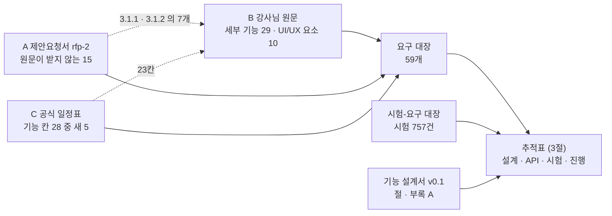
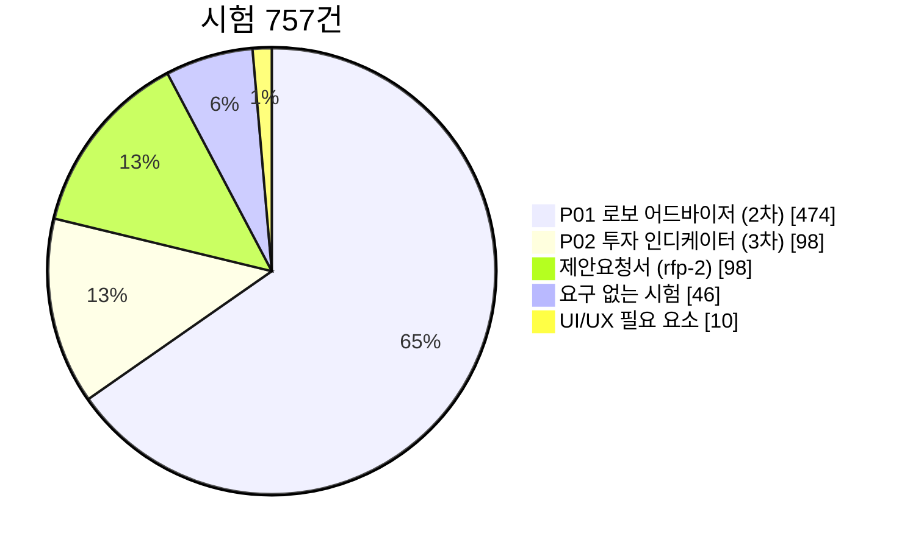
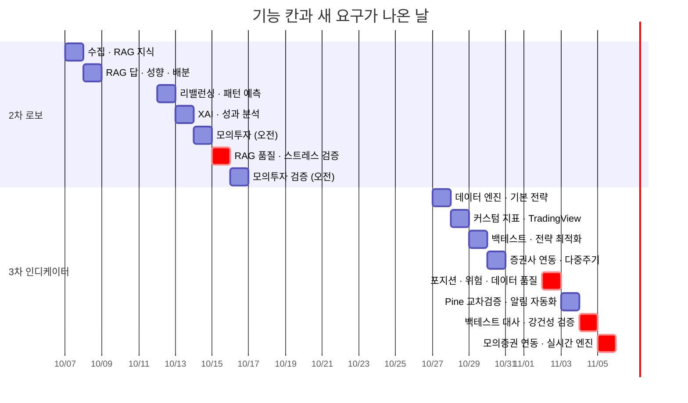

# 요구사항 추적표(RTM) v1.46 — Qurious

| 문서 정보 | |
|---|---|
| **판 · 상태** | v1.46 · TC-TR · TC-TA · TC-VD · TC-DL · TC-DR(2026-10-23) / v1.45 · TC-DV 15 · TC-TB 8 · 동기화 대장 고정(2026-10-23) / v1.44 · TC-DI · TC-DIA · 설계 칸(2026-10-23) / v1.43 · TC-CLV-01 · TC-LN-15 세 갈래(2026-10-23) / v1.42 · 3차 판(차수 폴더 — 2차 최종 판 v1.37 은 `docs/phase-2/01-analysis/requirements/RTM.md`) · 초안(검토 전) |
| **구분** | 2. 요구사항 관리 — 요구사항 정의(요구 한 줄 · 관행 명칭 「요구사항정의서」) · 요구사항 추적표 |
| **작성** | 이동원(데이터 파트) |
| **검토** | 검토 전 |
| **최종 수정** | 2026-10-23 (KST) |
| **기준** | v1.42 은 코드 `main` `4bed63b`(#316 머지) + 이 판 작업 트리(목표 시뮬레이션 입력 경계 TC-RP +15) · v1.41 은 코드 `main` `8739d61`(#315 docs 번호 폴더 머지) + 이 판 작업 트리(강사님 기능 가져오기 앞 지킴이 TC-BM +5 · HF 보관본 경로 TC-HD +1) · v1.40 은 코드 `main` `c9bd397`(#313 머지 · 그 앞 #312 시험 묶음 `1fb94b8`) + 이 판 작업 트리(docs 번호 폴더 · TC-DV +1) · v1.39 는 코드 `main` `8174a69`(#311 docs 차수 폴더 머지) + 이 판 작업 트리(TC-TB +6 · 시험 묶음 표) · v1.38 은 코드 `main` `e819cd2`(2차 최종 머지 #310 · 태그 `phase2-final-2026-10-21`) + 이 판 작업 트리(docs 차수 폴더 · TC-DV +2) · v1.37 은 코드 `main` `6fa8f58`(2차 마지막 머지 #308) + 이 판 작업 트리(시험-요구 대장 TC-RGL 한 줄) · v1.36 은 코드 `main` `6cbb9fb`(PR #283) + 이 판 작업 트리(사용법 영상 목록 · 「시작하기 전에」 고지 · 개념 학습 범위 넓힘) · v1.35 는 코드 `main` `f17d310`(PR #281) + 이 판 작업 트리(「현재가」 지금 값 · 개념 학습 앱 안 화면) · v1.33 은 코드 `main` `32f23bd`(PR #265 메뉴 개편) + 사용법 창 영상 칸(D132 첫 단계) · 팀원 화면 잠정 반영 둘(이 판과 같은 PR) · 앞 판: 코드 `main` `0184834`(PR #264) + 메뉴 개편 · 그 앞: 코드 `main` `ed3221f`(PR #262 시연 영상 녹화 도구 · 2차 발표 자료) + 주 1회 복원 리허설 · 팀원 화면 잠정 반영 셋 · 직접매매 최근 주문 내역 거름(이 판과 같은 PR) |
| **관련 문서** | [요구 대장](대장/요구-대장.tsv) · [시험-요구 대장](대장/시험-요구대장.tsv) · [기능 설계서 v0.1](../../02-design/system/기능설계.md) · [API 명세서 v0.10](../../../phase-2/02-design/api/지난판/API명세서_v0.10.md) · [테스트 계획서 v1.13](../../../phase-2/04-testing/지난판/테스트계획서_v1.13.md) · [강사님 자료 기능 대조 v0.1](강사님자료-기능대조.md) · [RTM v1.4](../../../phase-2/01-analysis/requirements/지난판/RTM_v1.4.md) · [RTM v1.2](../../../phase-2/01-analysis/requirements/지난판/RTM_v1.2.md) · [RTM v1.1](../../../phase-2/01-analysis/requirements/지난판/RTM_v1.1.md) · [RTM v1.0](../../../phase-2/01-analysis/requirements/지난판/RTM_v1.0.md) |
| **최근 개정** | v1.45 → v1.46: 새 묶음 다섯(TC-TR · TC-TA · TC-VD — `P01-①-3` · TC-DL · TC-DR — 도구) · TC-TB 설명(이미지 잠금 신선도 · 카나리아) · 표를 `rtm_scan.py --doc` 로 다시 채움 / v1.44 → v1.45: TC-DV 10 → 15(동기화 점검 `--sync` · `--sync-ack`) · TC-TB 6 → 8(컨테이너 묶음 ctr) · 합계 2405 → 2412(도구 시험 332 → 339) · 동기화 대장 SY-01 ~ 10 고정판 · 지문 / v1.43 → v1.44: 새 시험 묶음 둘 TC-DI(올린 문서 격리 · P01-①-3) · TC-DIA(탈퇴 조각 지우기 · P01-①-3) · TC-VR(신장환 #324 · P02-②-1 · ②-3 — 부탁으로 등록) · TC-BM 28 → 30 · 3차 `P02-①-2` · `①-3` · `⑤-1` · `⑤-2` 설계 칸에 팀원 설계서 절(요구 대장 설계_추가 · 동기화 대장 SY-07 · 08) · 제안 시험 TC-RL → TC-CRD · TC-GS → TC-BSL · 합계 2,399 / v1.42 → v1.43: TC-CLV-01 · TC-LN-15 설명 — 학습 세 갈래 · 장 64편 · TC-BM 27 → 28(지킴이) · 합계 2394 · `RFP2-3.1.3-④` 코드 흔적 5 → 4파일(내린 갈래의 소개 글 「경기 국면」 이 이름 검색에 걸렸던 것 — `rtm_scan.py --doc` 로 다시 채움) · `P02-①-2` 본보기 옆 카드 기본 손익비 2(D1 = A) / v1.41 → v1.42: 표 블록 다시 채움(TC-RP 4 → 19 · 시험 2,378 → 2,393건 · 요구에 붙은 시험 2,046 → 2,061) · 시험-요구 대장 TC-RP U4 설명 한 구절(범위를 넘는 입력은 422 · DF-144) / v1.40 → v1.41: 표 블록 다시 채움(TC-BM 22 → 27 · TC-HD 4 → 5 · 시험 2,372 → 2,378건 · 요구에 붙은 시험 2,040 → 2,046) · 시험-요구 대장 TC-HD 설명 한 구절 / v1.39 → v1.40: docs 번호 폴더(업무 순서 00 ~ 06 — 이 문서는 `docs/phase-3/01-analysis/requirements/` · 링크 · 글 속 경로를 새 자리로) · 표 블록 다시 채움(TC-DV 9 → 10 · 시험 2,371 → 2,372건) / v1.38 → v1.39: 새 묶음 TC-TB 6(시험 묶음 표 지킴이 · test.ps1 -Split) · 표 블록 다시 채움 / v1.36 → v1.37(2차 최종 판): 팀원 #303(강민석)의 새 시험 파일 `test_risk_guard_ledgers.py` 를 대장에 새 묶음 **TC-RGL**(2건 · `P02-⑤-2` · 🟡 · 작성자 확인 칸)로 올리고 표를 스캐너로 다시 채움 — 시험 2,361 → 2,363건 · 172 → 173파일 · 대장에 없는 시험 파일 0 · 제목의 판을 머리표와 맞춤(v1.35 로 남아 있었다) / 그 앞: v1.35 → v1.36: 표를 스캐너로 다시 채움 — 새 묶음 TC-HV 3(개념 학습 › 사용법 영상 목록 `P01-①-1` 🟡) · TC-CLV 5 → 6(「시작하기 전에」 고지) · 팀원 #282 몫 등록(TC-RX 23 → 27 · TC-PV 30 → 31) · 합계 2352 → 2361 · 시험-요구 대장 TC-HV 줄 · TC-HT · TC-CLV 설명 · 그 앞 판 줄은 개정 이력에 |

> **이 문서가 답하는 질문**
> 1. 이 프로젝트가 지켜야 할 요구는 몇 개이고 어디서 왔나 (1절)
> 2. 요구마다 「됐다」 를 무엇으로 확인하나 — 유형 · 검증 방법 (2절)
> 3. 요구 → 설계 → API → 시험이 어디까지 이어졌나 (3절 · 4절)
> 4. 어디가 비었고, 누가 무엇을 정해야 하나 (5절 · 6절 · 7절)
>
> **읽는 순서** — 팀원: 요약 → 3절 추적표에서 내가 맡을 요구의 줄 → [기능 설계서](../../02-design/system/기능설계.md)의 그 절 ·
> 강사님: 요약 → 1절 → 4절 → 6절 · 처음 온 사람: 부록 A 용어 → 1절 → 2.1절

## 요약

1. 요구는 **59개**다 — 강사님 원문 39(세부 기능 29 · UI/UX 필요 요소 10) · 제안요청서 15(원문 세부 기능 표에 없는 자산배분 · 스크리닝 8 · 비기능 4 · 제외 범위 3) · 강사님 공식 일정표 5(두 원천이 받지 않는 기능 칸). 확정 46 · 제안 13 이고, 제안 13개는 팀이 요구로 셀지 정한다(7절 ① ②).
2. 시험 954건 가운데 907건이 요구에 붙는다 — 2026-10-06 git 초안 직전에 팀원 #121 · #122 를 받은 뒤다(이 판에서 더한 우리 시험 23 · 팀원 시험 28 — TC-IN · TC-RBC 는 대장에 더함 · v1.11 은 903 · 856건 · v1.10 은 811 · 765건 · 요구 34개 · v1.9 는 785 · 739건 · v1.8 은 757 · 711건 · v1.7 은 726 · 680건 · v1.6 은 708 · 662건 · v1.5 는 697 · 651건 · v1.4 는 689 · 643건 · v1.3 은 675 · 629건 · v1.2 는 668 · 622건 · v1.1 은 188건 · 요구 11개). 2026-10-06 섹터 질문 분류(TC-SQ → `P01-①-3`) · 리서치 화면(TC-RS → `P01-①-2`) · API 문서 화면(TC-AD → `RFP2-3.2-④`)과 **팀원이 쓴 첫 시험** — PR #114 리밸런싱 정책(TC-RBP → `P01-③-1` 🟡 · `③-2` · `③-3` 🟢 · 요구 · 확실도는 문서 담당이 붙인 초안이라 작성자가 확인할 칸)이 더해져 리밸런싱의 이탈률 · 현금흐름 계기 둘이 「흔적 있음」 → 「시험 있음」 이 됐다. 같은 날 목표 기능 ① W7 뉴스(정책브리핑 정책뉴스 · 언론사 기사 메타데이터)와 일정 2판 · 리서치 화면의 서버 쪽, 섹터 법령 근거 답 실험으로 새 묶음 넷(TC-NW · TC-GD · TC-CN · TC-SX)이 `P01-①-2` · `①-4` · `①-3` 에 더해졌다. 2026-10-05 목표 기능 ① W7 남은 것(주주총회 · 배당금 지급 일정)과 근거 문서 섹터별 · 연도별 · HF 보관본으로 새 묶음 셋(TC-CS · TC-SG · TC-HD)이 `P01-①-4` · `①-3` · `①-2` 에 더해졌다. 2026-10-04 목표 기능 ① W7(공시 · 재무 · 이름표 · 수집 자료 검색 · 일정 넷)로 새 묶음 다섯 31건이 `P01-①-2` · `①-4` 에 더해졌다. 같은 날 근거 답 정확도(결함 DF-59)를 고치며 위임 조 시험 TC-KD 12건과 법령 말 시험 TC-SY 6건이 `P01-①-3` 에 더해졌다. 같은 날 기능 완성도 점검에서 크롤 조각 점 ID 시험 TC-CR 6건(`P01-①-2` · 재수집 중복 결함 DF-03 닫힘)과 배지 팀 줄 시험 TC-CP 5건(`RFP2-3.2-④`)이 더해졌다. 같은 날 근거 답 화면(AI 투자 상담 · 답 아래 출처 카드)을 붙이며 새 묶음 TC-KS 7건과 TC-KA 1건(출처마다 조문 글)이 `P01-①-3` 에 더해졌다. 2026-10-03 에 근거 번호가 달린 답(`POST /api/kb/ask`)을 붙이며 새 묶음 TC-KA 14건이 `P01-①-3` 에 붙었다(출처 번호 검사 · 근거 없음 · 답하지 않는 질문 · 시점 고정 프롬프트). 2026-10-03 에 강사님 기초 코드의 화면 쪽을 받으며 새 묶음 TC-NV 7건이 문서화(`RFP2-3.2-④` — IA 메뉴 그림과 코드가 같다) · 성과 대시보드(`U9`) · 증권사 연동(`P02-⑤-1`)에 붙었다. 원문 세부 기능 29개 중 시험이 붙은 요구는 **23개**(직접 12 · 일부만 11)다 — 강사님 기초 코드를 두 번(2026-09-30 `b055ab0` · 10-03 `9478811`) 받으며 2 · 3차 핵심 기능의 시험이 같이 들어왔다. 채점 · 사고 방지 항목 셋 가운데 미래 데이터 참조 방지(`P02-②-2` · TC-LA)와 중복 주문 방지 · 손실 한도 · 비상 정지(`P02-⑤-2` · TC-RK · TC-QC · TC-GP)는 직접 재는 시험이 생겼고, 같은 조건의 LEAN 백테스트(`P02-④-1`)는 아직 전제와 실행처만 잰다(🟡).
3. 요구마다 설계(기능 설계서 절 또는 설계 문서) · 받는 API · 검증 방법이 이어졌다. 빈 칸은 둘이다 — **시험이 없는 요구 23개**(그중 제약 3개는 사람이 검사해 확인했다) · **설계가 없는 요구 4개**(일정표에서 새로 온 3개와 파이썬 판 제약 1개). v1.1 의 셋째 빈 칸 「파트」 는 2026-10-01 팀이 역할을 정해 요구 대장의 담당 칸 셋(주담당 · 부담당 · 담당상태)으로 채웠다.

---

## 1. 요구는 어디서 오나

### 1.1 원천 세 계열

표 1 은 「요구가 어느 문서에서 왔고, 그 문서를 어디서 읽을 수 있나」 에 답한다.

**표 1. 요구의 원천 세 계열**

| 계열 | 원천 | 어디서 읽나 | 요구 | ID 모양 | 성격 |
|---|---|---|--:|---|---|
| B 강사님 원문 | 목표 기능의 세부 기능 29 + UI/UX 필요 요소 10 | 강사님 저장소 th07 `frontend/days/04.html` (`e63e675`) — 팀 저장소 밖이라 로컬에서 읽는다 | 39 | `P01-①-1` · `U1` | 기능 단위. 역할 희망 논의(D9)의 카드 ID 와 같다 |
| A 제안요청서 | `rfp-2` 3절 요구사항 19 + 4.2절 제외 범위 3 | [`docs/common/01-analysis/references/rfp-2.md`](../../../common/01-analysis/references/rfp-2.md) · [`docs/common/01-analysis/references/rfp-1.md`](../../../common/01-analysis/references/rfp-1.md)(같은 과제의 요약판) | 15 | `RFP2-3.1.3-①` | 발주 문서 — 기법 수준까지 지정. 나머지 7개는 원문 세부 기능이 받는다(표 3) |
| C 강사님 공식 일정표 | 2차 25칸 · 3차 30칸 가운데 기능 칸 28 | 강사님 저장소 th07 `frontend/assets/day4-project-schedule.js` (`e63e675`) | 5 | `SCH-DQ` | 반나절마다 보여 줄 산출물. 23칸은 A · B 가 받는다(5절) |

그림 1 은 「세 원천이 어떻게 요구 대장 한 곳으로 모이고, 추적표가 무엇을 잇나」 에 답한다. 범례: 실선 = 요구가 들어온다 · 점선 = 다른 계열이 이미 받아서 새 요구가 되지 않는다.

**그림 1. 요구가 모이는 길 — 원천 → 대장 → 추적표**



요구는 세 원천에서 오지만 한 곳(요구 대장)에 모이고, 추적표는 그 대장에 설계서와 시험을 이어 붙인다.

### 1.2 요구 개수 — 합계는 세는 것, 주소는 ID

요구 ID 는 원천의 번호 구조를 딴 **계층 ID** 다(`P01-③-2` = 원문 PROJECT 01 · 목표 기능 ③ · 세부 기능 2). 순번(1…59)으로 부르지 않으므로 요구가 늘거나 줄어도 다른 요구의 주소가 밀리지 않는다. 합계는 진행률을 낼 때만 쓴다.

원문 머리글은 세부 기능을 P01 14 · P02 13 = 27 이라고 적지만, 열거된 항목을 세면 P02 가 목표 기능 ①~⑤ 각 3개라 15 이고 합계는 29 다. 이 문서는 **열거 기준 29** 를 쓴다 — 29 로 두면 실제가 27 일 때 둘을 더 한 것이 되고, 27 로 두면 둘을 아예 안 한 것이 된다. 어느 둘이 묶였는지는 강사님께 여쭌다(7절 ③).

표 2 는 「요구가 계열 · 차수별로 몇 개인가」 에 답한다.

**표 2. 계열 · 차수별 요구 수**

| 계열 | 2차 | 3차 | 공통 | 합계 |
|---|--:|--:|--:|--:|
| B 원문 세부 기능 | 14 | 15 | — | 29 |
| B 원문 UI/UX 필요 요소 | 5 | 5 | — | 10 |
| A 제안요청서 | 8 | — | 7 | 15 |
| C 공식 일정표 | 1 | 3 | 1 | 5 |
| **합계** | **28** | **23** | **8** | **59** |

표 3 은 「제안요청서의 요구 35칸이 이 문서의 어느 요구로 가나」 에 답한다. 체크박스 35개(`python scripts/rtm_scan.py` 가 센다) 가운데 3절 요구사항 19개와 4.2절 제외 범위 3줄이 요구다.

**표 3. 제안요청서 `rfp-2` → 요구**

| `rfp-2` 절 | 칸 | 받는 요구 | 빈 곳 |
|---|--:|---|---|
| 3.1.1 AI 예측 모델 | 3 | `P01-②-3` · `P01-①-2` · `P01-④-1` | 머신러닝 · 딥러닝 가격 예측 모델을 따로 받는 세부 기능은 없다 — 신호(`P01-②-3`)로 받는다 |
| 3.1.2 패턴 인식 | 4 | `P01-②-2` · `P01-②-3` | **딥러닝 패턴 인식(CNN 차트 이미지 · LSTM)은 받는 요구가 없다**(7절 ⑥) |
| 3.1.3 자산배분 | 4 | `RFP2-3.1.3-①` ~ `④` | 원문 세부 기능 표에는 없고 **목표 기능 ③ 머리글**이 말한다 |
| 3.1.4 스크리닝 | 4 | `RFP2-3.1.4-①` ~ `④` | 같음 |
| 3.2 비기능 | 4 | `RFP2-3.2-①` ~ `④` | — |
| 4.2 제외 범위 | 3줄 | `RFP2-4.2-①` ~ `③` | 체크박스가 아니라 목록이다 — 「하지 않는다」 는 제약(CO) |
| 6 산출물 · 7.2 평가 · 9 제안 요건 | 16 | [산출물목록](../../../산출물목록.md) · 평가 기준 · 팀 역량 | 요구가 아니다 |

---

## 2. 요구 목록 — 요구 한 줄

### 2.1 칸 읽는 법

표 4 는 「요구 한 줄의 칸마다 무엇을 적고, 어떤 말만 쓰나」 에 답한다. 칸은 [문서 작성 기준 v0.1](../../../phase-2/00-management/standards/지난판/문서작성기준_v0.1.md) 5.2절을 따르고, 값은 [요구 대장](대장/요구-대장.tsv)에 사람이 적는다 — 아래 표는 스캐너가 대장에서 다시 채운다.

**표 4. 요구 한 줄의 칸**

| 칸 | 뜻 | 쓰는 말 | 근거 |
|---|---|---|---|
| 요구 ID | 원천의 번호 구조를 딴 ID — 한 번 붙이면 바꾸지 않는다 | `P01-①-1` · `U1` · `RFP2-3.2-①` · `SCH-DQ` | 기준 원칙 ⑤ |
| 내용 | **검증할 수 있는 한 문장** — 「쉽게」 「빠르게」 같은 말 없이 | — | 기준 5.2 · 요구 특성 「검증 가능」 [R13] |
| 유형 | FR 기능 · PR 성능 · QR 품질 · IR 인터페이스 · DR 데이터 · OR 운영 · CO 제약 | 일곱 기호 | 요구사항 작성 가이드(2011) [R15] |
| 출처 | 원문의 칸 · 제안요청서 절 · 일정표 칸 | 원문 = th07 `04.html` | 요구 속성 「출처」 [R12] |
| 우선 | 필수 · 선택 · 미정(팀이 정한다) | 세 가지 | 요구 속성 「우선순위」 [R12] |
| 상태 | 확정(원천에 있고 팀이 받아들임) · 제안(팀이 요구로 셀지 정하기 전) | 두 가지 | 구현이 어디까지 왔는지는 3절 「진행」 칸이 따로 적는다 |
| 검증 방법 | 시험 · 시연 · 검사 · 분석 — 둘이면 주된 것을 앞에 | 네 가지 | 요구 속성 「검증 방법」 [R12] |
| 관련 요구 | 같은 코드 · 같은 화면을 쓰거나 먼저 있어야 하는 요구 | 요구 ID | 요구사항 작성 가이드 「관련 요구사항」 [R15] |
| 파트 | **이 판에는 없다** — 역할 희망 논의(D9) 결론 뒤 v1.2 에서. 역할 분배안 v1.0 의 제안 파트는 [기능 설계서](../../02-design/system/기능설계.md) 2.3절에 있다 | — | 역할을 문서가 앞질러 정하지 않는다 |

`[R12]` 같은 출처 번호는 [문서 작성 기준 v0.1](../../../phase-2/00-management/standards/지난판/문서작성기준_v0.1.md) 부록 A 의 것이다.

### 2.2 원문 PROJECT 01 — 로보 어드바이저 (2차)

아래 표는 「2차 세부 기능 14개가 각각 무엇을 하면 되는가」 에 답한다.

<!-- rtm_scan:요구-P01 -->
**원문 PROJECT 01 로보 어드바이저 (2차) — 세부 기능 · 14개**

| 요구 ID | 이름 | 내용 (검증할 수 있는 한 문장) | 유형 | 출처 | 우선 | 상태 | 관련 요구 |
|---|---|---|:-:|---|:-:|:-:|---|
| `P01-①-1` | 주식 · 금융 · 경제 기본 용어사전과 연관 개념 탐색 | 화면의 금융 용어를 누르면 서버가 뜻 · 쉬운 뜻 · 연관 용어를 돌려주고, 용어를 검색할 수 있다 | FR | 원문 P01 ① 세부 1 | 필수 | 확정 | `P01-①-3` · `P01-①-5` |
| `P01-①-2` | 가격 · 거래량 · 재무 · 뉴스 등 투자 자료 수집 · 분류 · 전처리 · 검색 | 국내 상장 종목의 일별 가격 · 거래량을 매 거래일 수집 DB 에 적재하고, 앱은 그 값을 데이터 기준일(as_of)과 함께 돌려주며, 재무 · 뉴스는 출처와 함께 분류해 검색할 수 있다 | DR | 원문 P01 ① 세부 2 · rfp-2 §3.1.1 | 필수 | 확정 | `P01-①-4` · `P02-④-1` · `SCH-DQ` |
| `P01-①-3` | 근거 문서와 출처를 포함한 RAG 질의응답 | 질문의 답에 근거로 쓴 문서 조각의 제목 · 위치가 번호와 함께 붙고, 답 안의 [출처 n] 과 번호가 맞는다 | FR | 원문 P01 ① 세부 3 | 필수 | 확정 | `P01-①-1` |
| `P01-①-4` | 금융정보의 갱신일 · 문서 버전 · 캘린더 일정 관리와 정기 배치 실행 | 정기 배치가 매 거래일 한 번 돌고, 표마다 마지막 데이터 기준일 · 배치 결과 · 그날이 거래일인지를 API 와 화면으로 볼 수 있다 | OR | 원문 P01 ① 세부 4 | 필수 | 확정 | `P01-①-2` · `P02-⑤-3` · `SCH-DQ` |
| `P01-①-5` | XAI 로 투자 추천 이유를 쉬운 말로 설명 | 추천 · 신호마다 그렇게 판단한 근거(지표 값 · 규칙 · 기여도)를 한두 문장으로 보여 준다 | FR | 원문 P01 ① 세부 5 | 필수 | 확정 | `P01-②-3` · `P01-④-2` · `P01-①-1` |
| `P01-②-1` | OHLCV 로 이동평균 · RSI · MACD · 볼린저 밴드 · 거래량 지표 계산 | 같은 OHLCV 에서 계산한 기본 지표 값이 TradingView 정의(RSI = Wilder 평활 · 표준편차 = 모집단)와 같다 | FR | 원문 P01 ② 세부 1 | 필수 | 확정 | `P02-①-1` · `P02-②-2` |
| `P01-②-2` | 캔들 패턴 · 지지선 · 저항선 · 돌파 · 골든크로스 등 차트 패턴 탐지 | 정한 패턴(골든크로스 · 신고가 돌파 · 캔들 5종 · 지지/저항)을 종목별로 탐지하고, 패턴이 나온 횟수와 그 뒤 5거래일 수익률 통계를 낸다 | FR | 원문 P01 ② 세부 2 · rfp-2 §3.1.2 | 필수 | 확정 | `P01-②-3` · `RFP2-3.1.4-③` |
| `P01-②-3` | 분봉 · 일봉 · 주봉 지표를 종합해 매수 · 매도 · 관망 신호와 신뢰도 산출 | 여러 주기의 지표를 합쳐 종목마다 매수 · 매도 · 관망 신호와 0~1 신뢰도를 매 거래일 한 번 계산해 기록한다 | FR | 원문 P01 ② 세부 3 · rfp-2 §3.1.2 | 필수 | 확정 | `P01-④-2` · `P01-①-5` · `SCH-RT` |
| `P01-③-1` | 월 · 분기 · 연 주기가 오면 실행하는 시간 기반 리밸런싱 | 정한 주기가 오면 목표 비중으로 되돌리는 주문 계획을 만들고, 계획 · 체결 · 비용을 이력으로 남긴다 | FR | 원문 P01 ③ 세부 1 | 필수 | 확정 | `P01-③-2` · `P01-③-3` · `RFP2-3.1.3-④` · `U5` |
| `P01-③-2` | 목표 비중의 허용 이탈률을 넘으면 실행하는 이탈률 기반 리밸런싱 | 현재 비중이 목표 비중에서 허용 이탈률(예: 5%p)을 넘을 때만 리밸런싱 계획을 만든다 | FR | 원문 P01 ③ 세부 2 | 필수 | 확정 | `P01-③-1` · `U2` |
| `P01-③-3` | 입출금 · 배당금 현금흐름으로 실행하는 리밸런싱 | 입금 · 출금 · 배당이 생기면 파는 주문 없이 그 현금으로 목표에서 가장 모자란 자산부터 채우는 계획을 만든다 | FR | 원문 P01 ③ 세부 3 | 필수 | 확정 | `P01-③-1` |
| `P01-④-1` | 거래비용 · 슬리피지를 반영한 수익률 · MDD · 샤프 등 성과지표 분석 | 같은 백테스트의 수익률 · MDD · 샤프를 비용 반영 전과 후로 나란히 내고, 비용은 한 모델(수수료 · 매도세 · 슬리피지)에서 온다 | FR | 원문 P01 ④ 세부 1 · rfp-2 §3.1.1 | 필수 | 확정 | `P02-④-2` · `U3` · `U9` |
| `P01-④-2` | 퀀트 신호를 매수 · 매도 · 보유 의견으로 변환 | 신호 · 신뢰도 · 보유 여부의 조합마다 의견(매수 · 매도 · 보유)이 규칙 표 하나로 정해지고 이유와 함께 기록된다 | FR | 원문 P01 ④ 세부 2 | 필수 | 확정 | `P01-②-3` · `P01-①-5` · `P01-④-3` |
| `P01-④-3` | 모의 주문 체결 및 포트폴리오 운용 | 모든 모의 주문(수동 · 자동)이 한 장부에서 현금 · 보유를 바꾸고, 체결가로 평가한 총자산이 초기 현금 − 거래비용과 같다 | FR | 원문 P01 ④ 세부 3 | 필수 | 확정 | `P02-⑤-1` · `P02-⑤-2` · `RFP2-4.2-①` · `U10` |

비고
- `P01-①-1` — 서버 쪽만 됐다(2026-09-30) — 용어 755개를 API 넷으로 돌려준다(표 다섯) · 화면의 용어 설명창은 아직 화면 상수 55개를 쓴다(어느 화면에 어떻게 넣을지는 다음 작업에서 설계) · 연관 용어도 다음 작업 · 원문 구현방안은 domain-rag-lab · investment-analysis 통합 — 통합본을 rag-lab/ 에 반입했다
- `P01-①-2` — 재무는 야후 조회뿐 · 뉴스 분류 없음
- `P01-①-3` — 출처 칸이 늘 비어 있다 · 채점 항목인지 강사님께 여쭐 것
- `P01-①-4` — 배치 상태가 명령줄에만 있다 · 거래일 달력 API 없음
- `P01-①-5` — 설명할 모델과 설명 층이 모두 없다
- `P01-②-1` — 강사님 원본과 같은 코드라 팀 작업으로 세지 않는다 · RSI 계산이 세 벌
- `P01-②-2` — 전략 안에 골든크로스 · 돌파 조건은 있으나 패턴을 종목별로 찾아 통계를 내는 탐지기는 없다 · rfp-2 §3.1.2 의 딥러닝 패턴 인식(CNN · LSTM)은 받는 요구가 없다
- `P01-②-3` — 분봉 출처가 없다(약관) · 3차 일정표 10-30 오후 「다중주기 신호」 도 이 요구가 받는다
- `P01-③-1` — 목표 비중 칸 자체가 없다
- `P01-③-3` — 입출금 기록이 없다 · 배당은 수집 DB 에 있다
- `P01-④-1` — 샤프 계산이 세 곳
- `P01-④-3` — 체결가가 마지막 봉 종가다(다음 거래일 시가로 바꾸는 안 · 이슈 #35) · 매 거래일 일지 없음
<!-- /rtm_scan:요구-P01 -->

### 2.3 원문 PROJECT 02 — 투자 인디케이터 (3차)

아래 표는 「3차 세부 기능 15개가 각각 무엇을 하면 되는가」 에 답한다. 채점 · 사고 방지 항목(비고의 ★)은 역할 희망 논의(D9)에서 주 · 보조 담당을 반드시 둘 다 정하기로 한 카드다.

<!-- rtm_scan:요구-P02 -->
**원문 PROJECT 02 투자 인디케이터 (3차) — 세부 기능 · 15개**

| 요구 ID | 이름 | 내용 (검증할 수 있는 한 문장) | 유형 | 출처 | 우선 | 상태 | 관련 요구 |
|---|---|---|:-:|---|:-:|:-:|---|
| `P02-①-1` | OHLCV 로 이동평균 · RSI · MACD · 볼린저 밴드 등 기본 지표 계산 | 같은 OHLCV 에서 우리 지표 값과 LEAN 지표 값이 정한 오차 안에서 같다 | FR | 원문 P02 ① 세부 1 | 필수 | 확정 | `P01-②-1` · `P02-②-2` · `U7` |
| `P02-①-2` | 지표 조건을 조합해 매수 · 매도 · 손절 · 익절 · 포지션 크기 규칙 설계 | 조건 조합 · 손절 · 익절 · 포지션 크기를 규칙 명세(JSON) 하나로 적고, 백테스트 · Pine 생성 · 자동매매가 같은 명세를 읽는다 | FR | 원문 P02 ① 세부 2 | 필수 | 확정 | `P02-③-1` · `P02-⑤-2` · `U6` |
| `P02-①-3` | 지표 기간 · 임계값 조합을 백테스트해 기준 전략 선정 | 미리 적은 조합표(상한 있음)만 백테스트하고 모든 시도를 기록한 뒤 기준 전략을 고른다 | FR | 원문 P02 ① 세부 3 | 필수 | 확정 | `P02-④-2` · `SCH-ROB` · `U8` |
| `P02-②-1` | 가격 · 거래량 · 변동성 지표를 결합 · 정규화한 커스텀 산식 | 여러 지표를 정규화(z점수 · 백분위)해 합친 커스텀 지표를 정의하고, 같은 입력에 같은 값을 낸다 | FR | 원문 P02 ② 세부 1 | 필수 | 확정 | `P02-②-2` · `P02-②-3` · `U6` |
| `P02-②-2` | 미래 데이터 참조를 막고 실시간 갱신 · 단위 테스트가 되는 지표 함수 | 지표 함수는 t 시점 값을 t 까지의 데이터로만 계산하고(뒤 데이터를 바꿔도 앞 값이 같다), 새 봉 하나로 이어서 갱신되며, 단위 시험이 붙어 있다 | QR | 원문 P02 ② 세부 2 | 필수 | 확정 | `P02-①-1` · `P02-②-1` · `SCH-RT` |
| `P02-②-3` | 커스텀 지표를 API 로 제공하고 결과 · 버전을 저장해 재사용 | 커스텀 지표를 API 로 부를 수 있고, 산식이 바뀌면 새 판으로 저장되며 옛 판도 다시 계산할 수 있다 | IR | 원문 P02 ② 세부 3 | 필수 | 확정 | `P02-②-1` |
| `P02-③-1` | Pine Script 로 지표 · 전략을 구현하고 차트에 신호 · 보조선 표시 | 우리 규칙에서 만든 Pine 코드가 TradingView 에서 컴파일되고 strategy() 로 선언돼 Strategy Tester 가 켜진다 | FR | 원문 P02 ③ 세부 1 | 필수 | 확정 | `P02-①-2` · `P02-③-2` |
| `P02-③-2` | Strategy Tester 로 1차 성과를 확인하고 LEAN 으로 교차 검증 | 같은 규칙 · 데이터 · 기간에서 Strategy Tester 와 LEAN 의 신호 날짜와 성과를 줄 단위로 대사해 차이를 설명한다 | QR | 원문 P02 ③ 세부 2 | 필수 | 확정 | `P02-③-1` · `P02-④-1` · `P02-④-3` |
| `P02-③-3` | 조건 충족 시 알림 · Webhook 으로 투자 신호 전달 | 조건이 충족되면 정한 채널(텔레그램 등)로 알림이 한 번 가고 실패는 기록되며, 받는 Webhook 은 보낸 쪽 · 중복 · 지연을 검증한 뒤에만 받아들인다 | IR | 원문 P02 ③ 세부 3 | 필수 | 확정 | `P02-⑤-3` |
| `P02-④-1` | 같은 데이터 · 기간 · 수수료 조건으로 LEAN 백테스트 | LEAN 백테스트가 수집 DB 의 같은 데이터 · 같은 기간 · 같은 비용 모델로 돌고, 그 조건이 결과에 기록된다 | CO | 원문 P02 ④ 세부 1 | 필수 | 확정 | `P01-①-2` · `P02-③-2` · `P02-④-3` · `U8` |
| `P02-④-2` | 누적수익률 · MDD · 샤프 · 승률 등 성과지표 분석 | 모든 엔진의 결과를 한 성과 정의(샤프 · 거래 단위 승률 · 손익비 · MDD)로 다시 계산한다 | FR | 원문 P02 ④ 세부 2 · rfp-2 §6.1 | 필수 | 확정 | `P01-④-1` · `P02-①-3` · `U9` |
| `P02-④-3` | TradingView 와 LEAN 결과를 비교해 신호 · 체결 · 성과 차이 검증 | 두 도구의 결과 차이를 신호 · 체결 · 비용 층으로 나눠 어디서 갈렸는지 보고한다 | QR | 원문 P02 ④ 세부 3 | 필수 | 확정 | `P02-③-2` · `P02-④-1` |
| `P02-⑤-1` | LEAN 투자 신호를 증권사 API 의 계좌 · 시세 · 주문과 연결 | 신호가 증권사 어댑터를 거쳐 모의 계좌의 조회 · 주문으로 이어지고, 모든 증권사 호출은 실거래 차단 지점을 지난다 | IR | 원문 P02 ⑤ 세부 1 | 필수 | 확정 | `P01-④-3` · `P02-⑤-2` · `RFP2-4.2-①` · `SCH-ORD` |
| `P02-⑤-2` | 모의투자 주문과 중복 주문 방지 · 손실 한도 · 비상 정지 | 같은 신호가 두 번 와도 주문은 한 번 나가고, 손실 한도를 넘거나 정지 스위치가 켜지면 모든 주문 경로가 거부 사유를 남기고 멈춘다 | QR | 원문 P02 ⑤ 세부 2 | 필수 | 확정 | `P02-⑤-1` · `P01-④-3` · `SCH-ORD` · `SCH-STR` · `U10` |
| `P02-⑤-3` | LEAN 전략의 실행 일정 · 배포 · 로그 · 장애 알림 자동화 | 정한 일정에 작업이 돌고, 실패하면 알림이 한 건 가며, 실행마다 로그와 상태가 남는다 | OR | 원문 P02 ⑤ 세부 3 | 필수 | 확정 | `P01-①-4` · `P02-③-3` · `RFP2-4.2-②` |

비고
- `P02-①-2` — 청산 규칙 · 포지션 크기 없음 · 본보기는 강사님 th03 의 손절 · 익절(ATR×2 손절 · ATR×3 익절 · `strategy.exit` · 수수료 0.015% · 비중 20% — 강사님 자료 기능 대조 v0.1 3절 · 우리 카드 기본은 손익비 2 · 1.5 ~ 3 — 인디케이터 전략 설계서 4.3)로 팀장이 가장 유익한 실습으로 꼽았다 · 3차 일정표 11-02 오전 「포지션 · 위험」 이 받는다
- `P02-①-3` — 3차 일정표 10-29 오후 「전략 최적화」 가 받는다
- `P02-②-1` — ~~커스텀 경로가 비용 인자를 버린다~~ 재현 안 됨(2026-10-23 · 09-20 `88e00b3` 부터 비용을 넘김 · TC-VR 이 지킴 · #324)
- `P02-②-2` — ★ 3차 채점 항목 · 미래 참조 시험 0건
- `P02-②-3` — 버전 칸 없음
- `P02-③-1` — 생성 코드가 indicator() 이고 컴파일 오류가 난다(결함 DF-05 · DF-06)
- `P02-③-2` — 3차 일정표 11-03 오전 「Pine 교차검증」
- `P02-③-3` — 받는 Webhook 은 약관 판단 전이라 설계만 · 3차 일정표 10-28 오후 · 11-03 오후 「알림 자동화」
- `P02-④-1` — ★ 3차 채점 항목 · LEAN 은 아직 야후 데이터 · 비용 0 으로 돈다
- `P02-④-2` — 승률 정의 두 벌 · 손익비 없음
- `P02-④-3` — 받는 API 가 없다 · 3차 일정표 11-04 오전 「백테스트 대사」
- `P02-⑤-1` — 3차 일정표 10-30 오전 「증권사 연동」 · 11-05 오전 「모의증권 연동」
- `P02-⑤-2` — ★ 사고 방지 · 세 장치 모두 0 · 2차 일정표 10-14 오전 「모의투자」 도 손실 한도 · 비상 정지를 요구한다
- `P02-⑤-3` — 장애 알림 없음 · 지금 매일 도는 작업은 수집기이지 전략 실행이 아니다
<!-- /rtm_scan:요구-P02 -->

### 2.4 원문 UI/UX 필요 요소 (2차 5 · 3차 5)

아래 표는 「강사님이 정한 화면 요소 10개가 무엇을 보여 주면 되는가」 에 답한다. ID `U1`~`U10` 은 역할 희망 논의(D9)의 화면 카드 ID 그대로다.

<!-- rtm_scan:요구-U -->
**원문 UI/UX 필요 요소 · 10개**

| 요구 ID | 이름 | 내용 (검증할 수 있는 한 문장) | 유형 | 출처 | 우선 | 상태 | 관련 요구 |
|---|---|---|:-:|---|:-:|:-:|---|
| `U1` | 투자성향진단 | 설문에 답하면 점수로 투자 성향(5단계)을 정하고, 그 성향이 목표 비중의 입력이 된다 | FR | 원문 P01 UI/UX 요소 1 | 필수 | 확정 | `U2` · `RFP2-3.1.3-①` · `P01-③-1` |
| `U2` | 시각적 포트폴리오 | 목표 비중과 현재 비중을 나란히 보여 주고 벗어난 정도를 표시한다 | FR | 원문 P01 UI/UX 요소 2 | 필수 | 확정 | `P01-③-2` · `U5` |
| `U3` | 시뮬레이션 | 과거 구간을 다시 뽑아 만든 수익 분포(구간 · 확률)를 보여 준다 | FR | 원문 P01 UI/UX 요소 3 | 필수 | 확정 | `P01-④-1` · `U4` · `SCH-STR` |
| `U4` | 목표 수익률 모의 | 목표 수익률 · 기간을 넣으면 달성 확률과 필요한 위험 수준을 분포로 보여 준다 | FR | 원문 P01 UI/UX 요소 4 | 필수 | 확정 | `U3` · `U1` |
| `U5` | 리밸런싱 | 목표 · 현재 · 차이 · 다음 확인일 · 리밸런싱 이력을 한 화면에서 본다 | FR | 원문 P01 UI/UX 요소 5 | 필수 | 확정 | `P01-③-1` · `P01-③-2` · `P01-③-3` |
| `U6` | 전략 설정 | 조건 · 손절 · 익절 · 포지션 크기를 편집해 규칙 명세로 저장한다 | FR | 원문 P02 UI/UX 요소 1 | 필수 | 확정 | `P02-①-2` · `P02-②-1` |
| `U7` | 지표 차트 | 가격 차트 위에 지표와 매수 · 매도 신호를 그리고 데이터 기준일을 표시한다 | FR | 원문 P02 UI/UX 요소 2 | 필수 | 확정 | `P02-①-1` · `P01-②-1` |
| `U8` | 백테스트 | 백테스트 결과 옆에 데이터 · 기간 · 비용 조건과 시도 번호를 표시한다 | FR | 원문 P02 UI/UX 요소 3 | 필수 | 확정 | `P02-①-3` · `P02-④-1` |
| `U9` | 성과 대시보드 | 비용 전후 성과 · 벤치마크 비교 · 지표 정의를 한 화면에서 본다 | FR | 원문 P02 UI/UX 요소 4 | 필수 | 확정 | `P01-④-1` · `P02-④-2` |
| `U10` | 자동매매 모니터링 | 사용자별로 오늘 주문 의향 · 체결 · 거부 사유를 보고, 정지 버튼으로 멈출 수 있다 | FR | 원문 P02 UI/UX 요소 5 | 필수 | 확정 | `P02-⑤-1` · `P02-⑤-2` |

비고
- `U1` — 지금은 3택 선택 상자 · 2차 일정표 10-08 오후 「성향 · 자산배분」
- `U2` — #170 Chrome 화면 근거: docs/phase-3/04-testing/리밸런싱-화면검증-근거.md · TC-RBUI(합성 API·차트 입력 검증) · 운영 러너 연동 완료를 뜻하지 않음
- `U3` — 지금 화면의 예상 MDD 식이 틀렸다
- `U4` — 지금 없음
- `U5` — #170 Chrome 화면 근거: docs/phase-3/04-testing/리밸런싱-화면검증-근거.md · TC-RBUI(합성 API·차트 입력 검증) · 운영 러너 연동 완료를 뜻하지 않음
- `U7` — 차트 라이브러리는 TradingView Lightweight Charts(오픈소스 · Apache 2.0 · 화면에 TradingView 제작자 표시 의무 · npm `lightweight-charts` v5 · 강사님 th03 은 4.2.0)를 참고하자는 팀장 제안이 있다 — 지금 화면은 ApexCharts(RTM 7절 ⑦)
- `U9` — 지금 없음
<!-- /rtm_scan:요구-U -->

### 2.5 제안요청서 — 원문 세부 기능 표에 없는 것

아래 표는 「제안요청서만 말하는 요구 15개가 무엇인가」 에 답한다. 자산배분 · 스크리닝 8개는 원문 목표 기능 ③ 의 머리글(「자산배분모델을 활용한 포트폴리오 최적화, 주식 스크리닝을 통한 종목 선정」)이 말하지만 세부 기능 표에는 없어서 **상태가 「제안」** 이다(7절 ①).

<!-- rtm_scan:요구-A -->
**제안요청서(rfp-2) — 원문 세부 기능 표에 없는 것 · 15개**

| 요구 ID | 이름 | 내용 (검증할 수 있는 한 문장) | 유형 | 출처 | 우선 | 상태 | 관련 요구 |
|---|---|---|:-:|---|:-:|:-:|---|
| `RFP2-3.1.3-①` | 평균-분산 최적화 (Markowitz) | 기대수익률 · 공분산으로 제약(합 1 · 공매도 없음 · 자산군 상하한)을 지키는 비중을 계산하고, 같은 입력에 같은 해를 낸다 | FR | rfp-2 §3.1.3 · 원문 P01 ③ 머리글 | 필수 | 제안 | `RFP2-3.1.3-②` · `RFP2-3.1.3-③` · `U1` · `U2` |
| `RFP2-3.1.3-②` | 리스크 패리티 · 최소분산 포트폴리오 | 자산별 위험 기여가 같은 비중과 분산이 가장 작은 비중을 공매도 없음 제약 아래 계산한다 | FR | rfp-2 §3.1.3 · 원문 P01 ③ 머리글 | 필수 | 제안 | `RFP2-3.1.3-①` |
| `RFP2-3.1.3-③` | Black-Litterman (투자자 뷰 반영) | 사용자가 적은 뷰(자산 A 가 B 보다 연 x% 낫다)를 시장 균형 비중에 반영하고, 뷰가 없으면 균형 비중과 같다 | FR | rfp-2 §3.1.3 · 원문 P01 ③ 머리글 | 필수 | 제안 | `RFP2-3.1.3-①` |
| `RFP2-3.1.3-④` | 동적 자산배분 (시장 국면에 따른 비중 재조정) | 시장 국면(추세 × 변동성)이 바뀌면 그 국면의 목표 비중으로 리밸런싱 목표가 바뀌고, 국면 판정은 그날까지의 데이터만 쓴다 | FR | rfp-2 §3.1.3 · 원문 P01 ③ 머리글 | 필수 | 제안 | `P01-③-1` |
| `RFP2-3.1.4-①` | 팩터 기반 스크리닝 (가치 · 모멘텀 · 퀄리티 · 저변동성) | 기준일마다 그날 상장된 종목만으로 팩터 점수를 계산해 종목을 고른다(생존편향 없음) | FR | rfp-2 §3.1.4 · 원문 P01 ③ 머리글 | 필수 | 제안 | `RFP2-3.1.4-②` · `RFP2-3.1.4-④` |
| `RFP2-3.1.4-②` | 재무제표 기반 필터링 (PER · PBR · ROE · 부채비율) | 공시일 이후 값만 써서 PER · PBR · ROE · 부채비율 기준으로 종목을 거른다 | FR | rfp-2 §3.1.4 · 원문 P01 ③ 머리글 | 필수 | 제안 | `RFP2-3.1.4-①` · `P01-①-2` |
| `RFP2-3.1.4-③` | 기술적 스크리닝 (이동평균 정배열 · 52주 신고가 근접) | 이동평균 정배열 · 52주 신고가 근접 조건으로 전 종목을 매 거래일 거른다 | FR | rfp-2 §3.1.4 · 원문 P01 ③ 머리글 | 필수 | 제안 | `P01-②-2` |
| `RFP2-3.1.4-④` | 스크리닝 결과 랭킹 (복합 점수) | 팩터 점수를 미리 적어 둔 가중치로 합친 복합 점수로 종목 순위를 매긴다 | FR | rfp-2 §3.1.4 · 원문 P01 ③ 머리글 | 필수 | 제안 | `RFP2-3.1.4-①` |
| `RFP2-3.2-①` | 공개 데이터 사용 | 데이터는 공개 출처(KRX · 공공데이터포털 · DART 등)에서 이용 조건을 지켜 가져오고, 출처마다 판정을 남긴다 | DR | rfp-2 §3.2 | 필수 | 확정 | `P01-①-2` · `P02-④-1` |
| `RFP2-3.2-②` | 구현 언어 Python 3.10 이상 | 앱 · 수집기 · 스크립트가 Python 3.10 이상에서 돈다 | CO | rfp-2 §3.2 | 필수 | 확정 | — |
| `RFP2-3.2-③` | 재현 가능성 (코드 · 랜덤 시드 고정 · 결과 재현) | 같은 코드 · 같은 입력 · 같은 시드로 다시 돌리면 같은 결과가 나온다 | QR | rfp-2 §3.2 | 필수 | 확정 | `P02-①-3` · `P02-④-1` |
| `RFP2-3.2-④` | 문서화 (설계 문서 · 분석 보고서 · 코드 주석) | 설계 문서 · 분석 보고서가 산출물목록에 있고, 문서의 표(데이터 사전 · API 명세)는 코드에서 다시 만들어 코드와 같다 | QR | rfp-2 §3.2 | 필수 | 확정 | — |
| `RFP2-4.2-①` | 실제 증권 계좌로 실거래 자동 주문을 하지 않는다 | 실거래 승인 설정이 없으면 모든 증권사 주문이 모의로 바뀌거나 막힌다 | CO | rfp-2 §4.2 제외 범위 | 필수 | 확정 | `P02-⑤-1` · `P01-④-3` · `RFP2-4.2-③` |
| `RFP2-4.2-②` | 상용 서비스로 배포 · 운영하지 않는다 | 상용 배포 · 운영 설정을 두지 않고 로컬 · 시연 환경만 쓴다 | CO | rfp-2 §4.2 제외 범위 | 필수 | 확정 | `P02-⑤-3` |
| `RFP2-4.2-③` | 타인 자산 운용 서비스를 제공하지 않는다 | 사용자의 돈을 맡아 운용하거나 남의 계좌로 주문하는 기능이 없다 | CO | rfp-2 §4.2 제외 범위 | 필수 | 확정 | `RFP2-4.2-①` |

비고
- `RFP2-3.1.3-①` — 지금 「AI 자산배분」 은 위험 성향 3택 조회표다
- `RFP2-3.1.4-①` — 재무 데이터가 없어 가격 팩터(모멘텀 · 저변동성)부터
- `RFP2-3.1.4-②` — 재무 출처가 야후 조회뿐 — 공시(DART)로 옮길지 데이터 파트가 정한다
- `RFP2-3.1.4-④` — 화면의 「LightGBM」 은 이름뿐이고 계산은 합산 점수다
- `RFP2-3.2-①` — rfp-2 는 야후 · FinanceDataReader 를 예로 들지만 팀은 이용 조건 판정으로 뺐다
- `RFP2-3.2-③` — 모델 학습의 시드 고정은 확인 전 · 수집 DB 는 백업 복구 리허설로 재현했다
- `RFP2-4.2-②` — 강사님 일정표에는 AWS 배포 칸이 있다(10-19 오후 · 11-10 오후) — 시연용 배포와 상용 운영은 다르다
<!-- /rtm_scan:요구-A -->

### 2.6 강사님 공식 일정표 — 원문 · 제안요청서가 받지 않는 기능 칸

아래 표는 「일정표의 기능 칸 가운데 어느 요구도 받지 않던 5개가 무엇인가」 에 답한다. 칸과 요구의 대응 전체는 5절에 있다.

<!-- rtm_scan:요구-C -->
**강사님 공식 일정표 — 원문 · 제안요청서가 받지 않는 기능 칸 · 5개**

| 요구 ID | 이름 | 내용 (검증할 수 있는 한 문장) | 유형 | 출처 | 우선 | 상태 | 관련 요구 |
|---|---|---|:-:|---|:-:|:-:|---|
| `SCH-STR` | 스트레스 검증 (급락 · 금리 · 환율 시나리오) | 급락 · 금리 · 환율 시나리오를 넣으면 포트폴리오 손실과 손실 한도에 닿는지를 계산해 보고한다 | FR | 일정표 2차 10-15 오후 「스트레스 검증」 | 미정 | 제안 | `U3` · `P02-⑤-2` · `RFP2-3.1.3-①` |
| `SCH-DQ` | 데이터 품질 (결측 · 중복 · 정합성) | 시세 데이터의 결측 · 중복 · 정합성 검사를 갱신마다 돌리고, 결과를 품질 현황 화면에서 본다 | DR | 일정표 3차 11-02 오후 「데이터 품질」 · 2차 10-07 오전 「결측 · 이상치 규칙」 | 미정 | 제안 | `P01-①-2` · `P01-①-4` |
| `SCH-ROB` | 강건성 검증 (아웃오브샘플 · 워크포워드 · 민감도 · 몬테카를로) | 고른 전략을 아웃오브샘플 · 워크포워드 · 민감도 · 몬테카를로로 다시 재고, 성과가 유지되는지 보고한다 | QR | 일정표 3차 11-04 오후 「강건성 검증」 · 10-29 오후 「전략 최적화」 | 미정 | 제안 | `P02-①-3` · `P02-④-2` · `U3` |
| `SCH-ORD` | 주문 정정 · 취소 흐름 (모의) | 모의 계좌에 낸 주문을 체결 전에 정정 · 취소할 수 있고, 단계마다 장부와 감사 기록에 남는다 | FR | 일정표 3차 11-05 오전 「모의증권 연동」 | 미정 | 제안 | `P02-⑤-1` · `P02-⑤-2` |
| `SCH-RT` | 실시간 엔진 (장중 지표 · 신호 갱신) | 장중에 새 시세가 오면 정한 지연 안에 지표 · 신호를 다시 계산해 화면에 보여 준다 | PR | 일정표 3차 11-05 오후 「실시간 엔진」 | 미정 | 제안 | `P02-②-2` · `P02-⑤-3` · `P01-②-3` |

비고
- `SCH-DQ` — 검사는 이미 돈다(수정주가 검사 · 검증 게이트 6개) · 화면이 없다
- `SCH-ORD` — 주문 승인(1회 승인 · 한도)은 P02-⑤-2 가 받는다
- `SCH-RT` — 논의 D7 ④(신호는 매 거래일 한 번)와 부딪힌다 · 장중 시세 · 분봉 출처가 먼저다
<!-- /rtm_scan:요구-C -->

---

## 3. 추적표 — 요구 → 설계 → API → 시험 → 진행

아래 표는 「요구마다 설계 · API · 시험이 어디까지 이어졌나」 에 답한다. 칸의 뜻은 이렇다.

- **설계** — `설계서 N절` 은 [기능 설계서 v0.1](../../02-design/system/기능설계.md)에서 그 요구 ID 가 제목인 절이다(스캐너가 찾는다). 그 뒤는 대장에 적은 다른 설계 문서다. 요구가 쓰는 **표 · 화면 ID 는 기능 설계서 2.3절이 정본**이라 여기에 다시 적지 않는다.
- **받는 API** — 기능 설계서 부록 A 가 정본이다. `API-` 를 빼고 적고, `~` 는 이어진 번호, `(새 n)` 은 아직 없는 새 API 안의 개수다.
- **시험** — 🟢 그 요구의 동작을 직접 잰다 · 🟡 전제나 일부만 잰다 · `안` 은 기능 설계서 부록 B.3 의 제안 묶음이다. 이 칸의 묶음은 모두 [테스트 계획서 v1.5](../../../phase-2/04-testing/지난판/테스트계획서_v1.5.md) 결과서(2026-10-03 · 668 통과 · 2 건너뜀)에서 통과했다.
- **코드 흔적** — 요구 이름이 코드에 보이는지 이름 검색으로 센 값이다. **동작한다는 뜻이 아니다.** 파일이 한두 개면 어느 파일인지 붙인다 — `app.html` 하나뿐이면 대개 화면의 설명 글자다.
- **진행** — 검증 끝(검사) → 시험 있음 → 시험 일부 → 흔적 있음 → 구현 전. 「검증 끝」 은 사람이 검사해 대장에 ✅ 를 적은 요구뿐이다 — 인수 기준이 아직 없어서, 시험이 붙었다고 끝났다고 하지 않는다.

<!-- rtm_scan:추적 -->
**요구 → 설계 → API → 시험 → 진행 · 전체 59개**

| 요구 ID | 설계 | 받는 API (`API-` 생략) | 시험 — 묶음 건수 (안 = 제안) | 검증 방법 | 코드 흔적 | 진행 |
|---|---|---|---|---|---|---|
| **원문 PROJECT 01 로보 어드바이저 (2차)** | | | | | | |
| `P01-①-1` | 설계서 4.1절 · 용어사전 설계서 v0.1 · 통합본 이식 계획서 v0.1 4절 | GRPH-01~03 · GLOS-01~04 | 🟡 TC-GL 92 · TC-LN 38 · TC-HT 13 · TC-LC 15 · TC-GS 15 · TC-TCH 3 · TC-CLV 6 · TC-HV 3 | 시험 | 있음 36파일 | 시험 일부 |
| `P01-①-2` | 설계서 4.1절 · 수집기 README · 설계서 3절 C1 | STK-01~03 · 05~07 · MACR-01~04 · ING-01~04 · 12 · LIB-01 (새 1) | 🟢 TC-BF 7 · TC-A1 21 · TC-CD 22 · TC-DF01 21 · TC-LC 15 · TC-OA 21 · TC-NW 10 · TC-CR 6 · TC-DC 7 · TC-FS 6 · TC-GD 6 · TC-DQ 12 · TC-HD 5 · TC-RS 10 · TC-CL 18 · TC-FP 7 · TC-BK 7 · TC-DG 13 · TC-CQ 23 · TC-ECS 12 · TC-DK 6 · TC-DP 16 · TC-FX 11 · TC-QL 10 · TC-QUOT 10 · 🟡 TC-DU 69 · TC-DF17 17 · TC-OH 29 · TC-CT 12 · TC-HF 10 · TC-KMD 14 · TC-TG 5 · TC-QVS 5 · TC-HUB 34 · TC-SSR 7 · TC-WR 20 · TC-WRS 3 | 시험 | 있음 78파일 | 시험 있음 |
| `P01-①-3` | 설계서 4.1절 | CHAT-01~02 · DOC-01~04 · GRPH-06 · CONV-01~08 · ING-05~07 · KB-02 | 🟢 TC-LW 12 · TC-SG 5 · TC-SQ 8 · TC-DI 0 · TC-DIA 3 · 🟡 TC-CM 0 · TC-VS 0 · TC-KB 18 · TC-KA 23 · TC-KS 8 · TC-KD 12 · TC-SY 6 · TC-SX 2 · TC-KF 13 · TC-SCC 6 · TC-TR 0 · TC-TA 6 · TC-VD 0 · 안 TC-RG | 시험 | 있음 39파일 | 시험 있음 |
| `P01-①-4` | 설계서 4.1절 · 수집기 README 15절(일일 갱신) | SYS-02~03 · ING-08~11 · KB-01 (새 2) | 🟢 TC-DU 69 · TC-DF17 17 · TC-CN 5 · TC-CA 12 · TC-DST 28 · TC-HF 10 · TC-DH 5 · TC-DQ 12 · TC-EV 6 · TC-CS 19 · TC-CW 15 · 🟡 TC-BF 7 · TC-CE 18 · TC-DF16 3 · TC-GW 10 · TC-NW 10 · TC-FS 6 · TC-DG 13 · TC-CQ 23 · TC-AJT 5 · 안 TC-CAL | 시험 | 있음 21파일 | 시험 있음 |
| `P01-①-5` | 설계서 4.1절 | (새 1) | 🟢 TC-XA 9 · TC-XR 19 · 🟡 TC-RX 27 · 안 TC-XA | 시연 | 있음 13파일 | 시험 있음 |
| `P01-②-1` | 설계서 4.2절 · 설계서 3절 C2 | STK-04 | 🟢 TC-IN 13 · 안 TC-IN | 시험 | 있음 29파일 | 시험 있음 |
| `P01-②-2` | 설계서 4.2절 | STK-08 | 🟢 TC-PT 7 · TC-PS 7 · 🟡 TC-PV 31 · 안 TC-PT | 분석 · 시험 | 있음 15파일 | 시험 있음 |
| `P01-②-3` | 설계서 4.2절 | STK-04 · 08 | 🟢 TC-MT 20 · 안 TC-MT | 시험 | 있음 30파일 | 시험 있음 |
| `P01-③-1` | 설계서 4.3절 | STK-09 · PAPR-01 (새 2) | 🟢 TC-RBS 13 · 🟡 TC-RB 13 · TC-RBP 38 · TC-RBD 34 · TC-RBC 16 · TC-RBU 15 · TC-RBX 13 · TC-SDS 20 · 안 TC-RB | 시험 | 있음 27파일 | 시험 있음 |
| `P01-③-2` | 설계서 4.3절 | STK-09 · PAPR-01 (새 1) | 🟢 TC-RBP 38 · 안 TC-RB | 시험 | 있음 12파일 | 시험 있음 |
| `P01-③-3` | 설계서 4.3절 | PAPR-01 (새 1) | 🟢 TC-RBP 38 · 안 TC-RB | 시험 | 있음 27파일 | 시험 있음 |
| `P01-④-1` | 설계서 4.4절 · 설계서 3절 C3 · C4 | STK-30 · QNT-02~03 · PAPR-05 · ML-01~02 · 05~06 | 🟢 TC-BC 14 · 🟡 TC-QFRS 15 · 안 TC-CO | 시험 | 있음 48파일 | 시험 있음 |
| `P01-④-2` | 설계서 4.4절 | STK-26 · 29 | 🟢 TC-SP 4 · 🟡 TC-SR 12 · TC-OP 14 · 안 TC-OP | 시험 | 있음 9파일 | 시험 있음 |
| `P01-④-3` | 설계서 4.4절 · ADR-0001 · 설계서 3절 C5 | PAPR-01~08 · 10 · STK-10~13 · 24 · 27 (새 1) | 🟢 TC-I14 9 · TC-USO 25 · 🟡 TC-LT 32 · TC-USR 21 · TC-USS 11 · TC-QUOT 10 | 시험 | 있음 26파일 | 시험 있음 |
| **원문 PROJECT 02 투자 인디케이터 (3차)** | | | | | | |
| `P02-①-1` | 설계서 5.1절 · 설계서 3절 C2 | STK-04 · LEAN-02 | 🟡 TC-LA 11 · 안 TC-IN | 시험 | 있음 32파일 | 시험 일부 |
| `P02-①-2` | 설계서 5.1절 · 인디케이터 전략 설계서 4.3 | STK-30 · 32 | 🟡 TC-BC 14 · TC-SP 4 · 안 TC-CRD | 시험 | 있음 25파일 | 시험 일부 |
| `P02-①-3` | 설계서 5.1절 · 설계서 3절 C4 · 결정 대장 D6 ⑤ · 인디케이터 전략 설계서 4.5 | STK-30 · LEAN-02~03 (새 1) | 🟡 TC-SL 2 · 안 TC-BSL | 분석 · 시험 | 있음 35파일 | 시험 일부 |
| `P02-②-1` | 설계서 5.2절 | STK-30~33 | 🟢 TC-FM 14 · TC-VR 6 · 🟡 TC-TFS 10 · 안 TC-IN | 시험 | 있음 40파일 | 시험 있음 |
| `P02-②-2` | 설계서 5.2절 · 설계서 3절 C2 | STK-04 · 30 | 🟢 TC-LA 11 · 🟡 TC-FM 14 · 안 TC-LA | 시험 | 희소 1파일 (04.html) | 시험 있음 |
| `P02-②-3` | 설계서 5.2절 | STK-31~33 · OAPI-01~02 · 09 · PAPR-28~30 (새 1) | 🟡 TC-VR 6 · 안 TC-VR | 시험 | 있음 11파일 | 시험 일부 |
| `P02-③-1` | 설계서 5.3절 | PAPR-09 (새 1) | 🟡 TC-FM 14 · TC-PE 3 · 안 TC-PN | 시연 · 시험 | 있음 14파일 | 시험 일부 |
| `P02-③-2` | 설계서 5.3절 | LEAN-01~03 (새 1) | 🟡 TC-TV 8 · TC-LR 4 · 안 TC-XV | 분석 | 있음 26파일 | 시험 일부 |
| `P02-③-3` | 설계서 5.3절 | NOTI-01~04 (새 1) | 🟡 TC-TV 8 · 안 TC-WH | 시험 | 있음 26파일 | 시험 일부 |
| `P02-④-1` | 설계서 5.4절 · 설계서 3절 C1 · C3 | LEAN-02 · STK-03 | 🟡 TC-YH 2 · TC-CD 22 · TC-LR 4 · 안 TC-XV | 시험 | 있음 18파일 | 시험 일부 |
| `P02-④-2` | 설계서 5.4절 · 설계서 3절 C4 | LEAN-02~03 · QNT-02 | 🟡 TC-QFRS 15 · 안 TC-CO | 시험 | 있음 17파일 | 시험 일부 |
| `P02-④-3` | 설계서 5.4절 | (새 1) | 🟡 TC-TV 8 · 안 TC-XV | 분석 | 있음 5파일 | 시험 일부 |
| `P02-⑤-1` | 설계서 5.5절 · ADR-0001 · 증권사 연동 자동화 설계 4 | STK-14~16 · 19~24 · 27 | 🟢 TC-LT 32 · TC-GW 10 · TC-GP 28 · TC-KC 10 · TC-KL 3 · TC-KQ 14 · TC-KH 14 · TC-KEX 23 · TC-BCF 48 · 🟡 TC-BM 30 · TC-NV 16 | 시험 | 있음 25파일 | 시험 있음 |
| `P02-⑤-2` | 설계서 5.5절 · 설계서 3절 C6 · 증권사 연동 자동화 설계 5 | STK-17~18 · 24~29 (새 2) | 🟢 TC-GP 28 · TC-US 7 · TC-QC 23 · TC-ATI 11 · TC-RK 4 · TC-DSV 14 · 🟡 TC-RG 5 · TC-AG 25 · TC-KBA 18 · TC-RGL 2 · TC-EP 22 · TC-OR 24 · TC-EG 15 · 안 TC-RK | 시험 | 있음 15파일 | 시험 있음 |
| `P02-⑤-3` | 설계서 5.5절 | SYS-01~03 · HLTH-01 · TASK-01~02 · NOTI-03 | 🟢 TC-BH 4 · TC-TASK 31 · TC-KEX 23 · TC-KEXUI 1 · 🟡 TC-DU 69 · TC-AS 4 · TC-KMO 5 · TC-RC 8 · 안 TC-OPS | 시험 · 시연 | 있음 12파일 | 시험 있음 |
| **원문 UI/UX 필요 요소** | | | | | | |
| `U1` | 설계서 7절 | — | 🟢 TC-RP 19 · 🟡 TC-PD 7 · TC-RPL 2 | 시연 | 있음 4파일 | 시험 있음 |
| `U2` | 설계서 7절 | — | 🟢 TC-RBUI 1 | 시험 · 시연 | 있음 9파일 | 시험 있음 |
| `U3` | 설계서 7절 · 결정 대장 D4 ⑤ | — | — | 시연 · 시험 | 있음 8파일 | 흔적 있음 |
| `U4` | 설계서 7절 | — | 🟢 TC-RP 19 | 시연 | 있음 8파일 | 시험 있음 |
| `U5` | 설계서 7절 | — | 🟢 TC-RBUI 1 · 🟡 TC-AH 48 · TC-RPL 2 · TC-APV 20 | 시험 · 시연 | 있음 27파일 | 시험 있음 |
| `U6` | 설계서 7절 | — | — | 시연 | 있음 5파일 | 흔적 있음 |
| `U7` | 설계서 7절 | — | — | 시연 | 있음 7파일 | 흔적 있음 |
| `U8` | 설계서 7절 | — | — | 시연 | 있음 7파일 | 흔적 있음 |
| `U9` | 설계서 7절 | — | 🟡 TC-DA 8 · TC-NV 16 | 시연 | 희소 2파일 (04.html · day4-project-schedule.js) | 시험 일부 |
| `U10` | 설계서 7절 | — | 🟡 TC-KQ 14 · TC-DA 8 · TC-TFS 10 | 시연 | 있음 9파일 | 시험 일부 |
| **제안요청서(rfp-2)** | | | | | | |
| `RFP2-3.1.3-①` | 설계서 6.1절 | ML-04 | 🟡 TC-BC 14 · 안 TC-AL | 시험 | 희소 1파일 (04.html) | 시험 일부 |
| `RFP2-3.1.3-②` | 설계서 6.1절 | ML-04 | 안 TC-AL | 시험 | 있음 3파일 | 흔적 있음 |
| `RFP2-3.1.3-③` | 설계서 6.1절 | ML-04 | 안 TC-AL | 시험 | 희소 2파일 (core.js · app.html) | 흔적 있음 |
| `RFP2-3.1.3-④` | 설계서 6.1절 | ML-04 (새 1) | 안 TC-RB | 시험 | 있음 4파일 | 흔적 있음 |
| `RFP2-3.1.4-①` | 설계서 6.1절 | STK-08 · ML-03 | 안 TC-SC | 시험 | 있음 3파일 | 흔적 있음 |
| `RFP2-3.1.4-②` | 설계서 6.1절 | STK-07 | 안 TC-SC | 시험 | 있음 9파일 | 흔적 있음 |
| `RFP2-3.1.4-③` | 설계서 6.1절 | STK-08 | 안 TC-PT | 시험 | 있음 6파일 | 흔적 있음 |
| `RFP2-3.1.4-④` | 설계서 6.1절 | ML-03~04 | 안 TC-SC | 시험 | 희소 1파일 (02.html) | 흔적 있음 |
| `RFP2-3.2-①` | 수집기 README | — | 🟢 TC-LC 15 · TC-UG 24 · 🟡 TC-YH 2 · TC-CA 12 | 검사 · 시험 | — | 시험 있음 |
| `RFP2-3.2-②` | — | — | — | 검사 | — | 검증 끝(검사) |
| `RFP2-3.2-③` | 설계서 3절 C4 | — | 🟡 TC-CD 22 · TC-DF01 21 · TC-GL 92 · TC-CR 6 | 시험 | 있음 5파일 | 시험 일부 |
| `RFP2-3.2-④` | 문서 작성 기준 v0.1 · 산출물목록 | — | 🟢 TC-SS 10 · TC-AP 15 · TC-RT 13 · TC-VW 2 · TC-NV 16 · TC-AD 4 · 🟡 TC-RL 14 · TC-CP 6 · TC-HM 11 · TC-VX 9 | 검사 · 시험 | — | 시험 있음 |
| `RFP2-4.2-①` | ADR-0001 | — | 🟢 TC-LT 32 · TC-KL 3 | 시험 | 희소 1파일 (factory.py) | 시험 있음 |
| `RFP2-4.2-②` | 결정 대장 D2 | — | — | 검사 | — | 검증 끝(검사) |
| `RFP2-4.2-③` | ADR-0001 | — | — | 검사 | — | 검증 끝(검사) |
| **강사님 공식 일정표** | | | | | | |
| `SCH-STR` | — | — | — | 분석 | 있음 3파일 | 흔적 있음 |
| `SCH-DQ` | 수집기 README(벤치마크 검증 게이트) | — | 🟢 TC-DF01 21 | 시험 · 분석 | 있음 19파일 | 시험 있음 |
| `SCH-ROB` | 결정 대장 D4 ⑤ · D6 ⑤ | — | — | 분석 | 있음 4파일 | 흔적 있음 |
| `SCH-ORD` | — | — | 🟡 TC-GP 28 | 시험 | 있음 5파일 | 시험 일부 |
| `SCH-RT` | — | — | — | 시험 · 분석 | 희소 2파일 (catalog.py · 03.html) | 흔적 있음 |

검사 결과 (사람이 확인해 대장에 적은 것)
- `RFP2-3.2-①` — 🟡 2026-09-30 — 수집 DB 는 공공데이터포털 · KRX · DART(수집기 README 약관 판정) · 야후 참조가 13파일 75줄 남았다(그중 2줄은 스캐너의 찾는 코드 · 3줄은 강사님 기초 코드로 들어온 것 · 시험 TC-YH 기준선) · 통합본 반입 폴더(rag-lab/)는 앱과 이어지지 않아 이 검사가 훑지 않는다 — 기능을 옮길 때 본다
- `RFP2-3.2-②` — ✅ 2026-09-29 — 개발 PC Python 3.12.13 · 앱 이미지 python:3.12-slim
- `RFP2-3.2-④` — 🟡 2026-09-29 — 산출물 10구분에 없는 칸이 남았다(백테스트 보고서 · 코딩 표준 등 — 산출물목록 0절)
- `RFP2-4.2-②` — ✅ 2026-09-29 — 배포 설정은 로컬 도커 compose 뿐이다 · AWS 는 보류(결정 대장 D2)
- `RFP2-4.2-③` — ✅ 2026-09-29 — 모의 장부만 있고 실주문은 실거래 차단 지점이 막는다
<!-- /rtm_scan:추적 -->

---

## 4. 시험 811건은 어느 요구에 붙나

아래 표는 「시험 파일마다 어느 요구를 얼마나 확실하게 재나」 에 답한다. 대응은 [시험-요구 대장](대장/시험-요구대장.tsv)에 사람이 적고, 건수는 스캐너가 `pytest --collect-only` 로 센다. 한 묶음이 요구 둘을 재면 둘 다에 센다.

<!-- rtm_scan:시험 -->
**시험 묶음 → 요구 · 확실도 🟢 그 요구의 동작을 직접 잰다 · 🟡 전제나 일부만 잰다 · — 요구 없는 도구 시험**

| 묶음 | 파일 | 건수 | 요구 | 확실도 | 무엇을 확인 |
|---|---|--:|---|:-:|---|
| TC-LT | `test_live_trading_guard.py` | 32 | `RFP2-4.2-①` | 🟢 | 실거래 승인 없이는 증권사 주문이 실계좌로 나가지 않는다 — 팩토리 · 게이트웨이 두 길 · 사용자 키(인수 시험 6건 포함 · 2026-10-03 게이트웨이 4건 · 사용자 키 3건 · 합친 실주문 2건) · 2026-10-08 공개 헬스의 KIS 환경 표시도 관문을 지난 값 2건(8절) |
| 〃 | 〃 | 〃 | `P02-⑤-1` | 🟢 | 모든 증권사 호출이 실거래 차단 지점을 지난다 |
| 〃 | 〃 | 〃 | `P01-④-3` | 🟡 | 모의 주문이 모의 경로로 처리된다 — 장부의 맞음은 TC-I14 가 본다 |
| TC-YH | `test_no_yahoo_regression.py` | 2 | `RFP2-3.2-①` | 🟡 | 야후 참조가 기준선(2026-09-30 기준 13파일 75줄 · 그중 2줄은 스캐너의 찾는 코드)보다 늘지 않는다 — 이용 조건을 지키는 출처만 늘린다 · 2026-10-08 강사님 th06 반영으로 다섯 파일 기준선을 열었다(야후 주소를 새로 부르는 줄 0 — KIS ↔ 야후 폴백 설정 이름 · 설명 · 로그) · 2026-10-12 stock.py 24 → 25(옛 경로 결과의 출처 이름표 한 줄 · 호출 0) |
| 〃 | 〃 | 〃 | `P02-④-1` | 🟡 | LEAN 의 야후 경로가 더 번지지 않게 막는다 — 같은 데이터 조건의 전제일 뿐 조건 자체는 재지 않는다 |
| TC-DS | `test_discussion_scan.py` | 6 | — | — | 논의 답글까지 센다 — 프로젝트 운영 도구 |
| TC-DU | `test_daily_update.py` | 69 | `P01-①-4` | 🟢 | 일일 갱신 러너의 새 자료 판정 · 잠금 · 예약 · 단계 판정 · 주총 · 배당 지급 일정은 재무 뒤 · 달력 앞 · 정책뉴스(news) · 언론사 기사(gdelt)는 색인(search) 앞 · 섹터 법령 매주 대조는 맨 끝 올리기 단계 · 단계마다 이름표 · 묶음 · 하는 일(러너 한 곳 · 회차 기록 · 단계 목록 · 이 PC 용량 파일) · 한 단계만 다시(회차와 겹치는 때 · 다른 실행 막음 · 그 줄만 바꿈 · 끝에 WAL 보조 파일을 남김 — DF-81) · 단계를 시작할 때 지금 단계를 진행 파일에(잠금과 따로 · 같은 시작 시각) · 끝나면 지움(2026-10-08) · 신호 단계(#142 · 일봉 뒤 · 목록표 앞 · 앱 DB 를 쓰는 단계) · 앱 DB 주소는 compose 에서 만든 PC 쪽 주소(127.0.0.1:15432 · dev.ps1 과 같은 값 · 그 단계에만 · 로그에 비밀번호 없음) · 돌리기 전에 포트 확인(닫힘 = 돌리지 않음 · rc 없음 · app_db_down · 뒤 할 일 fill · 회차 ok 그대로 / 열림인데 실패 = 경고 / 주소를 못 만듦 = 돌리지 않음 · 78) · 건너뛴 줄마다 까닭 코드 · 빠진 날 채우기 명령은 단계 정의 한 곳 · 한 단계 다시 뒤 끝 상태(시세 기준일)를 다시 잰다(DF-85 · 못 재면 after_error) · 회차 뒤에 더한 단계 줄을 차례 자리에 끼운다(2026-10-08 오후) · 화면 수집 요청 몫(2026-10-10 — 막는 때는 guard_window 한 곳에서 셈해 단계 목록 guards 에 · 수동 회차(전체 수집)는 11:00 ~ 13:30 · 다른 실행과 겹치면 75(EX_TEMPFAIL)로 끝나고 「건너뜀」 이력 줄 없음 · 한 단계 다시의 막힘도 75(앱 DB 꺼짐 건너뜀 3 과 가름) · 회차 기록 · 이력 줄에 trigger · request_id · rc · log · 잠금 읽기는 지우지 않음 · --request 는 UUID 만) · 2026-10-10 S105: 실패한 단계의 까닭 한 줄(마지막 예외 줄 · 경로 · 주소의 물음표 뒤 · 비밀값을 걸러 200자 · 시간 한도) · 로그 파일 이름 · 빠진 날 세기(앱 DB 가 꺼진 회차마다 모으고 그날만 · 채운 범위만 지움 · 31일 묶음) · run --fill(받는 값 2 · 막는 때 75 · 날짜를 인자에 · 이력에 범위 · 요청 번호) · 2026-10-11 S106: 자료 안내 숫자 파일(회차 끝 · 한 단계 다시 뒤 · steps --write 때만 쓰는 곁 파일 · 관제와 같은 셈법 table_states · 읽기 전용 연결 · 없는 표는 줄 수 None · 누가 썼나 by · 못 세면 🟡 한 줄 · 옛 파일을 지우지 않음 · 단계 수 그대로) · 따라잡기 회차 — 11:00 ~ 12:28 에 시작한 정기 회차는 잠금 · 로그 없이 이력 「건너뜀」 한 줄(12:30 회차를 밀어내지 않음 · DF-99) · 등록 시각 검사 · 경고 종료코드(단계 정의 warn_codes · 시세 69 는 경고 · 뒤 단계가 돎 · DF-92) · 올리기 직전 회차 기록 사본(meta/run_record.json · 올리기 자식에게만 회차 시각 · 요청 번호 뺌 · 글 칸 거름 · #124 · 2026-10-15) |
| 〃 | 〃 | 〃 | `P01-①-2` | 🟡 | 수집 단계를 차례로 돌리고 실패를 가린다 |
| 〃 | 〃 | 〃 | `P02-⑤-3` | 🟡 | 정한 일정에 돌고 로그 · 상태를 남긴다 — 수집기 작업이지 전략 실행이 아니다 |
| TC-BF | `test_backfill_exit.py` | 7 | `P01-①-2` | 🟢 | 시세 수집 명령이 결과를 종료코드로 알린다 — 빈 날(아직 공개 전 · 휴장)만이면 0 · 실패한 날 · 멈춤(한도 소진 · 하루치가 나뉘어 옴)은 69(EX_UNAVAILABLE — 받은 날은 저장하고 실패한 날은 수집 기록에 error 로 남아 다음 회차가 그날만 다시 받음) · 멈춘 까닭은 마지막 한 줄 · 앱 수집 작업이 읽는 날 수 칸은 숫자 그대로(DF-92 · 2026-10-15) |
| 〃 | 〃 | 〃 | `P01-①-4` | 🟡 | 정기 배치가 시세를 다 받지 못한 날을 「성공」 으로 숨기지 않는다 — 69 는 러너 · PC 작업자 종료코드(2 · 3 · 75 · 78 · 124)와 겹치지 않고 러너가 시세 단계에서 경고로 세는 값과 같다(DF-92) |
| TC-I14 | `test_paper_ledger_i14.py` | 9 | `P01-④-3` | 🟢 | 자동매매는 자기 장부(QUANT)만 쓰고 모의투자 총자산은 그대로 · 두 장부 모두 총자산 = 초기 현금 − 거래비용 · 다른 장부의 보유는 팔 수 없다 |
| TC-CE | `test_console_encoding.py` | 18 | `P01-①-4` | 🟡 | 사람이 돌리는 수집기 · 운영 명령(2026-09-30 기준 18곳)이 사용자 셸(cp949)에서 죽지 않는다 |
| TC-PC | `test_post_check.py` | 3 | — | — | GitHub 글 올리기 전 검사 — 프로젝트 운영 도구 |
| TC-A1 | `test_quote_change_a1.py` | 21 | `P01-①-2` | 🟢 | 시세 조회 응답이 등락률을 채우고, 모르면 0 이 아니라 비운다 |
| TC-CD | `test_collector_candles_df08.py` | 22 | `P01-①-2` | 🟢 | 국내 주식 일봉을 수집 DB 에서 기준일(as_of)과 함께 돌려준다 |
| 〃 | 〃 | 〃 | `P02-④-1` | 🟡 | 앱과 백테스트가 같은 수집 DB 를 읽는 전제 — LEAN 은 아직 이 길을 쓰지 않는다 |
| 〃 | 〃 | 〃 | `RFP2-3.2-③` | 🟡 | 골든 픽스처 — 같은 입력에 한 자리도 다르지 않은 출력 |
| TC-SS | `test_schema_scan.py` | 10 | `RFP2-3.2-④` | 🟢 | 데이터 사전 · ERD 를 코드에서 다시 만들면 같다 |
| TC-DF01 | `test_preprocess_df01.py` | 21 | `P01-①-2` | 🟢 | 정지 뒤 감자 · 병합을 주식 수로 잡는 전처리 |
| 〃 | 〃 | 〃 | `SCH-DQ` | 🟢 | 실제 수집 DB 전 종목에서 조정 누락 0곳 · 계수 범위 경고 |
| 〃 | 〃 | 〃 | `RFP2-3.2-③` | 🟡 | 전처리를 두 번 돌려도 같다(멱등) |
| TC-DF16 | `test_preprocess_cli_df16.py` | 3 | `P01-①-4` | 🟡 | 정기 배치 단계(전처리)를 사람이 돌릴 때 도움말이 쓰기를 시작하지 않는다 |
| TC-AP | `test_api_scan.py` | 15 | `RFP2-3.2-④` | 🟢 | API 명세서를 코드에서 다시 만들면 같다 |
| TC-DF17 | `test_route_cache_df17.py` | 17 | `P01-①-4` | 🟢 | 12:30 갱신이 일봉 · 지표 API 에 바로 보인다 |
| 〃 | 〃 | 〃 | `P01-①-2` | 🟡 | 수집 DB 가 받는 요청은 라우트 캐시를 거치지 않는다 |
| TC-RT | `test_rtm_scan.py` | 13 | `RFP2-3.2-④` | 🟢 | 요구사항 추적표를 대장 · 코드에서 다시 만들면 같다 · 문서화 문자열 속 낱말을 흔적으로 세지 않는다 |
| TC-VW | `test_view_scan.py` | 2 | `RFP2-3.2-④` | 🟢 | 화면 정보구조(IA)의 화면 수 · 메뉴 그림을 코드에서 다시 만들면 같다 — 소제목 아래 들여쓴 메뉴 항목도 센다 |
| TC-BC | `test_backtest_costs.py` | 14 | `P01-④-1` | 🟢 | 수수료 · 슬리피지가 회전마다 빠져 수익률이 줄고, 비용 전 수익률과 나란히 나온다 |
| 〃 | 〃 | 〃 | `P02-①-2` | 🟡 | 손절 · 익절이 보유를 끊고 새 신호까지 다시 사지 않는다 — 포지션 크기 규칙은 재지 않는다 |
| 〃 | 〃 | 〃 | `RFP2-3.1.3-①` | 🟡 | 최적화의 기대수익률을 장기 기대수익 쪽으로 줄인다 — 제약 · 같은 입력 같은 해는 재지 않는다 |
| TC-FM | `test_formula.py` | 14 | `P02-②-1` | 🟢 | 문자열 산식을 허용 목록 문법으로 계산하고 막을 구문을 막는다 · 판 체크섬 |
| 〃 | 〃 | 〃 | `P02-②-2` | 🟡 | 산식의 shift 는 과거로만 · 마지막 봉을 바꿔도 앞 값이 같다 — 수식 엔진만 잰다 |
| 〃 | 〃 | 〃 | `P02-③-1` | 🟡 | 산식에서 Pine 코드를 만든다 — TradingView 에서 컴파일되는지는 재지 않는다 · 2026-10-12 강사님 10-08 판 반영 — Pine v6(기간 파라미터 input.int · 신호 bool() · 연쇄 비교 분해 · 거듭제곱 math.pow · 같은 값 과거 참조 두 번 거부) |
| TC-PE | `test_formula_pine_export.py` | 3 | `P02-③-1` | 🟡 | Pine 내보내기 라우트 — 저장한 산식을 Pine v6 로 내보내고, 옮길 수 없는 식은 500 대신 422 + 까닭(파이썬 내보내기는 같은 식도 그대로) — 강사님 시험(TC-FM)은 함수만 봐서 라우트의 422 바꾸기가 빠져도 못 잡는다(2026-10-12 깨 보기) · TradingView 컴파일은 재지 않는다 |
| TC-LA | `test_ta_utils_lookahead.py` | 11 | `P02-②-2` | 🟢 | t 시점 지표 · 피처 값은 뒤 데이터가 바뀌어도 같고, 백테스트는 t 일 신호를 t+1 일에 적용한다 |
| 〃 | 〃 | 〃 | `P02-①-1` | 🟡 | RSI 범위 · 샤프 · MDD 도우미 — TradingView 정의와 같은지는 재지 않는다 |
| TC-IN | `test_indicator_defs.py` | 13 | `P01-②-1` | 🟢 | RSI · 볼린저 · ATR 이 TradingView 정의 한 벌(Wilder 평활 · 모집단 표준편차)로 계산되고, 화면(API-STK-04) · 로보 스크리닝의 RSI · 볼린저가 같은 값이다 — 손계산 · 교과서 예제 · 갈래 0(자동매매 종목 점수는 담당 파트 몫) · (2026-10-16 #208 신장환 +1 — 인수 기준 2 · TradingView 화면 RSI 대조 · 12 → 13 은 대장 몫으로 반영) |
| TC-PT | `test_patterns.py` | 7 | `P01-②-2` | 🟢 | 캔들 패턴 · 지지와 저항 · 52주 · 20일 돌파 · 여러 주기 종합 신호 |
| TC-RB | `test_rebalance.py` | 13 | `P01-③-1` | 🟡 | 목표 비중 정리와 다음 주기(월 · 분기 · 연) 계산 — 계획 · 체결 · 이력은 재지 않는다 · 이탈률 · 현금흐름 계기(③-2 · ③-3)는 시험 없음 |
| TC-RG | `test_risk_guard.py` | 5 | `P02-⑤-2` | 🟡 | 중복 주문 쿨다운 · 일 주문 수 · 종목 비중 · 일손실 한도 판정 — 비상 정지 동작은 재지 않는다 |
| TC-RP | `test_robo_profile.py` | 19 | `U1` | 🟢 | 설문 점수로 5단계 투자 성향을 정하고 빠진 답을 막는다 |
| 〃 | 〃 | 〃 | `U4` | 🟢 | 목표 수익률 달성 확률을 적립금 · 변동성을 넣어 분포로 계산한다 · 범위를 넘는 입력(수익률 −100% 이하 등)은 계산 전에 422 와 한국어 안내 글 · 넘친 계산도 422(DF-144) |
| TC-TV | `test_tradingview.py` | 8 | `P02-③-3` | 🟡 | TradingView 알림 본문을 매수 · 매도 신호로 읽는다 — 받는 쪽 확인(비밀 토큰 · 중복)과 전달은 재지 않는다 |
| 〃 | 〃 | 〃 | `P02-③-2` | 🟡 | Strategy Tester 거래 목록 CSV 로 성과를 계산한다 |
| 〃 | 〃 | 〃 | `P02-④-3` | 🟡 | TradingView 와 LEAN 성과 차이를 판정한다 — 신호 · 체결 · 비용 층으로 나누지는 않는다 |
| TC-XA | `test_xai.py` | 9 | `P01-①-5` | 🟢 | LightGBM 기여도로 예측 근거 문장을 만든다(lightgbm 이 없으면 건너뜀) · 배지 판단 · 확률 = 근거 기여도와 같은 오늘 줄 예측 · 품질 관문이 낮춘 판단(관망)과 모델 판단을 함께 · 다시 학습(refresh)은 관리자만 · 캐시 키 v4(2026-10-15 #205 · 신장환 — 대장 등록은 이동원 PR) |
| TC-AC | `test_account_crud.py` | 23 | — | — | 계정 관리(가입 · 로그인 · 이름 · 비밀번호 바꾸기 · 탈퇴) — 요구 밖 기능(2026-09-30 팀장 요청) · 요구로 올릴지는 팀 결정 |
| TC-GL | `test_glossary.py` | 92 | `P01-①-1` | 🟡 | 화면 용어 키 · 이름 · 약어 · 초성으로 용어를 찾아 뜻 한 줄 · 자세한 뜻을 돌려주고, 용어 파일이 표에 같은 판으로 들어간다 — 서버 쪽만 잰다 · 연관 개념(관계 27 — 헷갈리는 말 25 · 연관 2 · 두 끝에서 읽기 · 관계 지도)도 잰다(2026-10-02) · (2026-10-17 +1 · 3 고침 — 이름이 같은데 다른 말: 용어집의 「자기자본비율」(은행 BIS 뜻)은 BIS 비율로 옮김 · 사전의 자기자본비율은 회사 재무의 뜻(자본총계 ÷ 자산총계 · 화면 용어 equity_ratio) · 혼동 짝 · 예약 ID 에 scan(POST /api/glossary/scan) · 큐레이션 표를 비우는 시험은 RELATIONS 도 비움) |
| 〃 | 〃 | 〃 | `RFP2-3.2-③` | 🟡 | 용어 파일을 다시 빌드하면 한 글자도 다르지 않다 — 체크섬이 흔들리지 않는다 |
| TC-RL | `test_raglab_scan.py` | 14 | `RFP2-3.2-④` | 🟡 | 통합본 반입 폴더가 대장과 같고, 그 화면 · API 가 빠짐없이 기능 묶음 하나에 든다 — 옮겨 놓은 코드를 구현으로 세지 않는다 |
| TC-LN | `test_learn.py` | 38 | `P01-①-1` | 🟡 | 개념 학습(용어 → 개념 확장 · 제안) — 기본 교재 35편이 규격 · 선수 장 · 장 안 링크를 지키고, 팀 자료(HF 비공개)를 가짜 HF 로 받아 읽기만 하는지(앱 안 쓰기 없음 — 2026-10-19 D133 · 쓰기 요청 404 · 405 · 화면에 편집기 없음), API 로그인 경계를, 3.1 RAG 장의 출력이 예제 코드 결과와 같은지를 잰다 — 화면(학습 사이트)은 브라우저로만 확인 |
| TC-HT | `test_howto.py` | 13 | `P01-①-1` | 🟡 | 화면 사용법 창(가운데 창 · 2026-10-16 결정 안 A · F07) — core.js 는 사용법 글 · 용어 · 메뉴 이름을 넘기기만(옛 접이식 · 열림 기억 · 기초 코드 판 창이 돌아오면 깨짐) · 메뉴의 앱 안 화면 73곳 모두 사용법(2026-10-20 · 글에 「실시간」 낱말 없음 — UI 명세서 2.2절 ①) · TERMS 에 있는 용어만 칩 · 창 안 용어 카드는 용어 서랍과 같은 받기 함수(fillTermCard) · 끝줄 = 그 화면의 개념 학습 장(38곳 · 제목은 장 머리말과 대조) + 용어사전 + 목차 · 창 크기는 화면마다(작게 560 · 보통 680 · 크게 840 — 차트 · 분석 화면과 영상은 크게 · CSS 폭과 대조) · 영상은 있을 때만 · 브라우저 저장소 없음 — 손 몫(창 · Esc 차례 · 초점 · 폭 넷 · 다시 그리는 화면)은 tests/e2e/howto_dialog.py · 사용법 영상(D132 첫 단계 · 2026-10-18) — 영상 표는 판 · 그 화면 줄 · 우리 폴더 주소만 받고 그 화면이 나오는 장부터(차트 패턴 = 장 2) · 장 단추(지금 장 aria-current) · 장 표시 「② / 3」 · 자막 트랙은 켜지 않음(영상에 든 자막과 겹침) · 표는 한 번(no-cache) · 로그인 전(401)은 나중에 다시 · 창을 닫으면 영상 멈춤 · 창 바닥 고지 한 줄 — 손 몫(재생 · 장부터 · Range · 빈 표 · 404 숨김 · 390 · 콘솔 오류 0)은 tests/e2e/howto_video.py |
| TC-OH | `test_ohlcv.py` | 29 | `P01-①-2` | 🟡 | 가격 · 거래량 자료의 공통 규격(ohlcv-v1) — 값 규칙 · 주봉(정지일 · 휴장 · 주 중간 권리락) · 분봉 시각(UTC → KST · 장 구간) · ETF · 지수 일봉 적재 · 분봉 유니버스 · 내보내기를 잰다. 실제 출처 호출 · HF 업로드는 시험 밖(손으로 돌린 결과는 설계서 부록 C) |
| TC-CT | `test_intake.py` | 12 | `P01-①-2` | 🟡 | 다른 출처의 시세 파일을 받아 전처리 — 칸 맞추기 · 값 규칙 · 수집 DB 와 대조(원 · 수정) · 원인 찾기(하루 밀림 · 단위 · 수정 방식 · 배당 반영) · 정제 · 보고서를 가짜 파일로 잰다 |
| TC-LC | `test_lectures.py` | 15 | `P01-①-1` | 🟡 | 금융 강의(강의실 · 주제 화면 아홉)가 메뉴 · 화면 자리 · 주제 목록에서 서로 맞고 앱 밖 링크가 없다 — 개념을 배우는 자리 |
| 〃 | 〃 | 〃 | `P01-①-2` | 🟢 | 강의 시세 그림이 수집 DB(공식 시세)를 먼저 읽고, 외부 시세는 덮지 못할 때만 · 저장하지 않는다 |
| 〃 | 〃 | 〃 | `RFP2-3.2-①` | 🟢 | 강의 빌드가 옮기는 「HF 보관」 시세 자료(네이버 · 토스증권에서 모은 값)의 public 사본도 .gitignore 에 있고, 받지 않은 PC 에서는 빌드가 그 파일을 건너뛴다(쓰지도 지우지도 않음) — 공개 저장소에 외부 시세를 넣지 않는다 |
| TC-SA | `test_session_auth.py` | 12 | — | — | 로그인 유지(마지막 활동으로부터 30일 · 5분 간격 연장 · 연장된 요청만 쿠키 재발급) · 토큰 하나 폐기가 다른 토큰에 번지지 않음 · Redis 장애 503 · 만료돼도 로그아웃이 쿠키를 지움 · 리프레시 토큰 연장 — 강사님 기초 코드(289bfb5)의 시험 · 계정 관리(TC-AC)와 같은 「요구 밖」 줄 |
| TC-CM | `test_chat_modes.py` | 0 | `P01-①-3` | 🟡 | 채팅 답변 엔진 셋(서버 LLM · OpenAI 키 · 순수 RAG) — 순수 RAG 모드가 LLM 없이 찾은 청크 · 출처 목록을 그대로 돌려준다(답 안의 [출처 n] 과 번호 맞추기는 아직) · 강사님 기초 코드(289bfb5)의 시험 · 호스트에 langchain_ollama 가 없으면 건너뜀 · 2026-10-08 강사님 판부터 rag 모드(화면 이름 「검색 결과 요약」)도 서버 LLM 이 짧게 요약하고 실패하면 조각 그대로(llm_used) |
| TC-CN | `test_calendar_month.py` | 5 | `P01-①-4` | 🟢 | 한 달 달력 요약 · 그날 목록(일정 2판 결정 안 B · DF-66) — 날짜 × 종류 개수 + 시장 전체 일정(휴장 · 만기 · 금통위 · FOMC · 보고서 기한) 이름만 · 종목 일정은 개수만 · 빈 날은 없음 · 한 날 3,000건이 몰려도 요약 크기는 그대로 · 400일 넘는 구간은 422 · 그날 목록의 쪽 넘기기(offset · total · truncated) · 회사 이름 찾기(「%」 도 글자 그대로) · 내 종목 맨 위 · 틀린 종목 코드는 422 · 지금 화면이 받는 기본(종류 넷 · 칸 이름)은 그대로 · 요약 API 는 로그인 없이 · 같은 날 안은 화면 칩 차례(적은 종류가 많은 종류 뒤로 밀리지 않음 · 열 종류 모두) |
| TC-VS | `test_rag_pipeline.py` | 0 | `P01-①-3` | 🟡 | 근거 RAG 의 바닥 — 올린 문서 조각이 벡터 DB 에 실제로 저장되고 다시 찾아지며, 출처(metadata.source)로 거르고 지울 수 있고, 저장 실패는 숨기지 않는다(DF-38) · 출처 번호를 답에 붙이는 것은 아직 · TC-VS-06 RAG 체인이 두 저장 꼴(우리 LangChain 꼴 · 강사님 10-07 text 꼴)을 모두 읽는다(2026-10-08) |
| TC-BR | `test_brand.py` | 2 | — | — | 화면의 서비스 이름 · 부제 · 바닥글이 한 곳(public/js/brand.js)에서 오고, 옛 이름 · 회사 표기가 화면에 없으며, 원저작자 표시는 NOTICE.md 에 남는다 — 요구 밖(발표 · 시연에서 우리 서비스로 보이게 · 팀장 요청) |
| TC-CA | `test_market_calendar.py` | 12 | `P01-①-4` | 🟢 | 거래일 달력 — 주말 · 공휴일(특일 정보) · 근로자의 날 · 연말 휴장일 규칙이 시세와 어긋나지 않고(실제 DB 2020~ 0일), 앞날의 거래일 · 파생 만기(두 번째 목요일 · 휴장이면 앞당김) · 배당 일정을 만들며, 배당락일을 달력으로 다시 센다(DF-39). 로그인 없이 읽는 API 둘 |
| 〃 | 〃 | 〃 | `RFP2-3.2-①` | 🟡 | 공휴일은 공식 출처(한국천문연구원 특일 정보 · 이용허락범위 제한 없음)에서 받고, 받지 못하면 어제 받은 것으로 만들며 키를 오류 문구에 남기지 않는다 |
| TC-DST | `test_data_status.py` | 28 | `P01-①-4` | 🟢 | 데이터 상태 API 가 러너 기록 · 표별 기준일 · 거래일로 센 늦음(0 최신 · 1 정상 · 2 늦음 · 3+ 멈춤) · HF 태그를 한 번에 싣고, 단계 이름표 · 묶음 · 하는 일은 러너 기록에서만 읽는다(앱 사본 없음 · 2026-10-07) · 수집 일정 API(관리자 · 회차 기록 · 이 PC 용량) · 마지막 날짜 질의는 큰 표를 색인으로(DF-80) · 도는 중 단계는 같은 회차(시작 시각)의 진행 파일만 믿는다 · 뉴스 표의 출처 둘을 줄 둘로(정책뉴스 줄이 언론사 기사를 세지 않음 — DF-87 · 2026-10-08) · 건너뛴 줄의 까닭 · 뒤 할 일 · 거래일을 그대로 넘기고 채울 것이 있는 건너뜀은 회차 판정 「일부 건너뜀」(전체 「확인 필요」 · 멈춤 아님) · 단계 목록의 빠진 날 채우기 명령(2026-10-08 오후) · 2026-10-10 S105: 빠진 날 칸은 모두에게 · 까닭 · 로그 파일 이름은 관리자 답에만(TC-DST-18) · 출처마다 공개 마감을 아는 신선도(시세 · ETF · 지수 n=1 은 다음 거래일 14:00 까지 「정상 · 공개 전」 · 그 뒤 · n=2 「늦음 · 다시 받기」 · 공시 목록 전 거래일 · 언론사 기사 36시간 · 정책뉴스 거래일 2 · 재무 · 배당 · 일정 · 시장금리는 마지막 회차의 그 단계 결과 · 러너의 warn 은 경고 · 14:01 관제 「늦음」 과 리밸런싱 준비 「기다림」 이 같은 쪽 · DF-91 · 2026-10-15) |
| TC-HF | `test_hf_dataset_tables.py` | 10 | `P01-①-4` | 🟢 | 정기 배치의 HF 백업이 수집기 표를 빠짐없이 담는다 — 표는 전부 백업하거나 이유와 함께 제외하고, OHLCV 원자료 넷(ETF · 지수 일봉 · 분봉 · 분봉 유니버스)을 담으며, 연도 파일이 날짜 모양(YYYYMMDD · YYYY-MM-DD)을 가리지 않고, 그 파케이만으로 되살아난다(DF-40) · 데이터 카드의 이용 조건이 공공누리 제4유형(시세 — DF-88 · 2026-10-08) · 회차 기록 사본(meta/run_record.json)은 러너가 넘긴 그 회차의 것만 같은 커밋에 · 러너 밖 올리기 · 지난 회차 사본은 지움 · 미리 보기는 지우지 않음 · 데이터셋 카드 설명(#124 · 2026-10-15) |
| 〃 | 〃 | 〃 | `P01-①-2` | 🟡 | 모은 자료의 백업 검증이 큰 정수 합에서 죽거나 틀리지 않고(DF-41), 일부 표만 본 검증 · 복원 기록으로 「지워도 된다」 를 말하지 않는다(DF-42) |
| TC-OA | `test_data_ohlcv.py` | 21 | `P01-①-2` | 🟢 | 모은 시세를 규격(ohlcv-v1) 한 모양으로 한 종목 · 한 기간씩 내준다 — 주식(원 가격 · 수정 가격) · ETF · 지수(같은 이름은 시리즈마다) 일봉 · 주봉 · 분봉이 HF 내보내기와 줄마다 같고, 분봉의 시장을 유니버스에서 바르게 읽으며(DF-43), 고칠 수 있는 잘못은 상태와 할 일로 알린다(로그인 뒤) |
| TC-DH | `test_data_screens.py` | 5 | `P01-①-4` | 🟢 | 갱신일 · 캘린더를 화면으로 — 위 메뉴 「데이터」 맨 위 데이터 관제와 모든 화면의 「자료 날짜 · 판정」 표시, 「투자분석 기초 › 일정」 달력과 「다가오는 일정」 카드가 이어져 있고, 화면이 읽는 상태 · 일정 · 거래일 응답 칸이 실제로 있으며, 일정 종류는 서버의 열과 같다 · 한 달은 요약 하나로 받고 일정 목록을 통째로 받지 않는다(DF-66) · 늦게 온 응답이 지금 달 · 그날 목록을 덮지 않는다(DF-71)(화면 자체는 브라우저 캡처로 확인) |
| TC-LW | `test_kb_law.py` | 12 | `P01-①-3` | 🟢 | 법령 · 감독규정을 기준일에 시행 중인 판(시행일 판 · 같은 날 공포 · 뒤에 공포된 판 대조)으로 고르고, 조문을 제목 사슬 머리로 쪼개며, 청크 ID 가 실행마다 같다 · 응답 속 키를 지운다 · 받아 둔 원문으로 네트워크 없이 다시 쪼갠다 · 근거 DB 는 롤백 저널 — 닫은 뒤 보조 파일 없이도 읽기 전용으로 열린다(DF-74) |
| TC-KB | `test_kb_search.py` | 18 | `P01-①-3` | 🟡 | 근거 청크를 기준일 판에서 낱말 · 벡터로 찾아 RRF 로 합치고 질문 분류(세금 · 회사 · 투자 규제)로 가중한다 · 벡터가 꺼지면 낱말로 · 다시 쪼갠 뒤의 옛 점은 버린다 · 문서 목록은 로그인 없이 — 검색 품질은 평가셋 v0(docs/phase-3/04-testing/평가셋/근거검색-평가셋_v0.tsv)으로 따로 잰다 · 답 만들기는 TC-KA |
| TC-KA | `test_kb_answer.py` | 23 | `P01-①-3` | 🟡 | 근거 번호가 달린 답 — 답에는 근거 목록 안의 출처 번호만 남기고(목록 밖 번호는 지우고 알림 · 하나도 없으면 근거 발췌) · 찾은 근거가 0 이면 LLM 을 부르지 않고 · 모델이 「근거를 찾지 못했습니다.」 를 쓰면 근거 없음 · 가격 예측 · 매수 권유 질문은 찾기 없이 돌려보내고 · 프롬프트에는 기준일 판의 글만 · LLM 이 꺼지면 근거 발췌 · 출처마다 화면 카드가 펼칠 조문 글(excerpt) · 로그인 뒤 — 답 품질(정답 조 인용 · 근거 밖 질문)은 근거답 평가셋 v0(docs/phase-3/04-testing/평가셋/근거답-평가셋_v0.tsv)으로 따로 잰다 · 답이 「규정은 없습니다」 · 「명시되어 있지 않습니다」 를 결론으로 쓰면 근거 없음(check.absence · DF-64) · 금지 조 · 「근거 없이」 · 「규정이 없는 사항」 은 그대로 답(TC-KA-13 · 14 · 2026-10-06) · 답이 질문을 되풀이하고 출처 번호만 붙이면 근거 발췌(check.echo · DF-76) · 질문을 되짚고 답을 이어 쓴 글은 그대로 답(TC-KA-15 · 16 · 2026-10-06) |
| TC-KS | `test_kb_answer_screen.py` | 8 | `P01-①-3` | 🟡 | 근거 답 화면(AI 투자 상담) — 답변 엔진 두 칸(처음 값 「자동 — 근거 먼저」) · 화면이 읽는 응답 칸이 서버 응답에 있음 · 질문 글자 상한이 서버와 같음 · 상태 넷을 그림 · 거절은 일반 AI 로 넘기지 않음 · 일반 AI 답에 「출처 없음」 표시 · 새로 열거나 초기화하면 새 대화(DF-60) · 스캐너가 이 화면에 근거 답 · 채팅 · 새 대화 API 를 붙임 — 화면 자체는 브라우저로 눌러 확인(2026-10-04) · 실패 발췌(답 모델 오류 · 맞는 출처 번호 없음 · 한국어 아님)는 근거 없음과 같은 길 — 찾은 조문은 「질문과 맞는지 확인 전」 으로 접고 쓴 근거로 펼치지 않음(TC-KS-08 · 결정 안 B · 2026-10-06) |
| TC-BM | `test_base_code_merge_guard.py` | 30 | `P02-⑤-1` | 🟡 | 강사님 기초 코드를 반영해도 걷어낸 AWS 모듈(SageMaker 배치 점수 · Secrets Manager · boto3)이 import 로 되살아나지 않고 자동매매 모듈이 뜬다 · 2026-10-08 th06 e815be3 — 받지 않기로 한 운용 값(주기 600초 · 유니버스 · 원클릭 30만 원 · 정합성 끔) · 채팅 모델 · 답 길이 설정 · 국내 일봉 수집 DB 먼저 · .env.example · 메뉴 · rag 이름 · compose 기본 모델(1.5b — 3b 는 연구용 라이선스)을 지킨다(깨 보기 열세 곳 모두 잡음 · rag 입력 칸 안내 글 포함) · 2026-10-12 th06 5b0a768 1단계 앞 지킴이 여섯 — 배지의 강사님 점수 = 점검표(이동원 · 주인 없는 줄) · html 넷에 바깥 공통 CSS 없음 · 푸터 투자 권유 고지 · 자동매매 주기 문구 = 설정값 · 게이트웨이 없이 한글 종목 검색 · 사용자 주문은 그 사용자 키로만(깨 보기 열 곳 모두 잡음) · 2026-10-22 D78 지킴이 넷(기업 대시보드 불러오기 함수 정의 — c66fa00 · LEAN 종가는 수정 종가 — 2852210 · 바깥 OHLCV 저장소를 먼저 읽지 않음 — 2852210 · 신호 점수 식이 바뀌면 정의 이름도 — 46da4cc) + 가져오기 1차 G1(앱 코드가 실행 중에 설정 객체를 바꾸지 않음 — 원본 strategy_settings.py:230) · 깨 보기 넷 모두 원본 판에서 잡음 |
| TC-GW | `test_stock_coin_trade_gateway.py` | 10 | `P02-⑤-1` | 🟢 | 게이트웨이 2단계 주문(승인 토큰 → 주문) · 멱등키 · 호가 단위 보정 · 오류 코드 · 재시도 규칙(주문은 다시 보내지 않음) |
| 〃 | 〃 | 〃 | `P01-①-4` | 🟡 | 장 시간 · 2026 휴장일 판정 — 게이트웨이 내장 표(우리 거래일 달력과 2026 평일 휴장 17일이 같다 · 2027 은 없다) |
| TC-GP | `test_live_order_gateway_path.py` | 28 | `P02-⑤-1` | 🟢 | 자동매매 실주문이 게이트웨이로 나가 live_orders 에 추적되고, 거절 · 연결 끊김 · 장 밖이 상태로 남는다 |
| 〃 | 〃 | 〃 | `P02-⑤-2` | 🟢 | 체결 확인(2분) · 미체결 자동 취소 · 비상 정지 때 미체결 취소 |
| 〃 | 〃 | 〃 | `SCH-ORD` | 🟡 | 게이트웨이 주문의 취소 흐름(모의) |
| TC-KC | `test_kis_credentials.py` | 10 | `P02-⑤-1` | 🟢 | KIS 키는 사용자마다 — 서버 계좌 없음 · 서버 .env 키 무시 · 저장이 사용자 키를 남김 · 화면용 상태에 키 원문 없음(ADR-0004) |
| TC-KL | `test_legacy_kis_order_managed.py` | 3 | `P02-⑤-1` | 🟢 | 게이트웨이가 없을 때 자동매매 실주문이 그 사용자의 DB 키로 나가고 서버 키는 쓰지 않는다 |
| 〃 | 〃 | 〃 | `RFP2-4.2-①` | 🟢 | 승인 없이는 사용자 키 실주문도 모의(paper=True)를 요청한다 |
| TC-KQ | `test_kis_quickstart.py` | 14 | `P02-⑤-1` | 🟢 | 「KIS 모의투자 시작」 원클릭 — 경로 판정 · 차단(키 없음 · 실전 · 비상 정지) · 설정 저장 + 자동매매 켜기 · 사용자 키를 남김 · 배치 단독 실행 중이면 시작을 막는다(기본 꺼짐 · 강사님 10-07 · 2건) |
| 〃 | 〃 | 〃 | `U10` | 🟡 | 원클릭 상태(이미 시작 · 비상 정지 사유)를 대시보드에 돌려준다 |
| TC-KH | `test_kis_quickstart_http.py` | 14 | `P02-⑤-1` | 🟢 | HTTP: 설정 화면에는 가린 키만 · 저장이 사용자 키를 남김 · 원클릭 두 라우트 · 실전이면 409(승인했을 때) · #211 직접/게이트웨이와 승인 여부별 화면용 실제 환경 · 원클릭 후 설정 재조회 |
| TC-AG | `test_aggressive_mode.py` | 25 | `P02-⑤-2` | 🟡 | 공격 모드(기본 꺼짐) — 5분봉 신호 · 익절 · 손절 · 시장가 · 사이클당 매수/매도 수 한도 · 쿨다운 · 일 주문 수 덮어쓰기(강사님 10-07 시험 · 2026-10-08 반영) · 2026-10-12 분봉이 없으면 「판단 불가」 + 판단 근거 칸(as_of · price_source · 강사님 10-08) |
| TC-AS | `test_auto_status_batch_merge.py` | 4 | `P02-⑤-3` | 🟡 | KIS 배치가 돌면 자동매매 상태 응답에 시스템 사용자 사이클을 [배치] 로 합쳐 보인다(강사님 시험 · 배치 기본 꺼짐) |
| TC-BH | `test_beat_health.py` | 4 | `P02-⑤-3` | 🟢 | Celery beat 생존 신호 키(1분)와 컨테이너 healthcheck 판정 — 키가 늙으면 실패(강사님 시험) |
| TC-KBA | `test_kis_batch.py` | 18 | `P02-⑤-2` | 🟡 | KIS 모의 배치(기본 꺼짐) — 켜면 시스템 사용자 행 · 단독 실행 기본 꺼짐 · real 이면 켜지 않음(실거래 승인 상태에서 — Qurious 관문이 승인 없이는 real 을 paper 로 내려 손봄) · 비상 정지 뒤 재시작 안 함 |
| TC-KMD | `test_kis_market_data.py` | 14 | `P01-①-2` | 🟡 | KIS 시세(게이트웨이 주소가 있을 때만) — 1분봉 → 5분봉 묶기 · 현재가 · 실패 시 야후 폴백 · 수집 DB 에 없는 국내 종목만 KIS 가 먼저(국내 일봉은 수집 DB 먼저로 손봄) · 2026-10-12 긴 일봉 새로 보기 때 최근 20봉 합치기 · max_age_hours=0 이면 캐시를 읽지 않음(강사님 10-08 시험 — 우리 수집 DB 다리를 비우게 손봄) |
| TC-KMO | `test_kis_monitor_route.py` | 5 | `P02-⑤-3` | 🟡 | KIS 모의투자 결과 · 실주문 검색 API(API-KMON-01 · 02) — 본인과 시스템 사용자 주문만 · 기간 · 상태 · 쪽 · CSV 칸 · 유니버스 섹터는 우리 목록(손봄) |
| TC-RC | `test_reconciliation.py` | 8 | `P02-⑤-3` | 🟡 | 로그(가상 장부 · 실주문 · 사이클) ↔ KIS 실거래 잔고 정합성 점검 — 불일치 종류 · 열린 주문 시간 · 슬리피지 경보(Qurious 는 점검을 꺼 둠 · 켰을 때의 계산) |
| TC-US | `test_universe_and_schedule.py` | 7 | `P02-⑤-2` | 🟢 | 설정 하나(QUANT_CYCLE_SEC)가 예약 주기 · 만료 · 시간 한도 · 원클릭 주기 · 헬스 표시를 모두 정한다 · 유니버스 형식(KRX 6자리 · 중복 없음) — 값은 TC-BM 이 지킨다(강사님 시험을 우리 값에 맞게 손봄) |
| TC-DA | `test_dashboard_accounts.py` | 8 | `U9` | 🟡 | 통합 대시보드 사이트별 투자액 탭 — KIS 가 첫 탭 · 한 탭이 실패해도 나머지는 보인다(성과 지표 칸은 재지 않는다) · #211 계좌 탭 모의/실전 이름 |
| 〃 | 〃 | 〃 | `U10` | 🟡 | KIS 탭의 자동매매 실행 중 · 열린 실주문 수 · 사용자 키로 조회 |
| TC-QC | `test_quant_cycle_integration.py` | 23 | `P02-⑤-2` | 🟢 | 자동매매 사이클 통합 — 합격 전략 적용 · 위험 한도 · 실계좌 일손실 한도 |
| TC-ATI | `test_auto_trade_isolation.py` | 11 | `P02-⑤-2` | 🟢 | 자동매매 계정 분리(2026-10-16 #207 오준영) — 두 사용자의 사이클 로그 · 즉시 실행 · 중지 · 일손실 한도가 서로 간섭하지 않는다(외부 주문 없음) · 수정 · 검증 기록 docs/phase-3/04-testing/자동매매-계정분리-검증.md — 대장 등록은 이동원(RTM 관리) |
| TC-RK | `test_risk_guard_boundaries.py` | 4 | `P02-⑤-2` | 🟢 | 쿨다운 만료 경계 · 일 주문 한도 · 비상 정지 매핑 · 위험 저장소(Redis)가 없으면 실전 주문을 내지 않는다 |
| TC-RGL | `test_risk_guard_ledgers.py` | 2 | `P02-⑤-2` | 🟡 | 위험 관문 「당일 시작 자산」 열쇠가 장부마다 따로다(모의 계좌 `<uid>:paper` · 퀀트 장부 `<uid>:quant` — 한쪽 값이 다른 쪽 첫 바퀴를 거짓 정지시키지 않음) · 같은 장부는 첫 값을 지킨다(#297 · DF-138 · 강민석 #303) — 묶음 이름 · 요구 · 확실도는 작성자(강민석) 확인 칸 |
| TC-SR | `test_spec_rules_and_ml_symbol.py` | 12 | `P01-④-2` | 🟡 | 전략 스펙의 진입 · 청산 규칙 평가와 캔들 Ridge ML 점수 |
| TC-SP | `test_strategy_spec_apply.py` | 4 | `P01-④-2` | 🟢 | 합격 전략 스펙으로 신호를 다시 판정(임계값 · 종목 범위 · 최대 종목 수) · 배치 ML 점수는 늘 비어 있음 |
| 〃 | 〃 | 〃 | `P02-①-2` | 🟡 | 스펙의 매수 · 매도 규칙을 자동매매 사이클에 적용한다 |
| TC-SL | `test_strategy_loader.py` | 2 | `P02-①-3` | 🟡 | domain-rag-lab 합격 전략 목록 · 스펙 받기(설정이 비면 빈 목록) |
| TC-LR | `test_lean_remote.py` | 4 | `P02-④-1` | 🟡 | LEAN 백테스트를 domain-rag-lab 에 맡기고 연결 실패 · 5xx 면 로컬로 돌린다 — 실행처만 재고 「같은 데이터 · 기간 · 수수료」 는 재지 않는다 |
| 〃 | 〃 | 〃 | `P02-③-2` | 🟡 | LEAN 교차 검증의 실행처(원격 · 로컬) 표시 |
| TC-NV | `test_nav_dashboard_shell.py` | 16 | `RFP2-3.2-④` | 🟢 | 위 메뉴 · 왼쪽 「전체 메뉴」 트리 · 첫 화면 — 위 탭은 고정 여섯(MENU_TOP · 로보 어드바이저 · 투자 인디케이터 · 모의투자 · 퀀트자동매매 · 학습 · 데이터)이고, 모든 메뉴 묶음이 왼쪽 트리(MENU_TREE)에 한 번씩 있으며(IA 그림 2 와 코드가 같다), 트리는 소제목 · 바깥 주소 · 키보드로 닿는 항목을 깨지 않고 지금 묶음만 펼치며, 첫 화면은 투자 대시보드다(2026-10-03 화면 결정 · 강사님 기초 코드 9478811 화면 쪽) · 「더보기」 · 오른쪽 서랍이 되살아나지 않고 · 탭은 부제 → 아이콘 → 탭 줄 통째 차례로 접히며 · 좁은 화면은 ☰ 가 같은 트리를 열고(막 · Esc · 고름이면 닫힘) · 메뉴 글 대비 AA · 트리 글은 자르지 않고 너비는 화면에 맞춘다 · 이름 · 로그아웃은 아바타 메뉴 · 강사님 새 판(5bb0e7e)의 탭 칸 고정이 들어와도 덮는 규칙(2026-10-18 메뉴 개편 D129 · TC-NV-01 ~ 03 · 08 · 09 · 13 ~ 15 · 폭별 동작은 tests/e2e/gnb_widths.py) · 다른 화면으로 옮기면 내용 칸을 맨 위로 — 같은 화면을 다시 부르면 자리를 둔다(DF-134 · TC-NV-16) |
| 〃 | 〃 | 〃 | `U9` | 🟡 | 투자 대시보드 · 증권사 API 설정 화면 글과 계좌 탭 글에 서버 설정 이름 · 옛 서비스 이름 · 없는 화면 주소가 없다 — 거래 0회를 「신호 없음」 으로 보이는 것은 브라우저로 확인 |
| 〃 | 〃 | 〃 | `P02-⑤-1` | 🟡 | KIS 키가 없을 때의 안내가 실제 화면(증권사 API 설정)을 가리킨다 — 「종목 선정」 이라는 화면은 없다(사용자마다 키 · ADR-0004) |
| TC-NW | `test_policy_news.py` | 10 | `P01-①-2` | 🟢 | 정책브리핑 정책뉴스 — 주소(policyNewsService2) · 시각 꼴(MM/DD/YYYY → KST) · HTML 본문 → 글(낱말을 자른 <span> 에 띄어쓰기를 만들지 않음 · 끝 이용 안내 문단 지움) · 본문은 공공누리 제1유형 기사만(기사마다 KoglType) · 볼 수 있게 된 시각 = 승인 · 엠바고 가운데 늦은 것 · 관문 오류 30(주소 · 신청 안내) · 22(하루 한도 → 멈춤) · 결과 코드 98 을 0건으로 두지 않음 · 같은 판 그대로 · 고친 판은 내용 · updated_at 만(처음 받은 시각 그대로) · 옛 판이 늦게 와도 되돌리지 않음 · 고정 3일 창(이름이 실행마다 같다) · 받은 창은 다시 안 부름 · 최근 것부터 · 매일은 3일 한 번 · 원문만으로 다시 읽기 · 검색 문서는 제목 · 부제 · 주소 · 출처 표시(본문은 색인에 없음) |
| 〃 | 〃 | 〃 | `P01-①-4` | 🟡 | 매일 12:30 러너의 news 단계가 3일 창 한 번으로 그날 기사를 받는다(같은 회차의 색인에 들어간다 — TC-DU) |
| TC-CR | `test_crawl_points.py` | 6 | `P01-①-2` | 🟢 | 크롤 조각의 벡터 DB 점 ID 가 프로세스마다 같다(sha256 · 옛 내장 hash() 는 PYTHONHASHSEED 마다 다름) · 다시 모으면 같은 번호로 덮고 같은 주소의 옛 점(짧아진 꼬리 · 옛 중복)을 지운다 · 임베딩이 하나도 안 되면 쓰지도 지우지도 않는다 — 실제 Qdrant 왕복은 개발 모드 임시 컬렉션으로 확인(2026-10-04) |
| 〃 | 〃 | 〃 | `RFP2-3.2-③` | 🟡 | 같은 주소 · 같은 조각 번호는 어느 실행에서나 같은 점 번호(재현 가능한 색인) |
| TC-CP | `test_completion_badge.py` | 6 | `RFP2-3.2-④` | 🟡 | 기능 완성도 배지의 팀 점검 줄이 점검표(docs/phase-3/04-testing/대장/기능완성도-점검표.tsv)와 같다 — 점수 · 이름표 · 화면 키 · 강사님 표 뒤에서 덮기 · 점검표의 셈. 팀원 화면 · 새 화면의 평가 유무는 보지 않는다(팀 결정 전) |
| TC-KD | `test_kb_links.py` | 12 | `P01-①-3` | 🟡 | 위임 조 함께 넣기(DF-59) — 법 조가 「대통령령으로 정하는」 처럼 하위 법령에 맡긴 값을 그 시행령 · 시행규칙 · 감독규정 · 시행세칙 조와 짝지어 근거로 넣는다 · 「법 제8조제2항」 은 잇고 「법 제8조의2」 · 「같은 법」 · 「소득세법 제8조」 · 본문 중간에서 쓰기만 하는 조는 잇지 않는다 · 같은 기준일 판 · 문서 거름과 상관없이 · 답 문맥에서 위임 조를 윗 조 바로 뒤로 · 둘 다 들어간 때만 「맡긴 내용은 [출처 n]」 · 출처에 via — 답이 맞는지는 근거답 평가셋 v1(사람 판정)으로 따로 잰다 |
| TC-SY | `test_kb_synonyms.py` | 6 | `P01-①-3` | 🟡 | 질문 말 → 법령 말(코스피 → 유가증권시장 · 로보어드바이저 → 전자적 투자조언장치) — 표 모양(근거 문서 · 확실도 · 자리) · 띄어쓰기 무시 · 이미 법령 말이면 · 조건 · 제외 · 같은 법령 말은 한 번 · 검색어 넓히기(끄면 못 찾는 정의 조를 찾음) · 답 모델에 「코스피(유가증권시장)」 · 응답 query 는 원래 질문 — 검색 품질은 근거검색 평가셋 v1(50)으로 따로 잰다 |
| TC-DC | `test_disclosure.py` | 7 | `P01-①-2` | 🟢 | 공시 목록 수집 — 보고서 이름 나누기(머리 [기재정정] · 긴 공백 뒤 꼬리 설명 · 정기보고서 기간) · 다시 받으면 처음 받은 시각은 그대로 · 쪽을 끝까지 넘기고 같은 원문은 한 벌 · 끝난 조합은 다시 받지 않고 오늘이 든 창은 partial · 호출 상한에서 깔끔히 멈춤 · 보존 원문으로 다시 정규화(네트워크 0회) · 창은 석 달 안 |
| TC-FS | `test_financials.py` | 6 | `P01-①-2` | 🟢 | 재무 주요계정 — 금액 · 기간 끝날 · 접수일(접수번호 앞 8자리) · 같은 판은 한 벌 · 정정본은 새 판으로 옆에 쌓임 · 처음 공개일 = 그 기간 보고서 중 가장 이른 접수일(값의 접수일보다 늦지 않게) · 12월 결산 후보 먼저 · 일일 받기는 접수번호가 맞을 때까지 후보를 바꿔 묻고 다섯 번이면 「값 없음」 으로 접음 |
| 〃 | 〃 | 〃 | `P01-①-4` | 🟡 | 정기 배치 — 매일 최근 10일 정기보고서 · 정정본만 다시 받는다(받은 것 · 접은 것은 다시 묻지 않음) — 실제 회차 시간은 러너 상태로 따로 본다 |
| TC-GD | `test_gdelt_news.py` | 6 | `P01-①-2` | 🟢 | 언론사 기사 메타데이터(GDELT 번역 GKG 15분 원자료) — 한국어 원문(srclc:kor) · 웹 기사(수집 경로 1)만 · 제목 문자 참조 풂 · UTC → KST · 본문 · 요약은 두지 않음 · 커뮤니티 · 블로그 주소 · 제목 없는 줄은 버림 · 15분 파일 이름 · 읽은 파일은 다시 안 받음 · 최근 404 는 다음에 · 오래된 404 는 「없음」 · 받기 실패는 상태에 안 적어 다시 · 날짜(UTC) 구간 96파일 · 검색 문서에 GDELT 출처 표시 |
| TC-TG | `test_tagging.py` | 5 | `P01-①-2` | 🟡 | 이름표 — 주제 규칙(넣을 낱말 · 뺄 낱말 · 「신주인수권부사채」 · 「주식분할」 이 합병·분할이 되지 않음) · 띄어 쓴 뉴스 글 · 용어사전 표제어(긴 이름 먼저 · 영문 약어는 낱말 경계) · 종목 이름 사전(세 글자 미만 · 스팩 · 본주 있는 우선주 뺌) · 공시는 DART 칸 그대로 · 뉴스는 글에 이름이 있을 때만 — 정밀도는 표본 200 사람 판정으로 따로 잰다(W8) |
| TC-DQ | `test_data_search_api.py` | 12 | `P01-①-2` | 🟢 | 수집 자료 검색 · 재무 API — 색인은 바뀐 것만(규칙이 바뀌면 통째로) · 롤백 저널(읽기 전용으로 붙는 도커 앱 · DF-67) · 낱말마다 이어진 글 · 낱말끼리 AND · 종목 · 주제 · 유형 · 날짜로 거름 · 최신순 · 잘못은 422 · 색인이 없으면 503 과 할 일 · 공시 요약의 핵심 숫자(같은 판 · 없으면 그 기간 최신 판) · 배당 공시의 1주당 배당금 · 로그인 없이 401 · 출처 거름(공시 · 정책뉴스 · 언론사 기사) · 출처별 개수(종류 · 출처 거름을 빼고 센다) · 뉴스는 출처 표시 · (2026-10-17 +3 — 「투자 관련만」 거름 tagged(공시 + 종목 · 주제 이름표가 붙은 뉴스) · 숨긴 수 facets.untagged(tagged 와 상관없이 같은 수 · 낱말 · 기간을 따르고 출처 거름은 빼고 셈) · 제목이 사이트 이름뿐인 언론사 기사 site_name_title(같은 제목 주소 10 · 3일 · 가장 최근 기사로부터 30일 · 색인을 다시 지으면 다시 셈) · 모의투자 점검 L4 · L11) |
| 〃 | 〃 | 〃 | `P01-①-4` | 🟢 | 재무 시점 자료 — strict 는 기준일 전날까지 접수된 판만 · first 는 원본이 그 전에 나왔으면 가장 이른 판 + 「뒤에 고쳐짐」 · 접수일 다음 거래일(휴장 건너뜀 · 달력 밖은 다음 평일 어림) · 그 판 자기 제목의 정정 표시 |
| TC-EV | `test_event_sources.py` | 6 | `P01-①-4` | 🟢 | 금융 일정 더하기 — 한국은행 금통위 · 연준 FOMC 공식 일정 읽기(발표 전 해는 빈 목록 · 회의 둘째 날 · 달을 넘는 회의 · 경제전망 표시) · 정기보고서 법정 기한(사업 90일 · 분기 · 반기 45일 · 휴일이면 다음 날 · 민법 제161조) · 실적 발표(정정은 빼고 같은 종목 같은 날은 하나) · 7일 안 다시 받지 않음 · 한 출처 실패에도 다른 출처는 넣음 · 일정 API 는 kind 를 비우면 화면의 네 종류만 |
| TC-CS | `test_corp_schedule.py` | 19 | `P01-①-4` | 🟢 | 주주총회 · 배당금 지급 일정 — 소집결의 본문 세 꼴(거래소 서식 · 정정본 · 리츠 서식) · 시각 글 꼴 · 지급일(번호 붙은 본문 줄 → 정정 표의 정정후 → 빈칸) · 정정 공시가 원 공시를 대신 — 앞 정정을 가리키는 사슬도 따라 묶고 같은 날 낸 새 소집결의는 따로(철회 · 일시 미정이면 묶음째 달력에서 뺌) · 배당 표가 고른 판만 · 기준일보다 앞선 지급일은 버림(제출 오기) · 받아 둔 원문에서 다시 읽어도 늘지 않음 · 받은 본문은 다시 부르지 않음 · 과거분 받기(접수일 구간 · 최근 것부터 · 호출 상한 · 일시 오류는 쉬었다 다시 · 그래도 안 되면 그 건만 건너뜀 · 하루 한도면 멈춤 · 매일 단계는 오류를 그대로 올림) |
| TC-SG | `test_kb_sector.py` | 5 | `P01-①-3` | 🟢 | 섹터별 · 연도별 근거 법령 — 섹터 표가 우리 섹터 분류(11섹터 + 공통)와 같은 코드 · 이름 · 섹터마다 업법 하나 이상 · 틀린 줄이면 멈춤 · 법률은 한 번 · 시행령은 decree=Y 에서만 · 기준일(지난해 12-31 · 올해는 오늘) · 해마다 그해 시행 판 · 시행 전 해는 두지 않음 · 목록에 없는 문서는 메모 · 같은 판이면 본문을 다시 받지 않음 · 판 목록은 가장 이른 기준일 판이 나올 때까지 쪽을 넘김 |
| TC-SX | `test_kb_sector_exp.py` | 2 | `P01-①-3` | 🟡 | 섹터 법령을 근거 답에 넣을지 재는 실험 — 실험 문서 ID(sec: + 띄어쓰기 뺀 이름) · 실험은 KB 사본 DB · 다른 컬렉션(kb_v1_sector)으로만 바꾸고 본 KB 는 건드리지 않음 · 평가 도구가 정답 칸 「문서:조」 를 마지막 콜론에서 나눔(DF-69 · 「sec:은행법:제8조」) — 답 품질은 섹터법령 평가셋 v1(docs/phase-3/04-testing/평가셋/섹터법령-평가셋_v1.tsv) · 사람 판정표로 따로 잰다 |
| TC-HD | `test_hf_dart.py` | 5 | `P01-①-2` | 🟢 | HF 보관본 — 공시 · 재무는 기준일 뒤 행을 담지 않고 연도 파일로(정책 회의는 거르지 않음) · 같은 내용이면 같은 바이트(닫힌 해 파일이 바뀌지 않음) · 카드 칸 표는 DDL 주석에서(주석 없는 칸은 보충 뜻) · 섹터 법령은 섹터 폴더 · 해마다 파일 · 시행령은 decree=Y 섹터에만 · 이번에 쓴 것이 0 이면 옛 파일을 지우지 않음 · 매니페스트의 커밋 전 변경 경로는 git porcelain 첫 줄의 앞 공백을 지우지 않아 첫 경로가 잘리지 않음(2026-10-22 · 고치기 전엔 "ollector/…") |
| TC-SQ | `test_kb_sector_link.py` | 8 | `P01-①-3` | 🟢 | 섹터 질문 분류 — 섹터 법령은 섹터 질문일 때만 근거 후보다(정식 이름 · 법령 약칭 · 업 이름 낱말 · 한글은 띄어쓰기 · 가운뎃점을 뺀 글에서 · 로마자 낱말은 앞뒤가 로마자 · 숫자가 아닐 때만) · 분류가 안 걸리면 분류 전 길과 같다(벡터 결과도 고른 판으로 다시 거름) · docs 로 콕 집은 섹터 문서는 분류와 상관없이 · 섹터 조각은 따로 된 낱말 색인에(같은 색인이면 기존 문서의 bm25 가 바뀐다 — DF-70) · 남은 섹터 조각 옮기기 · 문서를 지우면 두 색인에서 모두 · 섹터 표 낱말이 기존 근거 질문(검색 50 · 근거답 20)에 걸리지 않음 · GET /api/kb/search 의 sector 인자가 찾기까지(기본 켬) |
| TC-KF | `test_kb_faith_eval.py` | 13 | `P01-①-3` | 🟡 | 근거 충실도 자동 평가 도구(collector/kb_faith_eval.py · 품질 지표 W8) — 평가 결과 파일의 답마다 답 모델이 받은 근거 문맥을 같은 검색 길로 다시 만든다(기준일 · 근거 수 · 순서까지 ask 가 넣은 프롬프트와 같음) · 숫자 근거 확인(조 · 항 · 호 번호와 출처 표시는 값이 아님 · 질문에 있던 숫자는 따지지 않음) · 사람 판정표 판정 칸 검사 · 같은 답은 한 번만 셈 · Ragas Faithfulness 의 지시문 · 출력 칸은 그대로 예시만 한국어 · 깨진 심판 JSON 은 씨앗 43 으로 한 번 더(2026-10-06 · 확실도: 도구 시험 · 심판 품질은 사람 판정과 맞춘 결과로 따로) |
| TC-RS | `test_research_screen.py` | 10 | `P01-①-2` | 🟢 | 투자 정보 리서치 화면(수집 자료 검색 · Figma 안 B · DF-61) — 새 화면 뿌리 · 「AI RAG로 검색」 없음 · 진입 훅 · 강사님 옛 단추 묶기가 단추 없이도 멈추지 않음 · 출처 · 주제 · 공시 유형 표가 서버 · 수집기 이름표와 같음 · 화면 → API 상한 · 화면이 읽는 칸이 검색 응답에 있음 · 처음 차례(낱말이 있으면 관련도순) · 종목을 고르면 그 종목 시간표 · 링크는 http(s) 만 · data-view 속성을 쓰지 않음 · 늦게 온 응답을 버림 · 서버 오류의 detail 이 객체여도 화면 글은 message(DF-72 · common.js 의 api 를 Node 로) (화면 자체는 브라우저로 확인) · 검색어를 지우면(✕ · 다 지움) 곧바로 최신 소식 — 낱말 없는 관련도순이 남지 않는다(DF-86 · 2026-10-08) · (2026-10-17 +4 · 1 고침 — 첫 목록 「투자 관련만」 · 스위치 「이름표 없는 기사까지 보기 (n건 숨김)」 role=switch(숨긴 수는 서버 facets.untagged) · 같은 제목 한 줄(뉴스만 · 빈칸 접기) · 사이트 이름 제목은 끝에 게시처마다 · 종목 칸은 찾기 줄(사용자 결정) · Enter · 「검색」 이 제안 목록을 기다리지 않음(정확히 같은 것 하나면 그 종목 · 여럿이면 목록과 첫 줄 초점 · 없으면 알림) · 502 만 「없음」 · 칸 밖 클릭 닫힘 · 판단 모듈 researchrows.js 를 Node 로 · 제안 목록에서 고르면 낱말을 비우고 「검색」 만 낱말을 남김 · L4 · L11) |
| TC-AD | `test_api_docs.py` | 4 | `RFP2-3.2-④` | 🟢 | API 문서 화면(시스템관리 서랍 · /api-docs/) — 서랍 칸 · 앱의 마운트(주석으로 막은 줄은 안 됨) · 자원 판 하나 · Swagger 자원 = FastAPI /docs 와 같음 · 시험 호출은 처음엔 읽기(GET)만 · 같은 출처 쿠키 · 카탈로그(스캐너 칸의 짧은 이름 · 만든 시각 같은 바뀌는 칸 없음 · 메서드 · 경로 겹침 없음) · 명세 + 카탈로그 잇기(카탈로그 차례 · 한쪽에만 있는 것도 남김) · 제목(우리 summary → 설명 첫 줄 · 마크다운 표시 뺌) · 거름(낱말 AND · 띄어쓰기 접기 · 메서드 · 인증 묶음 · 화면이 부르는 것 · 라우터) · Swagger 에 오퍼레이션 하나 · 주소 # 꼴 검사(화면 자체는 브라우저로 확인) · 카탈로그 검사(--check)는 줄 끝을 접어 견준다 — autocrlf 체크아웃(CRLF)이어도 코드가 같으면 통과(TC-AD-04 · DF-77 · 2026-10-06) |
| TC-RBP | `test_rebalance_policy.py` | 38 | `P01-③-2` | 🟢 | 이탈률 계기 — 허용 이탈 경계(이상이면 실행) · 잘못된 숫자 거절 · 계획 밖 종목은 분모 · 주문에서 뺌 · 시간 · 이탈 · 현금흐름 조건 합치기 (PR #114 · 팀원 작성 시험 — 파일 머리의 「TC-RB 정책」 을 대장은 한 묶음 = 한 파일이라 TC-RBP 로 · 요구 · 확실도는 문서 담당이 붙인 초안이라 작성자가 확인할 칸) |
| 〃 | 〃 | 〃 | `P01-③-3` | 🟢 | 현금흐름 계기 — 입금 · 배당은 매수만 · 출금은 매도만(현금 부족에서 멈춤) · 예산 상한 · 바깥 현금흐름 문턱 · 작은 입금 모으기 · 입출금 상계 · 보통 현금 변동은 현금흐름 계획을 만들지 않음 (PR #114 · 팀원 작성 시험 — 파일 머리의 「TC-RB 정책」 을 대장은 한 묶음 = 한 파일이라 TC-RBP 로 · 요구 · 확실도는 문서 담당이 붙인 초안이라 작성자가 확인할 칸) |
| 〃 | 〃 | 〃 | `P01-③-1` | 🟡 | 계획 실행 — 동시 점검 · 승인은 한 번만 실행(DB) · 설정이 바뀌면 옛 승인 거절 · 같은 날 조건 합치고 자동 실행 한 번 · 한 계획이 실패해도 다음 계획 · 시간 제안이 다음 점검까지 남음 · 시세 실패에도 이벤트 남음 · 부분 체결 기록(자동 재시도 안 함) · 비용 · 현금 유보 · 최소 주문 (PR #114 · 팀원 작성 시험 — 파일 머리의 「TC-RB 정책」 을 대장은 한 묶음 = 한 파일이라 TC-RBP 로 · 요구 · 확실도는 문서 담당이 붙인 초안이라 작성자가 확인할 칸) |
| TC-MH | `test_migration_heads.py` | 1 | — | — | DB 변경 이력(alembic) 머리가 하나 — 따로 만든 기능을 합쳐도 앱의 upgrade(head)가 모호해지지 않는다 · 갈라지면 merge revision 으로 잇는다 (PR #114 · 팀원 작성 · 묶음 이름 TC-MH 는 문서 담당이 붙임 — 작성자가 확인할 칸) |
| TC-RBD | `test_rebalance_daily.py` | 34 | `P01-③-1` | 🟡 | 리밸런싱 하루 점검 — 데이터 갱신이 끝난 뒤에만 점검(휴장 다음은 직전 거래일 · 실패 · 오래됨 · 도는 중이면 기다림 · 성공 기록만으로는 통과 못 함) · 관망도 하루 한 번 · 동시 점검은 한 번만(DB 시험은 DF-73 과 같은 고정물이 필요) (PR #116 · #118 · 팀원 작성 시험 — 요구 · 확실도 · 묶음 이름은 문서 담당이 붙인 초안이라 작성자가 확인할 칸) |
| TC-RBS | `test_rebalance_schedule.py` | 13 | `P01-③-1` | 🟢 | 리밸런싱 시간 예약 — 첫 거래일 기준 · 옛 예약 보정 · 달력이 없거나 모자라면 시간 계기 보류 · 달력이 고쳐지면 예약도 옮김 · 꺼 둔 예약은 달력이 필요 없음 (PR #116 · #118 · 팀원 작성 시험 — 요구 · 확실도 · 묶음 이름은 문서 담당이 붙인 초안이라 작성자가 확인할 칸) |
| TC-RBC | `test_rebalance_settlement.py` | 16 | `P01-③-1` | 🟡 | 리밸런싱 종가 판단 · 다음 거래일 시가 예약 정산 — 실제 수집기 SQLite + PostgreSQL 로 전 거래일 종가 판단 · 예약 · 시가 정산 · 재시작 · 중복 방지 (PR #121 · 팀원 작성 시험 — 요구 · 확실도 · 묶음 이름은 작성자가 확인할 칸 · 2026-10-06 대장에 더함) |
| TC-RBU | `test_rebalance_unified.py` | 15 | `P01-③-1` | 🟡 | #79 수동 · 일별 판단 통일 — 수동 미리 보기 · 실행도 전 거래일 종가 판단 → 다음 거래일 시가 예약만 · 갱신 전엔 대체 가격 없이 대기 · 나중 사건은 다음 점검으로 미룸 · 예약 전 변경은 다시 계산하거나 취소 · 체결일 이후 사건은 지난 체결에 넣지 않음 · 옛 예약은 승인 수량 유지 (PR #136 · 팀원 작성 시험 — 요구 · 확실도 · 묶음 이름은 작성자가 확인할 칸 · 2026-10-07 대장에 더함) |
| TC-DV | `test_docs_scan.py` | 15 | — | — | docs 판 올리기 도구 — 지난판 사본의 링크를 한 칸 아래 자리에 맞추고 맨 위의 판 붙은 문서 · 짝 없는 사본 · 차수 폴더(2026-10-21) 옛 자리에 남은 문서를 잡는다 · 2차 문서를 3차로 사본(--to3) · 번호 폴더(2026-10-22) — 종류는 번호 폴더 기준 한두 칸 · 옛 차수 이름 검사(TC-DV-10) · 동기화 점검 --sync · --sync-ack(통합 문서 ↔ 팀원 설계서 — 원천 절 지문 · 판은 숫자로 견줌 · 오류만 종료코드 1 · ack 는 그 줄 세 칸만 · 미반영 줄은 옮긴날을 두고 · TC-DV-11 ~ 15) — 프로젝트 운영 도구 |
| TC-TB | `test_test_groups.py` | 10 | — | — | 시험 묶음 표(test.ps1 -Split · -Group) — tests/test_*.py 가 빠짐 · 겹침 없이 한 묶음씩 들고 · 처음 맞는 묶음 규칙 · 나머지 칸 · ASCII JSON 출력 · test.ps1 이 그 표를 읽는다(2026-10-21 · 6건) · 컨테이너 묶음 ctr(RAG · 채팅 · 올린 문서 격리 셋을 앱 이미지 일회용 컨테이너로 — 맞대기는 먼저 · 실행은 맨 끝 · 저장소 읽기 전용 · 호스트에 패키지를 깔지 않음 · 이미지가 없으면 건너뜀과 까닭 · 2026-10-23 · 8건) · 2026-10-23 컨테이너 묶음 다섯 · 이미지 잠금 신선도(지문 · 다르면 건너뜀) · 카나리아는 신호(종료 코드 0) |
| TC-DL | `test_deps_lock.py` | 19 | — | — | 의존성 잠금 지킴이(DF-149 · 결정 D1 ~ D6 · 2026-10-23) — 잠금 줄은 모두 정확한 판 · 요구 파일 이름이 모두 잠금에 · 잠금 판이 범위 안 · Dockerfile 이 잠금을 제약(-c)으로 깔고 pip check · 바탕 이미지 다이제스트 · compose 외부 이미지 정확한 판 태그@sha256 · Qdrant 서버 ↔ qdrant-client 부 판 1 이내 · 클라이언트를 만드는 곳은 문지기 하나 · 없어진 API 이름 없음 · pytest.ini 우리 코드 폐기 API 오류 · 이미지 신선도가 잠금을 봄 · 호스트 판 차 · 판 짝 판정 · 상태 API 판 짝 칸 |
| TC-DR | `test_deps_report.py` | 12 | — | — | 주 1회 의존성 갱신 보고서(결정 D4 · 2026-10-23) — 판 갈래 · 고침 묶음 명령(계약 밖 · 한 PR) · 계약 패키지는 하나씩 · 부 · 주 판은 카나리아 먼저 · 같은 꼴 태그만 견줌 · 같은 태그의 새 다이제스트 · 같은 이미지는 한 줄 · 동결 기간 · 식힘 7일 · 네트워크 없이 끝까지 · 잠금 · compose 를 고치지 않음 · GitHub 안 부름 |
| TC-LS | `test_lecture_scan.py` | 5 | — | — | 강사님 자료 변경 추적 스캐너 — 기준점의 같은 th 를 부분(서버 · 화면)으로 나눠 줄마다 그 경로를 건드린 커밋만 센다 · 모르는 부분 이름은 저장소 전체로 바꾸지 않고 상태 글로(2026-10-12 결정 Q7) — 프로젝트 운영 도구 |
| TC-PS | `test_pattern_stats.py` | 7 | `P01-②-2` | 🟢 | 패턴 통계 — 과거 모든 날 탐지가 화면 탐지기와 날마다 같고, 날 t 의 사건 · 수익률이 t 뒤 봉을 쓰지 않으며(수익률은 t+5 까지) 봉인 구간이 빠진다 (PR #131 · 팀원 작성 시험 — 2026-10-07 대장에 더함 · 2026-10-13 작성자 확인 🟢 — #173 본문 · #170 답글 01) |
| TC-MT | `test_mtf_signals.py` | 20 | `P01-②-3` | 🟢 | 다중 주기 신호 — 세 단계 · 0 ~ 1 신뢰도 · 그날까지의 봉만 쓴다 · T2 거래일 기록 `signal_snapshots`(일회용 시험 DB 가 있을 때) (PR #140 · 팀원 작성 시험 — 2026-10-08 대장에 더함 · 2026-10-13 작성자 확인 🟢 — #173 본문 · #170 답글 01) |
| TC-UG | `test_url_guard.py` | 24 | `RFP2-3.2-①` | 🟢 | 주소 검사 — 형식 · 내부망(서버 측 요청 위조 — 루프백 · 사설 · 링크 로컬 · 공유 주소 · 이름이 가리키는 IP 전부) · 허용 목록(목록 밖은 robots 를 받으러 가지도 않음) · robots — 실제로 받는 길 셋(수동 크롤링 둘 · 네이버)은 막히면 400 · 규칙 · 검사 API 는 관리자만 · 리다이렉트로 옮겨 갈 주소도 보내기 전에 같은 검사(요청 훅 · 막히면 그 주소로 요청을 보내지 않고 400) · 크롤러가 막힘을 삼켜 「0조각 · 성공」 이 되지 않는다(2026-10-08) |
| TC-CL | `test_collect_screens.py` | 18 | `P01-①-2` | 🟢 | 데이터 수집 화면 셋(수집 일정 · 단계 / 자료 직접 받기 / 적재 · 백업 · 2026-10-08) — 「DB 초기화」 단추와 서버 길(API-ADM-01)이 없고(DF-78) · 메뉴 이름 · 뿌리 칸 · 진입 훅(글자 그대로) · 화면 스캐너가 읽는 진입 API · 옛 단추와 그 리스너가 함께 없고 · 화면 표가 서버 열쇠(받을 범위 상태 · 단계 결과 · 백업 점검 줄)를 다 알고 · 일반 사용자에게 메뉴 셋과 「자세히 →」 를 숨기고 · 화면이 보내는 쓰기는 주소 검사 · 주소로 받기 · 수집 요청 만들기 · 취소뿐이고 상태를 바꾸는 요청에는 늘 화면 머리글(PC 쪽 일은 요청 줄 · 명령) · 데이터 관제는 한 줄 + 다시 돌린 줄을 회차와 나눈다(DF-82) · 채울 것이 있는 건너뜀만 노랑(할 일 없는 건너뜀은 회색) · 빠진 날 채우기 명령은 단계 목록에서(화면이 지어내지 않음) · 관제 한 줄도 확인할 단계로 센다(2026-10-08 오후) · 화면 수집 단추(2026-10-10) — 요청 · 작업자 상태 글은 서버 글 그대로(화면은 색만 · 작업자 이름표에 「작업자」 가 겹치지 않게) · 막는 때 단추 끄기는 서버 blocked_now 로(시계로 다시 세지 않음 · 두 단추 함수가 그 값으로 실제로 끔) · 알림 글 · 대기 · 도는 중 5초 · 그 밖 1분 · 화면을 떠나면 멈춤 · 대기 창은 강사님 대기 창 꼴(app.html 에 넣지 않음 · 움직임 줄이기) · 데이터 관제의 요청 한 줄은 관리자만(일반 사용자는 요청 API 도 안 부름) · 2026-10-10 S105: 실패 · 경고 줄 아래 까닭 줄 · 요청 결과의 까닭은 작업자와 같은 구분 글로 떼어 한 줄 · 「빠진 날 채우기(n일)」 는 빠진 날이 있을 때만 · 날짜는 마지막 기록 그대로 · 막는 때는 서버 값 · 확인 창 · 날짜 칸은 채우기에만(TC-CL-15 ~ 18) |
| TC-FP | `test_fetch_plan.py` | 7 | `P01-①-2` | 🟢 | 받을 범위 — 수집기가 실제로 받는 단위(시세 · 공시 · 정책뉴스는 날 · 재무는 해)로 수집 기록을 읽어 받은 것 · 받을 것(빈 날 · 실패 · 일부) · 받지 않아도 되는 것(휴장 · 다음 거래일 13시 전 · 오늘 · 마감 전 자료 없음)을 세고, 공시는 기록에 나온 모든 조합 · 끝이 오늘인 매일 창은 받은 날보다 앞선 날만 받은 날 · 받을 것의 처음 ~ 끝을 받는 명령 · 입력 잘못 422 · 수집 DB 없음 503 · 관리자만 |
| TC-BK | `test_backup_status.py` | 7 | `P01-①-2` | 🟢 | 적재 · 백업 판정 — 규칙은 scripts/hf_dataset.py 한 곳 · 앱은 도구가 쓴 판정 기록을 점검 줄 넷으로 묶기만 하고, 확인하지 않은 조건(ok 가 null · 기록에 없음)은 「아직」 · 거짓은 「다시」 · 하나라도 남으면 도구가 「된다」 고 써도 지우기를 막는다 · 기록이 없으면 기록을 만드는 명령 · 관리자만 |
| TC-DG | `test_data_guide.py` | 13 | `P01-①-2` | 🟢 | 자료 안내(2026-10-08 · 2단계 2026-10-11) — 설명은 대장(docs/phase-3/02-design/data/대장/자료안내-*.tsv)에서 스캐너가 만든 생성물과 같고(--check · 줄 끝을 접어 견줌) · 수집 DB 의 모든 표가 안내의 자료에 있거나 뺀 까닭이 있고(표 목록은 DB 를 열지 않고 백업 도구 · 표 속성 대장에서) · 일반 사용자 응답에 표 이름 · API 경로 · 명령 · 백업 이름이 글자로도 없고(관리자 응답이 대조군) · 화면이 읽는 칸이 응답에 있고 · 숫자가 없거나 늦으면 설명만(말없이 0 을 넣지 않음) · 로그인 뒤 · 관리자 판정은 세션 roles · 메뉴는 데이터 관제 바로 아래(모든 로그인 사용자) · 대장 점검이 쉬운 칸의 개발 말 · 모르는 열쇠를 막는다 · 2단계: 칸 정의(안내가 잇는 표의 모든 칸에 쉬운 이름 · 단위 · 뜻 — 칸 목록 · 차례 · 열쇠는 코드 CREATE 문 · 모델 그대로 · 빠짐 0 · 남음 0 · 단위는 정한 말 · 쉬운 칸에 그 표의 칸 이름 금지 · 칸 정의를 만들 때 수집 DB 를 열지 않음) · 일반 사용자 응답에 칸 이름 · 타입 · 열쇠가 없음 · 숫자는 러너가 쓴 파일에서만(요청 때 세지 않음 · 없음 · 옛 판 · 깨짐 · 수집 중 · 수집 뒤 못 씀의 안내 줄) · 러너가 쓴 파일을 그대로 읽음(쓰는 쪽 → 읽는 쪽 한 줄) |
| 〃 | 〃 | 〃 | `P01-①-4` | 🟡 | 자료 안내의 흐름 그림 · 숫자 기준 시각이 매일 정기 배치(러너 단계 목록 · 마지막 회차 · 회차 끝에 쓴 숫자 파일)를 읽는다 — 단계 이름표 · 표 셈법은 한 곳에서(앱 사본 없음 · 러너가 관제 셈법을 부른다) |
| TC-CQ | `test_collect_requests.py` | 23 | `P01-①-2` | 🟢 | 화면 수집 요청(2026-10-10 · 수집 단추 서버) — 관리자만(네 길) · 상태를 바꾸는 둘은 화면 머리글 X-Qurious-Action 과 다른 사이트 거절 · 종류 · 단계는 러너 단계 목록의 이름만(명령 글자 · 목록 밖 422) · 같은 요청 한 번만(DB 부분 고유 색인 · 새 줄 202 · 있으면 그 줄 200) · 요청 줄과 감사 줄은 한 트랜잭션 · 3시간 넘은 대기는 만료(목록은 보이기만 · 줄을 고치지 않음) · 취소는 대기일 때만(409 · 404) · 서비스를 거치지 않아도 DB 제약이 지킴 · 탈퇴하면 요청자 칸만 비움 · 2026-10-10 S105: 새 종류 fill — 채우기 명령이 있는 단계 · 날짜 둘 · 첫날 ≤ 마지막 날 ≤ 오늘 · 상한은 러너가 쓴 단계 목록 값(옛 목록이면 422) · 채우기 막는 때 · 같은 단계 활성 채우기 하나 · DB 제약 셋 · 러너가 쓴 진짜 단계 목록 파일이 앱 규칙까지 온다(TC-CQ-18 ~ 23) |
| 〃 | 〃 | 〃 | `P01-①-4` | 🟡 | 작업자 쪽 상태 바꾸기는 앱과 같은 함수 한 곳 — 가져가기는 대기 줄을 한 번만(두 작업자 경쟁) · 끝 적기는 도는 중에서만 · 막힘은 도는 중 → 대기 · 거절은 대기에서만 · 작업자 꺼짐은 신호 3분 · 막는 때 창은 러너가 단계 목록에 쓴 값 그대로(앱이 다시 셈하지 않음)이고, 지금이 막는 때인지는 그 창과 서버 시각으로(KST · 양 끝 포함 · 10:00 ~ 14:00 를 5분마다 러너 판정과 견줌 · 2026-10-10) |
| TC-CW | `test_collect_worker.py` | 15 | `P01-①-4` | 🟢 | PC 작업자(2026-10-10 · 매 분) — 받지 않는 요청은 거절(목록에서 사라진 단계 · 허락 없는 올리기) · 막는 때 · 다른 실행은 기다림(줄은 대기 그대로 · 까닭은 작업자 줄에) · 러너 75 는 다시 대기(같은 바퀴에 되풀이 않음) · 러너는 인자 목록으로(셸 없음 · 올리기는 --allow-upload 일 때만) · 결과는 러너 기록의 요청 번호로(없으면 「결과 기록 없음」 실패) · 도는 동안 심장 박동 · 결과를 적지 못한 앞 바퀴 줄 맞추기(러너가 돌면 기다림) · 작업 정의는 매 분 · IgnoreNew · 로그온해 있을 때만 · 상태 파일에 비밀번호 없음 · 2026-10-10 S105: 채우기 요청은 run --fill 인자 목록 · 줄의 날짜를 러너 함수로 다시 봄(상한 밖 거절) · 결과 끝에 까닭(전체 수집은 첫 실패 단계) · 채운 범위 · 300자(TC-CW-13 ~ 15) |
| TC-RBX | `test_rebalance_exceptions.py` | 13 | `P01-③-1` | 🟡 | #124 리밸런싱 예외 — 출처별 수집 완료(ingest_day done) 뒤에만 체결 불가 판정 · 출처 미상 종목은 주식 · ETF 둘 다 · 확정된 체결 불가(행 없음 · 무거래 · 거래정지 · 잘못된 시가)만 미체결 종료 · 예약 취소는 현금 · 예산 · 하루 1회 점검을 지킴 · 본인 · 끝난 줄 보호 · 휴장 이동이 계좌 변경 기준일도 옮김 · 취소와 정산 경쟁은 끝 하나 · 취소 뒤 다음 날 판단 (PR #145 · 팀원 작성 시험 — 요구 · 확실도 · 묶음 이름은 작성자가 확인할 칸 · 2026-10-10 대장에 더함) |
| TC-EC | `test_etf_classify.py` | 45 | — | — | 요구 대장에 없는 화면(주인 없던 22 · 2026-10-07 이동원 몫) — 투자 성향별 상품 안내의 ETF 분류 — 이름 · 기초지수 규칙으로 자산군 여섯(배분 키 + 그 밖) · 거래소 유형 순서 묶음(시장 대표 · 업종 · 테마 · 전략 · 스타일) · 배수(+2 · −1 · −2) · 단일종목 · 모르는 것은 「분류 못 함」(2026-10-12) |
| TC-PG | `test_product_etfs.py` | 22 | — | — | 요구 대장에 없는 화면(주인 없던 22 · 2026-10-07 이동원 몫) — 투자 성향별 상품 안내의 ETF 목록 — 숨기지 않음(자산군 칸 + 레버리지 · 인버스 칸 = 그날 전체) · 기준가 이음 1년 수익률 · 최대 낙폭 · 변동성 · 빈칸은 None · 요건 상수표 한 곳(숫자 · 기준일 · 출처) · 읽기 전용 수집 DB · 금지 낱말 없음(2026-10-12) |
| TC-FL | `test_fss_products.py` | 19 | — | — | 요구 대장에 없는 화면(주인 없던 22 · 2026-10-07 이동원 몫) — 투자 성향별 상품 안내의 예금 · 적금 · 연금저축 — 금융감독원 실시간 · 저장 안 함(정적 검사) · 출처 문구 · 키 없음 · 거절 · 한도 · 연결 실패 상태 · 로그의 인증키 가림 · 적금 읽기 제한(2026-10-12) |
| TC-PD | `test_products_screen.py` | 7 | `U1` | 🟡 | 투자 성향 · 자산 배분 결과를 상품 안내 탭 차례로 잇는다(읽기만 — 비중표 복제 없음 · 배분 계산 POST 없음) · 비중은 #179 계약대로 저절로(저장본 먼저 · 404 일 때만 기본 비중 · 그 밖 오류는 까닭 · handoff 가 null 이어도 비중 · 성향이 다르면 다시 계산 안내 — 서버 라우트가 낸 응답을 node 로 판단 함수에) · 머리 상태 다섯 · 고른 탭 지키기 · 브라우저 저장소에 쓰지 않음 · 개념 학습 링크 두 방향 · 화면이 읽는 칸 = 서버 칸 · 화면에 요건 숫자 없음 · 연결 줄(2026-10-12 · 2026-10-16) |
| TC-HR | `test_hf_regulations.py` | 4 | — | — | 상품 안내 규제 근거 원문 데이터셋 정리(scripts/hf_regulations.py) — 원문마다 폴더 · 색인 · 매니페스트 · 다시 돌려도 같음 · 열쇠 · 제목 · 주소는 요건 상수표에서 · sha256 이 파일과 같음 · 원문이 빠지면 아무것도 쓰지 않음 — 데이터 운영 도구(2026-10-12) |
| TC-PCH | `test_product_chart.py` | 32 | — | — | 요구 대장에 없는 화면(주인 없던 22 · 2026-10-07 이동원 몫) — 상품 상세 창 서버(API-PROD-04) — 머리 숫자 = 목록 줄(SSoT) · 같은 하루 규칙 · 분배락 근사(기준가 +3원 꼴 · 10% 넘는 조정은 분배 아님) · 레버리지 세 값과 견줄 수 없을 때 까닭(해외 · 하루 늦음 · 지수 바뀜) · 글은 부호를 낱말로 · 문장 숫자 = 칸 숫자 · 요약 한 줄 + 근거 줄 · 반대 예 늘 · 기간 열림 규칙 · 읽기 전용 · 색인 · 새 거래일(2026-10-12) |
| TC-PCS | `test_productchart_screen.py` | 7 | — | — | 요구 대장에 없는 화면(주인 없던 22 · 2026-10-07 이동원 몫) — 상품 상세 창 화면 — 화면이 읽는 칸 = 서버 응답 · 문장을 다시 짓지 않음 · 만든 칩만 · 차트 라이브러리는 저장소 벤더 파일(5.2.1 지문)에서 열 때만 · ApexCharts 3.49.2 그대로 · 표시 의무(로고 · NOTICE 키릴 「с」) · 목록 이름 단추 · 가운데 모달(aria-modal) · 창 칸 찌그러짐 · 한 단 stretch · 창 크기가 바뀌어도 기준일까지 회귀(2026-10-12) · 읽은 다음 걸음(TC-PCS-06 · 2026-10-16 · Figma 03-7 결정) — 설명 아래 연습 상자 하나 · 권유 아님 · 모의 계좌 · 시세 늦음 문구 · 누르면 창을 닫고 모의주문을 그 코드로 열어 시세 조회까지만(주문 단추는 누르지 않음) · 왼쪽 단은 두 단에서만 고정 |
| TC-XR | `test_signal_explain.py` | 19 | `P01-①-5` | 🟢 | 신호 설명 층 1 — 근거 표 기여도 합 = 종합 점수 · 문장 숫자 = 응답 값 · 쓰지 않는 말 · GET /api/explain (PR #169 · 팀원 작성 시험 — 요구 · 확실도는 문서 담당이 그 PR 본문 · 설계서 부록 C 로 붙임 · 2026-10-13 작성자 확인 🟢 — #173 본문 · #170 답글 01) |
| TC-FH | `test_company_health.py` | 18 | — | — | 요구 대장에 없는 화면(주인 없던 22 · 2026-10-07 이동원 몫) — 재무 · 신용 위험 서버(API-RISK-01) — 비율 넷(유동 · 부채 · 자기자본 · 자본잠식) · Altman Z''(계수 · 경계 · 사업보고서만 · 해마다) · 금융회사 · 구분 없는 재무제표는 값 대신 까닭 · 자료 없는 점검 둘(이자보상 · 영업현금흐름)을 숨기지 않음 · 판 고르기는 data_financials 한 곳(기준일 · strict) · 연결 → 별도 바꿈을 글로 · 문장 · 권유 낱말 없음 · 정정 표시 · 돈은 조원 · 억원 · 이름은 시세 표 색인 · 5xx 명령 힌트는 관리자에게만 · 로그인(2026-10-13) · 구간 · 경계 알림은 보이는 숫자(소수 둘째 자리)로(TC-FH-18 · 2026-10-16) |
| TC-MC | `test_macro_credit.py` | 8 | — | — | 요구 대장에 없는 화면(주인 없던 22 · 2026-10-07 이동원 몫) — 재무 · 신용 위험 서버(API-RISK-02) — 항목 표 = 수집기 표(SSoT) · 같은 날만 차이 · bp · 위치(같거나 낮은 날의 몫) · 마지막 날 · 3년 그림 · 10년 통계 · 20거래일 변화 · 출처 표시 · 아직 없으면 200 + 까닭(표 이름 · 명령은 관리자에게만) · 수집 DB 읽기 전용(mode=ro) · years 범위 · 로그인(2026-10-13) |
| TC-ECS | `test_ecos_collector.py` | 12 | `P01-①-2` | 🟢 | 한국은행 ECOS 시장금리 수집기(collector/ecos.py · 국고채 3년 · 회사채 AA- · BBB- · CD · CP) — 응답 읽기 · 같은 값은 그대로 · 바뀐 값만 고침(멱등) · 처음엔 첫 날부터 · 다음엔 마지막 날 앞 14일 · 쪽 넘기기 · 없는 항목 코드도 INFO-200 이라 긴 빈 창은 실패 · 인증키가 오류 글 · 출력 · 원문 이름에 새지 않음 · 키 없음은 설정 결함(78) · 출처 표시(약관 제7조②) · 표 정의는 수집 DB 한 곳 · 러너 ecos 단계 · 백업 · 관제 · 자료 안내 연결(2026-10-13 — 실제 회차 37,648줄) · 2026-10-14 주가지수(802Y001 · 코스피 1995 ~ · 코스닥 2003 ~)를 같은 통로로 — 통계표마다 주소 · 원문 이름 · 마지막 날 · 상태 줄(TC-ECS-12 · 실제 첫 회차 코스피 8,032줄 · 코스닥 5,867줄) · 12건 |
| TC-AGR | `test_agent_risk_tools.py` | 16 | — | — | 요구 대장에 없는 화면(주인 없던 22 · 2026-10-07 이동원 몫) — 대화 에이전트의 재무 · 신용 위험 도구(강사님 langgraph_agent 갈림 넷 · app/lib/risk_tools.py) — 옛 CB 도구 두 줄 → company_health · credit_spread(강사님 글은 그대로 두고 그 두 줄만) · 옛 이름은 표를 읽지 않고 「자료 없음」 · 같은 도구 · 같은 인자 · 자료 없음 도구를 또 고르면 답으로(약 2분 → 두 번째 추론)(2026-10-13) · 재무 숫자 지킴(DF-124 · 2026-10-16) — 지표마다 「이름: 값 — 문장」 · 값이 없으면 「셀 수 없음」 · 회사 이름을 받으면 서버가 코드를 찾고 이름이 이김 · 답 끝에 서버가 계산한 값 · 답의 숫자가 다르면(기준 문장은 건너뜀) · 서버가 본 회사가 질문에 없으면 경고 · 값이 빈 괄호만 지움 · 다른 도구 답은 그대로 · 그래프 답 노드가 지킴을 거침 · 이 PC 수집 DB 를 열지 않음(autouse) |
| TC-FRS | `test_riskcb_screen.py` | 5 | — | — | 요구 대장에 없는 화면(주인 없던 22 · 2026-10-07 이동원 몫) — 재무 · 신용 위험 화면(public/js/riskcb.js · Figma 05 [결정] 설계 D) — 화면이 읽는 칸 = 두 서버 응답 칸 · 경계(1.10 · 2.60) · 통계 햇수를 화면에 적지 않음 · 점검 낱말 그렇다 · 아니다 · 자료 없음 · 권유 낱말 · 신호등 색 없음 · 차트 출처 · 연결 줄(뿌리 칸 · 스타일 · 부르는 줄 · 메뉴 · 용어 셋 · 옛 단추 가드 · 진입 훅) · 띠는 시장 신용 탭으로 · 탭마다 한쪽 · 점검 먼저 · 부르는 API 셋(2026-10-13) |
| TC-RX | `test_strategy_explain.py` | 27 | `P01-①-5` | 🟡 | 성과 검증의 규칙 설명 — 기본 전략 백테스트 응답의 설명이 그 전략의 매수 · 매도 규칙을 마지막 두 봉 값과 함께 보인다 · 백테스트 신호와 같은 판정 · 비용과 무관 · 경계 값 · 쓰지 않는 말 · SHAP 을 붙이지 않음 · custom 은 비움 (PR #173 · 팀원 작성 시험 — 요구는 시험 머리말 · 확실도는 작성자가 확인할 칸 · 2026-10-13 대장에 더함) |
| TC-DK | `test_dart_key_scrub.py` | 6 | `P01-①-2` | 🟢 | DART 연결 오류 글의 키 가림(collector/sources/dart.py _get) — 연결 시간 초과 · 연결 오류 글에 쿼리 문자열째 실린 인증키를 *** 로 · 예외 종류는 그대로(부르는 쪽 except · 재시도) · 원인 사슬 끊음 · 인자 꼴이 다른 하위 예외는 바탕 예외로 · 정상 길은 그대로 — 그 글이 회차 로그 · 수집 기록 표(HF 백업)로 가던 길(2026-10-13) |
| TC-SE | `test_seasonality.py` | 15 | — | — | 요구 대장에 없는 화면(주인 없던 22 · 2026-10-07 이동원 몫) — 계절성 분석 서버(API-SEAS-01) — 시장 항목 표 = 수집기(SSoT) · 달 끝 → 달 끝(첫 달 · 끝나지 않은 달 · 앞달이 빈 달 제외) · 홀름 보정 · 관측 10 미만은 판정 안 함 · 요일 · 산타 랠리 창(창 앞 거래일 → 1월 둘째 거래일 · 아무 7거래일과 견줌) · 반년 비교 · 연말 두 달 · 한 해 흐름(빈 달에서 끊음 · 1월부터인 해만 평균) · 시장은 가격 지수뿐이라 글로 알림 · 종목 tr · pr · 오류 422 · 404 · 503(할 일은 관리자에게만) · 비었을 때도 고르기 값 · mode=ro · 라우트 — 15건(TC-SE-01 ~ 15 · 2026-10-14) |
| TC-SES | `test_seasonal_screen.py` | 3 | — | — | 요구 대장에 없는 화면(주인 없던 22 · 2026-10-07 이동원 몫) — 계절성 분석 화면(public/js/seasonal.js · Figma 05 [결정] 안 A + B + C 탭) — 강사님 파일엔 뿌리 칸 · 부르는 줄만 · 고르기 값 · 판정 글 · 유의수준은 응답에서만 · 서버 글 이스케이프 — 3건(TC-SES-01 ~ 03 · 2026-10-14) |
| TC-CU | `test_stock_clusters.py` | 12 | — | — | 요구 대장에 없는 화면(주인 없던 22 · 2026-10-07 이동원 몫) — 종목 군집화 서버(API-CLUS-01) — 대상 둘 · 두 요인 자료로 묶음 · 시장 몫 제거 · Ward(튀는 한 종목이 묶음 하나를 차지하지 않음) · k 범위 · 위험 · 수익 특성 · 특징 낱말 · 크기를 바꿔도 같은 묶음 · 자료 모자란 종목은 까닭과 함께 뺌 · 같은 입력 같은 결과 · 31종목 읽기(같은 · 다른 묶음 상관 · 업종 문장 · 상관 표 차례 · 대칭) · 분봉 수집 종목(ETF 뺌 · 상관 표 없음) · 오류 · mode=ro · 라우트 — 12건(TC-CU-01 ~ 10 · 02b · 02c · 2026-10-14) |
| TC-CUS | `test_clusters_screen.py` | 4 | — | — | 요구 대장에 없는 화면(주인 없던 22 · 2026-10-07 이동원 몫) — 종목 군집화 화면(public/js/clusters.js · Figma 05 [결정] 안 A + B 융합) — 뿌리 칸 · 부르는 줄만 · 고르기 값 · 기준값은 응답에서만 · 서버 글 이스케이프 · 모든 화면 파일에서 공통 api() 에 문자열 본문 금지(DF-108 재발 막기) — 4건(TC-CUS-01 ~ 04 · 2026-10-14) |
| TC-PV | `test_pattern_view.py` | 31 | `P01-②-2` | 🟡 | (팀원 신장환 #177 · #178) 패턴 화면 응답 — 패턴 통계 묶음 · 가격 수준 · 다중 주기 신호의 기록 · 그 자리 계산(API-STK-34 · 35 · W4 · 수집 DB · 앱 DB 없이 합성 봉) — 25건 · 그 PR 의 설계서 ② v0.5 가 「대장 등록은 대장 관리 쪽」 이라 적어 이 대장에 올림(2026-10-14 · 이동원) · 확실도는 작성자 확인 칸 |
| TC-AH | `test_asset_allocation.py` | 48 | `U5` | 🟡 | (팀원 오준영 #180) 배분 공통 비중 함수 · 국내주식 부분을 리밸런싱으로 넘기기 · 계정별 실제 PG 저장 계약 — 자산군 키 다섯 · 투자 기간 보정의 음수 비중 고침 · 가벼운 비중 API · 최신 결과 한 건(없으면 404 · 다른 계정 것 안 읽음) — 43건(매개변수 포함) · 그 PR 이 대장 관리 몫이라 이 대장에 올림(2026-10-14 · 이동원) · 요구 · 확실도 · 묶음 이름(TC-AH = Allocation Handoff 제안)은 작성자가 확인할 칸 |
| TC-OP | `test_opinion.py` | 14 | `P01-④-2` | 🟡 | (팀원 강민석 #187 · #190) T2 신호의 의견 칸 — 신호 · 신뢰도로 매수 · 매도 · 보유 · 판단 안 함 을 정하는 진리표(신뢰도 하한 · 규칙 이름) · 의견 변환 API 라우트 셋(#190 — DB 가 없으면 건너뜀) — 11건 · 묶음 이름은 시험 파일 머리말(TC-OP)을 따름 · 요구 · 확실도는 작성자가 확인할 칸(2026-10-14 대장 관리 쪽 등록 · #145 TC-RBX 선례) |
| TC-EP | `test_execution_policy.py` | 22 | `P02-⑤-2` | 🟡 | (팀원 오준영 #184) 선택형 위험 기준 수량과 실행 정책 설정 계약(#162 C2) — 수량이 왕복 비용 · 위험 예산을 넘지 않음 · 현금 · 종목 비중 상한 · 잘못된 수량 입력은 주문하지 않는 쪽으로 멈춤 · 한도 검증 · 옛 설정 저장 길이 실행 정책을 지우지 않음 · 연결되지 않은 손절 종류는 증권사 호출 전에 거절 — 22건(매개변수 포함) · 그 PR 이 대장 관리 몫이라 이 대장에 올림(2026-10-14 · 이동원) · 요구 · 확실도 · 묶음 이름(TC-EP = Execution Policy 제안)은 작성자가 확인할 칸 |
| TC-OR | `test_order_retry.py` | 24 | `P02-⑤-2` | 🟡 | (팀원 오준영 #184) 취소가 확정된 매도 잔량 재주문(#162 C5) — 일회용 PG + 모의 증권사: 동시에 준비해도 재주문은 하나 · 수량은 남은 보유까지 · 막는 조건이면 보내지 않음 · 보내기 직전 정지 여부를 다시 확인 · 결과를 모르는 주문은 새 재주문을 만들지 않고 켜져 있을 때만 같은 의도를 다시 씀 — 24건(매개변수 포함 · 시험 DB 가 없으면 건너뜀) · 그 PR 이 대장 관리 몫이라 이 대장에 올림(2026-10-14 · 이동원) · 요구 · 확실도 · 묶음 이름(TC-OR = Order Retry 제안)은 작성자가 확인할 칸 |
| TC-EG | `test_risk_execution.py` | 15 | `P02-⑤-2` | 🟡 | (팀원 오준영 #184) 비용 뒤 손익비 안내와 수동 비상 정지 계약(#162) — 매수 · 매도 다리마다 현금 정산과 같은 비용 예시 · 미끄러짐은 보상을 줄이고 손익분기 승률을 올림 · 손해가 나는 익절에는 손익분기 숫자를 보이지 않음 · 잘못된 비용 입력 · 지금 설정과 한국 날짜로 안내 · 수동 비상 정지는 자동매매를 먼저 멈춘 뒤 미체결을 취소하고 보유는 팔지 않음 · 공격 모드의 실제 적용 한도 표시 · 결과를 모르는 주문 다시 보기는 계정마다 저장된 상태로 — 15건(매개변수 포함 · 1건은 시험 DB 가 없으면 건너뜀) · 그 PR 이 대장 관리 몫이라 이 대장에 올림(2026-10-14 · 이동원) · 요구 · 확실도 · 묶음 이름(TC-EG = Execution Guidance 제안)은 작성자가 확인할 칸 |
| TC-MV | `test_model_compare.py` | 36 | — | — | 요구 대장에 없는 화면(주인 없던 22 · 2026-10-07 이동원 몫) — 모델 비교 서버(API-MCMP-01 ~ 04) — 시간 순서 5겹 · 간격 ≥ 라벨 기간 − 1 · 미래가 없는 끝 행은 라벨 없음 · 학습 겹에서만 스케일러 · 기준선 넷(같은 겹 · 같은 행) · 블록 부트스트랩 + 홀름(기준선마다 모델 수만큼 · 계절성과 같은 함수) · 기준선 셋 모두보다 뚜렷할 때만 「낫다」 · 시험 200행 미만은 판정 안 함 · 계층 균형 가중 · 반복 한도 · LightGBM 고정 100회 · Stacking 학습 점수 까닭 · 관리자만 겹 수 · 간격 · 데이터 관문(수집 DB 수정주가 · 못 읽음 503 · 없음 404 · ETF 422 · 읽기 전용) · 창은 자료 기준일에서 · 출처 글 · 자료 · 설정 지문 · 앱 안 작업(서버가 센 진행 · 저장본 · 지문이 다르면 다시 · 작업 없음 404 · 뜻밖 오류 500) · 라우트(관리자 표시 · 화면 머리글 · 다른 사이트 · 계산 시작 POST 에만 검사) — 36건(TC-MV-01 ~ 24 · 2026-10-15 · 깨 보기 22곳 모두 잡음 — 1바퀴에 놓친 셋(홀름 적용 · 지문의 거래량 · 라우트 연결)은 시험을 보강해 2바퀴에 잡음) |
| TC-MVS | `test_model_compare_screen.py` | 5 | — | — | 요구 대장에 없는 화면(주인 없던 22 · 2026-10-07 이동원 몫) — 모델 비교 화면(public/js/mlcompare.js · Figma 「Qurious · 모델 비교」 03 [결정] 추천) — 진입 훅 글자 · 뿌리 칸(강사님 「모델별 특성」 카드는 그대로) · CSS 링크 · 이름표에 숫자 없음 · 판정 글 · 짧은 이름표 · 기준선 이름 · 기간 이름표 · 출처 글을 화면 코드에 적지 않음 · 새 길만(계산 시작 POST 에 화면 머리글 · 1초 진행 묻기) · 관리자만 겹 수 · 간격을 보냄 · 비교 트레이 자리 · 캡처 손잡이 없음 · color-mix 없음 · mv- 이름만 — 5건(TC-MVS-01 ~ 05 · 2026-10-15 · 깨 보기 9곳 모두 잡음) |
| TC-SDS | `test_collector_status.py` | 20 | `P01-③-1` | 🟡 | (#124 오준영 님 부탁 · 07 계약) 종목별 수집 상태 조회 — 사실만 돌려준다(판정은 리밸런싱 쪽): 종목 종류(주식 · ETF · 두 표 · 없음) · 출처별 그날 수집 상태(모르는 값도 그대로 · 기록 없음은 None + 까닭) · 행 · 거래정지 · 거래량 0(칸이 비면 None — 0 으로 꾸미지 않음) · 기호 꼴(.KS · .KQ) · DB 없음 → CollectorStatusUnavailable · 읽기 전용 연결 한 번 · 한 트랜잭션 · 리밸런싱 판정(rebalance_prices.read_prices)과 같은 결론 14가지 — 20건(TC-SDS-01 ~ 06 · 2026-10-15 · 깨 보기 6곳 모두 잡음 — 1바퀴에 놓친 하나(한 트랜잭션)는 시험을 보강해 2바퀴에 잡음) |
| TC-DP | `test_data_provenance.py` | 16 | `P01-①-2` | 🟢 | 응답 숫자의 자료 출처 · 기준일(#134 후보 A · DF-15 D-1 · 2026-10-16) — 지표 백테스트(API-STK-30)에 source · data_from · data_as_of · data_note(기본 전략 · custom 두 길) · 전략 분석 지표(API-STK-04)의 data_note · 출처를 모르면 지어내지 않음 · 수집 DB 밖 길의 오늘 봉은 「장중 값일 수 있음」 · 전략 분석 화면(quant-backtest)은 「현재가」 대신 「마지막 종가」 + 서버 글(이스케이프) · 체결 시점 백테스트 칸(#224)에도 출처 줄 · 화면 코드에 출처 글 두 벌 없음 — 16건 |
| TC-FX | `test_fx_provenance.py` | 11 | `P01-①-2` | 🟢 | 환율 출처 · 받은 시각 · 한 줄 글(시장 범위 조사 D12 · 2026-10-16) — rate_info 의 live · last · fallback · missing · 원화 None · 10분 캐시는 받은 시각 그대로 · 0 원 환율은 실패 · 옛 약속(get_rate_to_krw 숫자 · to_krw 튜플) 그대로 · 모의투자 시세(resolve_stock · API-PAPR-03)에 fx_source · fx_as_of · fx_note(이름 · 부르는 꼴 · 돌려주는 꼴은 그대로 — 리밸런싱 · 스탑 주문 시험이 갈아 끼움) · 어느 값을 쓰는지(동작)는 그대로 — 11건 |
| TC-AJT | `test_preprocess_timing.py` | 5 | `P01-①-4` | 🟡 | 수정주가 단계 안 시간(DF-104 · 2026-10-16) — rebuild(timings=) 가 종목 목록 · 쓰기 잠금 · 읽기 · 계산 · 쓰기 · 커밋 초를 채우고 결과는 그대로 · main 이 「⏱ 단계 안 시간」 한 줄(폐지 목록 · CPU 시간 · WAL 크기)을 찍고 로그 표 도구가 같은 이름으로 읽음 · WAL 크기는 연결이 가리키는 파일에서(메모리 DB 는 「없음」 — 진짜 수집 DB 를 보지 않음) — 5건 |
| TC-QFRS | `test_qfrs_metrics.py` | 15 | `P01-④-1` | 🟡 | (팀원 강민석 #214 · #109 답글 05) QFRS 성과 지표 순수 계산 — maximum_drawdown · average_drawdown · calculate_all_metrics(MDD · Sharpe · Sortino · Sterling · Calmar · DSR — 코스콤 테스트베드 기준) · DB 없이 — 15건 · 대장 등록은 이동원(RTM 관리) · 묶음 이름 · 요구 · 확실도는 작성자가 확인할 칸(파일 머리의 요구 둘) |
| 〃 | 〃 | 〃 | `P02-④-2` | 🟡 | (같은 묶음 · 파일 머리의 둘째 요구) 성과 지표 계산 단위 시험 — 작성자가 확인할 칸 |
| TC-STOP | `test_stop_orders.py` | 7 | — | — | (팀원 강민석 #215 · #160 B5) 모의 스탑(감시) 주문 — 등록 · 취소 · 발동(매수 · 매도) · 갭이면 스탑 가격보다 나쁘게 체결 · 매도 스탑은 보유 수량 필요(API-PAPR-41 ~ 44) — 6건 · 시험 DB 필요(일회용 DB 에서만 돔) · 대장 등록은 이동원 · 묶음 이름 · 요구 · 확실도는 작성자가 확인할 칸 |
| TC-USO | `test_us_order_path.py` | 25 | `P01-④-3` | 🟢 | 미국주식 주문 · 포트폴리오가 원화 모의 장부를 바르게 쓴다(2026-10-16 모의투자 점검 🔴 — 달러 값이 원화 현금에서 그대로 빠지던 것) — 원화 가상 매매(POST /api/orders · virtual)는 국내 종목만(해외는 400 + 까닭 · 다른 증권사 길은 거르지 않음) · 미국 주문 화면은 환율을 곱하는 모의 주문 길(/api/paper/stocks/orders)로 가격 없이 · 지정가와 해외 매도는 까닭 글로 막음 · 내역 · 보유는 장부(원화)를 읽고 단위를 원으로 · 옛 주문은 달러로 표시 · 환율 글은 서버 글 그대로 · 주문 칸 안내 글 · 지정가 칸 글이 실제 길과 맞음(옛 「가상 포트폴리오(/api/orders)에 기록」 글) · 화면 국내 판정 = 서버 판정(node 로 맞댐) — 25건 |
| TC-QL | `test_quote_latest.py` | 10 | `P01-①-2` | 🟢 | 최신 시세 한 곳(DF-123 · 2026-10-16) — 미국주식 대시보드 · 거시경제 지표 · 산업 분석의 「전일 대비」 를 기간 1일 차트로(5일로 받으면 5거래일 전 종가 대비가 된다 — 10-16 실측 TSLA −1.29% 가 −3.35%) · 전일 대비는 stock._change_from_prev 한 곳(모르면 None) · 현재가가 없으면 오류 줄(0 · 전일 종가로 메우지 않음) · 시세 시각 · 받은 시각(KST) · 받을 때 정규장 안이었나(공급자 정규장으로만 · 모르면 None) · 라우트와 예약 동기화가 같은 함수(모듈 이름으로 부름) · 모르는 등락은 정렬 맨 뒤 · 머리 글(note)은 data_provenance.quote_note 한 곳(「지연 시세」 · 장 닫힘 · 마지막 체결 · 받은 시각 · 저장본 나이 · 「실시간」 없음) · get_quote 도 시세 시각 — 11건 |
| TC-QVS | `test_quoteview_screen.py` | 5 | `P01-①-2` | 🟡 | 시세 표시 화면(Figma 「모의투자 여정 고치기」 03-5 결정 · 2026-10-16) — 판단 모듈(quoteview.js)을 node 로 — 등락률 글은 fmtPct 와 같은 꼴 · 모르면 「—」 · ±1.5% 를 넘을 때만 「크게 오름 · 크게 내림」(BUY · SELL 없음) · 시세 시각 글은 꼴이 맞을 때만 · 미국주식 대시보드 머리에 LIVE · 실시간 · AI 시그널 · 고정 종목 수 · 문턱 숫자 없음 · us.js 는 예시 가격 길 없이 서버 값(note · change_p · change_pct · as_of) 그대로 · 거시 · 산업은 모르는 등락을 「—」 — 4건 |
| TC-SPK | `test_stockpick_screen.py` | 4 | — | — | 요구 대장에 없는 화면(주인 없던 22 · 2026-10-07 이동원 몫) — 종목 찾기 칸(stockpick.js · Figma 「모의투자 여정 고치기」 03-6 결정 · 2026-10-16) — 이름표 · 국내 기호만 · 최근 목록(맨 앞 · 원래 목록 그대로 · 다섯까지) · 펼친 목록 묶음 · 화면 기호 규칙 = 수집 DB 다리 규칙(node · 파이썬 맞댐) · 전략 분석 연결(고르기 상자 · 「10년 Mockup」 · 「AI 시그널」 · 어두운 화면 색 없음) · 콤보 상자 접근성 · 저장소 실패에 멈추지 않음 — 4건 |
| TC-HUB | `test_stock_hub.py` | 34 | `P01-①-2` | 🟡 | 종목 허브 자료 묶음(GET /api/stock-hub · 2026-10-17 · D95 · 화면은 3차) — 칸 여덟(종목 · 마지막 종가 · 다중 주기 신호 · 재무 건전성 · 최근 공시 · 최근 기사 · 앞으로의 일정 · 섹터 「준비 중」) · 칸마다 상태 · 기준일 · 출처 · 그 화면 · 새 계산 없음(다른 화면의 함수를 그대로 부름 · 일정 칸은 진짜 달력 함수 + 수집기 스키마 임시 DB — 대역 우연 통과를 고침) · 칸 하나가 실패해도 다른 칸은 나옴 · 고른 칸만 · 질문 속 종목(GET /api/stock-hub/mentions · 최대 둘 · 짧은 이름은 낱말 경계 · 흔한 낱말 제외 · 겹치면 긴 이름 · 읽은 글자 matched) · 없는 종목 404 · 앞 거래일 대비는 마지막 두 봉(기간 첫 봉 아님) · 라우트가 로그인한 사람의 역할로 할 일(hint)을 가름 · 앞 자리가 경계에 걸려도 뒤 자리 · 같은 종목을 가리키는 이름 둘은 한 번(깨 보기 둘째 바퀴가 찾은 빈틈을 메움 · 2026-10-17) |
| TC-GS | `test_glossary_scan.py` | 15 | `P01-①-1` | 🟡 | 글 속 용어 찾기(POST /api/glossary/scan · 2026-10-17) — 띄어쓰기 접어 견줌 · 영문은 대문자 약어만 · 한글 두 글자 이하는 금융 고유어만 · 겹치면 긴 이름 · 같은 용어는 한 번 · 글에 나온 차례 · 상한(글 4,000자 · 용어 수) · 경계 · 겹침 규칙 한 곳(text_match)을 질문 속 종목 찾기와 같이 씀 · 두 용어가 같은 이름이면 먼저 가진 쪽 · 최대 스물 · 짧은 한글 이름은 앞 경계도 · 앞 자리가 경계에 걸려도 뒤 자리(깨 보기 둘째 바퀴가 찾은 빈틈을 메움 · 2026-10-17) |
| TC-SCC | `test_chat_stock_card.py` | 6 | `P01-①-3` | 🟡 | AI 투자 상담의 답 위 앱 판단 카드(Figma 「AI 투자 상담」 03-2 [결정] A · 모의투자 점검 L2 · 2026-10-17) — 판단 모듈(stockcard.js)을 Node 로: 서버 값 · 기준일 · 서버 글만 옮김 · 읽은 글자(matched) 그대로 · 아니다 0 은 칩에 안 씀 · 관망엔 「쪽」 없음 · 값 없는 칸은 서버 까닭 · 글자 막기(링크 · 링크 없음 둘 다) · http(s) 만 링크 · 둘째 종목은 접음 · 다른 화면 단추 다섯은 서버 links 글 · 화면 → API(허브 칸 · 단추 화면이 서버에 있음) · 연결(질문 말풍선 뒤 자리를 먼저 잡고 근거 답을 기다리게 하지 않음 · 다른 엔진 답은 그 위로 · 단추가 그 화면 칸에 종목을 넣어 엶) |
| TC-TCH | `test_term_chips.py` | 3 | `P01-①-1` | 🟡 | 글 끝 「이 글의 용어」 칩 부품(termchips.js · Figma 「AI 투자 상담」 03-2 [결정] 용어 칩 (가) · 모의투자 점검 L5 · 2026-10-17) — 서버 상한(글 4,000자 · 최대 여섯)을 넘겨 보내지 않음 · 칩은 용어 ID 로 서랍을 엶 · 글자 막기 · 찾은 용어가 없거나 찾기가 실패하면 줄을 그리지 않고 콘솔에 남김 · 상담의 일반 AI 답 · 근거 답(발췌 빼고) · 다른 엔진 답(다시 묻기 단추 위)에 「이 답의 용어」 |
| TC-USR | `test_us_reserve.py` | 21 | `P01-④-3` | 🟡 | 미국주식 예약 주문(장 닫힌 날은 다음 정규장 시작가 · 설계 C · L10 · #256 미국 쪽) — 장 시간(주말 · NYSE 휴장일 · 조기 마감 · 서머타임 · 표 밖의 해는 None) · 장이 열려 있으면 409 · 국내 종목 · 잘못된 수량 400 · 그 정규장 시가 × 그때 환율 · 체결 시각 = 정규장 시작 · 시가가 없으면 기다림(메우지 않음) · 두 번 읽어도 한 번 체결 · 현금 부족은 건너뜀 + 까닭 · 예약 줄은 내역 밖(RESERVED) · 체결 줄은 PAPER · 남의 예약 취소 못 함 · 대기 상한 · 라우트 넷(API-USRV-01 ~ 04) |
| TC-USS | `test_us_order_screen.py` | 11 | `P01-④-3` | 🟡 | 미국주식 › 주문/매매 화면(설계 C · js/usorder.js 를 Node 로) — 시세 카드(현지 통화 · 등락 · 원화 환산 · 장 상태 · 마지막 체결 · 환율 글) · 예상 금액 = 서버 미리 보기 칸 · 확인 상자(장이 닫히면 예약 · 모름은 닫힘으로 짐작 안 함 · 원화 단가는 미리 보기) · 예약 목록 · 화면 → API 계약 · 출처 이름 = 서버 상수 · 지정가 · 매도 거름 → 확인 → 주문 · 예약 차례 · 초점 = 취소 · 옛 응답 거름 · 칸 셋 |
| TC-SSR | `test_stock_search_route.py` | 7 | `P01-①-2` | 🟡 | 종목 찾기 API(GET /api/stocks/search · DF-125 · #257) — 해외 자동완성의 400 은 「찾지 못함」(200 · 빈 목록 + 서버 글 · 한글이면 영어 이름 · 티커 안내) · 5xx · 연결 끊김은 502 그대로(빈 목록으로 덮지 않음) · 국내 목록에서 찾으면 그대로 · 리서치 화면의 502 우회 지움 |
| TC-TFS | `test_team_front_reflect.py` | 10 | `U10` | 🟡 | 대시보드 KIS 패널의 자동매매 주기 문구가 퀵스타트 응답 interval_min 을 쓰고, 응답 전 글자는 설정 기본(QUANT_CYCLE_SEC)과 같다 — 팀원 화면 프론트 반영 A1(D124 · 잠정 · 서버 변경 없음 · 주담당 강민석 확인 칸) |
| 〃 | 〃 | 〃 | `P02-②-1` | 🟡 | 식 편집기 「숫자만 바꿔 조건 만들기」 가 만드는 세 정의(RSI · 평균선 교차 · 평균 대비)를 우리 산식 엔진이 검증 · 계산 · Pine 내보내기하고, 「그래프 읽는 법」 이 결과마다 그려지며 「매수 신호를 뜻하지 않는다」 문장을 지킨다 — A2 · A3(D124 · 잠정 · 주담당 신장환 확인 칸) |
| TC-TOH | `test_trading_order_history.py` | 2 | — | — | 요구 대장에 없는 화면(주인 없던 22 · 2026-10-07 이동원 몫) — 직접매매 › 주문/매매 「최근 주문 내역」(GET /api/orders)이 자동매매(QUANT) · Open API · 예약 주문을 빼고, 그 규칙이 모의주문 내역(stock_order_history · #219)과 같은 결과를 낸다(두 결과를 맞댐) · 빠진 주문은 「자동매매 현황」 으로 안내 |
| TC-WR | `test_weekly_rehearsal.py` | 20 | `P01-①-2` | 🟡 | 주 1회 복구 시험(2차-3) — 매주 일요일 15:00 예약(켜진 뒤 따라잡기 · 한 번에 하나) · 12:30 회차 앞뒤와 다른 실행 때는 75 로 건너뛰고 까닭을 남김 · 깊은 대조 → 복원 리허설 → 판정 기록을 차례대로(앞이 실패해도 뒤는 돎) · 잠금을 놓고 WAL 보조 파일을 다시 남김 · 예약 칸은 등록만 씀 · 도구가 마지막 성공 리허설을 따로 남겨 판정 기록에 싣고 앱은 그 칸으로만 「n일 전」 을 셈(모름 · 없음 · 최근 · 오래됨 · 실패) · 두 곳에 적힌 값이 같음 |
| TC-WRS | `test_weekly_rehearsal_screen.py` | 3 | `P01-①-2` | 🟡 | 복구 시험 줄 화면 — 관제(datahub.js) 요약 · 카드와 적재 · 백업(collect.js) 「복원 리허설」 줄이 서버 rehearsal 칸의 글을 그대로 싣고 상태 다섯의 색을 다 덮으며 날 수를 다시 세지 않음 |
| TC-HM | `test_help_media.py` | 11 | `RFP2-3.2-④` | 🟡 | 사용법 영상의 원천(D132 · 2026-10-18) — 라우트 /help/ 는 로그인한 사람에게만(HF 비공개 자료) · 영상을 받지 않은 PC 는 영상 표가 빈 표(200 · 콘솔 오류 없음)이고 그 밖은 404(StaticFiles 처럼 500 이 아님) · 내는 꼴만(.webm · .vtt · .jpg · .json) · 폴더 밖 · 숨은 이름은 404 · Range 206 · 폴더 자리는 수집 DB 와 같은 길(compose 가 ./data 를 이미 붙임) / 받기 도구(tools/demo/help_videos.py)는 녹화 기록의 단계 시각 · go 화면 키와 장 파일로 표를 만든다 — 시작 화면은 장 1 · go 화면은 그 시각이 든 장 · 처음 나온 곳만 · 그 화면에서 시작하는 영상이 먼저 · 여정(V) → 기능(F) · 화면 키 없는 옛 기록은 장면 파일과 같은 앞쪽까지만 · 멈춘 녹화 · 영상 없는 녹화는 빼고 까닭을 남김 · 화면에 나갈 제목에 편 번호 · 파일 이름 · 작업 낱말이 있으면 멈추고 폴더를 그대로 · 주소는 퍼센트 부호 + 내용 지문 · 표는 파일을 다 옮긴 뒤 · 표에 없는 옛 파일은 지움 · 장면 파일 제목 · 화면 키 점검 · main.py · .gitignore · .dockerignore · compose 연결 |
| TC-RPL | `test_robo_profile_label.py` | 2 | `U1` | 🟡 | 투자성향 진단 결과 글(잠정 반영 D124 · 주담당 오준영 · 2026-10-18) — 결과 줄 · 알림은 서버 성향 값(moderate 같은 영어 낱말) 대신 「투자 성향」 선택 칸의 글을 보이고 선택 칸 세 값은 한국어 글(TC-RPL-01) · 시연 영상에서 찾음 · 사전 알림 #244 01 |
| 〃 | 〃 | 〃 | `U5` | 🟡 | 리밸런싱 처음 계획 저장(잠정 반영 D124 · 주담당 오준영 · 2026-10-18) — 계획이 없는 사람의 빈 이탈률 · 현금흐름 칸은 보이는 고르기 값으로 채워 저장이 「설정 금액과 이탈률을 입력하세요」 로 막히지 않고, 저장된 계획 값은 덮지 않으며 저장 검사 규칙은 그대로(TC-RPL-02) |
| TC-TASK | `test_task_access.py` | 31 | `P02-⑤-3` | 🟢 | #200 비동기 작업 조회·취소 인증 및 소유자 확인 — 쿠키·JWT·본인·타인·소유자 없음·관리자·강제 종료 제한·발행 전 소유자 저장·장애 시 차단·내부 오류 비노출·실제 PostgreSQL 커밋과 탈퇴 삭제 |
| TC-KEX | `test_kis_execution_outcomes.py` | 23 | `P02-⑤-1` | 🟢 | #212: 토큰 공유·만료·403·응답 불명, 직접 주문 추적·계좌별 체결 대조. 격리 Redis와 PostgreSQL로 KIS 주문의 QUANT 미변경 검증(실제 KIS 접속은 별도) |
| 〃 | 〃 | 〃 | `P02-⑤-3` | 🟢 | #212: 과거 가상 체결과 증권사 실패·접수·확인된 체결을 구분 |
| TC-KEXUI | `test_trade_status_screen.py` | 1 | `P02-⑤-3` | 🟢 | #212: 실제 JS 렌더러로 실패·미확인 색상, 요청/체결 수량 분리, 과거 가상 기록, HTML 이스케이프 확인(Node 필요) |
| TC-BCF | `test_broker_connection_feedback.py` | 48 | `P02-⑤-1` | 🟢 | #232 실제 KIS HTTP 응답을 통한 토큰 제한·키 오류·401/403·시간 초과·비정상 시세 분류, 원문 비노출, 가상 시세와 계좌 확인 범위 구분, 로그인 필수 |
| TC-APV | `test_allocation_prediction_view.py` | 20 | `U5` | 🟡 | #249 자산배분 예측 표시: 경계값·누락값·분류 확률·검증 미달·과거 저장본·신규 저장 HTTP 계약 · 순위 입력과 비중 보존 — 20건 |
| TC-DSV | `test_decision_signal_view.py` | 14 | `P02-⑤-2` | 🟢 | #213 자동매매 판단 출처·회차·점수·누락값·계산 실패 및 내 계정/배치 합산 시각순 HTTP 계약 — 14건 |
| TC-RBUI | `test_rebalance_screen.py` | 1 | `U2` | 🟢 | #170 실제 Chrome: 현재·목표 비중과 이탈률, 현금·계획 밖 종목, 차트 입력 계열, 자료 대기 시 옛 수치 제거 — pytest 1건 안의 브라우저 17항목 · API 합성 응답 · 차트는 입력 기록 어댑터 |
| 〃 | 〃 | 〃 | `U5` | 🟢 | #170 실제 Chrome: 다음 확인일·달력 대기·종가 기준일·예약/체결/미체결 이력·주문 상세·비용·빈 이력·조회 중 주문 없음 — 같은 pytest 1건 · 운영 러너/실주문 검증과 구분 |
| TC-VX | `test_video_export.py` | 9 | `RFP2-3.2-④` | 🟡 | 시연 영상을 발표 자료가 바로 재생(2026-10-19 사용자 결정 「yaml 뿐 아니라 실제 비디오로」 · mp4 · 그림은 git 밖 — 공식 자료 화면 · 출처 대장 이용 조건) — 녹화 뒤 장면이 바뀐 영상은 내보내지 않음(새 녹화는 장면 지문 · 지문 없는 옛 녹화는 자막 · 장 제목 맞대기) · 다시 돌리면 0편 · 편마다 10 MB 안(CRF 28 → 31 → 34 · 넘으면 파일을 지우고 멈춤) · README 파일 표는 자리 표시 사이만(CRLF 그대로) · H.264 인코더가 없으면 할 일을 알림 · .gitignore 가 mp4 · 그림을 막고(공개 저장소 밖) 이 PC 에 내보낸 파일이 있으면 목록.json 과 하나씩 맞음(크기 · 지문 · 없으면 건너뜀) · 목록 밖 영상이 없음 · 발표 자료 영상 칸(src · poster)이 내보내기 폴더(../../common/06-retrospective/videos/파일/발표/)를 가리킴 |
| TC-QUOT | `test_quote_now.py` | 10 | `P01-①-2` | 🟢 | (2026-10-19 새 묶음 · 사용자 「투자 인디케이터 삼성전자 210,000 · 실제 217,000」) 「현재가」 지금 값 — 내 증권사 키 → 지연 시세 → 지난 종가 차례 · 값마다 출처와 시각 한 줄(「실시간」 낱말 없음 · 국내 장 마감 머리 · 지난 날 체결이면 날짜 · 해외는 국내 장 시간으로 판정 안 함) · 사람 · 종목별 10초 저장본 · 거래일 달력(수집 DB)을 열지 않음 · 라우트 등록 · AI 답 프롬프트의 주가 규칙 |
| 〃 | 〃 | 〃 | `P01-④-3` | 🟡 | 모의 주문 체결가 = 체결 직전에 다시 받은 값(사용자 결정 2026-10-19 — 키가 있으면 그 자리의 증권사 조회 값 · 없으면 받아 둔 지연 시세에 출처 글) · 미리보기 · 손절 · 익절 점검은 10초 저장본 · 주문 · 미리보기 응답의 출처 칸 · 깨 보기 둘(확인 빼기 · 「실시간」 낱말)을 잡음 |
| TC-CLV | `test_concept_learn_view.py` | 6 | `P01-①-1` | 🟡 | (2026-10-19 새 묶음 · 사용자 「학습을 금융필수지식 + 개념학습으로 하기로 했는데 분리되어 있는 오류」) 개념 학습을 앱 안 화면으로 — 위 탭 「학습」 안 전체 목차 · 장 읽기 · 주소 #learn/<장> 바로 열기 · 뒤로 가기는 앞 장 · 다른 화면의 개념 학습 링크가 새 탭 · 옛 /learn/ 주소로 나가지 않음 · (2026-10-20) 「학습」 한 묶음(학습 홈 첫 줄 · 개발 개념 · 파이썬 중급 · 부 목록 learn-part · 장은 메뉴 줄 없이 VIEW_PARENT 로 제자리 · 도움 › 사용법 영상 learn-videos) · 「시작하기 전에」 고지는 learnnotice.js 한 곳 — 강의실 맨 앞 카드 · 두 메뉴 꼬리 한 줄(TC-CLV-06) |
| TC-HV | `test_helpvideos.py` | 3 | `P01-①-1` | 🟡 | (2026-10-20 새 묶음 · D132 둘째 단계) 학습 › 도움 › 사용법 영상 목록 — 차례는 여정(V) → 기능(F) · 번호 차례 · 묶음 안 차례 · 꼴이 틀린 편(바깥 주소 · 편 이름 꼴) 빠짐 · 빈 표(영상을 받지 않은 PC)는 빈 목록이고 메뉴 줄은 CSS 가 숨김 · 「이 영상의 화면」 은 가장 앞 장의 화면 · 「이 화면 열기」 는 그 화면이 앱에 있을 때만 · 다음 편은 묶음을 넘어감 · 끝까지 본 편 ✓(이 브라우저) · 글은 글자로 · 편 꼴은 howtoview.js videoById 한 곳(videoOf 도 그것을 부름) · 표 주소는 VIDEO_MANIFEST_URL 하나 · 화면을 떠나면 영상 멈춤 · 손 몫(1280 · 390 · 장 단추 · 사용법 창 · 빈 표)은 tests/e2e/help_videos_list.py |
| TC-DI | `test_doc_isolation.py` | 0 | `P01-①-3` | 🟢 | 올린 문서 사용자 격리(DF-146) — 남의 올린 문서는 문서 검색 · 출처 지정 · 채팅 근거 어디서도 0건 · 주인 없이 비공개 모음을 못 연다 · 모든 비공개 호출에 주인 조건 · 공용 검색은 올린 꼴 조각을 빼고 크롤 본문은 읽음 · 지우기는 그 문서 · 그 사람 것만 · 실패를 숨기지 않음 · 옛 조각 옮기기(호스트는 건너뜀 — 앱 이미지 컨테이너 16) |
| TC-DIA | `test_doc_isolation_account.py` | 3 | `P01-①-3` | 🟢 | 탈퇴 때 올린 문서 조각을 먼저 지운다 — 못 지우면 503 · DB 그대로 · 올린 문서가 없으면 벡터 DB 를 부르지 않음 · 지운 수를 응답에(사용자 결정 2026-10-23) |
| TC-TR | `test_translation_search.py` | 0 | `P01-①-3` | 🟡 | 번역 자료 적재 · 검색 회귀(DF-149 · 2026-10-23) — 넣은 조각이 검색된다 · 모음 없음 · Qdrant 장애 · 임베딩 장애는 예외(404 · 503) · 0건만 빈 목록 · 우리 코드 잘못은 삼키지 않음 · 예외 길에서도 닫음 · 적재 길(라벨링 · 원천 · 분류 · 언어 · 10문장 조각 · 다시 적재해도 점 수 같음) · 상한 20 · 고정 자료(합성 + Tatoeba)의 출처 표 — 앱 이미지 컨테이너 묶음 |
| TC-TA | `test_translation_api.py` | 6 | `P01-①-3` | 🟡 | 번역 자료 API 셋(결정 T2 · T6 · 2026-10-23) — 기본 꺼짐 · 꺼지면 셋 다 403 · 켜도 관리자만 · 검색 200 · 0건 200 · 모음 없음 404 · 장애 503 · 적재 원자료 없음 404 · 장애 503 · 셋 모두 문지기를 지남 |
| TC-VD | `test_vector_db.py` | 0 | `P01-①-3` | 🟡 | Qdrant 문지기 계약(app/lib/vector_db.py · 2026-10-23) — 앱이 부르는 메서드가 동기 · 비동기 클라이언트에 다 있다 · query_points 인자 · 점 1 → 1건 · 결과 세 칸 · 거름 · 빈 넣기 · 빈 지우기를 부르지 않음 · 모음 만들기 한 번 · 연결 실패 = VectorDBUnavailable · 원격 404 = CollectionMissing · 코드 잘못은 그대로 — 앱 이미지 컨테이너 묶음 · 카나리아가 같은 파일을 최신 판으로 |
| TC-VR | `test_formula_versions.py` | 6 | `P02-②-3` | 🟡 | 자유 산식 판 — 연 지표를 고치지 않으면 저장본 경로 · 고치면 입력값 미리보기 · 저장본과 같게 되돌리면 다시 저장본 · 함수 카드는 고른 칸만(옛 판 다시 계산은 10/28 에 더함 · 신장환 #324) |
| 〃 | 〃 | 〃 | `P02-②-1` | 🟢 | 커스텀 경로 · 자유 산식 경로가 비용 인자를 수익률에서 뗀다(비용 전 수익률 · 거래 수는 같음 · 신장환 #324) |

합계 — 시험 2451건 · 182파일 = 요구에 붙은 2079건 + 요구 없는 도구 시험 372건 · 대장에 없는 시험 파일 0개
<!-- /rtm_scan:시험 -->

2026-10-19 #170: TC-RBUI의 실제 Chrome 인수 시험 1건(내부 검사 17항목)을 U2·U5에 연결했다. 이번에는 앱 의존성이 갖춰진 격리 환경에서 pytest 수집 2341건·168파일을 확인하고 RTM 8개 블록을 다시 생성했다. 이는 전체 2341건을 실행·통과했다는 뜻이 아니다. 운영 러너 대조의 남은 범위는 [화면 검증 근거](../../04-testing/리밸런싱-화면검증-근거.md)를 따른다.

2026-10-19 #212: 이 절의 관련 시험 건수는 실행 결과로 갱신했다(신규 24건 + 기존 파일 증가 8건). 전체 RTM 스캐너 재생성·전 요구 흔적 재검사는 이번 범위에 포함하지 않았다. #211은 TC-KH 9건·TC-DA 2건을 추가하고 관련 건수만 갱신했다. 실제 Chrome 검증 13항목은 별도 실행한 `tests/e2e/kis_modes.py`에 기록한다. #232는 신규 TC-BCF 48건과 관련 건수만 갱신했다. 관련 Python 155건과 실제 Chrome 13항목(`tests/e2e/broker_feedback.py`)이 통과했으며, 전체 RTM 재생성은 하지 않았다. #249는 TC-APV 20건을 추가하고 관련 건수만 갱신했다. 관련 Python 84건 통과·2건 건너뜀, 실제 Chrome 9항목(`tests/e2e/allocation_predictions.py`) 통과. #213은 TC-DSV 14건을 추가하고 관련 건수만 갱신했다. 관련 Python 99건·실제 Chrome 15항목(`tests/e2e/decision_sources.py`) 통과.

그림 2 는 「시험 757건이 무엇을 지키나」 에 답한다. v1.1 은 묶음 열여섯을 손으로 넷(데이터 · 문서 · 모의 주문 · 도구)에 나눴는데, 묶음이 58파일로 늘어 v1.2 부터는 **시험-요구 대장에서 그 파일의 첫 줄 요구 계열**로 센다(같은 규칙이면 누가 세도 같은 숫자가 나온다 — 부록 B.2).

**그림 2. 시험 757건 — 첫 요구 계열 (파일 기준)**



- P01 의 474건은 대부분 목표 기능 ① 데이터 · 지식(수집 · 갱신 · 용어사전 · 근거 검색)이다 — 데이터 파트가 쓴 시험이 그 영역에 몰린 것은 v1.1 과 같다.
- v1.1 의 「2차 · 3차 핵심 기능(지표 · 신호 · 리밸런싱 · 백테스트 · Pine · 위험 관리)을 재는 시험 0건」 은 닫혔다 — 강사님 기초 코드와 함께 들어온 시험(지표 수식 TC-FM · 리밸런싱 TC-RB · 미래 데이터 TC-LA · 위험 한도 TC-RG · TC-RK · 웹훅 TC-TV · 백테스트 비용 TC-BC · 전략 스펙 TC-SP · TC-SR · 실주문 길 TC-GW · TC-GP)이 그 자리를 잰다.
- 「요구 없는 시험」 46건은 계정 관리(TC-AC — 요구 밖 기능 · 7절 ⑧) · 브랜드 · 화면 스캐너 · 논의 스캐너 · 문서 검사 도구다. 스캐너 합계 줄은 아직 「요구 없는 도구 시험」 이라 적는다(부록 C).

그림 3 은 「원문 세부 기능 29개 중 시험이 붙은 요구가 v1.0 뒤 어떻게 바뀌었나」 에 답한다. 범례: █ 직접 잰다(🟢) · ▒ 전제나 일부만 잰다(🟡) · 한 칸 = 요구 1개.

**그림 3. 시험이 붙은 원문 세부 기능 — v1.0 → v1.1 → v1.2 → v1.3 → v1.4 → v1.5 → v1.6 → v1.7**

```
 v1.0  2026-09-21 · 시험 23건    ███                          3   P01-④-3 · P02-④-1 · P02-⑤-1
 v1.1  2026-09-29 · 시험 188건   ████▒▒                       6   직접 4 · 전제만 2
 v1.2  2026-10-03 · 시험 668건   ████████████▒▒▒▒▒▒▒▒▒▒▒     23   직접 12 · 일부만 11
 v1.3  2026-10-03 · 시험 675건   ████████████▒▒▒▒▒▒▒▒▒▒▒     23   같음 (TC-NV 는 원문 밖 요구에)
 v1.4  2026-10-03 · 시험 689건   ████████████▒▒▒▒▒▒▒▒▒▒▒     23   같음 (TC-KA 는 이미 시험이 붙은 P01-①-3 에)
 v1.5  2026-10-04 · 시험 697건   ████████████▒▒▒▒▒▒▒▒▒▒▒     23   같음 (TC-KS 도 P01-①-3 에)
 v1.6  2026-10-04 · 시험 708건   ████████████▒▒▒▒▒▒▒▒▒▒▒     23   같음 (TC-CR 은 이미 시험이 붙은 P01-①-2 에)
 v1.7  2026-10-04 · 시험 726건   ████████████▒▒▒▒▒▒▒▒▒▒▒     23   같음 (TC-KD · TC-SY 도 P01-①-3 에)
 v1.8  2026-10-04 · 시험 757건   ████████████▒▒▒▒▒▒▒▒▒▒▒     23   같음 (새 묶음 다섯도 시험이 붙은 P01-①-2 · ①-4 에)
       v1.1 에 새로 붙은 요구   P01-①-2 (96건) · P01-①-4 (50건) · P02-⑤-3 (15건 🟡)
       v1.1 에 내려간 요구     P02-④-1  🟢 → 🟡   (v1.2 도 🟡 — TC-LR 은 실행처만 잰다)
```

시험은 23건에서 188건으로 늘었지만 시험이 붙은 원문 세부 기능은 3개에서 6개로만 늘었다. 늘어난 시험 대부분이 데이터 수집 · 갱신과 문서 도구를 지키기 때문이다. `P02-④-1`(같은 데이터 · 기간 · 수수료로 LEAN 백테스트 ★)은 v1.0 에서 「코드 + 시험」 으로 셌지만, 붙은 시험(TC-YH)은 야후 참조가 더 늘지 않게 막을 뿐 LEAN 이 같은 조건으로 도는지는 재지 않는다 — 지금 LEAN 은 야후 데이터 · 비용 0 으로 돈다. 그래서 v1.1 에서 🟡 로 내렸다.

v1.2 에서 늘어난 17개는 대부분 강사님 기초 코드와 함께 온 시험이다 — 09-30 `b055ab0` 9파일 59건(리밸런싱 · 위험 한도 · 웹훅 · 수식 지표 · 미래 데이터) · 10-03 `9478811` 13파일 73건(실주문 게이트웨이 · 원클릭 · 대시보드 · 합격 전략 · LEAN 원격). 우리 쪽은 10-03 반영 때 실거래 관문(TC-LT 5 ~ 7절)과 기초 코드 지킴이(TC-BM)를 먼저 썼다.

---

## 5. 공식 일정표의 기능 칸 28개 → 요구

일정표는 반나절 한 칸마다 네 역할(PO · PM · 데이터 · 퀀트 · 풀스택)의 산출물을 적는다. 2차 25칸 · 3차 30칸 가운데 **착수 · 설계 · 개발 기반 공통 6칸씩**과 **통합 · 시험 · 보안 · 배포 · 인수 과정 칸(2차 7 · 3차 8)** 은 요구가 아니라 산출물이라 [산출물목록](../../../산출물목록.md)이 추적한다. 나머지 기능 칸 28개를 요구로 받았다.

그림 4 는 「기능 칸이 언제 오고, 어느 날 새 요구가 나왔나」 에 답한다. 범례: 붉은 칸(crit) = 원문 · 제안요청서가 받지 않아 새 요구(`SCH-`)를 붙인 칸이 있는 날. 날짜는 일정표의 달력 규칙(주말 · 10-05 · 10-09 쉼 · 10-21 오후 뺌)을 그대로 돌려 확인했다.

**그림 4. 공식 일정표의 기능 칸 (2차 12 · 3차 16)**



새 요구는 2차에 하나(10-15 스트레스 검증), 3차에 넷(11-02 데이터 품질 · 11-04 강건성 · 11-05 주문 정정 · 취소 · 실시간 엔진) 나왔다. 나머지 기능 칸은 원문 세부 기능 · UI 요소 · 제안요청서 요구가 이미 받는다.

### 5.1 2차 기능 칸 12

표 5 는 「2차 기능 칸마다 일정표가 무엇을 보여 달라 하고, 어느 요구가 받나」 에 답한다.

**표 5. 2차 기능 칸 → 요구**

| 칸 | 일정표 산출물 (요지) | 받는 요구 |
|---|---|---|
| 10-07(수) 오전 · 금융 데이터 수집 | 수집 인수 기준 · 수집 · 전처리 파이프라인 · 데이터 품질 규칙 · 데이터 관제 화면 | `P01-①-2` · `P01-①-4` · `SCH-DQ` |
| 10-07(수) 오후 · RAG 지식 구축 | 용어 · 문서 분류체계 · VectorDB 색인 · 검색 평가셋 · 지식 검색 화면 | `P01-①-3` · `P01-①-1` |
| 10-08(목) 오전 · RAG 질의응답 | 응답 정책 · RAG API · 프롬프트와 평가 · 대화 화면 | `P01-①-3` |
| 10-08(목) 오후 · 성향 · 자산배분 | 성향진단 규칙 · 프로필 · 포트폴리오 API · 자산배분 모델 · 진단 · 배분 화면 | `U1` · `U2` · `RFP2-3.1.3-①` ~ `③` |
| 10-12(월) 오전 · 리밸런싱 | 시간 · 이탈률 · 현금흐름 정책 · 리밸런싱 서비스 · 비중과 비용 검증 · 전후 비교 화면 | `P01-③-1` ~ `③` · `U5` · `RFP2-3.1.3-④` |
| 10-12(월) 오후 · 패턴 예측 | 모델 사용 기준 · OHLCV 피처 · 패턴 모델 학습 · 검증 · 패턴 시각화 | `P01-②-2` · `P01-②-3` |
| 10-13(화) 오전 · XAI 설명 | 설명 기준 · XAI API · SHAP 처리 · 추천 근거 화면 | `P01-①-5` |
| 10-13(화) 오후 · 성과 분석 | 벤치마크 기준 · 성과 데이터마트 · 수익률 · MDD · 샤프 검증 · 성과 대시보드 | `P01-④-1` · `U3` · `U4` |
| 10-14(수) 오전 · 모의투자 | 손실 한도 · 비상정지 기준 · 모의주문 엔진 · 신호 → 주문 의견 · 모의투자 화면 | `P01-④-3` · `P01-④-2` · `P02-⑤-2` |
| 10-15(목) 오전 · RAG 품질 검증 | 답변 안전 기준 · RAG 평가 파이프라인 · 정확성 · 근거성 평가 · 회귀 시험 | `P01-①-3` |
| 10-15(목) 오후 · 스트레스 검증 | 급락 · 금리 · 환율 시나리오 · 실행 서비스 · 손실 한도 강건성 · 위험 리포트 | **새 `SCH-STR`** |
| 10-16(금) 오전 · 모의투자 검증 | 통제 체크리스트 · 주문 · 체결 · 잔고 정합성 시험 · 신호 · 주문 · 성과 연결 검증 · 사용성 시험 | `P01-④-3` · `P02-⑤-2` |

2차 10-14 오전 칸이 3차 요구 `P02-⑤-2`(손실 한도 · 비상 정지)를 먼저 요구한다 — 이 요구는 2차부터 필요하다.

### 5.2 3차 기능 칸 16

표 6 은 「3차 기능 칸마다 일정표가 무엇을 보여 달라 하고, 어느 요구가 받나」 에 답한다. 칸마다의 강사님 th03 본보기는 [강사님 자료 기능 대조 v0.1](강사님자료-기능대조.md) 2절에 있다.

**표 6. 3차 기능 칸 → 요구**

| 칸 | 일정표 산출물 (요지) | 받는 요구 |
|---|---|---|
| 10-27(화) 오전 · 시장 데이터 엔진 | 인디케이터 명세 · 시장 데이터 서비스(시세 피드 · 캐시 · 저장) · 지표 함수 규격 · 전략 설정 화면 | `P01-①-2` · `P02-②-2` · `U6` |
| 10-27(화) 오후 · 기본 전략 | 전략 규칙서 · 전략 관리 API(버전 저장) · 기본 지표 모듈 · 인디케이터 차트 | `P02-①-1` · `P02-①-2` · `P02-②-3` · `U7` |
| 10-28(수) 오전 · 커스텀 지표 | 지표 관리 정책 · 커스텀 지표 API · 정규화 산식과 단위 시험 · 커스텀 지표 화면 | `P02-②-1` ~ `③` · `U6` |
| 10-28(수) 오후 · TradingView | 교차검증 명세 · Webhook 수신 · 검증 API · Pine 전략 코드 · TradingView 실습 화면 | `P02-③-1` ~ `③` |
| 10-29(목) 오전 · 백테스트 | 백테스트 시나리오(기간 · 수수료 · 벤치마크) · 실행 서비스 · LEAN 결과서 · 백테스트 대시보드 | `P02-①-3` · `P02-④-1` · `P02-④-2` · `U8` |
| 10-29(목) 오후 · 전략 최적화 | 최적화 가드레일 · 실험 저장소 · 워크포워드 · 파라미터 탐색 · 전략 비교 화면 | `P02-①-3` · `SCH-ROB` |
| 10-30(금) 오전 · 증권사 연동 | 주문 연동 정책 · 계좌 · 시세 · 주문 어댑터 · 주문 매핑 시험 · 자동매매 관제 화면 | `P02-⑤-1` · `P02-⑤-2` · `U10` |
| 10-30(금) 오후 · 다중주기 신호 | 다중주기 규칙서 · 주기 변환 · 복합 신호 · 다중주기 차트 | `P01-②-3` |
| 11-02(월) 오전 · 포지션 · 위험 | 위험관리 정책 · 위험관리 API · 변동성 기반 배팅 · 손절 검증 · 위험 관제 화면 | `P02-①-2` · `P02-⑤-2` · `U10` |
| 11-02(월) 오후 · 데이터 품질 | 데이터 SLA · 품질 검사(결측 · 중복 · 정합성) · 입력 이상 탐지 · 품질 대시보드 | **새 `SCH-DQ`** · `P01-①-2` |
| 11-03(화) 오전 · Pine 교차검증 | 교차검증 기준 · 신호 비교 도구 · Pine · LEAN · 로컬 신호 대사 · 대사 화면 | `P02-③-2` · `P02-④-3` |
| 11-03(화) 오후 · 알림 자동화 | 알림 정책(중복 억제) · Webhook 큐 · 재시도 · 이력 · 알림 검증 · 알림 관리 화면 | `P02-③-3` |
| 11-04(수) 오전 · 백테스트 대사 | 백테스트 점검표 · 로컬 · LEAN 결과 대사 · 수익률 · MDD · 샤프 일치 · 대사 대시보드 | `P02-④-1` ~ `③` |
| 11-04(수) 오후 · 강건성 검증 | 아웃오브샘플 기준 · 실험 실행 · 워크포워드 · 민감도 · 몬테카를로 · 강건성 리포트 | **새 `SCH-ROB`** |
| 11-05(목) 오전 · 모의증권 연동 | 모의연동 계획 · 모의증권 연동본 · 신호 · 주문 · 체결 매핑 · 주문 승인 · 취소 흐름 | `P02-⑤-1` · `P02-⑤-2`(승인) · **새 `SCH-ORD`**(정정 · 취소) |
| 11-05(목) 오후 · 실시간 엔진 | 실시간 운영 기준 · 실시간 실행 엔진(스트림 · 캐시 · 스케줄러) · 지연 · 정확도 검증 · 라이브 대시보드 | **새 `SCH-RT`** |

일정표 3차 10-30 오후 「다중주기 신호」 는 2차 요구 `P01-②-3` 이 받는다 — 분봉 출처가 정해지지 않으면 2차 · 3차 칸 모두 일봉 · 주봉까지만 보여 줄 수 있다.

---

## 6. 어디가 비었나

아래 그림은 「요구 59개의 구현이 어디까지 왔나」 에 답한다. 스캐너가 3절 「진행」 칸을 세어 그린다.

<!-- rtm_scan:분포 -->
**진행 분포 — 요구 59개 · 막대 폭 30칸 = 전체**

```
 검증 끝(검사)  ██                               3
 시험 있음      █████████████                   26
 시험 일부      ████████                        16
 흔적 있음      ███████                         14
 구현 전                                         0
 ──────────────────────────────────────────────────
 원문 PROJECT 01 로보 어드바이저 (2차) 14개: 시험 있음 13 · 시험 일부 1
 원문 PROJECT 02 투자 인디케이터 (3차) 15개: 시험 있음 5 · 시험 일부 10
 원문 UI/UX 필요 요소 10개: 시험 있음 4 · 시험 일부 2 · 흔적 있음 4
 제안요청서(rfp-2) 15개: 검증 끝(검사) 3 · 시험 있음 3 · 시험 일부 2 · 흔적 있음 7
 강사님 공식 일정표 5개: 시험 있음 1 · 시험 일부 1 · 흔적 있음 3
 유형: FR 38 · PR 1 · QR 7 · IR 3 · DR 3 · OR 2 · CO 5
```
<!-- /rtm_scan:분포 -->

표 7 은 「어느 칸이 가장 위험하고, 언제까지 무엇이 있어야 하나」 에 답한다. 위험은 채점 · 사고 방지 항목이거나 화면이 실제보다 더 말하는 곳이다.

**표 7. 가장 위험한 칸**

| 요구 | 왜 위험한가 | 지금 | 먼저 보여 줄 칸 |
|---|---|---|---|
| `P02-⑤-2` 중복 주문 방지 · 손실 한도 · 비상 정지 ★ | 사고를 막는 항목 | 코드 주석뿐 · 시험 0 | **2차 10-14(수) 오전** 「모의투자」 · 3차 11-02 · 11-05 |
| `P02-②-2` 미래 데이터 참조 방지 · 단위 시험 ★ | 3차 채점 항목 | 코드 주석뿐 · 시험 0 | 3차 10-28(수) 오전 「커스텀 지표」 |
| `P02-④-1` 같은 조건의 LEAN 백테스트 ★ | 3차 채점 항목 | 시험은 전제만(🟡) · LEAN 은 야후 데이터 · 비용 0 | 3차 10-29(목) 오전 「백테스트」 |
| `RFP2-3.1.3-①` ~ `④` 자산배분 네 모델 | 화면이 「AI 가 최적 자산배분 비율을 계산합니다」 라고 말한다 | 흔적은 화면 설명 글자뿐 · 계산은 위험 성향 3택 조회표 | 2차 10-08(목) 오후 「성향 · 자산배분」 |
| `U1` · `U4` · `U5` · `U9` 화면 넷 | 강사님이 정한 필수 화면 요소 | 없음 | 2차 10-08 · 10-12 · 10-13 |

---

## 7. 결정이 필요한 것

표 8 은 「이 문서가 기대는 결정 가운데 아직 안 된 것은 무엇이고, 언제까지인가」 에 답한다.

**표 8. 결정이 필요한 것**

| # | 무엇 | 누가 | 이 문서가 기대는 곳 | 언제까지 |
|:-:|---|---|---|---|
| ① | 제안요청서의 자산배분 · 스크리닝 8개를 요구로 셀까 — 원문 목표 기능 ③ 의 머리글이 이 둘을 말한다(기능 설계서 6절) | 팀 | 2.5절 「제안」 8 · 1.2절 합계 | 2차 10-08(목) 오후 칸 전 |
| ② | 일정표에서 새로 온 5개를 요구로 셀까 — `SCH-RT`(실시간 엔진)는 논의 D7 ④(신호는 매 거래일 한 번)와 부딪힌다 | 팀 | 2.6절 · 5절 | `SCH-STR` 은 10-15 전 · 나머지는 3차 시작(10-22) 전 |
| ③ | 원문 P02 의 세부 기능은 머리글 합계(13)와 열거(15) 중 어느 쪽인가 · 13 이면 어느 둘이 묶였나 | 강사님께 여쭙기(결정 대장 5절에 모아 한 번에) | 1.2절 | 결정 대장 v1.0 때 |
| ④ | 자산배분 화면 문구 — 계산이 생기기 전이면 문구부터 고칠까 | 팀 · 화면 담당 | 6절 표 7 | 2차 시연 전 |
| ~~⑤~~ | ~~요구마다 주 · 보조 파트~~ ✅ 2026-10-01 팀 역할 확정 — 요구 대장 담당 칸 셋 | 팀 | 2절 · 3절 | 닫힘 |
| ⑥ | `rfp-2` 3.1.2 의 딥러닝 패턴 인식(CNN · LSTM)을 받을 요구가 없다 — 범위에서 뺄지, 요구로 더할지 | 팀 | 1.2절 표 3 | 2차 10-12(월) 오후 「패턴 예측」 칸 전 |
| ⑧ | 계정 관리(가입 · 로그인 · 수정 · 탈퇴 · 로그인 유지)를 제안 요구로 올릴까 — 시험 TC-AC 는 있는데 대장에는 요구 「—」 로 적었다(4절 「요구 없는 시험」) | 팀 | 2.5절 · 4절 | 2차 발표자료(10-21) 전 |
| ⑦ | 차트 라이브러리를 ApexCharts 에서 **TradingView Lightweight Charts** 로 바꿀까 — 팀장 제안(2026-09-29). 강사님 th03 이 연습장 · 종목 차트에 쓰고(분봉 · 거래량 막대 · 신호 표식), Apache 2.0 이라 화면에 TradingView 를 제작자로 표시해야 한다(README 확인 2026-09-29). 지금 주 경로 화면은 ApexCharts 다 | 팀 · 화면 담당(D9 뒤) | `U7` · `U8` · `P01-②-3` | 3차 10-27(화) 오후 「기본 전략 — 인디케이터 차트」 칸 전 · 2차에 새 차트 화면을 만들면 그 전 |

---

## 8. 이 표를 믿어도 되는 범위

RTM 이 가장 위험할 때는 틀렸을 때가 아니라 **맞다고 믿길 때**다. 표 9 는 「이 문서가 무엇에는 답하고 무엇에는 못 답하나」 에 답한다.

**표 9. 답하는 것과 못 하는 것**

| 이 문서가 답하는 것 | 이 문서가 답하지 **못하는** 것 |
|---|---|
| 요구가 몇 개이고 어디서 왔나 | 요구가 **옳은가** — 원천을 옮겼을 뿐이다 |
| 요구의 이름이 코드 어디에 보이나 | 그 코드가 **제대로 동작하는가** |
| 어느 시험이 어느 요구를 재나 | 그 시험이 **충분한가** — 인수 기준이 아직 없다 |
| 설계 문서의 어느 절 · 어느 API 가 받나 | 그 설계가 **맞는가** — 기능 설계서 v0.1 은 논의 결론(2026-09-30 기한) 전 초안이다 |

- **시험 → 요구 대응은 사람이 판정한다**(🟢 · 🟡). 판정이 틀렸다고 보면 [시험-요구 대장](대장/시험-요구대장.tsv)의 한 줄을 고쳐 PR 로 올리면 된다.
- **뒤집을 조건** — ① 강사님이 3차 제안요청서를 따로 내면 그것이 C계열을 대신한다 ② 일정표가 바뀌면 5절과 `SCH-` 요구가 먼저 바뀐다 ③ 논의 결론(D4~D7)이 설계를 바꾸면 3절 「설계」 칸은 기능 설계서 v0.2 를 따른다(스캐너가 가장 높은 판을 읽는다).

---

## 부록 A. 용어

공용 용어집은 [문서 작성 기준 v0.1](../../../phase-2/00-management/standards/지난판/문서작성기준_v0.1.md) 8절이다. 이 문서에만 나오는 말은 아래와 같다.

| 말 | 뜻 | 이 문서에서 | 헷갈리는 점 |
|---|---|---|---|
| RTM (요구사항 추적표) | 요구 한 줄마다 설계 · 코드 · 시험 · 결과를 가로로 잇는 표 | 3절 | 진행률 보고서가 아니다 — 「이 요구의 증거가 어디 있나」 라는 주소다 |
| 요구 대장 | 요구 한 줄을 사람이 적는 표 파일(TSV) | [`요구-대장.tsv`](대장/요구-대장.tsv) — 2절 표의 원천 | 문서의 표를 손으로 고치지 않고 대장을 고친다 |
| 시험-요구 대장 | 시험 파일이 어느 요구를 얼마나 확실하게 재는지 적는 표 파일 | [`시험-요구대장.tsv`](대장/시험-요구대장.tsv) — 4절 | 새 시험 파일을 더하면 한 줄을 더한다(안 더하면 스캐너가 알린다) |
| 계층 ID | 원천의 번호 구조를 딴 요구 ID | `P01-③-2` = 원문 PROJECT 01 · 목표 기능 ③ · 세부 기능 2 | 순번이 아니라 요구가 늘어도 밀리지 않는다 |
| 원문 | 강사님 저장소 th07 `frontend/days/04.html` 의 목표 기능 표 | B계열 | 팀 저장소 밖에 있다 |
| 공식 일정표 | 강사님 저장소 th07 `frontend/assets/day4-project-schedule.js` — 반나절 칸마다 역할별 산출물 | C계열 · 5절 | 우리 반 공식 일정으로 확인한 것이다(2026-09-28) |
| 코드 흔적 | 요구의 이름이 코드에 보이는지 이름 검색으로 센 값 | 3절 | 동작한다는 뜻이 아니다 · 화면 설명 글자도 흔적이다 |
| 검증 방법 | 시험(자동 시험으로 판정) · 시연(화면에서 보여 줌) · 검사(문서 · 설정을 사람이 확인) · 분석(수치 · 통계로 판단) | 2절 · 3절 | 시험이 없는 요구도 검사 · 분석으로 끝낼 수 있다 |
| 대사 (reconciliation) | 두 계산을 줄마다 맞춰 다른 곳을 찾는 일 | `P02-③-2` · `P02-④-3` | 합계가 같아도 신호 날짜가 밀려 있을 수 있다 |
| ★ | 채점 항목 · 사고 방지 항목 | 2.3절 비고 · 표 7 | 역할 희망 논의(D9)에서 주 · 보조를 둘 다 정하기로 한 카드 |

## 부록 B. 만든 방법

### B.1 다시 만드는 법

```bash
python scripts/rtm_scan.py                                  # 요약 + 대장 점검 (13초 안팎 — 시험을 수집한다)
python scripts/rtm_scan.py --doc docs/phase-3/01-analysis/requirements/RTM.md   # 이 문서의 <!-- rtm_scan:이름 --> 여덟 곳을 다시 채운다
python scripts/rtm_scan.py --check docs/phase-3/01-analysis/requirements/RTM.md # 대장 · 코드와 다르면 종료코드 1
```

### B.2 무엇이 어디서 오나

표 10 은 「이 문서의 칸마다 누가 쓰고 어디서 오나」 에 답한다.

**표 10. 칸의 출처**

| 칸 | 누가 | 어디서 |
|---|---|---|
| 요구 한 줄(2절) | 사람 | [요구 대장](대장/요구-대장.tsv) |
| 설계 절 | 스크립트 | 기능 설계서의 **가장 높은 판**에서 `` #### `요구 ID` `` 제목의 위 절 · 없으면 그 ID 로 시작하는 표 줄이 있는 첫 절(한눈 표 2절 · 부록은 세지 않는다) |
| 다른 설계 문서 | 사람 | 요구 대장 「설계_추가」 |
| 받는 API | 스크립트 | 기능 설계서 부록 A `<!-- req-api-map -->` 블록 — API 명세 스캐너가 같은 블록을 거꾸로 읽어 API 명세서의 「요구 ID」 칸을 채운다 |
| 시험 대응 · 확실도 | 사람 | [시험-요구 대장](대장/시험-요구대장.tsv) |
| 시험 건수 | 스크립트 | `python -m pytest --collect-only -q` 의 파일별 건수(시험을 돌리지는 않는다) |
| 코드 흔적 | 스크립트 | `scripts/rtm_scan.py` 의 탐지 규칙(요구마다 정규식) |
| 검사 결과 | 사람 | 요구 대장 「검사결과」 — 날짜와 무엇을 봤는지 |

### B.3 코드 흔적의 규칙과 한계

- **훑는 곳** — 저장소의 코드 파일(`.py` · `.html` · `.js` · `.yml` · `.sql` · 설정). **빼는 곳** — `tests/`(시험은 시험 칸에서 센다) · 문서 · 기록 도구(`scripts/*_scan.py` · `post_check.py` · `take_screenshots.py` — 요구 이름을 글자로 들고 있다) · `data/` · 가상환경.
- **주석은 구현으로 세지 않는다** — 줄 앞머리(`#` · `//` · `<!--`)와, 파이썬은 표준 라이브러리 `ast` 로 찾은 **문서화 문자열 범위** 전체.
- **거짓 양성 이력** — 흔적 규칙은 세 번 고쳐졌다. ① 스캐너 자신의 탐지 패턴이 흔적으로 잡혔다(리밸런싱 0줄 → 1줄 · v1.0) ② 주석 속 낱말이 구현으로 잡혔다(중복 주문 방지 · v1.0) ③ 여러 줄 문서화 문자열 가운데 줄과 시험 파일이 구현으로 잡혔다 — `P02-②-2` · `P02-④-3` · `P02-⑤-2` 가 「코드 희소」 로 보였지만 실제로는 주석뿐이다(v1.1 · 시험 TC-RT-07).
- **한계** — 이름만 본다. 화면의 설명 글자(`public/app.html`)도 흔적이고, 다른 뜻으로 쓰인 같은 낱말도 센다. 흔적은 「어디부터 읽을지」 를 알려 줄 뿐이다.

### B.4 이 문서의 흔적 (문서 작성 기준 부록 B 방법)

문서 작성 기준 부록 B 의 정규식으로 본문(코드 블록 제외)을 쟀다 — 2026-09-29.

| 문서 | 세션 번호 | 코드 줄 번호 | 내부 용어 | 취소선 | 옛 번호 |
|---|--:|--:|--:|--:|--:|
| RTM v1.0 | 1 | 7 | 1 | 0 | 0 |
| RTM v1.1 (이 문서) | 0 | 0 | 0 | 0 | 0 |

v1.0 의 코드 줄 번호 7곳은 이 판에서 요구 ID · 파일 이름으로 바꿨다 — 코드 위치가 필요하면 흔적 칸의 파일 이름과 기능 설계서의 그 절을 본다.

## 부록 C. 변경 노트 — 다음 판(v1.5)에 넣을 것

v1.1 의 이 부록에 쌓였던 열세 줄(2026-09-29 ~ 10-02)은 **v1.2 본문에 녹였다** — 요약 · 4절 숫자(시험 668 · 요구 34 · 원문 23) · 그림 2 를 요구 계열로 · 7절 ⑤ 닫힘(담당 칸) · 거짓 흔적 다섯(`흔적_한정`). 옛 노트 원문은 [RTM v1.1 부록 C](../../../phase-2/01-analysis/requirements/지난판/RTM_v1.1.md) 에 그대로 있다. 아래는 결정이 나야 옮길 수 있어 다음 판으로 넘긴 것이다. v1.3 은 새 묶음 하나(TC-NV)만 더해 본문 숫자를 바꿨고, 아래 넷은 결정이 나지 않아 그대로다.

| 날짜 | 종류 | 무엇 | 옮길 곳 | 근거 |
|---|---|---|---|---|
| 2026-09-29 | 변경 | **제안 13개의 상태** — 7절 ① ② 의 팀 결정 뒤 확정 또는 대장에서 뺀다 | 요구 대장 「상태」 · 1.2절 표 2 | 7절 ① ② |
| 2026-09-29 | 추가 | **인수 기준** — 사용자 스토리마다 「이러면 끝」 세 줄이 생기면, 인수 기준을 다 덮는 시험이 붙은 요구를 「검증 끝」 으로 | 3절 「진행」 · 스캐너 진행 판정 | 기능 설계서 10절 |
| 2026-09-29 | 추가 | **원문 P02 합계(13 vs 15)** — 강사님 답을 받으면 | 1.2절 | 7절 ③ |
| 2026-09-30 | 추가 | **계정 관리를 제안 요구로** 올릴지(7절 ⑧) · 스캐너 합계 줄의 「요구 없는 **도구** 시험」 → 「요구 없는 시험」(`scripts/rtm_scan.py` 와 `tests/test_rtm_scan.py` 81줄을 함께) | 2절 요구 대장 · 4절 합계 | 7절 ⑧ |

## 부록 D. 개정 이력

| 판 | 날짜 | 무엇이 바뀌었나 | 왜 | 근거 |
|---|---|---|---|---|
| v1.46 | 2026-10-23 | 새 묶음 다섯(TC-TR · TC-TA · TC-VD — `P01-①-3` · TC-DL · TC-DR — 도구) · TC-TB 설명(이미지 잠금 신선도 · 카나리아) · 표를 `rtm_scan.py --doc` 로 다시 채움 | DF-149 번역 검색 · Qdrant 문지기 · 의존성 판 관리(2026-10-23 · S142) | 시험-요구 대장 · `rtm_scan.py` 대장 점검 문제 없음 |
| v1.45 | 2026-10-23 | TC-DV 10 → 15(동기화 점검 `--sync` · `--sync-ack`) · TC-TB 6 → 8(컨테이너 묶음 ctr) · 합계 2405 → 2412(도구 시험 332 → 339) · 동기화 대장 SY-01 ~ 10 고정판 · 지문 | 통합 문서 ↔ 팀원 설계서 동기화 결정(10-23)의 점검 단계 · RAG · 채팅 · 올린 문서 격리 시험을 묶음 실행 안으로 | `rtm_scan.py --doc` · 동기화 대장 `대장/설계-동기화.tsv` |
| v1.44 | 2026-10-23 | 새 시험 묶음 둘 TC-DI(올린 문서 격리 · P01-①-3) · TC-DIA(탈퇴 조각 지우기 · P01-①-3) · TC-VR(신장환 #324 · P02-②-1 · ②-3 — 부탁으로 등록) · TC-BM 28 → 30 · 3차 `P02-①-2` · `①-3` · `⑤-1` · `⑤-2` 설계 칸에 팀원 설계서 절(요구 대장 설계_추가 · 동기화 대장 SY-07 · 08) · 제안 시험 TC-RL → TC-CRD · TC-GS → TC-BSL · 합계 2,399 | DF-146 고침(S140) · M5(사용자 10-23 동기화 결정 · 인디케이터 설계서 7절 이름 충돌) | `scripts/rtm_scan.py --doc` · `대장/요구-대장.tsv` · `대장/시험-요구대장.tsv` · `대장/설계-동기화.tsv` |
| v1.43 | 2026-10-23 | TC-CLV-01 · TC-LN-15 설명 — 학습 세 갈래 · 장 64편 · TC-BM 27 → 28(지킴이) · 합계 2394 · `RFP2-3.1.3-④` 코드 흔적 5 → 4파일(내린 갈래의 소개 글 「경기 국면」 이 이름 검색에 걸렸던 것 — `rtm_scan.py --doc` 로 다시 채움) · `P02-①-2` 본보기 옆 카드 기본 손익비 2(D1 = A) | 사용자 10-23 결정 — 한 갈래와 그 장을 내림 | `tests/test_concept_learn_view.py` · `tests/test_learn.py` |
| v1.42 | 2026-10-22 | 추가 — 표 블록 다시 채움(`rtm_scan --doc`) · TC-RP 4 → 19(목표 시뮬레이션 입력 경계 — 수익률 −100% 이하 등 범위를 넘는 입력은 계산 전에 422 와 한국어 안내 글 · 넘친 계산도 422) · 시험-요구 대장 TC-RP U4 설명 한 구절 · 합계 2,378 → 2,393 | 강사님 배포본 감리 HIGH `FD-FIND-002` 와 같은 결함이 우리 코드에서 재현됨(결함 DF-144 · #317 2-1) | `rtm_scan --doc` · `main` `4bed63b` + 이 판 작업 트리 |
| v1.41 | 2026-10-22 | 추가 — 표 블록 다시 채움(`rtm_scan --doc`) · TC-BM 22 → 27(강사님 새 화면 가져오기 1차 앞 지킴이 다섯 — 기업 대시보드가 부르는 불러오기 함수 정의 · LEAN 백테스트 종가는 수정 종가 · 일봉은 바깥 OHLCV 저장소를 먼저 읽지 않음 · 신호 점수 식이 바뀌면 정의 이름도 바뀜 · 앱 코드는 실행 중에 설정 객체를 바꾸지 않음) · TC-HD 4 → 5(HF 보관본 매니페스트의 커밋 전 변경 경로가 잘리지 않음) · 시험-요구 대장 TC-HD 설명 한 구절 · 합계 2,372 → 2,378 | 강사님 새 화면 가져오기 1차 앞에 받지 않을 것을 시험으로 고정 · HF 공시 보관본 새 판에서 찾은 경로 잘림 | [테스트 계획서](../../04-testing/테스트계획서.md) 4.24절 · [강사님 자료 점검](../research/배경조사/2026-10-22-강사님자료-점검/결과.md) |
| v1.40 | 2026-10-22 | 변경 — docs 번호 폴더(업무 순서 00 ~ 06 · 이 문서는 `docs/phase-3/01-analysis/requirements/` · 링크 · 글 속 경로를 새 자리로) · 시험-요구 대장 TC-DV 설명에 번호 폴더 한 구절 · 표 블록 다시 채움(TC-DV 9 → 10 — 번호 폴더 종류 깊이 · 옛 차수 이름 검사 TC-DV-10 · 합계 2,371 → 2,372) | 강사님 피드백 — 처음 보는 사람도 업무 순서를 알게 폴더에 번호(사용자 2026-10-22 안 A) | [docs 폴더 지도](../../../README.md) 7절 · `scripts/docs_scan.py` |
| v1.39 | 2026-10-21 | 추가 — 새 묶음 **TC-TB** 6(`test_test_groups.py` — 시험 묶음 표 지킴이) · 표 블록 다시 채움(`rtm_scan --doc`) | 점검 스크립트 나누기(test.ps1 묶음 차례 실행 · 사용자 2026-10-21) | [스크립트 점검 결과](../research/배경조사/2026-10-21-스크립트-점검/결과.md) 3.1절 |
| v1.38 | 2026-10-21 | 변경 — docs 차수 폴더(이 문서는 3차 사본 · 링크는 3차 사본이 있으면 3차 · 없으면 2차) · 표 블록 다시 채움(TC-DV 7 → 9 — 차수 폴더 옛 자리 검사 · `--to3` · 합계 2363 → 2365) | 2차를 얼리고 3차를 이어 쓰기(사용자 2026-10-21 안 C) | [docs 폴더 지도](../../../README.md) 6절 · `scripts/docs_scan.py` |
| v1.37 | 2026-10-21 | 변경 — 표 블록 8개 다시 채움(새 묶음 **TC-RGL** 2 — 팀원 #303 `test_risk_guard_ledgers.py` · `P02-⑤-2` 🟡 · 묶음 이름 · 요구 · 확실도는 작성자 확인 칸) · 합계 시험 2,361 → 2,363 · 172 → 173파일 · 요구에 붙은 시험 2,038 → 2,040 / 바로잡음 — 제목의 판(v1.35 → v1.37 · 머리표와 같게) | 2차 최종 판(2차 마감 · 10-21) — 그 시험 파일은 `@pytest.mark.asyncio` 를 써서 대장에도 없고 전체 시험을 0건으로 멈췄다(DF-142 · `pytest-asyncio` 를 개발 요구에 더해 고침) | `main` `6fa8f58` · `rtm_scan.py --doc · --check` |
| v1.36 | 2026-10-20 | 변경 — 표 블록 다시 채움(새 묶음 TC-HV 3 · TC-CLV 5 → 6 · TC-RX 23 → 27 · TC-PV 30 → 31 · 합계 2352 → 2361 · 172파일) · 시험-요구 대장 TC-HV 줄 · TC-HT(메뉴 화면 73 · 「실시간」 없음) · TC-CLV(사용법 영상 · 고지) 설명 | 사용자 10-20 — 사용법 영상 목록(D132 둘째 단계) · 「시작하기 전에」 고지(F00) · 팀원 #282 머지가 남긴 대장 몫 | `python scripts/rtm_scan.py --doc docs/phase-3/01-analysis/requirements/RTM.md` · `--check` |
| v1.35 | 2026-10-19 | 변경 — 표 블록 다시 채움(새 묶음 TC-QUOT 10 · TC-CLV 5 · 합계 2337 → 2352) · 시험-요구 대장 세 줄(TC-QUOT `P01-①-2` 🟢 · `P01-④-3` 🟡 · TC-CLV `P01-①-1` 🟡) | 사용자 10-19 「현재가 210,000 ↔ 실제 217,000」 · 「학습을 금융필수지식 + 개념학습으로 하기로 했는데 분리되어 있는 오류」 → 결정 「모의 주문 체결가까지」 · 「앱 안 화면으로 합침」 | `python scripts/rtm_scan.py --doc` · `--check` · `pytest --collect-only` 2352 |
| v1.34 | 2026-10-19 | 변경 — 표 블록 다시 채움(새 묶음 TC-VX 9 · TC-LN 40 → 38(D133 쓰기 없앰 포함) · TC-QVS 4 → 5 · TC-DV 4 → 7 · main `ab6ee1a` · `61b3e43` · `a84baa7` 을 받으며 팀원 묶음 TC-KEX 23 · TC-KEXUI 1 · TC-BCF 48 · TC-APV 20 · TC-DSV 14 · TC-RBUI 1 · 합계 2337건 · 169파일) | 사용자 피드백 10-19 — 영상을 실제로 재생(발표 자료 · 파일은 git 밖) · 발표 자료 판 관리 · 개념 학습 띠는 관리자에게만 · 팀 자료 쓰기 없앰(D133) · 팀원 PR #268 · #273 · #274 · #278 · #279 는 표만 채우고 판을 올리지 않았다 | `scripts/rtm_scan.py --doc` · 시험-요구 대장 TC-VX 줄 |
| v1.33 | 2026-10-18 | 변경 — 표 블록 다시 채움(TC-HT 10 → 13 · 새 묶음 TC-HM 11 · TC-RPL 2 · TC-NV 15 → 16 · 요구 여섯 `P01-①-1` · `U1` · `U5` · `U9` · `P02-⑤-1` · `RFP2-3.2-④` 의 숫자 · 합계 2152 → 2169 · 159 → 161파일 · 요구에 붙은 1832 → 1849) · 시험-요구 대장 넷(TC-HT 글 · TC-HM · TC-RPL 둘) · TC-NV 첫 줄 글 | 사용법 창 안 영상 칸(D132 첫 단계) · 시연 영상을 찍다가 찾은 결함 셋(DF-132 · 133 — 팀원 화면 D124 잠정 반영 · DF-134 — 화면을 옮겨도 내용 칸 스크롤이 남음) | `scripts/rtm_scan.py --doc` · `tests/test_howto.py` · `tests/test_help_media.py` · `tests/test_robo_profile_label.py` · `tests/test_nav_dashboard_shell.py` |
| v1.32 | 2026-10-18 | 변경 — 표 블록 다시 채움(TC-NV 12 → 15 · 요구 셋 `P02-⑤-1` · `U9` · `RFP2-3.2-④` 의 TC-NV 숫자 · 합계 2152) · 시험-요구 대장 TC-NV 첫 줄 글 | 메뉴 개편(D129 · S124 — 위 고정 탭 여섯 + 왼쪽 「전체 메뉴」 트리 · ☰ 같은 트리 · 대비 셋 · 글 안 자르기) | `python scripts/rtm_scan.py --doc docs/phase-3/01-analysis/requirements/RTM.md` · `tests/test_nav_dashboard_shell.py` |
| v1.31 | 2026-10-18 | 변경 — 표 블록 다시 채움(새 묶음 TC-TFS 10 · TC-TOH 2 · TC-WR 20 · TC-WRS 3 · 합계 2114 → 2149 · 155 → 159파일 · 요구에 붙은 1796 → 1829 · 도구 시험 318 → 320) · 시험-요구 대장 네 줄 | 주 1회 복원 리허설(2차-3) · 팀원 화면 잠정 반영 셋(D124) · 직접매매 최근 주문 내역 거름(DF-130) | `scripts/rtm_scan.py --doc` · 시험-요구 대장 |
| v1.30 | 2026-10-17 | 변경 — 표 블록 다시 채움(새 묶음 TC-USR 21 · TC-USS 11 · TC-SSR 7 · 합계 2075 → 2114 · 152 → 155파일 · 요구에 붙은 1757 → 1796) |
| v1.29 | 2026-10-17 | 변경 — 표 블록 다시 채움(새 묶음 TC-HUB 34 · TC-GS 15 · TC-SCC 6 · TC-TCH 3 · TC-DQ 9 → 12 · TC-RS 6 → 10 · TC-GL 91 → 92 · 합계 2009 → 2075 · 148 → 152파일 · 요구에 붙은 1691 → 1757 · 도구 시험 318 그대로) · 시험-요구 대장 TC-HUB · TC-GS · TC-SCC · TC-TCH 줄 · TC-DQ · TC-RS · TC-GL 「무엇을 확인」 칸 · TC-GS 확실도는 🟡(글 속 용어 찾기는 용어 요구의 곁가지 — 요구 상태를 올리지 않게) | 종목 허브 서버(D95) · 모의투자 여정 L2 · L4 · L5 · L11(상담 앱 판단 카드 · 리서치 첫 목록 · 용어 칩) · 용어사전 「자기자본비율」 | `rtm_scan.py --doc` · `tests/test_stock_hub.py` · `tests/test_glossary_scan.py` · `tests/test_chat_stock_card.py` · `tests/test_term_chips.py` |
| v1.28 | 2026-10-16 | 변경 — 표 블록 다시 채움(새 묶음 TC-QL 10 · TC-QVS 4 · TC-SPK 4 · TC-AGR 7 → 16 · TC-PCS 6 → 7 · TC-PV 29 → 30 · 합계 1980 → 2009 · 145 → 148파일 · 요구에 붙은 1676 → 1691 · 도구 시험 304 → 318) · 시험-요구 대장 TC-QL · TC-QVS · TC-SPK 줄 · TC-AGR · TC-PCS 「무엇을 확인」 칸 | 모의투자 여정 고치기 — 미국주식 대시보드 · 거시 · 산업의 「전일 대비」 가 5거래일 전 종가 대비(DF-123) · 에이전트가 다른 회사의 재무 숫자를 답함(DF-124) · 지연 시세를 「실시간」 으로 부름 · 고정 다섯 종목 · 상품 상세에서 모의 주문으로 가는 길 없음 · 팀원 #247 대조 | `rtm_scan.py --doc` · `tests/test_quote_latest.py` · `tests/test_quoteview_screen.py` · `tests/test_stockpick_screen.py` · `tests/test_agent_risk_tools.py` · `tests/test_productchart_screen.py` |
| v1.27 | 2026-10-16 | 변경 — 표 블록 다시 채움(새 묶음 TC-DP 16 · TC-FX 11 · TC-AJT 5 · TC-USO 25 · TC-QFRS 15(요구 둘) · TC-STOP 6 · TC-BC 12 → 14 · TC-FH 17 → 18 · TC-PV 25 → 29 · TC-XA 8 → 9 · TC-OP 11 → 14 · TC-STOP 6 → 7 · 합계 1890 → 1980 · 139 → 145파일 · 요구에 붙은 1594 → 1676) · 시험-요구 대장 일곱 줄 · TC-FH 한 마디 | 응답이 숫자의 출처 · 기준일 · 대체값을 말하게(#134 후보 A · DF-15 D-1 · 시장 범위 D12) · DF-104 단계 안 시간 · 팀원 #214 · #215 · #216 대조 — 대장 몫 | `rtm_scan.py --doc` · `tests/test_data_provenance.py` · `tests/test_fx_provenance.py` · `tests/test_preprocess_timing.py` · `tests/test_qfrs_metrics.py` · `tests/test_stop_orders.py` |
| v1.26 | 2026-10-16 | 변경 — 표 블록 다시 채움(새 묶음 TC-HT 10 · TC-ATI 11 · TC-QC 4 → 20 · 합계 1852 → 1890 · 137 → 139파일 · 요구에 붙은 1556 → 1594 · TC-IN 12 → 13(#208)) · 시험-요구 대장 TC-HT · TC-ATI 줄 | 화면 사용법 창(F07) · #207(오준영) 대조 — 대장 몫 | `rtm_scan.py --doc` · `tests/test_howto.py` · `tests/test_auto_trade_isolation.py` · `tests/test_quant_cycle_integration.py` |
| v1.25 | 2026-10-16 | 변경 — 표 블록 다시 채움(TC-PD 4 → 7 · TC-XA 2 → 8 · TC-DU 68 → 69 · 합계 1842 → 1852 · 137파일 그대로 · 요구에 붙은 1546 → 1556) · 시험-요구 대장 TC-PD · TC-XA · TC-LN 「무엇을 확인」 칸 | 상품 안내 비중 자동(#179) · #205 가 남긴 대장 몫 · 예약기 하나(D106) · 교재 F.10 | `rtm_scan.py --doc` · `tests/test_products_screen.py` · `tests/test_xai.py` · `tests/test_daily_update.py` |
| v1.24 | 2026-10-15 | 변경 — 표 블록 다시 채움(TC-DU 67 → 68 · TC-DST 26 → 28 · TC-DG 11 → 13 · 합계 1837 → 1842 · 137파일 그대로 · 요구에 붙은 1541 → 1546) | 관제 · 운영 마무리 — 회차 시각을 러너 단계 목록 한 곳에서(D104) · 관제 행 수를 러너 숫자 파일에서 · 자료 안내의 관제 밖 자료 여덟에 숫자 · 러너 오류로 끝난 회차도 이력 줄 | `scripts/rtm_scan.py --doc` · 대장 `docs/phase-3/01-analysis/requirements/대장/시험-요구대장.tsv` · 코드 `main` `8ba40eb` + 이 PR |
| v1.23 | 2026-10-15 | 변경 — 표 블록 다시 채움(새 묶음 TC-BF 7 대장에 올림 · TC-DU 54 → 67 · TC-DST 18 → 26 · TC-HF 7 → 10 · 합계 1806 → 1837 · 136 → 137파일 · 요구에 붙은 1510 → 1541) | 운영 묶음 — 따라잡기 회차가 12:30 회차를 밀어내지 않게(DF-99) · 시세 단계 종료코드(DF-92) · HF 판에 회차 기록 사본(#124) · 출처마다 공개 마감을 아는 신선도(DF-91) | `scripts/rtm_scan.py --doc` · 대장 `docs/phase-3/01-analysis/requirements/대장/시험-요구대장.tsv` · 코드 `main` `e1cc355` + 이 PR |
| v1.20 | 2026-10-14 | 변경 — 표 블록 다시 채움(새 묶음 TC-SE 15 · TC-SES 3 · TC-CU 12 · TC-CUS 4 · 팀원 TC-PV 25 · TC-AH 43 대장에 올림 · TC-ECS 11 → 12 · TC-RX 22 → 23 · 합계 1536 → 1640 · 129파일 · 요구에 붙은 1315 → 1385 · #184(오준영 · 위험 수량 · 재주문 · 10-14 14:15 머지)를 받은 뒤 다시 채움 — 새 묶음 셋 대장에 올림(TC-EP 22 · TC-OR 24 · TC-EG 15 · `P02-⑤-2` 🟡 · 묶음 이름 · 요구는 작성자 확인 칸) · TC-GP 14 → 24 · TC-AG 18 → 25 · TC-AH 43 → 48 · 합계 1723 · 132파일 · 요구에 붙은 1468) · 화면 시험 묶음 이름을 서버와 나눔(TC-SE-16 ~ 18 → TC-SES-01 ~ 03 · TC-CU-11 ~ 14 → TC-CUS-01 ~ 04 — 스캐너 대장 점검 「한 묶음이 두 파일」 0건으로) | 계절성 분석 · 종목 군집화 PR · 팀원 #177 · #178 · #180 · #184 머지 — 그 PR 들이 대장 관리 몫이라 이 판에서 | `docs/phase-3/01-analysis/requirements/대장/시험-요구대장.tsv` · `scripts/rtm_scan.py` |
| v1.22 | 2026-10-15 | 변경 — 표 블록 다시 채움(새 묶음 TC-MV 36 · TC-MVS 5 · TC-SDS 20 대장에 올림 · 팀원 TC-BC 6 → 12 · 합계 1739 → 1806 · 133 → 136파일 · 요구에 붙은 1484 → 1510 · 요구 없는 도구 시험 255 → 296 · 대장에 없는 시험 파일 0) | 모델 비교(주인 없던 화면 · 시간 순서 평가)와 #124 종목별 수집 상태 조회 · #192 · #193 받은 뒤 | `rtm_scan.py --doc` · `--check` · 시험-요구 대장 세 줄 |
| v1.21 | 2026-10-14 | 변경 — 표 블록 다시 채움(TC-NV 7 → 12 · 팀원 TC-OP 11(#187 8 · #190 3) 대장에 올림 · 합계 1723 → 1739 · 132 → 133파일 · 요구에 붙은 1468 → 1484 · `P01-④-2` 「희소 1파일」 → 「있음 5파일」 · #188 · #189 받은 뒤 다시 채움(API 줄 번호) · #190 받은 뒤 다시 채움(TC-OP 8 → 11)) | 위 메뉴 넘침 고침(DF-109 · 2026-10-14 화면 결정 D84) · 팀원 #186 · #187 머지(`4977a12`) | `rtm_scan.py --doc` · `--check` |
| v1.19 | 2026-10-13 | 변경 — 표 블록 다시 채움(새 묶음 TC-FH 17 · TC-MC 8 · TC-AGR 7 · TC-FRS 5 · TC-ECS 11 · TC-DK 6 · 팀원 TC-RX 22 · TC-BM 21 → 22 · 합계 1459 → 1536 · 123파일 · 요구에 붙은 1275 → 1315) · 팀원 TC-PS · TC-MT · TC-XR 🟢(작성자 확인) → `P01-②-3` 시험 있음 | 재무 · 신용 위험 PR · #173 머지 · #170 답글 01 | `scripts/rtm_scan.py` · 시험-요구 대장 · 이 판과 같은 PR |
| v1.18 | 2026-10-12 | 변경 — 표 블록 다시 채움(새 묶음 TC-PCH 32 · TC-PCS 6 · 팀원 TC-XR 19 · TC-MT 17 → 20 · 합계 1399 → 1459 · 116파일 · 요구에 붙은 1275) · 제목 줄의 판 번호(v1.16 → v1.18 — v1.17 때 고치지 못함) | 상품 상세 창 구현 · 팀원 PR #166 · #169 받음 | 시험-요구 대장 세 줄 · `rtm_scan.py --doc` |
| v1.17 | 2026-10-12 | 변경 — 표 블록 다시 채움(새 묶음 TC-EC 45 · TC-PG 22 · TC-FL 19 · TC-PD 4 · TC-HR 4 · TC-CP 5 → 6 · #165 리밸런싱 시험 · 합계 1286 → 1399 · 113파일 · 요구에 붙은 1253) | 투자 성향별 상품 안내 구현 · 배지는 관리자에게만 · #165 받음 | 시험-요구 대장 다섯 줄 · `rtm_scan.py --doc` |
| v1.16 | 2026-10-12 | 변경 — 표 블록 다시 채움(TC-BM 15 → 21 · TC-FM 9 → 14 · TC-AG 17 → 18 · TC-KMD 12 → 14 · 새 묶음 TC-PE 3 · TC-LS 5 · 합계 1264 → 1286 · 요구에 붙은 1213 → 1230 · 요구 없는 도구 시험 51 → 56) · 시험-요구 대장 새 줄 둘(TC-PE · TC-LS)과 다섯 줄(TC-FM · TC-BM · TC-AG · TC-KMD · TC-YH)의 「무엇을 확인」 · 이 표의 맨 위 세 줄 차례(v1.13 · v1.15 · v1.14 → 새 판이 위) | 강사님 기초 코드 반영 1단계 PR 에서 지킴이 여섯 · 강사님 새 시험 · 새 묶음 둘을 더해 `rtm_scan.py --check` 가 표가 다르다고 했다 | `rtm_scan.py --doc` · `--check` |
| v1.15 | 2026-10-11 | 변경 — 표 블록 다시 채움(TC-DG 9 → 11 · TC-DU 50 → 54 · 합계 1258 → 1264 · 요구에 붙은 1207 → 1213) · 시험-요구 대장 두 줄(TC-DG · TC-DU)의 「무엇을 확인」 에 자료 안내 2단계(칸 정의 · 숫자 파일)와 DF-103 | 자료 안내 2단계 PR 에서 시험 6 을 더하고 대장 두 줄을 고쳐 `rtm_scan.py --check` 가 표가 다르다고 했다 | `rtm_scan.py --doc` · `--check` |
| v1.14 | 2026-10-10 | 변경 — 표 블록 다시 채움(TC-DU 43 → 50 · TC-CQ 17 → 23 · TC-CL 14 → 18 · TC-CW 12 → 15 · TC-DST 17 → 18 · 합계 1237 → 1258 · 요구에 붙은 1186 → 1207) · 시험-요구 대장 다섯 줄의 「무엇을 확인」 에 수집 단추 남은 것 | 수집 단추 남은 것 PR 에서 시험 21 을 더하고 대장 다섯 줄을 고쳐 `rtm_scan.py --check` 가 표가 다르다고 했다 | `rtm_scan.py --doc` · `--check` |
| v1.13 | 2026-10-10 | 변경 — 표 여덟 블록 다시 채움(묶음 열아홉이 표에 처음 들어옴 — TC-AG · AS · BH · BK · CL · CQ · CW · DG · DV · FP · KBA · KMD · KMO · PS · RBU · RBX · RC · UG · US · 수가 바뀐 묶음 열하나 — TC-DU 19 → 43 · TC-BM 4 → 15 · TC-SR 3 → 12 · TC-DST 10 → 17 · TC-GP 10 → 14 · TC-KQ 12 → 14 · TC-LC 13 → 15 · TC-LT 30 → 32 · TC-RBC 13 → 14 · TC-RBS 12 → 13 · TC-RS 5 → 6 · `P01-②-3` 시험 일부) · 시험-요구 대장 TC-CL(화면 수집 단추 — 서버 글 그대로 · 막는 때는 서버 값 · 5초 / 1분 · 대기 창 · 관제 한 줄은 관리자만) · TC-CQ `P01-①-4`(지금이 막는 때인지는 서버 시각 · 러너 판정과 같음) | 화면 수집 단추 구현 PR 에서 대장 두 줄을 고치며 `rtm_scan.py --check` 가 이 문서의 표가 대장 · 코드와 다르다고 했다 — 10-06 뒤 다시 채우지 않았다 | `rtm_scan.py --doc` · `--check` |
| v1.12 | 2026-10-06 | 추가 — 시험-요구 대장 새 묶음 TC-KF(`P01-①-3` 🟡 · 확실도는 도구 시험 · 심판 품질은 사람 판정과 맞춘 결과로 따로) · TC-KA-13 · 14 · TC-KS-08 / 변경 — 표를 스캐너로 다시 채움 | 목표 기능 ① W8 근거 품질 · DF-64 · 실패 발췌 화면 결정(안 B) | `docs/phase-3/01-analysis/requirements/대장/시험-요구대장.tsv` · `python scripts/rtm_scan.py --doc docs/phase-3/01-analysis/requirements/RTM.md` |
| v1.11 | 2026-10-06 | 추가 — 시험-요구 대장 새 묶음 다섯(TC-SQ → `P01-①-3` 🟢 · TC-RS → `P01-①-2` 🟢 · TC-AD → `RFP2-3.2-④` 🟢 · 팀원 #114 TC-RBP → `P01-③-1` 🟡 · `③-2` · `③-3` 🟢 · TC-MH 요구 없음) · TC-CN +1 · TC-DH +1 · TC-LW +1(DF-74) · 팀원 #116 · #118 TC-RBD · TC-RBS → `③-1` / 변경 — 시험 811 → 903건 · 요구에 붙은 765 → 856건 · 시험이 붙은 요구 34 → 36(`P01-③-2` · `③-3` 흔적 있음 → 시험 있음) · 스캐너 블록 여덟을 다시 채움 · 머리 기준 코드 `1f3d869` | 섹터 질문 분류 · 일정 2판 화면 · 리서치 화면 · API 문서 화면 · 팀원 머지 · 매 세션 판 올리기 | `scripts/rtm_scan.py` · 이 판과 같은 PR |
| v1.10 | 2026-10-05 | 추가 — 시험-요구 대장 새 묶음 넷(TC-NW → `P01-①-2` 🟢 · `P01-①-4` 🟡 · TC-GD → `P01-①-2` 🟢 · TC-CN → `P01-①-4` 🟢 · TC-SX → `P01-①-3` 🟡) / 변경 — TC-CS(과거분 받기) · TC-DQ(출처 거름 · 출처별 개수) · TC-DU(뉴스 단계 자리) 설명 · 시험 785 → 811건 · 요구에 붙은 739 → 765건 · 스캐너 표 다시 채움 | 목표 기능 ① W7 뉴스 · 일정 2판 · 리서치 화면 서버 쪽 · 매 세션 판 올리기 | 시험-요구 대장 · `tests/test_policy_news.py` · `test_gdelt_news.py` · `test_calendar_month.py` · `test_kb_sector_exp.py` · `scripts/rtm_scan.py --doc` |
| v1.9 | 2026-10-05 | 추가 — 시험-요구 대장 새 묶음 셋(TC-CS → `P01-①-4` 🟢 · TC-SG → `P01-①-3` 🟢 · TC-HD → `P01-①-2` 🟢) / 변경 — 시험 757 → 785건 · 요구에 붙은 711 → 739건(TC-DQ-08 · TC-DU 한 건 포함) · 스캐너 표 다시 채움 | 목표 기능 ① W7 남은 것 · 근거 문서 섹터별 · 연도별 · HF 보관 · 매 세션 판 올리기 | 시험-요구 대장 · `scripts/rtm_scan.py --doc` |
| v1.8 | 2026-10-04 | 추가 — 시험-요구 대장 새 묶음 다섯(TC-DC 7 · TC-FS 6 · TC-TG 5 · TC-DQ 7 · TC-EV 6 → `P01-①-2` · `①-4`) / 변경 — 시험 726 → 757건 · 요구에 붙은 680 → 711건 · 스캐너 블록 다시 채움 · 요약 · 그림 | 목표 기능 ① W7 서버 쪽 · 매 세션 판 올리기 | `tests/test_disclosure.py` · `test_financials.py` · `test_tagging.py` · `test_data_search_api.py` · `test_event_sources.py` · [설계서 v1.2](../../../phase-2/02-design/system/지난판/목표기능1-데이터지식-설계_v1.2.md) |
| v1.7 | 2026-10-04 | 추가 — 시험-요구 대장 새 묶음 TC-KD(위임 조 12건 → `P01-①-3` 🟡) · TC-SY(법령 말 6건 → `P01-①-3` 🟡) / 변경 — 시험 708 → 726건 · 스캐너 블록 다시 채움 · 요약 · 그림 | 목표 기능 ① W5 근거 답 정확도(DF-59) · 매 세션 판 올리기 | `tests/test_kb_links.py` · `tests/test_kb_synonyms.py` · [테스트 계획서 v1.9](../../../phase-2/04-testing/지난판/테스트계획서_v1.9.md) |
| v1.6 | 2026-10-04 | 추가 — 시험-요구 대장 새 묶음 TC-CR(크롤 조각 점 ID 6건 → `P01-①-2` 🟢 · `RFP2-3.2-③` 🟡 · 고치기 전 코드에서 3건 실패) · TC-CP(기능 완성도 배지 팀 줄 5건 → `RFP2-3.2-④` 🟡) / 변경 — 시험 697 → 708건 · 요구에 붙은 651 → 662건 · 요약 · 그림 2 · 3 | 기능 완성도 전체 점검 · 매 세션 판 올리기 | `rtm_scan.py --doc` · [기능 완성도 점검 보고서 v0.1](../../04-testing/기능완성도-점검.md) |
| v1.5 | 2026-10-04 | 추가 — 시험-요구 대장 새 묶음 TC-KS(근거 답 화면 7건 → `P01-①-3` 🟡 · 화면은 브라우저로 확인) / 변경 — TC-KA 14 → 15건(출처마다 조문 글) · 시험 689 → 697건 · 요구에 붙은 643 → 651 · 그림 2 (P01 442 → 450) · 그림 3 에 v1.5 줄 · 관련 문서 판(API 명세서 v0.5 · 테스트 계획서 v1.7) | 목표 기능 ① W6 답 화면 · 매 세션 판 올리기 | `tests/test_kb_answer_screen.py` · [시험-요구 대장](대장/시험-요구대장.tsv) |
| v1.4 | 2026-10-03 | 추가 — 시험-요구 대장 새 묶음 TC-KA(근거 번호가 달린 답 14건 → `P01-①-3` 🟡 · 답 품질은 근거답 평가셋 v0 으로 따로) / 변경 — 시험 675 → 689건 · 요구에 붙은 629 → 643 · 그림 2 (P01 428 → 442) · 그림 3 에 v1.4 줄 · 관련 문서 판(API 명세서 v0.4 · 테스트 계획서 v1.6) · 부록 C 네 줄은 결정이 나야 옮길 수 있어 그대로 | 목표 기능 ① W6 근거 답 · 매 세션 판 올리기 | `tests/test_kb_answer.py` · [시험-요구 대장](대장/시험-요구대장.tsv) |
| v1.3 | 2026-10-03 | 추가 — 시험-요구 대장 새 묶음 TC-NV(위 메뉴 순서 · 전체 메뉴 빠짐없음 · 소제목 · 첫 화면 · 화면 글 · 화면 이름 · 탭 링크 7건 → `RFP2-3.2-④` 🟢 · `U9` 🟡 · `P02-⑤-1` 🟡) / 변경 — 시험 668 → 675건 · 요구에 붙은 622 → 629 · 그림 2 (제안요청서 86 → 93) · 그림 3 에 v1.3 줄 · 관련 문서 판(API v0.3 · 테스트 계획서 v1.5) | 강사님 기초 코드 `9478811` 화면 쪽 반영 · 매 세션 판 올리기(작은 변화 — Minor) | 이 판과 같은 PR |
| v1.2 | 2026-10-03 | 변경 — 부록 C 열세 줄을 본문에: 시험 188 → 668건(강사님 기초 코드 `b055ab0` 59건 · `9478811` 73건 · 계정 TC-AC · 용어사전 TC-GL · 데이터 묶음 TC-OH · CT · HF · OA · DH · KB · LW 등) · 시험이 붙은 요구 11 → 34 · 원문 세부 기능 6 → 23 · 그림 2 를 첫 요구 계열로 다시 셈 / 추가 — 요구 대장 담당 칸 셋(2026-10-01 역할 확정 · 7절 ⑤ 닫힘) · 시험-요구 대장 새 묶음 14(TC-BM · GW · GP · KC · KL · KQ · KH · DA · QC · RK · SR · SP · SL · LR) · 7절 ⑧(계정 관리) / 수정 — 흔적의 거짓 양성 다섯(`흔적_한정` — 용어사전 빌드 · HF 백업 · 데이터 상태 · OHLCV 셋) | 사용자 2026-10-03 「매 세션 판 올리기」 — 부록 C 가 「본문 숫자는 v1.2 에서」 로 쌓여 본문이 낡았다 | 이 판과 같은 PR |
| v1.1 | 2026-09-29 | 추가 — 요구 한 줄 칸(유형 · 출처 · 우선순위 · 상태 · 검증 방법 · 관련 요구)을 요구 대장(TSV)으로 · 원문 UI/UX 필요 요소 10 · 제안요청서 비기능 4 · 제외 범위 3 · 공식 일정표 새 요구 5(요구 37 → 59) · 시험-요구 대장 · 일정표 기능 칸 28 대응(5절) / 변경 — 설계 칸 = 기능 설계서 절 · 받는 API = 설계서 부록 A · 시험 188건을 다시 붙임(원문 세부 기능 3 → 6) · 구현 진행을 상태와 따로(「진행」 칸) / 수정 — 흔적의 거짓 양성(여러 줄 문서화 문자열 · 시험 파일)을 뺌(`P02-②-2` · `④-3` · `⑤-2` → 주석뿐) · `P02-④-1` 시험 🟢 → 🟡 | 팀원이 읽는 틀(문서 작성 기준 v0.1) · 3차 요구가 얇았다 · 시험이 23건에서 188건으로 늘었다 | PR #60 · 머지 `acbdc35` |
| v1.0 | 2026-09-21 | 추가 — 첫 판: 요구 개수 문제를 계층 ID 로 풂 · 원천 두 계열 · 사각지대 8 · 추적표 29 · 스캐너 | 산출물 10구분의 요구사항 관리 칸 | 옛 저장소 PR — [기록](../../../common/00-management/github-archive/2026-09-21/PR-073/00-기록.md) · [v1.0 파일](../../../phase-2/01-analysis/requirements/지난판/RTM_v1.0.md) |
