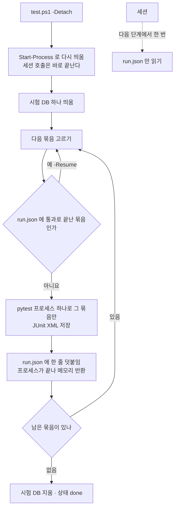

<!-- 배경 조사 기록 · 2026-10-21 · 읽기 전용 조사 -->
# 점검 · 시험 스크립트 점검과 나누는 안 (2026-10-21)

> **범위** — 사람이 돌리는 점검 스크립트(`scripts/personal/`), 화면 손 시험 · 녹화 · 덱 도구, 스캐너, 그리고 세션 안에서 Claude 가 돌리는 일회용 도구의 꼴.
> **방법** — 읽기만 했다. 스크립트 원문, 이미 있는 기록(시험 결과서 4절 · 점검 보고서 · VS Code 로그 · Claude Code 대화 기록 파일의 시각 · 크기 · 토큰 수), 프로세스 메모리 한 번(15:30) 을 읽었다. 아무것도 실행 · 종료 · 수정하지 않았다.

## 다섯 줄 요약

1. **끊긴 다섯 번 모두, 그 순간 돌던 스크립트는 없었다.** 모든 대화 기록의 마지막 사건이 끊김보다 3.6 ~ 35분 앞이고, 다섯 번 가운데 넷은 「도구 결과 → 다음 모델 요청」 직후에 기록이 멈췄다(확실도 높음).
2. **공통점은 긴 대화 + 메모리 부족이다.** 끊기기 직전 주 대화의 입력이 50만 → 58만 → 70만 → 96만 토큰으로 커졌고, 마지막(15:01)은 55만 · 52만 토큰 대화 둘이 함께 떠 있었다. 대화 기록 파일 하나가 42 MB 였다(숫자는 확실도 높음 · 원인 해석은 중간).
3. 스크립트 가운데 **가장 큰 한 덩어리는 `test.ps1`** 이다 — 시험 2,365건을 파이썬 한 프로세스로 8분 26초 ~ 9분 52초 돌리고, 중간 결과 파일이 없으며, `-p no:cacheprovider` 라서 실패만 다시 돌리기(`--lf`)도 안 된다. 77차 도중 그 프로세스가 1.34 GB 였다.
4. **나누는 안** — `test.ps1` 은 이름 있는 묶음 여섯을 차례로(묶음마다 새 프로세스 · JUnit XML + `run.json` · `-Resume` · `-Detach`), 병렬(xdist)은 쓰지 않는다. `check.ps1` 은 짧아서 쪼개기보다 출력을 줄이고(`-Quiet`) 결과를 한 줄씩 파일로(`-Out`).
5. **효과는 스크립트보다 습관 · 메모리 쪽이 크다** — 대화를 40만 토큰 앞에서 끊기 · 배경 에이전트는 하나만 · 1분 넘는 기다림은 세션 밖 · 세션 출력 50줄 상한. 메모리는 다른 프로젝트의 DB 서비스(3.7 GB) → 데스크톱 앱 → WSL 상한 차례로 효과가 크다.

---

## 1. 스크립트 목록 · 「한 덩어리」 정도

「한 덩어리」 = 한 번 부르면 끝까지 한 프로세스 · 한 호출로 돌고, 중간에 끊기면 남는 것 없이 처음부터 다시 해야 하는 정도.
시간은 **이미 있는 기록**에서만 옮겼다(기록이 없으면 「기록 없음」). 메모리는 실측이 아니면 「어림」.

**<표 1> 점검 · 시험 스크립트**

| 스크립트 | 하는 일 | 한 번에 도는 단계 | 걸리는 시간(기록) | 띄우는 것 | 메모리 | 중간 결과 파일 | 끊기면 이어서 | 한 덩어리 |
|---|---|---|---|---|---|---|---|:-:|
| `test.ps1` (인자 없음) | pytest 전부 + 일회용 시험 DB | 4단계 · 시험 2,365건(173파일)을 **파이썬 한 프로세스**로 | 8분 26초 ~ 9분 52초(63 ~ 76차 · 시험 결과서 4절) · 77차는 15:30 에 11분 넘게 도는 중 | 도커 컨테이너 1(pgvector) · python 1 · 그 안에서 node 를 부르는 시험 13파일 · 파이썬을 다시 부르는 시험 6파일 | **실측 1.34 GB**(77차 도중 · 사설 메모리) + 시험 DB | **없음** — 콘솔에만(JUnit XML · 로그 파일 없음) | **안 됨** — `-p no:cacheprovider` 라 `--lf` 도 못 쓴다 | **높음** |
| `test.ps1 -Path <파일>` | 파일 몇 개만 | 같은 4단계 | 기록 없음(DB 기동 포함 수십 초 · 어림) | 같음 | 수백 MB(어림) | 없음 | 다시 돌림(짧음) | 낮음 |
| `check.ps1` (기본) | 떠 있는 앱에 HTTP 점검을 차례로 | 85 안팎(목록 63 + 로그인 1 + 계정 차례 20 안팎) | 9.9 · 31초(10-02 보고서 · 그때 62건) | 없음(앱에 요청 · `docker exec psql` 1 ~ 2번) | PowerShell 하나 · 작음 | `-SaveReport` 일 때 **끝에 한 번**(md) | 안 됨(짧아서 다시 돌림) | 중간 — 점검마다 2 ~ 3줄, 약 250줄이 화면(세션)에 |
| `check.ps1 -Full -Write` | + 느림 4(요청마다 ML 학습 · 근거 답) + 쓰기 14(모의 매매 · RAG 왕복) | 100 안팎 | 29.5 · 46.7 · 103.2초(09-30 · 10-04 보고서) · 시간 제한만 합치면 최악 15분 넘게 기다릴 수 있다(180초 × 3 · 300초 · 120초 × 2 …) | 앱 컨테이너 안 ML 학습 · Ollama 가 모델을 올림 | 도커(WSL) 쪽이 는다 — 모델 하나 약 3 GB(측정 메모) | 끝에 한 번 | 안 됨 — 「쓰기」 · 「계정」 은 앞 점검 값을 이어 받는다 | 중간 ~ 높음 |
| `start.ps1` | 사전 점검 → .env → 네트워크 → 충돌 → DB 대기 → 앱 · Celery → 헬스 → 브라우저 | 7 | 수십 초 · 이미지를 다시 만들면 몇 분(README) | 컨테이너 최대 8 + 브라우저 | 컨테이너 합 약 2.5 GB(측정 메모 · Ollama 빈 상태) · compose 에 메모리 상한 없음 | 없음 | 됨 — 멱등이라 다시 돌리면 이어진다 | 낮음 |
| `status` · `logs` · `stop` · `kis-link` · `dev` | 읽기 · 끄기 · 모의 키 넣기 · 호스트 실행 | 1 ~ 5 | 초 단위 | — | 작음 | — | — | 낮음 |

**<표 2> 화면 손 시험 · 녹화 · 덱 · 스캐너**

| 스크립트 | 하는 일 | 한 번에 도는 단계 | 걸리는 시간(기록) | 띄우는 것 | 메모리 | 중간 결과 파일 | 끊기면 이어서 | 한 덩어리 |
|---|---|---|---|---|---|---|---|:-:|
| `tests/e2e/` Playwright 여섯(`gnb_widths` · `howto_dialog` · `howto_video` · `help_videos_list` · `learn_inapp` · `smoke_views`) | 떠 있는 앱을 폭별로 열어 보고 그림 저장 | 폭 2 ~ 12 × 화면 | 기록 없음 | Chromium 1 | 0.3 ~ 0.8 GB(어림) | 그림 · 일부 결과 | 일부(`--widths`) | 중간 |
| `tests/e2e/` 합성 응답 일곱(`.py` + `.js` 짝 · `kis_modes` 등) | 실제 HTML · JS 를 가짜 API 응답으로 | 1 | 기록 없음(초 단위 · 어림) | headless Chrome 1 + 작은 http 서버 | 0.2 ~ 0.5 GB(어림) | `--out` 에 증거 파일 | 파일 단위 | 낮음 |
| `tools/demo/record_demo.py` | 장면 YAML → 영상 · 자막 · 장 | 장면 n 개를 **차례로** × 단계 | 기록 없음(장면마다 영상 길이 + 기다림) | Chromium(1920×1080 · CDP 화면 전송) + ffmpeg | 1 GB 안팎(어림) · 프레임은 디스크 | 장면마다 json · webm | 장면 단위로 다시 | 중간(장면 여럿을 한 번에 주면 높음) |
| `tools/demo/export_mp4.py` | webm → mp4(H.264 · 10 MB 안이 될 때까지 CRF 를 올려 다시) | 편 × CRF 단계 | 기록 없음 | ffmpeg(libx264 · `slow` · 코어 전부) | 수백 MB(어림) | 편마다 mp4 + `목록.json` | **됨** — 빠진 편만 · `--only` · `--check` | 낮음 |
| `tools/deck/*` | 덱 한 파일로 묶기 · Mermaid · SVG 굽기 | 1 | 기록 없음 | (SVG 점검) 브라우저 | 영상까지 넣으면 결과 크기만큼(어림) | 결과 1개 | 다시 돌림 | 낮음 ~ 중간 |
| 스캐너 · 검사 11(`api_scan` · `schema_scan` · `rtm_scan` · `view_scan` · `data_guide_scan` · `docs_scan` · `lecture_scan` · `post_check` 등) | 코드 · 문서를 읽어 생성물 · 판정 | 1 | 초 단위 | 일부 git 하위 프로세스 | 작음 | 생성물 파일 | 다시 돌림 | 낮음 |
| 예약 작업(`daily_update.py` · `weekly_rehearsal.py`) | 12:30 회차 · 주 1회 복원 리허설 | 여러 단계 | 12:30 ~ 13:10 | 네트워크 · 컨테이너 | — | **잠금 + 상태 JSON** | **됨** | 세션 밖 — 나누는 안의 본보기 |

**<표 3> 세션 안 일회용 도구(꼴만 · 세션 도구 폴더의 스크립트 797개를 낱말로 셈)**

| 꼴 | 개수 | 걸리는 시간(기록) | 띄우는 것 | 중간 결과 파일 | 한 덩어리 |
|---|--:|---|---|---|:-:|
| pytest · `test.ps1` 을 부르는 것(깨 보기 · 다시 재기) | 187 | 곳마다 수십 초 ~ 전체 9분 | pytest(1회 1.3 GB 급) | 일부 | **높음** — 곳마다 전체를 다시 돌리는 꼴이 있다 |
| Chromium · Playwright 를 띄우는 것(화면 확인 · 캡처) | 115 | 기록 없음 | Chromium | 그림 | 중간 |
| 사본 저장소 리허설(복사 → 바꾸기 → 시험) | 6 (트리 통째 복사) | 한 호출이 결과를 **3분 34초 기다린** 기록(최대 9분 설정 · 12:03 ~ 12:06) | git · python · pytest + 사본(작업 트리 9.1 GB · `.git` 322 MB) | 대개 없음 | **높음** |
| 가짜 원격(bare) git 리허설 | 26 | 짧음 | git | 일부 | 중간 |
| 상태 · 진행 JSON 을 쓰는 것 | 67 | — | — | 있음 | — |
| 세션 밖으로 띄우는 것(`Start-Process` · 백그라운드) | **3** | — | — | — | — |

- 세션 도구 797개 가운데 세션 밖으로 띄우는 것은 3개뿐이다 — 나머지는 세션 호출 안에서 끝까지 돈다.

---

## 2. 끊김과의 관계

### 2.1 끊긴 순간 앞에 무엇이 있었나

VS Code 는 최근 로그 폴더 열 개 남짓만 남겨 09:32 · 10:22 의 VS Code 로그는 지워졌다 — 그 둘은 개인 측정 메모(같은 날 11:2x)와 Claude Code 대화 기록 파일로 봤다.
「마지막 기록」 은 그 시각까지 쓰인 **모든** 대화 기록(주 대화 + 배경 에이전트)에서 가장 늦은 사건이다.

**<표 4> 끊김 다섯 번**

| 끊김 | 마지막 기록 · 공백 | 그때 대화 크기(입력 토큰) | 함께 떠 있던 대화 | 마지막 기록 직전의 도구 |
|---|---|---|---|---|
| 09:32:57 | 09:29:20 · **3.6분** | 주 50.5만 — 사용자 답을 기다리는 질문 창(09:28) | 배경 에이전트 **셋**(32만 · 41만 · 20만) | 셋이 짧은 Bash · 읽기 · 고치기(결과 0.1 ~ 2.6천 자) |
| 10:22:46 | 09:47:30 · **35.3분** | 주 58.0만 — 모델 요청을 보낸 직후 멈춤 | 배경 둘(09:46 · 09:47 에 끝) | 전체 시험 진행 확인 한 번(494자) |
| 11:19:45 | 11:01:51 · **17.9분** | 주 70.2만 — 모델 요청 직후 | 없음 | 새 시험 파일 하나 단독 실행(35초 · 377자) |
| 12:1x | 12:06:45 · **12분 안팎** | 주 **96.1만** — 모델 요청 직후 | 없음 | 사본 저장소 리허설을 끝까지 기다린 호출(3분 34초 · 969자) |
| 15:01:08 | 14:39:26 · **21.7분** | 오후 대화 55.5만 — 모델 요청 직후 | 배경 하나 52.3만(같은 14:39 에 함께 멈춤) | 짧은 Bash(570자) |

- 전체 시험 75차(10:28 ~ 10:37) · 76차(11:43 ~ 11:53) · 77차(15:18 ~)는 모두 **끊긴 뒤에** 세션 밖에서 돌았다 — 시험이 끊김을 직접 일으킨 기록은 없다.
- 큰 출력 한 번이 원인인 기록도 없다 — 20,000자 넘는 도구 결과는 대화마다 0 ~ 3건이었다. 주 대화의 도구 결과는 372건 합 77만 자였고 가장 큰 셋이 파일 통째 읽기 10만 자씩(09:09 ~ 09:11)이었다. **작은 결과가 수백 번 쌓인 긴 대화**가 컸다.

**<그림 1> 기록이 멈춘 구간(빨강)과 전체 시험(세션 밖)** · 범례: 빨강 = 기록이 멈춘 뒤 끊길 때까지 · 회색 = 기록이 이어진 구간

```mermaid
gantt
  title 2026-10-21 대화 기록이 멈춘 구간과 끊김
  dateFormat HH:mm
  axisFormat %H:%M
  section 대화 기록
  기록 : 08:41, 09:29
  멈춤 3.6분 : crit, 09:29, 09:33
  기록 : 09:35, 09:47
  멈춤 35분 : crit, 09:47, 10:23
  기록 : 10:25, 11:02
  멈춤 18분 : crit, 11:02, 11:20
  기록 : 11:22, 12:07
  멈춤 12분 : crit, 12:07, 12:19
  기록 : 12:21, 12:55
  기록(오후 대화) : 13:41, 14:39
  멈춤 22분 : crit, 14:39, 15:01
  section 전체 시험(세션 밖)
  75차 : 10:28, 10:37
  76차 : 11:43, 11:53
  77차(15시 30분에 도는 중) : 15:18, 15:30
```

### 2.2 공통점

**<표 5> 다섯 번에 공통으로 있던 것**

| 공통점 | 근거 | 확실도 |
|---|---|:-:|
| 대화가 50만 토큰을 넘었다 | 주 대화 입력이 끊김마다 50.5만 → 58.0만 → 70.2만 → 96.1만, 15:01 은 55.5만 + 52.3만 | 높음(숫자) |
| 대화 여럿이 동시에 컸다 | 09:32 는 주 + 배경 셋(합 약 143만 토큰), 15:01 은 둘(합 약 108만) · 배경 에이전트 하나가 30 ~ 60만 토큰까지 자랐다 | 높음(숫자) |
| 메모리가 모자랐다 | 11:2x 쓸 수 있는 메모리 1.8 GB / 31.6 GB · 초당 페이지 교체 1,565 · 커밋 59.5 / 75.3 GB(측정 메모) · 15:30 에도 4.2 GB · 커밋 50.1 / 70.1 GB | 높음 |
| 모델 요청 직후 기록이 멈춘 채 12 ~ 35분 | 넷이 같은 꼴 · 그 사이 Claude 프로세스의 「이벤트 루프 멈춤」 경고가 있었다(12:43 · 4.97초, 14:32 · 4.16초 — 다른 창에서) | 중간 — 네트워크 지연과 프로세스 멈춤을 로그로 가르지 못함 |
| VS Code 확장 호스트 「응답 없음」 | 다시 연 직후마다 여러 번(12:19 · 13:39 ~ 13:41 · 15:01 ~ 15:02), 쓰는 중에도(12:26 · 13:10 · 14:03) · 종료 코드 0(충돌 아님) | 높음 |

### 2.3 확장 호스트가 무거워지는 원인(로그에 있는 만큼)

- **긴 대화** — 대화 기록 파일이 주 대화 42 MB(08:41 ~ 12:55), 오후 대화 16 MB, 배경 에이전트 하나 2.8 ~ 12.6 MB. 한 요청의 입력이 최대 96만 토큰이었다(1회 압축 뒤 15.7만으로 내려감).
- **다시 열 때 확장을 많이 올림** — VS Code 가 「응답 없음」 때 잰 프로필에서 큰 몫은 이 작업과 상관없는 확장이었다: HTML/CSS 클래스 자동완성 1.03초 중 45% · Figma 확장 0.60초 중 75% · Jupyter 0.06초 중 24%. 이 창에는 AI 도우미 확장도 여럿(코드 도우미 넷 이상) 함께 켜져 있다.
- **동시 MCP 서버** — node 프로세스 45개 3.32 GB(15:30). 대화마다 MCP 서버가 몇 개씩 뜨는지는 이번에 세지 못했다(확실도 낮음).
- **큰 출력** — 한 번에 크게 들어온 기록은 적다(2.1 마지막 줄). 큰 몫은 통째 읽기(10만 자) 몇 번과 짧은 결과 수백 번이다.

---

## 3. 나누는 안

### 3.1 `test.ps1` — 묶음 차례 실행 (한 덩어리 높음 · 먼저)

**묶음(초안)** — 파일 수는 이름 앞머리로 센 어림이다. 표는 파일 하나(묶음 · 글롭)로 두고, 지킴이 시험이 「모든 `tests/test_*.py` 가 정확히 한 묶음에」 를 본다. 맞는 글롭이 없는 새 파일은 「나머지」 로 간다.

**<표 6> 시험 묶음 초안**

| 묶음 | 파일(어림) | 무엇 |
|---|--:|---|
| 화면 | 25 | `*_screen` · 사용법 창 · 영상 · 학습 화면 — node 로 JS 를 돌리는 시험이 여기 몰려 있다 |
| 데이터 | 35 | 수집 · 일일 갱신 · HF · 공시 · 달력 · 시세 원천 |
| 지식 | 30 | 근거(kb) · 용어 · 강의 · 문서 스캐너 · RAG · 채팅 |
| 매매 | 40 | 리밸런싱 · KIS · 모의 장부 · 미국 주문 · 위험 · 자동매매 · 계정 — DB 가 필요한 시험 18파일 가운데 11개 안팎이 여기(나머지는 데이터 · 지식 · 분석에 흩어져 있어, 시험 DB 는 묶음 전체에 하나를 띄워 차례로 쓴다) |
| 분석 | 30 | 모델 비교 · XAI · 전략 · 패턴 · 신호 · 지표 · 수식 · 백테스트 |
| 나머지 | 나머지 | 새 파일이 빠지지 않게 받는 칸 |

**어떻게 도나**

- 묶음마다 **새 pytest 프로세스** — `python -m pytest <그 묶음 파일들> --junit-xml=<결과 폴더>/<묶음>.xml -o cache_dir=<결과 폴더>/cache`. 결과 폴더는 `data/local-run/test/<시각>/`(이미 .gitignore 대상).
- 묶음이 끝날 때마다 `run.json` 에 한 줄 — 묶음 · 통과 · 실패 · 건너뜀 · 초 · 종료 코드 · 끝난 시각. 맨 위에는 상태(`running` · `done`) · 지금 묶음 · PID.
- **메모리** — 프로세스가 묶음마다 끝나므로 최고점이 「가장 큰 묶음 하나」 로 내려간다(지금은 2,365건이 한 프로세스에 계속 쌓인다 · 실측 1.34 GB). 대가는 묶음마다 파이썬 시작 · 모아 세기 몇 초 ~ 십몇 초 — 여섯 묶음이면 1분 안팎 늘어난다(어림).
- **이어서** — `-Resume`: `run.json` 에서 종료 코드 0 으로 끝난 묶음은 건너뛰고 나머지부터. `-LastFailed`: 캐시를 결과 폴더에 두고 `--lf` 로 실패만. 지금 `-p no:cacheprovider` 를 쓰는 까닭(저장소를 더럽히지 않게)은 `cache_dir` 을 .gitignore 된 곳으로 옮겨 그대로 지킨다.
- **세션 밖** — `-Detach`: 자기 자신을 `Start-Process`(창 숨김 · 출력은 로그 파일로)로 다시 띄우고 바로 끝난다. 세션은 다음 단계에서 `run.json` 한 파일만 한 번 읽는다(기다리는 호출을 두지 않는다).
- **기본값** — 인자 없는 `test.ps1` 은 지금처럼 **전체 범위**(팀 완료 기준 ①)를 지킨다. 바뀌는 것은 「안에서 묶음 차례로 돈다」 뿐. Claude 는 세션 안에서 `-Group` · `-Path` 만, 전체는 `-Detach` 로.
- **병렬(pytest-xdist)은 쓰지 않는다** — ① 일꾼마다 따로 프로세스가 모아 세기를 전부 한다(공식 문서) → 메모리가 일꾼 수만큼 는다(추론) — 지금 모자란 것이 메모리다. ② 모의 장부 시험이 시험 DB 의 표를 지우고 다시 만든다 — 같은 DB 를 동시에 쓰면 서로 깨뜨린다. ③ 출력 순서가 섞여 실패 줄을 읽기 어렵다.
- **주의** — 프로세스를 나누면 시험끼리 숨어 있던 순서 의존이 실패로 드러날 수 있다(드러나면 그것이 결함이다). 그래서 처음 두세 번은 지금 방식과 결과 수(통과 · 실패 · 건너뜀)가 같은지 맞대 본다.

**<그림 2> 묶음 차례 실행 · 세션 밖 · 이어서** · 범례: 마름모 = 판정 · 점선 = 세션 쪽

**바꿀 파일 · 시험 · 영향**

| 무엇 | 내용 |
|---|---|
| 바꿀 파일 | `scripts/personal/test.ps1` · 새 묶음 표(묶음 · 글롭) · `scripts/personal/README.md` · `docs/phase-3/05-deployment/로컬실행안내서.md`(숫자가 이미 옛것 — 「249건 · 약 2분」 → 2,365건 · 9분 안팎) · 기본 출력이 바뀌면 `docs/phase-3/03-development/conventions/코딩표준.md` <표 5> ① |
| 시험 | 지킴이 하나 — 모든 시험 파일이 정확히 한 묶음 · 묶음 이름이 겹치지 않음 · 글롭이 빈 묶음 없음. `-Resume` 이 끝난 묶음을 건너뛰는지는 작은 가짜 `run.json` 으로 손 확인 한 번 |
| 누가 영향 | 팀원 모두 — PR 전 `test.ps1` · `check.ps1` 실패 0 이 완료 기준이다(코딩표준 <표 5> ① ③ · <그림 4>). 인자 없는 동작(전체 범위 · 실패면 종료 코드 1)을 지키면 팀원이 할 일은 없고, 묶음별 요약 줄과 결과 폴더만 README 로 알린다. CI 는 없다(`.github/workflows` 없음) |

### 3.2 세션 도구 — 사본 리허설 · 깨 보기 (한 덩어리 높음)

- **한 호출 = 한 단계** — 사본 만들기 / 바꾸기 / 시험 / 정리를 따로 부르고, 단계마다 상태 JSON 한 줄.
- **깨 보기는 곳마다 그 곳을 지키는 파일만**(`test.ps1 -Path` 또는 `-Group`) — 곳마다 전체 시험을 다시 돌리지 않는다. 곳 목록과 결과는 JSONL 로 쌓아 끊기면 남은 곳부터.
- **사본은 필요한 폴더만** — 작업 트리(9.1 GB)를 통째 복사하지 않는다. 추적 파일만 필요하면 `git archive`(읽기만)로. clone · worktree 는 git 쓰기라 AI 규칙(로컬 git 쓰기 금지)에 걸린다 — 후보에서 뺀다.
- **기다리지 않는다** — 한 호출 안에서 몇 분씩 기다리지 않고(12:03 ~ 12:06 처럼), 띄운 뒤 다음 단계에서 상태 파일만 본다.

### 3.3 `check.ps1` (중간)

- **쪼개기보다 출력** — `-Quiet`: 실패 · 주의 · 묶음별 요약만. 지금은 점검마다 2 ~ 3줄(85건이면 약 250줄)이 세션에 들어온다.
- **한 줄씩 파일로** — `-Out <jsonl>`: 점검 하나가 끝날 때마다 한 줄 덧붙인다. 지금 `-SaveReport` 는 끝에 한 번이라, 느림 묶음(시간 제한 180 ~ 300초)에서 끊기면 남는 것이 없다.
- **이어서** — `-Resume <jsonl>`: 다 끝난 묶음은 건너뜀. 「쓰기」 묶음과 「계정」 차례는 앞 점검 값을 이어 받으니 **묶음째로만** 다시.
- **기본값** — 그대로(10 ~ 31초). `-Full` · `-Write` 는 세션에서 `-Full -Group 느림` · `-Write -Group 쓰기` 를 따로 부른다(호출 하나 = 묶음 하나).
- 바꿀 파일: `check.ps1` · `README.md`. 영향: 옵션만 늘어 팀원 쪽 동작은 그대로.

### 3.4 녹화 · 손 시험 (중간)

- `record_demo.py` 는 장면을 여럿 받는다 → 세션에서는 **장면 하나씩**. 장면마다 json 이 이미 남으니, 「json 이 있는 장면은 건너뛰기」 만 더하면 이어서 돌릴 수 있다.
- Playwright 손 시험은 기본을 두 폭(1280 · 390 — 완료 기준 ④)으로, 12폭(`gnb_widths`)은 메뉴를 고칠 때만.
- `export_mp4.py` 는 이미 「빠진 편만」 이라 그대로 둔다 — 세션 밖으로만 돌린다(코어를 다 쓴다).

### 3.5 차례 — 먼저 할 셋

1. **Claude 쪽 습관 규칙(4절)** — 코드를 바꾸지 않고 바로 된다. 끊김의 공통점(긴 대화 · 동시 대화)을 직접 줄인다.
2. **`test.ps1` 묶음 차례 + `-Detach` + `run.json` + `-Resume`(3.1)** — 가장 큰 한 덩어리이자 Claude 가 가장 자주 부르는 것.
3. **`check.ps1 -Quiet` · `-Out`(3.3)** — 작은 변경으로 세션 출력을 줄이고, 끊겨도 결과가 남는다.

---

## 4. Claude 쪽 습관 — 규칙 후보 다섯

이미 있는 규칙(한 호출 한 단계 · 1분 넘는 일은 세션 밖 · 진행 기록)에 더할 것.

| # | 규칙 후보 | 근거 |
|:-:|---|---|
| 1 | **대화는 40만 토큰 앞에서 끊는다** — 작업 묶음 하나가 끝나면 다음 세션 프롬프트를 남기고 새 대화 | 끊긴 때 대화 크기 50 ~ 96만 토큰(<표 4>) |
| 2 | **배경 에이전트는 한 번에 하나 · 맡길 일은 좁게** — 지시서에 「25만 토큰이면 멈추고 보고」 | 09:32 는 대화 넷이 함께, 15:01 은 둘 · 배경 하나가 30 ~ 60만 토큰까지 자랐다 |
| 3 | **한 호출 안에서 1분 넘게 기다리지 않는다** — `Start-Process` 로 띄우고 다음 단계에서 상태 파일만 읽는다 | 3분 34초를 한 호출에서 기다린 직후 기록이 멈췄다(12:06) |
| 4 | **세션에 들어오는 출력은 50줄 · 5,000자 안** — 긴 출력은 로그 파일로 보내고 끝 몇 줄과 숫자만. 큰 파일은 범위(offset · limit · grep)로 | 통째 읽기 10만 자가 한 대화에 세 번 · 짧은 결과가 수백 번 쌓여 대화가 커졌다 |
| 5 | **사본 · 복사는 필요한 폴더만, 단계가 끝나면 지운다** | 작업 트리 9.1 GB · 사본 리허설 6개가 트리를 통째 복사 |

---

## 5. 메모리 줄이기 — 끄면 효과가 큰 차례

15:30 에 한 번 읽은 값(프로세스 이름으로 묶은 사설 메모리 · 그때 77차 시험이 도는 중). 쓸 수 있는 메모리 4.2 GB / 31.6 GB · 커밋 50.1 / 70.1 GB.
**아무것도 끄거나 바꾸지 않았다** — 아래는 사용자가 고를 차례다.

**<표 7> 지금 떠 있는 것**

| 차례 | 무엇 | 지금 | 끄면 줄어드는 양 | 비고 |
|:-:|---|--:|--:|---|
| 1 | 다른 프로젝트의 로컬 DB 서비스(`mysqld` 셋 · `oracle`) | 3.73 GB | 약 3.7 GB | Qurious 는 도커 PostgreSQL 만 쓴다 — 그 서비스를 쓰는 다른 작업이 없을 때 |
| 2 | 데스크톱용 Claude 앱 + 그 MCP 서버 | 약 2.7 GB(15:1x 측정) | 약 2.7 GB | VS Code 의 Claude Code 와는 따로 돈다 |
| 3 | 그 밖의 데스크톱 앱 넷(메신저 · 노트 · 검색 도우미 · 디자인) | 3.44 GB | 고른 만큼 | 디자인 MCP 는 원격 서버라 앱이 없어도 된다(측정 메모) |
| 4 | Chrome(24개) | 2.41 GB | 탭만큼 | 손 시험 · 녹화는 Playwright 의 Chromium 을 따로 쓴다 |
| 5 | VS Code(21개) | 4.47 GB | 다른 창 · 안 쓰는 확장만큼 | 창마다 확장 호스트 · 언어 서버가 따로 뜬다. 다시 열 때의 「응답 없음」 몫이 이 작업과 상관없는 확장에 있었다(2.3) |
| — | 도커 WSL(`vmmemWSL`) | 7.46 GB | 아래 상한 | 가장 크지만 앱이 쓴다 |
| — | Claude Code 프로세스(10개) | 1.90 GB | 대화를 끊으면 | 4절 규칙 1 · 2 |
| — | python(10개 · 그중 77차 pytest 1.34 GB) | 1.69 GB | 시험이 끝나면 | 3.1 묶음 차례면 최고점이 낮아진다 |

**`.wslconfig` 상한(`memory=8GB` · `swap=4GB`)의 효과 어림**

| 항목 | 값 | 근거 · 확실도 |
|---|---|---|
| 지금 기본값 | memory = Windows 메모리의 50% → 이 PC 면 약 15.8 GB 까지 · swap = 25%(GB 올림) → 8 GB | 공식 문서 · 높음 |
| 상한 자체로 지금 줄어드는 양 | 0 에 가깝다 — 지금 7.46 GB 가 8 GB 아래다 | 15:30 실측 · 높음 |
| 적용할 때 한 번 | `wsl --shutdown` 뒤 다시 시작 → 컨테이너 합 약 2.5 GB 로 출발해 **약 5 GB 회수**, 캐시가 차며 다시 는다 | 측정 메모(`docker stats`) · 중간 |
| 그 뒤 지켜 주는 것 | 큰 모델(약 3 GB)을 올리는 날에도 8 GB 에서 멈춤 → 기본 상한(15.8 GB)보다 **최대 약 7.8 GB** 를 Windows 쪽에 남긴다 | 계산 · 중간 |
| 대가 | 8 GB 를 넘으면 VM 안에서 swap(최대 4 GB), 그것도 넘으면 VM 안에서 컨테이너 프로세스가 강제 종료될 수 있다 — Ollama + neo4j + 앱 ML 이 겹칠 때. 지금 예상(2.5 + 3 = 5.5 GB)은 8 GB 안 | 추론 · 중간 |
| 캐시 반환 | 공식 문서 기본 `autoMemoryReclaim=dropCache`(experimental 칸 · 캐시를 바로 돌려줌) — 이 PC 의 WSL 판이 그 기본인지는 이번에 보지 않았다 | 공식 문서 · 높음 / 이 PC · 모름 |

- 적용 때는 앱이 잠깐 꺼지므로 12:30 ~ 13:10 정기 회차와 세션 밖 전체 시험을 피한다.

---

## 6. 정할 것 (메인)

| # | 정할 것 | 고를 수 있는 것 | 추천 · 까닭 |
|:-:|---|---|---|
| 1 | 인자 없는 `test.ps1` 의 동작 | (가) 지금처럼 한 프로세스 · 옵션만 더함 / (나) 묶음 차례(범위는 전체 그대로) | **(가)로 먼저 넣고, 두세 번 결과 수가 같으면 (나)를 기본으로** — 팀 완료 기준 ①의 뜻은 그대로이고, 숨은 순서 의존을 먼저 걸러 낸다 |
| 2 | 묶음을 나누는 기준 | 이름 글롭 표(사람이 읽음) / 해시 샤드(자동 · 뜻 없음) | **글롭 표 + 「나머지」 칸 + 지킴이 시험** — 실패가 어느 기능인지 묶음 이름으로 바로 보인다 |
| 3 | 대화 길이 상한 | 30만 / 40만 / 50만 토큰 | **40만** — 끊긴 때가 모두 50만 위였다 |
| 4 | 배경 에이전트 동시 수 | 하나 / 둘 | **하나** — 다만 팀원 글을 에이전트로 동시에 받는 지금의 예외와 부딪친다. 예외를 남길지(남기면 「각 25만 토큰에서 멈춤」 을 함께) |
| 5 | `.wslconfig` 적용 시점 · 값 | 8 GB · swap 4 GB / 10 GB | **8 GB** — 지금 예상 사용량(5.5 GB)이 들어간다. 모델을 키우면 다시 본다 |
| 6 | 사본 리허설 방법 | 필요한 폴더 복사 / `git archive` / clone · worktree | **폴더 복사 또는 `git archive`** — clone · worktree 는 AI 의 git 쓰기 금지에 걸린다 |
| 7 | `check.ps1` 바꿈 범위 | `-Quiet` · `-Out` · `-Resume` 전부 / `-Quiet` 만 | **`-Quiet` · `-Out` 먼저** — `-Resume` 은 느림 · 쓰기를 따로 부르는 습관이면 덜 급하다 |

---

## 7. 출처

| 출처 | 확인한 것 | 조회일 | 확실도 |
|---|---|---|:-:|
| pytest 문서 「How to re-run failed tests and maintain state between test runs」 (docs.pytest.org/en/stable/how-to/cache.html) | `--lf` 는 실패만, `--ff` 는 실패 먼저 · 이 둘은 기본으로 켜진 `cacheprovider` 플러그인이 한다 · 기록된 실패가 없을 때 `--lfnf all`(기본 · 전체) / `none` | 2026-10-21 | 높음 |
| pytest 문서 「API Reference」 의 설정 칸 `cache_dir` | 「Sets the directory where the cache plugin's content is stored. Directory may be relative or absolute path.」 | 2026-10-21 | 높음 |
| pytest 문서 「How to invoke pytest」 | 모듈 · 폴더 · 노드 ID 로 고르기 · `-k` 표현식 · `--durations=10 --durations-min=1.0` | 2026-10-21 | 높음 |
| pytest 문서 「Managing pytest's output」 | `--junit-xml=path` 로 결과 파일 | 2026-10-21 | 높음 |
| pytest-xdist 문서 「How it works」 | 「Each worker is responsible for performing a full test collection …」 — 메모리가 일꾼 수만큼 는다는 것은 이 글에서 끌어낸 추론 | 2026-10-21 | 높음(인용) · 중간(추론) |
| Microsoft Learn 「Advanced settings configuration in WSL」 | `memory` 기본 50% · `swap` 기본 25%(GB 올림) · `autoMemoryReclaim` 기본 `dropCache`(experimental) · 바꾼 뒤 `wsl --shutdown` · 8초 규칙 | 2026-10-21 | 높음 |
| 이 저장소 기록 | 시험 결과서 4절(63 ~ 76차 시간 · 건수) · 점검 보고서 다섯(`data/local-run/` · .gitignore 대상) · 코딩표준 <표 5> · <그림 4> · 로컬실행안내서 3절 · 스크립트 원문 | 2026-10-21 | 높음 |
| 이 PC 기록(읽기만) | VS Code 로그(renderer · main · Claude 확장 로그) · Claude Code 대화 기록 파일(시각 · 크기 · 토큰 수만 셈) · 프로세스 메모리 한 번(15:30) · 개인 측정 메모(11:2x · 12:4x) | 2026-10-21 | 높음(시각 · 숫자) · 중간(원인 해석) |

- 못 본 것: 09:32 · 10:22 의 VS Code 로그(지워짐) · e2e · 녹화 도구의 걸린 시간(기록 없음) · 시험 파일별 걸린 시간(`--durations` 기록 없음 — 묶음을 정할 때 한 번 재 볼 만하다).
