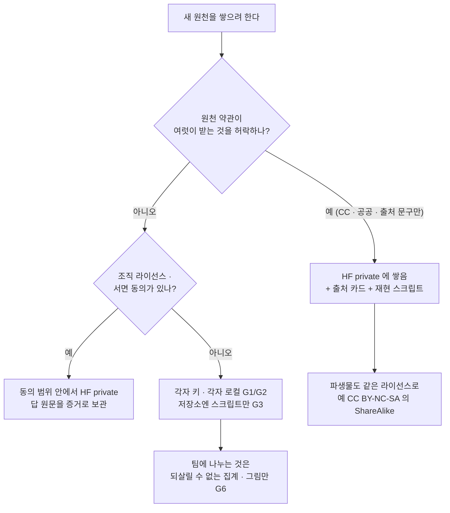
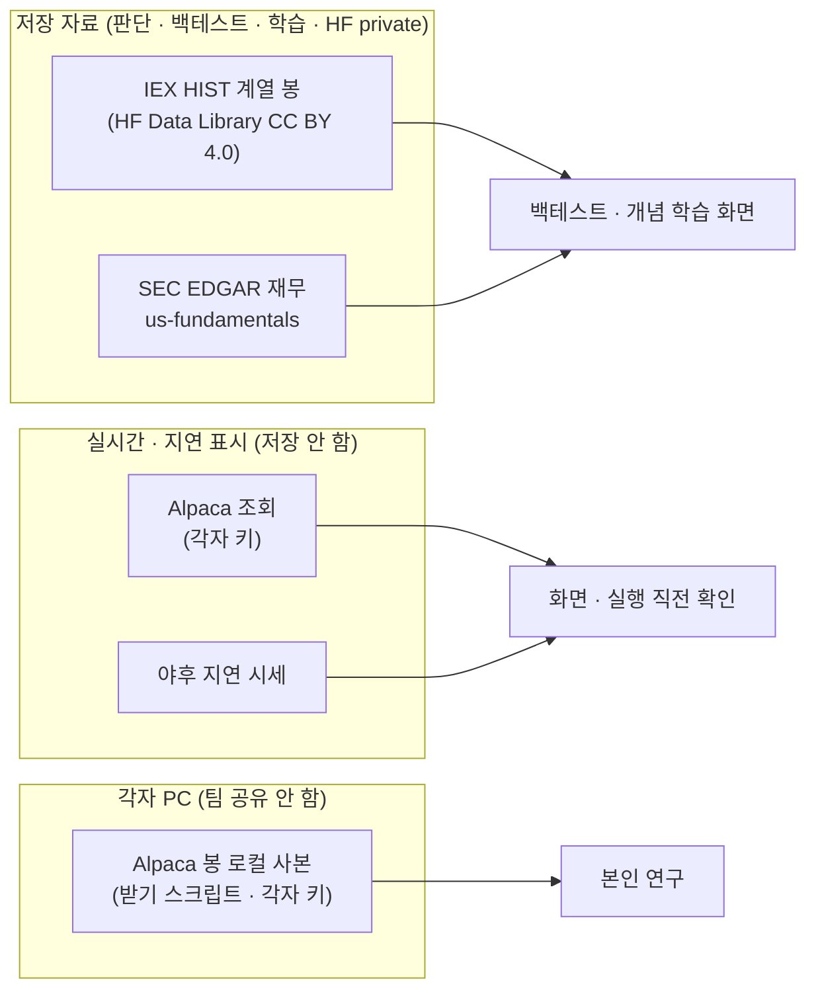

<!-- 진행: 15:45 · 끝 · ① ~ ⑥ 모두 씀 · 훑어 읽기 끝 -->

# 미국 시세 · 코인 데이터 — 다른 프로젝트 · 실제 서비스는 어떻게 받고 두고 나누나 (2026-10-22)

| 문서 정보 | |
|---|---|
| 판 · 상태 | 작업 초안(검토 전) |
| 작성 | 2026-10-22(목) 15:24 ~ KST · 배경 조사(읽기만) |
| 물음 | 미국 주식 · 코인 데이터로 프로젝트를 하는 GitHub 프로젝트 · 실제 서비스 · 데이터 공급자는 데이터를 **어디서 받고 · 어디에 두고 · 남과 어떻게 나누는지(재배포)**. 우리 결정(미국 = Alpaca IEX 를 HF private 에 쌓음 · 코인 = Binance Vision)에 무엇을 더하면 좋은가 |
| 앞선 조사 | [수집 자료 HF 대조 결과](../2026-10-22-데이터-HF-보강/결과.md) 9절 — Alpaca 고객 약정 · 업비트 약관 · Binance Vision 약관 · CryptoDataDownload · Coin Metrics · IEX HIST · Tiingo · 야후 · SEC EDGAR 는 이미 봤다. 여기서는 **견줄 사례**를 더한다 |
| 지킨 것 | 코드 · 시험 · 다른 문서 · git 은 건드리지 않음 · 실제 수집 · 올리기 없음(IEX 목록 API 는 파일 크기만 세 번) · github.com 은 열지 않음(README 는 jsDelivr 사본) · 웹 조사는 사람 속도로 |
| 확실도 | 🟢 원문 확인 · 🟡 읽은 것 + 추론 · 🔴 반대 근거(우리 결정과 어긋나는 사실) |

---

## ① 한눈에

**다섯 줄 요약**

1. 미국 주식 · 코인으로 프로젝트를 하는 오픈소스는 거의 다 **데이터를 저장소에 넣지 않고, 받는 명령 · 스크립트만 나눈다**(freqtrade · Jesse · OpenBB · qlib · zipline 등). 미국 주식은 **각자 공급자 키**, 코인은 **거래소에서 각자 받기**가 기본이다.
2. 팀 · 조직이 원자료를 함께 쓰는 곳은 **조직 단위 라이선스를 산 경우**(QuantConnect 「licensed organization's internal LEAN use only」 · Tardis)뿐이다. 무료 미국 공급자는 오히려 **「group」 · 「association」 사용을 콕 집어 막는다**(FMP · Alpha Vantage · Alpaca 와 같은 방향).
3. 코인 무료 자료는 **CC BY-NC-SA 4.0 이 업계 관행**이다(Binance Vision · CryptoDataDownload · CoinDesk 무료판). 우리 코인 결정(Binance Vision)은 관행과 맞는다 — 카드 · 재현 스크립트만 더하면 된다.
4. 🔴 **새로 찾은 반대 근거** — IEX 시장 자료 정책: 「Real-Time or Delayed IEX Market Data that is databased or stored beyond the current trading day **will not be considered IEX Historical Data**」. Alpaca 의 IEX 피드를 쌓아도 「무료로 나눠도 되는 IEX 이력 자료」 가 되지 않는다. **같은 IEX 체결을 깨끗한 조건으로 받는 길**은 IEX HIST(출처 문구만 붙이면 배포 가능) 또는 그것으로 만든 **HF Data Library(미국 1분봉 1,253종목 · 2022-03-07 ~ · CC BY 4.0 · 「학술 · 교육용 · 매매용 아님」)** 다.
5. 연구 쪽 표준은 **「원자료는 안 나누고, README 에 제약 · 스키마 · 요약 통계 · 가짜 표본 + 재현 코드」**(Journal of Finance · RFS · Review of Finance · JFE). 공개해도 되는 것은 **원자료를 되살릴 수 없는 집계**(팩터 수익률 · 차트 그림 · 10분 이상 봉)다.

**<표 0> 관행의 갈래 일곱**

| 갈래 | 무엇 | 대표 사례 | 미국 | 코인 | 우리 쪽 |
|:-:|---|---|:-:|:-:|---|
| G1 | **각자 키로 받기**(키 · 데이터 모두 각자 PC) | OpenBB 「does not host or serve any data」 · Jesse(Massive 키) · vectorbt(Alpaca 키) · pykrx(각자 KRX 계정) | ●●● | ● | 미국 시세 조회(Alpaca 모의 · 표시)가 이미 이 꼴 |
| G2 | **거래소에서 직접 · 각자 로컬 캐시** | freqtrade `user_data/data/<거래소>` · OctoBot `backtesting/data` · Jesse DB · cryptofeed 백엔드 | — | ●●● | 업비트 원화 마켓 = 각자 로컬(앞선 조사 X4) |
| G3 | **재현 스크립트만 나눔** | qlib(공식 묶음 거둠 → 「Users could create the same dataset with it」) · zipline `csvdir` · Cookiecutter `data/` 를 `.gitignore` | ●● | ●● | 수집기 · `collector/` 가 이미 재현 스크립트 구실 |
| G4 | **열린 라이선스 자료를 쌓아 나눔** | Binance Vision · CoinDesk 무료판 · CryptoDataDownload(CC BY-NC-SA) · IEX HIST(출처 문구) · HF Data Library(CC BY 4.0) · SEC EDGAR | ● | ●●● | 국내 공공데이터 · `crypto-ohlcv` · `us-fundamentals` |
| G5 | **돈 내고 「보여 줄 권리」 · 조직 라이선스** | TradingView(거래소에 요금 전달) · Koyfin(공급사 열 곳 넘게) · 토스(데이터 벤더) · Robinhood(Nasdaq Last Sale) · QuantConnect · Tardis | ●●● | ●● | 해당 없음(학습 프로젝트) |
| G6 | **원자료 비공개 · 파생 집계만 공개** | Kenneth French(CRSP → 팩터 수익률) · QuantConnect(그림) · Tardis(10분 이상 봉) · 학술지(요약 통계 · 가짜 표본) | ●● | ●● | 공개 화면 · 발표 자료에 쓰기 좋은 꼴 |
| G7 | ⚠ **공개 자리에 원자료 그대로** | backtrader 저장소의 야후 꼴 표본 · Kaggle 미국 시세에 CC0 | ● | ● | 따르지 않음(🔴 — 원 권리 확인이 없다) |

(● 많을수록 그 시장에서 흔함 · 🟡 읽은 사례 수에서 어림)



```
  권리의 층 (미국 주식) ─ 위 층의 조건이 아래로 그대로 내려온다
  ┌──────────────────────────────────────────────┐
  │ 거래소 · SRO (NYSE · Nasdaq · Cboe · IEX …)    │ 「proprietary interest in the Market Data」
  ├──────────────────────────────────────────────┤
  │ 중간 공급자 (Alpaca · Massive · Tiingo · FMP)  │ 개인 · 비상업 · 「end users other than you」 ✗
  ├──────────────────────────────────────────────┤
  │ 우리 (HF private 조직 · 팀원 넷)               │ 팀 공유 = 「distribute」 에 닿음
  └──────────────────────────────────────────────┘
  예외 하나: IEX HIST 는 거래소가 직접 「출처 문구만 붙이면 배포 가능」 으로 연다
            → 중간 공급자 층을 건너뛰면 조건이 깨끗해진다
```

---

## ② 사례 표

### ②-1 GitHub 오픈소스 — 데이터를 어디서 받고 어디에 두나 (조회 2026-10-22)

README 는 github.com 을 열지 않고 jsDelivr 사본(`cdn.jsdelivr.net/gh/<저장소>/README.md`)이나 공식 문서 사이트로 읽었다.

**<표 1> 오픈소스 15줄(16개 프로젝트 · P12 는 둘을 한 줄로)**

| # | 프로젝트 | 원천 | 저장 자리 | 나눔 방식 | 문구 인용(그대로) | 주소 | 확실도 |
|:-:|---|---|---|---|---|---|:-:|
| P1 | **freqtrade**(코인 자동매매) | 거래소 API(`download-data --exchange binance`) | 각자 PC `user_data/data/<거래소>/` · 형식 feather(기본) · json · jsongz · parquet | 데이터는 나누지 않음 — 명령만 문서에 | 「To download data (candles / OHLCV) needed for backtesting and hyperoptimization use the `freqtrade download-data` command.」 · 「create a directory `user_data/data/binance`」 · 「Kraken does not provide historic OHLCV data」 · 「The Hyperliquid API does not provide historic data … so downloading data is not possible」 | freqtrade.io/en/stable/data-download/ · /exchanges/ | 🟢 |
| P2 | **Jesse**(코인 · 2025 ~ 미국 주식) | 코인 = 거래소 · 주식 = **데이터 공급자 Massive**(옛 Polygon) + 각자 CSV | 각자 PC 의 Jesse DB(PostgreSQL) | **각자 키** — 키도 각자 DB 에 | 「Candles come from a data provider, not from the exchange you trade on. Crypto exchanges hand out their own history … Stock exchanges do not」 · 「Create an API key on massive.com … The key is stored in your Jesse database」 · 「On a free plan Massive rate-limits requests; Jesse … slows down to one request every 12 seconds」 | docs.jesse.trade/docs/traditional-markets/ · /importing-data · /import-candles | 🟢 |
| P3 | **QuantConnect LEAN** | QuantConnect 데이터 시장(공급자와 계약) | 클라우드 안에서 씀 · 내려받으면 **조직 작업 폴더** `data/` | **조직(팀) 단위 라이선스** — 내려받은 원자료는 조직 안에서만 · 그림은 나눠도 됨 | 「We have contracts with the data providers … we can't freely redistribute most of the datasets.」 · 「Most price data is free for use in the cloud.」 · 「This download is for the licensed organization's internal LEAN use only and cannot be redistributed or converted in any format. If you study the data and produce some charts, you may share images of the charts online if the original data can't be to reconstructed from the image.」 · 「Each organization workspace has its own data directory because each organization has its own data licenses.」 · `data/` 는 「comes with sample data from the QuantConnect/Lean repository」 | quantconnect.com/docs/v2/cloud-platform/datasets/licensing · /lean-cli/initialization/organization-workspaces · /lean-cli/datasets/quantconnect | 🟢 |
| P4 | **zipline-reloaded** | 번들 — 옛 `quandl`(WIKI) · `csvdir`(각자 CSV) | 각자 PC `$ZIPLINE_ROOT/data/<번들>`(기본 `~/.zipline`) | 각자 받아 「ingest」 | 「A data bundle is a collection of pricing data, adjustment data, and an asset database.」 · 「Quandl has discontinued this dataset early 2018 and it no longer updates.」 · 「`csvdir` … allows users to ingest data from `.csv` files」 | zipline.ml4trading.io/bundles.html | 🟢 |
| P5 | **backtrader** | 야후 꼴 CSV | **저장소 안 `datas/`** 에 표본(예 `orcl-1995-2014.txt`)을 함께 둠 | 공개 저장소에 표본 커밋(2010년대 관행) | 예제 코드 주석 「Datas are in a subfolder of the samples」 · `bt.feeds.YahooFinanceCSVData(dataname='../../datas/orcl-1995-2014.txt')` — 표본의 권리 고지는 문서에서 못 찾음 | backtrader.com/docu/quickstart/quickstart/ | 🟡(표본이 야후에서 왔는지는 형식으로 추론) |
| P6 | **vectorbt** | 조회 때마다 yfinance · Binance · ccxt · alpaca-py | 메모리(저장은 사용자 몫) | 각자 키 | `AlpacaData` 「Sign up for Alpaca API keys under https://app.alpaca.markets/signup」 · `YFData` 「Data coming from Yahoo is not the most stable data out there … It's only used in vectorbt for demonstration purposes.」 | vectorbt.dev/api/data/custom/ | 🟢 |
| P7 | **FinRL**(강화학습) | 처리기(processor)마다 Yahoo · Alpaca · Binance · WRDS 등 | 각자 받아 처리 | 각자 키(Alpaca 는 key · secret) | 자료표 칸에 「Request Limits」 — Alpaca 「Account-specific」(검색 요약) | finrl.readthedocs.io(처리기 문서) · 검색 요약 | 🟡 |
| P8 | **OpenBB**(ODP) | 공공기관 API + 제3자 공급자 | 각자 PC(`~/.openbb_platform/user_settings.json` 에 키) | **각자 키** · OpenBB 는 데이터를 들고 있지 않음 | 「**OpenBB does not host or serve any data**, and it provides connectors without warranty or support.」 · 「Many data providers require an API key for access.」 · 공공 묶음 「Sources of the data are public agencies providing open APIs. Some require registration, but all are free.」 | docs.openbb.co/odp/v4/python/extensions/providers · /odp/python/quickstart/user | 🟢 |
| P9 | **Microsoft qlib** | 야후(크롤러 스크립트) · 한때 MS 가 만든 묶음 파일 | 각자 PC `~/.qlib/qlib_data/<cn_data·us_data>` | **공식 묶음을 거둬들이고 재현 스크립트 + 커뮤니티 묶음으로** | 「❗ Due to more restrict data security policy. **The official dataset is disabled temporarily.** You can try this data source contributed by the community.」 · 「This dataset is created by public data collected by crawler scripts, which have been released in the same repository. **Users could create the same dataset with it.**」 · 「the data is collected from Yahoo Finance, and the data might not be perfect. We recommend users to prepare their own data if they have a high-quality dataset.」 | qlib README(jsDelivr 사본) · qlib.readthedocs.io/en/latest/component/data.html | 🟢 |
| P10 | **ccxt** | 거래소 100여 곳 공개 · 개인 API | 없음(라이브러리) | 코드만 | 「The library is under MIT license … use it at your own risk with no warranties, as is.」 — **코드 라이선스일 뿐 데이터 권리 말은 없다** | ccxt README(jsDelivr 사본) | 🟢 |
| P11 | **cryptofeed** | 거래소 웹소켓(업비트 포함) | 사용자가 고른 저장소(Redis · PostgreSQL · InfluxDB · MongoDB · Kafka · QuestDB …) | 각자 | 「Cryptofeed supports `backend` callbacks that will write directly to storage or other interfaces.」 · 「Data Capture and Replay」 | cryptofeed README(jsDelivr 사본) | 🟢 |
| P12 | **OctoBot** · **Hummingbot** | 거래소 | OctoBot 각자 PC `backtesting/data` · Hummingbot `download_candles` 스크립트 | 각자 | OctoBot 「Using the data collector … you can download historical data from most crypto exchanges.」 · 「`obs.get_data` will save the downloaded data into the `backtesting/data` local folder」 · Hummingbot 「Candles provide a concise way to access historical exchange data. See the download_candles script.」 | octobot.cloud/en/guides/octobot-usage/backtesting · hummingbot.org/strategies/v2-strategies/candles | 🟢 |
| P13 | **pykrx**(국내) | KRX 정보데이터시스템 · 네이버(스크래핑) | 없음(라이브러리) · 이제 **각자 KRX 계정**(`KRX_ID` · `KRX_PW`) | 각자 | 「⚠️ 면책 및 주의사항 — 본 라이브러리는 KRX(한국거래소) 및 Naver의 데이터를 스크래핑하며, **데이터의 저작권은 각 제공처**에 있습니다.」 · 「도의적으로 **무분별한 API 호출을 자제**해 주시기 바랍니다.」 · 「상업적 용도 사용 시 데이터 제공처의 약관을 준수해야 합니다.」 · 「`.env` 파일은 절대 버전 관리(git)에 포함하지 마세요.」 | pykrx README(jsDelivr 사본) | 🟢 |
| P14 | **FinanceDataReader**(국내 · 해외) | KRX · 네이버 · 야후 등 | 없음(라이브러리) | 각자 | 스스로를 「financial data reader(crawler)」 라 부름 · **데이터 권리 고지가 README 에 없다** | FinanceDataReader README(jsDelivr 사본) | 🟢(없음을 확인) |
| P15 | **yfinance** | 야후 공개 API | 없음(라이브러리) | 각자 | 「yfinance is **not** affiliated, endorsed, or vetted by Yahoo, Inc. … intended for research and educational purposes. You should refer to Yahoo!'s terms of use … for details on your rights to use the actual data downloaded. **Remember - the Yahoo! finance API is intended for personal use only.**」 · 코드는 Apache 라이선스 | yfinance README(jsDelivr 사본) | 🟢 |

**읽은 것 — 오픈소스 쪽 공통점 넷**

1. **데이터를 저장소에 넣지 않는다.** 16개 중 데이터를 함께 나르는 곳은 backtrader(오래된 표본) · LEAN(QuantConnect 가 권리를 가진 표본)뿐이다. 나머지는 「명령 · 스크립트 + 각자 PC 폴더」 다.
2. **코드 라이선스와 데이터 권리를 나눠 말한다.** ccxt(MIT) · yfinance(Apache) · pykrx 는 「코드는 자유, 데이터는 제공처 약관」 이다.
3. **미국 주식은 「거래소가 직접 주지 않는다」 가 공통 전제다**(Jesse 문구). 그래서 미국은 공급자 키(Massive · Alpaca · Tiingo …)를 **각자** 넣게 한다. 코인은 거래소가 이력을 직접 주니 키 없이 받는다.
4. **팀 단위로 나누는 곳은 「조직 라이선스」 가 있을 때뿐이다** — LEAN 의 「licensed organization's internal LEAN use only」 · 「each organization has its own data licenses」. 큰 회사(Microsoft qlib)도 「data security policy」 로 공식 묶음을 거둬들이고 재현 스크립트로 돌아섰다.

### ②-2 데이터 공급자 약관 — 저장 · 팀 공유 · 파생물 · 출처 표기 (조회 2026-10-22 · 앞선 조사의 Alpaca · 업비트 · Binance Vision · Tiingo · 야후 · IEX HIST · CryptoDataDownload · Coin Metrics 는 빼고 새로 본 곳만)

**<표 2> 공급자 8곳 — 네 칸으로 가름**

| # | 공급자 | 개인 저장 | 팀(여럿) 공유 | 파생물(차트 · 통계 · 봉) 나눔 | 출처 표기 | 문구 인용(그대로) · 판 | 주소 | 확실도 |
|:-:|---|:-:|:-:|:-:|:-:|---|---|:-:|
| V1 | **Massive**(옛 Polygon.io · 미국) — 개인 요금제 | 본인용만 | ✗ | **✗ 파생물도 막음** | — | 개인 약관(2025-07-18) 「solely for your own personal, non-commercial, and non-business purposes」 · 시장 자료 약관(2025-08-28) 「you may not use the Market Data to build an application intended for use by end users other than you」 · 「(c) Redistribute, display, disseminate, duplicate … or otherwise transfer the Market Data—**or any data, charts, analytics, research, or other works based on, referring to, or derived from the Market Data ("Derived Works")** — to any third party」 · 「(d) Use Market Data for non-display use or to create derivative works … unless you are licensed to do so」 · NYSE 가입자 약정 「each Authorizing SRO … has a proprietary interest in the Market Data」 | massive.com/legal/individuals-terms-of-service · /legal/market-data-terms-of-service | 🟢 🔴 |
| V2 | **Alpha Vantage**(미국) — 무료 키 | 본인용만 | ✗(단체로 쓰면 「상업」) | 문구 없음 | — | 「for personal, non-commercial use」 · 「상업 이용」 정의에 「ii. You are using the Alpha Vantage Platform **as or on behalf of a corporation, firm, partnership, trust or any other association and not as an individual.**」 · 「iii. … allows individuals or entities other than User to access information directly or indirectly」 | alphavantage.co/terms_of_service/(PDF · sha256 `88ed3d22…1468a`) | 🟢 🔴 |
| V3 | **Financial Modeling Prep**(미국) — 개인 요금제 | **✗**(내려받기도 서면 승인) | **✗ 「group」 명시** | ✗ | — | 약관(2023-08-01) 2.2.1 「This license may only be used by a Customer who is an individual … **In no event may the Customer use this licence on behalf of a company, partnership, organization, group, entity or any other third party.** … the Customer may not share FMP Services or Data … or use the Services to host, share, display, or provide content for others. **The Customer may not copy or download any content from the Services except with the prior written approval of FMP.**」 | site.financialmodelingprep.com/terms-of-service | 🟢 🔴 |
| V4 | **Tardis.dev**(코인 체결 · 호가 · 유료 · 학술 요금제 있음) | ○ | ○(**조직 안 · 기밀 유지 클라우드 허용**) | **○ 원자료를 되살릴 수 없으면** | — | FAQ 「For your own internal business, research, educational or personal use, such as backtesting … You can't redistribute or resell the data, or use it to provide a product or service that gives others access to it, such as a data feed, an API or a backtesting platform. **You can share charts, statistics, research reports and papers made from the data, and aggregated results such as OHLCV candles of 10 minutes or longer, when the raw data can't be reconstructed from them**; this doesn't apply to Coinbase data. **You can store and process the data with cloud and IT providers that keep it confidential and don't use it for their own purposes.**」 · 「Solo and Academic subscriptions include CSV files only.」 · 무료 시험 「days 1–10 of the previous month」 · 받아 둔 자료는 구독이 끝나도 「stays licensed to you」 | docs.tardis.dev/faq/general | 🟢 |
| V5 | **CoinGecko**(코인 시세 · Demo 무료) | 「권하지 않음」 — 하면 24시간마다 새로 · 암호화 | 앱에 넣어 남에게 보이기는 가능(표기 조건) | 표시 중심 | **「Powered by CoinGecko」 의무**(10pt 이상) | API 약관(2025-09-05판) 「you shall duly attribute ownership of the CoinGecko API to CoinGecko by displaying prominently the message "Powered by CoinGecko"」 · 「Data Caching and Storage — **We do not encourage caching or storage of Data.** However, if you must cache or store Data: You should refresh the cache at least every 24 hours; Strong encryption and other security measures should be applied to stored Data」 | coingecko.com/en/api_terms | 🟢 |
| V6 | **CoinMarketCap**(코인 · Basic 무료) | 최신 값만(무료는 이력 없음) | 글마다 다름 | 「standalone」 재배포 ✗ | 글마다 다름 | 자사 글 둘이 엇갈림 — 「Basic plan facts: … Personal-use licence. No historical data.」(아카데미 2026) ↔ 「Commercial use is included on the free Basic tier … it does not permit redistributing or reselling the data as a standalone service」(API 자료실) | coinmarketcap.com/academy/article/best-free-crypto-api-in-2026-free-tier-comparison · /api/resources/coinmarketcap-api-for-ai-agents | 🟡(약관 원문 미열람 — 주소 404) |
| V7 | **CoinDesk Data**(옛 CryptoCompare) | 무료판 = **CC BY-NC-SA 4.0** · Personal | 비상업 · 같은 조건이면 | 같은 라이선스 | CC 표기 | 요금 쪽 「License Free Attribution-NonCommercial-ShareAlike 4.0 International (CC BY-NC-SA 4.0) license Personal」 · 일봉 365일 · 시간봉 7일 · 분봉 1시간. 반대로 2차 글 둘은 「CoinDesk retired its free API tier on May 21, 2026」 | developers.coindesk.com/pricing(JS 화면 — 추출기로 읽음) · coinstats.app · spark.money | 🟡(지금 무료판이 살아 있는지 엇갈림) |
| V8 | **TradingView**(차트 서비스 — 공급자로서) | 화면 표시만 | ✗ | ✗ — **기계 처리 전부 금지** | 화면 아래 「Select market data provided by ICE Data Services. Select reference data provided by FactSet …」 | 약관 3절 「The content and market data provided on the TradingView platform, including but not limited to **charts, alerts, webhooks** … are licensed for **exclusive display-only use**. … explicitly prohibits any form of non-display usage. Such prohibited uses include … **any form of automated trading, automated order generation, price referencing, order verification, algorithmic decision-making** …」 · 「creating products or services based on TradingView content, any processing of TradingView's content」 도 금지 | tradingview.com/policies/ · 종목 화면 바닥글 | 🟢 🔴 |

**읽은 것 — 공급자 쪽 세 갈래**

```
  미국 시세 공급자(Massive · Alpha Vantage · FMP · Tiingo · Alpaca)
    └─ 무료 · 개인 요금제 = "나 혼자 · 내 화면" ── 팀 공유 ✗ · 파생물도 ✗(Massive)
         └─ 까닭: 원 권리가 거래소(NYSE · Nasdaq 등 SRO)에 있고, 공급자는 그 위에 다시 빌려 준다
  코인 공급자(Binance Vision · CoinDesk 무료판 · CryptoDataDownload)
    └─ 무료 = CC BY-NC-SA 4.0 이 업계 관행 ── 비상업 · 출처 · 같은 조건이면 나눔 ○
  유료 · 학술 공급자(Tardis · QuantConnect 다운로드 라이선스)
    └─ 조직 안 공유 ○ · 기밀 유지 클라우드 ○ · "원자료를 되살릴 수 없는" 파생물 공개 ○
```

- 미국 쪽에서 **「팀(group)」 을 콕 집어 막는 문구**가 둘 나왔다 — FMP 「organization, group」 · Alpha Vantage 「any other association and not as an individual」. Alpaca 고객 약정(앞선 조사)과 같은 방향이다.
- **TradingView 약관은 3차 TradingView · Pine 작업에 바로 닿는다** — 알림(alert) · 웹훅(webhook)을 자동매매 · 신호 판단에 쓰는 것, TradingView 화면 값을 받아 우리 DB 에 넣는 것이 「non-display usage」 로 막힌다. 우리 저장 자료로 Pine 을 대조하는 것(앞선 조사 9.3 「Pine 대조는 확정 봉만」)은 TradingView 데이터를 가져오는 일이 아니라서 닿지 않는다(🟡 해석).

### ②-3 실제 서비스 — 시세를 어떻게 공급받나 (조회 2026-10-22)

**<표 3> 서비스 다섯 곳**

| # | 서비스 | 미국 · 코인 시세를 어디서 | 사용자에게 주는 조건 | 문구 인용(그대로) | 주소 | 확실도 |
|:-:|---|---|---|---|---|:-:|
| S1 | **TradingView** | 미국 주식 기본값 = **Cboe 거래소**(사용자당 요금이 없는 거래소) · 나스닥 · NYSE 실시간은 **사용자가 따로 사고 TradingView 가 거래소에 넘김** · 코인은 거래소 실시간 · 참고 자료는 ICE · FactSet | 화면 표시만 · 기계 처리 금지(<표 2> V8) · 전문가/비전문가 구분 | 「by default, our charts display real-time US stock data from the Cboe exchange … It doesn't have any per-user fees imposed by the exchange」 · 「As per exchange regulations, **we must collect these payments and remit them to the exchange, plus notify them of who's accessing their data.**」 · 「Most of the stock and futures exchanges we support charge fees for their real-time data. Currently, our paid plans don't cover those fees」 · 「we have data packages designed for professional and non-professional subscribers」 | tradingview.com/support/solutions/43000473924 · /43000471705 | 🟢 |
| S2 | **Koyfin** | **데이터 공급사 열 곳 넘게와 라이선스 계약** — 재무 · 추정치 S&P Capital IQ · 펀드 Morningstar · 경제 FRED · Trading Economics · 환율 True FX · **코인 Polygon(현 Massive)** | 내려받기 일부 허용 · **공급사가 막은 것은 못 받음** | 「**We buy our data and have license agreements with over a dozen data vendors** to provide professional-grade data via Koyfin. **We don't scrape the web for any data.**」 · 「Financials, Estimates, and Valuation data for global equities are currently **restricted from download by our data vendor**, in tables and charts.」(2025-07-01 갱신) | koyfin.com/help/faq/where-do-you-get-your-data · /can-i-download-data | 🟢 |
| S3 | **토스증권** | 보통은 **데이터 벤더에 사용료**를 내고 받음 · 옵션 시세는 미국 안 원본을 직접 한국으로(AWS) | 앱 안 조회 | 「일반적으로 국내 주식 서비스가 미국 증권거래소의 데이터를 가져오는 방법은, **Data Vendor를 통해 사용료를 지불하고** 데이터를 제공받게 됩니다.」 · 「토스증권은 Data Vendor로부터 가공된 데이터를 받는 기존의 방식 대신 직접 미국 내 제공되는 원본 옵션 시세 데이터를 한국으로 전송」(AWS 기술 블로그 2025-04-22) | aws.amazon.com/ko/blogs/tech/toss-securities-nasdaq-options-realtime-pipeline | 🟢 |
| S4 | **국내 증권사 해외 시세 약관**(예 · 유진투자선물) | 유료 실시간 해외 시세 | **복제 · 전송 · 배포 금지** | 「해외증권시장 실시간 시세정보 이용약관」(개정 2025-07-10) 제3조 ② 「고객은 회사의 사전 동의 없이 서비스를 이용하여 영업행위를 하거나 서비스 및 데이터의 내용을 **무단으로 전재, 복제, 전송, 배포하여서는 아니 된다.**」 · 제5조 「저작권 및 지적재산권은 회사 및 관련 협력사에 있으며」 | eugenefutures.com/downloads/agreement_b_07.pdf(sha256 `cda63b84…cffa3c`) | 🟢 |
| S5 | **Robinhood** | 최근 체결가 = **Nasdaq Last Sale**(밤 시간은 ATS) · Legend 화면 = Nasdaq Basic · NYSE BQT · Cboe One · MEMX · **IEX** · Blue Ocean · OTC Markets · OPRA | 앱 안 조회 · 상세 화면은 시간대에 따라 최대 15분 늦음 | 「Robinhood partners with either **Nasdaq Last Sale** or an Alternative Trading System (ATS) (during overnight hours) to get the real-time last sale prices.」 · 「Market data displayed on Robinhood Legend for stocks and ETFs comes from Nasdaq Basic, NYSE BQT, Cboe One, MEMX, IEX, Blue Ocean, OTC Markets, and OPRA」 | robinhood.com/us/en/support/articles/using-market-data · /market-data-sources-for-robinhood-legend | 🟢(검색 추출 원문) |

**읽은 것** — 실제 서비스는 예외 없이 **돈을 내고 「보여 줄 권리(display)」 를 산다.** 무료로 보이는 곳(TradingView 기본 화면)도 「사용자당 요금이 없는 거래소(Cboe)」 를 골라 쓴 결과다. 그리고 공급사가 막은 것은 서비스도 사용자에게 못 준다(Koyfin). 우리 같은 학습 프로젝트가 이 「보여 줄 권리」 를 살 수는 없으니, **남에게 보이는 화면은 지연 · 공개 원천으로, 저장 자료는 열린 라이선스 원천으로** 가는 것이 같은 논리의 축소판이다.

### ②-4 Kaggle 공개 데이터셋 · 연구 · 학생 프로젝트 관행 (조회 2026-10-22)

**<표 4> 공개 데이터셋 · 학술지 · 템플릿**

| # | 대상 | 데이터를 어떻게 다루나 | 문구 인용(그대로) | 주소 | 확실도 |
|:-:|---|---|---|---|:-:|
| K1 | Kaggle 「Huge Stock Market Dataset」(미국 주식 · ETF 일봉 · 2017-11-10 멈춤) | 올린 사람이 **CC0(공공 영역)** 을 붙임 · 원 출처 표기 없음 | 「This dataset belongs to me. I'm sharing it here for free. You may do with it as you wish.」 · License 「CC0: Public Domain」 | kaggle.com/datasets/borismarjanovic/price-volume-data-for-all-us-stocks-etfs | 🟢(문구) · 🔴(미국 시세 원 권리는 거래소 · 공급자에 있어 올린 사람이 CC0 를 줄 수 있는지 의문) |
| K2 | Kaggle 「Binance Full History」(코인 1분봉 1,000쌍 · 매주 자동 갱신) | 라이선스 칸 「Other」 · 설명엔 출처만 | 「This data is being collected automatically from crypto exchange Binance.」 · License 「Other (specified in description)」 | kaggle.com/datasets/jorijnsmit/binance-full-history | 🟢(문구) · 🟡(라이선스가 사실상 비어 있음) |
| K3 | **Journal of Finance** 자료 · 코드 공유 정책(2024-04) | 라이선스 자료(CRSP · WRDS 등)는 **올리지 않고 접근 방법과 코드**를 냄 | 「Third Party Data … Authors should provide detailed instructions and codes necessary to permit JoF Personnel to access and link to such Third Party Data.」 | afajof.org/wp-content/uploads/Data-and-Code-Sharing-Policy-1-April-2024.pdf | 🟢(검색 추출 원문) |
| K4 | **Review of Financial Studies** 정책 | 못 나누는 자료는 README 에 제약을 적고 **스키마 · 코드북 · 요약 통계** 공개 | 「If raw or analysis data cannot be shared publicly due to legal, contractual, or ethical restrictions, authors must **document the restriction in the README** and provide as much publicly shareable information as possible (e.g., **data schema, codebooks, summary statistics**).」 | sfs.org/review-of-financial-studies/code-sharing-policy | 🟢(검색 추출 원문) |
| K5 | **Review of Finance** · **JFE** 정책 | 자료 대신 **가짜(표본) 자료** | RoF 「If the authors choose not to provide the data, they must include a **pseudo-data set that illustrates the format of the files** read by the code … must also provide the log files」 · JFE 「In these cases, the authors are required to upload a pseudo data set.」 | revfin.org/code-sharing-policy · jfinec.com/data-and-code-sharing-policy | 🟢(검색 추출 원문) |
| K6 | **Kenneth French Data Library** | **CRSP(유료 라이선스) 원자료로 만든 팩터 · 포트폴리오 수익률만** 공개 | 「Beginning with the January 2025 data release, we use the new Stock and Indexes Flat File Format 2.0 (CIZ) files to generate US research returns.」 · 이용 조건 문구는 쪽에 없음 | mba.tuck.dartmouth.edu/pages/faculty/ken.french/data_library.html | 🟢(사실) · 🟡(이용 조건 미기재) |
| K7 | **Cookiecutter Data Science**(데이터 과학 프로젝트 템플릿) | `data/` 를 기본으로 `.gitignore` · 크면 클라우드 저장소 · 원자료는 고치지 않음 | 「Data should (mostly) not be kept in source control … by default, the `data/` folder is included in the `.gitignore` file. If you have a small amount of data that rarely changes, you may want to include the data in the repository.」 · 「If you have larger amounts of data, consider storing and syncing with a cloud service like Amazon S3 …」 · 「Raw data is immutable」 | cookiecutter-data-science.drivendata.org/opinions/ | 🟢 |
| K8 | FRED 의 S&P 500 지수(공공 누리집 안의 사유 자료) | 공공 사이트에 있어도 **지수 회사 저작권** | 「Data in this graph are copyrighted. Please review the copyright information in the series notes before sharing.」 · 「Reproduction of S&P 500 in any form is prohibited except with the prior written permission of S&P Dow Jones Indices LLC」 | fred.stlouisfed.org/series/SP500 | 🟢 🔴 |

**읽은 것**

- **Kaggle 의 라이선스 칸은 올린 사람이 고른 값**이다. 미국 시세에 CC0 를 붙인 K1 처럼 원 권리와 어긋나는 예가 흔하다 → 「Kaggle 에 CC0 로 있으니 써도 된다」 는 근거가 되지 못한다(🔴). 코인 쪽(K2)은 출처만 적고 라이선스를 비워 둔다.
- **연구 쪽의 표준 답은 「원자료는 안 나누고, 재현 방법을 나눈다」** — 접근 방법 · 코드(K3), README 의 제약 기록 + 스키마 · 요약 통계(K4), 가짜 표본(K5). 공개해도 되는 것은 **원자료를 되살릴 수 없는 집계**(K6 팩터 수익률 · Tardis 「OHLCV candles of 10 minutes or longer」 · QuantConnect 「images of the charts」)다.
- 학생 · 팀 프로젝트 템플릿(K7)은 「`data/` 는 git 에서 빼고 큰 것은 클라우드」 가 기본값이다. **비공개 클라우드(우리 HF private 조직)에 두는 것 자체는 업계 관행과 같고, 문제는 저장 자리가 아니라 원천의 「여럿이 받는 권리」** 다.

### ②-5 미국 시세 — 저장 · 팀 공유가 되는 원천 다시 보기 (앞선 조사 <표 8> X5 · X6 에 더함)

**IEX 정책에서 새로 읽은 것(🔴 우리 결정과 어긋남)** — IEX Market Data Policies(2026-09판 PDF · sha256 `9aebfc48…ff6a3`) 15절 아래 주:

> 「Note: IEX Historical Data specifically refers to the data made available through the above website or its successor site(s). **Real-Time or Delayed IEX Market Data that is databased or stored beyond the current trading day will not be considered IEX Historical Data** and subject to the IEX Historical Data Terms of Use.」

→ Alpaca `feed=iex` 로 받은 봉은 「IEX 실시간 · 지연 자료」 를 Alpaca 가 다시 준 것이라, 쌓아 두어도 「출처 문구만 붙이면 나눠도 되는 IEX 이력 자료」 가 **되지 않는다**(🟡 해석 — Alpaca 피드가 이 주의 대상이라는 판단). 조건은 여전히 Alpaca 고객 약정 + IEX 실시간 자료 규칙이다.

**<표 5> 미국 일봉 · 분봉 원천 후보 — 같은 「IEX 체결만」 이어도 권리가 다르다**

| # | 원천 | 내용 | 기간 · 크기(실측) | 이용 조건 원문 | 팀 공유 | 매매 판단 | 확실도 |
|:-:|---|---|---|---|:-:|:-:|:-:|
| U1 | **Alpaca `feed=iex`**(지금 결정) | IEX 체결만으로 만든 봉(미국 전체 거래량의 일부) | 2020-07-27 ~ (앞선 조사 실측) | 「I agree not to reproduce, distribute … without written consent from Alpaca」 + 위 IEX 주 | ✗(동의 전) | 표시 · 확인용 | 🟢 |
| U2 | **IEX HIST 직접**(거래소가 여는 이력 pcap) | 같은 IEX 체결 · 호가 원본 | **TOPS 하루 2017-01-03 0.70 GB · 2020-07-27 0.49 GB · 2026-10-20 12.84 GB**(목록 API `iextrading.com/api/1.0/hist?date=` 로 크기만 확인 · 받지 않음) | 「If you distribute, sell, lease, furnish, or otherwise permit or provide access to … IEX historical data, you must cite IEX as the source with the following text and link: "Data provided for free by IEX. By accessing or using IEX Historical Data, you agree to the IEX Historical Data Terms of Use."」 · 08 「intended to provide you with a reference point only, rather than as a basis for making trading decisions」 | **○ 출처 문구** | 「참고용」 고지 | 🟢 |
| U3 | **HF Data Library**(미국 대학 교수 개인 학술 프로젝트 · IEX HIST 로 만든 1분봉) | 1,253종목 1분봉 + 일별 학술 변수 25개 · Raw/Clean 두 판 · Parquet · CSV · REST · Zenodo DOI | **2022-03-07 ~ 매일 갱신** | 「The entire dataset is free under the Creative Commons CC BY 4.0 license … Attribute the HF Data Library and follow its Terms of Use: **the data is for academic research only, not for trading**.」 · 이용 약관(2026-10-10) 「Redistribute the Data without attribution, or misrepresent its source」 금지 · 「you must keep the IEX attribution sentence when you share the Data」 | **○ 출처 둘(HF Data Library · IEX)** | ✗(약관이 매매용 아님) | 🟢 |
| U4 | Alpaca `feed=sip` + **서면 동의** | 미국 전체 시장 봉(15분 지난 값) | 2016 ~ | 동의 범위 | 동의 범위 | 동의 범위 | 🟢(조건) |
| U5 | Kenneth French Data Library | 미국 **팩터 · 업종 포트폴리오 수익률**(종목 시세 아님 · CRSP 로 만든 집계) | 1926 ~ | 이용 조건 문구 없음(학계에서 널리 인용) | 🟡 | 학습 · 비교용 | 🟡 |
| U6 | FRED 의 지수(S&P 500 · 나스닥 종합) | 지수 일별 종가 | (기간 확인 안 함) | 「Reproduction of S&P 500 in any form is prohibited except with the prior written permission of S&P Dow Jones Indices LLC」 | ✗ | — | 🟢 🔴 |

**읽은 것**

- U1 과 U2 · U3 은 **같은 IEX 체결**에서 나온 봉이라 내용 차이는 작다(둘 다 미국 전체 거래량의 일부라 거래량 · 종가가 전체 시장 봉과 다르다는 한계도 같다). 다른 것은 **권리의 길**뿐이다 — Alpaca 를 거치면 Alpaca 약정이 붙고, IEX 에서 바로 받으면 출처 문구만 붙는다.
- U2 를 직접 처리하기는 무겁다 — 요즘 TOPS 가 하루 12.8 GB(gz)라 2020-07 ~ 지금을 다 받으면 수 TB 다. 그래서 실무에서는 **누군가 미리 만든 U3 같은 파생 자료**를 쓴다. 다만 U3 은 「academic research only, not for trading」 이라 **학습 · 연구 백테스트 · 개념 학습 화면**에는 맞고, **모의 · 실투자 신호의 근거**로는 맞지 않는다.
- 미국 지수(S&P 500 등)는 공공 누리집(FRED)에 있어도 지수 회사 권리다. 지수 대신 **ETF(SPY · QQQ) 봉**을 쓰는 것이 오픈소스 관행이다(HF Data Library 도 SPY · QQQ 를 담는다).

---

## ③ 우리에게 닿는 점

### ③-1 미국 — 결정(Alpaca IEX 를 HF private 에 쌓음)을 관행에 비추면

**<표 6> 더하면 좋은 것 — 미국**

| # | 관행(근거) | 우리 지금 | 더할 것 | 우선 |
|:-:|---|---|---|:-:|
| A1 | 권리는 위 층에서 내려온다 · 거래소가 직접 연 길이 가장 깨끗하다(<표 5> U2 · IEX 정책 주) | Alpaca `feed=iex` 를 HF private 에 쌓기로 함 | **같은 IEX 체결을 IEX 쪽 길로** — HF private 의 미국 봉은 HF Data Library(CC BY 4.0 · 2022-03-07 ~) 또는 IEX HIST 로 만든 것으로. Alpaca 는 **표시 · 실행 직전 확인 · 각자 로컬**에만 | **1** |
| A2 | 각자 키(G1 — OpenBB · Jesse · vectorbt) | 앱이 `.env` 의 Alpaca 키로 조회 | 저장소엔 **받기 스크립트만**, 팀원은 **각자 Alpaca 키로 각자 PC 에** 다시 만든다(HF 사본이 유일본이 아니게) | 2 |
| A3 | 조직 단위 라이선스 · 서면 동의(QuantConnect · Tardis) | 앞선 조사 <표 11> (다) 서면 동의 문의 — 사용자 손 | A1 을 택하면 문의는 **SIP(전체 시장 · 2016 ~)를 열 때만** 필요. Alpaca 를 그대로 쌓는다면 문의를 **먼저** 보내고, 답 전에는 데이터셋을 팀 밖에 보이지 않게(카드에 「동의 대기」) | 2 |
| A4 | 매매 판단 조건을 원천마다 따로 본다(HF Data Library 「not for trading」 · IEX 08 「reference point only」) | 국내는 「판단은 저장 자료 · 실행 직전 확인은 실시간」(앞선 조사 9.3) | 미국 저장 봉의 쓰임을 카드에 적는다 — U3 이면 **학습 · 연구 백테스트 · 개념 학습 화면용**, 모의 · 실투자 신호의 근거로 쓸 때는 화면에 「참고용 · IEX 체결만」 | 3 |
| A5 | 지수는 지수 회사 권리(FRED 주의문) | — | 미국 「시장」 비교선은 S&P 500 지수 대신 **SPY · QQQ 봉** | 3 |



### ③-2 코인 — 결정(Binance Vision → `crypto-ohlcv`)을 관행에 비추면

**<표 7> 더하면 좋은 것 — 코인**

| # | 관행(근거) | 더할 것 | 우선 |
|:-:|---|---|:-:|
| C1 | 코인 무료 자료 = CC BY-NC-SA 4.0 관행(Binance Vision · CoinDesk 무료판 · CryptoDataDownload) · Kaggle 처럼 라이선스 칸을 비워 두지 않는다(K2 반면교사) | `crypto-ohlcv` 카드 첫 줄에 **「Binance Vision · CC BY-NC-SA 4.0 · 비상업」** 과 약관 링크 · 조회일 · 약관 sha256 | **1** |
| C2 | ShareAlike — 파생물도 같은 라이선스(Vision 약관 4.5) | `crypto-ohlcv` 로 만든 **지표 · 신호 · 백테스트 결과를 HF 에 올리면 그 카드에도 같은 라이선스**를 적는다 | 1 |
| C3 | 재현 스크립트(G3) · 원천이 따로 살아 있다(freqtrade · qlib) | 받기 스크립트에 **파일마다 CHECKSUM 대조**를 남기고, 카드에 「원본은 data.binance.vision · 이 사본은 팀 내부 캐시」 — 약관 4.3 의 「host」 해석 여지를 줄이는 쪽 | 2 |
| C4 | 거래소마다 원화 · USDT 조건이 다르다 | 업비트 원화 시세는 지금처럼 각자 로컬 · 표시만(앞선 조사 D12) — 바꿀 것 없음 | — |
| C5 | CoinGecko 등 시세 집계 API 는 「저장 권하지 않음 · 24시간마다 갱신 · Powered by 표기」 | 집계 API 를 더 쓰게 되면 **표시용**으로만 · 저장 원천으로 삼지 않는다 | 3 |

### ③-3 공통 · 3차 TradingView

| # | 근거 | 더할 것 | 우선 |
|:-:|---|---|:-:|
| T1 | TradingView 약관 3절 — 「charts, alerts, webhooks … exclusive display-only use」 · 자동매매 · 알고리즘 판단 금지 | 3차 TradingView · Pine 설계에 **선 셋**: ① 알림 · 웹훅을 자동매매 · 신호 판단에 쓰지 않는다 ② TradingView 화면 값을 받아 우리 DB 에 넣지 않는다 ③ Pine 대조는 **우리 저장 봉**으로만 | **1** |
| T2 | LEAN 「each organization has its own data licenses」 · 학술지 README 제약 기록(K4) | HF 조직 README 에 **데이터셋마다 「출처 카드」 한 줄씩**(원천 · 라이선스 · 팀 공유 근거 · 파생물 규칙 · 재현 명령 · 조회일) | 2 |
| T3 | 공개해도 되는 것은 되살릴 수 없는 집계(Tardis · QuantConnect · French) | 발표 자료 · 공개 저장소 · README 에는 **원자료 표 대신 차트 그림 · 요약 통계**. 시험 자료는 실제 시세 대신 **가짜 표본**(RoF · JFE) | 2 |
| T4 | 실제 서비스는 화면 아래에 출처를 단다(TradingView 바닥글 「Select market data provided by ICE Data Services」) | 이미 있는 `data_provenance` · `quote_now` 출처 글(앞선 조사 9.3)을 미국 · 코인 화면에도 같은 꼴로 — 새 일 아님 | — |

---

## ④ 물을 것 (추천이 첫 칸)

| # | 물음 | 고를 것 | 판단 재료 |
|:-:|---|---|---|
| Q1 | **HF private 에 쌓을 미국 봉의 원천** | **① (추천) IEX 쪽 길 — HF Data Library(CC BY 4.0) 봉을 쌓고, Alpaca 는 표시 · 실행 직전 확인 · 각자 로컬만** ② 정한 대로 Alpaca `feed=iex` 를 쌓되 서면 동의 문의를 먼저 ③ 미국 봉은 HF 에 쌓지 않고 각자 키 · 각자 로컬 + 받기 스크립트만 | ① 내용은 같은 IEX 체결 · 조건은 출처 문구 둘 · 단 2022-03-07 부터(②는 2020-07-27 부터)이고 약관이 「학술 · 교육용 · 매매용 아님」 ② 기간이 1년 7개월 더 길지만 Alpaca 약정 「reproduce, distribute … without written consent」 + IEX 정책 「stored beyond the current trading day」 가 그대로 ③ 가장 안전하지만 팀원이 각자 받아야 함 |
| Q2 | **Alpaca 서면 동의 문의를 보낼지** | **① (추천) 보낸다** — 「비상업 학습 프로젝트 · 팀 4명 · private · 공개 안 함」 ② 보내지 않는다 | Q1 에서 ① 이면 SIP(전체 시장 · 2016 ~)를 열 때만 쓸모 · ② 를 고르면 필수 |
| Q3 | **HF 데이터셋마다 「출처 카드」 를 같은 틀로 붙일지** | **① (추천) 모든 데이터셋에 · 다음 수집기 묶음에서** ② 미국 · 코인만 ③ 지금은 안 함 | 카드 칸 = 원천 · 라이선스 원문 링크 · 약관 sha256 · 조회일 · 팀 공유 근거 · 파생물 규칙(ShareAlike 등) · 재현 명령. LEAN · 학술지 관행과 같은 꼴 |
| Q4 | **3차 TradingView 설계에 「선 셋」 을 적을지**(③-3 T1) | **① (추천) 적는다** ② 3차 설계 때 다시 본다 | TradingView 약관 3절이 알림 · 웹훅의 자동매매 · 알고리즘 판단을 막는다 — 설계 뒤에 바꾸면 비용이 크다 |

---

## ⑤ 한계

- **법률 자문이 아니다.** 약관 문구를 그대로 옮기고 읽은 방향을 적었을 뿐이고, 회색 지대(Binance Vision 4.3 「host」 · Alpaca 피드가 IEX 정책 주의 대상인지 · HF Data Library 의 CC BY 4.0 과 「매매용 아님」 의 관계)는 🟡 로 남겼다.
- **github.com 은 열지 않았다.** README 는 jsDelivr 사본으로 읽어 기본 가지(main · master)의 지금 판이며, 캐시 때문에 몇 시간 늦을 수 있다.
- **원문을 못 연 곳** — CoinMarketCap API 약관(주소 404 · 자사 글 둘이 엇갈림) · CoinDesk Data 무료판의 지금 상태(요금 쪽은 CC BY-NC-SA 표기 · 2차 글은 2026-05-21 종료) · Robinhood · 학술지 정책 셋은 검색 추출 원문으로 확인 · 토스증권 시세 약관 원문(대신 유진투자선물 약관) · Kaiko · Binance API(Vision 아님) · Nasdaq Data Link(옛 WIKI 의 라이선스) · FinRL 자료표 원문.
- **IEX HIST 는 크기만 봤다** — 목록 API 세 번(2026-10-20 · 2020-07-27 · 2017-01-03)으로 파일 크기만 확인했고 내려받거나 풀어 보지 않았다. HF Data Library 도 쪽 글만 읽었고 자료를 받지 않았다(종목 · 기간은 그 사이트의 글).
- 관행의 「흔함」(<표 0> ●)은 읽은 사례 수로 어림한 것이라 통계가 아니다.

---

## ⑥ 출처 (모두 조회 2026-10-22 KST)

**오픈소스(<표 1>)**
- freqtrade — https://www.freqtrade.io/en/stable/data-download/ · https://www.freqtrade.io/en/stable/exchanges/
- Jesse — https://docs.jesse.trade/docs/import-candles · https://docs.jesse.trade/docs/traditional-markets/ · https://docs.jesse.trade/docs/traditional-markets/importing-data
- QuantConnect LEAN — https://www.quantconnect.com/docs/v2/cloud-platform/datasets/licensing · https://www.quantconnect.com/docs/v2/lean-cli/initialization/organization-workspaces · https://www.quantconnect.com/docs/v2/lean-cli/datasets/quantconnect
- zipline-reloaded — https://zipline.ml4trading.io/bundles.html
- backtrader — https://www.backtrader.com/docu/quickstart/quickstart/
- vectorbt — https://vectorbt.dev/api/data/custom/
- FinRL — https://finrl.readthedocs.io/en/latest/finrl_meta/Data_layer.html (자료표는 검색 요약)
- OpenBB — https://docs.openbb.co/odp/v4/python/extensions/providers · https://docs.openbb.co/odp/python/quickstart/user
- qlib — https://cdn.jsdelivr.net/gh/microsoft/qlib@main/README.md · https://qlib.readthedocs.io/en/latest/component/data.html
- ccxt — https://cdn.jsdelivr.net/gh/ccxt/ccxt@master/README.md
- cryptofeed — https://cdn.jsdelivr.net/gh/bmoscon/cryptofeed@master/README.md
- OctoBot — https://www.octobot.cloud/en/guides/octobot-usage/backtesting · https://www.octobot.cloud/en/guides/octobot-script-docs/fetching-history
- Hummingbot — https://hummingbot.org/strategies/v2-strategies/candles · https://condor.hummingbot.org/bots/backtesting
- pykrx — https://cdn.jsdelivr.net/gh/sharebook-kr/pykrx@master/README.md
- FinanceDataReader — https://cdn.jsdelivr.net/gh/FinanceData/FinanceDataReader@master/README.md
- yfinance — https://cdn.jsdelivr.net/gh/ranaroussi/yfinance@main/README.md

**공급자 약관(<표 2> · <표 5>)**
- Massive — https://massive.com/legal/individuals-terms-of-service (2025-07-18) · https://massive.com/legal/market-data-terms-of-service (2025-08-28)
- Alpha Vantage — https://www.alphavantage.co/terms_of_service/ (PDF · sha256 `88ed3d22fe0f3624e76e53a210db3498b4a90712ab0d934356cc84b19ed1468a`)
- Financial Modeling Prep — https://site.financialmodelingprep.com/terms-of-service (2023-08-01)
- Tardis.dev — https://docs.tardis.dev/faq/general
- CoinGecko — https://www.coingecko.com/en/api_terms (2025-09-05판)
- CoinMarketCap — https://coinmarketcap.com/academy/article/best-free-crypto-api-in-2026-free-tier-comparison · https://coinmarketcap.com/api/resources/coinmarketcap-api-for-ai-agents
- CoinDesk Data — https://developers.coindesk.com/pricing · (2차) https://coinstats.app/blog/top-coindesk-api-alternatives-for-crypto-data · https://www.spark.money/tools/crypto-api-pricing-comparison
- TradingView 약관 — https://www.tradingview.com/policies/
- IEX — https://www.iex.io/legal/hist-data-terms · IEX Market Data Policies 2026-09판 PDF https://cdn.prod.website-files.com/696f8ac812dcabe749e3aa49/6a6cf25d40fa16df07a322a5_IEX%20Market%20Data%20Policies%20-%20September%202026_Clean.pdf (sha256 `9aebfc489f8144b367108aa06c70b997dac540a100ac4c1be13284346b9ff6a3`) · 목록 API https://iextrading.com/api/1.0/hist?date=20261020
- HF Data Library — https://hfdatalibrary.com/ · https://hfdatalibrary.com/pages/issues · https://hfdatalibrary.com/pages/terms (2026-10-10)
- Kenneth French Data Library — https://mba.tuck.dartmouth.edu/pages/faculty/ken.french/data_library.html
- FRED S&P 500 — https://fred.stlouisfed.org/series/SP500

**실제 서비스(<표 3>)**
- TradingView — https://www.tradingview.com/support/solutions/43000473924-is-us-stock-market-data-free-by-default/ · https://www.tradingview.com/support/solutions/43000471705-how-to-purchase-additional-market-data/
- Koyfin — https://www.koyfin.com/help/faq/where-do-you-get-your-data · https://www.koyfin.com/help/faq/can-i-download-data
- 토스증권 — https://aws.amazon.com/ko/blogs/tech/toss-securities-nasdaq-options-realtime-pipeline (2025-04-22)
- 유진투자선물 해외 시세 약관 — https://www.eugenefutures.com/downloads/agreement_b_07.pdf (sha256 `cda63b844bf5ecac4c27582d4d34f36c039eef2f9faee0a4d45e3b1826cffa3c`)
- Robinhood — https://robinhood.com/us/en/support/articles/using-market-data · https://robinhood.com/us/en/support/articles/market-data-sources-for-robinhood-legend

**Kaggle · 연구 · 템플릿(<표 4>)**
- Kaggle — https://www.kaggle.com/datasets/borismarjanovic/price-volume-data-for-all-us-stocks-etfs · https://www.kaggle.com/datasets/jorijnsmit/binance-full-history
- Journal of Finance — https://afajof.org/wp-content/uploads/Data-and-Code-Sharing-Policy-1-April-2024.pdf
- Review of Financial Studies — https://sfs.org/review-of-financial-studies/code-sharing-policy
- Review of Finance — https://revfin.org/code-sharing-policy
- Journal of Financial Economics — https://www.jfinec.com/data-and-code-sharing-policy
- Cookiecutter Data Science — https://cookiecutter-data-science.drivendata.org/opinions/

**앞선 조사(다시 찾지 않음)** — [수집 자료 HF 대조 결과 9절](../2026-10-22-데이터-HF-보강/결과.md) : Alpaca 고객 약정 · 업비트 Open API 약관 · Binance Vision 약관 · CryptoDataDownload · Coin Metrics · IEX 정책 §15 · Tiingo · 야후 · SEC EDGAR

---

## 결정 (사용자 · 2026-10-22 15:5x)

- 미국 봉 = **HF Data Library 로 쌓기 + Alpaca 는 표시 · 이 PC 로컬만**(앞선 「Alpaca IEX 를 쌓는다」 를 고침).
- Alpaca 서면 동의 문의 = **보내지 않음**.
- 출처 카드 = **HF 데이터셋 모두에 같은 틀**.
- 3차 TradingView 선 = **적기**(② · ③ 은 설계서에 · ① 은 웹훅 길과 함께 설계 때 다시).
