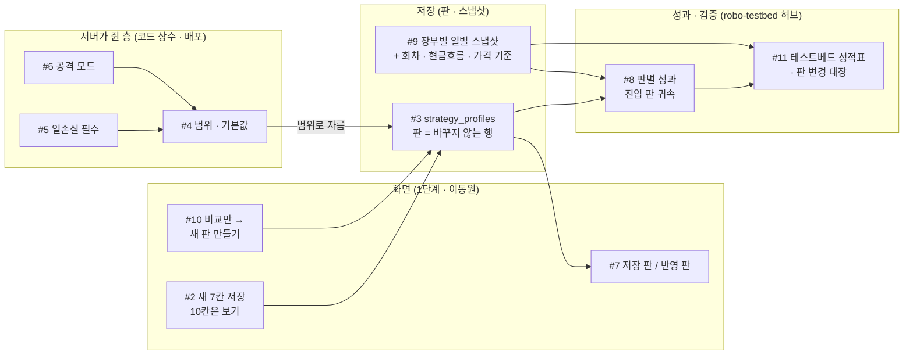
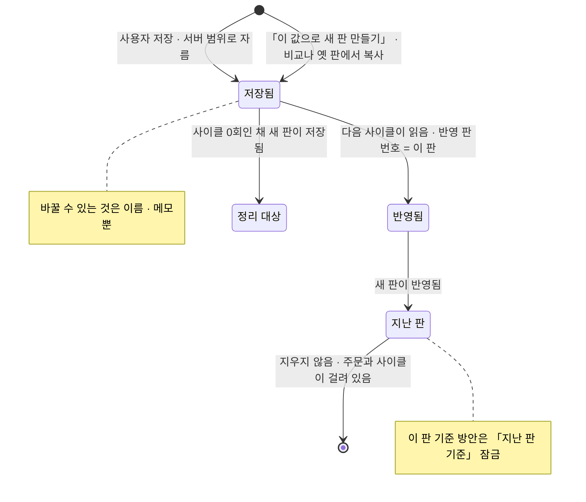
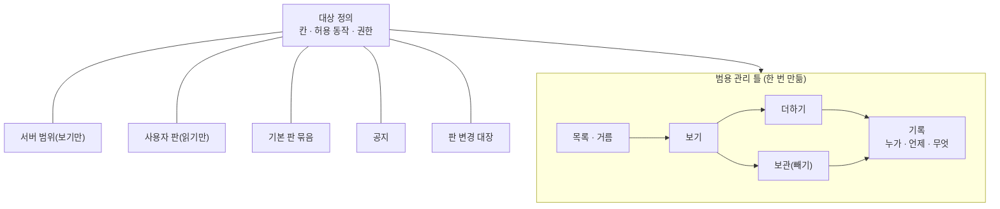

<!-- 진행: 15:44 · 끝 — ① ~ ⑧ 모두 · 표 칸 수 대조 0 · mermaid 이름 ASCII 로 · 검토 차례 -->

# 전략설정 잠정 결정 #2 ~ #12 검증 — 실제 서비스 · 오픈소스 · 규정 원문과 견줌 (2026-10-22)

| 문서 정보 | |
|---|---|
| 판 · 상태 | 작업 초안(검토 전) |
| 작성 | 2026-10-22(목) 15:19 ~ KST · 배경 조사(읽기만) |
| 물음 | 강사님 「전략설정 · 수익률 검증」 을 우리 앱에 받는 꼴로 잠정 결정한 #2 ~ #12 가 실제 서비스 · 다른 GitHub 프로젝트(퀀트 밖 포함) · 규정 원문에 비춰 맞는가, 더 나은 꼴이 있는가 |
| 앞선 조사 | [전략설정 · 사용자별 결과](../2026-10-22-전략설정-사용자별/결과.md) — 안 A · <표 8> · 5절 · 8절 사용자 결정. 거기서 본 사례 1 ~ 14 · 규정 R1 ~ R9 는 다시 찾지 않고 빈 곳 · 반대 근거만 찾았다 |
| 기준(우리 코드) | `main` `8739d61` 작업 트리 — 읽기만 |
| 지킨 것 | 코드 · 시험 · 다른 문서 · git 은 건드리지 않음 · github.com 은 열지 않음(공식 문서 사이트 · 검색 결과로 확인) · 웹 조사는 한 건씩 |
| 확실도 | 🟢 원문 확인 · 🟡 읽은 것 + 추론 · 🔴 반대 근거(잠정 결정과 어긋나는 사실) |

---

## ① 한눈에

**요약 다섯 줄**

1. **잠정 결정 열하나 중 바꿀 것은 없다.** 반대 근거(🔴)는 넷 나왔지만(Unleash 「배포 없이 승인 끼워 바꾸기」 · Grafana 「판 20개만 보관」 · 실제 자문형 서비스의 「제안 → 동의 → 반영」 · Directus 「관리자는 제한 불가」) 모두 우리 조건(작은 팀 · 무등록 · 실거래 차단 · 판 = 성과 열쇠)에서는 받지 않을 까닭이 원문으로 선다.
2. **#10 은 「비교만」 으로 정해도 된다** — 계좌마다 계산한 「권장 방안」 은 금융위가 요건 여섯 + 테스트베드를 걸어 둔 자동 투자조언 장치의 일이고(S5), 공식 테스트베드도 「자문 품질을 보장하지 않습니다」 를 단다(S4). 적용은 사용자가 「이 값으로 새 판 만들기」 를 누르는 꼴(Binance · OctoBot · Renovate 기본값).
3. **#9 는 확정 추천** — GIPS 2020 은 「큰 현금흐름 날」 평가와 그 날을 경계로 끊은 수익률을 요구한다(S17). 장부별 일별 스냅샷에 **회차 · 현금흐름 · 가격 기준** 칸을 더하면 기준을 넘는다.
4. **새로 찾은 결함 후보 하나** — 「증권사 API 설정」 을 키를 다시 치지 않고 저장하면 저장된 키가 가린 값(`PSus****`) · 빈 값으로 덮인다(코드 + 함수 실행으로 확인 · 브라우저 재현은 안 함 — 4.4). 결정 #2 가 사용자를 그 화면으로 보내므로 오준영 님께 먼저 여쭌다.
5. **#11 테스트베드 부각은 근거가 충분** — 공식 심사는 「계좌별 6개월 운용 · 5자산 이상 분산 · 일일 점검」, 재심사는 「리밸런싱 실행 기준 변경」(S1 · S2). 우리 판 · 판별 성과가 바로 그 꼴이라 `robo-testbed` 를 판별 성적표 · 자체 점검표 · 판 변경 대장의 허브로 키운다(⑤).

**<표 1> 결정마다 추천**

| # | 잠정 결정 | 추천 | 확실도 | 한 줄 까닭 · 더할 것 |
|:-:|---|:-:|:-:|---|
| 2 | 새 7칸만 저장 · 10칸 보기 + 단추 · 화면 자리는 Figma 뒤 | **유지 + 더함** | 🟢 | 저장 라우트가 행 전체를 덮어 두 화면이 나눠 쓰면 서로 지움(4.4) · 옮길 화면 10 중 「화면만」 7 · 「백엔드」 2 · 「옮기지 않음」 1(④) |
| 3 | `strategy_profiles` · 판 = 행 · 바꾸지 않음 | **유지 + 더함** | 🟢 | 되돌리기 = 옛 판 복사한 새 판(Grafana) · 메모만 고침 · 상한 대신 「사이클 0회 판만 정리」 |
| 4 | 서버 범위 · 기본값 = 코드 상수 · 배포로만 | **유지 + 더함** | 🟢 · 🔴 대안 | 바꾸면 재심사감인 변경(S2)이라 PR 이 맞음 · 「기본값보다 공격적」 띠(Betterment 소프트 범위 꼴 · 「권장」 낱말 없이) |
| 5 | 일손실만 끌 수 없게 · 나머지 0 = 제한 없음 | **유지 + 더함** | 🟢 | freqtrade 도 손절만 필수 · 무제한은 −1 로 따로 → 우리도 「제한 없음」 을 0 이 아닌 체크 칸으로 |
| 6 | 공격 모드 1단계 서버만 | **유지** | 🟢 | 레버리지 상품도 교육 · 예탁금 확인 뒤에만 열림(S19) · 2단계 조건 셋 |
| 7 | 다음 사이클 · 저장 · 첫 적용 시각 · 10분에 한 번 | **유지 + 더함** | 🟢 | 「저장한 판 / 반영된 판」 두 번호(K8s `observedGeneration`) · 10분 = 판마다 한 사이클 보장 |
| 8 | 1단계 시간 구간 → 2단계 주문에 판 번호 | **유지 + 더함** | 🟢 · 🔴 강사님과 다름 | 진입 판 · 청산 판 둘 다 · 왕복 손익은 진입 판(Gainium · freqtrade) · 모든 판 같은 기간(금소법 22조) · 시험 횟수 = 판 수(DSR) |
| 9 | 장부별 일별 스냅샷(잠정) | **확정 추천 + 더함** | 🟢 | GIPS 2.A.23 · 2.A.24 · 2.A.21 → 회차 · 현금흐름 · 가격 기준 · 평가 시각 칸 · 빈 날은 「기록 없음」 |
| 10 | 미정(추천 「비교만」) | **「비교만」 으로 정함 추천** | 🟢 · 🔴 자문형 사례 | 단추는 「이 값으로 새 판 만들기」 하나 · 지난 판 기준 방안은 잠금(Unleash) · 「이 구간 결과 · 보장 아님」 |
| 11 | 서버 범위 · 전체 정지 · 남의 판 읽기만 + 범용 관리 · 테스트베드 부각 | **유지 + 더함** | 🟢 · 🔴 범용 관례 | 범용 틀 = 동작 다섯 + 기록(Directus · Django) · 테스트베드 허브(⑤) · 모두 새 라우트라 3차 |
| 12 | 사람마다 한 건씩 | **유지 + 더함** | 🟢 | 차례 오준영 → 강민석 → 신장환 · 10분 간격 · 물음 목록 ⑥ |

**<그림 1> 잠정 결정이 어디에 닿나**



---

## ② 결정마다 근거

- 조회일은 모두 **2026-10-22(KST)**. 출처 번호 S1 ~ S24 의 전체 주소는 ⑧, 「사례 n」 · 「R n」 은 앞선 결과 2절.
- 「방향」 칸: ➕ 잠정 결정을 받침 · ➖ 반대 근거(🔴) · ➕➕ 받치면서 더할 것을 줌.
- 우리 코드 줄 번호는 `main` `4bed63b` 기준(읽기만).

### 2.1 #2 — 1단계 화면은 새 7칸만 저장 · 이미 있는 10칸은 보기 + 「증권사 API 설정」 단추

| 출처 | 인용(한두 줄) | 우리에게 닿는 점 | 방향 |
|---|---|---|:-:|
| 우리 코드 `app/routes/stocks.py:675-736` · `public/js/settings.js:212-243` | 저장 한 번이 키 · 전략 · 위험 한도를 한 행에 통째로 덮음 · 읽기는 가린 키만 줌(`:520`) | 같은 라우트를 두 화면이 나눠 쓰면 서로의 칸을 지운다 → 새 7칸은 **다른 저장 자리**가 맞다(4.4 의 키 덮어쓰기도 같은 뿌리) | ➕➕ |
| [S11 Directus 접근 권한](https://directus.com/docs/guides/auth/access-control) | 「a different set of fields can be provided to each action」 | 한 화면 안에서 「이 칸은 읽기만 · 저 칸은 저장」 은 흔한 꼴 — 보기 10칸 + 저장 7칸이 그대로 그 꼴 | ➕ |
| 앞 조사 <표 8-2> | 같은 칸(일손실 · 비중 · 주문 수)의 범위가 두 화면에서 다름 | 검증 함수는 하나여야 한다 — 이미 있는 10칸을 이 화면에서 저장하지 않는 까닭 | ➕ |

**판정: 유지 🟢 · 더함 두 가지** — ① 4.4 키 덮어쓰기를 오준영 님이 먼저 확인(결정 #2 가 사용자를 그 화면으로 보내므로) ② 보기 10칸마다 「어디서 고치나」(→ 증권사 API 설정 › 위험관리) 한 줄. 화면 자리 옮기기는 ④ 표대로 Figma 뒤.

### 2.2 #3 — 새 표 `strategy_profiles`(판 = 행 · 바꾸지 않음)

| 출처 | 인용 | 우리에게 닿는 점 | 방향 |
|---|---|---|:-:|
| [S9 Grafana 판 이력](https://grafana.com/docs/grafana/latest/dashboards/build-dashboards/manage-version-history/) | 「After you restore a previous version, a new version of the dashboard is created containing the same exact data … but with a different version number.」 | **되돌리기 = 옛 판을 복사한 새 판**(옛 판은 그대로) — 「판은 바꾸지 않음」 과 맞물림 | ➕➕ |
| 같은 곳 | 「Grafana saves 20 versions by default.」 | 판을 세는 상한은 흔하다 — 다만 우리 판은 성과 귀속의 열쇠라 **주문 · 사이클이 걸린 판은 지우면 안 됨**(강사님 상한 40 과 다름) | ➖ 🔴(상한) |
| [S8 Flagsmith 판](https://docs.flagsmith.com/managing-flags/feature-versioning) | 「You can browse past versions, schedule future ones, and roll back to an earlier version.」 | 판 목록 · 예약 · 되돌리기가 한 묶음 — 판 표에 `live_from`(적용 시작) 칸을 두면 #7 과 이어짐 | ➕ |
| [S2 테스트베드 재심사](https://www.ratestbed.kr:7443/portal/main/contents.do?menuNo=200240) | 재심사 범위: 「리밸런싱 실행 기준 변경 : 실행 주기, 실행 시점, 실행 횟수, 실행 조건 등」 | 매매 규칙을 바꾸면 **다른 알고리즘으로 다시 본다**는 것이 공식 기준 — 판 = 바꾸지 않는 행이 그 꼴 | ➕ |
| [S7 OctoBot(제3자 안내)](https://railway.com/deploy/octobot.md) | 프로필 = 「a strategy as one switchable unit: trading mode, evaluators, pairs, exchanges, risk, starting portfolio」 | 판 = 「바꿔 낄 수 있는 한 묶음」 — 우리 판도 17칸 사본을 통째로 | ➕ |

**판정: 유지 🟢 · 더함** — ① 되돌리기는 「이 판으로 새 판 만들기」(Grafana 꼴) ② 고칠 수 있는 칸은 메모 · 이름뿐 ③ 상한 대신 「사이클이 한 번도 안 돈 판만 정리 대상」.

### 2.3 #4 — 서버 범위 · 기본값은 코드 상수(좁은 쪽 · 배포로만 · 화면에 범위)

| 출처 | 인용 | 우리에게 닿는 점 | 방향 |
|---|---|---|:-:|
| [S2 테스트베드 재심사](https://www.ratestbed.kr:7443/portal/main/contents.do?menuNo=200240) · R6 | 실행 기준 변경 = 재심사 · 「알고리즘의 중대한 변경 … 미리 고지」 | 서버 범위를 바꾸는 일은 검토를 거쳐야 할 변경 — **PR 이 검토 · 기록 · 고지 자리** | ➕ |
| [S6 freqtrade 설정](https://www.freqtrade.io/en/stable/configuration/) | 「Configuration files are used in sequence (the last file wins) and override Strategy configurations」 | 층마다 누가 이기는지를 문서로 박아 둔다 — 우리 층: 코드 상수(범위) > 사용자 판 | ➕ |
| [S10 Unleash 변경 요청](https://docs.getunleash.io/reference/change-requests) | 「require an additional approval step before any changes can be made in an environment」 | 반대쪽 꼴: **배포 없이 화면에서 바꾸되 승인을 끼운다** — 운영자가 자주 바꾸는 값이면 이 꼴이 낫다. 우리 범위는 자주 안 바뀌고 팀이 작아 PR 로 충분 | ➖ 🔴(대안) |
| [S21 Betterment](https://www.betterment.com/resources/stock-allocation-advice/) | 「If you choose to deviate from our risk guidance, we'll provide you with feedback on the potential implications.」 | 넘을 수 없는 범위(하드) 말고 **넘으면 알려 주는 범위**(소프트)도 있다 — 우리는 「권장」 낱말 없이 「기본값보다 공격적」 표시만 빌림 | ➕➕ |

**판정: 유지 🟢 · 더함** — 화면 칸 옆에 「서버 범위 a ~ b · 기본값 c」 + 기본값보다 위험한 쪽이면 「기본값보다 공격적」 띠(막지는 않음). config 키 0 개는 그대로.

### 2.4 #5 — 일손실 한도만 끌 수 없게(0.5 ~ 20%) · 나머지 0 = 제한 없음

| 출처 | 인용 | 우리에게 닿는 점 | 방향 |
|---|---|---|:-:|
| [S6 freqtrade 설정](https://www.freqtrade.io/en/stable/configuration/) | `stoploss` 「Required.」 · `max_open_trades` −1 이면 「it is ignored (i.e. potentially unlimited open trades …)」 | 손실 칸 하나는 **필수**, 나머지는 「무제한」 허용 — 우리 결정과 같은 꼴. 다만 무제한을 **0 이 아니라 −1(따로 표시)** 로 둠 | ➕➕ |
| 사례 9 IBKR · 사례 14 Pine | IBKR 은 0 으로 끔 허용(사람이 확인 창을 봄) · Pine 위험 한도는 끌 수 없음 | 사람이 보지 않는 자동매매에는 끌 수 없는 층이 하나는 있어야 | ➕ |
| 우리 코드 `app/routes/stocks.py:470-473` · `public/app.html:800` | 「0이면 비활성」 · 「0을 입력하면 해당 규칙을 사용하지 않습니다」 | 「하루 최대 주문 수 0」 은 「0건만 허용」 으로도 읽힌다 — 낱말 하나로 반대 뜻 | ➖ 🔴(표시) |

**판정: 유지 🟢 · 더함** — 「제한 없음」 은 숫자 0 이 아니라 **체크 칸**(또는 빈 값)으로 보이게. 이미 일손실 0 으로 저장된 행을 어떻게 올릴지(기본 3% · 알림)는 오준영 님 몫(⑥).

### 2.5 #6 — 공격 모드 1단계 서버만

| 출처 | 인용 | 우리에게 닿는 점 | 방향 |
|---|---|---|:-:|
| [S19 뉴스1(금융위 보완방안 보도)](https://v.daum.net/v/20260716163952724) | 단일종목 레버리지 기본예탁금 「1000만 원에서 3000만 원으로 오른다」 · 사전교육 「현행 2시간에서 총 3시간」 | 고위험 모드는 실제 시장에서도 **자격(교육 · 예탁금)을 확인한 뒤에만** 열림 | ➕ |
| 사례 8 Alpaca | 옵션 단계는 「always be the same or lower than the options approved level」 | 사용자는 승인된 수준 **아래로만** 고름 | ➕ |
| [S22 아이뉴스24(핀트 통계)](https://www.inews24.com/view/1437704) | 성향을 바꾼 고객 중 「성장투자형에서 공격투자형으로 변경한 사례는 약 33%」 | 사용자는 시간이 갈수록 더 공격 쪽으로 옮긴다 — 문턱은 서버가 쥐는 편이 맞다 | ➕ |

**판정: 유지 🟢** — 2단계에 사용자 켜기를 연다면 「모의 N일 운용 · 위험 고지 확인 · 서버 허용」 세 조건(레버리지 사전교육 꼴).

### 2.6 #7 — 다음 사이클부터(≤ 600초) · 저장 · 첫 적용 시각 · 판 바꾸기 10분에 한 번

| 출처 | 인용 | 우리에게 닿는 점 | 방향 |
|---|---|---|:-:|
| [S15 Kubernetes Deployment](https://v1-31.docs.kubernetes.io/docs/reference/kubernetes-api/workload-resources/deployment-v1) | `observedGeneration`: 「The generation observed by the deployment controller.」 | **「저장한 판 번호」 와 「사이클이 마지막으로 읽은 판 번호」 를 따로** 두면 「저장됨 · 아직 반영 전」 이 화면에 드러남(강사님 판의 조용한 실패를 막음) | ➕➕ |
| [S8 Flagsmith](https://docs.flagsmith.com/managing-flags/feature-versioning) · [S10 Unleash](https://docs.getunleash.io/reference/change-requests) | 「deliver their webhooks at the scheduled `live_from`, not at change-request commit time」 · 「you can schedule it to be applied later」 | 저장 시각 ≠ 적용 시각이 기본 — 「첫 적용 시각」 칸이 바로 그것 | ➕ |
| [S20 Gainium](https://gainium.io/help/dca-bot-set-up-walkthrough) | 「the new settings will only be applied to future deals (existing deals are unaffected)」 | 「다음 사이클부터」 와 같은 결 — 다만 **이미 연 포지션**에 어느 판 규칙을 쓰는지는 정해야(⑥ 오준영 6) | ➕ |
| 사례 11 Binance · 주기 600초(`app/config.py:144`) | 「you will not be able to modify them again within 10 minutes」 | 10분 = 한 주기 → **판마다 사이클이 적어도 한 번 돈다**(빈 판이 성과 표를 어지럽히지 않음) — 이 까닭을 화면에 적음 | ➕ |

**판정: 유지 🟢 · 더함** — 화면 두 번호(저장 판 · 반영 판)와 「다음 사이클 예정 HH:MM」.

### 2.7 #8 — 성과 귀속: 1단계 시간 구간 → 2단계 주문에 판 번호

| 출처 | 인용 | 우리에게 닿는 점 | 방향 |
|---|---|---|:-:|
| 사례 12 freqtrade · 사례 13 MT5 | `enter_tag` 로 「profit summaries grouped by enter_tag」 · 주문 `magic` = 「Expert Advisor ID」 | 꼬리표는 **진입 때** 붙는다 | ➕ |
| [S20 Gainium](https://gainium.io/help/dca-bot-set-up-walkthrough) | 기존 거래는 옛 설정 그대로 | 한 번의 매수 → 매도 왕복은 **진입한 판의 것**으로 보는 꼴 | ➕➕ |
| 강사님 `strategy_settings.py:379-421`(앞 조사) | 매도 시각의 판에 귀속 | 진입 판과 다를 수 있음 — 판을 자주 바꾸면 남의 판 손익을 떠안음 | ➖ 🔴 |
| [S18 금소법 제22조(사본)](https://ko.wikisource.org/wiki/%EA%B8%88%EC%9C%B5%EC%86%8C%EB%B9%84%EC%9E%90_%EB%B3%B4%ED%98%B8%EC%97%90_%EA%B4%80%ED%95%9C_%EB%B2%95%EB%A5%A0) | 금지: 「수익률이나 운용실적이 좋은 기간의 수익률이나 운용실적만을 표시하는 행위」 | 판별 성과 표는 **모든 판 · 같은 기간 칸**으로(좋은 판만 골라 보이지 않기) | ➕➕ |
| [S23 Deflated Sharpe Ratio](https://papers.ssrn.com/abstract=2460551) · 우리 `performance_service.py:56` | 다중 시험의 선택 편향을 바로잡음 · 우리 코드는 시험 횟수 `n_trials = 50` 고정 | 판을 많이 바꿔 볼수록 우연히 좋은 판이 나옴 — **시험 횟수 = 그 사용자의 판 수**로 | ➕➕ |

**판정: 유지 🟢 · 더함** — 2단계 주문 칸은 **진입 판 · 청산 판 둘 다**, 왕복 손익 기본 귀속 = 진입 판(강사님 「매도 시각의 판」 과 다름을 판 표 머리에 적음) · 판 비교 표는 모든 판 + 시험한 판 수.

### 2.8 #9 — 수익률 검증 원천 = 장부별 일별 스냅샷

| 출처 | 인용 | 우리에게 닿는 점 | 방향 |
|---|---|---|:-:|
| [S17 GIPS 2020](https://www.gipsstandards.org/wp-content/uploads/2021/03/2020_gips_standards_firms.pdf) 2.A.23 · 2.A.24 | 포트폴리오는 「At least monthly」 · 「On the date of all large cash flows」 평가 · 일별이 아니면 「Calculate sub-period returns at the time of all large cash flows」 | 일별 스냅샷은 기준보다 촘촘함(충분) — 대신 **현금흐름 · 초기화 날을 경계로** 수익률을 끊어야. 우리 모의 스냅샷의 회차(`paper_snapshot.py:44-47` · 리셋 날 수익률 0)가 그 꼴 → 새 표에도 회차 칸 | ➕➕ |
| 같은 문서 2.A.21 | 마지막 가격 · 잠정 값을 쓰면 「Assess the difference between the approximation and final value」 | 스냅샷마다 **가격 기준**(지연 현재가 · 종가 · 증권사 잔고 평가) 칸 — 강민석 님 #242 답의 「마지막 일봉 종가」 와 코드(지연 현재가) 어긋남을 드러냄 | ➕➕ |
| [S16 Alpaca 포트폴리오 이력](https://docs.alpaca.markets/reference/getaccountportfoliohistory-1) | 「Returns timeseries data about equity and profit/loss (P/L) of the account」 · `base_value` 「Basis in dollar of the profit loss calculation.」 | 증권사도 **계좌마다** 평가액 시계열 + 기준값을 줌 — 장부 · 계좌 칸이 맞다 | ➕ |
| [S1 테스트베드 심사](https://www.ratestbed.kr:7443/portal/main/contents.do?menuNo=200080) · [S3 공시](https://www.ratestbed.kr:7443/portal/pblntf/viewAlgrthInfo.do?menuNo=200233) | 「3가지 유형별 포트폴리오를 각각 3개의 계좌에서 동시에 운용」 · 「일일 거래내역정보를 바탕으로 … 일일 점검」 · 공시 = 기준가 · 기간별 수익률 | 공식 검증도 계좌별 · 일별 | ➕ |

**판정: 잠정 → 확정 추천 🟢 · 더함** — 새 표 칸에 `epoch`(회차) · `external_flow`(넣고 뺀 돈 · 초기화) · `price_basis`(가격 기준) · `as_of`(평가 시각). 빈 날은 메우지 않고 「기록 없음」 으로 보임. 유일 키 = 사용자 · 장부 · 계좌 · 날짜.

### 2.9 #10 — 방안 승인(수익률 증대 방안)

| 출처 | 인용 | 우리에게 닿는 점 | 방향 |
|---|---|---|:-:|
| [S5 금융위 입법예고(2016)](https://www.fsc.go.kr/no010101/72210) | 로보어드바이저 요건: 「전자적 투자조언장치가 직접 투자자 성향 분석 실시」 … 「로보어드바이저 테스트베드를 거칠 것」 | 계좌마다 계산해 「이렇게 바꾸라」 를 내는 기능은 **자동 투자조언 장치**의 일 — 등록 · 테스트베드 없이 「권장」 으로 내면 안 됨 | ➕ |
| [S4 테스트베드 사후 운용](https://www.ratestbed.kr:7443/portal/pblntf/viewAlgrthInfoComop.do?menuNo=200235) | 「운용에 참가한 RA 알고리즘의 자문 품질을 보장하지 않습니다.」 | 공식 기관도 「보장 아님」 을 화면에 둠 — 방안 칸에 같은 꼴 문구 | ➕ |
| [S18 금소법 제22조(사본)](https://ko.wikisource.org/wiki/%EA%B8%88%EC%9C%B5%EC%86%8C%EB%B9%84%EC%9E%90_%EB%B3%B4%ED%98%B8%EC%97%90_%EA%B4%80%ED%95%9C_%EB%B2%95%EB%A5%A0) | 「과거 운용실적을 포함하여 광고하는 경우에는 그 운용실적이 미래의 수익률을 보장하는 것이 아니라는 사항」 | 「기대 효과」 칸 → 「이 구간에서는 이랬음 · 미래 수익 보장 아님」 | ➕➕ |
| [S24 Renovate](https://docs.renovatebot.com/configuration-options/) | `automerge` 「Whether to automerge branches/PRs automatically, without human intervention.」 기본 `false` | 퀀트 밖 대표 오픈소스도 **자동 제안은 사람이 합치는 것이 기본** — 「자동 적용」 안을 버릴 근거 | ➕ |
| [S10 Unleash](https://docs.getunleash.io/reference/change-requests) | 예약한 변경은 그 사이 대상이 바뀌면 「suspends a scheduled change request」 | 방안이 만들어진 뒤 판이 바뀌면 **「지난 판 기준」 표시 + 새 판 만들기 단추를 끔** | ➕➕ |
| 사례 11 Binance · [S7 OctoBot](https://railway.com/deploy/octobot.md) | AI 값을 「Copy Parameters to Manual Settings」 · 「Use this profile … converts it into an editable copy」 | 적용 = **사용자가 복사해 자기 판으로 저장**(R3 「고객이 직접 조건을 지정」 꼴) | ➕ |
| 사례 7 파운트 · 사례 5 콴텍 | 「리밸런싱에 동의하면 약 2일 후 … 반영」 · 교체 때 「고객의 사전 동의」 | 실제 자문 · 일임 서비스는 **「제안 → 동의 → 반영」 을 한다** — 다만 등록 업자 · 테스트베드 통과 뒤의 일 | ➖ 🔴 |

**판정: 정함 추천 = 「비교만」 유지 🟢** — 화면 단추는 「이 값으로 새 판 만들기」(사용자 행동 · 다음 사이클부터 · 판 기록 출처 = 「비교에서 복사」) 하나. 「권장」 「수익률 증대」 낱말 없음 · 기대 효과 → 「이 구간 결과」 + 보장 아님 · 지난 판 기준이면 잠금. 「제안 → 동의 → 자동 반영」 은 반대 근거가 있지만 등록 · 심사를 전제로 해 우리에게 맞지 않음.

### 2.10 #11 — 관리자 = 서버 범위 · 전체 비상 정지 · 다른 사용자 판 읽기만

| 출처 | 인용 | 우리에게 닿는 점 | 방향 |
|---|---|---|:-:|
| [S11 Directus](https://directus.com/docs/guides/auth/access-control) | 관리자 역할은 「This cannot be limited, as by definition it would no longer be an administrator role.」 | 범용 도구는 관리자에게 **전부** 연다 — 우리는 일부러 좁힘(남의 판 쓰기 금지). 근거는 금융 쪽(R1 일임 · R3) | ➖ 🔴(범용 관례) |
| [S13 Django admin](https://docs.djangoproject.com/en/stable/ref/contrib/admin/) | `has_view_permission` 기본 = 「"change" or "view" permission」 | **읽기만 권한**은 범용 관리 화면의 표준 칸 — 「남의 판 읽기만」 을 그대로 표현 | ➕ |
| [S11 Directus](https://directus.com/docs/guides/auth/access-control) · [S14 Django LogEntry](https://docs.djangoproject.com/en/5.0/_modules/django/contrib/admin/models/) | 동작 「create, read, update, delete, and share」 · 더함 · 바꿈 · 지움 기록 | 「더하기 · 빼기」 범용 관리 = **동작 다섯 + 기록** 한 틀 | ➕➕ |
| 사례 1 키움 | 「당사는 전체 감시조건을 중지 시킬 수 있습니다」 | 전체 비상 정지는 운영자 권한으로 흔함 | ➕ |
| 우리 코드 `app/routes/admin.py:29` · `:41` | 관리자 라우트는 `/stats` · `/audit-log` 둘 | 범용 관리 · 남의 판 보기 · 전체 정지는 모두 **새 라우트**(1단계 밖 · 3차) | — |

**판정: 유지 🟢 · 더함** — ⑤ 의 범용 관리 틀 · 테스트베드 허브.

### 2.11 #12 — 사람마다 그 사람 글에 한 건씩(#242 · #243 · #244)

| 근거 | 내용 | 닿는 점 |
|---|---|---|
| 팀 규칙(GitHub 쓰기) | 한 번에 한 건 · 건 사이 10분 | 세 건이면 30분 안팎 |
| 오준영 님 가용 시간(앞 조사) | 10-23(금) 협의 어려움 · 답은 빨라야 10-26(월) | 오준영 님 답이 강민석 님(판 표) · 신장환 님(임계값) 물음의 앞 조건 |
| 강민석 님 #242 답(10-20) | 「설정별 성과 … 3차 전략 판 관리와 묶음」 · 방안 꼴은 「3차 방안 화면 설계 때 정합니다」 | 강민석 님 글의 물음 일부는 「#244 답 뒤」 로 표시 |
| 신장환 님 #243 답(10-19) | 3차 인디케이터(10-22 ~) 때 확인 · 성과 숫자는 「@rkdalstjr 님과도 함께」 | 임계값 물음은 3차 인디케이터 시작과 같은 때 |

**판정: 유지 🟢 · 더함** — 올리는 차례 **오준영(#244) → 강민석(#242) → 신장환(#243)** · 각 글 첫 줄에 「같은 조사 · 세 분께 나눠 여쭘」 과 다른 두 글 번호.

---

## ③ 새 아이디어

무게: 소 = 한 파일 · 수십 줄 / 중 = 칸 · 마이그레이션 또는 계산 함수 / 대 = 새 화면 + 새 라우트 여럿. 「누구」 는 확정 역할 기준(화면 개선은 이동원 · 팀원 영역의 서버 · 계산 · 저장은 그 주담당이 정함 — 이 표는 제안).

**<표 3-1> 빌릴 것 열넷**

| # | 무엇 | 어디서 빌림 | 닿는 결정 | 무게 | 누구 · 언제 |
|:-:|---|---|:-:|:-:|---|
| A1 | **저장한 판 / 반영된 판 두 번호** — 「판 7 저장됨 · 사이클은 아직 판 6(다음 사이클 15:50)」 | Kubernetes `generation` · `observedGeneration`(S15) | #7 | 소 | 화면 이동원(1단계 — 1단계는 「반영 전」 고정 띠) · 사이클이 읽은 판 번호 기록은 오준영(2단계) |
| A2 | **되돌리기 = 옛 판을 복사한 새 판** · 고칠 수 있는 것은 이름 · 메모뿐 | Grafana 판 이력(S9) | #3 | 소 | 이동원 1단계 |
| A3 | **「이 값으로 새 판 만들기」** — 비교 · 기본 판에서 값을 복사해 내 판으로(판 출처 = 「비교에서 복사」) | Binance 「Copy Parameters to Manual Settings」(사례 11) · OctoBot 「Use this profile」(S7) | #10 | 소 | 이동원 1단계(단추) · 방안 계산은 강민석 3차 |
| A4 | **지난 판 기준 방안 잠금** — 방안을 만든 판 번호를 기억 · 그 뒤 판이 바뀌면 「지난 판 기준」 회색 + 복사 단추 끔 | Unleash 변경 요청 「suspends」(S10) | #10 | 소 | 강민석 3차(방안) · 화면 이동원 |
| A5 | **진입 판 · 청산 판 둘 다 기록** · 왕복 손익 기본 귀속 = 진입 판 | freqtrade `enter_tag`(사례 12) · Gainium 「existing deals are unaffected」(S20) | #8 | 중 | 오준영 2단계(주문 칸) · 강민석(귀속 규칙) |
| A6 | **판 비교 표는 모든 판 · 같은 기간 칸 · 「시험한 판 수」** · 샤프는 DSR 로(시험 횟수 = 판 수 · 지금 코드는 50 고정 `performance_service.py:56`) | 금소법 제22조 ④(S18) · Deflated Sharpe Ratio(S23) | #8 · #10 | 중 | 강민석(계산) · 신장환(함께 보겠다고 답함) · 화면 이동원 |
| A7 | **스냅샷 칸 넷** — `epoch`(회차) · `external_flow`(넣고 뺀 돈 · 초기화) · `price_basis`(가격 기준) · `as_of`(평가 시각) · 빈 날은 「기록 없음」 | GIPS 2.A.21 · 2.A.23 · 2.A.24(S17) · Alpaca `base_value`(S16) | #9 | 중 | 1단계 마이그레이션에 칸만(이동원) · 계산 · 15:40 기록은 강민석 3차 |
| A8 | **「제한 없음」 체크 칸** — 숫자 0 의 두 뜻(「0건만」 · 「끔」)을 없앰 | freqtrade `max_open_trades` −1(S6) | #5 | 소 | 오준영(10/29 ② 위험관리 묶음) · 화면 이동원 |
| A9 | **「기본값보다 공격적」 띠** — 하드 범위 안이지만 기본값보다 위험한 쪽이면 알림만(「권장」 낱말 없음) | Betterment 소프트 범위(S21) | #4 | 소 | 이동원 화면 |
| A10 | **공격 모드 2단계 자격 셋** — 모의 N일 운용 · 위험 고지 확인 · 서버 허용 | 레버리지 상품 사전교육 · 예탁금(S19) · Alpaca 옵션 승인 단계(사례 8) | #6 | 중 | 오준영(2단계 이후 · 열지 않을 수도) |
| A11 | **테스트베드 허브** — `robo-testbed` 에 탭 넷(테스트베드 성적표 · 판별 성과 · 수익률 검증 · 자체 점검표) + 「보장 아님」 문구 | 코스콤 테스트베드 심사 · 공시(S1 ~ S4) | #9 · #11 | 중 | 강민석(지표 · 계산) · 이동원(화면) — ⑤ |
| A12 | **범용 관리 틀** — 목록 · 거름 · 보기 · 더하기 · 보관 · 기록을 한 틀로, 대상만 바꿔 씀 | Directus 동작 다섯 · 항목 규칙(S11) · Django 보기 권한 · LogEntry(S13 · S14) | #11 | 대 | 3차 (마) 관리자 화면 — 이동원 「3차 내 몫 뒤」 차례 |
| A13 | **판 변경 대장** — 서버 기본값 · 범위를 바꾼 PR 마다 「재심사 요건 해당?」 자가 점검 한 줄 + 사용자 공지 | 테스트베드 재심사(S2 — 「알고리즘 변경여부를 자가 평가」) · 표준투자권유준칙 R6 | #4 · #11 | 소 | 팀장 · 문서(코드 없음) |
| A14 | **가린 키 덮어쓰기 막기** — 서버: 가린 값(`****` 로 끝남) · 빈 값이면 기존 값 유지 / 화면: 키 칸은 「바꾸기」 를 눌렀을 때만 보냄 | 4.4(우리 코드) | #2 | 소 | 오준영(확인 · 결정) |

**<그림 3-1> 판 한 장의 일생(A1 · A2 · A3 · A4 를 합친 꼴)**



**<그림 3-2> 「제한 없음」 표시 — 지금과 제안**

```text
 지금                                   제안(A8)
 ┌──────────────────────────────┐       ┌──────────────────────────────────────┐
 │ 하루 최대 주문 수  [  0  ]    │       │ 하루 최대 주문 수  [ 20 ] ☐ 제한 없음   │
 │ 0을 입력하면 해당 규칙을       │  ──▶  │ 서버 범위 1 ~ 500 · 기본 20            │
 │ 사용하지 않습니다              │       │ (제한 없음을 고르면 숫자 칸이 잠김)     │
 └──────────────────────────────┘       ├──────────────────────────────────────┤
  「0건만 허용」 으로도 읽힘              │ 일손실 한도(%)  [ 3 ]  ← 체크 칸 없음  │
                                        │ 서버 범위 0.5 ~ 20 · 끌 수 없음         │
                                        └──────────────────────────────────────┘
```

---

## ④ #2 덧붙임 — 마이페이지 등으로 옮겨도 되는 화면

판정 기준(사용자 덧붙임): **화면 자리만 바꾸면 되는 것은 화면 설계(Figma) 뒤 옮긴다 · 라우트 · 권한 · 저장을 고쳐야 하면 하지 않는다.** 아래는 `public/app.html` · `public/js/*.js` · `app/routes/*.py` 를 읽고 판정했다(실행은 하지 않음).

### 4.1 화면을 옮길 때 실제로 바뀌는 곳

```text
 메뉴 자리 바꾸기 = 프론트만
 ┌───────────────────────────────┐     ┌──────────────────────────────┐
 │ public/js/core.js GNB_MENUS   │ ──▶ │ 묶음 · 차례 (퀀트자동매매 →   │
 │  (묶음 · 항목 · 아이콘)        │     │  내 계정 등)                  │
 ├───────────────────────────────┤     ├──────────────────────────────┤
 │ 화면 키(data-view="settings")  │ ──▶ │ 그대로 둠 → 다른 화면의       │
 │  public/app.html               │     │ 「증권사 API 설정으로」 링크 유지│
 ├───────────────────────────────┤     ├──────────────────────────────┤
 │ 메뉴 시험 TC-NV-01 · 02 ·       │ ──▶ │ 묶음 차례 기대값 고침(시험 코드)│
 │  tests/e2e/gnb_widths.py       │     │                              │
 └───────────────────────────────┘     └──────────────────────────────┘
 화면을 둘로 쪼개기 · 다른 사람 값 보기 · 서버에 새로 저장 = 백엔드 필요 → 하지 않음
```

### 4.2 판정 표

**<표 4-1> 옮길 후보 — 화면만으로 되나**

| # | 화면 · 칸 | 지금 자리 | 옮길 후보 | 판정 | 근거(파일:줄) | 화면 주담당 · 비고 |
|:-:|---|---|---|---|---|---|
| 1 | `settings` 증권사 API 설정 **통째로** | 퀀트자동매매 묶음(`core.js:102`) | 내 계정 › 「연결 · 자동매매 설정」 또는 머리글 아바타 ▾ | **화면만** 🟢 | 메뉴 항목 하나(`core.js:102`) · API 는 모두 본인(`get_current_user` · `stocks.py:622-736`) · 화면 키를 그대로 두면 대시보드 등의 「증권사 API 설정으로」 링크가 그대로 산다(IA I3) | 오준영(요구 `P02-⑤-1`) · 강사님 판도 「퀀트자동매매」 자리라 다음 반영 때 메뉴 줄 한 곳만 어긋남 |
| 2 | `settings` 를 **둘로 쪼개기**(증권사 키 → 내 계정 · 전략 · 위험 → 전략설정) | 한 화면 | — | **백엔드 필요 — 하지 않음** 🔴 | 저장이 한 번에 행 전체를 바꾼다 — `POST /api/quant/settings` 가 키 · 계좌(`stocks.py:706`) · 전략 · 위험 한도(`:707-730`)를 한꺼번에 덮고, 읽기는 키를 가린 값(`abcd****`)만 주고 비밀키는 주지 않는다(`stocks.py:520` · `:648-672`). 반쪽 화면이 저장하면 다른 반쪽 칸이 빈 값으로 덮인다 → 칸별 저장 라우트가 있어야 한다 | 오준영 |
| 3 | `notification-settings` 알림 설정 | 퀀트자동매매 묶음(`core.js:103`) · IA 「✕ 보관함」 | 내 계정 › 알림 | **화면만** 🟢 | 본인 API 둘(`settings.js:290` · `:347` → `/api/notification/settings`) | 이동원(표 16 · 26) · 동결 제안과 함께 정함 |
| 4 | `paper-openapi` Open API 키 발급 · Alpaca 연결 시험 | 모의투자 묶음(`core.js:92`) | 내 계정 › 「API 키」 | **화면만** 🟢 | 본인 키 목록 · 발급 · 폐기(`paper.js:545-560` → `/api/paper/api-keys`) | 이동원(표 16 · 20) · TradingView 웹훅 안내(`core.js:312`)가 「모의투자 › Open API」 를 가리키므로 그 글도 함께 고침 |
| 5 | 투자 성향 진단 결과 **보기** 카드 | 자산배분 화면 등에서 진단 · 이 브라우저에 저장(`riskprofile.js:25-40` · `localStorage`) | 내 계정 › 「내 투자 성향」(보기 + 다시 진단 링크) | **화면만**(보기) 🟢 · **서버 저장은 백엔드** 🔴 | 지금 결과는 브라우저 저장 — 보기 카드는 같은 값을 읽기만 하면 됨. 서버에 남겨 성향별 서버 범위(R5)를 거는 일은 새 칸 · 라우트가 필요 | 오준영(자산배분) · R5 「유형 위험도를 초과하지 않는 범위」 는 서버 저장 뒤 단계 |
| 6 | 비상 정지 단추 **한 벌 더**(머리글 또는 내 계정) | 자동매매 현황(`quant.js:169-209`) · 증권사 API 설정 배지(`settings.js:38-40`) | 머리글 「내 자동매매 ● 정상 / 🛑 정지」 배지 + 단추 | **화면만** 🟢 | 본인 라우트 그대로(`POST /api/quant/risk/kill-switch` · `stocks.py:1065`) · 강사님 머리 단추(배치 전체)와 달리 **본인 것만** 멈춤 | 오준영 · #244 물음 3(「비상 정지의 자리」)과 같은 칸 |
| 7 | 모의계좌 초기화 | 모의계좌 현황(`paper.js:86` → `/api/paper/account/reset`) | 내 계정 › 「내 자료」 | 화면만 가능하지만 **옮기지 않음 추천** 🟡 | 본인 라우트 · 다만 되돌릴 수 없는 일이라 그 장부를 보는 화면 곁이 맞다(회원 탈퇴 카드와 같은 경고 꼴은 빌릴 만함) | 강민석 |
| 8 | (새) 강사님 「전략설정」 | 아직 없음(가져오기 1차) | 퀀트자동매매 묶음 「증권사 API 설정」 바로 아래 | **화면만**(새 화면 자리) 🟢 | 1단계 API 는 어차피 새로 붙임 — 자리는 메뉴 줄 하나 | 이동원(1단계) |
| 9 | (새) 강사님 「수익률 검증」 · 「설정별 성과」 | 아직 없음 | **`robo-testbed` 의 탭**(따로 메뉴 줄을 늘리지 않음) | **화면만**(1단계 API 를 붙인 뒤) 🟡 | `robo-testbed` 도 본인 성과 화면이다 — 여섯 API 가 모두 `_uid(user)`(`paper.py:468-636`) · 원천은 `paper_account_snapshots`(`performance_service.py:13-21` · `:386-400`). 같은 사람 · 같은 물음(내 운용이 어땠나)을 두 메뉴로 나누지 않음 → ⑤ 절 | 강민석(성과 · 테스트베드) · 화면 개선은 이동원 전권(팀원은 알기만) |
| 10 | 다른 사용자 판 **읽기만**(관리자) | 없음 | 시스템관리 묶음 | **백엔드 필요 — 하지 않음(1단계)** 🔴 | 관리자 라우트는 둘뿐(`admin.py:29` `/stats` · `:41` `/audit-log`) — 남의 판을 읽는 라우트 · 권한 검사가 새로 필요 | 팀장 · #11 |

### 4.3 옮기는 순서 제안

1. **지금(1단계)** — 새 화면 둘의 자리만 정한다: 전략설정은 「증권사 API 설정」 아래(8번), 수익률 검증 · 설정별 성과는 `robo-testbed` 탭(9번).
2. **Figma 뒤** — 내 계정을 「내 정보 · 연결 · 알림 · API 키 · 내 투자 성향」 다섯 칸으로 키우고 1 · 3 · 4 · 5 번을 옮긴다(모두 화면만). 6번 배지는 머리글.
3. **하지 않음** — 2번(쪼개기) · 10번(남의 판 보기)은 라우트가 필요하다. 2번은 대신 「전략설정 화면에는 이미 있는 10칸을 보기만」(결정 #2)으로 같은 효과를 낸다.

### 4.4 옮기다 찾은 것 — 「증권사 API 설정」 을 다시 저장하면 저장된 키가 가린 값으로 덮인다

결정 #2 가 「이미 있는 10칸은 「증권사 API 설정」 에서 고친다」 이므로, 사용자가 그 화면에서 위험 한도 하나만 고치고 저장하는 일이 늘어난다. 그때 아래 흐름이 생긴다. 기준 = `main` `4bed63b`(#316 머지 뒤 — #316 은 `app/` · `public/` 을 바꾸지 않아 줄 번호 그대로).

**<표 4-2> 흐름과 근거(파일:줄)**

| 단계 | 코드(파일:줄) | 일어나는 일 | 확실도 |
|---|---|---|:-:|
| 1 화면을 연다 | `app/routes/stocks.py:520` — 읽기 응답의 `app_key` = 앞 4자 + `****` · 비밀키는 응답에 없음(`:648-672`) / `public/js/settings.js:16` — 그 값을 App Key 칸에 그대로 넣음 · App Secret 칸은 채우지 않음 | App Key 칸 = `PSus****` · App Secret 칸 = 빈칸 | 🟢 코드 |
| 2 위험 한도만 고치고 저장 | `public/js/settings.js:235-237` — 서버 관리 증권사가 아니면 세 칸 값을 그대로 보냄 · 가린 값을 거르는 줄 없음(`settings.js` · `stocks.py` 에서 `****` · `endswith` · `includes` 검색 0건) | 요청 본문에 `app_key: "PSus****"` · `app_secret: ""` | 🟢 코드 |
| 3 서버가 받음 | `app/routes/stocks.py:455-458` — `app_key` · `app_secret` 은 기본값 `""` 인 문자열 칸 · 이 파일에 검증기(`validator`) 0건 | 그대로 통과 | 🟢 코드 |
| 4 서버가 행에 씀 | `app/routes/stocks.py:706` → `:490-497` `_apply_credentials` — 서버 관리 증권사면 비우고, 아니면 받은 값을 그대로 씀 · `app/services/kis_credentials.py:26` `MANAGED_BROKERS` 가 빈 집합이라 KIS 도 「아니면」 쪽 | 저장된 진짜 키 → `PSus****` · 비밀키 → 빈 값 | 🟢 함수 실행(아래) |
| 5 다음 KIS 호출 | 사용자 행의 키로 토큰을 받음(`kis_credentials.py` 머리 주석 · ADR-0004) | 토큰 발급 실패 → 원클릭 · 잔고 · 자동매매 KIS 호출이 막힘 | 🟡 추론(실행 안 함) |

**재현 — 한 것(저장소 · DB 를 건드리지 않음)**

```text
scratchpad 에서: app/routes/stocks.py 를 파이썬 구문 트리로 읽어 _apply_credentials 함수만 떼어 냄
                + is_managed 는 kis_credentials.py:26 과 같은 「빈 집합」 으로 둠
가짜 행  app_key='PSusREALKEY123' · app_secret='REALSECRET'
호출     _apply_credentials(row, 'kis', 'PSus****', '', '5012345601')   ← 2단계에서 화면이 보내는 값
결과     app_key = PSus**** | app_secret = ''                              ← 4단계 확인
```

**재현 — 안 한 것(오준영 님 또는 사용자가 확인할 방법)**

1. 개발 서버 + 점검용 계정(실제 모의 키를 넣은 계정이면 먼저 키를 따로 적어 둔다).
2. 「증권사 API 설정」 을 열어 App Key 칸에 `xxxx****` 가 보이고 App Secret 칸이 비어 있는지 본다.
3. 키 칸은 건드리지 않고 「일손실 한도」 만 3 → 4 로 바꿔 「저장 / 연결」.
4. 「연결 테스트 (현재가)」 또는 대시보드 「KIS 모의투자 시작」 — 실패하면 재현. DB 로는 `broker_settings` 의 그 사용자 행 `app_key` 가 `****` 로 끝나는지 본다.

**시험이 잡지 못하는 까닭** — 키를 새로 넣어 저장하는 시험만 있다(`tests/test_kis_quickstart_http.py:79-84` — `NEW-KEY` 를 보내 저장 확인). 화면 시험 `tests/e2e/kis_modes.js:5` 는 가린 값 `TEST****` 로 화면을 채운 뒤 「저장」 을 누르지만(`:40 · :43`), 보낸 본문의 `mode` 만 확인한다(`:41 · :45`) — 가린 키가 그대로 실려 가는 길을 지나가면서도 키 칸은 보지 않는다.

- **확실도**: 1 ~ 4단계 🟢(코드 + 함수 실행) · 5단계와 「실제 사용자에게 일어난다」 는 🟡(브라우저 · DB 로 재현하지 않음 · 사용자가 저장 때마다 키를 다시 쳐 넣고 있다면 드러나지 않는다).
- 오준영 님 영역(`settings` · `stocks.py`)이라 고치지 않는다 → ⑥ 오준영 님 물음 1번. 흔한 꼴은 「가린 값 · 빈 값이 오면 기존 값을 둔다」(서버 한 줄) 또는 「키 칸은 바꿀 때만 따로 저장」(화면)이다.
- 결정 #2 에는 오히려 힘을 싣는다 — 새 전략설정 화면이 이 라우트를 같이 쓰면 같은 일이 생기므로 **새 7칸은 따로 저장**하는 것이 맞다.

---

## ⑤ #11 범용 관리 · 테스트베드 부각 안

### 5.1 지금 `robo-testbed` 와 공식 테스트베드 견주기

공식 기준은 S1 ~ S4(코스콤 테스트베드센터), 우리 쪽은 `public/app.html:1877-1956` · `public/js/robo.js:1073-1438` · `app/routes/paper.py:468-636` · `app/services/performance_service.py`.

**<표 5-1> 공시 · 심사 항목 대조**

| 항목 | 공식 테스트베드 | 우리 `robo-testbed` | 차이 · 고칠 것(제안) | 확실도 |
|---|---|---|---|:-:|
| 기준가 | 「기준가 및 전일대비」(S3) | 기준가 선 그림(`robo.js:1090-1120`) · 전일대비 칸 없음 | 전일대비 한 칸 | 🟢 |
| 기간별 수익률 | 1주 · 1 · 3 · 6개월 · 누적(S3) · 사후는 1 · 3 · 6개월 · 1년 · 누적(S4) | 1 · 3 · 6개월 · 1년 · 누적(`performance_service.py:230-249`) | 사후 공시와 같음 — 1주만 없음 | 🟢 |
| 위험지표 | 표준편차 · 베타 · 샤프(S3) | 표준편차 · 베타 · 샤프 · 젠센알파 · 트래킹에러 · 정보비율(`:252-316`) | 우리가 더 많음 — 공식 셋을 앞줄에 | 🟢 |
| 매매회전율 | 「매매회전율(%)」(S3) | 있음 · 다만 분자는 그 사용자의 **모든 주문**(`performance_service.py:329` · `:333` — 장부 거름 없음) → 자동매매 가상 주문(`auto_trade.py:231` `source="QUANT"`)과 100일 재현 주문(`backtest_100d.py:5` `source="SIM"`)까지 섞이고, 분모는 모의 장부 평가액 | **장부별로 거름** — #9 장부별 원천과 같은 일 | 🟡 코드 읽기 |
| 자산별 투자비중 | 주식 · 펀드 · ETF · 채권 · ETN · 예금 · 기타(S3) | 주식 · 코인 · 대체(`paper_snapshot.py` `stock_value` · `crypto_value` · `alt_value`) | 분류가 다름 — 이름에 「우리 분류」 표시 | 🟢 |
| 비교 기준 | 유형별 평균 · 「KOSPI200 환산값」(S3) | KOSPI(`performance_service.py:162` `^KS11`) · 머리 글 「평균 대비 아님」(`app.html:1885`) · 사용법은 「KOSPI200 대비」(`core.js:276`) | 화면 · 사용법 · 코드가 서로 다름 → **KOSPI200 으로 맞추거나 글을 KOSPI 로** | 🟢 |
| 운용 기간 · 계좌 | 6개월 실제 운용 · 「3가지 유형별 포트폴리오를 각각 3개의 계좌에서」(S1) | 한 사용자 · 모의 장부 하나 | 판별 · 장부별로 나누면 「유형별 · 계좌별」 꼴에 가까워짐 | 🟢 |
| 분산 · 점검 | 「최소 5개 이상의 투자대상자산」 · 「일일 점검」(S1) | 없음 | **자체 점검표**(5.2) | 🟢 |
| 알고리즘 변경 | 「리밸런싱 실행 기준 변경」 → 재심사(S2) | 없음 | **판 변경 대장**(A13) · 판별 성적표 | 🟢 |
| 보장 문구 | 「자문 품질을 보장하지 않습니다」(S4) | 없음 · 화면 이름 「코스콤 테스트베드 기준」 은 통과한 것처럼 읽힐 수 있음 | 「테스트베드 공시 꼴로 본 내 성과 — 코스콤 심사가 아님 · 품질 보장 아님」 | 🟡 |

### 5.2 부각 안 — `robo-testbed` 를 「성과 · 검증」 허브로

```text
 로보 어드바이저 › 코스콤 테스트베드 기준
 ┌─────────────────────────────────────────────────────────────────────────┐
 │ 📋 테스트베드 공시 꼴로 본 내 성과 · 코스콤 심사가 아니며 품질을 보장하지 않습니다 │
 │ 장부 [모의투자 ▾ | 자동매매 가상 | KIS 모의]   판 [전체 ▾ | 판 7 | 판 6 …]      │
 ├──────────┬──────────┬──────────────┬────────────────────────────────────┤
 │ ①성적표   │ ②판별 성과 │ ③수익률 검증   │ ④자체 점검표                          │
 │ (지금 화면) │ (설정별 성과)│ (강사님 화면 꼴) │ (공식 심사 기준 꼴)                     │
 ├──────────┴──────────┴──────────────┴────────────────────────────────────┤
 │ ④ 예 — ☑ 자산 5개 이상 분산   ☐ 6개월 운용(지금 41일)   ☑ 매일 기록(빈 날 2)    │
 │        ☑ 최근 판 변경 이후 운용 기간 표시   ⚠ 판 7 = 실행 조건 바뀜(재심사감)     │
 └─────────────────────────────────────────────────────────────────────────┘
```

| 탭 | 내용 | 원천 | 백엔드 | 단계 · 누구 |
|---|---|---|---|---|
| ① 성적표 | 지금 화면 + 5.1 고칠 것(전일대비 · 1주 · 비교 기준 맞춤 · 장부 거름 · 보장 문구) | 장부별 일별 스냅샷(#9) | 장부 거름 · 비교 기준은 계산 고침 | 3차 · 강민석(계산) · 이동원(화면 · 문구는 화면만) |
| ② 판별 성과 | 판마다 같은 기간 칸 · 모든 판 · 시험한 판 수 · DSR(A6) | 판 표(#3) + 주문 · 사이클(#8) | 1단계 API(강사님 함수 · 본인 입력) | 1단계 탭 자리 · 계산 고도화 3차 강민석 |
| ③ 수익률 검증 | 강사님 지표 일곱(누적 · 최대 낙폭 · 최악 관측일 · 상승/하락일 · 승률 · 손익비 · 거래당 기대값) + 「바꿔 볼 수 있는 설정」(비교만 · A3 · A4) | 장부별 스냅샷(#9) | 1단계 API(시드 없음) | 1단계 탭 · 지표 카드 3차 강민석(#242 답 1) |
| ④ 자체 점검표 | 공식 심사 항목을 「내 판이 그 꼴에 가까운가」 로 — 분산 수 · 운용 일수 · 빈 날 · 판 변경 이후 일수 · 실행 조건이 바뀐 판 표시 | 스냅샷 · 판 표 · 보유 | 읽기 계산 하나(새 라우트) | 3차 · 강민석 또는 이동원(주인 정할 일) |

- 화면 자리 바꾸기만으로 되는 일(탭 틀 · 문구 · 메뉴 이름)은 이동원 화면 전권 안이고, 계산을 바꾸는 일(장부 거름 · 비교 기준 · 점검표 계산)은 강민석 님 몫 → ⑥ 강민석 님 물음 2 · 3.
- 「코스콤 테스트베드 기준」 이름은 그대로 두되 머리 띠에 「심사가 아님」 을 단다(S4 의 공식 문구 꼴 · R4 정보 제공).

### 5.3 범용 관리 틀 — 「더하기 · 빼기」 를 대상마다 따로 만들지 않기

Directus · Django admin 처럼 **한 틀(목록 · 거름 · 보기 · 더하기 · 보관 · 기록) + 대상 정의**로 짠다. 대상마다 허용 동작만 다르다.

**<표 5-2> 관리 대상 × 동작(관리자 기준 · 사용자는 맨 끝 칸)**

| 대상 | 목록 · 보기 | 더하기 | 고치기 | 빼기(보관) | 기록 | 사용자 | 저장 · 라우트 | 단계 |
|---|:-:|:-:|:-:|:-:|:-:|---|---|---|
| 서버 범위 · 기본값 | ✅ | — | — (PR 로만) | — | PR · 판 변경 대장(A13) | 화면 칸 옆에 범위 보기 | 코드 상수 · 1단계 칸 정의 응답을 그대로 읽음 → **화면만** | 1단계 가능 |
| 사용자 판 | ✅ 읽기만 | — | ✗ | ✗ | 저장 때 감사 기록 | 본인 판 더하기(저장) · 보관 | 새 관리자 라우트 | 3차 |
| 전체 비상 정지 | ✅ 상태 | 켜기 | — | 끄기 | 사유 · 누가 · 언제 | 본인 정지는 지금처럼 | 새 전역 깃발 · 사이클이 읽음(오준영) | 3차 |
| 판 변경 대장(감사 기록 거름) | ✅ | — | — | — | (이 자체가 기록) | — | 기존 `GET /admin/audit-log` 의 `event_type` 부분 일치 거름(`admin.py:41-45`) — 판 저장이 감사 기록을 남기면 **화면만** | 1단계 뒤 바로 |
| 기본 판 묶음(선택지) | ✅ | ✅ | ✗(새 묶음으로) | ✅ 보관 | ✅ | 「이 값으로 새 판 만들기」(A3) | 새 표 · 라우트 | 3차 · 「선택지 목록」 이지 추천 아님(R1 · R3) |
| 공지(범위 · 기본값 변경 미리 알림) | ✅ | ✅ | ✅ | ✅ 보관 | ✅ | 머리글 · 전략설정 위 띠 | 새 표 · 라우트 | 3차 · R6 |



- **고치기는 거의 없다.** 판 · 기본 판 묶음은 「바꾸지 않는 행」(#3)이라 고치기 대신 「새로 더하고 옛것 보관」 — 범용 틀의 동작 다섯 중 둘(고치기 · 지우기)을 대부분 끈다.
- **반대 근거(🔴)**: 범용 도구는 관리자에게 모든 동작을 연다(Directus — 「cannot be limited」). 우리는 남의 판 쓰기를 막는다 — 관리자가 사용자 판단을 바꾸면 일임에 가까워지기 때문(R1 · R3). 이 까닭을 관리 화면 머리에 한 줄로.
- 무게는 대(새 라우트 여럿)라 1단계 밖이다. 1단계에서 화면만으로 되는 것은 「서버 범위 보기」 와 「판 변경 대장」(감사 기록 거름) 둘.

---

## ⑥ #12 사람마다 물을 것

본문 초안이 아니라 **물음 목록**이다. 올리는 차례는 오준영(#244) → 강민석(#242) → 신장환(#243) · 한 건씩 · 건 사이 10분(앞 물음의 답이 뒤 물음의 앞 조건이라서). 각 글 첫머리에 「같은 조사를 세 분께 나눠 여쭘 · 다른 두 글 번호」 한 줄.

```text
 오준영 #244 ──(저장 자리 · 0 = 끔 · 청산 규칙)──▶ 강민석 #242 ──(판별 성과 · 원천 표)──▶ 신장환 #243
   답은 빨라야 10-26(월)                        「#244 답 뒤」 표시 물음 있음            3차 인디케이터 시작과 같은 때
```

### 6.1 오준영 님(@GoonGuMa) — #244 · 자동매매 · 위험관리 · 「증권사 API 설정」

| # | 질문 | 왜 | 추천 답 | 근거 |
|:-:|---|---|---|---|
| 1 | 「증권사 API 설정」 을 키를 다시 치지 않고 저장하면 저장된 키가 가린 값 · 빈 값으로 덮이는 것 같습니다 — 결함으로 보시는지, 고친다면 서버 쪽인지 화면 쪽인지 | 결정 #2 가 「이미 있는 10칸은 그 화면에서 고친다」 라서 위험 한도만 고치는 저장이 늘어남 | 서버 한 줄(가린 값 · 빈 값이면 기존 유지) + 시험 한 줄(가린 키로 다시 저장해도 원래 키 그대로) | 4.4(`stocks.py:490-497 · 520 · 706` · `settings.js:16 · 235-237` · 함수 실행 재현) |
| 2 | 새 7칸은 따로(`strategy_profiles`) 저장하고, 2단계에 「증권사 API 설정」 저장도 판 한 줄(17칸 사본 · 출처 「증권사 API 설정」)을 남겨도 될지 | 판 = 그때의 값 묶음이어야 판별 성과가 맞음 · 저장 라우트가 행 전체를 덮어 두 화면이 같은 라우트를 쓰면 안 됨 | 예 — 2단계(10/30 ③ 뒤) | #3 · S2 · S9 · 2.1 |
| 3 | 「0 = 끔」 정리 — 시점(10/29 ② 위험관리 묶음?) · 이미 일손실 0 으로 저장된 행 처리 · 나머지 셋의 「제한 없음」 을 체크 칸으로 | 일손실만 끌 수 없게(#5)로 바꾸면 기존 0 행이 범위 밖이 됨 · 「0」 이 「0건만」 으로도 읽힘 | 10/29 묶음 · 일손실 0 행은 원클릭 기본 3%(`kis_quickstart.py:32-45`)로 올리고 첫 화면에 알림 · 나머지 셋은 체크 칸(A8) | S6 · 사례 9 · 14 · `stocks.py:470-473` · `app.html:800` |
| 4 | 판이 바뀐 뒤 **이미 연 포지션**의 익절 · 손절은 새 판 · 진입 판 중 어느 쪽을 따를지 | 2단계에서 정해야 귀속 규칙(#8)과 맞물림 · 바이낸스 · 3Commas 꼴은 「진행 중 거래는 옛 설정」 | 판단은 지금 판(한도를 좁히면 곧바로 걸리게) · 기록은 진입 판 · 청산 판 둘 다 · 손익 귀속은 진입 판 | S20 · 사례 12 · A5 |
| 5 | 2단계 연결 때 사이클 기록에 「이 사이클이 읽은 판 번호」 한 칸 | 화면에 「저장한 판 / 반영된 판」 을 보여 주려면 필요(강사님 판의 「저장됐습니다」 뒤 옛 값 매매를 막음) | 예 | S15 · A1 · 앞 조사 <표 3> 11 |
| 6 | 공격 모드를 2단계에 사용자 켜기로 열지 · 연다면 조건 | 하루 300건 · 5분봉 — 고위험 모드 | 3차 끝까지 서버만 · 연다면 모의 N일 운용 · 위험 고지 확인 · 서버 허용 셋 | S19 · 사례 8 · A10 |
| 7 | 2단계 연결 시점 — 11/2 통합 시험 전 · 뒤 | 연결하면 자동매매 동작이 사용자마다 달라져 시험 조건이 흔들림 | 통합 시험 뒤(시험 조건 고정) · 다만 오준영 님 일정 판단 | 앞 조사 <표 9> · #314 일정 |
| 8 | (#244 2절 물음 3 이어서) 본인 비상 정지 배지를 머리글에 두는 일(화면만 · 지금 라우트)은 이동원이 해도 될지 · 전체 정지(관리자)는 3차 | 화면만으로 되는 일과 새 라우트가 필요한 일을 나눔 | 본인 배지는 Figma 뒤 이동원 · 전체 정지 깃발은 3차 오준영 | ④ 표 6번 · 표 5-2 |

### 6.2 강민석 님(@rkdalstjr) — #242 · 성과 · 모의투자 · `robo-testbed`

| # | 질문 | 왜 | 추천 답 | 근거 |
|:-:|---|---|---|---|
| 1 | 수익률 검증 원천 표 꼴 — 강사님 표 이름(`kis_equity_snapshots`) 그대로 + 사용자 · 장부 · 계좌 · 회차 · 현금흐름 · 가격 기준 · 평가 시각 칸 · 유일 키(사용자 · 장부 · 계좌 · 날짜) · 시드 없음 · 모의(PAPER)는 지금 표 그대로 | 1단계 마이그레이션에 칸을 넣어야 뒤에 마이그레이션이 하나 덜 늘어남 · 답 1 의 「15:40 모의 스냅샷 기준」 과 맞물림 | 예 · 계산 · 15:40 기록은 3차 강민석 님 | S17(GIPS 2.A.21 · 23 · 24) · S16 · A7 · #242 답 1 |
| 2 | 「수익률 검증」 · 「설정별 성과」 를 새 메뉴가 아니라 `robo-testbed` 의 탭으로(허브) | 같은 사람이 같은 물음(내 운용이 어땠나)을 두 메뉴에서 찾지 않게 · 두 화면 모두 본인 성과 API | 탭 넷(성적표 · 판별 성과 · 수익률 검증 · 자체 점검표) | 5.2 · `paper.py:468-636` |
| 3 | 테스트베드 대조에서 나온 계산 셋 — ① 매매회전율 분자가 모든 장부 주문(`performance_service.py:329 · 333` — 자동매매 가상 · 100일 재현 주문 포함) ② 비교 기준이 화면 · 사용법 · 코드에서 KOSPI · KOSPI200 으로 갈림 ③ 1주 수익률 · 전일대비 | 「코스콤 테스트베드 기준」 이름을 단 화면이라 기준과 어긋나면 눈에 띔 · ①은 #9 장부별 원천과 같은 일 | ① 장부 거름 먼저 ② 셋을 하나로(KOSPI200 맞춤 또는 글을 KOSPI 로) ③ 3차 | 표 5-1 · S3 · S4 |
| 4 | 방안을 「비교만 + 『이 값으로 새 판 만들기』(사용자가 누름 · 다음 사이클부터)」 로 정해도 될지 — 1단계 화면에는 단추 자리만 | 답 3 에서 「3차 방안 화면 설계 때 정함」 이라 하셨고, 1단계 화면 자리가 먼저 생김 | 정함 · 「권장」 「수익률 증대」 낱말 없음 · 지난 판 기준 방안은 잠금 · 「이 구간 결과 · 보장 아님」 | S5 · S4 · S18 · S24 · S10 · 2.9 |
| 5 | 판별 성과 귀속 — 1단계는 강사님 함수 그대로(시간 구간 · 매도 시각의 판) · 2단계는 진입 판 기준으로 바꿈 · 판 비교 표는 모든 판 같은 기간 · 시험한 판 수 · DSR 시험 횟수 = 판 수(지금 50 고정) | 판을 자주 바꾸면 매도 시각 기준은 남의 판 손익을 떠안음 · 좋은 판만 보이면 금소법 제22조 ④ 의 꼴 | 예 — 다만 이 물음은 **#244 답(오준영 4) 뒤** | S20 · S18 · S23 · `performance_service.py:56` |
| 6 | 자체 점검표(④ 탭 — 분산 수 · 운용 일수 · 빈 날 · 판 변경 이후 일수)의 주인 | 계산 하나 + 화면 — 성과 영역과 화면 영역에 걸침 | 계산 강민석 님 · 화면 이동원(정하지 못하면 이동원 몫으로 3차) | S1 · S2 · 5.2 |

### 6.3 신장환 님(@janghwan-god) — #243 · 신호 · 지표

| # | 질문 | 왜 | 추천 답 | 근거 |
|:-:|---|---|---|---|
| 1 | 강사님 「사용자 설정」 운영 모드의 점수 임계값(매수 1 ~ 6 · 매도 −6 ~ −1)이 우리 일봉 신호 점수와 같은 척도인지 · 범위와 기본값 | 판 칸의 범위 · 기본값은 코드 상수(#4)라 1단계 전에 정해야 함 | 같은 척도면 강사님 범위 그대로 · 다르면 그 칸은 1단계에 「기록만」 + 범위는 신장환 님 값 | 앞 조사 <표 8> · #4 |
| 2 | 추세 필터 칸(`QUANT_CUSTOM_TREND_FILTER`)의 뜻이 우리 다중 주기 신호와 같은 것인지 | 같은 이름의 다른 뜻이면 사용자가 헷갈림 | 다르면 칸 이름을 강사님 뜻대로 풀어 씀(「일봉 추세가 위일 때만 매수」 같은 꼴) | 앞 조사 <표 8> |
| 3 | 칸 설명의 「강력 매수」 낱말(강사님 `strategy_settings.py:127`)을 「점수 n 이상이면 매수 신호」 로 바꿔도 될지 | 권유처럼 읽힘 — #242 의 「권고 → 바꿔 볼 수 있는 설정」 과 같은 결 | 예 | R4 · #244 본문 <표 1> 1행 |
| 4 | 「유니버스 엄격」(합격 스펙 종목만) 칸이 3차 인디케이터 · #198 「조건 묶음」 과 겹치는지 | 겹치면 판 칸을 둘로 둘 까닭이 없음 | 1단계는 기록만 · 3차 인디케이터 때 #198 과 함께(#243 답 2 와 같은 때) | #243 답 2 |
| 5 | 판을 여러 번 바꿔 볼 때 「시험 횟수」 를 판 수로 세는 데 의견(성과 숫자는 강민석 님과 함께 보신다 하셔서 의견만) | DSR 의 시험 횟수가 바뀌면 판 비교 숫자가 바뀜 | 판 수 — 강민석 님 물음 5 와 짝 | S23 · #243 답 4 |

---

## ⑦ 한계 · 뒤집을 조건

### 7.1 한계

| # | 무엇 | 왜 · 영향 | 확실도 |
|:-:|---|---|:-:|
| 1 | 4.4 키 덮어쓰기는 **브라우저 · DB 로 재현하지 않았다** — 함수만 떼어 가짜 값으로 돌림 | 실제 사용자 행에서 일어나는지는 4.4 「안 한 것」 순서로 확인해야 함 | 🟡 |
| 2 | 금융위 요건(S5)은 2016 **입법예고** 문장 — 시행령 제2조 제6호 · 금융투자업규정 제1-2조의2 최종 조문은 원문을 못 읽음 | #10 의 무게는 테스트베드 공식 문구(S4) · 금소법(S18)로도 선다 | 🟡 |
| 3 | 금소법 제22조는 **제정 판 사본**(위키문헌)으로 읽음 | 지금 판의 호 번호가 바뀌었을 수 있음 — 뜻은 같을 것으로 봄 | 🟡 |
| 4 | OctoBot 은 제3자 배포 안내로만 읽음(공식 문서 403) · Directus Revisions · Django LogEntry 는 검색 요약 | 보조 근거로만 씀 — 결론은 다른 🟢 출처로 섬 | 🟡 |
| 5 | 매매회전율이 장부를 섞는다는 것(표 5-1)은 코드 읽기만 | 실제 숫자 차이는 자동매매 가상 주문 · 100일 재현 주문이 있는 사용자에게만 남 | 🟡 |
| 6 | 국내 서비스 빈 곳 — 삼성 · NH 자동주문 · 에임 · 불리오 도움말은 찾지 못했고, 핀트는 2021 기사 통계뿐 | 국내 「설정 이력 · 적용 시점」 근거는 앞 조사의 키움 · 한국투자 · 미래에셋 · 젠포트에 기댐 | — |
| 7 | 법률 자문이 아니다 — Qurious 는 무료 · 모의 · 실거래 차단이라 규정의 직접 대상이 아닐 수 있고(앞 조사 2.2), 여기 규정은 「실서비스라면」 의 기준으로 읽었다 | — | — |

### 7.2 뒤집을 조건

| 결정 | 이렇게 되면 | 그때 |
|:-:|---|---|
| #2 | 오준영 님이 저장 라우트를 칸별로 나누면(4.4 를 고치며) | 전략설정 화면에서 10칸도 저장 가능 — 다만 검증 함수 하나는 그대로 |
| #3 | 판 저장이 하루 수백 건으로 늘면(자동 저장 등) | 「사이클 0회 판 정리」 를 주기 작업으로 · 그래도 주문이 걸린 판은 둠 |
| #4 | 운영자가 범위를 자주(주 1회 이상) 바꿔야 하면 | Unleash 꼴 — 관리 화면에서 바꾸되 승인 단계 + 판 변경 대장(S10) |
| #5 | 오준영 님이 「다른 셋도 끌 수 없게」 로 정하면 | 그쪽이 더 안전 — 체크 칸(A8) 없이 하한만 둠 |
| #6 | 팀이 발표 시연에 공격 모드를 사용자 화면으로 보여 주기로 하면 | 관리자 계정에서만 켜는 시연 판으로 — 사용자 칸은 그대로 닫음 |
| #7 | 사이클 주기가 600초에서 바뀌면 | 판 바꾸기 간격 = 주기 한 번(같이 바뀌도록 상수 하나에서 읽음) |
| #8 | 2단계가 3차 안에 안 되면 | 시간 구간 귀속 그대로 + 판 표 머리에 「근사 — 판 경계에 걸친 매매는 매도 시각 판」 |
| #9 | 15:40 에 사용자마다 KIS 잔고를 부르는 것이 호출 제한에 걸리면(앞 조사 남은 확인 4) | KIS 장부는 「사용자가 연 날만」 기록 + 빈 날 표시 — 메우지 않음 |
| #10 | 팀이 투자자문 · 테스트베드를 전제로 한 「제안 → 동의 → 반영」 을 시연 목표로 삼으면 | 「본인 판으로 적용」 까지 — 그래도 자동 적용 · 관리자 일괄 적용은 없음(#242 답 3) |
| #11 | 3차 일정이 모자라면 | 범용 관리 틀은 미루고 화면만으로 되는 둘(서버 범위 보기 · 판 변경 대장)만 |
| #12 | 오준영 님 답이 10-26 을 넘기면 | 강민석 · 신장환 님 글은 「#244 답 뒤」 물음을 빼고 먼저 올림 |

---

## ⑧ 출처

조회일은 모두 2026-10-22(KST). 번호는 본문 인용 번호다. 「앞 조사」 의 사례 1 ~ 14 · R1 ~ R9 는 [앞선 결과](../2026-10-22-전략설정-사용자별/결과.md) 2절에 있다.

**<표 8-1> 새로 본 출처**

| # | 출처 | 주소 | 확실도 | 비고 |
|:-:|---|---|:-:|---|
| S1 | 코스콤 로보어드바이저 테스트베드센터 — 심사프로세스 소개 | https://www.ratestbed.kr:7443/portal/main/contents.do?menuNo=200080 | 🟢 | 공식(© Koscom) |
| S2 | 같은 곳 — 재심사 안내 | https://www.ratestbed.kr:7443/portal/main/contents.do?menuNo=200240 | 🟢 | 「리밸런싱 실행 기준 변경」 이 재심사 범위 |
| S3 | 같은 곳 — 알고리즘별 운용정보 | https://www.ratestbed.kr:7443/portal/pblntf/viewAlgrthInfo.do?menuNo=200233 | 🟢 | 공시 지표 · 비교 기준 |
| S4 | 같은 곳 — 심사 후 운용정보 | https://www.ratestbed.kr:7443/portal/pblntf/viewAlgrthInfoComop.do?menuNo=200235 | 🟢 | 「자문 품질을 보장하지 않습니다」 |
| S5 | 금융위원회 보도자료 「자본시장법 시행령 및 금융투자업규정 개정안 입법예고」(2016-06-27) | https://www.fsc.go.kr/no010101/72210 | 🟡 | 입법예고 문장 — 최종 조문(시행령 제2조 제6호 · 금융투자업규정)은 원문 확인 못 함 |
| S6 | freqtrade — Configuration | https://www.freqtrade.io/en/stable/configuration/ | 🟢 | `stoploss` 「Required.」 · `max_open_trades` −1 · 우선순위 |
| S7 | OctoBot Railway 배포 안내(제3자 템플릿 · 공식 이미지 위) | https://railway.com/deploy/octobot.md | 🟡 | 공식 문서(octobot.cloud)는 403 으로 못 읽음 |
| S8 | Flagsmith — Feature Versioning | https://docs.flagsmith.com/managing-flags/feature-versioning | 🟢 | 판 · 예약 · 되돌리기 · 변경 요청 |
| S9 | Grafana — Manage dashboard version history | https://grafana.com/docs/grafana/latest/dashboards/build-dashboards/manage-version-history/ | 🟢 | 되돌리기 = 새 판 · 기본 20판 |
| S10 | Unleash — Change requests | https://docs.getunleash.io/reference/change-requests | 🟢 | 네 눈 원칙 · 승인 뒤 예약 적용 · 겹치면 멈춤 |
| S11 | Directus — Access control | https://directus.com/docs/guides/auth/access-control | 🟢 | 동작 다섯 · 항목 규칙 · 관리자는 제한 불가 |
| S12 | Directus — Revisions(검색 결과 요약 · 본문 미인용) | https://directus.io/docs/api/revisions | 🟡 | 「revert to a previous state」 |
| S13 | Django — The Django admin site(`has_view_permission`) | https://docs.djangoproject.com/en/stable/ref/contrib/admin/ | 🟢 | 보기 권한 = 읽기만 |
| S14 | Django — `django.contrib.admin.models` 소스(LogEntry) | https://docs.djangoproject.com/en/5.0/_modules/django/contrib/admin/models/ | 🟡 | 더함 · 바꿈 · 지움 기록(검색 요약) |
| S15 | Kubernetes API — Deployment v1(`observedGeneration`) | https://v1-31.docs.kubernetes.io/docs/reference/kubernetes-api/workload-resources/deployment-v1 | 🟢 | 「The generation observed by the deployment controller」 |
| S16 | Alpaca — Account portfolio history | https://docs.alpaca.markets/reference/getaccountportfoliohistory-1 | 🟢 | 계좌별 평가액 시계열 · 기준값 |
| S17 | CFA Institute — GIPS Standards for Firms 2020(PDF) | https://www.gipsstandards.org/wp-content/uploads/2021/03/2020_gips_standards_firms.pdf | 🟢 | 2.A.9 · 2.A.18 · 2.A.23 · 2.A.24 |
| S18 | 금융소비자 보호에 관한 법률(법률 제17112호 · 제정 판 사본) 제22조 | https://ko.wikisource.org/wiki/%EA%B8%88%EC%9C%B5%EC%86%8C%EB%B9%84%EC%9E%90_%EB%B3%B4%ED%98%B8%EC%97%90_%EA%B4%80%ED%95%9C_%EB%B2%95%EB%A5%A0 | 🟡 | 사본 — 지금 판은 국가법령정보센터에서 다시 볼 것 |
| S19 | 뉴스1 「'삼전닉스' 레버리지 예탁금 1000만→3000만원 '현금만 인정'」(2026-07-16) | https://v.daum.net/v/20260716163952724 | 🟡 | 금융위 「단일종목 레버리지 상품 보완방안」 보도 |
| S20 | Gainium — DCA bot set up walkthrough | https://gainium.io/help/dca-bot-set-up-walkthrough | 🟢 | 바꾼 설정은 새 거래부터 |
| S21 | Betterment — How Betterment manages risks in your portfolio | https://www.betterment.com/resources/stock-allocation-advice/ | 🟢 | 권장 범위 · 벗어나면 알림 · 최종 결정은 사용자 |
| S22 | 아이뉴스24 「"재테크, 선택 아닌 필수"…MZ세대가 온다」(2021-12-30) | https://www.inews24.com/view/1437704 | 🟡 | 핀트 고객 성향 변경 통계 |
| S23 | Bailey · López de Prado, 「The Deflated Sharpe Ratio」(Journal of Portfolio Management 40(5), 2014) | https://papers.ssrn.com/abstract=2460551 | 🟢 | 초록 — 다중 시험 선택 편향 · 비정규 수익률 보정 |
| S24 | Renovate — Configuration options(`automerge`) | https://docs.renovatebot.com/configuration-options/ | 🟢 | 자동 합치기 기본 `false` |

**확인하려 했으나 못 본 것** — Hummingbot 거래 기록의 설정 파일 칸(공식 문서에 문장 없음 · 소스는 github.com 이라 열지 않음) · Composer 「고친 심포니가 언제 반영되나」(도움말 못 찾음) · 3Commas 공식 도움말(같은 뜻의 Gainium 공식 문서로 대신) · Alpaca PDT 보호를 끌 수 있는지(문서에 없음) · 삼성 · NH 자동주문 도움말(검색에 안 나옴) · OctoBot 공식 문서(403) · 시행령 제2조 제6호 · 금융투자업규정 제1-2조의2 최종 조문(입법예고 S5 로 대신).

---

## 결정 (사용자 · 2026-10-22 15:5x)

- #10 = **비교만 + 「이 값으로 새 판」** · #2 ~ #12 는 바꿀 것 없이 확정(더할 것은 ①).
- 4.4 키 덮어쓰기 = **다음 작업에서 브라우저 · DB 재현 → 맞으면 증권사 연동 주담당 물음 1번 · 결함대장 새 줄**.
- ⑤ `robo-testbed` 허브 · 비교 기준 = **성과 주담당 물음에 넣기** · 머리 띠 「실제 테스트베드 심사가 아닙니다 · 품질 보장 아님」 = **달기**(화면만 · Figma 뒤).
