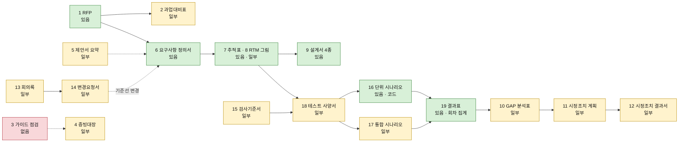

<!-- 배경 조사 결과 · 2026-10-23(금) · 메인 검토 전 · 색인(README)·대장 줄은 메인이 더함 · 읽기만 한 조사(강사님 사본 · 우리 docs 모두 고치지 않음) -->

# 강사님 th07 「감리대응」 19탭 × Qurious 산출물 대조 (2026-10-23 배경조사)

| 문서 정보 | |
|---|---|
| **판 · 상태** | 결과 v1.0 · 읽기만 한 조사(이 파일 밖의 산출물 · 대장 · 색인 · 강사님 사본을 고치지 않음 — README 줄은 메인이 넣는다) |
| **출처** | 사용자 2026-10-22 원문 「강사님이 올려준 사이트(domain-rag-lab)에 감리 대응 쪽 누르고 하면 … 부족한 부분을 채우면 좋을 거 같고 참고해도 좋을 것 같습니다」 · 이동원파트-할일 ②-06(`이동원파트-할일.md:118`) 「감리대응 산출물 대조 → 빈칸 채우기」 의 **대조표** 단계 · 바로 앞 점검 `p3/01-analysis/research/배경조사/2026-10-22-강사님자료-점검/결과.md`(th07 절 · 표 5 의 7-2 · 7-4) |
| **기준(강사님 사본)** | `learning/th07-domain-rag-lab/lecture/` 분리된 HEAD `185d401`(10-23 09:01) — 로컬 사본만 읽음(원격 · 배포 사이트 pr.edumgt.co.kr 은 열지 않음). 감리 자료의 마지막 변경은 메모의 `fda3ed1`(10-21 12:12)이다. **그 뒤 감리 화면 코드가 바뀐 것은 `6bf2cdd`(10-22 17:36) 한 번뿐** — `audit-navigation.js` 1줄 · `audit-response.js` 13줄(+10 −3)이 샘플 예시의 기관명을 「OO대학교 샘플」 로 익명화했다(`audit-response.js:6-12,48`). 그 둘을 뺀 나머지(`audit-guide.js` · `audit-tests.js` 등 생성 함수 여덟 파일 · 데이터 JSON 둘 · 증빙 폴더 · `docs/audit-guide-review.md` · `docs/audit-guide-source-index.json` · `docs/fd-live-verification.md`)는 `fda3ed1..HEAD` 사이 변화 0 이다. `fda3ed1..HEAD` 는 커밋 8개이고 감리 코드(`audit-*.js`)를 건드린 것은 `6bf2cdd` 하나다. 감리 화면 틀(`audit-response.html`)은 메뉴 · 푸터 때문에 네 커밋이 고쳤으나 탭 목록 19는 그대로다 (상) |
| **기준(우리)** | Qurious `main` `5a3bfc9`(10-23 13:46) + 작업 트리(미커밋 — 메인이 문서 판을 올리는 중이라 테스트 계획서가 v1.58 → v1.59 로 움직인다). 줄 번호는 테스트 계획서 · 산출물목록 · 논의결정대장은 `5a3bfc9` 커밋 본, 나머지는 바뀌지 않은 파일의 작업 트리 |
| **조회일** | 2026-10-23(금) · 파일을 쓴 시각 15:44 ~ 15:52 KST(읽기 조사는 그 앞) |
| **확실도** | **상** = 파일 · 코드를 직접 읽거나 돌려 셈 / **중** = 읽은 것 + 판단이 들어감 · 「없다」 는 문서 폴더 grep 으로 확인 / **하** = 추정. 본문 끝의 (상) (중) (하) 가 그 줄의 확실도 |
| **읽는 법** | 경로는 `p3/` = `docs/phase-3/` · `common/` = `docs/common/` · `p2/` = `docs/phase-2/`. 강사님 쪽은 `th07/` = `learning/th07-domain-rag-lab/lecture/`, 화면 코드는 `th07/frontend/assets/` 아래 파일 이름만 적는다(`audit-response.js:22` 꼴). 지시문의 `03-implementation` 은 실제 폴더 이름이 `03-development` 다. 크기: 작음 = 반나절 안 · 중간 = 하루 안팎 · 큼 = 이틀 이상 |
| **지킨 것** | git 은 `log` · `show` · `diff --stat` · `rev-parse` · `status` · `ls-files` 읽기만 · fetch · pull · gh · GitHub · 배포 사이트 · 앱 · DB · `.env` 안 부름 · 강사님 폴더 복사 0 · 팀원 이름에 「님」 · 재촉 문구 0 |

> **이 글이 답하는 질문**
> 1. 강사님 「감리대응」 화면의 문서 탭 19개는 각각 무엇을 담고, 금융 예시와 샘플 예시 가운데 어느 쪽으로 채워져 있나 (1절)
> 2. 우리 산출물과 맞대면 탭마다 있음 · 일부 · 없음은 무엇이고, 빠진 칸은 어디이며 어떻게 채우나 (2절)
> 3. 3차 발표(11-12) 전에 무엇부터 작게 채우나 (3절) · 강사님 자료는 어디까지 쓰나 (4절) · 무엇을 못 봤나 (5절)

## 맨 위 5줄 요약

1. **무엇이 있나** — 감리대응 화면은 문서 탭 19개 × 예시 둘이다. 「로보어드바이저 · 인디케이터」(금융)는 강사님 과제 원문을 요구 41건으로 푼 예시이고, 「OO대학교 샘플」은 다른 서비스(AI 에이전트 플랫폼)의 실제 제안요청서 58건이다. 문서 거의 전부는 틀에 요구 이름을 끼운 **가상 · 미실행** 값이고, 실제 증거는 강사님 배포본 운영 검증 84건(결함 둘)뿐이며 금융 쪽에만 붙는다(`audit-response.js:48,59,62`). 10-21 메모 뒤 바뀐 것은 샘플 기관명 익명화 하나다 (상)
2. **우리와 맞대면** — 19탭 중 **있음 6 · 일부 12 · 없음 1**(가이드 점검). 큰 줄기(RFP → 요구 → RTM → 설계 → 시험 → 결함)는 우리 쪽이 가상 값이 아니라 실제 파일 · 시험이라 더 실제적이다. 비어 있는 것은 **정형 칸**이다 — 시정조치(조치 유형 · 예정일 · 조치 전후 · 재시험), 검사 기준(인수 기준 문장 · 정량 합격선 확정 상태), 증빙 위치 대장, rfp-2 §6 · §7 과업 대비 (중)
3. **RFP 41건** — 개수는 달라도 겹침은 1 : 1 이다. RA 15 + IND 16 = 우리 39줄(`P01-*` 14 · `P02-*` 15 · `U1 ~ U10`), MGT 10 = 산출물목록 1 ~ 10절. 31건 전수에서 28건은 이름 유사도 최고 후보가 순서 짝과 같고 1건(RA-011)은 뜻으로 확정, 묶음 둘(RA-015 · IND-016)은 `U` 이름을 이으면 글자 그대로 같다. 열 개 표본은 모두 뜻이 같다. 우리 `RFP2-*` 15 · `SCH-*` 5 는 강사님 예시에 짝이 없고, 번호는 아직 이어 두지 않았다 (상)
4. **먼저 채울 다섯** — ① 요구 대장 「감리 번호 · 인수 기준」 칸 ② 결함대장 시정조치 칸 + DF-144 결과서 본보기 ③ 증빙 위치 대장 한 장(2.2절 표 5 가 초안) ④ rfp-2 §6 · §7 과업 대비 한 장 ⑤ 정량 합격선 현황 한 장. 제안서 요약 · 가상 회의록 · 가상 설계서 4축 · 단위 시나리오 문서화는 뒤로 미룬다(3절) (중)
5. **쓰는 선** — 칸 이름과 원칙만 참고하고 복사하지 않는다. 샘플 쪽 원문(JSON · `.hwpx`) · 가이드 PDF · 가상 ID · 강사님 배포본 검증 수치는 우리 표에 옮기지 않는다(4절). 못 본 것은 배포 사이트 · 가이드 PDF 원문 · 실제 브라우저 모양 · 팀원 3차 설계서 본문의 인수 기준 칸이다(5절) (상)

## 이 문서의 말

| 말 | 뜻 (이 문서에서) |
|---|---|
| 감리 | 독립된 제3자가 사업이 계약 · 기준대로 되고 있는지 점검하는 일. 강사님 화면의 이름일 뿐 우리에게 실제 감리는 없다 — 강사님이 발주자 겸 평가자다(`p3/00-management/plans/이해관계자목록.md:36`) |
| 탭 | 화면 위쪽에서 고르는 문서 종류. 주소 `audit-response.html#<예시>-<탭>` 하나로 19개 × 예시 둘이 같은 코드로 그려진다(`audit-response.js:80`) |
| 금융 예시 / 샘플 예시 | 금융 = 「로보어드바이저 · 인디케이터」(내부 키 `finance`, 요구 41건) · 샘플 = 「OO대학교 샘플」(내부 키 `pnu`, 요구 58건) |
| 가상 / 실제 | 가상 = 틀에 요구 이름을 끼워 만든 예시 값 — 증거가 아니다. 실제 = 강사님 배포본에 돌려 본 84건. 강사님 스스로 「생성 ID 를 실제 구현 증거로 간주하지 않음」 이라 적었다(`audit-guide-review.md:22`) |
| 과업대비표 | 발주자가 요청한 과업을 수행자의 대응 · 산출물 · 시험과 항목별로 맞댄 표 |
| GAP | 기대(요구)와 현재 상태의 격차. 강사님 표는 「가설」 로 시작한다 |
| 시정조치 | 점검에서 지적된 것을 고치는 일. 계획(무엇을 언제)과 결과(고쳤나 · 다시 재 봤나)를 따로 적는다 |
| CR(변경요청서) | 합의한 범위 · 기준선을 바꿔 달라는 요청서 |
| 기준선 | 「이 판이 기준」 이라고 못 박아 둔 상태. 승인 전 변경은 기준선을 바꾸지 않는다 |
| 증빙 | 「했다」 는 말을 받치는 자료(문서 · 로그 · 결과 파일). 없으면 「미등록」 으로 남긴다 |
| 인수 기준 | 요구가 「됐다」 고 보는 조건. **우리 문서에는 같은 이름이 둘이다** — 목표 기능 설계서의 인수 기준 표(약 11건 · 2절 15번)와, RTM 이 「아직 없다」 고 적은 사용자 스토리별 세 줄 기준(`p3/01-analysis/requirements/RTM.md:815,897` · 계획은 `p3/02-design/system/기능설계.md:757`). 이 글에서 단독으로 쓰면 앞의 것이다 |

---

## 1. 감리대응 탭 19 한눈에

표 1 은 「탭마다 무엇을 담고(칸 이름 · 꼴), 두 예시에 줄이 몇 개씩이며, 어느 예시가 실제를 쥐고 있나」 에 답한다. **19개 탭은 두 예시에 모두 있다** — 금융 = 로보어드바이저 · 인디케이터 주제(우리 과제), 샘플 = 다른 서비스 주제. 줄 수는 화면의 생성 함수를 Node 에서 불러 센 값이다(부록 A). 칸 이름은 화면 머리글의 짧은 인용이다.

**예시 둘의 차이 (상)**
- **금융(로보어드바이저 · 인디케이터)** = 우리 과제 주제. 요구 41건 = `RA` 15 + `IND` 16 + `MGT` 10(`audit-response-data.json` `requirements`). 이름이 우리 요구 대장의 `P01-*` · `P02-*` · `U*` 와 같아 같은 원문에서 나온 것으로 보인다(2.1절 — 중). RFP 탭의 41건은 독립된 제안요청서가 아니라 요구 41건을 **되풀이한** 표다 — 정의 칸에 요구 이름을 다시 쓰고 원문 위치 칸에 「기능 정의 RA-001」 을 적는다(`audit-response.js:59`).
- **샘플(OO대학교 샘플)** = 다른 서비스. AI 에이전트 플랫폼 구축 사업 제안요청서의 요구 58건(9분류: SFR 14 · WEB 14 · SIR 8 · DAR 4 · TER 4 · SER 4 · PSR 4 · QUR 3 · PMR 3 — `audit-rfp-data.json`). 원문 칸(정의 · 세부내용 · 산출정보 · 원문 위치) 7개를 그대로 보여 주는 진짜 RFP 꼴이다(`audit-response.js:20,86`). 나머지 18개 탭은 전부 가상 · 미실행이며 탭마다 설명 문구가 그렇게 밝힌다(`audit-response.js:72` — 예 「실제 실행 결과·증빙은 없으며」).
- **실제 증거는 금융에만** — 과업대비표 심각도(`audit-comparison.js:4-6`) · 검사기준서의 자체 관측과 시정조치 결과서의 「실제 결함 미해결」 연결(`audit-guide.js:55-56`) · 증빙대장의 LIVE 한 줄(`audit-guide.js:54`) · 테스트 결과표의 실제 84건(`audit-live.js:2-8`, `audit-response.js:59`).
- **실제 84건의 정체** — 강사님 배포본(fd)에 돌린 운영 HTTPS · 화면 25건(22 통과 · 3 실패) + 소스 pytest 50건(통과) + 비중 수식 격리 9건(7 통과 · 2 실패). 결함 둘: `FD-FIND-001`(CRITICAL · 장기 자산배분 현금 −4%) · `FD-FIND-002`(HIGH · 수익률 −101 입력이 HTTP 500). 우리 코드가 아니라 **강사님 배포본**에 대한 검증이다(`audit-evidence/fd-verification.json`, `docs/fd-live-verification.md`).

**<표 1> 감리대응 탭 19**

| # | 탭 | 줄 수 금융 / 샘플 | 담는 것 — 칸 이름 · 꼴 (칸 수) | 근거 |
|--:|---|---|---|---|
| 1 | RFP | 41 / 58 | 금융 7칸 — RFP 번호 · 구분 · 요청 기능·범위 · 기능 정의 · 인수·검증 기준(안) · 제출 산출물 · 근거 기능 ID(요구를 되풀이한 표). 샘플 7칸 — 요구사항 번호 · 분류 · 명칭 · 정의(원문) · 세부내용(원문) · 산출정보(원문) · 원문 위치(실제 제안요청서) | `audit-response.js:20,59,67` |
| 2 | 과업대비표 | 41 / 58 | 17칸 — 대비 ID · 심각도 · 과업 대비 결과 · RFP ID · 요구사항 ID · 구분 · 요청 과업 · 연계 제안 ID · 대응 방안 · 제출 산출물 · 설계 기준 ID · TC/UT/IT 연결 · 실제 확인 증빙 · GAP→조치 + 기술협상서 근거 · 사업수행계획/WBS 근거 · 발주자 확인·기준선. 금융만 실제 결함이 심각도에 붙는다 | `:34,40`, `audit-comparison.js:4-6` |
| 3 | 가이드 점검 | 22 / 22 | 12칸 — 점검 ID · 구분 · 단계/영역 · 점검 항목 · 가이드 기준(요약) · 보완 전 확인사항 · 반영한 문서 보완 · 확인할 문서 탭 · 필요 증빙 · 적용성·범위 · 확인 상태 · 출처·PDF 쪽. 항목 22 = 감리 준비 13(B01~B13) + 데이터 4(D) + 클라우드 3(C) + 운영 2(O). 두 예시가 같은 22개 | `:35`, `audit-guide.js:5-26` |
| 4 | 필수점검·증빙대장 | 17 / 17 | 12칸 — 증빙 ID · 구분 · 필요 자료/산출물 · 필수 기록 항목 · 제출 책임 · 버전/기준선 · 요청/접수 · 제출/공유 · 증빙 위치 · 접근·검토·확인 · 상태 · 가이드 근거. 17범주(BASE REQ DES INS TECH SEC DBS DATA MODEL LOG CLOUD SLA BCP OPS CR FIX LIVE)가 「미등록」 문구로 시작하는 **빈 대장**. 금융의 LIVE 한 줄만 실제 | `:36`, `audit-guide.js:29-45,54` |
| 5 | 제안서 요약 | 21 / 9 | 7칸 — 제안 ID · 연계 요구사항 · 구분 · 수행 제안·핵심 범위 · 수행 방법·참고 도구 · 제출 산출물 · 진행 상태(「작성 예시 · 검증 대기」 고정). 금융 21건은 요구를 규칙으로 묶어 자동 생성(5·3·3·3·1 …) | `:21,50-56` |
| 6 | 요구사항 정의서 | 41 / 58 | 13칸 — 요구사항 ID · 근거 ID · 구분 · 정의 · 인수·검증 기준(안) · 우선순위 · 담당·승인 · 관련 산출물 + 기능/비기능 분류안 · 출처·근거 · 제약사항 · 수용/해결 방안 · 발주자 확인/버전. 우선순위 「필수(검토안)」 · 담당 「미지정」 은 고정값 | `:22,41` |
| 7 | 요구사항 추적표 | 41 / 58 | 14칸 — 요구사항 ID · 근거 ID · 구분 · 요구사항 · 설계 ID(예정) · 구현 증빙 · 시험 ID(예정) · 검증 기준 · 시험 결과·인수 · 관리 도구 + 유스케이스(예정) · UI/PRG/IF/DB · UT/IT · 설계/구현 승인·개정. ID 는 `DES-FINANCE-<요구>` 꼴 생성값, 구현 증빙은 「파일·커밋 미등록」 고정 | `:23,42` |
| 8 | RTM Diagram | 카드 41 / 58 | 캔버스. 왼쪽 RFP 카드를 끌어 놓으면 RFP → 제안서 → 요건정의 → 추적표 → 테스트 사양서 5장이 이어져 펼쳐지고, 카드 선택 시 상세 · PNG 내보내기 | `audit-rtm.js:45-55,72` |
| 9 | 가상 설계서 | 164 / 232 | 9칸 — 설계 ID · 설계서 종류 · 설계서명 · 요구사항 ID · RFP ID · 설계 기준 DES ID · 구분 · 설계 내용(가상) · 상태. 요구마다 화면(UI) · 프로그램(PRG) · 인터페이스(IF) · 테이블(DB) 4장(41×4 · 58×4)이고 내용은 틀에 요구 이름을 끼운 값 | `:45`, `audit-designs.js:2-11` |
| 10 | 예상 GAP 분석표 | 41 / 58 | 11칸 — GAP ID · 요구사항 ID · 구분 · 요구사항·기대 기준 · 현재 확인 상태 · 예상 GAP(가설) · 예상 영향 · 우선순위(안) · 검증 기준 · 연계 조치 ID · 판정 상태. 현재 확인 상태는 전부 「현황·구현·시험 증빙 미확인」 | `:25`, `audit-gap.js:27` |
| 11 | 시정조치 계획·처리표 | 41 / 58 | 17칸 — 조치 ID · GAP ID · 요구사항 ID · 구분 · 조치 계획(안) · 담당 역할(미지정) · 목표 단계(안) · 처리 상태 · 완료 증빙(예정) · 재검증 시험 ID · 종결 기준 · 검토·승인 + 개선유형(필수·협의·권고) · 개선시점(단기·장기) · 조치 예정/완료일 · 계획 확인 · 결과·재확인 | `:26,43` |
| 12 | 시정조치 결과서 | 41 / 58 | 16칸 — 결과 ID · 요구사항 ID · 구분 · 요구사항 · 권고·결함 근거 · GAP/조치 ID · 개선유형·시점 · 조치 상태 · 조치 전 현황 · 조치 후/개정 내역 · 결과 증빙 · 재시험 · 예정/완료일 · 반영불가 사유·확인 · 제출·발주자/감리 재확인 · 가이드 근거. 금융은 실제 FAIL 이 있는 요구에 「실제 결함 미해결」 연결 | `:38`, `audit-guide.js:56` |
| 13 | 가상 회의록 | 6 / 6 | 12칸 — 회의록 ID · 진행 단계 · 구분 · 회의 안건 · 참석 역할 · 논의 내용 · 의견·결정 · 후속 조치 · 요구사항 ID · 연계 GAP/조치 · 변경요청 CR · 기록 상태. 회의 6건은 사람이 쓴 시나리오(예시마다 다름) | `:27`, `audit-project-events.js:3-17` |
| 14 | 변경요청서 CR | 5 / 5 | 18칸 — CR ID · 근거 회의록 ID · 구분 · 변경 안건/사유 · 변경 유형 · 기존 기준선 · 변경 요청 내용 · 영향 범위/위험 · 추가 공수 · 비용/일정 영향 · 요청·담당 · 요구사항/GAP/조치/시험 · 처리 상태 · 심의·승인 · 종결 기준 + 변경 전/후 기준선 · 발주자/심의 확인 · 적용/회귀 결과. 회의 6건 중 5건이 CR 이고 전부 「미승인」 | `:28,44`, `audit-project-events.js:19-20` |
| 15 | 검사기준서 | 41 / 58 | 15칸 — 검사 ID · 요구사항 ID · 구분 · 기능/비기능(안) · 요구사항 · 세부 화면/프로그램·산출물 · 검사기준(안) · 입력·정량목표 확정 상태 · 단위/통합시험 ID · 자체 검증 증빙 · 자체 관측(감리판정 아님) · 정식 감리 판정 · 점검제외 근거 · 기준 승인/발주자 확인 · 가이드 근거 | `:37`, `audit-guide.js:55` |
| 16 | 단위테스트 시나리오 | 128 / 179 | 12칸 — UT ID · 요구사항 ID · 구분 · 유형 · 시험 항목 · 대상 단위 · 사전 조건 · 입력·조건 · 시험 절차 · 기대 결과·판정 기준 · 전체 문서 ID 연결 · 실행 상태. 요구마다 정상 · 경계 · 오류/차단 3건 + 변경요청 회귀 5건(금융 41×3+5) | `:30`, `audit-tests.js:15-19` |
| 17 | 통합테스트 시나리오 | 7 / 9 | 11칸 — IT ID · 연계 요구사항 ID · 구분 · 업무 흐름 · 통합 대상 · 사전 조건 · 시험 데이터 · 통합 실행·장애 주입 절차 · 기대 결과 · 연계 테스트 사양 ID · 실행 상태. 금융 7흐름: KNOWLEDGE · INDICATOR · PORTFOLIO · PERFORMANCE · TRADING · DESIGN · HANDOVER | `:31`, `audit-tests.js:20-31` |
| 18 | 테스트 사양서 | 41 / 58 | 13칸 — 사양 ID(TC) · 요구사항 ID · 구분 · 검증 대상 · 전체 문서 ID 연결 · 단위테스트 UT · 통합테스트 IT · 점검 방법/대상 · 시험 사전 조건 · 수행 순서 · 기대 결과·판정 기준 · 필수 증빙 · 사양·실행 상태 | `:32`, `audit-tests.js:32` |
| 19 | 테스트 결과표 | 219(실제 84 + 계획 135) / 188 | 16칸 — 결과 ID · 심각도 · 검증 구분 · 시험 UT/IT ID · 구분 · 시험 유형 · 시험 항목 · 요구사항 ID · 사양 TC ID · 기대 결과 · 예상 판정 기준 · 실제 실행·관측 결과 · 최종 판정 · 증빙·검수 · 재검증 GAP→조치 · 계획 상태. 금융에만 실제 84건이 합쳐지고 샘플 188건은 전부 미실행 | `:33,59,62`, `audit-live.js:2-8` |

표 1 의 「근거」 가 `:숫자` 만 있는 줄은 `audit-response.js` 의 줄이다. 줄 수의 합: 금융 135건(단위 128 + 통합 7)이 화면 상태줄 「기존 예상 시나리오 135건」 과 같고(`audit-response.js:77`), 샘플 188건 = 단위 179 + 통합 9 (상).

**강사님이 못 박은 원칙 (우리가 따를 만한 것)** — 짧게 줄인 뜻이다(`docs/audit-guide-review.md:43-48`) (상):
1. 가상 시나리오의 ID 는 실제 증거가 아니다 · 증빙이 없으면 「미등록」 으로 남기고 완료 · 제외로 바꾸지 않는다.
2. 소프트웨어의 CRITICAL / HIGH 는 자체 검증의 심각도이지 감리의 적합 · 부적합 판정이 아니다.
3. 조치중이면 방법과 예정일이 있어야 하고, 반영불가면 사유와 확인 문서가 있어야 한다 — 자체 테스트 통과만으로 조치 완료 처리를 하지 않는다(`audit-guide.js:56`).
4. 승인 전 변경 요청은 기준선을 바꾸지 않는다(`audit-guide-review.md:26`).
5. 가이드 예시 수치(응답시간 등)를 사업의 합의 목표로 임의 적용하지 않는다(`audit-guide-review.md:46`).

---

## 2. 대조표

판정 기준 — **있음** = 같은 목적의 문서가 우리 저장소에 있고 빠진 칸이 1 ~ 2개 · **일부** = 목적은 겹치나 칸이나 범위가 눈에 띄게 부족하거나 다른 문서가 겸한다 · **없음** = 같은 목적의 문서가 없다.

```
 판정 분포 — 19탭
 있음  ██████                6   (1 · 6 · 7 · 9 · 16 · 19)
 일부  ████████████         12   (2 · 4 · 5 · 8 · 10 · 11 · 12 · 13 · 14 · 15 · 17 · 18)
 없음  ██                    1   (3 가이드 점검)
```

그림 1 은 「강사님 문서 사슬에서 우리 쪽이 갖춘 곳과 빈 곳이 어디인가」 에 답한다. 범례: 초록 = 있음 · 노랑 = 일부 · 빨강 = 없음 · 실선 = 이어지는 순서 · 점선 = 되돌아가거나 따로 가는 길.

**<그림 1> 강사님 문서 사슬과 우리 현황**



표 2 는 「탭마다 우리 산출물은 무엇이고, 어디가 비었고, 어떻게 채우나」 에 답한다. 담당 후보는 팀장 이동원 = 통합 산출물, 각 주담당 = 자기 파트 줄이다(`p3/00-management/plans/프로젝트계획서.md` 4절). 계약 계열 칸(기술협상서 · 발주자 확인 · 기준선 승인)은 우리에게 해당 없어 「강사님 확인 기록」 한 칸으로 줄여 본다(4절).

**<표 2> 대조표 — 19탭**

| # 탭 | 우리 산출물 (경로) | 판정 | 빠진 칸 (구체적으로) | 채울 방법 | 담당 후보 | 크기 | 확실도 |
|---|---|---|---|---|---|---|---|
| 1 RFP | `common/01-analysis/references/rfp-2.md`(189줄) · `rfp-1.md`(요약) · `p3/01-analysis/requirements/대장/요구-대장.tsv`(59줄 · 18칸 · `:1`) | 있음 | ① 강사님 RFP 번호(RA · IND) 칸 — 짝은 정해졌으나 이어 둔 곳 0(2.1절) ② 요구별 「제출 산출물」 칸(강사님 `산출정보`) — rfp-2 §6 은 사업 전체 8건뿐 | 대장 칸 하나(「감리 번호」) | 이동원 | 작음 | 상 |
| 2 과업대비표 | `p3/01-analysis/requirements/RTM.md` 3절(`:288` · 59줄) · 1.2절 표 3(`:83-93` rfp-2 → 요구) · `p2/00-management/plans/완료보고서.md` 3절(`:45-56` 목표 기능별 실적 · 인수 기준 충족 칸) | 일부 | rfp-2 §6 산출물 8(필수 6 · 선택 2) · §7.1 정량 평가 5 · §7.2 프로세스 평가 4 · §9 제안 요건 4 = **21행의 「대응 문서 · 시험 · 지금 상태」**. RTM 은 §6 · §7.2 · §9 를 「요구가 아니다」 로만 두고(`RTM.md:93`) §7.1 은 적지 않았다 · 산출물목록은 강사님 10구분 기준이라 rfp-2 §6 이름(「퀀트 모델 결과 해석 보고서」 · 「모의 투자 의사결정 일지」 · 「성과 검증 보고서」)으로는 찾아지지 않는다(grep) | 기존 문서 새 절 — RTM 표 3 아래 「6 · 7 · 9절 대비」 21행 | 이동원 · 값 확인 강민석 님(§7.1) · 오준영 님(§3.1.3 · 3.1.4) | 작음 | 중 |
| 3 가이드 점검 | 없음. 가까운 문서: `p3/00-management/standards/문서작성기준.md`(실무 문서 형식 기준 — 감리 가이드 대조가 아님) · `산출물목록.md` 13절(강사님 10구분 표 대조) | **없음** | 22 점검 항목 전부(준비 13 · 데이터 4 · 클라우드 3 · 운영 2). 다만 계약 · 발주자 승인 · 정식 감리 판정이 걸린 부분(B01 · B06 · B07 · B12 · B13)과 클라우드 셋(C01~C03 — AWS 보류)은 그대로는 해당 없음 | 새 문서를 만들지 않고 4번 증빙 위치 대장의 「가이드 근거」 칸으로 흡수 | 이동원 | 중간 | 중 |
| 4 필수점검·증빙대장 | 한 장 대장 없음 — 증빙이 문서 곳곳에 있다(2.2절 표 5: 17범주 중 있음 5 · 일부 10 · 해당 없음 2). 가장 가까운 것 `docs/README.md` 2.1절 표 1-1 「찾는 길」(`:132-155`) | 일부 | 범주별 「증빙 위치 · 상태(있음 · 일부 · 해당 없음 + 사유) · 확인한 날」 한 장. 제출/공유 · 접근 · 발주자 확인 칸은 우리에게 해당 없음 | 기존 문서 새 절 — 산출물목록 13.2절 「감리 증빙 17범주 × 우리 문서」 (2.2절 표를 초안으로) | 이동원 | 중간(초안 있음 → 검수) | 중 |
| 5 제안서 요약 | `p3/00-management/plans/프로젝트계획서.md` 2.2 · 3 · 5절 · `착수보고서.md` 2절(추진 전략과 방법) · 5절(산출물 계획) | 일부 | 요구 → 수행 제안(방법 · 도구) 묶음 표. 단 금융 21건은 요구를 규칙으로 묶어 자동 생성한 표(`audit-response.js:50-56`)라 새 정보가 없고, 우리 RTM 3절 「설계」 칸이 같은 일을 한다 | 안 채움 — RTM 「설계」 칸으로 갈음(근거 한 줄만) | — | — | 상(강사님 생성 규칙) · 중(우리) |
| 6 요구사항 정의서 | `요구-대장.tsv` 18칸(요구ID · 계열 · 차수 · 이름 · 내용 · 유형 · 출처 · 우선순위 · 상태 · 검증방법 · 검사결과 · 관련요구 · 설계_추가 · 제안시험 · 비고 · 주담당 · 부담당 · 담당상태) · RTM 2절 표 4(`:103-117`) | 있음 | ① 제약사항 칸(제약은 유형 CO 별도 줄 5개뿐) ② 「강사님 확인 · 버전」 칸 — 상태 확정/제안은 있으나 누가 언제 확인했나 없음 ③ 인수 기준 링크(15번과 함께). 강사님 칸 대부분은 우리 칸과 1 : 1 로 겹친다(분류 = 유형 · 출처 · 우선순위 · 담당 · 관련 산출물 = 설계_추가) | 대장 칸 하나(「확인 기록」) | 이동원 | 작음 | 상 |
| 7 요구사항 추적표 | RTM 3절(`:288` · 59줄 · `scripts/rtm_scan.py` 가 채움) · 4절(`:378`) · `대장/시험-요구대장.tsv`(226줄) · `대장/설계-동기화.tsv`(10줄) | 있음 | ① 유스케이스 ID 칸 — UC 연결은 `유스케이스명세서.md` 표 2 에만 있고 3차 UC 는 없다(`:24`) ② 화면 ID · 표 이름 칸 — 정본이 기능 설계서 2.3절이라 RTM 에 없다(`RTM.md:292`) ③ 「구현 증빙」 은 코드 흔적 개수(`RTM.md:295`)뿐. 강사님 예시의 설계 · 시험 ID 는 생성값(예정)이고 우리 것은 실제 파일 · 묶음이라 더 실제적이다 | 대장 칸 둘(「UC」 「화면」) — `rtm_scan.py` 가 새 칸을 읽게 하는 일은 메인 몫 | 이동원 | 작음 ~ 중간 | 상 |
| 8 RTM Diagram | RTM 1.1절 그림 1(`:49-60` 원천 → 대장 → 추적표 Mermaid) · 6절 진행 분포 그림(`:758-775`) | 일부 | 요구 **한 건**의 사슬(RFP → 요구 → 설계 → 시험 → 결과) 그림. 강사님 5장 카드(`audit-rtm.js:45-55`)에 해당. 대화형 캔버스는 필요 없고 정적 그림이면 충분 | 기존 문서 새 절 — RTM 부록에 대표 요구 둘(`P02-⑤-2` 중복 주문 방지 · `P01-①-3` 근거 답)의 사슬 Mermaid | 이동원 | 작음 | 중 |
| 9 가상 설계서 | 화면 `p3/02-design/ui/UI명세서.md` · `IA.md` · `와이어프레임.md` / 프로그램 `p3/02-design/system/기능동작원리.md` · `기능설계.md` · 목표기능 1 ~ 3 설계서 · 3차 설계서 / 인터페이스 `p3/02-design/api/API명세서.md`(v0.39 · 라우트 271) · `대장/API-ID대장.tsv`(275행) / 테이블 `p3/02-design/data/데이터사전.md` · `ERD.md` · `대장/표-속성대장.tsv`(76표) | 있음 (실제 설계서라 가상 설계서보다 상세) | 요구 한 건 → 화면 · 프로그램 · 인터페이스 · 테이블 **네 축을 한 줄에**. 기능 설계서 2.3절 한눈 표가 원문 세부 기능 29개만 다루고(`기능설계.md:118-155`), 나머지 30(U 10 · RFP2 15 · SCH 5)은 RTM 「설계」 · 「API」 칸까지다 | 안 채움 — 7번의 「화면」 칸을 더할 때 같이 | 이동원 | 중간(스캐너) | 중 |
| 10 예상 GAP 분석표 | `p3/04-testing/기능완성도-점검.md` + `대장/기능완성도-점검표.tsv`(72줄 — 점수 · 근거 · 「100%까지」 칸) · RTM 6절(`:749-781` 진행 분포 · 표 7 「가장 위험한 칸」 5줄) · `p3/01-analysis/requirements/강사님자료-기능대조.md` | 일부 | 요구 단위 GAP ID 와 조치 연결 — 점검표는 화면 단위(72줄), 표 7 은 5줄뿐. 한편 우리 표는 현황이 **실제**라 강사님의 가설형 GAP(현황 「증빙 미확인」 고정 — `audit-gap.js:27`)보다 낫다 | 안 채움 — 「GAP 분석표 = 점검표 + RTM 표 7」 한 줄을 증빙 위치 대장(4번)에 적음 | 이동원(각 주담당이 자기 화면 줄 갱신) | 작음 | 중 |
| 11 시정조치 계획·처리표 | `p3/04-testing/테스트계획서.md` 5절 결함대장 표 9(`:1775-1783` — ID · 요약 · 심각도 · 상태 · 재현 · 확인 방법 · 영향 · 파트 · 관련) · `이동원파트-할일.md` · `WBS.md` · GitHub 이슈 | 일부 | **조치 유형**(필수 · 협의 · 권고에 해당하는 것) · **시점**(단기 · 장기) · **예정일 · 완료일** · 종결 기준. 담당(「파트」)과 상태는 있다. 10-22 점검 7-4 와 같은 결론 | 대장 칸 — 표 9 에 「조치 유형 · 예정일」 「재시험 TC」 두 칸. 열림 · 일부 닫힘 약 38줄(v1.58 37 · v1.59 작업 트리 38)부터 | 이동원(칸 설계) · 각 DF 줄의 파트 주담당이 자기 줄 | 중간 | 상 |
| 12 시정조치 결과서 | 표 9 「확인 방법」 칸의 서술형 고침 기록(예 DF-144 `:1922`) · 시험 결과서 4.x 깨 보기 표(고치기 전 코드로 몇 건 잡았나 — 4.25 `:1724`) · `p3/05-deployment/장애대응절차서.md` 5절 사후 검토 양식(`:174-209` 영향 · 원인 · 감지 · 조치와 복구 · 재발 방지 조치[할 일 · 담당 · 기한 · 상태]) · `릴리스노트.md` | 일부 | **조치 전 · 후 · 증빙 · 재시험 ID · 반영불가 사유 · 확인한 사람**의 정형 칸 | 새 문서 아님 — 사후 검토 양식을 결함 한 건 결과서로 재사용 · DF-144 를 본보기 한 장 | 이동원(양식) · 결함 파트 주담당 | 작음 | 상 |
| 13 가상 회의록 | `common/00-management/meetings/`(팀 대화방 글 43편 · `회의-` 파일 0 · 회의록 종류는 `README.md:13` 에 정의만 · 주간보고 1편) · `p3/00-management/plans/논의결정대장.md` 2절(안건 64행) · `common/00-management/github-archive/`(논의 · 이슈 본문) | 일부 | 요구 ID · 후속 이슈 번호 연결 칸(결정 대장은 「닿는 안건」 · 「근거」 만). 참석 · 논의 요지는 비동기 논의라 맞지 않다. (참고) 주간보고는 1주차 1편뿐(`meetings/주간보고/`) | 안 채움 — 결정 대장 표 3 에 「요구 ID」 칸 하나 정도 | 이동원 | 작음 | 중(GitHub 본문 안은 grep 만) |
| 14 변경요청서 CR | `논의결정대장.md` 3절 표 3 「논의 밖의 변화」(`:138-160` — 날짜 · 무엇 · 닿는 안건 · 근거 · 확실도) + 안건 상태 값(확정 · 잠정 · 조건부 · 연기 = 승인 칸 역할) · 각 문서 개정 이력 · 부록 C 변경 노트 · `설계-동기화.tsv`(고정판 · 지문 · 상태) | 일부 | 영향 범위(요구 · 설계 · 시험) · 공수 / 일정 영향 · 종결 기준. 승인은 상태 값으로 이미 있다 | 대장 칸 하나(표 3 에 「영향」) — 새 양식은 만들지 않는다 | 이동원 | 작음 | 중 |
| 15 검사기준서 | 요구 대장 `내용`(검증할 수 있는 한 문장 — `RTM.md:108`) · `검증방법` 칸 · 목표 기능 설계서 인수 기준 표(`p3/02-design/system/목표기능1-데이터지식-설계.md:74-93` 12기준 · `목표기능2-패턴예측-XAI-설계.md:54-65` 6기준 · `목표기능3-리밸런싱-설계.md:55-66` 인수 시험 8항) · 합격선 결정(`논의결정대장.md` D5 ⑧ 잠정 `:115` · D6 ⑦ 확정 `:123`) | 일부 | 설계서 표로 인수 기준 문장이 붙은 요구는 **약 11건**(`P01-①-1 ~ ①-5` · `②-1 ~ ②-3` · `③-1 ~ ③-3`)이고 나머지 약 48건에는 없다. RTM 8절의 「인수 기준이 아직 없다」(`RTM.md:815`)는 이 표가 아니라 사용자 스토리별 세 줄 기준(`기능설계.md:757`)을 가리켜 이름이 겹친다. 「입력 · 정량 목표 확정 상태」 칸 · 「기준 승인」 칸 없음. 자체 관측 대 정식 판정은 기능 완성도 점검표의 「점수」 대 「강사님」 칸으로 이미 갈라져 있다 | 대장 칸(요구 대장 「인수 기준」 링크) + 기존 문서 새 절(정량 합격선 현황 — 3절 5번) | 각 주담당(자기 요구 줄) · 틀 이동원 | 큼(전부) · 작음(합격선 한 장) | 중(11건은 설계서 본문을 눈으로 센 값) |
| 16 단위테스트 시나리오 | `tests/` pytest(`테스트계획서.md:25` 2,412건 · 묶음 177 — 작업 트리 v1.59 는 2,451 · 182) · `대장/시험-요구대장.tsv`(226줄 — 묶음 · 파일 · 요구ID · 확실도 · 무엇을_확인) · 판정 원칙 1.3(`:83`) | 있음 (코드) | 문서형 시나리오(사전 조건 · 입력 · 절차 · 기대 결과)와 정상 · 경계 · 오류 분류 칸 — **의도적으로 두지 않았다**(`:340` 「케이스가 600건을 넘어 표로 옮기면 문서가 코드를 따라가지 못한다」). 시험이 안 붙은 요구 14(개수는 `RTM.md:758-775` 분포, ID 는 3절 표의 「흔적 있음」 줄 — `U3` · `U6 ~ U8` · `RFP2-3.1.3-②~④` · `RFP2-3.1.4-①~④` · `SCH-STR` · `SCH-ROB` · `SCH-RT`) | 안 채움 — 시험 없는 14건만 정상 · 경계 · 오류 3줄로 풀어 씀(표본) | 각 주담당(해당 요구의 주담당) | 큼(전부) · 작음(표본) | 상 |
| 17 통합테스트 시나리오 | 테스트 계획서 1.2 계층(`:58`) · `test.ps1 -Split` 컨테이너 묶음 · `tests/e2e/smoke_views.py`(화면 77 열기) · `scripts/personal/check.ps1` 13묶음(기능 점검 85 — `기능완성도-점검.md` 0-1절) · 4.x 깨 보기 | 일부 | **업무 흐름 단위** 표(강사님 7흐름 꼴 — 흐름 · 통합 대상 · 사전 조건 · 장애 주입 · 기대 결과 · 덮는 시험 묶음). 특히 3차 핵심 「신호 → 모의 주문 → 원장 → 관제」 | 기존 문서 새 절 — 테스트 계획서 3절 뒤 「업무 흐름별 통합 시험」(시험-요구 대장의 요구 ID 를 흐름별로 묶음) | 흐름별 — 오준영 님(TRADING) · 강민석 님(PERFORMANCE) · 신장환 님(INDICATOR) · 이동원(KNOWLEDGE) | 중간 | 중 |
| 18 테스트 사양서 | `시험-요구대장.tsv` + 테스트 계획서 3절 표 5(`:149` — 묶음 · 파일 · 건수 · 무엇을 지키나 · 요구 · 확실도) + 1.3 · 1.4(`:83-106`) | 일부 | 요구 단위 「사전 조건 · 수행 순서 · 필수 증빙」. 공통 절차와 증빙 위치(`test.ps1` 의 run.json — 4절 84차 줄 `:379`)는 있으나 한 줄로 모아 적은 곳이 없다 | 기존 문서 새 절 — 1.4절 안에 한 줄 | 이동원 | 작음 | 중 |
| 19 테스트 결과표 | 테스트 계획서 4절 시험 결과서(`:377` — 84차까지 회차별 · 묶음별) · 4.5 ~ 4.27 깨 보기 표(<표 8-xx>) · 5절 · `기능완성도-점검.md` 0-1절(자동 시험 · 기능 점검 85 · 화면 훑기 77) | 있음 (회차 집계) | 건별(요구 단위) 결과 표와, 「알려진 실패 5」(DF-110 둘 · DF-137 둘 · DF-140)를 요구 ID · 시정조치(11번)에 잇는 칸. 실제 / 계획 구분은 RTM 시험 칸의 `안`(제안 묶음) 표기(`RTM.md:294`)가 이미 한다 | 11번 칸과 함께(DF → 요구 ID → 재시험 TC) | 이동원 | 작음 | 중 |

판정 요약 — 있음 6(1 · 6 · 7 · 9 · 16 · 19) · 일부 12 · 없음 1(3). 「안 채움」 으로 적은 곳은 5 · 9 · 10 · 13 · 16(칸 하나만 더하거나 아예 안 함)이고, 까닭은 3절 끝에 모았다 (중).

### 2.1 RFP 41건 맞대기 — 개수 · 꼴 · 표본 열 개

표 3 은 「강사님 RFP 41건과 우리 요구 대장 59줄이 개수로 어떻게 대응하나」 에 답한다.

**<표 3> 개수 맞대기**

| 강사님 묶음 | 건 | 우리 짝 | 건 | 짝짓는 방식 | 확실도 |
|---|--:|---|--:|---|---|
| `RA-001 ~ 015`(로보어드바이저) | 15 | `P01-①-1 ~ ④-3` + `U1 ~ U5` | 14 + 5 | `RA-001 ~ 014` 는 읽는 순서대로 `P01-①-1 ~ ④-3` 14줄과 1 : 1. `RA-015` 한 줄은 `U1 ~ U5` 다섯 줄을 한 줄로 이은 것 | 상 |
| `IND-001 ~ 016`(인디케이터) | 16 | `P02-①-1 ~ ⑤-3` + `U6 ~ U10` | 15 + 5 | `IND-001 ~ 015` 는 `P02-①-1 ~ ⑤-3` 15줄과 1 : 1. `IND-016` 은 `U6 ~ U10` | 상 |
| `MGT-001 ~ 010`(공통 관리) | 10 | 산출물목록 1 ~ 10절 | 10구분 | 요구 이름의 머리가 강사님 10구분 표의 구분 이름과 같다(`audit-response-data.json` `management`) — 우리 산출물목록 1 ~ 10절 제목과 글자까지 같다(`산출물목록.md:257,448`) | 상 |
| (짝 없음) | 0 | `RFP2-*` 15 · `SCH-*` 5 | 20 | 우리 제안요청서 rfp-2 와 공식 일정표에서 온 요구 — 강사님 예시에 없다 | 상 |
| **합계** | **41** | | **59 + 10구분** | 우리 59 − 짝 있는 39 = 20 | |

표 4 는 「표본 열 개가 정말 같은 뜻인가」 에 답한다. 이름은 이 글에서 줄여 적었고, 유사도는 두 이름에서 공백 · 가운뎃점을 접고 `difflib` 로 잰 값(0 ~ 1)이다.

**<표 4> 표본 열 개**

| # | 강사님 | 이름(줄임) | 우리 | 이름(줄임) | 유사도 | 뜻 |
|--:|---|---|---|---|--:|---|
| 1 | `RA-001` | 주식 · 금융 · 경제 용어사전과 연관 개념 탐색 | `P01-①-1` | 같음 | 1.00 | 같음 |
| 2 | `RA-005` | XAI 로 투자 추천 이유를 쉬운 말로 설명 | `P01-①-5` | 같은 뜻, 영문 풀이만 뺌 | 0.42 | 같음 |
| 3 | `RA-007` | 차트 패턴 탐지(캔들 · 지지 · 저항 · 돌파 · 골든크로스) | `P01-②-2` | 같음 | 1.00 | 같음 |
| 4 | `RA-011` | 입출금 · 배당금 현금흐름 기반 리밸런싱 | `P01-③-3` | 입출금 · 배당금 현금흐름으로 실행하는 리밸런싱 | 0.34 | 같음 — 기계 최고 후보는 `③-1`(0.37)이나 뜻과 순서는 `③-3` |
| 5 | `RA-015` | 투자성향진단 · 시각적 포트폴리오 · 시뮬레이션 · 목표 수익률 모의 · 리밸런싱 | `U1 ~ U5` | 같은 다섯 이름 | 1.00(이은 글) | 같음(1 : 5) |
| 6 | `IND-003` | 지표 기간 · 임계값 조합 백테스트로 기준 전략 선정 | `P02-①-3` | 같음 | 0.98 | 같음 |
| 7 | `IND-006` | 커스텀 지표를 API 로 제공하고 결과 · 버전을 저장해 재사용 | `P02-②-3` | 같음 | 0.94 | 같음 |
| 8 | `IND-010` | 같은 데이터 · 기간 · 수수료 조건으로 LEAN 백테스트 | `P02-④-1` | 같음 | 0.68 | 같음 |
| 9 | `IND-014` | 모의투자 주문과 중복 주문 방지 · 손실 한도 · 비상 정지 | `P02-⑤-2` | 같음 | 0.86 | 같음 |
| 10 | `IND-016` | 전략 설정 · 지표 차트 · 백테스트 · 성과 대시보드 · 자동매매 모니터링 | `U6 ~ U10` | 같은 다섯 이름 | 1.00(이은 글) | 같음(1 : 5) |

열 개 모두 뜻이 같다(10 / 10). 표본 밖 전수(`RA` · `IND` 중 순서 짝이 있는 29건)에서도 이름 유사도 최고 후보가 순서 짝과 같은 것이 **28건**이고, 어긋난 1건이 표 4 의 4번 `RA-011` 이다 (상). 강사님 요구 이름과 우리 이름이 이만큼 같은 것은 둘 다 강사님 과제 원문에서 나왔기 때문으로 보인다 — 우리 RTM 은 원문을 th07 `frontend/days/04.html`(`e63e675`)로 적었다(`RTM.md` 1.1절 표 1)(중).

**꼴 비교 (상)**
- **칸 수** — 강사님 요구 한 줄은 8개 필드(`id` · `rfp` · `category` · `name` · `tool` · `acceptance` · `artifact` · `source`)이고 RFP 탭이 7칸으로 보여 준다. 우리 요구 대장은 18칸이다. 강사님 `acceptance`(확인 한 문장)는 우리 `내용` 칸(검증할 수 있는 한 문장)이 대신하고, `tool`(참고 도구)과 `artifact`(요구별 제출 산출물)는 우리 대장에 칸이 없다 — 도구는 기능 설계서 8절(`기능설계.md:714`)에, 산출물은 산출물목록 10구분에 모여 있다.
- **ID** — 강사님은 요구마다 번호가 둘(`RA-001` 요구 · `RFP-RA-001` RFP)이고 파생 문서 ID 는 `<종류>-FINANCE-<요구>` 규칙 생성값이다. 우리는 원문 번호 구조를 딴 계층 ID 하나(`P01-③-2`)이고 한 번 붙이면 바꾸지 않는다(`RTM.md:65`). **우리 ID 를 바꾸지 않고 「감리 번호」 칸 하나로 잇는 것**이 맞다(이동원파트-할일 ②-02 `:114`).
- **MGT 10건의 성격** — `MGT` 는 요구라기보다 강사님 10구분 표(주요 산출물 · 목적 · 도구)를 한 줄씩 옮긴 것이다. 우리는 그 표를 이미 산출물목록 13 · 13.1절에서 구분별 · 산출물별로 대조했고 빈 산출물 15개를 모두 v0.1 로 채웠다(`산출물목록.md:687-704`) (상).
- **우리에게만 있는 것** — `RFP2-*` 15(자산배분 4 · 스크리닝 4 · 비기능 4 · 제외 범위 3) · `SCH-*` 5(스트레스 · 데이터 품질 · 강건성 · 주문 정정 · 실시간 엔진). 감리 화면으로 보면 우리 RFP(rfp-2)에서 직접 온 요구가 강사님 금융 예시에는 하나도 없다.

### 2.2 증빙 17범주 × 우리 문서 (4번 탭의 초안)

표 5 는 「강사님 증빙대장 17범주마다 우리 증빙이 어디 있고 어느 정도인가」 에 답한다. 3절 3번 「증빙 위치 대장」 의 초안이다. 판정 기준은 표 2 와 같고, 우리에게 적용되지 않는 것은 「해당 없음」 으로 사유를 적는다 — 강사님의 「미등록을 완료 · 제외로 간주하지 않음」(`audit-guide-review.md:44`)과 같은 쪽이다.

**<표 5> 증빙 17범주**

| 범주 | 강사님이 보는 것(줄임) | 우리 증빙 위치 | 판정 | 비고 · 해당 없음 사유 |
|---|---|---|---|---|
| BASE | 계약 · 기술협상 · 수행계획/WBS | `common/01-analysis/references/rfp-2.md` · `p3/00-management/plans/착수보고서.md` · `WBS.md` · `프로젝트계획서.md` | 일부 | 계약 · 기술협상서는 해당 없음 — 강사님이 발주자 겸 평가자(`이해관계자목록.md:36`) |
| REQ | 요구 명세 · 발주자 확인 | `대장/요구-대장.tsv` · `RTM.md` 2절 | 일부 | 강사님 확인 기록 칸 없음. 「강사님께 여쭐 것」 은 결정 대장 · RTM 7절에 흩어져 있다(`RTM.md:786-803`) |
| DES | 분석 → 설계 → 구현 → 시험 추적 | `RTM.md` 3절 · `대장/설계-동기화.tsv` · `기능설계.md` | 있음 | — |
| INS | 기능 · 비기능 검사 기준과 자체 결과 | 설계서 인수 기준 표 · `대장/기능완성도-점검표.tsv` | 일부 | 인수 기준 약 11건(표 2 의 15번) |
| TECH | 기술 적용 계획 · 결과 · 부분/미적용 사유 | `기능설계.md` 8절(`:714` — 강사님 기술 → 우리 대체 · 근거 · 한계 칸) · `코딩표준.md` 11절 실측(`:249`) | 일부 | 계획 · 결과 · 사유 칸은 8절이 이미 갖췄다. 범위가 강사님 기술스택에 한정 |
| SEC | 개발보안 교육 · 진단 · 제거와 재진단 | `코딩표준.md` 9절(`:204`) · `common/02-design/adr/ADR-0001` · `ADR-0004` · 결함대장 DF-07 · DF-145 · 시험 TC-LT · TC-DI | 일부 | 정식 진단 도구 결과 · 재진단 기록 없음. 교육은 해당 없음 |
| DBS | DB 표준 · 구조/값 진단 · 메타데이터 | `p3/02-design/data/데이터사전.md` · `ERD.md` · `대장/표-속성대장.tsv`(76표) · `scripts/schema_scan.py` | 있음 | — |
| DATA | 원천 목록 · 정제 · 보존 · 개인정보 | `p3/03-development/data-collection/데이터수집안내.md` · `p3/02-design/data/대장/자료안내-출처.tsv` · `표-속성대장.tsv`(보존기간 · 공개 칸) · `프로젝트계획서.md` 7절(`:335`) | 일부 | 보존 정책 「정하지 않음」 다수(`산출물목록.md` 13.1절 5 데이터) |
| MODEL | 모델 · 알고리즘 · 데이터/평가 버전 · 전문가 검토 | `p3/02-design/system/목표기능2-패턴예측-XAI-설계.md` · `p3/04-testing/근거답-품질보고서.md` · `평가셋/`(v0 ~ v2 판 · 사람 판정 TSV) · `백테스트보고서.md` | 있음 | 도메인 전문가 검토 칸은 없음 |
| LOG | 시각화 · 분석 이력 · 운영 거버넌스 | `UI명세서.md:251`(데이터 관제) · `scripts/daily_update.py status` · 신호 기록 | 일부 | 운영 역할 · 절차 문서 없음 |
| CLOUD | 클라우드 적용성 · 계약 · 책임분담 | `프로젝트계획서.md:80` · `논의결정대장.md` D2 ①(`:84`) · `p3/05-deployment/배포계획서.md` 7절(`:130`) | 해당 없음 | AWS 보류 — 빈칸이 아니라 **결정**이다(근거 있음) |
| SLA | 서비스 수준 · 측정 | `테스트계획서.md:55` | 해당 없음 | 부하 · 성능 시험 제외(AWS 보류로 대상 환경 없음) |
| BCP | 백업 · 복구 · 출구전략 · 이관/삭제 | `배포계획서.md` 5절(`:109`) · `장애대응절차서.md` · HF 백업 + 주 1회 복원 리허설(`테스트계획서.md` 4.20 `:1636`) | 일부 | 출구전략 · 이관 · 삭제는 해당 없음 |
| OPS | 형상 · 변경 · 배포 · 장애 · 지원 | `CI-CD명세.md` · `배포계획서.md` · `릴리스노트.md` · `장애대응절차서.md` · `p3/03-development/conventions/코드리뷰기록.md` · `로컬실행안내서.md` | 있음 | — |
| CR | 회의 · 변경 심의 · 승인 기준선 | `논의결정대장.md` 3절 · 각 문서 개정 이력 · `설계-동기화.tsv` | 일부 | 표 2 의 14번 |
| FIX | 시정조치 계획 · 결과 · 재확인 | 표 9(`테스트계획서.md:1783`) · `장애대응절차서.md` 5절 | 일부 | 표 2 의 11 · 12번 |
| LIVE | 개별 실행 검증 증빙 | `테스트계획서.md` 4절 · `기능완성도-점검.md` 0-1절 | 있음 | 우리 쪽이 더 풍부하다(84차 · 깨 보기 · 기능 점검 85 · 화면 77) |

분포 — 있음 5(DES · DBS · MODEL · OPS · LIVE) · 일부 10 · 해당 없음 2(CLOUD · SLA). 판정과 위치는 문서 폴더를 읽고 정한 것이라 확실도 중이다 (중).

### 2.3 ID 꼴 대응

표 6 은 「강사님 문서 ID 마다 우리에게 같은 일을 하는 ID 가 있나」 에 답한다. ID 가 없는 문서 종류는 새 번호를 만들기 전에 기존 번호(`DF-nnn` 등)로 갈음할 수 있는지 먼저 본다.

**<표 6> ID 꼴 대응**

| 강사님 ID 꼴 | 뜻 | 우리 ID 꼴 | 판정 |
|---|---|---|---|
| `RA-` · `IND-` · `MGT-` / `RFP-RA-` | 요구 · RFP 번호 | `P01-①-1` · `U1` · `RFP2-3.1.3-①` · `SCH-DQ` | 있음 — 번호만 다르다(「감리 번호」 칸으로 연결) |
| `DES-` · `UI-` · `PRG-` · `IF-` · `DB-` | 설계 기준 · 화면 · 프로그램 · 인터페이스 · 테이블 | 설계서 절 · 화면키(`data-status`) · `API-AUTH-01` 꼴 · 표 이름 | 있음 — 실제 주소 |
| `TC-` · `UT-` · `IT-` | 테스트 사양 · 단위 · 통합 | `TC-RP` 묶음 · `TC-RP-05` 건(pytest) | 있음 (코드) |
| `RTM-` | 추적 행 | RTM 3절 줄(요구 ID 가 주소) | 있음 |
| `GAP-` · `ACT-` | 격차 · 조치 | `DF-nnn`(결함만) | 일부 — 요구 단위 GAP · ACT 번호 없음 |
| `FIX-` | 시정조치 결과 | 없음(DF 줄 안 서술) | 없음 |
| `CHK-` | 검사 기준 | 설계서 인수 기준 표의 `#`(설계서 안 번호) | 일부 — 전역 번호 아님 |
| `MIN-` · `CR-` | 회의 · 변경 | 논의 `D5 #21 ⑧` · 결정 대장 표 3 의 줄 | 일부 |
| `EV-` · `CMP-` | 증빙 범주 · 과업 대비 | 없음 | 없음 |

---

## 3. 먼저 채울 것 추천 (최대 다섯)

기준: ① 3차 발표(11-12) 전에 **작게** 끝나고 ② 새 문서를 늘리지 않고 ③ 강사님이 못 박은 원칙(가상 / 실제 · 미등록 · 자체 관측)을 우리 실제 증빙으로 보여 주는 것. 날짜는 `이동원파트-할일.md:118` 에 이미 잡힌 ②-06(10-27 대조표 · 11-02 결함대장 칸 · 11-05 기능 칸 · 11-09 문서 칸)과 ②-02(10-24)에 얹었다. **채울지 말지는 이동원 결정**이고, 아래는 순서 제안이다.

**<표 7> 먼저 채울 다섯**

| 순위 | 무엇 · 어디에 | 탭 | 크기 · 담당 | 때 | 까닭 | 확실도 |
|--:|---|---|---|---|---|---|
| 1 | 요구 대장에 「감리 번호」(`RA` · `IND` 31건 ↔ 우리 39줄) · 「인수 기준 링크」 칸 — `대장/요구-대장.tsv` · RTM 다음 판 | 1 · 6 · 7 | 작음(0.5일) · 이동원 | 10-24(②-02 그대로) | 나머지 대조가 모두 이 번호 위에 선다. 짝은 이름 대조로 이미 서 있고(표 3 · 4) 새 문서가 없다. `scripts/rtm_scan.py` 가 새 칸을 읽는지는 메인이 확인한다 | 상 |
| 2 | 결함대장 시정조치 칸 + DF-144 결과서 본보기 — 테스트 계획서 5절 표 9 에 「조치 유형 · 예정일」 「재시험 TC」 두 칸(열림 · 일부 닫힘 약 38줄부터) + 장애 대응 사후 검토 양식(`장애대응절차서.md:174-209`)으로 DF-144 한 장 | 11 · 12 · 19 | 중간(1일) · 이동원 + 각 DF 파트 주담당 | 11-02(②-06 결함대장 칸) — 본보기 한 장은 그 전에 | 감리 흐름 전체(지적 → 재현 → 수정 → 고치기 전 코드로 14건 잡음 → 닫힘)를 **우리 실제 증빙으로** 보여 줄 사례가 이미 있다 — 강사님 감리의 HIGH `FD-FIND-002` 가 우리 코드에서도 재현되어 DF-144 로 닫혔다(`테스트계획서.md:1922`, 4.25 `:1724`). 칸이 없다는 결론은 10-22 점검 7-4 와 같다 | 상 |
| 3 | 증빙 위치 대장 한 장 — 산출물목록 13.2절(새) · 2.2절 표 5 가 17행 초안 · 가이드 점검(3번 탭)은 「가이드 근거」 칸으로 흡수 | 3 · 4 | 중간(검수 위주) · 이동원 | 11-09 문서 칸 계획 — 초안은 앞당길 수 있다 | 발표 질의 「그 말의 근거가 어디 있나」 에 문서 경로 하나로 답하게 한다. AWS 보류 · 부하 시험 제외는 사유와 함께 「해당 없음」 으로 적어 빈칸이 아니라 결정으로 보이게 한다 | 중 |
| 4 | rfp-2 §6 · §7 과업 대비 한 장 — RTM 1.2절 표 3 아래 「6 · 7 · 9절 대비」 21행(산출물 8 · 정량 평가 5 · 프로세스 평가 4 · 제안 요건 4) × 대응 문서 · 시험 · 지금 상태 | 2 | 작음(0.5일) · 이동원 · 값 확인 강민석 님 · 오준영 님 | 11-09 문서 칸 계획 — 2차 완료보고서에도 쓴다 | 평가자가 가장 먼저 대조할 곳이 rfp-2 의 산출물 · 평가 기준이다. 필수 산출물 6 중 「퀀트 모델 결과 해석 보고서」 · 「모의 투자 의사결정 일지」 는 그 이름으로 가리키는 문서가 없고(「의사결정 일지」 는 남은 일로만 적힘 — `common/00-management/meetings/2026-10-19-발표자료-팀원칸-부탁.md:62`), 「성과 검증 보고서」 는 `백테스트보고서.md` 가 맡는 듯하나 대응을 적은 곳이 없다 | 중 |
| 5 | 정량 합격선 현황 한 장 — 테스트 계획서 새 절: rfp-2 §7.1 다섯 값(방향성 정확도 55% · KOSPI 초과수익 · MDD −20% · 샤프 1.0 · 상위 30% — `rfp-2.md:133-139`) + 교안 `05.md:58-59`(PF > 1.5 · MDD > −15% · 샤프 > 1.0) + 결정 D5 ⑧ 잠정 · D6 ⑦ 확정 × 현재 측정값 × 상태(확정 · 잠정 · 미정) | 15 | 작음(0.5일) · 강민석 님(값) + 이동원(틀) | 11-05 기능 칸 | 값이 결정 대장 · 와이어프레임(`와이어프레임.md:635` 합격선 −20%) · 교안에 흩어져 있고 요구 대장 · RTM 에는 없다(RTM 8절은 사용자 스토리별 인수 기준이 아직 없다고 적었다 — `RTM.md:815`). 강사님 원칙 「정량 목표는 합의 전엔 미확정으로」(`audit-guide-review.md:46`)대로 상태를 적으면 된다. 측정값은 이미 있으나 표본이 짧다(E3 6일 — `백테스트보고서.md:25`) | 중 |

```
 순서 제안 (②-06 날짜에 얹음)
 10-24 토   1 감리 번호 · 인수 기준 링크 칸        → 이후 대조의 바탕
 10-27 화   이 대조표를 보고 이동원이 채울 것 결정   (②-06 대조표 단계)
 11-02 월   2 결함대장 시정조치 칸 + DF-144 본보기
 11-05 목   5 정량 합격선 현황 (+ 기능 칸 일부)
 11-09 월   3 증빙 위치 대장 · 4 rfp-2 과업 대비      (3 · 4 는 코드와 무관 → 앞당길 수 있다)
 11-12 목   3차 발표
```

### 3.1 일부러 뒤로 미루는 것 (까닭)

- **제안서 요약(5)** — 금융 21건이 요구를 묶어 자동 생성한 표라 새 정보가 없다. 우리는 입찰이 아니라 교육 프로젝트이고 RTM 「설계」 칸이 같은 일을 한다.
- **가상 회의록(13) · CR 양식(14)** — 우리 결정은 가상이 아니라 실제 기록(결정 대장)이고 승인 상태 값(확정 · 잠정 · 조건부 · 연기)도 있다. 「요구 ID」 · 「영향」 칸 하나씩이면 충분하다.
- **가상 설계서 4축(9) · 단위 시나리오 문서화(16)** — 실제 설계서와 pytest 가 정본이다. 문서로 한 번 더 옮기면 「문서가 코드를 따라가지 못한다」(`테스트계획서.md:340`)가 되풀이된다.
- **RTM Diagram(8)** — 발표 그림이 필요할 때 Mermaid 1 ~ 2장(작음)이면 된다.
- **통합 시나리오(17)** — 업무 흐름 표는 가치가 있으나 중간 크기다. 3차 시연 직전에 「신호 → 모의 주문 → 원장 → 관제」 한 흐름만 먼저 쓰는 것이 현실적이다.

### 3.2 메인이 정할 것

1. 위 다섯 가운데 어느 것을 ②-06 날짜보다 **앞당길지**(3 · 4 는 코드와 무관).
2. 「감리 번호」 칸을 `요구-대장.tsv` 에 넣을 때 `scripts/rtm_scan.py` 가 새 칸을 읽게 할지(표 2 의 7번 — 메인 몫).
3. 시정조치 칸 모양 — 표 9 에 칸 추가(표가 이미 9칸) 대 별도 대장(TSV)으로 빼기. 이 글은 칸 둘을 더하는 쪽을 가정했다.
4. 증빙 위치 대장을 산출물목록 13.2절에 둘지, 별도 문서 한 장으로 둘지.
5. 10-22 점검 `결과.md` 에 샘플 기관명이 적혀 있다(문서 폴더 grep 1파일). 강사님은 10-22 17:36 에 화면 표기를 익명화했다 — 그대로 둘지는 메인 판단.

---

## 4. 강사님 자료를 쓰는 선

**쓰는 것** — ① 탭 이름 · 칸 이름(표 1)과 상태 어휘(미등록 · 미확정 · 가상 · 실제 · 자체 관측 · 정식 판정) ② 원칙 다섯(1절 끝) ③ 문서 사슬의 순서(그림 1). 모두 **우리 말로 새로 쓰고**, 출처는 경로와 커밋만 적는다 — 예: 「강사님 th07 `frontend/assets/audit-response.js`(`185d401`)의 칸 이름을 참고」. 우리 RTM 이 원문을 th07 `frontend/days/04.html`(`e63e675`)로 가리키는 방식 그대로다(`RTM.md` 1.1절 표 1). 강사님 저장소에는 LICENSE 파일이 없다(루트 목록) — 코드 복사는 하지 않고 꼴만 쓴다 (상).

**<표 8> 그대로 옮기면 안 되는 것**

| 자료 | 까닭 | 대신 |
|---|---|---|
| 샘플 쪽 원문 — `audit-rfp-data.json` · `audit-response-data.json` 의 `pnu` 키 · 저장소 뿌리의 `.hwpx` 제안요청서 | 실제 기관의 제안요청서이고 원본 JSON 에는 기관명 · 예산 · 기간 · 해시가 남아 있다. 강사님도 화면 표시 단계에서만 익명화한다(`audit-response.js:6-12`). 재배포 권리 불명 | 옮기지 않는다. 필요하면 개수 · 분류(SFR 14 · WEB 14 …)만. 표기는 강사님을 따라 「OO대학교 샘플」 |
| 가이드 PDF 두 권과 쪽 번호 근거 | 한국지능정보사회진흥원 저작물이고 강사님도 PDF 는 공개 서버에 두지 않는다(`audit-guide-review.md:14`). 쪽 번호 · 기준 문장은 강사님 요약(2차 인용)이다 | 우리가 원문을 열어 확인한 항목만 쪽 번호를 인용한다. 이 글은 열어 보지 않았다(5절) |
| 가상 시나리오 · 생성 ID(`DES-FINANCE-…` · `UT-…` · `MIN-…` · `CR-…`) | 실제 증거가 아니다 — 강사님 자신이 못 박았다(`audit-guide-review.md:22,48`) | 우리 표에 섞지 않는다. 우리 표의 ID 는 실제 파일 · 시험 · 결함만 |
| 강사님 배포본 운영 검증 84건 · 결함 둘 | 강사님 배포본에 대한 것이다 — 우리 시험 결과가 아니다 | 우리 DF-144 의 **근거 인용**에만 쓴다(`테스트계획서.md:1922`) |
| CRITICAL / HIGH 심각도 | 강사님 자체 심각도이고 감리 판정이 아니다(`audit-guide-review.md:43`) | 우리 결함 심각도(표 9 범례의 높음 · 중간)와 섞지 않는다. 견줄 일이 있으면 대응 한 줄 |
| 요구 번호 `RA` · `IND` · `MGT` | 강사님 예시용 번호 | 「감리 번호」 칸에만. 우리 ID 가 정본 |
| 계약 계열 칸(기술협상서 · 발주자 확인 · 기준선 승인) | 우리에게는 계약이 없다 — 강사님이 발주자 겸 평가자 | 「강사님 확인 기록」 한 칸으로 줄인다 |

**따를 원칙 (우리 말로)** — ① 가상과 실제를 칸마다 나눈다 ② 증빙이 없으면 「미등록」 으로 남긴다 ③ 자체 관측과 정식 판정(강사님 평가)을 나눈다 ④ 승인 전 변경은 기준선을 바꾸지 않는다 ⑤ 정량 목표는 합의 전엔 「미확정」 으로 적는다. 이 가운데 ①은 우리 RTM 8절 「이 표를 믿어도 되는 범위」(`RTM.md:805-821`)가, ③은 기능 완성도 점검표의 「점수」 대 「강사님」 칸이, ④는 결정 대장의 상태 값이 이미 비슷하게 하고 있다 (중).

**팀 공용 장치 주의** — 이 글은 조사 결과이지 규칙이 아니다. 새 칸이 팀원 파트 줄을 채우게 만들면(결함대장 · 인수 기준 · 통합 시나리오) 팀 문서 작성 기준의 「팀 공용 장치는 논의 먼저」 원칙을 지킨다 — 칸 설계는 팀장이 하고 채움은 주담당에게 안내한다.

---

## 5. 확인 못 한 것

1. **배포 사이트(pr.edumgt.co.kr)를 열지 않았다.** 화면에서 직접 보이는 모양 · 탭 순서 · 상태줄은 로컬 코드에서 읽었고, 배포본이 `185d401` 보다 새것인지는 모른다 (하).
2. **가이드 PDF 두 권(감리 준비 20쪽 · 지능정보 실무 132쪽) 원문을 열지 않았다.** 저장소에 없고 `audit-guide-source-index.json` 에 이름 · 쪽수 · 해시만 있다. 강사님 요약의 쪽 번호 · 기준 문장은 2차 인용이다 (상).
3. **실제 브라우저 렌더링을 보지 않았다.** 탭별 줄 수는 화면 생성 함수를 Node 에서 불러 센 값이다. 화면 상태줄의 「기존 예상 시나리오 135건」 · 「실제 검증 항목 84건」(`audit-response.js:77`)과는 맞는다 (상).
4. **「없다」 판정은 문서 폴더 grep 기반이다.** `common/00-management/github-archive/`(올린 이슈 · 논의 본문)에 비슷한 기록이 있어도 놓쳤을 수 있다 — 특히 13 · 14번(회의록 · CR) (중).
5. **작업 트리가 움직이는 중이다.** 테스트 계획서 v1.59(시험 2,451 · 결함 145줄), 산출물목록 · 결정 대장의 판이 올라가는 중이라 수치와 줄 번호가 바뀐다. 이 글의 줄 번호는 `5a3bfc9` 기준이다 (상).
6. **RTM 의 「흔적 있음 14」 는 RTM v1.45 표 그대로** 옮겼다. 스캐너를 다시 돌리지 않았다 (중).
7. **팀원 3차 설계서 본문**(신장환 님 `인디케이터-전략-설계.md` v0.2 · 오준영 님 `증권사-연동-자동화-설계.md` v0.1)의 인수 기준 · 시험 계획 칸은 표제와 grep 으로만 봤다 (하).
8. **감리 탭 밖의 새 화면**을 대조하지 않았다 — `fda3ed1` 뒤 강사님 사본에 `project3-tdsp.js` · `project3-wbs.js` · `project3-sdlc.css` 등 3차 프로젝트 화면이 늘었다(`b9f9d50` · `6bf2cdd`). 3차 산출물 양식의 참고가 될 수 있으나 읽지 않았다 (하).
9. **인수 기준 약 11건**은 목표 기능 설계서 본문을 눈으로 센 값이다(스캐너 없음). 목표 기능 ④(강민석 님 파트)의 설계서는 찾지 못했다 — `2026-10-23-강민석-4-asis-재료/` 가 새로 생기는 중이다 (중).

---

## 부록 A. 만든 방법

- **강사님 사본** — `th07/` 에서 `git log -1` · `git log --oneline fda3ed1..HEAD -- <감리 파일>` · `git show --stat 6bf2cdd` · `git diff --stat fda3ed1 HEAD -- <감리 파일>`(빈 결과 = 변화 0) · `git show <커밋>:frontend/audit-response.html` 의 `data-document` 목록 비교(탭 19 동일). 파일은 읽기만 했고 복사하지 않았다.
- **탭별 줄 수** — 화면 생성 함수 일곱 파일(`audit-project-events` · `audit-tests` · `audit-guide` · `audit-gap` · `audit-designs` · `audit-comparison` · `audit-live`)을 Node(v24)에서 `window` 를 흉내 내 불러 실행하고 두 예시의 배열 길이를 셌다. 일회용 스크립트는 scratchpad 에 두었고 저장소에는 없다.
- **요구 짝** — 강사님 `audit-response-data.json` 의 요구 41건과 우리 `요구-대장.tsv` 59줄의 이름에서 공백 · 가운뎃점 · 쉼표 · 괄호를 접어 `difflib.SequenceMatcher` 비율로 잰 뒤, 표본은 사람이 읽어 뜻을 확인했다.
- **우리 쪽** — `docs/` 를 읽고 `grep` 으로 부재를 확인했다. 줄 번호는 바뀌는 파일은 `git show 5a3bfc9:<경로>`, 나머지는 작업 트리에서 잡았다.
- **Mermaid** — 그림 1 은 헤드리스 Edge 로 `mermaid.parse()` 만 돌려 문법 오류 0 을 확인했다(공개 mermaid 라이브러리를 불러온 것 외에 바깥 요청 없음 · 그려진 모양은 못 봤다).
- **고치지 않은 것** — 이 파일 하나만 새로 썼다. README · 대장 · 색인 · 강사님 사본 · 코드 · 테스트는 그대로다.
