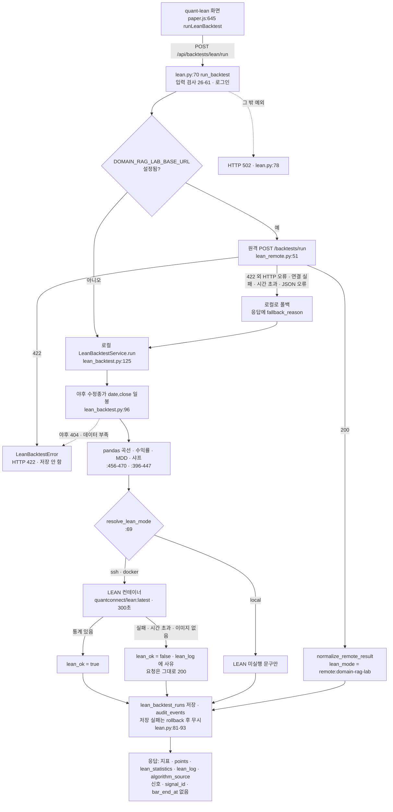
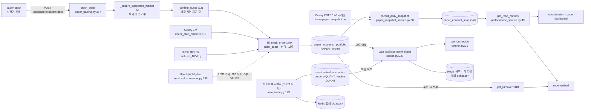

# 강민석 님 ④ 파트(LEAN 백테스트 · 모의투자 운용 · 의사결정) 3차 as-is 초안 재료 — 조사 결과 (2026-10-23)

| 문서 정보 | |
|---|---|
| **판 · 상태** | 결과 v1.0 · 읽기만 한 조사 — 코드 · 설계서 · 대장 · 글 폴더를 고치지 않았고 새로 쓴 파일은 이 결과 하나다. 초안이 아니라 **재료**다(초안 · 판 올리기는 팀장이 따로 한다) |
| **출처** | 팀장(이동원) 지시 10-23 「강민석 님 ④ 파트의 3차 as-is 초안 재료 모으기」 · 바탕 결정 S110 「팀원 파트도 코드 기준 as-is 를 팀장이 초안으로」 · 10-23 통합 산출물 점검(`배경조사/2026-10-23-통합산출물-팀원설계-포함점검/결과.md` 표 2 의 T · 7절) · 10-18 초안 넷(`p2/01-analysis/research/배경조사/2026-10-18-팀원설계-초안/` 00 ~ 03) |
| **기준** | main `5a3bfc9`(2026-10-23 13:46 KST · #326 머지). 10-18 초안의 기준은 `ed3221f`(2026-10-17 22:05)이고, 그 뒤 main 에 든 커밋을 `git log ed3221f..HEAD` 로 찾았다. 읽는 사이 메인 세션이 작업 트리의 `app/config.py` · `docker-compose.yml` 등을 고치고 있어(의존성 판 · 번역 모음 작업), 그 두 파일은 **HEAD 판**(`git show HEAD:…`)의 줄 번호를 적었다. 나머지 인용 파일은 작업 트리와 HEAD 가 같다(`git diff HEAD --stat` 로 확인) |
| **조회일** | 2026-10-23 KST 14시대 ~ 15시대 |
| **확실도** | **상** = 파일:줄을 직접 읽음 · **중** = 읽은 것에서 해석(실행하지 않음) · **하** = 추정 |
| **읽는 법** | `p2/` = `docs/phase-2/` · `p3/` = `docs/phase-3/`. 코드 경로는 아래 짧은 이름으로 적었다 — 라우트 `lean.py` · `paper.py` · `quant.py` · `stocks.py` · `dashboard.py` = `app/routes/…` · 서비스 `lean_backtest.py` · `lean_remote.py` · `paper_trading.py` · `paper_snapshot_service.py` · `performance_service.py` · `evaluation_risk.py` · `backtest_100d.py` · `quant_pipeline.py` · `investment_research.py` · `opinion.py` · `mtf_signals.py` · `auto_trade.py` · `risk_guard.py` · `execution_policy.py` · `trading_cost.py` · `quote_now.py` · `stock.py` = `app/services/…` · 이름이 겹치는 둘만 `routes/us_reserve.py` ≠ `services/us_reserve.py` · `routes/tradingview.py` ≠ `services/tradingview.py` 로 적음 · `models/…` = `app/models/…` · `tasks/paper_snapshot.py` = `app/tasks/…` · `celery_app.py` · `config.py` = `app/…` · 화면 `paper.js` · `robo.js` · `dashboard.js` · `core.js` · `main.js` · `common.js` · `decision-signals.js` = `public/js/…` · `app.html` = `public/app.html`. 「옛 줄」 = 10-18 초안이 인용한 줄 · 「지금 줄」 = 5a3bfc9 줄. git 은 `log` · `show` · `diff` · `status` 읽기만 썼고 앱 · DB · 컨테이너 · 시험을 돌리지 않았다. 강민석 님 커밋 작성자 이름은 `rkdalstjr`, 오준영 님은 `GoonGuMa`, 신장환 님은 `JangHwan-Shin` |

## 맨 위 5줄 요약

1. **10-18 뒤 강민석 님 코드는 10-20 하루에 몰려 있고(코드 11 · 시험 1 · 발표 자료 2 커밋) 전부 2차 ④(모의투자 운용) 쪽이다** — 시세 칸 · 장 닫힘 안내(#256) · 해외 종목 거부(#255) · 대시보드 계좌 탭(#210 · #270 · #250) · 100일 백테스트(#295) · 위험 관문 열쇠 분리(#297). **LEAN 코드(`lean.py` · `lean_backtest.py` · `lean_remote.py`)는 09-15 ~ 10-03 이후 한 줄도 바뀌지 않았다 — 3차 ④ 구현은 아직 0 이다.**
2. 10-18 초안 **C1 ~ C13 은 해소 1(C1) · 일부 바뀜 1(C13 화면 글) · 그대로 11**, **Q1 ~ Q12 는 답이 나온 것 1(Q5)**, 초안 서술이 이제 틀린 곳이 아홉(2.4절 — T9 는 줄 번호). 결함 대장에 이미 있는 DF-137(미국 예약 체결 막힘) · DF-139(`Order` 가져오기 빠짐)는 5a3bfc9 에서도 **그대로 열려 있고**, 2.5절 열한 줄 가운데 대장에 없는 새 확인 거리가 여덟(N1 · N2 · N4 ~ N8 · N10), 대장이 코드보다 낡은 것이 하나(N3), 이미 알려졌거나 요구 비고와 일치하는 것이 둘(N9 · N11)이다. 최근 전체 시험(84차)의 실패 다섯 중 넷(DF-110 · DF-137)이 ④ 몫 시험이다(1.7절).
3. **LEAN 은 지금 「백테스트를 한 번 돌려 결과 한 장을 주는 요청 · 응답」 이다.** 현재 신호 · `signal_id` · 판단 봉 시각 · 전략 판이 응답 · 저장 어디에도 없고, 입력은 야후 수정종가 `date,close` 두 칸의 **일봉**뿐 · 비용 0 이며, 화면의 수익률 · MDD · 샤프는 LEAN 이 아니라 pandas 가 계산한다(1.4절).
4. 그래서 10-26 협의에 걸리는 칸이 많다 — 오준영 님 신호 예시(`timeframe 5m` · `signal_id` · `bar_end_at`)는 일봉 요청 · 응답과 맞지 않고, 신장환 님 판 2 칸 중 코드에 있는 것은 `entry_mode` · `exit_mode` · % 손절 · 재진입뿐이며 그마저 **LEAN 경로에는 없고** `quant_pipeline.py` 에만 있다. LEAN 입력에 고가 · 저가가 없어 ATR 지표 대조도 지금 입력으로는 안 된다. 정할 것은 열두 건(3.4절).
5. 강민석 님 3차 ④ 계획 · 설계 파일은 없다(`p3/00-management/plans/` 6파일 · `p3/02-design/system/` 어디에도 ④ 없음). 대신 10-16 ~ 10-20 이슈 답글에 강민석 님이 3차로 넘긴 후보 · 약속이 열둘 있다(#242 의 다섯 — 지표 카드 · 일별 평가액 차트 · 진단 카드 낱말 · 본인 모의 설정만 적용 · 장중 평가 시세 — 와 #220 · #255 해외 비용 모델 · 대체 환율 정책 · #231 · #256 · #250 · 3.5절). 팀장 초안 목차 제안은 5절.

---

## 1. 지금 코드가 하는 일 (as-is)

### 1.1 한눈에 — 강민석 님 ④ 가 맡은 것과 코드의 중심

| 차수 | 요구 | 코드의 중심(5a3bfc9) | 화면 | 3차 구현 상태 |
|---|---|---|---|---|
| 2차 | `P01-④-1` 비용 반영 성과 | `trading_cost.py`(비용 모델) · `quant_pipeline.backtest`(비용 전후 :295-453) · 모의계좌 성과 `performance_service.py` + `evaluation_risk.py` | dashboard 「기본 전략 성능」 · robo-decision · robo-testbed · paper-dashboard | 2차 끝 |
| 2차 | `P01-④-2` 의견 변환 | `opinion.py` 규칙 표 · `GET /api/stocks/mtf-signal`(`stocks.py:927-1003`) · T2 `signal_snapshots.opinion` | robo-decision 근거 카드 | 2차 끝 |
| 2차 | `P01-④-3` 모의 주문 · 운용 | `paper_trading.py` · `paper.py` · `routes/us_reserve.py` · `backtest_100d.py` | paper-stock · paper-dashboard | 2차 끝 |
| 3차 | `P02-④-1` 같은 데이터 · 기간 · 수수료 LEAN | `lean.py` · `lean_backtest.py` · `lean_remote.py` | quant-lean | **코드 변경 0** · 요구 대장 비고 「LEAN 은 아직 야후 데이터 · 비용 0 으로 돈다」(`p3/01-analysis/requirements/대장/요구-대장.tsv:25`) |
| 3차 | `P02-④-2` 한 성과 정의 | 샤프 정의 셋 · 승률 정의 둘(1.4절 끝) | (`U9` 「지금 없음」 :39) | 변경 0 |
| 3차 | `P02-④-3` TradingView ↔ LEAN 비교 | `routes/tradingview.py:131-185` · `services/tradingview.py:217-290`(이동원 몫 파일) | `indicator-tradingview`(이동원) | 변경 0 · 비고 「받는 API 가 없다」(요구-대장.tsv:27) |

3차 역할은 계획서 표 6 에 있다 — ④ LEAN 주담당 강민석 · 부담당 오준영(`p3/00-management/plans/프로젝트계획서.md:176`), ①② 신장환(부 강민석) · ③ 이동원(부 강민석) · ⑤ 오준영(부 강민석)(:174-177) · WBS 3.6(`WBS.md:149-152`). 즉 강민석 님은 10-26 협의의 세 갈래(카드 · Pine · 증권사)에 모두 부담당으로 걸린다. (상)

### 1.2 라우트 표 (④ 몫 · 5a3bfc9)

인증 칸의 「로그인」 = `get_current_user_any`(세션 쿠키 또는 JWT, `app/lib/jwt_auth.py:250-270`), 「세션」 = `get_current_user`(쿠키 세션만). 모든 줄의 확실도는 상.

| 방법 | 경로 | 인증 | 서비스 함수 | 파일:줄 |
|---|---|---|---|---|
| GET | `/api/backtests/lean/status` | **없음** | `lean_status()` + `lean_remote.remote_status()` · `is_enabled()` | `lean.py:64-67` · `lean_backtest.py:80-91` · `lean_remote.py:25-30` |
| POST | `/api/backtests/lean/run` | 로그인 | `lean_remote.run_or_fallback` → `LeanBacktestService.run` | `lean.py:70-94` · `lean_remote.py:64-74` · `lean_backtest.py:125-213` |
| GET | `/api/backtests/lean/history` | 로그인 | `LeanBacktestRun` select(limit 1~200 · 기본 30 · 화면은 15) | `lean.py:97-109` · `paper.js:726` |
| GET | `/api/quant/ml/stocks` | 없음 | `QUANT_STOCKS` 상수 | `quant.py:11-14` |
| GET | `/api/quant/ml/run` | 세션 | `get_candles` → `quant_pipeline.run_pipeline`(LightGBM · MLP · 규칙 → 백테스트 → `alpaca_execute` mockup) | `quant.py:17-44` · `quant_pipeline.py:515-592` |
| POST | `/api/quant/ml/run/batch` | 세션 | 종목마다 `run_pipeline` | `quant.py:53-66` |
| GET | `/api/quant/pipeline` | 세션 | `investment_research.backtest_strategy`(:96) 또는 `quant_pipeline.backtest_custom_indicator`(:595) + `data_provenance.candle_provenance` | `stocks.py:1190-1267` |
| GET | `/api/stocks/mtf-signal` | 세션 | `signal_explain.load_snapshot` → `pattern_view.from_record`/`from_live` → `opinion.decide`(:995) | `stocks.py:927-1003` |
| GET | `/api/quant/auto/status` | 세션 | `auto_trade.get_status` + `decision_signal_view`(오준영 #213) — robo-decision 이 읽음 | `stocks.py:1121-1187` · `decision_signal_view.py:10-37` |
| GET | `/api/quant/risk/status` | 세션 | `risk_guard.risk_status` | `stocks.py:1035-1062` · `risk_guard.py:187-201` |
| GET | `/api/dashboard/accounts` | 세션 | `_safe` → `kis_tab` · `quant_tab` · `paper_tab` · `us_tab` | `dashboard.py:188-193` · 탭 :68 · 114 · 141 · 156 |
| GET | `/api/paper/account` | 로그인 | `pt.account_snapshot`(:911) + `record_daily_snapshot` | `paper.py:62-74` |
| POST | `/api/paper/account/reset` | 로그인 | `pt.reset_account`(:112) | `paper.py:77-82` |
| GET | `/api/paper/stocks/quote` | **없음** | `pt.resolve_stock`(:171) | `paper.py:100-105` |
| GET | `/api/paper/stocks/positions` | 로그인 | `pt.stock_positions`(:249) | `paper.py:108-111` |
| POST | `/api/paper/stocks/orders/preview` | 로그인 | `pt.stock_preview`(:291) | `paper.py:114-120` |
| POST | `/api/paper/stocks/orders` · `/buy` · `/sell` · `/pine` | 로그인 | `_place_stock` → `pt.stock_order`(:357) → `_fill_stock_order`(:379) · 출처 `PAPER`(pine 은 `PINE`) | `paper.py:123-153` |
| GET | `/api/paper/stocks/orders/history` | 로그인 | `pt.stock_order_history`(:441) | `paper.py:156-159` |
| POST · GET · DELETE · POST | `/api/paper/stocks/orders/stop` · `/stop/{id}` · `/stop/check` | 로그인 | `place_stop_order`(:939) · `list_pending_stop_orders`(:981) · `cancel_stop_order`(:995) · `check_stop_orders`(:1010) · 1분마다 정기 작업도 돈다(`celery_app.py:123` → `tasks/sync_tasks.py:162`) | `paper.py:165-203` |
| GET | `/api/paper/performance/metrics` | 로그인 | `get_robo_metrics`(`performance_service.py:49`) | `paper.py:468-474` |
| POST | `/api/paper/performance/snapshot` | 로그인 | `record_daily_snapshot`(`paper_snapshot_service.py:38`) | `paper.py:477-494` |
| POST · GET · GET · DELETE | `/api/paper/performance/backtest-100d` · `/status/{task_id}` · `/exists` · (DELETE) — **10-18 뒤 새 라우트 넷** | 로그인 | `backtest_100d.run_backtest`(백그라운드) · `get_job` · 직접 `Order` count(**`Order` 가져오기 없음**) · `delete_backtest` | `paper.py:499-536` · `backtest_100d.py` |
| POST | `/api/paper/performance/simulate` | **관리자**(`require_roles("admin")`) | 라우트 안에서 직접 — 그 사용자 스냅샷을 모두 지우고 랜덤 워크 15일 | `paper.py:539-591` |
| GET | `/api/paper/performance/returns-table` · `/risk-metrics` · `/turnover` · `/allocation-history` · `/benchmark` | 로그인 | `performance_service.py` :230 · 252 · 318 · 356 · 386 | `paper.py:598-636` |
| GET · POST · DELETE | `/api/paper/stocks/us-market` · `/reservations`(GET · POST) · `/reservations/{id}` | us-market 은 없음 · 나머지 로그인 | `services/us_reserve.py` :115 `market_state` · :237 `list_reservations`(`fill_due` :195 를 부름) · :136 `place` · :166 `cancel` | `routes/us_reserve.py:33-70` |

- 같은 `paper.py` 안의 코인(11) · 대체자산(6) · Open API 키(3) · Alpaca(2) 라우트 22개는 같은 현금(`paper_accounts.cash`)을 쓰지만 ④ 본 줄기가 아니라 이 조사에서 보지 않았다(API 명세서의 파트(제안) 칸은 코인 · 대체자산 P-E · Open API 키 P-B · `paper` 전체가 P-E 45 · P-B 3 — 합의된 소유가 아니라 자리표: `p3/02-design/api/API명세서.md:95 · 165 · 858-877`. `quant` 3 · `lean` 3 은 P-D :157 · 169, `dashboard` 1 은 미배정 :167).
- `/api/quant/ml/*` 세 라우트는 **부르는 화면 0 · 시험 0** 이다(`public/` · `tests/` 에서 `quant/ml` grep 0건). `alpaca_execute` 는 키를 넘기지 않아 늘 mockup 응답이다(`quant_pipeline.py:571` 호출에 키 인자 없음 → :501-510). (상)
- `GET /api/backtests/lean/status` 는 인증이 없는데 응답에 로컬 모드 정보와 원격 설정(`remote.base_url` · `api_key` 유무) · ssh 모드면 `ssh_host` 가 실린다(`lean.py:64-67` · `lean_backtest.py:80-91` · `lean_remote.py:29-30`). API 명세서도 「인증 없음 54 의 마지막 하나는 LEAN 상태」 라고 적어 두었다(`API명세서.md:140`). 위험으로 볼지는 판단 거리다. (상 · 사실)

### 1.3 데이터 흐름

**<그림 1> LEAN 백테스트 요청 한 건** (`quant-lean` 화면 → 응답 · 저장까지)

**<그림 2> 모의투자 운용 · 성과 · 의견의 자료 흐름** (10-18 초안 그림 1 을 지금 코드로 다시 그림 — 점선 = 막혀 있거나 정기 작업)

**<표 1> 무엇을 읽고 어디에 쓰나** (확실도 상)

| 흐름 | 읽는 것 | 쓰는 것(표 · 열쇠) | 근거 |
|---|---|---|---|
| LEAN 백테스트 | 야후 chart API 일봉(수정종가) · 정적 참조 데이터 3파일 · 설정 | `lean_backtest_runs`(사용자 · 티커 · 전략 · 엔진 60자 · 기간 · 수익률 · MDD · 샤프 · `lean_ok`) · `audit_events` · 임시 작업 폴더(`prices.csv` · `main.py` · `results/` — 끝나면 삭제, `LEAN_KEEP_WORKDIR` 이면 보존) | `models/paper.py:119-135` · `lean.py:81-93` · `lean_backtest.py:237-270` |
| 지표 백테스트 | `get_candles`(국내 일봉은 수집 DB, 아니면 야후) | 저장 없음(응답만) + 자료 출처 칸(`source` · `data_from` · `data_as_of` · `data_note`) | `stocks.py:1225-1267` · `data_provenance.py:113-133` |
| 의견 | T2 `signal_snapshots` · `portfolio`(PAPER · QUANT 보유) · `broker_settings`(킬스위치 · 한도) · 모의계좌 총자산 | Redis `quant:day-equity:{uid}:paper:{날짜}` 한 개(그날 첫 값 고정) | `stocks.py:944-1003` · `risk_guard.py:134-147` |
| 모의 주문 | 시세(`resolve_stock` 60초 저장 → `_confirm_quote`) · 모의계좌 | `paper_accounts.cash` · `portfolio`(book PAPER) · `orders`(source PAPER · WEB · PINE · SIM, broker virtual, 비용 칸 `commission` 등) · `audit_events` | `paper_trading.py:379-438` · `paper.py:123-132` |
| 일별 스냅샷 | `account_snapshot`(현금 + 주식 · 코인 · 대체자산 평가) | `paper_account_snapshots`(`user_id + snap_date` 유일 · `epoch` 칸) | `paper_snapshot_service.py:38-134` · `models/paper_snapshot.py:22-51` |
| 성과 지표 | 스냅샷 전부 · `orders` 전부(회전율) · KOSPI 지수 일봉 2년(`^KS11`) | 응답만 | `performance_service.py:49-156 · 318-353 · 386-436` |
| 100일 백테스트 | 일봉 1년 × 10종목(`QUANT_STOCKS` 앞 10) · `stock._generate_signal` | **`reset_account` 로 주문 · 보유 · 코인 · 대체자산을 지우고** `orders`(source SIM) · `portfolio` · `paper_account_snapshots` 를 새로 채움 | `backtest_100d.py:41-44 · 129-139 · 152-239` |
| 대시보드 | 네 탭 — KIS(사용자 KIS 키 또는 게이트웨이) · 자동매매 장부 · 모의계좌 · Alpaca | 응답만 | `dashboard.py:68-172` |

### 1.4 LEAN 실행 방식 (로컬 · 원격 · 참조 데이터)

표의 줄은 모두 상(코드 직접 읽음)이다. 코드가 정하지 않은 「LEAN 엔진 기본 수수료 · 체결」 만 확인 못 함(6절 3).

| 항목 | 지금 코드 | 근거 |
|---|---|---|
| **요청 입력** | `ticker`(영문 · 숫자 · `. ^ = -` 12자 이내, 6자리 숫자면 `.KS` 자동) · 검증 기간 · 비교 기간 · 초기 자금 1,000 ~ 10억 · 전략 넷(`buy_hold` · `ma_cross` · `dca` · `momentum`) · 창 크기 넷. **카드 · 전략 ID · 판 · 비용 · 체결 조건 칸은 없다** | `lean.py:26-61` · `lean_backtest.py:35-40` |
| **실행처 고르기** | ① `DOMAIN_RAG_LAB_BASE_URL` 이 있으면 원격이 1순위(`POST {base}/backtests/run` · 타임아웃 `LEAN_TIMEOUT_SECONDS` 300 + 30초 · `X-API-Key`) ② 원격이 **422 를 뺀 모든 HTTP 오류(4xx · 5xx 포함) · 연결 실패 · 시간 초과 · JSON 오류**면 로컬로 폴백 + `fallback_reason` · 422 는 폴백 없이 그대로 ③ 로컬은 `LEAN_MODE`(기본 `auto`): `LEAN_SSH_HOST` + 키가 있으면 ssh → `docker` CLI 나 `/var/run/docker.sock` 이 있으면 docker → 둘 다 없으면 local(LEAN 안 돌림) | `lean_remote.py:25-30 · 51-74` · `lean_backtest.py:69-77` · `config.py:75-90 · 176-178`(HEAD) |
| **docker 모드** | 작업 폴더 `LEAN_WORKDIR/workflow-<무작위 12자>/{data,results,main.py}` → `docker run --rm -v <볼륨>:/workspace quantconnect/lean:latest --environment backtesting --algorithm-language Python …`. 컨테이너 안에서는 Docker 소켓 Engine API 로 같은 일을 한다(이미지 없으면 「Docker 이미지가 없습니다」). **백테스트 환경 한 번 실행**이지 라이브 · 모의 신호를 내는 상시 실행이 아니다 | `lean_backtest.py:217-300` |
| **이미지 · 환경** | 태그 고정 없음(`latest`) · 약 14GB(점검 스크립트 주석) · 앱 컨테이너에 `/var/run/docker.sock` 을 붙이고 named volume `lean-workflows` 로 작업 파일을 주고받음. 오준영 님 10-22 점검: 원격 미설정 · 로컬 이미지 없음 | `config.py:76`(HEAD) · `scripts/personal/check.ps1:452-458` · `docker-compose.yml:103-105 · 113-117 · 307-310` · `증권사-연동-자동화-설계.md:142-143` |
| **입력 자료** | 야후 chart API 일봉의 `adjclose`(없으면 `close`)를 **`date,close` 두 칸 CSV** 로 만들어 넣는다 — LEAN 쪽 `YFPrice` 커스텀 데이터가 두 칸만 읽고 `Resolution.DAILY`. **고가 · 저가 · 거래량이 없다. 수집 DB 를 쓰지 않는다**(요구 `P02-④-1` 은 수집 DB 의 같은 데이터를 요구). 수정종가는 시험이 지키고(`tests/test_base_code_merge_guard.py:448`) 야후 줄 수는 봉인선 19 로 막혀 있다(`tests/test_no_yahoo_regression.py:44`) | `lean_backtest.py:96-119 · 521-524 · 546-558 · 566` |
| **참조 데이터** | `lean_reference_data/` 3파일 — `market-hours/market-hours-database.json` 3,303,441 B · `symbol-properties/symbol-properties-database.csv` 695,714 B · `symbol-properties/security-database.csv` 159 B. LEAN 엔진이 `Initialize()` 전에 읽는 정적 파일을 QuantConnect/Lean 저장소에서 가져온 것. docker 모드는 실행마다 작업 폴더로 복사, ssh 모드는 원격 `_shared-lean-data` 에 한 번 올림. 세 파일이 모두 있는지가 `reference_data_ok` | `lean_backtest.py:56-62 · 89 · 243-249 · 362-374` |
| **전략 4종의 LEAN 알고리즘** | 파이썬 소스를 문자열로 만들어 쓴다(결과의 `algorithm_source`). `ma_cross` 는 `단기 > 장기` 이고 미보유면 전액 매수, `단기 <= 장기` 이고 보유면 청산. `buy_hold` · `ma_cross` · `momentum` 은 전액 보유(`set_holdings(asset, 1)`), `dca` 는 간격마다 비중을 늘려 100% 까지 — 수량 지정 · 손절 · 익절 개념은 없다 | `lean_backtest.py:561-634`(`ma_cross` :583-588) |
| **화면 지표의 주인** | 수익률 · MDD · 샤프 · 연환산 · 노출 일수 · 거래 횟수는 **pandas** 가 계산한다(`ma_cross` 는 `shift(1)` 로 다음 날 반영). LEAN 은 `summary.json` 통계 9개(없으면 앞 10개)와 로그만 돌려준다. 두 계산을 자동으로 맞대는 코드 · 허용 오차 · 차이 보고는 **없다** | `lean_backtest.py:13-14 · 174-185 · 352-360 · 396-447 · 456-482` |
| **비용** | 없음 — 응답 `disclaimer` 「수수료 · 슬리피지 … 반영하지 않으며」 · pandas 곡선에 비용 항 없음 · LEAN 소스에 수수료 모델 설정 없음. (LEAN 엔진 기본 수수료가 커스텀 데이터에 어떻게 적용되는지는 확인 못 함 — 6절) | `lean_backtest.py:212 · 561-634` |
| **체결 시점** | pandas = 신호 다음 날 포지션 반영(종가 수익률). LEAN = `on_data` 에서 주문(엔진 기본 체결). **`entry_mode` · `exit_mode` 입력 없음** | `lean_backtest.py:478-482 · 576-588` |
| **결과 칸** | `ticker` · `engine`(문자열) · `lean_mode` · `lean_ok` · `strategy`(+label) · 기간 · 비교 기간 · `strategy_return_pct` 등 · `points` · `benchmark_points` · `lean_statistics` · `lean_log`(끝 6000자) · `algorithm_source` · `disclaimer` · (원격이면 `source` · 폴백이면 `fallback_reason`). `points` · `benchmark_points` 는 길면 120 ~ 240개로 줄여 보낸다(`step = len // 120` :179-184). **신호 · 식별자 · 전략 판 · 비용 조건 · 데이터 기준 칸 없음**(가장 가까운 것은 `market_snapshot.as_of` 날짜와 `trend` 문장) | `lean_backtest.py:189-213 · 429-447` · `lean_remote.py:40-48 · 74` |
| **저장** | `lean_backtest_runs` 한 줄 — 파라미터 · 모드 · 폴백 · 알고리즘 소스는 저장하지 않는다 | `models/paper.py:119-135` |
| **시험** | `TC-LR` 4건(`tests/test_lean_remote.py` — 원격 정규화 · 422 · 연결 실패 폴백 · 미설정). `lean_backtest.py` 안쪽(docker · ssh · 분석)을 부르는 시험은 없다. 같은 요구 `P02-④-1` 의 야후 봉인 `TC-YH` 는 **지금 두 시험 모두 실패 중**이다(1.7절) | `tests/test_lean_remote.py:28-60` · `tests/test_no_yahoo_regression.py:112 · 139` |

**LEAN 숫자 중 pandas 인 것** — TradingView ↔ LEAN 비교(이동원 몫 `routes/tradingview.py:131-185`)는 `lean_service.run` 을 **직접** 부르고(원격 `lean_remote` 를 거치지 않는다 :157), 그 「LEAN 지표」 의 `net_profit_pct` · `max_drawdown_pct` · `total_trades` · `sharpe_ratio` 는 결과의 pandas 칸이며 LEAN 통계에서 가져오는 것은 승률(`Win Rate`)뿐이다(`services/tradingview.py:220-236`). 그래서 같은 「LEAN 백테스트」 가 `/api/backtests/lean/run` 은 원격 우선 · TradingView 비교는 로컬 직접이라 실행처가 둘이다. (상)

**성과 정의가 갈린 곳** — 샤프: ① `ta_utils.sharpe_ratio`(무위험 0 · `std` 표본)를 `quant_pipeline.py:381` · `investment_research.py:185` 가 쓴다 ② LEAN 화면용 `(연환산수익률 − 2%) / 연환산변동성`(모집단 표준편차, `lean_backtest.py:401-402`) ③ 모의계좌 성과 `evaluation_risk.sharpe_ratio`(:68, 무위험 2%). 승률: 일 단위(보유 구간 중 양의 날 비율, `quant_pipeline.py:384-386`)와 LEAN 통계의 `Win Rate`(거래 단위). 요구 대장 비고(「샤프 계산이 세 곳」 :13 · 「승률 정의 두 벌 · 손익비 없음」 :26)가 코드에서도 그대로다. (상)

### 1.5 모의투자 운용 · 성과 · 의견 (10-18 초안 뒤 달라진 모습)

- **장부는 둘** — 모의계좌(`paper_accounts` 현금 1억 · `portfolio.book = PAPER` · 수동 주문 · 리밸런싱 · TradingView · 100일 백테스트)와 자동매매 가상계좌(`quant_virtual_accounts` 1천만 · `book = QUANT`)(`models/trading.py:15-16 · 142-157` · `auto_trade.py:60`). 대시보드가 두 장부를 다른 탭으로 보인다(`dashboard.py:114 · 141`). (상)
- **주문 한 건**(국내 시장가): 해외 종목 거부(`_ensure_supported_market` :65-84, 미리 보기 :301 · 주문 :366 · 체결 :386 · 스탑 등록 :958) → 비용 `order_costs`(:393-400, **슬리피지 없음** `trading_cost.py:304-306`) → 현금 `FOR UPDATE` 잠금(:402) → 매수는 현금 차감 · 평균단가는 체결가 기준 · 매도는 보유 차감 → `orders` 줄(`filled` · `virtual`)(:431-435) → 커밋은 라우트(`paper.py:129`). **체결 직전에 `_confirm_quote`(:231 · `quote_now.py:216`)가 사용자 증권사 키가 있으면 지금 값으로 가격을 바꾼다**(10-19 이동원 `276d34c`). 장이 닫혀 있어도 막지 않고, `market_open`(국내 `is_krx_market_open`, :225) 을 응답에 실어 화면이 알린다(10-20 `8336039`). (상)
- **스탑(감시) 주문**: 등록 때 `status=pending` 한 줄, 발동 때 그 줄을 `filled` 로 바꾸고 `_fill_stock_order` 가 체결 줄을 하나 더 만든다(:1039-1048 · :431-435). 발동 판정에 장 시간 검사는 없다(독스트링 :947 「호출자 몫」 · 안내 글만 「장 시간에만」 `app.html:406`). (상)
- **성과**: 숨김 규칙 — 스냅샷 20개 미만 · 일변동성 0.5% 미만이면 지표를 숨기고 까닭 글(`MIN_SNAPSHOTS` · `MIN_STD_DEV` `performance_service.py:98-122`) · 샤프 · 소르티노 ±10, 스털링 · 칼마 ±20 넘으면 숨김(:126-129) · 무위험 2% · 252일 · DSR 시도 50 · 스털링 상위 3(:53-57). 일별 스냅샷 정기 작업은 KST 15:40 거래일만(`celery_app.py:115-119` · `tasks/paper_snapshot.py:43-62`, 달력을 못 읽으면 평일). (상)
- **의견**: 규칙 표 하나(`opinion.py:21-50`) — 입력 T2 신호 · 신뢰도 · 보유 여부 · 위험 관문. 응답에 `opinion` · `opinion_rule` · `held` · `risk_gate`(`stocks.py:995-1003`). 매일 기록(T2)에도 미보유 가정으로 의견을 채운다(`mtf_signals.py:189-211`). 위험 관문은 킬스위치나 **모의계좌 총자산**의 당일 손실 한도 초과일 때 켜지고, 열쇠는 이제 `…:paper` 다(`stocks.py:974-990`). (상)
- **100일 백테스트(#295 · 10-20 새)**: 화면 버튼(paper-dashboard 에 JS 가 만드는 카드) → 서버 백그라운드 작업 — **먼저 그 사용자의 SIM 주문 · 스냅샷 전부를 지우고 `reset_account`(WEB · PAPER 주문 · PAPER 보유 · 코인 · 대체자산 삭제 + 회차 +1 + 현금 1억)를 부른 뒤**, 2026-07-13 ~ 2026-10-20(고정 날짜) 평일마다 종목 10개의 `stock._generate_signal` 신호를 그날 종가로 체결하고 스냅샷을 그날 날짜로 넣는다(`backtest_100d.py:37-44 · 129-139 · 152-239`). 진행 상태는 프로세스 메모리(`_JOBS`)에 둔다(:8 · 46). 카드 글은 「완료 후 QFRS 지표가 100일치로 계산됩니다」(`paper.js:993`)라고 적었다 — 스냅샷이 20개 미만이면 지표를 숨기는 규칙(`performance_service.py:98-122` · #220)과 이어지는 것으로 읽힌다(해석 · 중). (서술은 상)
- **대시보드**: 계좌 응답을 먼저 그리고 리밸런싱 상태는 로보 탭에만 따로 기다린다(`dashboard.js:105-145` · 10-20 `adc1f7a`). 탭 실패 글은 서버가 한국어 한 줄로 바꾼다(`dashboard.py:36-51` · `89f7349`). 「기본 전략 성능」 은 여전히 `cost_bps=10&slippage_bps=0`(flat)이고 자료 출처 · 기간 한 줄이 더해졌다(`dashboard.js:44-53` · `f7c8806`). (상)

### 1.6 실패 처리

표의 줄은 모두 상(코드 직접 읽음 · 실행하지 않음).

| 곳 | 실패 | 지금 동작 | 근거 |
|---|---|---|---|
| LEAN 입력 | 기간 역전 · 지원 안 하는 전략 · 야후 404 · 빈 응답 · 거래일 부족 | `LeanBacktestError` → **422** + 메시지 | `lean_backtest.py:104-117 · 140-157` · `lean.py:76-77` |
| LEAN 엔진 | 이미지 없음 · 시간 초과 · 컨테이너 · ssh 오류 | **200 으로 성공**, `lean_ok=false` + `lean_log` 에 `[LEAN 실행 실패]` 또는 `[LEAN 실행 오류]` 사유, 화면 지표는 pandas 값 그대로 | `lean_backtest.py:163-170` · `paper.js:673` |
| LEAN 미설정 | `LEAN_MODE=local`(docker · ssh 없음) | 200 + `lean_ok=false` + 「[LEAN 미실행] …」 | `lean_backtest.py:171-172` |
| 원격 | 422 외 HTTP 오류(4xx · 5xx) · 연결 실패 · 시간 초과 · JSON 오류 | 로컬 폴백 + `fallback_reason`(화면에는 안 보임) · 422 는 폴백 안 함 | `lean_remote.py:57-74` |
| 그 밖 예외 | 야후 5xx · 네트워크 등 | **502** 「외부 데이터 또는 LEAN 실행 오류」 | `lean.py:78-79` |
| 결과 저장 | DB 오류 · 응답 키 부족 | rollback 하고 무시 — 응답은 정상(이력에 안 남음) | `lean.py:81-90` |
| 모의 주문 | 현금 · 보유 부족 · 시세 없음 · 해외 종목 · 잘못된 수량 | `PaperTradeError` → rollback + **400** 한국어 글(시세 없음의 `quote` 만 404) | `paper.py:123-132 · 100-105` · `paper_trading.py:42-85 · 405-425` |
| 스탑 발동 | 해외 · 현금 부족 | 줄을 `skipped` 로 두고 사유를 결과에 | `paper_trading.py:1055-1060` |
| 성과 지표 | 스냅샷 < 2 · < 20 · 일변동성 < 0.5% | `status=insufficient_data` 또는 `metrics.reason` 글 | `performance_service.py:76-85 · 98-122` |
| 스냅샷 쓰기 | 계좌 조회 길의 예외 | 로그만 남기고 조회는 정상 | `paper.py:68-72` |
| 대시보드 탭 | 한 탭 실패 | 그 탭만 `error`(한국어 한 줄 셋) · 나머지 정상 | `dashboard.py:36-51 · 178-185` |
| 100일 백테스트 | 실행 중 예외 | `_JOBS[task_id]` 에 `status=error` + 「실패: …」 · 프로세스 메모리라 재시작하면 사라짐 | `backtest_100d.py:260-264` |
| 100일 백테스트 확인 | `/exists` 호출 | **`NameError`(→ 500)** — `Order` 를 가져오지 않음. 호출하는 두 화면은 오류를 삼킨다 | `paper.py:522-530`(가져오기 :34 는 `ApiKey` 하나) · `paper.js:1015-1021` · `robo.js:688-711` |

### 1.7 시험 현황 (④ 몫 · 최근 전체 시험 84차 = 2026-10-23 13:21 ~ 13:30)

84차는 통과 2,431 · 건너뜀 7 · 실패 5 이고 실패 다섯은 모두 결함 대장의 알려진 것이다 — DF-110 둘(`test_no_yahoo_regression`) · DF-137 둘(`test_us_reserve`) · DF-140 하나. **다섯 중 넷이 ④ 몫 시험이다**(`p3/04-testing/테스트계획서.md:379` · 결함 :1888 · :1915). 묶음 · 수는 RTM v1.45 3절(`RTM.md:315-317 · 328-330`)과 시험-요구 대장에서 옮겼다. 확실도 상(문서) · 「지금 실패」 칸은 보고된 84차 결과이고 이 조사에서 돌려 보지 않았다.

| 묶음 | 파일 | 수 | 요구 | 지금 |
|---|---|--:|---|---|
| `TC-BC` | `tests/test_backtest_costs.py` | 14 | `P01-④-1` | 알려진 실패 없음 |
| `TC-QFRS` | `tests/test_qfrs_metrics.py` | 15 | `P01-④-1` · `P02-④-2` | 알려진 실패 없음 · **순수 계산만**(성과 서비스 · 라우트는 안 부름) |
| `TC-OP` · `TC-SP` · `TC-SR` | `test_opinion.py` · `test_strategy_spec_apply.py` · `test_spec_rules_and_ml_symbol.py` | 14 · 4 · 12 | `P01-④-2` | 알려진 실패 없음(`TC-OP` 의 라우트 셋은 DB 가 없으면 건너뜀) |
| `TC-I14` · `TC-LT` | `test_paper_ledger_i14.py` · `test_live_trading_guard.py` | 9 · 32 | `P01-④-3` | 알려진 실패 없음 |
| `TC-USO` · `TC-USS` | `test_us_order_path.py` · `test_us_order_screen.py` | 25 · 11 | `P01-④-3` | 알려진 실패 없음 |
| `TC-USR` | `tests/test_us_reserve.py` | 21 | `P01-④-3` | **2건 실패 — DF-137(미국 예약 체결)** |
| `TC-QUOT` | `tests/test_quote_now.py` | 10 | `P01-④-3` | 알려진 실패 없음(10-19 이동원) |
| `TC-STOP` | `tests/test_stop_orders.py` | 6 | (요구 칸 「—」) | 일회용 DB 에서만 돎 |
| `TC-DA` | `tests/test_dashboard_accounts.py` | 8(10-18 초안은 6 — 오준영 님 #211 · #212 가 더함) | `U9` · `U10` | 알려진 실패 없음 |
| `TC-RGL` | `tests/test_risk_guard_ledgers.py` | 2 | `P02-⑤-2` 로 등록 | 알려진 실패 없음 · `pytest-asyncio` 필요(DF-142) · 열쇠 분리만 재고 `orders_today` 열쇠는 안 잼(N1) |
| `TC-LR` | `tests/test_lean_remote.py` | 4 | `P02-④-1` · `P02-③-2` | 알려진 실패 없음 · 실행처만 재고 「같은 데이터 · 기간 · 수수료」 는 안 잼(요구-대장 설명) |
| `TC-YH` | `tests/test_no_yahoo_regression.py` | 2 | `P02-④-1` | **2건 실패 — DF-110.** `scripts/signals_yahoo.py`(야후 줄 5 · 10-14 `839c533` 강민석 · 결함 대장은 이를 #182 로 적음)가 기준선(`BASELINE`)에 없어 두 시험이 모두 걸린다(코드 확인: 그 파일 이름이 `test_no_yahoo_regression.py` 에 없음). LEAN 줄 수 기준선 19(:44)는 같은 시험 함수 안에서 함께 재므로 지금은 LEAN 쪽 회귀를 따로 못 잡는다(해석 · 중) |
| `TC-CD` | `tests/test_collector_candles_df08.py` | 22 | `P02-④-1` | 알려진 실패 없음 · 앱 · 백테스트가 수집 DB 를 읽는 전제 — LEAN 은 이 길을 안 씀 |
| `TC-TV` | `tests/test_tradingview.py` | 8 | `P02-④-3` | 알려진 실패 없음 · 신호 · 체결 · 비용 층 분리는 안 잼 |
| 안 `TC-XV` · `TC-CO` | (파일 없음) | — | `P02-④-1` · `④-3` / `P01-④-1` · `P02-④-2` | 제안 이름만 |

**시험이 닿지 않는 곳**(함수 · 모듈 이름으로 `tests/` grep 0건 — 상): 회전율 `get_turnover` · 일별 스냅샷 쓰기 `record_daily_snapshot` · `paper_snapshot_service` 전체 · 성과 라우트 `/api/paper/performance/*`(`get_robo_metrics` 는 `test_qfrs_metrics.py` 가 docstring 으로만 언급) · 100일 백테스트 `backtest_100d` · 벤치마크 `get_benchmark_series` · 해외 종목 거부 `_ensure_supported_market` · `UnsupportedMarketError` · 시세 · 주문 응답의 `market_open` 칸(시험에 나오는 `is_krx_market_open` 은 게이트웨이 주문 길의 것이라 별개) · `/api/quant/ml/*` · `lean_backtest.py` 안쪽. (`reset_account` 는 `TC-I14` 가 부른다.) DF-137 이 머지 뒤에야 드러난 까닭이 이 빈 곳이다.

---

## 2. 10-18 초안 대비 바뀐 것

### 2.1 10-18 뒤 강민석 님 몫에 닿은 커밋 (`git log ed3221f..HEAD`)

강민석 님(`rkdalstjr`) 작성 비머지 커밋은 14개 — 코드 11 · 시험 1 · 발표 자료 2 — 이고 모두 10-20 이다. PR 번호는 머지 커밋에서 읽었다. (상)

| 커밋 (PR) | 시각 | 무엇 | 닿은 초안 항목 |
|---|---|---|---|
| `27a1998` (#286) | 10-20 09:59 | 해외 종목 시세 칸 통화 분리(`price_local` · `currency` · `fx_note`) + 미지원 시장 명시적 거부 — `_ensure_supported_market` · `_safe_order_costs` · `UnsupportedMarketError` (#255 · DF-96) | 01 표 4 quote · 7.1 · UC-12 · DF-137 의 원인 |
| `8336039` (#287) | 10:23 | 장 닫힘 안내 — `market_open` · `quote_as_of` 를 시세 · 미리 보기 · 주문 응답에 · 시세 칸 · 확인창 · 체결 알림(#256) | 01 7.3 표 8 · UC-12 8c |
| `adc1f7a` (#288) | 10:32 | 대시보드 계좌 응답 즉시 렌더 · 로보 탭만 리밸런싱 대기(#210) | 01 9절 끝 문장 |
| `7e62cb1` (#289) | 11:02 | 성과 차트 Y축 · 도넛 포맷 — `formatYAxisLabel` · `formatKrw`(#220) | 03 |
| `f7c8806` (#290) | 11:41 | 기본 전략 성능 카드에 자료 출처 · 기간 한 줄(#250) | C12 |
| `89f7349` (#292) | 11:52 | 계좌 탭 예외 원문 대신 한국어 안내(#270 · DF-136 닫힘) | 01 표 5 |
| `49d03e3` (#293) | 11:58 | 「미지원 시장 가드 — 매도만 거부 · 매수 · 예약 복구」 — **실제 변경은 `_ensure_supported_market` 서명에 `side` 인자를 더한 한 줄뿐**(본문이 안 씀) | DF-137 이 열려 있는 까닭 |
| `553523b` (#294) | 12:06 | 시세 칸 장 닫힘 문장 중복 제거 — `closedBanner` 정의를 지우고 사용은 남김(DF-141 · 같은 날 16:12 이동원 `0d65b3f` 가 사용 한 줄을 지워 닫음) | UC-12 |
| `63529ad` (#295) | 12:44 | 100일 백테스트 UI + SIM 표시 — `paper.py` +44 · `backtest_100d.py` 새 277줄 · `paper_trading.py` 1줄(history 의 source 에 SIM) · `paper.js` +168 · `robo.js` +30 | 01 표 4 · 표 6 · C2 · C4 |
| `c2fff8f` | 16:16 | `fix` — `robo.js` 두 줄(공백 한 줄 + **710줄 끝 `;0` 한 글자**) | meeting 문서가 이미 짚음 |
| `ca337eb` (#302) | 16:56 | 위험 관문 열쇠를 장부별 접미사로 — `stocks.py` 2곳 · `auto_trade.py` 1곳(#297 · DF-138 닫힘) | **C1 · Q5** |
| `bdd38a7` (#303) | 16:59 | 시험 `tests/test_risk_guard_ledgers.py`(TC-RGL 2 · `pytest-asyncio` 필요 — DF-142) | C1 |
| `bb48900` · `9ceebda` (#305 · #306) | 17:51 · 17:56 | 발표 자료 강민석 장 재구성 | — |

강민석 님 화면에 닿은 다른 사람의 커밋: 오준영 님 `945326c`(10-19 #213 판단 회차 · 기준 봉 표시 — `decision_signal_view.py` · `decision-signals.js` · `robo.js`) · `51e7a58`(#212 KIS 주문 결과를 가상 체결과 분리 — `dashboard.py` 1줄 · `dashboard.js` 4줄) · `38a9bcd`(#211 KIS 모드 이름 — `dashboard.py` · `dashboard.js`) / 이동원 `276d34c`(10-19 `quote_now` · `_confirm_quote` · 모의 주문 체결 직전 확인 — `paper_trading.py` · `paper.js` · `robo.js`) · `0d65b3f`(10-20 `closedBanner` 한 줄) · `bbc3898`(10-18 대시보드 주기 글을 서버 값으로) / 신장환 님 `2271d12`(10-19 성과 검증 화면 쪽 같은 #250 — `robo.js` · `indicator.js`). (상)

### 2.2 C1 ~ C13

판정 — **해소** · **일부 바뀜** · **그대로**. 줄 번호는 지금 줄이다.

| C | 초안이 말한 것(요지) | 지금(5a3bfc9) | 판정 | 근거 | 확실도 |
|---|---|---|---|---|---|
| C1 | 의견 변환 라우트(모의계좌 1억)와 자동매매(1천만)가 같은 「하루 시작 자산」 열쇠를 써서 패턴 화면을 먼저 열면 자동매매가 −90% 로 읽혀 비상 정지 | 열쇠를 장부별로 갈랐다 — 의견 라우트 `…:paper`, 자동매매 사이클 `…:quant`, 위험 상태 API `…:quant` | **해소** | `ca337eb`(#302 · #297 · DF-138 닫힘 · `p3/04-testing/테스트계획서.md:1916`) · `stocks.py:986 · 1044` · `auto_trade.py:992` · 시험 TC-RGL 2. **부작용 후보 N1** | 상 |
| C2 | 회전율이 모든 주문 줄을 더함 | 그대로 — `Order` 에 `user_id` + `order_type` 조건뿐. 새로 **SIM(100일 백테스트) 주문이 합산에 들어간다** | 그대로(+범위 넓어짐) | `performance_service.py:327-342`(함수 :318) · `63529ad` | 상 |
| C3 | 스탑 발동 때 주문 줄 둘 · 내역이 상태로 안 거름 | 그대로 — 스탑 줄 `filled` + 체결 줄 신규. 내역은 `source ∈ (WEB · PAPER · PINE · SIM)` 만 거르고(SIM 은 새로) 상태 · 종류 칸이 응답에 없다 | 그대로 | `paper_trading.py:1039-1048 · 431-435 · 441-452` · `paper.js:204-246`(상태 열 없음) | 상 |
| C4 | 성과 지표 · 수익률 표가 초기화 회차를 안 거름 | 그대로 — 스냅샷 조회에 `epoch` 조건 없음. **100일 백테스트가 만든 스냅샷은 `epoch` 칸을 채우지 않아(기본 1) 회차와 어긋난다(N2)** | 그대로 | `paper_snapshot_service.py:146-153` · `performance_service.py:65 · 134-139` · `backtest_100d.py:216-228` | 상 |
| C5 | 계좌 · 지표 조회 길에 거래일 판정 없음 | 그대로 — 15:40 정기 작업만 거래일을 본다. 100일 백테스트는 평일이면 스냅샷을 넣고 공휴일을 구분하지 않는다 | 그대로 | `paper.py:68-72` · `performance_service.py:76-77` · `tasks/paper_snapshot.py:43-62` · `backtest_100d.py:153` | 상 |
| C6 | 같은 날 초기화하면 유일 색인이 이전 회차 줄을 덮어씀 | 그대로 | 그대로 | `paper_snapshot_service.py:105-119` · `models/paper_snapshot.py:50` | 상 |
| C7 | RTM 「한 장부」 ↔ 코드 장부 둘 | 그대로 — 결정 대장 D7 ③ 이 「코드와 어긋난다」 를 적어 둔 채 | 그대로 | `models/trading.py:15-16` · `p3/01-analysis/requirements/RTM.md:141` · `p3/00-management/plans/논의결정대장.md:94` | 상 |
| C8 | 의견 값이 넷(관망 포함) · RTM 은 셋 · 목표 비중 인자 없음 · 문턱 0.6 근거 없음 | 그대로. 의견 배지 자리 · 꼴 · 낱말을 묻는 #199 글 폴더에 **답 파일 0** | 그대로 | `opinion.py:15 · 17-18 · 21-27` · `github-archive/2026-10-15/이슈-실사용자피드백-의견배지-강민석/`(00-본문.md 하나) · `RTM.md:140` | 상 |
| C9 | 매일 기록 의견은 미보유 가정 · 칸 설명에 「관망」 없음 | 그대로 | 그대로 | `mtf_signals.py:189-211` · `models/signal.py:41` | 상 |
| C10 | 점수 정규화 분모 8 ↔ 실제 ±6 | 그대로 | 그대로 | `auto_trade.py:391 · 486` · `stock.py:424-471`(RSI ±2 · 이평 ±3 · 볼린저 ±1) | 상(효과는 초안의 추정 그대로 — 중) |
| C11 | 「데모 데이터」 단추는 모두에게 보이고 API 는 관리자만 | 그대로. 강민석 님도 후속(3차) 이슈로 적음(#220 03 답글) | 그대로 | `app.html:1994-1995` · `robo.js:847-856` · `paper.py:539-546` | 상 |
| C12 | 대시보드 기본 전략 성능이 flat 10bp · 보고서는 real 권고 | 인자는 그대로 `cost_bps=10&slippage_bps=0`. 화면 문구 「수수료 10bp · 슬리피지 0bp」 가 적혀 있고 자료 출처 · 기간 한 줄이 더해졌다. 보고서 6절 권고는 반영 안 됨 | 그대로(표시 한 줄 더) | `dashboard.js:44-53` · `app.html:144` · `p3/04-testing/백테스트보고서.md:210-221` · `f7c8806` | 상 |
| C13 | 자동매매 주기 주석이 셋(3분 · 10분 · 600초) | 주석 셋은 그대로. 대시보드 화면 글은 서버 값(`interval_min`)을 쓰게 됨 | 일부 바뀜(화면 글) | `celery_app.py:97` · `auto_trade.py:1` · `config.py:144`(HEAD) · `dashboard.js:155-163` · `bbc3898`(이동원 10-18) | 상 |

### 2.3 Q1 ~ Q12

| Q | 물음(요지) | 지금 | 상태 | 근거 |
|---|---|---|---|---|
| Q1 | 국내 수동 · 자동매매 체결가 규칙(지금 가격 ↔ 다음 거래일 시가) | 코드는 오히려 「체결 직전의 지금 값」 쪽으로 더 갔다(`_confirm_quote`). 장 닫힘은 **표시만**(주문을 막지 않음). 결정 대장 D7 ⑥-2 「P3 다음 거래일 시가」 는 확정으로 적혀 있으나 코드에 없다 | 열림(결정 ↔ 코드 격차 그대로) | `paper_trading.py:219-225 · 231-235 · 357-376` · `quote_now.py:216` · `논의결정대장.md:98` · `기능설계.md:408` |
| Q2 | 신뢰도 문턱 `CONFIDENCE_MIN = 0.6` 근거 | 그대로(「설계서 값이 정해지면 바꾼다」) | 열림 | `opinion.py:17-18` |
| Q3 | 「관망」 을 RTM 의 세 의견에 더할지 | 그대로 — 코드 넷 · RTM 셋 | 열림 | `opinion.py:15` · `RTM.md:140` · #199 답 없음 |
| Q4 | 기록 의견(미보유 가정)과 화면 의견 구분 표시 | 낱말만 「규칙 판단」 으로 바뀐 상태(10-16 `c6dec12`, 초안 이전) · 구분 표시는 그대로 | 열림 | `robo.js:794-798` · `mtf_signals.py:189-211` |
| Q5 | 「하루 시작 자산」 열쇠를 장부별로 | **답이 나왔다** — A안(장부마다 열쇠) 구현 · 강민석 님 #297 01 답글 | **닫힘** | `ca337eb` · `github-archive/2026-10-20/이슈-피드백-자동매매-거짓정지-시작자산/01-2026-10-20-답글-강민석.md` |
| Q6 | 모의 체결 정산에 슬리피지를 안 넣는 것이 의도인가 | 그대로 — `order_costs` 독스트링이 「체결가가 이미 슬리피지를 포함한 실제 체결 결과」 라는 전제를 적었고, 모의 호출은 슬리피지 인자가 없다. 모의 체결가가 지연 시세 · 지금 값이라는 점과 맞는지는 미정 | 열림 | `trading_cost.py:304-306` · `paper_trading.py:393-400` |
| Q7 | 회전율에 넣을 주문의 범위 | 그대로(C2) | 열림 | `performance_service.py:327-342` |
| Q8 | 초기화 뒤 성과 지표가 볼 범위 | 그대로(C4 · C6). 강민석 님이 후속(3차)에 「Sharpe 계산 기간 · 필터 통일」 을 적음 | 열림 | `github-archive/2026-10-16/이슈-피드백-성과지표-뜻없는숫자/03-2026-10-20-답글-강민석.md` |
| Q9 | `order_fills` 표를 모의 체결에서 쓸 계획 | 그대로 — 쓰는 곳은 KIS 체결 동기화뿐 | 열림 | `fill_sync.py:30 · 217 · 229` |
| Q10 | 성과 화면 출처 표기 — 「Khushi (2026)」 ↔ 코드 머리 「Bailey & López de Prado (2014)」 | 그대로. 강민석 님이 3차에 「재는 법」 접기 칸으로 옮기겠다고 적음 | 열림(3차로 넘김) | `app.html:332 · 1999` ↔ `paper.py:465` · `robo.js:860 · 1016` · 위 #220 03 답글 |
| Q11 | 대시보드 주담당 — 점검표 「강민석(추정)」 | 그대로 — UI 명세 <표 16> 은 「강민석」, 이동원 할 일이 한 줄 확인을 기다림 | 열림 | 점검표 TSV 2줄 · `p3/02-design/ui/UI명세서.md:815` · `이동원파트-할일.md:121` |
| Q12 | 「코스콤 테스트베드 기준」 이 가리키는 원문 | 그대로 — 화면은 「KOSPI 대비」, 도움말은 「KOSPI200 대비」, 벤치마크는 `^KS11` | 열림 | `app.html:1892` · `core.js:275` · `performance_service.py:162` |

### 2.4 초안 서술이 이제 틀린 곳

| # | 초안 | 지금 | 근거 |
|---|---|---|---|
| T1 | 01 표 2 `④-3` · 7.3 표 8 · 02 UC-12 — 「미국주식 예약 주문은 다음 정규장 시가로 체결한다」 | **체결이 막힌다** — `fill_due` 가 `currency=USD` 정보를 `_fill_stock_order` 에 넘기고, 거기 첫머리의 `_ensure_supported_market` 이 원화가 아니면 `PaperTradeError` → 예약 줄이 `skipped`. `side` 인자는 서명에만 있고 본문이 안 쓴다. 결함 대장 DF-137(열림) | `services/us_reserve.py:195-233` · `paper_trading.py:65-84 · 386` · `테스트계획서.md:1915` · `49d03e3` |
| T2 | 01 표 4 quote — 「값이 생긴 시각 칸 없음(#256)」 | 있다 — `quote_as_of` · `quote_label` · `market_open` · `price_local` · `currency` · `fx_note` | `paper_trading.py:219-225` |
| T3 | 01 7.3 표 8 국내 시장가 — 장 시간 판정 「없음」 | **표시용 판정은 있고 차단은 없다** — 미리 보기 · 주문 응답에 `market_open`, 화면이 확인창 · 미리 보기 · 알림에 「장이 닫혀 있습니다 — 마지막 종가로 모의 체결」 을 보임 | `paper_trading.py:225 · 352-353 · 373-374` · `paper.js:145-147 · 164-165 · 178` |
| T4 | 01 7.3 스탑 발동 — 「발동 때 받은 지연 현재가」 | 발동 판정도 `_confirm_quote(fresh=False)`(10초 저장본 허용)로 사용자 증권사 키가 있으면 지금 값 | `paper_trading.py:1024-1029` |
| T5 | 01 표 4 성과 라우트 목록 | **100일 백테스트 라우트 넷이 늘었고** `simulate` 줄이 495 → 539 로 옮겨졌다 | `paper.py:499-536 · 539` · `API명세서.md:882-885`(v0.36) |
| T6 | 01 6절 표 6 · 03 2.9 `paper-dashboard` 요소 | 화면에 **JS 가 만드는 카드 `pd-backtest-card`**(요소 id 5: `pd-backtest-card` · `-badge` · `-generate` · `-delete` · `-status`)가 더해졌고, robo-decision 에도 JS 가 만드는 배너 `sim-backtest-banner` 가 생겼다 — 둘 다 `app.html` 에 없어 03 의 요소 표(`id` 가 붙은 태그를 `app.html` 에서 뽑음)에 안 잡힌다 | `paper.js:977-1010` · `robo.js:686-712` |
| T7 | 02 UC-06 · 03 3절 말미 — 「근거 카드는 자동매매 상태 `reasons` 를 그린다(설명 API 아님)」 | 처음부터 부분적으로만 맞았다 — 카드는 `reasons` 를 그리면서 **카드마다 `GET /api/stocks/mtf-signal` 도 부른다**(10-17 `ed3221f` 에도 :713-716 에 있었다). 위쪽 주석 「실제 신호 이유(/api/explain)」 만 낡았다 | `robo.js:739 · 776-835` |
| T8 | 03 U4 — 계좌 초기화 안내 글만 틀림 | 확인창(「주식 · 코인 · 대체자산 포지션과 주문 이력을 모두 삭제」)도 같은 부정확 — 지우는 것은 WEB · PAPER 출처 주문뿐이고 PINE · QUANT · OPENAPI · KIS 주문은 남는다 | `paper.js:84` · `paper_trading.py:129-149` |
| T9 | 01 부록 · 02 · 03 의 줄 번호 전부 | 아래 <표 2> 로 옮김 | — |

**<표 2> 줄 번호 옮김표** (옛 → 지금) — 초안을 가져다 쓸 때 쓴다. 상.

| 파일 | 옛 → 지금 |
|---|---|
| `paper.py` | account 59 → 62 · reset 74 → 77 · quote 97 → 100 · positions 105 → 108 · preview 111 → 114 · orders/buy/sell 132/137/142 → 135/140/145 · pine 147 → 150 · history 153 → 156 · stop 162/177/182/195 → 165/180/185/198 · metrics 465 → 468 · snapshot 474 → 477 · simulate 495 → 539 · returns/risk/turnover/allocation/benchmark 554/562/570/578/587 → 598/606/614/622/631 · 접두어 41 → 44 · 계좌 조회 스냅샷 65-69 → 68-72 |
| `paper_trading.py` | reset_account 70 → 112 · resolve_stock 129 → 171 · stock_positions 193 → 249 · stock_preview 235 → 291 · stock_order 294 → 357 · `_fill_stock_order` 306 → 379 · stock_order_history 367 → 441 · account_snapshot 837 → 911 · place_stop_order 865 → 939 · list_pending 906 → 981 · cancel 920 → 995 · check_stop_orders 935 → 1010 |
| `stocks.py` | mtf-signal 909 → 927 · 위험 관문 961-967 → 974-990 · `opinion.decide` 호출 976-984 → 995-1003 · auto/status 1101 → 1121 · kis quickstart 1069/1075 → 1089/1095 · pipeline 1159 → 1190 |
| `dashboard.py` | kis_tab 50 → 68 · quant_tab 91 → 114 · paper_tab 118 → 141 · us_tab 133 → 156 · `_safe` 155 → 178 · 라우트 165 → 188 |
| `dashboard.js` | auto/status 41 → 42 · pipeline 43 → 44 · custom-indicators 46 → 54 · accounts/rebalance 94 → 108/123 · quickstart 133/162 → 162/192 |
| `paper.js` | 열기 719-729 → 776-786 · account 27(그대로) · reset 58 → 86 · quote 82 → 110 · preview 95 → 132 · orders 125 → 177 · positions 134 → 191 · history 149 → 206 · stop 198/246/261 → 255/303/318 · lean status 547 → 604 · run 602 → 659 · history 669 → 726 · metrics 806 → 875 |
| `robo.js` | auto/status 656 → 719 · metrics 811 → 875 · simulate 786 → 850 · 테스트베드 호출 1030-1327 → 1094-1391 · `rt-refresh` 1365 → 1429 · 근거 카드 주석 676 → 739 |
| `core.js` 안내 글 | robo-decision 232 → 270 · robo-testbed 237 → 275 · paper-dashboard 255 → 293 · quant-lean 260 → 298 · settings 265 → 303 |
| `app.html` 블록 | dashboard 131-167 → 117-153 · paper-dashboard 323-369 → 309-355 · paper-stock 370-441 → 356-427 · quant-lean 642-692 → 628-678 · robo-testbed 1824-1904 → 1879-1959 · robo-decision 1905-1959 → 1960-2015 |
| `main.js` | dashboard 85 → 89 · robo-decision/testbed 120/121 → 126/127 |
| `config.py`(HEAD) | `QUANT_CYCLE_SEC` 144(그대로) · LEAN 설정 75-90 · `DOMAIN_RAG_LAB_*` 176-177 |

### 2.5 10-18 초안에 없던 새 확인 거리

결함 대장에 이미 있는 것은 번호를 적었다. 「새」 는 대장 · 점검표에서 찾지 못한 것이다(`테스트계획서.md` 표 9 · 점검표 TSV grep).

| # | 무엇 | 근거 | 대장 | 확실도 |
|---|---|---|---|---|
| N1 | `/api/quant/risk/status` 가 `risk_status("<uid>:quant")` 로 부르면서 **`orders_today` 열쇠도 `quant:orders:<uid>:quant:<날짜>`** 가 되었다. 주문 수를 늘리는 쪽(`auto_trade.py:1149 · 1176` · `order_retry.py:128`)은 접미사 없는 `quant:orders:<uid>:<날짜>` 라서 상태 API 의 「오늘 주문 수 · 남은 주문 수」 는 키가 갈려 늘 0 · 한도로 읽힌다(Redis · 메모리 폴백 모두 열쇠 글자가 달라 같은 결과). `ca337eb` 의 부작용 후보. 마지막 사이클 로그(`last_cycle_risk`)는 따로 있어 화면 일부는 맞게 보일 수 있다 | `stocks.py:1044-1062` · `risk_guard.py:105-131 · 187-201` | **새** | 키 불일치는 상(두 줄 대조) · 화면 영향은 중(실행 안 함) |
| N2 | 100일 백테스트의 사용자 안내가 부족하다 — 생성 확인창 · 카드 글은 「스냅샷이 대체된다」 만 말하지만 실제로는 `reset_account`(WEB · PAPER 주문 · PAPER 보유 · 코인 · 대체자산 삭제 + 회차 +1)가 먼저 돈다. 삭제 확인창은 「SIM 주문 · 스냅샷 · 포지션」 이라 하나 같은 `reset_account` 가 SIM 이 아닌 주문도 지운다. 그 밖에 시작 · 끝 날짜 고정(2026-07-13 ~ 10-20) · `epoch` 칸 미기록 · `_to_date_str` 중복 정의(:57 · 71) · `print` 로그 · 사용자 소유 확인 없는 `status/{task_id}`(UUID 라 추측은 어려움) · 시험 0 | `paper.js:992-995 · 1025-1031 · 1086` ↔ `backtest_100d.py:37-38 · 133-139 · 216-228 · 267-277` · `paper_trading.py:112-157` | **새** | 상(코드 대조) · 영향은 중 |
| N3 | **대장이 코드보다 낡았다** — ① DF-94(리셋이 모든 출처 주문을 지움)와 DF-95(리셋 뒤 첫 스냅샷 수익률)는 `테스트계획서.md:1872-1873` 에 「열림(후보 · 10-10 코드 읽기)」 인데, `a4f2b64`(10-12 · 강민석 · #150 A1 · A2)가 둘 다 고쳤다 — 회차가 다르면 일수익률 0(`paper_snapshot_service.py:80-87`), 리셋은 WEB · PAPER 출처만 지움(`paper_trading.py:129-137`). 점검표 TSV 21줄(paper-dashboard)의 「리셋이 다른 출처 주문까지 지운다(DF-94)」 감점 까닭도 같은 낡음(WEB 주문이 같이 지워지는 것은 의도). ② DF-21(주문 미리 보기가 비용을 안 뺌)은 `테스트계획서.md:1805` 에 「열림(후보)」 인데 `4626b29`(10-16 · 강민석 · 「주문 미리보기에 비용 반영」)가 고쳐 지금 미리 보기는 실체결과 같은 `order_costs` 를 쓴다(`paper_trading.py:291-324`). 점검표 TSV 22줄(paper-stock)의 「미리보기에 비용(DF-21)」 도 같다 | 위 줄들 | 대장 낡음 | 중(TSV · 대장의 판단과 코드의 차이) |
| N4 | paper-stock 입력 안내는 해외 티커를 말하는데(`placeholder` 「005930, 000660.KS, AAPL」 · 도움말 「KRX 종목(또는 해외 티커)…모의 매수/매도」) 주문은 미리 보기부터 400 으로 거부된다. 시세 조회만 해외 종목을 보인다 | `app.html:370` · `core.js:294` ↔ `paper_trading.py:301 · 366 · 386` | **새** | 상 |
| N5 | quant-lean 화면은 `GET status` 의 `remote` · `effective` 를 쓰지 않아 원격이 설정돼도 배지가 로컬 모드(`s.mode`) 기준이고, 폴백 때 응답의 `fallback_reason` 도 그리지 않는다(결과 배지는 `d.engine` 문자열만) | `paper.js:604-614 · 666-722` ↔ `lean.py:64-67` · `lean_remote.py:74` | **새** | 상 |
| N6 | `GET /api/backtests/lean/status` 는 인증이 없고 원격 주소(`remote.base_url`)와 ssh 모드의 `ssh_host` 를 돌려준다 | `lean.py:64-67` · `lean_backtest.py:80-91` | 새(사실) | 상 |
| N7 | TV ↔ LEAN 비교가 LEAN 원격을 우회하고 「LEAN 숫자」 대부분이 pandas 값이다(1.4절) | `routes/tradingview.py:157` · `services/tradingview.py:220-236` | 새(사실) | 상 |
| N8 | LEAN 입력이 `date,close` 뿐이라 신장환 님 설계서 4.1 의 「같은 일봉을 LEAN 에 넣어 RSI · ATR · 볼린저를 뽑아 맞댄다」 중 **ATR 은 지금 입력으로 불가**(고가 · 저가 없음). RSI · 볼린저는 종가만으로 가능. 설계서가 이미 「지금 앱의 LEAN 연결은 전략 수익률용이라 지표 값을 내지 않는다」 고 적었다 | `lean_backtest.py:521-524 · 546-558` · `인디케이터-전략-설계.md:89` | 새(연결 고리) | 상 |
| N9 | 샤프 정의 셋 · 승률 정의 둘(1.4절)을 코드 줄로 확인했다 | `lean_backtest.py:401-402` · `quant_pipeline.py:381 · 384-386` · `evaluation_risk.py:68` | 요구 비고와 일치 | 상 |
| N10 | `/api/quant/ml/*` 세 라우트는 화면 · 시험 모두 0 이고 `alpaca_execute` 는 늘 mockup 이다. 요구 ID `P01-④-1` · `P02-④-2` 가 붙어 있다 | `quant.py` · `quant_pipeline.py:458-510 · 571` · `API명세서.md:761-763` | 새(사실) | 상 |
| N11 | `robo.js:710` 끝의 `;0` 한 글자(동작은 같음)가 그대로다 — 10-20 meeting 문서가 이미 짚음 | `robo.js:710` · `docs/common/00-management/meetings/2026-10-20-발표자료-강민석장-확인-부탁.md` | 알려짐 | 상 |

DF-137 · DF-139 는 위 표에 넣지 않았다 — 5a3bfc9 에서도 그대로임을 코드로 다시 확인했다(DF-137: `paper_trading.py:65-84 · 386` · DF-139: `paper.py:34 · 522-530`). DF-139 의 `/exists` 500 은 호출하는 두 화면이 `catch` 로 삼켜 사용자에게는 「백테스트 데이터 n건 있음」 배지와 SIM 배너가 안 뜨는 모습으로만 나타난다(`paper.js:1015-1021` · `robo.js:688-711`). (상)

---

## 3. 10-26 신호 계약 협의에 걸리는 칸

### 3.0 누가 무엇을 언제 필요로 하나

| 때 | 누가 | 강민석 님 쪽에 필요한 것 | 출처 |
|---|---|---|---|
| 10-26 오전까지 | 오준영 님 | LEAN 실행 방식 · 신호 출력 위치 · 같은 판단의 식별자 유지 · 실행 성공 · 실패와 표본 신호 — 계약 협의. 10-27 연결 시험이 가능한 예시 | `p3/00-management/plans/오준영파트-할일.md:57` · #314 본문(`github-archive/2026-10-22/이슈-협의-LEAN-KIS-모의주문-연결/00-본문.md:16 · 30-34`) |
| 10-26 ~ 10-27 | 신장환 님 | 설계서 검토 · 설계서 8절 ③ LEAN 대조 오차 · ④ 조합표 상한 · 고르는 잣대 · ⑤ 조건 꼴 · `quant_pipeline.py` 에 ATR 손절 · 위험 수량을 넣는 방식 | `신장환파트-할일.md:65` · `인디케이터-전략-설계.md:193-195` |
| 10-26 | 신장환 님(본인 몫) | LEAN 지표 뽑기 알고리즘 · LEAN 도커 준비 | `신장환파트-할일.md:40` |
| 10-27 | 신장환 님 | 카드 판 2 · 백테스트가 카드로 돎 · 결과 응답에 `entry_mode` · `exit_mode` · `judge` · LEAN 지표 대조 | `신장환파트-할일.md:41` |
| 10-27 | 오준영 님 | 신호 · 주문 연결 시험(합의한 고정 입력으로 먼저, 「실제 LEAN 시험」 은 따로 표시) | `오준영파트-할일.md:33 · 61` |
| 10-27 | 이동원 | 같은 일봉(파일 지문 · 데이터 기준일)을 LEAN 이 읽는 꼴 — 「강민석 님 LEAN 입력 꼴(#314 질문 1)」 | `이동원파트-할일.md:70` |
| 10-28 | 이동원 | Pine 생성기가 카드 판 2 이름으로 읽음 | `신장환파트-할일.md:42` · `#314 02 답글` |
| 11-02 전 | 이동원 | 줄 단위 대사(`P02-③-2`) — LEAN 실행처 · 결과 꼴 · 성과 정의 · 장부 경계 | `이동원파트-할일.md:75 · 301` |
| 11-03 ~ 11-04 | 강민석 님 몫 | `P02-④-3` 층별 대사 · 일정표 「백테스트 대사」 | `요구-대장.tsv:27` · `기능설계.md:587 · 597-599` |
| 11-05 | 팀 | 기능 개발 마감(3차 발표 11-12) | `신장환파트-할일.md:47` |

강민석 님 쪽 일정 · 입장은 어느 문서에도 없다 — 위는 모두 상대가 적은 요청이다(오준영 님 계획서도 「아직 외부 메시지를 보내지 않았다」 :53, 신장환 님 날짜도 「요청안」 :59).

### 3.1 신장환 님 카드 판 1 · 판 2 칸

판 1 = 10-27 연결 시험용 고정 입력(`p3/02-design/system/예시/strategy-card-ma-cross-v1.json`), 판 2 = 10-27 에 더할 칸(#314 신장환 01 답글 2절 · `인디케이터-전략-설계.md:104-122`). 「대응」 은 **강민석 님 몫 코드(백테스트 · LEAN)** 의 대응이다. 확실도 상.

**판 1 (계약 v0.5 칸)**

| 칸(이름) | 카드의 뜻 | 지금 코드의 대응(파일:줄) | 코드에 없음 | 정할 것 |
|---|---|---|---|---|
| `strategy_id` · `version` · `name` | 전략 이름 · 판 | LEAN 요청의 `strategy` 는 **템플릿 이름 4종**(`buy_hold` 등: `lean.py:33` · `lean_backtest.py:35-40`)이고 전략 ID 가 아니다. 저장 표 `lean_backtest_runs.strategy` 는 String(20)에 판 칸 없음(`models/paper.py:119-135`). 앱 쪽은 `broker_settings.quant_strategy_id` · `quant_strategy_version` 으로 domain-rag-lab 에서 받아 온다(`auto_trade.py:907` · `strategy_loader.py:64-68`) | LEAN 요청 · 응답 · 저장의 전략 ID · 판 | 이름 충돌(LEAN `strategy` = 템플릿 / 카드 `strategy_id` = 전략) 풀이 · 저장 칸 |
| `universe` `["005930"]` · `timeframe` `1d` | 6자리 코드 · 일봉 | LEAN `ticker` 는 야후 꼴 `005930.KS`(6자리면 자동 접미사 `lean.py:45-47`). `timeframe` 칸은 없고 일봉 고정(`Resolution.DAILY` `lean_backtest.py:566`) | 여러 종목(universe 배열) 한 번 실행 — LEAN 은 한 요청 한 종목 | 카드 → 요청 변환 규칙 |
| `entry` · `exit` (`ma_cross` · 20/60 · `short_above_long` / `short_below_long`) | 교차하는 순간이 아니라 두 선의 위 · 아래를 보는 **상태 판정**(설계서 4.3 판 1) | LEAN `ma_cross` 가 같은 규칙: pandas `short_ma > long_ma` 를 하루 늦춰 반영(`lean_backtest.py:478-482`), LEAN 알고리즘은 `short_ma > long_ma and not invested` 매수 · `short_ma <= long_ma and invested` 청산(:583-588 — 두 선이 같을 때 청산이라 카드 `short_below_long` 의 엄격한 `<` 와 다름). 파라미터 이름 `short_window` · `long_window` 는 카드 `params` 와 같다(`lean.py:34-35`) | RSI · MACD 등 다른 지표와 조건 문자열을 읽는 곳 | 카드 조건 꼴(설계서 8절 ⑤) |
| `signal_weights` | 앱이 점수를 정규화해 매수 · 매도 임계값으로 판정 | 앱 쪽만(`auto_trade.py:478-507`). LEAN 에는 점수 · 임계값 개념이 없다 | LEAN 쪽 해석 | 카드의 이 칸을 LEAN 이 무시해도 되는지 |
| `position_sizing.max_position_pct` · `max_symbols` | 종목 비중 상한 · 종목 수 | 앱은 `max_symbols` 만 읽는다(`auto_trade.py:394-401`). LEAN 은 전액 보유(`set_holdings(asset, 1)` `lean_backtest.py:585-586`) | LEAN 의 비중 상한 | — |

**판 2 (10-27 에 더할 칸 · 이동원 님이 10-23 에 이름을 받음)**

| 칸(이름) | 카드의 뜻 | 지금 코드의 대응(파일:줄) | 코드에 없음 | 정할 것 |
|---|---|---|---|---|
| `position_sizing.size_kind` = `risk_pct` · `fixed_budget` / `risk_pct` 1.0 | 수량 방식 | 이름의 출처는 오준영 님 `execution_policy.py:12-13` · 계산 `risk_quantity`(:26-52). **백테스트에는 크기 개념이 없다** — 보유 0/1 전액(`quant_pipeline.py:328`) · LEAN 도 전액 | 백테스트 · LEAN 의 위험 % 수량 | 10-27 신장환 님이 `quant_pipeline.py` 와 맞춤(`신장환파트-할일.md:41 · 65`) — 어느 엔진까지 |
| `entry_mode` · `exit_mode` = `close` · `open` | 체결 시점(신호 난 날 종가 · 다음 봉 시가) | **있다(이름 · 값 일치)** — `quant_pipeline.backtest` 인자 :298-299 · 검증 :319-322 · 계산 :336-361 · 응답 :451-452 / `/api/quant/pipeline` 쿼리 `stocks.py:1212-1215` / `investment_research.backtest_strategy` 도 같은 이름(인자 :104-105 · 응답 :194-195) / 커스텀은 `costs` 안(`quant_pipeline.py:660-662`) | **LEAN 경로에는 없다**(`lean.py:26-37` · `lean_backtest.py` 전체) · `/api/quant/ml/run` 도 기본값만(`quant_pipeline.py:567`) | LEAN 에 노출할지 · LEAN 체결 규칙과 이름 맞춤 · 이동원 02 답글 4(`entry_mode=open` 과 `judge=next_open` 두 철자) |
| `stops.stop_kind` = `atr` · `pct` / `atr_period` 14 / `atr_mult` 2.0 | 손절 방식 | **% 만** — `apply_stops(close, held, stop_loss_pct, take_profit_pct)` `quant_pipeline.py:232-292` · 쿼리 `stocks.py:1209-1210`. 판정은 종가 | ATR 손절 · `atr_period` · `atr_mult` | 10-27 ATR 손절을 `quant_pipeline.py` 에 넣는 방식(신장환 님 · 강민석 님) |
| `stops.take_kind` = `rr` / `take_rr` 기본 2 | 익절 = 진입가 + 손절 거리 × 손익비 | % 만. 결과의 `realized_rr`(:400-404)는 **측정값**(평균 익절 / 평균 손절)이지 입력이 아니다 | 손익비 입력 | 위와 같음. 이름 `take_kind` ↔ 옛 `take.kind` 정리는 이동원 님 몫 |
| `judge` = `close` · `next_open` · `intrabar` | 손절 · 익절 판정 시점 | `apply_stops` 는 종가만 본다(`c[t] <= entry*(1-sl)` :277 · `>=` :283) = `close` 에 해당. 응답에 `judge` 칸 없음 | `next_open` · `intrabar` · 응답 `judge` | 결과 응답에 `judge` 싣기(합의 #161 A3 · `신장환 01 답글` 2절) |
| `lock` = `entry` | 진입 때 정한 손절선을 보유 중 고정 | % 손절은 진입가를 한 번 정해 보유 중 유지(`entry` :270-271 · 청산 때 None :282 · 288) = 같은 뜻 | ATR 값 고정 | — |
| `reentry` = `new_signal` | 청산 뒤 새 매수 신호에서만 재진입 | **있다** — 원 신호가 0→1 로 새로 바뀔 때까지 현금(`blocked` :256 · 263-269 · 278 · 284) | — | — |
| 결과 응답의 `entry_mode` · `exit_mode` · `judge` | 대사가 「어느 기준으로 잰 값인지」 읽음 | `entry_mode` · `exit_mode` 는 `/api/quant/pipeline` 응답에 이미 있다(`quant_pipeline.py:451-452`) | **LEAN 응답에 없음 · `judge` 어디에도 없음** | 대사표가 응답 칸을 그대로 옮길 수 있게(이동원 02 답글 4) |

### 3.2 오준영 님이 강민석 님께 물은 것

출처 — `오준영파트-할일.md:57`(협업 표) · #314 본문 「강민석 님께 남은 확인 요청」 셋 · `증권사-연동-자동화-설계.md:123`(7절 착수 조건). 확실도 상.

| 물음 | 지금 코드의 답(파일:줄) | 코드에 없음 | 정할 것 |
|---|---|---|---|
| **(a) LEAN 실행 방식 — 실행처 · 버전 · 표본** | 한 요청에서 **백테스트를 한 번 돌리는 방식만** 있다 — 원격(`DOMAIN_RAG_LAB_BASE_URL` 이 있으면 `POST /backtests/run`)이 1순위, 실패하면 로컬 ssh · docker · local(`lean_remote.py:51-74` · `lean_backtest.py:69-77`). 로컬 docker 는 `--environment backtesting` 으로 `quantconnect/lean:latest` 를 한 번 실행(:217-228 · 256). 이미지 태그 고정 없음(`config.py:76`) | 현재 판단 신호를 내는 LEAN 실행(라이브 · 마지막 봉 판단) · 정기 실행(`celery_app.py` 에 LEAN 항목 0) · 이미지 판 고정 | 10-27 연결 시험의 「LEAN」 이 가리키는 실행처(로컬 docker / 원격 domain-rag-lab / 고정 입력만) · 이미지 태그 · 표본. 오준영 님 앱은 원격 미설정 · 이미지 없음(설계서 8절). 강민석 님 쪽 환경은 이 조사에서 모른다 |
| **(b) 신호 출력 위치 · 기존 명세 평가 경로 유지 여부** | LEAN 의 출력은 응답 JSON(`lean_statistics` · `lean_log` · `points` …)과 `lean_backtest_runs` 한 줄뿐이고 **신호 목록 · 신호 출력 함수가 없다**. 현재 판단은 **앱이 카드(명세)를 읽어 계산**한다 — `apply_strategy_spec_to_signal`(`auto_trade.py:478-507`) → 사이클 로그 `signals[]`(:1102-1109) → `GET /api/quant/auto/status` 가 `signal`(BUY · SELL · HOLD · UNAVAILABLE)로 내보냄(`stocks.py:1121-1187` · :1142). 신장환 님 답: 「별도 신호 출력은 만들지 않겠습니다」, 오준영 님 #314: 「새 신호 API 를 기본 의무로 요청하지 않습니다」 | LEAN → 앱 신호 전달(함수 · API · 파일) 자체 | 경로 A(지금 유지: 앱 평가 = 신호 출처, LEAN = 검증기) ↔ B(LEAN 현재 신호 출력 신설). B 라면 해상도(예시 `5m` ↔ 코드 일봉) · 출력 위치 · 실행 시점 |
| **(c) 같은 판단의 식별자 유지** | LEAN: 식별자 없음 — 실행마다 새 UUID(`LeanBacktestRun.id`) · 작업 폴더 `workflow-<무작위 12자>`(`lean_backtest.py:218`) · 같은 입력을 알아보는 해시 없음. 앱: 같은 판단을 막는 방식은 **쿨다운 슬롯**(`risk_guard.py:68-87` — 종목 · 방향 · 기본 30분)이고 판단 봉 · 전략 판은 키에 없다. 사이클 신호에 기준 봉 `basis.as_of`(`auto_trade.py:1105`)와 회차 시각 `cycle_at`(`stocks.py:1141`)이 있으나 식별자로 저장하지 않는다. 사이클 주기 600초(`config.py:144`)라 같은 일봉 판단이 하루 여러 번 나온다 | `signal_id` · (전략 ID + 판 + 종목 + 판단 봉 + 방향) 키 · 재실행에도 같은 값을 내는 생성 규칙 | 신장환 님 안(「전략 ID · 판 · 종목 · 판단 봉 `bar_end_at` · 방향」 — 01 답글 4절)을 쓸지 · 누가 만드는지(앱 사이클 / LEAN 쪽) · `bar_end_at` 이 일봉에서 뜻하는 시각(15:30 KST?) · `strategy_version` 의 출처 |
| **(d) 실행 성공 · 실패 표시** | 성공 = 응답 `lean_ok`(LEAN 이 통계를 냈나 `lean_backtest.py:166`) · `lean_mode` · `engine` 문자열. 실패 = 입력 오류 422 · 그 밖 502 · **LEAN 만 실패하면 200 + `lean_ok:false` + `lean_log` 사유**(:167-172) · 원격 실패 뒤 폴백은 `fallback_reason`(`lean_remote.py:74`). 화면은 배지 「LEAN 실행 완료 / 미실행 · 실패」(`paper.js:673`)와 이력의 엔진 열 「LEAN / pandas」(:729) | 실패 종류 코드(이미지 없음 · 시간 초과 · 데이터 부족은 사유 문자열뿐) · 「빈 결과」 와 「통신 실패」 를 가르는 필드 · LEAN 이 실패했을 때 pandas 값을 막는 선택(**지금은 늘 돌려준다** — `증권사-연동-자동화-설계.md:25` 의 「해당 모드 실패 시 기본 전략으로 자동 대체하지 않는 안」 과 반대 방향) | 상태 필드 이름 · 값(성공 · 입력 오류 · 엔진 실패 · 원격 폴백) · 실패 때 대체 값을 보일지 |
| **(e) 표본 신호 · 시험 가능 시점** (#314 요청 3) | 저장소에 LEAN 이 낸 표본 파일은 없다(시험은 가짜 응답 `tests/test_lean_remote.py:25-30`). 표본은 손으로 쓴 JSON 둘 — 신장환 카드 판 1 · 오준영 `예시/lean-signal-v1.json`(`timeframe 5m` · `reference_price` 70000 가상값) | 실제 LEAN 출력 표본 | 10-27 에 쓸 고정 입력(실제 LEAN 시험과 구분해 기록 — `오준영파트-할일.md:61`) · 준비 날짜 |

### 3.3 같은 뜻에 다른 이름 (낱말 대조)

| 자리 | 칸 | 값 | 근거 |
|---|---|---|---|
| 카드(신장환 님) | `entry.condition` · `exit.condition` | `short_above_long` · `short_below_long` — 상태 | 카드 판 1 JSON |
| 앱 평가 결과 | `action` | 강력 매수 · 매수 · 관망 · 매도 · 강력 매도 | `stock.py:461-471` · `auto_trade.py:495-505` |
| 사이클 신호 · `auto/status` | `signal` | BUY · SELL · HOLD · UNAVAILABLE | `stocks.py:1142` |
| T2 신호(`mtf-signal`) | `signal` | 매수 · 매도 · 관망 | `opinion.py:30` |
| 의견 | `opinion` | 매수 · 매도 · 보유 · 관망 | `opinion.py:15` |
| 지표 백테스트 | `latest_signal` | BUY · SELL · HOLD — **전환 판정**(전날과 달라진 날만 BUY/SELL, 아니면 HOLD) | `investment_research.py:166 · 189` |
| ML 파이프라인 | `latest_signal` · `signal_label` | 1 · 0 · −1 / 매수 · 관망 · 매도 | `quant_pipeline.py:570 · 586` |
| 100일 백테스트 | `_SIGNAL_MAP` | 매수 → BUY · 매도 → SELL · 관망 → HOLD | `backtest_100d.py:97-101` |
| 오준영 님 신호 계약 | `action` | BUY · SELL · HOLD | `증권사-연동-자동화-설계.md:73` |
| LEAN | (신호 없음) — 대신 `trend` 문장 「상승 추세 관찰」 등 | | `lean_backtest.py:428-431` |
| 기준 봉 | 사이클 `basis.as_of` · T2 `as_of`(날짜) · LEAN `market_snapshot.as_of`(날짜) · 계약 `bar_end_at`(시각 + 시간대) | | `auto_trade.py:1105` · `lean_backtest.py:439` · `증권사-연동-자동화-설계.md:74` |
| 주문 방향 | 주문 줄 `order_type` buy · sell(소문자) / API `side` BUY · SELL | | `paper_trading.py:432` · `paper.py:88-90` |

(상) — 한 개념에 이름이 여덟이라는 점이 「매수 · 매도 · 관망 의미」(오준영 님 → 신장환 님 요청, `오준영파트-할일.md:58`)와 이어진다.

### 3.4 정할 것 모음 (번호는 이 문서 안의 표시)

| # | 정할 것 | 걸리는 사람 | 지금 코드 | 때 |
|---|---|---|---|---|
| S1 | 경로 A(앱이 카드를 평가, LEAN = 검증기)를 10-27 에도 유지하나, B(LEAN 현재 신호 출력 신설)로 가나 | 강민석 · 오준영 · 신장환 | A 만 있음(3.2 b) | 10-26 |
| S2 | (B 라면) 신호 해상도(일봉 ↔ 예시 5m) · 출력 위치(함수 / HTTP / 파일) · 실행 시점 | 강민석 · 오준영 | 코드 0 | 10-26 |
| S3 | 10-27 시험용 실행처 · 이미지 태그 · 표본 한 벌(고정 입력과 실제 LEAN 구분 기록) | 강민석 · 오준영 | 3.2 a | 10-26 ~ 27 |
| S4 | 같은 판단 식별자 — 키 구성 · 생성 주체 · `bar_end_at` 의 일봉 뜻 · `strategy_version` 출처 | 강민석 · 오준영 · 신장환 | 3.2 c | 10-26 |
| S5 | 성공 · 실패 필드 이름 · 값 · 실패 때 대체 값 노출 규칙 | 강민석 · 오준영 | 3.2 d | 10-26 |
| S6 | 카드 → LEAN 입력 변환(요청 확장 / 별도 입구 / 4전략 유지) · 전략 ID · 판을 저장할 칸 | 강민석 · 신장환 | 3.1 판 1 | 10-27 |
| S7 | 판 2 칸 중 LEAN 에 넣을 것(`judge` · ATR · `take_rr` · `size_kind` · `entry_mode`)과 엔진 나눔(`quant_pipeline.py` 백테스트에서만 적용 / LEAN 소스 생성에도) | 강민석 · 신장환 | 3.1 판 2 | 10-27 |
| S8 | LEAN 지표 대조 — 입력을 OHLC 로 넓힐지(ATR) · 「정한 오차」 숫자(설계서 8절 ③) · 어느 PC · 모드로 | 강민석 · 신장환 | N8 | 10-26 ~ 27 |
| S9 | LEAN 입력을 수집 DB 일봉으로 · 같은 비용 모델(요구 `P02-④-1`) — 이동원 님 「같은 일봉 · 지문」 | 강민석 · 이동원 | `lean_backtest.py:96-119` 야후 · 비용 0 | 10-27 |
| S10 | `P02-③-2`(이동원 줄 단위 대사)와 `P02-④-3`(강민석 층별 보고)의 나눔 선 · `tradingview.compare` 의 LEAN 호출을 원격 경유로 맞출지 | 강민석 · 이동원 | `이동원파트-할일.md:365` · N7 | 11-02 전 |
| S11 | 성과 정의 한 벌 `perf-v1` — 샤프 셋 · 승률 둘 정리 | 강민석 | 1.4절 끝 | 3차 중 |
| S12 | 조합표 상한 · 고르는 잣대(설계서 8절 ④) · 카드 조건 꼴(⑤) | 강민석 · 신장환 · 이동원 | 설계서 8절 | 10-27 ~ 28 |

### 3.5 강민석 님이 글로 이미 적은 3차 후보 · 약속 (재료)

3차 ④ 계획 파일은 없지만, 10-16 ~ 10-20 이슈 답글에 강민석 님이 3차로 넘긴 것이 있다. 팀장 할 일 파일 초안에 「이미 적혀 있는 것」 으로 옮길 수 있다. 「코드 현황」 칸의 줄 번호는 5a3bfc9 코드의 것이다. 확실도 상(글 원문을 읽음).

| 출처 | 강민석 님이 적은 것 | 때 | 코드 현황 |
|---|---|---|---|
| #242 02 (`github-archive/2026-10-16/이슈-강사님자료반영-강민석/02-2026-10-20-답글-강민석.md`) ① | 수익률 검증 지표 카드 · 일별 평가액 차트 — 지표 정의 일곱(누적 수익률 · 최대 낙폭 · 최악 관측일 · 상승 · 하락일 · 승률 · 손익비 · 거래당 기대값)과 차트 꼴만 참고해 **우리 스냅샷으로 새로 그림** | 3차 · #134 성과 검증 보고서 뒤 | 없음. 모의계좌 성과 라우트에 손익비 · 기대값 없음(`performance_service.py`). 답글 머리 주석(이동원 님 S129 대조)이 「스냅샷으로 새로 그리려면 DF-95 · C4 · C5 · C6 · C11 이 먼저 정리돼야 함」 이라고 적음 |
| 같은 글 ② | 진단 카드 꼴(근거 → 바꿔 볼 수 있는 설정 → 기대 효과 → 검증) — 성과 보고서(#134) · 모의투자 일지에 씀. 「권고」 는 「바꿔 볼 수 있는 설정」 으로 | 2차 마감 뒤 문서 작업 | 문서 칸 없음 |
| 같은 글 ③ | 「방안 승인 → 모든 계정 즉시 적용」 은 받지 않음. 후보 = **본인 모의 설정만** 또는 **비교만** · 관리자 일괄 적용은 안 함 | 3차 방안 화면 설계 때 | 없음 |
| 같은 글 ④ | 설정별 성과(프로필 귀속)는 3차 **전략 판 관리**와 묶음 | 3차 | 없음(스냅샷만) |
| 같은 글 ⑤ | 장중 평가 시세는 3차 — 이동원 님이 맞추는 서버 한 곳 원천(`quote_now`)으로 「지금 평가액」 과 「스냅샷 대비」 를 함께 | 3차 | 모의계좌 평가는 `resolve_stock` 의 60초 저장 시세(`paper_trading.py:171-229`) |
| #220 03 (`…/2026-10-16/이슈-피드백-성과지표-뜻없는숫자/03-2026-10-20-답글-강민석.md`) | 논문 이름(`Khushi 2026` · `QFRS`)을 「재는 법」 접기 칸으로 · 「데모 데이터」 단추 노출 정책(관리자만 또는 별도 장부) · Sharpe 계산 기간 · 필터 통일 | 3차 | `app.html:332 · 1994-1999` · `paper.py:539-546` · 샤프 셋(1.4절) |
| #255 01 (`…/2026-10-16/이슈-피드백-해외종목-시세칸-환율-비용/01-2026-10-20-답글-강민석.md`) 후속 A | **해외 비용 모델**(DF-96 후속 · 강민석 몫 — 기능 설계서 공통 부품 C3 라고 적음) — 결정 필요: 미국 시장 칸 · 매도 SEC 수수료(100만 달러당 20.60달러) · 증권사 해외 수수료율(어느 증권사 기준) · 환율 적용 시점(주문 ↔ 체결) · 최소 수수료 | 후속 이슈 | `trading_cost.py` 는 국내 3시장만, 그 밖은 `UnsupportedMarketError`(`trading_cost.py:88-93 · 150-162`) |
| 같은 글 후속 B | 옛 달러 단가 보유 정리 — 자동 이전 안 함, 안내 구체화, (선택) 감지 배너. 이슈 담당 이동원 님(#256 04) | 후속 이슈 | 없음 |
| 같은 글 후속 C · #256 04 | 대체 환율 주문 정책 — `missing`(환율 1) **차단**, `fallback`(고정 1,350) **경고 후 허용**, `live` · `last` 허용. 정책 강민석 · 환율 서비스 이동원. 주문 길(`stock_preview` · `_fill_stock_order`)에서만 막고, `us_reserve.fill_due` 의 `if not rate:` 를 `missing`(1.0)까지 넓혀 달라는 요청 | 후속 이슈 | `fx.py:53 · 76`(`missing` 은 환율 1.0) · `services/us_reserve.py:212-216`(`not rate` 만 봄 — 1.0 은 통과) · 주문 길에 `fx_source` 검사 없음 |
| #256 04 | 미국 화면 · 예약 회귀 핫픽스를 「매수 early return · 매도만 거부 · `place_stop_order` 가드 제거」 로 적었음 | 10-20 | **코드는 서명 한 줄뿐**(`49d03e3`) — `paper_trading.py:65-84 · 958`, 결함 DF-137 열림 |
| 같은 글 | `closedBanner` 제거 · 확인창 한 줄 유지 · 토스트 「· 장 닫힘」 유지 · `market_open` 이름이 두 뜻이라 API 명세서에 나눠 적어 달라는 요청(이동원 몫) · 판정 두 곳(`is_krx_market_open` ↔ `quote_now.market_state`)을 이동원 님이 같은 함수로 정리 | 10-20 | 제거는 이동원 `0d65b3f` 로 끝 · 토스트 유지(`paper.js:178`) · 판정 두 곳은 그대로(`brokers/stock_coin_trade_gateway.py:111` ↔ `quote_now.py:51`) |
| #231 01 (`…/2026-10-16/이슈-피드백-시작중지-스위치-둘/01-2026-10-16-답글-강민석.md`) | 남은 것(3차 후보) — 설명 글을 모드별로(가상 체결 / KIS 모의 서버) · 대시보드 「KIS 모의투자 시작」 문구 · 두 API 경로(`/api/quant/auto/start` · `/api/auto-trade/start`) 통합은 API 정리 이슈로 | 3차 후보 | `core.js:270` 은 그대로(U1) · `stocks.py:1104-1118` |
| #250 02 | 「비교에 추가」 요약에 기간 넣기는 신장환 님 계획대로 2차 뒤 #245 에서 | 3차 | `paper.js:702-705` 요약에 기간 없음 |

---

## 4. 강민석 화면 여섯의 as-is

점수는 정본 점검표(`p3/04-testing/대장/기능완성도-점검표.tsv` · v1.0 · 10-21)의 값이다. **10-19 ~ 21 머지가 바꾼 화면 파일 38개의 점수 영향은 아직 매기지 않았다**(「3차 첫 매김」 `p3/04-testing/기능완성도-점검.md:36-38`) — 아래 점수는 10-20 강민석 님 고침(#210 · #250 · #255 · #256 · #270 · 100일 백테스트)을 담지 않은 값이다. UI 명세서 상세 절은 여섯 화면 모두 0(`UI명세서.md:752 · 762-763 · 770 · 814-815` 「주담당이 채움」)이고, 화면 전용 Figma 시안도 0 이다(dashboard 만 이동원 님의 「투자 대시보드 · 메뉴 정리」 첫 화면 시안이 자리로 있음 — 통합 점검 표 3). 확실도 상.

| 화면 | 점수 | 주담당 표기 | 열 때 부르는 API | 점검표가 적은 100% 까지 |
|---|--:|---|---|---|
| `dashboard` | 78 | 강민석(추정) | accounts · rebalance/status · quickstart · auto/status · pipeline · custom-indicators | 점검에 DASH-01 넣기 · 키 없는 상태의 빈 칸 안내 · KIS 탭 배치 합치기 시험 |
| `robo-decision` | 71 | 강민석 | auto/status · mtf-signal(카드마다) · performance/metrics · (backtest-100d/exists) | 의사결정 E2E 시험 · 데모 단추를 관리자에게만 · 시연 자료 표시 · 시작/정지 점검 |
| `robo-testbed` | 65 | 강민석 | performance 의 metrics · turnover · returns-table · risk-metrics · allocation-history · benchmark | 점검 묶음 · 성과 API 라우트 시험 · 빈 상태 안내 · 코스콤 기준 대조표 |
| `paper-dashboard` | 73 | 강민석 | account · 주문 내역 셋 · metrics · (backtest-100d/exists) | 성과 API 라우트 시험 · 배치 스냅샷 시험 (DF-94 · 95 는 N3 — 이미 고쳐짐) |
| `paper-stock` | 77 | 강민석 | account · positions · history · stop 목록 (+ 조회 · 미리 보기 · 주문 때 quote) | 미리 보기에 비용(DF-21 — 10-16 `4626b29` 로 고쳐짐, N3) · 주문 실패 경로 시험 · 미국 종목 매도 500(DF-96 — 이제 400 으로 거부) |
| `quant-lean` | 65 | 강민석 | lean/status · lean/history (+ 실행 때 lean/run) | `LEAN_MODE=local` 실행 확인 · 결과 저장 시험 |

### 4.1 dashboard — 통합 대시보드 (`app.html:117-153` · `dashboard.js`)

| 상태 | 코드에 있나 | 파일:줄 · 글 |
|---|---|---|
| 열 때 | `main.js:89` → `loadDashboard`(`dashboard.js:31`) → `loadKisQuickstart`(:38 → GET quickstart :162) · `loadAccountTabs`(:41 → `/api/dashboard/accounts` :108, 이어서 `/api/rebalance/status` :123) · auto/status(:42) · pipeline(:44) · custom-indicators(:54) | — |
| 로딩 | 있음 | 「지표를 불러오는 중입니다…」(:17) · 「계좌를 불러오는 중입니다…」(`app.html:137`) · 「연동 상태를 확인하는 중입니다…」(:130) · 로보 탭 「불러오는 중…」(:114) |
| 빈 | 있음 | 거래 0회 「신호 없음」(:27-30) · 탭 「미연동」(:76-78) · 「자료 없음 — 리밸런싱 목표를 저장하면 보입니다」(:137) · 숫자 칸 「데이터 없음」(:11 · 65) |
| 오류 | 있음 | 칸별 「데이터를 불러오지 못했습니다. 새로고침으로 다시 시도하세요.」(:22-24) · accounts 실패 시 KIS 탭만 오류(:109-111) · 탭별 서버 한국어 한 줄(`dashboard.py:36-51 · 178-185`) · 로보 탭(:139-141) · KIS 상태(:181-184) |

10-18 이후 — #210 해소(`adc1f7a`) · #270 해소(`89f7349`) · #250 한 줄(`f7c8806`) · 오준영 님 #211 · #212 KIS 모드 이름 · 주문 결과 분리. **남은 어긋남** — 「기본 전략 성능」 비용 flat(C12) · 주담당 「추정」(Q11) · 점검표 근거의 「점검은 `/api/dashboard/accounts` 를 안 부름」.

### 4.2 robo-decision — 모의 투자 의사결정 (`app.html:1960-2015` · `robo.js`)

| 상태 | 코드에 있나 | 파일:줄 · 글 |
|---|---|---|
| 열 때 | `main.js:126` → `loadRoboDecision`(`robo.js:715`) → `loadSimBadge`(:716 → `/api/paper/performance/backtest-100d/exists` :688) · auto/status(:719) · 카드마다 mtf-signal(:779) · `loadRoboPerformanceMetrics`(:726 → metrics :875) | — |
| 로딩 | 일부 | 성과 카드 「지표 계산 중...」(:870) · 근거 카드 「다중 주기 신호 불러오는 중…」(:764). 상태 · 로그 칸은 응답 전까지 빈 칸 |
| 빈 | 있음 | 로그 「AI 의사결정 로그가 없습니다. 시작 버튼을 눌러 실행하세요.」(:736) · 근거 「실행 후 판단 근거가 표시됩니다.」(:744) · 성과 부족 안내(:877-883 · 891-893) |
| 오류 | 일부 | **`auto/status` 실패는 `catch { }` 로 삼킨다**(:724) · 성과는 빨간 글(:1053-1057) · 근거 카드는 404 면 「이 종목은 매일 기록된 신호(T2)가 아직 없습니다.」 아니면 「근거를 불러오지 못했습니다.」(:824-834) · 데모 단추 실패는 토스트 「실패: …」(:853-855) · `/exists` 실패(DF-139)는 조용히 무시(:711) |

10-18 이후 — 오준영 님 #213 판단 회차 · 기준 봉 표시(`945326c` → `decision-signals.js:16-27`) · 100일 백테스트 배너(`63529ad`) · KST 시각. **남은 어긋남** — U1 「시작 버튼」 안내(`core.js:270` · `robo.js:736` ↔ 시작 단추 없음, 자동매매 현황 링크 `app.html:1972`) · U2 데모 단추(C11) · 주석 「/api/explain」(`robo.js:739` — T7) · `;0`(:710).

### 4.3 robo-testbed — 코스콤 테스트베드 기준 (`app.html:1879-1959` · `robo.js`)

| 상태 | 코드에 있나 | 파일:줄 · 글 |
|---|---|---|
| 열 때 | `main.js:127` → `loadRoboTestbed`(`robo.js:1073`) — 아홉 loader 를 동시에 부름: metrics(:1094) · turnover(:1127 · 1391) · returns-table(:1128 · 1323) · risk-metrics(:1167 · 1197 · 1356) · allocation-history(:1244) · benchmark(:1272) | — |
| 로딩 | **없음** | 카드 자리가 응답 전까지 빈 칸(`app.html:1901-1954`) |
| 빈 | 있음 | 「데이터 부족」 / 「벤치마크 데이터 부족」(`_rtEmpty` :1088 — 서버 `status !== "ok"` 일 때) |
| 오류 | 있음 | 빨간 글(`_rtErr` :1087) — 칸마다 따로 |

**남은 어긋남** — U3 「KOSPI200 대비」(`core.js:275`) ↔ 벤치마크 `^KS11`(`performance_service.py:162`) · 화면 머리글은 「KOSPI 대비」(`app.html:1892`) · 회전율은 모든 주문 줄(C2) · 서버 라우트 시험 0(TC-QFRS 15 는 계산 단위뿐) · 근거 원문(Q12).

### 4.4 paper-dashboard — 모의계좌 현황 (`app.html:309-355` · `paper.js`)

| 상태 | 코드에 있나 | 파일:줄 · 글 |
|---|---|---|
| 열 때 | `onPaperViewActivated`(`paper.js:775`) → `loadPaperDashboard`(:25 → account :27 · 주문 내역 셋 :41-43) · `loadPaperAllocation`(:792 → account :797) · `loadPaperPerformance`(:867 → metrics :875) · `loadPaperBacktest`(:1012 → `/exists` :1015) — account 를 두 번 부른다 | — |
| 로딩 | 일부 | 성과 카드 「계산 중...」(:872). KPI · 최근 체결은 빈 칸 |
| 빈 | 있음 | 「아직 체결 내역이 없습니다.」(:79) · 「자산이 없습니다.」(:806) · 「스냅샷 n개 — 매일 조회 시 자동으로 쌓입니다.」(:878-881) · 성과 부족 `m.reason`(:892-893) |
| 오류 | 있음 | account → 토스트(:37) · 최근 체결 빨간 글(:80) · 도넛(:859-861) · 성과(:960-964) · **`/exists` 는 조용히 무시**(:1021 — 지금 DF-139 로 늘 500) |

10-18 이후 — 100일 백테스트 카드(`paper.js:977-1098`) · SIM 표시(주문 출처 칸 :52-61) · Y축 · 도넛 포맷(#220). **남은 어긋남** — U4 계좌 초기화 안내(`core.js:293` · 확인창 `paper.js:84`, T8) · N2 100일 백테스트 안내 · 근거 문구 「Khushi (2026)」(Q10).

### 4.5 paper-stock — 국내주식 모의주문 (`app.html:356-427` · `paper.js`)

| 상태 | 코드에 있나 | 파일:줄 · 글 |
|---|---|---|
| 열 때 | `paper.js:782` → `loadPaperStock`(:95) → positions(:189 → :191) · history(:204 → :206) · 스탑 목록(:251 → :255) · account(:100). 주문 누를 때 quote 를 한 번 더 부름(:162) | — |
| 로딩 | 일부 | 시세 「조회 중…」(:108 · 스탑 :282). 목록은 빈 칸 |
| 빈 | 있음 | 「보유 종목이 없습니다.」(:197) · 「주문 내역이 없습니다.」(:243) · 「대기 중인 스탑 주문이 없습니다.」(:257) |
| 오류 | 일부 | 시세 빨간 글(:124) · 미리 보기 · 주문 토스트(:150 · 186) · 보유 빨간 글(:201) · 스탑 빨간 글(:275) · **주문 내역은 `catch { }` 로 삼킴**(:245) · 보유 현금 칸도 삼킴(:102) |
| 장 닫힘 | 있음(안내만) | 미리 보기 주황 글(:145-147) · 주문 확인창 앞줄(:164-165) · 체결 토스트 꼬리 「· 장 닫힘」(:178) |

10-18 이후 — #255 해외 시세 칸(현지 통화 + 약 원화 + 환율 글, :112-122) · #256 장 닫힘 안내 · `quote_label` 한 줄. **남은 어긋남** — N4(해외 티커 안내) · 스탑 안내 「장 시간에만」(`app.html:406` ↔ 판정 없음) · DF-137(미국 예약).

### 4.6 quant-lean — LEAN 백테스트 (`app.html:628-678` · `paper.js`)

| 상태 | 코드에 있나 | 파일:줄 · 글 |
|---|---|---|
| 열 때 | `paper.js:786` → `loadLeanView`(:602) → GET `lean/status`(:604) · 예시 카드 4개 그림(:615-622) · `loadLeanHistory`(:623 → :726). 실행은 단추 `ql-run`(:772 → `runLeanBacktest` :645 → POST `lean/run` :659) | — |
| 로딩 | 있음(실행 중) | 스피너 「Yahoo Finance 데이터를 정리하고 LEAN 컨테이너를 실행하고 있습니다. (최대 수 분 소요)」(:657) · 단추 비활성(:656 · 663) |
| 빈 | 있음 | 이력 「실행 이력이 없습니다.」(:729) · 통계 「통계 없음」 또는 「LEAN 엔진 결과 없음 (로그 확인)」(:669) |
| 오류 | 일부 | 상태 빨간 글(:614) · 실행 빨간 글(:662) · **이력 실패는 `catch { }` 로 삼킴**(:730) · LEAN 이 실패하면 응답은 성공이라 배지 「LEAN 미실행/실패」(:673)와 로그에서 확인 |

**남은 어긋남** — U6 안내 글에 실행처(원격 · 로컬 폴백) 이야기가 없다(`core.js:298`) · N5(`remote` · `effective` · `fallback_reason` 안 보임) · U8(결과 옆에 데이터 · 기간 · 비용 조건과 시도 번호): 기간은 있고(:671-672) 데이터 출처는 `engine` 문자열 속 「Yahoo Finance」 뿐, 비용은 `disclaimer` 한 줄, 시도 번호는 없다(요구-대장.tsv:38).

---

## 5. 팀장 초안에 넣을 목차 제안 (제목만 · 내용은 쓰지 않음)

### 5.1 3차 ④ 설계서 — 제안 파일 `p3/02-design/system/목표기능4-LEAN-성과검증-설계.md`

틀은 계획서 4.1 이 정한 「맥락 · 목표와 비목표 · 지금 상태 · 설계 · 대안 · 뒤집을 조건」(`프로젝트계획서.md:152`)과 신장환 님 설계서(`인디케이터-전략-설계.md`)의 절 순서를 따랐다.

- 머리표 (판 · 상태 / 구분 / 작성 / 검토 / 최종 수정 / 기준 / 관련 문서 / 최근 개정)
- 요약 (다섯 줄)
- 1. 맥락 — 역할 · 요구 `P02-④-1~3` · `U8` · `U9` · 2차 ④ 에서 받는 것
- 2. 목표 · 비목표
- 3. 지금 상태 — 본 재료 1절 (실행 방식 · 입력 자료 · 참조 데이터 · 실패 처리)
- 4. 설계
  - 4.1 LEAN 실행처 · 입력 자료 · 참조 데이터
  - 4.2 같은 조건 — 데이터 · 기간 · 비용 · 체결 (`P02-④-1`)
  - 4.3 성과 정의 한 벌 (`P02-④-2`)
  - 4.4 카드를 받는 입구와 결과 · 신호 계약 — 식별자 · 성공 · 실패 · 해상도
  - 4.5 층별 대사 — 신호 · 체결 · 성과 (`P02-④-3` · `P02-③-2` 와 나눔 선)
  - 4.6 화면 — quant-lean · 성과 대시보드 (`U8` · `U9`)
- 5. 대안
- 6. 뒤집을 조건
- 7. 시험 — `TC-XV` · `TC-YH` · `TC-LR` · `TC-CO` · 새 이름은 시험-요구 대장에서 비어 있는지 먼저
- 8. 확인 요청 중인 물음 (본 재료 3.4절 S1 ~ S12)
- 부록 D. 개정 이력

2차 ④(모의투자 운용 · 의견 · 성과)는 별도 파일 `목표기능4-모의투자-운용-성과-설계.md` 로 10-18 초안(`p2/…/01-목표기능4-…초안.md`)을 갱신하는 안이다 — 절 제목은 초안 그대로(머리표 · 요약 · 1 맥락과 범위 · 2 목표 · 인수 기준과 지금 상태 · 3 구성도 · 4 데이터 · 5 API · 6 화면 · 7 규칙 · 8 시험 · 9 어긋난 곳 · 10 남은 일 · 11 확인할 칸 · 부록 A 용어 · 부록 B 만든 방법 · 부록 D 개정 이력)에 본 재료 2절의 판정을 반영한다.

### 5.2 3차 할 일 파일 — 제안 파일 `p3/00-management/plans/강민석파트-할일.md`

신장환 · 오준영 님 파일의 틀과 같게 한다.

- 머리표 (작성일 · 주담당 · 부담당 · 상태 · 최종 완료 목표 · 코드 확인 기준 · 설계 링크)
- 1. 팀 계획서에 따른 범위 (확정된 요구 | 완료 기준 — `P02-④-1~3` · `U8` · `U9`)
- 2. 작업별 마감 (완료 목표 | 단계 | 완료 기준 | 현재 상태 — 10-26 ~ 11-05)
- 3. 오늘 정리한 내용
- 4. 협업 시 확인할 내용 (상대 | 확인할 내용 | 요청 목표 — 오준영 · 신장환 · 이동원)
- 5. 팀장 전달문

### 5.3 같은 PR 에서 함께 맞출 통합 문서 칸 (제목만)

산출물목록 6절 설계서 줄 · RTM 3절 `P02-④-1~3` 설계 칸 · 요구 대장 `설계_추가` · 유스케이스 UC-11 · UC-12 주 흐름 · UI 명세서 팀원 화면 절(강민석 여섯) · 와이어프레임 W4 · W8 · W10 · W11 · 테스트 계획서 `TC-XV` 안 · WBS 3.6 · 결함 대장 DF-94 · DF-95 상태(N3) · 점검표 강민석 여섯 줄 다시 매김.

---

## 6. 확인 못 한 것

1. **실행하지 않았다.** 앱 · DB · LEAN 컨테이너 · 시험을 돌리지 않았으므로 「동작」 서술은 모두 코드 읽기다. 특히 N1(상태 API 주문 수)의 화면 영향 · DF-137 의 실제 응답 · 100일 백테스트가 계정에 남기는 모습은 **확인 못 함 · 까닭: 앱 · DB 를 부르지 않는 읽기 전용 조사 조건**.
2. **LEAN 이미지 · 원격 domain-rag-lab 의 실제 상태.** 오준영 님 로컬은 설계서 8절의 기록(10-22 10:08)뿐이고 강민석 님 환경은 모른다. domain-rag-lab `/backtests/run` 의 응답 꼴은 이 저장소에 없다(시험의 가짜 응답만).
3. **LEAN 엔진 기본 수수료 · 체결 규칙이 커스텀 데이터(`YFPrice`)에 어떻게 적용되는지.** 코드는 이를 정하지 않았고 엔진 문서를 보지 않았다 — 「LEAN 쪽 비용 0」 은 요구 대장 비고(「LEAN 은 아직 야후 데이터 · 비용 0 으로 돈다」)와 응답 `disclaimer` 에 기댄 서술이다.
4. **이슈 글 전수.** 강민석 님 답글은 #242 02 · #220 03 · #297 01 · #256 02 · 04 · #255 01 · #210 04 · #250 02 · #231 01 을 읽었다(3.5절). #199(의견 배지 · 여섯 물음)는 폴더에 `00-본문.md` 만 있어 답이 없음을 확인했을 뿐, 다른 곳(개인 대화방 등)의 답은 볼 수 없다. 나머지 강민석 님 답글(#150 · #219 · #153 등)과 이동원 님 확인 글(#256 03 · 05 · 06 등)은 대조하지 않았다. 답글의 「완료」 서술이 코드와 맞는지는 이 조사에서 본 곳(DF-137 의 핫픽스 서술 ↔ `49d03e3`)만 대조했다.
5. **화면의 실제 모습.** 캡처 · 반응형 · Figma 를 보지 않았다 — `app.html` 과 JS 만 읽었다(팀원 화면 Figma 시안 0 은 통합 점검 표 3 그대로).
6. **점검표 점수.** TSV(v1.0 · 10-21) 값을 옮겼고 10-20 고침의 점수 영향은 매겨지기 전이다.
7. **④ 밖 라우트.** `paper.py` 안 코인 · 대체자산 · Open API 키 · Alpaca 22개, 신장환 님 몫 신호 계산(`patterns.py` · `pattern_view.py` · `signal_explain.py`), 오준영 님 몫 자동매매 · KIS(`auto_trade.py` 의 주문 · 게이트웨이 · 재주문)는 강민석 님 몫과 닿는 줄만 읽었다.
8. **초안 C 항목의 「영향」 문장.** C10 의 효과(「강력 매수 문턱에 닿지 않는다」) 같은 추정은 다시 재현하지 않았다.
9. **줄 번호 수명.** 5a3bfc9 기준이라 이후 머지로 움직일 수 있다. `config.py` · `docker-compose.yml` 은 HEAD 판이다. 이 조사 중 작업 트리에는 다른 세션의 수정(`app/config.py` 3줄 · `docker-compose.yml` · `Dockerfile` · `app/routes/ingest.py` 등)이 있었고, 인용한 다른 파일에는 없었다.
10. **강민석 님 본인의 의도.** 10-26 협의에 대한 입장 · 3차 ④ 계획은 어느 문서에도 없어 비워 두었다 — 물음은 3.4절에 모았다.

---

## 부록 A. 만든 방법

- 읽은 것: 통합 산출물 점검 결과 · 10-18 초안 00 ~ 03 · 코드(`routes/` 다섯 · `services/` 스물 남짓 · `models/` 넷 · `tasks/` 둘 · `celery_app.py` · `config.py` · `public/js/` 일곱 · `app.html` 여섯 블록) · 문서(API 명세서 LEAN · 모의계좌 절 · 백테스트 보고서 · 요구 대장 · RTM · 기능 설계서 4.4 · 5.4 · 결정 대장 · 신장환 · 오준영 · 이동원 할 일 · 두 3차 설계서 · 점검표 TSV · 테스트 계획서 표 9 · #314 본문과 답글 셋 · #242 · #199 · #220 · #297 답글).
- 10-18 이후 변경: 지시대로 `git log --since=2026-10-18 --format='%h %ad %an %s' --date=short -- <파일>` 로 파일마다 훑은 뒤, 초안 기준 커밋(`ed3221f` · 10-17 22:05)부터로 다시 좁혀 `git log ed3221f..HEAD -- <파일>` · `--author=rkdalstjr` · `git show <커밋> -- <파일>` · `git diff ed3221f HEAD --stat -- <파일>` 을 썼다. 줄 번호는 `grep -n` 과 읽은 줄이다.
- 작업 트리 확인: `git status --short` 와 `git diff HEAD --stat` 로 인용 파일이 HEAD 와 같은지 봤다(`config.py` · `docker-compose.yml` 만 달라 HEAD 판으로 적음).
- 이 결과 파일 밖의 파일은 고치지 않았다. `.env` · `data/` 는 열지 않았다(`.env.example` 도 인용하지 않음). 웹 · GitHub 는 부르지 않았다.
