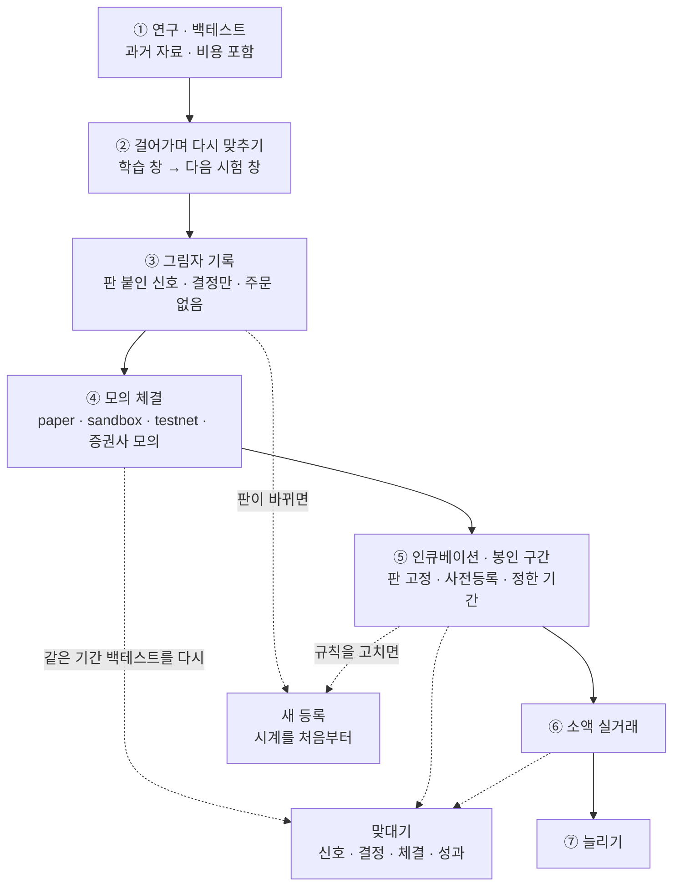
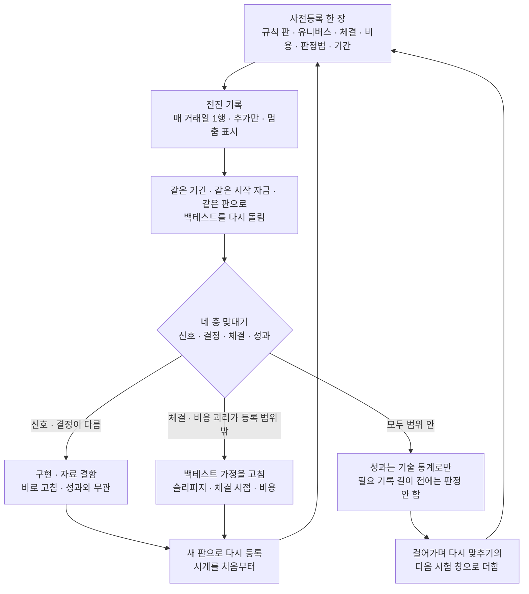
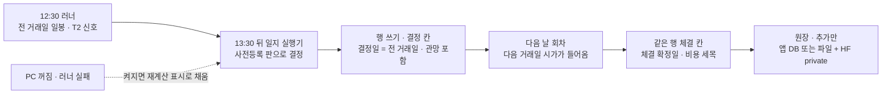

# 모의투자 · 자동매매를 계속 돌려야 검증 자료가 쌓이나 — 범용 판단 · 지금 상태 · 시장별 설계 (조사 결과 · 2026-10-23)

| 문서 정보 | |
|---|---|
| **판 · 상태** | 결과 v1.0 · 읽기 · 웹 조사만 한 조사 — 코드 · 설정 · DB · 다른 문서를 고치지 않았고 새로 쓴 파일은 이 결과 하나다. 구현 · 설정 바꾸기는 모두 「제안」 이고, 정할 것은 9절에 모았다 |
| **출처** | 사용자 물음 원문(2026-10-23 15:4x) 「자동매매나 모의투자를 지속적으로 해야 우리 로직이나 백테스트 등 검증 및 성능 향상을 위한 데이터가 쌓이지 않나? 그걸 안해서 조금 걱정이네... 국내 주식(ETF/채권 등 포함) / 미국 주식 / 코인을 각각 나눠서 해야 된다는 건 아는데 퀀트 쪽이라서...」 + 조사 중 덧붙인 말(15:48 무렵) 「다만 아직 기능이 완전히 구현되지 않아서 판단하기 어려워서 그랬던 걸수도 있어 그러니까 단순히 우리 프로젝트로만 보지 말고 범용적으로 판단해줘」 → **0절(범용 판단)을 앞에 따로 두었다** |
| **기준** | main `5a3bfc9`(2026-10-23 13:46 KST · #326 머지). 작업 트리의 `app/config.py` · `docker-compose.yml` 은 다른 세션이 고치는 중이라 이 두 파일은 `git show HEAD:` 판의 줄 번호를 적었다(그 밖의 인용 파일은 작업 트리 = HEAD) |
| **조회일** | 2026-10-23 KST 15:45 ~ 16:40 — 웹 출처는 모두 이 날 조회(부록 A 출처 표 W1 ~ W31) |
| **확실도** | **상** = 원문 · 코드 줄을 직접 읽음(KIS API 문서는 헤드리스 브라우저로 그려서 읽음) · **중** = 2차 출처 · 한 곳만 봄 · 읽은 것에서 해석 · **하** = 추정 · 가정한 숫자 |
| **읽는 법** | `p2/` = `docs/phase-2/` · `p3/` = `docs/phase-3/` · 코드는 `app/` 를 뺀 경로가 있다(`services/auto_trade.py` = `app/services/auto_trade.py`) · **D7 논의** = `docs/common/00-management/github-archive/2026-09-15/논의-013/00-기록.md` · **결정 대장** = `p3/00-management/plans/논의결정대장.md` · **강민석 재료** = `p3/01-analysis/research/배경조사/2026-10-23-강민석-4-asis-재료/결과.md` · **모의투자 조사서** = `p2/01-analysis/research/모의투자-증권사규칙-시작금액-조사.md` · **실시간 시세 조사서** = `p2/01-analysis/research/실시간시세-지연표기-조사.md` · **오준영 설계서** = `p3/02-design/system/증권사-연동-자동화-설계.md` · 웹 출처는 [W번호](부록 A) |
| **하지 않은 것** | 증권사 · 거래소 API 호출(문서 · 약관 페이지만 읽음) · 앱 · 컨테이너 · DB · 시험 실행 · 수집 DB(`data/collector/`) 열기 · `.env` 열기 · git 쓰기 · github.com 열람. 이 문서는 교육 · 검증 목적이며 특정 종목 · 전략의 투자 권유가 아니다 |

## 맨 위 5줄 요약

1. **답은 「조건부 그렇다」 다.** 모의 · 전진 운용(forward test · paper trading · incubation)은 퀀트 실무에서 백테스트 다음의 표준 단계이고[W1][W7][W9][W28], 과거 자료로는 얻을 수 없는 두 가지 — ① 실제 주문 경로가 백테스트 가정대로 도는가(체결 · 비용 · 거절 · 지연) ② 규칙을 정한 **뒤에** 생긴 「시간상 진짜 표본 외」 기록 — 를 준다. 그러나 「오래 돌릴수록 성능이 좋아진다」 는 아니다. 몇 주 기록으로는 전략의 좋고 나쁨을 통계로 말할 수 없고(14거래일이면 연 샤프의 95% 구간이 ±8.3 · 연 샤프 1 을 「0보다 크다」 고 말하려면 684거래일)[W21][W22], 결과를 보며 규칙을 자꾸 고치면 그것이 곧 과적합이다[W23][W24][W27].
2. **범용 판정(덧붙인 말에 대한 답): 기능이 덜 됐을 때 정식 운용 기록을 미룬 것은 실무 원칙과 맞다.** 전진 기록은 「판을 고정한 규칙」 에만 뜻이 있고 판이 바뀌면 시계가 처음부터 다시 간다(`D7 논의:694`). 잃은 것도 크지 않다 — 시장 자료와 매일 신호(T2)는 이미 쌓이고 있고, 팀은 2026-09-01 이후를 「봉인 구간」 으로 떼어 두었다(`p3/02-design/system/목표기능2-패턴예측-XAI-설계.md:108`). 다만 **되돌릴 수 없는 두 가지 — 「언제 무엇을 정했나」(사전등록 시점)와 「실제 경로의 운영 기록」 — 는 판이 덜 됐어도 지금부터 작게 남기는 것이 실무 관행**이다(섀도 시험[W29] · `D7 논의:273`).
3. **지금 우리 코드:** 쌓이는 것 = T2 신호(매일 · 판 칸 · 계산 시각) · PAPER 장부 일별 스냅샷 · 주문 표 · 감사 기록 · 웹훅 신호가 · 체결가. **쌓이지 않는 것** = 자동매매 회차 기록(최근 50회만 남기고 덮어씀 = 10분 주기면 8.3시간 · `services/auto_trade.py:73-80`) · 자동매매 장부(QUANT)의 일별 평가액 · 정합성 점검 이력 · 슬리피지(가상 체결은 주문가 = 체결가 · `services/trading_cost.py:358-367`). 자동매매 가상 체결가는 수집 DB 의 마지막 종가(`services/stock.py:409-411`)라 켜 두어도 체결 가정 검증에는 쓸 수 없다. 9월에 팀이 정한 「모의투자 일지」(D7 — 사전등록 · 매 거래일 1행 · 다음 날 시가)는 코드가 0이고, rfp-2 필수 산출물 「모의 투자 의사결정 일지」 도 그 이름의 문서가 없다(`p3/01-analysis/research/배경조사/2026-10-23-감리대응-대조/결과.md:259`).
4. **시장별:** 국내 주식 · ETF 는 우리 시뮬레이터와 KIS 모의 둘 다 길이 있다(KIS 모의는 API 로는 장중 주문만 — Open API 의 국내 예약주문은 모의 미지원[W19]). **국내 채권은 KIS 모의 미지원**(장내채권 매수주문 「모의투자 미지원」[W15]) → 채권 ETF 로 대신한다. 미국은 KIS 해외 모의가 「일부 종목」 만 되지만 **해외 예약주문이 모의 지원이라(KST 10:00 ~ 23:20 접수 → 정규장 시작에 전송[W18]) 밤에 PC 를 켜 두지 않아도 일봉 규칙은 돌릴 수 있다**(Alpaca 는 개장 경매 주문 OPG[W6]). 우리 앱의 미국 체결은 지금 막혀 있다(DF-137). 코인은 업비트에 모의 환경이 없고(주문 형식 시험 API 뿐[W12]) 우리 시뮬레이터는 수수료가 0이다(`services/paper_trading.py:666-690`).
5. **추천(정할 것 9건 · 9절):** 11-05 전에는 (가) 국내 일봉 · 판 고정 규칙 1 ~ 2개의 「그림자 일지」 — 사전등록 한 장 + 매 거래일 1행(관망 포함) + 다음 날 시가 · 우리 시뮬레이터(D7 그대로 · rfp-2 산출물도 채움) (나) 자동매매 회차 · 신호 · 주문을 버리지 않는 영속 기록(오준영 님 설계 2절과 같은 방향) (다) KIS 모의는 장중 하루 몇 건의 경로 점검만. 발표 뒤에 같은 기간 백테스트 맞대기 · 슬리피지 보정 · 걸어가며 다시 맞추기 · 미국(예약주문) · 코인(비용 반영 뒤). **하지 않는 것** = 10분 가상 자동매매를 24시간 켜 두기 · 몇 주 성과로 규칙 고치기 · 놓친 장중 회차 따라잡기 · KIS 시세 저장 · 공유.

---

## 이 문서의 말

| 낱말 | 뜻 | 이 문서에서 | 헷갈리는 점 |
|---|---|---|---|
| 백테스트(backtest) | 과거 자료로 규칙을 돌려 본 결과 | 파이썬 백테스트(`services/quant_pipeline.py`) · LEAN · 100일 백테스트(SIM)까지 모두 | 100일 백테스트는 모의계좌 화면에 있지만 **과거 재현**이지 전진 기록이 아니다(`services/backtest_100d.py:37-38` 고정 날짜) |
| 전진 시험 · 전진 기록(forward test) | 규칙을 정한 **뒤** 앞으로 오는 날들에 규칙을 돌리며 남기는 기록 | 모의 체결이든 그림자 기록이든 「정한 뒤에 생긴 날」 의 기록 | 등록일 **전** 날짜를 규칙에 넣어 계산한 것은 아무리 기계적이어도 백테스트다 |
| 모의 운용(paper trading · dry-run · sandbox · testnet) | 실제 돈 없이 시세에 가상 주문을 내 체결을 흉내 냄 | 우리 시뮬레이터(V1) · KIS 모의(V3) · Alpaca paper · Binance testnet | 「모의」 라도 체결을 흉내 내는 방식이 창구마다 다르다(<표 2-1>) |
| 그림자 기록(shadow) | 실제 결정에 쓰지 않는 판을 같은 입력에 돌려 결과만 기록하고 나중에 비교하는 방식[W29] | 판 붙인 신호 · 결정 · 「주문했을 것」 을 남기되 증권사 주문은 내지 않음 | 체결 현실성(슬리피지 · 거절 · 지연)은 재지 못한다 |
| 인큐베이션(incubation) · 봉인 구간 | 실자금 전에 실시장에서 정해진 기간 지켜보는 단계 / 결과를 보기 전에 떼어 둔 기간 | 팀 정의: 2026-09-01 이후 · 개봉 기록과 함께 한 번만 연다(`목표기능2 설계:108 · 588`) | 여럿을 동시에 지켜보다 잘된 것만 고르면 그 자체가 선택 편향이다[W27] |
| 사전등록(preregistration) | 규칙 · 기간 · 판정법을 결과 **전에** 문서로 고정 | D7 ⑦ E2(`결정 대장:99`) · 등록 문서 한 장 | 결과를 본 뒤 규칙을 바꾸면 「새 등록」 이고 시계가 처음부터 간다 |
| 판(version) | 규칙 · 지표 정의 · 전략 카드의 버전 | 전략 판(`broker_settings.quant_strategy_version`) · 지표 정의 판(`signal_snapshots.definition`) · 신장환 님 카드 판 1 · 2 | 판이 다른 기록을 섞어 성과를 내지 않는다 |
| 장부(PAPER · QUANT) | 모의 현금 · 보유를 적는 곳 | PAPER = 모의계좌 1억 · QUANT = 자동매매 가상계좌 1천만(`models/trading.py:15-16`) | 두 장부는 일별 스냅샷 유무가 다르다(1.1절) |
| 기대가 · 결정가(decision · arrival price) | 결정할 때 「이 값에 산다」 고 본 가격 | 그림자 일지는 결정에 쓴 종가 · KIS 모의는 주문 직전 확인 가격 | 화면의 「현재가」 칸과 출처 · 시각이 다를 수 있다 |
| 슬리피지 · 구현 손실(implementation shortfall) | 기대가와 실제 체결가의 차 / 「서류상 포트폴리오」 와 실제 포트폴리오 수익의 차 — 지연 · 시장 충격 · 못 산 몫 · 수수료를 한 숫자로[W26] | 5.2절 체결 층 맞대기 | 백테스트의 「슬리피지 10bp」 는 **가정**이지 잰 값이 아니다(`p3/04-testing/백테스트보고서.md:83`) |
| 맞대기(reconciliation) | 실거래 · 모의 기록과, 같은 기간 · 같은 시작 자금의 백테스트를 겹쳐 차이를 재는 일[W1][W2] | 5.1절 네 층(신호 · 결정 · 체결 · 성과) | 팀 문서의 「대사」 와 같은 말 |
| 걸어가며 다시 맞추기(walk-forward) | 학습 창에서 고른 매개변수를 바로 다음 시험 창에만 쓰고 창을 밀며 되풀이[W30] | 5.4절 | 전진 기록은 그 맨 끝 「시험 창」 역할이다 |
| MinTRL(최소 기록 길이) | 관측한 샤프가 기준보다 크다고 정한 신뢰수준으로 말하는 데 필요한 **관측치 수**[W22] | <표 2-5> | 년이 아니라 관측치 개수 · 정규분포를 가정하면 짧게 나온다 |
| 다중 검정 · 시도 수 | 많이 시험할수록 가장 좋은 결과가 운으로 부풀려지는 일[W23][W24] | 결정 D4 ⑦ 「시도 횟수 기록 필수」(`결정 대장:107`) | 전진 기간에 여러 판을 돌려 잘된 것만 남기는 것도 다중 검정이다 |
| V1 · V3 | 결정 D7 ② — V1 앱 안 가상 체결이 정본 · V3 KIS 모의 병행은 선택 확장(`결정 대장:93`) | 3절 | V3 를 해도 판정의 정본은 V1(같은 자료 · 같은 비용 모형) |

---

## 0. 범용 판단 — 우리 프로젝트를 떠나서

### 0.1 실무의 단계 사다리

**<그림 1> 규칙이 실거래에 닿기까지 — 단계마다 재는 것이 다르다** (점선 = 되돌아가는 길)

**<표 0-1> 단계마다 재는 것 · 못 재는 것**

| 단계 | 재는 것 | 못 재는 것 | 실무 근거 | 우리 지금 | 확실도 |
|---|---|---|---|---|---|
| ① 백테스트 | 규칙의 과거 성과 · 비용 민감도 | 실제 체결 · 운영 · 시간상 표본 외 | 「일곱 가지 죄」(생존 편향 · 미래 참조 · 과적합 · 회전 · 비용 등)[W31] | 있음(파이썬 · LEAN · SIM) | 상 |
| ② 걸어가며 다시 맞추기 | 매개변수가 창마다 버티나 | 운영 | quantstrat 정의[W30] | 설계만 — 「격자는 사전등록 · 상위 N 만 봉인 구간 1회 · 워크포워드(10-29 칸)」(`p3/02-design/system/기능설계.md:473`) | 상 |
| ③ 그림자 기록 | 판별 신호 · 결정 · 적중 · 백테스트와의 신호 일치 | 체결 · 거절 · 지연 | 섀도 시험 — 실요청 사본을 새 판에 흘리고 응답은 기록만 · 나중에 비교[W29] | T2 신호만 쌓임(결정 · 「주문했을 것」 행은 없음) | 상 |
| ④ 모의 체결 | 주문 경로 · 거절 · 지연 · 체결률(창구에 따라) | 시장 충격 · 대기열 · 실제 비용 일부 | Alpaca · Freqtrade · NautilusTrader 문서[W3][W7][W9] | 시뮬레이터 · KIS 모의 길은 있음 · 남는 기록이 얕음(1.3절) | 상 |
| ⑤ 인큐베이션 | 사전등록 규칙의 표본 외 기록 · 운영 일관성 · 괴리 | 짧으면 성과 유의성 | 실무자: walk-forward · 몬테카를로 뒤 6 ~ 12개월[W28] · 팀 D7 ⑦ E2 | 설계만(코드 0) | 중(기간 숫자) · 상(팀 결정) |
| ⑥ 소액 실거래 | 실제 슬리피지 · 시장 충격 · 실제 비용 | — | QuantConnect 는 실거래마다 같은 기간 표본 외 백테스트를 나란히 돌린다[W1] | 범위 밖(실거래 관문 · D7 ① `결정 대장:92`) | 상 |

### 0.2 전진 기록이 주는 것 · 못 주는 것

| 쓸모 | 주나 | 까닭 · 근거 | 확실도 |
|---|---|---|---|
| 구현 · 운영 결함 찾기(코드가 백테스트와 다르게 돎 · 빠진 날 · 경로 실패) | **준다 — 가장 큰 쓸모** | QuantConnect 가 꼽은 실거래 ↔ 백테스트 어긋남 까닭 18가지 가운데 체결 · 비용 모형 오차(5가지)를 뺀 13가지가 자료(원천 · 미래 참조 · 시간 단위) · 증권사 연결(매개변수 불일치 · 재시작 상태 · 기존 보유) · 일정 쪽이다[W1] · NautilusTrader 「실거래는 거래소 · 전송 · 시각 · 저장 · 외부 활동 · 대사 행동을 더하며 시뮬레이션이 재현하지 못할 수 있다」[W9] | 상 |
| 체결 가정 보정(슬리피지 · 비용 · 체결률) | **창구가 실제 시장을 흉내 낼 때만** | Alpaca 모의는 시장 충격 · 지연 슬리피지 · 대기열 · 가격 개선 · 규제 수수료 · 배당을 흉내 내지 않는다[W3] · KIS 모의는 「실제 시장에서 체결이 생겨야만 · 실제 체결량만큼」 체결한다(모의투자 조사서 `:19`) | 상 |
| 시간상 표본 외 기록(과적합 확인) | **준다 — 판 고정 · 사전등록일 때만** | D7 ⑦ E2 · 봉인 구간 정의(`목표기능2 설계:108`) | 상(팀 문서) · 중(원리) |
| 「전략이 좋다」 의 통계적 증명 | **몇 주 · 몇 달로는 못 준다** | 14거래일 연 샤프 ±8.3 · MinTRL 684거래일(연 1) — 2.4절 | 상(계산 재현) |
| 모형 「성능 향상」 용 학습 자료 | **거의 못 준다** | 몇 주는 과거 수년치보다 표본이 작고, 전진 기간을 학습에 넣으면 그 기간은 더는 표본 외가 아니다 | 중(원리) |

### 0.3 「기능이 덜 돼서 안 했다」 의 범용 판정

- **타당한 부분.** 판이 매주 바뀌는 동안 낸 전진 기록은 판마다 며칠씩 쪼개져 어느 판의 증거도 되지 못한다. 실무도 인큐베이션은 앞 검증 단계를 통과한 **뒤에** 시작한다(walk-forward · 몬테카를로 → 6 ~ 12개월[W28]). 팀 결정도 봉인 구간 시작을 「규칙과 일지 실행기가 준비된 뒤 첫 거래일」 로 두었다(`목표기능2 설계:108` · D7 ⑦). (상 · 판정은 중)
- **아쉬운 부분.** 「되돌릴 수 없는 것」 은 판과 상관없이 쌓을 수 있었다 — (a) 언제 무엇을 정했나(사전등록 · 시도 수 · 판 바꾼 날) (b) 실제 경로의 운영 기록(KIS 모의 주문이 거절 · 지연 · 토큰 실패를 얼마나 내나 — 경로를 돌려야만 생긴다) (c) 나중에 다시 받을 수 없는 자료(분봉은 5분봉 60일 · 60분봉 730일 창 안에서만 다시 받힘 · `collector/ohlcv_load.py:36-37`). 9월 D7 논의도 「포워드 기록은 늦게 시작한 만큼 짧아지고, 되돌릴 수 없다」 고 적었다(`D7 논의:273`). (상)
- **우리 손실이 작은 까닭.** 시장 자료(수집 DB · HF 백업)와 T2 신호는 매일 쌓이고 있고, 2026-09-01 이후가 봉인 구간이라 판을 고정한 뒤 그 구간에서 「사후 봉인 시험」 을 할 수 있다. 다만 이것은 사전등록 뒤 전진 기록보다 **한 단계 약한** 증거다 — 사람이 그 기간 시장을 보았고, 100일 백테스트가 이미 2026-07-13 ~ 10-20 을 읽는다(`services/backtest_100d.py:37-38`). (상 · 판정은 중)

### 0.4 표본 외 증거의 세 등급 (범용)

| 등급 | 무엇 | 깨끗함 | 우리에게 | 확실도 |
|---|---|---|---|---|
| 1 사전등록 + 전진 기록 | 규칙을 문서로 고정한 날 **이후에 생긴** 자료로만 | 가장 깨끗 | 지금 0 — 오늘 등록하면 오늘부터 | 중(원리 · D7 ⑦) |
| 2 봉인 구간 사후 시험 | 자료는 이미 있으나 떼어 두었고, 규칙을 고정한 뒤 한 번만 연다 | 중간 — 사람의 시장 노출 · 다른 기능이 봉인 구간을 읽을 위험 | 2026-09-01 이후(T2 · 수집 DB) | 중 |
| 3 백테스트 · 교차검증 | 같은 자료로 고르고 잰다 | 가장 약함 — 다중 검정 보정이 필요[W23][W24] | 지금 대부분 | 상 |

---

## 1. 지금 우리 상태 (코드 기준 · 5a3bfc9)

### 1.1 무엇이 어디에 쌓이나

**<표 1-1> 기록 열여섯 — 표 · 열쇠 · 쓰는 곳 · 남는 기간** (실제로 몇 줄이 쌓였는지는 DB 를 열지 않아 모른다 — 부록 B)

| # | 기록 | 저장처 | 쓰는 곳 · 때 | 지금 쌓이나 | 남는 기간 | 칸 요약 | 근거 | 확실도 |
|--:|---|---|---|---|---|---|---|---|
| 1 | 모의 주문(수동 · 스탑 · 리밸런싱 · Pine · 웹훅 · Open API · SIM) | `orders`(source PAPER · WEB · PINE · OPENAPI · SIM) · `portfolio`(book PAPER) · `paper_accounts` | `_fill_stock_order` — 사람이 주문 · 스탑 발동(1분) · 리밸런싱 정산 · 웹훅 · Open API · 100일 백테스트(`services/rebalance_settlement.py:243` · `services/tradingview.py:125` · `routes/openapi.py:132` · `services/backtest_100d.py:180-190`) | 사람이 주문하면 | 계좌 리셋이 WEB · PAPER 출처 주문을 지움(강민석 재료 T8) | 주문가 = 체결가 · 비용 세목 · `cost_basis=estimated` · `slippage_bps` 비어 있음 | `services/paper_trading.py:379-438` · `services/trading_cost.py:342-367` · `models/trading.py:34-74` | 상 |
| 2 | 자동매매 가상 체결 | `orders`(source QUANT · broker `quant_ai`) · `portfolio`(book QUANT) · `quant_virtual_accounts` | `_execute_virtual_trade` — 10분 회차 · 자동매매를 켠 사용자만 | 켠 사용자가 있을 때만(오준영 님 계정은 10-22 점검 때 꺼짐 · 오준영 설계서 `:137`) | 계속 | 체결가 = 지표의 `current_price` = 수집 DB 마지막 종가 · 잔고 부족 등 「건너뜀」 은 주문 표에 안 남음 | `services/auto_trade.py:143-260 · 871-880` · `services/stock.py:378-417` | 상 |
| 3 | 자동매매 회차 기록 | `data_cache` 열쇠 `quant:cycle_log:{uid}` | `_persist_cycle` — 회차마다 | 켠 사용자가 있을 때 | **최근 50회만**(덮어씀) · 30일 넘은 것은 안 읽음 | 회차 시각(**UTC 글자 · 시간대 표시 없음**) · 신호(종목 · 가격 · 판단 · 점수 · 기준 봉 `as_of` · 근거 6개) · 주문 · 위험 관문 · 설정(전략 ID · 판) · 계좌 평가액 | `services/auto_trade.py:69-80 · 100 · 816-817 · 954-964 · 1102-1109 · 1202-1215` | 상 |
| 4 | KIS 모의 주문 추적 | `live_orders` | `_place_live_order`(사용자 키 직접) · 2분마다 체결 확인 | `quant_mode=live` 로 켠 사용자가 있을 때 | 계속 | client_order_id · 환경(paper) · 지정가 · 상태 · 체결 수량 · 평균 체결가 · 메시지 · 응답 원문 — **체결 시각 칸 · 신호와 잇는 칸 없음** | `models/trading.py:177-210` · `services/auto_trade.py:283-358 · 647-665` · `celery_app.py:100-104` | 상 |
| 5 | 부분 체결 · 증권사 비용 대조 | `order_fills` · `orders.cost_basis=broker` | `fill_sync` — 수동 스크립트 | **사실상 안 쌓임**(앱에서 부르는 곳 0 — grep) | — | 체결 한 건 · 메이커/테이커 · 세목 | `services/fill_sync.py:1-17` · `scripts/sync_fills.py:1-24` · `models/trading.py:76-102` | 상 |
| 6 | PAPER 일별 스냅샷 | `paper_account_snapshots` | 15:40 거래일 정기 + 계좌 조회 때 | **쌓임**(컨테이너가 켜져 있을 때) | 계속 | 현금 · 평가액 · 일수익률 · 회차(epoch) · 주식 · 코인 · 대체자산 | `models/paper_snapshot.py:14-51` · `celery_app.py:115-119` · `tasks/paper_snapshot.py:66-104` | 상 |
| 7 | QUANT 장부 일별 평가액 | **없음** | — | **안 쌓임** | 회차 기록 안의 평가액뿐(50회) | — | `services/auto_trade.py:1202-1210` | 상 |
| 8 | T2 다중 주기 신호 | `signal_snapshots`(기본키 `as_of` · `symbol` · `definition`) | 12:30 러너 `signals` 단계 → `signals_daily.py` — 매 거래일(앱 DB 가 켜져 있을 때) · 놓친 날은 `--fill` 로 31일까지 | **쌓임**(설계) | 계속 · 판이 바뀌면 지난 날을 새 판 줄로 **더함** | 신호 · 강도 · 신뢰도 · 점수 · 주기별 근거 · 패턴 · 계산 시각 · 의견 | `models/signal.py:1-47` · `scripts/daily_update.py:265-271` | 상(코드) |
| 9 | TradingView 웹훅 신호 | `webhook_signals` | 알림을 받으면 곧바로 모의 체결 | 알림을 걸면 | 계속 | **신호가(`{{close}}`)와 체결가를 따로** · 상태(filled · alert · rejected · duplicate · error) · 원문 | `models/tradingview.py:13-29` · `services/tradingview.py:110-126` | 상 |
| 10 | 리밸런싱 결정 | `rebalance_runs` | 5분마다 준비 확인 → 거래일 1회 판정 | 계획을 둔 사용자가 있을 때 | 계속 | 계기 · 전 · 목표 · 후 비중 · 주문 목록(JSON) · 상태 | `models/rebalance.py:80-103` · `celery_app.py:105-109` | 상 |
| 11 | 백테스트 결과 | `lean_backtest_runs` · `strategy_comparisons` | 화면에서 돌릴 때 | 그때만 | 계속 | 지표만(매개변수 · 비용 · 자료 기준 칸 없음) | `models/paper.py:119-135` · `models/tradingview.py:32-47` · 강민석 재료 1.4 | 상 |
| 12 | 감사 기록 | `audit_events` | 자동매매 시작 · 정지 · 비상 정지 · 모의 주문 · LEAN 실행 등 | 쌓임 | 계속 | 사건 이름 · JSON | `models/misc.py:14-21` · `services/auto_trade.py:811 · 1259 · 1275` · `routes/paper.py:130` | 상 |
| 13 | 정합성 점검 | `data_cache` 열쇠 `quant:reconcile:latest:<uid>` | `quant.reconcile` 10분 | **꺼짐**(켜도 최신 1건만) | — | 보유 불일치 · 가상 ↔ 실주문 · 유령 체결 · 오래 열린 주문 · 슬리피지 경고(1%) | `services/reconciliation.py:1-15` · HEAD `config.py:111-117` | 상 |
| 14 | 위험 관문 하루 값 | Redis(하루 시작 자산 · 오늘 주문 수 · 쿨다운) | 회차 · 주문 | 하루짜리 | 하루 | — | `services/auto_trade.py:991-1001` · 강민석 재료 N1 | 상 |
| 15 | 코인 모의 주문 | `crypto_orders` · `crypto_holdings` | 화면 주문 | 사람이 주문하면 | 계속 | 업비트 체결가(5초 저장) · **수수료 칸 없음(0)** | `models/paper.py:45-70` · `services/paper_trading.py:487-491 · 666-690` | 상 |
| 16 | 시장 자료(수집 DB) | `data/collector/` SQLite + HF private | 12:30 러너 | 쌓임(PC 가 켜진 날 · 놓치면 14일 되돌아보기) | 계속 | 일봉(수정주가 · TR) · ETF · 지수 · 분봉 60분 · 5분(매일 최근 5일을 다시 받음) | `scripts/daily_update.py:221-271` · `collector/ohlcv_load.py:1-38` | 상(코드) · DB 는 열지 않음 |

### 1.2 켜고 끄는 스위치 (HEAD 설정 기본값 · 실제 `.env` 값은 열지 않아 모름)

| 스위치 | 기본값 | 무엇을 정하나 | 근거 | 확실도 |
|---|---|---|---|---|
| 사용자별 `broker_settings.quant_auto_enabled` | False | 이 값이 참인 사용자만 10분 회차가 돈다 | `models/trading.py:139` · `services/auto_trade.py:1296-1324` | 상 |
| `QUANT_CYCLE_SEC` | 600(강사님 판 180) | 회차 주기 — 하루 144회 · 기록 50회 = 8.3시간 | HEAD `config.py:141-144` · `celery_app.py:95-99` | 상 |
| `KIS_PAPER_BATCH_ENABLED` | False | 시스템 사용자 자동매매 배치. **켜도 게이트웨이(`STOCK_COIN_TRADE_BASE_URL`)가 없으면 「not_connected」 로 돌지 않는다** — 배치는 사용자 행 없이 경로를 찾고(`resolve_route()`), 우리 판은 서버 KIS 칸을 읽지 않는다 | HEAD `config.py:127-139 · 164` · `services/kis_batch.py:124-149` · `services/kis_quickstart.py:79-93` · `services/kis_credentials.py:66-84` | 상(코드 경로) · `.env` 의 게이트웨이 값은 확인 못 함 |
| `RECONCILE_ENABLED` | False | 정합성 점검(10분) | HEAD `config.py:111-117` | 상 |
| `STOCK_COIN_TRADE_ENFORCE_MARKET_HOURS` | True | **게이트웨이 경로만** 장 시간 밖 주문을 막는다 — 사용자 키 직접 경로 · 가상 체결에는 장 시간 검사가 없다 | HEAD `config.py:122` · `services/auto_trade.py:283-330 · 527-529` | 상 |
| `QUANT_AGGRESSIVE_MODE` | False | 5분봉 공격 모드 | HEAD `config.py:146-161` | 상 |
| 실거래 관문 `live_trading_allowed()` | 모의 | 실계좌 주문 — 승인 없이는 모의 경로(두 겹) | `services/auto_trade.py:278-310` | 상 |

### 1.3 꺼져서 안 쌓이는 것 · 켜면 쌓이는 것 · 켜도 안 쌓이는 것

| 가름 | 무엇 | 까닭 | 확실도 |
|---|---|---|---|
| 꺼져서 안 쌓임 | 자동매매 가상 주문 · 회차 기록 · KIS 모의 주문 추적(켠 사용자가 없을 때) · 정합성 점검 | 사용자가 「시작」 해야 돌고, 점검은 설정이 꺼짐 | 상 |
| **켜면 쌓이나 검증 쓸모가 낮음** | 10분 가상 자동매매 주문 | ① 체결가가 수집 DB 마지막 종가라 「그 값에 살 수 있었나」 를 알 수 없다 — 9월 D7 논의가 이미 P1 「결정 순간의 캐시 가격 · 그 가격에 살 수 있었는지 보장 없음」 으로 짚었다(`D7 논의:628`) ② 장 시간 검사가 없어 주말 · 밤 회차도 같은 종가로 주문을 낼 수 있다(쿨다운 30분 · 하루 20건 · 종목 30% 한도만 막음 — 실행해 보지 않은 코드 읽기) ③ 회차 기록은 50회 뒤 사라진다 | ① ③ 상 · ② 중 |
| 켜면 쌓이고 쓸모 있음 | KIS 모의 주문 · 체결(`live_orders`) — 거절 · 지연 · 체결률 | KIS 모의는 실제 시장에서 체결이 생겨야 체결하므로 체결 가정을 잴 수 있다. 다만 지정가 = 수집 DB 종가라 체결이 안 될 수 있고, 장 밖 회차는 오류가 난다 | 상(규정) · 중(우리 경로에서의 결과) |
| **켜도 안 쌓임(코드가 없음)** | QUANT 일별 평가액 · 기대가 · 슬리피지 · 지연 · 신호 ID · 같은 기간 백테스트 · 멈춤 표시 · 정합성 이력 · 그림자 일지(D7) | 4절 <표 4-1> 의 「빠짐」 칸 | 상 |

**자동매매 가상 체결가가 「지난 종가」 인 까닭** — 회차는 종목마다 `get_quant_indicators(symbol, "2y")` 를 부르고(`services/auto_trade.py:871-880`), 이 함수는 국내 일봉을 **수집 DB 에서 먼저** 읽으며(`services/stock.py:272-285` · `services/collector_db.py:154-203`) `current_price = closes[-1]` 을 돌려준다. 코드 주석도 「수집 DB 에서 왔으면 오늘이 아니라 as_of 의 값이다」 라고 적었다(`services/stock.py:409-411`). 수집 DB 일봉은 포털이 「기준일 다음 영업일 오후 1시 이후」 에 공개하고 12:30 회차가 받으므로(`p2/01-analysis/research/정기회차-시각-조사.md:43-44`), 그날 12:30 전에는 이틀 전 종가 · 뒤에는 전날 종가가 「지금 값」 으로 쓰인다. (상 · 시각은 실측 기록을 옮김)

### 1.4 시장별 길 (코드에 있는 것만)

| 시장 | 수동 모의 | 자동 · 주기 | 증권사 모의 | 남는 기록 | 막힌 곳 | 근거 · 확실도 |
|---|---|---|---|---|---|---|
| 국내 주식 | 시장가 · 스탑 · 미리 보기(비용 포함) · 체결 직전 지금 값(내 KIS 키 → KIS 현재가, 없으면 지연 시세) | 10분 가상(수집 DB 종가) · 리밸런싱 · 웹훅 | KIS 직접(사용자 키 · 지정가) | 1.1 표 1 ~ 4 · 6 | 장 닫힘은 표시만(체결은 마지막 값으로 · 강민석 재료 T3) | `services/paper_trading.py:219-235 · 357-376` · 상 |
| 국내 ETF | 같은 길 · ETF 매도세 면제 | 같음 — 단 자동매매 유니버스는 개별 종목 31개 고정이라 ETF 가 없다 | 같음 | 같음 | — | `services/stock.py:25-60` · `services/auto_trade.py:176-178` · 상 |
| 국내 채권 | 없음 — 배분의 「국내채권」 비중은 매수하지 않고 현금으로 남긴다 · 채권 ETF 는 ETF 로 분류돼 국내 ETF 길을 탄다 | 없음 | 없음(KIS 장내채권 주문 모의 미지원[W15]) | 금리만 수집(ECOS) | — | `services/asset_allocation.py:53` · `services/etf_classify.py:48` · `scripts/daily_update.py:246` · 상 |
| 미국 | 시세는 보임 · 주문은 거부 · 예약은 체결이 막힘 | 없음 · `alpaca_execute` 는 늘 mockup | Alpaca 는 읽기 전용 연결 시험만 | 예약 줄(skipped) | DF-137(`_ensure_supported_market`) | `services/paper_trading.py:65-84 · 386` · `routes/paper.py:415-440` · 강민석 재료 N10 · 상 |
| 코인 | 업비트 체결가로 곧바로 체결 · 수수료 0 · 같은 현금 | 없음 | 없음(업비트 모의 없음[W12]) | `crypto_orders` | 비용 0 | `services/paper_trading.py:666-690` · 상 |

---

## 2. 실무 관행 (웹 · 1차 출처 우선)

### 2.1 창구별 모의 · 전진 운용

**<표 2-1> 창구 아홉 — 무엇을 흉내 내고 무엇을 못 하나** (조회 2026-10-23)

| 창구 | 흉내 내는 것 | 못 하는 것 · 주의 | 기록 · 초기화 · 제한 | 출처 | 확실도 |
|---|---|---|---|---|---|
| QuantConnect(LEAN) 실거래 · 모의 | 실거래 배포마다 **같은 기간 표본 외 백테스트를 나란히** 돌려 곡선을 겹친다(시작일 · 시작 자금을 맞춤). 지표 = 수익 상관(「0.8 이상이 좋은 점수」) · DTW 거리(「0 이 완벽 · 0.2 미만이면 무난 = 1년에 20% 어긋남」) | 어긋나는 까닭을 넷으로 나눔 — 자료(원천 차이 · 미래 참조 · 시간 단위 · 분할 조정 · 경매 가격 지연) · 모형(수수료 · 슬리피지 예측 오차 · **시장 충격 없음** · 지정가 체결 · 차입 비용) · 증권사(소액 정밀도 · 매개변수 불일치 · 재시작 상태 · 기존 보유 · 증권사 모형) · 일정(실거래는 정확한 시각 · 백테스트는 루프 안) | 「완전히 맞으면 두 곡선이 정확히 겹친다」 | [W1][W2] | 상 |
| Alpaca paper | 실시간 NBBO 와 대조해 시장성 있을 때만 체결 · 10% 확률로 무작위 크기 부분 체결 | 시장 충격 · 정보 유출 · 지연 슬리피지 · 대기열 · 가격 개선 · 규제 수수료 · 배당 · 차입 수수료를 흉내 내지 않음 · 「paper trading is only a simulation … performance may differ」 | 기본 10만 달러 · 계좌를 만들고 지움(새 키) · **전 세계 누구나 이메일로 Paper Only 계좌** · 그 계좌는 IEX 시세만 · 분당 200건(계좌별) | [W3][W4][W5] | 상 · 호출 제한은 중 |
| Freqtrade dry-run | 실거래 전 dry-run 으로 시작하라고 권함 · 가상 지갑(기본 1000) · 시장가는 호가창 물량 기준(최대 슬리피지 5%) · 지정가는 가격 도달 시 · 1% 넘게 넘어서면 시장가로 | 손절 주문은 정한 가격에 체결된다고 가정 · 거래소에는 읽기만 | **dry-run 과 실거래는 다른 DB 를 쓰라**(`tradesv3.dryrun.sqlite`) | [W7] | 상 |
| Hummingbot paper trade | 실자산 없이 전략 시험 · 기본 지원 거래소 넷(바이낸스 · 쿠코인 · 크라켄 · 게이트) | 체결 방식은 공식 페이지에 없음 | 잔고를 설정 | [W8] | 상(페이지 내용) — 「수익을 과대평가할 수 있다」 문구는 공식 페이지에서 못 찾아 쓰지 않음 |
| NautilusTrader sandbox | 실시간 자료 + 가상 체결 · **같은 전략 코드가 백테스트 · sandbox · 실거래에서 그대로** 돈다(배포 어긋남을 줄임) | 「실거래는 거래소 · 전송 · 시각 · 저장 · 외부 활동 · 대사 행동을 더하며 시뮬레이션이 재현하지 못할 수 있다」 | — | [W9] | 상 |
| Binance Spot Testnet | 가상 자산으로 Spot API 연습 · IP · 주문 제한 · 필터는 대체로 실거래와 같음 · `/api` 만 | 시세 · 호가가 실거래와 같은지는 원문에 없음 | **약 한 달에 한 번 · 예고 없이 빈 상태로 초기화(체결 · 미체결 주문 포함)** → 기록은 우리가 따로 남겨야 | [W10][W11] | 상 |
| 업비트 | 모의 환경 없음(찾은 범위) · 「주문 생성 테스트」 = 실제 주문 없이 형식 · 주문 가능 여부만 검증(v1.6.1 · 2025-10-27 · 돌려준 UUID 는 조회 · 취소에 못 씀) · Strategy Toolkit = 과거 캔들 백테스트 전용(베타) | 모의 체결 · 잔고가 없음 | 주문 시험 초당 8회 · 캔들 초당 10회(IP) · 일 캔들은 UTC 기준(= KST 09:00 경계) | [W12][W13][W14] | 상(API 성격) · 중(테스트넷 「없음」 은 부재 주장 · 일봉 경계는 옛 판 문서 문장) |
| KIS 모의(국내) | **실제 시장에서 체결이 생겨야만 · 실제 체결량만큼** 체결(거래 없는 현재가로 계속 매매하는 구멍을 막음) · 시간외 불가 · 지정가 · 시장가 · 최유리 · 최우선만 · 모의 수수료 0.0142% + 세금 0.20% | **Open API 의 국내 예약주문은 모의 미지원**(15:40 ~ 다음 영업일 07:30 예약 · 모의 HTS 규정에는 익일 예약주문이 있으나 API 로는 못 냄 — 모의투자 조사서 `:99`)[W19] · **장내채권 주문 모의 미지원**[W15] · 「참가자의 주문은 실제 시장 시세에 영향을 주지 않는다」(= 시장 충격 없음) · 강사님 코드 관찰: 일별주문체결조회 건별 목록을 비워 돌려줌 | 투자기간 1 · 2 · 3개월(바꾸려면 취소 뒤 재신청) · 모의 초당 2건 ↔ 실전 20건(계좌 단위) · 토큰 발급 초당 1건(23-10-27) + 우리 기록 「1분 1회」(DF-84) · 약관 제5조③ 시세 제3자 제공 금지 · 제13조 점검시간 잔고 차이 | 모의투자 조사서 `:19 · 61 · 80 · 98 · 101` · [W15][W19][W20] · D7 논의 `:425-443` | 상 · 유량은 중(2차 인용) |
| KIS 모의(해외) | 해외주식 주문 모의 지원(미국 매수 VTTT1002U · 매도 VTTT1001U) · **해외 예약주문 모의 지원**(미국 예약 VTTT3014U · VTTT3016U — KST 10:00 ~ 23:20 접수(서머타임 22:20) · 16:30 ~ 16:45 제한 · 23:30(서머타임 22:30) 정규장으로 전송 · 당일 유효 · 미체결 자동 취소 · 지정가만 · 미국 예약매도는 MOO 가능) | 「모의투자의 경우 모든 해외 종목 매매가 지원되지 않습니다. 일부 종목만」 · 운영시간 외 호출은 오류 · **미국 주간주문(10:00 ~ 18:00) 모의 미지원** · 해외 모의 시세는 기본 15 ~ 20분 지연 · 해외주식 서비스 신청 필요 | 원금 고정(USD 100,000 등) | [W16][W17][W18] · 모의투자 조사서 `:61 · 95 · 102` | 상 |
| IBKR paper(선행 조사) | 최우선 호가 체결 · 실계좌 가치 5배까지 리셋 | 일부 주문 유형 미지원 | 실계좌의 시세 권한을 그대로 씀 | 모의투자 조사서 `:95 · 385`(S34) | 중(선행 조사 인용) |

### 2.2 실무가 남기는 것 — 여섯 원칙

| # | 원칙 | 근거 | 우리에게 | 확실도 |
|--:|---|---|---|---|
| 1 | 같은 시작일 · 같은 시작 자금 · 같은 매개변수로 **표본 외 백테스트를 다시 돌려 겹친다** | QuantConnect 맞대기[W1][W2] | 같은 기간 백테스트 칸 없음 → 5.1절 | 상 |
| 2 | 결정 시점 가격(결정가)과 실제 체결의 차를 **한 숫자로** — 지연 · 시장 충격 · 못 산 몫 · 수수료 | Perold(1988) 구현 손실[W26] | 기대가 칸 없음(웹훅만 있음) → 5.2절 | 상 |
| 3 | 전략 코드는 백테스트와 실거래에서 **같은 것**을 쓰고 판을 남긴다 | NautilusTrader[W9] | LEAN 경로와 앱 경로가 다르다(강민석 재료 1.4 · 3.1) | 상 |
| 4 | 모의 기록과 실거래 · 연습 기록을 **섞지 않는다** | Freqtrade 별도 DB[W7] · D7 ③ C1 「봉인 전용 사용자 · 쓰기는 일지 실행기만」(`결정 대장:94`) | 지금 SIM · 연습 주문이 같은 장부에 섞임(강민석 재료 C2 · C4) | 상 |
| 5 | 새 판은 **섀도**로 먼저 — 실입력 사본에 돌리고 결과는 기록만 · 나중에 비교 | AWS 섀도 시험[W29] | T2 가 이미 섀도 성격(주문과 무관한 매일 신호) | 상 |
| 6 | 실자금 전에 실시장에서 **정해진 기간** 지켜본다 — 슬리피지 · 수수료 · 자료 이상을 드러냄 | Davey(실무자) 6 ~ 12개월 · 수강생 85 ~ 90% 가 「나쁜 전략을 피하거나 좋은 것을 확인했다」[W28] · Evans(2010)는 반대로 「잘된 것만 고르면」 편향이 생김을 보임[W27] | D7 ⑦ E2 — 코드 0 | 중(실무자 한 사람의 숫자) · 상(Evans) |

### 2.3 백테스트 · 모의 · 실거래가 어긋나는 까닭과 재는 법

| 까닭 | 어디서 생기나 | 재는 법 | 우리 코드 · 문서 | 확실도 |
|---|---|---|---|---|
| 체결 시점 가정 | 백테스트는 「신호 날 종가」 · 「다음 날 시가」 중 하나(`entry_mode`), 가상 자동매매는 수집 DB 마지막 종가로 「지금」 체결 | 같은 판단의 가정 체결가 ↔ 실제(모의) 체결가 | `services/quant_pipeline.py:298-361`(강민석 재료 3.1) · `services/stock.py:409-411` | 상 |
| 자료가 늦게 옴 | 포털 일봉은 「다음 영업일 오후 1시 이후」 → 우리 자료로 하는 실시간 운용은 판단이 하루 늦다 | 결정 시각 · `as_of` 를 기록해 「지연 몫」 을 따로 셈 | `p2/01-analysis/research/정기회차-시각-조사.md:43` · D7 논의 `:363-423` | 상 |
| 슬리피지 · 시장 충격 | 백테스트는 10bp 가정 · 모의는 대개 0 · 실제는 주문 크기 · 유동성 · 변동성에 달림 | 구현 손실(기대가 − 체결가)[W26] | `orders.slippage_bps` 늘 비어 있음(`services/trading_cost.py:367`) | 상 |
| 비용 | flat 10bp ↔ 실제 세금 · 수수료(약 2.1배) | 증권사 체결 비용 ↔ 추정 비교 | `p3/04-testing/백테스트보고서.md:24` · `services/fill_sync.py:1-17`(수동) | 상 |
| 자료 원천 차이 | LEAN 은 야후 종가 두 칸 · 앱은 수집 DB | 같은 자료 지문 | 강민석 재료 1.4 · S9 | 상 |
| 생존 편향 · 미래 참조 | 날짜별 명단 · `gap ≥ label_horizon` | 시험(TC-LA 등) | 결정 D4 ② ④(`결정 대장:102 · 104`) · [W31] | 상 |
| 과적합 · 다중 검정 | 시도 수 | 사전등록 · 시도 수 기록 · DSR | 결정 D4 ⑦(`결정 대장:107`) · [W23][W24][W25] | 상 · DSR 은 중 |
| 운영 · 상태 | 재시작 · 기존 보유 · 장부 둘 · 리셋 | 운영 기록 · 멈춤 표시 · 장부 경계 | [W1] · 강민석 재료 C2 · C4 · C7 | 상 |
| 일정 시각 | 실거래는 정확한 시각 · 백테스트는 루프 안 | 회차 예정 시각 · 실제 시작 시각 | [W1] · 오준영 설계서 `:85` | 상 |

### 2.4 얼마나 쌓여야 말할 수 있나

**<표 2-4> 기록 길이별 연 샤프 추정의 95% 신뢰구간 반폭** — Lo(2002) 식 (9) `SE ≈ √((1 + ½·SR²) / T)`(일간 SR)를 √252 로 연환산 · 이 조사에서 파이썬으로 다시 계산(부록 A)

| 기록 길이 | 거래일 T | 95% 반폭(참값 연 샤프 0 ~ 2 에서 거의 같음) | 읽는 법 |
|---|--:|--:|---|
| 10-26 ~ 11-12 | 14 | ±8.3 | 관측 연 샤프가 3 이어도 −5 ~ +11 |
| 한 달 | 21 | ±6.8 | |
| 석 달 | 63 | ±3.9 | |
| 여섯 달 | 126 | ±2.8 | |
| 1년 | 252 | ±2.0 | 관측 1.0 이면 −1.0 ~ +3.0 |
| 2년 | 504 | ±1.4 | |
| 3년 | 756 | ±1.1 | |

식과 표 1(예: 표본 60 · 참값 1.50 이면 표준오차 0.188)은 원문 PDF 에서 확인했다[W21]. 이 표는 **수익이 서로 독립 · 같은 분포(IID)라고 둔 값**이다 — 꼬리가 두꺼우면 구간이 더 넓어지고(<표 2-5> 마지막 줄처럼 필요 길이가 늘어남), 자기상관이 있으면 √q 연환산 자체를 다시 해야 한다고 Lo 가 경고한다(같은 글 초록). (식 · 숫자 = 상 · 가정의 영향 = 중)

**<표 2-5> MinTRL — 관측 연 샤프가 「0보다 크다」 를 단측 95% 로 말하는 데 필요한 거래일** (Bailey & López de Prado 2012 식 13 · 정규 · 이 조사에서 다시 계산)

| 관측 연 샤프 | 필요 거래일 | 약 |
|--:|--:|---|
| 0.5 | 2,730 | 10.8년 |
| 1.0 | 684 | 2.7년 |
| 1.5 | 305 | 1.2년 |
| 2.0 | 173 | 0.7년 |
| 3.0 | 78 | 0.3년 |
| 1.0 · 꼬리 두꺼움(왜도 −1 · 첨도 6) | 729 | 2.9년 |

- 거꾸로, T 거래일 기록으로 「0보다 크다」 를 말하려면 필요한 연 샤프 — 14일 **7.65** · 21일 6.05 · 63일 3.35 · 126일 2.35 · 252일 1.65.
- 검산: 논문 예시(연 2 가 연 1 보다 크다 · 일간 정규) 688.2일 — 9월 D7 논의가 원문 값과 맞춘 숫자(`D7 논의:649`)를 이 조사에서 다시 냈다. 「관측치 수로 센다 · 표본 외에서도 같은 통계 성질이 이어진다는 가정」 은 PerformanceAnalytics `MinTrackRecord` 설명과도 같다[W22]. (상)

**<표 2-6> 신호 적중률 — 몇 건이 있어야 하나** (독립 가정 · 단측 5% · 이 조사의 계산)

| 적중률 참값 | 관측값이 50% 보다 크다(유의) | 참값을 80% 확률로 잡아냄(검정력) |
|--:|--:|--:|
| 55% | 271건 | 617건 |
| 60% | 68건 | 153건 |

- **종목이 많아도 실효 표본은 작다.** 같은 날 401종목 신호의 결과는 함께 움직인다. 설계 효과 식 `n_eff = n ÷ (1 + (n − 1)·ρ)` 로 보면, 결과끼리 상관 ρ 가 0.1 이면 하루 약 9.8건 · 0.3 이면 약 3.3건이라 실효 271건에 약 28 ~ 82거래일이 걸린다. 5일 수익률처럼 기간이 겹치는 결과는 더 줄어든다. (식 = 중 · 교과서 식이라 출처를 따로 열지 않음 · ρ = 하 · 가정)

**<표 2-7> 평균 슬리피지를 ±E bp(95%)로 재는 데 필요한 체결 수** — `n = (1.96 × 표준편차 ÷ E)²`

| 체결 한 건 슬리피지 표준편차(가정) | ±5bp | ±2bp |
|--:|--:|--:|
| 10bp | 16 | 97 |
| 20bp | 62 | 385 |
| 40bp | 246 | 1,537 |

표준편차는 실측 전이라 가정이다(하). 하루 1 ~ 3건 KIS 모의 주문이면 ±5bp 를 말하는 데 수십 거래일이 든다.

**<표 2-8> 다중 검정 — 「많이 시험할수록 최고 결과는 부풀려진다」**

| 출처 | 말한 것 | 우리에게 | 확실도 |
|---|---|---|---|
| Bailey · Borwein · López de Prado · Zhu(2014, AMS Notices 61(5)) | 「5년 자료로 만든 모형이면 45개 설정만 봐도 속을 수 있다」 — 표본 안 연 샤프 1 · 표본 밖 기대 0 인 전략[W23] | 격자 상한 · 사전등록(기능설계 `:473`) | 중(보도 · 저장소 두 곳) |
| Harvey & Liu(2015, JPM 「Backtesting」) | 백테스트 샤프에 다중 검정 「깎기」 — Bonferroni · Holm · BHY 세 방법 · 최소 수익 문턱[W24] | 시도 수 기록(D4 ⑦) | 중(패키지 문서) |
| Bailey & López de Prado(2014, JPM 40(5)) DSR | 시도 수 · 비정규성 · 표본 길이를 보정한 샤프[W25] | 코드에 「DSR 시도 50」 상수가 이미 있음(강민석 재료 1.5) | 중(초록 페이지 403 · 검색 요약) |
| Evans(2010, JF 65(4)) | 펀드를 여럿 비공개로 띄워 평가 기간 뒤 일부만 공개하면, 인큐베이션 중 위험조정 3.5% 앞서던 것이 공개 뒤 사라진다[W27] | 여러 판을 전진 운용하다 잘된 것만 남기면 같은 편향 | 상(초록 원문) |

### 2.5 핵심 주장의 2차 검증

| 주장 | 출처 1 | 출처 2 | 판정 |
|---|---|---|---|
| (가) 모의 체결은 실거래보다 낙관적일 수 있다(시장 충격 · 지연 · 대기열 미반영) | Alpaca 문서[W3] | QuantConnect 맞대기 까닭 목록[W1] (+ NautilusTrader[W9]) | 일치 · 상 |
| (나) 몇 주 · 몇 달 전진 기록으로 성과의 유의성을 말할 수 없다 | Lo(2002) 원문 식 9 · 표 1[W21] | Bailey & López de Prado MinTRL[W22] · D7 원문 확인(`D7 논의:637-669`) · 이 조사의 재계산 | 일치 · 상 |
| (다) 많이 시험할수록 최고 결과는 부풀려진다 → 시도 수 기록 · 보정 | Bailey 외(2014)[W23] | Harvey & Liu(2015)[W24] (+ Evans 2010[W27]) | 일치 · 중 ~ 상 |
| (라) 실무는 전진 · 모의 운용을 실거래 앞 단계로 둔다 | Freqtrade 「dry-run 으로 시작 권장」[W7] | Davey 6 ~ 12개월[W28] · QuantConnect 실거래마다 표본 외 백테스트 병행[W1] | 「단계로 둔다」 = 상 · 「기간 숫자」 = 중 |

---

## 3. 시장별 설계

### 3.1 한눈에

**<표 3-1> 국내 주식 · ETF / 국내 채권 / 미국 / 코인** (판정 칸은 제안)

| 항목 | 국내 주식 · ETF | 국내 채권 | 미국 | 코인 |
|---|---|---|---|---|
| 모의 창구 | ① 우리 시뮬레이터(V1 · 정본) ② KIS 모의(V3 · **API 로는 장중 주문만** — Open API 국내 예약주문 모의 미지원[W19]) | **KIS 모의 미지원**(장내채권 매수주문 「모의투자 미지원」[W15]) → 채권 ETF(국내 ETF 길) · 금리만 있는 직접 채권 모의는 하지 않음 | ① KIS 해외 모의(주문 · **예약주문** 지원 · 「일부 종목만」 · 주간주문 미지원[W16][W17][W18]) ② Alpaca paper(전 세계 이메일 가입 · 기본 10만 달러[W3][W4]) ③ 우리 시뮬레이터(지금 막힘 · DF-137) | ① 우리 시뮬레이터(업비트 체결가) ② 업비트 모의 없음(주문 형식 시험만[W12]) ③ Binance testnet(원화 아님 · 월 1회쯤 예고 없는 초기화[W10][W11]) |
| 이용 조건 | KIS 약관 제5조③ 시세 제3자 제공 금지 · 제9 · 10조 부하 시 중지 · 제12조 유량 · 제13조 점검시간 잔고(D7 논의 `:425-443`) · 코스콤 「비조회형 정보이용」 = 자동 주문 목적 실시간 이용(사업자는 신고 · 개인 자기 계좌는 증권사 약관 범위 — 실시간 시세 조사서 `:131 · 175`) | 같음 | KIS: 해외주식 서비스 신청 필요[W16] · Alpaca: Paper Only 는 IEX 시세만[W4] · 분당 200(중)[W5] · 시세 저장 조건은 이동원 ①-04 표에서(`p3/00-management/plans/이동원파트-할일.md:68`) | 업비트 주문 시험 초당 8회[W12] · 캔들 초당 10회(IP)[W14] · 시세 저장 조건은 ①-04 |
| 시장 시간(KST) | 정규 09:00 ~ 15:30 · 동시호가 08:30 ~ 09:00 · 15:20 ~ 15:30 · 모의 시간외 불가(모의투자 조사서 `:98`) | 같음 | 정규 23:30 ~ 06:00(서머타임 22:30 ~ 05:00 · **2026-11-01 서머타임 끝**)[W16] · KIS 예약 접수 10:00 ~ 23:20[W18] · Alpaca OPG 접수 = 미 동부 19:00 ~ 다음 날 09:28(≈ KST 08:00 ~ 22:28 서머타임 · 09:00 ~ 23:28 표준시)[W6] | 24시간 · 일봉 경계 UTC 0시 = KST 09:00[W14] |
| PC 한 대와의 충돌 | 낮이라 충돌 작음 · 12:30 러너와 같은 시간대 | 같음 | 정규장이 밤 → **예약주문(KIS) · OPG(Alpaca)로 낮에 내고 아침에 결과를 읽으면 PC 를 밤새 켜지 않아도 된다** | 24시간이라 장중 규칙은 PC 한 대로 불가 → 일봉 · 하루 1회(09:00 뒤)만 |
| 비용 모형 | 있음(세목 · ETF 면세 · 2026 세율) | ETF 는 ETF 비용 | **없음** — 해외 비용 모형은 강민석 님 후속 A(강민석 재료 3.5) | **0**(업비트 KRW 마켓 실제 0.05% — 모의투자 조사서 `:97`) |
| 쌓을 자료 | 그림자 일지 행 · KIS 모의 주문 · 체결 · 거절 · 지연 · PAPER/QUANT 일별 평가액 | 채권 ETF 는 주식과 같음 · 금리(ECOS) | 예약 주문 · 체결 결과 · 환율 기준 · 서머타임 표시 | 일봉 그림자 일지 |
| 위험 | KIS 모의 투자기간 1 ~ 3개월 만료(재신청 · 기록은 우리 쪽에 따로) · 토큰 1분 1회(DF-84) · 모의 체결 조회 일부 빈 응답(강사님 코드 관찰 · 중) | — | 「일부 종목만」 · 해외 모의 시세 15 ~ 20분 지연 · 환율 · 비용 미정 · DF-137 | 수수료 0 이면 회전이 많은 규칙이 좋아 보인다 |
| 판정(제안) | **지금 시작** — 그림자 일지(V1) + KIS 모의 경로 점검 | 채권 ETF 로 대신 · 직접 채권 모의는 안 함 | **발표 뒤** — 자료 저장(①-13 · 11-02) · 비용 모형 먼저 | **발표 뒤** — 비용 반영 먼저 |

### 3.2 하루 시간표 (KST · 11-02 이후 미국 표준시)

| 시각 | 일 | 근거 |
|---|---|---|
| 08:30 ~ 09:00 | KRX 장전 동시호가 | 모의투자 조사서 `:98` |
| 09:00 | KRX 정규장 시작 · 업비트 일봉 경계 · Alpaca OPG 주문 접수 시작(미 동부 19:00 = KST 09:00 표준시 — 이때부터 23:28 까지 낸 OPG 는 그날 밤 개장 경매로) | [W6][W14] |
| 10:00 ~ 23:20 | KIS 미국 예약주문 접수(16:30 ~ 16:45 제한) | [W18] |
| 12:30 ~ 13:30 | 일일 수집 러너(시세 → … → T2 신호 → 백업) — 최근 회차 55 ~ 60분 · 끝 12:49 ~ 13:30 | `p2/01-analysis/research/정기회차-시각-조사.md:44` |
| 13:30 뒤 | (제안) 그림자 일지 실행 — 리밸런싱 하루 점검처럼 「오늘 회차가 끝났나」 를 보고 | 같은 조사서 요약 3 |
| 15:20 ~ 15:30 | KRX 종가 동시호가 · 15:30 정규장 끝 | 모의투자 조사서 `:98` |
| 15:40 | PAPER 일별 스냅샷(Celery) | `celery_app.py:115-119` |
| 16:00 ~ 20:00 | KRX 애프터마켓(2026-09-14 시행 · 모의 시간외 불가) | D7 논의 2.5절 · 모의투자 조사서 `:98` |
| 23:30 ~ 06:00 | 미국 정규장(예약주문이 23:30 에 전송) | [W16][W18] |

### 3.3 시장마다 덧붙임

- **국내 주식 · ETF.** 실시간 전진 운용은 「결정용 종가가 늦게 온다」 는 한계가 있다 — 결정일 D 의 종가가 D+1 12:30 에야 들어오므로, KIS 모의 주문은 빨라도 D+1 오후에 나간다. 백테스트 가정(`entry_mode=open` · D+1 시가)과의 차가 곧 구현 손실의 「지연 몫」 이고, D+1 시가는 D+2 에 포털 자료로 확정되므로 사후에 정확히 잴 수 있다(5.2절). D+1 시가에 실제로 맞추려면 장전 동시호가(08:30 ~ 09:00)에 주문을 내야 하고, 그러려면 결정용 종가를 더 빨리 받는 길(자기 키 · 자기 화면 범위)을 먼저 정해야 한다 — 발표 뒤 일이다. (상 · 설계 판단은 중)
- **국내 채권.** 우리 배분 기능의 「국내채권」 비중은 지금 매수하지 않고 현금으로 남는다(`services/asset_allocation.py:53`). 전진 기록을 채권까지 넓힐 때는 채권 ETF 를 쓰는 것이 KIS 모의 · 우리 시뮬레이터 · 비용 모형(ETF 면세) 모두와 맞는다. (상)
- **미국.** 일봉 규칙이라면 「아침(KST)에 전날 미국 종가로 결정 → 낮에 KIS 예약주문 또는 Alpaca OPG → 밤에 서버 쪽에서 체결 → 다음 아침 결과 읽기」 로 PC 를 밤새 켜지 않고 돌릴 수 있다. 다만 KIS 해외 모의는 「일부 종목만」 · 지정가만(예약매도는 MOO 가능)이라 체결이 안 될 수 있고, Alpaca 는 IEX 시세 · 시장 충격 미반영이다. 서머타임이 11-01 에 끝나 그 앞뒤로 시각이 한 시간 움직인다. 우리 앱은 해외 비용 모형 · 환율 정책(강민석 님 후속 A · C)과 DF-137 이 먼저다. (상 · 판단은 중)
- **코인.** 업비트에는 모의 체결 환경이 없어 우리 시뮬레이터가 유일한 길이다. 지금 수수료 0 이라 회전이 잦은 규칙일수록 실제보다 좋게 나온다. 24시간 시장이지만 PC 한 대로는 장중 규칙을 지킬 수 없으니 일봉(09:00 경계) 하루 1회 규칙만 전진 기록 대상으로 둔다. (상 · 판단은 중)

---

## 4. 무엇을 쌓나 — 기록 칸 표

**<표 4-1> 전진 기록의 칸 열여덟 — 지금 있는 곳 · 빠진 곳** (「있음」 = 그 칸이 영속 기록에 있음 · 「일부」 = 칸은 있으나 늘 비거나 50회만 남음)

| # | 칸 | 뜻 | 쓰는 검증 | 지금 있는 곳 | 상태 | 근거 · 확실도 |
|--:|---|---|---|---|---|---|
| 1 | 회차 ID · 예정 시각 · 시작 · 끝 · 결과(성공 · 보류 · 실패 · **멈춤**) | 한 번의 실행 | 빠진 날 · 운영 일관성(D7 E2 ①) | 사이클 로그 `time`(UTC 글자 · 50회) | 일부 | `services/auto_trade.py:816-817` · 오준영 설계서 `:85 · 112` · 상 |
| 2 | 전략 ID · 전략 판 · 지표 정의 판 · 코드 커밋 | 무엇으로 정했나 | 판 변경 0회(E2 ②) · 맞대기 | 사이클 설정 `strategy`(id · version) · T2 `definition` | 일부(커밋 없음) | `services/auto_trade.py:904-918 · 954-964` · `models/signal.py:26` · 상 |
| 3 | 자료 기준(`as_of` · 출처 · 지문) | 어느 날 어느 자료로 | 신호 층 맞대기 · 미래 참조 검사 | 사이클 신호 `basis.as_of` · T2 `as_of` · 자료 출처 칸 | 일부 | `services/auto_trade.py:1105-1107` · `services/stock.py:411-416` · 상 |
| 4 | 신호 · 점수 · 근거 | 규칙의 출력 | 신호 적중 · 신호 층 | 사이클 `signals`(근거 6개) · T2 | 있음(T2) · 일부(사이클) | `models/signal.py:28-38` · 상 |
| 5 | 결정(매수 · 매도 · 관망 + 수량 + 위험 관문 결과 · 건너뜀 까닭) | 규칙 + 위험 관문의 결과 | 결정 층 · J2 「관망 행」 | 사이클 `trades` · `risk.skipped` | 일부(50회) | `services/auto_trade.py:1059-1064` · 상 |
| 6 | 신호 ID · 결정 ID(멱등 키) | 같은 판단을 한 번만 | 중복 주문 방지 · 신호 ↔ 주문 연결 | **없음** — 오준영 계약 초안 `signal_id` | 빠짐 | 오준영 설계서 `:69 · 86` · 상 |
| 7 | 기대가(결정가)와 그 시각 · 출처 | 「이 값에 산다」 고 본 가격 | 구현 손실 | 웹훅 `signal_price` 만 · 계약 초안 `reference_price` | 빠짐(웹훅 빼고) | `models/tradingview.py:25` · 오준영 설계서 `:76` · 상 |
| 8 | 주문(종류 · 지정가 · 수량 · 보낸 시각) | 낸 주문 | 체결 층 | `orders.order_price` · `order_kind` · `live_orders.price` · `created_at` | 있음(보낸 시각 = 만든 시각) | `models/trading.py:41-74 · 199-201` · 상 |
| 9 | 접수 결과(주문번호 · 거절 까닭 · 오류 코드) | 증권사 응답 | 거절률 · 경로 결함 | `live_orders.order_no` · `status` · `message` · `raw` | 있음(KIS) · 가상 경로의 건너뜀은 50회만 | `models/trading.py:202-207` · 상 |
| 10 | 체결(체결가 · 수량 · **체결 시각** · 부분 체결) | 실제로 된 것 | 체결률 · 구현 손실 | `orders.avg_fill_price` · `filled_at`(가상은 주문가 · 주문 시각과 같음) · `live_orders.avg_filled_price`(시각 칸 없음) · `order_fills`(안 씀) | 일부 | `services/trading_cost.py:358-362` · `models/trading.py:177-210` · 상 |
| 11 | 슬리피지 · 구현 손실 | 기대가 − 체결가 | 백테스트 슬리피지 가정 보정 | `orders.slippage_bps` 칸은 있으나 늘 비어 있음 | 빠짐 | `services/trading_cost.py:367` · 상 |
| 12 | 비용(세목 · 출처) | 수수료 · 세금 | 비용 괴리(E2 ③) | `orders` 세목 · `cost_basis` | 있음(추정만 · 증권사 대조는 수동) | `models/trading.py:58-67` · 상 |
| 13 | 지연(신호 → 주문 → 접수 → 체결) | 시간 차 | 지연 몫 · 만료 신호 거부 | 없음 | 빠짐 | 오준영 설계서 `:75`(`generated_at` · `expires_at` 제안) · 상 |
| 14 | 장부 상태(일별 평가액 · 현금 · 보유) | 성과 곡선 | 성과 층 · MinTRL | PAPER 스냅샷만 | 일부(QUANT · KIS 잔고 없음) | `models/paper_snapshot.py:14-51` · 상 |
| 15 | 같은 기간 백테스트 결과 | 맞대기 짝 | 네 층 맞대기 | 없음 | 빠짐 | [W1][W2] · 상 |
| 16 | 멈춤 · 빈칸 · 재계산 표시 | PC 꺼짐 · 러너 실패 · 늦은 계산 | 「나쁜 날 빼기」 방지 | 러너 상태 · 이력(수집 쪽만) | 빠짐(앱 쪽) | `scripts/daily_update.py` 머리말 · D7 논의 `:703 · 709` · 중 |
| 17 | 사람 해석 · 재량 메모(주 1회) | 규칙과 다른 사람 판단 | D1 P2 「믿어도 되나」 재료 | 없음 | 빠짐 | D7 ④(`결정 대장:95`) · D7 논의 `:538` · 상 |
| 18 | 시장 상태(장 열림 · 휴장 · 서머타임) | 그 시각 시장 | 장 밖 체결 거르기 | 시세 응답 `market_open`(표시만) | 일부 | `services/paper_trading.py:219-225` · 상 |

---

## 5. 쌓은 자료로 무엇을 하나 — 검증 · 개선 루프

**<그림 2> 전진 기록 → 같은 기간 백테스트 → 네 층 맞대기 → 고칠 것을 가름 → 새 등록** (판정은 D7 ⑦ E2 꼴)

### 5.1 네 층 맞대기

| 층 | 같아야 하는 것 | 다르면 | 재는 숫자 | 몫(역할 기준) | 확실도 |
|---|---|---|---|---|---|
| 신호 | 같은 날 · 같은 판 · 같은 자료로 낸 전진 기록의 신호와 백테스트의 신호 | 자료 지문 · 코드 판 · 미래 참조 결함 | 일치율(목표 100%) | 신장환 님(신호) · 이동원(자료 지문) | 중(설계) |
| 결정 | 위험 관문 · 수량 · 관망 | 위험 규칙 · 현금 · 장부 차이 | 결정 일치율 · 건너뜀 까닭 분포 | 오준영 님(위험 관문) | 중 |
| 체결 | 가정 체결가 ↔ 실제(모의) 체결가 · 체결률 | 지연 · 슬리피지 · 유동성 | 구현 손실(bp) · 체결률 · 거절률 | 강민석 님(④) · 오준영 님(KIS) | 중 |
| 성과 | 같은 기간 수익 곡선 | 위 셋의 합 | 수익 상관(0.8 이상 좋음) · DTW(0.2 미만 무난)[W2] · 회전율 · 비용 비 | 강민석 님(④-3) · 이동원(③-2 줄 단위 대사) | 상(지표 정의) · 중(문턱을 우리에게 쓰는 것) |

QuantConnect 의 두 지표는 서로 보완한다 — 수익 상관은 방향이 같은지만 보고 크기 차이를 못 보며, DTW 는 크기 차이를 보지만 방향을 말하지 않는다[W2]. 우리 맞대기 표에 둘을 함께 싣되, 문턱(0.8 · 0.2)은 그 플랫폼의 경험값이라 「참고」 로만 쓴다. (상 · 적용 판단은 중)

### 5.2 슬리피지 · 체결 모형 보정 — 구현 손실 나누기

Perold(1988)의 정의 「이론 포트폴리오와 실제 포트폴리오의 수익 차 · 결정 가격과 체결 가격이 갈라서 생김」[W26]을 우리 기록 칸으로 옮기면:

| 기호 | 값 | 우리 기록에서 | 확실도 |
|---|---|---|---|
| P_d 결정가 | 결정에 쓴 가격 | 그림자 일지 = 결정에 쓴 종가(`as_of`) · KIS 모의 = 주문 직전 확인 가격 | 중(설계) |
| P_b 백테스트 가정가 | 백테스트가 체결했다고 본 가격 | `entry_mode=open` 이면 다음 거래일 시가(포털 자료로 사후 확정) | 상 |
| P_f 실제(모의) 체결가 | 증권사가 준 체결가 | KIS 모의 `live_orders.avg_filled_price` | 상 |
| 지연 몫 | P_b − P_d | D7 의 「하루 늦음」 · 우리 자료 지연 | 중 |
| 거래 몫 | P_f − (주문 낼 때 값) | 슬리피지 본체 | 중 |
| 못 산 몫 | 체결 안 된 수량 × 그 뒤 가격 변화 | KIS 지정가 미체결 · 예약 자동 취소 | 중 |
| 수수료 · 세금 | 세목 | `orders` 세목 · 증권사 대조(`fill_sync`) | 상 |

- 쓰는 곳: 백테스트의 `slippage_bps` 10bp 가정(`p3/04-testing/백테스트보고서.md:83`)을 측정값 분포로 바꾸는 근거. 바꾸면 백테스트 판이 바뀌므로 「판 바꾼 날」 을 기록한다(D4 ① 민감도 기준선은 그대로 · `결정 대장:101`).
- 표본: <표 2-7> — 하루 1 ~ 3건이면 ±5bp 에 수십 거래일.
- KIS 시세값을 P_d 로 쓰면 그 값은 그 사용자 DB 안에만 두고 팀 공유본에는 넣지 않는다(6.4절).

### 5.3 신호 적중 대조(A9)

- 신장환 님이 #161 에서 「3차 · 봉인 전 기간으로」 하겠다고 답했다(`docs/common/00-management/github-archive/2026-10-10/이슈-손절익절규칙-신호근거/01-2026-10-12-답글-신장환.md:17`) · 11-02 할 일(`p3/00-management/plans/신장환파트-할일.md:45`). (상)
- 주의 넷: ① 봉인 구간(2026-09-01 ~)은 개봉 기록 없이 읽지 않는다(`목표기능2 설계:108 · 386`) ② T2 는 판이 바뀌면 지난 날을 새 판 줄로 **다시 계산해 더한다**(`models/signal.py:6-8`) — 전진 기록으로 쓸 줄은 그날 회차에 계산된 줄(`computed_at` 이 `as_of` 바로 뒤 회차)뿐이다 ③ 실효 표본(<표 2-6>) ④ 기준선(아무 날 · 무작위 신호)과 나란히. (상 · ③ 은 중)

### 5.4 걸어가며 다시 맞추기

- 정의: 학습 창에서 매개변수를 고르고 바로 다음 시험 창에만 쓰며, 시험 창 크기만큼 밀어 되풀이한다(고정 시작 · 미끄럼 시작 둘)[W30].
- 우리 설계: 「격자는 사전등록 · 학습 구간 순위 → 상위 N 만 봉인 구간 1회 · 워크포워드(10-29 칸)」(`p3/02-design/system/기능설계.md:473`).
- 전진 기록은 그 맨 끝 시험 창이다. 시험 창마다 「고른 판 · 시도 수」 를 남겨야 다중 검정 보정이 된다(D4 ⑦).

### 5.5 언제 「바꿀 근거가 있다」 고 말하나

| 관측 | 바꿀 것 | 충분한가 | 근거 | 확실도 |
|---|---|---|---|---|
| 기록 누락 · 판 변경 · 경로 실패 | 운영 · 코드 | 한 번이라도 → 바로 고침(성과 판단과 별개) | D7 ⑦ E2 ① ②(`D7 논의:681`) | 상 |
| 신호 층 불일치 | 자료 · 코드 | 한 건이라도 원인 찾기 | 5.1절 | 중 |
| 체결 · 비용 괴리가 등록 범위 밖 | 백테스트 가정(슬리피지 · 체결 시점 · 비용) | <표 2-7> 표본을 채우면 | D7 ⑦ E2 ③ | 상(팀 결정) · 중(표본) |
| 성과가 백테스트 분포의 바깥(예: 같은 길이 구간 수익의 하위 5%) | 「이상하다」 경고 · 원인 조사 | 경고까지만 — 규칙 변경은 필요 기록 길이 · 다중 검정 보정 뒤 | 원리 | 중 |
| 성과가 좋다 · 나쁘다 | 규칙 | 필요 기록 길이를 채우기 전에는 근거가 아니다 | <표 2-4> · <표 2-5> | 상 |

### 5.6 과적합을 부르는 잘못된 쓰임

1. 전진 결과를 보고 매개변수를 다시 고르고, **같은 전진 기간으로 다시 잰다** → 전진 기간이 표본 안이 된다. (상 · 원리)
2. 여러 판을 동시에 전진 운용하다 **잘된 것만 남긴다** → 선택 편향[W27] · 다중 검정 — 남길 때 시도 수를 함께 적고 DSR 로 깎는다. (상)
3. 나쁜 날을 「PC 꺼짐」 · 「자료 이상」 으로 뺀다 → D7 논의가 J1(매매일만 기록)을 버린 까닭과 같은 편향(`D7 논의:581`) — 빠진 날은 까닭과 함께 행으로 남긴다. (상)
4. 놓친 장중 회차를 나중 가격으로 「따라잡기」 체결 → 그 시점에 없던 가격 · 체결 불가 가격. (상 · 원리)
5. 100일 백테스트(SIM)나 데모 스냅샷을 전진 성과 지표에 섞는다 → 지금 코드는 SIM 주문이 회전율 · 스냅샷에 섞이고(강민석 재료 C2 · C4 · N2), 07-13 ~ 10-20 을 써서 봉인 구간도 읽는다(`services/backtest_100d.py:37-38`). (상)
6. 수수료 0 인 코인 모의로 회전이 잦은 규칙을 고른다. (상)
7. 짧은 전진 샤프 · 적중률을 발표에서 「검증됨」 으로 부른다 → 「기술 통계 · 필요 기록 길이와 함께」 적는다(D7 ⑦ E2 「성과는 기술 통계 + MinTRL」). 2차 발표 재료의 「모의계좌 6일 −0.44%(표본이 짧아 판단 불가)」 표기는 이미 이 원칙을 따랐다(`docs/common/00-management/meetings/2026-10-19-발표자료-팀원칸-부탁.md:59`). (상)

---

## 6. 운영 — 로컬 PC 한 대에서

### 6.1 빈칸 다루기 — 규칙 꼴마다 다르다

| 규칙 꼴 | PC 가 꺼졌다 켜지면 | 남길 것 | 까닭 | 확실도 |
|---|---|---|---|---|
| 일봉 · 하루 1회(그림자 일지) | 놓친 날을 `as_of` 로 **다시 계산해 넣되 「재계산」 표시** | 계산 시각 · 재계산 칸 | 결정이 그날까지 자료만 쓰고 체결이 다음 날 시가라 늦게 계산해도 같은 값 — **판 변경 0회가 전제**(`D7 논의:703 · 709`) | 상(팀 설계) |
| 장중 · 주기(10분 자동매매 · KIS 모의 주문) | **따라잡지 않는다** — 지나간 회차는 「멈춤」 행으로 | 예정 회차 · 실행 여부 · 까닭 | 지난 신호로 지금 주문하면 가격 · 시점이 달라진다 · 오준영 계약 초안의 유효 기한(`expires_at`)과 같은 원리(오준영 설계서 `:75`) | 상 |
| 일별 스냅샷(15:40) | 그날 빈칸이거나 늦게 찍힘 | 「사후 기록」 표시 · 기록 시각 | 늦게 찍은 평가액은 그날 종가 평가와 다를 수 있다. beat 일정 파일이 `/tmp/celerybeat-schedule` 이라(`docker-compose.yml:274-277`) 컨테이너를 다시 만들면 놓친 회차 처리 기준이 사라진다 — 실제로 한 번 도는지는 확인 못 함 | 중 |
| 이미 낸 증권사 모의 주문 | 2분 체결 확인이 이어서 갱신 · 응답 불명은 재주문하지 않음 | `live_orders` 상태 | `services/auto_trade.py:647-735` | 상 |

**가동 기록.** 수집 러너는 회차 이력을 이미 남긴다(정기회차 조사서 1.1절 — 이력 JSONL · 마지막 회차 JSON). 앱 쪽은 beat 심장 박동이 Redis 열쇠 하나를 덮어쓰고 만료되는 「최신 1건」 이라(`celery_app.py:90-94` · `tasks/beat_health.py:13 · 27`) 「언제 꺼져 있었나」 를 뒤에서 밝힐 수 없다 — 그림자 일지 · 회차 기록에 「멈춤」 행을 두는 것으로 대신한다. (상 · 제안)

### 6.2 12:30 러너와의 관계

- 러너가 자료(수집 DB)와 T2 신호를 만든다. 그림자 일지는 러너 **뒤**(13:30 뒤 · 「오늘 회차가 끝났나」 를 보고) 돈다. 러너 단계로 붙일지는 이동원 몫 판단이다(러너 파일은 이 조사 범위 밖).
- 결정일 D 의 행은 D+1 13:30 뒤 결정 칸이 차고, D+2 13:30 뒤 체결(D+1 시가) 칸이 찬다 — D7 의 「결정일 · 체결 확정일」 두 칸 설계 그대로(`D7 논의:415-423`).
- 러너가 실패하거나 PC 가 꺼진 날은 다음 회차가 14일 되돌아보기로 자료를 채우고, 일지는 그 뒤 재계산 표시로 채운다.
- 앱 DB 가 꺼져 있으면 러너의 `signals` 단계가 건너뛴다(앱 DB 필요 단계 · `scripts/daily_update.py:269`) — 일지를 앱 DB 에 쓰면 같은 조건이 걸린다(9절 정할 것 3).

### 6.3 호출 제한

| 창구 | 제한 | 제안 운영에서 쓰는 양 | 근거 · 확실도 |
|---|---|---|---|
| KIS 모의 REST | 초당 2건(계좌 단위) · 토큰 발급 초당 1건 + 우리 기록 「1분 1회」(DF-84) | 하루 몇 건 주문 + 2분 체결 확인 — 토큰은 다시 써야 함 | [W20] 중 · 모의투자 조사서 `:80 · 258` |
| KIS 현재가 | 같음 · `quote_now` 10초 메모리 저장 | 주문 직전 1회 | `services/quote_now.py:33` 상 |
| Alpaca | 분당 200(계좌별 · paper · live 따로) | 하루 몇 건 | [W5] 중 |
| 업비트 | 주문 시험 초당 8 · 캔들 초당 10(IP) | 하루 1회 | [W12][W14] 상 |
| 공공데이터포털 | 하루 1만 건 — 러너의 14일 되돌아보기가 약 0.14% | 러너가 이미 | D7 논의 `:451` 상 |

### 6.4 키 · 기록 보호

- 키는 사용자 설정 · `.env` 에만. 기록 · 증거 · 문서에 키 · 계좌번호 · 토큰을 남기지 않는다(오준영 설계서 `:119`) · `live_orders.raw` 에는 계좌 해시만(`services/auto_trade.py:316`). (상)
- **시세값과 거래내역을 나눈다.** KIS 약관 제5조③ 은 시세의 제3자 제공을 막고, 실시간 시세 조사서는 「HF 저장 · 팀 공유도 제3자 제공」 으로 읽었다(`:150`). D7 논의는 「내 계좌 체결 기록은 시세가 아니라 거래내역」 이라는 해석을 더 자연스럽다고 보되 해석이 갈린다고 적었다(`D7 논의:434-443`). 그래서 제안은 보수적으로 — 팀 공유 원장(HF private)에는 우리 자료(포털 · 수집 DB)로 계산한 기대가 · 체결 기록만, KIS 현재가 같은 시세값은 그 사용자 DB 안에만. (상 · 판단 중)
- 공개 위치에는 원자료 0 · 전략 수준 요약만(결정 D2 ⑤ K1 · `결정 대장:90`). (상)

### 6.5 실거래 관문

전진 운용은 모의만이다 — `live_trading_allowed()` 가 두 겹으로 막고(`services/auto_trade.py:278-310`), 주석은 실거래 주문을 「rfp-2 §4.2 의 제외 범위」 로 적었다(`:278`) · 결정 D7 ① L1(`결정 대장:92`). 이 조사는 실거래 단계를 제안하지 않는다. (상)

### 6.6 PC 자원

LEAN 이미지는 약 14GB 이고 지금 LEAN 은 상시 실행이 아니라 요청마다 한 번 도는 백테스트다(강민석 재료 1.4). 24시간 상시 실행 대신 **하루 1회 · 짧게 끝나는 작업**(러너처럼)으로 전진 기록을 설계하는 것이 PC 한 대에 맞는다. D7 논의도 9월에 수집기가 앱 스택에서 떨어져 나와 「파이썬만 돌면 된다」 고 적었다(`D7 논의:445-455`). (상 · 판단 중)

---

## 7. 추천 안과 단계

### 7.1 11-05 전 — 작게 · 지금 할 수 있는 것 (10-26 ~ 11-05 = 9거래일 · 새 의존성 없이)

| # | 할 일 | 시장 | 크기(어림) | 몫(역할 기준 · 제안) | 왜 지금 |
|---|---|---|---|---|---|
| A1 | **그림자 일지(D7 그대로)** — 사전등록 한 장(규칙 판 · 유니버스 · 다음 날 시가 · D4 비용 · 판정 E2 · 기간 · 미리 쓰는 결론 두 문장) + 매 거래일 1행(관망 포함) + 결정일 · 체결 확정일 + 추가만 + 재계산 · 멈춤 표시 · V1 | 국내 주식 · ETF | 작음(스크립트 하나 + 표 하나 또는 JSONL · 반나절 ~ 1일 · 하) | 실행기 · 자료 · 저장 = 이동원 / 사전등록 판정 · 성과 해석 = 강민석 님(④) — 9절 2 | 전진 시계는 등록한 날부터만 간다 · rfp-2 「모의 투자 의사결정 일지」 · 11-12 까지 14거래일 |
| A2 | 자동매매 회차 · 신호 · 주문 **영속 기록**(덮어쓰지 않는 표) — 4절 칸 1 · 2 · 5 · 6 · 7 · 13 | 국내 | 중간(하) | 오준영 님 — 설계 2절 「최근 50회 캐시 외에 회차 식별 · 완료 · 실패 상태를 영속 기록」 이 이미 계획(오준영 설계서 `:29 · 92`) | 켜 두어도 50회 뒤 사라진다 |
| A3 | **KIS 모의 경로 점검** — 장중 하루 1 ~ 3건 · 국내 주식 또는 ETF 1종목 · 소량 · 접수 · 체결 · 거절 · 지연을 `live_orders` 로 확인 · 10분 자동 반복은 켜지 않음 | 국내 | 작음(하) | 오준영 님 — B14 종단 시험과 같은 것(오준영 설계서 `:115`) | 경로 결함은 돌려야만 보인다 · 투자기간 · 토큰 제한 확인 |
| A4 | T2 신호 적중 대조 준비 — 「n일 뒤 수익」 을 붙이는 조회(봉인 전 기간 · 실효 표본 주의) | 국내 | 작음(하) | 신장환 님(A9 · 11-02) · 자료 = 이동원 | 이미 쌓인 자료로 바로 된다 |
| A5 | QUANT 장부 일별 평가액 — PAPER 처럼 하루 1행 | 국내 | 작음(하) | 강민석 님(장부 · 성과) 또는 오준영 님(자동매매) — 9절 정할 것에 넣지 않고 이슈 초안 거리로(8절) | 자동매매 성과 곡선이 지금 남지 않는다 |

**다시 쓸 수 있는 코드.** 리밸런싱 정산이 이미 「종가로 평가 → 일봉 시가로 예약 정산 · 시가를 받은 뒤 수량을 다시 계산」 하는 꼴이다(`services/rebalance_settlement.py:1-5` · 2차 질의응답 「리밸런싱 정산은 수집 DB 원주가 · 다음 거래일 시가로 고정」 `p2/06-retrospective/질의응답.md:446`). 그림자 일지의 체결 칸(다음 거래일 시가 · 비용 세목)은 이 길을 다시 쓰면 새로 짤 것이 적다 — 오준영 님 코드라 다시 쓸 때 주담당에게 먼저 알린다. (상 · 다시 쓰기 판단은 중)

**<그림 3> 그림자 일지의 하루** (제안 · D7 ⑤ ⑥-2 꼴)

### 7.2 발표(11-12) 뒤

| # | 할 일 | 시장 | 몫(역할 기준 · 제안) |
|---|---|---|---|
| B1 | 네 층 맞대기 · QuantConnect 꼴 지표 · 성과 정의 한 벌(perf-v1 · 강민석 재료 S11) | 국내 | 강민석 님 ④-1 ~ 3 · 이동원 ③-2 |
| B2 | 구현 손실 측정 → 백테스트 슬리피지 가정 갱신(새 판) | 국내 | 강민석 님 |
| B3 | 걸어가며 다시 맞추기 + 시도 수 · DSR | 국내 | 강민석 님 · 신장환 님 |
| B4 | 미국 — 자료 저장(①-13) · 해외 비용 모형 · 환율 정책 뒤 KIS 해외 예약주문(모의) 또는 Alpaca OPG 로 일봉 그림자 → 모의 체결 · 서머타임 표시 | 미국 | 자료 = 이동원 · 장부 · 비용 = 강민석 님 · 증권사 = 오준영 님 |
| B5 | 코인 — 시뮬레이터 비용(업비트 KRW 0.05%) 반영 뒤 일봉 그림자 일지(09:00 경계) | 코인 | 장부 주인 확인 뒤(8절) |
| B6 | KIS 모의 장전 동시호가(08:30 ~ 09:00) 주문으로 「다음 날 시가」 가정을 실제로 잼 — 결정용 종가를 더 빨리 받는 길을 정한 뒤 | 국내 | 오준영 님 · 이동원(자료 원천) |

### 7.3 하지 않는 것

- 10분 가상 자동매매를 24시간 켜 두기 — 체결가가 지난 종가 · 장 시간 검사 없음 · 기록 50회(1.3절).
- 몇 주 성과 · 적중률로 규칙 고치기 · 「검증됨」 이라 부르기(<표 2-4> · <표 2-5>).
- 놓친 장중 회차 따라잡기 체결(6.1절).
- KIS 시세 스냅샷 저장 · 팀 공유(6.4절).
- 국내 채권 직접 모의(KIS 미지원 · 3.1절).
- 실거래(6.5절).
- 여러 판을 동시에 돌린 뒤 시도 수 없이 잘된 것만 남기기(5.6절 2).

### 7.4 시장마다 무엇부터

| 시장 | 첫째 | 둘째 | 셋째 |
|---|---|---|---|
| 국내 주식 · ETF | 그림자 일지(A1) | 회차 영속 기록(A2) · KIS 경로 점검(A3) | 맞대기 · 슬리피지 보정(B1 · B2) |
| 국내 채권 | 채권 ETF 를 그림자 일지 유니버스에 넣을지 정함 | — | — |
| 미국 | 자료 저장(①-13) · DF-137 · 비용 모형 | 예약주문 · OPG 일봉 그림자(B4) | 모의 체결 맞대기 |
| 코인 | 비용 반영 | 일봉 그림자(B5) | — |

---

## 8. 팀 역할 · 이슈 초안 거리

역할은 3차 계획(④ LEAN · 모의투자 운용 = 강민석 님 · ⑤ 증권사 연동 · 리밸런싱 · 위험 = 오준영 님 · ①② 신호 · 인디케이터 = 신장환 님 · ③ TradingView · Pine · 데이터 · 통합 = 이동원)을 따랐다(강민석 재료 1.1 · `p3/00-management/plans/프로젝트계획서.md:174-177`). 다른 주담당 영역은 아래 「이슈 초안 거리」 로만 적는다.

| 일 | 역할 기준 주담당 | 이동원(데이터 · 통합) 몫 | 팀원 몫 | 이슈 초안 거리 |
|---|---|---|---|---|
| 그림자 일지 · 사전등록 | ④ 모의투자 운용 = 강민석 님 · 단 일지 실행처 · 담당은 결정 대장에 「연기 · 담당 미정」(D2 ④-3 · D7 ⑧ · `결정 대장:89 · 100`) | 실행기 · 자료(다음 날 시가 · 지문) · 저장 · 빈칸 표시(제안) | 사전등록 판정 범위 · 성과 해석 = 강민석 님 · 규칙 판 = 신장환 님 카드 | 「D7 모의투자 일지 — 담당 · 시작일 · 저장처 정하기」(연기 줄 둘을 닫는 글) |
| 회차 · 신호 · 주문 영속 기록 | 오준영 님 | 4절 칸 표 제공 | 표 · 마이그레이션 · 구현 | 「회차 기록에 기대가 · 판 · 멈춤 표시 · 체결 시각 칸을 넣을지」 — 설계 2절 · 5절 보강 제안 |
| KIS 모의 경로 점검 | 오준영 님 | — | B14 | 「KIS 모의 장중 소량 점검 — 장 밖 회차 · 토큰 · 체결 시각」 |
| 장 시간 관문(가상 · 사용자 키 직접 경로) | 오준영 님 | — | — | 「가상 자동매매 · KIS 직접 경로에도 장 시간 검사를」(게이트웨이 경로에만 있음 · 1.2절) |
| QUANT 장부 일별 평가액 | 강민석 님(장부 · 성과) / 오준영 님(자동매매) | — | — | 「자동매매 장부 일별 스냅샷 — 누가 · 어디에」 |
| 맞대기 · 성과 정의 | 강민석 님 ④-1 ~ 3 | ③-2 줄 단위 대사 | — | 기존 #314 협의 갈래(강민석 재료 S9 · S10 · S11) |
| 신호 적중 대조 | 신장환 님(A9) | 자료(n일 뒤 수익 · 지문) | 조회 · 화면 | 이미 약속됨(11-02) — 새 글 없음 |
| 미국 · 코인 | 자료 = 이동원(①-13) · 모의 장부 = 강민석 님 · 증권사 = 오준영 님 | 자료 저장 · 약관 표(①-04) | 해외 비용 모형(강민석 님 후속 A) | 「코인 모의 수수료 0 — 장부 주인 확인」 |

---

## 9. 메인이 정할 것

| # | 정할 것 | 선택지(추천은 첫 칸) | 판단 재료 |
|--:|---|---|---|
| 1 | 그림자 일지 시작 시점 | **11-05 전 시작(국내 일봉 · V1)** / 발표 뒤 / 안 함 | 등록일 전 날짜는 전진 기록이 될 수 없다(0.4절) · 11-05 까지 9 · 11-12 까지 14거래일 · 14일이면 성과는 기술 통계뿐(±8.3 · <표 2-4>) · rfp-2 필수 산출물 「모의 투자 의사결정 일지」 문서 없음(`감리대응 결과:259`) |
| 2 | 담당 | **실행기 · 자료 · 저장 = 이동원 · 사전등록 판정 · 성과 해석 = 강민석 님** / 강민석 님 전부 / 오준영 님 회차 기록에 얹기 | D2 ④-3 · D7 ⑧ 「담당 미정」(`결정 대장:89 · 100`) · ④ = 강민석 님 · 데이터 · 통합 = 이동원 · 강민석 님 3차 ④ 계획 파일은 아직 없음(강민석 재료 요약 5) |
| 3 | 저장처 | **앱 DB 새 표(추가만) + HF private 원장(D7 ⑤)** / JSONL 파일 + HF / 기존 `orders` 에 출처 하나 더 | 앱 DB 는 Postgres 가 켜져 있어야 함(러너 `signals` 와 같은 조건) · 기존 `orders` 에 섞으면 회전율 · 리셋에 섞임(강민석 재료 C2 · T8) · 새 표는 새 패키지가 필요 없어 의존성 동결(11-05)과 무관 |
| 4 | 등록할 규칙 | **둘 — 신장환 님 카드 판 1(`ma_cross` 20/60 · 일봉) + 지금 자동매매 기본 규칙** / 카드 판 1 하나 / 카드 판 2 나온 뒤(10-27) | 카드 판 1 은 파일로 고정돼 있음(`p3/02-design/system/예시/strategy-card-ma-cross-v1.json`) · 판 2 는 10-27 예정(`신장환파트-할일.md:41`) · 규칙이 둘이면 시도 수 2 로 적음 |
| 5 | KIS 모의 | **장중 하루 1 ~ 3건 경로 점검만(오준영 님 B14)** / 10분 자동 반복 켜기 / 안 함 | 장 밖 회차 오류 · 토큰 1분 1회 · 지정가 = 지난 종가 · 투자기간 1 ~ 3개월 · Open API 국내 예약주문 모의 미지원(3.1절) |
| 6 | 10분 가상 자동매매 | **지금처럼 끔 · 회차 영속 기록이 생긴 뒤 다시 판단** / 켜서 쌓기 | 1.3절(체결가 · 장 시간 · 50회) |
| 7 | 미국 · 코인 전진 운용 | **발표 뒤 · 자료 저장과 비용 모형 먼저** / 지금 Alpaca · 예약주문 시작 | 3.1절 · DF-137 · 해외 비용 모형 없음 · 코인 수수료 0 · 이동원 ①-13 은 11-02 |
| 8 | 판정 방식 | **D7 ⑦ E2 그대로(운영 일관성 · 괴리 · 성과는 기술 통계 + MinTRL) + QuantConnect 두 지표는 참고** / 성과 합격선(E1) | <표 2-4> · <표 2-5> · E1 은 「몇 주로는 판정 불가 · 결과를 보고 해석을 바꾸기 쉬움」(`D7 논의:680`) |
| 9 | 봉인 구간 시작일 | **그림자 일지 등록일 = 새 봉인 구간 시작일 · 2026-09-01 ~ 등록 전날은 「사후 봉인 시험」 등급으로 따로** / 09-01 그대로 | D7 ⑦ 「규칙과 일지 실행기가 준비된 뒤 첫 거래일」 · 가장 이른 날 09-01(`목표기능2 설계:108`) · 100일 백테스트가 09-01 ~ 10-20 을 읽음(`services/backtest_100d.py:37-38`) |

---

## 부록 A. 만든 방법

- **읽은 것(우리 쪽).** 강민석 재료 전체 · 모의투자 조사서 · 시장범위 조사서(`p2/01-analysis/research/시장범위-미국코인-거래기준-조사.md` 요약) · 실시간 시세 조사서 · 정기회차 조사서(요약과 필요한 줄) · 파트 할 일 셋(신장환 · 오준영 · 이동원) · 오준영 설계서 전체 · 결정 대장 D2 · D4 · D7 줄 · D7 논의(1 · 2.6 · 3.5 ~ 3.8절) · rfp-1 · rfp-2 · 감리대응 결과(한 줄) · 2026-10-19 회의 문서(두 줄) · 목표기능2 설계(봉인 구간 줄) · 백테스트 보고서(줄) · #161 답글. 코드 — `app/models/` 전체(표 이름 · 칸) · `celery_app.py` · HEAD `config.py` · HEAD `docker-compose.yml` · `auto_trade.py`(회차 · 가상 체결 · KIS 직접 · 체결 확인 · 회차 진입점) · `stock.py`(지표 · 캔들) · `collector_db.py` · `quote_now.py`(머리말) · `paper_trading.py`(시세 · 해외 거부 · 코인) · `trading_cost.py`(`order_fields`) · `kis_batch.py` · `kis_quickstart.py` · `kis_credentials.py` · `reconciliation.py`(머리말) · `fill_sync.py` · `scripts/sync_fills.py`(머리말) · `tasks/paper_snapshot.py` · `tasks/sync_tasks.py`(회차 태스크) · `scripts/daily_update.py`(머리말 · 단계) · `collector/ohlcv_load.py`(머리말) · `services/tradingview.py`(웹훅) · `backtest_100d.py`(날짜) · `asset_allocation.py` · `etf_classify.py`(채권 줄). `grep` 으로 표 이름 · 감사 사건 이름 · `fill_sync` 부르는 곳을 셌다.
- **git.** `log -1` · `diff HEAD --stat` · `show HEAD:` 만(읽기).
- **웹.** WebSearch · WebFetch · Tavily 로 한 번에 하나씩 열었다. KIS API 문서 다섯 쪽은 스크립트로 그려져 일반 요청이 비어 와서 **헤드리스 브라우저(Playwright)로 로그인 없이 그린 뒤 본문 글만 읽었다**(API 호출 · 「호출테스트」 단추는 쓰지 않음). 브라우저가 남긴 임시 파일(gitignore 된 `.playwright-mcp/` 안 · 이 세션 11개)은 읽은 뒤 지웠다. Lo(2002) · Perold 해설 PDF 는 쪽 그림으로 읽었다. 이 문서의 Mermaid 그림 셋은 같은 브라우저에서 mermaid@11(jsdelivr)의 `parse()` 로 문법을 확인했다(셋 다 통과).
- **계산.** 파이썬 `statistics.NormalDist` 로 <표 2-4> ~ <표 2-7> 을 냈다 — Lo 식 9 · 10(√252 연환산) · Bailey & López de Prado 식 13(SR* = 0 · 왜도 0 · 첨도 3, 꼬리 두꺼움 줄은 −1 · 6) · 이항 비율 표본 수(단측 5% · 검정력 80%) · 평균의 신뢰구간 표본 수. 검산으로 논문 예시 688.2일을 다시 냈다.
- **고치지 않은 것.** 이 결과 파일 밖의 파일 0 · `.env` · `data/collector/` 열지 않음 · 증권사 · 거래소 API 0 · github.com 0.

**<표 A-1> 웹 출처** (모두 2026-10-23 조회)

| ID | 출처 | 주소 | 확인한 것 | 확실도 |
|---|---|---|---|---|
| W1 | QuantConnect — Live Trading · Reconciliation | https://www.quantconnect.com/docs/v2/writing-algorithms/live-trading/reconciliation | 실거래마다 표본 외 백테스트 병행 · 어긋남 까닭 목록 | 상 |
| W2 | QuantConnect — Research · Live Reconciliation | https://www.quantconnect.com/docs/v2/research-environment/meta-analysis/live-reconciliation | 정의 · 시작일 · 자금 맞춤 · 수익 상관 0.8 · DTW 0.2 | 상 |
| W3 | Alpaca — Paper Trading | https://docs.alpaca.markets/docs/paper-trading | NBBO 체결 · 10% 부분 체결 · 흉내 내지 않는 것 · 10만 달러 | 상 |
| W4 | Alpaca — Paper Trading(계좌 정보) | https://docs.alpaca.markets/docs/trading/paper-trading/ | 「Anyone globally can create … Paper Only Account」 · IEX 만 · 「only a simulation」 | 상 |
| W5 | Alpaca 호출 제한(포럼 · SDK 문서 검색 요약) | https://forum.alpaca.markets/t/is-there-a-way-to-increase-the-200-min-api-call-limit-for-the-trading-endpoint/18110 | 분당 200 · 계좌별 · paper · live 따로 | 중 |
| W6 | Alpaca — Orders(Time in Force) | https://docs.alpaca.markets/docs/orders-at-alpaca | OPG 접수 · 거부 시각(미 동부 09:28 ~ 19:00 거부 · 19:00 뒤 다음 개장 경매) | 상 |
| W7 | Freqtrade — Configuration(Dry-run) | https://www.freqtrade.io/en/stable/configuration/ | dry-run 권장 · 체결 규칙 · 별도 DB | 상 |
| W8 | Hummingbot — Paper Trade | https://hummingbot.org/client/global-configs/paper-trade/ | 실자산 없는 시험 · 기본 거래소 넷 | 상 |
| W9 | NautilusTrader — Overview | https://nautilustrader.io/docs/latest/concepts/overview/ | backtest · sandbox · live · 같은 코드 · 실거래가 더하는 행동 | 상 |
| W10 | Binance — Spot Testnet General Info | https://developers.binance.com/docs/binance-spot-api-docs/testnet/general-info | 약 한 달에 한 번 초기화 · 가상 자산 | 상 |
| W11 | Binance Spot Test Network FAQ | https://testnet.binance.vision/ | 예고 없는 초기화 · 제한 · 필터 대체로 같음 · `/api` 만 | 상 |
| W12 | 업비트 — 주문 생성 테스트 | https://docs.upbit.com/kr/reference/order-test | 실제 주문 없이 검증 · v1.6.1 2025-10-27 · 초당 8회 | 상 |
| W13 | 업비트 — Strategy Toolkit | https://docs.upbit.com/kr/docs/upbit-strategy-toolkit | 백테스트 전용 · 베타 | 상 |
| W14 | 업비트 — 일(Day) 캔들 | https://docs.upbit.com/kr/reference/list-candles-days · https://docs.upbit.com/kr/v1.5.9/reference/%EC%9D%BCday-%EC%BA%94%EB%93%A4-1 | 초당 10회(IP) · 「기본적으로 UTC 기준」(옛 판) | 중 |
| W15 | KIS — 장내채권 매수주문 [국내주식-124] | https://apiportal.koreainvestment.com/apiservice-apiservice?/uapi/domestic-bond/v1/trading/buy | 모의 Domain · 모의 TR ID 「모의투자 미지원」 | 상 |
| W16 | KIS — 해외주식 주문 [v1_해외주식-001] | https://apiportal.koreainvestment.com/apiservice-apiservice?/uapi/overseas-stock/v1/trading/order | 모의 지원 · 미국 TR · 「일부 종목만」 · 운영시간(서머타임) · 서비스 신청 | 상 |
| W17 | KIS — 해외주식 미국주간주문 [v1_해외주식-026] | https://apiportal.koreainvestment.com/apiservice-apiservice?/uapi/overseas-stock/v1/trading/daytime-order | 모의투자 미지원 · 주간 10:00 ~ 18:00 | 상 |
| W18 | KIS — 해외주식 예약주문접수 [v1_해외주식-002] | https://apiportal.koreainvestment.com/apiservice-apiservice?/uapi/overseas-stock/v1/trading/order-resv | 모의 지원 · 접수 10:00 ~ 23:20 · 전송 · 당일 유효 · 지정가 · MOO 예약매도 | 상 |
| W19 | KIS — 주식예약주문 [v1_국내주식-017] | https://apiportal.koreainvestment.com/apiservice-apiservice?/uapi/domestic-stock/v1/trading/order-resv | 모의투자 미지원 · 15:40 ~ 다음 영업일 07:30 | 상 |
| W20 | KIS 유량 공지 인용(개발 블로그) | https://velog.io/@han97901/API-%EC%9C%A0%EB%9F%89-%EC%A0%9C%EC%96%B4-%EA%B3%A0%EB%AF%BC | 실전 초당 20 · 모의 초당 2 · 계좌 단위 · 토큰 초당 1(23-10-27) · 웹소켓 41 | 중 |
| W21 | Lo(2002) The Statistics of Sharpe Ratios, FAJ 58(4) | https://traders.studentorg.berkeley.edu/papers/The-Statistics-of-Sharpe-Ratios.pdf | 식 9 · 10 · 표 1 · √12 연환산 경고 | 상 |
| W22 | PerformanceAnalytics `MinTrackRecord`(Bailey & López de Prado 2012, Journal of Risk 15(2)) | https://www.quantargo.com/help/r/latest/packages/PerformanceAnalytics/NEWS/MinTrackRecord | 관측치 수로 셈 · 표본 외에서도 같은 통계 성질 가정 | 중(논문 원문은 D7 논의가 9월에 확인) |
| W23 | Bailey · Borwein · López de Prado · Zhu(2014) — ScienceDaily 보도 · 대학 저장소 | https://www.sciencedaily.com/releases/2014/04/140410103005.htm · https://scholarworks.wmich.edu/math_pubs/40/ | 「5년 자료 · 45개 설정」 · 초록 첫 문장 | 중 |
| W24 | Harvey & Liu(2015) Backtesting, JPM 13 ~ 28쪽 — `profitHurdle` 문서(권호는 출처마다 「41:1」 · 「2015 가을호」 로 달라 적지 않음) | https://www.rdocumentation.org/link/profit.hurdle | 다중 검정 보정 세 방법 · 깎기 · 최소 수익 문턱 | 중 |
| W25 | Bailey & López de Prado(2014) The Deflated Sharpe Ratio, JPM 40(5) | https://papers.ssrn.com/abstract=2460551(403 · 검색 요약) | 시도 수 · 비정규 · 표본 길이 보정 | 중 |
| W26 | Mittal(ITG) 「Implementation Shortfall – One Objective, Many Algorithms」 — Perold(1988) JPM 14(3) 인용 | https://www.cis.upenn.edu/~mkearns/finread/impshort.pdf | 「theoretical portfolio ↔ implemented portfolio 수익 차 · decision price」 | 상 |
| W27 | Evans(2010) Mutual Fund Incubation, JF 65(4) | https://ideas.repec.org/a/bla/jfinan/v65y2010i4p1581-1611.html | 초록 원문(3.5% · 공개 뒤 사라짐) | 상 |
| W28 | Algo Advantage 036 — Kevin Davey(2025-04-18) | https://algoadvantage.substack.com/p/036-kevin-davey-part-i-its-all-about | 6 ~ 12개월 · 실돈 없이 실시장 · 85 ~ 90% | 중 |
| W29 | AWS SageMaker — Shadow tests | https://docs.aws.amazon.com/sagemaker/latest/dg/shadow-tests.html | 요청 사본 · 운영판 응답만 돌려줌 · 섀도 응답은 기록 · 비교 | 상 |
| W30 | quantstrat `walk.forward` | https://www.rdocumentation.org/packages/quantstrat/versions/0.16.7/topics/walk.forward | 학습 창 · 시험 창 · 밀기 · 고정 시작 | 상 |
| W31 | Palomar, Portfolio Optimization 8.2 「Seven Sins」(Luo 외 2014 요약) | https://portfoliooptimizationbook.com/book/8.2-seven-sins.html | 일곱 가지 이름 · 정의 문장 | 상(책 요약) |

## 부록 B. 확인 못 한 것

1. **실제로 쌓인 양.** 자동매매를 켠 사용자 수 · T2 날짜 수 · 스냅샷 수 · `live_orders` 줄 수는 DB 를 열지 않아 모른다 — 까닭: 앱 · DB 를 부르지 않는 읽기 전용 조사 조건.
2. **`.env` 의 실제 값**(회차 주기 · 정합성 점검 · 게이트웨이 주소 · Alpaca 키 유무) — 열지 않음. 이 문서의 스위치 값은 모두 HEAD 기본값이다.
3. **KIS 유량 공식 공지 원문** — 포털 공지 목록이 비어 와 2차 인용(W20)만 봤다(중).
4. **KIS 모의 투자기간 · 체결 규칙 · 해외 모의 시세 지연**은 선행 조사(2026-10-10 원문 확인)를 옮겼고 오늘 다시 열지 않았다. **KIS 약관 조항**은 D7 논의(2022-10-01 시행판 · 09-19 확인)를 옮겼고 개정 여부는 확인 못 했다.
5. **beat 재기동 때 놓친 15:40 스냅샷이 한 번 도는지** — 실험하지 않음(6.1절).
6. **Alpaca OPG 가 paper 계좌에서 실거래와 같게 처리되는지** — 문서가 구분하지 않는다.
7. **업비트 테스트넷이 「없다」** 는 개발자 센터에서 찾지 못했다는 뜻이다(부재 주장 · 중). **Binance testnet 시세 · 호가가 실거래와 같은지 · 한국 거주자 이용 조건** — 원문 없음.
8. **Hummingbot 「수익 과대평가」 문구** — 검색 요약에만 있고 공식 페이지에서 못 찾아 근거로 쓰지 않았다. **DSR 초록** — SSRN 403 으로 검색 요약만(중).
9. **실효 표본 식의 상관 ρ · 슬리피지 표준편차** — 가정값(하). 실측 뒤 다시 계산할 숫자다.
10. **장 시간 검사가 없는 가상 자동매매가 주말에 실제로 주문을 쌓는지 · KIS 직접 경로의 체결 확인이 모의에서 체결 시각을 주는지** — 실행하지 않은 코드 읽기(중).
11. **팀원 본인의 뜻.** 그림자 일지 담당 · 규칙 판 · KIS 모의 점검 범위는 어느 문서에도 합의가 없어 「제안」 으로만 적었다(9절).
