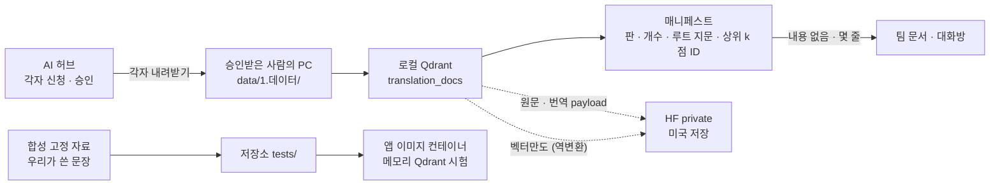
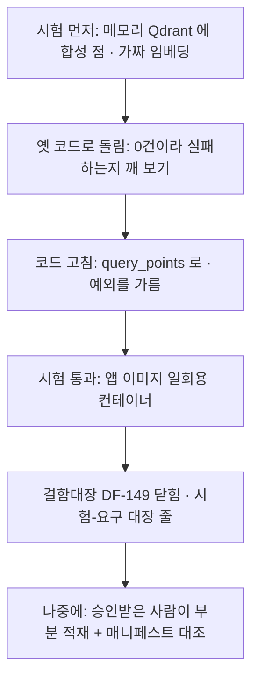

# 번역 모음 대조 — HF private 에 둘까, 다른 길은 무엇인가 (2026-10-23 배경조사)

| 문서 정보 | |
|---|---|
| **판 · 상태** | 결과 v1.0 · 읽기만 한 조사(이 파일 밖의 코드 · 시험 · README · 대장 · 배경조사 README 를 고치지 않음 — README 줄은 메인이 넣는다) |
| **출처(물음)** | 사용자 10-23 물음 「Qdrant에 적재되어 있지 않다면 번역 모음을 HF Organization private dataset으로 두면 대조가 되지 않나? 근데 이건 너무 용량을 잡아먹겠지? 조금 리서치해서 대안 탐구 실제 서비스나 다른 깃허브 프로젝트 조사를 통해서」 · 결함 DF-149([테스트계획서](../../../../04-testing/테스트계획서.md) 결함대장) · 앞선 조사 [AI허브 번역 데이터 결과(10-13)](../../../../../phase-2/01-analysis/research/배경조사/2026-10-13-AI허브-번역데이터.md) · [이용조건 조사서 v0.1](../../../../../phase-2/01-analysis/research/AI허브-번역데이터-이용조건-조사.md) |
| **기준** | main `8dff0a2`(10-23 12:18) — 코드는 `app/services/translation_ingest.py` · `app/routes/ingest.py` · `app/config.py` · `tests/test_rag_pipeline.py` 를 읽음(`app/` · `tests/` · `requirements.txt` 는 작업 트리 변경 없음). DF-149 재현(메모리 Qdrant 점 하나 → `search` 경로 0건 · `query_points` 1건)은 **메인의 10-23 결과를 따른다** — 이 PC 호스트 파이썬에는 `qdrant_client` 가 없어(오늘도 `ModuleNotFoundError`) 다시 돌리지 않았다 |
| **조회일** | 2026-10-23 12:54 ~ 13:15 KST |
| **확실도** | **상** = 원문 · 문서 쪽 · 파일을 직접 읽거나 셈 / **중** = 2차 요약 · 검색 요약만 읽음 · 해석이 들어감 / **하** = 추정 · 어림 |
| **지킨 것** | 로컬 읽기 · 웹 조사만. HF 에 올린 것 0 · HF API 안 부름 · Qdrant 쓰기 0 · 앱 호출 0 · git 은 읽기(`log` · `status`)만 · fetch · `gh` · GitHub API · github.com 쪽 열기 없음 · `.env` 안 엶(`.env.example` 의 `EMBED_MODEL` 한 줄만 봄) · **데이터 문장은 한 줄도 출력 · 인용하지 않음**(`data/1.데이터/` 는 이 PC 에 없고, 데이터셋 쪽의 예시 JSON 줄은 건너뛰고 공개 규모 표만 읽음) |

## 맨 위 5줄 요약

1. **번역 모음을 HF private 에 두는 것은 용량이 아니라 약관이 막는다.** 모음 조각의 payload 에 원문 `text` · 번역 `translation` 이 그대로 있어(`translation_ingest.py:71-81`) 모음 · Qdrant 스냅숏을 올리면 원본을 올리는 것과 같다. AI 허브 FAQ 는 「해외에 소재한 서버나 클라우드 환경으로 전송·저장 … 국외 반출」 · 「단순 편집·가공한 데이터를 … 공유 … 제3자에게 제공하는 것은 제한」 이고(오늘 다시 읽음 — 10-13 과 글자 같음 · 상), HF 는 Team · Enterprise 가 아니면 늘 미국 저장이며 고를 수 있는 지역도 미국 · EU 뿐이다(한국 없음 · 상).
2. **용량은 걱정거리가 아니다.** 데이터셋 쪽 공개 규모 표(문서 1,027,190 · 문장 2,544,670)로 셈하면 모음 통째 약 **4.3 ~ 5.4GB**(벡터 float32 3.2 ~ 3.9GB · int8 0.8 ~ 1.0GB · 1비트 0.1GB)이고, HF 무료 조직의 private 한도는 100GB(10-07 기록 13.5GB 사용)다. 정말 비싼 것은 **시간** — 이 PC 로 전부 임베딩하면 37 ~ 209시간이다(어림 · payload 바이트는 하 · 3절).
3. **「벡터만 · 해시만」 은 둘로 갈린다.** 이용정책 · FAQ 에 「임베딩 · 벡터 · 파생 · 해시 · 통계」 낱말은 0곳이다. 벡터는 역변환 연구(vec2text — 32토큰 입력 92% 를 글자 그대로 복원 · 다국어 모델이 더 취약 · 표본 1천 개로 언어를 건너 옮겨 가는 공격 · 시험한 방어 모두 효과 없음)와 OWASP LLM08:2025 가 「원문을 상당 부분 되살린다」 고 보므로 **데이터로 다뤄 올리지 않는다**(중). 개수 · 공개 규모 · 판 · 루트 지문처럼 **내용을 담지 않은 매니페스트**는 반출 대상으로 보기 어렵다(중).
4. **실제 서비스도 같은 선을 긋는다.** Qdrant · Cohere 는 arXiv · 위키백과 같은 **공개 자료만** 「원문 + 벡터」 로 HF · 스냅숏에 올린다. 저작권 · 계약 자료(TREC Robust04 · LDC)는 ir_datasets · BEIR 처럼 **「각자 계약하고 받기 → 정한 자리에 두기 → 해시로 확인 → 처리는 공용 스크립트」** 로 맞춘다. 시험은 메모리 모드 · 가짜 임베딩 · 기록-재생을 쓴다 — 우리 TC-VS(DF-38 · 같은 「예외 삼킴 → 0건이 성공처럼」 결함)가 이미 그 꼴이다.
5. **추천은 「⑤ + ③ 지금, ④ 는 자료를 받은 사람이 생기면」 이다** — 합성 고정 자료 + 메모리 Qdrant 회귀 시험(TC-TR 제안)으로 DF-149 를 고치고 확인한다. **DF-149 에는 실제 번역 자료가 필요 없다.** 실제 자료 대조는 승인받은 사람이 로컬에서 부분 적재하고 내용 없는 매니페스트(판 · 개수 · 루트 지문 · 상위 k 점 ID)만 맞댄다. 메인이 정할 것 여섯(6절).

## 이 문서의 말

| 말 | 뜻 |
|---|---|
| 번역 모음 | Qdrant 컬렉션 `translation_docs`. 한 점 = 조각 하나의 벡터(768차원) + payload |
| 조각 · payload | 문서 하나의 문장을 10개씩 묶은 단위(`SENTS_PER_CHUNK = 10`). payload 는 점에 붙은 JSON — 원문 `text` · 번역 `translation` · `doc_no` · `category` · `target_language` 등 |
| 스냅숏 | Qdrant 가 컬렉션을 통째로 묶은 tar 파일(설정 + 모든 점 + payload) |
| 매니페스트 | 「무엇으로 · 몇 개를 · 어떤 판으로 만들었나」 를 적은 목록. 이 문서에서는 **원문 · 번역 · 벡터를 담지 않는 것**만 뜻한다 |
| 지문(해시) | 글에서 계산한 짧은 값(sha256). 같은 글이면 같고 한 글자라도 다르면 다르다. 지문으로 글을 되살릴 수는 없다 |
| 루트 지문 | 조각 지문을 모두 정렬해 한 번 더 계산한 값 한 줄. 두 사람의 모음이 같으면 같다 |
| 임베딩 역변환 | 벡터만 보고 원래 글을 되살리는 공격(embedding inversion) |
| 고정 자료(fixture) | 시험이 늘 같은 입력으로 돌도록 저장소에 두는 작은 자료 |
| 메모리 모드 | qdrant-client 가 서버 없이 프로세스 안에서 도는 방식(`location=":memory:"`) |
| 가짜 임베딩 | 뜻은 없지만 같은 글이면 같은 벡터를 내는 시험용 함수 |
| 기록-재생 | 처음 한 번의 HTTP 응답을 파일에 적어 두고 다음부터는 그 파일로 답하는 시험 방식(VCR) |
| 국외 반출 · 단순 가공 | AI 허브 이용정책 3항 · FAQ 의 말. 10-13 조사서 부록 A 와 같은 뜻 |
| **대조** | 이 문서에서 넷으로 나눈다 — **기능 대조**(검색이 결과를 돌려주나 · DF-149) · **동일성 대조**(내 모음과 팀원 모음이 같은 자료 · 같은 판으로 만들어졌나) · **품질 대조**(같은 질의에 같은 상위 결과를 내나) · **원문 대조**(찾은 문장이 원문과 맞나 — 승인받은 사람만 자기 PC 에서) |

---

## 0. 먼저 다시 확인한 제약 — 10-13 과 오늘

**표 0. 이미 알려진 제약 다시 검증** · 조회 2026-10-23 · 받은 쪽은 저장소 밖 임시 폴더에만 두었다.

| 제약 | 10-13 | 오늘 | 같은가 | 확실도 |
|---|---|---|:-:|:-:|
| 이용정책 3항 「본 AI데이터 등의 국외 반출을 위해서는 수행기관 등 및 한국지능정보사회진흥원과 별도로 합의가 필요합니다.」 · 5항 「… 승인을 받지 않은 다른 법인, 단체 또는 개인에게 열람하게 하거나 제공, 양도, 대여, 판매하여서는 안됩니다.」 | 인용 | 10항 모두 글자 그대로 | 같음 | 상 |
| FAQ 「해외에서도 …」 — 「또한 데이터를 해외에 소재한 서버나 클라우드 환경으로 전송·저장하거나 해당 환경에서 학습에 활용하는 경우에도 국외 반출에 해당하므로, AI 허브 데이터는 국내 서버 및 국내 클라우드 환경에서 이용해 주시기 바랍니다.」 | 인용 | 2쪽 · **검색(GET) 경로로도 같은 문장**(2차 검증) | 같음 | 상 |
| FAQ 「저작권 정책」 — 「다만, 다운로드한 데이터 원본 또는 단순 편집·가공한 데이터를 외부에 공개·공유·재배포하거나 제3자에게 제공하는 것은 제한됩니다.」 | 인용 | 2쪽 | 같음 | 상 |
| FAQ 「영리적」 — 2차 저작물(모델 · 서비스 · 연구 결과물)은 배포 가능 · 「원본을 단순 가공(편집·수정)한 형태로의 공유」 는 제한 | 인용 | 1쪽 | 같음 | 상 |
| FAQ 건수 | 3쪽 21건 | 3쪽 21건(1쪽 10 · 2쪽 10 · 3쪽 1 · 4쪽 빈 쪽). 1쪽에 「AI 허브 MCP」(메타데이터 조회 — 용량 포함 · API 키 필요) 같은 질문이 보이나 이용 조건을 바꾸는 질문은 없음 | 같음 | 상 |
| 데이터셋 71782 | 판 1.2(2024-12-04 「서브라벨링 추가」) · 「※ 내국인만 데이터 신청이 가능합니다.」 · 용량 칸 비어 있음 | 같음. 조회수 39,865 · 다운로드 2,020. **공개 규모 표**(문서 유형 × 언어별 문서수 · 문장수 · 평균어절수)를 새로 읽음(3절). 「샘플(경량) 데이터」 단추도 로그인 화면으로 넘김(`fnLoginLink`) | 같음 | 상 |
| FAQ — 개방 범위 | — | 「AI 허브 데이터는 Training(80%), Validation(10%), Test(10%), Sample 데이터로 구성되어 있으며, 이 중 Test(테스트셋) 데이터는 개방하지 않습니다.」 | 새로 읽음 | 상 |
| HF 저장 지역 | 「For non-Team or Enterprise users, repositories are always stored in the US.」 · US · EU · Coming soon Asia-Pacific · GCC | 같음(「Currently available regions: US · EU」 · 「Coming soon: Asia-Pacific」 · 「Coming soon: GCC (KSA)」). 가격 쪽에도 Team 기능으로 「Data location control with Storage Regions」(2차 검증) | 같음 | 상 |
| payload 에 원문 · 번역 | 인용 | `_doc_chunks()` 가 `text`(원문 10문장) · `translation`(`mtpe` 없으면 `mt`)을 담고(`:61-81`), 검색이 둘을 그대로 돌려줌(`:259-270`) | 같음 | 상 |
| 이 PC 원자료 | 없음 | `data/` 에 `collector` · `help` · `hf_export` · `local-run` · `manifest.json` 뿐 — `data/1.데이터/` 없음 → 파일 수 · 줄 수는 **세지 못했고** 공개 규모 표로 대신했다 | 같음 | 상 |
| 번역 API 문지기 | 10-13 할 일 4 「기본 끔 · 배포 환경에서 끔」 제안 | 두 API 모두 **로그인만** 본다(`routes/ingest.py:131-171` · `get_current_user`) · 끔 설정 없음 → 누가 모음을 적재하면 로그인한 누구나 원문을 본다(5항 「열람」) | 아직 안 됨 | 상 |

**결론** — 약관 · HF · 코드 쪽 제약은 10-13 그대로다. 바뀐 것은 없고, 새로 얻은 것은 공개 규모 표 · 개방 비율 · 샘플도 로그인 필요라는 세 사실이다.

---

## 1. 약관 쪽 경계 — 무엇을 어디에 둘 수 있나

### 1.1 만든 것마다

**표 1. 만든 것마다 — HF · GitHub 처럼 해외 서버에 둘 수 있나** · GitHub · Discord 도 해외 서버라(10-13 표 7) 「어디에 두나」 보다 **「무엇을 두나」** 가 경계다.

| 만든 것 | 원문을 되살릴 수 있나 | 약관의 어느 말에 가깝나 | 판단 | 확실도 |
|---|---|---|---|:-:|
| 모음 · Qdrant 스냅숏(벡터 + payload) | 그대로 들어 있다 | 「원본 또는 단순 편집·가공한 데이터 … 공유 … 제3자 제공 … 제한」 + 해외 저장 = 국외 반출 | **안 된다** | 상 |
| 원문 · 번역을 parquet 등으로 바꾼 것 | 그대로 | 형식 변경 = 단순 가공(10-13 부록 A) | 안 된다 | 상 |
| 임베딩 벡터만(원문 칸을 지운 점 · parquet) | **상당 부분 되살릴 수 있다**(표 2) | 약관에 낱말 없음. 원문이 바뀐 꼴로 남아 있어 「가공한 데이터」 쪽에 가깝다고 보는 것이 안전 | **두지 않는다** | 중(약관 해석) · 연구 근거 상 |
| 양자화 벡터(int8 · 1비트) | 정보는 줄지만 검색 품질은 거의 그대로(int8 99.7 ~ 100% — Cohere 카드) → 뜻 정보가 남는다 | 위와 같음 | 두지 않는다 | 중 |
| 조각 지문(sha256(원문 ‖ 번역)) | 되살릴 수 없다. 다만 **후보 문장을 가진 사람**은 「이 문장이 들어 있나」 를 확인할 수 있다(짧은 문장일수록) | 원본도 가공 데이터도 아니다 | 됨 — 단 기본은 로컬에, 나눌 때는 루트 지문 한 줄 또는 팀 비밀키 지문(HMAC) | 중 |
| 점 ID(`sha256(zip이름::doc_no::조각번호)` 앞 15자리 → 정수 · `translation_ingest.py:85-87`) | 내용 없음 | 식별자 | 됨 | 중 |
| 개수(문서 · 조각 · 점) · 크기 · 판 | 없음 | FAQ 「연구 결과물」(수치) · 정책 「AI데이터를 제외한 데이터 설명 … 로그인 없이 이용이 가능」 | 됨 — 출처 표기 | 상 |
| 데이터셋 쪽 공개 규모 표 · 칸 이름 | 없음 | 「데이터 설명」 | 됨 | 상 |
| 우리가 쓴 질의 + 상위 k 점 ID · 점수 | 없음 | 연구 결과물(수치) | 됨 | 중 |
| 승인 안 받은 사람이 보는 화면 · API 의 원문 문장 | 그대로 | 5항 「열람하게 하거나」 | 안 된다 | 상 |

### 1.2 벡터만이면 안전한가 — 역변환 연구

**표 2. 임베딩 역변환 연구** · 모두 원문(초록 · 쪽)을 읽음 · 조회 2026-10-23.

| 연구 | 무엇을 보였나(원문) | 우리에게 | 확실도 |
|---|---|---|:-:|
| Song · Raghunathan, 「Information Leakage in Embedding Models」(CCS 2020 · arXiv 2004.00053) | 「our attacks on popular sentence embeddings recover between 50%--70% of the input words (F1 scores of 0.5--0.7)」 | 오래된 문장 임베딩도 입력 낱말 절반 이상이 샌다 | 상 |
| Morris 외, 「Text Embeddings Reveal (Almost) As Much As Text」(EMNLP 2023 · arXiv 2310.06816) — vec2text | 「a multi-step method that iteratively corrects and re-embeds text is able to recover 92% of 32-token text inputs exactly」 · 임상 기록에서 「full names」 복원 | 우리 조각(문장 2.5개 안팎)은 32토큰보다 길지만, 「벡터 = 원문을 거의 다 담은 것」 이 이 분야의 기본 인식이다. **ACL Anthology 초록으로 2차 확인** | 상 |
| Chen · Lent · Bjerva, 「Text Embedding Inversion Security for Multilingual Language Models」(arXiv 2401.12192 · 2024) | 「multilingual LLMs may be more vulnerable to inversion attacks, in part because English-based defences may be ineffective」 | 한국어 · 다국어 자료라고 덜 새지 않는다 | 상 |
| Chen · Xu · Bjerva, 「ALGEN」(arXiv 2502.11308 · 2025) | 「a single data point is sufficient for a partially successful inversion attack」 · 「With as little as 1k data samples, performance reaches an optimum」 · 「effectively transferred across domains and languages」 · 시험한 방어 「none are effective」 | 공격자가 우리 모델용 공격기를 따로 훈련할 큰 자료가 없어도 된다 | 상 |
| Zhang · Morris · Shmatikov, 「Universal Zero-shot Embedding Inversion」(arXiv 2504.00147 · 2025) | 「can be used for any text embedding without training an embedding-specific inversion model」 · 이 문제는 「how much information is leaked by vector databases」 를 재는 것 | 모델마다 공격기를 만들 필요도 없어지는 쪽으로 가고 있다 | 상 |
| OWASP Top 10 for LLM 2025 · LLM08 「Vector and Embedding Weaknesses」 | 「3. Embedding Inversion Attacks — Attackers can exploit vulnerabilities to invert embeddings and recover significant amounts of source information」 · 「non-compliance with data usage policies during augmentation can lead to legal repercussions」 | 보안 업계 표준 목록도 벡터를 「원천 정보를 담은 것」 으로 다룬다 | 상 |

**우리 경우에 옮기면** — 모음의 벡터는 `nomic-embed-text`(Ollama `latest` · v1.5 · 768차원 · 모델 카드 언어 칸 `en`)로 한국어 원문을 임베딩한 것이다. 이 모델로 한국어가 얼마나 되살아나는지는 재지 않았고, 재는 실험 자체가 원문을 다뤄야 해서 하지 않는다. 그러나 다국어 · 언어 간 공격이 이미 보고됐으므로 「영어 모델이라 한국어는 안 샌다」 고 기댈 근거가 없다 → **벡터는 데이터로 보고 로컬에만 둔다**(10-13 의 「🔴 추측」 을 연구 근거로 「중」 까지 올린 판단).

### 1.3 지역 — 한국에 둘 수 있는 해외 서비스가 있나

| 서비스 | 고를 수 있는 저장 지역(원문) | 한국 | 확실도 |
|---|---|:-:|:-:|
| Hugging Face | Team · Enterprise 기능 · 「Currently available regions: US · EU」 · 「Coming soon: Asia-Pacific」 · 「Coming soon: GCC (KSA)」 · 그 밖 요금제는 「always stored in the US」 | 없음 — 요금제를 올려도 국내가 안 된다 | 상 |
| Google Workspace(팀 공용 드라이브) | 「Your location options are the United States, European Union (labeled Europe in the Google Admin console), or No preference.」 · 유료 판에서만 | 없음 | 상 |
| 국내 클라우드 · 국내 서버(서울 지역 · 국내 사업자 · 국내 NAS) | FAQ 「국내 서버 및 국내 클라우드 환경에서 이용」 | 위치는 된다 | 상 |

국내에 두더라도 **팀원과 나누는 일**은 따로 걸린다 — 5항(승인 안 받은 사람에게 열람 · 제공 금지)과 FAQ(단순 가공본의 공유 · 제3자 제공 제한). 승인받은 팀원끼리 사본을 주고받는 경우는 원문에 따로 없다(10-13 물음 ①-보탬 · 중). AWS 는 2 · 3차에 쓰지 않기로 팀이 정했다.

---

## 2. 실제 서비스 · 공개 프로젝트는 어떻게 나누고 · 재현 · 대조하나 — 관행 표

**표 3. 관행 열다섯 가지** · 「우리에게 주는 뜻」 은 이 조사의 해석이다. 조회일은 모두 2026-10-23.

| # | 관행 | 출처 · 주소 | 확실도 | 우리에게 주는 뜻 |
|--:|---|---|:-:|---|
| 1 | **Qdrant 스냅숏 = 원문 사본.** 「Snapshots are tar archive files that contain data and configuration of a specific collection」 · 「A collection level snapshot only contains data within that collection, including the collection configuration, all points and payloads.」 · 복원은 「same minor version or the next minor version」 에서만 | Qdrant 문서 「Snapshots」 · https://qdrant.tech/documentation/snapshots/ | 상 | 스냅숏을 올리면 payload(원문 · 번역)가 같이 간다. 판에도 묶여(예: 1.18.1 → 1.18.x · 1.19.x) 팀원 사이 나눔 도구로도 약하다 |
| 2 | **벤더는 공개 자료만 통째로 올린다.** Qdrant 연습 스냅숏 — 「Our snapshots are usually generated from publicly available datasets」 · arXiv 제목(InstructorXL · 768 · 230만 · **7.7GB**) · 초록(9.2GB) · Wolt(512 · 170만 · 6.8GB) · payload 에 제목 · 초록 원문 | Qdrant 문서 「Practice Datasets」 · https://qdrant.tech/documentation/datasets/ | 상 | 「768차원 · 수백만 점 = 수 GB」 는 업계에서 흔히 나누는 크기다 — 크기는 문제가 아니다. 대신 원천이 공개 자료다 |
| 3 | Qdrant 의 HF 데이터셋 — DBpedia 1M · `text` + 1536차원 임베딩 · 라이선스 MIT · 내려받기 9.55GB(BEIR `dbpedia-entity` 파생) | https://huggingface.co/datasets/Qdrant/dbpedia-entities-openai3-text-embedding-3-large-1536-1M | 상 | HF 에 벡터 모음을 두는 것 자체는 흔하다 — 원천 라이선스가 허락할 때 |
| 4 | Cohere(CohereLabs) 위키백과 임베딩 — `text` + `emb` · int8 · ubinary 판 · 「int8 embeddings keep 99.7-100% of the search quality, while reducing your vector index 4x」 · 「reduction of your vector index size up to 32」 | https://huggingface.co/datasets/Cohere/wikipedia-2023-11-embed-multilingual-v3-int8-binary | 상 | 위키백과(공개)라 원문까지 올린다. 양자화해도 검색 품질이 거의 그대로 = 뜻 정보가 남는다(표 1 근거) |
| 5 | Chroma · LanceDB 도 모음을 HF 로 내보내는 길이 있다 — `cdp export … \| cdp ds-put "hf://…"` · 비공개는 `--private` / Lance 형식을 HF 가 직접 읽음(「query the precomputed vector + FTS indexes … without needing to download」) | chromadb-data-pipes README(PyPI) https://pypi.org/project/chromadb-data-pipes/ · LanceDB 블로그 https://lancedb.com/blog/lance-x-huggingface-a-new-era-of-sharing-multimodal-data | cdp 상 · Lance 중(블로그 목록 글) | **기술은 사용자 안 그대로 된다.** 막는 것은 기술이 아니라 자료의 이용 조건이다 |
| 6 | **ir_datasets — 저작권 자료는 각자 받고, 도구는 자리 · 처리 · 검증만.** 「contain copyrighted material and are only available with a usage agreement and subscription to the Linguistic Data Consortium. In these cases, the user is presented with instructions on how to acquire the dataset and where to put it. Once acquired by the user, ir_datasets will take care of any remaining processing. There are currently 12 document collections that require a manual process to acquire.」 · 「it verifies the integrity of the downloaded content via a hash」 · TREC Disks 4·5 쪽 「ir_datasets expects the above directories to be copied/linked under ~/.ir_datasets/disks45/corpus … If ir_datasets does not find the files it is expecting, it will raise an error.」 | MacAvaney 외, 「Simplified Data Wrangling with ir_datasets」(SIGIR 2021 · arXiv 2103.02280 · PDF 직접 읽음) · https://ir-datasets.com/disks45.html | 상 | **안 ④ 의 뼈대** — 「각자 신청 → 정한 자리(`data/1.데이터/`) → 해시로 확인 → 처리는 공용 코드」. 우리 코드는 앞의 둘(자리 · 처리)은 이미 있고 해시 확인만 없다 |
| 7 | BEIR — 「TREC-NEWS, Robust04, BioASQ: Data collection archives are under Copyright.」 → 이 셋은 내려받기 대신 재현 안내만 둔다 | Thakur 외, BEIR(NeurIPS 2021 Datasets · arXiv 2104.08663 부록 E) · 재현 안내 표는 검색 요약(https://github.com/beir-cellar/beir/wiki/Datasets-available — 열지 않음) | 저작권 문장 상 · 재현 안내 중 | 이름난 평가 묶음도 막힌 자료는 「없이 공개 + 각자 재현」 으로 둔다. 그래서 받을 수 있는 데이터셋만으로 평균을 내는 평가가 많다고 한다(검색 요약 · 중) |
| 8 | MTEB — 「Dataset versioning: Each dataset references a specific revision from its source (typically Hugging Face), ensuring identical data across evaluation runs.」 · 모델도 판 고정 · CI 로 「validate dataset integrity」 | Chung 외, 「Maintaining MTEB」(arXiv 2506.21182 · PDF 직접 읽음) | 상 | 대조하려면 **자료 판 · 모델 판 · 코드 판**을 함께 적어야 한다 → 매니페스트 층 0(5.4절) |
| 9 | DVC — 자료 대신 md5 를 담은 자리표시 파일(`.dvc`)을 git 에 · 자료는 원격(S3 · SSH & SFTP · HDFS · WebDAV · 로컬 등)에 | DVC 문서 https://dvc.org/doc/user-guide/project-structure/dvc-files · https://dvc.org/doc/user-guide/data-management/remote-storage | 상 | 「지문은 git 에, 자료는 따로」 가 데이터 버전 관리의 기본 꼴. 우리는 자료를 나누지 않으므로 지문만 쓴다 |
| 10 | LangChain `index()` — 「documents are indexed using their hashes」 · 바뀐 것 · 지운 것 · 건너뛸 것을 기록해 다시 적재해도 중복이 없게 | https://reference.langchain.com/python/langchain-core/indexing/api/index | 상 | 조각 지문 + 결정적 점 ID 면 다시 적재가 멱등이 된다 — 우리 `_chunk_id` 가 이미 결정적이다 |
| 11 | **시험은 서버 · 진짜 임베딩 없이.** qdrant-client README 「Local mode is useful for development, prototyping and testing. - You can use it to run tests in your CI/CD pipeline.」 · LangChain `DeterministicFakeEmbedding` 「Deterministic fake embedding model for unit testing purposes」(「a seed based on the hash of the text」) · `langchain-tests` 의 벡터 저장소 통합 시험은 「A pre-defined embeddings model that should be used for this test」 · VCR.py 「records all HTTP interactions」 · 「The ability to work offline」 · 「Completely deterministic tests」 | https://pypi.org/project/qdrant-client/ (README · JSON API) · https://reference.langchain.com/python/langchain-core/embeddings/fake/DeterministicFakeEmbedding · https://reference.langchain.com/python/langchain-tests/integration_tests/vectorstores/VectorStoreIntegrationTests/get_embeddings · https://vcrpy.readthedocs.io/en/latest/ | 상 | **안 ③ · ⑤ 의 뼈대.** 벡터 DB 도구들의 표준 시험도 진짜 자료 · 진짜 모델을 쓰지 않는다 |
| 12 | 국내 선례 — `MarkrAI/KoCommercial-Dataset`: 「NIA와 AI-Hub와의 저작권 협의 하에 …」 · 「기존에 저희가 code베이스로 SSL 데이터를 생성했던 코드를 그대로 공개드립니다」 · 「AIHUB데이터는, 위의 github주소를 통해, 데이터를 생성하셔 사용하시면 됩니다」 | https://huggingface.co/datasets/MarkrAI/KoCommercial-Dataset (오늘 다시 읽음) · 10-13 [B3] `sappho192/aihub-ja-ko-translator`(모델만 HF · 데이터는 AI 허브에서 각자) | 상 · B3 중 | AI 허브 파생 자료를 HF 에 올렸다가 협의 뒤 **자료 대신 만드는 코드**로 바꾼 실제 사례 — 안 ④ 와 같은 꼴 |
| 13 | JW300(OPUS) — 출처 사이트 약관이 텍스트 · 데이터 마이닝을 막아 프로젝트(Masakhane)가 데이터셋을 버림 · 「The website's terms imposed restrictions "beyond those set by statutory copyright law"」 | https://knowledgegov.org/?p=69 (2차 정리 글) | 중 | 계약 · 이용 조건이 저작권 예외보다 앞선다 — AI 허브 정책도 「CC 라이선스와 같은 공개 라이선스가 아닌 … 이용정책에 동의한 후 이용」 이다 |
| 14 | **우리 저장소 선례** — ① `data/hf_export/README.md:114-115` 복원은 「행수 · 파티션별 내용 지문 · `raw_response` 전량 sha256 재계산 · 감사 링크」 를 확인 ② 근거 DB 벡터를 「조각 ID · 본문 지문 · 모델이 모두 같은 것만 옮겼다(… 지금 다시 임베딩한 4조각과 코사인 1.000000)」(`docs/phase-3/02-design/system/목표기능1-데이터지식-설계.md:800`) ③ 조각 ID 는 「`sha256(문서 · 판 · 조 · 순번)` 이라 실행마다 같다」(같은 파일 `:578`) ④ TC-VS(`tests/test_rag_pipeline.py:1-56`) — DF-38 「그 오류를 except 가 삼켜 「0청크 저장」 · 「검색 결과 없음」 이 성공처럼 보였다」 를 메모리 Qdrant + 글자 세기 가짜 임베딩(768)으로 막음 | 로컬 파일 | 상 | 매니페스트 · 결정적 ID · 메모리 시험 셋 다 **이미 우리 손에 있는 꼴**이다. DF-149 는 DF-38 과 같은 결함 꼴이라 같은 처방이 맞다 |
| 15 | 플랫폼마다 수치가 같다는 보장이 없다 — 「Completely reproducible results are not guaranteed across PyTorch releases, individual commits, or different platforms. Furthermore, results may not be reproducible between CPU and GPU executions, even when using identical seeds.」 | PyTorch 2.14 문서 「Reproducibility」 · https://docs.pytorch.org/docs/2.14/notes/randomness.html | 문장 상 · Ollama 에 옮기는 것은 중(비유) | 팀원 사이 대조에 **벡터 값의 지문은 쓰지 않는다** — 입력 글 지문과 상위 k 점 ID 로 본다. 같은 PC 에서는 코사인 1.000000(행 14 ②) |

**한 줄로** — 선은 하나다. **원천이 공개 자료면 원문 + 벡터를 통째로 올리고(행 2 ~ 5), 막힌 자료면 자료는 각자 받고 「받는 법 · 처리 코드 · 지문」 만 나눈다(행 6 · 7 · 12).** 사용자 안(HF private 에 모음)은 앞쪽 관행이고, 우리 자료는 뒤쪽에 든다.

---

## 3. 용량 어림

### 3.1 입력 — 공개 규모 표와 조각 셈법

**표 4. 데이터셋 71782 공개 규모 표**(데이터셋 쪽 「데이터 구축 규모」 · 조회 2026-10-23 · 칸마다 「문서 / 문장」 · 정책상 「데이터 설명」 이라 로그인 없이 공개)

| 문서 유형 | 영어 | 일본어 | 중국어 | 베트남어 | 인도네시아어 | 소계 |
|---|--:|--:|--:|--:|--:|--:|
| 공시정보 | 61,461 / 100,721 | 59,081 / 107,880 | 63,911 / 101,207 | 64,983 / 107,185 | 50,849 / 105,051 | 300,285 / 522,044 |
| 뉴스기사 | 39,421 / 103,913 | 39,980 / 100,012 | 38,983 / 100,467 | 40,834 / 101,003 | 39,056 / 100,162 | 198,274 / 505,557 |
| 규제정보 | 41,061 / 101,117 | 44,079 / 100,100 | 48,431 / 100,785 | 37,800 / 102,319 | 40,063 / 100,740 | 211,434 / 505,061 |
| 보고서 | 26,790 / 101,535 | 26,579 / 100,007 | 27,730 / 102,289 | 30,764 / 101,562 | 31,017 / 103,614 | 142,880 / 509,007 |
| 학술논문 | 37,303 / 101,220 | 36,989 / 100,000 | 36,659 / 100,405 | 32,108 / 100,331 | 31,258 / 101,045 | 174,317 / 503,001 |
| **합계** | | | | | | **1,027,190 / 2,544,670** · 평균 17.5어절 |

- **조각 수** — 코드는 문서 **안에서만** 10문장씩 묶는다(`translation_ingest.py:59-60`). 문서당 평균 2.48문장이라 문서 대부분이 조각 하나가 된다. 그래서 조각 수는 [max(문서 수, 문장 수 ÷ 10), 문서 수 + 문장 수 ÷ 10] = **1,027,190 ~ 1,281,657**(구축량 100%) · 개방분(Training + Validation = 90%로 어림 · Test 10% 비개방)은 924,471 ~ 1,153,491.
- 기본 `data_type="labeled"` 는 라벨링(`TL_`) zip 만 넣는다. `"all"` 이면 원천(`TS_`)까지 들어가 점이 약 두 배가 된다(같은 한국어를 다른 ID 로 한 번 더).
- 벡터 크기 — `EMBED_MODEL` 기본값 `nomic-embed-text`(`app/config.py:38` · `.env.example:22` 같음 · `.env` 는 안 봄) · Ollama 쪽 `latest` 와 `v1.5` 가 같은 274MB 로 보이고, v1.5 카드의 차원 표는 768(Matryoshka 로 512 · 256 · 128 · 64 까지 자를 수 있음). 시험 `tests/test_rag_pipeline.py:29` 도 768.
- payload 바이트 — 한국어 원문은 **우리 정책뉴스 본문(2024 파일 · 4,993건 · 1,595,652어절)에서 잰 어절당 10.97바이트**(띄어쓰기 포함 · 글은 출력하지 않음) × 17.5어절 = 문장당 약 192바이트. 번역문은 언어별 실측이 없어 문장당 105 ~ 210바이트로 어림(하), 나머지 칸은 조각당 220바이트로 어림(하).
- Qdrant 공식 — 「dense_size = base * dimensions * bytes_per_dim」(float32 4 · uint8 1 바이트) · 「hnsw_size = base * m * 2 * 4 bytes * 1.2」(m 기본 16) · 스칼라 양자화 「4x compression」 · 이진 양자화 「up to 32x compression」(Qdrant 문서 「Capacity Planning」 https://qdrant.tech/documentation/capacity-planning/ · 「Quantization」 https://qdrant.tech/documentation/guides/quantization/ · 상).

### 3.2 크기 표

**표 5. 번역 모음 크기 어림**(10^9 바이트 = GB · 범위는 조각 수 범위 · payload 는 하 · 나머지는 공식 그대로)

| 무엇 | 점당 | 전체 100% | 개방분 90% | 영어 한 언어 | 공시정보 × 영어 |
|---|--:|--:|--:|--:|--:|
| 조각 수 | | 1.03 ~ 1.28백만 | 0.92 ~ 1.15백만 | 206,036 ~ 256,886 | 61,461 ~ 71,533 |
| 벡터 float32 | 3,072B | 3.16 ~ 3.94GB | 2.84 ~ 3.54GB | 0.63 ~ 0.79GB | 0.19 ~ 0.22GB |
| 벡터 int8 | 768B | 0.79 ~ 0.98GB | 0.71 ~ 0.89GB | 0.16 ~ 0.20GB | 0.05GB |
| 벡터 1비트 | 96B | 99 ~ 123MB | 89 ~ 111MB | 20 ~ 25MB | 6 ~ 7MB |
| HNSW(m = 16) | 154B | 158 ~ 197MB | 142 ~ 177MB | 32 ~ 39MB | 9 ~ 11MB |
| payload(원문 + 번역 + 칸) | 약 1KB | 0.98 ~ 1.30GB(한국어 원문만 0.49GB) | 0.88 ~ 1.17GB | 0.20 ~ 0.26GB | 0.04 ~ 0.06GB |
| **모음 통째**(벡터 + HNSW + payload) | 약 4.2KB | **4.29 ~ 5.44GB** | 3.87 ~ 4.90GB | 0.86 ~ 1.09GB | 0.24 ~ 0.29GB |
| 조각 지문 매니페스트(점 ID 8B + sha256 32B) | 40B | 41 ~ 51MB | 37 ~ 46MB | 8 ~ 10MB | 2 ~ 3MB |
| zip 단위 매니페스트(이름 · 크기 · sha256 · 개수) | — | 수 KB(zip 약 100개 어림 · 목록은 로그인 뒤라 못 봄) | | | |
| 루트 지문 | — | 64자 한 줄 | | | |
| **임베딩 시간** @ 초당 7.7(내장 GPU 켬) | | **37 ~ 46시간** | 33 ~ 42시간 | 7.4 ~ 9.3시간 | **2.2 ~ 2.6시간** |
| 임베딩 시간 @ 초당 1.7 ~ 3.1(CPU) | | 92 ~ 209시간 | 83 ~ 189시간 | 18 ~ 42시간 | 5.5 ~ 11.7시간 |

- **맞춰 보기** — Qdrant 의 arXiv 제목 스냅숏은 점당 3,348바이트(7.7GB ÷ 230만)다. 우리 어림 점당 약 4.2KB 는 payload(원문 + 번역)가 제목보다 긴 만큼 크다 — 같은 크기대다.
- 임베딩 속도는 이 저장소 실측이다 — `docs/phase-2/01-analysis/research/로컬LLM-퀀트활용-조사.md:235` 「근거 임베딩(nomic-embed-text · 4,067청크) | 초당 1.7 ~ 3.1 … | 초당 7.7(530초)」. 지금 코드는 조각마다 임베딩을 한 번씩 부른다(`translation_ingest.py:194` · 묶음은 upsert 만) — 묶어 부르면 빨라질 수 있으나 재지 않았다(하).
- 임베딩 모델을 bge-m3(1024차원 · 근거 DB 가 쓰는 모델)로 바꾸면 벡터 칸이 4/3 배(float32 전체 4.2 ~ 5.2GB)가 된다. 한국어 품질 때문에 바꿀 수 있다 — 같은 조사서 `:309` 「앱 길 그대로는 38문항 가운데 1문항만 상위 5 안에 정답 조를 냈다」(nomic · 한국어 법령).

### 3.3 HF 한도와 결론

| 요금제 | private 저장 한도(원문) |
|---|---|
| 무료 사용자 · 조직 | **100GB** |
| PRO | 1TB + pay-as-you-go(가격 쪽 「10× private storage capacity」 — 2차 확인) |
| Team · Enterprise 조직 | 「1TB per seat + pay-as-you-go」 · 넘는 만큼 $18/TB/월 |

출처 HF 문서 「Storage limits」 https://huggingface.co/docs/hub/storage-limits (상). 우리 조직 사용량은 10-07 기록 13.5GB(Qurious 9.6 · Alpha_Stack 4.6 — 메모 기록 · 지금 값 아님 · 중)다. **모음 통째(4.3 ~ 5.4GB)를 올려도 약 19GB — 용량으로는 넉넉히 들어간다.** 사용자의 「용량을 잡아먹겠지?」 는 「아니다, 막는 것은 약관이다」 가 답이다. 대신 이 숫자는 **왜 나누고 싶은지**를 보여 준다 — 바이트는 싸고 임베딩 시간이 비싸다(전체 37시간 이상). 이 시간을 줄이는 길은 「남이 만든 벡터를 받기」 가 아니라 **부분 적재**(한 언어 × 한 유형 2 ~ 3시간)다.

---

## 4. 안 비교

**표 6. 안 일곱** · 품은 사람 손 기준 · 시간은 어림(하). ⑦ 은 10-13 의 A′ 를 참고로 남겼다.

| 안 | 한 줄 | 무엇을 대조하나 | 약관 | 용량 | 품 | 확실도 | 출처 |
|---|---|---|---|---|---|:-:|---|
| **① HF private 에 모음 통째**(사용자 안) | 스냅숏 · parquet(벡터 + payload)을 조직 private 데이터셋에 · 팀원이 받아 복원 | 전부(원문 대조까지) — 누구나 같은 모음 | **안 됨** — 해외 저장 = 국외 반출(3항 · FAQ) + 단순 가공본 공유 제한(FAQ) + 신청 안 한 팀원이면 5항 | 4.3 ~ 5.4GB(한도 안) | 작음(한 번 올리기) · 단 Qdrant 스냅숏은 부판에 묶임 | 상 | 표 0 · 1 · 3 행 1 |
| **② 벡터만 · 해시만 HF** | payload 를 지운 벡터(또는 int8 · 1비트) + 조각 지문 | 점 ID · 점수만(원문이 없어 찾은 글을 못 봄) | 벡터 — 약관에 없음 · 역변환 연구로 데이터로 봄 → **두지 않음** / 해시 — 됨(중) | 벡터 0.1 ~ 3.9GB · 해시 41 ~ 51MB | 중 | 중 | 표 1 · 2 · 3 행 4 |
| **③ 공개 · 합성 고정 자료를 저장소에** | 71782 칸 이름(코드에 이미 있는 것만)과 zip 이름 규칙 그대로, 우리가 쓴 금융 문장 몇 쌍으로 zip 을 만들어 `tests/` 에 | **기능** — 적재 → 검색 길 전체(zip 고르기 · 조각 · 점 ID · payload 키 · 거르기 칸) | **됨** — 우리 문장(상) · Tatoeba 는 CC BY 2.0 FR(문장마다 저작자 표시 · 상) · FLORES+ 는 CC BY-SA 4.0 이나 조건 동의 뒤 받는 자료이고 카드가 「please do not redistribute this file publicly, unless you protect it from automatic scrapping!」 (저장소가 공개라면 부딪힘 · 중) | 수 KB | 작음(1 ~ 2시간) | 상 | 표 3 행 11 · 14 |
| **④ 각자 로컬 재적재 + 매니페스트 대조** | 승인받은 사람이 각자 받아 부분 적재 → 판 · 개수 · 루트 지문 · 상위 k 점 ID 만 나눠 맞댐 | **동일성 · 품질**(같은 판 · 같은 조각 · 같은 결과) · 원문 대조는 각자 PC 에서 | **됨** — 자료는 각자 · 나누는 것은 내용 없음(중) | KB ~ MB | 중 ~ 큼 — 스크립트 80 ~ 120줄 어림 + 적재 2 ~ 3시간(부분) · 전체면 37시간+ · 3개월마다 다시 신청 | 중 | 표 3 행 6 · 8 · 9 · 12 · 14 |
| **⑤ 메모리 Qdrant 회귀 시험**(지금 재현 그대로) | 메모리 `AsyncQdrantClient` 에 점 하나를 넣고 `translation_search` 가 1건을 돌려주는지 | **기능** — 검색 함수만 | 됨 | 0 | 아주 작음(30분 안팎) | 상 | 메인 재현 · 표 3 행 11 · 14 ④ |
| **⑥ 국내 저장소**(국내 클라우드 · 국내 NAS) | 모음 사본을 국내 서버에 두고 팀원이 받음 | 전부 | 위치는 됨(FAQ 「국내 서버 및 국내 클라우드」 · 상) · 나눔은 승인받은 사람끼리도 원문에 따로 없음(중) · 구글 드라이브는 지역이 미국 · EU · 선호 없음뿐이라 안 됨(상) | 4.3 ~ 5.4GB | 큼 — 계정 · 비용 · 접근 관리 · 팀원 모두 신청 | 중 | 표 1.3 |
| ⑦ (참고) 기관 합의(10-13 A′) | 수행기관 · NIA 에 국외 반출 · 팀 공유 합의 요청 | ① 과 같음 | 합의하면 길이 있음 | ① 과 같음 | 문의 1건 + 기다림 | 결과 하 | 10-13 표 9 |

**그림 1. 무엇이 어디로 가나 — 추천 안 기준** · 실선 = 된다 · 점선 = 안 된다.

---

## 5. 추천 — 안 ⑤ + ③ 지금, 안 ④ 는 자료를 받은 사람이 생기면

### 5.1 DF-149 에 실제 번역 자료가 필요한가

**필요 없다.** 결함은 qdrant-client 1.19.1 에 없는 `search` 를 부르는 코드(`translation_ingest.py:252`)와 그 예외를 삼키는 `except Exception: return []`(`:271-272`)라서, 메모리 Qdrant + 가짜 임베딩 + 합성 고정 자료로 「고치기 전 0건 · 고친 뒤 1건」 이 갈린다. 실제 자료는 **검색 품질**을 잴 때만 필요하고, 그것도 승인받은 사람의 PC 에서만 한다.

### 5.2 한눈에

**그림 2. DF-149 확인 흐름**

### 5.3 무엇을 · 어느 파일에(제안 — 이 조사에서는 코드 · 시험을 고치지 않았다)

| # | 무엇 | 어느 파일 | 내용 |
|--:|---|---|---|
| 1 | **회귀 시험(새 · 이름 제안 `TC-TR`)** — 저장소에 `TC-TR` 은 아직 없다 | `tests/test_translation_search.py`(제안) | TC-VS 꼴 그대로 — `qdrant_client.AsyncQdrantClient(location=":memory:")` 하나를 만들어 닫기를 막고(메모리 저장소가 사라지므로) 코드가 만드는 클라이언트 자리에 끼운다 · 가짜 임베딩은 TC-VS 의 글자 세기(768) · 경우: TR-01 넣은 점이 검색된다(**DF-149**) · TR-02 `category` · `target_language` 거르기 · TR-03 모음이 없으면 빈 목록이 아니라 「적재 전」 이 드러난다 · TR-04 Qdrant 오류를 삼키지 않는다(기록 + 오류 응답) · TR-05 합성 zip → `run_translation_ingest` → 검색(조각 수 · payload 키 · 두 번 적재해도 점 수 같음 = 결정적 ID) |
| 2 | **합성 고정 자료(새)** | `tests/fixtures/translation/`(제안) | `Training/02.라벨링데이터/TL_5. 공시정보_1. 영어.zip` 꼴 · JSON 칸은 `meta.doc_no` · `meta.domain` · `sents[].source_original` · `source_cleaned` · `mt` · `mtpe` 만(코드 `:53-69` 에 이미 있는 이름) · 문장은 우리가 쓴 금융 문장(원천 문장 0줄) · 시험은 `DATA_DIR` 를 임시 폴더로 바꿔 끼운다 |
| 3 | 고칠 코드(메인 · 다음 세션) | `app/services/translation_ingest.py` | `client.search(…)` → `client.query_points(collection_name=…, query=qemb, query_filter=flt, limit=top_k)` 의 `.points` · 넓은 `except` 를 모음 없음 · Qdrant 장애 · 0건으로 가름(정할 것 2) · 예외 길에서도 클라이언트를 닫음(지금은 예외면 `close()` 를 안 부름 — `:242-258`) · 클라이언트 만드는 곳을 한 군데로(`rag_pipeline._make_client` 선례 — 시험이 끼우기 쉬움) · 같은 꼴 `crawl.qdrant_search`(부르는 곳 없음) |
| 4 | 판 고정(메인 판단) | `requirements.txt:19` `qdrant-client>=1.12.0` | PyPI 기준 1.19.1 = 2026-09-16 · **1.20.0 = 2026-10-22(어제)** — 새로 빌드하면 바뀐다(DF-149 줄 곁가지 ④). 상한을 두거나 지금 판으로 고정 |
| 5 | 깨 보기 | — | 팀 관행대로 옛 `app/` 를 덮어 TR-01 이 0건으로 실패하는지 본다(시험이 결함을 실제로 잡는지) |
| 6 | 실행 | 앱 이미지 일회용 컨테이너 | 호스트에는 qdrant-client 가 없다(오늘도 `ModuleNotFoundError`) — TC-VS · TC-DI 와 같은 자리 |

### 5.4 안 ④ 설계(나중 · 자료를 받은 사람이 생기면)

**표 7. 매니페스트 네 층** · 나누는 범위를 층마다 정했다.

| 층 | 담는 것 | 크기 | 어디에 |
|--:|---|---|---|
| 0 판 | 데이터셋 71782 판(1.2) · 받은 날 · zip 이름 · 크기 · sha256 · 앱 커밋 · `SENTS_PER_CHUNK` · 임베딩 모델 이름 + Ollama 다이제스트 · qdrant-client 판 | 수 KB | 팀 문서(내용 없음) |
| 1 셈 | zip 마다 문서 · 조각 · 점 수, 전체 합 | 수 KB | 팀 문서 |
| 2 지문 | 조각마다 (점 ID, sha256(원문 ‖ 번역)) → 정렬해 **루트 지문 한 줄** | 41 ~ 51MB(전체) · 루트 64자 | 조각 줄은 **로컬에만** · 나누는 것은 루트 한 줄(필요하면 팀 비밀키 HMAC) |
| 3 결과 | 우리가 쓴 질의 20 ~ 30개의 상위 10 점 ID · 점수(소수 넷째 자리) | 수 KB | 팀 문서 — 품질 대조 |

- **대조 순서** — 루트 지문이 같으면 끝 → 다르면 층 1(zip 별 개수) → 그래도 다르면 각자 PC 에서 층 2 를 맞댄다(조각 줄을 서로 보내지 않고, 다른 zip 이름만 말로 주고받는다).
- **함정 하나** — 점 ID 가 **zip 파일 이름을 품는다**(`translation_ingest.py:86` `f"{zip_name}::{doc_no}::{chunk_index}"`). 이름을 바꿔 두면 내용이 같아도 ID 가 모두 달라진다 → 받은 이름 그대로 두라고 안내하거나, ID 를 doc_no · 유형 · 언어 · 조각 번호로만 만드는 쪽으로 바꾼다(정할 것 5).
- **벡터는 지문에 넣지 않는다** — 플랫폼마다 수치가 다를 수 있다(표 3 행 15). 같은 PC 에서는 다시 임베딩해도 코사인 1.000000 이었다(행 14 ②).
- **범위는 부분으로** — 전체 37시간 이상 대신 「공시정보 × 영어」(2.2 ~ 2.6시간 @ 초당 7.7) 같은 한 칸 또는 `max_docs`.
- ir_datasets(행 6)처럼 「자리가 없으면 오류 + 받는 법 안내」 를 적재 쪽에 두면, 자료가 없는 팀원도 왜 0건인지 바로 안다.

### 5.5 하지 않는 것

- HF · Colab · 해외 LLM API · GitHub · Discord 로 모음 · 스냅숏 · 벡터(양자화 포함)를 보내지 않는다.
- 매니페스트 층 2(조각 줄)를 저장소에 올리지 않는다.
- 번역 검색 API 를 승인 안 받은 사람이 보는 곳에 열지 않는다(정할 것 6).
- 데이터 문장을 시험 · 문서 · 발표에 쓰지 않는다(10-13 결정 「수치 · 그래프만」).

---

## 6. 메인이 정할 것(선택지 · 추천은 첫 칸)

| # | 정할 것 | 선택지 | 판단 재료 |
|--:|---|---|---|
| 1 | DF-149 를 무엇으로 확인하나 | **A. ⑤ + ③ — 메모리 Qdrant 회귀 시험 + 합성 고정 자료** / B. ⑤ 만(점 하나 · 검색 함수만) / C. 실제 자료를 적재한 뒤 확인 | 실제 자료는 필요 없다(5.1). B 는 30분이면 되지만 적재 길(zip 고르기 · 조각 · ID)과 TR-05 를 못 지킨다. C 는 신청 · 내려받기 · 적재(부분이라도 2시간+)가 앞서고 시험이 남지 않는다 |
| 2 | 모음 없음 · Qdrant 장애를 API 가 어떻게 돌려주나 | **A. 모음 없음 = 409(또는 404) + 「번역 자료가 아직 적재되지 않았습니다」 · 장애 = 503 · 0건 = 200 빈 목록** / B. 지금처럼 빈 목록 + 기록만 / C. 모두 503 | 전역 규칙 「단순 로그가 아닌 적절한 에러 응답」 · `user_docs` 선례(틀리면 오류 · 빈 목록으로 삼키지 않음) · `rag_pipeline` 선례(채팅이 이어지게 빈 목록 + 기록). 번역 검색은 채팅 안이 아닌 **단독 API** 라 A 가 맞다. 사용자가 본 「0건」 이 「모음 없음」 인지 「결과 없음」 인지 지금은 가를 수 없다 |
| 3 | 고정 자료의 문장은 어디서 | **A. 우리가 쓴 합성 금융 문장** / B. Tatoeba 한-영(CC BY 2.0 FR · 문장마다 저작자 표시) / C. FLORES+ 한국어(CC BY-SA 4.0 · 조건 동의 뒤 받음 · 공개 재배포 말아 달라는 부탁) | A 는 권리 문제 0 · TC-VS 도 같은 방식 · 도메인(금융)도 맞다. B 는 진짜 사람 번역이지만 표시 파일이 더 든다. C 는 저장소가 공개면 카드의 부탁과 부딪힌다 |
| 4 | 안 ④(매니페스트 대조)를 언제 · 어디까지 | **A. 자료를 받은 사람이 생기면 그때 — 층 0 · 1 · 3 + 루트 지문만 나눔** / B. 지금 스크립트까지 / C. 하지 않음 | 10-13 결정은 「원본은 각자 로컬 · 시연은 수치 · 그래프만」 이고, 아직 받은 사람이 없다. 받은 사람이 한 명뿐이면 맞댈 상대가 없어 층 0 · 1 만으로 충분하다. B 는 3차 발표(11-12) 전 다른 일과 겹친다 |
| 5 | 점 ID 가 zip 이름을 품는 것 | **A. 지금 그대로 — 「받은 이름 그대로 두기」 안내 + 층 0 에 이름 기록** / B. 내용 기반 ID 로 바꿈(doc_no · 유형 · 언어 · 조각 번호) | B 는 어디에도 모음이 없는 **지금이 가장 싸다**(옛 모음과 어긋날 일 없음). 다만 DF-149 범위를 넘는다 — 함께 넣을지 따로 할지는 PR 크기로 판단. INNORIX · aihubshell 로 받은 이름이 같은지는 확인 못 함 |
| 6 | 번역 API 두 개의 문지기(10-13 할 일 4 · 아직 안 됨) | **A. DF-149 PR 에 함께 — 기본 끔 설정 + 켜도 관리자만** / B. 따로 PR / C. 그대로(로그인만) | 지금은 누가 모음을 적재하면 로그인한 누구나 원문 · 번역을 본다(5항 「열람」 · 상). 기본 끔이면 회귀 시험에서 설정을 켜고 돌린다 |

**정하지 않아도 되는 것(기존 결정 그대로)** — 원본은 각자 신청 · 각자 로컬 · HF · Colab 금지 · 시연은 수치 · 그래프만(10-13 사용자 결정). 이 조사는 그 결정을 바꾸지 않고, 「대조」 를 그 안에서 어떻게 하나만 더했다.

**뒤집을 조건** — ① AI 허브가 FAQ 에 임베딩 · 파생 자료를 따로 적으면 표 1 의 벡터 줄을 다시 본다 ② 수행기관 · NIA 가 합의해 주면(⑦) ① · ⑥ 이 열린다 ③ HF 에 한국 지역이 생겨도 국외 반출만 풀리고 5항 · 단순 가공본 공유 제한은 남는다 ④ 팀원이 모두 승인받고 국내 저장소 나눔에 대해 AI 허브 답을 받으면 ⑥ 을 검토한다.

---

## 부록 A. 만든 방법 — 다시 재는 법

- **AI 허브 원문** — 파이썬 `urllib`(브라우저 User-Agent · 로그인 없이)로 이용정책 · FAQ 1쪽(GET) · 2 ~ 4쪽(POST `pageIndex`) · 데이터셋 71782 쪽을 받아 저장소 밖 임시 폴더에 두고 `html.parser` 로 글만 뽑았다. 정책 · FAQ 는 낱말(국외 · 열람 · 가공 · 결과물 · 임베딩 · 벡터 · 파생 · 해시 · 통계)로 줄을 찾아 10-13 인용과 맞췄다. 데이터셋 쪽은 따옴표 · 중괄호가 든 줄(예시 JSON)을 건너뛰고 변경 이력 · 규모 표만 읽었다.
- **2차 검증(끝나기 전 · 다른 경로)** — ① FAQ 국외 반출 문장: 쪽 넘기기(POST) 대신 **검색(GET `searchKeyword=해외`)** 결과에서 같은 문장(HTML 엔티티를 풀어 맞춤) ② HF 저장 지역 · 한도: 문서 대신 **가격 쪽**에서 Team 기능 「Data location control with Storage Regions」 · PRO 「10× private storage capacity」(무료 100GB 의 10배 = 문서의 1TB 와 맞음) ③ vec2text 수치: arXiv 대신 **ACL Anthology(2023.emnlp-main.765)** 초록에서 「92%」 · 「32-token」 · 「clinical notes」. 셋 모두 처음 읽은 것과 같았다. 크기 어림은 Qdrant 연습 스냅숏의 점당 바이트(3,348)와 견줘 같은 크기대임을 확인했다.
- **크기** — 임시 폴더의 계산 스크립트: 조각 = [max(문서, ⌈문장/10⌉), 문서 + ⌊문장/10⌋] · 벡터 = 조각 × 768 × (4 · 1 · 1/8) · HNSW = 조각 × 16 × 2 × 4 × 1.2 · payload = 문장 × (17.5 × 10.97 + 105 ~ 210) + 조각 × 220 · 시간 = 조각 ÷ 초당 속도. 어절당 10.97바이트는 `data/hf_export/news_item/year=2024/part-00000.parquet` 의 `body` 칸 4,993건 · 1,595,652어절을 세어 얻었다(숫자만 출력 · 정책뉴스는 공공누리 제1유형 본문).
- **문서 · 코드 읽기** — Qdrant 문서 넷(Snapshots · Practice Datasets · Capacity Planning · Quantization) · HF 문서 둘 + 가격 쪽 · HF 데이터셋 카드 넷(Qdrant DBpedia · Cohere 둘 · KoCommercial) · FLORES+ 쪽(카드 원문 README 는 조건 동의 전이라 401 · 쪽 글만) · Tatoeba 약관 · nomic v1.5 카드 · Ollama 모델 쪽 · arXiv 초록 여섯 · PDF 셋(ir_datasets · BEIR · MTEB 유지보수 — PyMuPDF 로 글 뽑기) · ir-datasets.com · PyPI JSON API(qdrant-client · chromadb-data-pipes) · LangChain 참조 셋 · VCR.py · DVC 둘 · OWASP LLM08 · PyTorch 재현성 노트 · 구글 워크스페이스 도움말 · JW300 정리 글.
- **하지 않은 것** — HF 올리기 · HF API · HF MCP 호출 · Qdrant 쓰기 · 앱 · Ollama 호출 · pytest · git 쓰기 · fetch · `gh` · GitHub API · github.com 쪽 열기 · `.env` 읽기 · 데이터 내려받기.

## 부록 B. 확인 못 한 것

- **우리 자료 실측** — `data/1.데이터/` 가 없어 파일 수 · 줄 수 · zip 크기 · zip 이름 · 개수를 세지 못했다. 공개 규모 표로 대신했다. 데이터셋 쪽 「용량」 칸은 스크립트로 채워 비어 있다 — AI 허브 MCP · 오픈 API(키 필요)로 조회할 수 있다고 FAQ 가 적는다.
- **개방분 90%** — FAQ 의 일반 비율(Training 80 · Validation 10 · Test 10 비개방)을 이 데이터셋에 그대로 적용한 가정이다.
- **번역문 바이트 · 나머지 칸 바이트** — 언어별로 재지 않은 어림이다(하). 한국어 원문 바이트도 다른 말뭉치(정책뉴스)로 보정한 값이다(중).
- **qdrant-client 의 `search` 가 몇 판에서 빠졌나** — 공식 변경 기록이 GitHub 에만 있어 열지 않았다. 1.19.1 에 없다는 것은 메인 재현을 따른다(호스트에 패키지가 없어 다시 돌리지 않음).
- **임베딩이 PC 마다 같은 값인가** — Ollama 로 잰 적이 없다. PyTorch 문서는 비유로만 썼다.
- **우리 모델 · 한국어에서 역변환이 얼마나 되나** — 재지 않았다(재는 실험이 원문을 다뤄야 하므로 하지 않는다).
- **BEIR 재현 안내 표** — GitHub 위키라 열지 않고 검색 요약만 봤다. **OPUS 말뭉치별 라이선스** — 첫 쪽에 라이선스 문장이 없고 TED2020 쪽은 404 였다. **pgvector 덤프 · Weaviate · Milvus 백업**은 찾아보지 않았다.
- **LanceDB × HF** — 블로그 목록 글의 요약 문장만 봤다(중).
- **AI 허브 · 수행기관의 실제 해석**(벡터 · 지문 · 국내 저장소 나눔) — 문의하지 않았다. 신청 동의서는 로그인이 필요해 여전히 못 봤다.
- **우리 HF 조직의 지금 사용량 · 요금제** — HF API 를 부르지 않았다(10-07 기록 값). 어느 요금제든 한국 지역은 없어 약관 답은 같다.
- **Qurious 저장소 공개 여부** — 원격을 조회하지 않았다. 정할 것 3 의 C(FLORES+)에만 영향이 있다.
