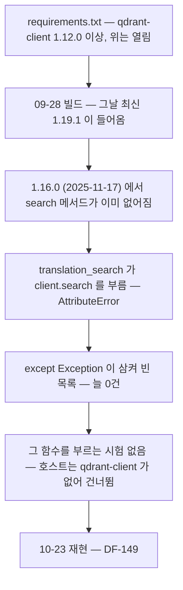
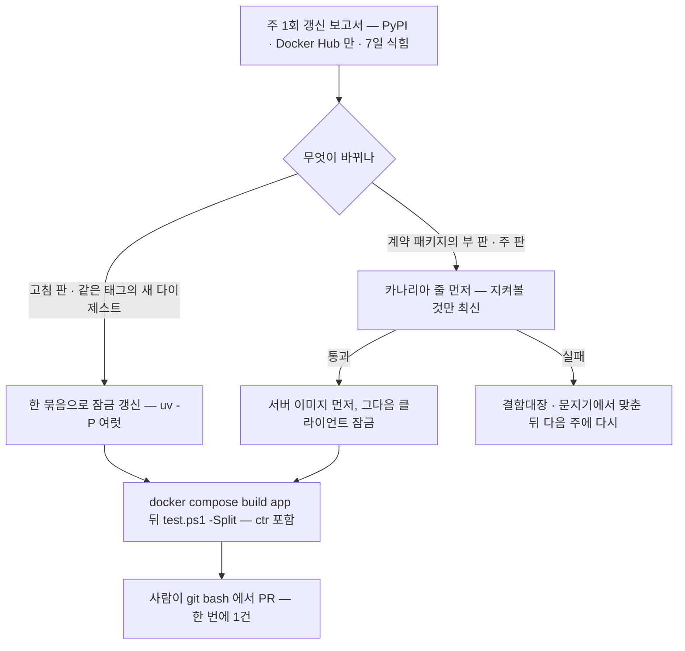
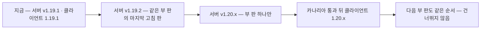

# 의존성 판 관리 — 고침 판은 받고, 바뀐 동작은 시험이 먼저 알린다 (2026-10-23 배경조사)

| 문서 정보 | |
|---|---|
| **판 · 상태** | 결과 v1.0 · 읽기만 한 조사(이 파일 밖의 파일 · 패키지 · 이미지 · 컨테이너 · 개발 Qdrant 를 바꾸지 않음 — README 줄은 메인이 넣는다) |
| **출처** | 사용자 물음(10-23) 「고침 판을 받거나 바뀐 동작이 있어도 유기적으로 동작하도록 하는 방법이 있지 않을까? 이런 Docker를 관리하는 것을 리서치하고 잘 구축하면 좋을 거 같아」 — qdrant-client 를 `==1.19.1` 로 고정할지 물은 데 대한 답 · 결함 DF-149([테스트 계획서](../../../../04-testing/테스트계획서.md) 결함대장) · [올린 문서 사용자 격리 조사](../2026-10-23-올린문서-사용자격리/결과.md) 표 8 · 7절 ④ |
| **기준** | main `5a3bfc9`(10-23 13:46 · PR #326 — 컨테이너 묶음 ctr 포함) · 이 PC 의 앱 이미지 `qurious-app:latest`(`d5bd0d07bcdd` · 09-30 15:20 빌드) · PyPI · Docker Hub 숫자는 조회 시각 기준 |
| **조회일** | 2026-10-23 13:35 ~ 14:10 KST |
| **확실도** | **높음** = 공식 문서 · 릴리스 노트 · 레지스트리 · 이 PC 에서 직접 읽거나 잼 / **중간** = 2차 출처 · 검색 요약 · 다른 세션 기록 · 판단이 들어감 / **낮음** = 추정 |
| **읽는 법** | 판 `1.19.1` 에서 셋째 숫자가 바뀌면 고침 판(patch), 둘째는 부 판(minor), 첫째는 주 판(major). 용어는 아래 「이 문서의 말」 |

## 맨 위 5줄 요약

1. **추천은 「잠금은 고정, 갱신은 시험으로 검증한 PR 로」 — 안 ②.** 강사님 파일인 `requirements.txt`(36줄 · 모두 하한만)는 그대로 두고, 간접 의존까지 정확한 판을 적은 **잠금 파일 `requirements.lock` 하나**를 더해 Dockerfile 이 `pip install -r requirements.txt -c requirements.lock` 으로 깐다. compose 이미지는 `판 태그@다이제스트` 로 묶는다. 오늘 만들 잠금은 **지금 이미지와 판이 하나도 다르지 않다** — 이미지의 `pip freeze` 를 씨앗으로 uv 가 다시 풀어 132개 모두 같은 판이 나오는 것을 실측했다(플랫폼 전용 셋 · 시험 패키지 넷을 더해 139줄).
2. **지금은 「빌드한 날짜가 곧 판」 이다.** 오늘(14시) 새로 풀면 132개 중 62개가 바뀐다(고침 24 · 부 32 · 주 6 — qdrant-client 1.20.0 · langchain-core 1.7.0 · fastapi 0.161.1 포함). 반대로 판을 정확히 묶기만 하면 고침 판이 오지 않는다 — Qdrant 서버 v1.19.2(10-05)의 「거름 검색 0건」 · 「Gridstore 쓰기 찢김으로 데이터 손상」 고침과 보안 고침 둘을 우리는 3주째 못 받았다. qdrant-client 한 줄만 `==1.19.1` 로 묶는 것(안 ①)은 이 둘을 다 못 푼다.
3. **「바뀐 동작은 시험이 먼저 알린다」 는 세 겹이다** — ① Qdrant 를 부르는 곳(지금 클라이언트를 만드는 곳 6 · 파일 3)을 **문지기 모듈 하나**로 모으고 메모리 Qdrant **계약 시험**(점 1 → 1건 · 빈 넣기 · 결과 칸)을 ctr 묶음에 둔다 ② **카나리아 줄** — 같은 앱 이미지 일회용 컨테이너에서 지켜볼 패키지만 최신으로 올려 ctr 묶음을 돌린다(머지를 막지 않는 신호) ③ **우리 코드(`app.`)가 부른 폐기 API 만 오류로** — 지금 `pytest.ini` 는 모든 폐기 경고를 숨긴다. 여기에 DF-149 를 「0건」 으로 숨긴 넓은 `except Exception` 을 Qdrant 예외로 좁힌다.
4. **서버 ↔ 클라이언트는 Qdrant 공식 정책대로** — 「SDK 는 클러스터와 부 판 1 이내」 · 「클러스터를 먼저, SDK 는 그 뒤」 · 한 대짜리 서버는 부 판을 건너뛸 수 없다. 클라이언트의 자체 검사는 경고(UserWarning)만 내고, ctr 시험은 그 경고를 꺼 두며(`-W ignore::UserWarning`) 메모리 모드는 검사 자체를 안 한다 → 지금은 아무도 못 본다. 잠금 ↔ compose 의 부 판 차를 보는 지킴이 시험과 점검 줄로 대신한다.
5. **단계** — 오늘(사람 손 30 ~ 60분 · 판 0 변경): 잠금 · Dockerfile 두 줄 · compose 다이제스트 · 잠금 지킴이 · 폐기 경고 「보이기」 / S142(2 ~ 3시간): 문지기 + DF-149 고침 + 계약 시험 · 카나리아 · 로컬 갱신 보고서 · 폐기 경고 「오류」 / 발표 전: 주 1회 고침 묶음 PR(첫 후보 서버 v1.19.2) · 11-05 부터 동결(보안 고침만). 봇 · CI 는 쓰지 않는다(ADR-0003 · 논의 먼저). 정할 것 여섯(5절).

## 이 문서의 말

| 말 | 뜻 |
|---|---|
| 하한(lower bound) | `qdrant-client>=1.12.0` 처럼 「이 판 이상」 만 적은 것. 위가 열려 있어 **빌드하는 날의 최신**이 들어온다 |
| 잠금 파일(lock file) | 간접 의존까지 모든 패키지의 정확한 판을 적은 파일. 같은 잠금이면 누가 언제 빌드해도 같은 판이 깔린다 |
| 제약 파일(constraints · `-c`) | 판만 정하고 깔지 말지는 정하지 않는 pip 파일. 잠금을 제약으로 쓰면 `requirements.txt` 가 고른 것만, 잠금의 판으로 깐다 |
| 다이제스트(digest) | 이미지 내용에서 계산한 `sha256:…` 값. 태그(`v1.19.1` · `16-alpine`)는 다른 내용에 다시 붙일 수 있지만, 다이제스트는 내용이 같을 때만 같다 |
| 식힘 기간(cooldown) | 새 판이 나온 뒤 며칠 기다렸다가 받는 것. 나오자마자 회수되거나 바로 고쳐지는 판을 피한다 |
| 문지기(gateway · 어댑터) | 바깥 라이브러리를 부르는 코드를 모은 모듈 하나. 라이브러리가 바뀌면 그 한 곳만 고친다 |
| 계약 시험(contract test) | 우리 코드가 기대하는 바깥 라이브러리 · 서버의 동작(메서드가 있다 · 빈 묶음을 받는다 · 결과 칸 이름)을 실제 라이브러리로 확인하는 시험 |
| 카나리아 줄(canary) | 잠금 판 시험과 따로, 지켜볼 패키지만 최신으로 올려 미리 돌려 보는 시험. 실패해도 머지를 막지 않고 「다음 판에서 깨진다」 를 알린다 |
| 폐기 경고(DeprecationWarning) | 「곧 없어진다」 는 파이썬 경고. 없어지기 전 몇 판 동안 나온다. 파이썬 기본값은 `__main__` 밖에서는 숨긴다 |
| 판 짝 | 서로 맞아야 하는 두 판 — 여기서는 Qdrant 서버 이미지 판과 qdrant-client 판 |

---

## 1. 실무에서는 어떻게 하나 — 관행 표

**표 1. 관행 열네 가지** · 「우리에게 주는 뜻」 은 이 조사의 해석이다. 조회일은 모두 2026-10-23.

| # | 관행 | 출처 · 주소 | 확실도 | 우리에게 주는 뜻 |
|--:|---|---|---|---|
| 1 | **앱은 전체를 고정한 목록으로 다시 깐다.** 라이브러리의 의존은 「최소 · 느슨」, 요구 파일은 "an exhaustive listing of pinned versions for the purpose of achieving repeatable installations of a complete environment". Poetry 도 "Application developers commit `poetry.lock` to get more reproducible builds" | Python Packaging User Guide 「install_requires vs requirements files」 https://packaging.python.org/en/latest/discussions/install-requires-vs-requirements/ · Poetry 기본 사용법 https://python-poetry.org/docs/basic-usage/ | **높음** | Qurious 는 앱이다. 지금 `requirements.txt` 는 「범위」 만 있고 「잠금」 이 없다 |
| 2 | **잠금 도구는 있던 고정을 지키고 고른 것만 올린다.** uv: "If a dependency is pinned it will not be upgraded on a subsequent compile run" · `--upgrade-package` 로 하나만, `--upgrade` 로 전부. pip-tools 도 같은 꼴(`-P`)이나 "must execute pip-compile on each Python environment separately". uv 는 `--universal` 로 OS 를 가리지 않는 한 파일을 만든다 | uv 「Locking environments」 https://docs.astral.sh/uv/pip/compile/ · uv 「Resolution」 https://docs.astral.sh/uv/concepts/resolution/ · pip-tools https://pip-tools.pypa.io/en/latest/ | **높음** · 실측(부록 A ④ — `-P qdrant-client` 은 잠금 한 줄만 바꿈) | 판 올리기가 「이 패키지만」 의 작은 PR 이 된다. uv 는 이 PC 에 이미 있다(0.8.15 · S140 에서 씀) |
| 3 | **제약 파일로 「시험한 묶음」 을 나눠 준다.** "Constraints files are requirements files that only control which version of a requirement is installed, not whether it is installed or not." Airflow 는 "both a library and an application" 이라 의존은 열어 두고, 출시 때 시험한 묶음을 제약 파일로 낸다("the exact same installation … as was known to be working at the moment of release") | pip 사용자 안내 「Constraints Files」 https://pip.pypa.io/en/stable/user_guide/ · Apache Airflow 설치 안내 https://airflow.apache.org/docs/apache-airflow/stable/installation/installing-from-pypi.html | **높음** | 강사님 `requirements.txt` 를 고치지 않고 잠금 하나를 `-c` 로 얹을 수 있다. 환경 표지(`; sys_platform == "win32"`)가 든 제약 줄을 pip 26.1.1(호스트) · 25.0.1(이미지)이 받는 것을 오프라인으로 확인했다 |
| 4 | **날짜로 다시 풀기 · 식힘 기간.** uv `--exclude-newer` 는 그 날짜 전에 올라온 배포판만 본다. 기간(「7 days」)을 주면 「cooldown」 이 된다. Renovate `minimumReleaseAge` 도 "to allow broken releases to be fixed or withdrawn" | uv 「Resolution」(위 주소) · Renovate 설정 https://docs.renovatebot.com/configuration-options/#minimumreleaseage | 문서 **높음** · 실측 **높음** | 실측 — 이미지 pip 층 시각(09-28 10:26)으로 다시 풀면 132개 중 127개가 같고 1개는 이름 표기, **4개가 다르다**(pip 와 uv 의 풀이 순서 차이 · 부록 A ②). 날짜는 잠금을 대신하지 못한다 → 「새 판을 며칠 묵히기」 에만 쓴다 |
| 5 | **이미지는 다이제스트로 묶는다 — 대가는 자동 보안 고침을 끄는 것.** "Image tags are mutable" · "By pinning your images to a digest, you're guaranteed to always use the same image version" · "you're opting out of automated security fixes". compose 의 `image` 는 `…[:<tag>\|@<digest>]` 꼴이고 `docker compose config --lock-image-digests` 가 "Produces an override file with image digests" | Docker 「Building best practices — Pin base image versions」 https://docs.docker.com/build/building/best-practices/ · Compose 파일 「services — image」 https://docs.docker.com/reference/compose-file/services/ · `docker compose config` https://docs.docker.com/reference/cli/docker/compose/config/ | **높음** | 실측 — `postgres:16.15-alpine` · `redis:8.10.2-alpine` 이 **오늘 같은 태그로 다시 올라와** 다이제스트가 바뀌었다(표 4). 판 태그만으로는 못 묶는다 |
| 6 | **정기 갱신은 봇이 PR 로.** Renovate `lockFileMaintenance`(기본 일정 "before 3am on Monday") · `pinDigests` · `automerge` 기본 false · `--platform=local` 은 "dry runs … against the local file system" 이고 브랜치 · PR 을 만들지 않는다. Dependabot 은 pip · pip-compile · Docker · docker-compose 를 지원한다 | Renovate 설정(위 주소) · Renovate local 플랫폼 https://docs.renovatebot.com/modules/platform/local/ · GitHub Docs 「Supported ecosystems」 https://docs.github.com/en/code-security/dependabot/ecosystems-supported-by-dependabot/supported-ecosystems-and-repositories | **높음** (Dependabot 의 uv 지원은 확인 못 함) | 봇은 팀 공용 장치라 논의가 먼저다(ADR-0003 · CI 논의 D8 열림). Qurious 에는 CI 도 없어 봇 PR 을 시험할 곳이 없다 → 「후보 찾기」 만 로컬 보고서로 하고 PR 은 사람이 |
| 7 | **서버 ↔ SDK 판 규칙(Qdrant 공식).** "Keep your client SDK within one minor version of your cluster version. Larger gaps might work, but are not tested." · "Update the cluster first, then update the client SDKs." · "upgrade to the latest patch version of each intermediate minor version first" · "If you run a single node cluster, you also cannot skip versions" | Qdrant 문서 「Upgrades」 https://qdrant.tech/documentation/upgrades/ | **높음** · 2차 검증: 설치된 qdrant-client 1.19.1 의 `common/version_check.py` `is_compatible` = 주 판 같고 부 판 차 1 이하(이미지 안 소스 직접 읽음) | 개발 Qdrant 는 한 대 + 데이터 볼륨이라 부 판을 건너뛸 수 없다. 클라이언트 1.20 ↔ 서버 1.19 는 「허용」 이지만 순서는 서버 먼저 |
| 8 | **바깥 시스템은 문지기 한 곳으로.** Gateway = "An object that encapsulates access to an external system or resource" — 바깥 API 가 바뀌면 고칠 곳이 한 곳이고, 시험에서 바꿔 끼우기 쉽다 | Martin Fowler 「Gateway」(2021-08-10) https://martinfowler.com/articles/gateway-pattern.html | **높음** | 지금 Qdrant 클라이언트를 만드는 곳은 6 · 파일 3(표 6). `search` 가 없어진 것도 두 파일이 따로 불렀다 |
| 9 | **시험용 가짜는 계약 시험과 짝이다.** 계약 시험은 가짜(test double)가 진짜와 같은 답을 주는지 확인한다. 배포 파이프라인 밖에서 주기적으로("often running just once a day is plenty"), 실패는 빌드를 깨는 대신 「맞추는 일」 을 만든다 | Martin Fowler 「ContractTest」(2011-01-12) https://martinfowler.com/bliki/ContractTest.html | **높음** | `tests/test_crawl_points.py` 의 가짜 `AsyncQdrantClient` 는 빈 `upsert` 도 받고 메서드가 없어져도 통과한다 — 진짜와 대조하는 짝이 없다 |
| 10 | **「다음 판」 줄을 따로 돌린다.** xarray 는 의존의 개발판으로 도는 upstream-dev CI 를 두고 "disabled on pull request and push events" 가 기본이다. uv 는 라이브러리라면 "`--resolution lowest` or `lowest-direct` in continuous integration" 으로 하한도 시험하라고 한다 | xarray 기여 안내 https://docs.xarray.dev/en/stable/contribute/contributing.html · uv 「Resolution」(위 주소) | xarray 목적 문장은 검색 요약 **중간** · uv **높음** | 카나리아 줄의 근거. 그리고 우리 하한 `1.12.0` 은 아무도 돌려 본 적 없는 숫자다 — 실제 하한은 langchain-qdrant 1.1.0 이 요구하는 `qdrant-client>=1.15.1,<2.0.0` 이다(이미지 안 메타데이터) |
| 11 | **폐기 경고를 「우리 모듈만」 오류로.** 파이썬 기본 필터는 `__main__` 밖의 DeprecationWarning 을 숨긴다 · `stacklevel=2` 는 경고를 **부른 쪽**에 붙인다 · 필터의 module 은 「모듈 이름 앞부분과 맞는 정규식」(명령줄 `-W` 에서는 글자 그대로 같아야 함). pytest 의 ini `filterwarnings` 는 "the action for the last matching option is performed" | Python 「warnings」 https://docs.python.org/3/library/warnings.html · pytest 「How to capture warnings」 https://docs.pytest.org/en/stable/how-to/capture-warnings.html | **높음** · 2차 검증: 호스트 pytest 8.3.3 소스(`parse_warning_filter` — ini 는 정규식, 명령줄은 escape + `\Z` · ini 다음에 명령줄을 얹음) · qdrant-client 1.19.1 의 `recreate_collection` 경고가 `stacklevel=2` | `error::DeprecationWarning:app\.` 한 줄이면 「우리 코드가 부른 폐기 API」 만 오류가 되고 라이브러리끼리의 폐기 경고는 그대로 둔다 |
| 12 | **넓은 except 를 경계한다.** Ruff BLE001(blind-except) — "Overly broad except clauses can lead to unexpected behavior" · 다시 올리거나 `exc_info` 로 남기면 예외 | Ruff 규칙 https://docs.astral.sh/ruff/rules/blind-except/ | **높음** | DF-149 는 `except Exception: return []` 가 AttributeError(메서드 없음)를 「0건」 으로 바꾼 것이다. 저장소에 `.ruff_cache` 가 있다 — 문지기 모듈에만 켜 볼 수 있다 |
| 13 | **잠금은 취약한 판도 붙든다 → 정기 점검.** pip-audit "is a tool for scanning Python environments for packages with known vulnerabilities" · `pip-audit -r ./requirements.txt` | PyPI pip-audit https://pypi.org/project/pip-audit/ (2.10.1 · 2026-06-10) | **높음** | 고침 판을 「꼭 받아야 하는 때」 를 알려 준다(선택 도구 · 4.2 ⑨) |
| 14 | **표준 잠금 꼴이 생겼다.** PEP 751 「A file format to record Python dependencies for installation reproducibility」 · `pylock.toml` · Final(2025-03-31) | https://peps.python.org/pep-0751/ | **높음** (pip 의 pylock 설치 지원은 확인 못 함) | 발표 뒤 후보. 지금은 pip 가 바로 읽는 requirements 꼴 잠금(uv 0.8.15 는 `--format pylock.toml` 도 낸다) |

**공식 정책에서 얻은 것** — 잠금(행 1 ~ 3) · 다이제스트(행 5) · 갱신 PR(행 6)은 「재현」 을, 문지기 · 계약 시험 · 다음 판 줄 · 폐기 경고(행 8 ~ 11)는 「바뀐 동작을 미리 알기」 를 맡는다. 둘은 서로를 대신하지 못한다 — 잠금만 있으면 올리는 날 처음 깨짐을 알고, 시험만 있으면 빌드할 때마다 판이 바뀌어 같은 시험 결과를 되풀이할 수 없다.

**릴리스 노트만 읽어서는 모자라다 — 1.20.0 사례.** qdrant-client 1.20.0 노트의 「Behavior Changes」 절은 세 줄(macOS 업로드 방식 · 경로 인코딩 · 업로드 인자 검사)뿐인데, 빈 `upsert` 를 `ValueError: Empty update request` 로 바꾼 것(S140 실측)은 그 절 밖의 "#1512 - reject empty selectors and empty point lists in update operations" 한 줄에 있다(https://github.com/qdrant/qdrant-client/releases/tag/v1.20.0 · 높음). 바뀐 동작은 시험이 잡아야 한다.

**표 2. qdrant-client · Qdrant 서버 판 연표** · 시각은 KST. PyPI 는 그 판 첫 파일을 올린 시각, Docker Hub 는 태그를 올린 시각.

| 날짜 | 판 | 일 | 출처 · 확실도 |
|---|---|---|---|
| 2024-07-01 · 07-02 | 서버 1.10 · 클라이언트 1.10.0 | 만능 질의 API(`/points/query` · `query_points`) 등장 — "Query API will consolidate all search APIs into a single request" | Qdrant 블로그 https://qdrant.tech/blog/qdrant-1.10.x/ · PyPI · **중간**(클라이언트 쪽 메서드 이름은 블로그에 없음) |
| 2025-11-17 | 클라이언트 1.16.0 | "remove deprecated methods: `search`, `recommend`, `discovery`, `upload_records`, `search_batch`, `recommend_batch`, `discovery_batch` …"(#1103) | 릴리스 노트 https://github.com/qdrant/qdrant-client/releases/tag/v1.16.0 · PyPI · **높음** |
| 2026-09-03 | 서버 v1.19.1 | 우리 compose 판(다이제스트 `12364fe…` = 이 PC 의 것) | Docker Hub · **높음** |
| 2026-09-16 | 클라이언트 1.19.1 | 우리 이미지 판 — `search` 없음 · `query_points` 있음(이미지 안 `dir(QdrantClient)` 실측) | PyPI · 실측 · **높음** |
| 2026-09-28 10:26 | — | 우리 이미지의 `pip install` 층(그날 최신이 1.19.1) | `docker history` · **높음** |
| 2026-10-05 | 서버 v1.19.2 | 고침 판 — "Fix zero search results when HNSW entry point does not satisfy filter" · "Prevent write tearing in all Gridstore storages, which could previously corrupt data" · "Fix mutable payload index not able to load on torn write, causing crash loop" · 보안 둘(내부 gRPC 키 · 스냅숏 올리기 경로) | 릴리스 노트 https://github.com/qdrant/qdrant/releases/tag/v1.19.2 · Docker Hub · **높음**(우리 모음 크기에서 해당하는지는 확인 못 함) |
| 2026-10-22 04:14 | 서버 v1.20.0 | — | Docker Hub · **높음** |
| 2026-10-22 19:26 | 클라이언트 1.20.0 | 빈 선택자 · 빈 점 목록 갱신 거절(#1512) · 업로드 인자 검사 강화 | 릴리스 노트(위 주소) · PyPI · S140 실측(메모리 모드) · **높음** |

`search` 가 없어지기 전에도 폐기 경고 "`search` method is deprecated and will be removed in the future. Use `query_points` instead." 가 나왔다(사용자 노트북 출력 https://www.kaggle.com/code/gavkmr2001/docling-unstructured-qdrant · 몇 판부터인지는 모름 · **중간**). 독립 2차 확인으로 Microsoft semantic-kernel 이슈 #14561 의 제목 "Qdrant vector search fails with qdrant-client 1.16+ (search removed)" 가 있다(https://github.com/microsoft/semantic-kernel/issues/14561 · 제목만 · **중간**).

---

## 2. 우리 저장소 — 지금 상태

**표 3. 파이썬 의존 — 적힌 것 · 실제로 도는 판 · 오늘 새로 받으면** · 확실도 모두 높음(파일 · 이미지 직접 · uv 실측).

| 대상 | 적힌 것 | 실제로 도는 판(이 PC) | 오늘 새로 받으면 | 뜻 |
|---|---|---|---|---|
| `requirements.txt` | 직접 의존 **36줄 · 모두 하한만**(`qdrant-client>=1.12.0` · `langchain-qdrant>=0.2.0` · `fastapi>=0.115.0` …) · 상한 0 · 강사님 th06 원본에서 온 파일(차이는 `requests` · `pyarrow` · `huggingface_hub` · `hf_xet` 더함 · `boto3` 뺌 · `python-jose` 하한 3.4.0) | 이미지 `qurious-app:latest` 안 **132개**(직접 36 + 간접 96) · pip 층 09-28 10:26 · Python 3.12.14 · pip 25.0.1 · `pip check` 깨끗 | uv 로 풀면 133개 중 **62개가 다른 판**(표 8) | 빌드한 날짜가 판을 정한다. 4명 PC 가 서로 다른 날 빌드하면 서로 다른 판으로 돈다 |
| `requirements-dev.txt` | `-r requirements.txt` + `pytest>=8.3.0` + `pytest-asyncio>=1.3,<1.4`(Qurious 요구 파일의 **유일한 상한**) | 호스트 pytest 8.3.3 · ctr 묶음은 컨테이너 안에 같은 판을 그때 깐다(네트워크) | pytest-asyncio 상한이 pytest 판을 묶어 둔다 | 상한을 이미 한 번 쓴 사례가 있다(10-21 · DF-142) |
| 호스트 파이썬 | anaconda 3.12.13 · `qdrant-client` · `langchain-qdrant` · `langchain-ollama` · `neo4j` 없음 | fastapi 0.120.1 / 이미지 0.141.1 · starlette 0.49.3 / 1.7.0 · numpy 1.26.4 / 2.5.3 · sqlalchemy 2.0.34 / 2.1.1 · langchain-core 1.2.26 / 1.6.5 · scikit-learn 1.5.1 / 1.9.1 | — | **호스트에서 통과 ≠ 이미지에서 통과.** NumPy 2 에서 없어진 이름(`np.NaN` · `np.float_` 등)은 코드에 0곳(정적 검색)이라 지금 알려진 어긋남은 없다 |
| `rag-lab/requirements.txt` | 16줄 정확 고정 · 11줄 판 없음 | 통합본 사본 — `.dockerignore` 가 빌드에서 뺀다 | — | 앱과 무관 · 이번 범위 밖 |

uv 가 풀면서 `redis[asyncio]` 의 `asyncio` 추가 기능이 redis 6.4.0 에 없다고 경고한다 — 해는 없지만 정리 후보다.

**표 4. 컨테이너 이미지 — compose 의 태그 · 이 PC 의 실제 · Docker Hub 지금(14시)** · 확실도 높음(`docker image inspect` · Docker Hub API).

| 서비스 | compose 의 이미지 | 이 PC 의 실제 | Docker Hub 지금 | 뜻 |
|---|---|---|---|---|
| qdrant | `qdrant/qdrant:v1.19.1`(정확 고정) | v1.19.1 · `12364fe…`(= 허브) | **v1.19.2**(10-05 고침 판) · v1.20.0(10-22) | 고침 판이 저절로 오지 않는다(표 2) |
| postgres | `postgres:16-alpine` | 16.15 · `721873c…`(09-18) | 같은 16.15 가 **오늘 01:08 다시 올라옴** `f461079…` | 판도 태그도 같은데 내용이 바뀐다(바탕 OS 고침) |
| redis | `redis:8-alpine` | 8.10.2 · `3811787…`(09-22) | 8.10.2-alpine 이 **오늘 다시 올라옴** `0bf6577…` | 8.x 안에서는 부 판까지 뜬다 |
| neo4j | `neo4j:5.18-community` | 5.18.1 · `8f01f7b…`(= 허브 · 마지막 push 2024-04-11) | 5.26 LTS 는 5.26.32(10-21) | 묶은 줄이 더는 고쳐지지 않는다 — 너무 단단히 묶은 경우 |
| ollama · model-pull | `ollama/ollama:latest` | **0.32.5**(07-28 · `4dea9fb…`) | latest = **0.40.9**(오늘 11:13) · 12일 동안 0.40.3 → 0.40.9 | 받는 날마다 다른 판 — 팀원 PC 끼리 8 부 판 차이가 날 수 있다 |
| app · ingest · celery-worker · celery-beat | 넷 다 `build: .` → `qurious-<서비스>:latest` 넷 | 의존 층은 넷이 같다(09-28) · 코드 층은 ingest 만 09-30 10:52, 나머지 15:20 | — | 같은 Dockerfile 로 이미지가 넷 — 서로 어긋날 수 있다. `scripts/personal/compose.qurious.yml` 은 이미 넷에 같은 `image:` 를 준다 |
| (바탕) Dockerfile `FROM` | `python:3.12-slim` | 3.12.14 · trixie(바탕 층 09-19) · 이 PC 에 그 태그 없음 | `3.12-slim` = **3.12.15**(오늘 08:07) | 바탕도 뜬다 |
| (시험 DB) `test.ps1` | `pgvector/pgvector:pg16` | PostgreSQL 16.14(07-30) | 이번에 안 봄 | 시험 전용 · 낮은 순위 |

**표 5. 시험 · 검사 · 자동화** · 확실도 높음.

| 대상 | 지금 | 뜻 |
|---|---|---|
| `.github/workflows/` | Qurious 저장소 뿌리에 **없다**(ADR-0003 으로 걷어냄 · CI 논의 D8 열림). `rag-lab/.github/workflows/ci.yml` 은 통합본 사본이라 뿌리가 아니어서 돌지 않는다 | 봇 PR 을 시험해 줄 곳이 없다 — 시험은 사람이 로컬에서 |
| `pytest.ini` | `filterwarnings = ignore::DeprecationWarning`(강사님 원본 09-29) | 모든 폐기 경고가 숨는다 — 없어질 API 를 미리 못 본다 |
| `test.ps1` ctr 묶음 | 앱 이미지 일회용 컨테이너 · `-W ignore::UserWarning` · 이미지가 **있는지만** 보고 지금 requirements 로 만들었는지는 안 본다 | 3주 된 이미지로 돌아도 「통과」 로 보인다 |
| 메모리 Qdrant 시험 | `QdrantClient(location=":memory:")` — 서버 판 검사를 아예 안 한다 · 색인 · strict mode 를 말없이 버린다(S140 M8 · M9) | 서버(Rust) 동작은 시험에 없다 |
| `tests/test_crawl_points.py` | 가짜 `qdrant_client` 모듈 — `upsert` · `delete` 를 그대로 받는다 | 진짜 판이 바뀌어도 통과한다(행 9) |
| 클라이언트 판 검사 | qdrant-client 가 원격 클라이언트를 만들 때 데몬 스레드에서 서버 판을 묻고, 어긋나면 **UserWarning** 만 낸다(이미지 안 `qdrant_remote.py` 직접 읽음) · 지금 앱 컨테이너 로그 1,278줄에 그 경고 0줄 | 지금은 판이 같아 조용하다. 어긋나도 아무도 못 본다 |

**표 6. Qdrant 를 부르는 곳** · `app/` 를 직접 읽음(높음).

| 파일 | 클라이언트 | 부르는 것 | 실패 처리 |
|---|---|---|---|
| `app/services/rag_pipeline.py` | `QdrantClient`(동기) 2곳 · LangChain `CompatibleQdrantStore` | `collection_exists` · `create_collection` · (LangChain 안에서 `query_points` · `upsert`) | 검색은 경고 남기고 빈 목록 · 저장은 `VectorStoreError` |
| `app/services/user_docs.py` | `rp._make_client()` 를 빌림 | `collection_exists` · `create_collection` · `create_payload_index` · `count` · `delete` · `scroll` · `upsert` · `retrieve` | `VectorStoreError` 로 올림(검색만 빈 목록) · 빈 묶음은 부르지 않음(1.20 대비 주석 있음) |
| `app/services/crawl.py` | `AsyncQdrantClient` 2곳 | `get_collection` · `create_collection` · `upsert` · **`search`(없는 메서드 · 부르는 곳 없는 `qdrant_search`)** | `except Exception` → 0 · 빈 목록 |
| `app/services/translation_ingest.py` | `AsyncQdrantClient` 2곳 | `get_collection` · `create_collection` · `upsert` · **`search`(없는 메서드 · DF-149)** | `except Exception: return []` |
| `app/services/crawl_points.py` | 받은 클라이언트 | `delete`(빈 목록이면 부르지 않음) | 부르는 쪽 |
| `app/services/kb_search.py` · `collector/kb_*.py` | REST 직접 | `POST …/points/query` · `scroll` · `points/delete` 등 | — (서버 REST 판에 묶임) |

### 2.1 DF-149 는 어떻게 생겼나 — 고리 다섯

**그림 1. DF-149 고리** · 각 고리를 무엇이 끊는지는 표 7.



**표 7. 고리마다 끊는 겹** · 「그때 있었다면」 은 이 조사의 판단(중간).

| 고리 | 끊는 겹(추천 안 ②) | 그때 있었다면 |
|---|---|---|
| 하한만 → 빌드한 날의 최신 | 잠금 · 갱신 보고서 | 판이 저절로 바뀌지 않는다. 다만 처음 잠금을 1.19.1 로 만들었다면 같은 판이므로 아래 겹이 필요하다 |
| 메서드 삭제(1.16.0) | 문지기 + 계약 시험 · 카나리아 · 폐기 경고 오류 | `search` 를 부르는 곳이 문지기 한 곳뿐 · 「점 1 → 1건」 계약 시험이 0건으로 실패 · 1.16 이 나온 주에 카나리아가 실패 · 그 전 판들에서 폐기 경고가 우리 모듈로 붙어 오류 |
| AttributeError 를 삼킴 | 좁은 except(Qdrant 예외만) | 우리 코드 잘못이 그대로 올라 바로 보인다 |
| 시험 없음 · 호스트 건너뜀 | ctr 묶음(10-23 생김) + 계약 시험 | 컨테이너에서 실제 라이브러리로 돈다 |
| 가짜 클라이언트만 | 계약 시험(같은 동작을 진짜 메모리 Qdrant 로) | 가짜가 진짜와 다르면 짝 시험이 실패 |

### 2.2 오늘 새로 빌드하면 바뀌는 것

**표 8. 이미지 132개 ↔ 오늘 새로 푼 133개** · uv 0.8.15 · 리눅스 · Python 3.12 · 14시 전후. 분류는 판 번호의 몇째 자리가 바뀌었나로 셈(날짜형 판 certifi · tzdata · pytz 도 부 판으로 셈 · 높음).

| 갈래 | 수 | 주요 줄 |
|---|--:|---|
| 같다 | 70 | 이름 표기만 다른 pdfminer.six(20260107) 포함 |
| 고침 판 | 24 | langchain 1.4.2 → 1.4.7 · langgraph 1.2.12 → 1.2.16 · langsmith 0.14.1 → 0.14.12 · sqlalchemy 2.1.1 → 2.1.6 · numpy 2.5.3 → 2.5.4 · alembic 1.20.0 → 1.20.1 |
| 부 판 | 32 | **qdrant-client 1.19.1 → 1.20.0** · **langchain-core 1.6.5 → 1.7.0**(오늘 02:47) · **fastapi 0.141.1 → 0.161.1**(오늘 07:22) · starlette 1.7.0 → 1.9.0 · pydantic 2.13.5 → 2.14.1 · pandas 3.0.6 → 3.1.0 · asyncpg 0.31.0 → 0.32.0 |
| 주 판 | 6 | multidict 6 → 7 · pillow 12 → 13 · portalocker 3 → 4(qdrant-client 가 쓴다) · pyarrow 25 → 26 · python-dateutil 2 → 3(어제) · soupsieve 2 → 3 |
| 새로 들어옴 | 1 | opentelemetry-api |

S140 기록에는 최신 langchain-core 1.7.0 + langsmith 0.14.12 조합이 윈도 uv 환경에서 import 부터 깨졌다는 줄이 있다(`No module named 'langsmith.types.annotation_queue_retrieve_total_archived_params'` · 리눅스 이미지에서는 안 잼 · **중간**). 둘 다 나온 지 하루 안팎이다 — 식힘 기간이 막으려는 바로 그 경우다.

---

## 3. 안 네 개 비교

**표 9. 안 비교** · 「고침 판은 받고 바뀐 동작은 시험이 먼저 알린다」 를 어떻게 채우나가 핵심 줄이다. 시간은 추정(낮음).

| | **① qdrant-client 한 줄만 `==1.19.1`** | **② 잠금 + 시험 세 겹 (추천)** | **③ uv 프로젝트로 전환** | **④ 봇 갱신(Renovate · Dependabot)** |
|---|---|---|---|---|
| 한 줄 | 처음 물은 안. `requirements.txt` 의 그 줄만 정확 고정 | 강사님 `requirements.txt` 는 범위로 두고 `requirements.lock`(139줄)을 `-c` 로 · 이미지 `판 태그@다이제스트` · 문지기 + 계약 시험 · 카나리아 · 폐기 경고 오류 · 주 1회 로컬 보고서로 사람이 PR | `pyproject.toml` + `uv.lock` · Dockerfile 에서 `uv sync --frozen` · `uv lock --upgrade-package` | ② 의 잠금 위에서 봇이 `lockFileMaintenance` · `pinDigests` PR 을 연다 |
| 고침 판은 받나 | qdrant-client 는 **안 받음**. 나머지 131개는 빌드 날짜 따라 아무 판(오늘이면 61개 바뀜) | 주 1회 보고서 → 고침 묶음 PR(식힘 7일) | ② 와 같음 | 봇이 매주 PR |
| 바뀐 동작은 시험이 먼저 알리나 | 아니오 — 올리는 날 처음 안다 | 올리는 PR 의 계약 시험 · 다음 판이 나온 주의 카나리아 · 없어지기 전 폐기 경고 | 같은 시험을 따로 만들어야 | 봇 PR 에 시험이 붙어야 뜻이 있는데 Qurious 에는 CI 가 없다 → 사람이 로컬에서 |
| 품 — 사람 | 1분 | 오늘 30 ~ 60분 · S142 2 ~ 3시간 · 그 뒤 주 30분 ~ 1시간 | 하루 안팎 + 팀원 셋이 새 도구 | 설정 · 팀 논의 · 봇 PR 검토(주 여러 건) |
| 품 — 기계 | 0 | uv(이 PC 에 있음 · **팀원은 pip 만으로 빌드**) · 새 스크립트 둘(보고서 · 카나리아) · 시험 몇 건 | 이미지에도 uv | 봇 + CI |
| 위험 | 다른 패키지가 깨는 것을 못 막음(표 8) | 잠금 갱신을 미루면 옛 판에 머문다 → 보고서 · pip-audit 로 보완 | 발표 3주 전에 빌드 · 실행 경로 전부가 바뀐다 | 팀 공용 장치 · 계정 정지 이력 · PR 소음 |
| 강사님 기초 코드 3-way 병합 | `requirements.txt` 한 줄 충돌 가능 | `requirements.txt` 그대로 · Dockerfile 두 줄 · 새 파일 하나 | `requirements.txt` 를 버리거나 두 벌을 관리 → 병합마다 손 | ② 와 같음 |
| 3주 · 4명 · 로컬 우선 | 맞지만 문제를 못 푼다 | **맞다** | 발표 뒤 후보 | 논의 뒤 · 발표 뒤 |

---

## 4. 추천 안 — 「잠금은 고정, 갱신은 시험으로 검증한 PR 로」 (안 ②)

### 4.1 한눈에

**그림 2. 주 1회 갱신 흐름** · 사각형 = 사람 · 명령 이름 = 기계가 찾아 알려 주는 일.



### 4.2 무엇을 · 어느 파일에

**표 10. 할 일 열하나** · 「언제」 는 4.5 단계.

| # | 무엇 | 어느 파일 | 내용 | 언제 |
|--:|---|---|---|---|
| ① | **잠금 파일**(새) | `requirements.lock` | `uv pip compile requirements-dev.txt --universal --python-version 3.12 -o requirements.lock` — 씨앗은 이미지 `pip freeze` + 호스트 pytest 넷. 실측: 런타임 132개 판 그대로 · 윈도 전용 colorama · pywin32 와 emscripten 전용 httpx2-jsfetch 가 표지(`; sys_platform == …`)와 함께 더해져 135 · 시험 pytest 8.3.3 · pytest-asyncio 1.3.0 · pluggy 1.6.0 · iniconfig 1.1.1 을 더해 139. 머리 주석은 `--custom-compile-command` 로 같은 명령을 남긴다 | 오늘 |
| ② | **Dockerfile 두 줄** | `Dockerfile` | `COPY requirements.txt requirements.lock ./` · `RUN pip install --no-cache-dir -r requirements.txt -c requirements.lock && pip check`. 바탕은 `python:3.12.14-slim-trixie@sha256:f77ac9e44ae96ef2c90b8053ea08c31f8be030f824196b0ae4db6d462c84e51f`(같은 Python 판 · 09-26 다시 올라온 것 — 우리 바탕의 정확한 다이제스트는 남아 있지 않다) | 오늘 |
| ③ | **compose 이미지 `판 태그@다이제스트`** | `docker-compose.yml` | 지금 쓰는 그대로: `qdrant/qdrant:v1.19.1@sha256:12364fe851b9f17356fc88189fc06d1b521262e04659ec7345975b00c9246a10` · `ollama/ollama:0.32.5@sha256:4dea9fb511947e24a84237bb636b0203abcb2ff0d3fbc7b4ff865deb91362131`(ollama · model-pull 둘 다) · `neo4j:5.18.1-community@sha256:8f01f7bb053e5564eb84a3f1824e4ca2202d29dd415d196cf8e27c8f7e6b611e`. 같은 판 · 오늘 다시 올라온 것: `postgres:16.15-alpine@sha256:f4610795587492cd4fb887c2dc3de301b813278bb6f616992061141b5f15ac36` · `redis:8.10.2-alpine@sha256:0bf6577d7774e592b29d093e3ac9390eb91e13d72c21e506afce736de5e0eeb0`(정할 것 3). 앱 계열 넷은 `compose.qurious.yml` 처럼 같은 `image:` 이름 하나(동작은 확인 필요) | 오늘 |
| ④ | **잠금 지킴이 시험**(새 · 호스트 · 네트워크 없음) | `tests/test_requirements_lock.py`(가칭) | `requirements*.txt` 의 이름이 모두 잠금에 있고 잠금 판이 그 범위를 만족하는지(`packaging.SpecifierSet`) · compose 의 Qdrant 서버 판과 잠금의 qdrant-client 판이 주 판 같고 부 판 차 1 이하인지(판 짝) · compose 에 `latest` 가 없는지 | 오늘(판 짝은 S142) |
| ⑤ | **폐기 경고 한 줄** | `pytest.ini` | 강사님 줄은 두고 그 아래에 `default::DeprecationWarning:app\.`(보이기 — 몇 건인지 센다) → S142 에 `error::DeprecationWarning:app\.` · `error::DeprecationWarning:collector\.`. 마지막 줄이 이기므로 라이브러리끼리의 경고는 지금처럼 숨는다. `app\.` 의 점을 빼면 `apprise` 같은 남의 모듈도 걸린다 | 오늘 · S142 |
| ⑥ | **Qdrant 문지기**(새) | `app/lib/vector_db.py`(가칭) | 클라이언트 만들기(주소 · 시간 제한 한 곳) · 검색(`query_points` → 지금과 같은 꼴의 점수 · payload) · 넣기(빈 묶음은 부르지 않고 0) · 지우기(빈 목록은 부르지 않음) · 「닿지 못함」 은 `qdrant_client.http.exceptions.ApiException`(S140 M20 — `ResponseHandlingException` · `UnexpectedResponse` 가 그 자식)만 잡고 나머지는 올린다. 옮길 곳: `translation_ingest`(DF-149) · `crawl._store_qdrant` · `crawl_points` · `user_docs._migrate`. 부르는 곳 없는 `crawl.qdrant_search` 는 지우거나 문지기로. LangChain 쪽은 그대로 두고 만들기만 문지기로 | S142 |
| ⑦ | **계약 시험 · 지킴이**(새 · ctr 묶음) | `tests/test_vector_db.py`(가칭) · `_test_groups.py` 의 컨테이너 목록 | 메모리 Qdrant 로: 점 1 → 검색 1건 · 빈 넣기 0 · 빈 지우기 예외 없음 · 결과 칸(`score` · `payload`) · 거름 1건 · `hasattr(QdrantClient, "query_points")`. 지킴이(호스트): `qdrant_client` 를 import 하는 `app/` 모듈은 문지기 · `rag_pipeline` · `user_docs` 뿐 | S142 |
| ⑧ | **카나리아 줄**(새) | `scripts/personal/test.ps1` 의 `-Canary`(가칭) | ctr 묶음과 같은 일회용 컨테이너에서 pytest 를 깐 뒤 `pip install -U qdrant-client langchain-qdrant langchain-core langchain-ollama langgraph` 하고 같은 파일을 돈다. 결과는 `run.json` 에 `canary` 로 따로, **종료 코드에 넣지 않는다**(행 9 · 10). 올라간 판을 같이 남긴다 | S142 |
| ⑨ | **갱신 보고서**(새) | `scripts/personal/deps_report.py`(가칭) | 임시 폴더에 `uv pip compile requirements-dev.txt --universal --python-version 3.12 --upgrade --exclude-newer <7일 전 날짜>` → 잠금과 비교해 고침 · 부 · 주와 올린 날을 표로 · compose 이미지마다 같은 태그의 다이제스트가 바뀌었나(바탕 OS 고침) · 같은 부 판의 새 고침 태그 · 새 부 판(Docker Hub) · 붙여 넣을 `uv … -P a -P b` 명령. GitHub 는 부르지 않는다. 선택: `pip-audit -r requirements.lock` | S142 |
| ⑩ | **ctr 이미지 신선도** | `scripts/personal/test.ps1` · `start.ps1`(`Test-QImageStale -DepsOnly`) | 이미지 안 `/app/requirements.lock`(② 의 COPY 로 들어감)과 저장소 잠금의 해시가 다르면 ctr 묶음을 「건너뜀 — 이미지가 옛 잠금」 으로 · start.ps1 이 잠금 파일이 바뀌어도 다시 빌드 | S142 |
| ⑪ | **판 점검 줄** | `scripts/personal/check.ps1` | 앱 컨테이너의 qdrant-client 판 ↔ Qdrant 서버 판(`GET /` 의 `version`) — 주 판이 다르거나 부 판 차가 1 넘으면 경고. qdrant 내부 모듈(`common.version_check`)에 기대지 않고 직접 셈 | S142 |

**오늘 손으로 하는 명령(Git Bash · 메인 세션 또는 사용자)** — PowerShell 5.1 의 `>` 는 BOM 이 붙거나 UTF-16 으로 써질 수 있어 Git Bash 에서 한다. 판이 바뀌지 않는 것을 마지막 줄로 확인한다.

```bash
# 1) 씨앗 = 지금 이미지의 판(네트워크 없이) + 호스트 시험 패키지 넷
docker run --rm --network none qurious-app:latest pip freeze > requirements.lock
python -c "import importlib.metadata as m; print('\n'.join(f'{n}=={m.version(n)}' for n in ['pytest','pytest-asyncio','pluggy','iniconfig']))" >> requirements.lock
# 2) 씨앗의 판을 지키며 풀어 주석 · 표지를 붙인다
uv pip compile requirements-dev.txt --universal --python-version 3.12 -o requirements.lock \
  --custom-compile-command "uv pip compile requirements-dev.txt --universal --python-version 3.12 -o requirements.lock"
# 3) 확인 — 이미지에만 있는 줄(이름 · 판)이 하나도 없어야 한다(이름 표기는 소문자 · 「-」 로 맞춘다)
docker run --rm --network none qurious-app:latest pip freeze | tr 'A-Z_.' 'a-z--' | sort > /tmp/img.txt
grep -E '^[A-Za-z0-9]' requirements.lock | sed 's/ *;.*//' | tr 'A-Z_.' 'a-z--' | sort > /tmp/lock.txt
comm -23 /tmp/img.txt /tmp/lock.txt   # 빈 출력이면 판 0 변경
```

뒤의 갱신은 같은 명령에 `-P <이름>` 만 붙인다(실측: `-P qdrant-client` → 한 줄 · `-P langchain-core -P langsmith` → 세 줄).

### 4.3 서버 ↔ 클라이언트 올리는 순서

**그림 3. Qdrant 판 짝 올리기** · Qdrant 「Upgrades」 문서 순서(행 7).



- 서버를 올리기 전에 볼륨 스냅숏을 남긴다 — `kb_v1` 은 이미 HF 백업(`kb-legal-base`)에 스냅숏 경로가 있다(논의결정대장 10-06). 올린 문서 조각(`user_docs`)은 원본 파일에서 다시 만들 수 있는지 확인이 필요하다.
- 클라이언트 1.20 의 빈 묶음 거절은 우리 코드가 이미 피하는 것으로 읽힌다(코드 읽기 · 중간 — `crawl._store_qdrant` · `translation_ingest.flush` · `crawl_points` · `user_docs` 의 넣기 · 지우기가 모두 빈 묶음 앞에서 멈추고, `user_docs.store` 도 빈 조각이면 바로 0). 카나리아가 이것을 기계로 확인하는 첫 일이 된다.

### 4.4 누가 · 언제

**표 11. 역할**

| 순서 | 누가 | 언제 | 무엇 |
|--:|---|---|---|
| 1 | 팀원(신장환 · 오준영 · 강민석) | 의존을 더하는 PR | `requirements.txt` 에 줄을 더하고 `uv pip compile … -o requirements.lock` 한 번. uv 가 없으면 PR 설명에 「잠금 못 함」 한 줄 — 팀장이 이어 받는다. 잠금 지킴이 시험이 빠뜨림을 잡는다 |
| 2 | 팀장(이동원) | 주 1회(월요일 세션 첫 점검) | 갱신 보고서 → 고침 묶음과 카나리아로 볼 것을 가른다 |
| 3 | 팀장 | 같은 세션 | `-P` 로 잠금 갱신 → `docker compose build app` → `test.ps1 -Split`(ctr 포함) → 사람이 PR. 팀 GitHub 쓰기 규칙대로 한 번에 1건 |
| 4 | 팀장 | 계약 패키지의 부 판 · 주 판 | 카나리아 먼저 → (Qdrant 면) 서버 이미지 먼저 → 클라이언트 잠금 |
| 5 | 모두 | 11-05 ~ 11-12 | 동결 — 보안 고침만(pip-audit · 레지스트리 보안 공지). 발표 리허설은 잠금 이미지로 |

잠금 파일은 봇 · CI 같은 공용 장치가 아니라 코드 변경이라 PR 리뷰로 충분하다. 다만 모두의 빌드가 바뀌므로 첫 PR 때 대화방에 한 줄 알린다.

### 4.5 단계 — 품

**표 12. 단계** · 품은 추정(낮음).

| 단계 | 무엇 | 품 |
|---|---|---|
| **오늘** | 표 10 ① ~ ⑤ — 잠금(판 0 변경) · Dockerfile 두 줄 · compose 다이제스트 · 잠금 지킴이 · 폐기 경고 「보이기」. 이미지 다시 만들기는 급하지 않다(판이 안 바뀐다) — 만든다면 그 뒤 ctr + `-Split` 한 번이 곧 「같은 결과」 검증 | 사람 손 30 ~ 60분 + 빌드 · 시험 시간 |
| **S142** | ⑥ ~ ⑪ — 문지기 + DF-149 고침 + 계약 시험 · 지킴이 · 카나리아 · 갱신 보고서 · ctr 신선도 · 판 점검 줄 · 폐기 경고 「오류」 · 문서(로컬실행안내서 「의존성 잠금 · 갱신」 절 · 인프라 구성도 이미지 표 · 테스트 계획서 새 TC · 결함대장 DF-149) | 2 ~ 3시간 |
| **발표 전(~ 11-11)** | 주 1회 고침 묶음 — 첫 후보: 서버 v1.19.2(`b7b0444…`) · 바탕 python 3.12.15 · postgres · redis 의 다음 다이제스트(바탕 OS 고침). qdrant-client 1.20 은 카나리아 통과 + 서버 v1.20 먼저일 때만. **11-05 부터 동결** | 주 30분 ~ 1시간 |
| 발표 뒤 | 안 ③(uv 프로젝트) · 봇(논의 뒤) · 호스트 `.venv` 를 잠금으로 · neo4j 5.26 LTS · Ollama 모델 판 | 그때 판단 |

### 4.6 하지 않는 것

- 봇 · CI 를 세우지 않는다 · 자동 머지 없음 · GitHub API 를 부르는 스크립트 없음(보고서는 PyPI · Docker Hub 만 읽는다).
- 카나리아 · 보고서는 머지를 막지 않는다 — 신호다(ADR-0003 · 행 9).
- `requirements.txt`(강사님 파일)를 갈아엎지 않는다 — 범위 정리(상한 · 없는 `redis[asyncio]` 추가 기능)는 필요할 때 한 줄씩.
- 모든 패키지를 같은 무게로 다루지 않는다 — 시간을 쓰는 것은 계약 패키지(qdrant-client · langchain-* · langgraph · fastapi · starlette · pydantic)와 서버 이미지뿐이고, 나머지는 고침 묶음으로 넘긴다.

---

## 5. 메인이 정할 것 (선택지 · 추천은 첫 칸)

| # | 정할 것 | 선택지 | 판단 재료 |
|--:|---|---|---|
| 1 | 잠금 범위와 꼴 | **A. 파일 하나 `requirements.lock`(런타임 + 시험 · universal · pip 이 `-c` 로 읽음)** / B. 런타임만 리눅스용 / C. `uv.lock`(안 ③) / D. `pylock.toml` | 실측 — 씨앗 방식이 132/132 같은 판 · universal 은 플랫폼 전용 셋(윈도 둘 · emscripten 하나)만 더함. A 는 호스트 `.venv` 와 ctr 컨테이너도 같은 파일로 맞출 수 있다. 팀원은 uv 없이 pip 로 빌드하고, 잠금을 고치는 사람만 uv. C · D 는 설치 경로가 바뀐다 |
| 2 | Dockerfile 설치 방식 | **A. `-r requirements.txt -c requirements.lock` + `pip check` + 잠금 지킴이 시험** / B. `-r requirements.lock --no-deps`(가장 엄격) / C. A + 해시(`--require-hashes`) | A 는 강사님 파일을 입력 그대로 둬 3-way 병합이 Dockerfile 두 줄로 끝난다 · 잠금에 빠진 이름은 지킴이 시험이 잡는다. B 는 빠진 패키지가 빌드가 아니라 실행(import)에서 깨진다. C 는 공급망 보호지만 OS · CPU 마다 휠 해시가 달라 4명 PC 에서 손이 간다 |
| 3 | 이미지를 얼마나 묶나 | **A. `정확한 판 태그@다이제스트`(qdrant · ollama · neo4j 는 지금 것 · postgres · redis 는 오늘 판)** / B. A 와 같되 postgres · redis 도 이 PC 의 옛 다이제스트 / C. 판 태그만 / D. 지금처럼 | 실측 — 같은 태그 `16.15-alpine` · `8.10.2-alpine` 이 오늘 다시 올라와 C 로는 못 묶는다 · `latest` 는 PC 마다 0.32.5 대 0.40.9. B 는 「판 0 변경」 이지만 옛 다이제스트를 허브에서 언제까지 받을 수 있는지 확인 못 함. A 의 대가는 자동 보안 고침을 끄는 것(Docker 문서) — 주 1회 보고서가 대신한다 |
| 4 | 갱신 주기 · 묶음 · 식힘 | **A. 주 1회 · 고침 판은 한 PR 로 묶음 · 계약 패키지의 부 판 · 주 판은 하나씩 · 식힘 7일 · 11-05 동결** / B. 필요할 때만 / C. 봇(논의 뒤) | 이미지 pip 층(09-28) 뒤 25일 사이 62개 바뀜(고침 24). 오늘 받으면 하루도 안 된 판이 셋(qdrant-client 1.20.0 · langchain-core 1.7.0 · fastapi 0.161.1) — Renovate `minimumReleaseAge` 와 같은 생각. B 는 몇 주 몰리면 한 번에 수십 개가 바뀐다. 팀 GitHub 쓰기는 한 번에 1건 |
| 5 | 서버 ↔ 클라이언트 판 규칙 | **A. Qdrant 공식대로: 부 판 차 1 이하 · 서버 먼저 · 부 판 하나씩(그 부 판의 마지막 고침 판 먼저) + 판 짝 지킴이** / B. 둘을 늘 같은 판으로만 함께 올림 | 행 7 의 문서 문장 · 클라이언트 검사는 경고만 · 한 대짜리 서버는 판을 건너뛸 수 없다. B 는 단순하지만 「서버 먼저 올려 보기」 단계를 못 둔다. A 에서 지금 할 일은 서버 v1.19.2 하나 |
| 6 | 호스트 시험 환경 | **A. 발표까지 anaconda 그대로 + test.ps1 첫머리에 「이미지와 다른 판」 경고(RAG 는 ctr 이 맡음)** / B. S142 에 `.venv` 를 잠금으로(`uv pip sync` · 로컬실행안내서에 이미 `.venv` 안내) / C. 시험을 모두 컨테이너로 | 지금 판 차이 — numpy 1.26.4 / 2.5.3 · starlette 0.49.3 / 1.7.0 · sqlalchemy 2.0.34 / 2.1.1 · langchain-core 1.2.26 / 1.6.5. 알려진 실제 어긋남은 없다(정적 검색). 환경 바꾸기는 사용자 확인 사항이고, B 는 내려받기 1GB 안팎(추정) · C 는 시험 DB 를 컨테이너망에 붙여야 해 품이 크다 |

**정하지 않아도 되는 것(기존 규칙 그대로)** — 봇 · CI 는 쓰지 않는다(논의 전) · 머지를 막지 않는다 · GitHub 를 부르는 자동화 없음 · AI 는 로컬 작업만 하고 PR 은 사람이 git bash 에서.

**뒤집을 조건** — ① 보고서가 매주 고침 판 열 건 넘게 내고 몇 주째 문제가 없으면 고침 판 묶음을 격주로 늘린다 ② 잠금 갱신이 거듭 밀리면 계약 패키지만 잠그는 부분 잠금으로 물러선다(나머지는 하한 그대로 · 재현성은 잃음) ③ 팀이 CI 를 정하면 카나리아 · 보고서를 CI 의 예약 작업으로 옮긴다.

---

## 부록 A. 만든 방법 — 다시 재는 법

- **읽기** — `requirements.txt` · `requirements-dev.txt` · `rag-lab/requirements.txt` · `Dockerfile` · `rag-lab/Dockerfile` · `docker-compose.yml` · `rag-lab/docker-compose*.yml` · `scripts/personal/compose.dev.yml` · `compose.qurious.yml` · `.dockerignore` · `pytest.ini` · `scripts/personal/test.ps1` · `_test_groups.py` · `_requirements_check.py` · `start.ps1`(빌드 판정) · `app/services` 의 Qdrant 부르는 곳 · 강사님 원본 사본 `learning/th06-lumina-invest/lecture/`(requirements · Dockerfile 비교) · git 은 `log` 읽기만. `.env` 는 열지 않았다.
- **이미지(읽기 · 네트워크 없음)** — `docker image ls` · `docker image inspect`(RepoDigests · 층 · Env) · `docker history` · `docker run --rm --network none qurious-app:latest pip freeze` · `pip check` · 이미지 안 qdrant_client 소스 grep(판 검사 · 폐기 경고) · ollama 판(`ollama -v`). 개발 Qdrant 와 실행 중 컨테이너는 건드리지 않았고(`docker logs fin-ai-app` 읽기만) docker pull · 빌드는 하지 않았다.
- **레지스트리(단발 읽기)** — PyPI JSON `https://pypi.org/pypi/<이름>/json`(판별 첫 파일 올린 시각) · Docker Hub `https://hub.docker.com/v2/repositories/<저장소>/tags/<태그>`(다이제스트 · 올린 시각) — 파이썬 `urllib`. GitHub API · `gh` 는 쓰지 않았다.
- **풀이 실측(설치 없음)** — 세션 임시 폴더에서 uv 0.8.15 `uv pip compile`(캐시도 임시 폴더) — ① 오늘 최신(`--python-platform x86_64-manylinux_2_28 --python-version 3.12`) ② `--exclude-newer 2026-09-28T01:26:00Z`(이미지 pip 층 시각) ③ 이미지 freeze 를 출력 파일에 씨앗으로 → 132/132 같음 ④ 씨앗 + `-P qdrant-client` → 한 줄 · `-P langchain-core -P langsmith` → 세 줄 ⑤ `--universal` → 135(판 변화 0) ⑥ `requirements-dev.txt` + 호스트 pytest 씨앗 → 139(런타임 판 변화 0). 제약 파일의 환경 표지는 `pip install --dry-run --no-index -c …` 로 호스트(pip 26.1.1) · 이미지(pip 25.0.1) 모두 확인.
- **웹** — 공식 문서 쪽을 열어 문장을 확인했다. github.com 은 릴리스 쪽 셋(qdrant-client v1.16.0 · v1.20.0 · qdrant v1.19.2)만 한 쪽씩 열었다.
- **핵심 주장 셋의 2차 검증**
  1. 「`search` 는 1.16.0 에서 없어졌다」 — 릴리스 노트 #1103 + PyPI 올린 날(2025-11-17) + 이미지 1.19.1 의 `dir(QdrantClient)` · `dir(AsyncQdrantClient)` 에 `search` 없음 · `query_points` 있음(실측) + semantic-kernel 이슈 제목(독립).
  2. 「SDK 는 클러스터와 부 판 1 이내 · 클러스터 먼저」 — Qdrant Upgrades 문서 + 설치된 1.19.1 의 `is_compatible`(주 판 같고 부 판 차 1 이하 · 직접 읽음).
  3. 「잠금 도구는 있던 고정을 지키고 고른 것만 올린다」 — uv 문서 + pip-tools 문서(독립 도구 둘) + 실측 ③ · ④.

## 부록 B. 확인 못 한 것

- 1.20.0 의 빈 묶음 거절(#1512)이 **원격(서버) 모드**에도 해당하는지 — 노트 문장은 모드를 가리지 않지만 S140 실측은 메모리 모드뿐이다.
- langchain-core 1.7.0 + langsmith 0.14.12 import 오류 — S140 기록(윈도 uv 환경)뿐 · 리눅스 이미지에서 다시 재지 않았다.
- 서버 v1.19.2 의 「거름 검색 0건」 고침이 우리 모음 크기(HNSW 색인 문턱 아래면 전수 검색)에 해당하는지.
- `search` 폐기 경고가 몇 판부터 나왔는지(사용자 노트북 출력만 · 판 모름).
- 이 PC 의 옛 다이제스트(postgres `721873c…` · redis `3811787…`)를 허브에서 언제까지 받을 수 있는지 · 우리 이미지 바탕(python 3.12.14 · 09-19 층)의 정확한 다이제스트(태그가 이 PC 에 없다).
- uv 의 기간 꼴 식힘(`7 days`)이 0.8.15 에서 되는지 — 문서에는 있고 이 판 도움말은 날짜만 말한다. 보고서는 날짜를 셈해 넘기면 된다.
- compose 에서 이미지 이름 하나를 네 서비스가 같이 쓸 때 처음 PC 에서의 받기 · 만들기 순서(`pull_policy`).
- 오늘 새로 푼 62개 차이는 uv 로 푼 값이다 — pip 은 몇 개 다를 수 있다(09-28 대조에서 4개).
- Dependabot 의 uv 지원 · pip 의 `pylock.toml` 설치 지원 · Neo4j 5.18 → 5.26 LTS 저장소 호환 · Ollama 모델 태그(`qwen2.5:1.5b` · `nomic-embed-text`)가 같은 이름으로 바뀌는지 — 이번 범위 밖.
