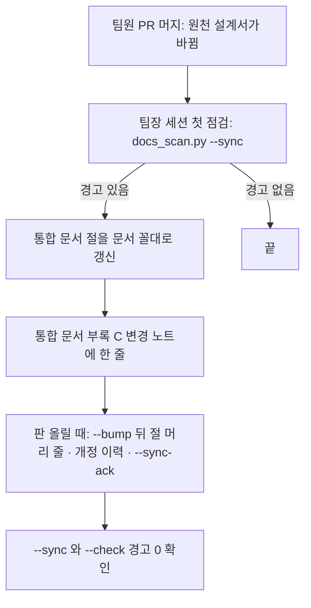

# 통합 산출물 ↔ 팀원 설계서 동기화 방식 — 리서치와 추천 (2026-10-23 배경조사)

| 문서 정보 | |
|---|---|
| **판 · 상태** | 결과 v1.0 · 읽기만 한 조사(이 파일 밖의 산출물 · 설계서 · 대장 · 글 폴더 · 배경조사 README 를 고치지 않음 — README 줄은 메인이 넣는다) |
| **출처** | 팀장(이동원) 10-23 결정 「통합 산출물에 팀원 설계를 문서 꼴대로 옮겨 적고, 팀원 설계가 바뀌면 통합 문서 판도 함께 올린다 — 어떻게 맞춰 두나는 조금 리서치해서 정한다」 · 지시서 `docs/_local/git-drafts-개인/지시서/2026-10-23-S139-통합산출물-동기화방식.md` · 바로 앞 점검 [통합 산출물에 팀원 설계가 들어갔나](../2026-10-23-통합산출물-팀원설계-포함점검/결과.md) |
| **기준** | main `a836243` — 파일 이력(git log 읽기)의 숫자는 이 커밋까지. 대화 시작 시점의 작업 트리에 고치는 중인 파일이 12개(수정 11 · 새 파일 1 — 산출물목록 · 릴리스노트 · 글 색인 등) 있었으나 이 조사의 숫자에는 들어가지 않는다 |
| **조회일** | 2026-10-23 09:51 ~ 10:06 KST |
| **확실도** | **높음** = 조문 · 문서 쪽 · 파일 이력을 직접 읽거나 셈 / **중간** = 2차 요약 · 검색 요약만 읽음 · 판단이 들어감 / **낮음** = 추정 |
| **읽는 법** | 경로는 `docs/phase-3/` 를 줄여 `p3/` 로 적었다. 용어는 아래 「이 문서의 말」 에 한 줄씩 풀었다 |

## 맨 위 5줄 요약

1. **추천은 「원천 고정 대장」 한 안이다.** 통합 문서 절마다 「어느 팀원 설계서의 어느 절을, 몇 판 기준으로 옮겼나」 를 `대장/설계-동기화.tsv` 한 곳에 적고(고정 판 + 절 지문), `scripts/docs_scan.py` 에 점검 하나(`--sync`)를 더해 **원천이 올랐거나 바뀌면 경고**한다. 사람 손은 동기화 1건에 대장 한 줄 + 절 머리 한 줄, 기계는 읽고 알려 주기만 한다(머지를 막지 않는다).
2. **근거** — 형상 관리 표준(ISO/IEC/IEEE 828 · NASA)은 「기준선 고정 → 변경 통제 → 상태 보고 → 감사」 네 활동이고, 요구 추적 도구(Doorstop)는 부모 항목의 지문이 바뀌면 자식 링크를 「의심」 으로 띄운다. 공공 SW 1차 출처 둘도 같은 요구다 — 구축·운영 지침 제59조 ① 「변경이 발생하면 표준산출물과 일관성이 유지되도록 관리」, 감리기준 제8 ~ 10조 「단계마다 과업 ↔ 산출물 대비표」. 우리 저장소에는 식별(머리표 판 · 지난판)과 변경 노트(부록 C)는 있고 **상태 보고와 감사 둘이 비어 있다**(표 2).
3. **판 번호만 고정하면 모자란다** — 이 저장소 이력(git log)에서 팀원 설계서는 판이 안 오른 채 파일이 바뀐다: 기능 설계서 10커밋 중 판 상승 0 · ③ 설계서 10 중 0 · ② 설계서 16 중 5(나머지 10은 판 그대로이고, 그중 3건은 폴더 이동 · 링크 다시 쓰기 같은 기계적 변경 · 표 3). 그래서 판과 함께 **절 본문의 지문**을 고정한다.
4. **비교한 안 셋** — ① 원천 줄만(수동) · ② **대장 + 점검(추천)** · ③ 마커 구간 자동 발췌. ① 은 오늘 되지만 「원천이 올라도 아무도 모른다」 는 지금 문제를 못 푼다. ③ 은 옮겨 적는 손을 없애지만 3주 · 4명에는 만드는 품이 크고 팀장이 통합 관점으로 다시 쓰는 것을 막는다.
5. **메인이 정할 것 다섯**(5절) — 지문까지 넣을지 · 대장 위치 · 절 머리 줄 · 아직 협의안인 원천(3차 설계서 둘)을 옮길지 가리키기만 할지 · 시작 시점. 시작은 대장 + 줄(오늘 · 사람 손만) → 점검 스크립트(이번 주) 순서를 권한다.

## 이 문서의 말

| 말 | 뜻 |
|---|---|
| 원천(source) | 옮겨 적을 때 기준이 되는 팀원 설계서(예: 인디케이터 전략 설계서) |
| 통합 문서 | 팀장이 만드는 산출물(기능 설계서 · RTM · 테스트 계획서 · UI 명세서 · API 명세서 등) |
| 형상 관리 | 문서 · 코드의 어느 판이 기준인지 정해 두고, 바뀌는 것을 통제하는 일 |
| 기준선(baseline) · 고정(pin) | 「이 판을 기준으로 옮겼다」 고 못 박은 값. 원천이 바뀌어도 이 값은 그대로 남아 비교 기준이 된다 |
| 지문(fingerprint) | 글 내용에서 계산한 짧은 값(해시). 글이 한 글자라도 바뀌면 달라진다 — 판 번호를 안 올린 수정도 잡는다 |
| 의심 링크(suspect link) | 위쪽 항목이 바뀌어서 「아직 맞는지 사람이 다시 봐야 하는」 이음 |
| 대비표 | 과업(요구)과 산출물의 반영 여부를 항목별로 맞대어 놓은 표. 우리 RTM 이 같은 구실을 한다 |
| 변경 노트 | 통합 문서 부록 C. 판을 올리기 전까지 「다음 판에 넣을 것」 을 쌓는 표(문서작성기준 4.5) |

---

## 1. 실무에서는 어떻게 맞추나 — 관행 표

**표 1. 관행 아홉 가지** · 「우리에게 주는 뜻」 은 이 조사의 해석이다. 조회일은 모두 2026-10-23.

| # | 관행 | 출처 · 주소 | 확실도 | 우리에게 주는 뜻 |
|--:|---|---|---|---|
| 1 | 형상 관리는 **식별 · 변경 통제 · 상태 보고 · 감사** 네 활동이다. 항목 식별 · 변경 통제 · 상태 보고 · 빌드 · 릴리스를 다루고 기준선 · 변경 · 시험 · 릴리스 · 감사의 상태 정보를 낸다 | ISO/IEC/IEEE 828 (IEEE 828-2012 판 — IEEE 쪽은 2023-03-30 「비활성-보관」 표시) · https://standards.ieee.org/standard/828-2012.html | 범위 한 문장 **높음** · 활동 목록 **중간**(검색 요약 · 본문 유료) | 우리 저장소에 네 활동 중 무엇이 있고 없는지 표 2 로 맞춰 봤다 |
| 2 | 변경 요청은 제품 · 관련 제품 · 예산 · 일정에 주는 영향을 분석한다. 상태 보고는 항목 내용을 변경 요청과 함께 잡아 두고, 감사는 「계획한 것과 만든 것이 같은지」 본다 | NASA 소프트웨어 공학 핸드북 「형상 관리 활동 개관」 · https://swehb.nasa.gov/x/uALxBw | **높음** (쪽 직접 읽음) | 부록 C 변경 노트가 「영향 분석 기록」 구실을 이미 한다 — 변경 요청 대장을 따로 만들 필요가 없다 |
| 3 | 형상 감사는 「맞는 판을 쓰는지, 정의한 기록과 일치하는지」 를 확인한다 — "determine the correct version of the software configuration items and verify that they conform to the records that define them" | NASA SWE-084 · https://swehb.nasa.gov/display/SWEHBVC/SWE-084%20-%20Configuration%20Audits | **높음** | 「통합 문서가 맞는 원천 판을 쓰나」 를 보는 점검이 곧 감사다 — 지금 없는 활동 |
| 4 | 요구와 작업 산출물 사이의 **양방향 추적**을 유지하고(REQM SP 1.4), 계획 · 산출물이 요구와 맞게 유지되는지 확인한다(SP 1.5). 산출물 예: 요구 추적표 · 요구 추적 시스템 | CMMI-DEV v1.3 REQM — wibas CMMI 브라우저(CMMI Institute 모델 사본) · https://wibas.com/cmmi/reqmsp-14-maintain-bidirectional-traceability-of-requirements | **중간** (원문 모델이 아닌 사본 · SP 1.5 문장은 검색 요약) | RTM 은 추적표다. 「설계」 칸을 원천 파일 · 절 링크로 두면 요구 → 설계서가 이어진다 |
| 5 | **의심 링크** — 링크는 부모 항목의 번호와 **지문**을 함께 저장하고, 부모가 바뀌면 검증 때 「의심」 으로 보고하며, 사람이 검토한 뒤 `doorstop clear` 로 해제한다. 검증 결과는 정보 · 경고 · 오류 세 단계(의심 링크 = 경고 · 없는 번호 = 오류) | Doorstop(요구를 텍스트 파일 + 버전 관리로 다루는 오픈소스 도구) 문서 · https://doorstop.readthedocs.io/en/v3.1/cli/validation.html | **높음** | 추천 안의 뼈대 — 「고정 값 + 경고 + 사람이 확인하고 해제」. 경고 · 오류를 나누는 것도 따른다 |
| 6 | 추적을 맺은 시점의 **리비전**을 항목 옆 괄호 숫자로 남겨, 원천이 그 뒤 바뀌었는지(outdated) 알아보게 한다 | Orcanos(상용 요구 · 시험 관리 도구) 도움말 · https://help.orcanos.com/knowledgebase/what-is-the-mean-by-numbers-written-in-brackets-with-traced-items-in-traceability-tab/ | **높음** (도구 설명서 — 표준이 아닌 사례) | 「판 고정」 은 상용 도구에서도 쓰는 꼴이다. 다만 리비전은 사람이 올려야 오른다 → 판만으로는 부족(표 3) |
| 7 | docs as code — 문서를 코드와 같은 도구(이슈 · Git · 평문 · 코드 리뷰 · 자동 시험)로 다룬다. 문서가 없는 기능은 머지를 막는 방식도 쓴다 | Write the Docs 가이드 · https://www.writethedocs.org/guide/docs-as-code/ | **중간** (검색 요약의 문장 · 쪽 본문은 안 엶) | 점검을 스크립트로 두는 것은 관행에 맞다. 머지를 막는 것은 우리 합의(ADR-0003 — 팀 공용 장치는 논의 먼저)와 달라서 **경고만** 한다 |
| 8 | **공공 SW — 변경이 생기면 산출물과 일관성을 유지한다.** 제59조 ① 「…운영, 유지관리 등으로 인해 변경이 발생하는 경우 표준산출물과 일관성이 유지되도록 관리하여야 한다」 · 제44조 ② 산출물을 체계적으로 관리 · 제45 ~ 46조 과업내용 변경은 정해진 절차로 | 행정안전부고시 제2023-27호 「행정기관 및 공공기관 정보시스템 구축·운영 지침」 · 행정안전부 누리집 첨부 PDF https://www.mois.go.kr/cmm/fms/FileDown.do?atchFileId=FILE_00117404QYgQ4qK&fileSn=1 (내려받아 글을 뽑아 읽음) | **높음** (조문 직접 · 더 새 판이 있을 수 있음) | 「바뀌면 일관성을 유지한다」 가 공공 SW 의 기본 요구다. 이 지침에 「형상관리」 · 「변경관리」 낱말은 0곳 — 방법은 정하지 않고 결과(일관성)만 정한다 |
| 9 | **공공 SW — 감리의 대비표.** 사업자는 요구정의(제8조) · 설계(제9조) · 종료(제10조) 단계마다 산출물이 세부 항목별로 과업내용을 반영했는지 확인할 수 있는 대비표를 만들어 감리 전에 제출한다. 감리법인은 산출물이 과업내용을 적정하게 반영했는지, 대비표가 적합 · 부적합을 판정할 만큼 구체화됐는지(제9조)를 점검한다 | 행정안전부고시 제2024-53호(2024-06-27 시행) 「정보시스템 감리기준」 · 개정 알림 첨부 https://www.mois.go.kr/frt/bbs/type001/commonSelectBoardArticle.do?bbsId=BBSMSTR_000000000016&nttId=110444 · 조문 목록 https://www.law.go.kr/LSW/admRulInfoP.do?admRulSeq=2100000243290&chrClsCd=010201 | **높음** (제8 ~ 10조 직접 읽음). 본문에 「형상관리」 · 「일관성」 · 「추적」 낱말은 0곳 — 형상 관리 점검 문항은 **확인 못 함** | 우리 RTM 이 대비표에 해당한다. 설계 단계 대비표를 「구체화」 하는 일이 지금 하려는 일(팀원 설계서 절을 요구 · 화면 · API · 시험에 잇기)이다 — 동기화 대장은 그 이음의 **기준 판**을 남긴다 |

**공공 SW 쪽에서 얻은 것** — 방법(대장 · 지문)을 정해 주는 1차 출처는 찾지 못했다. 확인된 것은 「바뀌면 일관성을 유지한다」(지침 제59조 ①)와 「단계마다 과업 ↔ 산출물 대비표」(감리기준 제8 ~ 10조) 두 요구뿐이다. 방법은 형상 관리 표준(행 1 ~ 3)과 요구 추적 도구(행 5 ~ 6)에서 가져온다.

**옮겨 적기 · 링크만 · 자동 포함** — 중복을 없애는 쪽은 보통 링크(가리키기만)나 포함(include — 도구가 다른 파일을 불러와 보여 줌)이다. 복사는 어긋남의 출처로 본다. 그런데 팀장은 10-23 에 **옮겨 적기**로 정했다. 그래서 이 조사는 「링크로 바꾸자」 가 아니라 「옮겨 적되 어긋남을 어떻게 알아채나」 를 묻는다. 포함은 도구(Sphinx · MkDocs 등) 안에서만 풀리고, 우리처럼 GitHub 화면으로 읽는 Markdown 은 복사본이 커밋에 있어야 보인다고 알고 있다(공식 문서로는 이번에 확인 못 함 · 중간).

---

## 2. 우리 저장소에는 무엇이 있고 무엇이 비었나

**표 2. 형상 관리 네 활동 ↔ 우리 저장소** · 근거는 문서작성기준 4.4 ~ 4.6 · 10.2 · `scripts/docs_scan.py`(확실도 높음).

| 활동 | 실무 요구(표 1) | 이미 있는 것 | 빈 곳 |
|---|---|---|---|
| 식별 — 무엇을 관리하고 어느 판이 기준인지 | 행 1 · 3 | 머리표 「판 · 상태」 · 산출물목록 0.1절 판 칸 · 지난판 사본(`지난판/<이름>_v<판>.md`) · `--bump` | 통합 문서가 **어느 원천의 몇 판을 기준으로 삼았는지**는 어디에도 없다(기준선 없음) |
| 변경 통제 — 바뀜을 분석하고 반영 | 행 2 · 8 | 변경 노트(부록 C: 날짜 · 종류 · 무엇 · 옮길 곳 · 근거) · 판 올리는 PR 의 리뷰 한 줄(머지를 막지 않음) | 원천이 바뀌어도 변경 노트에 **저절로 들어오지 않는다**(팀장이 알아야 적는다) |
| 상태 보고 — 지금 각 항목이 어느 판인지 한눈에 | 행 1 · 2 | 산출물목록 0.1절(통합 문서끼리) · RTM 3절(요구 ↔ 설계 절) | 원천 ↔ 통합 문서 절을 잇는 표가 없어 「무엇을 어느 판에서 옮겼나」 기록이 흩어진다(바로 앞 점검에서 어긋남이 발견된 까닭) |
| 감사 — 맞는 판을 쓰나 | 행 3 · 4 · 8 | `--check`(이름 · 폴더 · 짝 없는 지난판 — **글 내용도 판도 대조하지 않는다**) · 판 올리기 전 점검표(10.2 · 손으로) | 원천 판 · 내용을 통합 문서와 맞대는 점검이 없다 |

**표 3. 판이 안 오른 채 파일이 바뀌나 — 이 저장소 실측** · 각 파일의 이력을 `git log --follow`(읽기)로 따라가며 커밋마다 머리표 판을 읽어, 이웃한 두 커밋의 판이 같으면 「판 그대로」 로 셌다(확실도 높음 · 아래 한계).

| 문서 | 쓰는 사람 | 커밋 수 | 판이 오른 커밋 | 판 그대로 파일이 바뀐 커밋 | 판 흐름 |
|---|---|--:|--:|--:|---|
| 기능 설계서(통합) | 이동원 | 10 | **0** | 9 (그중 기계적 3) | v0.1 |
| 목표 기능 ① 설계서 | 이동원 | 11 | 7 | 3 | v1.0 → v1.7 |
| 목표 기능 ② 설계서 | 신장환 | 16 | 5 | **10** (그중 기계적 3) | v0.1 → v0.6 |
| 목표 기능 ③ 설계서 | 오준영 | 10 | **0** | 9 (그중 기계적 3) | v0.1 |
| 3차 인디케이터 전략 설계서 | 신장환 | 1 | 0 | 0 | v0.1 |
| 3차 증권사 연동 설계안 | 오준영 | 2 | 0 | 1 | v0.1 |
| RTM(통합) | 이동원 | 63 | 41 | 21 | v1.1 → v1.42 |
| 테스트 계획서(통합) | 이동원 | 53 | 50 | 2 | v1.4 → v1.55 |

- **읽는 법** — 팀장이 「세션마다 판을 올린다」 로 관리하는 RTM · 테스트 계획서는 판이 거의 커밋마다 오른다(41/63 · 50/53) → 판 비교가 잘 맞는다. 반대로 **기능 설계서 · ③ 설계서는 판이 한 번도 안 오른 채 9번 바뀌었고**, ② 설계서도 10번이 판 그대로다. 판 번호만 고정하면 이 수정들을 못 본다.
- **한계** — 「판 그대로」 에는 폴더 이동 · 링크 다시 쓰기 같은 **기계적 커밋 3건**(`82c013d` 10-07 · `8181de0` 10-21 · `3547620` 10-22 — 커밋 제목으로 가림)이 섞여 있고, 나머지도 오탈자 · 링크 수정 · 내용 변경을 가르지 않았다. 「파일 글이 바뀌었다」 까지만 확실하다. 그래서 추천 안의 지문은 **링크 주소를 뺀 글**로 계산한다(폴더 이동에 흔들리지 않게).
- 3차 설계서 둘은 머리표가 이미 「협의안 · 반응 전 · 정해지면 판을 올린다」 라고 적고 있어(인디케이터 설계 머리표 · 증권사 설계안 머리) 10-26 협의 뒤 바뀔 가능성이 크다.

---

## 3. 안 세 개 비교

세 안 모두 10-23 결정(**옮겨 적기** + 원천이 바뀌면 통합 문서 판도 함께 올림)을 전제로 한다. 「링크 + 세 줄 요약」 은 결정과 달라 비교에서 뺐지만, 안 ② 의 `방식` 칸에 `갈음`(가리키기만)을 두어 절마다 고를 수 있게 했다.

**표 4. 안 비교** · 품은 사람 손 / 기계로 나눠 적었다. 시간 · 줄 수는 추정(확실도 낮음).

| | **① 원천 줄만 (수동)** | **② 대장 + 판 · 지문 고정 + 점검 (추천)** | **③ 마커 구간 자동 발췌** |
|---|---|---|---|
| 한 줄 | 통합 문서 절 머리에 `> 원천: [파일](경로) 4.3절 · v0.1 · 날짜` 한 줄만 둔다. 판 올릴 때 사람이 `grep` 으로 훑는다 | ① 의 줄 + 대장 `설계-동기화.tsv`(절 ↔ 원천 · 고정판 · 고정지문) + `docs_scan.py --sync`(경고 · 오류) · `--sync-ack`(옮긴 뒤 고정 값 갱신) | 통합 문서 절 안에 `<!-- sync:begin -->` ~ `<!-- sync:end -->` 구간을 두고 스크립트가 원천 절을 복사해 채운다(RTM 표 블록을 스캐너로 다시 채우는 방식과 같은 꼴) |
| 장점 | 오늘 바로 · 도구 0 · 읽는 사람이 절에서 곧바로 기준 판을 본다 | 기준선 · 상태 보고 · 감사 셋이 한 곳에 · 판 안 오른 수정도 지문으로 잡는다 · `head_version` 재사용 · `--bump` → `--check` 흐름에 얹힘 · 경고만 하고 머지를 안 막는다 · Doorstop 의 「의심 → 검토 → 해제」 와 같은 꼴 | 옮겨 적는 손이 사라진다 · 실행 직후엔 복사본 = 원천 · `--check` 에서 다르면 바로 실패시킬 수 있다 → 가장 강한 일관성 |
| 단점 | 원천이 올라도 알려 주는 곳이 없다(**지금 문제 그대로**) · 줄이 흩어져 전체 현황이 없다 · 판 안 오른 수정은 못 잡는다 | 대장 한 줄 + 절 머리 한 줄을 같은 PR 에서 함께 고쳐야 한다 · 새 스크립트 약 80 ~ 100줄 + 시험 · 절 번호가 바뀌면 지문이 거짓 경고 · 경고를 안 치우면 쌓여 무시된다 | 팀장이 통합 관점으로 다시 쓰거나 해석을 덧붙이기 어렵다(구간 밖에 써야) · 원천 절의 제목 · 표 모양이 바뀌면 파서가 깨진다 · 협의안 단계엔 복사본이 자주 바뀌어 PR 소음 · 약 150줄 이상 + 링크 경로 다시 쓰기 + 시험 · 팀원이 원천을 고치는 PR 이 통합 문서 diff 를 부른다(소유 혼선) |
| 품 — 사람 | 동기화 1건에 줄 한 개 · 판 올릴 때 줄 전부를 눈으로 대조(절 수에 비례) | 동기화 1건에 대장 한 줄 + 절 머리 한 줄 + `--sync-ack` 한 번(1 ~ 2분 · 추정) | 실행 한 번 + 구간 밖 해설 |
| 품 — 기계 | 0 | `--sync` 읽기만(네트워크 · git 을 쓰지 않는다 — `docs_scan.py` 머리말의 약속 유지) | 만들기 + 유지 모두 큼 |
| 어긋남을 알게 되는 때 | 사람이 우연히 볼 때 | 팀장이 세션 첫 점검에서 `--sync` 를 돌릴 때 | 실행 · `--check` 때 즉시 |
| 3주 · 4명에 맞나 | 원천이 안정적일 때만. 3차 설계서 둘은 협의 뒤 바뀔 예정이라 **부적합** | **맞다** — 원천 5개 안팎 · 대장 20줄 안팎 | 3주 안에 품을 못 거둔다. 원천 구조가 굳은 뒤(예: 정형 표 한 곳)에만 부분 적용 후보 |

---

## 4. 추천 안 — 「원천 고정 대장」 (안 ②)

### 4.1 한눈에

**그림 1. 동기화 흐름** · 범례: 사각형 = 사람이 하는 일 · `--sync` 같은 명령 = 기계가 읽고 알려 주는 일.

### 4.2 무엇을 · 어느 파일에

| # | 무엇 | 어느 파일 | 내용 |
|--:|---|---|---|
| 1 | **동기화 대장**(새) | `p3/01-analysis/requirements/대장/설계-동기화.tsv` — 요구-대장 · 시험-요구대장 곁의 셋째 추적 대장 | 칸: `동기화ID`(SY-01 …) · `통합문서`(docs 기준 경로) · `통합절` · `원천파일` · `원천절`(머리글 번호 · 비우면 파일 전체) · `방식` · `고정판` · `고정지문` · `옮긴날`(KST) · `옮긴이` · `상태` · `비고`. **고정판 · 고정지문은 `--sync-ack` 가 채운다(손으로 쓰지 않는다)** |
| 2 | **절 머리 줄**(새 규칙) | 통합 문서의 해당 절 맨 위 | `> 원천: [인디케이터 전략 설계서](상대경로) 4.3절 · v0.1 · 옮김 · SY-01` 한 줄. **줄은 사람용, 정본은 대장** — 점검이 줄의 `SY-01` 로 줄을 찾아 판이 대장과 같은지만 본다(다르면 오류) |
| 3 | **점검**(새) | `scripts/docs_scan.py` 에 `--sync` · `--sync-ack <ID>` | 기존 `head_version()` 으로 원천 판을 읽고, 원천절은 「머리글 첫 낱말에서 끝의 점을 뗀 값」 이 같은 머리글(`## 4. …` · `### 4.3 …` 둘 다)에서 다음 같은 · 높은 머리글 전까지 잘라 지문을 계산한다. 지문 = 링크 주소 · 공백 · 줄 끝을 뺀 글의 sha-256 앞 8자. 시험은 `tests/test_docs_scan.py` 에 몇 건 |
| 4 | **RTM · 요구 대장 설계 칸** | `p3/01-analysis/requirements/RTM.md` 3절 「설계」 칸 · `요구-대장.tsv` 「설계_추가」 | 원천 **파일 · 절 링크**로 채운다. **판 칸은 RTM 에 두지 않는다** — 같은 원천이 15줄에 반복돼 중복이 되므로 판은 대장 한 곳에만 |
| 5 | **판 올리는 순서 · 점검표** | `p3/00-management/standards/문서작성기준.md` 4.6 · 10.2 | 4.6 의 ④ 뒤에 「⑤ 원천이 있는 통합 문서면 `--sync` 경고 0」 · 10.2 점검표에 같은 한 줄. (이 파일은 이번 조사에서 고치지 않았다 — 메인이 반영) |

**`방식` 칸의 값** — `옮김`(문서 꼴대로 옮겨 적음 · 10-23 결정의 기본값) · `요약`(몇 줄만 옮기고 원천 링크) · `갈음`(통합 문서는 가리키기만 · 원천이 정본) · `링크만` · `미반영`(아직 안 옮김 — 점검에 「안내」 로 나온다).

**표 5. 대장 예시 줄 — 실제 값이 아니라 모양** · 처음 채울 줄은 바로 앞 점검 결과 6절 3 ~ 5순위와 같은 일이다.

| 동기화ID | 통합 문서 | 통합절 | 원천 파일 | 원천절 | 방식 | 고정판 | 상태 |
|---|---|---|---|---|---|---|---|
| SY-01 | `p3/02-design/system/기능설계.md` | 5.1 | `p3/02-design/system/인디케이터-전략-설계.md` | 4.3 | 갈음 | v0.1 | 최신 |
| SY-02 | `p3/02-design/system/기능설계.md` | 5.5 | `p3/02-design/system/증권사-연동-자동화-설계.md` | 4 | 갈음 | v0.1 | 최신 |
| SY-03 | `p3/04-testing/테스트계획서.md` | 3차 시험 안 | `p3/02-design/system/증권사-연동-자동화-설계.md` | 6 | 미반영 | — | 대기 |

### 4.3 점검 규칙 — 오류 · 경고 · 안내

Doorstop 의 세 단계(표 1 행 5)를 따른다. **경고 · 안내는 종료코드를 바꾸지 않는다** — 머지를 막지 않는다(문서작성기준 4.4 · ADR-0003).

| 단계 | 조건 | 뜻 | 종료코드 |
|---|---|---|--:|
| 오류 | 원천 파일 · 절을 못 찾음 / 대장 ID 가 통합 문서에 없음 / 절 머리 줄의 판 ≠ 대장 고정판 / 원천 판 < 고정판 | 대장이 틀렸다 — 고칠 것 | 1 |
| 경고 A | 원천 판 > 고정판 | 원천이 올랐다 — 옮길 일 | 0 |
| 경고 B | 판은 같은데 절 지문이 다름 | 판은 그대로인데 글이 바뀌었다 — 읽고 옮기거나 `--sync-ack` | 0 |
| 안내 | `방식` = `미반영` | 아직 안 이어졌다 | 0 |

### 4.4 누가 · 언제

| 순서 | 누가 | 언제 | 무엇 |
|--:|---|---|---|
| 1 | 팀원(신장환 · 오준영 · 강민석) | 설계서를 고치는 PR | **지금 하던 대로**(머리표 판 · 개정 이력). 새 의무를 얹지 않는다. 판을 안 올리고 고쳐도 지문이 잡는다. 선택: PR 설명에 「통합 문서에 영향: 있음 · 없음」 한 줄 |
| 2 | 팀장(이동원) | 팀원 PR 이 머지된 **다음 세션 첫 점검**(로컬 · 네트워크 없음) | `python scripts/docs_scan.py --sync` — 경고 목록이 그 세션의 옮길 일 |
| 3 | 팀장 | 같은 세션 | 해당 절을 문서 꼴대로 갱신하고 통합 문서 부록 C 에 한 줄(종류 · 무엇 · 옮길 곳 · 근거 = 「원천: 파일 v0.1 → v0.2 · SY-01」). 판은 아직 올리지 않는다(문서작성기준 4.5) |
| 4 | 팀장 | 통합 문서 판을 올리는 때(세션 · 마일스톤) | `--bump` → 본문 반영 → 절 머리 줄 · 개정 이력 한 줄 · `--sync-ack SY-01` → `--sync` · `--check` 경고 0. 판 올리는 PR 에서 원천 작성자가 「옮긴 곳이 맞다」 한 줄(머지를 막지 않음 · 문서작성기준 4.4) |
| 5 | 팀장 | 3차 발표(11-12) 전 마지막 주 | `--sync` 오류 0 · 경고 0 으로 마감. 아직 협의안인 원천은 `방식 = 갈음` 으로 두고 절 머리 줄만 |

이 순서가 바꾸는 것은 하나다 — 지금은 팀장이 「무엇을 옮겨야 하는지」 를 기억에 기대 알아내는데, 이제는 기계가 알려 준다. 옮겨 적는 일 자체는 사람이 한다.

### 4.5 단계 — 품

| 단계 | 무엇 | 품(추정 · 확실도 낮음) |
|---|---|---|
| 오늘 | 대장 TSV 만들기 · 원천 설계서 넷(② · ③ · 인디케이터 · 증권사)의 줄을 `갈음` · `미반영` 으로 채우기 · 기능 설계서 3차 절에 절 머리 줄(고정판 · 지문 칸은 비워 둠) | 사람 손만 · 30분 안팎 |
| 이번 주 | `--sync` · `--sync-ack` 와 시험 몇 건 → 지문 칸 채우기 | 1 ~ 2시간 |
| 필요하면 | 안 ③ 의 부분 적용(정형 표 한 곳) | 3차 발표 뒤 판단 |

### 4.6 하지 않는 것

- 팀원 PR 에 새 의무를 얹지 않는다 · CI 필수 점검으로 올리지 않는다(올리려면 팀 논의 먼저 — ADR-0003).
- 통합 문서를 스크립트가 고치지 않는다 — 읽고 알리기 · 고정 값 기록까지만.
- 코드 → 문서 동기화(API 명세서 · ERD · RTM 표는 `api_scan.py` · `schema_scan.py` · `rtm_scan.py` 가 이미 맡는다)와는 별개다. 이 안은 **사람이 쓴 팀원 설계서 → 사람이 쓴 통합 문서** 사이만 다룬다.
- 커밋 해시를 고정 값으로 쓰지 않는다 — 머지 전에는 해시가 없고, 이력을 다시 쓰거나 합치면 바뀌어 약하다. 글 지문이 더 단단하다.

---

## 5. 메인이 정할 것 (선택지 · 추천은 첫 칸)

| # | 정할 것 | 선택지 | 판단 재료 |
|--:|---|---|---|
| 1 | 무엇을 고정하나 | **A. 판 + 절 지문**(경고 A · B) / B. 판만(경고 A) / C. 판 + 파일 전체 지문 | 표 3 — 팀원 설계서는 판이 안 오른 채 바뀌었다(기능 설계서 0/10 · ③ 0/10 · ② 5/16). 판만이면 그 수정을 못 본다. 반대로 원천 작성자가 「정해지면 판을 올린다」 를 지키면 B 로도 충분하고 소음이 적다. 절 지문은 머리글 찾기가 더 든다(약 20줄). 파일 전체 지문은 쉽지만 같은 파일의 다른 절 수정에도 경고가 울린다. **절충**: 처음 2주는 경고 B 를 「안내」 로 두고 소음을 본 뒤 올린다 |
| 2 | 대장 위치 | **A. `p3/01-analysis/requirements/대장/`** / B. `p3/02-design/system/대장/` | 원천은 system/ · 통합 문서는 requirements · system · ui · api · testing 에 흩어져 어느 쪽도 자연스럽지 않다. RTM 이 requirements 에 있고 대장 둘(요구 · 시험-요구)을 읽으므로 같은 곳이 찾기 쉽다. 점검은 위치와 무관 |
| 3 | 절 머리 줄 | **A. 한 줄 + 판 표시**(점검이 대장과 맞는지 봄) / B. 줄 없이 대장만 | 통합 문서만 읽는 독자(강사님 · 감리)가 절에서 곧바로 기준 판을 보는 이득 대 두 곳을 고치는 품. 점검이 줄 ↔ 대장 불일치를 오류로 잡으므로 둘이 어긋난 채 남지 않는다 |
| 4 | 아직 협의안인 원천(3차 설계서 둘) | **A. 협의가 끝날 때까지 `갈음`**(통합 문서는 가리키기만 · 확정되면 `옮김` 으로 바꿔 한 번에 옮김) / B. 지금 `옮김` | 10-23 결정은 「옮겨 적기」 가 기본이다 — A 는 그 **예외**라 확인이 필요하다. 지금 옮기면 두 벌이 금방 갈린다(10-22 점검에서 칸 이름이 이미 세 벌). B 로 가도 경고가 알려 주므로 안전망은 있으나 옮겨 적는 품이 협의 횟수만큼 든다 |
| 5 | 시작 시점 | **A. 오늘 대장 + 줄(사람 손만) → 이번 주 점검 스크립트** / B. 스크립트까지 한 번에 / C. 3차 발표 뒤 | 3차 발표(11-12) · 10-26 신호 계약 협의 · 이번 주 옮길 일(산출물목록 · RTM 설계 칸 · 기능 설계서 갈음 줄 · 시험 이름)이 이미 많다. 대장이 있으면 그 일들이 기록으로 남아 다음 판 때 다시 찾지 않아도 된다 |

**정하지 않아도 되는 것(기존 규칙 그대로)** — 점검은 팀장 로컬 도구로만 둔다 · 머지를 막지 않는다 · 팀원 PR 에 새 의무가 없다. 이 셋은 문서작성기준 4.4 · ADR-0003 과 같다.

**뒤집을 조건** — ① 경고 B 가 한 주에 열 건 넘게 쌓이는데 거의 오탈자 수정이면 지문을 판만으로 낮춘다 ② 대장 갱신을 반복해서 못 따라오면 안 ①(줄만)로 후퇴한다 ③ 원천 구조가 굳고 옮기는 일이 반복 표 갱신이 되면 안 ③ 을 그 표에만 적용한다.

---

## 부록 A. 만든 방법 — 다시 재는 법

- 읽기만 했다. git 은 `log --follow --name-status` · `show <커밋>:<경로>` 같은 **읽기**만 썼고(쓰기 · fetch · pull · gh · GitHub API · github.com 열기 · Figma · 개발 앱 호출 · pytest 모두 안 함 · `.env` 안 엶), 웹은 검색과 문서 쪽 읽기만 했다.
- 표 3 — 세션 임시 폴더에 둔 읽기 전용 파이썬(저장소에는 안 넣음)이 파일마다 `git log --follow` 로 커밋을 모으고, 커밋마다 그 시점의 파일을 읽어 `scripts/docs_scan.py` 의 `head_version()` 으로 머리표 판을 얻어 이웃한 커밋의 판을 비교했다. 기계적 3건은 커밋 제목(「docs 폴더를 종류별로 정리」 · 「차수 폴더」 · 「번호 폴더」)으로 가렸다.
- 표 1 행 8 · 9 — 행정안전부 누리집의 첨부 파일(지침 PDF 53쪽 · 감리기준 개정 알림 첨부)을 내려받아 글을 뽑고 낱말(형상관리 · 변경관리 · 일관성 · 추적 · 대비표 · 산출물)을 찾아 조문을 읽었다. 법령 사이트(law.go.kr)의 조문 쪽은 스크립트로만 본문을 그려 글을 못 읽어 주소만 적었다.
- 표 1 행 1 ~ 7 — 각 문서 쪽을 열어 문장을 확인했다(행 4 의 SP 1.5 · 행 1 의 활동 목록 · 행 7 은 검색 요약).

## 부록 B. 확인 못 한 것

- **ISO/IEC/IEEE 828 본문**(유료) · ISO 쪽 현행 판 상태 — IEEE 쪽 범위 문장과 「비활성-보관」 표시만 봤다. 표준이 안 쓰인다는 뜻은 아니다.
- **CMMI 원문 모델**(CMMI Institute) 대신 사본 사이트를 읽었고, SP 1.3 · 1.5 문장은 검색 요약이다.
- **Write the Docs** 쪽 본문은 열지 않았다(검색 요약에 인용된 문장만).
- **OpenFastTrace**(항목 ID 뒤에 리비전을 붙이는 추적 도구)는 문서가 GitHub 에만 있어 열지 않았다 — 같은 꼴의 사례로 Orcanos 를 대신 읽었다.
- **형상 관리 점검 문항** — 감리기준 본문에는 「형상관리」 · 「일관성」 · 「추적」 낱말이 0곳이다. 점검 항목은 한국지능정보사회진흥원(NIA)의 감리 점검 가이드에 있다고 알려졌으나 가이드 본문을 이번 시간 안에 열지 못했다.
- **구축·운영 지침의 더 새 판** — 읽은 파일은 제2023-27호다. 「소프트웨어 진흥법」 제50조 · 「소프트웨어 사업 계약 및 관리감독에 관한 지침」 본문은 안 읽었다(지침 제46조가 가리키는 이름만 봤다).
- **표 3 의 「판 그대로」** — 오탈자 · 링크 수정 · 내용 변경을 가르지 않았다(기계적 3건만 가림).
- **지문 방식** — 이번에 만들어 시험하지 않았다. 설계안이다. 품(시간 · 줄 수)도 추정이다.
- **원천 5곳 전체 머리글 모양** — 인디케이터 · 증권사 설계서와 기능 설계서의 머리글만 확인했다(`### 4.3 …` · `## 4. …` · `### 5.1 …`). 나머지 원천은 첫 동기화 때 머리글 번호가 맞는지 점검이 알려 준다.
