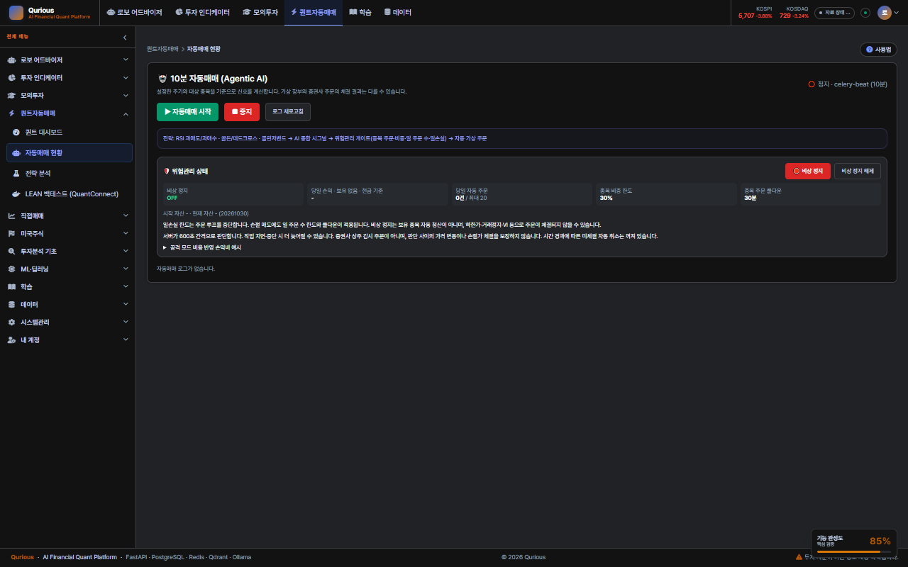
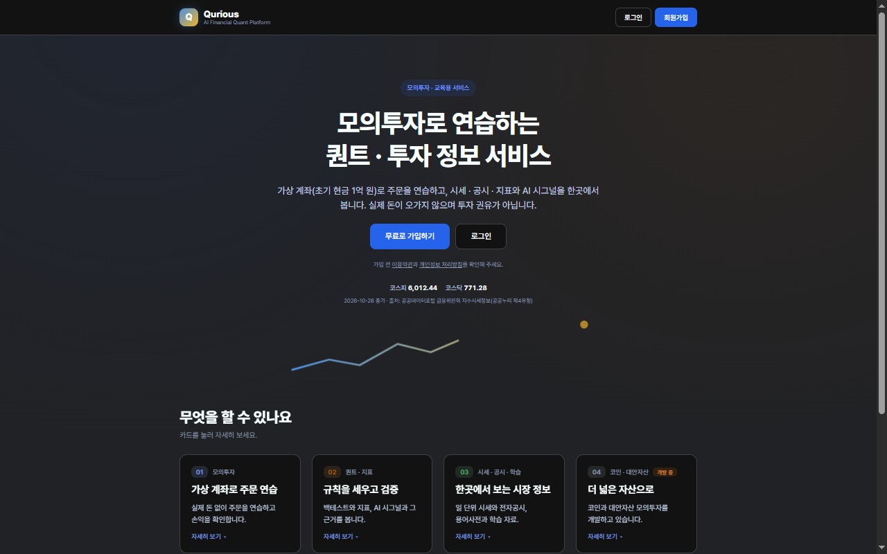
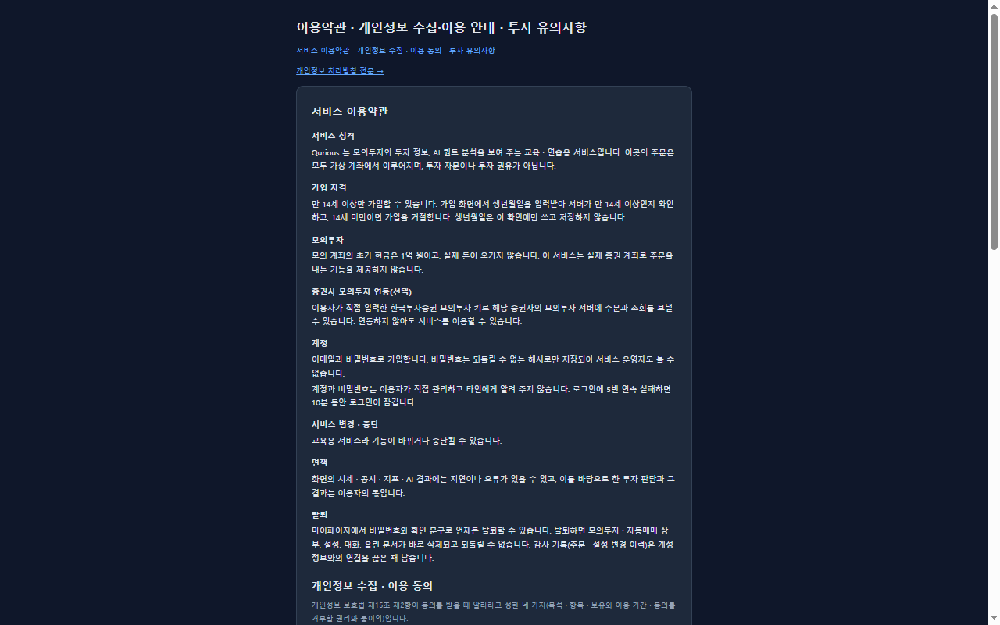

# 다크 · 라이트 전환과 글자 대비 — 지금 앱의 모습 · 실측 · 선택지 (2026-10-30 배경조사)

| 문서 정보 | |
|---|---|
| **판 · 상태** | 결과 v1.0 · 읽기만 한 조사 — 앱 코드 · 스타일을 바꾸지 않았다. CSS · HTML 을 읽고, 토큰 대비를 계산하고(임시 스크립트 · 저장소에 안 올림), 개발 앱을 OS 다크 설정 · 브라우저 자동 다크로 에뮬레이션해 캡처했다 |
| **물음** | 사용자 병렬 피드백(10-30 S166) 「다크 모드로 변환했을 때 글씨가 흐릿하게 보이거나 하지 않도록 이런 것도 세부적으로 해야 될 거 같은데 (라이트/다크 전환 시 프론트 디자인 조사 필요)」 |
| **기준** | 코드 `main` `533324c`(#417 머지 뒤) + 이 세션 작업 트리(랜딩 지수 한 줄 포함) · 개발 앱 `127.0.0.1:8966` · Chromium(Playwright · 에뮬레이션: `prefers-color-scheme: dark` · 자동 다크 `Emulation.setAutoDarkModeOverride`) |
| **조회일** | 2026-10-30(모든 웹 출처) |
| **확실도** | **높음** = 코드 · 계산 · 캡처를 직접 확인 · 공식 문서 원문 / **중간** = 이 조사에서 원문을 못 읽고 알고 있는 것으로 적음 |
| **읽는 법** | **대비** = 글자색과 바탕색의 밝기 비(WCAG 대비 비율 · 숫자가 클수록 잘 보임) · **토큰** = `--text-mute` 같은 색 변수 · **자동 다크** = 사이트가 다크를 안 만들어도 브라우저가 색을 뒤집어 보여 주는 기능 |

---

## 1. 한눈에

**표 1. 물음별 답**

| # | 물음 | 답 한 줄 | 확실도 |
|---|---|---|---|
| Q1 | 지금 앱에 다크 모드가 있나 | **없다.** 앱(`app.css`) · 랜딩 · 로그인 · 가입 · API 문서 · 학습 화면은 라이트 색만 정의돼 있다. 다크 선언은 **약관 · 처리방침 두 페이지**의 `prefers-color-scheme: dark` 뿐이고, 전환 단추 · `color-scheme` 선언은 어디에도 없다 | 높음 |
| Q2 | OS 를 다크로 두면 | 약관 · 처리방침만 어둡게 바뀌고 **앱 · 랜딩은 그대로 라이트**다(캡처) — 화면마다 달라 일관성이 없다 | 높음 |
| Q3 | 브라우저 자동 다크로 보면 | 뒤집히긴 하지만 **작은 보조 글이 어둡게 흐려지고**(앱 · 랜딩 캡처) 랜딩의 장식 차트 선도 바탕에 묻힌다 | 높음 |
| Q4 | 「흐릿」 의 원인 | ① **라이트에서도 이미 보조 글 대비가 낮다** — 앱 `--text-mute #94a3b8` 은 흰 바탕에서 **2.56:1**(기준 4.5:1 미달) ② 다크로 뒤집힐 때 그 값이 더 나빠지거나 어색하게 변한다 ③ 색이 Tailwind 클래스(`text-slate-400` 129곳 등) · 인라인 스타일에 박혀 있어 토큰만 바꿔서는 안 뒤집힌다 | 높음 |
| Q5 | 목표 기준 | WCAG 1.4.3(AA): 글자 **4.5:1** · 큰 글자 3:1 · Material 다크 테마 지침: 어두운 표면과 순백 글자가 **15.8:1 이상**(권장 표면 `#121212`) · 채도 높은 강조색은 피함 | 높음(원문) |
| Q6 | 다크 팔레트를 새로 만든다면 | slate 계열(`#0f172a` · `#1e293b` · `#273449` 바탕)에서 `text` `#e2e8f0` · `text-dim` `#cbd5e1` · `text-mute` `#94a3b8` 는 모두 4.5:1 을 넘는다. **`faint` `#64748b` 는 3.07 ~ 3.75 로 모자란다**(약관 다크의 `--faint` 도 같다) → 보조 글은 `mute` 이상만 쓰는 규칙이 필요 | 높음(계산) |

---

## 2. 화면군별 다크 대응 현황

**표 2. 화면군별 현황** · 근거: `prefers-color-scheme` · `data-theme` 검색(0 또는 있음) · 파일 읽기.

| 화면군 | 파일 | 다크 대응 | 비고 |
|---|---|---|---|
| 앱(로그인 뒤 전부) | `public/app.html` + `css/app.css` + Tailwind CDN(`cdn.tailwindcss.com`) | **없음** | 토큰 14개가 라이트 값뿐 · 색이 Tailwind 클래스로도 박혀 있다 · `color-scheme` 선언 없음 |
| 랜딩 | `index.html` + `css/landing.css` | **없음** | 토큰 11개 라이트 · 새 지수 한 줄(`.hero-ticker`)은 토큰 + 기본값 |
| 로그인 · 가입 | `login.html` · `register.html` | **없음** | |
| API 문서 · 학습 | `api-docs/api-docs.css` · `learn/learn.css` | **없음** | 각자 토큰 한 벌씩(앱과 따로) |
| 약관 · 처리방침 | `terms.html` · `privacy.html` | **있음**(OS 설정을 따름 · 전환 단추 없음) | 다크 `--faint #64748b` 가 4.5:1 미달 |

→ **토큰 한 벌이 아니라 화면군마다 따로** 있어, 다크를 하려면 먼저 색 정의를 한곳으로 모으는 일이 든다.

---

## 3. 실측 — 대비 계산

**표 3. 라이트 토큰(앱 `app.css`)** · 흰 바탕 `surf #ffffff` · `surf2 #f0f3f8` · `surf3 #e8ecf3` · `bg #f4f6fa`.

| 글자 토큰 | 값 | surf | surf2 | surf3 | bg | 판정 |
|---|---|--:|--:|--:|--:|---|
| `text` | `#0f172a` | 17.85 | 16.05 | 15.07 | 16.50 | 충분 |
| `text-dim` | `#334155` | 10.35 | 9.31 | 8.74 | 9.57 | 충분 |
| **`text-mute`** | **`#94a3b8`** | **2.56** | **2.31** | **2.16** | **2.37** | **전부 3 미만 · 4.5 미달** |
| `accent` | `#2563eb` | 5.17 | 4.65 | 4.36 | 4.78 | surf3 만 4.5 미달 |

- 사용량: `var(--text-mute)` **353**곳 · `var(--text-dim)` 157곳 · Tailwind `text-slate-400`(= `#94a3b8`) **129**곳 · `text-slate-500` 17곳 · `text-slate-300` 45곳(앱 `js/*.js` · `app.html` · `index.html` · `login.html` 합).
- 랜딩 `--text-mute #64748b`: 흰 바탕 4.76(통과) · `bg #f4f6fa` 4.40(근소 미달).
- 약관 다크(`terms.html` · `privacy.html`): `text` 14.48 · `mute` 6.96 · **`faint` 3.07 ~ 3.75**.

**표 4. 후보 다크 팔레트(계산만 · 아직 안 만듦)** · slate 계열.

| 글자 | 값 | `bg #0f172a` | `surf #1e293b` | `surf2 #273449` | 판정 |
|---|---|--:|--:|--:|---|
| `text` | `#e2e8f0` | 14.48 | 11.87 | 10.18 | 충분 |
| `text-dim` | `#cbd5e1` | 12.02 | 9.85 | 8.45 | 충분 |
| `text-mute` | `#94a3b8` | 6.96 | 5.71 | 4.89 | 통과 |
| `faint` | `#64748b` | 3.75 | 3.07 | 2.64 | **미달 — 글자로 쓰지 않는다(구분선 · 장식만)** |

※ Material 의 15.8:1(순백 글자 기준)을 모든 글자에 요구하면 `text-mute` 는 못 맞춘다 — 우리는 **WCAG AA(4.5:1)를 최소선**으로 두고 본문 글자만 15:1 안팎을 목표로 하는 절충이 현실적이다.

---

## 4. 화면 확인(캡처)

- **그림 1. 앱을 브라우저 자동 다크로 본 모습**(자동매매 현황 · 1280) — 뒤집히긴 하지만 보조 글(「설정한 주기와 대상 종목…」 · 칸 이름)이 어둡게 흐려지고, 라이트에서 칠한 색 띠(전략 흐름 안내)가 어색하게 남는다. 
- **그림 2. 랜딩을 브라우저 자동 다크로 본 모습**(1280) — 보조 글(「가입 전 …」 · 지수 한 줄의 출처 글 · 「카드를 눌러…」)이 약하고 장식 차트 선이 바탕에 묻힌다. 
- **그림 3. 약관을 OS 다크 설정으로 본 모습** — 이 화면만 사이트가 직접 만든 다크라 읽기 좋다(본문 14:1 대) — 보조 글(`faint`)만 약하다. 
- OS 다크 설정으로 앱을 열어도 **라이트 그대로**임을 확인했다(캡처는 남기지 않음 — 로그인한 화면이라 앱 첫 화면이 열렸고 밝았다).

---

## 5. 선택지와 권고

**표 5. 선택지**

| 안 | 내용 | 얻는 것 | 드는 것 |
|---|---|---|---|
| **A. 라이트만 유지 + 대비 고침** | `<meta name="color-scheme" content="only light">` 로 **브라우저 자동 다크를 막고**(원치 않는 흐림 제거), 라이트의 보조 글 대비를 올린다(`--text-mute` `#94a3b8` → `#64748b` 4.76:1 · Tailwind `text-slate-400` → `-500`) | 즉시 가능 · 지금의 「흐릿」 을 라이트에서 바로 줄임 | 다크는 없음. `text-slate-400` 129곳 치환 + 시각 확인 |
| **B. 다크 지원(토큰화)** | ① 색 정의를 한 벌로(라이트 `:root` + 다크 `[data-theme=dark]`) ② Tailwind 클래스 · 인라인 색을 토큰으로 치환 ③ 전환 단추(마이페이지 「설정」 — 「설정은 모두 마이페이지」 결정 10-29) + 저장 ④ 화면마다 라이트 · 다크 짝 확인(Figma 포함) ⑤ 시험: 대비 계산 지킴이 · 하드코딩 색 금지 | 일관된 다크 · 접근성 | 화면 70개 이상 · 11-05 전 수요 초과 속에서 큼 |
| **C. 약관 방식 확대** | 각 화면에 `prefers-color-scheme` 만 추가(전환 단추 없음) | 가장 싸다 | 화면마다 따로라 일관성 · 유지 비용 ↑ · 토큰 분산이 그대로 |

**권고(이동원 판단 거리)**: **A 를 먼저**(작고 되돌리기 쉬우며 「흐릿」 의 큰 원인인 낮은 대비를 라이트에서 바로 해소) → **B 는 설계(토큰 한 벌 · 팔레트 · 전환 위치)를 한 번 정한 뒤 단계적으로**. B 를 하면 이 조사의 표 4 를 팔레트 초안으로 쓴다. C 는 권하지 않는다.

**이 조사가 확인하지 못한 것**
- 사용자가 본 「다크 모드로 변환」 이 **OS 설정 · 브라우저 자동 다크 · 확장 프로그램(Dark Reader 등)** 중 무엇이었는지 — 에뮬레이션은 앞의 둘만 했다.
- Tailwind CDN 에서 다크 변형(`dark:`)을 쓰는 설정 방식(클래스 방식 · `media` 방식)은 이 조사에서 공식 문서 원문을 읽지 않았다 — B 를 하게 되면 그때 확인한다(확실도 **중간**).
- 라이트에서 `text-mute` 를 올리면 정보 위계(본문 / 보조)가 약해지는지 시각 확인(A 의 구현 때).

---

## 6. 출처

| # | 출처 | 쓴 곳 | 확실도 |
|---|---|---|---|
| S1 | W3C, Understanding SC 1.4.3 Contrast (Minimum) — `https://www.w3.org/WAI/WCAG22/Understanding/contrast-minimum.html` (WCAG 2.1 본문 `https://www.w3.org/TR/WCAG21/` 도 같음) | 글자 4.5:1 · 큰 글자 3:1 | 높음(원문 발췌) |
| S2 | Material Design, Dark theme — `https://m2.material.io/design/color/dark-theme.html` | 어두운 표면 + 순백 글자 15.8:1 · 권장 표면 `#121212` · 채도 높은 색 회피 | 높음(원문 발췌) |
| S3 | web.dev, Improve dark mode default with color-scheme and a meta tag — `https://web.dev/articles/color-scheme` · MDN `color-scheme` — `https://developer.mozilla.org/en-US/docs/Web/CSS/Reference/Properties/color-scheme` | `color-scheme` 은 기본 모양(스크롤바 · 입력 칸 등)을, `prefers-color-scheme` 은 꾸밀 수 있는 모양을 정한다 | 높음(원문 발췌) |

조회일 2026-10-30 · 모두 검색 결과의 발췌를 읽었다(본문 전체를 스크랩하지는 않음).

---

## 7. 열린 질문(사용자)

1. 「다크 모드로 변환」 을 어떻게 하셨나요(OS 설정 · 크롬 자동 다크 · 확장 프로그램)? 어느 화면에서 어느 글이 흐렸는지 알려 주시면 그 화면부터 봅니다.
2. 다크 모드를 **제품 기능**(전환 단추)으로 낼지, 아니면 우선 **라이트의 대비 고침(A)** 으로 충분한지.
3. 범위: 앱 전체인지, 랜딩 · 로그인 · 가입 같은 첫인상 화면부터인지.
4. 목표 대비: WCAG AA(4.5:1)를 최소선으로 두는 절충(권고)인지, Material 15.8:1 을 따를지.
