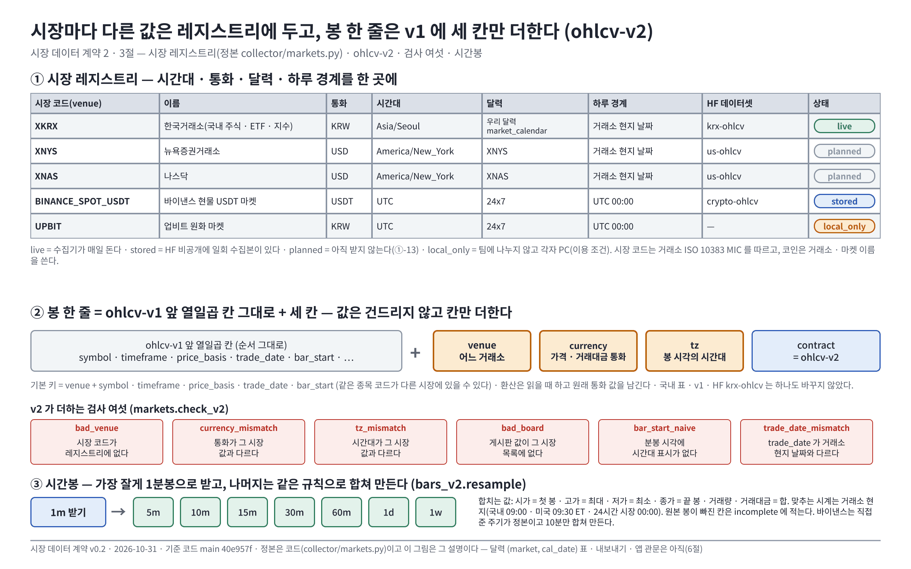

# 시장 데이터 계약 — 시장 레지스트리와 `ohlcv-v2` v0.2 — Qurious

| 문서 정보 | 내용 |
|---|---|
| **판 · 상태** | v0.2 · 도입부에 Figma 그림 한 장(<그림 1>) — 내용은 v0.1 과 같다 · S167(2026-10-30) — 할 일 ①-06 「저장 계약」 첫 판(조사서 6.4절 단계 1). 레지스트리 · 규칙 코드와 시험은 끝, **달력 `(market, cal_date)` 표 · 내보내기 · 앱 관문은 아직**(6절) |
| **구분** | 6. 시스템 설계 — 설계 문서(데이터 계약) |
| **담당** | 이동원(데이터 · 수집기 · 러너) |
| **검토** | 검토 전 |
| **최종 수정** | 2026-10-31 (KST) |
| **기준** | 코드 `collector/markets.py` · 시험 `tests/test_market_registry.py`(TC-MKT) · 현재 규격 `collector/ohlcv.py`(`ohlcv-v1`) |
| **근거** | [시장 범위 · 미국 코인 거래 기준 조사](../../../phase-2/01-analysis/research/시장범위-미국코인-거래기준-조사.md) 4 · 6절 · [미국 · 코인 데이터 관행](../../01-analysis/research/배경조사/2026-10-22-미국코인-데이터관행/결과.md) |
| **관련 문서** | [실시간 표시 vs 저장 자료 설계](실시간표시-저장자료-설계.md) · [데이터 SLA](데이터-SLA.md) · [목표 기능 ① 설계](목표기능1-데이터지식-설계.md) 5.1.1 |

> **이 문서로 알 수 있는 것**
> 1. 시장마다 다른 값(시간대 · 통화 · 달력 · 하루 경계)을 어디에 두는가 — **시장 레지스트리**.
> 2. 봉 한 줄의 모양이 시장이 늘어도 어떻게 하나로 남는가 — **`ohlcv-v2`**.
> 3. 미국 서머타임 끝(2026-11-01)처럼 날짜가 밀리기 쉬운 곳을 어떻게 막는가 — **`trade_date` 는 거래소 현지 날짜**.
>
> **이 문서의 한계** — 정본은 코드(`collector/markets.py`)이고 이 문서는 그것을 설명한다(시험 TC-MKT-06 이 시장 코드와 v2 칸이 이 문서에 다 있는지 맞댄다). 국내 표 · `ohlcv-v1` · HF `krx-ohlcv` 는 **하나도 바꾸지 않았다.**

---

**<그림 1> 시장마다 다른 값은 레지스트리에 두고, 봉 한 줄은 v1 에 세 칸만 더한다** · 위 표 = 시장 레지스트리 · 주황 = v2 가 더하는 세 칸 · 빨강 = v2 검사 여섯 · 초록 = 1분봉에서 합쳐 만드는 주기

원본: [Figma · Qurious · 문서 그림 · 시장 데이터 계약 v0.2 · node 106:3](https://www.figma.com/design/6lstWS4YwuhJPhGB9XoBMD?node-id=106-3) · 그림 판 v0.2 · 기준 커밋 `40e957f` · 2026-10-31

## 1. 결정 — 이름을 뒤집지 않고 칸을 더한다

조사서 6.2절 <표 10> 은 「`market` + `symbol` 둘 다 키에」 라고 썼다. 그런데 `ohlcv-v1` 에서 `market` 은 이미 **게시판**(KOSPI · KOSDAQ · KONEX · ETF · ETN · INDEX)이다. `market` 을 거래소 코드로 뒤집으면 HF `krx-ohlcv` 기존 파일과 받는 쪽 코드가 한꺼번에 깨진다.

| 안 | 내용 | 판단 |
|---|---|---|
| ① `market` 뜻을 거래소로 바꿈 | 조사서 표 그대로 | ✗ v1 파일 · 코드를 모두 고쳐야 한다 |
| ② **새 칸 `venue` 를 더함(채택)** | `market`(게시판)은 그대로, 거래소는 `venue` · 통화는 `currency` · 시간대는 `tz` | ✓ 국내 영향 0 · v1 을 위치로 읽는 코드도 안 깨진다 |

**뒤집을 조건** — 국내 게시판 칸이 쓸모없어지고 `market` 이 거래소를 뜻하는 쪽이 읽기 쉬워지면, v3 에서 이름을 바꾼다(그때까지 둘을 섞지 않는다).

---

## 2. 시장 레지스트리 (정본 = `collector/markets.py`)

| 시장 코드(`venue`) | 이름 | 통화 | 시간대 | 달력 | 하루 경계 | HF 데이터셋 | 상태 |
|---|---|---|---|---|---|---|---|
| `XKRX` | 한국거래소(국내 주식 · ETF · 지수) | KRW | `Asia/Seoul` | 우리 달력 `market_calendar` | 거래소 현지 날짜 | `krx-ohlcv` | live |
| `XNYS` | 뉴욕증권거래소 | USD | `America/New_York` | `XNYS` | 거래소 현지 날짜 | `us-ohlcv` | planned |
| `XNAS` | 나스닥 | USD | `America/New_York` | `XNAS` | 거래소 현지 날짜 | `us-ohlcv` | planned |
| `BINANCE_SPOT_USDT` | 바이낸스 현물 USDT 마켓 | USDT | `UTC` | `24x7` | UTC 00:00 | `crypto-ohlcv` | stored |
| `UPBIT` | 업비트 원화 마켓 | KRW | `UTC` | `24x7` | UTC 00:00 | — | local_only |

- 시장 코드는 거래소 ISO 10383 MIC 를 따르고, 코인은 MIC 가 없어 거래소 · 마켓 이름을 쓴다. `BINANCE_SPOT_USDT` 는 **2026-10-22 에 HF `crypto-ohlcv` 에 올린 일회 수집본의 경로 이름(`market=BINANCE_SPOT_USDT`)을 그대로** 쓴다.
- **게시판(`market`)** — v1 에서 이미 쓰는 칸이다. 국내는 v1 목록 그대로(`ohlcv.MARKETS`), 미국은 `EQUITY` · `ETF`, 코인은 `SPOT`. 어느 시장의 줄에 다른 시장의 게시판 값이 들어오면 `bad_board` 로 잡는다.
- **상태** — `live` 수집기가 매일 돈다 · `stored` HF 비공개에 일회 수집본이 있다 · `planned` 아직 받지 않는다(①-13) · `local_only` 팀에 나누지 않고 각자 PC(이용 조건).
- 값의 출처는 조사서 <표 6>(조회 2026-10-10)이고, 모르는 값은 숫자를 지어내지 않고 비운다(연환산 일수 — 주식은 달력에서 센다 · 코인 365).
- **쓰임의 한계**는 코드의 `use_note` 칸에 있다 — 예: 미국 봉(HF Data Library · IEX 체결만)은 「학습 · 연구 백테스트 · 개념 학습 화면용 · 매매 판단 근거 아님」, 코인은 CC BY-NC-SA 4.0(비상업 · 파생물 같은 라이선스).

---

## 3. `ohlcv-v2` = `ohlcv-v1` + 세 칸

| 칸 | 뜻 | 값 규칙 |
|---|---|---|
| `venue` | 어느 거래소(시장)인가 | 레지스트리에 있는 코드 |
| `currency` | 가격 · 거래대금의 통화 | 그 시장의 레지스트리 값과 같다 — 환산은 **읽을 때** 하고 원래 통화 값을 남긴다 |
| `tz` | 봉 시각의 IANA 시간대 | 그 시장의 레지스트리 값과 같다 |

- 칸 순서는 v1 의 앞 열일곱 칸 그대로, 그 뒤에 `venue` · `currency` · `tz`, 마지막이 `contract`(= `ohlcv-v2`). v1 을 위치로 읽는 코드가 있어도 앞 칸이 같다.
- **기본 키** = `venue` + v1 키(`symbol` · `timeframe` · `price_basis` · `trade_date` · `bar_start`) — 같은 종목 코드가 다른 시장에 있을 수 있다.
- v1 → v2 는 **값을 건드리지 않고** 칸만 더한다(`markets.to_v2`). v2 로 읽는 쪽은 v1 줄도 `venue = XKRX` 로 읽을 수 있다.

### 3.1 v2 가 더하는 검사 여섯 (`markets.check_v2`)

| 규칙 | 잡는 것 |
|---|---|
| `bad_venue` | 시장 코드가 레지스트리에 없다 |
| `currency_mismatch` | 통화가 그 시장 값과 다르다 |
| `tz_mismatch` | 시간대가 그 시장 값과 다르다 |
| `bad_board` | `market`(게시판) 값이 그 시장이 쓰는 목록에 없다(국내는 v1 의 KOSPI · KOSDAQ …, 미국은 `EQUITY` · `ETF`, 코인은 `SPOT`) |
| `bar_start_naive` | 분봉 시각에 시간대 표시가 없다 |
| `trade_date_mismatch` | `trade_date` 가 봉 시작의 거래소 현지 날짜와 다르다(날짜 밀림) |

OHLC 순서 · 가격 양수 같은 값 규칙은 v1 검사(`collector/ohlcv.py` `RULES`)가 그대로 맡는다.

---

### 3.2 시간봉(주기) — 다양하게 모으되 잘게 받아 합친다 (사용자 피드백 10-30)

시간봉을 1분 · 5분 · 10분 · 15분 · 30분 · 60분 · 일 · 주로 다양하게 두어야 신호 · 대사 · 백테스트가 정교해진다. 주기마다 따로 받으면 용량 · 약관 부담이 커지고 주기끼리 값이 어긋날 수 있어서, **가장 잘게 받는 원천은 1분봉으로 받고 나머지는 같은 규칙으로 합쳐 만든다**(`collector/bars_v2.py` `resample`).

| 항목 | 규칙 |
|---|---|
| v2 주기 | `1m` · `5m` · `10m` · `15m` · `30m` · `60m` · `1d` · `1w` (v1 은 `1m` · `5m` · `60m` · `1d` · `1w` — 10 · 15 · 30 분을 더함) |
| 합치는 값 | 시가 = 첫 봉 · 고가 = 최대 · 저가 = 최소 · 종가 = 끝 봉 · 거래량 · 거래대금 = 합(하나라도 비면 비움) |
| 맞추는 시계 | **거래소 현지 시계** — 정규장이 있으면 정규장 시작(국내 09:00 · 미국 09:30 ET), 24시간 시장은 현지 00:00. 미국 30분봉은 09:30 · 10:00 … (서머타임은 현지 시각으로 세므로 11-01 앞뒤로 안 바뀐다) |
| 덜 찬 봉 | 원본 봉이 빠진 칸은 `incomplete` 에 적는다 — 조용히 채우거나 버리지 않는다. 장 시작 앞(프리마켓) 봉은 「덜 찼다」 로 세지 않는다 |
| 원천이 직접 주는 주기 | 바이낸스는 1m · 5m · 15m · 30m · 1h 를 직접 준다 — 받은 것이 정본이고 합친 값과 대조한다(`crypto_v2.TIMEFRAME`) |
| 제약 | 용량(코인 1분봉은 1시간봉의 약 60배) · HF 비공개 저장 한도 · 약관(Binance Vision 비상업 · HF Data Library 「not for trading」) — **어느 종목 · 기간까지 받을지는 ①-13 착수 때 사용자와 정한다.** 국내 분봉(야후)은 정책 봉인(TC-YH)이라 늘리지 않는다 |

### 3.3 수집 범위 — 다양하게 전부 (사용자 결정 2026-10-30 · 개인 프로젝트 확장 고려)

사용자 결정: **주기도 종목도 가능한 한 다양하게 전부 모은다** — 팀 프로젝트뿐 아니라 개인 프로젝트로 이어 갈 수 있게. 아래는 그 결정을 지키면서 **한도 안에 들어가게** 하는 설계다(조사 10-30 — 출처는 표 아래).

| 항목 | 조사 결과 | 설계 |
|---|---|---|
| Binance Vision 제공 주기 | `1s` `1m` `3m` `5m` `15m` `30m` `1h` `2h` `4h` `6h` `8h` `12h` `1d` `3d` `1w` `1mo` | **원본 그대로 받는다** — 주기마다 직접 받은 파일이 정본(합쳐 만든 값이 아님) · 바이낸스에 없는 주기(예: 10분)만 `bars_v2.resample` 로 만든다 |
| 1초봉 | 제공됨 — 1분봉의 약 60배 | **받지 않는다**(개인 프로젝트에서 필요해지면 따로 · 용량이 다른 주기를 모두 합친 것의 수십 배) |
| 종목 수 | 현물 klines 종목 디렉터리 3,745 · `USDT` 로 끝나는 것 757(상장 폐지 종목 포함) | **USDT 마켓 전부**를 목표로, 단계적으로(아래) |
| 용량 | **실측(2026-10-30 · 5종목 BTC · ETH · ADA · DOGE · XRP · 2026-09 한 달 · parquet zstd)**: 1분봉 종목당 **2.2 ~ 3.0 MB/월**(43,200행 · 평균 2.5 MB · zip 은 1.6 ~ 2.1 MB) · 5분 0.49 · 15분 0.18 · 30분 0.10 · 1시간 0.05 · 4시간 0.02 · 1일 0.01 MB(종목당 평균). 10-22 일회 수집본(1d + 1h) = 23파일 68.7 MB | 주기 전체(1m ~ 1d)를 받아도 **1분봉의 1.34배**(실측 합 16.9 대 12.7 MB) — 용량은 1분봉이 정한다 |
| 전체 외삽(어림) | USDT 757 종목 × 종목별 거래 개월 수(모름 — 폐지 · 신규 종목이 많아 평균을 아직 못 셈) × 종목당 월 1.0 ~ 2.5 MB(거래가 뜸한 종목은 행이 적어 더 작다) | 평균 36개월이면 1분봉 약 27 ~ 68 GB → **모든 주기 약 36 ~ 91 GB**, 평균 60개월이면 약 60 ~ 114 GB → **약 80 ~ 152 GB** — 무료 100 GB 한도 **안팎**이라 **상위 종목부터 단계적으로** 채우고 한도 앞에서 멈춘다 |
| HF 비공개 저장 | 저장소별 하드 한도는 없고 계정 쿼터에 합산 · 무료 사용자 · 조직 100 GB · PRO 1 TB(+ 종량제) · Team · Enterprise 좌석당 1 TB(+ 종량제 · TB 당 월 $18) | **조직의 요금제 확인이 먼저**(사용자) — 무료 100 GB 면 아래 단계 · 한도 앞에서 멈춘다 |
| HF 구조 한도 | 저장소당 파일 10만 개 미만 · 폴더당 1만 개 미만 권장 · 한 커밋 100개 미만 권장 · 단일 파일 200 GB 미만 · 몇 천 커밋부터 느려짐(이력 합치기는 되돌릴 수 없음) | **잘게(1 · 3 · 5 · 15 · 30분)**: `ohlcv/timeframe=<주기>/market=<시장>/year=<해>/symbol=<종목>.parquet` · **거친 주기(1시간 이상 10종)**: 해 폴더 없이 `…/market=<시장>/symbol=<종목>.parquet`(종목당 파일 하나) — 모두 해로 쪼개면 15 × 757 × 10 = 113,550 개로 **10만 개 권장을 넘기** 때문(`binance_vision.partition_path` · TC-BV-04). 이 설계는 약 4.5만 개 · 폴더마다 종목 수(757) 안팎 · **100개 안팎씩 커밋** |
| 코인 확장 칸 | 바이낸스 CSV 는 체결 수 · 능동 매수량(기준 · 견적)을 준다 | `ohlcv-v2` 핵심 칸 **뒤**에 `trades` · `taker_buy_base` · `taker_buy_quote` 를 붙인다(핵심 칸 · 차례는 안 바뀜 · `crypto_v2.EXT_COLUMNS`) — 개인 프로젝트에서 쓸 정보를 버리지 않는다 |
| 약관 | Binance Vision 데이터 = CC BY-NC-SA 4.0(비상업 · 파생물도 같은 조건) · 미국 봉 HF Data Library = 「not for trading」 | **개인 프로젝트로 이어 가도 비상업 · 학습 · 연구 안에서만**. 팀 밖에 나눌 때는 카드의 라이선스를 따른다(상업 이용 · 재배포 금지) |
| **2차 실측(10-30 13:47 · 적재 파일 기준 · 실제 올림)** | 5종목(BTC · ETH · ADA · DOGE · XRP) × 2026-09 한 달 × 12주기(1m ~ 1d · **3d · 1w · 1mo 는 원천이 달이 지난 뒤 늦게 올려 아직 없음**) = parquet 60개 **18.49 MB** · 1분봉 10.37 MB(종목당 월 2.07 MB) · 3분 3.57 · 5분 2.25 · 15분 0.85 · 30분 0.47 · 1시간 0.28 · 2시간 0.18 · 4시간 0.13 · 6시간 0.11 · 8시간 0.10 · 12시간 0.09 · 1일 0.08 MB | 주기 전체 = **1분봉의 1.78배**(3분봉이 1분봉의 약 34% — 1.34배는 7주기만 잰 앞의 값) · 종목당 월 약 3.7 MB(큰 종목 기준) → 757종목 × 평균 36개월 ≈ 41 ~ 101 GB(종목당 월 1.5 ~ 3.7 MB 가정) · 60개월이면 ≈ 68 ~ 168 GB — **무료 100 GB 한도를 넘을 수 있어 상위 종목부터 · 한도 앞에서 멈춘다** |
| **올림 · 검증(10-30)** | `Finance-Data/binance-spot-ohclv`(비공개 · 철자 `ohclv` 로 만들어진 이름 그대로) 에 60개 파일 · 커밋 1건 + 데이터셋 카드(CC BY-NC-SA 4.0 · 비상업) · 원격 parquet 60 · 샘플 3개(1m · 3m · 1d) 지문 일치 | `scripts/personal_binance.py`(fetch → compile → upload · 팀 러너 밖 · 올리기 전 `hf_orgs` 권한 점검 · 팀 조직에는 거부) · 로컬 `data/personal/binance`(gitignore 추가) |
| 저장 위치 | 사용자 결정(10-30): 「필요하면 `Finance-Data` 조직도 쓴다」 — 그 조직은 아직 비어 있고(공개 기준) 이 PC 토큰은 `qurious-quant` · 개인 계정 범위뿐이라 **`Finance-Data` 에는 쓸 권한이 없다**(읽기로 확인) | 대용량 전 주기 · 전 종목은 **`Finance-Data` 의 새 비공개 저장소**(제안 `binance-spot-ohlcv`)에 둔다 — 팀 쿼터(`qurious-quant`)를 안 쓰고 개인 확장에 맞다. `Finance-Data` 는 **팀원이 안 쓰는 주소**라(사용자 10-30) 새 데이터는 여기에 두는 것을 권장하고, **3차에 포함되지 않는 기존 데이터도 옮겨도 된다** — 후보 `qurious-quant/crypto-ohlcv`(1d · 1h · 코인은 3차 범위 밖)는 새 저장소에 **복사 → 지문 대조 → 쓰는 곳의 저장소 이름 갱신** 뒤 옛 저장소 정리는 사용자 승인 후(삭제는 되돌릴 수 없음). 앱 · 러너가 읽는 `krx-daily-market` 등 팀이 쓰는 것은 그대로. 올리기 전에 사용자가 저장소를 만들고 토큰에 조직 권한을 더해야 한다 |
| 권한 · 팀원 | **`Finance-Data` 는 이동원만 권한이 있다**(팀원 없음 · 사용자 10-30) — 같은 코드를 팀원도 받아 쓰므로 개인 조직 단계가 팀원 PC 에서 팀 작업을 깨면 안 된다. 조사(HF 문서): 권한 없는 비공개 저장소는 **403 이 아니라 404(`RepositoryNotFoundError`)** 로도 와서 「없음」 과 구분이 안 된다 · 조직 역할은 read · contributor(자기가 만든 저장소만) · write · admin · fine-grained 토큰은 조직마다 범위를 따로 준다 · HF 에 조직별 표준 토큰 변수는 없다 · 서비스 계정 · 리소스 그룹은 유료 플랜 | **기존 팀 로직(`qurious-quant` · 러너 · 앱 백업)은 한 줄도 안 바꾼다.** 개인 조직 단계는 **별도 명령**으로 두고(러너 `STEPS` 에 안 넣음 — 팀원 PC 에서 돌 일이 없게) 시작 전 `collector.hf_orgs` 가 `whoami` 한 번으로 권한을 읽어 없으면 **에러 없이 건너뛴다**(TC-HFO) · 그래도 터지면 `is_no_access_error` 로 같은 「건너뜀」 · 개인용 토큰 변수 `FINANCE_DATA_HF_TOKEN`(없으면 팀 토큰 변수) · 토큰 값은 출력하지 않는다 |
| 로컬 사본 | — | 개인 프로젝트에서 HF 없이도 쓰도록 `data/`(gitignore) 에 같은 경로로 둔다 — HF 는 팀 공유 · 백업 |

**단계(착수 13:30 뒤 — HF 맞추기 금지 11:00 ~ 13:30)**

1. **실측** — 상위 몇 종목의 한 달치를 주기별로 받아 parquet 으로 만들어 실제 용량을 잰다(위 추정을 실측으로 바꿈). 이 숫자로 전체 용량을 외삽하고, 조직 한도와 맞대 본다.
2. **넓이 먼저** — 10-22 일회 수집본에 있는 종목부터 **모든 주기**(1m ~ 1d)를 채운다 → 거래량 상위 종목 순으로 USDT 마켓을 넓힌다.
3. **깊이는 그다음** — 종목마다 상장 첫 달부터(이분 탐색은 10-22 수집기에 있음). 한도에 닿기 전에 멈추고 보고한다.
4. 받을 때마다 `crypto_v2.convert` 로 값 규칙 · 중복 검사 → 위반 줄도 지우지 않고 기록(`problems`).
5. 새 단계는 **받기 → 정제 → 적재를 나누어** 만든다(수집 파이프라인 설계 P6) — 용량이 커서 재시도 · 부분 재실행이 빨라야 한다.

출처: Hugging Face Hub 저장소 한도 문서(https://huggingface.co/docs/hub/storage-limits) · Binance Vision 목록(`data.binance.vision` S3 조회 2026-10-30) · 바이낸스 공개 데이터 안내(https://github.com/binance/binance-public-data). 용량 숫자는 BTCUSDT 실측 + 나머지 추정이라 1단계 실측이 정본이다.

---

## 4. 날짜 — `trade_date` 는 거래소 현지 날짜

- 미국 봉을 KST 로 바꿔 저장하면 날짜가 하루 밀린다(16:00 ET 마감 = 한국 시각 다음 날 05:00 · 06:00). 그래서 `trade_date` 는 **그 거래소 시간대의 날짜**이고, `bar_start` 는 시간대가 붙은 시각이다(`markets.local_trade_date`).
- **서머타임** — 미국은 2026-03-08 ~ 2026-11-01 이 서머타임이라 **3차 기간 중 11-01 에 한국 시각이 1시간 밀린다**(마감 봉: KST 05:00 → 06:00). `tz` 가 알아서 세므로 코드는 안 바뀐다. TC-MKT-03 이 11-01 앞뒤(1시 30분이 두 번 있는 새벽 포함)를 시험한다.
- 코인 일 캔들은 **UTC 00:00 경계**(= 한국 시각 09:00)라 `trade_date` 가 UTC 날짜다. 시간대 표시가 없는 시각은 받지 않는다 — 어느 나라 시각인지 짐작하지 않는다.

---

## 5. HF 데이터셋 · 배당락 규칙

- **HF 는 시장마다 따로**(조사서 6.3절 ②): `krx-ohlcv`(그대로) · `us-ohlcv` · `crypto-ohlcv` — 안의 경로는 같은 꼴 `ohlcv/timeframe=/…/market=/year=`. 이름은 레지스트리 칸(`hf_dataset`)에서 읽어 스크립트에 박지 않는다.
- **배당락 규칙은 계산식이 아니라 칸**이다 — 국내 `record_minus_1_trading_day`(기준일 한 거래일 전 · T+2 전제), 미국 `record_date`(T+1). 결제 주기가 바뀌어도(국내 T+1 전환 로드맵) 칸만 고친다. 자료에 `ex_date` 가 오면 자료가 우선이다.

---

## 6. 아직 안 한 것 — 순서와 까닭

| # | 할 일 | 왜 지금 안 했나 | 때 |
|---|---|---|---|
| 1 | 달력 표 `(market, cal_date)` | `collector/db.py` 는 12:30 러너가 읽는 파일이라 회차 전에 머지하지 않는다(R3) · 수집 DB 에 새 표를 만든다 | 10-30 회차 뒤 |
| 2 | `ohlcv.MARKETS` · 검사 규칙 `bad_market` 이 레지스트리를 읽게 | 같은 이유(러너 파일) · v1 의 게시판 목록과 시장 목록을 섞지 않도록 따로 정한다 | 위와 함께 |
| 3 | 내보내기 `ohlcv-v2`(국내 = `venue XKRX` 한 줄) | 내보내기는 러너 단계 | 위와 함께 |
| 4 | 앱 관문 `/api/data/ohlcv?market=…` 가 `venue` 를 받음 | 하위 호환 응답 칸 추가 — 3차 뒤쪽 | ①-13 뒤 |
| 4-1 | **코인 변환기**(`collector/crypto_v2.py`) — 이미 올라간 `crypto-ohlcv` 한 줄 → v2 줄 · 값 규칙 · 중복 검사(네트워크 없음) | **끝**(TC-MKT-07) — 실제 받기 · 올리기 · 일봉 이어 붙이기는 ①-13 | 13:30 뒤 |
| 5 | 같은 시세를 LEAN · 로컬 엔진 · 대사 도구가 읽는 경로(①-06 의 「같은 일봉」) | 강민석 님 LEAN 입력 꼴(#314)과 맞춤이 필요 | 10-31 이후 |

---

## 개정 이력

| 판 | 날짜 | 바뀐 것 | 까닭 | 근거 |
|---|---|---|---|---|
| v0.2 | 2026-10-31 | 도입부(1절 앞)에 Figma 그림 한 장(<그림 1> 시장 레지스트리 · ohlcv-v2 세 칸 · 검사 여섯 · 시간봉) — 내용은 v0.1 과 같다 | 그림이 0장이던 설계서에 핵심 그림을 넣는다 | [그림 대장](../../00-management/standards/문서그림지침.md) <표 5> |
| v0.1 | 2026-10-30 | 할 일 ①-06 「저장 계약」 첫 판 — 시장 레지스트리 · `ohlcv-v2` 규칙 코드와 시험(TC-MKT) | 미국 · 코인 확장 전에 저장 계약을 먼저 둔다(조사서 6.4절 단계 1) | [지난판 v0.1](지난판/시장-데이터-계약_v0.1.md) |
