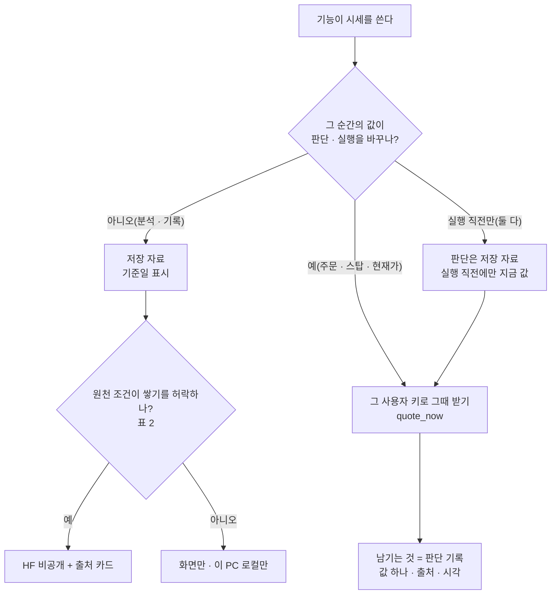

# 실시간 표시 · 저장 자료 구분 설계 v0.1 — Qurious

| 문서 정보 | 내용 |
|---|---|
| **판 · 상태** | v0.1 · 초안 — 할 일 ①-04(2026-10-25) |
| **구분** | 6. 시스템 설계 — 설계 문서(기능마다 시세를 「그 순간 받아 보여 주기만」 할지 「저장 자료로」 할지 · 시장 · 원천마다 화면 표시 · 저장 · 저장한다면 무엇을) |
| **담당** | 이동원(데이터 · 수집기) |
| **검토** | 검토 전 |
| **최종 수정** | 2026-10-25 (KST) |
| **기준** | 코드 `main` `963ee1a` · 근거 데이터셋 HF 비공개 `qurious-quant/source-terms-evidence` 태그 `terms-2026-10-25`(커밋 `104770e3` · 원천 31) · 정한 것 = [논의 결정 대장](../../00-management/plans/논의결정대장.md) D7 #13 · 2026-10-22 · 2026-10-23 · 2026-10-25 줄 |
| **앞선 결정 · 조사** | [실시간 시세 · 지연 표기 조사 v1.0](../../../phase-2/01-analysis/research/실시간시세-지연표기-조사.md)(2차 끝 · 2026-10-19) — 0절 결정 일곱 · 3.4 재배포 판정 · **7절 「기능별 두 갈래」 <표 7-1> R1 ~ R9 · <표 7-2> S1 ~ S11** — 이 문서는 그 표를 3차로 이어받는다 · [미국 · 코인 데이터 관행](../../01-analysis/research/배경조사/2026-10-22-미국코인-데이터관행/결과.md)(10-22 결정) · [데이터 HF 보강](../../01-analysis/research/배경조사/2026-10-22-데이터-HF-보강/결과.md) A1(원천별 이용 조건 원문 지문) |
| **관련 문서** | [이동원 할 일](../../00-management/plans/이동원파트-할일.md) ①-04 · ①-13 · ①-15 · ①-19 · ①-20 · 자료 안내 출처 대장 `app/services/data_guide.json` 의 `sources` · 지금 값 한 곳 `app/services/quote_now.py`(10-19) · [증권사 연동 자동화 설계안](증권사-연동-자동화-설계.md)(오준영) · [여러 PC 회차 설계](여러PC-회차-설계.md) |

> **이 문서로 알 수 있는 것**
> 1. 어떤 기능이 저장 자료로 충분하고, 어떤 기능이 그 순간의 시세가 필요한가 — 2절(10-19 표를 3차로 이어받음)
> 2. 시장 · 원천마다 화면에 보여만 줄지, 저장해도 되는지, 저장한다면 무엇을 — 3절
> 3. 그 판단의 근거(이용 조건 원문 지문)는 어디에 있나 — 4절
> 4. 지금 코드와 어긋나는 곳과 정한 것 — 5절 · 6절

---

## 0. 쉬운 요약 다섯 줄

1. **원칙은 2차 끝(10-19)에 정한 그대로다** — 「판단은 저장 자료, 실행 직전 확인과 표시만 지금 값」 · 지금 값을 못 받으면 「실시간이 아님」 을 밝힌다 · 실시간 시세 자체는 저장 · HF 공유를 하지 않고, 남기는 것은 「언제 · 어디서 받은 어떤 값으로 판단했나」(값 하나 · 시각 · 출처)뿐이다. 이 문서는 그 표를 3차 기능 · 미국 · 코인 · 원천별 쓰임까지 넓히고 근거를 데이터셋으로 묶는다.
2. **분석 쪽은 모두 저장 자료로 충분하다** — 백테스트 · 학습 · 근거 답 · 그림자 일지 · 리밸런싱 정산 · 신호 기록 · 교차 검증 · 국내 차트. 지금 코드도 그렇게 돈다(국내 일봉은 수집 DB 를 먼저 — `app/services/stock.py:284`).
3. **지금 값이 필요한 것은 주문 · 스탑 · 현재가 · 평가액** — 국내는 `quote_now`(10-19) 한 곳이 ① 내 KIS 키 → ② 게이트웨이 또는 야후(약 20분 지연) → ③ 수집 DB 마지막 종가 차례로 찾고, 출처 · 시각 글을 붙이며, 사람 · 종목별 10초 메모리만 둔다(저장 안 함).
4. **근거** — 원천 31곳의 이용 조건 원문 지문을 HF 비공개 `source-terms-evidence` 에 두었다(10-25 에 아홉 곳을 더함 · 원격 대조 0건 다름 · 4절).
5. **어긋남 여섯** — 야후 경로와 약관(G1) · 지워지지 않는 외부 시세 캐시(G2) · 출처 대장 빈 줄(G3) · 미국 · 코인 화면 낱말(G4) · 공용 키 게이트웨이 시세(G5 · 10-19 결정 5 의 「3차에 정리」) · 오래된 값으로 주문하지 않는 N초(G6 · 10-19 결정 6). 정한 것은 6절.

## 1. 무엇을 · 왜 — 범위

- **왜** — 3차 ③(TradingView · Pine · 알림)과 ①-13(미국 · 코인 저장) · ①-15(차트 · 대사 화면) · ①-19(미국 화면) · ①-20(코인)이 「이 기능은 저장 자료로 되나, 그 순간 시세가 있어야 하나」 와 「이 원천은 쌓아도 되나」 를 같은 표로 읽어야 한다. 10-19 표는 국내 2차 화면까지였고(할 일 ①-04 「지금 근거」 — 「두 갈래 구분은 2차 끝에 방향만 정함 · 표 · 데이터셋 없음」), 원천마다 조건이 다르다(공공누리 제4유형 · 회사 약관 · 열린 라이선스).
- **범위** — 국내 · 미국 · 코인의 시세(가격)가 중심이다. 시세와 함께 쓰는 공시 · 통계 · 뉴스 · 법령은 자료 안내 출처 대장(`app/services/data_guide.json` `sources`)의 줄을 그대로 옮겼다.
- **하지 않는 것** — 법률 자문이 아니다(학습 프로젝트의 운영 판단 — 백업 매니페스트의 `sharing_decision` 과 같은 자리). 원천과 새 계약(KRX 정보이용계약 · 유료 구매)을 맺지 않는다. 팀 배포 서버 한 대의 실시간 시세 계약은 다루지 않는다.

## 2. 기능마다 두 갈래

**<표 1> 기능 × 갈래** — 「저장」 = 저장 자료로 충분 · 「지금 값」 = 그 순간의 시세가 있어야 함 · 「둘 다」 = 판단은 저장 자료 · 실행 직전 확인만 지금 값 · 「화면만」 = 보여 주기만 하고 남기지 않음 · 「앞 판」 = 10-19 조사 <표 7-1> · <표 7-2> 번호

| 기능 | 앞 판 | 갈래 | 쓰는 자료(지금) | 지금 코드 | 남기는 것 |
|---|:-:|:-:|---|---|---|
| 백테스트(성과 검증 · 전략 분석 · LEAN) | S1 | 저장 | 수집 DB 수정주가 일봉 · HF `krx-daily-market` + 출처 줄 | `collector_db.get_daily_candles`(`stock.py:284`) · `data_provenance` | 결과 · 판 |
| 학습 · 계절성 · 자산배분 | S2 · S3 · S4 | 저장 | 수집 DB | — | 모델 · 평가 |
| 리밸런싱 정산(오준영) | S5 | 저장(일부러) | 수집 DB 원주가 · 다음 거래일 시가 — 「외부 현재가 대체를 쓰지 않는다」 | `rebalance_prices.py` · `rebalance_daily.py` | 정산 · 판정 기록 |
| 근거 답(법령 · 감독규정 · 공시) | S6 | 저장 | 판 · 시행일이 고정된 문서 — 가격 질문은 거절 | `kb_answer.py` | 답 · 근거 |
| 상품 안내 ETF · 재무 · 신용 | S7 · S8 | 저장(기준일 명시) | 수집 DB `etf_daily` · DART | — | — |
| 신호 계산 · 기록 · 패턴 | S9 | 둘 다 | 마감된 일봉으로 신호 · 「현재가」 칸만 지금 값 | 러너 `signals` · `signal_snapshots` | 신호 기록 |
| 분봉 수집(60분 · 5분 — 다중 주기 신호 · 패턴이 씀) | S9 | 저장 | 야후 분봉(`yfinance`) → `price_intraday` · HF 비공개 백업(10-01 팀 결정) | `collector/sources/yahoo_intraday.py` · 러너 `ohlcv` 단계 | 봉(팀 안 비공개) |
| 거시 · 미국 카드 | S11 | 저장으로 충분(표시는 「지연 · 시각」) | 야후 지연 + 받은 시각 글 | `data_provenance.quote_note` | 남기지 않음 |
| **모의투자 그림자 일지**(3차 새로) | — | 저장 | 전 거래일 종가 | `app/services/paper_journal.py` | 일지 행(HF 비공개 원장) |
| **교차 검증 · 대사**(3차 ③) | — | 저장 | 우리 일봉 + 사용자가 내보낸 TradingView 거래 목록 | `POST /api/tradingview/compare` | 비교 결과(`strategy_comparisons`) |
| **국내 차트**(3차 ①-15) | — | 저장 | Lightweight Charts + 우리 일봉 | `public/js/vendor/lightweight-charts/` | — |
| 모의 주문 **체결가**(앱 가상 체결 · 정본) | R1 | 지금 값 | 체결 직전 확인 | `quote_now.confirm_for_order`(216줄 · `paper_trading._confirm_quote` 가 부름) · 주문에 `quote_source` · `quote_label` · `quote_as_of` | 주문 기록(값 하나 · 시각 · 출처) |
| **손절 · 익절**(스탑 발동) | R2 | 지금 값 | 같은 확인(`fresh=False`) · 1분마다 | `paper_trading.check_stop_orders`(1010줄) | 발동 기록 |
| 자동매매 체결가 · 위험관리(오준영) | R3 | 둘 다 | 판단 = 수집 DB 종가 · 주문 직전 확인은 #314 05 답글 · 설계안 5절 | `auto_trade.py` | 회차 · 주문 기록 |
| 공격 모드(분봉 판단) | R4 | 지금 값 | KIS 게이트웨이 1분봉 | `aggressive_mode.py` | 판단 기록만 |
| 「현재가」 표시(국내) | R5 | 둘 다 | ① 내 KIS 키 → ② 게이트웨이 · 야후(약 20분) → ③ 수집 DB 종가 · 10초 메모리 | `app/services/quote_now.py` | 남기지 않음 |
| AI 상담이 「지금 주가」 를 말할 때 | R6 | 지금 값 | 시세 도구 없음 — 프롬프트로 지어내지 않게(10-19 결정 6) | `langgraph_agent.py` | — |
| 통합 대시보드 현재 투자액 · 모의 의사결정의 「지금가」 | R7 · R8 | 지금 값 · 둘 다 | 내 키 잔고 · `get_quote` · 판단 가격 + `as_of` | `routes/dashboard.py` | — |
| 코인 모의매매 · 시세 | R9 | 지금 값 · 화면만 | 업비트 KRW 현재가 | — | 남기지 않음 · 쌓는 것은 Binance Vision 봉(`crypto-ohlcv`) |
| **미국 시세 · 차트**(3차 ①-19) | — | 화면만 | Alpaca(사용자 키 · 이 PC 로컬) · 야후 | — | 남기지 않음 · 쌓는 것은 HF Data Library 봉(①-13) |
| **TradingView 알림(웹훅)**(3차 ③) | — | 받은 신호 | TradingView 가 보낸 본문 | `app/routes/tradingview.py:36` | `webhook_signals` — 주문 길은 #314 05 답글(①-02)에서 정함 |
| **KIS 모의 주문(경로 점검)**(오준영) | — | 지금 값 | KIS 모의 | `P02-⑤` | 주문 · 체결 기록 — 장중 하루 1 ~ 3건(10-23 결정) |

- 체결의 정본은 **앱 안 가상 체결**이다(결정 대장 D7 #13). KIS 모의는 경로 점검으로만 쓴다(10-23).
- 「지금 값」 줄의 남기는 것은 모두 **우리가 한 일의 기록**이다 — 원 시세 묶음이 아니다. 주문 한 건이 그때 본 가격 하나를 품는 것은 판단 기록이고, 같은 원천의 시세를 시간마다 쌓는 것은 원자료 저장이다(10-19 조사 3.4).

## 3. 시장 · 원천마다 — 화면 표시 · 저장 · 저장한다면 무엇을

**<표 2> 원천 × 쓰임** — 근거 열쇠는 4절 데이터셋의 `index.tsv` `key` · 출처 대장은 `data_guide.json` `sources` 열쇠

| 시장 | 원천 | 이용 조건 요지(원문 문구는 근거 데이터셋) | 화면 | 저장 | 저장한다면 무엇을 · 어디 | 근거 열쇠 · 출처 대장 |
|---|---|---|:-:|:-:|---|---|
| 국내 | 금융위원회 주식시세 · 증권상품시세(공공데이터포털) | 공공누리 제4유형(출처표시 · 상업적 이용금지 · 변경금지) · 「상업적 목적 여부와 상관 없이 제3자 무단 제공 및 재배포가 엄격히 금지」 | ✅ 출처 표시 | ✅ | 원자료 · 파생(수정주가 · 총수익)을 팀 안 HF 비공개에만 — 내려받기 단추 없음 · 밖으로 내보내지 않음(팀 결정 「팀원은 제3자가 아니다」 · `sharing_decision`) | `fsc_stock_price` · `fsc_product_price` · `fsc` |
| 국내 | KIS Open API(내 키) | 「제3자 서비스 제공 목적이 아닌 … 계좌를 통한 이용은 제휴없이 사용 가능」 · 제휴기관은 KRX · 해외거래소와 정보이용계약 · 실시간 시세는 자기 키 · 자기 화면까지(10-19 조사 3.4) | ✅ 그 사용자 키로 그 사용자에게만 | ✗ | 원 시세는 남기지 않는다 — 주문 · 판단 기록(값 하나 · 출처 · 시각)만 | `kis_provider` · (출처 대장 줄 없음 — G3) |
| 국내 | KIS 게이트웨이(강사님 · 공용 키 성격) | 같은 KIS 조건 — 남의 화면에 쓰면 「제3자」 에 닿을 수 있다 | ⚠ 「증권사 연계 조회」 로 밝힘 | ✗ | — (G5) | `kis_provider` |
| 국내 | KRX 정보데이터시스템 | 자동 수단 수집 금지(약관 제10조②) · 사전 허락 없이 복제 · 배포 금지(제12조②) | 사람이 받은 파일만 | 이 PC 만 | 올리지 않음 | `krx_dm_terms` · `krx` |
| 국내 | OpenDART | 인증키를 제3자에게 쓰게 하지 않음(제19조) · 활용마당 자료는 이용 · 가공해 활용 | ✅ | ✅ | 공시 목록 · 재무(HF 비공개) — 원자료를 다시 나눠 주지 않음 | `opendart_*` · `dart` |
| 국내 | 한국은행 ECOS · KOSIS · 특일(천문연) | 출처를 밝히면 자유 이용(ECOS · KOSIS) · 이용허락범위 제한 없음(특일) | ✅ | ✅ | 통계 · 거래일 달력 | `ecos_main` · `kosis_guide` · `kasi_holiday` · `ecos` · `kasi` |
| 국내 | 정책브리핑 정책뉴스 | 원칙적으로 문화체육관광부 저작권 · 공공누리 표시가 없거나 사진 · 이미지는 사전 협의 | ✅ | ✅ | 공공누리 제1유형 기사만 본문 · 나머지는 제목 · 링크 | `briefing_copyright` · `briefing` |
| 국내 | GDELT(언론사 기사 메타) | 무료 · 무제한 이용 · 인용 표시 · 재배포 가능 — 기사 본문은 언론사 것 | ✅ 제목 · 링크 | ✅ | 제목 · 주소 · 시각 · 언론사만 — 본문 없음 · 근거 답에 넣지 않음 | `gdelt_terms` · `gdelt` |
| 국내 | 법령 · 고시 · 표준산업분류 | 법령 · 고시는 저작권 보호 대상이 아니다(저작권법 제7조) | ✅ | ✅ | 근거 문서 DB · HF 비공개 | `copyright_act_art7`(문구 대조 확인 못 함) · `ksic_notice` · `law` · `kssc` |
| 국내 | 서울외국환중개(원/달러 원 출처) | 자동 수단 접근 금지 · 사전 승낙 없는 영리 복제 금지 | — | ✗ | 원/달러는 ECOS 계열로만 받는다 | `smbs_terms` |
| 미국 · 국내 지연 | 야후(화면 시세) | 약관 2(d)(9) 자동 수단으로 자료를 받는 것 금지 · 2(e) 상업 목적 금지 · 2(h) 서면 허락 없이 배포 금지 | ⚠ 지연 표기(「지연 시세(약 20분)」 · 「야후 시세」) | ✗ | — (G1 · 6절 정한 것 1) | `yahoo_terms` · `yahoo` |
| 국내 | 야후(분봉 60분 · 5분 · `yfinance`) | 같은 약관 | — | ✅ | `price_intraday` 를 팀 안 HF 비공개에(10-01 팀 결정 「비공개 저장이면 가리지 않는다」 · 공개 자리 · 발표에는 원자료를 싣지 않음 · 야후 창 밖은 다시 받을 수 없어 백업) — G1 · DF-157 | `yahoo_terms` · `yahoo`(「비공개로만 두고 원문은 남기지 않는다」) |
| 미국 | Alpaca | 「written consent 없이 reproduce · distribute 금지」 | ✅ 그 사용자 키 · 이 PC 로컬 | ✗ | — (10-22 결정 「표시 · 이 PC 로컬만」) | `alpaca_agreement` · `alpaca_market_data` |
| 미국 | HF Data Library(IEX 기반 1분봉) | CC BY 4.0 · 학술 · 교육용(매매용 아님) | ✅ | ✅ | 봉 + 출처 카드(①-13 · 근거는 그때 더함) | (①-13) |
| 미국 | SEC EDGAR | 정부 저작물 · 자유 재사용 · 초당 10회 | ✅ | ✅ | 재무(`us-fundamentals`) | `sec_api` · `sec_webmaster` |
| 코인 | 업비트 | Open API 자료의 저작권은 두나무 · 무단 복제 · 배포 금지 · Historical 은 개인 목적 · 개인 PC 저장만 | ✅ | 이 PC 로컬만 | — | `upbit_openapi_terms` · `upbit_historical` |
| 코인 | Binance Vision | CC BY-NC-SA 4.0 · 비상업 학술 · 교육 | ✅ | ✅ | 봉(`crypto-ohlcv`) + 같은 라이선스 표시 | `binance_vision_terms` |
| 공통 | TradingView Lightweight Charts | Apache-2.0 · `NOTICE` 유지 · TradingView 고지 | 라이브러리 | — | 화면에 저작권 고지와 TradingView 링크 | `lightweight_charts` |
| 공통 | TradingView 웹훅 | 사용자가 보낸 신호 본문 | — | ✅ | `webhook_signals`(받은 신호 기록) | (TradingView 약관 조건은 할 일 8.2 R6) |

- 쓰지 않는 후보(근거만 둠) — CoinGecko · Coin Metrics · Tiingo · IEX 정책 · EIA.
- 공개 자리(발표 자료 · 공개 저장소)에는 원자료 · 파생 원값을 싣지 않고 **되살릴 수 없는 그림 · 요약**만 싣는다(10-22 조사 관행 G6).

## 4. 근거 — HF 비공개 `source-terms-evidence`

- **자리 · 판** — `qurious-quant/source-terms-evidence`(비공개) · 태그 `terms-2026-10-22`(원천 22) → **`terms-2026-10-25`**(원천 31 · 커밋 `104770e3` · 42파일 · 받아서 sha256 대조 0건 다름).
- **사본 · 받기 원칙**(데이터셋 README 그대로) — 사본은 미국 연방 공공 저작물(EIA · SEC)과 배포를 허락한 라이선스 원문(차트 라이브러리 `LICENSE` · `NOTICE`)뿐이다. 그 밖은 주소 · 받은 시각 · sha256 · 짧은 인용만 둔다. 누리집 약관이 자동 수단을 금지한 곳(서울외국환중개 · KRX · 야후)은 스크립트로 열지 않고 사람이 확인한 문구만 둔다.
- **10-25 에 더한 아홉** — 인용 문구를 받은 바이트에서 다시 찾았는지(`quotes_found`)까지 적는다.

**<표 3> 10-25 더한 원천**

| 열쇠 | 원천 | 받음 | 문구 대조 |
|---|---|:-:|:-:|
| `fsc_stock_price` | 공공데이터포털 금융위원회_주식시세정보(15094808) | ✅ | 2/2 |
| `fsc_product_price` | 공공데이터포털 금융위원회_증권상품시세정보(15094806) | ✅ | 1/1 |
| `kasi_holiday` | 공공데이터포털 한국천문연구원_특일 정보(15012690) | ✅ | 1/1 |
| `briefing_copyright` | 정책브리핑 저작권 정책 | ✅ | 2/2 |
| `gdelt_terms` | The GDELT Project — Terms of Use | ✅ | 3/3 |
| `kis_provider` | KIS Developers 제휴안내 | ✅ | 3/3 |
| `yahoo_terms` | Yahoo Terms of Service | 받지 않음(약관 2(d)(9)) | 열람 확인 |
| `copyright_act_art7` | 저작권법 제7조(국가법령정보센터) | ✅(틀만 1,270B) | 확인 못 함 |
| `lightweight_charts` | Lightweight Charts 5.2.1 `LICENSE` · `NOTICE`(저장소 안 파일 사본) | 사본 | 3/3 |

- **만든 도구** — `docs/_local/도구/build_source_terms_S148.py`(10-22 도구 `build_source_terms_S135.py` 를 이어 씀 · 옛 원천은 다시 받지 않음) · 로컬 사본 `data/collector/hf_extra/source_terms/`.
- **출처 대장 · 10-19 조사와의 관계** — 자료 안내 출처 대장(`data_guide.json`)은 화면에 보이는 요지, 10-19 조사 3절은 재배포 판정의 글, 이 데이터셋은 그 근거 원문의 지문이다. 셋을 같은 열쇠로 잇는 일은 G3 에서 한다.

## 5. 지금 코드와 어긋나는 곳

| # | 어긋남 | 어디 | 원칙 | 할 일 |
|:-:|---|---|---|---|
| G1 | **야후 경로**가 쿠키 · crumb 을 받아(`fc.yahoo.com` · `getcrumb`) 시세 API(`query1` · `query2`)를 부른다 — 약관 2(d)(9)의 자동 수단 금지와 부딪힌다. 쓰는 곳: `quote_now` ② 의 국내 지연 시세 · 지수 · 환율 · 해외 차트 · 거시 · 미국 카드 · **분봉 수집**(`yfinance` → `price_intraday` → HF 비공개 — 10-01 팀 결정 「비공개 저장이면 가리지 않는다」) | `app/services/stock.py`(`_yahoo_chart` 73줄 · `get_quote` 108줄 · `get_candles` 272줄) | 원칙(저장 · 공유 안 함은 지킴) | 6절 정한 것 1 — 10-19 · 10-22 결정은 저장 · 공유를 막았을 뿐 받는 방식은 다루지 않았다 |
| G2 | **외부 시세 캐시**(`data_cache`)가 KIS · 야후 응답을 키마다 덮어써 두고 지우지 않는다 — 나이 지난 줄은 읽지 않을 뿐이라 앱 DB 백업 · 옮기기에 함께 실린다(10-25 노트북 → 데스크톱 앱 DB 옮김에 122줄) | `app/services/data_cache.py`(`cache_set` · `cache_get`) | 실시간 시세는 저장하지 않는다(10-19 조사 7.3) | 6절 정한 것 2 |
| G3 | **출처 대장 빈 줄** — KIS · Alpaca · HF Data Library · SEC · 업비트 · Binance Vision · TradingView 줄이 없다 | `app/services/data_guide.json` `sources` | 출처를 화면에 | ①-13 · ①-19 · ①-20 에서 화면과 함께 더하고 근거 열쇠(4절 `key`)를 칸으로 단다 |
| G4 | **화면 낱말** — 국내 「현재가」 는 10-19 에 고침(`quote_now` — 「실시간」 낱말을 쓰지 않음 · 「지연 시세(약 20분)」 · 「10월 16일 종가」). 남은 곳은 미국 · 코인 화면 | 미국 · 코인 화면(10-16 #252 에서 미국 일부를 고침) | 실시간이 아니면 밝힌다 | ①-19 · ①-20 점검 |
| G5 | **공용 키 게이트웨이 시세** — 강사님 게이트웨이(공용 키 성격) KIS 값을 여러 사용자 화면에 「증권사 연계 조회」 로 보인다 | `quote_now` ② · `kis_market_data.py` | 자기 키 · 자기 화면까지(10-19 결정 5 「3차에 정리」) | 남음 — 자기 키가 없으면 ③(종가)로 내리는 안을 다음에 |
| G6 | **오래된 값으로 주문하지 않는 N초** — 받은 지 N초 넘은 값이면 주문을 막고 까닭을 보인다 | 주문 길(강민석 · 오준영) | 10-19 결정 6 「N 은 3차」 | 남음 — #314 05 답글 · 오준영 님 위험 관문(10/29)과 함께 |

- 덤 — **DF-157** 분봉 수집이 requirements · 잠금 파일에 없는 `yfinance` 에 기댄다(노트북에만 손으로 깔려 있었다 — 데스크톱 첫 정기 회차 10-25 14:30 에 분봉 60분 · 5분이 `ModuleNotFoundError`). 이 PC `.venv` 에는 0.2.66 을 깔아 맞췄고, 선언 · 고정은 할 일 ①-31.
- 금융위 시세(공공누리 제4유형)의 「변경금지」 · 「제3자 제공 금지」 는 팀 결정(백업 매니페스트 `sharing_decision` — 팀 안 비공개 · 내려받기 없음 · 공유 · 회수)으로 다룬다. 이 설계는 그 결정을 바꾸지 않는다 — 원천 조건이 바뀌거나 공개 범위가 바뀌면 그 결정을 다시 한다.

## 6. 정할 것 → 정한 것

물은 것(추천을 첫 칸에): ① G1 야후 경로 — 가 기본으로 끈다 / 나 11-12 까지 지금대로 · 위험만 적음 / 다 미국 화면만 남김 ② G2 캐시 — 가 정리 + 백업에서 뺀다 / 나 그대로 ③ 알리기 — 가 10-26 협의 뒤 이슈 하나 / 나 문서만. G3 ~ G6 은 정할 것이 아니라 차례다(①-13 · ①-19 · ①-20 · 주문 길 주담당).

**정한 것(사용자 · 2026-10-25 14시 · AskUserQuestion)**

1. **G1** — 사용자 직접 입력: 「실시간 데이터와 우리가 수집한 데이터를 사용하는 것을 구분하는 지점에서 필요한 부분은 사용하고 필요하지 않으면 수집은 하지 않는 것으로 하면 될 거 같아요 실시간 데이터로 분석을 하거나 연결해야 되는 것들도 있기 때문입니다.」 → 야후 경로를 끄지 않는다. 그 순간의 값이 필요한 곳(표 1 의 「지금 값」 · 「둘 다」 · 「화면만」 줄 — 분석 · 연결 포함)에서만 받고, 필요하지 않은 곳에서는 받지도 쌓지도 않는다(10-19 원칙과 같은 선). 약관 2(d)(9)와 부딪히는 점은 5절 G1 에 그대로 적어 둔다. 남은 물음 하나 — 야후 분봉 수집(10-01 팀 결정 · HF 비공개)이 이 잣대에서 「필요한 수집」 인지(쓰는 곳 — 다중 주기 신호 · 패턴)는 다음에 묻는다.
2. **G2** — 정리 + 백업에서 뺀다(추천) — 나이 지난 줄을 하루 한 번 지우고, 앱 DB 백업 · 옮기기에서 `data_cache` 를 뺀다(고치는 일은 다음 세션 · 시험 먼저).
3. **알리기** — 10-26 협의(#335) 뒤 이슈 하나(추천) — 초안은 이동원 쪽, 올리기는 사용자가 웹에서.

---

## 개정 이력

| 판 | 날짜 | 무엇 | 왜 | 근거 |
|---|---|---|---|---|
| v0.1 | 2026-10-25 | 첫 판 — 10-19 「기능별 두 갈래」(R1 ~ R9 · S1 ~ S11)를 3차로 이어받은 표 1 · 원천 × 쓰임(표 2) · 근거 데이터셋 새 판 `terms-2026-10-25`(원천 22 → 31) · 어긋남 여섯(G5 · G6 은 10-19 결정 5 · 6 의 남은 일) · 정한 것 셋(G1 은 사용자 직접 입력 — 필요한 곳만 받고 쌓지 않음 · G2 정리 + 백업 제외 · 협의 뒤 이슈) | 할 일 ①-04(S148 · 사용자가 고른 묶음 「①-02 → ①-04」) | 근거 데이터셋 · 10-19 조사 · 10-22 조사 둘 · 결정 대장 D7 #13 · 10-22 · 10-23 · 10-25 |
