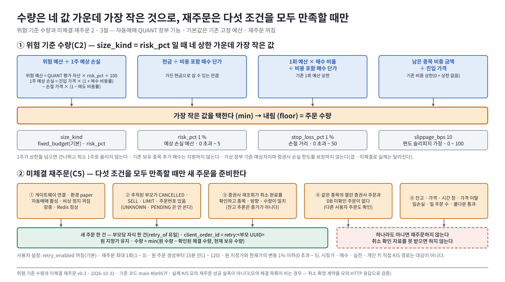

# 위험 기준 수량과 미체결 재주문 v0.3

| 문서 정보 | 내용 |
|---|---|
| **판 · 상태** | v0.3 · 기존 그림 유지 · 11/2 개인 KIS 모의 취소/재주문 Docker 반영 · 실제 취소 확인, 재주문 체결 미관측 · C4 API 계약 확인 대기 |
| **담당** | 오준영 |
| **최종 수정** | 2026-11-02 (KST) |
| **기준** | main `9b283b8` 위 PR #490 · 아래 3~5절은 10/14 게이트웨이 설계/검증 기록, 11/2 변경은 개정 이력 참조 |
| **관련** | [#162](https://github.com/EST-team-project/Qurious/issues/162) · [기존 위험 계층](자동매매-위험계층-손절.md) |

## 1. 결정과 범위

팀 합의 전에도 검토 가능한 구현을 먼저 만들었다. 기존 고정 예산·재주문 꺼짐이 기본값이며 운영 설정은 바꾸지 않았다. 자동매매 QUANT 장부 기능이다. PAPER 리밸런싱의 예약·시가 정산이나 실제 계좌 전체의 위험 예산으로 확대 해석하지 않는다.

| 항목 | 구현 | 아직 확인하지 않은 범위 |
|---|---|---|
| C2 | 비용 포함 위험 수량, 설정 저장·복원, 기존 예산·현금·비중 상한, 0주 허용 | 전략 명세 `size.kind`와 필드 통일, ATR·숏·추가 매수 |
| C5 | 게이트웨이 및 개인 KIS 모의 지정가 매도 잔량 재주문, 부모-자식 이력·멱등키. 개인 KIS 취소 확정 실측 | 실제 KIS 재주문 접수·체결 성공, 시장가·매수·실전, VI/정지 전용 판정 |
| C4 | 현재 연결 능력 API·화면 안내, 미지원 STOP 주문 거절, 공식 자료 확인 | 증권사 상주 감시·스탑지정가 실제 연동·모의 검증 |

**<그림 1> 수량은 네 값 가운데 가장 작은 것으로, 재주문은 다섯 조건을 모두 만족할 때만** · 파랑 = 수량의 네 상한 · 주황 = 가장 작은 값 · 초록 = 새 주문 · 빨강 점선 = 재주문하지 않는 경우



<sub>원본: [Figma · Qurious · 문서 그림 · 위험 기준 수량과 미체결 재주문 v0.3 · node 107:3](https://www.figma.com/design/6lstWS4YwuhJPhGB9XoBMD?node-id=107-3) · 그림 판 v0.3 · 기준 커밋 `40e957f` · 2026-10-31</sub>

## 2. C2 입력과 수량

`GET/POST /api/quant/settings.execution_policy` → `BrokerSettings.quant_execution_policy` JSONB에 저장한다. 기존 클라이언트가 이 필드를 생략하면 저장된 정책을 유지한다. 기존 DB 행의 `{}`는 아래 기본값으로 해석한다.

| 필드 | 기본값 | 의미·범위 |
|---|---:|---|
| `size_kind` | `fixed_budget` | `fixed_budget` 또는 `risk_pct` |
| `risk_pct` | 1 | QUANT 가상 평가 자산 대비 주문 하나의 예상 손실 예산 %, 0 초과~5 |
| `stop_loss_pct` | 1 | 진입 판단 가격 대비 손절 거리 %, 0 초과~50 |
| `slippage_bps` | 10 | 편도 슬리피지 **가정**, 0~100bp |

```
위험 예산 = QUANT 평가 자산 × risk_pct / 100
1주 예상 손실 = 진입 가격 × (1 + 매수 비용률) − 손절 가격 × (1 − 매도 비용률)
수량 = floor(min(위험 예산 / 1주 예상 손실,
                 현금 / 비용 포함 매수 단가,
                 1회 예산 × 매수 비율 / 비용 포함 매수 단가,
                 남은 종목 비중 금액 / 진입 가격))
```

기존 `trading_cost` 요율에 슬리피지 가정을 더한다. 비용표의 현행 법령·개별 계좌 일치 여부를 새로 검증한 것은 아니다. 비중 상한 0은 기존 의미대로 상한 없음이다. 1주가 상한을 넘으면 건너뛰며 최소 1주로 올리지 않는다. 기존 보유 종목 추가 매수는 평균단가와 손절 위험을 바꾸므로 지원하지 않는다.

위험 모드에서는 기존 QUANT 보유분도 평균매입가 대비 설정 거리에 도달하면 전량 매도 후보로 만든다. 따라서 보유 중 설정 변경은 기존 보유분에도 적용된다. 추적 종목의 가격·지표가 없으면 판단하지 못한다. 일손실·비상 정지·일 주문 수·쿨다운과 공격 모드의 사이클별 매도 수 상한을 우회하지 않는다. 공격 모드의 기존 익절·손절 조건도 함께 적용된다.

가상 장부를 기준으로 한 예상치이며 실제 증권사 손실 한도 보장이 아니다. 서버 사이클 사이 가격 변동·호가 보정·갭·미체결로 실제 결과가 달라진다. 기존 증권사 잔고와 가상 체결의 차이는 이 변경으로 해결되지 않는다.

## 3. C5 게이트웨이 재주문 계약 — 10/14 기준

| 필드 | 기본값 | 범위 |
|---|---:|---|
| `retry_enabled` | false | 사용자 선택 |
| `retry_max_attempts` | 1 | 원 주문 이후 최대 1~3회 |
| `retry_window_min` | 15 | **원 주문 생성부터** 1~120분 |
| `retry_price_deviation_pct` | 1 | 원 지정가와 현재가의 절대 변동률 상한, 0 초과~5% |

체결 확인 작업 뒤 다음 조건을 모두 만족할 때만 새 주문을 준비한다.

1. 게이트웨이 연결·환경 `paper`, 사용자 KIS `live` 경로·자동매매 활성·비상 정지 꺼짐·장중·Redis 정상. 여기서 `live`는 외부 주문 경로이며 증권사 환경은 반드시 모의다.
2. 추적된 부모가 `CANCELLED`, `SELL`, `LIMIT`, 주문번호 있음. `UNKNOWN`, `PENDING`, `CANCEL_REQUESTED`는 새 부모로 쓰지 않는다.
3. 증권사 재조회가 취소 완료를 확인하고 종목·방향·원 수량·체결 수량이 일치한다. 잔고 추론(`holdings_inference` 등)은 취소 증거로 인정하지 않는다.
4. 같은 종목의 열린 증권사 주문과 DB 미확인 주문 없음. 공유 게이트웨이 계좌 때문에 DB에서는 다른 사용자 주문도 확인한다.
5. 잔고·가격·시간 창·가격 이탈·일손실·일 주문 수·쿨다운 통과. 수량은 `min(원 주문 수량 − 확인된 체결 수량, 현재 보유 수량)`이며 원 지정가를 유지한다.

부모 행 잠금과 `retry_of` 유일 제약으로 부모당 자식 한 건만 저장한다. `client_order_id=retry:<부모 UUID>`를 고정하고 전송 전 이력을 커밋한다. 전송 전에 사용자 설정을 다시 읽는다. HTTP 전송 전에 `UNKNOWN`을 저장해 응답 유실 시 같은 주문을 같은 키로만 확인한다. 기능 해제·시간 만료·정지 상태에서는 그 재전송도 보류한다. 정상 중지와 이미 전송 중인 네트워크 요청 전체를 원자적으로 묶었다는 의미는 아니다.

준비(`PENDING`) 저장 뒤 전송 전에 프로세스가 중단되면 자동 추정 매칭·새 주문을 하지 않고 수동 확인을 기다린다. 가상 매도는 원래 사이클에서 이미 반영됐으므로 재주문에서 다시 장부를 차감하지 않는다. 실패는 주문 메시지와 작업 로그에 남는다.

**적용 경계:** 개인 키 직접 KIS 경로는 이 주문 추적 재주문을 지원하지 않는다. 기존 ADR에 따라 공유 게이트웨이를 자동으로 켜지 않았다. 시장가는 기록 가격이 0이어서 가격 이탈을 검증할 수 없으므로 제외했다. 공격 모드의 기본 시장가 주문도 대상이 아니다.

**모의 환경 제약:** [현재 게이트웨이 계약](../../../common/02-design/contracts/kis-autotrade-api.md)은 KIS 모의 체결 목록이 비고 잔고 추정으로 확인하는 경우를 명시한다. 따라서 이번 시험은 모의 HTTP 응답으로 취소 확정 계약을 검증한 것이며, 실제 KIS 모의 재주문 성공 실측이 아니다. 취소 확인 자료를 못 받으면 재주문하지 않는다.

재주문을 켜도 자동 취소는 켜지지 않는다(기존 자동 취소 기본 0). 기본 쿨다운 30분이 재주문 시간 창 15분보다 길면 재주문할 수 없다. 사용자가 지정한 중지·한도를 우선하는 의도적 동작이다. 수동 취소도 다른 조건을 충족하면 대상이므로 재주문을 원치 않으면 기능 또는 자동매매를 먼저 끈다.

## 4. C4 공식 자료 확인

2026-10-14 조회. 증권사 기능의 존재와 우리 코드 연결 여부를 구분한다.

| 경로 | 확인한 사실 | 이번 결론 |
|---|---|---|
| [KIS 공식 현금 주문 예제](https://github.com/koreainvestment/open-trading-api/blob/main/examples_llm/domestic_stock/order_cash/order_cash.py) | `cndt_pric`/`CNDT_PRIC`를 스탑지정가 조건가격으로 설명하며 real/demo 분기를 둠 | 조건가격 필드 존재 확인. 해당 주문 구분 코드·모의 허용·서버 감시 지속 조건까지 입증된 것은 아님 |
| [키움 영웅문4 0624 도움말](https://download.kiwoom.com/hero4_help_new/0624.htm) | 서버 자동감시와 HTS 종료 후 감시·최대 90일 안내. 현재 원문은 잔고편입 자동매도 조건도 최대 90일이라고 명시 | HTS 기능 근거이며 우리 REST 어댑터·모의 계좌 지원 근거로 쓰지 않음 |
| 현재 공통/게이트웨이 연동 | 일반 시장가·지정가 주문, 감시 등록/해제 계약 없음 | `broker_hosted_stop=false`; STOP 종류 요청은 명시적으로 거절 |

현재는 서버 주기 판단을 유지한다. 증권사 감시 연동은 지원 코드·환경·감시 등록/취소·만료·재접속 조회·발동 후 주문번호 연결을 확인한 뒤 별도 어댑터 계약으로 추가해야 한다. 확인되지 않은 주문 코드를 추정해 전송하지 않았다.

## 5. 게이트웨이 검증·적용 — 10/14 기록

- 관련 pytest 135건(이번 신규 50건): 계산 상한·0주·비용, 실제 자동매매 사이클, 기존 설정 호환, PG 부모 잠금·중복 방지·부분체결·보유 잔량, 중지 재확인, 동일 멱등키 복구·기능 해제 차단.
- Chromium 설정 화면 3흐름: 기본값·지원 안내, 저장 요청, 저장값 복원. 증권사 API는 호출하지 않음.
- 일회용 PostgreSQL에서 전체 마이그레이션 `upgrade head`, 새 revision `downgrade 0021` → `upgrade head`, 정책 기본값·새 세션 저장값 확인.
- 이전 위험 안내/비상 정지 브라우저 시험은 별도 `scripts/check_risk_ui.py`로 유지.
- 배포 시 **`0022_execution_policy` 이전이 먼저 필요**하다. 기본값은 고정 예산·재주문 꺼짐. 운영 DB 이전·설정 변경·실주문은 하지 않았다.

재현: `tests/test_execution_policy.py`, `test_order_retry.py`, `test_risk_execution.py`, `test_live_order_gateway_path.py`, `test_aggressive_mode.py`, `test_risk_guard.py`, `test_risk_guard_boundaries.py`, `test_stock_coin_trade_gateway.py`, `test_backtest_costs.py`; `scripts/check_execution_policy_ui.py`.

## 6. 구현 후 의견을 받을 항목

- 신장환: 내부 `execution_policy.size_kind=risk_pct`를 전략 명세 `size.kind`와 매핑하는 안, QUANT 가상 자산 기준·첫 진입만·기본 1%/1%·비용 10bp 가정 유지 여부.
- 강민석: 원 주문-재주문 체인과 실체결 자료를 활용한 계획 대비 실제 손실 지표 연결. 이번에 성과 지표는 추가하지 않음.
- 이동원·팀: 화면·학습에서 가상 위험 예산/보장 아님/주기 판단 설명 통일, 상주 감시 주문을 별도 연동 항목으로 두는 안.
- 팀: 실측 가능한 취소 확인 응답 계약 확보 후 모의 검증 → 시장가 가격 기준 저장 → 개인 키 직접 KIS 추적 확장 순서에 대한 의견.

## 7. #183 의견 반영 — 감시 주체와 발동 후 추적

우리 기능은 **서비스 서버의 주기 판단**이다. 서버가 멈추면 판단도 멈추고, 주기 사이 가격 움직임을 막지 못한다. 기본은 600초지만 화면은 설정된 주기를 표시한다. 거래소의 스톱지정가 호가, 증권사 서버 자동감시, 사용자 PC의 HTS 감시, 서비스 서버의 주기 판단을 같은 기능으로 부르지 않는다. 거래소 호가 지원이 증권사 상주 감시·모의 지원을 증명하지 않는다.

키움 공식 [0624 도움말](https://download.kiwoom.com/hero4_help_new/0624.htm)을 2026-10-14 재확인했다. 3절은 감시조건 유효기간 및 잔고편입 자동매도 조건을 최대 90일로 설명한다. 기존 v0.1의 30일은 정정한다. 도움말 4절은 조건 충족 후 주문 실행 시 감시조건이 삭제되므로 자동주문내역에서 주문을 확인하라고 안내한다.

향후 감시 어댑터의 연결 계약은 다음과 같다(현재 미구현, 이번 DB 필드나 실제 주문 지원으로 간주하지 않음).

1. 등록 시 사용자·증권사·모의/실전 계좌·감시 조건 ID·조건 버전·등록/만료 시각을 보관한다.
2. 발동 시 감시 조건 ID와 발동 식별자를 증권사 주문번호에 연결한다. 종목·방향·수량만으로 다른 주문을 추정 연결하지 않는다.
3. 조건이 목록에서 사라져도 체결 완료로 취급하지 않는다. 만료·삭제·발동을 구분하고 발동 주문은 주문번호로 조회한다.
4. 주문번호 조회가 불가능하면 확인 대기로 남기고 새 주문을 만들지 않는다. 감시 재등록이나 C5 재주문으로 원 주문을 중복시키지 않는다.
5. 조건 삭제/만료와 이미 발동한 주문 취소는 별도 동작이다. 재접속 후 조건 이력과 주문·부분체결·취소 상태를 대조한다.

2차에는 현재 주기 판단 안내를 유지한다. 상주 감시 연동은 위 계약·모의 지원을 확인한 뒤 별도 구현한다. 개념 학습 F13/F01·용어는 이동원 작업, C1002 주문 안전은 같은 용어를 사용한다. 증권사 모의 환경 논의는 #152이며 #151은 시장 범위 논의다.

개정: v0.2 (2026-10-14) — #183 의견에 따른 90일 정정·발동 주문 추적 계약 추가. 실행 정책 변경 없음.

---

## 개정 이력

### 2026-11-02 장 마감 후 — C4 지원 조사·C5 다음 시험 준비

- 한국투자증권 공식 [주식 서버자동(STOP) 주문 0954](https://www.truefriend.com/plus_help/0954.html)는 HTS 종료 후 서버 감시·최장 30일·조건 중지/삭제·발동 주문 조회 기능을 설명한다. **한국투자 HTS에 기능이 있다는 근거**이며 키움 0624의 90일과 구분한다. 이 문서에는 공개 REST 등록/해제 endpoint나 모의 지원 계약이 없다.
- [KIS Open API 목록](https://apiportal.koreainvestment.com/apiservice-apiservice)과 [공식 국내주식 예제 156개 디렉터리](https://github.com/koreainvestment/open-trading-api/tree/main/examples_llm/domestic_stock)를 조사했다. 현금·신용·정정취소·예약주문은 있으나 0954 감시 조건의 등록/중지/삭제/만료/발동 주문 연결 API는 확인하지 못했다. `psearch_title/result`는 조건검색 목록/종목 조회이며 계좌 감시 주문 등록 근거가 아니다. 공개 자료에서 못 찾은 결과를 증권사 전체의 미지원 확정으로 표현하지 않는다.
- C4 상태는 **HTS 기능 존재 확인 / 공개 API·모의 지원 미확인 / 앱 연동 미구현**이다. `CNDT_PRIC`를 넣은 현금 주문이나 우리 서버 주기 판단을 상주 감시 구현으로 대체하지 않는다. `broker_hosted_stop=false` 유지.
- 공식 지원 확인에 필요한 질의: ① 개인 Open API가 0954 조건 등록/중지/삭제/조회에 접근 가능한지 ② Testbed 지원 여부·TR ID/URL ③ 조건 ID·기간·만료/발동 구분 ④ 발동 조건 ID와 실제 주문번호 연결 ⑤ 응답 유실 때 등록 중복 방지·재접속 조회. 외부 고객센터 문의는 아직 발송하지 않았다. 이 계약 확보 후에만 어댑터 구현·장중 실측 일정을 확정한다.
- C5의 [다음 시험 절차](../../04-testing/KIS-잔량재주문-재시험.md)와 `scripts/kis_recovery_trial.py`를 추가했다. 당일 새 취소 매도만 받으며 기본 조회, 1주·쿨다운 30분·최대 1회·가격 이탈 1%를 고정한다. 재주문 직전에만 창을 45분으로 변경하고 독립 종료 감시·기한·영구 기록으로 원복한다. 실제 재주문 성공이나 내일 자동 예약을 의미하지 않는다.

### 2026-11-02 — 개인 KIS 모의 취소·재주문 확장 (#183)

- 기존 게이트웨이 경로와 별도로 `kis_order_recovery`가 개인 KIS 모의 지정가 주문을 처리한다. 주문 목록의 본인 주문에만 미체결 잔량 취소·취소 잔량 재주문 버튼을 표시한다. `POST /api/quant/kis/orders/{id}/cancel|retry`도 인증한 사용자 소유권을 확인한다.
- 취소는 원 주문의 날짜·계좌·주문번호·종목·방향·수량, 증권사 잔량, 원 접수 응답의 주문조직번호를 확인한다. `0041_broker_cancel`에 요청을 먼저 저장하고 한 번만 전송한다. 응답 유실은 UNKNOWN으로 보존하며 접수 응답을 취소 확정으로 보지 않는다. 비상 정지는 신규 재주문을 막지만 명시적 취소 요청은 허용한다.
- 재주문은 증권사의 취소 여부·잔량 0·원 수량·체결 수량을 다시 확인한다. 취소 확인 수량이 제공되면 원 잔량과도 맞아야 한다. 누락되거나 잘못된 숫자를 0으로 간주해 새 주문을 내지 않는다. 부분 취소 뒤 열린 잔량이 있으면 재주문하지 않는다.
- 수량은 원 미체결 잔량·해당 전략의 확정 보유·실제 계좌 보유 중 최솟값이며 원 지정가를 보존한다. 공통 계좌 잠금·영속 의도·일손실·일 주문 수·쿨다운·비상 정지와 기존 재주문 횟수·시간·가격 이탈 한도를 적용한다. 부모당 자식 한 건을 전송 전 저장하며 응답 불명은 재전송하지 않는다.
- 명시적 버튼 요청은 선택한 주문의 1회 요청이다. 자동매매나 자동 재주문 설정을 켜지 않는다. 기존 `quant.confirm_fills` 뒤 자동 재주문은 자동 실행 ON·KIS 연동 모드·재주문 설정 ON·현재 선택 전략 일치 조건을 모두 요구한다. 기본값은 OFF다.
- 현재 사용자 설정의 같은 방향 쿨다운 30분과 재주문 창 15분은 충돌한다. 그 사실을 화면에 표시하고 임의로 한도를 낮추지 않는다. 사용자는 실제 모의 시험 동안 창만 45분으로 늘린 후 원복하는 데 동의했다. 실제 실행 결과는 담당 일정표의 후속 기록을 따른다.
- 개인 C5의 취소·재주문 시간은 기존 게이트웨이 C5와 같은 KRX 정규장 09:00~15:30이다. 확인된 거래일 달력과 시장 시간 검사를 함께 적용한다. 15:20~15:30은 종가 단일가 구간으로 접수와 체결을 구분한다. 신규 수동 주문/준비 시험의 15:20 마감은 유지한다. 근거: [KRX 정규장 시간](https://global.krx.co.kr/contents/GLB/06/0602/0602010201/GLB0602010201T1.jsp).
- 격리 PG/Redis의 부분체결 잔량·타인 주문·동시 요청·응답 유실·설정 변경·한도 검사와 기존 KIS 회귀를 검증한다. 실제 증권사 시험과 합성 응답 시험은 별개다.

**C4는 별도다.** 11/2 다시 확인한 [KIS 공식 현금 주문 예제](https://github.com/koreainvestment/open-trading-api/blob/main/examples_llm/domestic_stock/order_cash/order_cash.py)의 `CNDT_PRIC`는 스탑지정가 조건가격이다. [키움 0624 공식 도움말](https://download.kiwoom.com/hero4_help_new/0624.htm)은 증권사 서버 자동감시 기능을 설명한다. 이 둘만으로 개인 KIS 모의 API의 감시 조건 등록·삭제·만료·발동 주문번호 조회 계약을 확인할 수 없다. 따라서 `broker_hosted_stop=false`를 유지한다. 서비스 서버의 주기 판단이나 PAPER 스탑 구현을 증권사 상주 감시 완료로 표시하지 않는다.

취소/조회 필드 근거: [KIS 공식 정정취소 예제](https://github.com/koreainvestment/open-trading-api/blob/main/examples_llm/domestic_stock/order_rvsecncl/order_rvsecncl.py), [일별 주문체결 필드](https://github.com/koreainvestment/open-trading-api/blob/main/examples_llm/domestic_stock/inquire_daily_ccld/chk_inquire_daily_ccld.py). 11/2 실제 KIS 모의 취소에서 원 주문은 `cncl_yn=N`을 유지하고 `cncl_cfrm_qty=1`, `rmn_qty=0`을 반환했다. 별도 취소 접수 행은 `cncl_yn=Y`, `orgn_odno=원 주문번호`였다. 원 주문의 취소 확정 수량+체결 수량+남은 수량이 원 수량과 일치해야 하며, 잔량이 0이고 취소 확정 수량이 원 미체결 잔량과 같을 때 취소 완료로 처리한다. 구 문서의 `cnc_cfrm_qty`도 지원하되 두 필드의 충돌·음수·빈 값은 추정하지 않는다. 별도 취소 행을 열린 매도 주문으로 세지 않는다. 실제 응답에 개인정보가 포함돼 있어 원문 대신 필요한 수량 필드만 격리 증거에 남겼다.

| 판 | 날짜 | 바뀐 것 | 까닭 | 근거 |
|---|---|---|---|---|
| v0.3 | 2026-10-31 | 1절 끝에 Figma 그림 한 장(<그림 1> 위험 기준 수량의 네 상한 · 재주문 다섯 조건) — 내용은 v0.2 와 같다 | 그림이 0장이던 설계서에 핵심 그림을 넣는다 | [그림 대장](../../00-management/standards/문서그림지침.md) <표 5> |
| v0.2 | 2026-10-14 | #183 의견 반영 · 선택 기능 구현 · 격리 시험, 팀 의견 요청 · 운영 적용 전 | 위험 기준 수량(C2) · 미체결 재주문(C5) · 연결 능력 안내(C4) | [지난판 v0.2](지난판/위험기준수량-미체결재주문_v0.2.md) |
