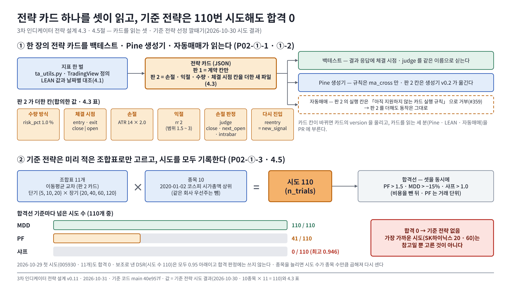

# 3차 인디케이터 전략 설계서 v0.11 — 기본 인디케이터 전략 · 커스텀 인디케이터 — Qurious

| 문서 정보 | |
|---|---|
| **판 · 상태** | v0.11 · 4절 머리에 Figma 그림 한 장(<그림 1>) — 내용은 v0.10 과 같다 · 초안(검토 전) — 요구 대장 · 결정 대장 · 이슈에서 이미 정했거나 약속한 설계만 적었다. 확인 중인 물음은 8절에 두고, 정해지면 판을 올려 본문에 적는다 |
| **구분** | 6. 시스템 설계 — 설계 문서(3차 목표 기능 ① 기본 인디케이터 전략 설계 · ② 커스텀 인디케이터) |
| **작성** | 신장환(주담당 · `P02-①-1~3` · `P02-②-1~3` · `U6` · `U7`) |
| **검토** | 검토 전 — 부담당 강민석 |
| **최종 수정** | 2026-10-31 (KST) |
| **기준** | 코드 `main` `2479c12` · 요구 대장(`docs/phase-3/01-analysis/requirements/대장/요구-대장.tsv`) 16 ~ 21 · 36 · 37줄 · 시험-요구 대장 · #314 답(2026-10-22 · 2026-10-27) |
| **관련 문서** | [프로젝트 계획서](../../00-management/plans/프로젝트계획서.md) 4.3 · [기능 설계서](기능설계.md) `P02-①-2` · 8절 · [논의 결정 대장](../../00-management/plans/논의결정대장.md) D6 · [KIS 자동매매 연동 API 계약](../../../common/02-design/contracts/kis-autotrade-api.md) 1절 · [2차 설계서 v0.6](목표기능2-패턴예측-XAI-설계.md) · [신장환 작업 계획](../../00-management/plans/신장환파트-할일.md) · 이슈 #159 · #161 · #170 · #183 · #197 · #243 · #314 · #333 · #347 |

---

## 요약

1. **지표** — 2차에 TradingView 정의로 맞춘 지표 한 벌(`ta_utils.py`)을 그대로 쓰고 DMI(ADX · +DI · −DI) · 상대 강도를 더했다(#197). LEAN 지표 값과 날짜별로 대조했다(`P02-①-1` · 4.1). 지표 함수는 t 시점 값을 t 까지의 자료로만 계산하고 새 봉 하나로 이어서 갱신한다(`P02-②-2` · ★ 채점 항목).
2. **전략** — 매수 · 매도 조건 · 손절 · 익절 · 수량 방식 · 체결 시점을 **전략 카드** 하나에 적고, 백테스트 · Pine 생성기 · 자동매매가 같은 카드를 읽는다(`P02-①-2`). 연결 시험용 판 1 은 지금 계약 칸만 썼다. 판 2 는 손절 · 익절 · 수량 · 체결 시점 칸을 더한 새 파일이고, #314(10-27)에서 여쭌 다섯 가지 가운데 ② ~ ④ 는 강민석 님이 동의했고 ① · ⑤ 는 반대 없이 판 2 로 머지됐다(#353). 백테스트 결과 응답에 손절 판정(`judge`)을 싣는다.
3. **커스텀 지표** — 이미 있는 자유 산식 · 판 저장을 바탕으로 정규화 산식과 판 다시 계산을 지킨다(`P02-②-1` · `②-3`).
4. **기준 전략** — 미리 적은 조합표만 백테스트하고 시도를 모두 기록해 고른다(`P02-①-3`).
5. **화면** — 전략 카드 편집(`U6`)과 지표 차트(`U7`), 기본 인디케이터 화면의 표시 고침(B1 ~ B3).

---

## 1. 맥락

3차 주제는 「나만의 투자 인디케이터」 다(10-22 ~ 11-11 · 기능 개발 마감 11-05). 목표 기능 ① 기본 인디케이터 전략 설계 · ② 커스텀 인디케이터의 주담당이 신장환, 부담당이 강민석이다(계획서 4.3 표 6 · 2026-10-01 확정). 규칙 명세(전략 카드)는 신장환이 정한다 — 강민석 님 「규칙 명세는 신장환 님 정의를 따르겠습니다」(#159) · 이동원 님 3차 할 일 278 · 384줄.

**2차에서 받는 것**

| 2차에 만든 것 | 3차에서 |
|---|---|
| 지표 정의 한 벌 — RSI · ATR Wilder 평활 · 볼린저 모집단 표준편차 · TradingView 화면 값 대조 차 0.00(2차 설계서 3.9) | 4.1 의 바탕 |
| 미래 참조 시험(`tests/test_ta_utils_lookahead.py` · TC-LA) | 4.2 에서 넓힘 |
| 성과 검증의 규칙 설명(전략 조건마다 충족 여부) | 카드의 조건마다 같은 꼴로 설명 |
| 패턴 화면 차트(TradingView Lightweight Charts) | `U7` 지표 차트의 바탕 |

---

## 2. 목표 · 비목표

**목표 (요구 대장 그대로 요지)**

| 요구 | 완료 기준 | 요구 대장의 시험 |
|---|---|---|
| `P02-①-1` 기본 지표 | 같은 OHLCV 에서 우리 지표 값과 LEAN 지표 값이 정한 오차 안에서 같다 | TC-IN |
| `P02-①-2` 규칙 설계 | 조건 조합 · 손절 · 익절 · 포지션 크기를 규칙 명세(JSON) 하나로 적고, 백테스트 · Pine 생성 · 자동매매가 같은 명세를 읽는다 | TC-CRD(2026-10-23 이동원 님이 TC-RL 에서 바꿈) |
| `P02-①-3` 기준 전략 선정 | 미리 적은 조합표(상한 있음)만 백테스트하고 모든 시도를 기록한 뒤 기준 전략을 고른다 | TC-BSL(같은 날 TC-GS 에서 바꿈) |
| `P02-②-1` 커스텀 산식 | 여러 지표를 정규화(z점수 · 백분위)해 합친 커스텀 지표가 같은 입력에 같은 값을 낸다 | TC-IN |
| `P02-②-2` 미래 안 보는 지표 함수 ★ | t 시점 값을 t 까지의 데이터로만 계산하고, 새 봉 하나로 이어서 갱신되며, 단위 시험이 붙어 있다 · 미래 참조 시험 0건 | TC-LA |
| `P02-②-3` 지표 API · 판 | 커스텀 지표를 API 로 부를 수 있고, 산식이 바뀌면 새 판으로 저장되며 옛 판도 다시 계산할 수 있다 | TC-VR |
| `U6` 전략 설정 | 조건 · 손절 · 익절 · 포지션 크기를 편집해 규칙 명세로 저장한다 | 시연 |
| `U7` 지표 차트 | 가격 차트 위에 지표와 매수 · 매도 신호를 그리고 데이터 기준일을 표시한다 | 시연 |

**비목표 — 이 기능이 하지 않는 것** · 팀 결정 · 요구 · 규칙 · 사실에 근거가 있는 것만 적었다

| 하지 않는 것 | 근거 |
|---|---|
| 파이썬 · Pine 코드를 그대로 받아 전략으로 쓰기 | 기능 설계서 `P02-①-2` 「조건은 C2 지표와 비교 연산만(임의 코드 없음)」 |
| 조합표 밖 파라미터 탐색 | 요구 `P02-①-3` 완료 기준 「미리 적은 조합표(상한 있음)만 백테스트」 |
| 수급(외국인 · 기관) 지표 | 결정 대장 D6 ⑥ — 3차 범위에서 뺀다(확정) |
| 손절 · 익절의 체결 보장 | 판정 방식의 성질 — 갭 하락이면 손절가보다 더 잃는다(#159 가상 종목 A) |
| 계약 파일 고치기 | 강사님 원본과 바이트까지 같게 두는 자리(docs README 3.3절 · 코딩표준 1절) |

Pine 코드 생성(③) · LEAN 실행 · 대사(④) · 증권사 주문 · 수량 계산(⑤)은 각 주담당 몫이고, 이 문서는 그쪽이 읽을 카드와 지표 값까지다.

---

## 3. 지금 상태 (main `82bf3d7`)

**표 1. 지금 「지표 → 전략 판단」 이 있는 곳**

| 곳 | API · 코드 | 손절 · 익절 · 크기 |
|---|---|---|
| 기본 인디케이터 전략 화면 | `/api/stocks/quant/indicators` · `stock.py` `_generate_signal`(RSI 30 아래 +2 · 이평 ±1 · 볼린저 하단 +1) | 없음 |
| 커스텀 인디케이터 개발 · 성과 검증 화면 | `/api/quant/pipeline` · `quant_pipeline.py` | 손절 · 익절 **% 만**(`apply_stops`) · 체결 시점 `entry_mode` · `exit_mode`(close · open) · 크기 없음 |
| 자유 산식 지표 화면 | `/api/formula-indicators` · `formula.py`(AST 화이트리스트 · `shift` 는 과거만) | 없음 · 판 저장 있음 |
| 자동매매가 읽는 전략 스펙 | 계약 v0.5 1절 · `strategy_loader.py` → `auto_trade.py` `apply_strategy_spec_to_signal`(지표 규칙 `ma_cross` · `momentum`) | `position_sizing` 은 `max_symbols` 만 읽음 · 손절 · 익절 칸 없음 |

같은 지표 값을 곳마다 다른 규칙으로 읽고(#213), 손절 · 익절 · 위험 기준 크기를 한곳에 적은 명세가 없다. 기능 설계서 `P02-①-2` 의 「청산 규칙 0」 과 같다.

---

## 4. 설계

**<그림 1> 전략 카드 하나를 셋이 읽고, 기준 전략은 110번 시도해도 합격 0** · 파랑 = 지표 · Pine · 입력 · 초록 = 백테스트 · 주황 = 전략 카드 · 점선 = 판 2 실행 칸을 거부하는 쪽 · 빨강 = 합격 0(숫자는 10-30 시도 결과)

원본: [Figma · Qurious · 문서 그림 · 인디케이터 전략 설계 v0.11 · node 104:3](https://www.figma.com/design/6lstWS4YwuhJPhGB9XoBMD?node-id=104-3) · 그림 판 v0.11 · 기준 커밋 `40e957f` · 2026-10-31

### 4.1 지표 — 정의 한 벌 · LEAN 대조 (`P02-①-1`)

- 기본 지표(이동평균 · RSI · MACD · 볼린저 · ATR)는 `ta_utils` 하나로 계산한다. TradingView 정의(RSI · ATR = Wilder 평활 · 표준편차 = 모집단)이고, 2차에 TradingView 화면 값과 5일 대조 차 0.00 이었다(2차 설계서 3.9).
- 3차에 같은 모듈에 두 함수를 더했다(#197 3). 기존 함수 · 정의 판(`tv-2026`)은 그대로다.
  - `dmi` — TradingView 내장 DMI 식(기본 14 · 14). 고가 상승폭과 저가 하락폭이 같은 날(동률)은 +DM · −DM 둘 다 0 이다. TradingView 화면 값(005930 일봉 · 2024-10-17 · 10-18 · 2026-08-03 · 08-06 · 08-13 · 08-21 · 08-31)과 ADX · +DI · −DI 21개가 소수 넷째 자리까지 같다 — 동률 날인 2024-10-17 을 포함한다(TC-IN `test_dmi_matches_tradingview_screen`).
  - `relative_strength` — (종목 ÷ 기준선) 의 n봉 변화율. 기준선은 부르는 쪽이 고른다(시장 지수 코스피 · 코스닥부터). 기준선이 빈 날은 빈 값으로 두고 앞 값으로 채우지 않는다.
- LEAN 대조는 `scripts/indicator_lean_scan.py` 로 한다. 같은 일봉(수집 DB)을 LEAN 도커(강민석 님이 #314 에 적은 이미지 판)에 넣어 날짜별 지표를 뽑고 우리 값과 맞댄다. 지금 앱의 LEAN 연결(`lean_backtest.py`)은 전략 수익률용이라 지표 값을 내지 않아 따로 두었다. 스크립트는 합격 · 불합격을 판정하지 않고 차이만 보인다 — 「정한 오차」 숫자는 8절 ③.

**표 1. LEAN 지표 대조** — 005930 일봉 · 2024-09-02 ~ 2026-08-31 · 483봉 · 2026-10-26(SMA 60 은 2026-10-27 더함)

| 지표 | 처음 값이 나온 날 | 최대 절대 차 | 차가 난 까닭 |
|---|---|--:|---|
| RSI 14 · ATR 14 · 볼린저 20 · 2 · SMA 20 · SMA 60 · −DI 14 | 같은 날 | 1.5e-10 이하 | 소수 계산 반올림 수준(상대 차 1e-13 이하) — 정의가 같다 |
| +DI 14 · ADX 14 | 같은 날 | +DI 1.37 · ADX 1.40 | 동률 4일(2024-10-17 · 12-16 · 12-26 · 2026-01-14)에 LEAN 은 +DM 에 넣는다. 평활로 줄어 2026-03-24 뒤로는 0.01 아래 |
| EMA 20 · MACD 12 · 26 · 9 | 우리 첫 봉 · LEAN 20 · 34번째 봉 | EMA 264 · MACD 95(LEAN 첫 값 날) | 시작값 — 우리는 첫 봉 값에서, LEAN 은 처음 n개 단순평균에서 시작한다. LEAN 식으로 시작해 셈하면 차 1.7e-10. 차는 줄어 EMA 2025-07-22 · MACD 2025-10-30 뒤로는 1e-6 아래 |

EMA 의 시작값 차이는 자료 첫머리에서만 나서, 아주 오래전부터 계산하는 TradingView 화면 값으로는 가릴 수 없다.

**표 2. 값이 처음 나오는 봉(warm-up)** — 시험 TC-IN `test_first_value_bar`

| 지표 | 처음 나오는 봉 | 까닭 | 정의 출처(원 정의 · 값을 대조한 TradingView 내장) |
|---|---|---|---|
| SMA 20 · 볼린저 20 | 20번째 | 창 20봉 | 볼린저 — John Bollinger · `ta.bb`(표준편차 = 모집단) |
| SMA 60 | 60번째 | 창 60봉 — 판 2 카드의 `warmup_bars` | 단순 이동평균 · `ta.sma` |
| ATR 14 | 14번째 | 첫 봉의 TR = 고가 − 저가 | Wilder(1978) · `ta.atr`(Wilder 평활) |
| RSI 14 · +DI · −DI 14 | 15번째 | 첫 봉은 전날과의 차가 없다 | Wilder(1978) · `ta.rsi` · `ta.dmi` |
| ADX 14 · 14 | 28번째 | ±DI 위에 한 번 더 평활 | Wilder(1978) · `ta.dmi` |
| 상대 강도 n | n + 1번째 | 기준선이 빈 날이 있으면 그만큼 늦다 | 우리 정의(#197 3) — 종목 ÷ 기준선의 n봉 변화율 |
| EMA · MACD | 첫 봉 | 값은 바로 나오지만 시작값의 영향이 남는다(표 1) | MACD — Gerald Appel · `ta.ema` · `ta.macd` |

기간 기본값(RSI 14 · MACD 12 · 26 · 9 · ATR 14 · 볼린저 20 · 2)은 원 정의와 TradingView 내장 기본값을 따른다. 특강 슬라이드는 정의 근거로 쓰지 않는다(#363).

### 4.2 지표 함수 규격 (`P02-②-2` ★)

| 규칙 | 내용 | 시험 |
|---|---|---|
| 미래 안 보기 | 날 t 의 값은 t 까지의 봉만 쓴다 — 뒤 봉을 바꿔도 앞 값이 같다 | TC-LA(`tests/test_ta_utils_lookahead.py` · 이미 있음) |
| 이어서 갱신 | 새 봉 하나를 붙여 다시 계산하면 앞 값은 그대로이고, 새 값 = 전체를 한 번에 계산한 값 | TC-LA `test_one_new_bar_matches_full_recompute`(지표 15개) |
| 빈 봉 | 중간에 값이 없는 봉이 있어도 그 앞 값은 그대로이고, 창이 지나면 값이 다시 나온다 | TC-LA `test_missing_bar_keeps_past_and_recovers`(지표 15개) |
| 정의 한 벌 | 기본 지표는 `ta_utils` 하나 | TC-IN |
| 같은 입력 같은 값 | 커스텀 산식도 같다(`P02-②-1`) | TC-IN |

미래 안 보기 시험은 v0.3 에 종가 지표 10개로 넓혔고, 고가 · 저가 · 기준선을 쓰는 ATR · DMI · 상대 강도는 「이어서 갱신」 시험이 앞 값 그대로를 함께 본다. 빈 봉 자리의 값은 지표마다 다르다 — EMA · MACD · DMI 는 앞 값을 잇고, SMA · 볼린저는 창이 지날 때까지 비운다. 자유 산식 DSL 은 문법에서 미래 참조를 막는다(`shift` 양수만 · `formula.py` 머리말). 남은 것은 시험 하나로 기본 지표 · 커스텀 산식을 함께 지키는 일이다.

### 4.3 전략 카드 (`P02-①-2`)

**판 1 — 계약 칸만(10/27 연결 시험용).** 계약 v0.5 1절의 칸만 쓴 고정 입력이다. 합격 판정을 받은 전략이 아니라 `backtest_result` · `acceptance` 는 넣지 않았다. 파일: [`예시/strategy-card-ma-cross-v1.json`](예시/strategy-card-ma-cross-v1.json). `apply_strategy_spec_to_signal` 에 넣으면 20일선이 60일선 위에 있는 종가마다 「매수」, 아래에 있는 종가마다 「매도」 가 나온다(2026-10-22 실행). 교차하는 순간이 아니라 두 선의 위아래를 보는 상태 판정이다(`auto_trade.py` 482 ~ 487 · #314 이동원 님 대조).

**판 2 — 손절 · 익절 · 수량 · 체결 시점(#314 2026-10-27).** 파일: [`예시/strategy-card-ma-cross-v2.json`](예시/strategy-card-ma-cross-v2.json). 판 1 의 칸과 값은 그대로 두고 아래 칸을 더했다. 그림자 일지(#333)가 판 1 파일 내용을 판 지문으로 읽어, 판 1 파일은 고치지 않고 새 파일로 만들었다. 판 2 를 `apply_strategy_spec_to_signal` 에 넣으면 판 1 과 같은 매수 · 매도 판단이 나온다(005930 2년 일봉 · TC-CRD).

| 칸 | 자리 · 값 | 상태 · 출처 |
|---|---|---|
| 수량 방식 | `position_sizing.size_kind` = `risk_pct` · `fixed_budget` / `risk_pct` = 1.0(%) — 위험 금액은 상한이라 현금 · 1회 예산 · 종목 비중이 더 작으면 그쪽이 수량을 정하고, 첫 진입만 한다 | 값은 **합의**(#161 A1 · #183) · 이름은 **이동원 님 받음 · 오준영 님 동의**(#314 2026-10-28)(오준영 님 `execution_policy.py` 12 · 13줄을 따름) |
| 체결 시점 | `entry_mode` · `exit_mode` = `close` · `open` | 값은 **합의**(#161 Q1 · Q2 · 같은 뜻의 `entry` = `close` · `next_open`) · 이름은 **이동원 님 받음 · 오준영 님 동의**(#314 2026-10-28)(강민석 님 `quant_pipeline.py` 298 · 314줄을 따름) |
| 손절 | `stops.stop_kind` = `atr` · `pct` / `atr_period` 14 · `atr_mult` 2.0 — 손절선 = 진입 체결가 − 2 × ATR | 값은 **합의**(#161 A1 · A2 · #159 T2 · #183) · 이름은 **이동원 님 받음 · 오준영 님 동의**(#314 2026-10-28) · 기준 가격(진입 체결가)은 #314(2026-10-22 3절) |
| 익절 | `stops.take_kind` = `rr` / `take_rr` 1.5 ~ 3 · 기본값 2 — 익절선 = 진입 체결가 + `take_rr` × 손절 거리 | 범위는 **합의**(#159 T2 · 강민석 님 의견) · 기본값 2 는 **이동원 님 받음 · 오준영 님 동의**(#314 2026-10-28 · #161 · #159 에 1.5 로 적었던 것을 #314 에서 바로잡음) |
| 손절 판정 | `stops.judge` = `close` · `next_open` · `intrabar` — 무엇으로 판정하나(체결 시점은 `exit_mode`) | **합의**(#161 · 강민석 님 의견으로 셋) |
| ATR 고정 | `stops.lock` = `entry` — 진입 때 정하고 보유 중 고정 | **합의**(#161 A1 · 이견 없음) · 「보유 중 고정」 은 #183 에서 드린 의견 |
| 다시 진입 | `reentry` = `new_signal` — 청산 뒤 매수 조건이 계속 참이면 다시 사지 않고, 한 번 풀린 뒤 다시 참이 될 때 산다. 처음 실행(앞선 청산 기록이 없을 때) 이미 매수 조건이면 진입한다(`warmup_bars` 가 차고 ATR 이 값을 낼 때). 재시작 때 청산 기록을 이어받으면 대기도 이어진다 | **합의**(#161 A1 · 이견 없음) · 처음 실행은 #314(2026-10-28 오준영 님 물음 · 답) · 백테스트(`quant_pipeline.py` 260 · 267 ~ 270줄) · Pine 생성기 v0.2 와 같음 |
| ① 칸 자리 | `entry_mode` · `exit_mode` · `reentry` 는 맨 위 · `judge` · `lock` 은 `stops` 아래 · `size_kind` · `risk_pct` 는 `position_sizing` 아래 | #314 2026-10-27 ① — 자동매매 코드의 `execution` 은 사용자 수량 설정이라(`auto_trade.py` 804줄) 그 이름은 쓰지 않음 · **오준영 님 동의**(#314 2026-10-28) · Pine 생성기 v0.2 가 같은 자리로 읽음(#360) |
| ② 체결 시점 기본값 | `entry_mode` · `exit_mode` = `open` — 강사님 백테스트(신호 날 종가에 사는 효과) · 2차 엔진의 기본 `close` 와 다르다. 강사님 코드는 그대로이고 백테스트는 카드 값을 받아 돈다 | **합의**(#314 강민석 님 2026-10-27) · LEAN · 일지 대조(층 3)에서 판단뿐 아니라 체결 시점 · 가격도 따로 본다(강민석 님) |
| ③ 판정 기본값 | `stops.judge` = `close` — `intrabar` 는 LEAN 대사 범위에서 뺀다 | **합의**(#314 강민석 님 2026-10-27) |
| ④ 새 칸 | `warmup_bars` = 60 — 가장 긴 지표가 첫 값을 내는 봉(4.1 표 2) · 판정 함수도 60봉 미만이면 판단하지 않는다 / `price_basis` = `adj_base` — 판단(지표 계산)에 쓰는 가격이 수집 DB 수정주가(`collector_db.py` 15줄) · 이름은 앱 OHLCV 의 가격 기준(`data_ohlcv.py` 223 · 234줄 `raw` · `adj_base`)을 따름 · 실제 체결은 원래 가격 | **합의**(#314 강민석 님 2026-10-27) · 자료가 모자라거나 지표가 값을 못 내면 진입 보류 |
| ⑤ 청산 수량 | `exit` 신호 · 손절 · 익절 모두 보유 전량 — 칸이 아니라 규칙 · 강사님 자동매매의 매도 비율 기본 0.5(절반)와 다르다. 자동매매는 지금처럼 사용자 설정을 읽는다 | **합의**(#314 오준영 님 2026-10-28 — 그 사용자 · 계좌 · 전략 · 판에 귀속된 보유 전량 · 판 2 는 카드 규칙이 매도 비율보다 먼저라는 제안) |

- 판 2 가 쓰는 지표(SMA 20 · 60 · ATR 14)는 같은 일봉에서 LEAN 과 같다(4.1 표 1 · #345 · SMA 60 은 2026-10-27 더함 — 최대 차 5.8e-11).
- ATR 을 판단 시점의 마지막 확정 일봉까지로 계산하는 것은 #183 에서 드린 의견이다(반응 전).
- 백테스트 결과 응답에 체결 시점 · `judge` 를 같은 이름으로 싣는다 — **합의**(#161 A3). `judge` 는 2026-10-27 더했다(#314). 세 백테스트(`quant_pipeline.backtest` 맨 위 · `backtest_custom_indicator` 의 `costs` 아래 · `investment_research.backtest_strategy` 맨 위)가 모두 `apply_stops` 로 그날 종가에 판정해, 값은 한 곳(`quant_pipeline.STOP_JUDGE` = `close`)에서 읽는다(TC-CRD).
- `judge = close` 는 장중에 손절선을 지나도 그날 종가가 넘지 않으면 청산 신호가 나지 않고, 청산이 다음 봉 시가(`exit_mode = open`)라 갭만큼 손실이 계획보다 커질 수 있다(#314 강민석 님 2026-10-27).
- ATR 손절 + 위험 % 수량을 백테스트에(#161 A2 · 11-02) — ATR 손절 · 손익비 익절은 강민석 님이 넣었고(`apply_stops` 의 `atr_mult` · `take_rr` · 2026-10-28), 위험 % 수량은 `quant_pipeline.backtest` 의 `risk_pct` 로 넣었다(2026-10-30 · `size_positions`). 범위는 강민석 님(#314 2026-10-27 4번) 그대로다.
  - 수량 — 신호를 판단한 날(진입 전날) 종가 · ATR · 평가액으로, 오준영 님 `execution_policy.risk_quantity` 한 곳에서 낸다(위험 1% ÷ 비용 포함 1주 손실 · 보유 현금 · 종목 비중 상한 30%). 판단 시점까지의 자료만 쓴다.
  - 체결 — 카드의 `entry_mode` · `exit_mode` 가격 · 체결 때 현금이 모자라면 살 수 있는 만큼 · 첫 진입만 하고 청산은 보유 전량(⑤).
  - 수익 — 시작 자금(자동매매 가상계좌와 같은 1,000만 원)에서 현금 + 주 수 × 종가로 날마다 평가한다. 비용은 넘긴 비용 모델 그대로 떼고, 응답 `sizing` 에 거래마다 주 수 · 체결가 · 손절 거리 · 예상 손실 · 비중 · 손익을 싣는다.
  - `risk_pct` 를 안 주면 지금처럼 보유일에 전액이 들어간다(기존 결과 그대로).
  - 한계 — 백테스트는 넘긴 가격 한 벌(수집 DB 수정주가)로 수량 · 체결을 모두 잰다. 원래 가격으로 바꾸는 규칙(④ `price_basis` · ATR 가격 기준)은 넣지 않았다.
- 계약 파일은 고치지 않는다. 지금 자동매매는 판 2 의 실행 칸(`entry_mode` · `stops` · `reentry` · `warmup_bars` · `price_basis` · `size_kind` · `risk_pct` 등)을 「아직 지원하지 않는 카드 실행 규칙」 으로 거부해(`strategy_execution.py` 55 ~ 61줄 · #359), 판 2 를 더해도 동작이 그대로다.
- 그림자 일지(#333)는 판 1 파일 경로를 읽어(`paper_journal.py` 49줄) 판 2 파일을 더해도 저절로 등록되지 않는다 — 등록할지 · 언제 할지는 이동원 님 판단이고, 카드 파일을 바꾸는 PR 에 #333 을 적는다.
- 저장은 기능 설계서 8절 T6(`custom_indicators` 를 D6 ④ 14칸으로 넓혀 규칙 JSON · 해시 · 판 · 결정 D6 ④ 확정), 백테스트 결과는 T7 의 「규칙 판」 칸으로 카드를 가리킨다. 화면(`U6`)에서 저장한 카드는 지금 사용자마다 앱 데이터 폴더의 파일이다(#392 · 4.6).
- 카드 칸이 바뀌면 카드의 `version` 을 올리고, 카드를 읽는 세 분(Pine · LEAN · 자동매매)을 PR 에 부른다.

**경제적 근거 — 이동평균 교차**(#363 · 규칙마다 한 장 · 조합표 4.5 의 줄은 이 메모를 가리킨다)

| | 내용 |
|---|---|
| 원인 | 새 정보가 가격에 한 번에 다 들어가지 않고 며칠 ~ 몇 주에 걸쳐 들어가 한 방향 움직임이 이어지는 구간이 생긴다. 단기 평균이 장기 평균 위에 있다는 것은 그런 오름 구간이 이어지는 중이라는 표시다 |
| 지속 이유 | 행태 편향(새 정보에 처음엔 덜 반응하고 뒤늦게 따라가는 투자자 · 오른 종목을 일찍 파는 처분 효과)과 구조적 제약(큰 자금이 나눠 사고파는 것) — 여러 시장에서 시계열 모멘텀으로 보고됐다(Moskowitz · Ooi · Pedersen 2012) |
| 소멸할 수 있는 조건 | 추세가 없는 횡보장에서는 교차가 잦아 거짓 신호와 비용이 늘고, 갑작스러운 반전(갭)에는 늦게 반응한다. 같은 신호를 쓰는 자금이 많아지면 더 빨리 반영돼 남는 몫이 줄어든다 |

### 4.4 커스텀 지표 · 판 (`P02-②-1` · `②-3`)

- 자유 산식으로 여러 지표를 정규화(z점수 · 백분위)해 합친 지표를 정의한다 — 예: `(close - sma(close, 20)) / std(close, 20)`.
- 판 저장 · 되돌리기 API(`/api/formula-indicators/{id}/versions` · `restore`)는 이미 있다.
- #243 에서 넣을지 물은 셋(강사님 `5b6fc9a` 의 나머지) 가운데 2번(저장한 지표를 연 뒤 식을 고쳐도 저장본으로 계산)은 고쳤다(2026-10-23) — 입력한 식이 저장본과 다르면 미리보기로 계산하고 「v3에서 수정 중」 처럼 밝힌다. 강사님 `5b6fc9a` 의 고침과 같다. 같은 글의 1번(함수 카드 — 뜻 · 가정 예시 · 고른 입력칸을 예시로 바꾸기)과 3번(식을 고치면 지난 결과를 숨김 · 「매수 조건 충족 n일」 문구)도 함께 넣었다.
- 요구 대장 `P02-②-1` 「막는 것」 의 「커스텀 경로가 비용 인자를 버린다」(2026-09-29 적음)는 2026-10-23 재현되지 않았다 — 커스텀 경로(`/api/quant/pipeline` custom)와 자유 산식 경로 모두 비용을 넣으면 수익률에서 뗀다. 다시 생기지 않게 TC-VR 이 지킨다.
- 정규화 · 표준편차 함수를 Pine 으로 옮긴 식과 같은 TradingView 정의로 맞췄다(2026-10-28) — `zscore` · `std` 는 모집단 표준편차(`ta.stdev` 기본), `rank` 는 앞 n개 가운데 지금 값보다 작거나 같은 것의 비율(`ta.percentrank`). 전에는 표본 표준편차 · 앞 n − 1개 · 「작은」 으로 셈해 `zscore` 가 Pine 값의 0.9747배(n = 20)였고 `rank` 는 봉의 76% 에서 달랐다. 4.1 의 정의 한 벌(표준편차 = 모집단)과도 같아졌다. 시험 TC-VR — Pine 정의와 같음 · 합친 식은 같은 입력에 같은 값 · 옛 판 식을 다시 계산하면 처음과 같음.
- 계산 결과에 정의 판(`definition` = `ta_utils.DEFINITION` · `tv-2026`)을 싣고 저장 결과에도 남긴다. 같은 날 · 같은 판 결과를 다시 쓸 때 정의 판이 다르면 다시 계산한다 — 위 고침 전에 저장된 결과에는 이 칸이 없어 구별된다.
- Pine 내보내기 머리말의 「근사한 부분」 을 바로잡았다(2026-10-29 · #378 이동원 님) — 위 고침으로 `bb_*` · `std` · `zscore` · `rank` 는 TradingView 정의와 같아져, 근사로 남는 것은 `vwap(n)` 하나다.
- `formula.py` 는 강사님 기초 코드라 주석을 늘리지 않는다(코딩표준 2절).

### 4.5 기준 전략 선정 (`P02-①-3`)

- 조합표는 미리 적고 상한을 둔다(요구 완료 기준). 시도는 모두 T7 에 기록한다(시도 번호 · 카드 판 · 격자 판 · 비용 모델 판). T7 표가 아직 없어 첫 시도(2026-10-29)는 결과 문서에 기록했다.
- 합격선은 D6 ⑦ 확정(교안 기준 + PF · 거래 단위 · 비용 차감 후). 합격선을 넘은 조합 가운데 ① 시도 횟수를 밝히고 ② 규칙 하나에 격자로 움직이는 파라미터가 2개 이하이고 ③ 경제적 근거가 있는 것만 고른다 — DSR · PBO · t 3.0 은 보조(#363 · 이동원 님 동의 2026-10-28). 손절 · 익절 · 수량은 판 2 고정값이라 세지 않는다.

**조합표 — 11개(제안 · 반대 없음 · #363 2026-10-28)**

| 규칙 | 격자 | 조합 수 | 근거 |
|---|---|:-:|---|
| 이동평균 교차(판 2 카드 · 005930) | 단기 {5, 10, 20} × 장기 {20, 40, 60, 120} · 단기 < 장기 | 11 | 값은 논의 #20 A 격자의 이동평균 두 축 · 상한 118(D6 ⑤) 안 · 경제적 근거는 4.3 메모 |

- 이동평균 교차로만 두는 까닭 — 카드 · Pine 생성기(`ma_cross` 만) · LEAN 백테스트(단기 · 장기 기간을 받음)가 모두 이 규칙을 받아 11개 모두 교차 검증까지 갈 수 있다.
- #363 5절 후보(거래량 확인 · 횡보 필터 · 다중 확증)는 넣지 않는다 — 앞의 둘은 파라미터가 3개가 되고, 다중 확증은 카드에 RSI · MACD · 볼린저 규칙이 없다.
- 종목을 늘리면 시도 수가 종목 수만큼 곱해지므로 그때 다시 센다(2026-10-30 · 10종목 → 110). `n_trials` 에는 조합 수 × 종목 수를 넘긴다 — #362 1번(DSR 단위)이 #399 로 고쳐져, 시도마다 DSR(강민석 님 `evaluation_risk` · 근사)을 보조로 적고 합격 판정에는 쓰지 않는다(2026-10-30).
- 백테스트 엔진 `quant_pipeline.py` 는 강민석 님이 체결 시점 · ATR 손절을 넣은 파일이라, 위험 수량은 #314(2026-10-30)에 알리고 넣었다. LEAN 대조(카드 설정과 LEAN 실행 결과 · 수량)는 강민석 님께 부탁한다.

**시도 결과(2026-10-29)** — 11개를 모두 돌렸고 합격선을 넘은 조합은 **0개**라, 이 조합표에서는 기준 전략을 고르지 않았다. PF 만 넘은 조합은 10 · 120(1.597) · 20 · 40(2.065)이고 둘 다 MDD · 샤프에서 떨어졌다. 005930 · 수집 DB 일봉 2020-01-02 ~ 2026-08-31(봉인 구간 전) · 판 2 카드 값 · 국내 실제 요율 · 엔진에 위험 1% 수량이 없어 전액 진입. 거래 단위 PF · 승률은 엔진과 같은 식으로 다시 만든 일별 순수익을 거래마다 묶어 셌다. DSR(보조 · 시도 수 11)은 11개 모두 0.95 아래다(2026-10-30 덧붙임 · 다른 값은 같음) — 결과 · 조건 · 시도별 값은 [기준 전략 시도 결과](../../04-testing/기준전략-시도-2026-10-29/결과.md) · `scripts/baseline_trials.py`.

**다음 시도(#363 · 2026-10-30 · 이동원 님 · 오준영 님 의견대로)** — 첫 시도 결과를 본 뒤 정한 추가 실험이다. 종목은 2020-01-02 코스피 시가총액 상위 10(같은 회사 우선주 005935 뺌 · 수집 DB `price_daily.mrkt_tot_amt`) · 조합표 11개 · 판 2 카드 값 · 위험 1% 수량이 엔진에 들어온 뒤 한 번만 돌린다(#314 · 11-02). 시도 수(`n_trials`)는 110 — 005930 의 11개는 수량 조건을 바로잡는 재실행이라 10-29 의 전액 진입 11개는 넣지 않고 기록으로만 남기며, 두 결과를 견주어 고르지 않는다. 합격선은 D6 ⑦ 그대로이고, 110개에서도 합격이 0 이면 「기준 전략 없음」 을 결과로 적고 가장 가까운 조합은 미달 까닭과 함께 참고로만 둔다.

**시도 결과(2026-10-30 · 110개)** — 10종목 × 11개를 모두 돌렸고 합격선을 넘은 시도는 **0개**라 **기준 전략 없음**이다. 110개 모두 MDD 는 넘었고(−15% 안) PF 는 41개가 넘었지만 샤프 1.0 을 넘은 시도가 없다(가장 높은 것 SK하이닉스 20 · 60 = 0.946). 이 시도는 참고(합격선에 가장 가까움 · 고른 것이 아님)로만 둔다. 조건은 판 2 카드 값 · 위험 1% 수량 · 시작 자금 1,000만 원 · 국내 실제 요율이고, 보조 DSR(시도 수 110)은 모두 0.95 아래다 — 결과 · 실행 전 기준 · 종목 순위 · 시도별 값은 [기준 전략 시도 결과(10종목)](../../04-testing/기준전략-시도-2026-10-30/결과.md) · `scripts/baseline_trials.py`.

### 4.6 화면

| 화면 | 할 것 | 근거 |
|---|---|---|
| `U6` 전략 설정 | 전략 카드(조건 · 손절 · 익절 · 수량 방식 · 체결 시점)를 편집해 저장 — W7 `indicator-strategy` 안 | 요구 대장 `U6` · #392 |
| `U7` 지표 차트 | 가격 차트 위에 지표 · 매수 · 매도 표식 · 자료 기준일 — W7 `indicator-strategy` 안 | 요구 대장 `U7` · #392 |
| 기본 인디케이터 전략 | B1 볼린저를 실제 밴드로 · B2 MA60 · MACD · 볼린저 체크박스를 실제로 읽게 · B3 「AI 판단」 → 「규칙 합산」 · 「강력 매수」 · 「익절 고려」 낱말 | 2차 설계서 5.5 · #170 · #161 A7 |
| 손절 · 익절 입력이 있는 화면 | 「종가 기준」 문구 | #161 Q3 |

전략 카드를 편집하는 화면은 한 곳으로 둔다. 여러 화면이 같은 카드를 따로 고치면 백테스트 · Pine 생성기 · 자동매매가 읽는 카드가 갈린다.

자리는 #392 에서 정했다 — `U6` · `U7` 모두 W7 기본 인디케이터 전략(`indicator-strategy`) 화면 안(이동원 님 동의 2026-10-29). 지금 두 요소는 여러 화면에 나뉘어 있다(IA 표 8 「지금 화면」 칸 — `U6` = W7 · W2 · W17(산식 · 손절 · 익절), `U7` = W7(표만) · W17 결과 차트 · `trading-chart`). W17 에는 이미 산식 조건(buy · sell 식)과 손절 % · 익절 % 칸이 있어, 카드(이동평균 교차 조건 · ATR 손절 · 손익비 익절)를 두면 한 화면에 조건과 손절이 두 갈래가 된다. W7 은 기본 지표를 고르는 화면이고 손절 칸이 없어 카드 판 2 와 맞는다. W17 의 칸은 그대로 둔다. 기존 칸 id 는 그대로 두고 칸을 더하며, 휴대폰 폭에서 차트가 표를 덮지 않게 한다(#392).

`U6` 에서 저장한 카드는 사용자마다 앱 데이터 볼륨(`/app/data`) 아래에 따로 두고, 카드 → Pine 내려받기(대사 화면 `indicator-tradingview` 의 `pc-card` 목록 · `app/routes/strategy_cards.py`)가 예시 카드와 함께 그 사용자의 카드를 읽는다. 카드 id 는 `strategy_cards.py` 의 id 규칙을 따르고, 경로 문자를 막으며, 예시 카드 id 로 덮어쓰지 않는다. 예시 폴더의 판 1 카드는 그림자 일지가 지문을 재므로(`app/services/paper_journal.py`) 화면 저장에 쓰지 않는다(#392 · 이동원 님 조건 셋).

화면 글자에 요구 ID · 담당 · 내부 용어를 보이지 않는다(코딩표준 4절).

---

## 5. 대안

| 대안 | 고르지 않은 까닭 |
|---|---|
| 새 명세 파일을 따로 만든다 | 자동매매가 이미 전략 스펙을 읽는다 — 따로 두면 원본이 둘이 된다 |
| 계약 파일에 칸을 더한다 | 강사님 원본과 같게 두는 자리라 다음 반영 때 어긋난다(docs README 3.3절) |
| 칸 이름을 새로 짓는다 | 오준영 님 · 강민석 님 코드에 이미 이름이 있다 — 두 벌이 생긴다 |
| 손절을 고정 % 로만 | 기본 위험 1% 에서 위험 기준이 수량을 정하지 못한다(#183 답 2) — ATR 을 기본, % 는 비교용(#161 A2) |
| 규칙을 Pine 코드로 적고 파이썬이 따라 한다 | Pine 은 TradingView 밖에서 돌지 않는다 · 기능 설계서도 「명세 → Pine」 방향 |

---

## 6. 뒤집을 조건

- LEAN 지표 값이 정의 차이로 맞지 않으면 → 대조 기준을 다시 정하고 차이 원인을 적는다.
- 카드를 읽는 쪽(Pine · LEAN · 자동매매)이 칸을 읽지 못하면 → 칸을 줄이고 카드 판을 올린다.
- #314 에서 카드 꼴 · 칸 이름 · 손익비 기본값에 다른 의견이 오면 → 4.3 을 그에 맞춰 고친다.

---

## 7. 시험

시험 묶음 이름은 시험-요구 대장에서 비어 있는지 먼저 본다(코딩표준 6절). 대장 등록은 팀장(이동원 님)께 부탁한다.

| 지킬 것 | 요구 대장의 이름 | 시험-요구 대장(2026-10-22) | 쓸 이름 |
|---|---|---|---|
| 지표 정의 · LEAN 대조 · 커스텀 같은 값 | TC-IN | 있음(지표 정의) | TC-IN |
| 미래 참조 0건 · 이어서 갱신 | TC-LA | 있음 — `test_ta_utils_lookahead.py` · `P02-②-2` 🟢 | TC-LA(넓힘) |
| 카드 — 칸 이름 · 값이 읽는 쪽 코드와 같음 · 판 2 = 판 1 판단 · 판단이 마지막 `warmup_bars` 봉에만 기댐 · 손절 · 익절이 같은 봉이면 손절 먼저 · 크기 합 ≤ 100% · 카드 → Pine → 파이썬 신호 | TC-RL | **다른 묶음이 씀**(`test_raglab_scan.py`) | **TC-CRD**(2026-10-23 이동원 님) — `tests/test_strategy_card.py`(2026-10-27 · 앞의 셋 · 손절 먼저 · 크기 합은 백테스트 길(#161 A2)과 함께 · Pine 대조는 TC-PN) |
| 기준 전략 — 조합표 밖 시도 없음 · 시도 모두 기록 | TC-GS | **다른 묶음이 씀**(`test_glossary_scan.py`) | **TC-BSL**(2026-10-23 이동원 님) |
| 새 판 저장 · 옛 판 다시 계산 · 고친 식은 미리보기 · 커스텀 비용 인자 | TC-VR | 비어 있음 | TC-VR — `tests/test_formula_versions.py`(2026-10-23 · 판 다시 계산은 10/28 에 더함) |
| 기준 전략 시도 — 조합표 그대로 11개 · 합격선 · 거래 단위 묶음 · 종목 10개 순위 · 시도 수 110 · 가장 가까운 조합 규칙 | TC-BSL | 비어 있음 | TC-BSL — `tests/test_baseline_trials.py`(2026-10-29 · 10종목 2026-10-30) |
| 위험 % 수량 — `risk_quantity` 결과 · 비중 상한 · 평가액 = 거래 손익 합 · 판단 시점까지의 자료만 · 안 주면 그대로 · 판 2 카드에서 청산 같음 | — | 비어 있음 | TC-BSZ — `tests/test_backtest_sizing.py`(2026-10-30) |
| 화면 B1 ~ B3 · `U6` · `U7` 자리 — 실제 밴드 · 고른 지표만 · 낱말 · 기존 칸 id | — | 비어 있음 | TC-ISC — `tests/test_indicator_strategy_screen.py`(2026-10-29) |
| 카드 저장(`U6`) — 사용자마다 · id · 경로 보호 · 저장 → 목록 → Pine | — | 비어 있음 | TC-SCU — `tests/test_strategy_card_store.py`(2026-10-29) |
| 지표 차트(`U7`) — 정의 한 벌 값 · 미래 안 보기 · 카드 조건 표식 · 기준선 | — | 비어 있음 | TC-ICH — `tests/test_indicator_chart.py`(2026-10-29) |

---

## 8. 확인 요청 중인 물음

답은 아래 곳에서 받고, 정해지면 판을 올려 본문에 적는다.

| # | 물음 | 묻는 곳 |
|:-:|---|---|
| ① | 카드 꼴(전략 스펙 + 칸) · 칸 이름 · 손익비 기본값 · 판 2 의 새로 정할 다섯(4.3 ① ~ ⑤) | #314(2026-10-22 답 · 10-23 이동원 님 받음 · 10-27 판 2 꼴과 다섯 가지 여쭘 · 10-27 강민석 님 ② ~ ④ 동의 · ① · ⑤ 반대 없이 #353 머지) — 끝 |
| ② | `U6` · `U7` 을 어느 화면에 둘지 | #392 — `U6` · `U7` → W7(이동원 님 동의 2026-10-29) — 끝 |
| ③ | LEAN 지표 대조의 「정한 오차」 숫자 | #345 「팀에」(강민석 님 · 제 의견 1e-6) · #347 7절 물음 2 가 교차 검증 층 0 ~ 3 오차를 같은 분께 여쭘(10-28 12:00 전) |
| ④ | 조합표 상한 숫자(D6 ⑤ 「잠정」) · 기준 전략을 고르는 잣대(D6 ⑨ 「조건부」) | #363 — 고르는 잣대 · 상한 118 은 이동원 님 동의(2026-10-28) · 조합표 11개(4.5)는 반대 없음 · 첫 시도 결과는 4.5(2026-10-29) · 다음 시도(종목 10 · 수량 뒤 한 번 · 시도 수 110 · 합격 0 이면 「기준 전략 없음」)는 이동원 님 · 오준영 님 의견대로(#363 2026-10-30) |
| ⑤ | 카드의 조건을 어떤 꼴로 적을지(지금 계약 꼴 · 자유 산식 식 · 기능 설계서의 조건 목록) | #321 PR(강민석 · 이동원 님) · 이동원 님 ③ 설계(#347 3.2)는 계약 꼴(`entry` · `exit` 의 `indicator` · `params` · `condition`)로 읽음 · 판 2 도 같은 꼴 |

참고 — D6 ① 지표 정의(TradingView)는 결정 대장에 「잠정(미합의)」 이지만, 2차에 구현 · 대조까지 끝났다(2차 설계서 3.9). 3차는 그대로 받는다.

---

## 부록 D. 개정 이력

| 판 | 날짜 | 내용 |
|---|---|---|
| v0.11 | 2026-10-31 | 4절 머리에 Figma 그림 한 장(<그림 1> 카드를 읽는 셋 · 기준 전략 선정 깔때기) — 내용은 v0.10 과 같다 · 그림 대장 <표 5> 한 줄 |
| v0.10 | 2026-10-30 | 4.5 — 10종목 110개 시도 결과(합격 0 · 기준 전략 없음 · 참고 조합) · `n_trials` 110 / 7절 TC-BSL 줄 |
| v0.9 | 2026-10-30 | 4.3 — 위험 % 수량을 백테스트에 넣음(`risk_pct` · `size_positions` · #161 A2 · #314) · ATR 손절은 강민석 님이 넣었음(2026-10-28)을 적음 · 한계(가격 한 벌) / 4.5 엔진 줄 / 7절 TC-BSZ |
| v0.8 | 2026-10-30 | 4.5 — `n_trials` 에 조합표 시도 수를 넣음(#362 1번 · #399 뒤) · 시도 결과에 DSR(보조) · 다음 시도(#363) / 8절 ④ 묻는 곳 |
| v0.7 | 2026-10-29 | 4.6 — `U6` · `U7` 자리를 #392 대로 W7(`indicator-strategy`) 안으로 · 저장(사용자마다 앱 데이터 폴더 · 카드 → Pine 목록이 함께 읽음 · id · 경로 보호 · 예시 카드 덮어쓰기 금지) · 「IA 는 후보로」 를 IA 표 8 「지금 화면」 으로 바로잡음 / 4.3 — 화면 저장 카드 줄 / 4.4 — Pine 내보내기 머리말의 근사 문구(#378) / 4.5 — 조합표 「반대 없음」 · 첫 시도 결과(11개 · 합격 0 · 결과 문서) / 7절 — TC-BSL · TC-ISC · TC-SCU · TC-ICH / 8절 ② 끝 · ④ 묻는 곳 |
| v0.6 | 2026-10-28 | 4.1 — 표 2 에 정의 출처 칸 / 4.3 — 「다시 진입」 에 처음 실행 · 재시작(#314 오준영 님) · 칸 자리 · 청산 전량 · 칸 이름에 오준영 님 동의 · 이동평균 교차의 경제적 근거 메모(#363) / 4.4 — 정규화 · 표준편차 함수를 TradingView 정의로(`zscore` · `std` · `rank`) · 계산 결과에 정의 판 / 4.5 — 고르는 잣대 · 조합표 11개(제안 · 반응 전) / 8절 ④ 묻는 곳 |
| v0.5 | 2026-10-27 | 요약 2 · 4.3 — #314 강민석 님 답(② ~ ④ 합의) · ① · ⑤ 반대 없음(#353 머지) · 「오준영 님 반응 전」 을 「반대 없음」 으로 · 결과 응답 `judge` 를 더함(`STOP_JUDGE` · 세 백테스트) · 종가 판정의 갭 위험 / 8절 ① 끝 |
| v0.4 | 2026-10-27 | 4.1 — 표 1 · 표 2 에 SMA 60 / 4.3 — 판 2 파일(새 파일 · 판 1 은 일지 지문이라 그대로) · 합의한 칸과 #314(10-27)에서 여쭌 ① ~ ⑤ 를 「상태」 로 나눔 / 2절 · 7절 — 시험 이름 TC-CRD · TC-BSL(10-23 이동원 님) · `tests/test_strategy_card.py` / 8절 ① · ③ · ⑤ 묻는 곳 |
| v0.3 | 2026-10-26 | 4.1 — DMI · 상대 강도 함수(#197 3) · DMI TradingView 화면 값 7일 대조 · LEAN 대조 결과(표 1 · SMA · EMA · MACD 포함) · 값이 처음 나오는 봉(표 2) / 4.2 — 이어서 갱신 · 빈 봉 시험(TC-LA) · 미래 안 보기 종가 지표 10개 / 4.6 · 8절 ② — `U6` · `U7` 자리 제 안 · 카드 편집 한 곳 |
| v0.2 | 2026-10-23 | 4.4 — #243 에서 넣을지 물은 셋(저장본 결함 · 함수 카드 · 문구) · 「비용 인자를 버린다」 는 재현 안 됨 · TC-VR 새 파일(7절) / 4.3 · 8절 ① — #314 이동원 님 답(칸 이름 · 손익비 기본 2 받음) · 판 1 은 교차 순간이 아니라 상태 판정 |
| v0.1 | 2026-10-22 | 처음 — 지표(정의 한 벌 · LEAN 대조) · 지표 함수 규격 · 전략 카드 판 1(예시 파일) · 판 2 칸(#314) · 커스텀 지표 · 판 · 기준 전략 선정 · 화면 · 시험 이름 겹침 · 확인 요청 중인 물음 다섯 |

---

## 개정 이력

| 판 | 날짜 | 바뀐 것 | 까닭 | 근거 |
|---|---|---|---|---|

