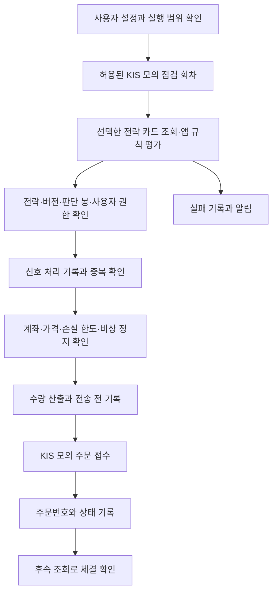

# 증권사 연동 자동화 설계안

| 항목 | 내용 |
|---|---|
| 판 · 상태 | v0.6 · 2026-10-30 · 명시적 가상계좌 고정 시험 전략 경로 추가. 외부 알림 수신·가상 매수/매도 완료, 12:31 실제 예약 회차·중복 방지 확인 완료 |
| 담당 | 오준영 · 부담당 강민석 |
| 대상 | 팀 확정 요구 P02-⑤-1~3 |
| 코드 기준 | main `3a832c2` 전체 Docker 반영 뒤 고정 시험 공급원 후보 추가 · 관련 172건 격리 검증. 운영 이미지·완료 상태는 [작업 계획](../../00-management/plans/오준영파트-할일.md) 최신 절 기준 |
| 일정 | [오준영 작업 계획](../../00-management/plans/오준영파트-할일.md) |

기존 전략 카드를 Qurious에서 평가하고, 서버의 계좌·수량·위험 검사를 거쳐 KIS 국내주식 모의 주문에 연결한다. LEAN은 같은 고정 입력의 실행·성과 검증 경로로 유지한다. 별도 LEAN 신호 API는 이번 필수 범위에 넣지 않는다.

#314의 신장환·강민석 답변과 이동원 팀장의 10/25 답변을 반영했다. 앱 가상 체결이 정본이며 KIS 모의 주문은 장중 하루 1~3건 경로 점검이다. 앱의 10분 자동매매는 회차 영속 기록과 재개 협의 전까지 꺼 둔다. 판 1 수동 점검의 주문 연결·영속 중복 선점은 배포했고 실제 주문 검증은 미완료다. 전체 경로 공통 위험 관문·판 2·알림 표 변경은 이후 일정이다.

## 1. 팀 요구와 판단 근거

[팀 계획서](https://github.com/EST-team-project/Qurious/blob/1fb94b844435c2780edec1017e1f44b6b809c173/docs/3차/계획서/프로젝트계획서.md) 4.3절의 주담당과 [요구 대장](https://github.com/EST-team-project/Qurious/blob/1fb94b844435c2780edec1017e1f44b6b809c173/docs/3차/요구사항/대장/요구-대장.tsv)의 인수 기준을 따른다. 같은 계획서 2.3절에 따라 AWS는 필수가 아니다. 강사님 기술 목록을 추가 구현 의무로 삼지 않는다.

## 2. 기존 구현과 추가 작업

아래 경로는 기준 커밋의 저장소 루트 기준이다. 기존 시험은 회귀 시험 후보이며 이번 설계 작업에서 실행하지 않았다.

| 영역 | 기존 근거 | 추가로 확인하거나 구현할 부분 |
|---|---|---|
| 계좌·주문 | `app/services/brokers/factory.py`, `auto_trade.py::_place_live_order`, `kis_execution.py` | 기존 사용자 키 기반 KIS 직접 경로 우선. 인증·잔고·현재가·모의 주문을 실제 모의계좌로 검증한다. 공유 게이트웨이를 임의로 켜지 않는다. |
| LEAN | `app/routes/lean.py`, `lean_backtest.py`, `lean_remote.py` | 현재 경로는 백테스트 실행·결과 조회다. 검증용 카드와 데이터·비용·체결 기준을 맞추며, 앱의 카드 평가 경로를 유지한다. 과거 백테스트 매매 목록을 현재 주문으로 재생하지 않는다. |
| 전략 명세 | `strategy_loader.py`, `auto_trade.py::apply_strategy_spec_to_signal` | 기존은 전략 명세를 받아 앱에서 규칙을 계산한다. 지정 카드의 조회·규칙 평가 실패 시 기본 전략으로 대체 주문하지 않는 경계를 10/27 연결 시험에서 검증한다. 10/27 카드 실패 시 기본 전략으로 대체 주문하는 동작을 차단해 배포했다. |
| 중복 방지 | `risk_guard.py::acquire_order_slot`, `LiveOrder.client_order_id` 유일 제약 | 쿨다운은 시간 내 종목·방향 제한이다. 직접 주문은 새 UUID, 게이트웨이 주문은 사용자·종목·방향·분 단위 키를 쓴다. 같은 카드 판단의 반복·재시작·동시 처리를 식별하는 영속 키가 필요하다. |
| 주문 결과 | `LiveOrder`, `auto_trade.py::confirm_live_fills`, `kis_execution.py::direct_status` | 기존 접수·응답 불명·체결 확인을 재사용하고 신호 → 주문 → 증권사 주문번호를 연결한다. 접수 성공을 체결 완료로 표시하지 않는다. |
| 위험관리 | `risk_guard.py`, `auto_trade.py::emergency_halt`, `execution_policy.py` | 기존 손실 한도·비상 정지·수량 제한을 공통 진입 함수로 묶는 안을 10/29까지 준비한다. Redis 장애 시 메모리 대체만으로 다중 워커 중복 방지를 보장했다고 판단하지 않는다. |
| 주기·로그 | `app/celery_app.py`, `app/tasks/sync_tasks.py`, `auto_trade.py::_persist_cycle` | 기존 기본 주기는 `QUANT_CYCLE_SEC=600`이지만 현재 자동매매는 꺼 둔다. 영속 회차 기록 후 재개를 협의한다. 최근 50회 캐시 외에 회차 식별·완료·실패 상태를 영속 기록하는 안을 추가한다. 오래된 3분 주석은 관련 구현 수정 때 맞춘다. |
| 알림 | `notification.py::dispatch`, `NotificationLog` | 기존 주문·정지 알림과 별개로 전략 실행 실패를 회차별 한 건 기록·발송하는 경로를 연결한다. |
| 가격 | `auto_trade.py`의 `indicators.current_price` 사용 | #284: 10/27 `quant_valuation`을 배포해 QUANT 사이클·위험 상태·대시보드 평가 기준을 통일했다. 가상 체결 직전 조회값으로 수량·위험 한도를 계산하고 판단 가격과 출처·시각을 따로 기록한다. 값이 없으면 평균단가로 대체하지 않고 보류한다. |

기존 계약 [kis-autotrade-api.md](https://github.com/EST-team-project/Qurious/blob/1fb94b844435c2780edec1017e1f44b6b809c173/docs/contracts/kis-autotrade-api.md)의 전략 ID·버전과 주문 추적 의미를 유지한다. 그 문서의 게이트웨이 전용 승인·멱등 기능이 개인 키 직접 KIS에도 제공된다고 가정하지 않는다.

## 3. 홈페이지와 실행 흐름

| 기존 화면 | 연결할 기능 |
|---|---|
| `app.html#settings` 증권사 API 설정 | 사용자 KIS 연결, 전략·위험 한도 설정, 추적 중인 주문 확인 |
| `app.html#quant-auto` 자동매매 현황 | 시작·중지·비상 정지, 실행 상태·로그·거부 사유 |
| `app.html#notification-settings` 알림 설정 | 기존 사용자 알림 채널 활용 |

별도 모니터링 화면을 새로 만드는 안은 포함하지 않는다. 전략 선택과 일정 설정의 상세 UI는 기존 설정을 얼마나 재사용할지 계약 협의 후 정한다.



거부·보류는 실패와 구별해 이유를 남긴다. 일반 중지는 이후 새 주문을 막는 기능이며 이미 증권사에 전달한 주문의 취소·청산을 보장하지 않는다. 비상 정지 또한 새 주문 차단과 기존 주문 확인을 구분한다.

## 4. #314에서 확인한 카드와 판단 계약

| 항목 | 현재 기준 | 근거 |
|---|---|---|
| 최소 입력 | `ma_cross_20_60`, `version=1`, `universe=["005930"]`, `timeframe=1d` | [신장환 답변](https://github.com/EST-team-project/Qurious/issues/314#issuecomment-6335786448), [판 1 카드](예시/strategy-card-ma-cross-v1.json) |
| 입력 등급 | 연결 시험용 고정 입력. 합격 전략·운영 승인 아님 | 같은 답변. `acceptance`·`backtest_result`를 임의로 채우지 않음 |
| 판단 실행 | 기존 `apply_strategy_spec_to_signal`·`evaluate_spec_rules`에서 카드 평가 | 신장환·강민석 답변. 별도 신호 생산 API 없음 |
| 같은 판단 | 전략 ID·판·종목·`bar_end_at`·방향 | 신장환 답변. 사용자·계좌를 추가해 서로 다른 사용자의 주문을 분리 |
| 수량 | 서버에서 한 번만 산출. 현금·1회 예산·종목 비중 상한 유지 | 신장환 제안. KIS 조회 예수금과 매수 가능 금액은 별도 |
| 카드 판 2 | #353 JSON 병합: `price_basis=adj_base`, 판 1과 별도 파일 | 명세 반영과 KIS 실행 지원은 별개. 청산·재진입·단위는 [작업계획 16절](../../00-management/plans/오준영파트-할일.md)의 회신안으로 확인 |
| LEAN 실행처 | 강민석 로컬 WSL Ubuntu 22.04 + Docker Desktop | [강민석 답변](https://github.com/EST-team-project/Qurious/issues/314#issuecomment-6360724464). 원격 실행은 미검증 |
| LEAN 표본 | 20/60 v1 대조 보고서 main 반영 | [10/27 v3](../../04-testing/lean-검증-2026-10-26/daily/2026-10-27_v3.md): 보유 상태 2일 불일치, 주문 방향 1건 일치·1건 제외, 수량 제외·체결가 시점 차이. 수령 대기와 실제 주문 종단 검증을 구분 |

앱/KIS의 `005930`과 LEAN 자료의 `005930.KS`를 같은 종목으로 대응하되, 판단 자료와 봉 시각을 맞춘 뒤 비교한다. 카드 판 1의 20/60 규칙에는 최소 60개 확정 종가가 필요하다. 기간 초 워밍업 자료와 첫 유효 판단일은 LEAN 결과를 받을 때 확인한다. 자료 부족으로 규칙 평가가 불가능한 경우 기본 점수 판단을 카드 결과로 취급하지 않는다.

수량은 주문 직전 KIS 잔고·매수 가능 금액/수량과 서버 위험 한도를 기준으로 계산한다. `dnca_tot_amt` 예수금과 `nrcvb_buy_amt`·`nrcvb_buy_qty`를 같은 값으로 가정하지 않는다. 실제 체결가 기준 손절선·ATR 고정은 판 2 연결 시 확인할 제안이며, 갭·부분 체결까지 위험률 1%가 항상 보장된다는 뜻이 아니다.

사용자 ID·계좌·키는 카드 입력에서 받지 않고 인증 문맥과 사용자 설정에서 조회한다. 현재 `/quant/settings`는 전략 로더의 검증을 요구하므로, 고정 카드를 합격 전략처럼 등록하거나 검증을 우회해 운영 설정에 저장하지 않는다. 10/26 시험은 격리 환경의 기존 판단 함수에 고정 카드를 직접 입력하며 주문을 호출하지 않는다. 내일 별도 KIS 모의 점검 경로에서 접수·체결 확인을 진행한다.

이전 [LEAN 신호 JSON 초안](예시/lean-signal-v1.json)은 선택 변경안으로 보존하며 현재 필수 계약이 아니다. 미래에 LEAN 자체 신호 출력으로 바꿀 때만 생산자 인증·실패 응답·식별자·유효 기한을 별도 협의한다.

## 5. 중복과 상태 저장 설계안

1. 실행 회차는 사용자·계좌 식별값·전략 버전·예정 실행 시각으로 식별하고, 같은 회차를 두 워커가 실행하지 않도록 DB에서 선점한다. 시작 즉시 실행과 정기 실행의 중첩도 검사한다. 재시작 때 만료된 선점을 처리하는 기준은 주문 전송 상태와 함께 정한다.
2. 판단 처리 기록의 유일 키는 `(user_id, account_ref, strategy_id, strategy_version, symbol, bar_end_at, action)`로 설계한다. 종목·방향·시간대는 저장 전에 정규화한다. `account_ref`는 서버가 정한 계좌 식별값이며 평문 계좌번호를 로그에 쓰지 않는다. 별도 입력 해시를 저장해 같은 판단 키의 처리 내용이 달라지면 충돌로 거부한다.
3. 최초 입력의 기록·선점과 주문 의도 저장은 트랜잭션으로 처리한다. 주문 전송 전에 추적 기록을 커밋하고, 재수신은 새 주문을 만들지 않고 기존 처리 결과를 읽는다. `client_order_id`는 이 키에서 만든 고정 해시 등으로 64자 이내를 유지한다.
4. 수량 산출 뒤 전송 직전에 활성 상태·비상 정지·계좌·모의 환경을 다시 검사한다. 저장소 확인 실패 시 새 외부 주문을 보류한다. 프로세스 내부 `asyncio.Lock`만으로 다중 워커 안전성을 주장하지 않는다.
5. 전송 준비 중 프로세스 중단, 타임아웃 또는 주문번호 없는 응답은 접수 여부를 확정할 수 없다. 새 ID로 자동 재주문하지 않고 기존 `PENDING`·`UNKNOWN` 기록을 보존해 조회·대조한다. 직접 KIS가 멱등 키를 보장한다고 가정하지 않는다. 불명확한 경우 보류하므로 모든 유효 신호가 반드시 체결된다는 보장은 아니다.
6. 주문 접수 후에는 기존 `LiveOrder` 상태와 체결 조회를 활용한다. 다른 계좌나 다른 주문의 체결을 매칭하지 않는다. 확정 체결 수량을 확인하기 전 가상 장부에 체결을 만들어 넣지 않는다.

추가 저장 대상은 판단 처리 기록, 전략 실행 회차, 알림 중복 방지 정보다. 테이블·마이그레이션은 구현 단계에 결정하며 기존 `LiveOrder`를 신호 기록과 연결한다. 주문 정정·취소나 신규 재주문 정책은 이번 계약에 추가하지 않는다.

[이동원 답변](https://github.com/EST-team-project/Qurious/issues/314#issuecomment-6394114500)의 추천안을 작업안으로 채택한다. `notification.dispatch`와 기존 `notification_log`를 재사용하고 `kind`, `ref`, `(kind, ref)` 유일 제약을 추가하는 안이다. 실행 실패 `ref`는 사용자·회차를 구분하는 식별값으로 만든다. 사용자 간 충돌, 유일 제약과 발송 선점의 원자성, 이력 저장 실패 처리는 구현 때 검증한다. 아직 팀 회신·마이그레이션 적용 완료는 아니다.

TradingView는 신호 수신·검증·기록까지 이동원 담당, 주문 경로 진입 뒤 거부·실패·접수 불명 알림은 이쪽에서 처리한다. TradingView 체결은 V1 앱 가상 장부를 유지하고 KIS로 보내지 않는다. 10/29까지 공통 위험 함수의 사용자·종목·방향·수량·출처 입력과 통과·거부 사유 반환을 구체화하여 10/30 연결에 맞춘다.

실행 실패는 회차·사건 종류 기준으로 한 건의 알림 이벤트를 저장한다. 외부 발송 성공 여부를 기록하고, 응답이 불명확하면 무조건 재발송하지 않는다. 외부 채널까지 정확히 한 번 전달되는지는 채널의 중복 방지 기능에 달리므로 발송 시도·전달 확인을 구분한다.

## 6. 시험 계획

모든 항목은 예정이며 실제 통과 결과가 아니다. 먼저 격리 DB·모의 응답으로 경계를 시험하고, KIS 모의계좌로 정상 연결을 대조한다. 실제 모의계좌 시험은 전략·종목·수량을 정한 별도 시험 절차로 수행한다.

| ID | 요구 | 상황 | 기대 결과와 증거 |
|---|---|---|---|
| B01 | ⑤-1 | 고정 카드의 정상 BUY 판단 | 신호 ID → 처리 기록 → KIS 모의 주문번호 연결. 접수와 체결을 구분한다. |
| B02 | ⑤-1 | HOLD 또는 0주 산출 | 증권사 주문 호출 0회, 사유 기록. |
| B03 | ⑤-1 | 모르는 전략·판, 만료·미래 신호, 잘못된 종목 | 입력 거부와 이유 기록, 주문 0회. |
| B04 | ⑤-1 | 다른 사용자 설정 접근·실전 환경 요청 | 권한 및 모의 환경 검사에서 차단, 주문 0회. |
| B05 | ⑤-1 | 인증·잔고·가격 조회 실패 | 가상 체결로 대체하지 않고 보류·실패 기록. |
| B06 | ⑤-1 | 접수·부분 체결·완료·접수 불명 응답 | 정확한 계좌·주문번호로 상태 대조, 불명 응답의 자동 재주문 0회. |
| B07 | ⑤-2 | 같은 신호를 시간 차·재시작 후 반복 입력 | 처리·주문 식별자 유지, 신규 주문 최대 1건. |
| B08 | ⑤-2 | 두 워커가 같은 신호 동시 처리 | DB 유일성·선점 확인, 외부 주문 최대 1회. 같은 키 다른 내용은 거부. |
| B09 | ⑤-2 | 손실 한도 초과·비상 정지, 전송 직전 정지 | 카드 판단·기존 자동매매·TradingView·시작 즉시 실행 등 적용 주문 진입 경로에서 차단 사유 확인. 수동/API 경로도 누락 여부 점검. |
| B10 | ⑤-2 | DB·Redis 장애, 전송 경계에서 프로세스 중단 | 새 외부 주문 보류, 불명 상태 보존, 복구 후 중복 전송 없음. |
| B11 | ⑤-3 | 정해진 일정과 사용자 비활성 상태 | 활성 사용자만 실행, 예정 시각·시작·종료·결과 기록. |
| B12 | ⑤-3 | 카드 조회·평가 실패 또는 실행·알림 실패 | 실패 회차와 알림 이벤트 한 건 저장, 기본 전략으로 대체 주문하지 않음. 발송 결과 구분. |
| B13 | ⑤-3 | 즉시 시작·정기 실행 중첩, 중지·재시작 | 중복 회차·주문 차단, 이미 전송된 주문의 상태 확인 유지. |
| B14 | 전체 | 로컬 Docker에서 카드 평가 → KIS 모의 종단 시험 | 화면·실행 기록·증권사 주문/체결·잔고 대조. 실제 LEAN 결과와 고정 입력 시험을 구분. |

기존 회귀 시험 후보: `tests/test_auto_trade_isolation.py`, `test_kis_execution_outcomes.py`, `test_live_order_gateway_path.py`, `test_risk_guard.py`, `test_risk_guard_boundaries.py`, `test_risk_guard_ledgers.py`, `test_lean_remote.py`, `test_strategy_spec_apply.py`.

시험 결과에는 기준 커밋·설정·실행 시각·입력 신호·주문 호출 횟수·처리 상태를 남긴다. 계좌번호·키·토큰은 증거에서 제외한다. 고정 입력 또는 모의 HTTP 시험만 통과한 상태를 실제 KIS 모의 체결 완료로 표시하지 않는다.

## 7. 10월 26일 점검과 다음 단계

- 09:28 KST, 기존 실행 이미지 `qurious-app:kis-readiness-20261022`에서 본인 KIS 모의 계좌를 유일하게 선택해 잔고·삼성전자 현재가·매수 가능 금액/수량 조회에 성공했다. 보유 0개, 자동매매 꺼짐, 실전 허용 꺼짐, 주문 호출 0회다.
- 조회 도구는 인증 POST와 세 조회 GET만 허용했다. DB는 읽기 전용 트랜잭션이고, 설정·계좌 금액·키·토큰 원문을 출력하지 않았다. 예수금과 주문 가능 금액은 달랐다.
- 오늘 조회 성공은 기존 배포 이미지의 결과다. 최신 main 기반 코드의 회귀 시험 및 DF-145 수정 배포와 구분한다.
- 10/22 잔고 검증·오류 안내 변경은 main에 미반영 상태라 오늘 브랜치에 이식했다. DF-145는 설정 재저장 시 기존 키·비밀키를 보존하도록 수정하고, 다른 증권사에 기존 키를 넘기지 않도록 검사한다. 운영 반영은 별도다.
- 강민석의 20/60 실행 결과는 오늘 18:00 준비 목표다. 현재 #314에는 수령 가능한 결과 완료 답변이 없으며, 받으면 데이터·워밍업·판단 시각·비용 조건을 대조한다.
- 10/27 시험은 카드 판 1 고정 입력부터 시작한다. 매수·매도·관망과 자료 부족, 같은 판단 반복, 카드 종목 제한, 사용자·계좌·모의 환경을 확인한다. 주문 접수와 체결 확인은 각각 기록한다.
- #332의 기본 종목 선정·보유 매도 정책은 기존 담당과 협의 중이다. 오늘 공통 판단 함수를 변경하지 않았다. 변경이 필요하면 #314 최신 요청대로 머지 전에 범위를 공유한다.

시험 결과와 후속 변경은 [오류·처리 누적 기록](../../04-testing/오준영-오류수정기록.md)에 남긴다. 로컬 조회 근거는 `data/local-run/kis-readiness-20261026/account-verification.json`이다.

## 8. 10월 22일 연결 사전 점검

사용자의 추가 요청으로 2026-10-22 10:08 KST에 현재 로컬 앱을 점검했다. 대상은 `qurious-app:release-170-20261019`, 이미지 ID `464b6c7109cc`다. 이 결과를 최신 main 배포 시험이나 LEAN 주문 종단 시험으로 해석하지 않는다.

| 확인 항목 | 결과 | 확인 범위 |
|---|---|---|
| 사용자 설정 | 오준영 계정의 KIS 키·계좌 설정 존재 | 키·토큰·계좌번호 원문은 출력·문서화하지 않음 |
| 실행 상태 | 자동매매 꺼짐, 주문 방식 `paper`(앱 가상매매), 실전 허용 꺼짐 | 설정 변경 없음. 저장된 사용자 키로 KIS 모의 조회만 직접 호출 |
| KIS 인증 | 성공 | 기존 클라이언트에서 유효한 인증 토큰 확보 |
| KIS 잔고 | 성공 | 실제 모의 조회 응답의 현금·평가액이 유효한 수인지 확인, 보유 종목 0개 |
| KIS 시세 | 성공 | `005930` 현재가가 유효한 양수인지 확인 |
| 주문·체결 | 미실행 | 주문 호출 0회. 체결 가능 여부나 주문 가능 금액 검증 결과가 아님 |
| LEAN 원격 | 미설정 | 앱의 `DOMAIN_RAG_LAB_BASE_URL` 설정 없음 |
| LEAN 로컬 | 실행 준비 미완료 | 상태 함수는 `docker` 경로를 선택하며 기준 자료 파일은 존재. 설정 이미지 `quantconnect/lean:latest`는 현재 Docker 이미지 목록에 없음. 실제 엔진 실행은 하지 않음 |
| 신호 계약 합의 | 확인한 저장소 범위에서 찾지 못함 | main 코드·기존 계약, 전체 이슈 본문, 10/19 이후 댓글 45개, Discussions 13개와 댓글 확인. 개인 대화방 합의 여부는 확인 대상 밖 |

기존 [이슈 #244](https://github.com/EST-team-project/Qurious/issues/244)는 전략 명세와 게이트웨이 계약 개정의 반영 여부를 주담당이 결정하도록 요청한 내용이다. 이번 `signal_id` 중심 신호 초안이 승인됐다는 근거가 아니다. 원격 주소를 추정해 설정하거나 대용량 LEAN 이미지를 내려받지는 않았다.

위 표는 10/22 당시 관측이다. 이후 계약 답변과 10/26 조회 결과는 4절·7절을 기준으로 한다.

## 9. 개정 이력

| 판 | 날짜 | 내용 |
|---|---|---|
| v0.6 | 2026-10-30 | 명시적 고정 시험 공급원·가상계좌 제한·시험 표시·기존 위험 및 중복 방지 유지 |
| v0.5 | 2026-10-30 | 수동 KIS 모의 주문 요청 ID·공통 선점·별도 귀속·결과 조회, 기존 API 호환 변화와 187건 검증 |
| v0.4 | 2026-10-28 | #353 판 2 최신 필드·#359/#360 병합 상태, 10/29 공통 관문 계약·시험 경계, 10/28 운영 차단 근거 |
| v0.3 | 2026-10-27 | 판 1·HF·가격 기준 선택 배포 결과(10절) |
| v0.2 | 2026-10-26 | #314의 카드 평가 방식·역할·KIS 점검 범위·알림 작업안, 실제 조회 결과와 남은 구현 구분 |
| v0.1 | 2026-10-22 | 기존 구현 점검·선택 가능한 LEAN 신호 계약 초안·시험 계획 |


## 10. 10월 27일 운영 반영 경계

판 1 수동 KIS 점검·HF 수신 준비 판정·QUANT 가상 체결/평가 가격 보완을 로컬 Docker에 배포했다. 판 1은 `strategy_decisions`와 고정 `LiveOrder.client_order_id`를 주문 전 저장한다. 가상 체결은 `quant_valuation.quote(fresh=True)`로 실행 직전 가격을 확인하며, `snapshot`은 보유 가격이 누락되면 평가액·당일 손익을 산출하지 않는다. 과거 로그의 평가 기준을 소급해서 현재가로 표시하지 않는다.

최종 배포 이미지 관련 시험은 266 통과·3 제외이며, 제외는 미배포 PAPER 주문·별도 시세 API 범위다. 실제 본인 KIS 조회는 성공했지만 본인 QUANT 가상계좌는 미생성이라 보유 평가 대조는 격리 시험으로 확인했다. 자동매매·실전 허용 꺼짐, 실제 KIS 주문 0건. 상세 완료/미완료와 근거는 [작업 계획 14절](../../00-management/plans/오준영파트-할일.md)을 따른다.


## 11. 10월 29일 공통 위험 관문 — 구현 계약

공통 위험 관문은 PR #389와 함께 10/29 10:49 운영에 반영했다. 배포 증거는 [#395](https://github.com/EST-team-project/Qurious/pull/395), 판 2 QUANT 연결은 [#396](https://github.com/EST-team-project/Qurious/pull/396)과 [검증 기록](../../04-testing/판2-실행상태-검증-2026-10-29.md)을 따른다. 아래는 제안했던 `allowed/reason_code`가 아니라 현재 코드의 계약이다.

| 구분 | 실제 계약 |
|---|---|
| 진입점 | `execution_control.execute(intent, quantity, prepare, send, require_enabled=False)` |
| 의도 | `Intent(user_id, account_ref, book, strategy_id, strategy_version, symbol, side, signal_key, source, input_hash)`. 사용자·계좌·장부는 인증과 서버 조회로 결정 |
| 중복 | 사용자·계좌·장부·전략·판·종목·방향·신호로 키 생성. `source`를 바꿔도 같은 의도. 같은 키의 다른 입력 해시는 `INPUT_CONFLICT` |
| 준비 | `prepare(db)`가 계좌 잠금 안에서 `cash/equity/price/position_value/owned_quantity/checked_at`을 반환. 최종 가격으로 재계산한 `quantity`, 전송 문맥, `price_basis`, 설정 서명을 추가 가능 |
| 전송 | 최종 한도·저장소·설정 재확인 후 `send(client_order_id, quantity, basis)`를 1회 호출. 그 전에 의도를 PENDING으로 commit |
| 결과 | `status=filled/submitted/unknown/skipped`와 `intent_id`, 가능한 경우 `quantity/price/price_basis`. `skipped`는 `code/reason`. 접수는 체결이 아니며 `unknown/PENDING`은 재전송하지 않음 |
| 주요 차단 | `ACCOUNT_BUSY`, `INPUT_CONFLICT`, `OPEN_ORDER`, `CACHE_UNAVAILABLE`, `STALE_DATA`, `ACCOUNT_UNAVAILABLE`, `OWNERSHIP_UNCONFIRMED`, `KILL_SWITCH`, `DISABLED`, `LOSS_LIMIT`, `ORDER_LIMIT`, `COOLDOWN`, `ZERO_QUANTITY`, `CASH_LIMIT`, `POSITION_LIMIT`, `SETTINGS_CHANGED`, `EXECUTION_STORE_UNAVAILABLE` |

계좌 PostgreSQL 잠금 안에서 기존 의도/미확인 주문 → Redis → 가격·잔고·귀속 준비 → 일손실/횟수/현금/비중 → 선점 → 저장소·설정·10초 유효시간 재확인 → 전송 순서다. 계좌 전체 평가에는 수동 보유를 포함하지만 전략 매도에는 해당 전략·판의 확인된 보유만 포함한다. 일반 수동 PAPER/Open API와 감시 주문까지 이 관문을 적용했다고 표시하지 않는다.

### 담당자 연결 지점

- **TradingView (10/30 수신·11/3 알림):** 기존 수신 경로가 `paper_order_control.execute(db, uid, info, side, quantity, source=..., signal_key=..., strategy_id=...)`를 호출한다. PAPER 장부 전용이고 KIS로 보내지 않는다. `signal_id` 또는 `bar_time={{time}}`를 유지해 재수신 중복을 막는다. 알림은 `notification.dispatch`와 `notification_log`의 사건 선점/발송 결과를 사용한다. 새 영속 회차 전용 화면/API는 아직 없다.
- **#369 동원:** 주문 직전 조회 가격은 주문별 `price_basis`에 있으며 실제 체결가와 구분한다. 서버 자동매매는 최종 시세로 수량을 재계산하고 시세 실패 시 종가로 대체하지 않는다. 현재 직접 KIS는 지정가 `00`이며 미검증 호가 보정·시장가 지원을 가정하지 않는다. 게이트웨이는 안정적 계좌 식별자가 없으면 자동 주문 보류다.
- **#364:** 비상 정지 감사 `actions`가 중지·취소 요청·알림 호출 결과를 구분한다. 취소 요청 성공은 취소 확정이 아니며 알림 함수 반환은 수신 증명이 아니다. ETF 시간/괴리 경고와 공식 LP 자료 확인은 별도 잔여 항목이다.
- **#371 민석:** `paper.record_daily_snapshots`는 15:40 KST 예약이며 일부 사용자 실패도 Celery FAILURE로 표시한다. 성공한 사용자 행은 보존하고 자동 재시도는 하지 않는다. 계산 방식·GET upsert·부분 평가 스키마는 이 변경에 포함하지 않는다. 10/28은 3명 성공/0명 실패를 확인했고 10/29 실행 관측은 별도다. 10/22·23 누락 원인은 입증하지 못했다.
- **#366/#314:** 수정 ATR을 판단일 계수로 나눈 원주가 손절 거리를 사용한다. 판 2 QUANT는 다음 거래일 시가의 가상 체결이며 일봉 도착 후 현재가 KIS 실행으로 바꾸지 않는다. 보유 중 조정 사건은 수량·원가 대조가 끝날 때까지 보류한다. KIS 판 2 체결 연결·LEAN 성과 대조는 완료 범위가 아니다.

판 1 동결 함수 3개와 `_SIGNAL_SCORE_SCALE`은 유지한다. 판 2 연결은 기존 `_run_quant_cycle`의 판별 분기와 가상 장부 체결 함수의 모델 시각 인자만 추가하며, 판 1 조건 판단을 재작성하지 않는다. 각 변경의 시험 수와 운영 적용 시각은 연결된 검증 기록을 기준으로 확인한다.

## 12. 10월 30일 — 개인 KIS 수동 주문 관문

`POST /api/broker/order`(API-STK-22)의 개인 KIS 경로는 `manual_broker_order.submit` → `execution_control.execute` → 기존 직접 KIS 추적 경로를 사용한다. `GET /api/broker/order/{request_id}`(API-STK-42)는 같은 로그인 사용자의 영속 기록만 조회한다. 자동매매 ON이 필요하지 않으며 자동매매 설정을 변경하지 않는다. 직접 KIS 모의 계좌만 지원하고 실전 허용 또는 게이트웨이 설정이 있으면 차단한다. 다른 증권사의 실제 어댑터는 지원하지 않는다고 응답하며, 외부 주문 없는 Mock 데모 경로는 유지한다.

### 요청과 재조회

```json
{
  "request_id": "3d9e7da0-72e8-4973-a093-bb855b20d309",
  "symbol": "005930.KS",
  "side": "buy",
  "quantity": 1,
  "price": 70000
}
```

- 호출자가 한 번의 주문 의도에 UUID 하나를 만들고 보존한다. KIS에서 누락 시 422다. 새 ID로 바꾸어 응답 유실 주문을 재전송하면 안 된다.
- 수량은 양의 정수, 가격은 유한한 양수·원 단위 지정가다. 방향은 `buy`/`sell`이고 국내 6자리 종목만 받는다. 종목의 접미사 별칭은 기존 수집 DB 시장 해석으로 정규화한다. 요청 수량을 축소하거나 지정가를 현재가로 바꾸지 않는다.
- 의도 키는 사용자와 요청 ID로 만든다. 계좌·종목·방향·수량·가격은 입력 해시에 묶는다. 같은 ID로 이 값을 바꾸면 `INPUT_CONFLICT`이고, 같은 입력은 원래 결과를 조회한다. 계좌 설정 변경으로 같은 ID를 다른 계좌에 재사용하지 못한다.
- 요청을 잃었으면 위 ID로 GET 조회한다. 인증 없음은 401, 본인 기록 없음은 404, 저장소 조회 장애는 503이다. 준비 단계에서 차단돼 아직 선점되지 않은 요청도 기록 없음일 수 있다. 원문·계좌번호·키는 반환하지 않는다.

### 가격·계좌·귀속과 전송 순서

확인된 거래일 09:00~15:20 KST에 계좌 잠금 안에서 잔고·현재가를 조회하고, 매수는 요청 지정가 기준 미수 없는 주문 가능 금액·수량을 조회한다. 수수료를 포함한 현금, 일손실·종목 비중·일 주문 수·쿨다운·비상 정지를 공통 검사한다. 같은 계좌의 미확인 의도나 열린 직접 주문이 있으면 다른 ID도 보류한다. 의도와 `LiveOrder(PENDING)`를 전송 전에 각각 저장하며 저장 실패 후 주문을 진행하지 않는다.

수동 귀속은 `strategy_id=manual_broker`, 판 1로 고정한다. 매도는 본인·이 계좌·이 귀속의 확정 순보유만 허용한다. 기존 미귀속 보유, 다른 전략/사용자 보유, `kis_connection_check` 점검 1주는 이 경로의 매도 가능 수량에 편입하지 않는다. 실제 계좌 잔고와 추적 보유가 다르면 차단한다. KIS 접수/체결은 앱 PAPER/QUANT 장부에 복제하지 않는다.

### 결과와 호환 변화

| 상황 | HTTP | 응답 의미 |
|---|---|---|
| 접수 확인 또는 체결 확인 | 200 | `ok=true`, `order_submitted=true`. 접수의 `order.status=ACCEPTED`는 체결 완료가 아님 |
| 접수 여부 미확인·전송 단계 이후 기록 불확실 | 202 | `ok=false`, `order_submitted=null`, `result.status=unknown`. 재전송하지 않고 조회 |
| 위험/준비 조건 차단·입력 충돌 | 409 | `ok=false`, `order_submitted=false`, `result.code/reason` |
| 증권사 주문 오류 | 502 | `ok=false`, 정규화된 오류와 추적 상태. 같은 요청 ID로 재전송하지 않음 |
| 요청 형식 오류·KIS 요청 ID 누락 | 422 | 전송 전 거부 |

POST 결과는 `{ok, order_submitted, result}`이고 GET은 결과 객체다. `result.order`에는 주문번호·추적 ID·접수 상태·체결 수량/평균가를 담는다. 이후 체결 확인은 기존 `quant.confirm_fills`가 담당한다. 알림 실패는 이미 접수된 주문을 실패로 바꾸지 않는다. 주문 오류·알림 오류의 원문은 로그/응답에 복제하지 않는다.

기존 KIS 호출자는 `request_id`를 추가하고, 202 미확인과 409 차단을 처리해야 한다. 저장소의 프런트 코드에서 이 수동 API 호출은 발견하지 못했으나 외부 호출자가 없다는 뜻은 아니다. 자동매매·가상매매 API의 요청 계약은 바꾸지 않았다.

검증: 실제 격리 PostgreSQL·Redis와 합성 증권사로 187건 통과. 동시 요청, 새로운 세션의 재조회, PENDING 잔존, 계좌/입력 변경, 전송 전 정지, 선점/주문 저장 실패, 응답 유실, 알림 실패, 미귀속 매도 차단과 본인 체결 보유 매도를 포함한다. 실제 수동 주문 전송 시험은 포함하지 않았다.


## 13. 명시적 가상계좌 시험 전략 공급원 (10/30)

외부 전략 서버가 없는 환경에서 고정 카드를 매번 프로세스에 주입하던 시험을 설정 가능한 경로로 연결한다. `STRATEGY_SPEC_SOURCE` 기본값은 `remote`, 명시적 시험 값은 `fixed_test`다. 시험 모드는 저장소의 판 1 파일과 고정 SHA-256을 확인하고 `ma_cross_20_60` 판 1만 제공한다. 다른 카드·판, 파일 누락·변조는 거부하고 원격과 시험 경로 사이 자동 대체는 하지 않는다.

전략 목록과 화면에 가상계좌 시험용·합격 아님을 표시하며 성과 수치를 만들지 않는다. `mode=live` 설정은 DB 변경 전 거부한다. 공통 주문 함수와 예약 사이클도 KIS 직접/게이트웨이 호출 전에 차단한다. 앱 가상계좌에서만 기존 위험 검사·전략 귀속·판단 중복 방지를 적용하고 회차 기록에 시험 공급원을 남긴다. 원격 합격 전략 조회와 사용자 저장 카드 자동 실행은 별도 범위다.

설정을 바꿔도 자동매매를 켜지 않는다. 예약 시험에서는 승인된 사용자·paper·고정 카드 설정을 일시 적용하고, 회차 확인 또는 시간 제한 후 자동매매 OFF와 기존 설정을 복구한다. 한 봉의 이미 처리된 신호를 새 봉으로 바꿔 재주문하지 않는다.

12:31 운영 Beat→worker 경로에서 고정 판 1을 조회해 예약 회차를 완료했다. 오전 체결과 동일한 매도 신호는 중복으로 차단했고 가상 보유 1주·주문 2건·현금 및 KIS 주문 1건을 보존했다. 사용자 임시 설정 여섯 항목과 자동매매 OFF를 복구했다. 판단 봉은 10/28이므로 정식 공급원·최신 자료 통합 검증은 남는다. 상세 근거는 작업 계획 §28에 기록한다.
