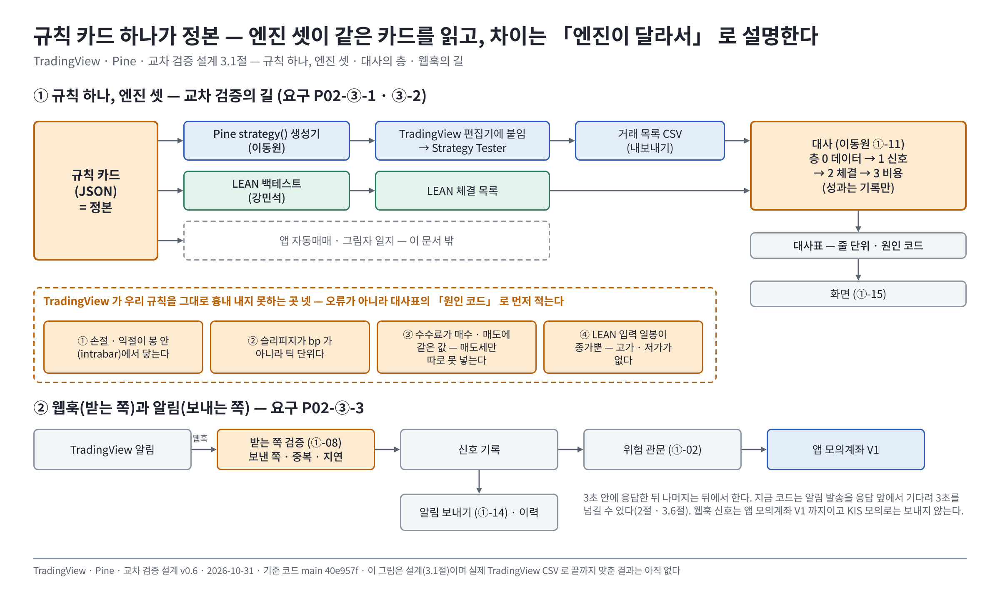

# ③ TradingView · Pine · 교차 검증 설계 v0.6 — Qurious

| 문서 정보 | 내용 |
|---|---|
| **판 · 상태** | v0.6 · 3.1절의 글 그림(<그림 3-1>)을 Figma 그림으로 올림 — 내용은 v0.5 와 같다 · 앞 판의 글은 개정 이력 아래 표 |
| **구분** | 6. 시스템 설계 — 3차 ③ 「TradingView · Pine · 알림」 전용 설계서 |
| **담당** | 이동원(Pine 생성기 · 웹훅 받는 쪽 · 알림 보내는 쪽 · 대사표 · 화면) · 부 강민석(비용·체결 층 · 한 성과 정의) · 규칙 명세 신장환 · 위험 관문 오준영 |
| **검토** | 검토 전 |
| **최종 수정** | 2026-10-31 (KST) |
| **기준** | 코드 `main` `4031c34`(생성기 v0.2 — 판 2 번역 · `TC-PN` 33건 통과) — 코드 줄은 읽어 확인했고 앱 · 시험은 돌리지 않았다 · 정한 것 = [논의 결정 대장](../../../00-management/plans/논의결정대장.md) 부록 C · 팀 글 = #314 · #333 · #335(10-26 협의) |
| **근거 조사** | TradingView 공식 지원 문서 「Strategy properties」(2026-10-26 조회 — 슬리피지 틱 단위 · 수수료 양쪽 · 체결 시점) · 웹훅 조건은 [할 일 v1.7 8.2 R6](../../../00-management/plans/지난판/이동원파트-할일_v1.7.md)(공식 문서 요약) |
| **관련 문서** | [이동원 파트 할 일](../../../00-management/plans/이동원파트-할일.md) ①-07 · ①-08 · ①-11 · ①-14 · ①-15 · ①-22 · [인디케이터 전략 설계](../인디케이터-전략-설계.md) 4.3(규칙 카드) · [증권사 연동 설계안](../증권사-연동-자동화-설계.md) 4 · 5절 · [실시간 표시 vs 저장 자료](../실시간표시-저장자료-설계.md) · [그림자 일지 설계](../모의투자-그림자일지-설계.md) · [카드 판 1](../예시/strategy-card-ma-cross-v1.json) · [LEAN 신호 예](../예시/lean-signal-v1.json) |

> **이 문서로 알 수 있는 것**
> 1. 규칙 카드 하나에서 Pine `strategy()` 가 어떻게 나오고, TradingView 가 우리 규칙과 **구조적으로 다르게 도는 네 곳**이 어디인가
> 2. TradingView 와 LEAN 의 결과를 어느 층에서 어떤 키로 맞대고, 차이를 어떤 원인 코드로 적는가
> 3. 웹훅(받는 쪽)과 알림(보내는 쪽)이 어떤 검증·정책으로 도는가, 화면은 무엇을 그리나

---

## 0. 쉬운 요약 다섯 줄

1. **규칙 카드(JSON) 하나**가 정본이다. Pine `strategy()` 생성기는 그 카드를 읽어 코드를 만들고, LEAN 과 앱 자동매매도 같은 카드를 읽는다 — 그래서 셋의 차이는 「규칙이 달라서」 가 아니라 「엔진이 달라서」 로 설명할 수 있어야 한다.
2. **TradingView 는 우리 규칙을 그대로 흉내 내지 못하는 곳이 넷** 있다 — ① 손절·익절이 봉 안(intrabar)에서 닿는다 ② 슬리피지가 bp 가 아니라 **틱** 단위다 ③ 수수료가 **매수·매도에 같은 값**이라 매도세만 따로 못 넣는다 ④ LEAN 입력 일봉이 종가뿐이다(고가·저가 없음). 이 넷은 오류가 아니라 **대사표의 원인 코드**로 먼저 적는다(3.3절).
3. 대사는 **층 넷**(데이터 → 신호 → 체결 → 비용)을 위에서 아래로 본다. 윗층이 어긋나면 아랫층 비교는 「무효」 로 표시한다. 허용 오차 숫자는 **결과를 보기 전에 강민석 님이 정해 주시도록 요청**한다 — 이 문서는 칸만 만든다(3.4절).
4. **웹훅 받는 쪽**은 「보낸 쪽 · 중복 · 지연」 을 검증한 뒤에만 받고, 3초 안에 응답한 뒤 나머지는 뒤에서 한다. 지금 코드는 알림 발송을 응답 앞에서 기다려서 3초를 넘길 수 있다(2절 · 3.6절).
5. **국내 종목 차트는 TradingView 위젯이 아니라 Lightweight Charts + 우리 일봉**이다 — 대사는 재현이 되는 저장 자료 위에서만 된다(3.8절). 화면은 안 셋 가운데 **가(한 화면 두 칸)** 로 정했고 Figma 에 그렸다(7절 물음 6).

---

## 1. 맥락 · 목표와 비목표

### 1.1 요구 세 줄 — 요구 대장 `P02-③-1 ~ 3`

| 요구 | 수락 기준(요구 대장 그대로) | 이 문서의 절 | 할 일 | 마감 |
|---|---|---|---|---|
| `P02-③-1` Pine 구현 | 우리 규칙에서 만든 Pine 코드가 TradingView 에서 컴파일되고 `strategy()` 로 선언돼 Strategy Tester 가 켜진다 | 3.2 · 3.3 | ①-07 | 10-28(수) 오후 |
| `P02-③-2` Strategy Tester ↔ LEAN 교차 검증 | 같은 규칙 · 데이터 · 기간에서 신호 날짜와 성과를 줄 단위로 대사해 차이를 설명한다 | 3.4 · 3.5 | ①-11 | 11-02(월) · 강사님 칸 11-03 오전 |
| `P02-③-3` 알림 · Webhook | 조건 충족 시 알림이 한 번 가고 실패는 기록되며, 받는 Webhook 은 보낸 쪽 · 중복 · 지연을 검증한 뒤에만 받는다 | 3.6 · 3.7 | ①-08 · ①-14 | 10-30(금) · 11-03 오후 |

### 1.2 목표

- 규칙 카드 → Pine → TradingView 컴파일 · 실행 → 거래 목록 CSV → 대사표까지 **손으로 한 번 이은 길**을 만든다(10-28 12:00 실제 CSV 비교 · 강민석 님 일정과 같은 날).
- 차이를 **원인 코드로 나눈 표**로 남긴다(차이가 없다는 증명이 아니라 차이를 설명하는 것이 수락 기준이다).
- 웹훅은 약관·요금제 조건 안에서 **검증 규칙을 시험으로** 지킨다.

### 1.3 비목표 (이번 판 v0.1)

| 하지 않는 것 | 까닭 |
|---|---|
| 봉 안(intrabar) 손절·익절의 LEAN 대사 | LEAN 입력 일봉이 `date,close` 둘뿐이다(`app/services/lean_backtest.py:98-118`) — 고가·저가가 없어 같은 판정을 할 수 없다. v0.1 의 대사 범위는 카드 `judge` = `close` · `next_open` (뒤집을 조건 5절) |
| `signal_weights.lightgbm` > 0 인 카드의 Pine 생성 | 모델 점수는 Pine 에서 재현할 수 없다 — 생성기는 거부하고 까닭을 돌려준다 |
| 미국 · 코인 종목 대사 | 시세 저장은 ①-13(11-02) · 3차 ③ 수락 기준은 시장을 정하지 않아 **국내로 먼저 끝낸다** |
| TradingView 에서 실제 주문 | 웹훅 신호는 앱 모의계좌(V1)까지다. KIS 모의로는 보내지 않는다(D7 #13 · 10-23 결정) |
| 성과 합격·불합격 판정 | 성과 해석은 강민석 님(④) 몫 · 이 문서는 기록·표시만 |

---

## 2. 지금 상태 (main `cae2fd9`)

| 곳 | 지금 | 근거 |
|---|---|---|
| Pine | 지표 표시용뿐 — `indicator()` 만 있고 `strategy()` 가 없다 | `public/js/indicator.js:92` `//@version=5` · `app/services/formula.py:545` v6 `indicator()` |
| 웹훅 받는 곳 | `POST /api/webhooks/tradingview` — 본문 JSON 또는 `key=value` · 토큰(API 키) 확인 · 키당 분당 30회 · 허용 IP 넷은 설정 기본값에 들어 있으나 **강제 스위치 `TRADINGVIEW_ENFORCE_IP` 기본값이 꺼짐** | `app/routes/tradingview.py:36-67` · `app/config.py:193-196` |
| 발신 IP 판별 | `x-forwarded-for` 의 **맨 앞 값**을 믿는다 — 앞단 프록시가 덮어쓰지 않으면 보내는 쪽이 값을 지어낼 수 있다 | `app/routes/tradingview.py:55-56` |
| 중복 | 같은 종목 · 방향이 **1분 안**에 되풀이되면 무시 — 알림 단위(같은 봉 · 같은 주문의 재전송) 판별은 없다 | `app/services/tradingview.py:28` · `:121-122` |
| 주문 길 | 중복이 아니면 **바로 앱 모의계좌에 시장가 체결** — 위험 관문(손실 한도 · 하루 주문 수 · 비상 정지)을 거치지 않는다 | `app/services/tradingview.py:121-127` — 위험 관문 여부는 #314 05 답글(①-02)에서 오준영 님께 여쭘 |
| 응답 시간 | 알림 발송 `await notification.dispatch(...)` 가 응답을 돌려주기 **앞에** 있다 — 채널이 느리면 TradingView 의 3초 제한을 넘긴다 | `app/routes/tradingview.py:72-80` |
| 알림 | 보내기 `notification.dispatch` · 이력 `notification_log`(제목 · 본문 · 채널별 결과뿐 — 무슨 알림인지는 제목 앞머리로만 갈림 · 기록 실패는 조용히 지나감) | `app/services/notification.py:280` · `:385` · `app/models/misc.py:51` |
| 대사 | `POST /api/tradingview/compare` — Strategy Tester 성과(직접 입력 또는 거래 목록 CSV)와 LEAN 백테스트 · `compare_fills` 가 **같은 순번 이벤트**끼리 날짜 · 방향 · 가격을 견줌(엔진 사이에 거래 ID 가 없어 「진단용」). **신호 층 비교 · 차이 원인 칸 · 대사표는 없다** | `app/routes/tradingview.py:131-190` · `app/services/tradingview.py:326` |
| 화면 | 강사님 기초 화면 `indicator-tradingview`(84점 · 점검표 「3차 몫 — 웹훅 · DB E2E」) · 강사님 th03 이 10-22 에 TradingView 위젯을 붙였다가 KRX 종목이 그려지지 않아 Lightweight Charts 로 바꿈(강사님 자료 점검 10-22 3-1) | 차트 라이브러리 `public/js/vendor/lightweight-charts/` |
| 규칙 카드 | 판 1 = 계약 칸만(`ma_cross_20_60` · 005930 · 일봉). 판 2 칸(`entry_mode` · `exit_mode` · `judge` · `stops` · `size_kind` · `lock` · `reentry`)은 10-27 | [인디케이터 전략 설계](../인디케이터-전략-설계.md) 4.3 |

---

## 3. 설계

### 3.1 흐름 — 규칙 하나, 엔진 셋

**<그림 3-1> 규칙 하나, 엔진 셋 — 교차 검증의 길 · 대사의 층 · 웹훅의 길** · 파랑 = Pine · TradingView 쪽 · 초록 = LEAN 쪽 · 주황 = 정본 카드 · 대사 · TradingView 가 흉내 내지 못하는 넷 · 점선 = 이 문서 밖



<sub>원본: [Figma · Qurious · 문서 그림 · TradingView · Pine · 교차 검증 설계 v0.6 · node 103:2](https://www.figma.com/design/6lstWS4YwuhJPhGB9XoBMD?node-id=103-2) · 그림 판 v0.6 · 기준 커밋 `40e957f` · 2026-10-31</sub>

<details><summary>글 그림(ASCII) — 검색 · 다시 그리기용</summary>

```
              ┌─────────────── 규칙 카드(JSON) = 정본 ───────────────┐
              ▼                        ▼                              ▼
     Pine strategy() 생성기      LEAN 백테스트(강민석)         앱 자동매매 · 그림자 일지
              │ 이동원                  │                              │
   TradingView 편집기에 붙임           LEAN 체결 목록                 (이 문서 밖)
   → Strategy Tester                    │
   → 거래 목록 CSV(내보내기)             │
              └──────────► 대사(이동원 ①-11) ◄─────────┘
                  층 0 데이터 → 1 신호 → 2 체결 → 3 비용 (+ 성과 기록만)
                  → 대사표(줄 단위 · 원인 코드) → 화면(①-15)

   TradingView 알림 ──웹훅──► 받는 쪽 검증(①-08) ──► 신호 기록 ──► (위험 관문 ①-02) ──► 앱 모의계좌 V1
                                          └──► 알림 보내기(①-14) · 이력
```

</details>

### 3.2 규칙 명세 칸 → Pine 줄 대응표 (`P02-③-1`)

카드 칸은 [인디케이터 전략 설계 4.3](../인디케이터-전략-설계.md)의 이름을 그대로 쓴다. **`stops` 가 없는 카드는 판 1(계약 칸만)**, **`stops` 가 있는 카드는 판 2** — 생성기 v0.2 가 아래 판 2 줄을 코드로 옮긴다(신장환 님 #353 예시 `strategy-card-ma-cross-v2.json`). 정의가 없거나 판정 봉과 체결 봉이 어긋날 수 있는 값은 조용히 다르게 만들지 않고 **거부**한다.

| 카드 칸 | Pine 로 옮기는 법 | 생성기 검사 |
|---|---|---|
| `strategy_id` · `version` | 첫 줄 주석 `// Qurious card <id> v<version> sha256:<앞 12>` — 대사표가 이 값으로 카드를 가리킴 | 같은 카드 → 같은 코드(바이트 동일) |
| `universe` | 코드에 심볼을 넣지 않는다(사용자가 차트에서 고름). 첫 주석에 `universe` 를 적고, 대사 때 CSV 의 종목과 대조 | 종목 둘 이상이면 v0.1 은 **한 종목씩** 생성 |
| `timeframe` = `1d` | `if not timeframe.isdaily` → `runtime.error("카드는 일봉용")` | `1d` 가 아니면 v0.1 생성 거부 |
| `entry` · `exit` `ma_cross` (`short_above_long` · `short_below_long`) | `fast = ta.sma(close, 20)` · `slow = ta.sma(close, 60)` · **상태 판정** `fast > slow` (교차 순간이 아니다 — 앱 `apply_strategy_spec_to_signal` 도 같다, [4.3](../인디케이터-전략-설계.md)) | 지표는 `ta.*` 에 있는 것만 |
| `signal_weights` | `lightgbm` = 0 일 때만 Pine 로 옮길 수 있다 | > 0 이면 거부(비목표) |
| `position_sizing.max_position_pct` · `max_symbols` | `qty = math.floor(strategy.equity * pct / 100 / close)` 로 상한 | `max_symbols` 는 한 종목 생성에서 무시(주석) |
| 판 2 `size_kind` = `risk_pct` (`risk_pct` 1.0) | `riskQty = math.floor(strategy.equity * riskPct / 100 / (atrMult * atrNow))` 와 비중 상한 `capQty` 중 **작은 쪽**이 수량(`qty = math.min(riskQty, capQty)`). ATR 이 없거나 0 이면 0 | `risk_pct` 는 0 초과 100 이하 |
| 판 2 `size_kind` = `fixed_budget` | 만들지 않는다 — 예산 칸 이름이 카드에 정의돼 있지 않다 | **거부**(예산 칸이 정해지면 `qty = math.floor(budget / close)` 로 연다) |
| 판 2 `stops.stop_kind` = `atr` (`atr_period` 14 · `atr_mult` 2.0) · `lock` = `entry` | ATR 은 **판단 봉**에서 `atrEntry := atrNow` 로 고정한다(체결 봉의 ATR 을 쓰면 판단 뒤 정보가 섞인다 — 4.3 의 「진입 때 ATR 고정」). 체결이 확인된 첫 봉에서 `stopPx := strategy.position_avg_price - atrMult * atrEntry` 로 **고정** — 기준은 판단 봉 `close` 가 아니라 **진입 체결가**이고, `position_avg_price` 는 슬리피지를 포함한 체결가다(**정함 10-27 사용자** — 8절). 앱 ATR 은 `ta_utils.atr`(Wilder) 로 Pine `ta.atr` 과 같은 계산 | `stop_kind` 가 atr 이 아니거나 `lock` 이 entry 가 아니면 **거부** · 기간 · 배수는 0 초과 |
| 판 2 `stops.take_kind` = `rr` (`take_rr` 기본 2) | `takePx := strategy.position_avg_price + takeRr * (strategy.position_avg_price - stopPx)` — 익절선도 진입 체결가 기준 | `take_kind` 가 rr 이 아니면 **거부** |
| 판 2 `judge` = `close` | 봉 마감에서 `stopHit = close <= stopPx` · `takeHit = close >= takePx` → `strategy.close("L")` — **판정 가격 = 그날 종가**. 체결 시점은 `judge` 가 아니라 `exit_mode` 가 정한다(`open` 이면 다음 봉 시가) | **v0.2 지원** |
| 판 2 `judge` = `next_open` | 판정 가격이 다음 봉 시가인 값이다(#314 10-27 글 4절). `exit_mode = open` 과 함께 쓰면 Pine 에서 판정 봉과 체결 봉이 어긋날 수 있어(다음 봉 시가인지 그다음 봉인지 신장환 님 4.3 정의 확인 전) | **거부**(정함 10-27 사용자) — 정의가 오면 연다 |
| 판 2 `judge` = `intrabar` | `strategy.exit("X", "L", stop = stopPx, limit = takePx)` + 청산한 봉에 매수 상태가 이어지면 `needFresh` | 생성하되 경고 — 대사 범위 밖(3.3 ①) |
| 판 2 `entry_mode` · `exit_mode` = `open` (체결 시점이 다음 봉 시가 — `judge` 의 `next_open` 과는 다른 칸) | `process_orders_on_close = false`(기본) | 대사 설정 기본 · 둘이 다르면 **거부**(Pine 은 체결 시점을 전략 전체에 하나만 둔다) |
| 판 2 `entry_mode` · `exit_mode` = `close` | `process_orders_on_close = true` | 「같은 종가에 체결」 — 현실에서는 불가한 가정이라 경고 |
| 판 2 `reentry` = `new_signal` (청산 뒤 새 매수 신호에서만) | 손절 · 익절로 청산한 봉에서 `needFresh := true`, `entryCond` 가 한 번 꺼지면(`if not entryCond`) 풀린다. 이동평균 청산이면 `entryCond` 가 이미 꺼져 있다 | `new_signal` 이 아니면 **거부** |
| 판 2 `warmup_bars` (60) | `ready = bar_index + 1 >= warmupBars` — 진입은 워밍업이 끝난 뒤에만 | 0 초과 정수 |
| 판 2 `price_basis` = `adj_base` | Pine 코드로는 정할 수 없다 — 차트의 수정주가(Adjust data) 설정을 우리 수집 DB 수정주가와 같은 상태로 두고 대사한다(코드 주석 + 경고) | `adj_base` 가 아니면 **거부** |
| 수수료 · 슬리피지 · 시작 자본 | `strategy(..., commission_type=…, commission_value=…, slippage=…, initial_capital=…, pyramiding=0)` — 값과 한계는 3.3 · `pyramiding=0` 은 같은 방향 추가 진입을 막는다(앱 카드의 「매 신호마다 추가 매수」 와 다른 점은 3.4 신호 정의 차이) | 값은 생성 입력(기본: 3.3 표) |

**생성 결과 대조 시험**(`TC-PN`): 카드 → 코드 → 코드에서 뽑은 숫자(기간 · 수수료 · 슬리피지 · 시작 자본 · 수량 식)가 카드 값과 같은지 본다. 컴파일은 TradingView 편집기에서 **손으로 한 번** 확인하고 화면을 캡처한다(공식 문법 검사기가 없다 — 강사님 `pine-lint.js` 를 받으면 내보내기 전 점검에 쓴다, 8절).

### 3.3 TradingView 가 우리 규칙과 구조적으로 다른 네 곳

| # | 다른 곳 | TradingView 쪽 사실 | 우리 쪽 | 생성기의 처리 | 대사표 원인 코드 |
|--:|---|---|---|---|---|
| ① | 손절·익절의 **판정 시점** | `strategy.exit` 의 stop · limit 은 봉 안에서 닿을 수 있다(에뮬레이터가 봉의 시가·고가·저가·종가로 추정 · 갭이면 다음 봉 시가) | 카드 `judge` 가 `close` 이면 종가에서, `next_open` 이면 다음 봉 시가에서만 본다 | `judge` 마다 줄을 갈라 만든다(3.2). LEAN 입력에 고가·저가가 없어 `intrabar` 는 대사 범위 밖 | `judge` |
| ② | **슬리피지 단위** | **틱**(종목의 최소 호가 단위)을 정수로 더한다 — 시장가 · 스톱 주문에 적용(「Strategy properties」) | 10bp(0.1%) — 일지 · LEAN 가정 | `ticks = round(기준가 × 10bp ÷ mintick)` 로 환산한다. 값이 0 이면 0틱이 되어 **슬리피지가 통째로 빠진다**(예: 27만 원대 종목은 호가 단위가 커서 1틱이 10bp 를 훨씬 넘을 수 있다 — KRX 호가 단위표 확인 🟡) | `cost`(환산 오차 칸을 따로 둔다) |
| ③ | **수수료의 양쪽 적용** | 수수료는 `percent` · 계약당 · 주문당 세 가지이고 **진입 · 청산 양쪽에 같은 값**이 붙는다 — 매도에만 붙는 세금 칸이 없다 | 수수료 0.015%(양쪽) + **매도세 0.18%**(강민석 님 10-26 답) | 편도 근사 **0.105%**(= 0.015% + 0.18% ÷ 2)를 양쪽에 넣는다 → **왕복 합계는 0.21% 로 같다**(비용 층은 **왕복 합계만** 견주고 편도별로는 견주지 않는다). 거래대금이 진입 · 청산에서 달라 생기는 2차 오차는 원인 코드로 적는다 | `cost` |
| ④ | **LEAN 입력 데이터** | TradingView 는 차트 거래소의 일봉 OHLC 를 쓴다 | LEAN 은 야후 일봉 **종가만**(`date,close`) · 우리 저장 일봉은 수집 DB(공공데이터포털) | 층 0 에서 같은 날짜 종가를 먼저 맞댄다(3.4) | `data` |

> ③ 의 0.105% 근사는 **제안**이다. 강민석 님이 10-26 답에서 Pine 설정을 「수수료 0.015% · 매도세 0.18%」 로 알려 주셨지만 Pine 에는 매도 전용 세금 칸이 없다 — 7절 물음 1.

**TradingView 쪽 사실의 출처**: 공식 지원 문서 「Strategy properties」(슬리피지는 틱 · 수수료 세 종류가 양쪽에 적용 · 기본 체결은 현재 봉 종가에서 만든 주문이 다음 봉 시가에 체결 · 「On bar close」 를 켜면 같은 종가에 체결) · 공식 매뉴얼 「Strategies」(에뮬레이터가 봉 OHLC 로 봉 안 움직임을 추정). 슬리피지 환산의 호가 단위 값과 에뮬레이터 세부는 🟡(손 확인 한 번).

### 3.4 교차 검증 명세 — 비교 층 넷 + 허용 오차 칸 (`P02-③-2` · `P02-④-3`)

비교는 **TradingView Strategy Tester ↔ LEAN**, 같은 카드 · 종목 · 기간 · 시작 금액이다. 위에서 아래로 보고, **윗층이 어긋나면 아랫층은 「무효」 로 표시**한다.

| 층 | 무엇을 | 비교 키 | 어긋남 분류 | 담당 | 허용 오차 |
|--:|---|---|---|---|---|
| 0 데이터 | 같은 날짜의 종가 · 거래일 수 · 수정 여부 | 날짜 | 종가 차 % · 있는 날 / 없는 날 | 이동원(표) · 강민석(원천) | **칸만 — 결과 전에 강민석 님께 정해 주시도록 요청**(참고: #333 의 일지 ↔ LEAN 층 0 은 ±0.5% — 최종 판 확인 전) |
| 1 신호 | 날짜별 **보유 상태**(0/1)와 상태가 바뀐 날 | 날짜 | 전환일 일 수 차 · 상태 불일치 날 수 | 이동원 | 칸만 |
| 2 체결 | 같은 순번 체결의 날짜 · 방향 · 가격 · 수량 | 순번(현재 `compare_fills`) → **신호 층의 전환일**로 짝지음(이동원 ①-11 에서 바꿈) | 날짜 차 · 방향 불일치 · 가격 차 bp · 수량 차 | 강민석(이어감) · 이동원(대사표) | 칸만 |
| 3 비용 | 수수료 · 세금 · 슬리피지 **왕복 합계** bp | 거래 쌍 | 왕복 비용 차 bp · 환산 오차(3.3 ② ③) | 강민석 | 칸만 |
| — 성과 | 수익률 · MDD · 샤프 | — | **기록·표시만** — 합격·불합격에 쓰지 않는다 | 강민석(정의) | 판정 안 함 |

- **신호 정의 차이를 먼저 알려 둔다**: 앱 카드는 「20일선 > 60일선인 날마다 매수 신호」 라는 **상태 판정**인데 LEAN `ma_cross` 는 **교차 순간에 한 번** 진입한다는 관찰이 10-26 #333 답글에 있다(일지는 매일 분할 매수 · LEAN 은 전액 1회). 그래서 층 1 은 **보유 상태와 전환일**로 맞대고, 수량 비교(층 2 의 수량)는 사이징이 같을 때만 의미가 있다 — 사이징을 맞추는 LEAN 쪽 옵션은 강민석 님이 별도 이슈로 다루기로 하셨다(#333).
- **지표 층과 재현 기록(벤치마킹 이슈 초안 10-26 반영)**: 그 초안은 검증을 지표 → 신호 → 체결 → 비용 · 포트 → 성과로 나누고 「수익률 유사성만으로 통과시키지 않는다」 고 한다. 지표값 대조는 신장환 님 PR #345 의 LEAN 지표 대조가 맡고, 이 문서의 층은 **데이터(타임존 · 조정 가격 포함)부터** 시작해 그 결과를 참고만 한다. 대사표 머리에는 **재현 기록**을 적는다 — 카드 sha256 · 데이터 기준일과 지문 · 코드 커밋 · LEAN 이미지 다이제스트 · TradingView 설정 · 시간대(KST).
- **첫 봉의 차이도 원인 코드로 적는다(`rule_def`)**: 상태 판정 Pine 은 워밍업(60봉)이 끝난 첫날 이미 `fast > slow` 이면 **그날 바로 진입**하는데, 교차 순간에 진입하는 LEAN `ma_cross` 는 다음 교차를 기다린다. 시작 구간의 첫 거래가 어긋나면 이 원인 코드를 먼저 의심한다.
- **허용 오차 숫자는 이 문서에서 정하지 않는다.** 결과를 본 뒤 정한 범위는 사전등록이 아니다(10-23 결정 · #333 선례). 10-28 12:00 실제 CSV 전에 칸을 채워 주실 수 있는지 강민석 님께 **요청**한다(7절 물음 2 — 아직 답을 받지 않았다).
- 「한 성과 정의」(샤프 산식 · 주문 수와 왕복 거래 구분 · 미실현 평가)는 강민석 님이 `docs/phase-3/04-testing/lean-검증-2026-10-26/` 아래에 정리하신다(10-26 답) — 대사표는 그 문서를 가리킨다.

**TradingView 설정(10-28 12:00 실제 CSV 에 쓸 것 — 강민석 님 10-26 답)**: 다음 봉 시가 체결 · 수수료 0.015% · 매도세 0.18%(→ 3.3 ③ 근사로 옮김) · 슬리피지 10bp(→ 3.3 ② 틱 환산) · 시작 금액 10,000,000원. 같은 Pine 을 ①-07 생성기가 만들게 해 **CSV 를 둘로 만들지 않는다**(생성기는 10-28 오후라 그 12:00 CSV 는 같은 설정을 손으로 맞춘 판 — 설정값은 생성기 입력 기본값으로 쓴다).

### 3.5 대사표 칸 — 줄 단위 (`①-11`)

한 줄 = 체결 이벤트 한 쌍(또는 한쪽만 있는 이벤트).

| 칸 | 내용 |
|---|---|
| `seq` · `layer` | 순번 · 어느 층의 차이인가(0 ~ 3) |
| `tv_*` | TradingView 쪽 날짜 · 방향 · 가격 · 수량(거래 목록 CSV) |
| `lean_*` | LEAN 쪽 같은 칸(체결 목록) |
| `diff_*` | 일 수 차 · 가격 차 bp · 수량 차 · 비용 차 bp |
| `cause` | `data` · `entry_mode` · `exit_mode` · `judge` · `cost` · `size` · `rule_def` (3.3 의 원인 코드 + 사이징 · 규칙 정의 차이) — 여럿이면 쉼표 |
| `explained` | `일치` · `설명됨` · `미설명` — **미설명이 남으면 결함으로 올린다** |
| `note` | 한 줄 설명 |

**구현 상태(v0.5 · 10-29)**: 줄 칸은 위 표 그대로이고, 거래 한 쌍 단위의 `trades`(진입가 · 청산가 · 수익률 차 bp)와 층 요약 `layers` · 원인별 건수 `summary` 가 함께 나온다. `compare_fills`(강민석 님 #329)는 건드리지 않고 새 키로 붙였다. 아직 안 한 것: 층 0 종가 시계열(LEAN 결과에 종가가 안 실려 unavailable) · TradingView 수수료(CSV 에 칸이 없어 `ledger_context.tv.roundtrip_cost_bp` 선언이 있을 때만 층 3 줄이 생김) · 화면(①-15)이 새 키를 읽는 일.

보고서(11-05 ①-22)에는 **원인 코드별 건수 · 미설명 건수 · 층별 무효 표시**를 요약표로 싣는다. 시간대는 LEAN 날짜가 UTC 타임스탬프 기준이라(`compare_fills` 머리의 안내) CSV 의 차트 시간대와 다르면 날짜가 어긋난다 — 변환 규칙(KST 기준 날짜)을 대사표 머리에 적는다.

### 3.6 웹훅 받는 쪽 검증 규칙 (`P02-③-3` 앞 절반 · ①-08)

TradingView 쪽 조건(공식 문서 요약 · [할 일 v1.7 8.2 R6](../../../00-management/plans/지난판/이동원파트-할일_v1.7.md)): 2단계 인증을 켜야 웹훅을 쓸 수 있고 · 포트는 80 · 443 만 · IPv6 안 됨 · **3초 안에 응답하지 않으면 끊고** · 보내는 IP 는 넷(52.89.214.238 · 34.212.75.30 · 54.218.53.128 · 52.32.178.7) · 「가끔 닿지 않을 수 있다」 · 무료 요금제에는 웹훅이 없다(요금제는 2차 출처 🟡).

| # | 검증 | 규칙 | 거부 · 처리 | 기록 | 시험 |
|--:|---|---|---|---|---|
| 1 | **보낸 쪽 — 토큰** | 본문 `token`(API 키)로 사용자를 찾는다. 키는 해시로 대조하고 본문 사본에는 남기지 않는다(지금도 `token` · `api_key` 를 빼고 저장) | 401 | `webhook_signals.status = rejected_auth` | 없는 키 · 지운 키 |
| 2 | **보낸 쪽 — IP** | **운영에서 `TRADINGVIEW_ENFORCE_IP` 를 켠다**(지금 기본 꺼짐). 발신 IP 는 앞단 프록시가 붙인 `x-forwarded-for` 의 **마지막 신뢰 단계 값**만 쓴다 — 맨 앞 값을 믿지 않는다 | 403 | `rejected_ip` + 본 IP | 넷 안 · 밖 · 위조 헤더 |
| 3 | **본문 형식** | JSON 또는 `key=value`. 필수 칸: `ticker` · `action` · `strategy_id` · `bar_time`. 모르는 칸은 버린다. 본문 크기 상한(제안 4KB) | 400 | `rejected_format` + 까닭 | 빈 본문 · 필수 칸 없음 · 큰 본문 |
| 4 | **중복 — 알림 단위** | 키 = `(사용자, strategy_id, strategy_version, symbol, side, bar_time)`. 같은 키는 두 번째부터 **새 기록을 만들지 않고** 첫 처리 결과를 돌려준다(재전송이 와도 기록 한 건). 지금의 1분 창은 보조 장치로 남긴다 | 200 + `duplicate` | 첫 기록의 `dup_count` 증가 | 같은 알림 둘 · 같은 봉 다른 방향 · 다른 봉 같은 방향 |
| 5 | **지연** | `received_at − bar_time` 이 한도를 넘으면 거부하고 까닭을 기록한다. 한도 제안: 일봉 전략 5분 · 분봉 60초(`bar_time` 이 알림 시각을 못 대신하는 전략은 `{{timenow}}` 를 함께 보낸다) | 200 + `late`(주문하지 않음) | `status = late` + 지연 초 | 한도 안 · 밖 |
| 6 | **분당 제한** | 지금 값 그대로(키당 분당 30회) | 429 | `rejected_rate` | 31번째 |
| 7 | **3초 응답** | 1 ~ 6 을 확인하고 **기록 한 줄을 넣은 뒤 바로 200 을 돌려준다.** 주문 · 알림 보내기는 뒤(작업자)에서 한다 — 지금처럼 응답 앞에서 `dispatch` 를 기다리지 않는다 | — | 처리 결과는 같은 줄의 `status` 를 나중에 바꿈(추가만 아닌 한 줄 갱신 — 8절) | 느린 채널 흉내 시 응답 < 3초 |
| 8 | **주문 길** | 신호는 **앱 모의계좌(V1)까지만** 간다. 체결 전에 위험 관문(오준영 님 10-29 함수)을 부른다 — 오준영 님이 정하면 붙인다. 정하기 전 기본은 「받고 기록 · 알림만」(주문 끔 — **제안**: 지금은 바로 체결) | 거부 시 `risk_rejected` + 까닭 | 같은 줄 | 관문 통과 · 거부 흉내 |

**구현 상태 (2026-10-28 · ①-08 · 시험 TC-WH 41 + TC-WHP 13 · 오준영 님 #368 `paper_order_control` 위에 얹음)** — ✅ 구현 · ◐ 일부 · ⏳ 안 함. 설계와 다르게 한 곳은 굵게.

| # | 상태 | 실제로 한 것 | 설계와 다른 점 · 남은 것 |
|--:|:-:|---|---|
| 1 | ✅ | 해시 대조는 그대로. 거부는 `rejected_auth` 를 **로그**에 남기고 토큰 원문은 어디에도 적지 않는다(시험이 로그 본문에 토큰이 없음을 확인) | **줄이 아니라 로그** — 사용자를 모르는 거부는 `webhook_signals` 줄을 만들 수 없다(`user_id` 필수) |
| 2 | ✅ | 본문을 읽기 **전에** 검사. `TRADINGVIEW_TRUSTED_PROXY_HOPS`(기본 0 = 헤더를 믿지 않고 소켓 상대 주소만, N = `x-forwarded-for` 오른쪽에서 N 번째). 값이 모자라면 거부 | 예전 코드는 헤더 **맨 앞** 값을 믿어 위조 헤더가 통과했다(옛 코드로 재현 → 200, 새 코드 403). 운영에서 켜려면 `TRADINGVIEW_ENFORCE_IP=true` + 앞단 프록시 개수를 맞춘다. uvicorn 의 `FORWARDED_ALLOW_IPS="*"` 는 소켓 주소 자체를 헤더로 바꾸므로 주지 않는다 |
| 3 | ✅ | 본문 4KB(`TRADINGVIEW_MAX_BODY_BYTES`) — Content-Length 를 속이거나 쪼개 보내도 읽다가 넘으면 막는다 · 빈 본문 400 · 기록은 아는 칸만(200자) · 주문이 되는 알림은 `signal_id` · `bar_time` · `time` 가운데 하나가 필수, 없으면 `rejected_format` 줄을 남기고 400 | **크기 초과는 400 이 아니라 413.** **`strategy_id` 는 필수가 아니다** — 없으면 `strategy` 이름, 그것도 없으면 `default` 로 둔다(#368 의 `strategy_id="tv:…"` 규칙과 맞춤). 필수 칸은 `ticker` · `action` 이 아니라 **주문이 되는 알림(buy/sell · 수량 ≥ 1 · dry_run 아님)에만** 걸어 알림만 오는 신호와 화면의 옛 호출을 깨지 않는다. 템플릿 · 화면 시험 전송은 `strategy_id` · `bar_time` · `sent_at` 을 싣게 고쳤다 |
| 4 | ✅ | 키 = sha256(사용자 · `strategy_id` · 판 · 종목 · 방향 · 신호(`signal_id` → `bar_time` → `time` 차례, 시각이면 UTC)). 마이그레이션 0029 의 유일 색인 · **먼저 한 줄을 잡고 나서 주문** — 같은 알림이 동시에 넷 와도 주문 한 번(일회용 PG 로 확인, 잡기는 savepoint). 반복은 `duplicate` + 첫 결과 · 첫 줄의 `dup_count` 증가 · 알림 다시 안 보냄. 주문은 #368 공통 관문(`signal_key` = 신호, `strategy_id` = `tv:`+전략)을 그대로 쓴다 | **받은 중복도 줄은 남긴다**(키 없이 `duplicate` · 메시지 「추가 주문 없음」) — 받은 횟수가 기록에 보이게. 주문이 **오류**로 끝나도 선점은 유지돼 같은 알림으로 자동 재주문하지 않는다(5절 원칙). 응답의 `ok` 는 `duplicate` 도 true(멱등). **중복 두 층**: 이 색인(알림 단위, 주문 전)과 #368 관문(`signal_key` 단위, 주문 때)이 겹쳐 막는다 — 1분 쿨다운은 두지 않는다 |
| 5 | ◐ | 일봉 한도 300초(`TRADINGVIEW_MAX_DELAY_SEC`). **알림을 보낸 시각 `sent_at`(`{{timenow}}`)이 있을 때만** 잰다 — 일봉의 `bar_time`(`{{time}}`)은 봉이 열린 시각이라 늘 몇 시간 전이 정상이다. 늦으면 `late`(200 · 주문 없음 · 지연 초 기록, **중복 키는 안 태움**) · 미래 60초 넘으면 형식 거부 · `sent_at` 이 시각이 아니면 형식 거부 | **`sent_at` 이 없으면 지연을 재지 않는다**(템플릿은 싣게 했다). **분봉 60초는 안 했다** — `{{interval}}` 출력 형식을 공식 문서로 확인하지 못해 추측하지 않았다. 분봉 전략을 쓰게 되면 `sent_at` 을 반드시 싣고 한도를 낮춘다(7절 7번은 「일봉만 확정」) |
| 6 | ✅ | 키당 분당 30회 그대로 | 거부는 줄 없이 `rejected_rate` 로그 |
| 7 | ◐ | 감사 기록과 사용자 알림을 **응답 뒤**(BackgroundTasks)로 옮겼다 — 알림 채널이 5초 걸려도 라우트는 1초 안에 돌아온다(시험) | **주문(모의 체결)은 아직 요청 안에서 돈다.** 체결 직전 시세 확인이 내 증권사 키가 있으면 네트워크를 탈 수 있어 3초를 못 지킬 수 있다 — 실측하지 않았다(남은 위험) |
| 8 | ◐ | 위험 관문은 오준영 님 #368 `paper_order_control` 이 주문 때 맡는다(웹훅은 그 앞에서 신호 · 중복만) · 기본은 지금처럼 「받으면 모의 체결」 | 설계의 「주문 끔」 기본 제안은 결정 전 · 이전 웹훅 안에 있던 자체 위험 검사와 쿨다운은 두지 않았다(관문과 겹침 방지). 실제 KIS 연결은 이 경로에 없다 |

실제 수신의 선행 조건 셋(8절 ① ~ ③: 웹훅이 되는 요금제 · 밖에서 닿는 HTTPS 주소 · 보안 검토)은 **확인하지 못했다.** 이 구현은 흉내 요청 시험까지 닿았고, 실제 TradingView 알림 한 번은 준비되는 날 손으로 확인한다. 마이그레이션 0029(`down_revision` = 오준영 님 `0028_execution_control`)는 빈 DB 에서 0001 부터 끝까지 올리고 한 단계 내렸다 다시 올려 확인했다.

TradingView 쪽 알림 메시지 틀(제안 — `{{…}}` 자리표시자는 손 확인 🟡):

```
{"token":"<API 키>","ticker":"{{ticker}}","action":"{{strategy.order.action}}",
 "contracts":"{{strategy.order.contracts}}","price":"{{close}}",
 "strategy_id":"<카드 id>","strategy_version":1,"bar_time":"{{time}}","sent_at":"{{timenow}}"}
```

### 3.7 알림 정책 초안 (`P02-③-3` 뒤 절반 · ①-14)

| 항목 | 규칙(제안) |
|---|---|
| 보내는 길 | 기존 `notification.dispatch`(사용자가 고른 텔레그램 · 슬랙 · 메일 · 카카오 · 문자) 그대로 — 새 채널을 만들지 않는다 |
| 한 번만 | 같은 이벤트(`kind`, `ref`)는 한 번만 보낸다 — 이력 표에 `(kind, ref)` 유일 색인 |
| 실패 | 보내기 실패는 **이력에 남기고** 재시도 상한(제안 3회 · 간격 늘리기) 뒤 멈춘다. 이력 기록 자체가 실패해도 조용히 지나가지 않고 로그에 남긴다(지금 `except: pass`) |
| 경계 | 이 문서 = 「신호를 받아 기록하는 데까지」 의 알림(받았다 · 거부했다). 주문 길에 들어간 뒤의 실패(관문 거부 · 증권사 오류 · 접수 불명)는 오준영 님의 실행 실패 알림 한 길 — 같은 실패가 두 번 오지 않는다 |
| 이력 표 | 오준영 님 답에 따른다: **가** `notification_log` 에 `kind` · `ref` 칸 추가(추천) / **나** 따로 둠. 먼저 필요한 쪽(10-30 오준영 님)이 마이그레이션을 만든다 |
| 화면 | 알림 설정 화면에서 이력이 보인다(`kind` 로 거름) |

### 3.8 화면 — TradingView 실습 · 대사 (`①-15`) 와 차트 근거

**근거 한 줄**: 국내 종목은 TradingView 위젯이 아니라 **Lightweight Charts + 우리 일봉**으로 그린다 — 강사님 th03 이 10-22 에 TradingView 위젯을 붙였다가 KRX 종목이 그려지지 않아 Lightweight Charts 로 바꿨고(강사님 자료 점검 10-22 3-1), 대사는 **재현이 되는 저장 자료** 위에서만 되기 때문이다([실시간 표시 vs 저장 자료](../실시간표시-저장자료-설계.md) 2절 · 「국내 차트 — 저장」 · 「교차 검증 · 대사 — 저장」). Strategy Tester 의 TradingView 시세는 **화면 · 대사표에만 쓰고 저장하지 않는다.** Lightweight Charts 는 Apache-2.0 이라 화면에 저작권 고지와 TradingView 링크를 둔다.

**화면 요소**

| 영역 | 내용 |
|---|---|
| 입력 | 카드 고르기 · 종목 · 기간 · 시작 금액 · Strategy Tester 거래 목록 CSV 올리기 · 「Pine 코드 만들기」 버튼 · 코드 복사 |
| 차트 | 일봉 · 우리 신호 ▲▼ · TradingView 신호 ◆ · LEAN 신호 ● · 손절 · 익절 선 · **어긋난 날 표시** · 데이터 기준일 |
| 대사 | 층 0 ~ 3 요약 카드(일치 / 설명됨 / 미설명 · 무효 표시) · 대사표(3.5 칸) · 원인 코드 필터 |
| 웹훅 | 받은 신호 목록(`status` · 까닭) · 웹훅 주소 · 토큰 안내(발급 시 한 번만 보임) — 자리는 **내 계정(마이페이지)** 쪽이 기본(7절 물음 9) |
| 좁은 화면 | 차트 위 · 대사표 아래로 쌓고, 표는 옆으로 밀기 대신 줄마다 접기 |

**[결정] 화면 — 안 셋 · 정함: 가 (7절 물음 6 · 10-26)**

| 안 | 배치 | 좋은 점 | 아쉬운 점 |
|---|---|---|---|
| **가(추천)** | 한 화면 두 칸 — 위 차트(신호 세 종류를 켜고 끔) · 아래 대사표, 표 줄을 누르면 차트가 그 날로 이동 | 차이를 **그 자리에서 보며** 설명을 단다 | 좁은 화면에서 길어짐 |
| 나 | 탭 둘 — 「차트」 · 「대사」 | 화면이 단순 | 어긋난 날을 보려고 탭을 오감 |
| 다 | 대사표만(차트는 상품 상세 창 재사용) | 만들기 가장 쉬움 | 어긋난 날 표시가 약함 |

---

## 4. 대안

| 대안 | 왜 쓰지 않나 |
|---|---|
| Pine 을 사람이 손으로 짜고 앱은 읽지 않기 | 카드와 Pine 이 갈라진다 — 같은 규칙에서 나왔다는 증거가 사라지고 대사가 「규칙 차이」 와 「엔진 차이」 를 못 가른다 |
| 슬리피지를 Pine 에서 끄고 LEAN 쪽만 켜기 | 비용 층이 구조적으로 어긋난다 — 환산해 넣고 **환산 오차를 원인 코드로 적는** 편이 설명 가능 |
| 위젯 TradingView 차트를 쓰기 | 국내 종목이 그려지지 않는다(강사님 th03 10-22) · 저장 자료와 재현이 안 된다 |
| 웹훅에서 바로 KIS 모의 주문 | D7 #13 · 10-23 결정 — 체결 정본은 앱 가상 체결 · KIS 모의는 하루 1 ~ 3건 경로 점검 |
| 중복을 지금 1분 창으로만 | 같은 봉의 재전송이 1분 뒤 오면 두 번 체결된다 — 알림 단위 키가 필요 |

## 5. 뒤집을 조건

- LEAN 입력이 **고가·저가를 갖게 되면** `judge = intrabar` 도 대사 범위에 넣는다(3.3 ① · 비목표 1).
- TradingView 가 **매도 전용 세금 칸**을 제공하면 3.3 ③ 의 편도 근사를 걷는다.
- 웹훅이 **요금제 · 약관**상 쓸 수 없다고 확인되면(할 일 8.2 R6 의 🟡) 받는 쪽은 설계만 남기고 시험은 흉내 요청으로만 한다.
- 일봉 외 `timeframe` 카드가 필요해지면 3.2 의 `timeframe` 거부를 푼다.
- 강민석 님이 허용 오차를 **결과를 본 뒤** 바꾸자고 하면 — 사전등록 취지에 어긋나므로 기록하고 새 판으로 올린다.

## 6. 시험 (요구-시험 대장에 올릴 묶음)

| 묶음 | 지킬 것 | 시험 수준 |
|---|---|---|
| `TC-PN`(Pine) | 카드 → 코드 숫자 대조 · 같은 카드 → 같은 코드 · 거부 사례(`lightgbm` > 0 · 일봉 아님) · 판 2 번역(손절 · 익절 · 위험 % 수량 · 체결 시점 · 새 신호 재진입 · 워밍업) · 모르는 값 거부 13개 · `judge` 별 줄 · 슬리피지 틱 환산(0 이 되는 경우 포함) | 자동 + 컴파일은 손 확인 1회(캡처) |
| `TC-XV`(교차 검증) | 층 순서(윗층 어긋남 → 아랫층 무효) · 원인 코드 분류 · 전환일 짝짓기 · UTC → KST 날짜 변환 · 미설명 건수 | 자동 — **구현됨(v0.5 · 22건 · `tests/test_xval_ledger.py`)** · 합성 입력만 🟡 |
| `TC-WH`(웹훅) | 3.6 의 1 ~ 8 한 줄씩 + 3초 응답(느린 채널 흉내) + 위조 `x-forwarded-for` | 자동(흉내 요청 — 실제 수신은 요금제 · 터널이 있을 때 한 번) |
| E2E(①-22) | 웹훅 → 기록 → 알림 → DB 한 흐름 | 11-05 |

## 7. 정할 것 → 정한 것

| # | 물음 | 누가 | 추천 | 상태 |
|--:|---|---|---|---|
| 1 | Pine 비용을 **편도 0.105% 근사**(왕복 0.21% 같음)로 옮겨도 되는가 — Pine 에 매도 전용 세금 칸이 없다 | 강민석 님 | 근사(가) | 대기 🟡 |
| 2 | 층 0 ~ 3 의 **허용 오차 숫자**(결과 전에) · 층 1 을 보유 상태로 견주는 데 동의하는가 | 강민석 님 | 10-28 12:00 전 | 대기 |
| 3 | `judge = intrabar` 를 v0.1 대사 범위에서 뺀다 | 강민석 · 신장환 님 | 뺀다 | 신장환 님 찬성(#314 10-27) · 강민석 님 대기 — 둘 다 오면 「정함」 |
| 4 | 웹훅 신호를 위험 관문에 태운다 / 알림 이력 표를 하나로 쓴다 | 오준영 님 | 가 · 가 | #314 05 답글(10-26 게시 여부 확인) |
| 5 | 운영에서 `TRADINGVIEW_ENFORCE_IP` 를 켜고 `x-forwarded-for` 신뢰 단계를 정한다 | 이동원(사용자) | 켠다 | **정함(10-26)** — 켜고 **마지막 신뢰 단계 값만** 쓴다(①-08 에서 구현) |
| 6 | **[결정] 화면** — 가 / 나 / 다 | 이동원(사용자) | 가 | **정함(10-26)** — 가(한 화면 두 칸). Figma: [대사 화면 가안(데스크톱 1280 · 좁은 화면 390 · 읽는 법)](https://www.figma.com/design/NkW5HeLKczBDZnNJJkWKEu?node-id=2-4) · 버린 안 둘과 결정 기록은 같은 파일의 다른 페이지 |
| 7 | 지연 한도(일봉 5분 · 분봉 60초) | 이동원(사용자) | 제안대로 | **일봉 5분만 구현 · 시험(10-28)** — 분봉 60초는 `{{interval}}` 출력 형식을 공식 문서로 확인한 뒤 |
| 8 | **웹훅 범위** — 요구 대장 `P02-③-3` 은 필수 · 확정인데 외부 벤치마킹 이슈 초안(10-26)은 「외부 공개 HTTPS 웹훅」 을 P2(P0 통과 뒤 별도 범위)로 둔다. 3.6 은 **설계 + 흉내 요청 시험**까지로 두고 실제 수신은 요금제 · 터널이 있을 때만 | 이동원(사용자) | 필수 유지 · 실제 수신은 뒤로 | **정함(10-26) — 「그대로 풀 구현」**(추천과 다름 · 실제 수신 포함). 선행 조건은 8절 |
| 9 | **설정 화면의 자리**(사용자 의견 10-26 — 화면 설계 병렬 피드백) — 증권사 API 자동화 · TradingView 연동 · Open API 외부 연동 · 증권사 API 설정 · 알림 설정 가운데 **시스템(관리자)이 관리하는 것은 「시스템 관리」** 에 두되, **사용자가 직접 설정해야 하는 것이 많으므로 「내 계정(마이페이지)」 목록에도** 더한다. 이 문서의 웹훅 주소 · 토큰 · 받은 신호 목록 · 알림 이력은 마이페이지 쪽이 기본이 된다 | 이동원(사용자) | 의견대로 | **의견(10-26)** — 정식 반영(IA · 와이어프레임 · UI 명세)은 그 문서들의 다음 판에서 Figma 로 먼저 확인 |
| 10 | 손절 · 익절선을 잴 **진입 체결가가 슬리피지를 포함하는가** | 이동원(사용자) | 포함 | **정함(10-27)** — 포함(Pine `position_avg_price` 그대로 · 앱 · LEAN 도 체결가 기준 · 환산 오차는 대사표 `cost` 원인 코드) · TradingView 편집기에서 손으로 한 번 확인(8절) |
| 11 | `judge = next_open` + `exit_mode = open` 을 만들 것인가 | 이동원(사용자) | 거부 | **정함(10-27)** — 거부(생성기 기본 원칙). 신장환 님이 4.3 에서 판정 봉과 체결 봉의 정의를 확정하면 연다 |

## 8. 확인 중인 것 · 남은 일

- **웹훅 풀 구현의 선행 조건(7절 물음 8 — 사용자가 정한 범위)**: ① TradingView 에서 웹훅이 되는 요금제와 계정 2단계 인증 ② **밖에서 닿는 HTTPS 주소**(포트 80 · 443 · IPv6 안 됨) — 이 PC 는 공개 주소가 없어 터널 또는 배포 주소가 필요하다 ③ 공개 주소를 여는 것이므로 인증 · 재전송 · 중복 주문 보안 검토(3.6 의 1 ~ 8)를 구현 전에 끝낸다 ④ 이 세 가지가 10-30 전에 준비되지 않으면 ①-08 은 흉내 요청 시험까지만 하고 실제 수신은 준비되는 날로 미룬다. 벤치마킹 이슈 초안은 이 항목을 P2 로 보므로, P0(Pine 컴파일 · LEAN 대사 · 안전장치)가 먼저 끝나야 시간을 쓴다.
- 🟡 TradingView `{{…}}` 자리표시자 · 요금제별 웹훅 가능 여부 · KRX 호가 단위(슬리피지 환산) — 손 확인 한 번.
- 🟡 응답 뒤 처리(3.6 #7)가 `webhook_signals` 에 **한 줄 갱신**을 넣는다 — 「추가만」 규칙은 일지 쪽 원칙이고 이 표는 갱신 표다(ERD 변경은 ①-08 에서).
- ✅ **판 2 손절·익절의 체결가 정의** — **정함 10-27(사용자)**: 슬리피지를 포함한 진입 체결가(`strategy.position_avg_price`). 앱 · LEAN 이 같은 정의인지는 판 2 대조 경로에서 본다. 🟡 남은 일: TradingView 편집기에서 `position_avg_price` 가 슬리피지를 반영하는지 손으로 한 번 확인(캡처).
- ✅ **`judge = next_open` + `exit_mode = open`** — **정함 10-27(사용자)**: 생성기가 **거부**한다. 🟡 신장환 님이 4.3 에서 판정 봉과 체결 봉(다음 봉 시가인지 그다음 봉인지)을 확정하면 연다.
- 🟡 **수정주가 ATR 과 실제 체결가의 가격 기준**(강민석 님 #314 10-27 3번) — `price_basis` 는 판단(지표 계산)에 수집 DB 수정주가를 쓰고 실제 체결은 원래 가격이다. 수정주가로 잰 ATR 을 원래 체결가에 그대로 빼면 분할 · 권리락 같은 가격 조정 구간에서 단위가 어긋날 수 있다 → 손절 거리에 쓸 ATR 의 기준 · 변환 규칙을 함께 정해야 한다. 3.2 의 `atrEntry` 는 Pine 이 보는 차트 가격끼리 계산하므로 TradingView 쪽은 같은 가격 기준이라고 보지만 차트 가격 조정 설정은 확인하지 못했다(⚪).
- 🟡 **판 2 대조 경로**(강민석 님 #314 10-27 5번) — `daily_lean_reconcile.py` 는 판 1(`ma_cross 20/60`)만 재실행한다. 판 2 는 판 1 과 별도 버전 · 결과 기록으로 두고, 신호 일치뿐 아니라 다음 시가 체결 · ATR 손절 · 익절 · 위험 비율 수량 · 현금 · 비중 제한 · 전량 청산까지 검증 범위로 적는다(판 2 카드 · 그림자 일지 등록 뒤 연결). `judge` 결과 응답 칸은 카드 규격과 함께 다루는 다음 PR 에서.
- 강사님 `pine-lint.js` 를 받을지는 「받았다」 고 하실 때 점검(규칙).
- 신장환 님 판 2 칸 이름은 오준영 님 반응 전(#314) — 이름이 바뀌면 3.2 의 칸 이름만 바꾼다.
- Figma [결정] 화면은 그렸다(7절 물음 6) — 다만 가안에는 웹훅 「받은 신호 목록」 칸과 「Pine 코드 만들기」 뒤 화면이 아직 없다(Figma 결정 기록의 열린 줄 3 · 4). <그림 3-1> 은 이 판 검토 뒤.

---

## 개정 이력

| 판 | 날짜 | 내용 |
|---|---|---|
| v0.6 | 2026-10-31 | 3.1절의 글 그림(<그림 3-1>)을 Figma 그림으로 올림 — 내용은 v0.5 와 같고 글 그림은 접어 둠(검색 · 다시 그리기용) · 그림 대장 <표 5> 한 줄 |
| v0.5 | 2026-10-29 | 3.5 대사표 구현 상태(①-11) — `xval_ledger` · 응답 `reconcile_table` · TC-XV 22 · 허용 오차 기본값 없음 · 원인 코드는 선언된 설정 차이가 맞을 때만 「설명됨」 · 시작 금액 기본값 1,000만 원 · 아직 안 한 것 셋(층 0 종가 · TradingView 수수료 · 화면). 근거: 시험 TC-XV · `tests/test_tradingview_compare_route.py` · 논의결정대장 10-23 · 10-27(허용 오차 사전등록) |
| v0.4 | 2026-10-28 | 3.6 웹훅 받는 쪽 검증 구현 상태 표(①-08) — 위조 `x-forwarded-for` 차단(`TRADINGVIEW_TRUSTED_PROXY_HOPS`) · 본문 4KB(413) · 주문 알림의 `signal_id` / `bar_time` / `time` 필수(`strategy_id` 는 없으면 `strategy` → `default`) · 알림 단위 중복 선점(마이그레이션 0029) · 일봉 지연 300초(`sent_at` 있을 때만) · 알림 · 감사는 응답 뒤. 오준영 님 #368 공통 주문 관문 위에 얹음. 설계와 다른 곳(토큰 거부는 로그 · 413 · 필수 칸 범위 · 받은 중복도 줄을 남김)과 남은 것(분봉 60초 · 주문 3초 · 실제 수신)을 적었다 · 7절 7번 상태 · 개정 이력 표의 구분선 위치를 바로잡음 |
| v0.3 | 2026-10-27 | 생성기 v0.2(`app/services/pine_strategy.py`) — 판 2 카드(`stops` 가 있는 카드)를 코드로 옮긴다: ATR 손절 · rr 익절(진입 체결가 기준) · `risk_pct` 수량 · 체결 시점 · 새 신호 재진입 · 워밍업 · 3.2 표를 코드와 맞춤(`warmup_bars` · `price_basis` 줄 추가 · 거부 조건 명시). 7절 10 · 11 **정함**(체결가 = 슬리피지 포함 · `next_open` 거부) · 8절 두 줄 ✅. `TC-PN` 33건 통과(PN-08 수정 · PN-11 ~ 13 추가) |
| v0.2 | 2026-10-27 | #314 신장환 님 10-27 글 대조(`배경조사/2026-10-27-314-신장환답글-대조/결과.md` 이동원 몫 1 · 2 · 3) 반영 — 3.2 판 2 손절·익절을 진입 체결가(`strategy.position_avg_price`) 기준으로 · `judge`(판정 가격)와 `entry_mode`·`exit_mode`(체결 시점) 줄을 갈라 `(= next_open)` 별칭 삭제 · 3.3 ① 문구 · 7절 물음 3 상태를 「신장환 찬성 · 강민석 대기」 로 · 8절 열린 물음 둘. 판 2 칸 이름·위치는 10-28 오전 팀 의견 뒤 v0.3 에서 |
| v0.1 | 2026-10-26 | 첫 판 — 규칙 → Pine 대응 · TradingView 구조적 차이 넷 · 교차 검증 층 넷과 허용 오차 칸 · 대사표 칸 · 웹훅 검증 여덟 · 알림 정책 초안 · 화면 안 셋. 근거: 요구 대장 `P02-③-1 ~ 3` · #314 · #333 · 10-26 협의(#335) · TradingView 공식 지원 문서 |

**머리표 「판 · 상태」 칸에서 옮긴 이전 판의 글** — 지금 판의 글은 머리표를 본다.

| 판 | 글 |
|---|---|
| v0.5 | v0.5 · 3.5 대사표를 구현(①-11 · 10-29 S162 — `app/services/xval_ledger.py` · 응답 `reconcile_table` · TC-XV 22): 거래 묶기(분할 매수 · 매도 · 반전) · 진입일 가까운 거래끼리 짝짓기 · 원인 코드(`entry_mode · exit_mode · judge · cost · size · rule_def`)는 **호출하는 쪽이 선언한 설정 차이가 실제로 그 어긋남을 설명할 때만 「설명됨」**, 나머지는 「미설명」 · 허용 오차는 **인자로만 받고 기본값 없음**(없으면 「기록만」 — 7절 물음 2 가 아직 답을 못 받음) · 윗층이 허용 오차 밖이면 아랫층 「무효」 · 입력 없는 층(종가 시계열 · TradingView 비용)은 unavailable · 세 엔진 설정 표(`engine_settings_report`)가 머리에 실리고 비교 요청의 시작 금액 기본값을 1,000만 원으로 맞춤 — **실제 TradingView CSV 가 없어 「TradingView 와 일치」 는 어디에도 쓰지 않는다** |
| v0.4 | v0.4 · 3.6 웹훅 받는 쪽 검증을 구현(①-08 · 「구현 상태」 표 — 위조 `x-forwarded-for` 차단 · 본문 4KB · 필수 칸 · 알림 단위 중복 선점 · 지연 · 응답 뒤 알림 · 오준영 님 #368 공통 주문 관문 위에 얹음 · 시험 TC-WH 41 + TC-WHP 13) · 7절 7번 「일봉만 확정」 |
| v0.3 | v0.3 · 초안 — 이동원 검토 전 · 강민석 님(비용·체결 층 허용 오차) · 오준영 님(위험 관문·이력 표) · 신장환 님(규칙 명세 칸) 확인 전 |
