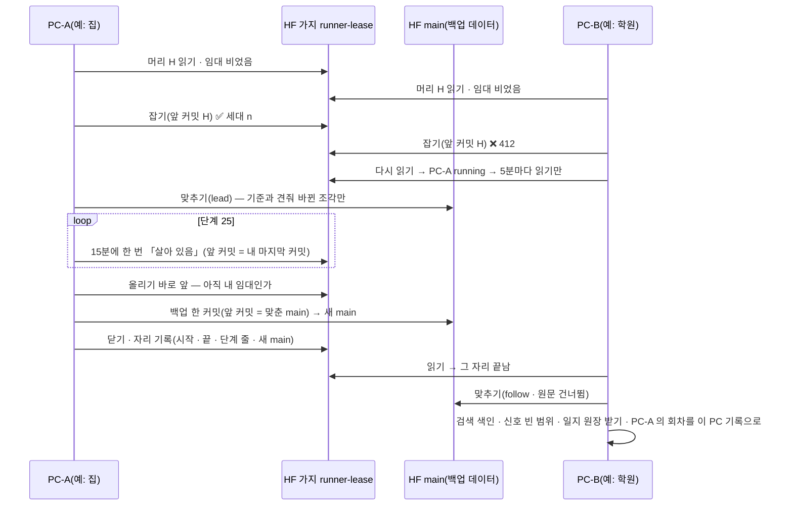
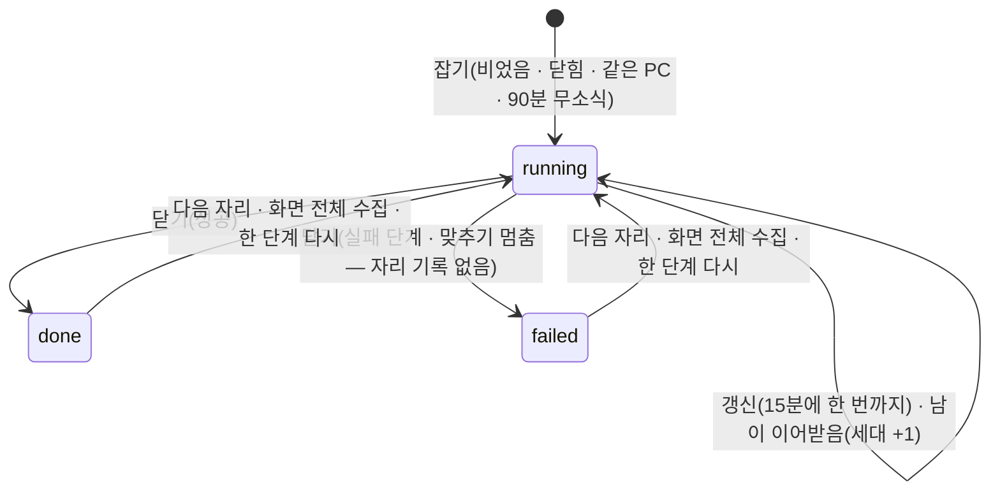

# 여러 PC 회차 설계 v0.2 — Qurious

| 문서 정보 | 내용 |
|---|---|
| **판 · 상태** | v0.2 · 실측(10-25 노트북 은퇴 · 데스크톱 주 PC · 14절) / v0.1 · 초안 — 구현과 같은 PR(#338 · 2026-10-25) |
| **구분** | 6. 시스템 설계 — 설계 문서(12:30 수집 회차를 어느 PC 에서든 돌리기 · 임대 · 맞추기 · 따라가기) |
| **담당** | 이동원(데이터 · 수집기 · 러너) |
| **검토** | 검토 전 |
| **최종 수정** | 2026-10-25 (KST) |
| **기준** | 코드 `main` `30c9ebe` + 이 PR · 정한 것 = [논의 결정 대장](../../../00-management/plans/논의결정대장.md) 부록 C 의 10-25 줄 |
| **근거 조사** | [여러 PC 회차 임대 — 1차 출처](../../../01-analysis/research/배경조사/2026-10-25-여러PC-회차-임대/결과.md)(HF 앞 커밋 비교 · 한도 · 임대 정석 · 작업 스케줄러) · [수집 실행 환경 옮기기](../../../01-analysis/research/배경조사/2026-10-25-수집-실행환경-옮기기/결과.md)(실무 정석 · 실행 자리 · 이전 절차) · [여러 PC 동시 켜짐](../../../01-analysis/research/배경조사/2026-10-25-여러PC-동시켜짐/결과.md)(v0.2 — 판 섞임 · PC 빼기 · Celery · 보이게 하기) |
| **관련 문서** | [목표 기능 ① 설계](../목표기능1-데이터지식-설계.md) 5.2(매일 수집 러너) · [그림자 일지 설계](../모의투자-그림자일지-설계.md) 9절 · [수집기 README](../../../../../collector/README.md) 19절 · [테스트 계획서](../../../04-testing/테스트계획서.md) TC-LE · TC-HS · TC-DU · TC-HF · TC-PJ |

> **이 문서로 알 수 있는 것**
> 1. 12:30 회차를 오늘 어느 PC 가 도는가 — 임대(`scripts/run_lease.py`)
> 2. 다른 PC 가 돌고 올린 뒤 이 PC 를 어떻게 원격과 같게 만드나 — 맞추기(`scripts/hf_sync.py`)
> 3. 못 잡은 PC · 늦게 켜진 PC · 도중에 꺼진 PC 는 무엇을 하나 — 따라가기 · 이어받기(`scripts/daily_update.py`)
> 4. 나중에 다른 환경(클라우드)으로 옮길 때 무엇을 하나 — 11절

---

## 0. 쉬운 요약 다섯 줄

1. 12:30 수집 회차는 이제 노트북 한 대가 아니라 **사용자 PC 어디서든** 돈다. 모든 PC 에 같은 예약 작업을 건다(12:30 · 1시간마다 10시간 다시 깨어남).
2. 한 회차 자리는 **먼저 임대를 잡은 PC 하나**만 돈다. 임대 = 백업 저장소의 가지 `runner-lease` 의 `lease.json` 하나 — HF 의 「앞 커밋이 그대로일 때만 커밋」(412)으로 둘이 동시에 잡을 수 없다.
3. 돌기 전에 원격이 앞섰으면 **바뀐 조각만 받아 갈아 끼운다**. 기준 · 원격 · 이 PC 세 판을 견줘 이 PC 만 바꾼 것은 지키고, 둘 다 바꾼 조각에서는 멈춘다(사람이 정함).
4. 못 잡은 PC 는 **끝나길 기다렸다 받는다**(따라가기). 그 회차를 이 PC 기록으로 남겨 관제 · 리밸런싱 하루 점검이 그 PC 에서도 그대로 돈다. 그림자 일지는 HF 원장에서 받아 넣고, 신호는 빈 날만 다시 계산한다.
5. HF 에 닿지 못하면 아무도 돌지 않는다(fail-closed · 다음 정시에 다시). 백업 올리기는 「원격이 앞섰나」 와 앞 커밋 비교를 거쳐 다른 PC 가 받은 날을 덮지 않는다.

## 1. 무엇을 · 왜 — 범위

사용자 말(원문) —
- 2026-10-24 「12:30 회차는 어느 PC 에서든 돌게(정해 두지 않음)」 · 「앞으로 집 · 학원 데스크톱」
- 2026-10-25 「지금 12:30 예약이 노트북에서만 동작하도록 되어 있는 것 같은데 어느 PC에서든 상관없이 돌아가도록 해야 됩니다. (사람마다 환경이 다르기 때문입니다.)」
- 2026-10-25 「노트북/데스크톱 상관없이 12:30 회차가 돌아야 됩니다.」 · 「환경 변경이나 다른 환경에서 진행하게 될 경우 어떻게 해야 될 지 잘 모르겠네요」(→ 11절 조사)

**왜 지금 그대로는 안 되나** — 회차가 한 PC 에 묶여 있으면 그 PC 가 꺼진 날 회차 · 백업이 통째로 빠지고, 수집 DB(6GB)를 들고 다녀야 한다. 그렇다고 PC 마다 그냥 예약을 걸면 셋이 겹친다 — ① 같은 출처를 두세 번 부르고(DART · 포털 한도) ② **뒤처진 PC 가 올리면 그 PC 의 올해 파일이 원격을 덮어 다른 PC 가 받은 날이 원격에서 사라진다**(올리기가 바뀐 조각 파일을 통째로 바꾸므로) ③ 그림자 일지는 판 등록 · 행이 앞 PC 의 앱 DB 에만 있어 다른 PC 에서 돌면 멈춘다(「추가만」 확인이 「원격에 있던 파일이 로컬에 없다」 로 막는다).

**범위** — 사용자 PC 들(집 · 학원 데스크톱 · 노트북 · 결정 ①). 팀원 PC 는 범위 밖이다 — 설치해도 HF 쓰기 권한이 없으면 회차를 잡지 못하고 「건너뜀」 한 줄로 끝난다.

**하지 않는 것** — 앱 DB 의 사용자 자료(계정 · 모의계좌 · 리밸런싱 계획 · 자동매매 설정)는 PC 마다 따로다(이 묶음 밖). Celery 예약 작업(자동매매 10분 · 리밸런싱 1시간)이 두 PC 에서 겹치는 문제도 밖이다 — 지금은 두 번째 PC 의 앱을 `start.ps1 -Dev -NoBrowser -NoCelery` 로 켠다(13절).

## 2. 정한 것

### 2.1 사용자가 정한 여덟(2026-10-25 · AskUserQuestion)

| # | 물음 | 정함 | 추천과 | 설계에 준 뜻 |
|:-:|---|---|:-:|---|
| ① | 「어느 PC」 의 범위 | **내 PC 들만** | 다름(추천 「누구의 PC 든」) | 팀원 PC 의 읽기 전용 · 토큰 없음 갈래를 따로 만들지 않는다 |
| ② | 임대 표시 자리 | **기존 백업 저장소 안 파일** — 「그 대신 꼼꼼하게 확인」 | 다름(추천 새 저장소) | 같은 저장소의 **전용 가지** `runner-lease` 에 둬 백업 이력(main)과 섞지 않는다 · 「원격이 바뀌었나」 는 머리 커밋이 아니라 매니페스트 파일 구성으로 판정 |
| ③ | 뒤처진 PC 맞추기 | **바뀐 파일만 갈아 끼우기** | 같음 | 5절 — 세 판 견줌 · 겹치면 멈춤 · 새 PC 만 전체 복원 |
| ④ | PC 마다 회차 시각 | **모두 12:30** | 같음 | 설치 값 하나 · 같은 분 시작은 임대가 가른다 |
| ⑤ | 못 잡은 · 늦게 켜진 PC | **끝나길 기다렸다 받기** | 같음 | 6.3 · 8.2 따라가기 |
| ⑥ | 앱 DB 단계(신호 · 일지) | **이번에 함께** | 같음 | 6.1 일지 받기 · 6.2 신호 빈 범위 |
| ⑦ | 노트북 | **다른 PC 와 똑같이** | 같음 | 10절 옮기는 차례 — 새 코드 첫 회차는 노트북(가장 최신 DB) |
| ⑧ | 쥔 PC 가 꺼지면 이어받기 | **90분 무소식이면** | 같음 | 4.5 — 단계 사이 15분에 한 번까지 갱신 |

### 2.2 구현하며 정한 것(AI · 까닭을 함께)

| 무엇 | 정함 | 까닭 |
|---|---|---|
| HF 에 닿지 못할 때 | 회차를 잡지 않는다(fail-closed) · 이력 「건너뜀」 한 줄 | 잡지 않고 돌면 두 PC 가 겹쳐 돌고, 다음 날 맞추기가 겹침으로 멈춘다. 정시마다 다시 깨어나 HF 가 돌아오면 그 시각에 돈다 |
| 예약 작업 반복 | 12:30 부터 1시간마다 10시간 | 절전에서 깨어나 따라잡지 않은 PC(TIL 2026-10-11) · 로그온이 늦은 PC · 쥔 PC 가 꺼진 날의 이어받기를 다음 정시에 줍는다(조사 3절 ⑥) |
| 백업에서 빼 두던 표 다섯 | 백업에 넣는다(`EXCLUDED` 비움) | 공휴일 · 거래일 달력 · 금융 일정 · 정책 회의 · 기업 일정 — 따라가는 PC 가 바깥 출처를 다시 부르지 않고 받는다(작은 표 · 합 약 10만 행) |
| 응답 원문 표 | 갈아 끼우지 않고 없는 줄만 더한다 | 기본 키에 받은 시각이 있어 덧붙이기만 하는 표 — 412MB 조각을 날마다 지웠다 쓰지 않는다 |
| 따라가는 PC 의 복구용 표 | 건너뛴다(원문 · 수집 상태) | 앱이 읽지 않는 큰 표 — 하루 받는 양 약 730MB → 100MB 아래. 그 PC 가 회차를 잡으면 전부 맞춘다 |
| 임대 가지의 내용 | 처음 낼 때 데이터 파일을 지우고 안내 README · `lease.json` 만 | 시험 사고(12절)로 생긴 가지가 데이터 사본 109개 + 가짜 기록이라 팀원이 헷갈릴 수 있었다(사용자 「헷갈리면 지워야」) |

## 3. 한눈에 — 하루 흐름

**<그림 1> 두 PC 가 같은 12:30 에 깨어난 날** · 범례: 실선 = 쓰기 · 읽기 요청 · ✅ 이김 · ❌ 412(앞 커밋이 바뀜) · 회색 칸 = 되풀이



같은 흐름을 시각 순서로 —

```
12:30  PC-A ─ PC 잠금 ─ 임대 읽기(비었음) ─ 잡기(앞 커밋 = 가지 머리 → 이김 · 세대 n) ─ 맞추기(lead · 전부)
              ─ 단계 25 ─(단계 사이 15분에 한 번 「살아 있음」)─ 올리기 앞: 아직 내 임대? ─ 올리기(앞 커밋 = 맞춘 main)
              ─ 닫기(자리 기록: 누가 · 시작 · 끝 · 단계 줄 · 새 main)
12:30  PC-B ─ PC 잠금 ─ 임대 읽기(PC-A running) ─ 5분마다 읽기만 …… PC-A 닫음
              ─ 맞추기(follow · 원문 건너뜀) ─ 검색 색인 · 신호 빈 날 · 일지 원장 받기 ─ 「PC-A 의 회차」 를 이 PC 기록으로
18:10  PC-C 켜짐 ─(작업 스케줄러 「놓친 시작」 10분)─ 임대 읽기(자리 끝남) ─ 따라가기
13:30 ~ 22:30 정시마다 ─ 임대 읽기 ─ 자리 끝남 · 받을 것 없음 ─ 기록 · 로그 없이 몇 초 만에 끝
```


## 4. 임대 — `scripts/run_lease.py`

### 4.1 자리

백업 저장소 `qurious-quant/krx-daily-market` 의 **가지 `runner-lease`** 에 `lease.json` 하나. 처음 잡는 PC 가 main 에서 가지를 내고, **그 첫 커밋에서 main 에서 따라온 데이터 파일을 지우고** 「이 가지는 데이터가 아니다 — main 을 쓰라」 는 안내 README 만 남긴다. 데이터를 받는 모든 길(카드의 `huggingface-cli download` · `hf_hub_download` · `snapshot_download`)의 기본 가지는 main 이라 이 가지가 끼어들지 않는다. 한 해 커밋이 1천 ~ 2천 쌓이면 Hub 화면이 느려지므로(조사 Q2) 30일에 한 번 닫을 때 이 가지만 이력을 하나로 줄인다(`super_squash_history` · 되돌릴 수 없지만 가지 하나만).

### 4.2 칸

| 칸 | 뜻 |
|---|---|
| `gen` | 세대 — 잡을 때마다 +1(이어받을 때도) |
| `nonce` | 이 임대(잡은 실행)의 이름 — 갱신 · 닫기에도 그대로. `gen` 과 함께 「아직 내 것」 판정 |
| `write` | 쓸 때마다 새 값 — 내용이 늘 달라 라이브러리가 커밋을 건너뛰지 않게(건너뛰면 앞 커밋 비교도 빠진다) · 응답을 잃었을 때 「내 쓰기가 들어갔나」 |
| `state` | `running` · `done` · `failed` |
| `slot` · `kind` | 회차 자리(날짜) · 실행 종류(`schedule` 정기 · `manual` 화면 전체 수집 · `only` 한 단계 다시) |
| `pc` · `pid` · `run` | PC 이름(사용자 이름 · 경로는 적지 않는다) · 프로세스 · 회차 시작 시각 |
| `acquired_at` · `renewed_at` · `finished_at` | 잡음 · 마지막 「살아 있음」 · 닫음 |
| `taken_from` | 이어받았으면 누구의 무엇을(PC · 세대 · 마지막 갱신) |
| `slots` | 최근 14 자리 — 누가 · 성공 · 종료코드 · 시작 · 끝 · 새 main · 시세 기준일 · 단계 줄. 따라가는 PC 가 이것으로 이 PC 회차 기록을 만든다 |

### 4.3 회차 자리

`slot_of(시각)` — **12:28 부터 그날 자리**, 그 앞은 전날 자리(전날 12:30 을 놓친 따라잡기). 12:28 은 러너의 따라잡기 여유(`CATCH_UP_SLACK_MIN` 2분)와 같다 — 진짜 12:30 회차가 시계 차이로 몇 초 일찍 깨어나도 그날 자리다(TC-LE-01 · 02).

### 4.4 잡기 — 판정과 겨룸

| 읽은 임대 | 정기 회차 | 화면 전체 수집 · 한 단계 다시 |
|---|---|---|
| 없음 · 닫힘(그 자리 기록 없음) | 잡는다 | 잡는다 |
| 닫힘 · **그 자리 기록 있음** | **done** → 따라가기 | 잡는다 |
| `running` · 이 PC | 잡는다(이 PC 잠금을 잡았으니 앞 실행은 끝났다) | 잡는다 |
| `running` · 남 · 90분 안 | **busy** → 기다렸다 따라가기 | **busy** → 75(작업자가 다시 대기로) |
| `running` · 남 · 90분 넘음 | 세대를 올려 **이어받는다** | 이어받는다 |

쓰기는 `create_commit(parent_commit = 방금 읽은 가지 머리)` 한 번이다. 412 면 남이 먼저 썼다 — 다시 읽어 한 번 더 판정한다(대개 남의 `running` → busy). 시간 초과 · 5xx(응답을 잃음)는 다시 읽어 **내 `write` 가 있으면 이긴 것**, 없으면 판정 불가(LeaseError). 429 는 「나중에」. `upload_folder` 는 쓰지 않는다 — 스스로 다시 보내 이긴 커밋을 412 로 보이게 한다(조사 Q1 함정 2). 받은 oid 가 앞 커밋과 같으면(커밋이 생기지 않음) 이긴 것으로 보지 않는다.

### 4.5 갱신 · 닫기 · 만료

**<그림 2> 임대 상태** · 범례: 화살표 글 = 그 상태로 가는 때 · 세대(`gen`)는 잡을 때마다 +1




- **갱신** — 단계 사이에서 앞 갱신 뒤 **15분**이 지났을 때만 `renewed_at` 을 다시 쓴다(보통 회차에 커밋 3 ~ 5). 412 면 다시 읽어 아직 내 것(세대 · nonce 같음)이면 새 머리 위에 한 번 더(가지 정리 등), 아니면 **LeaseLost** — 회차는 뒤 단계 · 올리기를 하지 않고 멈춘다.
- **만료** — 마지막 갱신 뒤 **90분**(결정 ⑧). 가장 긴 단계 한도 60분 + 갱신 간격 15분 = 75분 < 90분이라 살아 있는 쥔 PC 를 빼앗지 않는다(TC-LE-01 이 지킨다). 판정은 읽는 PC 의 시계로 하므로 PC 사이 시계 차이(초 단위)는 15분 여유가 덮는다.
- **닫기** — 정기 · 전체 수집이면 그 자리 기록을 남긴다. **맞추기가 멈춰 단계를 돌지 못한 회차는 자리를 채우지 않는다** — 채우면 다른 PC 가 그날을 「끝남」 으로 보고 따라가기만 해 그날 회차가 아무 데서도 돌지 않는다. 한 단계 다시도 채우지 않는다. 빼앗긴 임대는 닫지 않는다(쓰지 않음).

### 4.6 좀비 막기

절전에서 깨어난 옛 쥔 PC 는 아무 일 없던 듯 이어 간다(Kleppmann 「멈춤」 · 조사 Q4). 그래서 ① 다음 갱신 · 닫기는 앞 커밋 비교에서 412 → LeaseLost ② **백업 올리기 바로 앞에 `still_mine`**(세대 · nonce · running) ③ 백업은 main 머리를 앞 커밋으로 한 번 더 비교(7절) — 임대 가지와 main 은 가지가 달라 임대의 412 가 main 쓰기를 막아 주지 않으므로 ②③ 을 따로 둔다.

### 4.7 HF 한도 · 읽기

무료 사용자 5분에 API 1,000 · 받기 5,000(조사 Q2 · 2025-09 표) — 우리 쓰임은 하루 커밋 3 ~ 8 · 회차당 요청 수십 번이라 멀다. 커밋 시간당 한도는 공개되지 않았다 — **알아보려고 일부러 많이 커밋하지 않는다**. 판정 읽기는 `repo_info(...).sha`(40자) 로 머리를 얻고 그 SHA 로 고정해 받는다 — 가지 이름으로 받으면 망 오류 때 옛 캐시를 예외 없이 준다(조사 Q3). 기본 HTTP 클라이언트는 시간 한도가 없어(커밋이 끝없이 걸릴 수 있음) 이 PC 프로세스는 읽기 120초 · 연결 20초 한도를 둔다(`run_lease.set_timeouts`).

## 5. 맞추기 — `scripts/hf_sync.py`

### 5.1 세 판

- **기준** `data/collector/state/hf_sync_base.json` — 이 PC 가 마지막으로 원격과 같았던 때의 파일 목록(경로 → sha256 · 내용 지문 · 행 수). 올리기 · 맞추기가 끝날 때 쓴다. 이 판 앞의 PC 는 매니페스트의 「올린 기록」 에서 만든다(내용 지문은 지금 파일이 올린 것과 같을 때만 안다 — 모르면 겹침 쪽으로 기운다).
- **원격** — main 머리의 `meta/manifest.json`(머리 SHA 로 고정해 받음). 「원격이 바뀌었나」 는 머리가 아니라 **파일 구성 지문**(경로 + sha256 · `hf_dataset._manifest_fp` 와 같은 셈)으로 본다 — 카드 · 임대처럼 데이터가 같은 커밋은 맞출 일이 아니다.
- **이 PC** — 수집 DB 조각의 내용 지문(내보내기와 같은 셈 `_content_sig` — 행 수 · 칸마다 합 · 빈칸 수 · 최소 · 최대).

### 5.2 조각마다 할 일

| 원격 ↔ 기준 | 이 PC | 할 일 |
|---|---|---|
| 같다 | — | 그대로(이 PC 의 변경은 다음 올리기가 싣는다) |
| 다르다 | 원격과 같다 | **받기만**(adopt) — DB 는 그대로 · 파일 · 목록만 |
| 다르다 | 기준과 같다 · 빈 조각 | **갈아 끼움**(replace) — 지우고 원격 파일로 채운 뒤 내용 지문이 원격과 같을 때만 커밋(한 조각 = 한 트랜잭션 · 다르면 되돌림) |
| 다르다 | 응답 원문 | **없는 줄만 더함**(union) — 이 PC 만의 원문 줄도 남는다 |
| 다르다 | 기준과도 원격과도 다르다 | **겹침**(conflict) — 아무것도 바꾸지 않고 멈춤(65) |
| — | 표 모양(칸)이 원격과 다르다 | **멈춤**(schema) — 코드를 먼저 맞춘다(`git pull`) |
| — | 따라가기의 복구용 표 | **건너뜀**(skip) — 기준을 「일부」 로 적어 그 PC 가 회차를 잡으면 「같음」 으로 지나치지 않는다 |

받는 파일은 sha256 을 매니페스트와 대조한다. 끝나면 이 PC 매니페스트에 받은 조각을 넣고 원격에 있는 파일을 「올린 것」 으로 적는다 — 다음 내보내기는 아무것도 다시 쓰지 않고(TC-HS-03) 다음 증분 올리기는 이 PC 가 새로 바꾼 조각만 싣는다.

### 5.3 백업에 넣은 표 다섯

`holiday_kasi` · `market_calendar` · `market_event` · `policy_meeting` · `corp_schedule` — 2026-10-02 에 「다시 만들 수 있다」 며 뺐던 표다. PC 를 옮겨 다니자 따라가는 PC 가 바깥 출처(KASI · 한국은행 · 연준)를 다시 부르지 않고 회차를 돈 PC 의 표를 그대로 받게 넣었다. 모두 통째로 한 파일이다.

### 5.4 겹침이 생기면

임대가 하루 한 PC 를 고르므로 겹침은 드물다. 생기는 때 — ① 올리지 않는 실행(`run` · 손 명령 · 바로 백업 전)이 바꾼 조각을 다른 PC 가 먼저 올렸다 ② 이 판 앞의 사본(예: 10-24 저녁 노트북에서 복사한 데스크톱 `data/`)을 그대로 쓴다. 이 PC 것을 버려도 되면 `python scripts/daily_update.py sync --discard-local`(겹친 조각만 원격 것으로). 이 PC 것이 맞으면 사람이 정한다 — 그 조각의 차이를 보고 원격 쪽 PC 에서 다시 받게 하거나 손으로 합친다. 겹침이 풀릴 때까지 그 PC 는 임대를 건드리지 않고 「건너뜀」 한다(같은 겹침으로 날마다 임대를 잡았다 놓지 않게).

### 5.5 새 PC

수집 DB 가 없는 PC 는 `python scripts/daily_update.py sync --full` — 원격 전부(약 1.1GB)를 받아 sha256 대조 · 복원(내용 지문 · 원문 sha256 · 감사 링크까지 · 10-18 실측 9분) 뒤 기준 = 원격. DB 가 있으면 하지 않는다(실수로 덮지 않게).

### 5.6 하루 받는 양(10-24 매니페스트로 셈)

원격 1.1GB 가운데 날마다 바뀌는 파일은 약 732MB 이고 대부분이 응답 원문(포털 412MB · DART 182MB · 정책뉴스 46MB)이다. 따라가는 PC 는 원문 · 수집 상태를 건너뛰어 **약 100MB 아래**(올해 조각 · 작은 표), 회차를 잡은 PC 는 앞서 맞출 게 있을 때만 원문까지 받는다(합치기라 쓰기는 새 줄만).

## 6. 앱 DB 쪽 — 일지 · 신호 · 회차 기록

### 6.1 그림자 일지 — 원장 받기

러너의 `journal` 단계가 `paper_journal.py daily --quiet --pull` 을 부른다. 계산 앞에 HF 비공개 원장(`qurious-quant/qurious-paper-log`)을 머리 SHA 로 고정해 받고 지문을 대조한 뒤, **이 PC 앱 DB 에 없는 판 · 메모 · 행만 더한다**. 판 · 메모 번호는 원장 그대로 넣고(판 지문 · 메모가 그 번호를 가리킨다) 자동 번호를 그 뒤로 옮긴다. 넣은 뒤 다시 내보낸 내용 지문이 원장의 **모든** 파일과 같아야 커밋한다 — 다음 올리기의 「추가만」 확인과 같은 잣대(TC-PJ-17 · 18). 같은 경로에 다른 내용이 있으면(이 PC 에서 따로 등록한 판) 아무것도 쓰지 않고 멈춘다(종료코드 4 · 그날 계산도 하지 않는다 — catch_up 이라 다음 회차가 잇는다). 받기는 `scripts/paper_journal.py` 에만 있다 — **판 지문에 든 앱 함수는 고치지 않았다**(10-25 지문 확인: 카드 `443aed4f32f9` · 기본 규칙 `e574c622ee81` = 등록된 판 1 과 같음).

### 6.2 신호 — 빈 범위

`signals` 단계는 앱 DB 기록(`signal_snapshots.as_of`)의 마지막 날 다음부터 수집 DB 마지막 거래일까지가 이틀 넘게 비었으면 그 범위를 채우기 인자로 한 번에 돈다(31일까지 · 기록이 비었으면 끝날 앞 31일). 그날 하루뿐이면 평소 인자. 회차가 다른 PC 에서 돈 날은 이 PC 앱 DB 에 신호가 없다 — 다음에 이 PC 가 돌 때(회차든 따라가기든) 함께 계산한다. 앱 DB 를 읽지 못하면 평소처럼.

### 6.3 따라간 PC 의 회차 기록

따라가기가 받을 것을 받으면 쥔 PC 의 회차(임대의 자리 기록 — 시작 · 끝 · 성공 · 단계 줄)를 이 PC 의 `daily_update_last.json` · 이력 줄로 남긴다(`trigger: follow` · `followed: {pc, slot, main}` · 단계 줄마다 `remote: true` · 시세 기준일은 맞춘 뒤 이 PC 수집 DB 에서 잰다). 리밸런싱 하루 점검(`app/services/rebalance_daily.py` — 오준영 님)의 조건 「오늘 12:30 뒤 시작 · 끝남 · 시세 · 달력 성공 · 시세 기준일 = 전 거래일」 이 이 PC 에서도 그대로 맞는다(TC-DU 가 `_required_steps_ok` 로 잰다). 앱 쪽 코드는 고치지 않았다.

### 6.4 하지 않는 것

앱 DB 의 다른 표(사용자 · 모의계좌 · 주문 · 리밸런싱 계획)는 맞추지 않는다 — PC 마다 따로 쓰는 개발 DB 다. 팀 배포(한 서버)에서는 이 문제가 없다.

## 7. 백업 올리기 — `scripts/hf_dataset.py`

- **게이트 5(새)** — ① 러너가 넘긴 앞 커밋(`QURIOUS_HF_PARENT` = 맞출 때 본 main 머리)이 지금 머리와 다르면 올리지 않는다 ② 원격 매니페스트가 이 PC 기준과 다르면(다른 PC 가 올렸다) 올리지 않는다 — 둘 다 종료코드 **76**(먼저 맞추기). 뒤처진 PC 가 다른 PC 가 받은 날을 덮지 않게.
- **한 커밋** — 증분 올리기를 `upload_folder` 대신 `create_commit` 한 번으로 묶고 앞 커밋 = 방금 본 main 머리. `upload_folder` 는 큰 묶음을 여러 커밋으로 쪼개 첫 커밋에만 비교가 걸린다(조사 Q1). 올리는 사이 남이 올리면 412 → 76 · 태그 · 올린 기록 · 기준을 쓰지 않는다.
- **태그는 올린 커밋에** — 이름만 주면 그사이 생긴 남의 커밋에 붙을 수 있다(`revision=` 올린 커밋).
- **기준 갱신** — 올린 뒤 기준 = 올린 매니페스트 · 새 main(`hf_sync.after_upload`).
- **결함 고침** — huggingface_hub 2.x 에는 `upload_large_folder` 가 없어(1.31 에만) 전체 올리기(`upload` 를 `--incremental` 없이)가 `AttributeError` 로 멈출 자리였다 → 있으면 그것, 없으면 `upload_folder`(TC-HF-13).

## 8. 러너 · 예약 작업 — `scripts/daily_update.py`

### 8.1 회차 흐름(올리는 회차 — `--upload`)

| 할 일(`coord_begin`) | 뜻 | 러너가 하는 일 | 종료코드 |
|---|---|---|---|
| `lead` | 임대를 잡고 맞췄다 | 단계를 돈다 · 단계 사이 갱신 · 올리기 앞 확인 · 끝에 닫기 | 평소 |
| `follow` | 그 자리를 남이 끝냈거나 도는 중(정기) | 기다렸다 받기(8.2) · 회차 기록 · 할 일 없으면 조용히(기록 · 로그 없음) | 0 |
| `busy` | 남이 도는 중(화면 전체 수집 · 한 단계 다시) | 멈춤 — 「건너뜀」 줄 없음 | 75 |
| `skip` | HF 에 닿지 못함 · 토큰 없음 · 맞추기 실패 | 「건너뜀」 한 줄(까닭 코드 `multi_pc_skip`) — 다음 정시에 다시 | 0(정기) · 75(수동) |
| `conflict` | 이 PC 맞추기가 겹침 | 「건너뜀」 한 줄(`multi_pc_conflict`) · 풀릴 때까지 임대를 건드리지 않음 | 0(정기) · 1(수동) |

올리지 않는 회차(`run` 만)는 지금처럼 이 PC 만 돈다(임대 · 맞추기 없음) — 그 변경은 다음 맞추기가 견준다.

### 8.2 따라가기

남이 그 자리를 도는 중이면 5분마다 임대를 읽기만 하며 기다린다(최대 3시간 — 작업 스케줄러 한도 4시간 안). 그동안 진행 파일은 「다른 PC(…) 회차를 기다림」 이라 화면이 「수집 중」 과 가른다. 쥔 PC 가 닫으면 맞추기(follow) → 받은 것이 있으면 검색 색인(이 PC 파일) → 신호 빈 범위 → 일지 원장 받기 → 회차 기록. 쥔 PC 가 90분 넘게 소식이 없거나 자리를 채우지 않고 닫았으면 **이어받아** 이 PC 가 돈다.

### 8.3 예약 작업 · 명령

- 모든 PC 에 `python scripts/daily_update.py install` — 12:30 · 놓치면 켜진 뒤 10분 · **1시간마다 10시간(22:30 까지) 다시 깨어남** · 겹치면 새 실행 버림 · 로그온 토큰(비밀번호 저장 없음).
- `python scripts/daily_update.py sync` · `sync --discard-local` · `sync --full` — 사람이 부르는 맞추기(러너 잠금 · 11:00 ~ 13:30 막음).
- `python scripts/daily_update.py status` — 끝에 「여러 PC」 줄(이 PC 가 마지막으로 본 임대 · 기준 · 마지막 맞추기 — 망 없이). 원격은 `python scripts/run_lease.py status` · `python scripts/hf_sync.py status --plan`(읽기만).

## 9. 시험 · 깨 보기

| 묶음 | 파일 | 새로 · 더함 | 무엇을 |
|---|---|---|---|
| TC-LE | `tests/test_run_lease.py` | 새 12 | 하나만 잡힘(412) · 만료 · 같은 PC · 갱신 · 빼앗김 · 응답 유실 · no-op · 닫기 자리 · 기다리기 · 가지 정리 · 닿지 못함 |
| TC-HS | `tests/test_hf_sync.py` | 새 14 | 같음 · 갈아 끼움(다음 내보내기 0) · 받기만 · 겹침 · 이 PC 만 바꾼 조각 · 원문 합치기 · 따라가기 건너뜀 · 새 표 · 받은 파일 · 지문 틀림 · 표 모양 · 기준 처음 만들기 · 앞섰나 · 새 PC 전체 복원 |
| TC-DU | `tests/test_daily_update.py` | 더함 13 | 회차 잡기 · 올리기 앞 커밋 · 올리기 앞 임대 확인 · 따라가기 기록 · 조용한 반복 · 앱 DB 단계 · 기다리기 · 닿지 못함 · 겹침 · 임대 잃음 · 반복 트리거 · 빈 범위 · 한 단계 다시 |
| TC-HF | `tests/test_hf_dataset_tables.py` | 고침 2 · 더함 3 | 표 다섯 백업 · 한 커밋 · 앞 커밋 · 태그 자리 · 앞섰으면 76 · 412 · 전체 올리기 대체 |
| TC-PJ | `tests/test_paper_journal.py` | 고침 1 · 더함 2 | 일지 단계 `--pull` · 원장 왕복 지문 · 빈 앱 DB 로 받기(일회용 DB) |

**시험은 진짜 HF 에 닿지 않는다** — `tests/conftest.py` 의 자동 픽스처 `_no_real_hub` 가 huggingface_hub 를 오프라인으로 두고(실제 요청은 모두 예외 · 자식 프로세스도 환경변수로) 여러 PC 모듈의 토큰 읽기 · 상태 파일을 막는다(12절 사고 뒤).

**깨 보기 28 — 모두 잡음** — 코드를 한 곳씩 일부러 고장 내고 그 곳을 지키는 시험만 돌린 뒤 매번 원래대로 되돌렸다(임대 일곱 · 맞추기 일곱 · 백업 올리기 넷 · 러너 아홉 · 일지 하나). 표는 [테스트 계획서](../../../04-testing/테스트계획서.md) <표 8-56>.

## 10. 옮기는 차례(이 PR 머지 뒤 · 사용자)

1. **노트북**(가장 최신 수집 DB · 그림자 일지 판 등록이 있는 앱 DB) — `git pull` → `python scripts/daily_update.py install`(새 예약 — 반복 · 같은 명령). 다음 정기 회차가 임대를 처음 잡고(가지를 만들고 정리) · 노트북의 새 표 넷 · 표 다섯을 올린다. 바로 올리려면 `run --only export --upload` → `--only verify --upload` → `--only upload --upload`.
2. **데스크톱 둘** — `git pull` → 노트북의 첫 새 코드 올리기 뒤 `python scripts/daily_update.py sync --discard-local`(10-24 저녁 사본을 원격에 맞춤 — 겹친 조각은 원격 것으로) → `install`. 앱은 `start.ps1 -Dev -NoBrowser -NoCelery`(Celery 겹침 막기 · 13절).
3. 그 뒤로는 어느 PC 가 켜져 있든 12:30 에 하나가 돌고 나머지는 따라간다. `python scripts/run_lease.py status` 로 누가 돌았는지 본다.

⚠️ 머지 앞에 이 PR 브랜치에서 `install` 하지 않는다 — 작업 트리가 main 으로 돌아가면 옛 코드(임대 · 맞추기 없음)가 그 예약으로 돌아 겹친다.

## 11. 다른 환경으로 옮길 때 — 실무 조사 요약

조사 [수집 실행 환경 옮기기](../../../01-analysis/research/배경조사/2026-10-25-수집-실행환경-옮기기/결과.md)(10-25) — 사용자 물음 「환경 변경이나 다른 환경에서 진행하게 될 경우 어떻게 해야 될 지」 의 답이다.

**정석 여섯** — 실행 자리는 버려도 되게(상태는 바깥에) · 몇 번 돌려도 같게(멱등) · 놓친 구간은 날짜를 주고 다시 받기 · 설정 · 비밀값은 환경에서 자리마다 · 의존성 판 고정 · 이미지로 묶기 · 기록은 자리 밖 · 복원은 정기 시험. 우리 러너는 멱등 · 단계 기록 · 복원 리허설이 이미 강하고, 이 묶음으로 「상태는 바깥(HF)에 · 자리는 버려도 되게」 에 가까워졌다.

| 언제 | 할 일 | 까닭 |
|---|---|---|
| 지금(발표 전) | 잠금 파일대로 설치하는 한 명령 · 환경 점검 명령 · `.env.example` 에 수집 열쇠 목록 | 이 데스크톱 `.venv` 가 잠금과 판이 다르다(huggingface_hub 2.3↔2.0 · pyarrow 26↔25 · 파이썬 3.13↔앱 3.12) · 새 자리마다 무엇이 필요한지 한 곳에 |
| 지금 | PC 마다 쓰기 범위를 좁힌 HF 토큰(fine-grained) | 한 PC 토큰이 새도 다른 PC · 저장소에 번지지 않게 |
| 여유 있으면 | 「창보다 오래 쉼」 경고 · 상태 폴더 나누기 · 이전 체크리스트 한 장 | 공시 3일 · GDELT 30시간 창보다 오래 쉬면 사람이 채워야 한다 |
| 나중(팀 AWS) | EventBridge Scheduler(시간대 Asia/Seoul) + Fargate ARM(서울 · 월 약 $2 ~ 5) + Parameter Store · 컨테이너 `TZ=Asia/Seoul` · **같은 임대를 잡게** 하고 그림자 운영 1 ~ 2주 뒤 전환(= 옛 예약 끄기 하나) | Lambda 는 15분 한도라 60분 회차에 맞지 않다 · 시간대 없는 시각 호출 48곳이 UTC 컨테이너에서 9시간 어긋난다 |
| 지금 하면 손해 | 오케스트레이터(Airflow · Dagster · Prefect) · 발표 전 클라우드 이전 · 상시 기계 구매 · 망 파일시스템 위 SQLite | 3주 남은 프로젝트에 운영 짐만 는다 |

**사람이 정할 것** — OpenDART 인증키는 제3자 이용, 한국은행 ECOS 키는 양도를 약관이 금한다. 팀 계정(AWS)에서 개인 키를 쓰는 것은 따로 정한다. 공공데이터포털 · OpenDART · ECOS · KASI · 정책브리핑 약관에 해외 IP 차단 · 국외 보관 금지 문장은 없었지만, 실제로 막히는지는 불러 보기 전에는 모른다(법제처는 IP 등록 여부를 확인할 것).

## 12. 사고 기록 — 시험이 실제 HF 에 닿음(2026-10-25 · DF-154)

- **무엇이** — 러너 시험 몇 개가 `run_all(upload=True)` 를 불렀는데 시험용 가짜 러너가 새 여러 PC 흐름을 막지 않아, 이 PC `.env` 의 실제 토큰으로 백업 저장소에 가지 `runner-lease` 를 만들고 임대 잡기 · 닫기 커밋 약 30개(세대 14 · 가짜 시계 2026-10-12)를 썼다. main(데이터) · 태그 27개는 그대로였다.
- **어떻게 고쳤나** — ① 시험 공통 자동 픽스처가 huggingface_hub 를 오프라인으로 두고 토큰 읽기 · 상태 파일을 막는다 ② 가짜 러너가 여러 PC 흐름을 기본으로 끈다 ③ 이 PC 상태 파일 셋을 지웠다 ④ 가지를 읽어 사고 가지인지 확인한 뒤 지웠다(사용자 「팀원들이 헷갈리면 지워야」 · 지운 뒤 main · 태그 그대로 확인) ⑤ 앞으로 새 임대 가지는 데이터 파일 없이 안내만(4.1).
- **교훈** — 원격에 쓰는 새 길을 만들면 **기존 시험이 그 길을 타는지부터** 본다 — 시험 픽스처가 먼저 막고, 그다음에 시험을 돌린다.

## 13. 남은 것 · 다음

- ~~**실측**~~ — 10-25 에 했다(14절). 첫 따라가기(두 데스크톱이 같은 회차에 켜진 날)는 아직이다.
- **판 문지기 · 끝 날짜 인자**(사용자 결정 10-25 「넣는다」 · 11-12 전) — 원격 임대 · 매니페스트에 최소 프로토콜 번호를 두고 옛 판 PC 는 올리기 · 따라가기를 멈춘다 · `install --until` 로 작업 스케줄러 끝 날짜를 코드가 넣는다(지금 `scripts/` 에 `EndBoundary` 가 없어 `install` 을 다시 돌리면 손으로 넣은 11-12 가 사라진다 · 14.4). 시험 먼저.
- **Celery 겹침** — 사용자 결정(10-25): **두 데스크톱 모두 Celery 를 켜고 자동매매도 두 PC 에서 쓸 수 있게 둔다**(작업을 두 곳에서 나눠 하므로). 지금은 증권사 설정 셋 모두 자동매매 꺼짐이라 주문이 나가지 않는다. 같은 사용자를 두 PC 앱 DB 에서 함께 자동매매로 켜면 쿨다운이 그 PC 의 Redis 에만 있어 겹칠 수 있다(조사 Q4) — 켤 때 한 번 더 본다.
- **화면** — 관제 · 수집 일정에 「오늘 회차는 어느 PC · 따라감」 표시(이 판은 회차 기록 칸 `multi` · `followed` 만 · 화면은 Figma 확정 뒤).
- **11절 「지금」 줄** — 환경 점검 명령 · 잠금대로 설치 · `.env.example` 열쇠 · 법제처 IP 확인.

## 14. 실측 — 10-25 노트북 은퇴 · 데스크톱 주 PC

### 14.1 무엇이 바뀌었나 — 노트북을 빼기로

머지(#338 · 12:57) 뒤 데스크톱에서 c 를 역할 2 로 돌리니 「원격에 노트북의 새 코드 올리기가 아직 없다」 로 멈췄다(안전장치가 맞게 동작). 원격 main `e5bd86a3` 은 노트북이 그날 12:30 회차(옛 코드 `3ca94de` + S146 파일)로 12:49 에 올린 판이었고, 데스크톱 수집 DB 는 10-24 16:07 사본 그대로였다(노트북이 그 회차만큼 새것 — 뉴스 +1,414 · 수집일 +83 · 전체 재무 +216 · 재무 점검 +300 · 원문 +30). 사용자 결정(13시): **「노트북이 더이상 돌아가지 않도록 — 아예 작업 환경에서 분리(노트북에서는 이 프로젝트 작업을 더 하지 않는다)」**. 옛 코드는 임대를 몰라 원격에서 막을 수 없으므로 노트북 예약을 먼저 지우고 데스크톱이 넘겨받았다.

### 14.2 차례와 결과

| 때 | 어디 | 무엇 | 결과 |
|---|---|---|---|
| 13:42 · 13:43 | 노트북 `BOOK-H50M6FQCLF` | 은퇴 스크립트(하드 `.carry\retire-laptop.ps1` · 사본 `docs/_git-drafts/2026-10-25-S148/`) — ① 이름이 Qurious 로 시작하는 예약 모두 지움 ② 러너가 돌면 멈춤 ③ 앱 DB `pg_dump` → 하드 ④ compose 프로젝트 `qurious` 컨테이너만 restart=no + 멈춤(이름 `fin-ai-*` 은 강사님 lumina-invest 와 겹쳐 이름으로 고르지 않음) ⑤ 기록 | 첫 번째는 Docker 가 꺼져 ③④ 를 못 함 → Docker 를 켜고 다시 · 예약 셋 지움(`Qurious-daily-data-update` · `-collect-worker` · `-weekly-rehearsal`) · 앱 DB 1.6MB · 컨테이너 8 멈춤 · 마지막 회차 10-25 12:30 ~ 12:50 성공 · 못 한 것 0 |
| 13:31 ~ 13:36 | 데스크톱 `DESKTOP-LFFLVI2` | `daily_update.py sync --discard-local`(11:00 ~ 13:30 막는 때 뒤) | synced · 80조각(받기만 70 · 갈아 끼움 4 · 합치기 4 · 겹침 2 → 원격 것) · 3,358,839행 · 0.76GB · 5분 · 기준 = 원격 `e5bd86a3` |
| 13:4x | 데스크톱 | `install` | 12:30 · 1시간마다 10시간 다시 깨어남 |
| 13:47 ~ 13:51 | 데스크톱 | 바로 올리기 `run --only export · verify · upload --upload` | export 217초 · verify 8초 · upload 9초 → 원격 main `a33a795e` · 표 20 → 25(새 표 다섯 — 공휴일 158 · 장 달력 2,922 · 시장 일정 67,363 · 정책 회의 113 · 기업 일정 35,429) · 임대 가지 `runner-lease` 처음 생김(세대 3 · 단계마다 잡고 닫음) |
| 13:5x | 데스크톱 | 노트북 앱 DB 옮김(사용자 결정 「옮긴다」) | 이 PC 앱 DB 백업(`data/local-run/appdb-backup/` · 317KB) 뒤 `pg_restore --clean --if-exists` → 사용자 4 · 모의계좌 4 · 주문 160 · 그림자 일지 68일 · 신호 4,812 · alembic `0026_paper_journal` 같음 · 증권사 설정 셋 모두 `quant_auto_enabled = false` |
| 13:5x | 데스크톱 | 예약 둘 더(사용자 결정 「둘 다」) · 앱 Celery 켬 | `Qurious-collect-worker`(매 분) · `Qurious-weekly-rehearsal`(일 15:00) · 셋 다 끝 날짜 `2026-11-12T23:59:59` · `start.ps1 -Dev -NoBrowser`(Celery 켬) |

### 14.3 정한 것(사용자 · 10-25)

- **운영 기간** — 「이 PC와 학원 PC 둘 다 Celery를 켤 예정 · 11월 13일부터는 사용하지 않을수도 있어 최종을 일단 11월 12일까지 · 더 발전시키는 것은 개인 프로젝트」.
- **운영 끝(11-13)** — 「일단 둘 다 끄되 나중에 다시 킬 수 있도록」 → 예약 셋은 끝 날짜로 저절로 멈추고(작업은 남아 있음), Celery 는 `scripts/personal/stop.ps1` 로 끈다(컨테이너 · 볼륨은 남음). 다시 켜기: `python scripts/daily_update.py install`(+ 작업자 · 복구 시험 `install`) → 끝 날짜를 다시 넣고(14.4) → `start.ps1 -Dev -NoBrowser`.
- **주문이 나가는 기능** — 두 PC 모두(13절 Celery 줄). **노트북 HF 토큰** — 그대로 둔다(예약이 없어 저절로 쓰이지 않는다).

### 14.4 남은 것 · 함정

- **오늘 회차 한 번 더** — 노트북 옛 코드 회차는 임대 자리 기록을 남기지 않고, 「한 단계 다시(only)」 는 자리를 채우지 않아(`scripts/run_lease.py:438`) 데스크톱이 14:30 에 10-25 회차를 새 코드로 한 번 더 돌았다 — 첫 실제 회차: 14:30:05 임대 세대 4 · 맞추기 같음 · 단계마다 갱신 · 일지 · 신호 · 내보내기 · 대조 · 올리기 · 일봉 올리기 ✅ · 14:58:12 닫으며 자리 2026-10-25 기록(종료코드 1 — 멈추지 않는 `ohlcv` 의 분봉이 `yfinance` 가 없어 실패 · 아래 DF-157). 같은 자리는 다시 돌지 않는다(반복 깨어남은 받기만).
- **끝 날짜가 사라지는 길** — `install` 이 작업을 통째로 바꿔(`/F` · `scripts/daily_update.py:2146`) 손으로 넣은 끝 날짜가 사라진다. 판 문지기 묶음에서 `--until` 을 넣기 전에는 `install` 뒤 `Set-ScheduledTask` 로 트리거 `EndBoundary` 를 다시 넣는다. 다른 데스크톱이 처음 켜질 때(c 역할 2)도 같다.
- **PC 마다 다른 파이썬 패키지**(DF-157) — 수집기 분봉 단계가 선언되지 않은 `yfinance` 에 기대어, 데스크톱 첫 정기 회차(14:30)에서 분봉 60분 · 5분이 실패했다(멈추지 않는 단계). 이 PC `.venv` 에 0.2.66 을 깔아 맞췄고, 선언 · 고정 · 환경 점검은 할 일 ①-31. 다른 데스크톱이 처음 켜질 때도 같다.
- **복구 시험 창**(DF-158) — 일요일 15:00 복구 시험이 자식을 창과 함께 띄워, 사람이 쓰는 데스크톱에서는 검은 창이 뜨고 닫히면 단계가 끊긴다(10-25 복원 리허설 끊김). 러너 · 작업자처럼 창 없이 띄우게 고쳤다. 노트북은 주로 혼자 켜져 있어 드러나지 않았다.
- **시험이 진짜 회차 기록 사본을 덮음**(DF-156) — c 의 빠른 시험이 `data/hf_export/meta/run_record.json` 을 시험 기록으로 바꿨다(원격 피해 없음 · 러너가 넘긴 시각과 다른 사본은 올리지 않고 지움). 시험 공통 픽스처가 그 경로를 임시 폴더로 돌린다.

---

## 개정 이력

| 판 | 날짜 | 무엇 | 왜 | 근거 |
|---|---|---|---|---|
| v0.2 | 2026-10-25 | 실측(14절) — 노트북 은퇴(스크립트 · 예약 셋 · 앱 DB · 컨테이너) · 데스크톱 맞추기 · 설치 · 바로 올리기(표 25 · 임대 가지 처음) · 앱 DB 옮김 · 예약 둘 · Celery · 정한 것(운영 11-12 까지 · 운영 끝 · 주문 PC 둘 · 노트북 토큰 그대로 · 판 문지기 넣음) · 함정(끝 날짜 · 오늘 회차 한 번 더 · DF-156) · 13절 고침 | 사용자 10-25 「노트북 분리」 · 「데스크톱 파일이 최신」 · 병렬 기억사항 「둘 다 켜 둔 상황」 | S148 진행 기록 · 조사 「여러 PC 동시 켜짐」 · 결정 대장 부록 C 10-25 S148 |
| v0.1 | 2026-10-25 | 첫 판 — 임대(가지 `runner-lease` · 412 · 90분 · 15분 갱신) · 맞추기(세 판 · 갈아 끼움 · 합치기 · 겹침) · 따라가기 · 앱 DB(일지 원장 받기 · 신호 빈 범위 · 회차 기록) · 백업 올리기 게이트 5 · 표 다섯 백업 · 예약 반복 · 실무 조사 요약 · 사고 기록 | 사용자 10-24 · 10-25 「어느 PC 에서든 12:30 회차」 · 결정 여덟 | 조사 둘(10-25) · 결정 대장 부록 C 10-25 |
