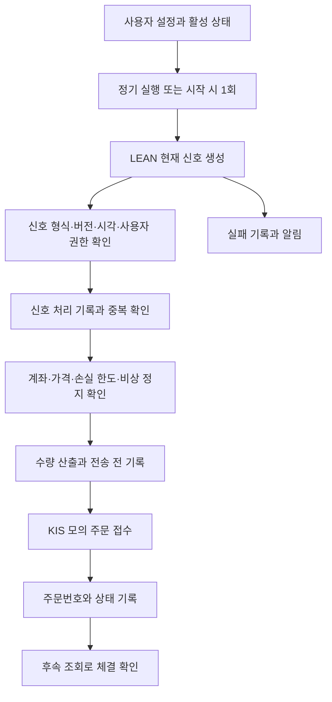

# 증권사 연동 자동화 설계안

| 항목 | 내용 |
|---|---|
| 판 · 상태 | v0.1 · 2026-10-22 · 구현 전 계약 협의안 |
| 담당 | 오준영 · 부담당 강민석 |
| 대상 | 팀 확정 요구 P02-⑤-1~3 |
| 코드 기준 | main `1fb94b844435c2780edec1017e1f44b6b809c173` |
| 일정 | [오준영 작업 계획](../../../00-management/plans/오준영파트-할일.md) |

LEAN 전략의 현재 투자 신호를 사용자의 KIS 모의계좌 주문으로 연결한다. 기존 주문 추적·위험관리·정기 실행을 재사용하되, 신호별 중복 방지와 실행 기록을 보완한다. 아래 신호 필드와 저장 구조는 협의안이며 구현된 API가 아니다. 실전 주문·추가 증권사·리밸런싱 주문 전환은 범위 밖이다.

## 1. 팀 요구와 판단 근거

[팀 계획서](https://github.com/EST-team-project/Qurious/blob/1fb94b844435c2780edec1017e1f44b6b809c173/docs/3차/계획서/프로젝트계획서.md) 4.3절의 주담당과 [요구 대장](https://github.com/EST-team-project/Qurious/blob/1fb94b844435c2780edec1017e1f44b6b809c173/docs/3차/요구사항/대장/요구-대장.tsv)의 인수 기준을 따른다. 같은 계획서 2.3절에 따라 AWS는 필수가 아니다. 강사님 기술 목록을 추가 구현 의무로 삼지 않는다.

## 2. 기존 구현과 추가 작업

아래 경로는 기준 커밋의 저장소 루트 기준이다. 기존 시험은 회귀 시험 후보이며 이번 설계 작업에서 실행하지 않았다.

| 영역 | 기존 근거 | 추가로 확인하거나 구현할 부분 |
|---|---|---|
| 계좌·주문 | `app/services/brokers/factory.py`, `auto_trade.py::_place_live_order`, `kis_execution.py` | 기존 사용자 키 기반 KIS 직접 경로 우선. 인증·잔고·현재가·모의 주문을 실제 모의계좌로 검증한다. 공유 게이트웨이를 임의로 켜지 않는다. |
| LEAN | `app/routes/lean.py`, `lean_backtest.py`, `lean_remote.py` | 현재 경로는 백테스트 실행·결과 조회다. 현재 판단 신호를 주문 처리기로 넘기는 계약과 어댑터가 필요하다. 과거 백테스트 매매 목록을 현재 주문으로 재생하지 않는다. |
| 전략 명세 | `strategy_loader.py`, `auto_trade.py::apply_strategy_spec_to_signal` | 기존은 전략 명세를 받아 앱에서 규칙을 계산한다. LEAN 신호 모드와 구분하고 해당 모드 실패 시 기본 전략으로 자동 대체하지 않는 안을 적용한다. |
| 중복 방지 | `risk_guard.py::acquire_order_slot`, `LiveOrder.client_order_id` 유일 제약 | 쿨다운은 시간 내 종목·방향 제한이다. 직접 주문은 새 UUID, 게이트웨이 주문은 사용자·종목·방향·분 단위 키를 쓴다. 같은 LEAN 신호의 반복·재시작·동시 처리를 식별하는 영속 키가 필요하다. |
| 주문 결과 | `LiveOrder`, `auto_trade.py::confirm_live_fills`, `kis_execution.py::direct_status` | 기존 접수·응답 불명·체결 확인을 재사용하고 신호 → 주문 → 증권사 주문번호를 연결한다. 접수 성공을 체결 완료로 표시하지 않는다. |
| 위험관리 | `risk_guard.py`, `auto_trade.py::emergency_halt`, `execution_policy.py` | 기존 손실 한도·비상 정지·수량 제한이 LEAN 경로에도 적용되는지 검증한다. Redis 장애 시 메모리 대체만으로 다중 워커 중복 방지를 보장했다고 판단하지 않는다. |
| 주기·로그 | `app/celery_app.py`, `app/tasks/sync_tasks.py`, `auto_trade.py::_persist_cycle` | 기존 기본 주기 `QUANT_CYCLE_SEC=600`을 재사용하는 안. 최근 50회 캐시 외에 회차 식별·완료·실패 상태를 영속 기록하는 안을 추가한다. 오래된 3분 주석은 관련 구현 수정 때 맞춘다. |
| 알림 | `notification.py::dispatch`, `NotificationLog` | 기존 주문·정지 알림과 별개로 전략 실행 실패를 회차별 한 건 기록·발송하는 경로를 연결한다. |
| 가격 | `auto_trade.py`의 `indicators.current_price` 사용 | #284와 관련된 기존 가격 기준 차이를 확인한다. 주문 직전 조회 가격·시각과 잔고를 검증하고 자료가 없으면 보류한다. |

기존 계약 [kis-autotrade-api.md](https://github.com/EST-team-project/Qurious/blob/1fb94b844435c2780edec1017e1f44b6b809c173/docs/contracts/kis-autotrade-api.md)의 전략 ID·버전과 주문 추적 의미를 유지한다. 그 문서의 게이트웨이 전용 승인·멱등 기능이 개인 키 직접 KIS에도 제공된다고 가정하지 않는다.

## 3. 홈페이지와 실행 흐름

| 기존 화면 | 연결할 기능 |
|---|---|
| `app.html#settings` 증권사 API 설정 | 사용자 KIS 연결, 전략·위험 한도 설정, 추적 중인 주문 확인 |
| `app.html#quant-auto` 자동매매 현황 | 시작·중지·비상 정지, 실행 상태·로그·거부 사유 |
| `app.html#notification-settings` 알림 설정 | 기존 사용자 알림 채널 활용 |

별도 모니터링 화면을 새로 만드는 안은 포함하지 않는다. 전략 선택과 일정 설정의 상세 UI는 기존 설정을 얼마나 재사용할지 계약 협의 후 정한다.

거부·보류는 실패와 구별해 이유를 남긴다. 일반 중지는 이후 새 주문을 막는 기능이며 이미 증권사에 전달한 주문의 취소·청산을 보장하지 않는다. 비상 정지 또한 새 주문 차단과 기존 주문 확인을 구분한다.

## 4. LEAN 신호 계약 초안

먼저 내부 서비스 호출 경계에서 데이터를 주고받는 안으로 설계한다. 별도 HTTP 수신 API는 필요성이 확인되면 인증 방식과 함께 정한다. LEAN 실행의 성공·실패 상태는 신호 목록과 별도로 받아야 하며, 빈 목록을 통신 실패와 혼동하지 않는다.

| 필드 | 의미와 검증 |
|---|---|
| `schema_version` | 계약 판. 초기 제안 `1`. 모르는 판은 거부한다. |
| `source` | `lean`. 발신자가 써 넣은 문자열만으로 신뢰하지 않고 서버가 확인한 생산 경로와 대조한다. |
| `signal_id` | 한 전략 판단의 식별자. 같은 판단을 재전달할 때 유지한다. 생산자가 생성·보관하며 재실행 때 새 UUID로 바꾸지 않는다. |
| `strategy_id`, `strategy_version` | 서버에서 사용자가 선택·허용한 전략과 정확히 일치해야 한다. |
| `execution_mode` | 이번 계약은 `paper`만 허용한다. 주문 경로의 기존 `quant_mode=live`는 외부 증권사 연결을 뜻할 수 있어 별도로 검증한다. |
| `symbol`, `market` | 국내 종목 코드와 시장. 예시는 `005930`, `KRX`. 실제 지원 종목·코드 정규화는 어댑터에서 확인한다. |
| `action` | `BUY`, `SELL`, `HOLD`. HOLD는 주문 없이 판단 기록만 남긴다. |
| `timeframe`, `bar_end_at` | 판단에 사용한 봉 주기와 확정 시각. 미래 봉·미완성 봉은 거부한다. |
| `generated_at`, `expires_at` | 시간대가 포함된 생성·유효 기한. 허용 지연과 유효 기간은 전략 주기에 따라 합의한다. 예시의 10분은 확정 정책이 아니다. |
| `reference_price` | 판단 참고 가격. 주문 가격·체결 가격으로 그대로 사용하지 않는다. |
| `reason_code` | 규칙 식별용 짧은 값. 화면 설명과 구분한다. |

사용자 ID·계좌·API 키·임의 주문 수량은 신호 본문에서 받지 않는다. 사용자는 서버가 보유한 실행 설정 또는 인증 문맥으로 결정하고, 계좌는 사용자 설정에서 조회한다. 수량은 서버의 예산·잔고·보유량·위험 제한으로 산출하는 초기안이다. 전략의 포지션 크기 규칙과 상충하지 않도록 신장환·강민석 담당자와 결정한다. 숏·레버리지나 새 수량 모델은 이 초안에서 추가하지 않는다.

[검토용 신호 예시](../예시/lean-signal-v1.json)는 가상의 값이며 실제 주문 지시가 아니다. 기존 백테스트 결과 필드나 전략 명세 API를 이 JSON으로 대체하지 않는다.

## 5. 중복과 상태 저장 설계안

1. 실행 회차는 사용자·계좌 식별값·전략 버전·예정 실행 시각으로 식별하고, 같은 회차를 두 워커가 실행하지 않도록 DB에서 선점한다. 시작 즉시 실행과 정기 실행의 중첩도 검사한다. 재시작 때 만료된 선점을 처리하는 기준은 주문 전송 상태와 함께 정한다.
2. 신호 처리 기록의 유일 키는 `(user_id, account_ref, strategy_id, strategy_version, signal_id)`로 둔다. `account_ref`는 서버가 정한 계좌 식별값이며 평문 계좌번호를 로그에 쓰지 않는다. 별도 입력 해시를 저장해 같은 키의 종목·방향·내용이 달라지면 충돌로 거부한다.
3. 최초 입력의 기록·선점과 주문 의도 저장은 트랜잭션으로 처리한다. 주문 전송 전에 추적 기록을 커밋하고, 재수신은 새 주문을 만들지 않고 기존 처리 결과를 읽는다. `client_order_id`는 이 키에서 만든 고정 해시 등으로 64자 이내를 유지한다.
4. 수량 산출 뒤 전송 직전에 활성 상태·비상 정지·계좌·모의 환경을 다시 검사한다. 저장소 확인 실패 시 새 외부 주문을 보류한다. 프로세스 내부 `asyncio.Lock`만으로 다중 워커 안전성을 주장하지 않는다.
5. 전송 준비 중 프로세스 중단, 타임아웃 또는 주문번호 없는 응답은 접수 여부를 확정할 수 없다. 새 ID로 자동 재주문하지 않고 기존 `PENDING`·`UNKNOWN` 기록을 보존해 조회·대조한다. 직접 KIS가 멱등 키를 보장한다고 가정하지 않는다. 불명확한 경우 보류하므로 모든 유효 신호가 반드시 체결된다는 보장은 아니다.
6. 주문 접수 후에는 기존 `LiveOrder` 상태와 체결 조회를 활용한다. 다른 계좌나 다른 주문의 체결을 매칭하지 않는다. 확정 체결 수량을 확인하기 전 가상 장부에 체결을 만들어 넣지 않는다.

추가 저장 대상은 신호 처리 기록, 전략 실행 회차, 회차별 실패 알림 기록이다. 테이블·마이그레이션은 구현 단계에 결정하며 기존 `LiveOrder`를 신호 기록과 연결한다. 주문 정정·취소나 신규 재주문 정책은 이번 계약에 추가하지 않는다.

실행 실패는 `(run_id, event_type)` 기준으로 한 건의 알림 이벤트를 저장한다. 외부 발송 성공 여부를 기록하고, 응답이 불명확하면 무조건 재발송하지 않는다. 외부 채널까지 정확히 한 번 전달되는지는 채널의 중복 방지 기능에 달리므로 발송 시도·전달 확인을 구분한다.

## 6. 시험 계획

모든 항목은 예정이며 실제 통과 결과가 아니다. 먼저 격리 DB·모의 응답으로 경계를 시험하고, KIS 모의계좌로 정상 연결을 대조한다. 실제 모의계좌 시험은 전략·종목·수량을 정한 별도 시험 절차로 수행한다.

| ID | 요구 | 상황 | 기대 결과와 증거 |
|---|---|---|---|
| B01 | ⑤-1 | 정상 LEAN BUY 신호 | 신호 ID → 처리 기록 → KIS 모의 주문번호 연결. 접수와 체결을 구분한다. |
| B02 | ⑤-1 | HOLD 또는 0주 산출 | 증권사 주문 호출 0회, 사유 기록. |
| B03 | ⑤-1 | 모르는 전략·판, 만료·미래 신호, 잘못된 종목 | 입력 거부와 이유 기록, 주문 0회. |
| B04 | ⑤-1 | 다른 사용자 설정 접근·실전 환경 요청 | 권한 및 모의 환경 검사에서 차단, 주문 0회. |
| B05 | ⑤-1 | 인증·잔고·가격 조회 실패 | 가상 체결로 대체하지 않고 보류·실패 기록. |
| B06 | ⑤-1 | 접수·부분 체결·완료·접수 불명 응답 | 정확한 계좌·주문번호로 상태 대조, 불명 응답의 자동 재주문 0회. |
| B07 | ⑤-2 | 같은 신호를 시간 차·재시작 후 반복 입력 | 처리·주문 식별자 유지, 신규 주문 최대 1건. |
| B08 | ⑤-2 | 두 워커가 같은 신호 동시 처리 | DB 유일성·선점 확인, 외부 주문 최대 1회. 같은 키 다른 내용은 거부. |
| B09 | ⑤-2 | 손실 한도 초과·비상 정지, 전송 직전 정지 | LEAN·기존 자동매매·시작 즉시 실행 등 적용 주문 진입 경로에서 차단 사유 확인. 수동/API 경로도 누락 여부 점검. |
| B10 | ⑤-2 | DB·Redis 장애, 전송 경계에서 프로세스 중단 | 새 외부 주문 보류, 불명 상태 보존, 복구 후 중복 전송 없음. |
| B11 | ⑤-3 | 정해진 일정과 사용자 비활성 상태 | 활성 사용자만 실행, 예정 시각·시작·종료·결과 기록. |
| B12 | ⑤-3 | LEAN 실행 실패·알림 발송 실패 | 실패 회차와 알림 이벤트 한 건 저장, 기본 전략으로 대체 주문하지 않음. 발송 결과 구분. |
| B13 | ⑤-3 | 즉시 시작·정기 실행 중첩, 중지·재시작 | 중복 회차·주문 차단, 이미 전송된 주문의 상태 확인 유지. |
| B14 | 전체 | 로컬 Docker에서 LEAN → KIS 모의 종단 시험 | 화면·실행 기록·증권사 주문/체결·잔고 대조. 실제 LEAN 결과와 고정 입력 시험을 구분. |

기존 회귀 시험 후보: `tests/test_auto_trade_isolation.py`, `test_kis_execution_outcomes.py`, `test_live_order_gateway_path.py`, `test_risk_guard.py`, `test_risk_guard_boundaries.py`, `test_risk_guard_ledgers.py`, `test_lean_remote.py`, `test_strategy_spec_apply.py`.

시험 결과에는 기준 커밋·설정·실행 시각·입력 신호·주문 호출 횟수·처리 상태를 남긴다. 계좌번호·키·토큰은 증거에서 제외한다. 고정 입력 또는 모의 HTTP 시험만 통과한 상태를 실제 KIS 모의 체결 완료로 표시하지 않는다.

## 7. 10월 26일 구현 착수 조건

- 강민석 담당자와 현재 LEAN 신호 출력·실패 응답·재실행 시 식별자 유지 방법을 맞춘다.
- 신장환 담당자와 전략 ID·버전, 봉 기준, 매수·매도 의미와 수량 결정 경계를 맞춘다.
- 거래 대상·시세 유효 기간·주문 유형·시험 예산은 KIS 모의 시험 전에 정한다. 예시 가격이나 기존 영상 수량을 그대로 쓰지 않는다.
- 팀장과 KIS 우선 대상 및 기존 알림 채널 활용을 확인한다. AWS 인프라 준비를 착수 조건으로 삼지 않는다.

오늘은 정적 코드 대조·계약 초안·시험 계획 작성과 아래 조회 점검까지 완료했다. 애플리케이션 코드, 업무 DB, Docker 실행 설정, 자동매매 활성 상태를 변경하거나 증권사 주문·외부 알림을 실행하지 않았다. 인증 조회는 기존 토큰 캐시를 사용하며 필요하면 토큰을 발급·캐시하는 기존 인증 경로를 따른다.

## 8. 10월 22일 연결 사전 점검

사용자의 추가 요청으로 2026-10-22 10:08 KST에 현재 로컬 앱을 점검했다. 대상은 `qurious-app:release-170-20261019`, 이미지 ID `464b6c7109cc`다. 이 결과를 최신 main 배포 시험이나 LEAN 주문 종단 시험으로 해석하지 않는다.

| 확인 항목 | 결과 | 확인 범위 |
|---|---|---|
| 사용자 설정 | 오준영 계정의 KIS 키·계좌 설정 존재 | 키·토큰·계좌번호 원문은 출력·문서화하지 않음 |
| 실행 상태 | 자동매매 꺼짐, 주문 방식 `paper`(앱 가상매매), 실전 허용 꺼짐 | 설정 변경 없음. 저장된 사용자 키로 KIS 모의 조회만 직접 호출 |
| KIS 인증 | 성공 | 기존 클라이언트에서 유효한 인증 토큰 확보 |
| KIS 잔고 | 성공 | 실제 모의 조회 응답의 현금·평가액이 유효한 수인지 확인, 보유 종목 0개 |
| KIS 시세 | 성공 | `005930` 현재가가 유효한 양수인지 확인 |
| 주문·체결 | 미실행 | 주문 호출 0회. 체결 가능 여부나 주문 가능 금액 검증 결과가 아님 |
| LEAN 원격 | 미설정 | 앱의 `DOMAIN_RAG_LAB_BASE_URL` 설정 없음 |
| LEAN 로컬 | 실행 준비 미완료 | 상태 함수는 `docker` 경로를 선택하며 기준 자료 파일은 존재. 설정 이미지 `quantconnect/lean:latest`는 현재 Docker 이미지 목록에 없음. 실제 엔진 실행은 하지 않음 |
| 신호 계약 합의 | 확인한 저장소 범위에서 찾지 못함 | main 코드·기존 계약, 전체 이슈 본문, 10/19 이후 댓글 45개, Discussions 13개와 댓글 확인. 개인 대화방 합의 여부는 확인 대상 밖 |

기존 [이슈 #244](https://github.com/EST-team-project/Qurious/issues/244)는 전략 명세와 게이트웨이 계약 개정의 반영 여부를 주담당이 결정하도록 요청한 내용이다. 이번 `signal_id` 중심 신호 초안이 승인됐다는 근거가 아니다. 원격 주소를 추정해 설정하거나 대용량 LEAN 이미지를 내려받지는 않았다.

26일에는 오늘 성공한 조회를 짧게 재확인하고 권한·실패 처리·가격 기준 보완을 진행할 수 있다. 27일 실제 LEAN 신호 연결을 위해서는 강민석 담당자와 로컬·원격 실행 위치, 신호 출력 방식, 같은 판단의 식별자 유지 방식을 맞춰야 한다. 이 문서의 예시 JSON은 협의 준비물이며 합의 완료를 뜻하지 않는다.
