# UI 명세서(화면설계서) v0.51 — Qurious

| 문서 정보 | |
|---|---|
| **판 · 상태** | v0.51 · 구현 반영(25.7절 순위 새로고침 · 앞 판 v0.50: 26.6절 카드 필터) · 구현 대조 캡처는 Figma 파일 둘(11-05)에 보관 |
| **구분** | 4. 화면·서비스 설계 — UI 명세서(화면설계서) |
| **작성** | 초안 이동원(팀장 · 공통 영역과 이동원 몫 화면) · 자기 화면의 상세 채우기와 판 올리기는 각 주담당 · 검수 이동원 |
| **검토** | 검토 전 |
| **최종 수정** | 2026-11-05 (KST) · v0.51 25.7절 |
| **기준** | v0.33 의 18절은 코드 `main` `533324c`(#417 머지 뒤 — 3차 사실은 `public/app.html` 의 마이페이지 `mp-sec-broker` · `public/js/core.js` · `mypage.js` · `settings.js` · `quant.js`)와 2차 UI 명세서 v0.31 17장(소급) |
| **관련 문서** | [화면 대장 v0.3](화면대장.md) · [2차 UI 명세서 v0.31 16 · 17장(소급)](../../../phase-2/02-design/ui/UI명세서.md) · [개념 학습 설계서](../system/개념학습-설계.md) · [학습 화면 설계안](../../../phase-2/02-design/ui/설계안/2026-10-20-개념학습-화면/결과.md) · [IA v1.8](IA.md) · [와이어프레임 v0.5](와이어프레임.md) · [유스케이스 명세서 v0.3](../../01-analysis/requirements/유스케이스명세서.md) · [API 명세서 v0.33](../api/API명세서.md) · [시연 영상 README v0.2](../../../common/06-retrospective/videos/README.md) 5절 · [목표 기능 ① 설계서 v1.6](../system/목표기능1-데이터지식-설계.md) · [근거 답 출처 표시 조사서 v0.1](../../../phase-2/01-analysis/research/근거답-출처표시-화면-조사.md) · [이동원 파트 할 일 v0.3](../../00-management/plans/이동원파트-할일.md) 5절 · [코딩 표준 v0.1](../../03-development/conventions/코딩표준.md) 4절 · Figma [「데이터 수집 화면 — 수집 일정 · 직접 받기 · 적재 백업」](https://www.figma.com/design/AfiCh50uOwrSq5F2Tk2JLZ) |
| **최근 개정** | v0.50 → v0.51: 25.7절 신설(신호 순위 새로고침 — 기록을 다시 읽고 상위 10종목에 지금 가격을 붙임 · 신호는 새로 계산하지 않음) · 29 · 31절의 구현 대조 캡처 주소(Figma) |

> **이 문서로 알 수 있는 것**
> 1. 모든 화면에 공통으로 있는 영역은 무엇이고, 무엇을 부르며 어떻게 동작하나?
> 2. 화면 하나는 어떤 칸으로 명세하나(데이터 관제를 본보기로)?
> 3. 화면 77개는 각각 어떤 API 를 부르고, 어느 요구 · 누구의 몫인가?
> 4. AI 투자 상담의 근거 답은 어떻게 보이고, 근거가 없거나 답할 수 없을 때 무엇을 보이나?
> 5. 크롤링 세 화면을 바꾼 데이터 수집 화면 셋(수집 일정 · 단계 · 자료 직접 받기 · 적재 · 백업)은 무엇을 보이고 어떻게 동작하나?
> 6. 자료 안내는 무엇을 누구에게 보이고, 개발 정보는 어떻게 관리자에게만 가나?
> 7. 관리자는 화면에서 한 단계 · 전체 수집을 어떻게 요청하고, 막는 때 · 작업자가 꺼졌을 때 무엇을 보나?
> 8. 자료 안내는 자료마다 칸(쉬운 이름 · 단위 · 뜻)을 어떻게 보이고, 줄 수는 언제 누가 세나?
> 9. AI 투자 상담의 답 위 카드와 답 끝 용어 칩은 무엇을 보이고, 투자 정보 리서치의 첫 목록은 왜 「투자 관련만」 인가?
> 10. 학습(금융 필수 지식 · 개발 개념 · 파이썬 중급)은 어떤 화면으로 나뉘고, 메뉴 줄이 없는 부 목록 · 장은 어떻게 제자리(머리 경로 · 왼쪽 트리)를 찾나?
> 11. 퀀트 대시보드의 두 신호 이름표와 공용 일봉 차트는 무엇을 보이고, 증시 일정의 종류 칩은 왜 열넷인가? (26 ~ 28절)

## 요약

화면설계서의 실무 관행대로 **화면 그림에 번호를 찍고, 번호마다 요소 · 데이터(API) · 동작 · 빈 데이터 · 오류를 표로** 적는다. 모든 화면이 공유하는 공통 영역 11개와 데이터 관제 화면을 본보기로 자세히 썼고, v0.2 에서 AI 투자 상담(근거 답 · 요소 14 · 상태 표)을, v0.3 에서 데이터 수집 화면 셋(Figma 에서 정한 설계 · 요소 33 · 경우 표)을 더했고, v0.6 에서 그 셋을 만들어 그림을 구현 화면으로 바꿨고, v0.7 에서 자료 안내(새 화면)를, v0.8 에서 화면에서 수집을 요청하는 단추(요소 여덟 · 정한 것 넷 · 경우 표)를, v0.10 에서 자료 안내의 칸 정의와 숫자 파일(요소 둘 · 정한 것 다섯 · 경우 다섯)을, v0.11 에서 투자 성향별 상품 안내(7절)를, v0.12 에서 그 상품 상세 창(가운데 모달 · 요소 13 · 경우 아홉 · 7.1)을 더했다. 화면 70개의 목록(부르는 API · 관련 요구 · 주담당)은 IA 전수표와 API 명세서에서 만들었다. 화면 69개 중 51개가 API 를 불렀고(v0.1) 자료 안내가 하나를 더한다, 상세를 채울 사람은 목록의 「명세」 칸에 적었다. v0.32 에서는 16절 셋 끝에 2차와 비교하는 소절을, 17절에 로그인 전 첫 화면(랜딩)을 더했다. v0.48 에서는 퀀트 대시보드(26절) · 공용 일봉 차트(27절) · 증시 일정의 종류 칩 열넷(28절)을 더했다.

---

## 1. 읽는 법

**<표 1> 화면 한 장의 칸** · 문서 작성 기준 5.4절

| 칸 | 적는 것 |
|---|---|
| 화면 정보 | 화면 ID(화면 키) · 화면명 · 들어가는 길(메뉴) · 설명 · 관련 요구 · 주담당 |
| 화면 그림 | 1280 × 800 캡처에 빨간 번호 |
| 요소 표 | 번호 · 요소 · 데이터(API ID) · 동작 · 빈 데이터 · 오류 · 비고 |

---

## 2. 공통 영역

모든 화면에 공통으로 있는 영역은 <그림 1> 과 같다(투자 대시보드에서 캡처).

**<그림 1> 공통 영역** · 범례: 빨간 상자와 번호 = <표 2> 의 요소 · 폭 1920(지수 띠 3 은 1920 이상에서만 보인다) · 6(로그아웃)은 아바타 메뉴(5) 안 · 7 은 없앤 요소 · 12(☰)는 폭 768 아래에서만(<그림 1-2>) · 2026-11-01 다시 찍음(위 탭 여섯 · 「전체 메뉴」 트리) · 점검 계정(관리자 — 11 기능 완성도 배지가 보인다)

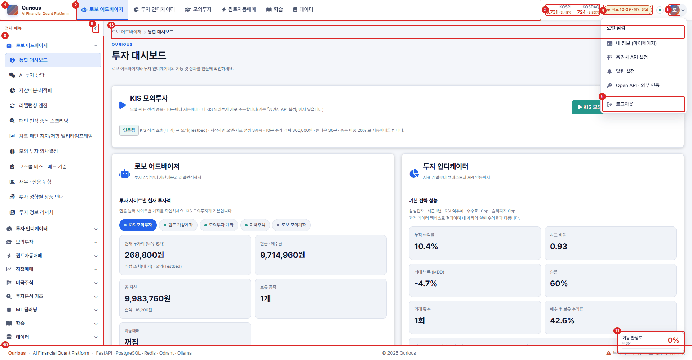

**<표 2> 공통 영역 요소**

| 번호 | 요소 | 데이터(API) | 동작 | 빈 데이터 · 오류 | 비고 |
|:-:|---|---|---|---|---|
| 1 | 로고 · 서비스 이름 | — | 누르면 첫 화면(투자 대시보드 `#dashboard`) | — | 부제 「AI Financial Quant Platform」 |
| 2 | 위 메뉴(고정 탭 여섯) | — | 로보 어드바이저 · 투자 인디케이터 · 모의투자 · 퀀트자동매매 · 학습 · 데이터 — 누르면 그 묶음의 첫 화면 · 왼쪽 트리에서 그 묶음이 펼쳐진다(「학습」 = 금융 필수 지식) | — | 숨는 탭 없음 · 다 안 들어가면 부제 → 아이콘 → 탭 줄 통째로 접힘(940 아래) · 2026-10-18 D129 |
| 3 | 지수 띠(KOSPI · KOSDAQ) | `API-STK-01` | 값과 등락률 | 못 받으면 칸을 비운다 | 폭 1920 이상에서만 보인다(KOSPI · KOSDAQ) · 2560 이상이면 환율까지 — 좁은 폭에서는 위 탭이 자리를 먼저 쓴다(`qurious.css` · DF-109 · 2026-10-19 다시 셈) |
| 4 | 자료 상태 배지 | `API-DATA-01` | 수집 자료 기준일과 판정(정상 · 확인 필요 · 멈춤)을 보이고, 누르면 요약 서랍이 열린다 | 상태를 못 받으면 「자료 상태 …」 | 1분마다 다시 묻는다 |
| 5 | 사용자(아바타 ▾) | — | 누르면 이름 · 내 정보 · 로그아웃 메뉴(Esc · 바깥 누름이면 닫힘) | — | 이름 글자는 머리에서 숨김(DF-109) |
| 6 | 로그아웃 | `API-AUTH-03` | 아바타 메뉴(5) 안 — 로그아웃 뒤 로그인 화면 | — | 머리의 단추는 숨김(같은 처리를 부름) |
| 7 | (없앰) 더보기 · 오른쪽 서랍 | — | 2026-10-18 D129 로 없앴다 — 모든 묶음은 8 의 트리에 있다 | — | 시험 TC-NV-08 |
| 8 | 왼쪽 「전체 메뉴」 트리 | — | 12묶음 · 74항목(11-01 기준 72항목 + 11-02 「신호 순위」 + 11-05 「KIS 모의투자 결과」 · 앞서 10-18 기준 74항목에서 성과 검증 줄이 탭으로 합쳐지고 11-01 「증권사 API 설정」 줄이 마이페이지 안으로 들어가 둘 빠짐 · 묶음은 문서에 13 으로 적혀 있었으나 `GNB_MENUS` 를 세면 12) · 지금 묶음만 펼침(다른 묶음은 눌러 펼침 · 다른 묶음 화면으로 옮기면 그 묶음만) · 지금 화면 강조(aria-current) · 바깥 주소는 「새 화면」 | — | 너비 clamp(240px, 15vw, 288px) · 긴 이름은 두 줄(자르지 않음) · 2026-10-18 D129 |
| 9 | 사이드바 접기 · 펼치기 | — | 트리를 54px 띠로 접고 편다(묶음 아이콘 · 펼친 묶음의 항목 아이콘만) | — | 이름은 마우스를 올리면(title) |
| 10 | 바닥글 | — | 서비스 이름 · 쓴 기술 · 저작권 · 투자 유의 문구 | — | — |
| 11 | 기능 완성도 배지 | 화면 쪽 고정 표 | 화면마다 완성도 점수 | 점수가 없는 화면은 「미평가 0%」 | 점검 기준은 별도 세션에서 정한다 |
| 12 | ☰ 전체 메뉴 열기(좁은 화면) | — | 폭 768 아래에서만 보인다 · 누르면 같은 트리(8)를 왼쪽에서 300px 로 펼치고 뒤는 어두운 막 — 막 누름 · Esc · 메뉴 고름 · 화면 바뀜이면 닫히고 초점은 ☰ 로 | — | aria-expanded · aria-controls="lnb" · 2026-10-18 D129 · IA I12 해소 |
| 13 | 화면 사용법 윗줄 · 창 | 사용법 글(`core.js`) | 화면 맨 위 왼쪽에 지금 위치(묶음 › 화면) · 오른쪽 「사용법」 — 누르면 가운데 창 | 사용법 글이 없는 화면은 윗줄도 없다 | 2.1절 · 2026-10-16 |

**좁은 화면의 머리글(폭 390 · IA I12 · 2026-10-10)** — 머리글이 약 800px 로 넘쳐 「더보기」(7)와 로그아웃(6)이 화면 밖에 있었고 ☰ 은 코드에만 있고 늘 숨어 있었다. 폭 768 아래에서는 지수 띠(3) · 사용자 이름(5 의 글자) · 동기화 글자를 빼고(점 · 아바타는 남김) ☰(12)을 보이며, 480 아래에서는 자료 상태 배지(4)가 글자 없이 색 점만 남는다(누르면 서랍 · 요약은 마우스를 올리면). 위 메뉴(2)의 묶음은 들어가는 만큼만 보이고 나머지는 더보기에 있다 — 390 에서는 묶음이 하나도 들어가지 않아 더보기가 「여기 안에 있음」 으로 칠해진다. 강사님 `app.html` · `app.css` 는 고치지 않고 우리 덧씌우기 파일(`qurious.css` · `datahub.css`)에서만 바꿨다. 하단 탭(IA 3.5 · Q7)은 그대로 다음 설계 차례다.

**메뉴 개편(2026-10-18 · D129)** — 「더보기」(7)는 없어지고 ☰(12)가 왼쪽 「전체 메뉴」 트리(8)를 300px 로 연다. 위 탭(2)은 폭 940 아래에서 줄째 접히고(메뉴는 트리), 768 아래에서는 ☰ 만 남는다. 아래 <그림 1-2> 는 그 앞 모습이다.

**화면을 옮기면 맨 위부터(2026-10-18 · DF-134)** — 머리 · 왼쪽 메뉴는 고정이고 내용 칸(`#main-content`)만 굴러간다. 위 탭 · 트리 · 주소로 다른 화면으로 옮기면 그 칸을 맨 위로 되돌리고, 같은 화면을 다시 부르면 읽던 자리를 둔다(시험 TC-NV-16) — 그 전에는 앞 화면에서 내려간 자리를 물려받아 새 화면이 중간부터 보였다.

**<그림 1-2> 폭 390 — 머리글과 까닭 카드** · 범례: 빨간 상자와 번호 = <표 2>(4 · 12) · <표 10>(21)의 요소 — 7 「더보기」 는 이 폭의 머리글에 보이지 않는다

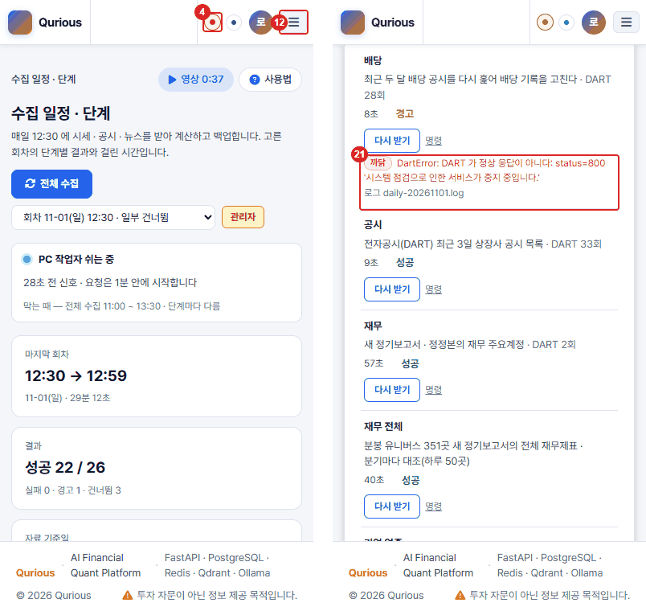

로컬 개발 앱 · 폭 390 · 2026-11-01 16:47 · 오른쪽 카드는 배당 줄 응답 한 줄을 바꿔 경고로 재현했다(지금 DART 는 정상 · 까닭 글은 2026-10-10 에 실제로 받은 점검 응답 글) · 이 폭의 머리글에는 예전 판에 있던 「더보기」 단추(7)가 보이지 않는다 — <표 2> 의 7 도 「(없앰) 2026-10-18 D129」 로 적혀 있어 서로 맞는다(2026-11-01 v0.41 에서 대조 끝 · ☰(12)가 그 자리를 잇는다)

### 2.1 화면 사용법 창 (모든 화면 · 2026-10-16)

모든 화면 맨 위에 **윗줄**(왼쪽 지금 위치 · 오른쪽 「사용법」)이 있고, 「사용법」 을 누르면 **가운데 창**에 그 화면을 쓰는 법이 뜬다. 옛 접이식(화면 맨 위에서 펼치던 줄 · 펼침을 브라우저에 기억)을 바꿨다. 설계와 결정: [설계안](../../../phase-2/02-design/ui/설계안/2026-10-16-사용법모달/설계안.md) · Figma 「투자 대시보드 · 메뉴 정리」 [03-2 지금 · 안 A · B · C 나란히](https://www.figma.com/design/lfYo3gVAxj1Raekzq9xFzZ?node-id=15-3) · [05 결정 기록 ④ ~ ⑧](https://www.figma.com/design/lfYo3gVAxj1Raekzq9xFzZ?node-id=7-180)(틀 = 가운데 창 · 단추 = 윗줄 · 영상이 없으면 칸을 숨김 · 크기는 화면마다 · 끝줄 = 그 화면의 개념 학습 장 + 용어사전 + 목차).

**<그림 1-3> 사용법 창** · 왼쪽부터 1280 투자 성향별 상품 안내(크게) · 390(화면 전체) · 1280 창 안 용어 카드(패턴 인식 · 종목 스크리닝 · 보통)

| 1280 · 크게 | 390 · 화면 전체 | 1280 · 창 안 용어 카드 |
|---|---|---|
| 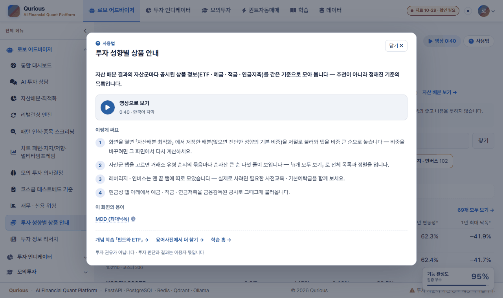 | 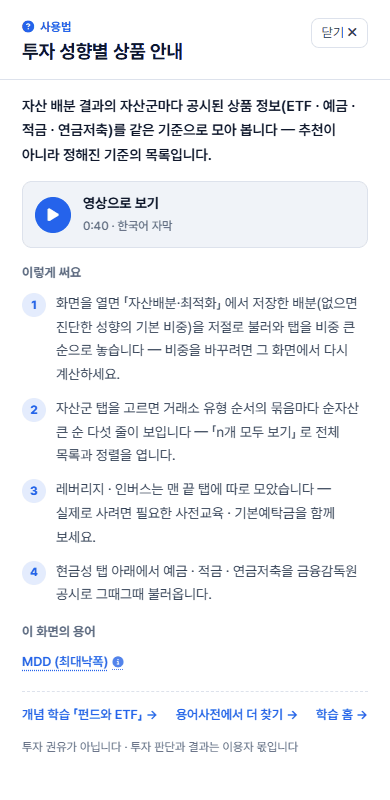 | 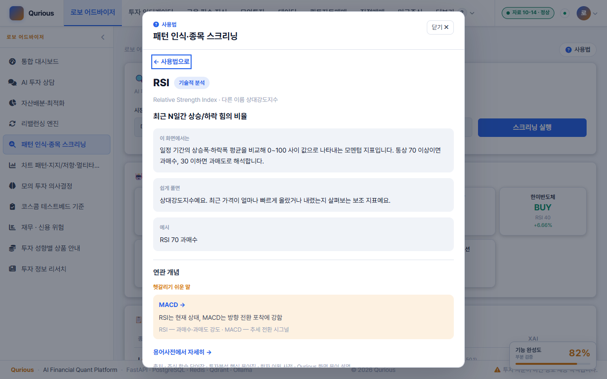 |

로컬 개발 앱 · 점검 계정 · 2026-10-16 12:07 · 기준 `1980058` + 이 판의 구현

**영상 칸(2026-10-18 · D132 첫 단계).** 그 화면의 사용법 영상이 있으면 윗줄에 「▶ 영상 길이」, 창의 요약 바로 아래에 「영상으로 보기」 칸이 생긴다. 누르면 그 자리에서 영상이 나오고 창은 「크게」 가 된다. 여러 화면에 걸친 영상은 그 화면이 처음 나오는 장부터 튼다(<그림 1-4> 차트 패턴 = 신호로 종목 살피기 장 2). 영상 · 영상 표는 각자 PC 의 `data/help/`(git · 이미지 밖)에 있고 앱은 로그인한 사람에게만 낸다 — 받는 법은 [시연 영상 README](../../../common/06-retrospective/videos/README.md) 5절.

**<그림 1-4> 사용법 창 영상 칸** · 왼쪽 1280 차트 패턴 — 장 2 부터 재생 · 장 표시 「② / 3」 · 지금 장 단추 파랑 / 오른쪽 390 — 창이 화면 전체 · 장 단추를 한 줄에 하나

| 1280 · 장 2 부터 재생 | 390 · 장 단추 세로 |
|---|---|
| 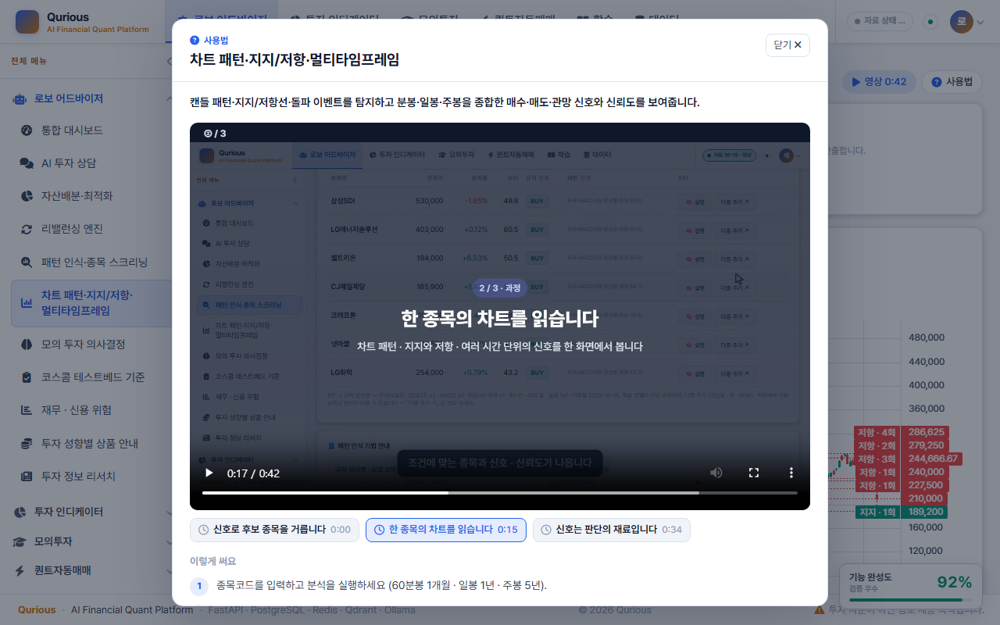 | 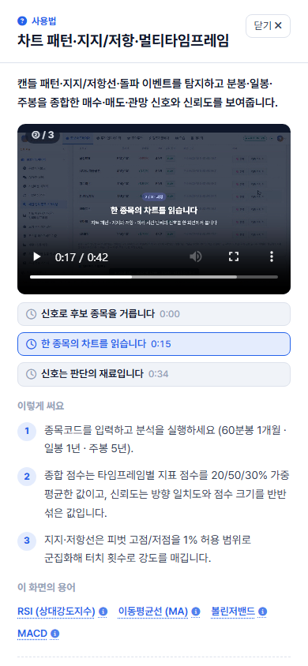 |

로컬 개발 앱 · 점검 계정 · 2026-10-18 밤 · 기준 `32f23bd` + 이 판의 구현 · 영상은 새 메뉴로 다시 찍은 판

**<표 2-1> 사용법 윗줄 · 창 요소**

| 번호 | 요소 | 데이터 | 동작 | 빈 데이터 · 오류 | 비고 |
|:-:|---|---|---|---|---|
| 1 | 지금 위치 | 메뉴 이름(`core.js` 메뉴 표) | 묶음 › 화면 이름 | — | 480 아래는 화면 이름만 |
| 2 | 「▶ 영상 길이」 | 영상 표(`/help/videos.json` — `API-HELP-01` · 각자 PC 의 `data/help/` · 녹화 기록에서 도구가 만듦 · D132) | 누르면 창을 열고 영상을 바로 튼다 | 영상을 받지 않은 PC(빈 표) · 영상이 없는 화면은 단추가 없다 | 결정 ⑥ · 영상이 붙는 화면은 받은 영상에 따라(10-18 밤 영상 표 기준 18곳 · 영상 9편 — 모의 주문 · 모의 계좌 · 자동매매 · 리밸런싱 · 거시 · 산업 · 차트 · 미국 · 대시보드는 장중 · 회차 뒤 녹화 몫 · 10-17 옛 메뉴로 찍은 두 편은 뺌) |
| 3 | 「사용법」 | — | 가운데 창을 연다 | — | 화면 뿌리 밖 — 화면이 머리를 다시 그려도(상품 안내 탭 · 데이터 관제 30초) 남는다 |
| 4 | 창 머리 | — | 「사용법」 · 화면 이름 · 닫기 | — | 창 제목은 메뉴의 화면 이름(화면 안 카드 제목을 잡지 않음) · 창을 굴려도 위에 붙어 있다 |
| 5 | 요약 | 사용법 글(`core.js` `VIEW_GUIDES`) | 한 문장 | — | — |
| 6 | 영상 칸 | 영상 표 · 영상 파일(`/help/media/<파일>` — `API-HELP-02` · 로그인 · Range) | 「영상으로 보기 · 길이 · 한국어 자막」 → 그 자리에서 16:10 영상으로 바뀌어 재생 · 창은 「크게」 · **그 화면이 처음 나오는 장부터**(차트 패턴 = 신호로 종목 살피기 장 2 · 0:15) · 첫 그림은 그 장의 제목 카드 | 영상이 없으면 칸을 숨긴다 | 결정 ⑥ · D132 · 자막은 영상에 들어 있어 자막 트랙은 켜지 않는다(겹침) |
| 7 | 이렇게 써요 | 사용법 글 | 번호 단계 1 ~ 4 | — | 글은 글자로 그린다(꺾쇠가 태그가 되지 않음) |
| 8 | 이 화면의 용어 | 용어(`TERMS`) · 용어사전(`API-GLOS-04`) | 칩을 누르면 창 안에서 용어 카드 · 「← 사용법으로」 · 연관 개념도 창 안에서 | 용어사전에 없으면 화면의 짧은 설명 · 못 받으면 「다시 시도」 · 용어가 없으면 소제목도 없다 | 용어 서랍과 같은 받기 함수(`termcard.js` `fillTermCard`) |
| 9 | 끝줄 | 이어 준 장(`howtoview.js` `LEARN_OF`) | 「개념 학습 「장」 →」(창을 닫고 앱 안 장 화면 · 2026-10-19 · 메뉴 줄 「장 읽기」 는 2026-10-20 에 뺐다) · 「용어사전에서 더 찾기 →」(창을 닫고 이동) · 「학습 홈 →」(창을 닫고 학습 홈 · 2026-10-20 — 전에는 「개념 학습 목차 →」) | 맞는 장이 없으면 목차만 · 용어사전 화면에서는 용어사전 줄을 뺀다 | 결정 ⑧ · 「사용법 영상 모음 →」 은 목록 화면이 생기면(D132 둘째 단계) |
| 10 | 장 단추 | 영상 표의 장(장 파일에서 만든 제목 · 시작 시각) | 누르면 그 시각으로 · 지금 장은 파랑(`aria-current`) · Tab 으로 닿는다 | — | 760 아래는 한 줄에 하나씩 쌓는다 |
| 11 | 장 표시 | 지금 장 · 장 수 | 영상 왼쪽 위 「② / 3」 — 재생 시각을 따라 바뀐다 | — | 16:10 틀의 위 띠에 얹어 영상 글을 가리지 않는다 |
| 12 | 창 바닥 고지 | — | 「투자 권유가 아닙니다 · 투자 판단과 결과는 이용자 몫입니다」 | — | 모든 화면의 창 · 끝줄 아래 |

**<표 2-2> 동작 · 경우**

| 경우 | 보이는 것 · 하는 일 |
|---|---|
| 연다 | 「사용법」 · 「▶ 영상」 — 맨 위 층 창(뒤 화면은 어두워지고 눌리지 않으며 굴러가지 않는다) · 첫 초점은 창 제목 |
| 닫는다 | 닫기 · Esc · 창 바깥(덮개) 누르기 · 다른 화면으로 가기 — 닫으면 초점이 「사용법」 단추로 돌아온다 |
| Esc 차례 | 창 안 용어 카드가 떠 있으면 먼저 사용법으로 돌아가고, 다음 Esc 에 창이 닫힌다 |
| 영상 | 「▶ 영상」 으로 열면 창이 열리며 바로 재생 · 창 안 「영상으로 보기」 도 같다 · 창을 닫거나 다른 화면으로 가면 영상이 멈춘다 · 영상 표는 첫 화면을 그릴 때 한 번 받고(늦게 오면 이미 그린 윗줄에 단추가 나타난다) 로그인 전이면 1분 뒤 다시 묻는다 |
| 영상이 없을 때 | 영상을 받지 않은 PC(서버가 빈 표를 줌) · 표를 못 받음 · 그 화면 줄이 없음 · 표 꼴이 틀림(판 · 우리 폴더 밖 주소) — 모두 칸 · 단추를 숨긴다(콘솔 오류 없음) |
| Tab | 초점이 뒤 화면으로 나가지 않는다 — 마지막 칸 다음은 브라우저 쪽을 거쳐 창 첫 칸으로 돈다 |
| 좁은 화면(760 아래) | 화면 전체로 연다(상품 상세 창과 같은 경계) |
| 두 단 화면(거시경제 지표) | 윗줄은 두 단 위에 그대로 있다 |
| 기억 | 열림 · 닫힘을 브라우저에 남기지 않는다 · 화면을 바꾸면 닫힌다 |

**<표 2-3> 창 크기 규칙** (결정 ⑦ — 화면마다 · 판단은 `public/js/howtoview.js` 한 곳 · 폭은 `howto.css` 와 시험이 맞댄다)

| 크기 | 폭 | 언제 |
|---|:-:|---|
| 크게 | 840 | 차트 · 분석 화면 17곳(앞으로 사용법에 차트 · 시각 자료가 들어갈 자리) · 영상이 있는 화면 · 글 양 260 이상 |
| 보통 | 680 | 글 양 120 ~ 259 |
| 작게 | 560 | 글 양 120 미만 |

글 양 = 요약 + 단계 글 자수 + 용어 하나당 10. 높이는 내용만큼(최대 화면 − 48)이고 넘치면 창 안에서 굴린다. 폭은 화면 − 32 를 넘지 않는다.

**<표 2-4> 화면 70곳 — 창 크기 · 끝줄의 개념 학습 장** (판단 모듈을 그대로 돌려 만든 표 · 작게 22 · 보통 27 · 크게 21 · 장을 이어 준 화면 38)

| 묶음 | 화면 | 화면 키 | 창 크기 | 까닭 | 끝줄의 개념 학습 장 |
|---|---|---|---|---|---|
| 로보 어드바이저 | 통합 대시보드 | `dashboard` | 보통 680 | 글 255 | 목차만 |
| 로보 어드바이저 | AI 투자 상담 | `agent-chat` | 보통 680 | 글 198 | 「RAG」(`rag-basics`) |
| 로보 어드바이저 | 자산배분·최적화 | `robo-portfolio` | 크게 840 | 차트 · 분석 | 「투자 성향과 적합성」(`investor-profile-suitability`) |
| 로보 어드바이저 | 리밸런싱 엔진 | `robo-rebalance` | 크게 840 | 차트 · 분석 | 「자산배분과 퀀트」(`asset-allocation-quant`) |
| 로보 어드바이저 | 패턴 인식·종목 스크리닝 | `robo-screening` | 보통 680 | 글 191 | 목차만 |
| 로보 어드바이저 | 차트 패턴·지지/저항·멀티타임프레임 | `robo-patterns` | 크게 840 | 차트 · 분석 | 「봉과 OHLCV」(`ohlcv-bars`) |
| 로보 어드바이저 | 모의 투자 의사결정 | `robo-decision` | 보통 680 | 글 171 | 목차만 |
| 로보 어드바이저 | 코스콤 테스트베드 기준 | `robo-testbed` | 보통 680 | 글 193 | 「로보어드바이저와 법」(`robo-advisor-rules`) |
| 로보 어드바이저 | 재무 · 신용 위험 | `agent-cb` | 크게 840 | 글 264 | 목차만 |
| 로보 어드바이저 | 투자 성향별 상품 안내 | `agent-products` | 크게 840 | 글 385 | 「펀드와 ETF」(`funds-etf`) |
| 로보 어드바이저 | 투자 정보 리서치 | `agent-news` | 보통 680 | 글 251 | 「프롬프트와 출처 표기」(`prompt-citation`) |
| 데이터 | 데이터 관제 | `data-status` | 크게 840 | 차트 · 분석 | 「데이터 품질 검사」(`data-quality-check`) |
| 데이터 | 자료 안내 | `data-guide` | 크게 840 | 차트 · 분석 | 「원문 · 정제 · 파생」(`data-layers`) |
| 데이터 | 수집 일정 · 단계 | `crawl-auto` | 보통 680 | 글 258 | 「정기 배치」(`batch-scheduling`) |
| 데이터 | 자료 직접 받기 | `crawl-manual` | 보통 680 | 글 224 | 「공식 API 다루기」(`public-api-basics`) |
| 데이터 | 적재 · 백업 | `crawl-ingest` | 보통 680 | 글 162 | 「데이터셋 판과 공유」(`dataset-versioning-hf`) |
| 직접매매 | 주가 차트 | `trading-chart` | 크게 840 | 차트 · 분석 | 「봉과 OHLCV」(`ohlcv-bars`) |
| 직접매매 | 포트폴리오 | `trading-portfolio` | 작게 560 | 글 88 | 목차만 |
| 직접매매 | 주문/매매 | `trading-order` | 작게 560 | 글 115 | 「주식 · 시장 · 주문의 기본」(`stock-basics`) |
| 모의투자 | 모의계좌 현황 | `paper-dashboard` | 보통 680 | 글 129 | 목차만 |
| 모의투자 | 국내주식 모의주문 | `paper-stock` | 보통 680 | 글 160 | 「주식 · 시장 · 주문의 기본」(`stock-basics`) |
| 모의투자 | 코인 모의매매 | `paper-crypto` | 보통 680 | 글 144 | 「채권과 코인」(`bonds-crypto`) |
| 모의투자 | 대체자산 (선물·옵션·금·부동산) | `paper-alternative` | 보통 680 | 글 120 | 「선물과 옵션」(`derivatives-futures-options`) |
| 모의투자 | Open API · 외부 연동 | `paper-openapi` | 보통 680 | 글 233 | 「공식 API 다루기」(`public-api-basics`) |
| 퀀트자동매매 | 퀀트 대시보드 | `quant-dashboard` | 보통 680 | 글 123 | 목차만 |
| 퀀트자동매매 | 자동매매 현황 | `quant-auto` | 보통 680 | 글 176 | 목차만 |
| 퀀트자동매매 | 전략 분석 | `quant-backtest` | 크게 840 | 차트 · 분석 | 목차만 |
| 퀀트자동매매 | LEAN 백테스트 (QuantConnect) | `quant-lean` | 크게 840 | 차트 · 분석 | 목차만 |
| 퀀트자동매매 | 증권사 API 설정 | `settings` | 보통 680 | 글 178 | 「공식 API 다루기」(`public-api-basics`) |
| 퀀트자동매매 | 알림 설정 | `notification-settings` | 작게 560 | 글 113 | 목차만 |
| 미국주식 | 대시보드 | `us-dashboard` | 작게 560 | 글 84 | 목차만 |
| 미국주식 | 주가 차트 | `us-chart` | 크게 840 | 차트 · 분석 | 「분봉과 시간대」(`intraday-timezone`) |
| 미국주식 | 주문/매매 | `us-order` | 작게 560 | 글 119 | 「주식 · 시장 · 주문의 기본」(`stock-basics`) |
| 미국주식 | 포트폴리오 | `us-portfolio` | 작게 560 | 글 65 | 목차만 |
| 투자 인디케이터 | 기본 인디케이터 전략 | `indicator-strategy` | 보통 680 | 글 167 | 「Pine Script 기초」(`pine-script-basics`) |
| 투자 인디케이터 | 커스텀 인디케이터 개발 | `indicator-custom` | 보통 680 | 글 256 | 「Pine Script 기초」(`pine-script-basics`) |
| 투자 인디케이터 | 자유 산식 지표 (DSL·버전) | `indicator-formula` | 크게 840 | 글 319 | 「Pine Script 기초」(`pine-script-basics`) |
| 투자 인디케이터 | 성과 검증 (Python) | `indicator-backtest` | 크게 840 | 차트 · 분석 | 목차만 |
| 투자 인디케이터 | 증권사 API 자동화 | `indicator-api` | 보통 680 | 글 131 | 「공식 API 다루기」(`public-api-basics`) |
| 투자 인디케이터 | 외부 차트 알림 연동 (Webhook·교차검증) | `indicator-tradingview` | 크게 840 | 차트 · 분석 | 「TradingView 경보를 서버로 받기」(`tradingview-webhook`) |
| 투자 인디케이터 | 지표 대시보드 | `company-dashboard` | 작게 560 | 글 105 | 목차만 |
| 투자 인디케이터 | 지표 비교 분석 | `company-compare` | 크게 840 | 차트 · 분석 | 목차만 |
| 투자 인디케이터 | 섹터 인디케이터 | `company-sector` | 작게 560 | 글 67 | 목차만 |
| ML·딥러닝 | 모델 비교 | `ml-compare` | 크게 840 | 차트 · 분석 | 목차만 |
| ML·딥러닝 | 회귀 분석 | `ml-regression` | 보통 680 | 글 139 | 목차만 |
| ML·딥러닝 | 종목 군집화 | `ml-cluster` | 크게 840 | 차트 · 분석 | 목차만 |
| ML·딥러닝 | 하이퍼파라미터 튜닝 | `ml-tune` | 작게 560 | 글 117 | 목차만 |
| ML·딥러닝 | 딥러닝 (LSTM·Transformer) | `ml-deeplearning` | 보통 680 | 글 128 | 목차만 |
| 투자분석 기초 | 거시경제 지표 | `macro-dashboard` | 크게 840 | 차트 · 분석 | 목차만 |
| 투자분석 기초 | 산업 분석 | `macro-industry` | 작게 560 | 글 79 | 목차만 |
| 투자분석 기초 | 재무제표 분석 | `invest-fundamental` | 보통 680 | 글 130 | 목차만 |
| 투자분석 기초 | 기술적 분석 | `invest-technical` | 크게 840 | 차트 · 분석 | 「봉과 OHLCV」(`ohlcv-bars`) |
| 투자분석 기초 | 일정 | `market-calendar` | 크게 840 | 글 284 | 「거래일 달력과 금융 일정」(`trading-calendar`) |
| 금융 필수 지식 | 강의실 (전체 과정) | `fin-lectures` | 보통 680 | 글 161 | 목차만 |
| 금융 필수 지식 | 선물과 옵션 | `fin-topic-futures` | 작게 560 | 글 96 | 「선물과 옵션」(`derivatives-futures-options`) |
| 금융 필수 지식 | 펀드와 ETF | `fin-topic-funds` | 작게 560 | 글 87 | 「펀드와 ETF」(`funds-etf`) |
| 금융 필수 지식 | 채권 · 금리 · 코인 | `fin-topic-bonds` | 작게 560 | 글 65 | 「채권과 코인」(`bonds-crypto`) |
| 금융 필수 지식 | 자산배분과 퀀트 | `fin-topic-allocation` | 작게 560 | 글 72 | 「자산배분과 퀀트」(`asset-allocation-quant`) |
| 금융 필수 지식 | 회사 구조 · 세무회계 | `fin-topic-company` | 작게 560 | 글 60 | 목차만 |
| 금융 필수 지식 | 산업 분석과 공시 | `fin-topic-stocks` | 작게 560 | 글 62 | 「주식 · 시장 · 주문의 기본」(`stock-basics`) |
| 금융 필수 지식 | 기술적 분석 · 재무제표 | `fin-topic-technical` | 작게 560 | 글 95 | 「봉과 OHLCV」(`ohlcv-bars`) |
| 금융 필수 지식 | 퀀트 사례 · 배당 · ETF | `fin-topic-industry` | 작게 560 | 글 51 | 목차만 |
| 금융 필수 지식 | 거시경제와 시장 | `fin-topic-macro` | 작게 560 | 글 93 | 목차만 |
| 금융 필수 지식 | 금융상품 이해 | `fin-products` | 작게 560 | 글 68 | 「펀드와 ETF」(`funds-etf`) |
| 금융 필수 지식 | 자산배분 모델 | `fin-allocation` | 작게 560 | 글 118 | 「자산배분과 퀀트」(`asset-allocation-quant`) |
| 금융 필수 지식 | 계절성 분석 | `quant-seasonal` | 크게 840 | 차트 · 분석 | 목차만 |
| 금융 필수 지식 | 용어사전 | `fin-glossary` | 보통 680 | 글 185 | 「용어 사전과 시소러스」(`thesaurus-skos`) |
| 시스템관리 | 서버 대시보드 | `sysadmin-dashboard` | 보통 680 | 글 136 | 「Docker Compose 와 개발 모드」(`docker-compose-dev`) |
| 시스템관리 | 감사 로그 | `sysadmin-logs` | 작게 560 | 글 98 | 목차만 |
| 내 계정 | 내 정보 (마이페이지) | `mypage` | 보통 680 | 글 152 | 목차만 |

**지키는 것**

- 기초 코드의 갈림은 몇 줄만 — `core.js` 는 넘기기만(7줄) · `app.html` 두 줄 · `calendar.js` 한 줄. 기초 코드 반영 때 강사님 판(머리 줄 끝 단추 + 가운데 창)이 소리 없이 들어오면 TC-HT-01 이 깨진다(설계안 2.2절 · 그대로 받으면 자산배분 창 제목이 카드 제목이 되고 상품 안내 · 데이터 관제에서 단추가 사라진다).
- 한 곳 — 크기 · 장 · HTML 은 `howtoview.js`, 용어 받기는 `termcard.js` 의 `fillTermCard` 하나(용어 서랍과 같이 쓴다).
- 사용법 글은 각 주담당이 고친다 — 예: 자산배분 2단계 「'배분 계산' 버튼」 ↔ 지금 단추 「포트폴리오 최적화 실행」(대화방 안내 2026-10-16).
- 시험: TC-HT 10(정적 + node) · 손 시험 `tests/e2e/howto_dialog.py`(폭 390 · 768 · 1280 · 1920 · 창 · Esc 차례 · 초점 · 덮개 · 다시 그리는 화면) · 깨 보기 26 / 26(테스트 계획서 4.15절).

---

### 2.2 「현재가」 칸 규칙 (모든 화면 · 2026-10-19)

사용자 피드백(2026-10-19): 투자 인디케이터 「기본 인디케이터 전략」 의 삼성전자 「현재가」 가 210,000 인데 실제는 217,000 — 화면이 수집 DB 의 지난 종가를 「현재가」 로 보였다. 결정(실시간 시세 조사서 v1.0 · 사용자 답): 판단 · 백테스트는 저장 자료 그대로, **「현재가」 표시와 모의 주문 체결가만 지금 값**.

| 칸 | 보이는 값 | 아래 글(서버가 지음 · `API-QUOT-01`) |
|---|---|---|
| 「현재가」(기본 인디케이터 전략 · 지표 대시보드 · 주가 차트 머리 · 모의 주문 시세 칸) | 지금 값 — 내 증권사 키 → 지연 시세 → 지난 종가 | 「증권사 조회 · 14:02:31」 · 「증권사 연계 조회 · 14:02」 · 「지연 시세(약 20분) · 13:40 체결」 · 「10월 16일 종가」 · 장이 닫히면 앞에 「장 마감 · 」 · 지난 날 체결이면 날짜 |
| 일봉으로 센 값(지표 · 신호 · 지지 · 저항 · 스크리닝 · 퀀트 카드) | 마지막 봉 종가 | 「지표 기준: 수집 DB 일봉(수정주가) · … 종가」 · 「MM-DD 종가」 · 표 머리 「가격」 · 「기준 종가 대비」 |
| 자료 줄(성과 검증 · 커스텀 결과 · 대시보드 「기본 전략 성능」) | 계산에 쓴 자료의 출처 · 기간 | 「자료: 수집 DB 일봉(수정주가) · 2020-01-02 ~ 2026-10-15 종가」 — 서버 `data_note` 한 곳(인디케이터 카드는 같은 글을 머리 「지표 기준:」 으로 · 칸이 좁아 글이 없으면 「자료 기준일: … 종가」 · 대시보드 카드는 #290 강민석 2026-10-20) |

지키는 것 — ① 「실시간」 이라는 낱말을 쓰지 않는다(거래소 계약이 있는 서비스만 쓰는 말) ② 값마다 출처와 시각 ③ 지난 값을 오늘 값처럼 보이지 않는다(날짜) ④ 모의 주문은 그 사람의 증권사 키가 있으면 체결 직전에 다시 받고, 없으면 조회한 시세로 체결하며(`quote_now.confirm_for_order` · 2026-10-20 코드로 확인 — 시연 영상 자막도 이 갈래로 고침), 체결 알림에 출처 글. 팀원 화면(신장환 님 넷 · 강민석 님 모의 주문)은 화면 글만 잠정 반영하고 먼저 알린다(알림 글 `docs/common/00-management/meetings/2026-10-19-현재가-지금값-잠정반영-알림.md`).

**장 닫힘 안내**(#287 · 강민석 · 2026-10-20 머지) — 국내 모의 주문 시세 칸 · 확인창 · 체결 알림에 장이 닫혔음을 알린다. 시세 칸은 「현재가」 칸 글(`quote_label` 「장 마감 · …」) 한 줄로 두고, 확인창은 「지금은 장이 닫혀 있습니다 — 마지막 MM-DD 종가로 모의 체결합니다」 한 줄(겹치던 띠 「장 닫힘 · 종가로 체결」 은 빼기로 함 — #256 04 답글). 장 열림 판정은 지금 두 곳(`quote_now.market_state` · `is_krx_market_open`)이라 한 함수 · 수집 달력으로 합친다(이동원 · 2027-01-01 전).

**3차 (나)로 넘긴 「실시간」 글 셋** — 설정 화면 안내 「실시간 · Mockup」 · 증권사 자동화 설명 두 곳(`app.html`). 실시간 구조(웹소켓 → Redis → SSE)를 넣을 때 그 구조에 맞는 낱말로 함께 고친다.

## 3. 화면 상세 — 데이터 관제 (본보기)

**<표 3> 화면 정보**

| 칸 | 내용 |
|---|---|
| 화면 ID · 화면명 | `data-status` · 데이터 관제 |
| 들어가는 길 | 위 탭 「데이터」(첫 화면) 또는 왼쪽 전체 메뉴 › 데이터 › 「데이터 관제」 · 머리글의 자료 상태 배지 서랍에서 |
| 설명 | 모은 자료가 며칠 것까지 있는지, 매일 낮 12시 30분 갱신이 돌았는지, 팀 공유 저장소에 올라갔는지를 한 화면에서 본다 |
| 관련 요구 | `P01-①-2`(수집) · `P01-①-4`(갱신일 · 정기 배치) · 유스케이스 UC-04 |
| 주담당 | 이동원 |

화면은 <그림 2> 와 같다.

**<그림 2> 데이터 관제** · 범례: 빨간 상자와 번호 = <표 4> 의 요소 · 폭 1280 · 내용 칸 전체 · 2026-11-01 · 점검 계정(관리자 — 11 수집 요청 한 줄 · 13 데이터 품질 검사가 보인다)

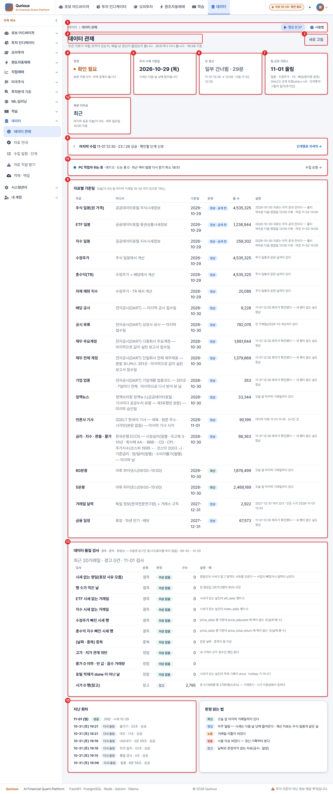

로컬 개발 앱 · 1280 폭 · 2026-11-01 16:39(관리자 화면 · 그날 12:30 회차는 26단계 중 23 성공 · 건너뜀 3 · 신호 단계에 채울 날 1 · 판정 카드는 「확인 필요」 · 낮 갱신은 「일부 건너뜀」 · 지난 회차의 「다시 돌림」 줄은 10-31 점검이 실제로 돌린 단계) · 그림 판 v0.40 — v0.8 은 2026-10-10 · 그 뒤 자료별 기준일 표의 줄이 늘고 「데이터 품질 검사」 카드(13)가 생겼다 · 구현 대조: [Figma 03-2 · `52:2`](https://www.figma.com/design/AfiCh50uOwrSq5F2Tk2JLZ?node-id=52-2)

**<표 4> 데이터 관제 요소**

| 번호 | 요소 | 데이터(API) | 동작 | 빈 데이터 · 오류 |
|:-:|---|---|---|---|
| 1 | 사용법 안내 | — | 누르면 펼쳐 이 화면에서 무엇을 보는지 설명 | — |
| 2 | 화면 제목 | — | — | — |
| 3 | 새로 고침 | `API-DATA-01` | 상태를 다시 받는다 | (v0.2 에서 화면으로 확인) |
| 4 | 판정 카드 | `API-DATA-01` | 정상 · 확인 필요 · 멈춤 중 하나(모든 자료가 최신이거나, 하루 밀렸어도 출처 공개 마감 전이면 정상 — 2026-10-15) | (v0.2 에서 화면으로 확인) |
| 5 | 주식 시세 기준일 | `API-DATA-01` | 수집 DB 의 시세 기준일 · 공식 자료는 다음 날 낮에 들어온다는 안내 | — |
| 6 | 낮 갱신 | `API-DATA-01` | 오늘 회차의 시작 · 끝 · 걸린 시간 · 다음 회차(러너가 단계 목록에 쓴 회차 시각에서 — 앱에 시각 사본 없음 · D104 · 2026-10-15) | 도는 동안 「도는 중 — 시작 시각」 · 기록이 없으면 「갱신 기록이 없습니다」 · 회차 시각을 모르면(단계 목록 없음 · 옛 목록) 「회차 시각 모름」 · 다음 회차 「—」 · 「오늘 회차 없음」 을 판정하지 않는다 |
| 7 | 팀 공유 저장소 | `API-DATA-01` | 비공개 데이터셋에 올린 날과 올린 자료 | 「올린 기록 없음」 |
| 8 | 마지막 수집 한 줄 | `API-DATA-01` `runner.last` | 마지막 회차의 시작 · 성공 n / 전체 · 확인할 단계 · 관리자에게만 「단계별로 자세히 →」(수집 일정 · 단계로 — 결정 ④ · 2026-10-08) | 기록이 없으면 그 까닭 한 줄 · 도는 중이면 「수집 중 — 시작 시각」 |
| 9 | 자료별 기준일 표 | `API-DATA-01` | 자료마다 출처 · 기준일 · 판정 · 줄 수 · 설명 · 아래에 「판정 읽는 법」 — 판정 글은 서버가 출처마다 공개 마감으로 정한다(시세 · ETF · 지수의 하루 밀림은 다음 거래일 14:00 까지 「정상 · 공개 전」 · 그 뒤 「늦음 · 다시 받기」 · 공시 목록은 전 거래일 · 언론사 기사는 36시간 · 정책뉴스는 거래일 2일 · 재무 · 배당 · 일정 · 시장금리는 마지막 회차가 그 단계를 확인했나 · 화면은 받은 글을 그대로 · DF-91 · 2026-10-15) · 줄 수는 러너가 회차 끝에 쓴 숫자 파일에서(자료 안내와 같은 파일 · 앱이 세지 않는다 · 2026-10-15) | 날짜로 판정하지 않는 자료(공시 · 일정)는 따로 묶는다 · 줄 수 안내 줄(표 위 한 줄 · 서버 글 그대로) — 도는 중 「행 수는 지난 수집(MM-DD HH:MM) 기준이다」 · 수집 뒤 못 씀 「행 수는 MM-DD HH:MM 수집 기준이다 — …」 · 숫자 파일 없음 · 옛 판 · 깨짐이면 줄 수 「—」 와 까닭(기준일 · 판정은 그대로) |
| 10 | 지난 회차 | `API-DATA-01` `runner.history` | 회차마다 성공 · 실패 · 걸린 분 · 시세 기준일 · 한 단계만 다시 돌린 줄은 「다시 돌림 · 단계 · 걸린 초」 로 따로(DF-82 · 2026-10-08) · 아래 「판정 읽는 법」 | 「기록이 없습니다」 |
| 11 | 수집 요청 한 줄(관리자) | `API-DATA-13` | PC 작업자 상태(서버 글) · 대기 n · 도는 중 n · 최근 요청 하나(무엇 · 상태 · 시각) · 「수집 요청 →」(수집 일정 · 단계로 — 2026-10-10 결정 ①: 안 B 의 작업자 상태 · 최근 요청을 여기 한 줄로) | 일반 사용자에게는 칸이 없고 요청 API 도 부르지 않는다(TC-CL-14 · TC-DH-01) · 읽지 못하면 「수집 요청을 읽지 못했습니다 — 까닭」 · 요청이 없으면 「요청 없음」 |
| 12 | 복원 리허설 한 줄 · 카드 | `API-DATA-01` `rehearsal` | 마지막 성공 리허설이 며칠 전인지(「마지막 성공 n일 전(MM-DD)」 · 오늘이면 「오늘」) · 예약 글(「매주 일요일 15:00 자동」 또는 「주간 예약 없음(손으로 돌림)」) · 상태 다섯(최근 · 오래됨 · 실패 · 없음 · 모름)마다 색 — 글과 날 수는 서버가 정하고 화면은 그대로 싣는다(2026-10-18 · 2차-3 · <그림 2> 의 12) | 판정 기록에 리허설 칸이 아직 없으면 「모름」(다음 회차가 판정 기록을 쓰면 생김) · 한 번도 없으면 「없음」 + 돌릴 명령 · 8일보다 오래되면 「오래됨」 · 마지막 리허설이 실패면 「실패」 + 마지막 성공 날 |
| 13 | 데이터 품질 검사 | `API-DATA-01` `quality` | 최근 20거래일의 결측 · 중복 · 정합성 검사 열 가지를 표로 — 검사 · 분류 · 판정(이상 없음 · 경고 · 참고 · 오류) · 건수 · 설명 · 예(상태 · 글은 서버 `quality_view` 가 정한 그대로 · 판정 카드(4)에는 섞이지 않는 한 줄 · 처음엔 경고만 하고 회차를 막지 않음) · 카드 머리에 검사한 기간 · 위에 검사한 날 한 줄 | 검사 기록이 없으면 「아직 검사 기록이 없습니다」 한 줄만 · 읽지 못하면 카드 자리에 「기록 없음」 |

---

## 4. 화면 상세 — AI 투자 상담 · 근거 답

**<표 5> 화면 정보**

| 칸 | 내용 |
|---|---|
| 화면 ID · 화면명 | `agent-chat` · AI 투자 상담(화면 머리 「로보 어드바이저 AI 상담」) |
| 들어가는 길 | 위 탭 「로보 어드바이저」 → 왼쪽 전체 메뉴 › 로보 어드바이저 › 「AI 투자 상담」 · 주소 `#agent-chat` |
| 설명 | 법 · 규정 질문은 근거 조문과 함께 답하고(근거 답), 그 밖의 질문은 일반 AI(Local Ollama)가 답한다. 처음 엔진은 「자동 — 근거 먼저」 다 |
| 관련 요구 | `P01-①-3`(근거 문서와 출처를 포함한 RAG 질의응답) · 유스케이스 UC-03 |
| 주담당 | 이동원 |
| 결정 기록 | [Figma 「Qurious · AI 투자 상담 — 근거 답과 출처」](https://www.figma.com/design/4hQ9nkdEaeOb5jSlpNELaQ) 05 결정 기록(2026-10-04) — 자리(이 화면) · 출처 모양(답 아래 카드) · 부르는 길(답변 엔진 칸) · 처음 엔진(자동 — 근거 먼저) |

근거 답을 받은 화면은 <그림 3> 과 같다(질문 「2026년 코스피 주식을 팔 때 증권거래세율은 얼마인가요?」 · 처음 엔진 「자동」).

**<그림 3> AI 투자 상담 — 근거 답을 받은 때** · 범례: 빨간 상자와 번호 = <표 6> 의 요소 · 2026-11-01 지금 화면(일반 사용자 계정 · 답 모델 `qwen3:4b-instruct` 가 만든 실제 답 · 번호 상자는 촬영 때 얹음)

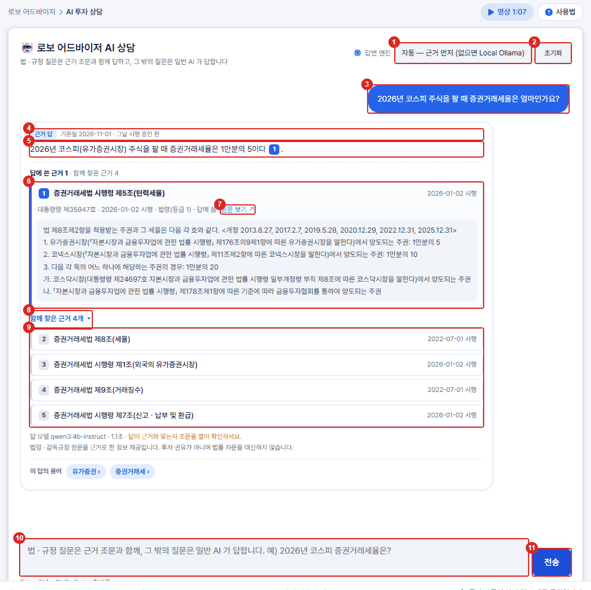

**<표 6> 근거 답 요소**

| 번호 | 요소 | 데이터(API) | 동작 | 빈 데이터 · 오류 |
|:-:|---|---|---|---|
| 1 | 답변 엔진 | — | 다섯 칸: 「자동 — 근거 먼저 (없으면 Local Ollama)」(처음 값) · 「근거 답 — 법령 · 규정 출처」 · Local Ollama · OpenAI · 「검색 결과 요약 (출처 확인 없음)」(옛 「순수 RAG 청크 사용 (LLM 미사용)」 — 2026-10-08 강사님 판부터 서버 LLM 이 검색 조각을 짧게 요약하고, 답 꼬리표에 실제 모델 · 요약하지 못했으면 「LLM 미사용 — 검색 조각」). 고른 칸은 이 브라우저에 기억한다(`qurious.chat.llmMode`) · 칸마다 입력칸 안내가 바뀐다 | OpenAI 는 키를 넣어야 보낸다(강사님 동작) |
| 2 | 초기화 | — | 대화를 지우고, 다음 채팅 전에 새 대화를 연다(모델이 화면에 없는 지난 대화를 보지 않게) | — |
| 3 | 질문 말풍선 | — | 보낸 질문 | — |
| 4 | 꼬리표 · 기준일 | `API-KB-03` | 「근거 답」(또는 「근거 발췌」) · 기준일 · 그날 시행 중인 판 | — |
| 5 | 답 글 · 출처 번호 | `API-KB-03` | 서버가 검사한 출처 번호만 남는다. 번호를 누르면 그 카드가 펼쳐지며 밝아진다 | 맞는 번호가 없거나 답 모델이 꺼지면 답 글 대신 근거 발췌(<표 8>) |
| 6 | 답에 쓴 근거 카드 | `API-KB-03` `citations[]` | 번호 · 문서 조(제목) · 시행일 · 판 · 법령/감독규정(등급) · 조문 글(`excerpt` · 900자에서 자름). 머리를 누르면 접히고 펼쳐진다 | 조문 글이 없으면 「원문 보기로 확인하세요」 |
| 7 | 원문 보기 | `citations[].url` | 국가법령정보센터의 그 판(시행일) 본문을 새 창으로 | 주소가 없으면 숨긴다 |
| 8 | 함께 찾은 근거 접기 | — | 함께 찾은 근거 목록을 접고 편다 | 함께 찾은 근거가 없으면 숨긴다 |
| 9 | 함께 찾은 근거 | `API-KB-03` `citations[]`(`used` 거짓) | 한 줄씩(번호 · 문서 조(제목) · 시행일) · 누르면 조문 글이 펼쳐진다 | — |
| 10 | 입력칸 | — | Enter 보내기 · Shift+Enter 줄바꿈 · 근거 답 칸에서는 300자까지(넘으면 알림 · 보내지 않고 글은 그대로) | — |
| 11 | 전송 | `API-KB-03` · 일반 AI 로 넘어가면 `API-CONV-01` → `API-CHAT-01` | 근거 답 칸이면 근거 답, 아니면 강사님 채팅 | 로그인이 풀리면 로그인 화면 · 그 밖의 오류는 위쪽 알림 |

말풍선 맨 아래에는 답 모델 · 걸린 시간 · 「답이 근거와 맞는지 조문을 열어 확인하세요」 · 투자 권유가 아니라는 안내가 붙는다(근거 목록 밖의 번호를 지웠으면 그 수도).

「근거 답」 칸에서 근거를 찾지 못한 때는 <그림 4> 와 같다.

**<그림 4> 근거 답만 — 근거를 찾지 못한 때** · 범례: 빨간 상자와 번호 = <표 7> 의 요소

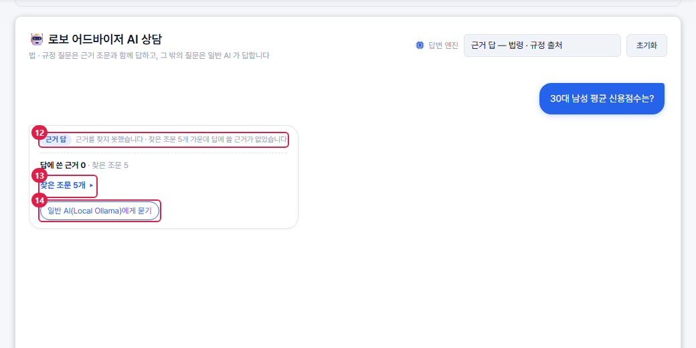

**<표 7> 근거 없음 요소**

| 번호 | 요소 | 데이터(API) | 동작 | 빈 데이터 · 오류 |
|:-:|---|---|---|---|
| 12 | 근거 없음 알림 | `API-KB-03`(`no_evidence`) | 「근거를 찾지 못했습니다 · 찾은 조문 n개 가운데 답에 쓸 근거가 없었습니다」 | 찾은 조문이 0 이면 「근거 문서에서 관련 조문을 찾지 못했습니다」 |
| 13 | 찾은 조문 | `citations[]` | 접힌 목록 · 펼치면 한 줄씩 · 누르면 조문 글 | 0 이면 숨긴다 |
| 14 | 일반 AI 에게 묻기 | `API-CONV-01` → `API-CHAT-01` | 같은 질문을 Local Ollama 에게 묻는다(「자동」 칸은 이것을 누르지 않아도 한다) | 오류는 위쪽 알림 |

상태마다 화면이 보이는 것은 <표 8> 과 같다.

**<표 8> 상태별 화면** · `status` = `API-KB-03` 응답

| 경우 | 화면 |
|---|---|
| 불러오는 중 | 「법령 · 감독규정에서 근거를 찾고 답을 쓰는 중 · n초」(1초마다) · 일반 AI 로 넘어가면 「근거 문서에 없는 질문이라 Local Ollama 가 답하는 중 · n초」 |
| `answered` | <그림 3> |
| `excerpt` | 꼬리표 「근거 발췌」 · 왜 답 글 대신 조문을 보이는지 한 줄(답 모델이 응답하지 않음 · 근거로 확인할 수 없음) · 「보여 드린 근거」 카드 · 바닥글에 까닭 |
| `no_evidence` · 「자동」 칸 | 근거 없음 한 줄 → 이어서 Local Ollama 답 말풍선(노란 테두리 · 꼬리표 「일반 AI 답 · 출처 없음」 · 「근거 문서(법령 · 감독규정)에 없는 질문이라 Local Ollama 가 답했습니다. 사실 여부를 따로 확인하세요.」) |
| `no_evidence` · 「근거 답」 칸 | <그림 4> |
| `declined` | 「투자 권유나 가격 · 수익률 예측은 하지 않습니다 …」 · 물을 수 있는 예시 셋(누르면 입력칸에) · 「자동」 칸이어도 일반 AI 로 넘기지 않는다 |
| 다른 엔진(Local Ollama · OpenAI · 검색 결과 요약)의 답 | 강사님 말풍선 아래 「근거 답으로 다시 묻기」 단추와 「이 답에는 출처가 없습니다 …」 · 누르면 같은 질문을 근거 답으로(입력칸 글은 그대로) |
| 좁은 화면(768 아래) | 화면 머리(제목 · 답변 엔진)를 위아래로 쌓는다 · 640 아래에서는 말풍선이 폭을 다 쓰고 카드의 시행일을 숨긴다(펼친 칸의 판 줄에 있다) |

강사님 화면에서 바뀐 것은 다섯이다. ① 답변 엔진에 두 칸을 더하고 처음 값을 「자동」 으로 ② 고른 엔진을 기억하는 이름을 `qurious.chat.llmMode` 로(옛 저장값을 한 번 비워 처음 값이 보이게) ③ 화면 부제를 「법 · 규정 질문은 근거 조문과 함께 답하고, 그 밖의 질문은 일반 AI 가 답합니다」 로(「투자 자문을 제공」 문구 삭제) ④ 화면을 새로 열거나 초기화하면 새 대화(DF-60) ⑤ 다른 엔진 답 아래 「다시 묻기」. 화면 코드는 `public/js/kbchat.js` · 모양은 `public/css/qurious.css` 이고, 강사님 `agent.js` 에는 넘기는 갈림만 두었다.

알려진 문제 — 근거 답이 출처 번호는 맞지만 조문을 잘못 읽을 수 있다(DF-59 · 예: 증권거래세율을 법 제8조의 기본 세율로 답함). 그래서 함께 찾은 근거까지 카드로 보인다. 일반 AI 이어 받기는 이 PC 에서 1 ~ 2분 걸린다(채팅 에이전트가 자료가 없는 신용 조회 도구를 되풀이해 부름). 채팅 모델(llama3.1)의 답에는 되풀이와 「目的」 같은 한자가 섞인다.

### 4.1 답 위 앱 판단 카드 · 답 끝 용어 칩 (2026-10-17)

질문에 종목 이름이 그대로 있으면 AI 답보다 먼저, 앱이 그 종목에 대해 이미 아는 것을 카드 한 장으로 보인다(<그림 21>). 카드 값은 종목 허브 묶음(`API-HUB-01`)을 그대로 옮긴 것이라 AI 가 숫자를 바꿀 수 없고, 칸을 합친 한 줄 결론은 만들지 않는다. 답 끝에는 서버가 글에서 찾은 용어를 칩으로 붙인다(<그림 22>). 결정 기록은 [Figma 「Qurious · AI 투자 상담 — 근거 답과 출처」](https://www.figma.com/design/4hQ9nkdEaeOb5jSlpNELaQ) 03-2 쪽이다 — 카드는 설계 A(답 위), 용어는 (가) 글 끝 칩 줄을 골랐다.

**<그림 21> 답 위 앱 판단 카드 — 질문 「신한지주 지금 사도 될까요? 우리 앱의 신호와 근거를 같이」** · 범례: 빨간 상자와 번호 = <표 29> 의 요소

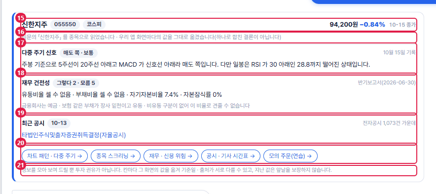

**<그림 22> 답 끝 용어 칩 — 일반 AI 답의 끝** · 범례: 빨간 상자와 번호 = <표 29> 의 요소

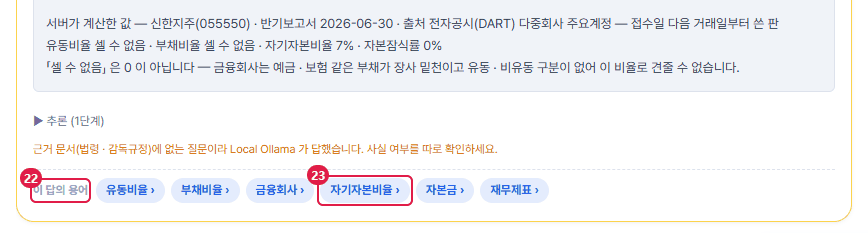

**<표 29> 앱 판단 카드 · 용어 칩 요소**

| 번호 | 요소 | 데이터(API) | 동작 | 빈 데이터 · 오류 |
|:-:|---|---|---|---|
| 15 | 카드 머리 | `API-HUB-01` `name` · `market` · `sections.price` | 이름 · 코드 · 시장 · 마지막 종가 · 등락(오름 빨강 · 내림 파랑 · 빼기는 「−」) · 「MM-DD 종가」 · 마지막 거래일 종가가 아직 안 들어왔으면 뒤에 「· M월 D일 종가는 반영 전」(`pending_note` · v0.41) | 종가가 없으면 가격을 쓰지 않고 「마지막 종가 — (서버 까닭)」 한 줄 |
| 16 | 읽은 이름 | `API-HUB-02` `items[].matched` | 「질문의 「○○」 을(를) 종목으로 읽었습니다 · 우리 앱 화면마다의 값을 그대로 옮겼습니다(하나로 합친 결론이 아닙니다)」 — 질문에서 읽은 글자 그대로(회사 이름으로 바꾸지 않는다) | 흔한 낱말과 같은 이름(「신세계 같은 세상」)도 이름이 그대로면 읽는다 — 그래서 무엇을 읽었는지 밝힌다 |
| 17 | 다중 주기 신호 | `sections.signal` | 「매도 쪽 · 보통」(관망은 「쪽」 없이) · 「10월 15일 기록」 · 서버 요약 한 줄 | 신호를 기록하지 않는 종목이면 서버 까닭(「… 401종목에 들지 않습니다」) |
| 18 | 재무 건전성 | `sections.financials` | 「그렇다 n · 아니다 n · 모름 n」(0 인 아니다 · 모름은 빼고) · 보고서(기간 끝) · 지표마다 값 또는 「셀 수 없음」 · 금융회사 까닭(서버 글) | 재무를 못 읽으면 서버 까닭 |
| 19 | 최근 공시 | `sections.disclosures` | 날짜 · 「전자공시 n건 가운데」 · 가장 최근 공시 제목(원문 링크 — http(s) 주소만) | 공시가 없으면 「최근 공시가 없습니다.」 |
| 20 | 다른 화면으로 | `links`(이름은 서버 글) | 다섯 — 차트 패턴 · 다중 주기(종목 칸에 코드 → 분석 실행) · 종목 스크리닝(옮기기만) · 재무 · 신용 위험(코드로 그 회사) · 공시 · 기사 시간표(그 종목 시간표) · 모의 주문(연습)(코드 → 시세 조회 · 주문은 사용자가) | 서버 `links` 에 없는 화면은 단추를 그리지 않는다 |
| 21 | 고지 | `notice` | 서버 고지 그대로(투자 권유가 아님 · 칸마다 기준일 · 출처가 다름 · 지난 값은 앞날을 보장하지 않음) | — |
| 22 | 칩 줄 이름 | — | 「이 답의 용어」 | 찾은 용어가 없거나 찾기가 실패하면 줄을 그리지 않는다(답은 그대로 · 실패는 콘솔에 남긴다) |
| 23 | 용어 칩 | `API-GLOS-06` `items[]` | 글에 나온 차례로 최대 여섯 · 누르면 용어 풀이(화면 설정에서 고른 모양 — 기본 오른쪽 서랍) | — |

**<표 30> 카드 · 칩의 경우**

| 경우 | 화면이 보이는 것 |
|---|---|
| 질문에 종목 이름이 없다 | 카드 자리를 잡았다가 지운다(빈 칸이 남지 않는다) |
| 종목이 둘(서버 최대 둘) | 첫째는 펼치고, 둘째는 「질문의 「○○」 도 종목으로 읽었습니다 — 카드 펼치기」 로 접는다 |
| 종목은 읽었는데 허브를 못 읽음 | 「질문의 「○○」 을(를) 종목으로 읽었지만 앱 자료를 지금 읽지 못했습니다 — 잠시 뒤 다시 물어 주세요.」 한 줄 |
| 「자동」 · 「근거 답」 칸 | 질문 말풍선 바로 뒤에 카드 자리를 먼저 잡고 근거 답과 함께 불러온다(약 1초 · 답을 기다리게 하지 않는다) |
| 다른 엔진(Local Ollama · OpenAI · 검색 결과 요약) | 답이 온 뒤 그 답 줄 위로 카드를 끼운다 · 칩은 「근거 답으로 다시 묻기」 단추 위 |
| 근거 발췌 · 답하지 않는 질문 | 칩을 붙이지 않는다(발췌는 조문 글이고, 거절은 답이 없다) |
| 좁은 화면(640 아래) | 카드가 폭을 다 쓰고, 지금가를 이름 아래 줄로 내린다 |

카드는 종목 허브 화면과 같은 칸 묶음을 쓴다 — 칸 이름 · 값 · 까닭 글은 서버 한 곳에서 만들고 화면은 옮기기만 한다(그리는 판단은 `public/js/stockcard.js` 한 곳이고 DOM 없이 시험한다). 용어 칩 부품(`public/js/termchips.js`)은 다른 화면(차트 패턴 · 스크리닝 등)도 같은 이름으로 부를 수 있다. 용어사전의 「자기자본비율」 에는 은행 BIS 비율 뜻만 있어, 칩이 회사 재무의 7% 를 「최소 8% 미달」 로 읽히게 할 수 있었다 — 칩을 붙이기 전에 풀이를 회사 재무의 뜻(자본총계 ÷ 자산총계)으로 고치고 BIS 비율과 「헷갈리기 쉬운 말」 로 이었다.

---

## 5. 화면 상세 — 데이터 수집 화면 셋 · 자료 안내

데이터 묶음의 크롤링 세 화면(`crawl-auto` · `crawl-manual` · `crawl-ingest`)을 바꾼 화면이다. 옛 셋은 강사님 예제(외부 강의 문서 긁기 · 네이버 종목 긁기 · 신용평가 CSV 넣기 · DB 초기화)를 돌았고, 우리 수집은 화면 밖 러너가 매일 12:30 에 한다. Figma 에서 지금 화면 셋과 바꿀 화면 셋을 나란히 두고 경우 표와 정할 것 넷을 거쳐 2026-10-06 에 설계를 정했고, 2026-10-08 에 만들었다. 만들며 실제 코드와 맞대 보니 설계와 다르게 해야 할 곳이 셋 나와 그날 다시 정했다(<표 9> 결정 기록). 이 절의 그림은 2026-10-08 의 구현 화면이고, 숫자는 그날 낮(12:30 회차 전)의 실제 값이다.

### 5.1 세 화면에 공통

**<표 9> 세 화면 공통**

| 칸 | 내용 |
|---|---|
| 화면 ID · 화면명 | `crawl-auto` · 수집 일정 · 단계 / `crawl-manual` · 자료 직접 받기 / `crawl-ingest` · 적재 · 백업 — 화면 키는 옛 크롤링 그대로 두고 이름만 바꿨다(옛 주소가 열리고, 강사님 기초 코드를 받을 때 부딪히는 곳이 적다) |
| 들어가는 길 | 위 탭 「데이터」 또는 왼쪽 전체 메뉴 › 데이터의 넷(데이터 관제 · 수집 일정 · 단계 · 자료 직접 받기 · 적재 · 백업) · 데이터 관제의 한 줄 「단계별로 자세히 →」 |
| 누가 쓰나 | 관리자. 일반 사용자에게는 왼쪽 메뉴 · 전체 메뉴의 셋과 데이터 관제의 「자세히 →」 가 보이지 않는다 — 로그인 정보의 역할로 몸통에 `q-admin` 을 붙이고 CSS 가 숨긴다(역할을 확인하기 전에도 숨긴 채로 시작한다). 서버도 셋의 API 를 관리자만 받는다(일반 사용자 403 — 주소로 들어오면 「관리자만 볼 수 있는 화면입니다」) |
| 설명 | 우리 수집이 무엇을 언제 했는지 보고(수집 일정 · 단계), 빠진 날을 메울 범위와 명령을 보고(자료 직접 받기), 백업이 믿을 만한지 확인한다(적재 · 백업) |
| 관련 요구 | `P01-①-2`(수집) · `P01-①-4`(정기 배치) · 유스케이스 UC-04 |
| 주담당 | 이동원 |
| 결정 기록 | [Figma 05 정할 것](https://www.figma.com/design/AfiCh50uOwrSq5F2Tk2JLZ?node-id=10-2)(2026-10-06) — ① 네이버 종목 긁기는 화면에서 빼고 「막음」 예시로만 · ③ 외부 강의 문서 긁기는 수집 화면에서 빼고 개념 학습 자료로 · ④ 데이터 관제와 따로 두고 한 줄로 잇기 + 단계가 늘면 화면이 따라오게 · ② 신용평가 CSV 는 CSV 수동 적재 · 개인 CB · 「DB 초기화」 를 빼고 그 자료를 읽던 로보 어드바이저 화면 둘은 우리 자료로 고쳐 씀(2026-10-07) · 한 단계 다시 돌리기는 화면이 명령과 막히는 때만 보여 줌 · 「DB 초기화」 는 단추와 서버 길(`API-ADM-01`)을 함께 없앰(2026-10-07) · **구현 때 셋(2026-10-08)** — 가. PC 쪽 일(한 단계 다시 · 받기 · 원격 다시 확인 · 복원 리허설)은 모두 명령을 보여 주고 복사하게 한다 나. 자료 직접 받기는 실제 수집 단위로(종류가 출처를 정함 · 종목 칸 없음 · 날 · 해 단위 — 5.3절) 다. 백업 판정은 `scripts/hf_dataset.py` 가 쓰고 앱은 읽기만(5.4절) |
| 화면이 하지 않는 일 | 앱은 수집 폴더를 읽기만 하게 붙어 있다(`./data:/app/data/csv:ro`). 그래서 PC 쪽 일은 화면이 돌리지 않는다(결정 가) — 받기 · 원격 다시 확인 · 복원 리허설은 **이 PC 에서 돌릴 명령**을 상자에 보여 주고 복사하게 하고, 수집 일정의 「다시 받기」 · 「전체 수집」 은 앱 DB 의 요청 표에 줄만 남겨 이 PC 의 수집 작업자가 가져가 돌린다(2026-10-10). 화면이 보내는 쓰기는 주소 검사 · 주소로 받기(근거 문서 — 앱 DB · 검색 색인) · 수집 요청 만들기 · 취소 넷이고, 수집 요청 둘은 화면 머리글 `X-Qurious-Action: collect` 를 붙인다 |
| 화면 글 | 실제 서비스 말로 쓴다 — 저장소 · DB 이름이나 작업 말을 화면에 쓰지 않는다. 설계 주석은 Figma 화면 프레임 밖에 둔다 · 관리자가 PC 에서 돌릴 명령만 그대로 보인다 |
| 화면 파일 | 강사님 파일(`app.html` · `agent.js` · `main.js`)에는 뿌리 칸과 부르는 줄만 두고 그리기는 `public/js/collect.js` · `public/css/collect.css` 에 둔다(수집 요청 · 확인 창 · 대기 창 · 관제 한 줄은 `public/js/collect-requests.js` · 2026-10-10). 옛 단추를 뺀 자리의 리스너도 함께 뺐다 — 남기면 그 줄이 null 오류로 `agent.js` 전체(AI 투자 상담 화면 포함)를 멈춘다 |

### 5.2 수집 일정 · 단계 (`crawl-auto`)

매일 12:30 회차 하나를 단계별로 보인다 — 단계마다 하는 일 · 걸린 시간 · 결과를 보이고, 관리자는 한 단계 · 전체 수집을 요청하거나(2026-10-10) 이 PC 에서 돌릴 명령을 본다. 화면은 <그림 5> 와 같다.

**<그림 5> 수집 일정 · 단계 — 2026-11-01 회차 · 단계 하나 다시 받기를 요청한 직후** · 범례: 빨간 상자와 번호 = <표 10> 의 요소

로컬 개발 앱 · 1280 폭 · 2026-11-01 16:41 · 11-01 12:30 회차 기록 그대로(건너뜀 셋 · 신호 채울 날 1) · 요청 목록 응답에 방금 요청한 뉴스 한 줄(대기)을 더해 그렸다 — 실제 요청은 보내지 않았다(그림 밖 요청 줄은 10-31 점검 때 실제로 돈 단계 다섯 줄) · 그림 판 v0.40(v0.8 은 2026-10-10) · 구현 대조: [Figma 03-2 · `51:2`](https://www.figma.com/design/AfiCh50uOwrSq5F2Tk2JLZ?node-id=51-2) · 설계 원본: [03-2 [결정] 안 A](https://www.figma.com/design/AfiCh50uOwrSq5F2Tk2JLZ?node-id=40-2) · [03 설계 1](https://www.figma.com/design/AfiCh50uOwrSq5F2Tk2JLZ?node-id=7-2)

**<표 10> 수집 일정 · 단계 요소**

| 번호 | 요소 | 데이터(API) | 동작 | 빈 데이터 · 오류 |
|:-:|---|---|---|---|
| 1 | 왼쪽 메뉴 — 데이터 넷 | — | 관리자에게만 아래 셋이 보인다 · 지금 화면을 강조 | 일반 사용자는 데이터 관제 하나 |
| 2 | 회차 고르기 | `API-DATA-05` `last` · `history` | 마지막 회차 · 지난 회차를 고르면 그 회차의 타일 · 단계 표로 바뀐다 · 한 단계만 다시 돌린 줄은 「↳ 다시 돌림 · 단계」, 빠진 날을 채운 줄은 「↳ 빠진 날 채움 · 단계 날짜」 로 따로(DF-82 · 2026-10-10) · 화면에 들어올 때마다 마지막 회차부터 | 기록이 하나뿐이면 고르는 칸을 숨긴다 |
| 3 | 관리자 꼬리표 | — | 관리자 화면임을 보인다 | — |
| 4 | 안내 | — | 무엇을 언제 하는지 한 줄 | — |
| 5 | 요약 타일 넷 | `API-DATA-05` | 고른 회차(시작 → 끝 · 걸린 시간 — 다시 돌린 줄은 그 단계의 초) · 결과(성공 n / 전체 · 실패 · 경고 · 건너뜀) · 자료 기준일(그 회차의 시세 기준일 · 출처 공개는 다음 영업일 13시 뒤) · 다음 회차 | 도는 중이면 맨 위에 「수집 중 · 시작 시각」 한 줄(아래는 지난 회차) · 기록이 없으면 「아직 회차 기록이 없습니다 — 첫 수집은 12:30」 · 단계별 기록이 없는 옛 회차는 「이 회차는 단계별 기록이 없습니다」 |
| 6 | 단계 표 머리 | — | # · 단계 · 하는 일 · 걸린 시간 · 결과 · 다시 받기(2026-10-10 · 옛 「관리자」) | — |
| 7 | 묶음 줄 | `API-DATA-05` `groups` | 받기 · 계산 · 백업 · 근거 문서와 그 설명(러너 단계 목록에서) | — |
| 8 | 걸린 시간 막대 | `steps[].seconds` | 모든 막대가 같은 눈금(가장 긴 단계가 끝까지) · 옆에 걸린 시간 글자 | 단계별 기록이 없는 회차는 「—」 |
| 9 | 결과 | `steps[].status` · `followup` · `reason` · `date` | 성공 · 경고 · 실패 · 건너뜀(그 까닭) · 채울 날이 남은 건너뜀(`followup` — 신호 단계 앱 DB 꺼짐)은 노랑 「건너뜀」 과 빠진 거래일 · 빠진 날이 남은 단계는 성공 줄이어도 「채울 날 n」 꼬리표(23) · 그 회차 뒤에 다시 돌린 단계는 「성공 · 다시 돌림」 · 실패 · 경고 줄 아래에 까닭 줄(21) | 실패 줄은 빨강 · 기록 없는 회차는 「기록 없음」 |
| 10 | 다시 받기 | `API-DATA-12` `kind=step` · `API-DATA-13` `rules.blocked_now.steps` | 누르면 그 단계의 요청 줄을 남기고(새 줄이면 「요청했습니다 — … · PC 작업자가 1분 안에 가져갑니다」, 이미 대기 · 도는 중이면 「이미 기다리는 요청이 있습니다」) 대기 창(18)을 연다 — 작업자가 `run --only <단계>` 를 돈다(올리기 단계는 `--upload`). 옛 「이 단계만 다시」(명령 상자)는 14 「명령」 으로 남겼다(2026-10-10) · 빠진 날이 남은 단계는 이 단추가 「빠진 날 채우기(n일)」(19)로 바뀐다 | 막는 때 · 수집 중 · 이미 요청함 · 목록을 읽지 못함이면 꺼지고 마우스를 올리면 까닭 · 관리자가 아니면 「관리자만 요청할 수 있습니다」 |
| 11 | 아래 안내 | `rerun.blocked` | 「다시 받기」 · 「전체 수집」 은 요청만 남기고 이 PC 의 작업자가 1분 안에 가져가 돌린다는 것 · 화면이 수집을 직접 돌리지 않는다는 것 · 막는 때와 수집 중에는 단추가 꺼진다는 것 · 작업자가 꺼져 있으면 「명령」 으로 직접 · 명령이 막히는 때 | — |
| 12 | 전체 수집 | `API-DATA-12` `kind=all` · `API-DATA-13` `rules.blocked_now.full` | 누르면 확인 창(17)을 거쳐 요청 줄 하나를 남긴다 · 이미 요청했으면 「전체 수집 요청함」(꺼짐) | 막는 때(11:00 ~ 13:30) · 수집 중 · 이미 요청함 · 목록을 읽지 못함이면 꺼지고, 마우스를 올리면 까닭이 보인다 |
| 13 | PC 작업자 띠 | `API-DATA-13` `worker` · `rules` | 작업자 상태(서버 글 — 쉬는 중 · 기다리는 중 · 도는 중 · 꺼짐 · 없음) · 마지막 신호 · 오른쪽에 막는 때. 쉬는 중은 초록 점, 기다리는 중은 노랑 띠, 도는 중은 파랑 점(무엇 · 경과) | 꺼짐 · 없음이면 빨강 띠 「요청은 받지만 작업자가 켜질 때까지 기다립니다 — 마지막 신호 · 등록 안내」 · 목록을 못 읽으면 그 까닭 |
| 14 | 명령 | `API-DATA-05` `rerun` · `catalog.steps[].fill` | 옛 「이 단계만 다시」 의 동작 그대로 — 그 줄 아래 「이 PC 에서 돌릴 명령」 상자 · 신호 단계는 「빠진 날 채우기」 상자 · 복사 · 다시 누르면 닫힘. 작업자가 꺼져 있을 때 이 PC 에서 직접 돌리는 길이다(2026-10-10 결정 ④) | 복사를 못 하는 창이면 명령 글을 골라 두고 알린다 |
| 15 | 줄의 요청 상태 | `API-DATA-13` `requests[]` | 그 단계의 요청이 대기 · 도는 중이면 단추가 「요청함」(꺼짐)이 되고 아래에 상태와 기다리는 까닭의 앞마디(도는 중이면 경과 시간) | 막는 때면 「HH:MM 뒤에 누를 수 있음」 |
| 16 | 수집 요청 | `API-DATA-13` · `API-DATA-14` | 최근 10건 — 상태 칩 · 무엇 · 요청 시각과 요청한 사람 · 시작 → 끝 · 걸린 시간 · 결과 한 줄(대기면 기다리는 까닭) · 대기 줄에만 「취소」 · 실패 · 경고 줄은 결과 아래에 까닭 줄(22) · 대기 · 도는 중인 요청이 있으면 5초, 없으면 1분마다 새로 고침 | 「아직 요청이 없습니다 — …」 · 취소하는 사이 이미 돌기 시작했으면 서버 409 글 그대로 |
| 17 | 전체 수집 확인 창 | `API-DATA-05` 단계 수 · 지난 회차 길이 · `API-DATA-13` 작업자 · 막는 때 · 만료 | 단계 수 · 지난 회차가 걸린 시간 · HF 데이터셋 올리기까지 한다는 것 · 막는 때 · 3시간 안에 시작하지 못하면 만료 · 지금 작업자 상태 → 「전체 수집 요청」 · 「닫기」(Esc · 바깥 누름) | 작업자가 올리기를 끈 PC 면 「올리기를 하지 않습니다」 |
| 18 | 대기 창 | `API-DATA-13`(5초마다) | 요청 직후 열린다 — 모래시계 · 무엇 · 상태 칩과 기다리는 까닭(끝나면 결과 한 줄) · 경과 시간 · 「창 닫기」(요청은 계속) · 대기일 때만 「요청 취소」 · 움직임 줄이기 설정이면 모래시계가 돌지 않는다 | 끝나면 모래시계가 멈추고 걸린 시간을 보인다 · 실패면 결과 아래 까닭 줄(22) |
| 19 | 빠진 날 채우기(n일) | `API-DATA-05` `last.steps[]` 의 `followup` · `fill_from` · `fill_to` · `fill_days` · `API-DATA-13` `rules.blocked_now.fill` | 러너가 적은 빠진 날이 남은 단계(지금은 신호)만 「다시 받기」 자리에 노랑 단추로 · 날짜 · 날 수는 마지막 기록에서 그대로(화면이 셈하지 않는다 · 고른 지난 회차가 아니라) · 누르면 확인 창(20) | 막는 때(채우기 창 — 10:30 ~ 13:30) · 수집 중 · 같은 단계의 채우기가 대기 · 도는 중이면 꺼지고 마우스를 올리면 까닭 · 빠진 날이 없으면 단추가 「다시 받기」 로 돌아온다 |
| 20 | 채우기 확인 창 | 단추의 날짜 · `API-DATA-13` `rules.fill` · `fill_max_days` · `worker` | 첫날 ~ 마지막 날(하루면 날짜 하나) · 빠진 거래일 n일 · 같은 날을 다시 계산해도 값만 바뀐다 · 한 번에 31일까지(더 남은 날은 다음 묶음) · 막는 때 · 만료 · 지금 작업자 → 「빠진 날 채우기 요청」(`API-DATA-12` `kind=fill` · 날짜 두 칸) · 「닫기」(Esc · 바깥 누름) | 서버가 받지 않으면(상한 · 날짜 · 옛 단계 목록) 서버 글 그대로 알림 |
| 21 | 단계 표의 까닭 줄 | `API-DATA-05` `steps[].error` · `log_name`(관리자 답에만) | 실패 · 경고 줄 바로 아래 한 줄 — 빨간 「까닭」 꼬리표와 러너가 걸러 적은 글(마지막 예외 줄 · 경로는 파일 이름만 · 비밀값 지움 · 200자) · 그 아래 회색으로 로그 파일 이름 · 「명령」 상자는 까닭 줄 뒤에 열린다 | 성공 · 건너뜀 줄과 옛 기록(까닭 칸 없음)에는 없다 · 시간 한도를 넘기면 「시간 한도 n분을 넘겨 멈춤」 |
| 22 | 요청 결과의 까닭 줄 | `API-DATA-13` `requests[].result` 끝의 「 · 까닭: 」 | 작업자가 결과 한 줄 끝에 붙인 까닭을 떼어 결과 아래 한 줄로(요청 목록 · 대기 창 같은 도우미) · 전체 수집은 첫 실패 단계 이름과 함께 | 까닭이 없으면 결과 한 줄 그대로 |
| 23 | 채울 날 꼬리표 | `steps[].fill_days` · `fill_from` · `fill_to` · `fill_rest` | 결과 칸에 「채울 날 n」 · 하는 일 칸에 「채울 날 n (첫날 ~ 마지막 날)」(하루면 날짜 하나 · 다음 묶음이 있으면 「다음 묶음 m일」) | 건너뛴 줄은 러너 메모에 같은 글이 있어 하는 일 칸에 다시 붙이지 않는다 |

**채울 날이 남은 건너뜀 · 빠진 날 채우기(2026-10-08)** — 신호 단계(앱 DB 에 다중 주기 신호를 쓰는 단계)는 러너가 돌리기 전에 앱 DB 포트를 확인하고, 닫혀 있으면 돌리지 않고 「건너뜀」 으로 남긴다. 이 줄만 노랑 「건너뜀」 으로 칠하고 하는 일 칸에 까닭(러너가 적은 메모)과 빠진 거래일을 붙인다 — 할 일이 없어 건너뛴 줄(새 자료 없음 · 업로드 끔)은 회색 그대로다. 「이 단계만 다시」 를 열면 단계 목록에 빠진 날 채우기 명령이 있는 단계에만 둘째 상자 「빠진 날 채우기」 가 열린다(명령 글은 러너 단계 정의 한 곳에서 온다). 요약 타일의 결과에는 「건너뜀 n (채울 것 m)」.

**<그림 5-2> 신호 단계 — 앱 DB 꺼짐으로 건너뜀 · 빠진 날 채우기 상자**

로컬 개발 앱 · 1280 폭 · 2026-11-01 16:44 · 앱 DB 는 켜져 있어 신호 줄의 응답만 「앱 DB 꺼짐」 으로 바꿔 그렸다(회차 기록 파일은 건드리지 않음) · 단계 번호는 스물여섯 단계 표 기준(신호는 18번) · 줄만 잘라 넣었다

**실패한 단계의 까닭 · 빠진 날 채우기(2026-10-10)** — 10-10 12:30 회차의 배당 · 기업 일정이 DART 시스템 점검으로 실패했을 때 요청 결과가 「종료코드 1」 뿐이라 로그를 열어야 까닭을 알았다(DF-101). 이제 러너가 실패한 단계 로그 구간의 마지막 예외 줄을 걸러 단계 줄에 적고(`error` · `log_name`), 작업자가 요청 결과 끝에 붙인다. 빠진 날은 앱 DB 가 꺼진 회차마다 러너가 상태 파일에 모아 「채울 날 n · 첫날 · 마지막 날」 로 적고 — 이틀 넘게 꺼졌던 때도 센다 — 화면은 그 날짜로 채우기를 요청한다. 작업자는 `run --fill <단계> --from --to` 를 돌리고 러너는 채운 범위의 날만 지운다. 화면 꼴은 Figma 「데이터 수집 화면」 03-3 에서 세 안을 견줘 정했다(<표 10-3>).

**<표 10-3> 수집 단추 남은 것 — 정한 것 넷(2026-10-10)** · 원본: [Figma 03-3 · [결정] 안 A](https://www.figma.com/design/AfiCh50uOwrSq5F2Tk2JLZ?node-id=59-2)

| 정할 것 | 고른 것 | 까닭 |
|---|---|---|
| ① 까닭을 어디에 | 안 A — 실패 · 경고 줄 바로 아래 한 줄(+ 로그 파일 이름) · 요청 결과 아래 한 줄 | 열지 않아도 바로 읽힌다 · 안 B(접어 둠)는 한 번 더 눌러야 하고 안 C(결과 칸 안)는 표가 넓어진다 |
| ② 채우기 단추 | 빠진 날이 있을 때만 그 단계의 「다시 받기」 가 「빠진 날 채우기(n일)」 로 바뀐다 · 누르면 확인 창 | 할 일이 있을 때만 보이고, 날짜는 러너가 적은 그대로라 사람이 날짜를 고르다 틀릴 일이 없다 |
| ③ 한 번의 상한 | 31일(양 끝 포함) | 한 달 남짓 꺼졌던 때까지 한 번에 · 시간 한도는 평일 수 × 단계 한도에서 120분에 멈춘다 · 넘는 날은 다음 묶음 |
| ④ 요청 길 | 요청 표에 새 종류 `fill` + 날짜 칸 둘(이전 `0019`) | 「다시 받기」 의 뜻을 신호 줄에서만 바꾸지 않고 기록 · 감사에 범위가 남는다 |

구현 때 정한 것 — 까닭 · 로그 파일 이름은 **관리자 답(`API-DATA-05`)에만** 싣는다(내부 말 · PC 의 파일 이름 · 모두가 보는 데이터 관제 응답은 30초 캐시를 같이 쓴다) · 다시 돌림 줄의 로그 경로 · 요청 번호도 같은 까닭으로 관리자 답에만 · 빠진 날이 31일을 넘게 쌓이면 첫날부터 31일 안을 한 묶음으로 적고 남은 날 수를 따로(단추가 서버 상한을 넘는 범위를 만들지 않게) · 상한 · 채우기 창은 러너가 단계 목록 파일에 쓴 값 그대로(앱 사본 없음 — 실제 확인에서 앱이 그 칸을 떨어뜨려 확인 창의 상한 줄이 빠진 것을 찾아 고쳤고 TC-CQ-23 이 지킨다).

**<그림 5-4> 실패한 단계의 까닭 — 단계 표(21) · 요청 목록(22)** · 범례: 빨간 상자와 번호 = <표 10> 의 요소

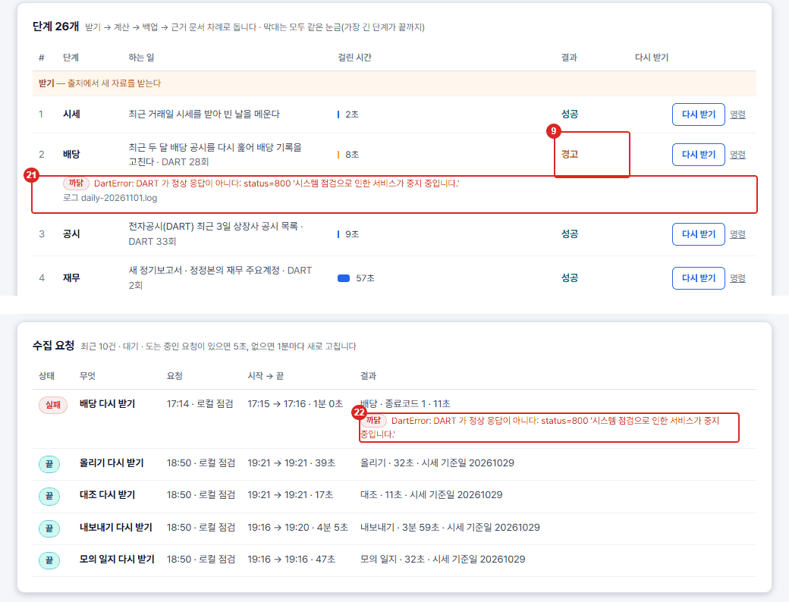

로컬 개발 앱 · 1280 폭 · 2026-11-01 16:44 · 단계 표의 배당 줄과 요청 목록의 한 줄을 응답만 바꿔 실패 · 경고 상태로 재현했다(지금 DART 는 정상이라 실제 실패 기록이 없다 · 까닭 글은 2026-10-10 에 실제로 받은 DART 점검 응답 글) · 두 장을 잘라 붙였다 · 설계 원본: [03-3 [결정] 안 A](https://www.figma.com/design/AfiCh50uOwrSq5F2Tk2JLZ?node-id=59-2)

**<그림 5-5> 빠진 날 채우기 — 단추(19) · 꼬리표(23) · 확인 창(20)** · 범례: 빨간 상자와 번호 = <표 10> 의 요소

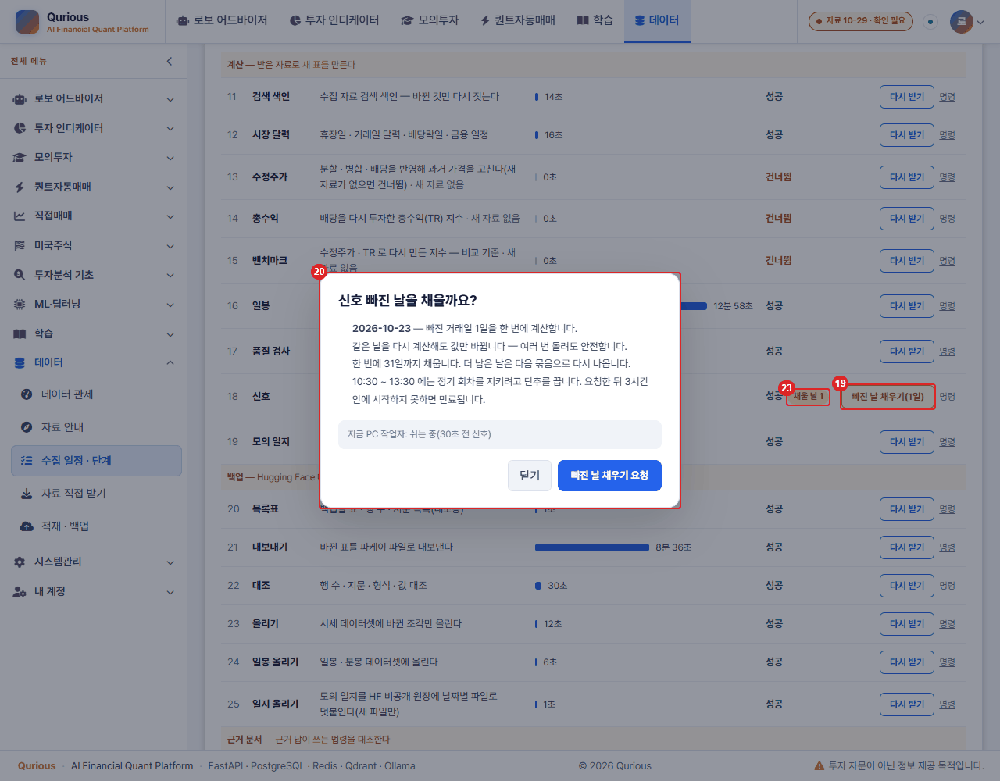

로컬 개발 앱 · 1280 폭 · 2026-11-01 16:44 · 실제 회차 기록 그대로다 — 11-01 12:30 회차의 신호 단계에 채울 날 1(2026-10-23)이 남아 있다 · 확인 창은 「닫기」 로 닫아 요청하지 않았다 · 창 높이 1000 으로 단추 자리까지 찍었다

**단계가 늘면 화면이 따라온다(결정 ④)** — 단계 줄 · 묶음 · 하는 일과 데이터 관제의 한 줄은 러너 단계 목록(`scripts/daily_update.py` 의 `STEPS`)과 마지막 회차 기록에서 만든다. 러너 `Step` 의 `label` · `group` · `desc` 가 정본이고, 러너가 회차마다 단계 목록 파일(`state/daily_update_steps.json`)과 회차 기록의 단계 줄에 함께 쓴다(2026-10-07). 앱에는 이름표 사본이 없고, 사본이 다시 생기면 TC-DST-08 이 실패한다. 단계를 더해도 이 화면 · 관제 한 줄은 손대지 않아도 따라온다.

데이터 관제(3절)의 「오늘 갱신 — 단계」 칸은 이 화면으로 옮겼고(2026-10-08), 관제에는 마지막 수집 한 줄과 관리자에게만 보이는 「단계별로 자세히 →」 를 두었다(3절 <표 4> 8번).

**도는 중의 「n번째 단계」** — 설계 경우 표는 「수집 중 — 10번째 수정주가」 를 그렸다. 화면은 상태 응답에 지금 단계(`running_step`)가 오면 그 줄을 그리게 만들어 두었고, 지금 단계를 기록에 쓰는 일은 러너 쪽이다(5.6절 <표 15>).

**화면에서 수집 요청(2026-10-10)** — 「다시 받기」(10) · 「전체 수집」(12)은 요청 표에 줄 하나만 남긴다. 이 PC 의 수집 작업자(작업 스케줄러가 매 분 띄운다)가 그 줄을 가져가 러너를 돌리고 결과를 줄에 적는다 — 앱이 수집 폴더를 읽기만 하게 붙어 있다는 결정 가는 그대로다. 화면 꼴은 Figma 「데이터 수집 화면」 03-2 에서 세 안을 견줘 정했다. 정한 것은 <표 10-2> 와 같다.

**<표 10-2> 화면 수집 단추 — 정한 것 넷(2026-10-10)** · 원본: [Figma 03-2 · [결정] 경우 표 · 결정 넷](https://www.figma.com/design/AfiCh50uOwrSq5F2Tk2JLZ?node-id=47-2)

| 정할 것 | 고른 것 | 까닭 |
|---|---|---|
| ① 화면 꼴 | 안 A — 줄마다 「다시 받기」 · 위 작업자 띠 · 아래 요청 목록. 안 B 의 작업자 상태 · 최근 요청은 데이터 관제에 관리자 한 줄로(<표 4> 11) | 단계 표 옆에서 바로 누르고, 데이터 관제에서도 수집이 도는지 한눈에 본다 |
| ② 막는 때 | 단추를 끈다 — 마우스를 올리면 「막는 때입니다 — HH:MM 뒤에 누를 수 있습니다」 | 정기 회차(12:30)와 겹치지 않게. 판정은 서버가 서버 시각으로 셈한 값(`rules.blocked_now`) 그대로이고 화면이 시계로 다시 세지 않는다(TC-CL-10) |
| ③ 대기 창 | 강사님 기초 코드(lumina-invest 10-08 판)의 데이터 조회 대기 창 꼴(모래시계 · 경과 시간)을 가져와 고쳤다 | 창을 닫아도 요청은 계속 돈다 · 대기일 때만 「요청 취소」 · 창은 이 화면 파일이 만들고 강사님 `app.html` 은 고치지 않는다 |
| ④ 「명령」 | 남긴다 | 작업자가 꺼져 있을 때 이 PC 에서 직접 돌리는 길 |

글(요청 상태 · 작업자 상태 · 기다리는 까닭 · 결과 한 줄)은 서버가 준 글 그대로이고 화면은 색만 고른다(TC-CL-09). 같은 대상의 요청이 이미 대기 · 도는 중이면 서버가 새 줄을 만들지 않고 그 줄을 돌려준다(「이미 기다리는 요청이 있습니다」). 서버는 막는 때에도 요청을 받는다 — 단추를 끄는 것은 화면의 선택이다. 대기 · 도는 중인 요청이 있거나 대기 창이 열려 있으면 5초, 그 밖에는 1분마다 목록을 다시 묻는다 — 처음에는 요청이 없으면 멈추게 했는데, 화면을 열어 둔 채로 작업자 띠가 25분 넘게 「꺼짐」 으로 남는 것을 확인하고 고쳤다(2026-10-10 · TC-CL-12). 확인 창 · 대기 창은 <그림 5-3> 과 같다.

**<그림 5-3> 전체 수집 확인 창(17) · 대기 창(18)** · 범례: 빨간 상자와 번호 = <표 10> 의 요소

로컬 개발 앱 · 1280 폭 · 2026-11-01 16:45 · 확인 창은 「닫기」 로 닫아 요청하지 않았다 · 대기 창은 요청을 만드는 POST 와 목록 응답을 가짜로 바꿔 띄웠다(실제 요청을 보내지 않았다 · 경과 시간은 가짜 요청 시각 때문에 실제와 다르다) · 두 창을 잘라 붙였다 · 설계 원본: [03-2 [결정] 확인 창](https://www.figma.com/design/AfiCh50uOwrSq5F2Tk2JLZ?node-id=43-2) · [대기 창](https://www.figma.com/design/AfiCh50uOwrSq5F2Tk2JLZ?node-id=44-2)

### 5.3 자료 직접 받기 (`crawl-manual`)

매일 수집이 빠뜨린 날이나 과거분을 메운다. 받을 범위를 수집기가 남긴 기록으로 먼저 세어 보이고, 받을 것이 있으면 이 PC 에서 돌릴 명령을 보인다. 주소로 받을 때는 허용 목록에 있는 곳만 받는다. 화면은 <그림 6> 과 같다.

**설계에서 바뀐 것(2026-10-08 결정 나)** — 설계는 시세 출처를 FinanceDataReader · yfinance · KRX 정보데이터시스템 중에 고르고 종목을 고르게 그렸지만, 우리 수집기는 시세를 공공데이터포털 주식시세정보로 **하루 한 번 부르면 그날 전 종목**을 받는다(`collector.backfill`). 그래서 출처는 고르지 않고 종류가 정한 출처를 보이고, 종목 칸은 뺐고, 받을 범위는 수집기가 실제로 받는 단위(시세 · 공시 · 정책뉴스는 날, 재무는 해)로 센다. 실시간으로 화면에 보이는 기능(차트 · 3차 TradingView 등)은 이와 상관없다 — 야후 지킴이(`tests/test_no_yahoo_regression.py`)는 야후를 가리키는 줄 수가 늘지 않게 막는 「봉인」 이고, 2026-09-30 결정은 「야후 · 네이버 시세는 적재하지 않되 화면 표시는 괜찮다」 이다.

**<그림 6> 자료 직접 받기 — 시세 · 최근 한 달** · 범례: 빨간 상자와 번호 = <표 11> 의 요소

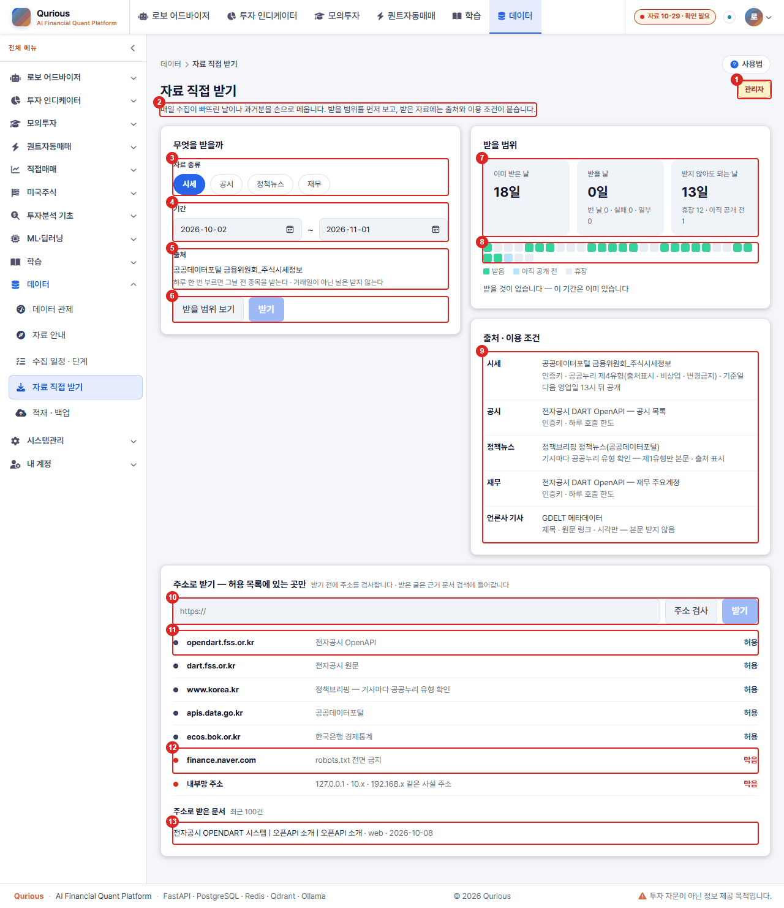

로컬 개발 앱 · 1280 폭 · 2026-11-01 16:46 · 「주소로 받은 문서」 한 건은 2026-10-08 에 실제로 받아 본 것 · 설계 원본: [Figma · 데이터 수집 화면 · 03 설계 2](https://www.figma.com/design/AfiCh50uOwrSq5F2Tk2JLZ?node-id=8-2)

**<표 11> 자료 직접 받기 요소**

| 번호 | 요소 | 데이터(API) | 동작 | 빈 데이터 · 오류 |
|:-:|---|---|---|---|
| 1 | 관리자 꼬리표 | — | 관리자 화면임을 보인다 | — |
| 2 | 안내 | — | 무엇을 하는 화면인지 한 줄 | — |
| 3 | 자료 종류 | `API-DATA-08` `kinds` | 시세 · 공시 · 정책뉴스 · 재무 — 서버 목록으로 그린다 · 바꾸면 받을 범위를 바로 다시 센다(기간은 그대로) | 목록을 못 받으면 「화면을 준비하지 못했습니다」 · 다시 시도 |
| 4 | 기간 | — | 시작 ~ 끝(처음은 최근 30일) · 오늘 뒤는 오늘까지로 줄인다 | 시작이 비면 알린다 · 끝 < 시작 · 400일 넘음은 서버 422 문구 그대로 |
| 5 | 출처 | `API-DATA-08` | 종류가 정한 출처와 받는 단위 한 줄(고르지 않는다 · 결정 나) | — |
| 6 | 받을 범위 보기 · 받기 | `API-DATA-09` | 받을 범위를 다시 센다 · 받기는 「이 PC 에서 돌릴 명령」 상자(받을 것의 처음 ~ 끝 · 복사 · 회차가 도는 동안엔 돌리지 말라는 말) | 받을 것이 없으면 받기 단추가 꺼진다 |
| 7 | 받을 범위 — 타일 셋 | `API-DATA-09` `counts` | 이미 받은 날 · 받을 날(빈 날 · 실패 · 일부) · 받지 않아도 되는 날(휴장 · 아직 공개 전) — 재무는 해 | 「받을 것이 없습니다 — 이 기간은 이미 있습니다」 |
| 8 | 날마다 칸 · 범례 · 받을 날 | `API-DATA-09` `days` · `years` | 날마다 한 칸(색 = 상태 · 마우스를 올리면 날짜 · 까닭) · 받을 날 목록(12개까지) · 재무는 해마다 표(묶음 끝남 / 전체 · 자료 없음) | — |
| 9 | 출처 · 이용 조건 | `API-DATA-08` | 종류 넷 + 받는 길이 화면에 없는 언론사 기사(본문 받지 않음) | — |
| 10 | 주소로 받기 | `API-DATA-07` 검사 · `API-ING-03` 받기 | 주소 검사(형식 → 내부망 → 허용 목록 → robots) 결과와 단계별 표시 · 지나면 받기 단추가 켜진다 · 받기는 리다이렉트로 옮겨 가는 주소도 보내기 전에 다시 검사한다 | 막히면 까닭 · 주소를 고치면 받기 단추가 다시 꺼진다 · 받은 글이 없으면 그 까닭 |
| 11 | 허용 목록 | `API-DATA-06` | 받아도 되는 출처 다섯과 그곳에서 받는 것 | — |
| 12 | 막음 | `API-DATA-06` | robots.txt 전면 금지(네이버 금융) · 내부망 주소 — 「막음」 예시(결정 ①) | — |
| 13 | 주소로 받은 문서 | `API-ING-12` | 최근 받은 문서 이름 · 날짜(받은 뒤 다시 읽는다) | 「아직 주소로 받은 문서가 없습니다」 |

받은 날을 세는 규칙은 <표 11-1> 과 같다. 수집기 상수(공시 유형 열 · 시장 셋 · 재무 묶음 수)를 앱에 베끼지 않고 수집기가 기록에 남긴 열쇠만 센다 — 앱 컨테이너에는 수집기 코드가 없고, 베끼면 수집기가 바뀔 때 화면이 틀린다. 처음 판은 끝난 창만 받은 날로 세어, 매일 잘 돌던 10월 공시가 모두 「일부 · 조합 0 / 30」 으로 보였다(만든 날 실제 값을 훑어 찾았다).

**<표 11-1> 받은 날을 세는 규칙**

| 종류 | 단위 · 기록 | 받은 날 | 받지 않아도 되는 날 |
|---|---|---|---|
| 시세 | 날 · 수집 기록(portal) | 그날 기록이 「받음」 — 13시 전이어도(출처가 약속보다 일찍 내주기도 한다 · 2026-10-08 12:30 회차가 10-07 을 받음) | 거래일이 아님(시장 달력) · 받지 않았고 다음 거래일 13시 전(출처 공개 전) |
| 공시 | 날 · 수집 기록(dart_list) — 창 × 조합(유형 × 시장) | 그날을 덮는 받은 창이 기록에 나온 모든 조합에 있다. 끝이 오늘인 매일 창은 그 창을 받은 날보다 앞선 날만 받은 날이고, 받은 그날은 「일부」 | 오늘 |
| 정책뉴스 | 날 · 원문 보관(과거분 `window/` · 매일 `daily/`) | 받은 창이 그날을 덮고, 그 창을 그날 뒤에 받았다 | 오늘(매일 수집은 어제까지) |
| 재무 | 해 · 수집 기록(dart_fin) — 연도 × 보고서 × 100개사 묶음 | 기록에 나온 묶음이 모두 끝났다 | 남은 묶음이 「자료 없음」 뿐(마감 전 보고서 · 매일 수집이 다시 본다) |

### 5.4 적재 · 백업 (`crawl-ingest`)

수집 자료를 Hugging Face 비공개 데이터셋으로 백업한 상태를 보이고, 로컬 원본을 지워도 되는지 판정한다. 판정 규칙(조건 여섯 — 표 빠짐 · 행 수 · 파일 · 깊은 대조 · 복원 리허설 · 원격)은 `scripts/hf_dataset.py` 한 곳에 있고, 그 도구가 판정 결과를 상태 폴더의 `hf_backup_status.json` 에 쓰면 화면은 읽어 점검 줄 넷으로 묶기만 한다(결정 다 · 단계 이름표 사본을 없앤 결정 ④ 와 같은 까닭). 확인하지 않은 조건은 통과가 아니다. 「자료 올리기(CSV)」 · 「위험 구역」 칸은 정할 것 ② 결정(2026-10-07)으로 뺐다. 화면은 <그림 7> 과 같다.

**<그림 7> 적재 · 백업 — 2026-11-01 판정 기록** · 범례: 빨간 상자와 번호 = <표 12> 의 요소

원본: 구현 화면(로컬 개발 앱 · 점검 계정 · 1280 · 2026-11-01 16:47 — 판정 기록 15:22 · 회차 12:59) · 행 수 같은 여덟 자리 숫자가 두 줄로 끊기던 것은 이 판과 같은 PR 에서 고쳤다(`collect.css`) · Figma 「데이터 수집 화면」 구현 대조 [`38:2`](https://www.figma.com/design/AfiCh50uOwrSq5F2Tk2JLZ?node-id=38-2) · 설계 판은 [03 설계 3](https://www.figma.com/design/AfiCh50uOwrSq5F2Tk2JLZ?node-id=9-2)(`_v0.4` 그림 · 지난판에 남음)

**<표 12> 적재 · 백업 요소**

| 번호 | 요소 | 데이터(API) | 동작 | 빈 데이터 · 오류 |
|:-:|---|---|---|---|
| 1 | 관리자 꼬리표 | — | 관리자 화면임을 보인다 | — |
| 2 | 데이터셋 머리 | `API-DATA-10` | 데이터셋 이름 · 판정 기록을 쓴 때(이 PC 기록) · 원격까지 확인했는지 | 기록이 없으면 「아직 백업 판정 기록이 없습니다」 + 기록을 만드는 명령(`status --write`) · 다른 데이터셋 · 이 PC 용량은 그대로 |
| 3 | 숫자 타일 | `API-DATA-10` `manifest` | 크기 · 파일 · 행 · 원본 대비 | — |
| 4 | 점검 줄 넷 | `API-DATA-10` `groups` · `rehearsal` | 마지막 올림(원격 조건 · 파일 n / n 일치) · 기본 대조(표 · 행 수 · 파일) · 깊은 대조(값까지) · 복원 리허설(줄 제목에 서버 `rehearsal` 글 — 「마지막 성공 n일 전(MM-DD) · 매주 일요일 15:00 자동」 · 2026-10-18) — 통과 · 아직 · 다시와 까닭 · 통과가 아닌 줄은 할 일을 먼저 적는다 | 확인하지 않은 조건은 「아직」 · 판정 기록의 판이 화면과 다르면 알린다 |
| 5 | 로컬 원본을 지워도 되나 | `API-DATA-10` `can_delete` · `remaining` | 남은 조건을 세어 판정한다 | 조건이 남으면 「아직 아닙니다 — 남은 조건 n」 · 도구가 「된다」 고 써도 남은 조건이 있으면 아니다 |
| 6 | 원격 다시 확인 · 복원 리허설 | `API-DATA-10` `commands` | 누르면 「이 PC 에서 돌릴 명령」 상자(`hf_dataset.py status --remote --write` — 원격을 읽기만 · `restore` — 임시 폴더에 되살렸다 지움) · 다시 누르면 닫힌다 | — |
| 7 | 다른 데이터셋 보기 | `API-DATA-10` `datasets` | 이 PC 기록이 있는 데이터셋(시세 · OHLCV)의 올린 날 | 「이 PC 기록 없음」 |
| 8 | 이 PC 용량 | `API-DATA-10` `disk` | C 드라이브 여유 · 수집 DB 크기 · 잰 시각(러너가 회차 끝에 잰다) | 「아직 잰 기록이 없습니다」 |
| ~~9~~ | ~~자료 올리기(CSV)~~ — **뺐다**(2026-10-07 · 결정 ② A) | — | CSV 수동 적재는 쓰지 않는다(자료 없음 · 개인 CB 는 개인신용정보) | — |
| ~~10~~ | ~~위험 구역 — 표 비우기~~ — **뺐다**(2026-10-07 · 결정 ② A) | — | 옛 「DB 초기화」(`API-ADM-01`)는 모든 사용자의 주문 · 포트폴리오 · 증권사 설정 · 채팅 · 크롤링 문서 · 감사 로그까지 지웠다 — 서버 길까지 없앴다(2026-10-08 · DF-78 닫힘) | — |

### 5.5 경우 표

세 화면이 상태마다 무엇을 보이는지는 <표 13> 과 같다. 모든 칸을 2026-10-08 브라우저로 눌러 보거나(정상 · 비어 있음 · 일반 사용자 · 폭) 시험으로 묶었다(오류 · 관리자 아님).

**<표 13> 경우 표 — 상태 × 권한 · 폭** · 원본: Figma 02 경우 표 · 구현과 맞춤(2026-10-08)

| 화면 | 정상 | 도는 중 · 불러오는 중 | 비어 있음 | 일부 실패 | 오류 | 일반 사용자 | 폭 390 |
|---|---|---|---|---|---|---|---|
| 수집 일정 · 단계 | 19 / 19 성공 · 단계 표 · 걸린 시간 막대 · 다음 회차 | 맨 위 「수집 중 · 시작 시각」 한 줄 · 아래는 지난 회차 · 다시 받기 · 전체 수집 꺼짐(요청 경우는 <표 13-2>) | 「아직 회차 기록이 없습니다 — 첫 수집은 12:30」 | 실패 단계 빨강 · 그 단계만 다시 돌릴 명령 | 「수집 기록을 읽지 못했습니다」 · 다시 시도 | 메뉴 안 보임 · 관제에 마지막 회차 한 줄(자세히 없음) · 주소로 오면 「관리자만 볼 수 있는 화면입니다」 | 표 → 단계 카드(걸린 시간 · 결과 한 줄 · 막대 대신 시간 글자) · 타일 한 줄씩 |
| 자료 직접 받기 | 범위 보기 → 받을 날 → 받기 명령 · 출처 · 이용 조건 | 「받을 범위를 세는 중…」 | 「받을 것이 없습니다 — 이 기간은 이미 있습니다」(받기 꺼짐) | 일부 · 실패한 날을 나눠 보이고 까닭(빈 응답 · 끝난 조합 수 · 그날 받은 창) | 서버 422 문구 그대로 · 수집 DB 없음 503 · 허용 목록 밖 · 내부망 주소는 받기 전에 막음 · robots 금지 | 메뉴 안 보임 | 칸을 한 줄씩 쌓고 타일 셋도 한 줄씩 |
| 적재 · 백업 | 데이터셋 · 마지막 올림 · 대조 · 복원 리허설 · 지워도 되나 | 「불러오는 중…」 | 「아직 백업 판정 기록이 없습니다」 + 기록을 만드는 명령 · 이 PC 용량 · 다른 데이터셋은 그대로 | 깊은 대조 · 복원 리허설이 아직이면 노랑 · 지우기 막음 | 「백업 상태를 읽지 못했습니다」 · 다시 시도 | 메뉴 안 보임 | 카드를 쌓고 숫자 타일은 두 줄 · 이 PC 용량은 아래로 |

**<표 13-2> 수집 요청 경우 표(2026-10-10)** · 원본: Figma 03-2 [결정] 경우 표 · 구현과 맞춤

| 경우 | 단추 · 단계 줄 | 작업자 띠 · 요청 목록 | 대기 창 · 알림 | 확인 |
|---|---|---|---|---|
| 작업자 쉬는 중(정상) | 다시 받기 · 전체 수집 켜짐 | 초록 점 「PC 작업자 쉬는 중 · n초 전 신호 · 요청은 1분 안에 시작합니다」 | — | 브라우저 |
| 요청 직후(대기) | 그 줄 「요청함」(꺼짐) · 「대기 · 곧 시작합니다(…)」 | 목록 맨 위에 대기 줄과 「취소」 | 대기 창이 열림 · 「요청했습니다 — … · PC 작업자가 1분 안에 가져갑니다」 | 브라우저 · 실제 요청(13초 · 3초에 끝) |
| 도는 중 | 「요청함」 · 「도는 중 · 경과 m:ss」 | 파랑 점 「PC 작업자 도는 중 · 무엇 · 경과」 · 취소 없음 | 경과 시간이 흐름 · 「요청 취소」 숨김 | 브라우저 |
| 끝(끝 · 경고 · 실패) | 단추가 다시 켜지고 단계 표(회차 기록)를 한 번 다시 읽는다 | 결과 한 줄(러너 기록에서) · 걸린 시간 | 모래시계가 멈추고 걸린 시간 | 브라우저 · TC-CW |
| 같은 대상을 두 번 | 새 줄 없음 | 그 줄 그대로 | 「이미 기다리는 요청이 있습니다 — … · 대기」 | 서버 200 `created:false` 실측 · TC-CQ |
| 대기 중 취소 | 단추가 다시 켜짐 | 「취소 · 관리자가 취소」 | 「요청을 취소했습니다」 | 브라우저 · TC-CQ |
| 돌기 시작한 뒤 취소 | — | 그대로 | 서버 글 「대기 중인 요청만 취소합니다 — 지금 「도는 중」」 | TC-CQ(409) |
| 막는 때 | 둘 다 꺼짐 · 「막는 때입니다 — HH:MM 뒤에 누를 수 있습니다」 · 줄 「HH:MM 뒤에 누를 수 있음」 | 띠 오른쪽에 막는 때 | — | 브라우저(응답을 바꿔) · TC-CQ-16 · 17 · TC-CL-10 |
| 정기 회차 수집 중 | 둘 다 꺼짐 · 「수집 중에는 요청할 수 없습니다」 | 맨 위 「수집 중 · 시작 시각」 | — | TC-CL |
| 작업자 꺼짐 · 없음 | 켜짐(서버는 요청을 받는다) | 빨강 띠 「PC 작업자 꺼짐 — 요청은 받지만 작업자가 켜질 때까지 기다립니다 — 마지막 신호 HH:MM … 등록 안내」 · 대기 줄 까닭 「PC 작업자 꺼짐 — …」 | 대기 창에 같은 까닭 | 작업자를 실제로 끄고 3분 뒤 |
| 3시간 안에 시작 못 함 | — | 「만료 · 3시간 안에 시작하지 못해 만료됐습니다 — …」 | — | TC-CQ |
| 목록을 읽지 못함 | 꺼짐 · 「수집 요청을 읽지 못했습니다」 | 띠에 까닭 · 단계 표는 그대로 | — | TC-CL |
| 일반 사용자 | 화면이 안 보임 · 서버 403 | 데이터 관제의 한 줄 칸이 없고 요청 API 도 부르지 않는다 | 「관리자만 요청할 수 있습니다」 | TC-CQ · TC-CL-14 · TC-DH-01 |
| 폭 390 | 머리에서 전체 수집이 맨 앞 · 단계 카드 안에 다시 받기 · 명령 · 줄 상태 · 까닭 줄은 그 카드의 끝(사이 구분선 없음) | 띠의 막는 때가 아래 줄로 · 요청 목록은 머리 줄 없이 줄마다 쌓임 | 창은 화면 폭에 맞춤(최대 460) | 브라우저(<그림 1-2>) |
| 단계 실패(까닭 있음 · 2026-10-10) | 그 줄 아래 까닭 줄(21) · 로그 파일 이름 | 결과 「… · 종료코드 n · 걸린 시간」 아래 까닭 줄(22) | 대기 창 결과 아래 같은 까닭 | 실제 배당 다시 받기(DART 점검 · <그림 5-4>) · TC-DU · TC-CW-14 · TC-CL-15 · 16 |
| 빠진 날이 남음 | 그 단계 단추 「빠진 날 채우기(n일)」 · 결과 칸 「채울 날 n」 · 하는 일 칸에 날짜 | — | — | 실제(상태 파일에 하루를 넣고 신호 다시 받기 · <그림 5-5>) · TC-DU · TC-CL-17 |
| 채우기 요청 → 끝 | 「요청함」 → 끝나면 빠진 날이 지워져 「다시 받기」 로 | 「신호 빠진 날 채우기 · 10-06」 대기 → 도는 중 → 끝 「… · 2026-10-06 · 1분 18초」 | 대기 창 · 「요청했습니다 — 신호 빠진 날 채우기 · 10-06 · …」 | 실제(19:46 ~ 19:48) · TC-CW-15 · TC-CQ-21 |
| 채우기 막는 때(10:30 ~ 13:30) | 채우기 단추 꺼짐 · 「막는 때입니다 — 13:30 뒤에 누를 수 있습니다」 | — | — | TC-CQ-19 · TC-CL-17 · TC-DU(러너도 같은 창 · 짧은 범위는 더 좁다) |
| 상한이 없는 옛 단계 목록 | 단추는 보이지만 요청하면 서버 글 「채우기 상한(fill_max_days)이 단계 목록에 없습니다 — …」 | — | 오류 알림(422) | TC-CQ-18 · 23 — 러너가 다음 회차 · `steps --write` 에 적는다 |

### 5.6 옛 화면에서 바뀐 것 · 서버

옛 화면 요소가 바뀐 곳은 <표 14> 와 같다.

**<표 14> 옛 화면에서 바뀐 것**

| 옛 요소 | 바뀐 뒤 | 까닭 |
|---|---|---|
| 자동 크롤링 「자동 크롤링 실행」(외부 강의 문서를 예제 검색 DB 에) | 없앴다 — 단계 하나씩 다시 돌릴 명령만 둔다(2026-10-08) → 2026-10-10 「다시 받기」 · 「전체 수집」 요청으로(요청 줄만 남기고 PC 작업자가 막는 때 밖에서 돌린다 · 명령은 「명령」 으로 남김) | 결정 ③ · 전체 다시 돌리기는 12:30 회차와 겹친다(99 버린 안) → 겹침은 막는 때(전체 11:00 ~ 13:30)로 풀었다(사용자 결정 2026-10-08 「사이트 단추로 언제든」 · 2026-10-10 안 A) |
| 수동 크롤링 URL 칸(아무 주소나 받음) | 주소 검사(허용 목록 · 내부망 · robots)를 지난 주소만 받고, 리다이렉트로 옮겨 가는 주소도 보내기 전에 다시 검사한다 | 옛 분석 A11(내부망 주소 요청 · robots) |
| 「네이버 주식 크롤링」 단추 | 없앴다 — 주소 검사의 「막음」 예시로만 | 결정 ① |
| 데이터 인제스트 「DB 초기화」(실행 단추 바로 옆) | 데이터 화면에서 빼고 서버 길(`API-ADM-01`)도 없앴다 — 모든 사용자 기록을 지웠다(결함 DF-78 닫힘) | IA I8 · 결정 ② A |
| 신용평가 CSV 인제스트 「데이터 인제스트 실행」 | 화면에서 뺐다 — 그 자료를 읽던 「맞춤 상품 추천」 · 「신용 리스크 분석」 은 우리 자료로 고쳐 쓴다(상품 안내 · 재무 · 신용 위험). 서버 길(`API-ING-01`)은 남아 있고 화면이 부르지 않는다 | 결정 ② A · [조사서](../../../phase-2/01-analysis/research/신용평가CSV-인제스트-조사.md) 6절 |
| 데이터 관제 「오늘 갱신 — 단계」 칸 | 한 줄 「마지막 수집 · 결과 · 단계별로 자세히 →」(자세히는 관리자) | 결정 ④ |

서버는 <표 15> 와 같다. 화면 결정을 기다리지 않고 먼저 만들었다.

**<표 15> 서버 — 화면이 쓰는 것**

| 무엇 | 쓰는 요소 | 만든 것 |
|---|---|---|
| 단계 목록 · 마지막 회차 · 회차 기록 | <표 10> 2 · 5 ~ 9 · 데이터 관제 한 줄 | `API-DATA-05` `GET /api/data/runner`(관리자 · 2026-10-07) · 단계 이름표는 러너 한 곳에서 |
| 한 단계 다시 돌리기 | <표 10> 10 · 14 | 러너 `python scripts/daily_update.py run --only <단계>`(회차와 겹치는 때 · 다른 실행이 돌 때 막음 · 마지막 회차의 그 줄만 바꿈 · 2026-10-07) — 「명령」 은 이 명령을 보인다(결정 가) |
| 화면 수집 요청 | <표 10> 10 · 12 · 13 · 15 ~ 18 · <표 4> 11 | `API-DATA-12 ~ 15`(요청 만들기 · 목록 · 취소 · 작업자 상태 · 관리자 · 2026-10-10 · 만들기 · 취소는 화면 머리글) + 요청 표(alembic 0018) + PC 작업자 `scripts/collect_worker.py`(작업 스케줄러 매 분 · 러너가 막힘 75 로 끝나면 다시 기다림) — 같은 대상 요청은 한 줄만(멱등) |
| 막는 때 | <표 10> 10 · 12 · 13 · 15 | 러너가 막는 데 쓰는 함수(`guard_window`)로 셈해 단계 목록 파일에 쓴 창(`guards`) + 앱이 그 창과 서버 시각으로 셈한 `rules.blocked_now`(양 끝 포함 · 러너 판정과 같은지 TC-CQ-17 · 2026-10-10) |
| 받을 범위 · 종류 · 출처 표 | <표 11> 3 ~ 9 | `API-DATA-08` `GET /api/data/fetch-sources` · `API-DATA-09` `GET /api/data/fetch-plan`(관리자 · 2026-10-08) — 수집 기록을 읽기만 · 받을 것이 있으면 수집기 명령(`collector.backfill` · `disclosure` · `policy_news` · `financials` 의 `backfill`) |
| 주소 검사 · 허용 목록 | <표 11> 10 ~ 12 | `API-DATA-06 · 07`(2026-10-07) · 받는 길 셋(`API-ING-03 · 04 · 10`)이 같은 검사를 지나야 받는다(막히면 400) · 리다이렉트 홉마다 보내기 전에 다시 검사(`url_guard.guard_request` · 막히면 400 · 2026-10-08) |
| 백업 판정 · 원격 확인 · 복원 리허설 | <표 12> 2 ~ 7 | `API-DATA-10` `GET /api/data/backup`(관리자 · 2026-10-08) — 판정은 `scripts/hf_dataset.py` 가 쓰고(결정 다) 앱은 읽기만 · 원격 확인 · 리허설은 명령 |
| 이 PC 용량 | <표 12> 8 | 러너가 회차 끝에 드라이브 여유 · 수집 DB 크기를 재서 `state/pc_disk.json` 에 쓴다(2026-10-07 · [로컬 용량 조사서](../../../phase-2/01-analysis/research/로컬용량-HF원격저장-조사.md) 권장 ①) |
| (표 비우기 — 두지 않음) | <표 12> 10 | `API-ADM-01` 을 없앴다(2026-10-08 · DF-78 닫힘 · 개발용 초기화는 일회용 시험 DB 로) |

---

### 5.7 자료 안내 (`data-guide`)

「우리가 무엇을 모으고 · 어떻게 모으고 · 무엇을 읽으면 되나」 를 한 화면에 보이는 새 화면이다(2026-10-08 사용자 요청 → Figma 세 안 → 결정: 안 B 「한 장 보고서」 + 안 A 의 「자료 한 장」 서랍). 데이터 묶음 왼쪽 메뉴의 둘째 줄(데이터 관제 바로 아래)에 있고 **모든 로그인 사용자**가 본다. 자료가 며칠 것까지 있는지(늦음 판정 색)는 데이터 관제가 맡고, 이 화면은 값 미리보기 · 내려받기를 두지 않는다(시세는 공공누리 제4유형 — 변경 · 재배포 금지).

설명(이름 · 한 줄 · 출처 · 이용 조건 · 공개 시각 · 길잡이 · 틀리기 쉬운 것 · 칸 정의)은 저장소의 대장(`docs/phase-3/02-design/data/대장/자료안내-*.tsv` 다섯)에서 스캐너가 만든 생성물이다. 칸 정의는 칸 목록 · 차례 · 타입 · 열쇠를 코드(수집기의 표 만드는 문 · 앱 모델)에서, 쉬운 이름 · 단위 · 뜻을 칸 대장(`자료안내-칸.tsv` · 35표 · 376칸)에서 가져오고, 둘이 어긋나면 스캐너가 막는다(TC-DG-09 · 10).

숫자 중 **줄 수 · 마지막 날**은 러너가 매일 낮 수집이 끝날 때 쓰는 **숫자 파일**(`data/collector/state/data_guide_stats.json` — 데이터 관제와 같은 표 · 같은 셈법 · 15표)에서, 처음 · 연도별 · 시장별은 백업 목록 두 장에서 온다(`API-DATA-11`). 2단계부터 화면을 열 때 수집 DB 를 세지 않는다 — 1단계는 요청 때 세느라 최대 2.5초를 기다리고, 못 세면 4초마다 다시 물었다. 숫자 파일에 없는 다섯 자료(가격 조정 기록 · 주봉 · 분봉 대상 종목 · 받은 원문 · 받은 날 기록)는 백업 목록의 줄 수를 「백업 목록 기준」 으로 적고, 여덟 자료(일정 셋 · 근거 문서 둘 · 검색 색인 · 용어사전 · 회차 기록)는 이 화면에서 세지 않는다.

표 이름 · 칸 이름 · 타입 · 열쇠 · 읽는 길(API) · 백업 경로 · 받는 명령 같은 개발 정보는 **서버가 관리자 응답에만** 싣는다 — 화면이 숨기는 것으로는 응답(개발자 도구)에 남기 때문이다.

**<그림 8> 자료 안내 — 1280 폭(관리자 · 2026-11-01 다시 찍음)** · 빨간 번호 1 ~ 8 은 <표 15-1> · 위부터 머리 · 목차 · 숫자 띠 다섯 · 연도별 바둑판 · 자료 목록 · 흐름 · 길잡이 · 틀리기 쉬운 것

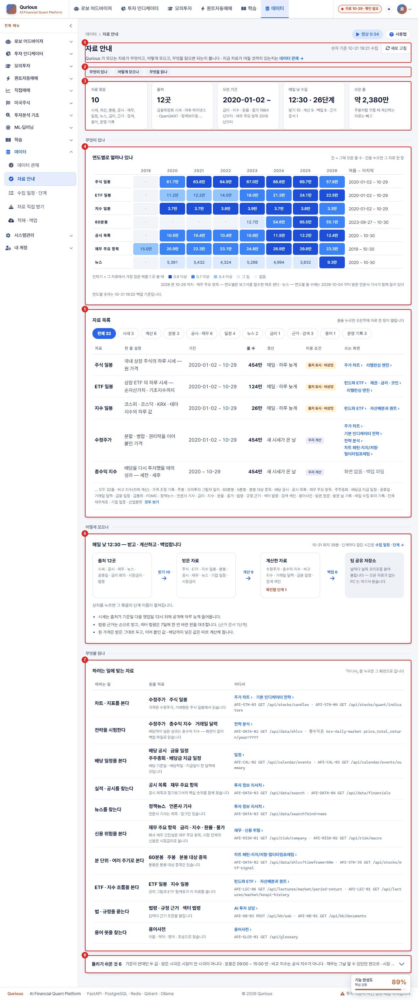

로컬 개발 앱 · 1280 폭(창을 세로로 늘려 안쪽 스크롤 없이) · 2026-10-11 17:36 · 기준 `9e580b6` + 이 판의 구현 · 숫자는 매일 낮 수집이 쓴 숫자 파일(10-11 17:27 — 따라잡기 회차 뒤 `steps --write`) · 위 메뉴의 「자료 10-07 · 멈춤」 은 그 회차가 올리기를 마친 뒤 러너 오류로 멈춘 기록 때문이다(DF-103 · 이 판과 같은 PR 에서 고침 — 머지 뒤 첫 회차에 풀린다) · 오른쪽 아래 「기능 완성도」 는 모든 화면에 뜨는 팀 배지 · 설계 원본: [Figma · 자료 안내 · 03 [결정] 안 B 1280](https://www.figma.com/design/VvA8jPPHsJ8bohge31hQ88?node-id=2-2) · 구현 대조 [`26:2`](https://www.figma.com/design/VvA8jPPHsJ8bohge31hQ88?node-id=26-2)

**<그림 9> 자료 안내 — 390 폭(2026-11-01 다시 찍음)** · 숫자 띠가 두 칸씩 접히고, 바둑판은 자료마다 막대로 바뀐다

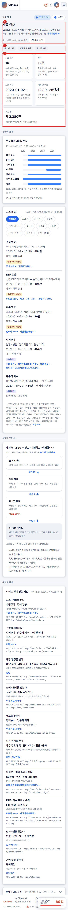

같은 앱 · 390 × 844 · 17:37 · 머리글은 v0.9 의 좁은 화면 머리글(넘침 없음) · 설계 원본: [Figma 390](https://www.figma.com/design/VvA8jPPHsJ8bohge31hQ88?node-id=7-2) · 구현 대조 [`27:2`](https://www.figma.com/design/VvA8jPPHsJ8bohge31hQ88?node-id=27-2)

**<그림 10> 자료 한 장 서랍 — 주식 일봉(관리자 · 2026-11-01 다시 찍음)** · 9 사양 칸 넷 · 11 칸 절(펼침) · 10 개발 정보(펼침)

같은 앱 · 1280 폭(서랍 안 스크롤 없이) · 17:37 · 서랍 뒤 화면은 어둡게 덮인다 · 설계 원본: [Figma 03-2 [결정] 안 B 관리자](https://www.figma.com/design/VvA8jPPHsJ8bohge31hQ88?node-id=17-2) · 1단계 [서랍 관리자](https://www.figma.com/design/VvA8jPPHsJ8bohge31hQ88?node-id=6-2) · 구현 대조 [`28:2`](https://www.figma.com/design/VvA8jPPHsJ8bohge31hQ88?node-id=28-2)

**<그림 10-2> 자료 한 장 서랍 — 일반 사용자 · 390 폭(2026-11-01 다시 찍음)** · 9 사양 칸 · 11 칸 절(펼침) — 칸 이름 · 타입 · 열쇠 · 개발 정보가 없다

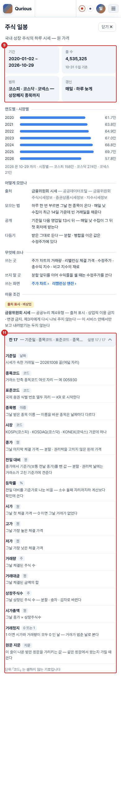

같은 앱 · 390 폭(서랍 안 스크롤 없이) · 17:38 · 서버가 만든 일반 사용자 답(`read(admin=False)`)을 브라우저 요청에 끼워 그렸다(이 PC 에 일반 사용자 계정이 없어서) — 답에 칸 이름 · 타입 · 열쇠가 글자로도 없는 것은 TC-DG-03 이 실제 라우트로 잰다 · 설계 원본: [Figma 03-2 [결정] 일반 사용자 390](https://www.figma.com/design/VvA8jPPHsJ8bohge31hQ88?node-id=20-2) · 1단계 [서랍 일반 사용자](https://www.figma.com/design/VvA8jPPHsJ8bohge31hQ88?node-id=10-2) · 구현 대조 [`29:2`](https://www.figma.com/design/VvA8jPPHsJ8bohge31hQ88?node-id=29-2)

**<표 15-1> 자료 안내 요소**

| 번호 | 요소 | 데이터(API) | 동작 | 빈 데이터 · 오류 |
|:-:|---|---|---|---|
| 1 | 화면 머리 — 제목 · 한 줄 · 숫자 기준 시각 · 새로 고침 · 「데이터 관제 →」 | `API-DATA-11` `stats.measured_at` | 「숫자 기준 MM-DD HH:MM 수집」 = 숫자 파일을 쓴 때 · 새로 고침은 다시 받기 · 자동으로 다시 묻지 않는다(숫자가 파일에서 오므로 기다릴 것이 없다) | 숫자 파일이 없거나 옛 판 · 깨짐이면 「숫자 기준 —」 · 설명 파일이 없으면 「자료 안내를 읽지 못했습니다」(503) |
| 2 | 목차 단추 셋 | — | 무엇이 있나 · 어떻게 모으나 · 무엇을 읽나 절로 내려간다 | — |
| 3 | 숫자 띠 다섯 | `guide.groups` · `sources` · `stats` | 자료 묶음 · 출처 · 모은 기간 · 매일 낮 수집(단계 수 · 묶음별) · 모은 줄(숫자 파일의 줄 수 합 · 주봉처럼 부를 때 계산하는 자료는 빼고) — 칸을 누르면 그 절로 | 숫자가 없으면 「—」 와 까닭(숫자 파일이 없으면 「매일 낮 수집이 끝날 때 셉니다」) · 단계 목록이 없으면 「이 PC 에서는 매일 수집을 돌리지 않습니다」 |
| 4 | 연도별 바둑판 | `stats.items[].years` | 칸을 누르면 그 자료 한 장 · 진하기는 그 자료 안의 비율 | 모은 자료가 없는 PC 는 감추고 한 줄 · 390 은 자료마다 막대 |
| 5 | 자료 목록 · 묶음 칩 | `guide.items` + `stats.items` | 칩으로 거른다 · 줄을 누르면 서랍 · 처음 다섯 줄 + 「모두 보기」(「전체」 일 때만) · 「쓰는 화면」 링크로 간다 | 화면이 없는 자료는 「화면 없음 · 백업 파일」 · 숫자 칸 「—」 와 까닭 |
| 6 | 흐름 한 장 | `stats.runner`(러너 단계 목록 · 마지막 회차) + 대장의 흐름 상자 | 상자를 누르면 그 묶음의 단계 이름이 펼쳐진다 · 확인할 단계가 있는 묶음에 표시 | 회차 기록이 없으면 단계 설명만 |
| 7 | 읽기 길잡이 | `guide.tasks` | 하려는 일 → 읽을 자료 → 어디서(화면 링크) · 관리자에게는 읽는 길(API) · 파일 | 일반 사용자에게는 관리자 화면 링크를 싣지 않는다 |
| 8 | 틀리기 쉬운 것 | `guide.pitfalls` | 펼침 | — |
| 9 | 자료 한 장 서랍 · 사양 칸 넷 | `guide.items[키]` + `stats.items[키]` | 기간 · 줄 수(「MM-DD 수집 기준」 또는 「백업 목록 기준」) · 범위 · 갱신 · 닫기 · Esc · 바깥 누르기 · 다른 화면으로 옮기면 닫힌다 · 닫으면 연 단추로 포커스 · 서랍 안 Tab 돌림 | 숫자 칸 「—」 와 까닭 |
| 10 | 개발 정보(서랍 안 · 관리자) | `guide.items[키].dev`(관리자 응답에만 있다) | 펼침 · 줄마다 복사 | 일반 사용자에게는 요소가 없다 |
| 11 | 칸 절(서랍 안 · 2단계) | `guide.items[키].columns` | 접힌 한 줄 「칸 n — 쉬운 이름 여섯 … · 설명 n / n」(표가 둘 이상이면 「칸 n표 · m」) · 누르면 칸마다 두 줄(쉬운 이름 · 단위 꼬리표 / 뜻) · 표가 둘 이상이면 표마다 작은 머리 · 다른 자료를 열면 다시 접힌다 · 관리자에게는 칸 이름 · 타입 칩 · 「열쇠」 표시 · 표 이름 칩 | 표가 없는 자료(주봉 · 회차 기록)는 절이 없다 · 일반 사용자 답에는 칸 이름 · 타입 · 열쇠가 글자로도 없다 · 쉬운 이름이 빈 칸은 「설명 n / 전체」 의 숫자로만 남는다 |
| 12 | 안내 줄(머리 아래) | `stats.note` · `stats.numbers` | 숫자 파일의 상태에 따라 한 줄 — <표 15-2> | 정상이면 없다 |

**<표 15-2> 자료 안내 경우 표** · 「일반 사용자」 는 서버가 만든 응답을 브라우저 요청에 끼워 넣어 그렸고(이 PC 에 일반 사용자 계정이 없어서), 「숫자 파일 없음」 · 「옛 판」 은 실제 숫자 파일을 잠시 치우거나 판을 바꿔 그린 뒤 되돌렸다(같은 해시) — 서버 쪽 분리 · 안내 줄의 차례는 시험이 실제 라우트로 잰다(TC-DG-03 · 05 · 06)

| 경우 | 무엇을 보이나 |
|---|---|
| 정상 | 숫자 띠 · 바둑판 · 목록 · 흐름 · 길잡이 · 틀리기 쉬운 것 모두 · 머리 「숫자 기준 MM-DD HH:MM 수집」 · 안내 줄 없음 |
| 매일 낮 수집이 도는 중 | 「매일 낮 수집이 도는 중입니다 — 숫자는 지난 수집(MM-DD HH:MM) 기준입니다」 · 숫자는 지난 파일 그대로 |
| 수집 뒤 숫자를 못 씀(파일이 마지막 수집 · 한 단계 다시보다 옛것) | 「숫자는 MM-DD HH:MM 수집 기준입니다 — 마지막 수집 뒤에 숫자를 새로 쓰지 못했습니다」 · 숫자는 그대로 보인다 · 관리자에게는 까닭 한 줄 |
| 숫자 파일 없음(받은 뒤 첫 수집 전) | 「숫자는 매일 낮 수집이 끝날 때 셉니다 — 다음 수집 뒤에 보입니다」 · 머리 「숫자 기준 —」 · 줄 수 칸 「—」(노랑 · 까닭 「줄 수는 매일 낮 수집이 끝날 때 셉니다」) · 처음 · 연도별은 백업 목록으로 그대로 |
| 숫자 파일이 옛 판 | 「숫자 파일이 이 화면보다 옛 판이라 숫자를 비워 둡니다 — 다음 수집 때 새로 씁니다」 · 숫자 칸은 「숫자 파일 없음」 과 같다 |
| 숫자 파일 깨짐 | 「숫자 파일을 읽지 못했습니다 — 숫자 칸은 비워 두고 설명은 그대로 보입니다」 와 오류 줄 · 숫자 칸 「—」(빨강) |
| 옛 러너가 쓴 숫자 파일(관제 밖 자료 여덟 칸이 없음 — 머지 뒤 첫 수집 전 · 2026-10-15) | 여덟 자료만 줄 수 「—」(노랑 · 「줄 수는 매일 낮 수집이 끝날 때 셉니다」) · 나머지 숫자는 그대로 · 관리자에게는 까닭 한 줄 |
| 오늘 낮 수집이 없음(회차 시각 + 1시간이 지나도 오늘 회차 기록이 없음 — 데이터 관제 「오늘 회차 없음」 · 2026-10-15) | 「오늘 낮 수집이 아직 없습니다 — 숫자는 MM-DD HH:MM 수집 기준입니다」 · 숫자는 그대로 |
| 회차 시각 모름(러너 단계 목록이 없거나 시각 칸이 없음 · 2026-10-15) | 흐름 머리 「매일 낮 회차 시각 모름 — 받고 · 계산하고 · 백업합니다」 · 숫자 띠 「매일 낮 수집」 칸도 같은 글 · 「오늘 낮 수집이 아직 없습니다」 를 띄우지 않는다(판정하지 않음) |
| 비어 있음(수집 자료가 없는 PC — 팀원 PC 대부분) | 「이 PC 에는 모은 자료가 없습니다 — 설명 · 흐름 · 길잡이는 그대로 봅니다」 · 바둑판을 감추고 숫자 칸은 「—」(0 을 넣지 않는다) |
| 일부(한 자료만 숫자가 없음) | 그 자료만 「—」 와 까닭(예: 「이 PC 에는 이 자료가 없습니다」) — 2026-10-15 부터 스물아홉 자료 모두 숫자를 잇는다(일정 셋 · 근거 문서 둘 · 검색 색인 · 용어사전 · 회차 기록도 숫자 파일에서 — 「이 화면에서는 세지 않는 자료입니다」 는 나오지 않는다) |
| 오류(설명 파일 없음 · 판 다름) | 「자료 안내를 읽지 못했습니다」 와 다시 시도 |
| 일반 사용자 | 개발 정보 · 뺀 표 · 관리자 화면 링크 · 표 이름 · 칸 이름 · 타입 · 열쇠가 응답에 없다 — 서랍의 개발 정보 요소 · 칸 이름 칩 · 「열쇠」 표시도 없다(<그림 10-2>) |
| 390 폭 | 숫자 띠 두 칸씩 · 바둑판 대신 자료마다 막대 · 서랍은 화면 전체 · 칸 절은 같은 두 줄(넘침 없음) |

차례는 깨짐 > 옛 판 > 자료 없음 > 파일 없음 > 수집 중 > 못 씀 > 오늘 낮 수집 없음(2026-10-15) — 위의 것이 있으면 아래 글은 보이지 않는다.

**3단계(2026-10-15 · 사용자 결정 「추천 표대로」)** — 숫자가 없던 여덟 자료(주총 · 배당 지급 일정 · 공휴일 · 금통위 · FOMC · 법령 · 규정 근거 · 섹터 법령 · 검색 색인 · 용어사전 · 매일 수집 회차 기록)도 러너 숫자 파일(`extras`)에서 줄 수 · 마지막 날 · 처음 날(공휴일 · 회의 · 검색 · 회차 기록만)을 받는다 — 화면 코드는 그대로이고, 개발 앱 실측(10-15 15:37 숫자 파일)은 공휴일 158 · 2020-01-01 ~ 2027-12-27 · 검색 색인 84만 · 용어사전 761 · 회차 기록 37 · 2026-09-28 ~ 10-15 였다. 「모은 줄」 합 · 모은 기간 머리에는 넣지 않는다(근거 조각 · 용어 · 회차 줄은 시세 줄과 뜻이 다르다 · 공휴일 처음 날이 시세 처음 날을 밀어내지 않게). ⚠️ 대장 「숫자주의」 글(줄의 뜻 — 근거 조각 · 조문 · 용어 수)은 서랍의 연도별 막대 아래에만 그려져, 연도 막대가 없는 이 여덟 자료에는 보이지 않는다 — 서랍 꼴을 바꾸는 일은 화면 몫(Figma 뒤 · 정할 것 D108).

**<표 15-3> 2단계에서 정한 것** · 2026-10-11 사용자 결정 · [Figma 03-2 결정 기록](https://www.figma.com/design/VvA8jPPHsJ8bohge31hQ88?node-id=23-22) · [논의 결정 대장](../../00-management/plans/논의결정대장.md) 부록 C

| 정할 것 | 정한 것 | 까닭 |
|---|---|---|
| ① 칸 정의를 어디까지 | 35표 · 376칸 모두(쉬운 이름 · 단위 · 뜻) | 「전부」 를 줄이지 않는다(추천은 사용자 자료 18표 먼저였다) — 칸 대장 한 장을 스캐너가 코드 칸과 하나씩 맞춘다 |
| ② 숫자 파일에 무엇을 | 데이터 관제 표 열쇠 15줄 — 표마다 줄 수 · 마지막 날 | 관제와 같은 표 정의 · 셈법을 그대로 부른다 — 따로 세면 두 화면 숫자가 갈린다 · 자료 28줄로 묶는 일은 앱이 |
| ③ 언제 쓰나 | 회차 끝 · 한 단계 다시 · 빠진 날 채우기 · `steps --write` 의 곁 파일(회차 시작에는 쓰지 않는다 · 단계 수 20 그대로) | 수집이 자료를 바꾼 뒤에 센다 · 읽기 전용 연결로 한 번에 1.4초 · 못 세면 🟡 한 줄을 남기고 옛 파일을 둔다 |
| ④ 칸 절 모양 | 안 B — 접힌 한 줄 + 칸마다 두 줄 · 관리자에게 칸 이름 · 타입 칩 | 390 에서도 넘치지 않는다(표 꼴 안 A 는 단위 「0 또는 1」 이 뜻 칸을 밀었다) |
| ⑤ 「열쇠」 와 안내 글 | 열쇠(한 줄을 가르는 칸)는 관리자에게만 · 안내 줄 글 여섯은 카드에 적은 그대로 | 추천은 「모두에게」 였다 — 서버가 관리자 답에만 싣는다 |

구현 때 정한 것 — ① ID 칸의 쉬운 이름에서 「열쇠」 말을 뺐다(일정 ID · 기사 ID · 문서 ID · 조각 ID · 정렬 값 · 용어 ID) — 일반 사용자 답에 「열쇠」 가 글자로도 남지 않게(⑤ · TC-DG-03). ② `measured_at` 은 숫자 파일이 정상 · 낡음일 때만 싣고 그 밖은 비운다 — 요청 시각으로 메우면 숫자가 언제 것인지 거짓이 된다. ③ 서랍의 칸 절은 다른 자료를 열면 접힌다(긴 절이 다음 자료에서 펼친 채 남지 않게).

- **화면 글** — 본문은 쉬운 이름만 쓴다(표 이름 · DB 이름 · 작업 말 금지). 스캐너가 대장의 쉬운 칸에 개발 말이 섞이면 막고(TC-DG-09 — 칸 대장은 그 표의 칸 이름을 쉬운 칸에 쓰면 · 정한 단위 스물넷 밖이면 · 코드에 없는 칸이면 막는다), 시험이 일반 사용자 응답의 글자를 본다(TC-DG-03 — 칸 이름 · 「열쇠」).
- **접근성** — 서랍은 `role=dialog` · `aria-modal` · 연 단추 `aria-expanded` · 열면 「닫기」 에 포커스 · 닫으면 연 단추로 · 흐름 상자 · 틀리기 쉬운 것 · 목록 접기 단추 · 칸 절 단추 `aria-expanded` · `aria-controls` · 바둑판 칸 `aria-label`(자료 · 해 · 줄 수).
- **2단계에서 한 것**(v0.10) — 칸 정의(서랍 안 펼침 · 요소 11) · 설명 채움 비율(「설명 n / n」) · 러너가 회차마다 쓰는 숫자 파일(요소 1 · 3 · 9 · 12) — 1단계 「미룬 것」 다섯 가운데 셋.
- **3단계로 미룬 것** — 근거 문서 · 용어 · 일정 · 회차 기록의 숫자(여덟 자료 — 앱 DB · 근거 문서 DB 에 있어 관제 표 열쇠 밖) · 주소로 서랍 열기(`#data-guide/<키>`) · 데이터 관제도 숫자 파일을 읽기(지금 관제는 요청 때 센다 — 8.6초 · 관제 기준 세션).

## 6. 화면 77개 목록

화면마다 부르는 API · 관련 요구 · 주담당은 <표 16> 과 같다. 「명세」 칸은 이 문서에서 상세를 누가 채우는지다. <표 16> 은 78줄이다 — 화면 선언은 77이고(2026-11-02 `signal-rank`, 2026-11-05 `kis-results` 를 더했다 · `view_scan.py` 로 센 값. 번호 77 이 `signal-rank` 와 `learn-part` 에 겹쳐 있는 것은 이전 판부터이며 줄 번호만 그대로 둔다), 성과 검증(`indicator-backtest`)은 전략 분석 화면의 탭 2 라 선언은 아니지만 줄을 남겼다(19절).

**<표 16> 화면 목록** · 부르는 API = API 명세서 v0.3 「부르는 화면」 칸 · 관련 요구 = IA v1.0 전수표 · 주담당(추정) = 관련 요구의 첫 요구 ID 로 요구 대장에서 찾은 값(요구가 없으면 「—」)

| # | 화면 ID | 화면명 | 메뉴 묶음 | 부르는 API (`API-` 생략) | 관련 요구 | 주담당(추정) | 명세 |
|--:|---|---|---|---|---|---|---|
| 1 | `agent-chat` | AI 투자 상담 | 로보 어드바이저 | CHAT-01 · KB-03 · CONV-01 · HUB-01 · HUB-02 · GLOS-06 | `P01-①-3` | 이동원 | 상세(4절 · 4.1절) |
| 2 | `robo-portfolio` | 자산배분·최적화 | 로보 어드바이저 | ML-04 · ML-07 · ML-08 · ML-09 | `U1` · `U3` · `U4` · `RFP2-3.1.3-①` | 오준영 | 주담당이 채움 |
| 3 | `robo-rebalance` | 리밸런싱 엔진 | 로보 어드바이저 | RBAL-03 · RBAL-08 · RBAL-09 | `P01-③-1` ~ `③-3` · `U2` · `U5` | 오준영 | 주담당이 채움 |
| 4 | `robo-screening` | 패턴 인식·종목 스크리닝 | 로보 어드바이저 | STK-08 · ML-10 | `P01-②-1` · `RFP2-3.1.4-③` · `P01-①-5` | 신장환 | 주담당이 채움 |
| 5 | `robo-patterns` | 차트 패턴·지지/저항·멀티타임프레임 | 로보 어드바이저 | ING-12 · STK-02 · STK-03 · STK-08 · STK-09 · STK-10 외 22 | `P01-②-2` · `P01-②-3` | 신장환 | 주담당이 채움 |
| 6 | `robo-decision` | 모의 투자 의사결정 | 로보 어드바이저 | STK-27 · STK-28 · STK-29 · PAPR-33 · PAPR-35 | `P01-④-2` · `P01-④-3` · `U10` | 강민석 | 주담당이 채움 · 카드 순서는 33.3절 |
| 7 | `agent-cb` | 재무 · 신용 위험 | 로보 어드바이저 | RISK-01 · RISK-02 · STK-06(회사 찾기) | — | 이동원(2026-10-07 결정) | **8절**(2026-10-13) |
| 8 | `agent-products` | 투자 성향별 상품 안내 | 로보 어드바이저 | PROD-01 · PROD-02 · PROD-03 · PROD-04(상품 상세 창) · ML-12 · ML-11(비중 — 들어올 때 저절로 · #179) | — | 이동원(2026-10-07 결정) | **7절 · 7.1**(2026-10-12) |
| 9 | `agent-news` | 투자 정보 리서치 | 로보 어드바이저 | DATA-03 · STK-06 · CAL-02 | `P01-①-2` · `P01-①-3` | 이동원 | 상세(12절) |
| 10 | `crawl-auto` | 수집 일정 · 단계(옛 자동 크롤링) | 데이터 | DATA-05 · 12 · 13 · 14 | `P01-①-4` (가까움) | 이동원 | 상세(5.2) |
| 11 | `crawl-manual` | 자료 직접 받기(옛 수동 크롤링) | 데이터 | DATA-06 · DATA-07 · DATA-08 · DATA-09 · ING-03 · ING-12 | `P01-①-2` | 이동원 | 상세(5.3) |
| 12 | `crawl-ingest` | 적재 · 백업(옛 데이터 인제스트) | 데이터 | DATA-10 | `P01-①-2` | 이동원 | 상세(5.4) |
| 13 | `trading-chart` | 주가 차트 | 직접매매 | STK-02 · STK-03 · STK-06 | `U7` (가까움) | 신장환 | 주담당이 채움 |
| 14 | `trading-portfolio` | 포트폴리오 | 직접매매 | STK-09 · STK-10 · STK-11 | — | — | 주담당이 채움 |
| 15 | `trading-order` | 주문/매매 | 직접매매 | STK-12 · STK-13 · STK-15 · STK-16 | — | — | 주담당이 채움 |
| 16 | `paper-dashboard` | 모의계좌 현황 | 모의투자 | PAPR-01 · PAPR-33 | `P01-④-3` · `U2` | 강민석 | 주담당이 채움 |
| 17 | `paper-stock` | 국내주식 모의주문 | 모의투자 | PAPR-01 · PAPR-04 · PAPR-10 | `P01-④-3` | 강민석 | 주담당이 채움 |
| 18 | `paper-crypto` | 코인 모의매매 | 모의투자 | PAPR-11 · PAPR-12 · PAPR-13 · PAPR-14 · PAPR-15 · PAPR-16 외 2 | — | — | 주담당이 채움 |
| 19 | `paper-alternative` | 대체자산 | 모의투자 | PAPR-22 · PAPR-23 · PAPR-24 · PAPR-25 | — | — | 주담당이 채움 |
| 20 | `paper-openapi` | Open API · 외부 연동 | 모의투자 | PAPR-28 · PAPR-29 · PAPR-30 · O09 | `P02-③-3` | 이동원 | 주담당이 채움 · 2026-11-03 본체를 마이페이지 「외부 연동」 구역으로 옮김(주소 유지 · 22.5절) |
| 21 | `quant-dashboard` | 퀀트 대시보드 | 퀀트자동매매 | STK-01 · STK-04 · STK-05 · STK-06 · DATA-01 · HUB-03 | `SCH-RT` (가까움) | 신장환 | 상세(26 · 27절) |
| 22 | `quant-auto` | 자동매매 현황 | 퀀트자동매매 | STK-24 · STK-25 · STK-26 · STK-36 · STK-37 | `P02-⑤-2` · `U10` | 오준영 | 상세(18절) |
| 23 | `quant-backtest` | 전략 분석 | 퀀트자동매매 | STK-04 · STK-30(#224 체결 시점 백테스트) · STK-06(종목 찾기) | — | 이동원(10-07 결정) | 종목 칸은 찾기 칸 하나(`js/stockpick.js` — 비었을 때 펼치면 「최근 본 종목」(이 브라우저) + 「대표 종목」 다섯 · 치면 국내 상장 종목 · 화살표 · Enter · Esc · 국내 기호 `000000.KS · .KQ` 만) · (이어서: 표 아래 보충) | · 소급 상세(2차 19절) · 3차 19절
| 24 | `quant-lean` | LEAN 백테스트 | 퀀트자동매매 | LEAN-01 · LEAN-03 | `P02-④-1` · `P02-③-2` | 강민석 | 주담당이 채움 |
| 25 | `settings` | 증권사 API 설정 | 내 계정(메뉴 줄 없음 — 마이페이지 「증권사 연동」 구역) | STK-38 · STK-39 · STK-17 · STK-18 · STK-19 · STK-26 | `P02-⑤-1` · `RFP2-4.2-①` | 오준영 | 상세(18절) |
| 26 | `notification-settings` | 알림 설정 | 퀀트자동매매 | NOTI-01 · NOTI-02 · NOTI-03 · NOTI-04 | `P02-③-3` · `P02-⑤-3` | 이동원 | 주담당이 채움 · 2026-11-03 본체를 마이페이지 「알림」 구역으로 옮김(주소 유지) |
| 27 | `us-dashboard` | 대시보드 | 미국주식 | STK-02 · MACR-03 | — | 이동원(10-07 결정) | 머리 「지연 시세」 칩(「● LIVE」 아님) · 부제 「야후 파이낸스 지연 시세 · 주문 · 보유는 원화 모의 계좌」 · 칸 제목 「전일 대비 등락 · 미국 대형주 (응답 줄 수)」 + 규칙 줄(문턱은 `js/quoteview.js` `MOVE_LIMIT` 한 곳) · (이어서: 표 아래 보충) |
| 28 | `us-chart` | 주가 차트 | 미국주식 | STK-02 · STK-03 | — | 이동원(10-07 결정) | 머리 줄 「기호 · $가격 · 등락률(서버 값 · 모르면 「—」) · 지연 시세 · 마지막 체결 MM-DD HH:MM(KST)」(응답 `as_of` — 꼴이 다르면 시각을 붙이지 않음) · 분봉은 실시간 시세 조사서 결정 뒤(2026-10-16) |
| 29 | `us-order` | 주문/매매 | 미국주식 | PAPR-06 · PAPR-10 | — | 이동원(10-07 결정) | 원화 모의 장부 — 시장가 매수만(서버가 시세 · 환율을 정함 · 가격을 보내지 않음) · 지정가 · 해외 매도는 까닭 글(해외 비용 계산 전) · 체결 알림은 원화 환산 체결가 · 내역은 원화(옛 주문은 달러 + 「옛 주문」 표시) · 주문 칸 안내 글 · 지정가 칸 글도 그 길대로(「원화 모의 계좌 … 시장가 매수만」 · TC-USO-25)(2026-10-16) |
| 30 | `us-portfolio` | 포트폴리오 | 미국주식 | PAPR-04 · PAPR-03 | — | 이동원(10-07 결정) | 보유 · 평균단가 · 평가 · 손익은 장부 원화 · 현재가 아래 작은 글이 달러 시세 · 표 아래 환율 글(서버 `fx_note`) · 옛 달러 단가 보유가 있으면 바로잡는 법(모의계좌 초기화) 한 줄(2026-10-16) |
| 31 | `indicator-strategy` | 기본 인디케이터 전략 | 투자 인디케이터 | STK-04 | `P02-①-1` · `P02-①-2` · `U6` | 신장환 | 상세(16절) |
| 32 | `indicator-custom` | 커스텀 인디케이터 개발 | 투자 인디케이터 | STK-30 · STK-31 · STK-32 · STK-33 | `P02-②-1` · `P02-③-1` · `U6` | 신장환 | 상세(16절) |
| 33 | `indicator-formula` | 자유 산식 지표 | 투자 인디케이터 | FRML-01 · FRML-06 · FRML-07 · FRML-08 | `P02-②-1` · `P02-②-2` · `P02-②-3` · `P02-③-1` | 신장환 | 상세(16절) |
| 34 | `indicator-backtest` | 성과 검증 | 투자 인디케이터 | STK-30 | `P02-①-3` · `P02-④-2` · `P01-④-1` · `U8` | 신장환 | 소급 상세(2차 19절) · 3차 19절(전략 분석의 탭 2 로 합침) |
| 35 | `indicator-api` | 증권사 API 자동화 | 투자 인디케이터 | STK-15 · STK-16 · STK-23 | `P02-⑤-1` | 오준영 | 상세(18절) |
| 36 | `indicator-tradingview` | 외부 차트 알림 연동 | 투자 인디케이터 | TV-02 · TV-03 · TV-05 | `P02-③-2` · `P02-③-3` · `P02-④-3` | 이동원 | 주담당이 채움 |
| 37 | `company-dashboard` | 지표 대시보드 | 투자 인디케이터 | STK-06 · STK-07 | — | — | 상세(30절) |
| 38 | `company-compare` | 지표 비교 분석 | 투자 인디케이터 | DATA-19 | — | — | 상세(31절) |
| 39 | `company-sector` | 섹터 인디케이터 | 투자 인디케이터 | — | — | — | 주담당이 채움 |
| 40 | `ml-compare` | 모델 비교 | ML·딥러닝 | MCMP-01 ~ 04(옛 ML-01 은 남김 · 부르는 메뉴 화면 없음) | — | 이동원(주인 없던 화면 · 10-07 결정) | 상세(11절) |
| 41 | `ml-regression` | 회귀 분석 | ML·딥러닝 | ML-06 | — | — | 주담당이 채움 |
| 42 | `ml-cluster` | 종목 군집화 | ML·딥러닝 | CLUS-01 | — | 이동원(주인 없던 화면 · 10-07 결정) | 상세(10절) |
| 43 | `ml-tune` | 하이퍼파라미터 튜닝 | ML·딥러닝 | ML-02 | — | — | 주담당이 채움 |
| 44 | `ml-deeplearning` | 딥러닝 (LSTM·Transformer) | ML·딥러닝 | — | — | — | 주담당이 채움 |
| 45 | `macro-dashboard` | 거시경제 지표 | 투자분석 기초 | MACR-01 | — | — | 주담당이 채움 |
| 46 | `macro-industry` | 산업 분석 | 투자분석 기초 | MACR-02 | — | — | 주담당이 채움 |
| 47 | `invest-fundamental` | 재무제표 분석 | 투자분석 기초 | MACR-04 | — | — | 주담당이 채움 |
| 48 | `invest-technical` | 기술적 분석 | 투자분석 기초 | — | — | — | 주담당이 채움 |
| 49 | `fin-lectures` | 강의실 (전체 과정) | 금융 필수 지식 › 강의 | — | `P01-①-1` | 이동원 | 상세 예정(v0.2) |
| 50 | `fin-topic-futures` | 선물과 옵션 · W19 틀 | 〃 (들여쓴 주제) | — | `P01-①-1` | 이동원 | 주담당이 채움 |
| 51 | `fin-topic-funds` | 펀드와 ETF · W19 틀 | 〃 | — | `P01-①-1` · `P01-①-2` | 이동원 | 주담당이 채움 |
| 52 | `fin-topic-bonds` | 채권 · 금리 · 코인 · W19 틀 | 〃 | — | `P01-①-1` · `P01-①-2` | 이동원 | 주담당이 채움 |
| 53 | `fin-topic-allocation` | 자산배분과 퀀트 · W19 틀 | 〃 | — | `P01-①-1` | 이동원 | 주담당이 채움 |
| 54 | `fin-topic-company` | 회사 구조 · 세무회계 · W19 틀 | 〃 | — | `P01-①-1` | 이동원 | 주담당이 채움 |
| 55 | `fin-topic-stocks` | 산업 분석과 공시 · W19 틀 | 〃 | — | `P01-①-1` | 이동원 | 주담당이 채움 |
| 56 | `fin-topic-technical` | 기술적 분석 · 재무제표 · W19 틀 | 〃 | — | `P01-①-1` | 이동원 | 주담당이 채움 |
| 57 | `fin-topic-industry` | 퀀트 사례 · 배당 · ETF · W19 틀 | 〃 | — | `P01-①-1` | 이동원 | 주담당이 채움 |
| 58 | `fin-topic-macro` | 거시경제와 시장 · W19 틀 | 〃 | — | `P01-①-1` | 이동원 | 주담당이 채움 |
| 59 | `fin-products` | 금융상품 이해 | 금융 필수 지식 › 요약 | — | — | — | 주담당이 채움 |
| 60 | `fin-allocation` | 자산배분 모델 | 금융 필수 지식 › 요약 | — | — | — | 주담당이 채움 |
| 61 | `quant-seasonal` | 계절성 분석 | 금융 필수 지식 › 요약 | SEAS-01 · STK-06 | — | 이동원(주인 없던 화면 · 10-07 결정) | 상세(9절) |
| 62 | `fin-glossary` | 용어사전 | 금융 필수 지식 › 연습 | — | `P01-①-1` | 이동원 | 상세 예정(v0.2) |
| 63 | `sysadmin-dashboard` | 서버 대시보드 | 시스템관리 | SYS-01 | — | — | 주담당이 채움 |
| 64 | `sysadmin-logs` | 감사 로그 | 시스템관리 | ADM-03 | — | — | 주담당이 채움 |
| 65 | `mypage` | 내 정보 (마이페이지) | 내 계정 | — | — (요구 밖 · TC-AC) | — | 주담당이 채움 |
| 66 | `data-status` | 데이터 관제 | 데이터 | DATA-01 · 13(관리자) | `P01-①-2` · `P01-①-4` | 이동원 | 상세(3절) |
| 67 | `market-calendar` | 일정 | 투자분석 기초 | CAL-01 · CAL-02 | `P01-①-4` | 이동원 | 종류 칩 열넷은 28절 · 나머지 상세 예정(v0.2) |
| 68 | `robo-testbed` | 코스콤 테스트베드 기준 | 로보 어드바이저 | PAPR-33 · PAPR-36 · PAPR-37 · PAPR-38 · PAPR-39 · PAPR-40 | `U9` (가까움) | 강민석 | 주담당이 채움 |
| 69 | `dashboard` | 투자 대시보드 | 로보 어드바이저 (첫 항목) | STK-40 · STK-41 · STK-29 · STK-30 · STK-31 · STK-32 외 2 | `U9` · `P02-⑤-1` (가까움) | 강민석 | 주담당이 채움 |
| 70 | `data-guide` | 자료 안내 | 데이터 | DATA-11 | `P01-①-2` · `P01-①-4` | 이동원 | 상세(5.7) |
| 71 | `learn-home` | 학습 홈 | 학습 (첫 항목) | LRN-01 | `P01-①-1` | 이동원 | 상세(14절) |
| 72 | `learn-page` | 장 한 편 | 학습 (메뉴 줄 없음 · 장 링크로) | LRN-01 · LRN-02 | `P01-①-1` | 이동원 | 상세(14절) |
| 73 | `learn-videos` | 사용법 영상 | 학습 › 도움 | HELP-01 · HELP-02 | `P01-①-1` (가까움 · D132) | 이동원 | 상세(14절 · 2.1절 영상 칸) |
| 74 | `learn-dev` | 개발 개념 | 학습 › 개념 학습 | LRN-01 | `P01-①-1` | 이동원 | 상세(14절) |
| 75 | `learn-python` | 파이썬 중급 | 학습 › 개념 학습 | LRN-01 | `P01-①-1` | 이동원 | 상세(14절) |
| 76 | ~~`learn-special`~~ | (10-23 내림 — 학습은 세 갈래) | 학습 › 개념 학습 | LRN-01 | `P01-①-1` | 이동원 | — |
| 77 | `signal-rank` | 신호 순위 | 로보 어드바이저 | HUB-03 · HUB-01 · DATA-02 | `P01-①-5` · `P01-②-3` | 이동원 | 상세(25절) |
| 77 | `learn-part` | 부 목록 | 학습 (메뉴 줄 없음 · 갈래 카드로) | LRN-01 | `P01-①-1` | 이동원 | 상세(14절) |
| 78 | `kis-results` | KIS 모의투자 결과 | 퀀트자동매매 | KMON-02 | `U10` (가까움 · 미정) | 이동원 | 상세(29절) |

**<표 16> 보충** — 위 표의 칸에서 옮긴 글(화면 번호 · 칸 이름 순):

- **23 `quant-backtest` · 명세** — 제목 「퀀트 전략 분석」(「10년 · Mockup」 뺌 — 기간은 「자료」 줄) · 결과 제목 「이름(코드) 퀀트 분석」 · 「규칙 신호(RSI · 이동평균 · 볼린저 합산)」(「AI 시그널」 아님) · 카드 색은 화면 색 변수 · 지표 칸은 「마지막 종가」 · 「마지막 봉 RSI」 + 「자료: …」 한 줄(서버 `data_note` 그대로) · 체결 시점 백테스트 칸에도 같은 줄 · 전략 고르기는 3차(Figma 03-6 결정 · 2026-10-16)
- **27 `us-dashboard` · 명세** — 카드는 평소 등락률만 · ±1.5% 를 넘은 종목에만 「▲ 크게 오름 · ▼ 크게 내림」(BUY · SELL 낱말 없음) · 카드 아래 서버 머리 글(`note` — 지연 시세 · 장이 닫힌 뒤 받은 값 · 마지막 체결 · 받은 시각 · 저장본 나이) · 지수 카드 등락률은 서버 값 · 모르면 「—」 · 시세를 못 받으면 「시세를 받지 못했습니다」(예시 가격 없음)(Figma 03-5 결정 · 2026-10-16)

2026-10-20 — 왼쪽 메뉴의 「금융 필수 지식」 · 「개념 학습」 두 묶음을 「학습」 하나로 합쳤다(소제목 금융 필수 지식 · 개념 학습 · 도움 · 14절). 위 표의 「메뉴 묶음」 칸에서 「금융 필수 지식 › …」 은 이제 소제목 이름이다(묶음 키 `finance` 그대로).

---

## 7. 화면 상세 — 투자 성향별 상품 안내 (`agent-products`)

옛 「맞춤 상품 추천」 자리다(화면 키 그대로 · 메뉴 「로보 어드바이저」). 옛 화면은 상품 자료 없이 범용 대화 API 에 글로 묻는 검색이었다. 새 화면은 자산 배분과 같은 자산군 키로 **공시된 상품 정보를 정해진 기준으로** 늘어놓는다 — 「추천」 이 아니다. 주담당 이동원(주인 없던 화면 · 2026-10-07 결정) · 설계 Figma 「Qurious · 투자 성향별 상품 안내」 05 [결정] 안 A · 서버 `API-PROD-01 ~ 03` · 구현 `public/js/products.js` · `public/css/products.css`.

**<표 17> 화면 요소** — 번호는 위에서 아래 차례.

| 번호 | 요소 | 무엇을 보이나 | 자료 · API |
|---|---|---|---|
| 1 | 머리 | 제목 · 한 줄 설명 · 「처음이라면 — 개념 학습 「펀드와 ETF」 · 「투자 성향과 적합성」」(새 탭) · 투자 성향 칩 · 비중 줄 — 들어올 때 저절로: 저장한 배분(자산군 비중 · 저장 시각 KST · 투자 기간 · 「자산 배분 보기 →」) / 저장본이 없으면 진단 성향의 기본 비중(「자산 배분 계산하기 →」) / 둘 다 없으면 「투자 성향 진단하기 →」 / 못 읽으면 까닭 · 「다시 불러오기」 · 탭은 기본 차례 / 진단 성향과 저장본 성향이 다르면 다시 계산 안내 한 줄 | 비중 판단은 `js/productweights.js` 한 곳(#179 계약 — `API-ML-12` 저장본 먼저 · 404 일 때만 `API-ML-11` 기본 비중(진단 성향 · 3년) · 그 밖 오류는 메우지 않고 까닭) · 성향은 「자산배분·최적화」 화면이 이 브라우저에 남긴 진단 결과(읽기만) · 성향 이름표는 그 화면의 고르기 글 · 받은 비중은 브라우저에 남기지 않음 |
| 2 | 안내 상자 | 「공시된 상품 정보를 같은 기준으로 나열 · 추천이나 투자 권유가 아님 · 순서는 좋고 나쁨이 아님」 · 기준일 · 출처 링크 | `API-PROD-01` 의 기준일 · 출처 |
| 3 | 찾기 | 이름 · 기초지수 · 종목코드(40자) · 찾은 수 · 정렬 기준 · 지우기 | `API-PROD-02` `q` |
| 4 | 탭 | 자산군 여섯(비중을 불러오면 비중 큰 순 · 아니면 기본 차례) + 맨 끝 「레버리지 · 인버스」(노란 테두리) · 탭마다 상품 수 · 「모든 탭을 더하면 그날 상장 ETF 전부」 | `API-PROD-01` 의 자산군 칸 · 파생형 칸 |
| 5 | 파생형 안내 줄 | 그 자산군을 기초로 한 레버리지 · 인버스가 몇 개 빠져 끝 탭에 있는지 + 「그 탭 보기 →」 | 자산군 칸의 `derivatives_count` |
| 6 | 묶음 | 거래소 유형 순서(시장 대표 → 업종 · 테마 → 전략 · 스타일 …) · 묶음마다 순자산 큰 순 다섯 줄 · 「n개 모두 보기 →」 를 누르면 정렬(순자산 · 20일 거래대금 · 1년 수익률 · 1년 변동성 낮은 순 · 이름) · 더 보기(50줄씩) · 접기 | `API-PROD-01` · `API-PROD-02`(`asset_class` · `group` · `sort` · `order` · `offset`) |
| 7 | ETF 표 | 이름 · 종목코드 · 기초지수 · 배지(배수 · 단일종목 · 선물 · 합성 · 환헤지 · 액티브 · 옵션 전략 · 거래 정지 · 상장일) · 순자산 · 20일 거래대금 · 괴리율 · 1년 수익률* · 1년 변동성* · 1년 최대 낙폭* — 수익률에 오름 · 내림 색을 칠하지 않는다 | 줄마다의 지표 칸 · 배지 글은 서버의 이름표 · 설명 |
| 8 | 주의 상자 | 레버리지 · 인버스 탭 머리 · 닫을 수 없음 · 「하루 수익률을 배수로 따르는 단기 매매용 · 자산 배분 비중을 채우는 상품이 아님」 · 위험 구조 한 줄 · 요건 기준일 · 아래 한 줄 「오래 들고 있으면 왜 기초지수 수익률의 배수와 달라지나 — 개념 학습 「펀드와 ETF」」(새 탭) | 파생형 칸의 `notes`(요건 상수표에서 만든 문장) · 학습 장 `funds-etf` |
| 9 | 「실제로 사려면」 카드 셋 | 레버리지 · 인버스 2배 · 단일종목 · 인버스(−1배) — 사전교육 · 기본예탁금 · 시행일 · 그 밖 · 예정(시행 여부 미확인) · 출처 · 확실도(접힘) | 응답의 `requirements`(요건 상수표 한 곳) |
| 10 | 예금 · 적금 · 연금저축 | 현금성 탭 아래 · 종류 · 업권 · 기간 알약 · 표(예금 · 적금: 기본 금리 · 최고 우대 · 이자 방식 · 우대 조건 / 연금저축: 공시 이율 · 최저 보증 · 평균 수익률 · 지난 세 해) · 금융감독원 출처 문구 그대로 · 적금을 부를 때 기다림 안내 | `API-PROD-03`(부를 때마다 · 저장 안 함) |
| 11 | 각주 | 「우리가 모은 자료로 잰 숫자 · 과거 수익률은 미래 수익을 보장하지 않음」 · 재는 법과 한계(공식 투자위험등급 아님 · 총보수 · 추적오차는 이 자료에 없음) | 응답의 `notes` |

**<표 18> 경우** — 같은 자리에서 무엇이 보이나.

| 경우 | 보이는 것 |
|---|---|
| 모은 ETF 시세가 없음 · 읽기 실패 | 머리와 까닭 한 줄(「매일 낮 자료 갱신 뒤에 다시 열어 주세요」 · 「잠시 뒤 다시」) — 빈 표를 그리지 않는다 |
| 비중 줄 — 불러오는 중 · 저장본 · 저장본 없음(진단 뒤) · 둘 다 없음 · 못 읽음 · 성향 다름 | 「자산 배분 비중을 불러오는 중…」 / 비중 줄 + 「저장한 배분 · 10월 15일 14:32 · 투자 기간 3년」 + 탭 차례가 비중 큰 순(고른 탭이 없을 때만 첫 탭을 비중 큰 탭으로) / 「저장한 배분이 없어 진단 성향의 기본 비중 · 투자 기간 3년」 / 「투자 성향을 진단하면 …」 + 진단 링크 / 「자산 배분 비중을 읽지 못했습니다 — (까닭) · 탭은 기본 차례입니다」 + 「다시 불러오기」(기본 비중으로 메우지 않음) / 비중 줄 아래 「저장한 배분은 「(그 성향)」 성향으로 계산했고, 지금 진단한 성향은 「(진단 결과)」 입니다 — …」 + 「다시 계산하러 가기 →」 |
| 1년이 안 된 상품 · 「전일 대비」 가 빈 옛 자료 | 1년 칸은 빈칸(—) · 상장일 배지 / 수익률 · 낙폭 빈칸(가격으로 메우지 않음) · 빈칸은 정렬 방향과 상관없이 늘 뒤 |
| 금융감독원 키 없음 · 키 거절 · 하루 한도 · IP 막힘 · 연결 실패 | 일반 사용자 글 한 줄 · 관리자에게만 고칠 곳 한 줄 |
| 그 업권에 상품 없음 | 「이 업권에 공시된 … 상품이 없습니다 — 다른 업권을 골라 보세요」(연금저축으로 바꾸면 업권을 보험으로 맞춤) |
| 적금 | 금융감독원이 목록을 만드는 데 오래 걸린다(실측 은행 약 17초 · 저축은행 약 50초) — 기다림 안내 · 조건을 연달아 바꾸면 옛 응답은 버림 |
| 폭 390 | 탭은 줄을 바꿔 모두 보임(끝 탭이 화면 밖에 숨지 않음) · 표는 가로로 밀림 · 요건 카드는 한 줄에 하나 · 문서 가로 넘침 없음 |

**지키는 것** — ① 숨기지 않는다(탭 숫자 합 = 그날 전체 · 거래 정지 · 분류 못 함 · 파생형도 목록에) ② 순서 기준을 글로 보인다 · 「추천 · 최적 · 유망」 을 우리 글에 쓰지 않는다 ③ 위험은 숫자만 + 「공식 투자위험등급이 아님」 ④ 요건 숫자는 상수표 한 곳 — 화면에 따로 적지 않는다 ⑤ 비중표를 복제하지 않는다 ⑥ 금융감독원 응답을 저장하지 않는다 ⑦ 비중은 #179 계약 그대로 — 판단은 `js/productweights.js` 한 곳 · 404 일 때만 기본 비중 · 그 밖 오류는 메우지 않고 까닭 · 받은 비중은 브라우저에 남기지 않는다(같은 탭 다른 사용자). 시험 TC-EC(분류) · TC-PG(목록) · TC-FL(금융감독원) · TC-PD(화면 — 화면이 읽는 칸 = 서버 칸 · 요건 숫자 없음 · 연결 · 비중 읽기만 · 계약 그대로(서버가 낸 응답을 node 로) · 머리 상태 다섯 · 고른 탭 · 개념 학습 길 두 방향).

**실제 확인**(2026-10-12 로컬 개발 앱 · 점검 계정 · 헤드리스 1280 · 390) — 그날 1,172개 = 자산군 1,069 + 레버리지 · 인버스 103 · 탭 일곱 · 「모두 보기」 50 → 더 보기 69 · 정렬 · 찾기 「반도체」 63 · 비중 불러오기 17.5초 뒤 탭 재정렬 · 예금 은행 39(0.7초) · 적금 은행 59(16.5초) · 저축은행 276(48.5초) · 연금저축 보험 46 · 금융투자 297 · 폭 390 가로 넘침 없음 · 콘솔 오류 0. **2026-10-16**(로컬 개발 앱 · 점검 계정 · 1280 · 390 — 저장본 · 성향 다름 · 못 읽음 · 불러오는 중은 응답을 끼워, 기본 비중 · 다시 불러오기는 실제 서버의 404 길) — 상태 다섯 · 탭 차례(보수 저장본 → 국내채권 50% 먼저 · 공격 기본 비중 → 국내주식 45% 먼저) · 「다시 불러오기」 → 기본 비중 · 개념 학습 링크 둘(새 탭) · 레버리지 · 인버스 주의 상자의 링크 · 장에서 앱으로 돌아오는 링크 · 콘솔은 저장본이 없을 때(404)를 브라우저가 찍는 한 줄만(계약상 정상) · 설계 원본: [Figma 03-4 머리 비중 줄 자동 [결정]](https://www.figma.com/design/gJ4z5uAVXEgH9qCDwS2AlW?node-id=46-2)(사용자 결정 2026-10-16). 이 판의 그림은 7.1 상품 상세 창이다 — 목록 화면의 구현 캡처 · 번호 상자는 다음 판에 넣는다.

### 7.1 상품 상세 창 (가운데 모달 · `API-PROD-04`)

목록에서 ETF 이름을 누르면 화면 가운데에 크게 열리는 창이다. 한 종목의 기간 그림과 「이 숫자가 왜 이렇게 나왔나」 를 쉬운 말로 보인다 — 목록 숫자(1년 수익률 · 변동성 · 최대 낙폭)와 같은 값에서 시작한다. 설계 Figma 「투자 성향별 상품 안내」 03-2(내용 — 안 B 질문 칩 + 그림 한 칸) · 03-3(창 꼴 — 설계 F) · 05 결정 · 서버 `API-PROD-04`(`app/services/product_chart.py`) · 화면 `public/js/productchart.js` · `public/css/products.css` · 차트 TradingView Lightweight Charts 5.2.1(저장소 벤더 파일 · 창을 처음 열 때만 불러옴).

**<그림 11> 상품 상세 창 — KODEX 레버리지 · 왜 2배가 아닌가 · 1280** · 번호 1 ~ 14 는 <표 19> · 재는 법 · 표 펼침

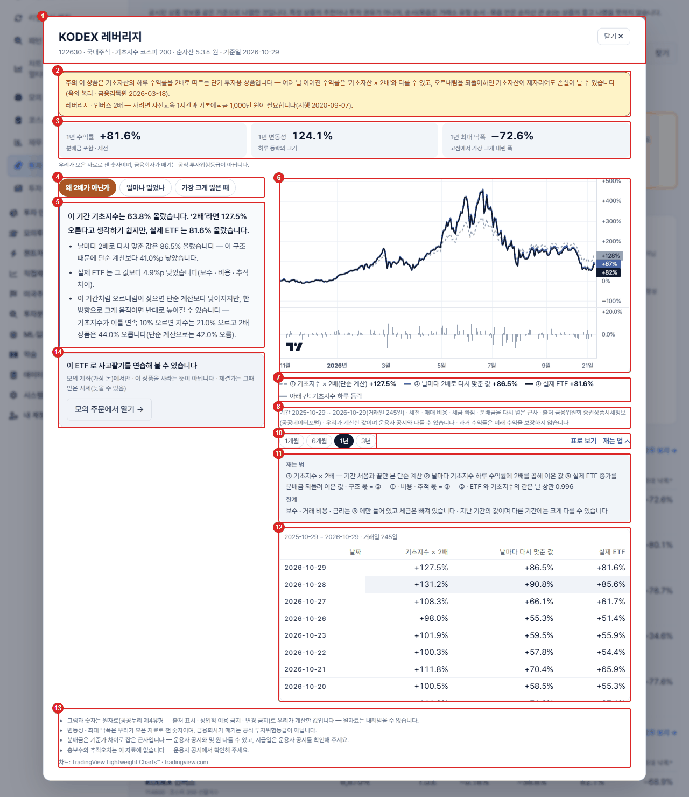

로컬 개발 앱 · 점검 계정 · 1280 폭 · 2026-11-01 16:50 · 그림 전용으로 창 높이 제한을 풀어 안쪽 스크롤 없이 찍었다(실제 창은 높이 고정 — 화면 높이 − 48, 최대 880 · 넘치면 창 안에서 굴림) · 14 연습 상자가 이제 그림에 있다 · 뒤 화면은 흐리게 덮인다 · 설계 원본: [Figma 03-3 설계 F · 1280 · 레버리지](https://www.figma.com/design/gJ4z5uAVXEgH9qCDwS2AlW?node-id=37-2) · [1배 상품](https://www.figma.com/design/gJ4z5uAVXEgH9qCDwS2AlW?node-id=37-5) · [1024](https://www.figma.com/design/gJ4z5uAVXEgH9qCDwS2AlW?node-id=37-8) · [390](https://www.figma.com/design/gJ4z5uAVXEgH9qCDwS2AlW?node-id=37-11) · [05 결정](https://www.figma.com/design/gJ4z5uAVXEgH9qCDwS2AlW?node-id=44-2)

**<표 19> 화면 요소** — 번호는 <그림 11>.

| 번호 | 요소 | 무엇을 보이나 | 자료 · API |
|---|---|---|---|
| 1 | 머리 | 상품 이름 · 종목코드 · 자산군 · 기초지수 · 순자산 · 기준일 · 닫기 | 응답 `item` · `as_of` |
| 2 | 주의 띠 | 레버리지 · 인버스만 · 닫을 수 없음 · 이 상품의 배수로 쓴 위험 구조 한 문장 + 사려면 필요한 것(사전교육 · 기본예탁금 · 시행일) | 응답 `band` · `requirement_note`(요건 상수표 한 곳) |
| 3 | 숫자 셋 | 1년 수익률(분배금 포함 · 세전) · 1년 변동성 · 1년 최대 낙폭 — 목록 줄과 같은 값 · 아래 한 줄 「공식 투자위험등급이 아님」 | 응답 `item`(목록 계산 결과의 그 줄) |
| 4 | 질문 칩 | 만든 것만 — 얼마나 벌었나 · 가장 크게 잃은 때 · (레버리지 · 인버스면) 왜 n배가 아닌가 · 레버리지 · 인버스는 「왜 n배가 아닌가」 가 기본 | 응답 `explain[].chip · title` · `default_chip` |
| 5 | 쉬운 말 | 굵은 한 줄 요약 + 근거 줄(왜 그런가 · 반대 예) — 화면이 문장을 다시 짓지 않는다 | 응답 `explain[].sentence · points` |
| 6 | 그림 | 얼마나 벌었나: 분배금을 다시 넣은 값 · 가격만 본 값(100만 원 시작) + 분배락 표시 / 가장 크게 잃은 때: 분배금 포함 값 · 그날까지의 최고점 + 아래 칸 물속 그림 · 고점 · 바닥 · 되찾음 표시 / 왜 n배가 아닌가: ① 기초지수 × n ② 날마다 n배로 다시 맞춘 값 ③ 실제 ETF + 아래 칸 기초지수 하루 등락 | 응답 `series`(칸마다 배열) · `events` · `stats` |
| 7 | 범례 | 선마다 이름과 마지막 값 | `stats` |
| 8 | 캡션 | 기간 · 거래일 · 세전 · 비용 · 분배금 근사 · 출처 · 과거 수익률 고지 | 응답 `caption` |
| 9 | 기간 칩 | 1개월 · 6개월 · 1년 · 3년 — 낼 수 없는 기간은 점선 · 누를 수 없음 · 마우스를 올리면 까닭 | 응답 `periods[]` |
| 10 | 표로 보기 · 재는 법 | 펼침 단추 둘 | — |
| 11 | 재는 법 | 칩마다 식과 한계 | 응답 `explain[].how · limits` |
| 12 | 표 | 그림과 같은 숫자를 날짜마다(새 날짜가 위) — 화면 읽기 프로그램용 · 옮겨 적기용 | 응답 `series` |
| 13 | 각주 · 크레딧 | 원자료 이용 조건 · 공식 등급 아님 · 분배금 근사 · 총보수 · 추적오차 없음 + 「차트: TradingView Lightweight Charts™ · tradingview.com」 | 응답 `notes` · 표시 의무(NOTICE) |
| 14 | 연습 상자 | 「이 ETF 로 사고팔기를 연습해 볼 수 있습니다」 · 「모의 계좌(가상 돈)에서만 · 이 상품을 사라는 뜻이 아닙니다 · 체결가는 그때 받은 시세(늦을 수 있음)」 · 「모의 주문에서 열기 →」 — 설명(5) 바로 아래 · 누르면 창을 닫고 국내주식 모의주문을 이 코드로 열어 「시세 조회」 까지만(주문은 사용자가 · 그 화면 코드는 바꾸지 않음) · <그림 11> 의 14 | — (Figma 03-7 결정 · 2026-10-16) |

**<표 20> 경우**

| 경우 | 보이는 것 |
|---|---|
| 1배 상품 | 주의 띠 없음 · 칩 둘(얼마나 벌었나가 기본) · 1280 × 800 첫 화면에 그림 · 범례 · 캡션 · 기간까지 |
| 레버리지 · 인버스 · 기초지수와 견줄 수 있음 | 주의 띠 · 칩 셋(왜 n배가 아닌가가 기본) · 세 선 + 아래 칸 · 1280 × 800 첫 화면에 그림과 세 값 범례까지 |
| 레버리지 · 인버스 · 견줄 수 없음(해외 지수 · 지수 이름 바뀜 · 하루 늦음 · 지수 빈 날) | 기본 칩은 얼마나 벌었나 · 「왜 n배가 아닌가」 칩은 실제 ETF 선 하나와 서버가 낸 까닭 — 세 값을 만들어 내지 않는다 |
| 상장 1년 안 | 열 수 있는 가장 긴 기간으로 다시 열고 까닭 한 줄(「… 처음 거래돼(우리 자료 기준) 아직 1년이 지나지 않았습니다. 그래서 1개월 그림을 보입니다.」) · 낼 수 없는 기간 칩은 점선 |
| 그림 도구를 못 불러옴 | 그림 칸에 까닭 한 줄 — 글 · 표의 숫자는 그대로 |
| 목록에 없는 종목 · 자료 없음 · 읽기 실패 | 까닭 한 줄(「이 상품은 기준일 목록에 없습니다」 등) |
| 기간을 빨리 바꿈 | 앞 요청을 취소하고 늦게 온 옛 응답은 버린다 |
| 1024 이상(두 단) | 왼쪽 단(칩 · 쉬운 말 · 연습 상자)을 창 안에서 고정 — 그림 · 표를 아래로 내려도 연습 상자가 보인다(2026-10-16) |
| 1024 아래 · 760 아래 | 한 단(위 → 칩 · 쉬운 말 · 연습 상자 → 그림 차례 그대로 · 고정하지 않음) / 화면 전체(칩은 가로로 굴림 · 그림 높이 260) |
| 창 크기가 바뀜 | 그린 기간 전체가 그대로 보인다(기준일 쪽이 잘리지 않음) |

**정한 것** — ① 담는 틀은 가운데 모달(사용자 화면 피드백 2026-10-12 — 오른쪽 580 서랍보다 읽기 쉬움) · 꼴은 두 안의 융합 설계 F(위 전체 폭 + 가운데 두 단 · 사용자 결정 「둘을 잘 융합해서 단점 최소화」 — 한 단 안 D 는 첫 화면에서 그림이 아래로 밀렸고, 두 단 안 E 는 좁은 칸에 주의 띠가 여섯 줄로 늘어났다) ② 창 높이 고정(칩 · 기간을 바꿔도 창이 움직이지 않음) ③ 덮개 · 닫기 · Esc 로 닫고 초점은 목록의 이름 단추로 돌아간다 ④ 내용은 안 B 그대로(숫자 셋 · 질문 칩 · 그림 한 칸 · 만든 칩만 보임).

**지키는 것** — ① 머리 숫자 = 목록 줄(서버가 목록 계산 결과의 그 줄을 싣는다) ② 문장은 서버 한 곳(부호를 낱말로 · 요약 숫자 = 요약 칸) ③ 견줄 수 없으면 세 값을 그리지 않고 까닭을 보인다(말없는 대체 금지) ④ 좋고 나쁨 색을 쓰지 않는다 ⑤ 차트 위 로고 · 크레딧 줄을 끄지 않는다(표시 의무) ⑥ 차트 도구는 창을 열 때만 불러온다. 시험 TC-PCH(서버 32) · TC-PCS(화면 6).

**실제 확인**(2026-10-12 로컬 개발 앱 · 점검 계정 · 1280 · 1024 · 900 · 390) — 칩 셋 · 기간 넷 · 표로 보기(244줄) · 재는 법 · 닫기 셋(단추 · 덮개 · Esc)과 초점 돌아옴 · 칩을 바꿔도 칩 자리 그대로 · 창 크기를 1280 → 1024 · 390 → 1280 으로 바꿔도 그림이 기준일까지 · 견줄 수 없음(KODEX WTI원유선물인버스(H)) · 상장 1년 안(ACE K바이오코스닥액티브 → 1개월) · 창 위에서 휠을 굴려도 뒤 목록 그대로 · 콘솔 오류 0.

## 8. 화면 상세 — 재무 · 신용 위험 (`agent-cb`)

옛 「신용 리스크 분석」 자리다(화면 키 그대로 · 메뉴 「로보 어드바이저」). 옛 화면은 개인 · 기업 CB 조건을 글로 만들어 범용 대화 API 에 물었고, 대화 도구가 비어 있는 CB 표를 되풀이 읽어 답이 약 2분 걸렸다. 새 화면은 **상장사 한 곳의 재무 건전성**(우리 전자공시 재무 · 시점 고정)과 **시장 전체의 신용 스프레드**(한국은행 ECOS 시장금리)를 숫자 · 그림 · 쉬운 말로 보인다 — 투자 판단 · 등급이 아니다. 주담당 이동원(주인 없던 화면 · 2026-10-07 결정) · 설계 Figma 「Qurious · 재무 · 신용 위험」 [설계 D](https://www.figma.com/design/Q9y9udfl92n9O7IJhOTUlI?node-id=14-2) · [05 결정 기록](https://www.figma.com/design/Q9y9udfl92n9O7IJhOTUlI?node-id=1-4) · 서버 `API-RISK-01` · `02` · 구현 `public/js/riskcb.js` · `public/css/riskcb.css` · 차트 TradingView Lightweight Charts 5.2.1(저장소 벤더 파일 · 처음 그릴 때만 불러옴) · 조사 [재무 · 신용 위험 조사서](../../../phase-2/01-analysis/research/재무신용위험-지표출처-조사.md).

**<그림 12> 재무 · 신용 위험 — 회사 재무 건전성 탭 · 삼성전자 · 1280** · 1 ~ 12

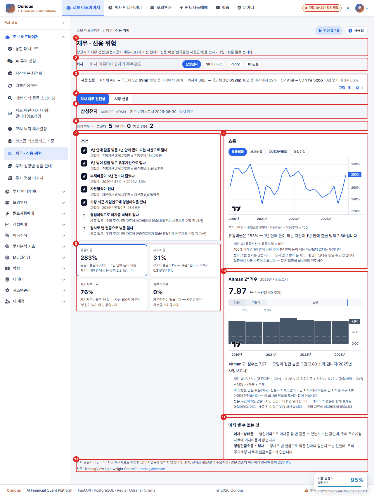

**<그림 13> 같은 화면 — 시장 신용 탭 · 1280** · 13 ~ 15(띠는 이 탭에서 숨는다 — 같은 숫자가 바로 아래 칸에 있다)

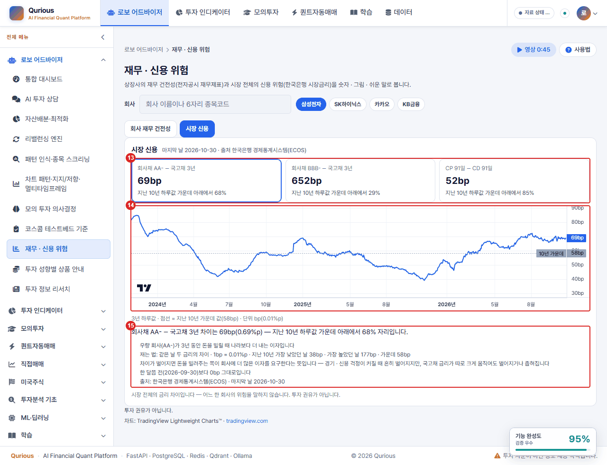

로컬 개발 앱 · 점검 계정 · 1280 폭 · 2026-10-13 · 기준 `8975696` + 이 판의 구현 · 창을 세로로 늘려 안쪽 스크롤 없이 찍고 번호 상자는 요소의 getBoundingClientRect 로 얹었다 · 설계 원본: [Figma 설계 D](https://www.figma.com/design/Q9y9udfl92n9O7IJhOTUlI?node-id=14-2) · [05 결정 기록](https://www.figma.com/design/Q9y9udfl92n9O7IJhOTUlI?node-id=1-4)

**<표 21> 화면 요소** — 번호는 <그림 12> · <그림 13>.

| 번호 | 요소 | 무엇을 보이나 | 자료 · API |
|---|---|---|---|
| 1 | 머리 | 제목 · 한 줄 설명(전자공시 재무제표 · 한국은행 시장금리를 숫자 · 그림 · 쉬운 말로) | — |
| 2 | 회사 고르기 | 입력 칸(회사 이름 → 찾기 목록 · 6자리 종목코드 + Enter) · 예시 회사 넷(삼성전자 · SK하이닉스 · 카카오 · KB금융 — 금융회사를 일부러 섞음) · 고른 회사는 그 탭에만 기억 | `API-STK-06`(이름 찾기 · 국내 6자리만) |
| 3 | 시장 신용 띠 | 늘 보이는 한 줄 — AA- · BBB- · CP − CD 의 bp 와 「n년 중 아래에서 m%」 · 「그림 · 읽는 법 →」 은 펼치지 않고 시장 신용 탭으로 옮긴다 | `API-RISK-02` `spreads[].latest · stats` |
| 4 | 탭 | 회사 재무 건전성 · 시장 신용 — 한 번에 한쪽만 | — |
| 5 | 회사 띠 | 이름 · 종목코드 · 시장 · 기준 보고서 · 기간 끝 · 「정정됨」(정정 공시로 값이 바뀐 기간) · 공시 원문 · 금융회사 · 별도 재무로 바꿈 안내 | `API-RISK-01` `latest` · `fs_note` · `kind_note` |
| 6 | 점검 요약 | 「점검 7개 — 그렇다 n · 아니다 n · 자료 없음 n」 | `summary` |
| 7 | 점검 일곱 | 질문 꼴 · ✔ ✕ ? 모양 + 「그렇다 · 아니다 · 자료 없음」 · 까닭(돈은 조원 · 억원) — 자료가 없는 둘(이자보상 · 영업현금흐름)도 빼지 않는다 | `checks[]` |
| 8 | 숫자 넷 | 유동비율 · 부채비율 · 자기자본비율 · 자본잠식률 — 값 · 한 줄 · 값이 없으면 까닭(누를 수 없음) · 누르면 9 의 그림이 그 숫자로 | `metrics[]` |
| 9 | 흐름 | 칩 넷(유동 · 부채 · 자기자본 · 영업이익) · 그림(분기 · 반기 · 사업보고서 차례 · 유동비율은 100% 점선 · 영업이익은 해마다 막대 — 손실은 회색) · 재는 법 · 한 줄 · 근거 줄 | `metrics[].history · formula · sentence · points` · `operating` |
| 10 | Altman Z'' | 점수 · 구간 이름(높은 · 가운데 · 낮은) · 띠 그림과 자리 표시 · 해마다 막대(경계 점선) · 한계 문장 · 근거 줄 — 값이 없으면 까닭 한 줄 | `zscore` |
| 11 | 아직 셀 수 없는 것 | 이자보상배율 · 영업현금흐름 ÷ 부채 — 까닭(주요계정에 이자비용 · 현금흐름이 없다) | `unavailable[]` |
| 12 | 각주 · 크레딧 | 보이는 탭에 맞춘 고지 — 회사 탭은 「투자 권유가 아닙니다 · 지난 재무제표로 계산 · 같은 업종끼리」, 시장 신용 탭은 「투자 권유가 아닙니다」 만(시장 고지는 15 안에) · 「차트: TradingView Lightweight Charts™ · tradingview.com」 | 회사 응답 `notice` · 표시 의무 |
| 13 | 스프레드 칸 셋 | AA- · BBB- · CP − CD — bp · 지난 n년 하루값 가운데 아래에서 몇 % · 누르면 그림이 그 스프레드로 | `API-RISK-02` `spreads[]` |
| 14 | 그림 | 3년 하루값 · 점선 = 지난 10년 가운데 값 · 단위 bp(0.01%p) | `spreads[].history · stats.median` |
| 15 | 쉬운 말 · 고지 | 한 줄 · 근거 줄(재는 법 · 가장 낮았던 날 · 높았던 날 · 출처) · 「시장 전체의 금리 차이 — 한 회사의 위험이 아님 · 투자 권유 아님」 · 마지막 날 · 출처(한국은행 ECOS) | `sentence · points` · `notice` · `source` |

**<표 22> 경우**

| 경우 | 보이는 것 |
|---|---|
| 처음 열 때 | 이 탭에서 마지막으로 본 회사 · 없으면 삼성전자 · 시장 신용은 따로 불러 띠를 채운다(둘 중 하나가 늦어도 다른 쪽은 먼저 보인다) |
| 금융회사(KB금융) | 회사 띠에 「금융회사는 예금 · 보험 같은 부채가 장사 밑천이고 유동 · 비유동 구분이 없어 이 비율로 견줄 수 없습니다」 · 유동비율 · 부채비율은 「—」 + 까닭(누를 수 없음) · 흐름은 자기자본비율로 · Z'' 는 까닭 한 줄 · 점검 셋은 자료 없음 |
| 연결 재무가 없는 회사 | 별도 재무로 바꾸고 회사 띠에 그 사실(말없이 바꾸지 않는다) |
| 정정된 기간 | 회사 띠에 「정정됨」 — 처음 보고된 값은 남아 있지 않다 |
| 재무가 없는 종목(ETF · 스팩 등) · 꼴이 틀린 코드 | 서버 글 한 줄(빈 표를 그리지 않는다) · 수집 · 설정 문제의 할 일(명령)은 관리자 응답에만 |
| 시장금리를 아직 받지 못함 | 띠 없음 · 시장 신용 탭에 「시장금리 자료를 아직 받지 못했습니다」 · 관리자에게만 할 일 한 줄 |
| 회사 찾기가 안 됨 | 「찾기가 지금 되지 않습니다 — 6자리 종목코드를 넣고 Enter」 · 국내 상장 종목이 아니면 「국내 상장 종목에서 찾지 못했습니다」 |
| 그림 도구를 못 불러옴 | 그림 칸에 까닭 한 줄 — 숫자 · 글은 그대로 |
| 다른 회사를 빨리 고름 | 늦게 온 옛 응답은 버린다 · 입력 칸 · 찾기 목록은 다시 그리지 않는다(재무를 부르는 사이 목록이 사라지지 않게) |
| 1024 아래 · 560 아래 | 한 단(점검 → 숫자 → 흐름 → Z'' 차례) / 숫자 · 스프레드 칸 한 줄에 하나 · 문서 가로 넘침 없음 |

**정한 것** — ① 꼴은 설계 D: 설계 B(탭 둘)와 C(점검 먼저 + 시장 신용 띠)의 융합(사용자 결정 2026-10-13 「B 와 C 잘 융합」 — A 한 장 두 단은 99 버린 안) ② 띠의 「그림 · 읽는 법 →」 은 펼치지 않고 시장 신용 탭으로 옮긴다(띠 숫자만 보고 뜻을 잘못 읽지 않게) ③ 점검 낱말은 「그렇다 · 아니다 · 자료 없음」(「통과 · 실패」 는 투자 판단 · 등급처럼 읽힌다) ④ Altman Z'' 는 보이되 한계 문장과 함께.

**지키는 것** — ① 문장 · 까닭은 서버 한 곳(화면이 다시 짓지 않는다) ② 경계(1.10 · 2.60) · 통계 햇수는 응답에서만 읽는다 ③ 신호등 색을 쓰지 않는다(빨강은 오류 글에만 · 점검은 모양과 글) ④ 숨기지 않는다(자료 없는 점검 둘 · 금융회사는 값 대신 까닭) ⑤ 차트 위 로고 · 크레딧 줄을 끄지 않는다 ⑥ 「투자 권유가 아닙니다」 · 「시장 전체의 금리 차이」 고지. 시험 TC-FH(서버 17) · TC-MC(서버 8) · TC-FRS(화면 5) · TC-AGR(대화 도구 7) · TC-ECS(수집기 10).

**실제 확인**(2026-10-13 로컬 개발 앱 · 점검 계정 · 1280 · 1024 · 900 · 390 · 시장금리는 같은 날 러너 `ecos` 단계로 받은 실제 값 — AA- 68bp · BBB- 649bp · CP − CD 36bp · 마지막 날 10-12) — 띠 「그림 · 읽는 법 →」 → 시장 신용 탭 · 스프레드 칸 셋 · 탭 둘 · 흐름 칩 넷 · 숫자 칸 · 예시 셋(SK하이닉스 · 카카오 · KB금융 — 금융회사는 흐름이 자기자본비율로 · Z'' 그림 없음) · 코드 입력 000660 + Enter · 이름 찾기 「삼성」(삼성물산 · 삼성생명 · 삼성카드 · 삼성증권 …) · 다른 화면에 갔다 와도 고른 회사 그대로 · 폭 넷 모두 가로 넘침 없음 · 콘솔 오류 0.

## 9. 화면 상세 — 계절성 분석 (`quant-seasonal`)

옛 강사님 칸 자리다(화면 키 그대로 · 메뉴 「금융 필수 지식 › 요약」). 옛 화면은 야후 시세로 **일간 수익률을 달별로 평균**(`API-ML-05`)만 보여 「1월 +0.08%」 가 하루 평균인지 한 달 수익률인지 헷갈렸고, 해마다 몇 번 그랬는지 · 우연과 구별되는지 · 「과거 패턴은 신호가 아님」 이 없었다. 새 화면은 **끝난 달의 달 수익률(달 끝 → 달 끝)을 해마다 표**로 두고, 달마다 평균 · 오른 해 · 판정(홀름 보정)을 서버가 숫자와 문장으로 함께 준다(`API-SEAS-01`). 코스피 · 코스닥은 한국은행 ECOS 가격 지수(1995 · 2003 ~ · 매일 수집), 종목은 수집 시세로 만든 총수익 · 가격 지수(2020 ~)다.

**<그림 14> 계절성 분석 — 코스피 · 해마다 표 탭 · 1280** · 1 ~ 15

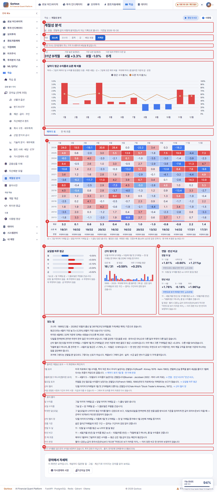

**<그림 15> 같은 화면 — 한 해 흐름 탭 · 종목 찾기 목록 · 1280** · 16 · 17

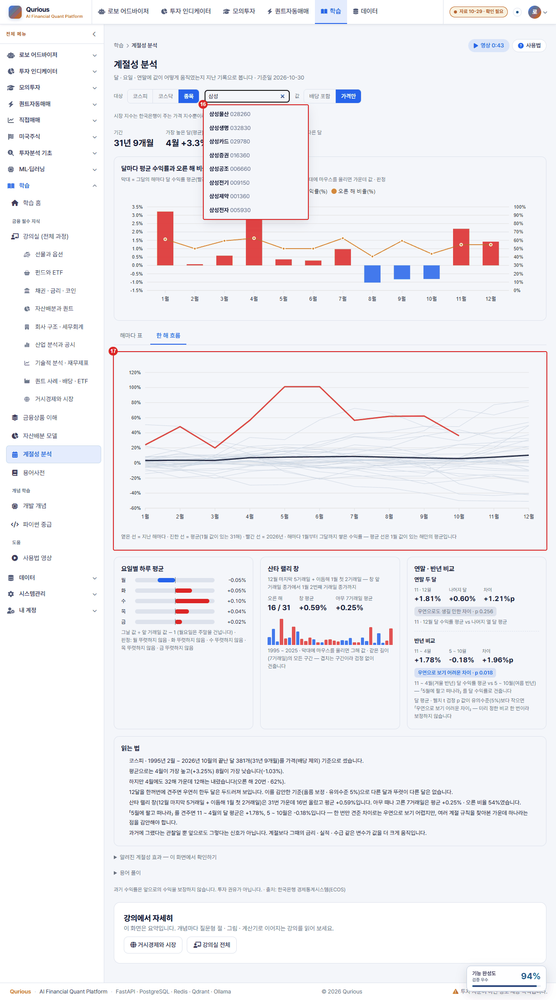

로컬 개발 앱 · 점검 계정 · 1280 폭 · 2026-10-14 · 기준 `1a59b6f` + 이 판의 구현 · 창을 세로로 늘려 안쪽 스크롤 없이 찍고 번호 상자는 요소의 getBoundingClientRect 로 얹었다 · 펼침 둘(알려진 효과 · 용어 풀이)은 펼친 채 · 설계 원본: [Figma 03-1 세 안](https://www.figma.com/design/kmhnl32nkmJaYilPQhN9TN?node-id=1-3) · [05 결정 기록](https://www.figma.com/design/kmhnl32nkmJaYilPQhN9TN?node-id=19-2)

**<표 23> 화면 요소** — 번호는 <그림 14> · <그림 15>.

| 번호 | 요소 | 무엇을 보이나 | 자료 · API |
|---|---|---|---|
| 1 | 머리 | 제목 · 한 줄 설명 · 기준일(마지막 값의 날) | `API-SEAS-01` `as_of` |
| 2 | 고르기 | 대상(코스피 · 코스닥 · 종목) · 값(배당 포함 · 가격만) — 단추 글 · 차례는 응답에서 · 눌린 값 단추는 실제로 센 값 | `choices` · `basis` |
| 3 | 값 안내 | 시장 지수에 「배당 포함」 을 고르면 「한국은행이 주는 가격 지수뿐이라 배당을 뺀 값」 — 말없이 바꾸지 않는다 | `basis_note` |
| 4 | 요약 숫자 넷 | 기간(끝난 달) · 가장 높은 달 · 가장 낮은 달(평균) · 다른 달과 뚜렷이 다른 달 수(관측이 모자라면 「판정 안 함」) | `span` · `by_month` |
| 5 | 달 막대 + 선 | 막대 = 달마다 해마다 달 수익률의 평균(빨강 오름 · 파랑 내림) · 선 = 오른 해 비율 · 막대에 마우스 → 해 수 · 평균 · 가운데 · 오른 해 · 가장 좋았던 · 나빴던 해 · 판정 | `by_month[]` |
| 6 | 탭 | 해마다 표 · 한 해 흐름 — 한 번에 하나 | — |
| 7 | 해마다 표 | 해(새것 위) × 12달 칸 · 오름 빨강 · 내림 파랑 · ±8% 에서 가장 진함 · 칸에 마우스 → 해 · 달 · 값 · 표 안에서 스크롤(머리 줄 고정) | `matrix[]` |
| 8 | 맨 아래 세 줄 | 평균 · 오른 해(n / 전체) · 판정(뚜렷 · 뚜렷하지 않음 · 판정 안 함) — 표를 내려도 늘 보인다 | `by_month[]` `mean · up · n · distinct_text` |
| 9 | 요일별 하루 평균 | 월 ~ 금 막대(0 을 가운데) · 마우스 → 관측 · 오른 날 비율 · 판정 · 아래에 다섯 요일 판정 글 | `weekday[]` |
| 10 | 산타 랠리 창 | 정의 · 오른 해 · 창 평균 · 아무 7거래일 평균 · 해마다 막대(마우스 → 그해 값) | `windows.santa` · `definitions.santa · baseline` |
| 11 | 연말 · 반년 비교 | 연말 두 달(11 · 12월 vs 나머지) · 반년(11 ~ 4월 vs 5 ~ 10월) — 평균 둘 · 차이(%p) · 판정 글 · p | `windows.year_end · halves` · `thresholds.alpha` |
| 12 | 읽는 법 | 서버가 지은 문장 — 범위 · 가장 높은 · 낮은 달 · 그달에도 내린 해 · 판정 · 산타 랠리 · 반년 · 표본 크기 · 「신호가 아님」 | `sentences[]` |
| 13 | 알려진 계절성 효과 | 1월 효과 · 5월에 팔고 떠나라 · 월요일 효과 · 산타 랠리 — 처음 관찰된 곳(연구 · 연도)과 이 화면에서 확인하는 칸 | 화면 글(값은 위 칸 · 응답) |
| 14 | 용어 풀이 | 달 수익률 · 요일 수익률 · 뚜렷한 달 · 산타 랠리 창 · 견줄 기준 · 연말 두 달 · 반년 비교 · 한 해 흐름 · 차이 판정 | `definitions` |
| 15 | 고지 · 출처 | 「과거 수익률은 앞으로의 수익을 보장하지 않습니다. 투자 권유가 아닙니다.」 · 출처(한국은행 ECOS · 또는 공공데이터포털 주식시세 + 우리 계산) | `notice` · `source` |
| 16 | 종목 찾기 | 「종목」 을 누르면 열린다 — 이름 · 코드 → 목록(국내 6자리만 · 여덟) · 6자리 + Enter · 고른 종목 이름 | `API-STK-06` |
| 17 | 한 해 흐름 | 해마다 1월부터 쌓은 수익률 선(옅은 회색) · 평균(진한 선 · 1월부터인 해만) · 올해(빨강) · 선에 마우스 → 해 · 그달까지 값 | `curves` |

**<표 24> 경우**

| 경우 | 보이는 것 |
|---|---|
| 처음 열 때 | 이 브라우저에서 마지막으로 본 대상 · 값 · 없으면 서버 기본(코스피 · 배당 포함 → 가격 지수로 셈 + 3 안내) |
| 종목(2020 ~) | 요약 넷째 칸 「판정 안 함」 · 표 판정 줄 모두 「판정 안 함」 · 문장에 「달마다 관측이 10해보다 적어 … 판정하지 않았습니다」 와 「표본이 작다」 |
| 지수를 아직 받지 않음 | 고르기는 그대로 · 서버 글 한 줄 · 관리자에게만 받기 명령 |
| 없는 종목 · 꼴이 틀린 코드 | 서버 글 한 줄(빈 표를 그리지 않는다) · 지난 결과는 그대로 둔다 |
| 지난번에 고른 종목을 지금 쓸 수 없음 | 기본 대상으로 다시 부르고 「지난번에 고른 대상을 지금은 쓸 수 없어 기본 대상으로 다시 불렀습니다」 |
| 종목 찾기가 안 됨 | 「찾기가 지금 되지 않습니다 — 6자리 종목코드를 넣고 Enter」 · 국내 상장 종목이 아니면 「국내 상장 종목에서 찾지 못했습니다」 |
| 그림 도구를 못 불러옴 | 막대 · 곡선 칸은 비고 표 · 숫자 · 문장은 그대로 |
| 창 크기를 바꿈 | 0.2초 뒤 그림만 다시 — 그림 도구 자체의 크기 맞춤은 끈다(바꾼 직후 탭을 누르면 지운 그림에 맞춤이 돌아 오류가 났다 · 2026-10-14 실측) |
| 1024 아래 · 900 아래 · 390 | 아래 카드 셋이 한 줄에 하나 · 표는 칸 안에서 가로 스크롤 · 문서 가로 넘침 없음 |

**정한 것** — ① 꼴은 안 A + B + C 탭(사용자 결정 2026-10-14) — 안 B 의 달 카드 12장은 뺐다(평균만 크게 보이면 「4월이 좋다」 로 잘못 읽힌다 — 코스피 실측: 다른 달과 뚜렷이 다른 달 0개) ② 끝난 달만 · 달 끝 → 달 끝(강사님 교재 「완료된 달만」 과 같은 규칙) ③ 12달 · 5요일은 홀름 보정 · 관측 10 미만은 판정하지 않는다 ④ 반년 비교는 옛 화면 카드의 「5월에 팔고 떠나라」 를 말로만 두지 않고 우리 자료로 견준다(미리 정한 한 번의 비교 · 문장이 「여러 규칙 가운데 하나」 라고 함께 말한다).

**지키는 것** — ① 계산 · 판정 · 문장은 서버 한 곳(화면이 다시 짓지 않는다 · TC-SE-15 · TC-SES-02) ② 고르기 값 · 판정 글 · 유의수준은 응답에서만 읽는다(TC-SES-02) ③ 서버 글은 이스케이프(TC-SES-03) ④ 오름 빨강 · 내림 파랑(국내 시세 표기) — 판정은 색이 아니라 글로 ⑤ 「과거 관찰 · 신호 아님」 문장과 고지를 빼지 않는다.

**실제 확인**(2026-10-14 로컬 개발 앱 · 점검 계정 · 1280 · 1024 · 900 · 390 · 코스피 · 코스닥은 같은 날 12:30 러너 `ecos` 단계로 처음 받은 실제 값 — 코스피 8,032줄 · 코스닥 5,867줄 · ECOS 견본 키로 2026년 달 끝 값 열을 따로 받아 표의 2026년 아홉 칸과 같음을 대조) — 대상 셋 · 값 둘 · 탭 둘 · 종목 찾기(이름 · 목록 · 6자리 Enter) · 다른 화면 갔다 오기(고른 값 기억) · 표 머리 · 맨 아래 줄 고정 · 창 크기 바꾼 직후 탭 — 콘솔 오류 0 · 문서 가로 넘침 0.

## 10. 화면 상세 — 종목 군집화 (`ml-cluster`)

옛 강사님 KMeans 칸 자리다(화면 키 그대로 · 메뉴 「ML·딥러닝」). 옛 화면은 `API-ML-03` 을 불렀는데 본문을 두 번 JSON 으로 바꿔 **늘 422** 였다(DF-108). 새 화면은 지난 기간에 **서로 비슷하게 움직인 종목끼리**(시장 몫을 뺀 일간 수익률 상관 · Ward) 또는 **위험 · 수익 특성이 닮은 종목끼리**(KMeans) 묶어 종목 지도 · 묶음 카드 · 쉬운 문장으로 보인다(`API-CLUS-01`). 대상은 자동매매 31종목(업종 표시) 또는 분봉 수집 종목(코스피 · 코스닥 지수 구성 · ETF 뺌)이다.

**<그림 16> 종목 군집화 — 31종목 · 3년 · 같이 움직임 · 묶음 탭 · 1280** · 1 ~ 9

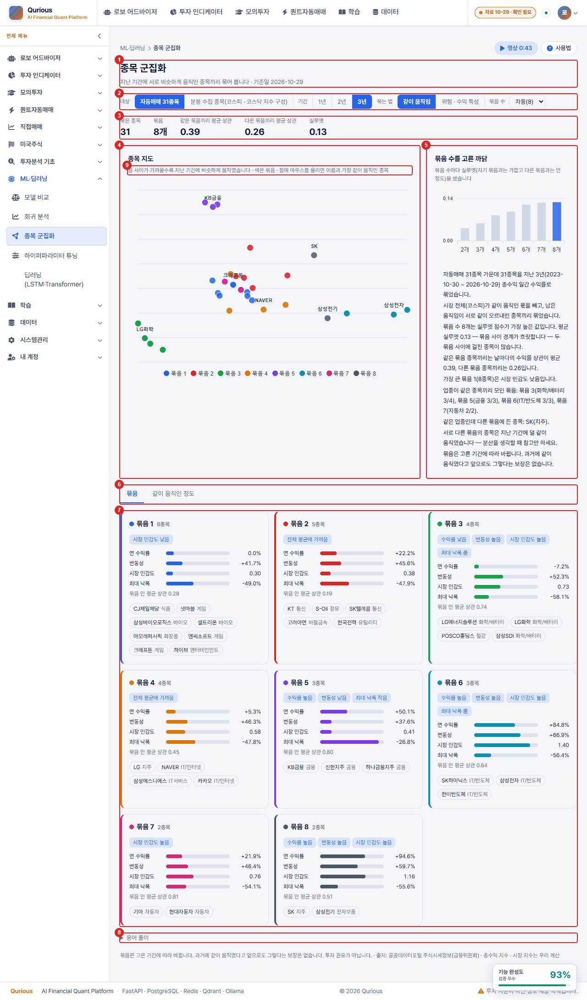

**<그림 17> 같은 화면 — 같이 움직인 정도(상관 표) 탭 · 1280** · 6 · 10

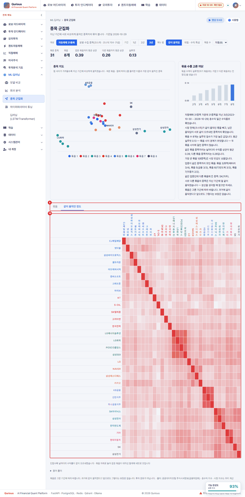

로컬 개발 앱 · 점검 계정 · 1280 폭 · 2026-10-14 · 기준 `1a59b6f` + 이 판의 구현 · 같은 방법(창을 세로로 늘림 · getBoundingClientRect 번호 상자) · 설계 원본: [Figma 03-2 세 안](https://www.figma.com/design/kmhnl32nkmJaYilPQhN9TN?node-id=1-4) · [05 결정 기록](https://www.figma.com/design/kmhnl32nkmJaYilPQhN9TN?node-id=19-9)

**<표 25> 화면 요소** — 번호는 <그림 16> · <그림 17>.

| 번호 | 요소 | 무엇을 보이나 | 자료 · API |
|---|---|---|---|
| 1 | 머리 | 제목 · 한 줄 설명 · 기준일 | `API-CLUS-01` `as_of` |
| 2 | 고르기 넷 | 대상(31종목 · 분봉 수집 종목) · 기간(1 · 2 · 3년) · 묶는 법(같이 움직임 · 위험 · 수익 특성) · 묶음 수(자동(n) · 2 ~ 8) — 단추 글 · 범위는 응답에서 | `choices` |
| 3 | 요약 숫자 | 묶은 종목 · 묶음 · 같은 묶음끼리 평균 상관 · 다른 묶음끼리 평균 상관 · 실루엣 | `points` · `k` · `separation` · `silhouette_mean` |
| 4 | 종목 지도 | 점 = 종목 · 색 = 묶음 · 가까울수록 비슷하게 움직임 · 이름은 묶음마다 가운데에 가까운 둘만(겹치면 건너뜀 · 60종목 넘으면 이름 없이) · 점에 마우스 → 이름 · 업종 · 묶음 · 연 수익률 · 변동성 · 가장 같이 움직인 종목 | `points[]` · `map` |
| 5 | 묶음 수를 고른 까닭 · 문장 | 묶음 수마다 실루엣 막대(고른 수 파랑) · 서버 문장(무엇을 · 어떻게 묶었나 · 경계가 흐릿한가 · 같은 · 다른 묶음 상관 · 업종과 맞는 묶음 · 다른 묶음에 든 같은 업종 · 「분산 참고만 · 보장 없음」) | `k_scores` · `sentences` |
| 6 | 탭 | 묶음 · 같이 움직인 정도(60종목 이하일 때만) | `matrix` |
| 7 | 묶음 카드 | 특징 낱말 · 연 수익률 · 변동성 · 시장 민감도 · 최대 낙폭 막대(대상 안의 자리) · 묶음 안 평균 상관 · 종목 칩(업종) · 24개 넘으면 「외 n종목 더 보기」 | `clusters[]` |
| 8 | 용어 풀이 | 같이 움직임 · 위험 · 수익 특성 · 실루엣 · 종목 지도 · 빠지는 종목 · 업종과 같은 정도 | `definitions` |
| 9 | 고지 · 출처 | 「묶음은 고른 기간에 따라 바뀝니다 … 보장은 없습니다 · 투자 권유가 아닙니다」 · 출처 | `notice` · `source` |
| 10 | 상관 표 | 묶음 차례로 놓은 종목 × 종목 · 진할수록 날마다 같이 오르내림 · 같은 묶음이 대각선 둘레에 네모로 · 칸에 마우스 → 값 | `matrix` |

**<표 26> 경우**

| 경우 | 보이는 것 |
|---|---|
| 처음 열 때 | 마지막으로 고른 대상 · 기간 · 방법 · 묶음 수 · 없으면 서버 기본(31종목 · 3년 · 같이 움직임 · 자동) |
| 분봉 수집 종목(약 350) | 지도에 이름 없이 점만(마우스로) · 상관 표 탭 없음 · 묶는 동안 「묶는 중입니다… 종목이 많으면 몇 초 걸립니다」 |
| 자료가 모자란 종목 | 「자료가 모자라 뺀 종목 n」 펼침에 이름과 까닭(빼고 묶었다는 사실을 숨기지 않는다) |
| 지난번에 고른 값을 지금 쓸 수 없음 | 기본으로 다시 부르고 그 사실 한 줄 |
| 대상 · 기간 · 방법을 바꿈 | 묶음 수는 다시 「자동」 |
| 그림 도구를 못 불러옴 | 지도 · 막대 칸은 비고 카드 · 숫자 · 문장은 그대로 |
| 창 크기를 바꿈 | 0.2초 뒤 그림만 다시 — 그림 도구 자체의 크기 맞춤은 끈다(계절성과 같은 까닭) |
| 900 아래 · 390 | 지도와 까닭 칸이 위아래로 · 카드 한 줄에 하나 · 상관 표는 칸 안에서 스크롤 · 문서 가로 넘침 없음 |

**정한 것** — ① 꼴은 안 A + B 융합(사용자 결정 2026-10-14) — 위 지도 · 아래 카드 · 상관 표(안 C)는 작은 대상에서만 탭 ② 대상은 31종목 기본 + 분봉 수집 종목 고르기 ③ 같이 움직임은 시장 몫(코스피 총수익 지수)을 빼고 묶는다 — 빼지 않으면 시장 전체 움직임이 커서 거의 한 묶음(31종목 29 + 2 · 401종목 347 + 1)이 됐다(구현 중 실측) ④ 거리는 상관 거리 √(2(1−ρ))(Mantegna 1999) · 연결은 Ward · 묶음 수는 실루엣이 가장 큰 수(같으면 작은 수).

**지키는 것** — ① 묶음 · 좌표 · 낱말 · 문장은 서버 한 곳 ② 고르기 값 · 기준값은 응답에서만(TC-CUS-02) ③ 서버 글은 이스케이프(TC-CUS-03) ④ 묶음 색은 구분용(좋음 · 나쁨 아님) — 범례는 묶음 번호 ⑤ 「분산 참고 · 보장 없음 · 권유 아님」 을 빼지 않는다 ⑥ 공통 `api()` 에 문자열 본문을 넘기지 않는다(DF-108 재발 막기 · TC-CUS-04 가 모든 화면 파일을 본다).

**실제 확인**(2026-10-14 로컬 개발 앱 · 점검 계정 · 1280 · 1024 · 900 · 390) — 고르기 넷의 모든 값 · 묶음 수 4 · 더 보기 · 탭 둘 · 분봉 수집 종목 · 다른 화면 갔다 오기 · 창 크기 바꾼 직후 탭 — 콘솔 오류 0 · 문서 가로 넘침 0. 31종목 · 3년 기본은 묶음 8개 · 실루엣 0.14(경계가 흐릿 — 문장이 그렇게 말한다) · 같은 묶음끼리 평균 상관 0.39 · 다른 묶음끼리 0.26.

## 11. 화면 상세 — 모델 비교 (`ml-compare`)

옛 강사님 「모델 비교 (7종)」 칸 자리다(화면 키 그대로 · 메뉴 「ML·딥러닝」). 옛 화면은 `API-ML-01` 을 불렀는데, 시험 구간보다 뒤(미래) 자료로 학습하는 교차검증 · 기준선 없는 정확도 순위 · 「7종」 인데 모델 8개였다([조사서](../../../phase-2/01-analysis/research/모델비교-시간순서평가-조사.md) 1절). 새 화면은 지난 시세로 학습한 모델 8개가 5거래일 뒤 오름 · 관망 · 내림을 얼마나 맞히는지를 **아무것도 배우지 않은 기준선 넷과 같은 날들로** 견주고, 기준선 셋 모두보다 뚜렷할 때만 「낫다」 고 말한다(`API-MCMP-01 ~ 04`). 처음 계산은 10 ~ 20초 걸려 앱 안 작업으로 돌리고 1초마다 진행을 묻는다 — 한 번 계산한 결과는 자료가 바뀌기 전까지 저장본으로 바로 보인다. 강사님 「📖 모델별 특성」 카드는 아래에 그대로 둔다.

**<그림 18> 모델 비교 — 삼성전자 · 2년 · 결과 · 그림 탭 · 1280** · 1 ~ 12

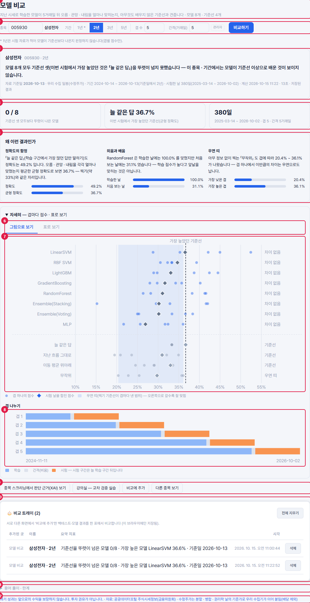

**<그림 19> 같은 화면 — 표로 보기 탭 · 1280** · 6 · 13

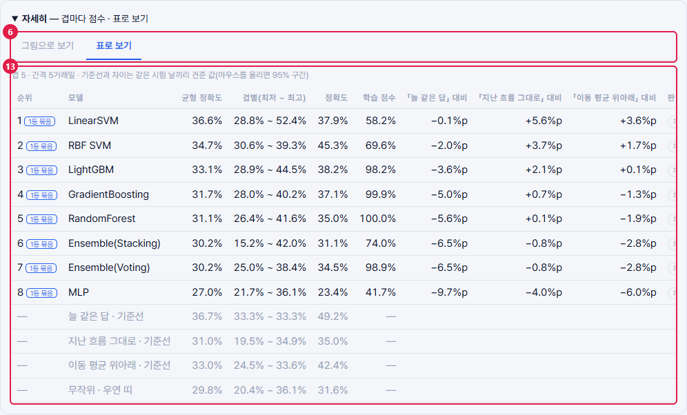

**<그림 20> 계산 중 — SK하이닉스 · 3년 · 1280** · 14

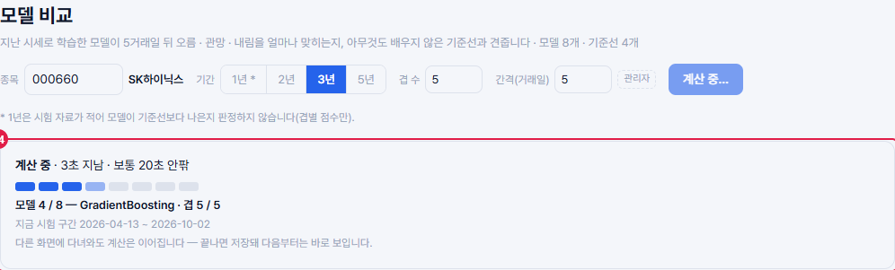

로컬 개발 앱 · 점검 계정(관리자 — 겹 수 · 간격 칸이 보인다) · 1280 폭 · 2026-10-15 · 기준 `8921f92` + 이 판의 구현 · 같은 방법(창을 세로로 늘림 · getBoundingClientRect 번호 상자) · 설계 원본: [Figma 03 [결정] 추천](https://www.figma.com/design/C82VemcAL7QC0tENjvdubm?node-id=8-15) · [04 구현 대조](https://www.figma.com/design/C82VemcAL7QC0tENjvdubm?node-id=14-3) · [05 결정 기록](https://www.figma.com/design/C82VemcAL7QC0tENjvdubm?node-id=13-2)

**<표 27> 화면 요소** — 번호는 <그림 18> ~ <그림 20>.

| 번호 | 요소 | 무엇을 보이나 | 자료 · API |
|---|---|---|---|
| 1 | 머리 | 제목 · 한 줄 설명 · 모델 수 · 기준선 수(응답 수 — 이름표에 숫자를 적지 않는다) | `API-MCMP-02` `model_count` |
| 2 | 고르기 줄 | 종목(6자리 · 자동매매 31종목 제안 · 이름 곁에) · 기간(1 · 2 · 3 · 5년 — 판정하지 않는 기간은 「*」 와 아래 한 줄) · 관리자만 겹 수 · 간격(범위는 응답에서) · 비교하기 | `choices` · `admin` |
| 3 | 머리 문장 · 기준 줄 | 서버가 지은 한 문장(판정 글을 끼움) · 자료 기준일 · 출처 · 기간 창(기준일에서 거꾸로) · 시험한 날 · 계산 시각 · 걸린 시간 · 저장된 결과 | `headline` · `data` · `samples` · `computed_at` · `cached` |
| 4 | 요약 카드 셋 | 기준선 셋 모두보다 뚜렷이 나은 모델 수 · 가장 높았던 기준선과 그 균형 정확도 · 시험한 날 수(겹 · 간격) | `models[].verdict` · `strongest_baseline` · `cv` |
| 5 | 왜 이런 결과인가 | 정확도의 함정(늘 같은 답의 정확도 vs 균형 정확도) · 외움과 배움(학습한 날 vs 처음 보는 날) · 우연 띠(찍기 기준선의 겹별 범위) — 문장 · 막대 값 모두 서버 | `insights[]` |
| 6 | 자세히 · 탭 | 그림으로 보기 · 표로 보기(처음엔 펼침) | — |
| 7 | 점 그림 | 모델 · 기준선마다 겹별 점 · 합친 값 마름모(판정 색 — 갈래 구분이지 좋음 · 나쁨이 아니다) · 우연 띠 · 가장 높았던 기준선 세로 점선 · 오른쪽 짧은 판정 이름표 · 점에 마우스 → 값 | `models[]` · `baselines[]` · `verdict_labels` |
| 8 | 겹 나누기 띠 | 겹마다 학습 · 간격(비움) · 시험 막대 — 시험 구간은 늘 학습 뒤 · 막대에 마우스 → 날짜 · 행 수 | `cv.folds[]` |
| 9 | 다음 행동 | 종목 스크리닝에서 판단 근거(XAI) 보기 · 강의실 — 교차 검증 실습 · 비교에 추가 · 다른 종목 보기 | 화면 이동 · 비교 트레이 |
| 10 | 비교 트레이 | 「비교에 추가」 로 담은 결과(다른 화면의 백테스트 결과와 한 표) · 지우기 | 브라우저 저장(공통 트레이) |
| 11 | 용어 풀이 · 한계 | 균형 정확도 · 정확도 · 방향 적중 · 신호 비율 · 학습 점수(Stacking 까닭) · 겹 · 간격 · 계층 균형 가중 · 판정 · 1등 묶음 / 한계 문장 | `definitions` · `limits` |
| 12 | 고지 · 출처 | 「과거 성과는 앞으로의 수익을 보장하지 않습니다 · 투자 권유가 아닙니다」 · 출처 표시 | `notice` · `data.attribution` |
| 13 | 표 | 순위(1등 묶음 표시) · 모델 · 균형 정확도 · 겹별 최저 ~ 최고 · 정확도 · 학습 점수 · 기준선별 차이(95% 구간 · 보정 p) · 판정 · 경고(반복 한도 · 가중 없음 · Stacking) · 아래에 기준선 넷 | `models[]` · `baselines[]` |
| 14 | 계산 중 | 지난 시간 · 보통 시간(그 기간의 지난 계산 · 없으면 기간별 기본) · 모델 칸 여덟(서버가 센 몇째 모델 · 몇째 겹 — 지어낸 백분율이 아니다) · 지금 시험 구간 · 30초 넘으면 「계속 기다리기 · 나중에 보기」 | `API-MCMP-03 · 04` `progress` · `expected_ms` |

**<표 28> 경우**

| 경우 | 보이는 것 |
|---|---|
| 처음 열 때 | 마지막으로 고른 종목 · 기간(이 브라우저) · 없으면 서버 기본(삼성전자 · 2년) · 「비교하기」 안내 카드(처음 계산은 보통 10 ~ 30초 · 저장본은 바로) |
| 저장본이 있음 | 곧바로 결과(기준 줄에 「저장된 결과」) — 자료 지문이 같을 때만 |
| 1년 | 계산은 하고 판정은 하지 않음 — 머리 문장 「시험 자료가 n행이라(최소 200행) … 판정하지 않습니다」 · 카드 「판정 안 함」 |
| 없는 종목 | 「수집 자료에 … 일봉이 없습니다 — 국내 상장 주식만 …」 + 제안 종목 칩(누르면 그 종목으로 계산) |
| ETF | 「… 는 ETF 입니다 — 아직 국내 상장 주식만 …」 + 칩 |
| 수집 DB 를 못 읽음 | 「시세 자료를 지금 읽을 수 없습니다. 잠시 뒤 다시 시도해 주세요.」 + 다시 시도(할 일은 관리자에게만) |
| 30초 넘게 걸림 | 「계속 기다리기 · 나중에 보기」 — 나중에 보기면 계산은 서버에서 이어지고 다시 누르면 저장본 |
| 다른 화면에 다녀옴 | 계산은 이어진다 · 돌아오면 지금 상태 · 끝났으면 결과 |
| 서버가 다시 켜짐 | 진행 묻기가 「계산 작업을 찾지 못했습니다 … 다시 계산해 주세요」 — 저장본이 있으면 다시 누를 때 바로 |
| 900 아래 · 390 | 카드 · 「왜」 가 한 줄에 하나 · 이름표와 칸이 한 묶음으로 줄바꿈 · 점 그림 · 겹 띠는 최소 폭 600 을 지키고 옆으로 밀어 봄(안내 한 줄) · 표는 칸 안에서 스크롤 · 문서 가로 넘침 없음 |

**정한 것** — ① 꼴은 추천 안(사용자 결정 2026-10-15) — 요약(C) 위 · 자세히 안에 그림(B) · 표(A) 탭 · 아래 다음 행동 ② 대표 지표 균형 정확도 · 판정은 기준선 셋 모두보다 뚜렷할 때만(블록 20거래일 · 홀름) ③ 1년은 계산하고 판정 안 함 · 겹 수 · 간격은 관리자만 ④ 일봉은 수집 DB 수정주가만 · 자료 지문 저장본 · 앱 안 작업 + 1초 진행 ⑤ 이름표는 숫자 빼고 「모델 비교」 — 수는 응답에서.

**지키는 것** — ① 판정 글 · 짧은 이름표 · 기준선 이름 · 기간 이름표 · 「왜」 문장 · 출처 글은 서버 한 곳(TC-MVS-02) ② 계산을 띄우는 POST 에만 화면 머리글(TC-MVS-03 · TC-MV-20) ③ 진행은 서버가 센 값 — 지어낸 백분율을 보이지 않는다(TC-MV-23) ④ 「비교에 추가」 로 담은 것을 이 화면에서 본다(TC-MVS-05) ⑤ 「과거 성과 · 권유 아님」 을 빼지 않는다.

**실제 확인**(2026-10-15 로컬 개발 앱 · 점검 계정 · 1280 · 1024 · 900 · 390) — 기간 넷 · 종목 바꾸기 · 칩 · 없는 종목(999999) · ETF(069500) · 진행 화면 · 저장본 · 탭 둘 · 다음 행동 넷 · 비교 트레이 · 다른 화면 갔다 오기 — 콘솔 오류 0 · 문서 가로 넘침 0. 확인에서 셋을 찾아 같은 PR 에서 고쳤다 — 옛 칸과 함께 비교 트레이 자리가 사라짐(TC-MVS-05) · 390 에서 「기간」 이름표만 윗줄에 남음 · 390 에서 그림이 줄어 글자가 8px 아래(최소 폭 + 옆으로 밀기). 아래 강사님 카드의 글자색도 고쳤다(어두운 테마용 연회색 · 대비 약 1.4:1 → 10:1). 삼성전자 2년은 모델 8개 모두 「차이 없음」 · 가장 높았던 기준선 「늘 같은 답」 36.7%(정확도 49.2%) · SK하이닉스 3년도 8개 모두 「차이 없음」(가장 높았던 기준선 「지난 흐름 그대로」).

## 12. 화면 상세 — 투자 정보 리서치 (`agent-news`) · 첫 목록 · 종목 칸

**<표 31> 화면 정보**

| 칸 | 내용 |
|---|---|
| 화면 ID · 화면명 | `agent-news` · 투자 정보 리서치 |
| 들어가는 길 | 위 탭 「로보 어드바이저」 → 왼쪽 전체 메뉴 › 로보 어드바이저 › 「투자 정보 리서치」 · 주소 `#agent-news` · AI 투자 상담 카드의 「공시 · 기사 시간표 →」(그 종목 시간표로) |
| 설명 | 전자공시 공시 · 정책브리핑 정책뉴스 · 언론사 기사 제목을 낱말 · 종목 · 주제 · 기간으로 찾는다. 종목을 고르면 같은 자리가 그 종목의 공시 · 기사 · 일정을 날짜 한 줄로 보인다(시간표). AI 가 답을 쓰는 화면이 아니다 |
| 관련 요구 | `P01-①-2`(수집 자료 검색) · `P01-①-3` |
| 주담당 | 이동원 |
| 결정 기록 | [Figma 「투자 정보 리서치 — 공시 · 뉴스 찾기」](https://www.figma.com/design/7fLcDQ0dQd50anuy3wgfu2) 05 결정 기록(2026-10-05 — 찾기 + 거름 칸 · 종목을 고르면 시간표 · 낱말이 있으면 관련도순) · 03-2 쪽(2026-10-17 — 설계 A 「투자 관련만」 기본 + 스위치 · 같은 제목 묶기 · 제목 없는 기사 뒤로 · 세 안 공통 — 종목 칸 Enter · 「검색」 고침 · 종목 칸은 찾기 줄로) |

처음 화면은 <그림 23> 과 같다. 첫 목록은 「투자 관련만」 — 공시와, 종목 · 주제 이름표가 붙은 뉴스만 보인다. 한 달 치 언론사 기사 약 4만 건 가운데 이름표가 붙은 것은 약 4천 건이라, 이 거름이 없으면 첫 화면이 정치 · 사회 기사와 제목이 사이트 이름뿐인 줄(「KBS 뉴스」)로 채워졌다. 숨긴 수는 스위치 옆에 밝힌다.

**<그림 23> 첫 목록 — 투자 관련만** · 범례: 빨간 상자와 번호 = <표 32> 의 요소

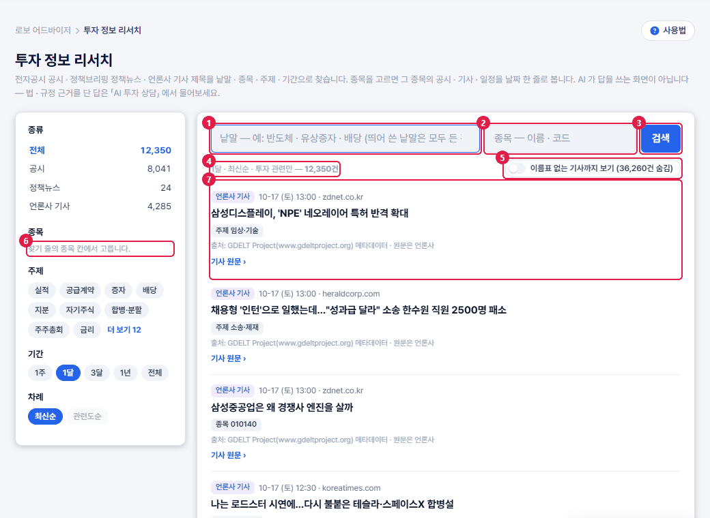

같은 제목의 기사는 한 줄로 묶는다(<그림 24>). 같은 기사가 주소 여럿으로 다시 나가는 일이 잦다(한 언론사가 같은 제목을 두 주소로 · 한 이야기를 여러 언론사가).

**<그림 24> 같은 제목 묶음** · 범례: 빨간 상자와 번호 = <표 32> 의 요소

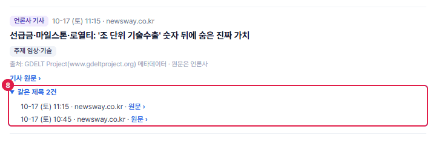

스위치를 켜면 이름표 없는 기사까지 보이고, 제목이 사이트 이름뿐인 기사는 받은 목록 끝에 게시처마다 한 줄로 모인다(<그림 25> — 낱말 「KBS 뉴스」 로 찾은 때).

**<그림 25> 제목에 사이트 이름만 있는 기사 묶음 — 스위치를 켜고 「KBS 뉴스」** · 범례: 빨간 상자와 번호 = <표 32> 의 요소

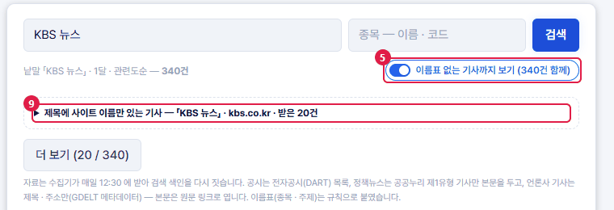

**<표 32> 투자 정보 리서치 요소**

| 번호 | 요소 | 데이터(API) | 동작 | 빈 데이터 · 오류 |
|:-:|---|---|---|---|
| 1 | 낱말 칸 | `API-DATA-03` `q` | 띄어 쓴 낱말은 모두 든 것만 · 낱말이 있으면 관련도순 · ✕ 를 누르거나 다 지우면 곧바로 최신 소식 | 낱말을 만들지 못하면 서버 글(422) |
| 2 | 종목 칸 | `API-STK-06` | 치면 0.25초 쉰 뒤 제안 목록(국내 6자리 종목만 · 여덟). Enter 와 「검색」 은 목록을 기다리지 않고 바로 찾는다 — 이름 · 코드가 정확히 같은 것 하나면 그 종목, 여럿이면 목록을 열고 첫 줄에 초점(↑ ↓ · Enter · Esc), 없으면 「국내 상장 종목에서 찾지 못했습니다」. 고른 종목은 이 칸에 이름으로 남고, 칸의 ✕ 로 거름을 푼다 · 칸 밖을 누르면 목록이 닫힌다 | 찾기가 실패하면 「종목 찾기가 잠시 안 됩니다 — 다시 눌러 보세요」(「없음」 으로 덮지 않는다) |
| 3 | 검색 | `API-DATA-03` | 낱말 · 종목을 함께 — 새로 친 종목은 먼저 찾고, 정확히 같은 것 하나면 낱말을 남긴 채 그 종목 시간표 · 종목 칸을 비우고 누르면 종목 거름을 푼다 | — |
| 4 | 조건 줄 | `total` · `facets.source` | 「1달 · 최신순 · 투자 관련만 — n건」(공시만 볼 때는 「투자 관련만」 을 쓰지 않는다) | — |
| 5 | 스위치 | `facets.untagged` | 「이름표 없는 기사까지 보기 (n건 숨김)」 — 켜면 「(n건 함께)」 · n 은 서버가 같은 조건에서 센 수 | 공시만 볼 때 · 숨길 것이 없을 때 · 시간표에서는 감춘다 |
| 6 | 거름 칸의 종목 | — | 고른 종목 칩(✕ 로 풀기) · 고르기 전에는 「찾기 줄의 종목 칸에서 고릅니다.」 | — |
| 7 | 목록 줄 | `items[]` | 출처 꼬리표 · 시각 · 게시처 · 제목(원문 링크) · 종목 · 주제 이름표(누르면 그 종목 시간표 · 그 주제) · 출처 표시 | — |
| 8 | 같은 제목 | `items[]`(뉴스) | 같은 제목은 처음 나온 줄 하나로 · 「같은 제목 n건」 을 펴면 묶인 기사마다 시각 · 게시처 · 원문 | 공시는 묶지 않는다(회사마다 같은 보고서 이름) |
| 9 | 제목에 사이트 이름만 있는 기사 | `items[].site_name_title` | 받은 목록 끝에 게시처마다 접힌 한 줄 — 「제목에 사이트 이름만 있는 기사 — 「○○」 · 게시처 · 받은 n건」 · 펴면 시각 · 원문 | — |

**<표 33> 투자 정보 리서치의 경우**

| 경우 | 화면이 보이는 것 |
|---|---|
| 처음(투자 관련만) | 공시 + 이름표가 붙은 뉴스 · 숨긴 수를 스위치에 |
| 스위치를 켬 | 이름표 없는 기사까지 · 사이트 이름 제목은 끝 묶음으로 |
| 「더 보기」 | 서버 쪽 넘기기 그대로 20건씩 받고, 받은 줄 전부를 다시 묶는다(묶음 · 끝 묶음의 수는 받은 줄 기준) |
| 종목 칸에 정확한 이름 + Enter | 곧바로 그 종목 시간표(공시 · 기사 · 일정) |
| 낱말 + 종목 + 「검색」 | 낱말을 남긴 채 그 종목 시간표 |
| 제안 목록에서 고름 | 낱말을 비우고 그 종목 전부의 시간표(찾던 낱말이 남아 비어 보이지 않게 — 2026-10-06 결정) |
| 없는 이름 | 「국내 상장 종목에서 찾지 못했습니다」 |
| 좁은 화면 | 720 아래 — 낱말 칸이 한 줄을 다 쓰고 종목 칸과 「검색」 은 다음 줄 · 900 아래 — 거름 칸은 접는다 |

제목이 사이트 이름뿐인지는 서버가 정한다 — 같은 제목이 주소 10개 · 3일 이상에 붙은 언론사 기사(가장 최근 기사로부터 30일). 2026-10-17 색인에서는 넷(「KBS 뉴스」 340 · 「허프포스트코리아」 280 · 「씨네21」 16 · 「Global Asset Management」 13)이었다. 「투자 관련만」 은 이름표 규칙에 기대므로, 규칙이 놓친 투자 기사는 스위치 뒤로 가고 규칙이 잘못 붙인 기사(「합병증」 → 합병·분할)는 앞에 남는다 — 이름표 정밀도 표본 점검에서 규칙을 고친다.

---

## 13. 화면 상세 — 미국주식 › 주문/매매 (`us-order`) · 시세 카드 · 확인 상자 · 예약 주문

**<표 34> 화면 정보**

| 칸 | 내용 |
|---|---|
| 화면 ID · 화면명 | `us-order` · 미국주식 주문 (모의투자) |
| 들어가는 길 | 왼쪽 전체 메뉴 › 미국주식 › 「주문/매매」(미국주식은 위 탭 여섯 밖) · 주소 `#us-order` |
| 설명 | 미국 종목을 원화 모의 계좌로 산다. 미국 정규장이 닫힌 때는 예약 주문으로 받아 다음 정규장 시작가로 체결한다. 실제 주문이 나가지 않는다(모의투자) |
| 관련 요구 | `P01-④-3`(모의 주문 · 운용) |
| 주담당 | 이동원(미국주식 화면 · 환율 모듈 · 예약 규칙) — 모의 장부 · 비용 모듈은 강민석 |
| 결정 기록 | [Figma 「Qurious · 미국주식 주문 화면」](https://www.figma.com/design/ZCsZfaB0nvUpHeUjh0hbr5) — 지금 화면 · 세 안(A 시세 한 줄 + 브라우저 확인창 · B 시세 카드 + 예상 금액 + 앱 안 확인 상자 · C B + 장 닫힌 날은 예약 주문) → **C 결정(2026-10-17)** · 구현 대조 쪽 |

종목을 넣으면 시세 카드가, 수량을 넣으면 예상 금액이 나온다(<그림 26>). 장 상태는 서버 한 곳(`app/services/us_reserve.py` — 뉴욕 09:30 ~ 16:00 · NYSE 휴장일 공지 2026 ~ 2028 · 서머타임은 시간대가 맞춤)이 정하고, 장이 닫혀 있으면 매수 단추가 「예약 매수 (다음 정규장)」 로 바뀐다. 2026-10-17 전에는 이 칸에 시세 · 장 상태 · 환율이 없고 단추를 누르면 확인 없이 바로 체결됐다 — 토요일에는 금요일 마감 값으로(모의투자 여정 점검 셋째 바퀴 · 이슈 #256).

**<그림 26> 주문 칸 — 장 닫힘 · 예약 대기 1건(2026-10-17 토 · PLUG 1주)** · 범례: 빨간 상자와 번호 = <표 35> 의 요소

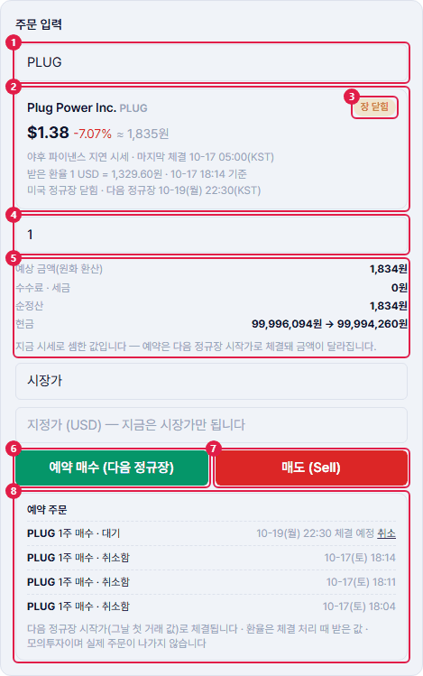

매수를 누르면 장 상태를 서버에 다시 묻고 앱 안 확인 상자를 연다(<그림 27>). 처음 초점은 「취소」 다 — Enter 를 잘못 눌러도 주문이 나가지 않는다. 원화 단가 · 순정산 · 현금 변화는 서버 미리 보기(`API-PAPR-05` — 체결과 같은 비용 셈 · 단가는 원 단위로 버림)를 그대로 쓴다. 시세 카드의 원화는 「≈」 반올림 표시라 1원 다를 수 있다.

**<그림 27> 확인 상자 — 장이 닫힌 때(예약)** · 범례: 빨간 상자와 번호 = <표 35> 의 요소

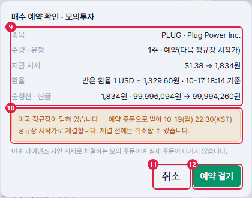

**<표 35> 미국주식 주문 요소**

| 번호 | 요소 | 데이터(API) | 동작 | 빈 데이터 · 오류 |
|:-:|---|---|---|---|
| 1 | 종목 칸 | — | 치면 0.45초 쉰 뒤 시세 카드를 다시 받는다(늦게 온 옛 응답은 버린다) | 비우면 카드 · 예상 금액을 지운다 |
| 2 | 시세 카드 | `API-STK-02` · `API-PAPR-03` | 이름 · 티커 · 달러가 · 전일 대비 · 원화 환산(≈) · 「야후 파이낸스 지연 시세 · 마지막 체결 MM-DD HH:MM(KST)」 · 환율 글 · 장 상태 글(둘 다 서버 글 그대로) | 모르는 값은 「—」 · 체결 시각을 모르면 「마지막 체결 시각 모름」 · 모의 시세를 못 받으면 서버 글 |
| 3 | 장 상태 배지 | `API-USRV-01` | 장 열림 · 장 닫힘 · 장 상태 모름 | 모름(휴장일 표 밖)은 닫힘으로 짐작하지 않는다 |
| 4 | 수량 칸 | — | 치면 0.3초 쉰 뒤 예상 금액을 다시 받는다 | — |
| 5 | 예상 금액 | `API-PAPR-05` | 예상 금액 · 수수료 · 세금 · 순정산 · 현금 변화(서버 값 그대로) · 장이 닫히면 「지금 시세로 셈한 값입니다 — 예약은 다음 정규장 시작가로 체결돼 금액이 달라집니다」 | 현금이 모자라면 서버 까닭 |
| 6 | 매수 단추 | `API-USRV-01` | 장 열림 → 「매수 (Buy)」 · 닫힘 → 「예약 매수 (다음 정규장)」 · 누르면 장 상태를 다시 묻고 확인 상자 | 시세를 못 받으면 「시세를 받지 못해 주문할 수 없습니다」 |
| 7 | 매도 단추 | — | 해외 매도는 아직 막는다(해외 매도 비용 계산이 준비되면 연다) | 까닭 글 |
| 8 | 예약 목록 | `API-USRV-02` · `API-USRV-04` | 대기 · 체결 · 건너뜀 · 취소함 · 대기 줄에만 「취소」 · 화면을 열 때 정규장이 이미 열린 예약은 그 시가로 먼저 체결하고 목록 위에 결과 한 줄 | 시가를 아직 못 받으면 「기다림 — 까닭」 · 현금이 모자라면 「건너뜀 — 까닭」 |
| 9 | 확인 상자 본문 | `API-PAPR-05` · `API-PAPR-03` | 종목 · 수량 · 유형(시장가 · 예약) · 지금 시세(원화는 미리 보기 단가) · 환율 · 순정산 · 현금 | — |
| 10 | 장 닫힘 안내 | `API-USRV-01` | 「미국 정규장이 닫혀 있습니다 — 예약 주문으로 받아 다음 정규장(KST) 정규장 시작가로 체결합니다. 체결 전에는 취소할 수 있습니다.」 | 장 상태를 모르면 「… — 지금 지연 시세로 바로 체결됩니다」 |
| 11 | 취소 | — | 상자를 닫는다(처음 초점) | — |
| 12 | 예약 걸기 · 매수 주문 내기 | `API-USRV-03` · `API-PAPR-06` | 장 닫힘 → 예약 · 열림 → 바로 체결 | 서버가 장이 열렸다고 하면 409 「바로 주문하세요」 · 국내 종목 · 잘못된 수량은 400 + 까닭 |

**<표 36> 미국주식 주문 — 경우**

| 경우 | 화면 |
|---|---|
| 장 열림 | 배지 「장 열림」 · 단추 「매수 (Buy)」 · 확인 상자 「매수 주문 내기」 · 지연 시세로 바로 체결 |
| 장 닫힘(주말 · 휴장일 · 정규장 밖) | 배지 「장 닫힘」 · 단추 「예약 매수 (다음 정규장)」 · 확인 상자에 장 닫힘 안내 · 예약 목록에 대기 줄 |
| 장 상태 모름(휴장일 표 밖의 해) | 배지 「장 상태 모름」 · 단추 「매수 (Buy)」 · 확인 상자에 「… — 지금 지연 시세로 바로 체결됩니다」 |
| 다음 정규장이 열린 뒤 화면을 엶 | 예약을 그 정규장 시가 × 그때 환율로 체결 · 체결 시각 = 정규장 시작 · 목록 위 「예약 체결: …」 한 줄 · 주문 내역 · 보유에 들어감 |
| 시가를 아직 못 받음 | 대기 그대로 · 「기다림 — … 시가를 아직 받지 못했습니다」(다른 날 값으로 메우지 않음) |
| 현금 부족 | 예약은 「건너뜀」 · 서버 까닭 한 줄 |
| 다른 화면 종목 찾기에 국내 목록에 없는 한글 이름 | 서버가 「찾지 못함」 + 「해외 종목은 영어 이름이나 티커(예: TSLA)로」 를 준다(DF-125 고침 · 502 아님) |

## 14. 화면 상세 — 학습 (학습 홈 · 갈래 홈 · 부 목록 · 장 · 사용법 영상 · 2026-10-20)

사용자 피드백(2026-10-20) — ① 「목차에는 있는데 실제 금융 필수 지식이 따로 있어서 헷갈린다 → 학습 하나로」 ② 「강의실처럼 깔끔하게 · 나눠서 · 통일」(10-23 세 갈래로) ③ 「장 읽기는 제거해도 됨」. 결정: 왼쪽 메뉴의 「금융 필수 지식」 · 「개념 학습」 두 묶음을 「학습」 하나로 합치고(안 A — [학습 화면 설계안](../../../phase-2/02-design/ui/설계안/2026-10-20-개념학습-화면/결과.md)), 갈래 화면은 강의실의 카드 꼴(`fl-course`)을 그대로 쓴다. 코드는 `public/js/conceptlearn.js`(갈래 · 부 목록 · 장) · `public/js/finlearn.js`(강의실 · 보충 장) · `public/js/helpvideos.js`(사용법 영상) · `public/js/core.js`(메뉴 · `VIEW_PARENT`).

**<표 14-1> 들어가는 길** (위 탭 「학습」 = 묶음 키 `finance`)

| 메뉴(소제목 › 줄) | 화면 키 | 무엇 |
|---|---|---|
| 학습 홈 | `learn-home` | 세 갈래 카드(금융 필수 지식 · 개발 개념 · 파이썬 중급 — 넓으면 한 줄에 셋 · 칸 260px 기준으로 접힘) · 이어 읽기 · 사용법 영상 입구 · 「시작하기 전에」 한 줄 |
| 금융 필수 지식 › 강의실 · 주제 아홉 · 요약 셋 · 용어사전 | `fin-lectures` 외 | 그대로 — 강의실 아래 「보충 장」(전에 개념 학습 목차에 따로 있던 금융 장) |
| 개념 학습 › 개발 개념 · 파이썬 중급 | `learn-dev` · `learn-python` | 갈래 홈 — <표 14-2> |
| 도움 › 사용법 영상 | `learn-videos` | 영상 목록(볼 편이 없는 PC 에서는 메뉴 줄째 숨김 · 2.1절 영상 칸과 같은 표 `API-HELP-01`) |
| (메뉴 줄 없음) 부 목록 · 장 한 편 | `learn-part` · `learn-page` | 카드 · 장 링크로 들어온다. 위 탭 · 왼쪽 트리 · 머리 경로는 들어온 갈래를 따른다(`VIEW_PARENT` → 그린 뒤 `showUnder`) — 「학습 › 개발 개념」 |

**<표 14-2> 갈래 홈 — 강의실과 같은 카드**

| 갈래 | 카드 하나 | 카드 칸 | 누르면 |
|---|---|---|---|
| 개발 개념 | 부(12부) | 번호(00 ~ 12) · 부 이름 · 「n장 · 약 m시간」 · 한 줄 설명 · 첫 장 둘 · 막대(읽은 장) · 「읽은 장 k / n · 준비 중 j」 · 「학습 시작 → / 이어 읽기 → / 다시 보기 → / 목차 보기 →」 | 부 목록 `#learn-part/dev/<부>` |
| 파이썬 중급 | 장(부가 하나뿐 — 강의실 「교재」 카드 꼴) | 번호(6.1 ~) · 장 제목 · 다루는 것 · 요약 세 줄 · 상태(준비 중 · 다듬는 중) 또는 「읽음」 · 「읽기 → / 다룰 질문 보기 →」 | 장 `#learn/<장>` |

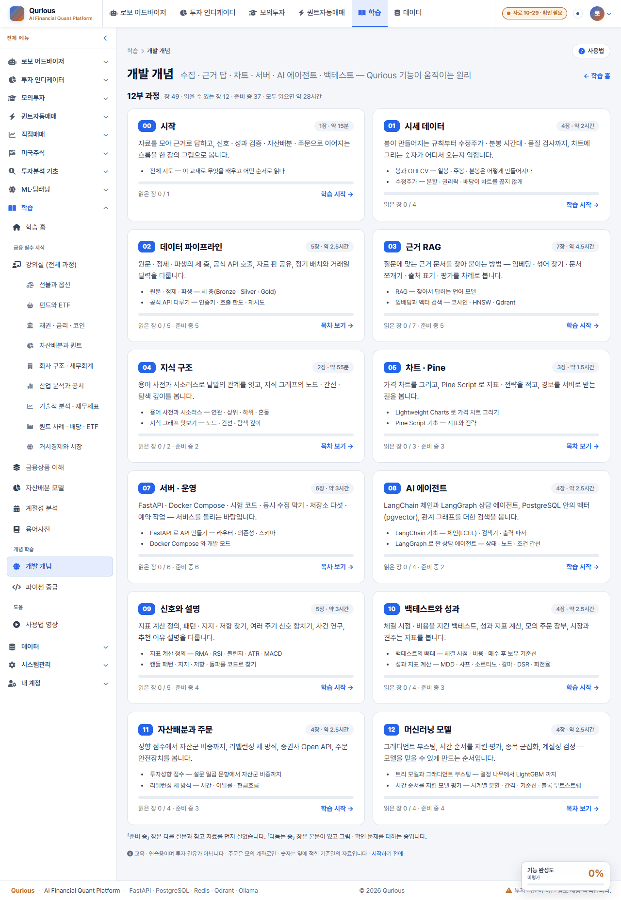

**<그림 14-1>** 개발 개념 갈래 홈(1280 · 2026-10-20 개발 앱) — 머리 「12부 과정 · 장 49 · 읽을 수 있는 장 12 · 준비 중 37」 · 부 카드 · 왼쪽 트리 「개념 학습 › 개발 개념」 표시

**<표 14-3> 부 목록 · 장**

| 화면 | 칸 | 규칙 |
|---|---|---|
| 부 목록 `learn-part` | 머리(번호 · 제목 · 갈래 · 날짜 · 장 수 · 분량 · 「← 갈래」) · 한 줄 · 막대 · 「첫 장부터 읽기 / 이어 읽기 / 처음부터 다시 읽기 — 장 →」 · 장 줄(번호 · 제목 · 상태 · 읽음 · 요약) · 앞뒤 부 | 주소 `#learn-part/<갈래>/<부>` 를 받으면 화면 키 주소(`#learn-part`)로 바꾸고 갈래 · 부는 기록 칸(`history.state`)에 둔다 — 뒤로 가기가 그 부로 돌아온다(장 주소 `#learn/<장>` 과 같은 방식) · 없는 부는 「찾는 목차가 없습니다」 |
| 장 한 편 `learn-page` | 머리(갈래 · 부 · 번호 · 상태 · 수준 · 분량 · 먼저 읽을 장 · 「← n부 … 목차」) · 이 장의 차례 · 본문 · 앞뒤 장 · 「시작하기 전에」 한 줄 | 개발 개념의 「←」 는 부 목록으로, 파이썬 중급은 갈래 홈으로 · 앞뒤 장은 같은 갈래 안에서만(개발 개념 끝 장 다음이 파이썬 중급으로 넘어가지 않음) · 장을 열면 「읽은 장」 에 더한다(이 브라우저 · 끝까지 읽었는지는 재지 않음) |

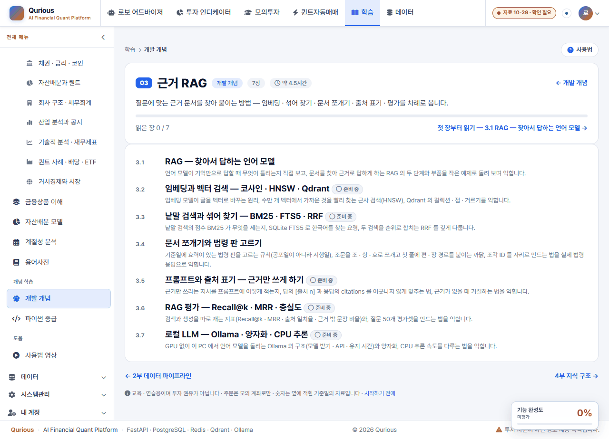

**<그림 14-2>** 부 목록(3부 근거 RAG · 1280) — 머리 경로 「학습 › 개발 개념」 · 「첫 장부터 읽기」 · 장 줄 일곱 · 앞뒤 부

**지키는 것** — ① 같은 일(과정 고르기 → 목록 → 읽기)은 같은 꼴(강의실 `fl-course` 를 그대로 · 새 카드 꼴을 만들지 않음) ② 「읽을 수 있는 장」 = 준비 중(뼈대)이 아닌 장 — 다듬는 중(초안)도 센다 ③ 화면 글에 작업 낱말(완성 · 뼈대 · 내부 번호)을 쓰지 않는다 — 「준비 중」 · 「다듬는 중」 ④ 메뉴 줄이 없는 화면도 머리 경로에 화면 키를 보이지 않는다.

**실제 확인**(2026-10-20 오전 · 개발 앱 · 점검 계정 · 1280) — 학습 홈 카드 4(10-23 다시 잼 — 카드 3 한 줄 · 일회용 계정) · 개발 개념 부 카드 12 · 파이썬 중급 장 카드 6 · 부 목록(3부 7장) · 머리 경로 「학습 › 갈래」 · 왼쪽 트리 표시 · 「장 읽기」 줄 없음 · 콘솔 오류 0 · 가로 넘침 0(시험 TC-CLV · TC-NV-03 · TC-HV).

## 15. 앞으로 — 상세를 채울 차례

| 화면 | 누가 | 언제 |
|---|---|---|
| 용어사전 · 일정 · 강의실 | 이동원 | 다음 판 |
| 자기 목표 기능의 화면(목록의 「주담당이 채움」) | 각 주담당 | 각자 화면을 고칠 때 |
| 주담당이 「—」 인 화면(투자분석 기초 · 보관함 화면 등) | 팀이 정한다 | — |

---

## 16. 화면 상세 — 투자 인디케이터 셋 (`indicator-strategy` · `indicator-formula` · `indicator-custom`)

주담당 신장환 · 설계는 [3차 인디케이터 전략 설계서](../system/인디케이터-전략-설계.md) 4.4 · 4.6. 값은 지표 정의 한 벌(`ta_utils` · TradingView 정의 · `tv-2026`)이고 화면은 서버 값을 그대로 보인다. 손절 · 익절은 **종가 기준**이라고 화면에 밝힌다(#161 Q3).

로컬 개발 앱 · 점검 계정 · 1280 폭 · 2026-10-29 · 기준 `main` `2479c12` + 이 판의 구현(#392) · 수집 DB 일봉이 2026-10-15 에 멈춘 PC · 화면마다 단추를 한 번씩 누른 상태로 창을 세로로 늘려 찍고 번호 상자는 요소의 getBoundingClientRect 로 얹었다 · 390 폭에서 가로 넘침 없음을 같은 날 확인했다.

### 16.1 기본 인디케이터 전략 (`indicator-strategy` · W7)

| 칸 | 내용 |
|---|---|
| 화면 정보 | 메뉴 「투자 인디케이터 › 기본 인디케이터 전략」 · 기본 지표를 골라 규칙 신호를 보고, 전략 카드(`U6`)를 고치고, 가격 차트(`U7`)에 지표와 카드 조건의 매수 · 매도를 그린다 · 요구 `P02-①-1` · `P02-①-2` · `U6` · `U7` · 자리는 #392(2026-10-29) |
| 화면 그림 | <그림 16-1> |

**<그림 16-1> 기본 인디케이터 전략 — 전략 분석 · 카드 편집을 연 상태 · 1280** · 1 ~ 12

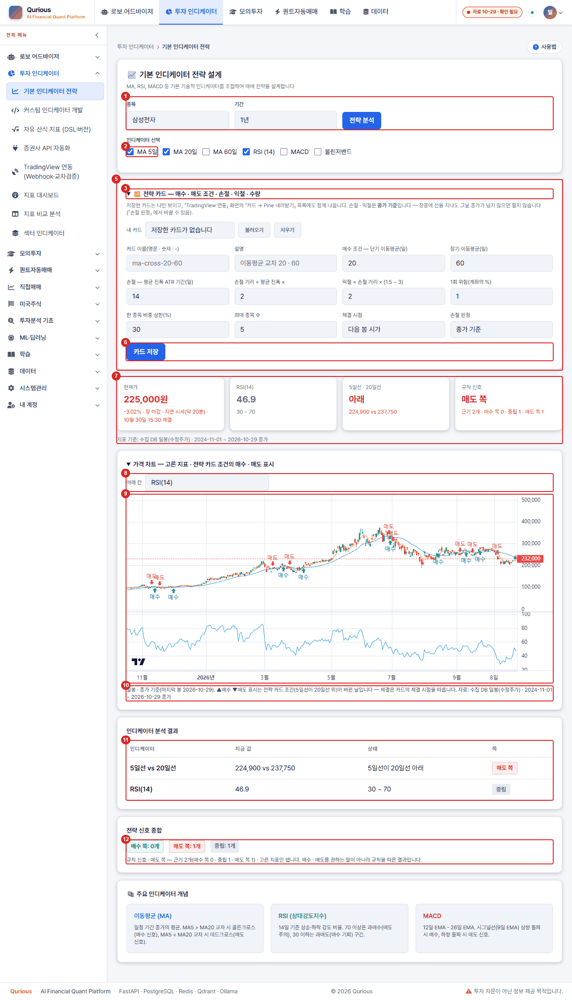

**<표 16-1> 화면 요소** — 번호는 <그림 16-1>.

| 번호 | 요소 | 데이터 · API | 동작 | 빈 데이터 · 오류 |
|---|---|---|---|---|
| 1 | 종목 · 기간 · 「전략 분석」 | `GET /api/indicator-strategy/chart?symbol=&period=&short=&long=`(`API-ISTR-01` · API 명세서 v0.48) | 누르면 아래 5 ~ 12 를 채운다 · 차트 표식은 7번 카드의 단기 · 장기 이동평균을 따른다 | 일봉이 20봉 미만이면 422 「데이터 부족」 을 알림으로 |
| 2 | 지표 고르기 | 화면 칸(MA 5 · 20 · 60 · RSI · MACD · 볼린저) | 고른 지표만 표 · 규칙 신호 · 차트 선에 들어간다(B2) | 하나도 안 고르면 「위에서 지표를 하나 이상 고르세요」 · 규칙 신호 「—」 |
| 3 | 전략 카드(접기) | — | 열면 내 카드 목록을 부르고, 빈 칸은 판 2 예시 값으로 채운다 | — |
| 4 | 내 카드 · 불러오기 · 지우기 | `GET`(`API-ISTR-02`) · `DELETE`(`API-ISTR-04`) `/api/indicator-strategy/cards` | 고른 카드를 칸에 채움 · 지우기는 내 카드만(예시 카드는 못 지움) | 없으면 「저장한 카드가 없습니다」 · 남의 카드 id 는 404 |
| 5 | 카드 칸 | 판 2 꼴(설계서 4.3) — 카드 이름 · 설명 · 단기 · 장기 이동평균 · 평균 진폭(ATR) 기간 · 배수 · 손익비(1.5 ~ 3) · 1회 위험 % · 종목 비중 상한 · 최대 종목 수 · 체결 시점 · 손절 판정 | 종목은 1번 칸 값 | 범위 밖 · 숫자 아님은 서버 까닭 그대로(422) |
| 6 | 「카드 저장」 · 결과 글 | `POST /api/indicator-strategy/cards`(`API-ISTR-03`) | 사용자마다 따로 저장 · 「외부 차트 알림 연동」 화면의 「카드 → Pine 내려받기」 목록에도 나옴 · 저장 뒤 한 줄 요약(쉬운 말) | 이름 규칙 위반 · 예시 카드 이름 · Pine 으로 옮길 수 없는 카드는 까닭을 6번 자리에 |
| 7 | 요약 카드 넷 | 「현재가」 = `GET /api/quote/now`(2.2절 규칙) · 나머지는 1번 응답 | 현재가 · RSI(14) · 5일선과 20일선 · 규칙 신호(매수 쪽 · 매도 쪽 · 중립 + 근거 n개 · 나눔) · 아래 줄에 지표 기준 일봉 · 기간 | 지금 값을 못 받으면 일봉 값에 기준 글 |
| 8 | 아래 칸 고르기 | 1번 응답 `series` | RSI · MACD · 추세 강도(ADX · +DI · −DI) · 상대 강도(기준 지수 대비 20 · 60 · 120일) — 바꾸면 차트만 다시 그림 | 기준 지수가 없는 시장 · 못 받은 날은 상대 강도를 비우고 까닭(`rs_note`) |
| 9 | 가격 차트 | 1번 응답 `bars` · `series` · `markers` | 캔들 · 고른 이동평균 · 볼린저 밴드 · ▲매수 ▼매도(카드 조건이 바뀐 날) · 접기 가능 · 표 위에 겹치지 않는 제자리 칸 | 차트 도구를 못 받으면 10번 자리에 까닭 |
| 10 | 차트 설명 | 1번 응답 `card_condition` · `data_note` | 일봉 · 종가 기준 · 마지막 봉 날 · 표식의 뜻(판단 날 · 체결은 카드의 체결 시점) · 자료 출처 | — |
| 11 | 분석 표 | 1번 응답의 마지막 값 | 지표 · 지금 값 · 상태 · 쪽 — 볼린저는 실제 밴드(종가 vs 상단 · 하단 · B1) | 값이 없는 지표 줄은 빼고 셈 |
| 12 | 규칙 신호 종합 | 11번 표 | 매수 쪽 · 매도 쪽 · 중립 개수 · 「규칙 신호 · ○○ 쪽 — 근거 n개(…)」(결정 대장 10-27 낱말 · B3) · 「매수 · 매도를 권하는 말이 아니라 규칙을 따른 결과」 | — |

#### 2차 → 3차 차이 — 기본 인디케이터 전략 (16.1)

2차 쪽은 [2차 UI 명세서 v0.30 16장](../../../phase-2/02-design/ui/UI명세서.md)의 16.1(소급 · 태그 `phase2-final-2026-10-21` 코드에서만 읽음)이고, 3차 쪽은 위 <표 16-1> 이다.

| 항목 | 2차(소급 16.1) | 3차(위 <표 16-1>) |
|---|---|---|
| 값을 받는 길 | `GET /api/stocks/quant/indicators`(`API-STK-04`) | `GET /api/indicator-strategy/chart`(`API-ISTR-01` · 새 길 · 지표 정의 한 벌) |
| 지표 고르기 | 화면이 읽는 것은 MA 5 · MA 20 · RSI 셋뿐 · MA 60 · MACD · 볼린저 칸은 눌러도 결과가 안 바뀜 | 여섯 모두 읽는다(B2) |
| 볼린저밴드 줄 | 당일 등락 ±2 % 로 가른 대용값(값 칸 「±2σ」) | 실제 밴드(종가 vs 상단 · 하단 · B1) |
| 종합 | 「종합 신호 BUY · SELL · HOLD · AI 판단」 | 「규칙 신호 · 매수 쪽 · 매도 쪽 · 중립 + 근거 n개」 · 권유가 아니라는 글(B3) |
| 요약 카드 이름 | 「MA 교차」(골든크로스 · 데드크로스) | 「5일선 · 20일선」 |
| 표 머리 | 현재값 · 신호(매수 · 매도 · 홀드) | 지금 값 · 쪽(매수 쪽 · 매도 쪽 · 중립) |
| 새 칸 | — | 전략 카드 편집(U6 · 내 카드 저장 · 불러오기 · 지우기 · `API-ISTR-02 ~ 04`) · 가격 차트(U7 · 캔들 · 이동평균 · 볼린저 · ▲▼ 표식) · 아래 칸 고르기(RSI · MACD · ADX · 상대 강도) · 차트 설명 |
| 없어진 칸 | — | 없음 — 「📚 주요 인디케이터 개념」 영역은 화면에 그대로 있다(3차 <표 16-1> 에는 줄이 없고, 내용이 2차와 같은지는 이번에 비교하지 않았다) |

### 16.2 자유 산식 지표 (`indicator-formula` · W17)

| 칸 | 내용 |
|---|---|
| 화면 정보 | 메뉴 「투자 인디케이터 › 자유 산식 지표 (DSL·버전)」 · 함수를 조합한 산식으로 지표 · 매수 · 매도 조건을 정의하고 판(버전)과 계산 결과를 저장 · 다시 쓴다 · 요구 `P02-②-1` · `P02-②-2` · `P02-②-3` · `P02-③-1` |
| 화면 그림 | <그림 16-2> |

**<그림 16-2> 자유 산식 지표 — 템플릿 하나를 불러 계산한 상태 · 1280** · 1 ~ 15

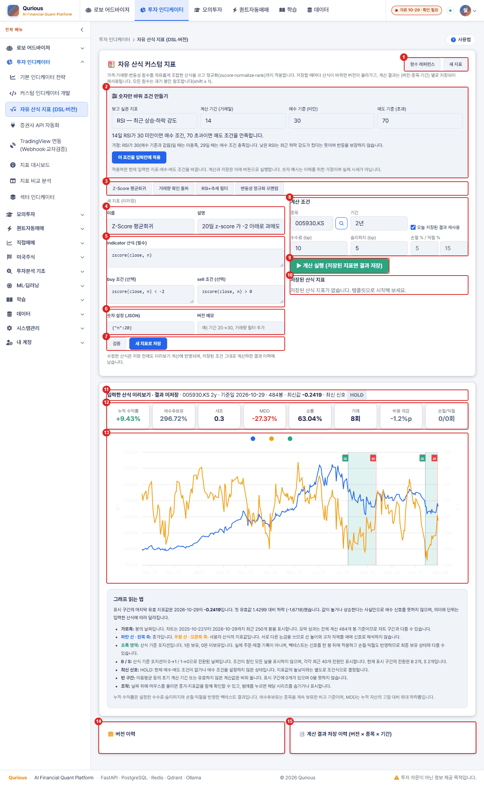

**<표 16-2> 화면 요소** — 번호는 <그림 16-2>.

| 번호 | 요소 | 데이터 · API | 동작 | 빈 데이터 · 오류 |
|---|---|---|---|---|
| 1 | 함수 레퍼런스 · 새 지표 | `API-FRML-01` 레퍼런스 | 함수 카드(뜻 · 가정 예시 · 입력칸을 예시로 · #243) · 새 지표는 칸을 비움 | — |
| 2 | 숫자만 바꿔 조건 만들기 | 화면 칸 | 지표 · 기간 · 매수 · 매도 기준을 고르면 글로 풀고 「입력칸에 적용」 으로 산식 칸에 넣음 | — |
| 3 | 템플릿 | 레퍼런스의 `templates` | 누르면 4 ~ 6 을 채움 · 저장 전 「새 지표(미저장)」 | — |
| 4 · 5 | 이름 · 설명 · 지표 산식 · buy · sell | — | 허용 함수 · 문법만 · 미래 참조(`shift` 음수) 막음 | 막힌 구문은 7번 「검증」 결과에 까닭 |
| 6 | 숫자 설정(JSON) · 판 메모 | — | `{"n": 20}` 처럼 산식 안 이름의 값 | JSON 이 아니면 검증에서 까닭 |
| 7 | 검증 · 저장 | 검증 `API-FRML-02` · 새로 저장 `API-FRML-05` · 고쳐 저장 `API-FRML-07` | 식이 바뀌면 새 판 | — |
| 8 | 계산 조건 | — | 종목 · 기간 · 수수료 · 슬리피지 · 손절 % · 익절 %(비우면 안 씀) · 「오늘 저장된 결과 재사용」 | — |
| 9 | 계산 실행 | 저장된 지표 `API-FRML-11` · 미리보기 `API-FRML-03` | 저장된 지표면 결과 저장 · 고친 식은 미리보기로 계산하고 「입력한 산식 미리보기 · 결과 미저장」 으로 밝힘 · 같은 날 · 같은 판 · 같은 정의 판(`definition`)이면 저장 결과 재사용 | 계산 실패는 11번 자리에 빨간 글 |
| 10 | 저장된 산식 지표 | `API-FRML-04` · 열기 `API-FRML-06` | 열기 · 판 보기 | 없으면 「템플릿으로 시작해 보세요」 |
| 11 | 결과 머리 | 9번 응답 | 미리보기인지 · 종목 · 기간 · 기준일 · 봉 수 · 마지막 값 · 최신 신호 | — |
| 12 | 결과 카드 | 9번 응답 | 누적 수익 · 매수 후 보유 · 샤프 · MDD · 승률 · 거래 · 비용 차감 · 손절 / 익절 횟수 | 거래 0회면 「신호 없음」 글(TC-RX) |
| 13 | 차트 · 읽는 법 | 9번 응답 | 종가 · 지표 값 · 보유 구간 · B / S 표식 · 아래 「그래프 읽는 법」 | — |
| 14 | 판 이력 | `API-FRML-09` · 되돌리기 `API-FRML-10` · 내보내기 `API-FRML-13` | 판마다 식 · 메모 · 되돌리기 · Pine 내보내기(근사는 `vwap(n)` 하나라고 머리말에) | 옮길 수 없는 식은 422 까닭 |
| 15 | 계산 결과 저장 이력 | `API-FRML-12` | 판 × 종목 × 기간 마다 결과 | — |

#### 2차 → 3차 차이 — 자유 산식 지표 (16.2)

2차 쪽은 [2차 UI 명세서 v0.30 16장](../../../phase-2/02-design/ui/UI명세서.md)의 16.2, 3차 쪽은 위 <표 16-2> 이다. 칸 15개의 자리와 API(`API-FRML-01 ~ 13`)는 같다.

| 항목 | 2차(소급 16.2) | 3차(위 <표 16-2>) |
|---|---|---|
| 함수 카드 | 서명 · 설명 · 예시 — 누르면 지표 산식 칸 끝에 이어 붙음 | 쉬운 말 설명 · 가정 예시 · 「예시를 적용할 입력칸」(차트 지표 · 매수 조건 · 매도 조건) 고르기 · 누르면 그 칸을 예시로 바꿈(#243) |
| 6번 이름 | 「params (JSON)」 | 「숫자 설정」 |
| 시험 계산 문구 | 「buy N회 / sell N회」 · 체크섬 표시 | 「매수 조건 충족 N일 / 매도 조건 충족 N일」 · 체크섬 줄임 · 경고 표시 |
| 저장 안 한 계산 | 「저장 안 된 산식」 | 「입력한 산식 미리보기 · 결과 미저장」 · 저장된 판과 식이 같을 때만 저장 계산 · 계산 칸 아래에 한 줄 안내 |
| 입력이 바뀌면 | 결과는 그대로 | 「입력이 바뀌었습니다. 산식을 다시 확인하세요.」 · 결과 숨김 · 현재 지표 줄에 「v○에서 수정 중」 |
| 현재 지표 줄 | 이름 · v○ · 체크섬 | 이름 · 저장된 v○ |

### 16.3 커스텀 인디케이터 개발 (`indicator-custom` · W2)

| 칸 | 내용 |
|---|---|
| 화면 정보 | 메뉴 「투자 인디케이터 › 커스텀 인디케이터 개발」 · 기본 조합(RSI + 이동평균 등)의 숫자를 바꿔 Pine · 파이썬 코드를 만들고 백테스트 · 저장 · 요구 `P02-②-1` · `P02-③-1` |
| 화면 그림 | <그림 16-3> |

**<그림 16-3> 커스텀 인디케이터 개발 — 코드 생성 · 백테스트를 누른 상태 · 1280** · 1 ~ 8

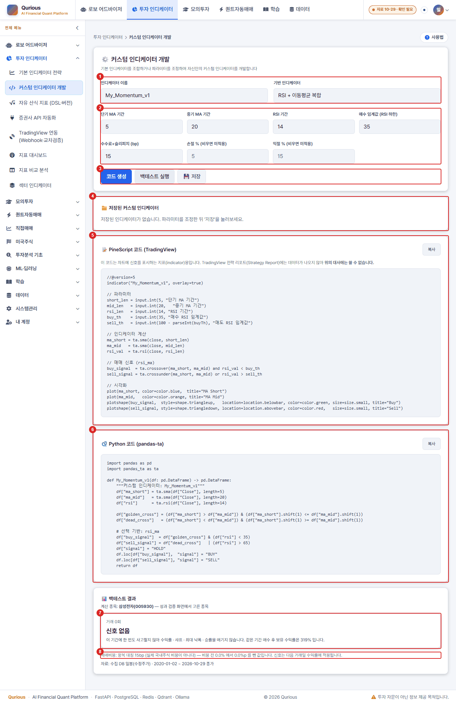

**<표 16-3> 화면 요소** — 번호는 <그림 16-3>.

| 번호 | 요소 | 데이터 · API | 동작 | 빈 데이터 · 오류 |
|---|---|---|---|---|
| 1 | 이름 · 기반 인디케이터 | — | 기반(RSI + 이동평균 · MACD + 볼린저 · 거래량 가중 RSI · 삼중 이동평균) | — |
| 2 | 파라미터 · 비용 · 손절 · 익절 | — | 단기 · 중기 이동평균 · RSI 기간 · 매수 임계값 · 수수료 + 슬리피지(bp) · 손절 % · 익절 %(비우면 안 씀) | — |
| 3 | 코드 생성 · 백테스트 실행 · 저장 | 백테스트 `API-STK-30`(`/api/quant/pipeline`) · 저장 `API-STK-32` | 백테스트 종목은 「성과 검증」 화면에서 고른 종목(1행에 밝힘) | 실패는 알림 |
| 4 | 저장된 커스텀 인디케이터 | `API-STK-31` · 지우기 `API-STK-33` | 불러오기 · 지우기 | 없으면 「저장된 인디케이터가 없습니다」 |
| 5 | Pine 코드 | 화면이 만든 코드 · 복사 | 차트 표시용 `indicator()` 라 TradingView 전략 리포트 대사에는 쓸 수 없다고 밝힘 — 대사용 `strategy()` 는 「외부 차트 알림 연동」 화면의 카드 → Pine | — |
| 6 | 파이썬 코드 | 화면이 만든 코드 · 복사 | — | — |
| 7 | 백테스트 결과 카드 | 3번 응답 | 수익 · 샤프 · MDD · 승률 등 | 거래 0회면 「신호 없음」 · 매수 후 보유 값(#245 · TC-RX) |
| 8 | 비용 · 자료 줄 | 3번 응답 `cost` · `data_note` | 비용 전 · 뒤 · 자료 출처 · 기간(#250) | — |

#### 2차 → 3차 차이 — 커스텀 인디케이터 개발 (16.3)

2차 쪽은 [2차 UI 명세서 v0.30 16장](../../../phase-2/02-design/ui/UI명세서.md)의 16.3, 3차 쪽은 위 <표 16-3> 이다.

| 항목 | 2차(소급 16.3) | 3차(위 <표 16-3>) |
|---|---|---|
| Pine 코드 카드 | 코드 + 복사 | 위에 안내 두 줄 추가 — 차트 표시용 `indicator` 라 TradingView 전략 리포트 대사에는 쓸 수 없다 |
| 그 밖 | — | 칸 · 동작 · API 는 같다(화면 마크업이 두 줄 늘어난 것이 전부) |

---

## 17. 화면 상세 — 랜딩 (`/` · IA N11 · 로그인 전 첫 화면)

주담당 이동원 · 요구 밖 기능(사용자 요청 2026-10-02 · [IA](IA.md) N11 · Q12 (가) `/` = 랜딩). 파일은 `public/index.html` · `public/js/landing.js` · `public/css/landing.css`, 첫 주소 판정은 서버 `app/main.py` 의 `/` 라우트다. 시안은 Figma [「Qurious · 랜딩」](https://www.figma.com/design/q86EnC1wBLfPoNqtatAjCw)이고, **10-29 개정(인트로가 누를 때까지 머문다 · 「화면을 눌러 시작」 안내 · 소개 화면 장식 차트)은 이 시안에 아직 들어가지 않았다** — 그림 판이 문서 판보다 뒤처진 상태라 [문서 그림 지침](../../00-management/standards/문서그림지침.md) 6절 점검 대상이다. 시험은 TC-LND 6(`tests/test_landing.py`). 랜딩은 `app.html` 의 화면(`data-view`)이 아니라 따로 선 페이지라 6절 화면 목록에는 넣지 않았다.

그림 기준 — 로컬 개발 앱 · 로그인 안 한 상태 · 2026-10-29 · 코드 `main` `e4c0fb2`(#414 머지 — 인트로 개정 · 장식 차트) · 캡처 두 장을 그대로 복사해 넣었다(이미지 편집 없음) · **번호 상자를 얹지 않았다** — 요소는 아래 표에서 이름으로 부른다 · <그림 17-1> 은 창 폭 929 × 높이 869 라 파일 이름의 1280 과 다르다 · <그림 17-2> 는 1280 × 800 으로 맨 위에서 조금 내려가 있어 제목 윗줄이 잘려 있다.

| 칸 | 내용 |
|---|---|
| 화면 정보 | 주소 `/` · 로그인하지 않은 사람의 첫 화면 — 인트로 → 소개(첫 영역 · 카드 넷 · 시작하기 띠) → 로그인 · 가입 · 요구 ID 없음 |
| 화면 그림 | <그림 17-1> · <그림 17-2> · <그림 17-3> |

**<그림 17-1> 인트로 — 누를 때까지 머무는 상태(5초 넘게 둔 뒤 · 1280 · 2026-10-30 다시 찍음 — 위쪽 막대를 숨긴 뒤)**

**<그림 17-2> 소개 화면 — 첫 영역 아래 장식 차트와 카드 넷의 머리**

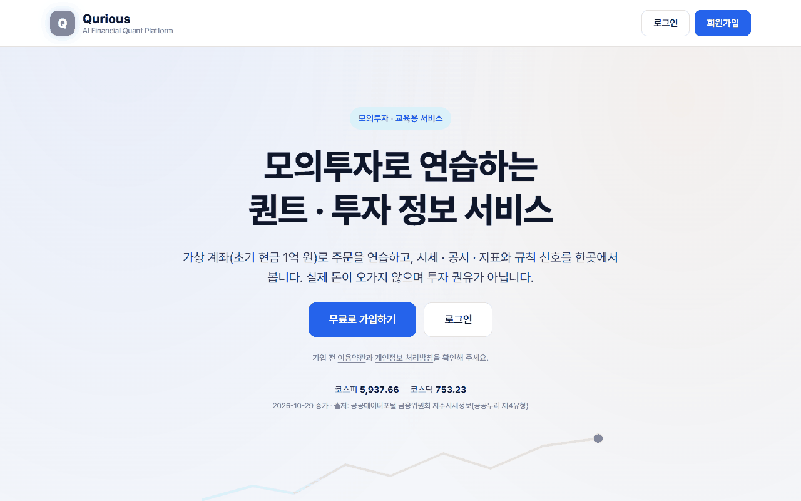

**<그림 17-3> 소개 화면 — 지수 종가 한 줄(2026-11-01 다시 찍음 · 1280 · 로그인 안 한 상태)**

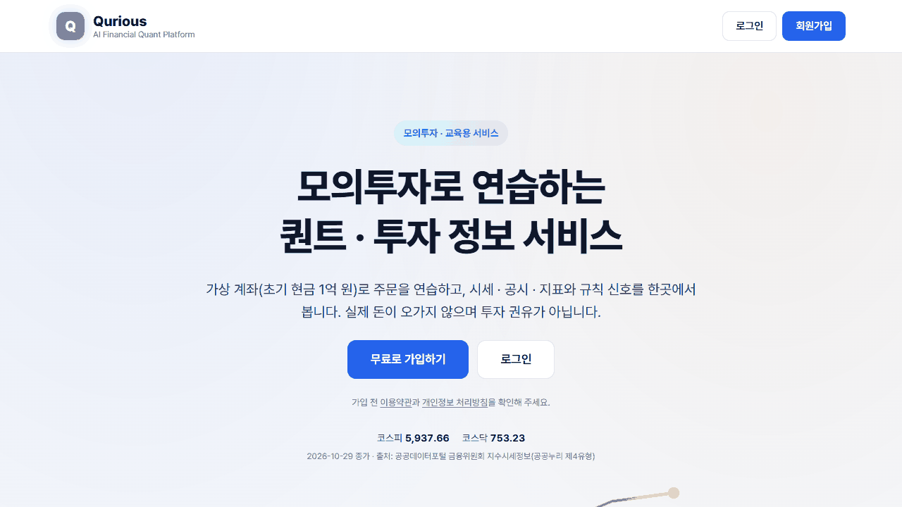

### 17.1 어디로 가나 — 경우 표

**<표 17-1> 경우**

| 경우 | 결과 | 근거 |
|---|---|---|
| 로그인하지 않은 사람이 `/` 를 연다 | 랜딩(`index.html`)을 준다 — 인트로가 켜져 있으면 인트로부터 | `/` 라우트 · TC-LND-01 |
| 로그인한 사람(세션이 살아 있음)이 `/` 를 연다 | 인트로도 랜딩도 없이 `/app.html` 로 보낸다(사용자 결정 ③) | `/` 라우트 · TC-LND-01 |
| `/index.html` 로 들어온다 | `/` 로 보내 로그인 판정을 한 곳에서 한다 | `/index.html` 라우트 · TC-LND-01 |
| 뒤로 가기로 랜딩이 되살아났는데 그 사이 로그인했다 | `/api/me` 가 성공이면 `/app.html` 로 · 로그인 안 됨(401)이거나 서버에 닿지 않으면 그대로 둔다 | `landing.js` 의 `pageshow` 처리(코드로만 확인 — 이 경우를 직접 시험하는 TC-LND 는 없다) |
| 로그인 · 가입 | 따로 선 화면 `/login.html` · `/register.html` 로 간다(로그인한 사람이 `/login.html` 을 열면 앱으로) | TC-LND-02 · `/login.html` 라우트 |
| 인트로가 보이는 때 | 움직임 줄이기 설정이 아닐 때 **열 때마다** — 새로고침하면 다시 뜬다(2026-10-30 사용자 피드백 · 전에는 이 탭에서 한 번만) · 화면이 그려지기 전에 `<head>` 의 짧은 스크립트가 정한다(보인 뒤 가리면 깜빡여서) | `index.html` · TC-LND-05 |
| 인트로 없이 바로 소개 | 움직임 줄이기 설정 · 설정을 못 읽는 때 — 인트로 요소도 치운다(2026-10-30 부터 「이 탭에서 이미 봤다」 — `sessionStorage` 의 `qurious-intro-seen` — 는 이유가 아니다 · 그 기록은 쓰지도 읽지도 않는다) | `landing.js` · TC-LND-05 |
| 스크립트가 꺼져 있다 | 인트로는 뜨지 않고 카드 글이 모두 펼쳐 보인다 | `landing.css`(`.js` 일 때만 접음) · TC-LND-04 |

### 17.2 인트로

화면 전체를 덮는 창(`role="dialog"`)이다. 요소는 번호 대신 이름으로 적는다.

**<표 17-2> 인트로 요소**

| 요소 | 내용 · 동작 |
|---|---|
| 윗줄 | 「로그인」 · 「회원가입」 링크 + 「건너뛰기 ›」 단추 — **눈에 보이지 않는다**(2026-10-30 사용자 피드백 · 투명 + 클릭이 통과해 화면 누르기로 이어진다). 키보드 Tab 으로 닿으면(`:focus-within`) 나타나 쓸 수 있다. 처음에 초점을 두지 않는다(두면 막대가 나타난다) |
| 로고 · 이름 · 차트 선 · 한 줄 소개 | 로고(Q)가 먼저 뜨고 이름 · 차트 선 · 소개 글이 차례로 나타난다. 차트 선은 장식(읽는 도구가 읽지 않게 가림) |
| 「화면을 눌러 시작」 | 소개 글 뒤에 나타나는 안내 글 |
| 머무는 동안(10-29 개정) | **저절로 넘어가지 않는다** — 로고의 빛이 천천히 숨 쉬듯 변하고(주기 3.6초) 안내 글이 은은히 깜빡인다(주기 2.4초). 인트로 영역 전체가 눌리는 모양(`cursor: pointer`) |
| 끝내는 길 | 화면 아무 데나 누르기 · Esc · Enter · Space(막대가 나타난 뒤에는 「건너뛰기」 도) — 0.45초 뒤 인트로 요소를 치우고, 막아 둔 본문 스크롤을 푼다. 「봤다」 기록은 남기지 않으므로 다시 열면 인트로가 다시 뜬다 |

### 17.3 소개 화면

**<표 17-3> 소개 화면 요소**

| 요소 | 내용 · 동작 |
|---|---|
| 위 막대 | 로고 · 서비스 이름 · 한 줄 태그(이름 · 태그 · 고지 글은 `brand.js` 에서 채움) + 「로그인」 · 「회원가입」 |
| 첫 영역 | 알약 「모의투자 · 교육용 서비스」 · 제목 · 설명(가상 계좌 초기 현금 1억 원 · 실제 돈이 오가지 않으며 투자 권유가 아님) · 「무료로 가입하기」 · 「로그인」 · 「가입 전 이용약관과 개인정보 처리방침을 확인해 주세요」 |
| 지수 종가 한 줄(10-30 추가) | 약관 안내 아래 · 장식 차트 위 한 줄 — 「코스피 6,012.44  코스닥 771.28」(값은 그날 값) + 작은 글 「2026-10-28 종가 · 출처: 공공데이터포털 금융위원회 지수시세정보(공공누리 제4유형)」. 서버 `GET /api/public/index-closes`(`API-PUBD-01` · 로그인 없이 · 쿠키를 보내지 않음)가 준 수집 DB 지수 일봉의 **가장 최근 거래일 종가를 가공 없이** 보인다 — 등락 · 전일 대비는 없다(공공누리 제4유형 변경 금지). 실시간이 아니라 종가이며 글에도 「종가」 라고만 적는다. 못 받거나 목록이 비면 칸째 숨는다(빈 숫자 · 「-」 를 두지 않음). 시험 `TC-PIX-06` |
| 장식 차트(10-29 추가) | 첫 영역 아래 선 하나와 끝점. **글자 · 숫자가 없고**(시세로 읽히지 않게) 읽는 도구가 읽지 않는다. 선은 8초 주기로 그려졌다가 쉬고 사라진 뒤 다시 그려지며, 끝점은 2.4초 주기로 커졌다 작아지며 흐려진다. 움직임 줄이기 설정에서는 움직임을 전부 끄고 **선은 다 그려진 채로 보인다** |
| 카드 넷 | 01 모의투자 · 02 퀀트 · 지표 · 03 시세 · 공시 · 학습 · 04 코인 · 대안자산(「개발 중」 꼬리표). 누르면 펼치고 **한 번에 하나만** 열리며 펼친 카드를 다시 누르면 접힌다(`aria-expanded`). 펼친 글 아래에 「로그인하고 써 보기」 · 「가입하기」(04 는 「가입하기」 만 — 개발 중인 기능에 「써 보기」 를 달지 않는다) |
| 시작하기 띠 | 「연습부터 시작해 보세요」 · 「회원가입」 · 「로그인」 |
| 바닥글 | 고지 글(`brand.js`) + 「수업 프로젝트용 서비스이며 법률 자문이 아닙니다.」 + 이용약관 · 개인정보 처리방침 링크 |
| 폭 | 1100px 이하에서 카드가 두 줄(2열), 767px 이하에서 한 줄(1열) · 단추는 세로로 쌓인다 |

### 17.4 정한 것 · 10-29 개정 · 아직 안 한 것

**정한 것(사용자 결정 넷)** — ① 카드는 눌러 펼친다 ② 코인 · 대안자산은 「개발 중」 표시로 소개한다 ③ 로그인한 사람은 앱으로 바로 보낸다 ④ 인트로(동적 효과) 뒤에 랜딩을 보인다.

**10-29 개정(사용자 피드백)** — 인트로는 **누를 때까지 머문다**(전에는 2.6초 뒤 저절로 넘어갔다) · 「화면을 눌러 시작」 안내 · 머무는 동안 로고 빛 · 안내 글의 은은한 움직임 · 소개 화면 장식 차트(선 그리기 + 끝점 깜빡임) · 움직임 줄이기 설정에서는 인트로를 건너뛰고 나머지 움직임도 전부 끈다. 시험 TC-LND-05 가 이 단정을 지킨다(자동 넘김 없음 · 안내 글 · 장식 차트에 글자 없음 · 움직임 줄이기에서 선이 다 그려진 채).

**아직 안 한 것**
- **지수 종가 한 줄(시안의 C)은 2026-10-30 에 만들었다**(사용자 결정 — 이동원 몫이라 이슈 없이). 처음 적었던 「공개 지수 API 가 없다」 는 틀렸다 — `API-STK-01` 은 이미 로그인 없이 열려 있었다. 그러나 그 길은 값의 원천이 외부 시세 사이트(팀이 수집 원천으로는 닫고 앱은 참조를 늘리지 않기로 봉인한 출처 — TC-YH)이고 응답에 기준 시각 · 출처가 없어, **수집 DB 지수 일봉(공공누리 제4유형: 출처 표시 · 비상업 · 변경 금지)을 가공 없이 주는 새 길 `API-PUBD-01` 을 만들었다**. 결정 근거와 기록은 `github-archive/2026-10-30/메모-랜딩-지수티커-출처-판단`. 코스피 · 코스닥 둘만(환율은 수집 DB 에 없다) · 종가만 · 등락 없음. 공공데이터포털 데이터 페이지의 이용허락범위 칸은 이번에 원문을 못 읽어 **구현 뒤에 눈으로 한 번 더 확인**해야 한다(이해관계자목록의 기록을 따랐다).
- Figma 「Qurious · 랜딩」: 인트로 프레임의 「화면을 눌러 시작」 · 위쪽 막대 없음은 **2026-10-30 에 반영했다**. 소개 화면 프레임(1280 · 390 · 기본 · 카드 펼침 네 장)에 **지수 종가 한 줄도 2026-10-30 에 그렸다**(값은 그린 날의 값 · 주석 칸에 설명). 장식 차트를 그리는 일만 아직.
- 390 폭 그림은 이 절에 없다(1100 · 767 폭 규칙은 CSS 에서 읽었다).

**실제 확인** — `tests/test_landing.py` 6 통과(2026-10-30 · 이 PC). 2026-10-30 피드백 두 건(위쪽 막대 숨김 · 새로고침하면 인트로 다시)은 개발 앱(127.0.0.1:8966 · 쿠키 없는 브라우저)에서 눌러 확인했다 — 첫 화면 막대 투명(`opacity 0`) · 클릭하면 끝 · 새로고침하면 다시 뜸 · Tab 으로 막대가 나타남(초점 「로그인」) · Esc 로 끝. 인트로가 5초 뒤에도 머무는 것과 장식 선의 `stroke-dashoffset` 이 시간에 따라 바뀌는 것은 변경 노트(S165)가 실행 앱에서 확인한 기록을 따랐다(이 절을 쓰며 다시 눌러 보지는 않았다).

---

## 18. 화면 상세 — 자동매매 · 증권사 셋 (`quant-auto` · `settings` · `indicator-api`)

> **2026-10-30 · 기준 `main` `533324c`(#417 머지 뒤).** 이 장은 [2차 UI 명세서 17장](../../../phase-2/02-design/ui/UI명세서.md)(소급 · 2차 시점)과 3차의 차이를 적는다. 3차 화면의 요소 목록은 2차 <표 17-1> ~ <표 17-3> 의 번호를 그대로 쓰고, 바뀐 곳만 아래 표에 적었다. 주담당 오준영 · 정리 이동원.

Figma(화면별 파일 — 3차 설계 페이지는 3차 보완 때 이 파일들에 더한다) — [자동매매 현황](https://www.figma.com/design/c9Lw1yARMgLhxztgKpVJP7) · [증권사 API 설정](https://www.figma.com/design/N4lMuHIqPf0ivvgTykWMn8) · [증권사 API 자동화](https://www.figma.com/design/Prdhx1P1u25Clvo2FGaiYn).

### 18.1 자동매매 현황 (`quant-auto`) — 2차 → 3차 차이

| 항목 | 2차(소급 17.1) | 3차 |
|---|---|---|
| 화면 마크업 | 36줄 | 같다(36줄) |
| 5번 「당일 손익」 칸 이름 | 「당일 손익」 | 「당일 손익 · 평가 기준」 — 서버가 준 평가 기준 이름(`valuation.label`)을 붙이고, 없으면 「평가 기준 미확인」 |
| 7번 로그의 위험관리 줄 | 「위험관리: 당일 n% · 주문 n건」 | 「위험관리: 당일 n% · 평가 기준 이름 · 주문 n건」 — 옛 기록에 없으면 「이전 기록 · 평가 기준 미기록」 |
| 나머지 요소 · API | 17.1 | 같다(`API-STK-24` · `25` · `26` · `36` · `37`) |
| 새 칸 · 없어진 칸 | — | (없음) |

### 18.2 증권사 API 설정 (`settings`) — 2차 → 3차 차이

| 항목 | 2차(소급 17.2) | 3차 |
|---|---|---|
| 화면의 모양 | 독립 화면 163줄 | 독립 화면은 링크 한 줄(「마이페이지 증권사 연동으로 이동」)이고 **같은 요소가 그대로 마이페이지의 「증권사 연동」 구역(`mp-sec-broker`)으로 옮겨 갔다** — 요소 id 가 같다(`quant-mode` · `broker-type` · `risk-daily-loss` · `broker-save` …) |
| 들어가는 길 | 메뉴 「퀀트자동매매 › 증권사 API 설정」 | 메뉴 「내 계정 › 내 정보 (마이페이지)」 의 「증권사 연동」 구역 — **메뉴에 「증권사 API 설정」 줄은 없다**(2026-11-01 사용자: 그 줄을 눌러도 마이페이지가 열려 왼쪽 트리 불이 「내 정보 (마이페이지)」 에 들어와 두 줄이 같은 화면을 가리켰다). 화면 키 `settings` · `#settings` 주소 · 다른 화면의 「증권사 API 설정으로」 링크는 그대로 같은 구역을 열고, 트리 불은 마이페이지 줄을 따른다(`VIEW_PARENT`) |
| 새 칸 | — | 구역 머리의 한 줄 요약 「선택한 증권사: … · 저장된 키: 있음 · 없음」 · 안내 「「키 있음」은 저장된 값이 있다는 뜻이며 연결 시험 결과가 아닙니다.」 |
| App Secret 칸 | 열 때는 비어 있지만(저장된 값을 받아 채우지 않음) 저장 뒤 화면을 다시 불러와도 입력한 값이 남는다 | 열 때 · 저장 뒤 다시 불러올 때마다 비운다(`loadSettings` 가 비움) |
| 키 보관 | — | 증권사 키가 암호화돼 저장된다(#397 · #402 · 기존 키 파일이 있어야 읽는다 — [암호화 운영 절차](../../05-deployment/증권사-자격증명-암호화-운영.md)) |
| 나머지 요소 · API | 17.2 | 같다(`API-STK-17` · `18` · `19` · `26` · `38` · `39`) |

### 18.3 증권사 API 자동화 (`indicator-api`) — 2차 → 3차 차이

| 항목 | 2차(소급 17.3) | 3차 |
|---|---|---|
| 입력 폼 | 증권사 · App Key · App Secret · 계좌번호 · 모의투자 · 저장 · 연결 테스트 · 상태 줄(`iapi-*`) | **없어졌다** — 「키와 계좌, 주문 한도는 마이페이지의 증권사 연동에서 설정합니다.」 + 「증권사 API 설정 열기」 단추 한 개(`#iapi-open-settings` → `#settings`) |
| 설정 저장 길 | 이 화면은 `API-STK-15` · `API-STK-16` · `API-STK-23` | 이 화면은 설정 API 를 부르지 않는다(18.2 로 한 곳에 모음 · #393) |
| 유지된 것 | 제목 · 설명 · 자동화 세 단계 카드 | 같다(마크업 68 → 29줄) |

## 19. 화면 상세 — 전략 분석 · 성과 검증 (`quant-backtest` · `indicator-backtest`)

> **2026-10-30 · 기준 `main` `8a0302a`(PR #449 머지) 위의 작업 변경(PR 전).** 이 장은 [2차 UI 명세서 19장](../../../phase-2/02-design/ui/UI명세서.md)(소급 · 2차 시점)과 3차의 차이를 적는다. 3차 화면의 요소 목록은 2차 <표 19-1> · <표 19-2> 를 기준으로 아래 차이만 더한다.

Figma(화면별 파일) — [전략 분석 · 성과 검증](https://www.figma.com/design/RJkfF9XgiWwIWbJFtStrB4) — 03 설계(탭 띠 · 기준 전략 카드 · 「완전 통합」 프레임) · 05 결정 기록(6번) · 06 구현 대조(실제 앱 캡처 셋) · 99 버린 안.

### 19.1 한 화면의 탭 둘 — 2차 → 3차 차이

| 항목 | 2차(소급 19.1 · 19.2) | 3차 |
|---|---|---|
| 화면 선언 | 둘 — `quant-backtest` · `indicator-backtest` | **하나** — `quant-backtest`. 성과 검증은 그 안의 탭 칸(`data-bn-pane="indicator-backtest"`) |
| 메뉴 줄 | 「퀀트자동매매 › 전략 분석」 · 「투자 인디케이터 › 성과 검증 (Python)」 | 「퀀트자동매매 › 전략 분석」 **하나** — 「투자 인디케이터」 묶음의 성과 검증 줄은 없어졌다 |
| 주소 | `#quant-backtest` · `#indicator-backtest` | 같다 — `#indicator-backtest` 는 별칭(`public/js/viewalias.js`)으로 같은 화면의 성과 검증 탭을 연다 · 탭을 누르면 주소가 탭 키로 바뀌고 뒤로 가기도 탭 단위다 |
| 화면 맨 위 | (없음) | **탭 띠**(「전략 분석」 · 「성과 검증 (Python)」 · 지금 탭은 파랗게) + **「기준 전략」 카드** — 두 탭 위에 한 번만 나온다 |
| 「기준 전략」 카드(새) | — | 세 상태 — 「아직 없음」(합격 조합 0) · 「있음」(합격 조합이 있으면 샤프 높은 순 최대 다섯) · 「확인 못 함」(요약 파일을 못 읽음 · 아래 분석 기능에는 영향 없음). 기준별 넘은 수 셋 · 가장 가까웠던 시도(**참고용이며 고른 것이 아니라고** 밝힘) · 자료 기간 · 봉인 구간 · 투자 권유가 아니라는 글. 숫자는 화면 코드에 없고 시험 결과 요약 파일(`public/js/baseline-result.json` — 원본 `기준전략-시도-2026-10-30/trials.json` 에서 `scripts/baseline_summary.py` 가 계산만 한 것 · 시험 TC-BNC 가 같은지 대조)에서 읽는다 |
| 전략 분석 5번 결과 카드 | 「이름(코드) · `ma`」 · 맨 아래 `entry_mode=… · exit_mode=…` 줄 | 「이름(코드) · 이동평균 교차」 · 필드 이름 줄 없음 · 체결 꼬리표는 그대로(「체결: 그날 종가」 · 「체결: 다음 봉 시가」) |
| 성과 검증 입력 · 결과 칸 | 요소 1 ~ 7 · 판단 근거 · 비교에 추가 | 같다 — 칸 이름(`ibt-*`) · 부르는 API(`API-STK-30`) · 동작 모두 그대로, 위치만 탭 2 안이다. 탭 2 에 들어올 때마다 한 번 자동 실행하는 것도 같다 |
| 기능 완성도 점수 · 사용법 글 | 화면마다(전략 분석 · 성과 검증) | 탭 키마다 그대로 — 점수 전략 분석 80 · 성과 검증 93(점검표 · 시험 TC-CP) |
| 2차 때 어긋났던 곳 | 사용법 글이 「'백테스트 실행'」 · 「선택하면 자동 실행」 이라 적음 · 성과 검증 호출 실패 때 안내 없음 | **고쳤다**(2026-10-31) — 사용법 글을 실제 단추(「분석」 · 「전략 백테스트」 · 「성과 검증 실행」)에 맞추고, 호출이 실패하면 결과 칸에 다시 눌러 보라는 안내가 뜬다(실제 앱에서 500 을 흉내 내 확인) |
| 새 칸 · 없어진 칸 | — | 새: 탭 띠 · 「기준 전략」 카드. 없어짐: 성과 검증의 따로 선 화면 · 메뉴 줄 · 전략 분석 결과 줄의 필드 이름 줄 |

**실제 확인**(개발 앱 · 점검 계정 · 2026-10-30) — 옛 주소 `#indicator-backtest` 로 열면 성과 검증 탭이 보이고 왼쪽 메뉴는 「전략 분석」 한 줄만 켜진다 · 탭 띠로 오가면 주소가 `#quant-backtest` ↔ `#indicator-backtest` 로 바뀌고 뒤로 가기가 탭 단위로 돌아온다 · 다른 화면에 갔다 와도 탭 2 가 유지된다 · 390 폭에서 가로 넘침 없음 · 성과 검증 탭에 들어올 때 결과가 실행된다 · 시험 TC-BNC 6건.

**아직 안 한 것**
- 점검표 점수를 한 화면 점수 하나로 합치지 않았다(사용자 결정 2026-10-30 — 탭마다 유지).
- (해결 2026-10-31) 6절 화면 수 숫자를 75 로 다시 셌다(`view_scan.py` 로 선언 75 · 메뉴 항목 73).
- 합친 화면의 390 폭 그림 · 3차 요소 번호 그림은 따로 만들지 않았다 — Figma 06 쪽 구현 대조 캡처(1280)가 전부다.

## 20. 공통 부품 — 종목 찾기 단추 (`public/js/stockfind.js`)

종목 코드를 직접 치던 입력칸 옆에 돋보기 단추를 달아, 이미 있던 종목 검색 창(`stock-search-modal`)으로도 고를 수 있게 한 **3차 공통 부품**이다. 화면이 아니라 부품이라 화면 수(75)는 늘지 않는다. 사용자 결정(2026-10-31) 「입력은 유지하되 검색 창으로 관련 기업명을 띄워 달라」. 시안: Figma 「Qurious · 종목 찾기 단추」.

### 20.1 2차 → 3차 차이

| 구분 | 2차 | 3차 |
|---|---|---|
| 종목 입력 | 12칸에서 코드를 직접 침(코드를 모르면 막힘) | 입력은 그대로 + 칸 옆 돋보기 단추 → 검색 창에서 이름 · 코드로 고름 |
| 검색 창 | `company.js` 안에서 3곳(`chart-symbol-btn` · `quant-symbol-btn` · `company-search-btn`)만 씀 | `openStockSearch(callback)` 로 내보내 12칸도 같은 창을 씀(새 창을 만들지 않음) |

### 20.2 어디에 달리나 (칸 id · 화면 · 넣는 값)

| 화면 | 칸 | 넣는 값 |
|---|---|---|
| `trading-order` | `ord-symbol`(+ `ord-name` 종목명도 함께) | 기호 |
| `paper-stock` | `ps-symbol` · `ps-stop-symbol` | 기호 |
| `quant-lean` | `ql-ticker` | 기호 |
| `us-chart` · `us-order` | `us-symbol` · `us-ord-symbol` | 기호(해외는 `AAPL` 꼴) |
| `indicator-formula` | `fx-symbol` | 기호 |
| `indicator-tradingview` | `pc-symbol`(6자리 코드) · `tvc-ticker`(기호) | 코드 · 기호 |
| `robo-rebalance` | `rb-add-symbol`(기호) · `rb-cf-symbol`(6자리 코드) | 기호 · 코드 |
| `robo-patterns` | `pt-symbol` | 기호 |

칸은 `data-stock-find="symbol|code"` 속성으로 정한다(`code` 는 국내 종목만 6자리로 줄이고 해외는 기호 그대로). `data-stock-name` 에 칸 id 를 적으면 이름도 그 칸에 넣는다.

### 20.3 동작 · 상태

| 상태 | 보이는 것 | 코드 |
|---|---|---|
| 평소 | 입력칸 + 오른쪽 32px 돋보기 단추(글자 없이 `aria-label` · `title` 「종목 찾기」) | `mountStockFind` 가 부팅 때 한 번 달고 두 번 달지 않음 |
| 단추를 누름 | 종목 검색 창이 열림 · 글자를 치면 0.3초 뒤 `/api/stocks/search`(국내 KRX 목록 우선 → 없으면 해외 자동완성) 결과 | `openStockSearch(callback)` |
| 종목을 고름 | 창이 닫히고 칸이 채워짐(+ 이름 칸) · 초점은 코드 칸 · `input` · `change` 이벤트가 가서 화면 코드가 그대로 읽음 | 칸 `value` 와 이벤트 |
| 아주 좁은 칸(칸 폭 약 100px 이하) | 단추가 칸 아래로 내려감 | `.sf-wrap` 줄바꿈 · 입력칸 최소 84px |

### 20.4 이 판에서 확인한 것 · 못 한 것

- 시험 `tests/test_stockfind_screen.py`(TC-SFD 3건 — 칸에 넣을 글 · 가짜 문서에서 달기와 채우기 · 앱 12칸 연결) · 가짜 API 를 붙인 브라우저에서 12칸 모두 단추가 달리고 검색 → 고르기 → 코드 · 이름 칸 채움을 확인 · 폭 1280 · 390.
- **실제 로그인한 앱 화면에서는 확인하지 못했다.** 요소 번호 그림은 다음 판에서 더한다. 해외 종목이 국내 전용 칸(예 `rb-add-symbol`)에 들어갔을 때 각 화면이 막는지는 각 주담당 확인을 기다린다(안내 이슈 초안 있음).

---

## 21. 공통 부품 — 종목 허브 서랍 (`public/js/stockdrawer.js` · 할 일 ②-10 · ②-20)

종목 이름 옆 「근거 서랍 →」 단추를 누르면 **보던 화면을 떠나지 않고 오른쪽에 서랍이 열려**, 그 종목에 대해 우리 앱이 이미 아는 값을 칸별로 모아 보이는 **3차 공통 부품**이다. 서버(`GET /api/stock-hub` · `API-HUB-01`)는 2차 마감 때 먼저 만들었고(결정 알림 #259 · 2026-10-17), 이번 판에서 화면을 만들었다. Figma 「Qurious · 종목 허브」 03 설계 B(서랍)를 따른다.

### 21.1 2차 → 3차 차이

| 구분 | 2차 | 3차 |
|---|---|---|
| 한 종목의 근거 | 차트 · 패턴 · 재무 · 공시 화면을 따로 열고 종목을 다시 넣음 | 서랍 한 곳에 가격 · 신호 · 재무 · 공시 · 기사 · 일정 · 업종 일곱 칸을 기준일 · 출처와 함께 모음 |
| AI 투자 상담 | 답 위 앱 판단 카드(종가 · 신호 · 재무 · 공시 넷) | 카드 머리에 「근거 서랍 →」 단추가 생겨 나머지 칸(기사 · 일정 · 업종)까지 열 수 있음 |
| 투자 정보 리서치 | 종목을 고르면 그 종목의 공시 · 기사 · 일정 시간표만 | 결과 머리 줄에 「근거 서랍 →」 단추 — 시간표를 떠나지 않고 가격 · 신호 · 재무까지 훑음 |

### 21.2 서랍의 칸 (위에서 아래 차례 · 서버 `stock_hub.SECTIONS` 에서 머리 `identity` 를 뺀 일곱)

| 칸 | 보이는 것 | 그 화면으로 |
|---|---|---|
| 마지막 종가 | 종가 · 등락 · 전일 종가 · 「M월 D일 종가는 반영 전」(마지막 거래일 종가가 아직 안 들어온 때 · v0.41) · 수정주가 기준 안내 | 주가 차트 |
| 다중 주기 신호 | 신호 쪽 · 기운 · 서버 요약 · 그렇게 본 까닭 · 반대로 본 까닭(각 최대 3) | 차트 패턴 · 다중 주기 |
| 재무 건전성 | 그렇다 · 아니다 · 모름 수 · 지표 문장 · 부실 위험 점수(Z″) · 기준 보고서 링크 | 재무 · 신용 위험 |
| 최근 공시 · 최근 기사 | 최근 3건(날짜 · 제목 링크 · 갈래 · 출처 문구) · 전체 건수 | 공시 · 기사 시간표 |
| 앞으로의 일정 | 배당 · 실적 등 앞으로 60일 일정 최대 4건 | 일정 |
| 업종 | 한국표준산업분류 제11차 대분류 › 중분류 · 같은 업종 수집 상장사 수 | (화면 없음) |

머리에는 이름 · 코드 · 시장 · 마지막 종가와 「Npay 증권에서 보기 ↗」 링크(우리 앱 밖 증권사 화면 · 새 창 · 코드가 6자리 영숫자일 때만 · v0.42 · 2026-11-02)가 있고, 맨 아래에 서버가 준 투자 권유 아님 고지와 모은 시각이 있다.

### 21.3 동작 · 상태

| 상태 | 보이는 것 | 코드 |
|---|---|---|
| 평소 | 서랍이 닫혀 있고 종목 이름 옆에 「근거 서랍 →」 단추만 있음 | `[data-hub-open="코드"]` 단추 |
| 단추를 누름 | 오른쪽에 서랍(폭 440px · 좁은 화면은 전체 폭) · 초점은 닫기 단추 · 「근거를 모으는 중입니다…」 | `mountStockDrawer` 의 `open` |
| 불러옴 | 칸 일곱 · 칸마다 기준일(「10월 29일 기준」) · 출처 한 줄 · 「그 화면으로」 단추 | `stockDrawerHtml` |
| 칸이 비었거나 준비 중 · 오류 | 그 칸만 「자료 없음 · 준비 중 · 불러오지 못함」 과 서버 까닭 — 나머지 칸은 그대로 | `sdSectionHtml` |
| 서랍 전체 실패 | 로그인 풀림 · 종목 없음 · 연결 끊김을 가른 한국어 한 줄 | `sdFailText` |
| ESC · ✕ · 다른 화면으로 | 서랍이 닫히고 초점이 연 단추로 돌아감 · 주소가 바뀌어도 닫힘 | `close` · `hashchange` |
| 「그 화면으로」 | 서랍이 닫히고 그 화면으로 옮겨 종목을 넣어 줌(차트 패턴 · 재무 · 리서치 · 모의 주문) | `openViewForSymbol` |
| 「리밸런싱 목표 편집으로 →」(서랍 안 · 6자리 코드일 때만 · 오준영 님 PR #479) | 서랍이 닫히고 리밸런싱 화면으로 옮겨 종목 코드만 넣고 비중 칸으로 초점 — 비중 · 목표 추가 · 저장은 사용자가 직접 한다(「크게 보기」 모달에는 이 단추가 없다) | `data-hub-go="robo-rebalance"` · `openViewForSymbol` |

### 21.4 이 판에서 확인한 것 · 못 한 것

- 시험 `tests/test_stock_drawer.py`(TC-SDR 5건 — 서버 값 · 기준일 · 출처를 그대로 옮김 · 비거나 준비 중인 칸은 서버 까닭 · 글자 막기 · 칸 차례가 서버와 같음 · 앱 연결).
- 실제 브라우저(점검 계정 · 개발 앱) 1280 · 390 폭에서 입구 단추 → 서랍 → 칸 일곱 · ESC 로 닫기(초점 복귀) · 「그 화면으로」(차트 패턴 화면의 종목 칸이 채워짐) · 콘솔 오류 0 을 확인했다.
- **구현 대조(2026-11-01)**: Figma 「종목 허브」 `06 구현 대조` 쪽에 실제 앱 서랍 1280 · 390 캡처를 편집 가능한 레이어로 넣었다(노드 `11:2` · `13:2` · 삼성전자 005930 · 개발 앱) — 03 설계 B(프레임 `3:5`)와 견주는 틀이다. **다른 점**: 설계 B 주석은 390 에서 「아래에서 올라오는 시트」 라 적었으나 구현은 화면 전체 폭 서랍이다(결정 기록에 반영 필요).
- **못 한 것**: 요소 번호 그림은 다음 판 · 입구는 이동원 화면 둘(AI 투자 상담 카드 · 투자 정보 리서치)뿐이고 차트 · 패턴 · 스크리닝 · 모의 주문 화면의 입구는 각 주담당 판단(결정 알림 #259 4절) · 「전체 화면으로」(안 A)와 「화면마다 판단」 줄은 3차 뒤쪽.

---

## 22. 화면 상세 — 알림 설정 · 사건별 알림 · 조용한 시간 (`notification-settings`)

**2026-11-03 (②-31)**: 이 화면의 본체는 마이페이지 「알림」 구역(`mp-sec-notify`) 안으로 옮겼다 — 칸 id · 서버 API 는 그대로이고, 주소 `#notification-settings` 는 마이페이지의 알림 구역을 연다(`app.html` 의 `data-view="notification-settings"` 는 화면 키를 위한 빈 껍데기). 메뉴 줄 「알림 설정」 도 그대로다. 아래 <그림 28> 은 옮기기 전 단독 화면 모습이며 요소 · 문구는 같다(마이페이지 안 모습은 다음 그림 판에서 다시 찍는다).

알림 설정 화면에 **채널 체크 상자 아래 「🔔 사건별 알림 · 조용한 시간」 구역**이 생겼다(2026-11-01 · 보고식 알림 개편). 사건마다 받는 방식을 고르고, 조용한 시간을 정한다. 서버(`GET` · `POST /api/notification/settings` · `API-NOTI-01` · `02`)가 사건 목록(`event_catalog`)과 현재 설정(`preferences`)을 주고, 화면은 그 목록으로 표를 그린다. Figma 「Qurious · 알림 설정」(fileKey `hBkos3WW9qRSI91lxje6rl`)에 구현 결과를 편집 가능한 레이어로 보관했다 — `구현 결과` 쪽 전체 화면 `1:2` · 사건 표와 조용한 시간 구역 `2:2` · `00 표지` `3:3`. 화면설계절차 3절의 「그림 먼저」 순서는 이번에 지키지 못했다(아래 22.4).

### 22.1 2차 → 3차 차이

| 구분 | 2차 | 3차 |
|---|---|---|
| 켜고 끄기 | 채널(텔레그램 · 슬랙 · 디스코드 · 이메일 · 카카오 · SMS) 단위로만 | 채널 단위 + **사건 11종마다 켜기 · 조용히 · 끄기** |
| 시간 | 시간 구분 없음 | **조용한 시간**(기본 꺼짐 · 켜면 21:00 ~ 08:00 KST) — 긴급 아닌 알림은 모아 두었다가 끝나는 시각에 요약 1건 |
| 몰리는 알림 | 건마다 따로 | 「주문 생략」은 2분 안에 오는 것을 1건으로 합침 |
| 보내는 글 | 채널에 관계없이 같은 평문 한 덩어리 | 채널마다 다른 모양(디스코드 카드 · 슬랙 블록 · 이메일 표 · 텔레그램 접기) + 보통안 8요소 |
| 이력 | 제목 · 글 앞 500자 · 채널별 결과 | 같음 + 줄마다 **「자세히 보기」**(보낸 보고 원본 · 이유 · 위험 · 다음 행동) |

### 22.2 구역의 칸 (위에서 아래 차례)

| 칸 | 보이는 것 | 코드 |
|---|---|---|
| 안내 문단 | 켜기 · 조용히 · 끄기의 뜻 · 조용히는 텔레그램 · 디스코드에서만 알림음이 꺼지고 슬랙 · 이메일은 그대로 · 카카오 · SMS 는 보내지 않음 · 긴급은 끌 수 없음 | `#noti-prefs` |
| 사건 표(11행) | 사건 이름(+ 「몰리면 묶음」 · 「끌 수 없음」) · 중요도(긴급 · 중요 · 일반 · 참고) · 받는 방식 선택 상자 | `renderNotiPrefs` · `.noti-pref-mode` |
| 조용한 시간 | 사용 체크 상자 · 시작 · 끝 시각 입력(한국 시간) | `#noti-quiet-enabled` · `-start` · `-end` |
| 설명 문단 | 모아 두었다가 요약 1건 · 2분 합침 | — |

사건 11종은 서버 `alert_prefs.EVENT_DEFS` 가 정한다: 비상 정지(긴급 · 끌 수 없음) · 주문 오류 · 예수금 부족 · 정합성 불일치 · 자동매매 회차 중단(여기까지 중요) · 체결 확정 · 주문 접수 · 자동매매 가상 체결 · TradingView 신호(여기까지 일반) · 위험관리 주문 생략 · 자동매매 시작 · 중지(참고 · 기본 조용히). 일일 수집 회차 보고는 운영자 `.env` 채널로 가는 알림이라 이 표에 없다.

### 22.2-2 화면 그림과 요소 번호(v0.41 · 2026-11-01)

22.2 의 칸에 번호를 붙인 그림은 <그림 28> 과 같다. 디스코드 체크 상자만 켠(저장 전) 모양이라 웹훅 칸이 열려 있다.

**<그림 28> 알림 설정 — 채널 · 디스코드 웹훅 · 사건별 알림 · 조용한 시간** · 범례: 빨간 상자와 번호 = <표 37> 의 요소 · 폭 1280 · 내용 칸 전체 · 2026-11-01 · 일반 사용자 계정

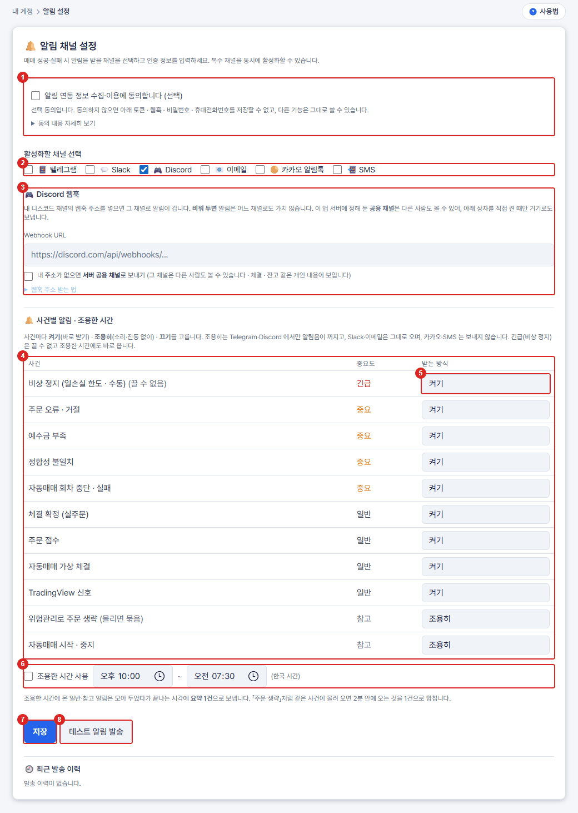

**<표 37> 알림 설정 요소**

| 번호 | 요소 | 데이터(API) | 동작 | 빈 데이터 · 오류 |
|:-:|---|---|---|---|
| 1 | 연동 정보 동의 | `API-NOTI-01` `integration_consent` · `API-NOTI-02` | 선택 동의다. 동의하지 않으면 토큰 · 웹훅 · 비밀번호 · 휴대전화번호를 저장할 수 없고 다른 기능은 그대로 쓴다. 동의한 사람에게는 「동의 철회 · 저장된 연동 정보 삭제」 단추가 보인다 | — |
| 2 | 활성화할 채널 | `API-NOTI-01` · `API-NOTI-02` `channels` | 텔레그램 · 슬랙 · 디스코드 · 이메일 · 카카오 · SMS 중 여럿을 켠다. 켠 채널의 입력 구역이 아래에 열린다 | 모두 끄면 알림을 보내지 않는다 |
| 3 | 디스코드 웹훅 | `API-NOTI-02` `discord_webhook_url` · `preferences.discord_use_shared` | 22.3-2 와 같다 — 내 채널 주소(가림) · 비우면 알림이 가지 않음 · 「공용 채널로도 받기」 상자(기본 꺼짐) · 「웹훅 주소 받는 법」 | 주소 모양이 틀리면 한국어 한 줄 토스트(422) |
| 4 | 사건 표 | `API-NOTI-01` `event_catalog` · `preferences` | 사건 11행 · 이름 · 중요도 · 받는 방식 | 목록을 못 받으면 「사건 목록을 불러오지 못했습니다.」 |
| 5 | 받는 방식 | `API-NOTI-02` `preferences.events` | 켜기 · 조용히 · 끄기 — 끌 수 없는 사건(비상 정지)은 「끄기」 가 없다 | 끌 수 없는 사건을 끄려 하면 422 |
| 6 | 조용한 시간 | `API-NOTI-02` `preferences` | 사용 체크 · 시작 · 끝(한국 시간). 기본은 꺼짐 · 켜면 21:00 ~ 08:00 이 처음 값이다(그림은 촬영 계정이 저장해 둔 값) | 시각 모양이 틀리면 422 |
| 7 | 저장 | `API-NOTI-02` | 채널 · 연동 정보 · 사건 · 조용한 시간을 한 번에 저장한다 | 「✅ 저장 완료」 · 실패는 위쪽 알림 |
| 8 | 테스트 알림 발송 | `API-NOTI-03` | 켠 채널로 시험 알림을 한 건 보낸다 | 채널 · 설정이 없으면 서버 문구를 그대로 보인다 |

**슬랙 · 이메일 칸(v0.42 · 2026-11-02 보안 점검)** — 슬랙 웹훅 주소는 디스코드처럼 조회 응답에서 `****` 로 가려지고, 저장할 때 `https://hooks.slack.com/…` 모양이 아니면 422 한국어 한 줄(서버가 그 주소로 대신 요청을 보내므로 내부망 주소를 받지 않는다). 이메일은 메일 서버를 직접 적으면 서버 이름 모양(`smtp.example.com`)과 포트(25 · 587 · 2525)만 받고(아니면 422), 그 서버에는 서비스 계정이 아니라 **내가 적은 아이디 · 비밀번호만** 쓰이므로 둘을 함께 넣어야 보낸다. 서버 칸을 비우면 서비스 메일 서버로 간다. 알림 설정을 한 번도 저장하지 않았거나 설정을 읽지 못한 사용자의 개인 알림(체결 · 예수금)은 공용 채널로 보내지 않는다.

390 폭에서는 모든 구역이 한 단으로 쌓이고 사건 표의 세 칸(사건 · 중요도 · 받는 방식)이 그대로 들어간다. 받는 방식 선택이 좁아 「조용히」 가 「조용」 으로 잘리던 것을 선택 칸의 최소 너비 96px 로 고쳤다(2026-11-01 이 그림을 찍으며 찾음).

**<그림 29> 알림 설정 — 폭 390** · 범례: 빨간 상자와 번호 = <표 37> 의 요소(2 · 3 · 4 · 6 · 7) · 2026-11-01 · 일반 사용자 계정 · 화면 전체

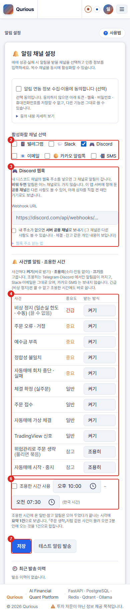

### 22.3 동작 · 상태

| 상태 | 보이는 것 | 코드 |
|---|---|---|
| 불러오는 중 | 표 자리에 「불러오는 중...」 | 마크업 |
| 불러옴 | 서버 목록으로 11행 · 저장된 값이 선택돼 있음 · 설정이 없던 사건은 사건의 기본값 | `renderNotiPrefs` |
| 비상 정지 행 | 선택지가 「켜기 · 조용히」 둘뿐 — 「끄기」가 없다 | `lockable` |
| 저장 | 채널 · 연동 정보와 같은 「저장」 단추로 함께 저장 · 「✅ 저장 완료」 | `collectNotiPrefs` |
| 서버 거절(422) | 끌 수 없는 사건을 끄려 하거나 시각 모양이 틀리면 한국어 한 줄 토스트 | `alert_prefs.validate` |
| 이력 줄 | 「자세히 보기」를 펴면 제목 · 요약 · 항목 · 이유 · 위험 · 다음 행동 · 모의투자 표시 — 값은 모두 글자로만(`escHtml`) | `notiPayloadDetails` |

### 22.3-2 디스코드 웹훅 칸(v0.40 · 2026-11-01)

채널 체크 상자의 디스코드를 켜면 아래에 **내 디스코드 웹훅 주소 칸**이 나온다. 주소는 비밀값(아는 사람은 누구나 그 채널에 글을 올린다)이라 입력 칸이 가림 글자(`type="password"`)이고, 저장된 주소는 조회 응답에서 `****` 로만 온다.

| 칸 | 보이는 것 | 코드 |
|---|---|---|
| 안내 문단 | 내 채널 주소를 넣으면 그 채널로 가고, **비워 두면 알림은 어느 채널로도 가지 않는다** · 서버 공용 채널은 다른 사람도 볼 수 있어 아래 상자를 직접 켠 때만 거기로도 보낸다는 말 | `#noti-section-discord` |
| 공용 채널로도 받기 | 체크 상자 「내 주소가 없으면 서버 공용 채널로 보내기」 + 「그 채널은 다른 사람도 볼 수 있습니다 · 체결 · 잔고 같은 개인 내용이 보입니다」 — **기본 꺼짐**(v0.41 · 2026-11-01 사용자 결정) | `#noti-discord-shared` · `preferences.discord_use_shared` |
| 웹훅 주소 | 주소 입력(가림) · 자리표시 「https://discord.com/api/webhooks/...」 · 저장된 값이 있으면 `****` 가 채워진다 | `#noti-discord-webhook` · `settings.js` 의 불러오기 · 저장 |
| 받는 법 자세히 | 채널 편집 → 연동 → 웹훅 → 새 웹훅 → 「웹훅 URL 복사」 → 위 칸에 붙이고 저장 · 서버 공용 채널을 정하는 사람은 `.env` 의 `DISCORD_WEBHOOK_URL` | `details` |

- 저장할 때 주소가 `https://discord.com/api/webhooks/…`(또는 `discordapp.com` · `ptb.` · `canary.`)로 시작하지 않으면 한국어 한 줄 토스트(서버 422)로 막는다. `****` 를 그대로 돌려 보내면 저장된 주소를 유지하고, 칸을 비우면 주소를 지운다(공용 채널 상자를 켜 두지 않았다면 알림이 어느 채널로도 가지 않는다).
- 새 주소를 채우는 것은 알림 연동 정보의 새 입력이라 **선택 동의**가 먼저다. 동의문에 「디스코드 웹훅 주소」 항목이 더해져 판이 `2026-11-01-n0.2` 로 올랐다(이미 동의한 사람의 동의 상태는 그대로이고, 새로 동의할 때부터 새 판이 기록된다).
- 서버 공용 채널은 운영자 `.env` 의 한 칸이다 — 사용자 없는 알림(일일 수집 회차 보고 등)은 늘 이리로 가고, 사용자의 알림은 자기 주소가 없을 때 「공용 채널로도 받기」 를 켠 사람만 이리로 간다(v0.41 부터 기본 꺼짐 — 개인 내용이 팀 채널로 새지 않게).

### 22.4 이 판에서 확인한 것 · 못 한 것

- 시험 `test_alert_format.py`(TC-AF 11) · `test_alert_dispatch.py`(TC-ARP 5 · TC-ADI 10) · `test_alert_flush_pg.py`(TC-AFL 4 · 일회용 PG) · `test_collect_report.py`(TC-CRN 5).
- 실제 브라우저(점검 계정 · 개발 앱 1280 폭)에서 사건 11행 · 비상 정지에 「끄기」 없음 · 값 바꿔 저장 → 새로고침 뒤에도 유지(체결 확정 조용히 · 주문 생략 끔 · 조용한 시간 22:00 ~ 07:30) · 끌 수 없는 사건을 끄는 요청 422 · 원래대로 되돌림을 확인했다.
- **못 한 것 · 어긴 것**: ① 화면설계절차의 「그림 먼저」 순서를 지키지 못했다 — 사용자가 11-01 에 정한 안(질문 답)을 바로 구현했고 Figma 에는 구현 결과를 뒤에 보관했다(다음 화면부터 그림 먼저). Figma 보관의 못 한 것: 파일이 Qurious 폴더(`662909403`)에 들어갔는지는 도구로 확인하지 못했다(사용자가 폴더에서 한 번 볼 것) · 캡처가 시각 입력 값을 옮기지 못해 조용한 시간 칸 둘이 빈 상자로 나온다(`1:247` · `1:250` — 앱에서는 값이 있다) · 점검 계정(일반)으로 찍었다. ② 390 폭 · 요소 번호 그림은 v0.41 에서 그렸다(22.2-2 <그림 28> · <그림 29>) — 그리다가 390 폭에서 「조용히」 가 잘리는 것을 찾아 고쳤다. ③ 디스코드 웹훅 주소는 v0.40 에서 사용자별 칸이 생겼고 v0.41 에서 「공용 채널로도 받기」 상자(기본 꺼짐)가 더해졌다(22.3-2). ④ 자동매매 · 주문 쪽 호출부가 수수료 · 체결 후 현금 · 신호 근거 · 한도 사용률을 넘기기 전까지 그 항목은 보통안에서 비어 있다(안내 이슈).

### 22.5 Open API 설정 본체 — 마이페이지 「외부 연동」 구역으로 (`paper-openapi` · 2026-11-03)

모의투자 메뉴의 「Open API · 외부 연동」(화면 키 `paper-openapi`)의 본체를 위의 알림 설정과 같은 방식으로 마이페이지 「외부 연동」 구역(`mp-sec-external`) 안으로 옮겼다. 칸 id(`po-*`) · 서버 API 는 그대로이고, 메뉴 줄과 주소 `#paper-openapi` 는 마이페이지의 「외부 연동」 구역을 연다(`viewalias.js` 의 `MYPAGE_HOSTED` 가 `paper-openapi` 를 `external` 로 잇는다 · `app.html` 의 `data-view="paper-openapi"` 는 화면 키를 위한 빈 껍데기). 마이페이지 왼쪽 목록은 일곱 구역(내 정보 · 보안 · 증권사 연동 · 알림 · 외부 연동 · 화면 설정 · 위험 구역)이며, 「외부 연동」 구역은 전에도 있었지만 요약 한 줄과 Open API 화면으로 가는 단추만 있었고, 본체가 이 구역으로 들어왔다.

**<표 40> 「외부 연동」 구역의 칸 (위에서 아래 차례)**

| 칸 | 보이는 것 | 부르는 API | 코드 |
|---|---|---|---|
| 구역 머리 | 「외부 연동 (Open API)」 + 요약 한 줄 — 「사용 중인 Open API 키: n개」 · 키가 없으면 「사용 중인 Open API 키가 없습니다.」 · 못 받으면 실패 글 | `API-PAPR-28` | `#mp-sum-external` · `loadSummaries` |
| Open API 키 발급 | 안내(외부 시스템이 이 모의계좌를 조회 · 주문할 키 · 키 원문은 서버에 저장되지 않고 SHA-256 해시만 보관 · 발급 직후 한 번만 표시) · 키 라벨 입력 · 「키 발급」 · 새 키 상자 · 키 목록(폐기) | `API-PAPR-28` ~ `30`(`GET` · `POST` · `DELETE /api/paper/api-keys`) | `#po-label` · `#po-create` · `#po-new-key` · `#po-keys` |
| Open API 엔드포인트 | 외부 시스템이 부를 수 있는 길의 표 | `API-OAPI-09`(`GET /openapi/v1/docs-summary`) | `#po-docs` · `loadPaperOpenApi` |
| Alpaca Paper 연결 시험 | 읽기 전용 · 키 ID · 시크릿 키 입력(비우면 서버 환경변수) · 「계정 상태 조회」 · 「보유 포지션 조회」 · 결과 글 | `API-PAPR-31` · `32` | `#po-alpaca-*` · `alpacaTest` |

- 보안 검수로 입력 칸에 `autocomplete` · `aria-label` 을 달았고(키 ID 칸은 자동 완성 끔, 시크릿 칸은 `new-password`), 다른 구역으로 가면 한 번 보여 준 새 키 원문을 화면에서도 지운다(`showSection`).
- 시험 TC-MP-09 ~ 11(`test_mypage_sections.py`). 마이페이지 안 모습은 다음 그림 판에서 찍는다.

---

## 23. 화면 상세 — 모의주문 시세 조회 차트 · 스탑 칸 이름 입력 · 종목 크게 보기 모달 (`paper-stock` · 2026-11-02)

국내주식 모의주문 화면(`paper-stock` · 주담당 강민석 · 이동원이 11-02 에 프런트만 고침)의 **시세 조회 결과에 일봉 차트**를 붙이고, **스탑(감시) 주문 칸에서 종목 이름을 쳐도** 찾아 주며, 스탑가 칸을 현재가로 채우지 않는다. 종목 서랍(21절)에는 같은 차트 칸과 「크게 보기 ⤢」 가 생기고, 크게 보기를 누르면 큰 일봉 차트 아래로 서랍의 일곱 칸을 내리며 읽는 가운데 모달이 열린다. 설계: Figma 「Qurious · 종목 허브」 07 쪽 안 C(서랍 + 크게 보기 모달) · 안 D(모의주문 화면) — 2026-11-02 사용자 결정(안 A 서랍만 · 안 B 모달만 은 99 쪽 버린 안).

### 23.1 2차 → 3차 차이

| 구분 | 2차 | 3차(이 판) |
|---|---|---|
| 시세 조회 결과 | 이름 · 기호 · 시장 · 가격 · 등락 · 출처 글만 | 그 아래에 일봉 차트(기간 1개월 · 3개월 · 1년)와 「근거 · 차트 크게 보기 →」 — 11-03 부터 종가 선이 아니라 캔들 · 거래량 · 지표 차트(27절) |
| 스탑 칸의 종목 | 6자리 코드나 `005930.KS` 만(이름을 치면 「지원하지 않는 종목입니다」) | 이름을 쳐도 찾아 하나면 채우고 여럿이거나 없으면 종목 찾기 창을 그 글자로 엶(시세 조회 · 미리보기 · 주문 · 스탑 등록 모두) |
| 스탑가 칸 | 시세를 조회하면 현재가로 채움 — 그대로 등록하면 다음 1분 점검에서 바로 체결 | 비워 둠 · 현재가와 견준 방향 안내 · 빠른 단추(−3% · −5% · −10%) · 차트의 스탑가 점선 · 이미 닿은 스탑이면 등록 전 확인 |
| 종목 서랍 | 일곱 칸 글만 | 머리 아래에 일봉 차트 칸 · 「크게 보기 ⤢」 |
| 근거를 크게 보기 | 없음 | 가운데 모달 — 큰 차트 + 일곱 칸을 아래로 내리며 읽음(입구: 서랍의 크게 보기 · 모의주문 시세 조회 결과) |

### 23.2 칸

| # | 칸 | 보이는 것 | 값 · 출처 | 비었을 때 |
|---|---|---|---|---|
| 1 | 일봉 차트 칸 | 캔들(시가 · 고가 · 저가가 비면 종가 선) · 켜고 끄는 칩 · 기간 단추 셋 · 아래 글(최고 · 최저 · 마지막 종가 · 실시간 차트가 아니라는 한계) — 2026-11-03 부터 공용 차트(27절) | 수집 일봉 `API-DATA-02`(`/api/data/ohlcv` · 수정주가) — 새 서버 길 · 야후 참조 없음 | 「일봉 자료가 없습니다」 · 6자리 코드가 아닌 종목은 칸을 감춤 |
| 2 | 근거 · 차트 크게 보기 | 누르면 종목 서랍을 거치지 않고 모달이 열림 | 종목 허브 `API-HUB-01` | 해외 종목이면 단추를 감춤 |
| 3 | 스탑 칸 종목 입력 | 코드 · 이름 모두 | 이름 찾기 `API-STK-06`(`/api/stocks/search`) | 맞는 종목이 없으면 찾기 창에 「검색 결과가 없습니다」 |
| 4 | 스탑가 칸 · 방향 안내 | 비어 있음 · 「스탑가가 현재가보다 5.0% 낮습니다 — 매도 스탑(손절)으로 쓰는 값입니다 …」 | 시세 조회가 준 현재가와 입력값 — 화면에서 견줌 | 시세 조회 전에는 기본 안내 한 줄 |
| 5 | 빠른 단추 | −3% · −5% · −10% 와 그 값(원) — 손절용(매도 스탑) | 현재가 × (1 − 비율) 원 단위 반올림 | 시세 조회 전에는 감춤 |
| 6 | 스탑가 점선 | 입력한 스탑가에 짙은 남색(거의 검은) 2px 점선과 이름표 「스탑가」 — 아래 글은 「검은 점선」(오름 봉의 빨강에 묻히지 않게 2026-11-03 에 빨강에서 바꿈 · 27.2절) | 스탑가 칸 값 | 칸이 비면 선 없음 |
| 7 | 모달 | 머리(이름 · 코드 · 마지막 종가) · 큰 차트(높이 340) · 서랍의 일곱 칸 · 닫기 | 서랍이 받은 `API-HUB-01` 응답을 다시 묻지 않고 씀 | 해외 종목이면 「수집 일봉이 없어 차트를 그리지 못합니다」 |

### 23.3 동작 · 상태

| 상태 | 보이는 것 | 코드 |
|---|---|---|
| 이름을 치고 시세 조회 | 하나로 정해지면 칸이 기호로 바뀌고 이어서 조회 · 여럿이면 찾기 창이 그 글자로 열려 고르면 이어서 조회 | `resolveSymbolInput`(`stockfind.js`) · `symbolFromInput`(`paper.js`) |
| 시세 조회 성공 | 이름 · 가격 아래 차트 · 스탑 쪽은 방향 안내 · 빠른 단추 | `stockQuote` · `stockStopQuote` |
| 스탑가를 바꿈 | 방향 안내가 바로 바뀌고 0.3초 뒤 차트의 점선이 따라옴 | `psStopHint` · `psDrawStop` |
| 이미 닿은 스탑을 등록 | 「현재가에서 이미 닿아 있어 다음 1분 점검에서 바로 체결됩니다 — 그래도 등록할까요」 확인 | `scWouldFireNow`(서버 `check_stop_orders` 와 같은 식) |
| 크게 보기 | 서랍은 닫히고 같은 종목 · 같은 기간 모달 · 초점은 닫기 단추 · Esc · 바깥 누름 · ✕ 로 닫힘 | `openModal` · `openModalFor` |

### 23.4 이 판에서 확인한 것 · 못 한 것

- 시험 `test_stockchart.py`(TC-SCH 3) · `test_stockfind_screen.py`(TC-SFD-04 · 05) · `test_stock_drawer.py`(TC-SDR-07 · 08) — 순수 함수 · 가짜 문서 · 화면 연결(서버 발동 조건과 같은 식인지 포함).
- 사용자가 11-02 10:21 에 개발 앱 화면을 직접 열어 시세 조회 결과의 일봉 차트 · 서랍 안 차트 칸과 「크게 보기」 단추가 보이는 것을 확인했다(캡처 전달). 모달 · 스탑 칸 이름 입력의 실제 클릭은 이 판에서 사용자가 이어서 확인한다.
- **못 한 것**: 서버 쪽 결함 — 장 시간 판정 없음 · 스탑가 방향 검증 없음 · 스탑 체결 알림 없음 — 은 강민석 님 몫이라 고치지 않고 안내 이슈(#478)로 알렸다. 모달 안 기여도 막대는 서버가 근거별 숫자를 주지 않아 만들지 않았다. 390 폭에서의 모달 확인은 다음 판.

## 24. 팀 변경 반영(#479) · 제안 설계 넷 (2026-11-02)

### 24.1 오준영 님 PR #479 로 들어온 화면 입구 (구현됨 · 주담당 오준영 님 · 이동원은 문서만)

| 화면 | 바뀐 것 | 코드 |
|---|---|---|
| 퀀트 대시보드 — 규칙 신호 카드 | 제목 「기본 일봉 규칙 신호 (관찰 목록 N종목)」(예전 「규칙 신호 (자동매매 대상 N종목)」) + 안내 한 줄(실제 자동매매 대상은 선택 종목과 전략에 따라 다름) · 카드마다 「종목 근거 →」 입구(코드가 6자리 영숫자일 때만 · 종목 서랍을 엶) | `signalCardHtml` · `data-hub-open` |
| 퀀트 대시보드 — 자동매매 | 제목 「자동매매」(예전 「10분 자동매매 (Agentic AI)」) · 전략 설명을 선택한 전략 기준 규칙 판단으로 · ETF 호가 의무 면제 시간 안내 · 실행 결과 줄에 「종목 근거 →」 · ETF 종가/NAV 괴리(장중 iNAV 아님)와 경고 | `renderTradeExecution`(`trade-status.js`) |
| 리밸런싱 | 「해외주식 · 채권 · 대체자산도 국내 상장 ETF 후보로 채우기」 체크박스 + ETF 안내 · 가져오기 확인 창에 고른 ETF와 까닭 · 서버 `GET /api/ml/robo/allocation/latest?include_etfs=true`(`API-ML-12` · 404 · 409 · 503) | `rb-import-etfs` · `importAllocation` |
| 종목 서랍 | 「리밸런싱 목표 편집으로 →」(21.3절) | `stockDrawerHtml` |

- 확인: 11-02 개발 앱(8966)에서 신호 카드 31개 모두 입구가 있고, 첫 카드를 눌러 서랍(삼성전자)과 일봉 차트가 열리며, 서랍의 「리밸런싱 목표 편집으로 →」가 리밸런싱 화면으로 옮겨 종목 칸에 005930 을 채우고 비중 칸에 초점을 주는 것을 직접 눌러 확인했다(콘솔 오류는 아이콘 파일 404 하나).
- 못 한 것: 자동매매 실행 결과 줄의 입구 · 「크게 보기」 모달 안 이동 경로 · ETF 체크박스를 켠 가져오기의 실제 클릭은 이 판에서 확인하지 못했다.

### 24.2 제안 설계 넷 (Figma · 아직 구현 아님 · 사용자 결정 11-02)

| 설계 | Figma(보기 전용) | 한 줄 | 상태 |
|---|---|---|---|
| 시세 기준 · 출처 표기 | 「신호 순위」 파일 `NkW5HeLKczBDZnNJJkWKEu` · 07 쪽(`56:193`) | 신호 순위 머리줄에 「기준일 · 계산 시각」 · 기준일이 지난 거래일보다 앞서면 「확인 필요」 · 지금가 칸에 출처별 딱지(실시간 · 애프터 · 지연 · 종가) | 제안 · 열림 |
| 신호 → 모의주문 수량 전달(안 E) | 「종목 허브」 `Diu2GIRk4Pnndo9tNi9pfu` · 08 쪽(`25:2`) | 종목만 넘기고 수량은 PAPER 장부 기준으로 다시 계산해 수량 칸에 채움 · 이미 보유는 계산 보류 · 가정 칸 일곱 · 결과 상태 넷(오준영 님 구현에 설계를 맞춤 — 사용자 결정 11-02) | 결정 · 구현에 맞춤 — PR #481 병합 대기(병합 뒤 화면 대조) |
| 흐름 띠 | 「종목 허브」 `Diu2GIRk4Pnndo9tNi9pfu` · 09 쪽(`29:2`) | 신호 → 근거 → 주문 → 체결 → 알림 → 일지의 오늘 건수 한 줄 · 끊김 · 비어 있음 · 390 | 제안 · 열림 |
| KRX 본인 키 연결 | 「신호 순위」 파일 `NkW5HeLKczBDZnNJJkWKEu` · 08 쪽(`57:193`) | 사용자가 자기 KRX 키를 넣어 자기 화면에서만 KRX 값(VKOSPI 등)을 봄 · 상태 다섯 · 연결 전후 카드 · KRX 값은 수집 DB · 공용 캐시 · 다른 사용자에게 넣지 않음 | 제안 · 열림 · **KRX 이용약관 확인 전 구현 보류** |

- 서버 몫(수량 제안 조회 · 오늘 칸별 집계 · 모의주문 수동 · 스탑 체결 알림)은 팀원 몫이라 안내 글로 전하고, 이 문서는 서버가 생긴 뒤 칸 · 값 · 출처를 채운다.
- 「근거」 칸은 서랍 열람을 세는 곳이 없어 숫자 없이 입구 단추로만 둔다(흐름 띠).

### 24.3 종목 근거 모달 — 모든 입구 모달 직행 · 쉬운 설명 (구현됨 · 2026-11-02 · 21 · 23절의 「서랍에서 시작」 흐름은 이 절로 바뀐다)

| 구분 | 이전 | 지금 |
|---|---|---|
| 입구 | `data-hub-open` 단추 → 오른쪽 서랍 → 「크게 보기」 → 모달 | `data-hub-open` 단추 → 곧바로 큰 모달(서랍이 필요한 입구만 `data-hub-mode="drawer"`) — 퀀트 대시보드 신호 카드 · 신호 순위 · 자동매매 결과 · AI 상담 카드 · 리서치 칩 · 모의주문 시세 조회 모두 |
| 이동 단추 | 서랍 안 「PAPER 모의주문으로」 · 「리밸런싱 목표 편집으로」 | 모달 머리 아래 한 줄로 옮김(6자리 코드일 때만) |
| 칸 설명 | 값 · 기준일 · 출처만 | 칸마다 접힌 「이 칸 읽는 법」 한 줄(일곱 칸) |
| 신호 근거 | 「일봉 · 5일선이 20일선 아래」 한 줄 | 근거마다 서버 글 + 규칙 점수 + 「쉬운 뜻」 · 「조심할 점」(규칙 열한 가지 · 모르는 규칙은 서버 글만) + 「이 설명이 말하지 않는 것」 |
| 신호 칸 구성(11-02 오후 · 25절) | 서버가 근거를 3개 · 반대 근거를 2개까지만 줌 · 근거 개수 · 신호 기준 종가는 신호 순위의 전용 서랍에만 있었음 | 근거 **전부** + 「근거 n개 (매수 쪽 · 중립 · 매도 쪽)」 한 줄 + 「신호 기준 종가(MM-DD) …」 한 줄 — 신호 순위의 줄을 눌러도 같은 모달이 열려 서랍이 보이던 것을 이어받았다 |
| 시장 맥락 | 없음 | 모달 머리 아래 「시장 맥락 — 코스피 · 코스닥 종가와 등락 · 기준일」 한 줄(수집 DB 지수 일봉 · 못 받으면 까닭 한 줄) |
| 정리 틀 | 없음 | 맨 아래 접힌 「내 판단 정리 틀」 — 이미 보인 값만 채운 글을 「글 복사」 · 목표가 · 손절가 · 비중 · 확인할 날은 밑줄 칸(서버에 저장 안 함) |

- 근거: 사용자 요청 11-02(처음부터 큰 모달로 · 근거 설명을 쉽고 자세하게 · 사람들이 매매 근거를 쓸 때 필요한 것). 설계: Figma 「종목 허브」 10 쪽(결정) · 07 쪽 결정 바뀜 메모.
- 서버: `GET /api/stock-hub` 신호 칸의 `reasons[]` · `counter_reasons[]` 항목에 `key`(규칙 이름) 칸이 더해졌다. 그 밖의 응답 · 판정 · 일지 판 지문은 그대로다. **(2026-11-02 오후 · v0.45)** 같은 신호 칸이 근거를 3개 · 2개로 자르지 않고 전부 주고, `counts`(매수 · 중립 · 매도)와 못 셀 때의 `counts_note` 를 더했다(25절).
- 확인: 개발 앱(8966)에서 신호 카드 첫 장을 눌러 서랍 없이 모달이 열리고, 일곱 칸마다 읽는 법 · 신호 근거 다섯 줄의 쉬운 풀이 · 시장 맥락(코스피 5,937.66 −1.24% · 코스닥 753.23 −2.34% · 10월 29일 종가 기준) · 글 복사(「복사했습니다」)를 직접 확인했다. 시험 TC-SDR-09 · 10 · 11.
- 못 한 것: 자동매매 결과 · AI 상담 카드 · 리서치 칩 입구를 각각 눌러 보는 확인(신호 순위 입구는 2026-11-02 오후에 직접 눌러 확인했다 — 25.5절)(같은 처리 한 곳을 지남) · 수급 칸(자료 없음 — 모으는 설계는 조사 중). 390 폭은 신호 카드에서 열어 가로 넘침 0 · 이동 단추 둘이 보이는 것까지 확인했다 · 설명 문구를 실제 서비스 조사와 특강 내용으로 다듬는 일.

### 24.4 종목 근거 모달의 신호 칸 — 기록 시점 · 날짜 고르기 (구현됨 · 2026-11-03)

모달의 신호 칸(`GET /api/stock-hub` 의 `sections.signal`)이 **언제 계산한 기록인지**와 **다른 날의 기록**을 보인다. 새 칸 · 마이그레이션 없이 신호 기록이 이미 가진 계산 시각(`computed_at`)으로 정기 기록인지 늦게 계산한 기록인지를 가르고, 날짜를 고르면 허브를 신호 칸만 `signal_on` 으로 다시 읽는다(새 계산 없음 · API 명세서 v0.61 6절). 응답 `version` 은 3 → 4 다. 날짜 고르기는 **모달에만** 있고 서랍(작은 화면)에는 없다.

**<표 41> 모달 신호 칸의 기록 시점 · 날짜 고르기**

| 칸 | 보이는 것 | 값의 출처 | 비었을 때 · 한계 |
|---|---|---|---|
| 칸 머리 | 「11-02 기준 · 11-03 12:59 계산」(기준일 + 계산 시각 · 한국 시각 분 단위) | `as_of` · `data.computed_at` | 계산 시각이 없는 옛 기록은 「N월 N일 기준」 만 |
| 날짜 고르기 | 날짜 입력(오늘까지) · 「◀ 앞 거래일」 · 「다음 거래일 ▶」 · 날짜를 고른 뒤에는 「가장 최근」 | `max_on` · `prev_day` · `next_day` · `requested_on` · `picked` | 다음 거래일이 가장 최근 기록 뒤면 누를 수 없다 · 앞 거래일은 그날 기록이 있는지 모르는 채 열어 둔다 |
| 정기 기록 한 줄 | 「11-02 종가 기준입니다. 다음 거래일(11-03) 12:59 에 계산해 기록했습니다.」 | `record_kind=regular` · `record_note` | 계산 시각이 없으면 「… 언제 계산했는지 알 수 없습니다」 |
| 「늦게 계산」 칩 | 칩(마우스를 올리면 「그날 낮에 기록된 값이 아니라 나중에 계산한 값입니다.」) + 「MM-DD HH:MM 에 계산」 + 접이식 「늦게 계산이란?」 | `record_kind=late` · `record_label` · `record_tip` · `record_note` | 놓친 날을 채운 줄과 같은 날을 다시 계산한 줄을 가르지 못한다(설명이 밝힘) |
| 고른 날 줄이 없을 때 | 고른 날 이전 가장 가까운 기록을 보이고 「MM-DD 은 신호 기록이 없어 그 앞 가장 가까운 날(MM-DD)의 기록을 보여 드립니다.」 한 줄 | `fell_back` · `fell_back_note` | — |
| 고른 날 이전 기록이 없을 때 | 칸은 「자료 없음」 + 「고른 날(MM-DD) 이전에는 이 종목의 신호 기록이 없습니다 — 다른 날짜를 골라 보세요.」 · 날짜 고르기는 남아 막다른 길이 되지 않는다 | `status=empty` + `data` 의 고르기 자료 | 앞 거래일은 비고 다음 거래일만 있을 수 있다 |
| 같이 옮겨 가는 것 | 날짜를 고르면 차트의 신호 점과 「신호 기준 종가」 줄도 그 기록의 기준일로 | `setSignal` · `fillSignalClose` | 읽지 못하면 칸을 그대로 두고 까닭을 칸 안에 보인다 |

- 오늘(한국 날짜)보다 뒤의 날짜는 서버가 422(`bad_signal_on`)로 거절하고 화면은 그 한국어 글을 그대로 칸 안에 보인다 · 로그인이 풀리면 따로 안내한다. 날짜를 빠르게 바꿔도 가장 나중에 고른 날의 응답만 반영한다.
- **한계** — 이 판정은 이 앱 DB 의 `computed_at` 만으로 짐작한다. PC 마다 앱 DB 가 따로라(쥔 PC 만 정기 회차를 돌고 나머지는 따라간다) 다른 PC 가 돈 날은 이 PC 에서 늦게 따라잡은 기록으로 읽혀 **「늦게 계산」 이 거짓 경보일 수 있다**. 그래서 설명 글이 「이 화면의 기록 시각 기준」 임을 밝힌다. 발표 시연 DB 가 정기 회차를 직접 돈 PC 의 것인지는 확인하지 못했다.
- 시험 TC-HUB-64 ~ 70(`test_stock_hub.py`) · TC-SDR-18 ~ 21(`test_stock_drawer.py`). 모달 안 모습은 다음 그림 판에서 찍는다.

---

## 25. 화면 상세 — 신호 순위 (`signal-rank` · 로보 어드바이저 › 신호 순위 · 새 화면 · 2026-11-02)

매일 기록한 규칙 신호(매수 쪽 · 중립 · 매도 쪽)를 종목 전체에서 종합 점수 순으로 보이고, **줄을 누르면 종목 근거 큰 모달**이 열린다. 새 화면은 2026-11-02 사용자가 안 A(새 화면)로 정했고(자리), 같은 날 입구를 통일했다(줄 = 모달 입구 · 전용 서랍 폐기). 설계 근거는 [신호 순위 화면 설계 v0.3](신호순위-화면설계.md) 9절 · 코드 해설은 [기능별 동작 원리서 v0.3](../system/기능동작원리.md) 3.6절이다. 서버 읽기는 신장환 님(`signal_explain`) · 화면은 이동원이 맡는다.

### 25.1 2차 → 3차 차이

| 구분 | 2차 | 3차(이 판) |
|---|---|---|
| 화면 | 없음 — 스크리닝 표 행의 「🧠 설명」 만 있었다 | 새 화면 「신호 순위」(`signal-rank` · 로보 어드바이저 메뉴 안 · 사용법 안내 있음) |
| 줄을 누르면 | — | 종목 근거 큰 모달(전용 서랍은 만들었다가 같은 날 없앴다) |
| 근거 · 개수 · 종가 | — | 모달 신호 칸이 근거를 전부 · 「근거 n개」 한 줄 · 「신호 기준 종가」 한 줄을 보인다 |
| 지금 가격 · 시세 딱지 | — | 표에도 모달에도 두지 않았다(허브 가격 칸은 「마지막 종가」 · 결정 2026-11-02) |
| 종목 찾기 | 없음(전체 표만) | 표 위 「종목 검색」 줄 — 이름이나 코드로 한 종목의 기록 한 줄만 읽음(2026-11-03 · 요소 6) |

### 25.2 화면의 요소

**<그림 30> 신호 순위 — 폭 1280** · 범례: 빨간 상자와 번호 = <표 38> 의 요소 · 2026-11-02 · 점검 계정(관리자) · 개발 앱 캡처 · 종목 · 숫자는 그날 수집 자료

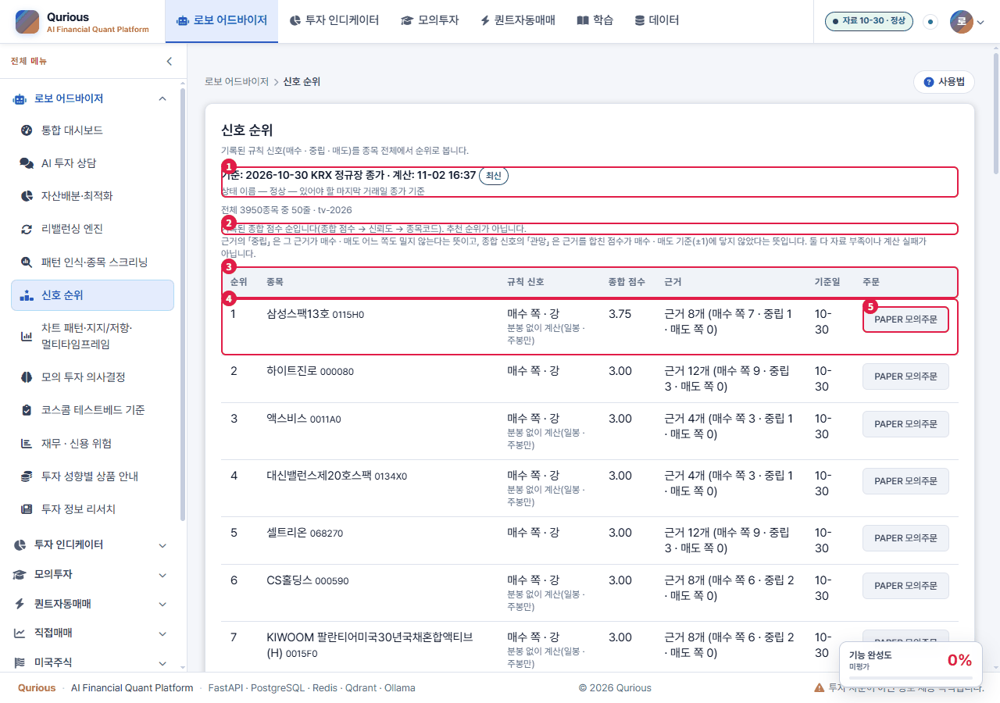

원본: 로컬 개발 앱(8966) 캡처 1280 × 900 · 128색 · 번호 상자는 요소의 getBoundingClientRect 로 얹었다 · 그림 판 v0.45 · 기준 `9b283b8` + 이 판 · 2026-11-02

**<표 38> 신호 순위 화면의 요소**

| 번호 | 요소 | 보이는 것 · 값의 출처 | 비고 |
|--:|---|---|---|
| 1 | 머리줄 | 「기준: 2026-10-30 KRX 정규장 종가 · 계산: 11-02 16:37」 + 딱지(최신 · 확인 필요 · 안내) + 안내 글 + 「상태 이름 — …」 · 서버 `freshness` 를 그대로 | 화면이 날짜 · 상태를 새로 판정하지 않는다(TC-RKS-08) · 응답에 없으면 줄이 없다 |
| 2 | 정렬 · 중립 안내 | 「기록된 종합 점수 순입니다(종합 점수 → 신뢰도 → 종목코드). 추천 순위가 아닙니다.」 · 「근거의 「중립」 은 … 종합 신호의 「관망」 은 …」 | 서버 `SIGNAL_RANK_NOTE` 와 같은 기준(시험이 맞댄다 · TC-RKS-07) |
| 3 | 표 머리 | 순위 · 종목 · 규칙 신호 · 종합 점수 · 근거 · 기준일 · 주문 | 「확인 · 주문」 이던 마지막 열이 「주문」 이 되었다(줄 끝 「종목 근거」 단추를 뺐다) |
| 4 | 순위 줄 | 줄 전체가 종목 근거 모달의 입구(`data-hub-open`) · 이름 · 코드 · 규칙 신호 · 점수 · 「근거 n개 (매수 쪽 · 중립 · 매도 쪽)」 · 기준일 · 분봉이 없으면 「분봉 없이 계산(일봉 · 주봉만)」 | 종목코드(6자리)를 모르는 줄은 입구가 없다(빈 코드는 422) · Enter · 스페이스도 같은 입구(TC-RKS-11) |
| 5 | 「PAPER 모의주문」 단추 | 누르면 모달 없이 모의주문 화면으로(종목코드만 전달 · 수량 · 비중은 그 화면에서 직접) | 줄 클릭보다 앞서 처리한다 |
| 6 | 종목 검색 줄 | 표 위 한 줄 — 「종목 검색」 · 입력(「종목 이름 또는 코드 (예: 삼성전자, 005930)」) · 「검색」 · 「전체 순위」 · 안내 줄 · 이름이나 코드를 치면 6자리 코드로 풀어 `symbols=코드` 로 그 종목의 한 줄만 읽는다(`API-HUB-03`) · 이름이 여럿이면 종목 찾기 창(20절)이 그 글자로 열리고 고르면 이어서 읽는다 | 순위 대상 밖이면 서버가 주는 까닭을 그대로 보이고 안내 줄에 「종목 근거 →」 입구를 함께 둔다 · 해외 티커 등 6자리 코드가 아닌 입력은 요청 없이 안내 · <그림 30> 에는 없다(구현 대조 캡처는 다음 그림 판) |

### 25.3 줄을 누르면 — 종목 근거 모달의 신호 칸

**<그림 31> 순위 줄을 누른 직후 — 종목 근거 모달** · 범례: 빨간 상자와 번호 = <표 39> 의 요소 · 2026-11-02 · 점검 계정(관리자) · 개발 앱 캡처(창 높이를 1720 으로 늘린 모달 한 장 · 근거 목록은 위쪽 일부만 보이고 나머지는 모달 안에서 내려 본다)

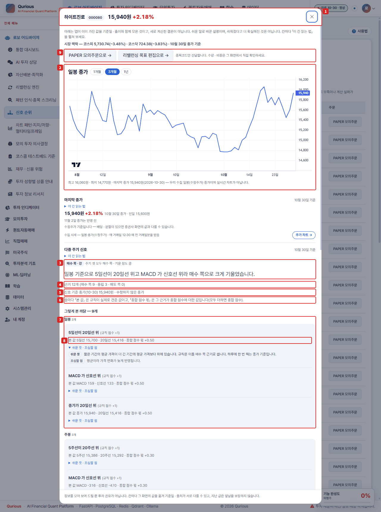

원본: 로컬 개발 앱(8966) 캡처 1280 × 1720 · 128색 · 번호 상자는 요소의 getBoundingClientRect 로 얹었다(딱지는 상자 왼쪽 바깥) · 그림 판 v0.46 · 기준 `2c5adb7` + 이 판 · 2026-11-02

**<표 39> 모달 신호 칸의 요소**

| 번호 | 요소 | 보이는 것 · 값의 출처 | 비고 |
|--:|---|---|---|
| 1 | 머리 | 이름 · 종목코드 · 마지막 종가와 등락 · 닫기 | 허브 모달의 머리(21 · 24.3절) 그대로 |
| 2 | 큰 일봉 차트 | 기간 단추 1개월 · 3개월 · 1년 | 새로 만든 것이 아니다(차트 부품 공용) |
| 3 | 신호 딱지 · 한 줄 요약 | 「매수 쪽 · 강」 · 「주기 둘 모두 매수 쪽 · 기운 정도 큼」 · 서버 글 그대로 | 요약 문장은 화면이 짓지 않는다 |
| 4 | 근거 개수 | 「근거 8개 (매수 쪽 7 · 중립 1 · 매도 쪽 0)」 · 서버 `counts` | **옛 서랍에서 옮겨 온 줄** · 못 세면 「근거 개수를 셀 수 없습니다」 + 서버 까닭(0개로 두지 않음) · 옛 응답이면 줄이 없다 |
| 5 | 신호 기준 종가 | 「신호 기준 종가(10-30) 1,997원 · 수정하지 않은 종가」 | **옛 서랍에서 옮겨 온 줄** · 모달이 열린 뒤 그 신호 기록의 기준일 일봉 한 건으로 채운다 · 그날 줄이 없거나 실패하면 「확인 불가 · 까닭」 · 마지막 종가로 대신하지 않는다 |
| 6 | 읽는 법 한 줄 | 「줄마다 「본 값」 은 규칙이 실제로 견준 값이고, 「종합 점수 몫」 은 그 근거가 종합 점수에 더한 값입니다(모두 더하면 종합 점수).」 | **S192 에 더한 줄** · 서버가 본 값 · 몫을 준 응답일 때만 · 옛 응답이면 줄이 없다 |
| 7 | 근거 목록 · 주기별 묶음 | 「그렇게 본 까닭 — 9개」 아래 일봉 · 주봉 · 분봉(60분) 묶음마다 한 상자(머리 「일봉 3개」) · 줄마다 근거 문장 · 규칙 점수 · 접힌 「쉬운 뜻 · 조심할 점」(각 목록의 첫 줄만 펼침) | **전부 보인다**(서버가 3 · 2개로 자르던 것을 뺐다) · 줄에서 「일봉 · 」 을 되풀이하지 않고 묶음 머리에 둔다 · 묶음 차례는 서버가 준 차례(기여도 큰 순)에서 처음 나온 순서 · 반대 근거가 있으면 「반대로 본 까닭」 이 같은 꼴로 이어진다 |
| 8 | 본 값 · 종합 점수 몫 | 「본 값 5일선 15,700 · 20일선 15,416 · 종합 점수 몫 +0.50」 · 서버 `observed` · `contribution`(`signal_explain.evidence` 가 이미 만든 값 · 몫은 소수 둘째 자리) | 화면이 셈하지 않는다 · `observed` 가 없는 옛 줄은 몫만 · 둘 다 없으면 줄이 없다 · 서랍(작은 화면)에는 없다 |
| 9 | 이동 단추 | 「PAPER 모의주문으로 →」 · 「리밸런싱 목표 편집으로 →」 | 6자리 코드일 때만(24.3절) · 모달에서는 차트 위에 있다 |

### 25.4 동작 · 상태

| 경우 | 화면이 하는 것 |
|---|---|
| 줄을 누른다 · Enter · 스페이스 | 서랍이 아니라 큰 모달이 열린다 · Esc · 바깥 · 닫기로 닫으면 초점이 눌렀던 줄로 돌아온다 |
| 줄 안의 「PAPER 모의주문」 | 모달 없이 모의주문 화면으로 간다(종목코드만 전달) |
| 종목코드를 모르는 줄(해외 등) | 입구를 달지 않는다 — 눌러도 반응이 없다 |
| 근거 개수를 못 셈 | 「근거 개수를 셀 수 없습니다」 + 서버 까닭 |
| 신호 기준 종가 요청 실패 · 그날 일봉 없음 | 「신호 기준 종가(MM-DD) 확인 불가」 + 까닭 — 다른 날 종가로 대신하지 않는다 |
| 기록이 없는 종목 | 서버의 두 갈래 안내 문장(「아직 기록이 없습니다」 · 「기록하는 대상이 아니거나 …」)을 그대로 |
| 순위를 못 불러옴 | 서버의 한국어 까닭 · 로그인 풀림 · 연결 끊김은 따로 |
| 종목을 검색한다 | 6자리 코드가 되면 그 종목 한 줄만 보인다 · 안내 줄이 「검색한 종목: 이름(코드)」 + 「종목 근거 →」 · 기록이 없으면 표 자리에 서버 까닭 · 입력이 비면 「종목 이름이나 코드를 입력해 주세요」 |
| 「전체 순위」 | 입력 칸을 비우고 전체 순위를 다시 읽는다 · 검색 직후에 눌러도 늦게 온 검색 응답은 표를 덮지 않는다(마지막 요청만 반영) |
| 화면 폭 640px 이하 | 표가 줄마다 카드 하나로 바뀐다 — 칸 앞에 열 이름 · 「종목」 은 굵게 · 「주문」 단추는 카드 아래 오른쪽 · 입구(줄 클릭 · Enter · 스페이스)는 표와 같다 · 1280px 표는 그대로(S192 · 설계서 9.5절) |

### 25.5 이 판에서 확인한 것 · 못 한 것

- **확인(2026-11-02 · 개발 앱 8966 · 폭 1280 · 점검 계정)**: 신호 순위 첫 줄을 누르면 서랍이 아니라 모달이 열린다(`#hub-modal` 열림 · `#hub-drawer` 닫힘) · 신호 칸에 「근거 8개 (매수 쪽 7 · 중립 1 · 매도 쪽 0)」 와 「신호 기준 종가(10-30) 1,997원」 이 채워진다 · Esc 로 닫으면 초점이 줄로 돌아온다 · Enter · 스페이스로도 열린다(스페이스는 화면 스크롤을 막는다) · 줄 안의 「PAPER 모의주문」 은 모달 없이 모의주문 화면으로 간다. 시험 TC-RKS-09 · 11 · TC-SDR-14 · 15 · TC-HUB-07 · 07b.
- **S192 에 더 확인한 것(2026-11-02 · 개발 앱 8966 · 폭 1280 · 390)**: 640px 이하에서 표가 줄마다 카드가 되고(390 에서 가로 넘침 없음 · 카드를 눌러도 모달이 열림) 1280 표는 그대로 · 머리줄에 「상태 이름 —」 접두어가 없다 · 모달 신호 칸이 주기별 묶음 · 줄마다 본 값 · 종합 점수 몫으로 그려진다(<그림 31> 을 v0.46 으로 다시 찍음).
- **못 한 것**: 애프터마켓 딱지(붙일 「지금 가격」 칸이 없어 만들지 않기로 했다 · 설계서 9.5절) · 일반 사용자(관리자가 아닌) 계정에서의 확인은 하지 않았다.

---

### 25.6 순위 필터 — 신호 · 시장 · 줄 수 (2026-11-05 · 사용자 피드백)

「매수 / 매도 / 관망 · KOSPI / KOSDAQ 로 거르고 싶다」 는 피드백으로 검색 줄 아래에 필터 줄을 더했다(`signalrankview.js` · `signal-rank.js` · `signalrankview.css`, `app.html` 은 그대로). 거르는 일은 서버가 **limit 전에** 한다 — 화면에서만 걸면 위 50줄 밖의 종목이 빠지기 때문이다(`GET /api/stock-hub/signal-rank` 의 새 질의 `signal` · `market`).

**<표 25-6> 필터 줄의 요소**

| 요소 | 값 | 동작 | 확실도 |
|---|---|---|---|
| 신호 단추 | 전체 · 매수 · 매도 · 관망 | 하나만 눌림(`aria-pressed`). 누르면 종목 검색 칸을 비우고 전체 순위에서 다시 읽는다 | 🟢 코드 · TC-RKS-16 |
| 시장 단추 | 전체 · KOSPI · KOSDAQ · ETF | 수집 DB 마지막 거래일의 시장 구분으로 거른다. 코넥스는 기록 대상 밖이라 고르지 않는다 | 🟢 코드 |
| 보여줄 줄 수 | 50 · 100 · 200 · 500 | 거른 뒤 위에서부터 자른다. 기본 50 이면 질의에 싣지 않는다 | 🟢 코드 |
| 머리줄 | 「조건 매수 · KOSPI — 맞는 N종목 중 M줄」 | 서버의 `matched`(자르기 전 맞는 종목 수). 필터가 없으면 옛 머리줄 그대로 | 🟢 TC-RKS-16 |
| 빈 결과 | 「이 조건에 맞는 종목이 없습니다. 필터를 풀어 보세요.」 | 「이 날짜의 신호 기록이 아직 없습니다」 와 구분 | 🟢 TC-RKS-16 |
| 「전체 순위」 단추 | — | 검색어와 필터를 모두 푼다. 화면을 다시 열면 지난 필터를 유지한다 | 🟢 TC-RKS-17 |

- 서버: 잘못된 낱말은 422(`bad_signal` · `bad_market`), 수집 DB 에서 시장 구분을 못 읽으면 말없이 전체를 보이지 않고 503(`market_unavailable`). 시험 TC-HUB-71 · TC-XR-FILTER(limit 전에 걸리는지).
- 머리줄의 기준일 · 전체 종목 수는 필터와 상관없이 전체 줄 기준이다(필터로 기준일이 흔들리지 않게).
- **못 한 것(🔴)**: 실제 로그인한 화면에서 눌러 보지 못했고(시험은 합성 응답과 일회용 DB), 390px 폭 · 다크 모드 눈 확인도 아직이다. 눌린 단추는 흰 글자 + `--accent` 배경이라 대비를 재지 않았다. 퀀트 대시보드의 일봉 단독 규칙 카드 필터는 26.6절이다.
- 신장환 님이 만든 `signal_explain.load_day` 에 선택 인자(`signal` · `only_codes`)를 더했다 — 안내 이슈 필요.

### 25.7 새로고침 — 기록 다시 읽기 + 지금 가격 (2026-11-05 · 사용자 제안)

「새로고침하면 기준 시간대를 다시 보고 실시간 데이터와 같이 보고 싶다」 는 제안의 **1단계**다. 필터 줄에 「새로고침」 단추를 더했다(`signal-rank.js` · `signalrankview.js`, `app.html` 은 그대로).

**<표 25-7> 새로고침의 동작**

| 요소 | 동작 | 확실도 |
|---|---|---|
| 「새로고침」 단추 | 지금 조건(필터 · 검색)으로 기록된 신호를 다시 읽고, 위 **10종목**에만 `GET /api/stocks/quote` 로 지금 가격을 읽는다(한 번에 5개). 누르는 동안 「읽는 중…」 · 중복 클릭 무시 | 🟢 코드 · TC-RKS-18 |
| 종목 칸 아래 한 줄 | 「지금 72,300원 · 지연 시세 · 약 20분」 처럼 가격과 출처 딱지(실시간 · 지연 · 종가). 가격을 못 받은 종목은 그냥 둔다 | 🟢 TC-RKS-18 |
| 안내 글 | 「새로고침 13:12:34 (KST) · 기록된 신호를 다시 읽었습니다(위 10종목에 지금 가격을 붙임) — 신호는 새로 계산하지 않습니다」(필터를 바꿔도 남음) | 🟢 TC-RKS-18 |
| 그 사이 조건이 바뀌면 | 낡은 가격은 붙이지 않는다(마지막 요청만 반영) | 🟢 코드 |

- **신호 자체는 다시 판단하지 않는다.** 순위는 12:30 회차가 기록한 값이고, 지금 가격은 그 옆의 참고 정보다. 3,950종목 전체를 실시간 가격과 합쳐 다시 판단하는 것은 2단계로 남긴다(일지 지문 대상 조각 · 야후 이용 정책 · 증권사 종가 확정 시각 확인이 먼저).
- **못 한 것(🔴)**: 로그인한 실제 화면에서 눌러 보지 못했다(시험은 가짜 응답). 가격 요청이 느릴 때의 모습 · 390px · 다크 모드 확인 전.

## 26. 화면 상세 — 퀀트 대시보드 (`quant-dashboard` · 퀀트자동매매 › 퀀트 대시보드 · 2026-11-03)

퀀트 대시보드(주담당 신장환 님 · 2026-11-03 에 이동원이 프런트만 고쳤다 · 안내 이슈 #512)를 **종목을 바로 찾고, 서로 다른 두 신호를 이름표로 가르고, 화면을 열 때 나가는 요청을 줄이는** 쪽으로 고쳤다. 서버 길은 새로 만들지 않았다(`/api/stocks/quant/*` · `/api/stock-hub/signal-rank` 그대로). 차트는 공용 일봉 차트(27절)로 바뀌었다.

### 26.1 이전 → 지금

| 구분 | 이전(11-02 판까지) | 지금(이 판) |
|---|---|---|
| 종목 찾기 | 차트 줄의 종목 단추(돋보기)만 | 맨 위 「종목 검색」 줄(이름 · 코드) + 종목 단추 그대로 |
| 신호의 이름 | 카드와 근거 창의 신호가 이름 없이 따로 있었다 | 카드 「일봉 단독 규칙」 / 모달 · 순위 · 표 · 띠 「기록된 신호(60분 · 일 · 주)」 (26.3) |
| 관찰 목록 카드 | 들어올 때 관찰 목록 31종목의 지표를 모두 받음 | 접힌 칸을 펼칠 때 처음 10장만 · 「나머지 21종목 보기」 로 나머지 |
| 기록된 신호 | 카드 단추로 모달을 열 때만 | 관찰 목록 표 1장 — 신호 순위 API 한 번(`symbols=`)으로 |
| 선택 종목 | 차트만 | 차트 위 신호 띠 두 줄 + 「외부 차트에서 열기 ↗」 |
| 차트 | 종가 · 20일선 · 60일선 · 볼린저 선 차트(높이 380) | 공용 일봉 차트(캔들 · 거래량 · 지표 · 크로스헤어 값 — 27절 · 높이 380) |

### 26.2 화면의 칸 (위에서 아래 차례)

**<표 42> 퀀트 대시보드의 칸**

| 칸 | 보이는 것 | 부르는 API | 비었을 때 · 오류 |
|---|---|---|---|
| 머리 | 「퀀트 대시보드」 + 「새로고침」(지수 · 표 · 차트를 다시 받고 카드는 펼쳐 있을 때만 다시 받는다) | — | — |
| 종목 검색 줄 | 「종목 검색」 + 입력(자리표시 「종목 이름 또는 코드 (예: 삼성전자, 005930)」) + 「검색」 + 안내 줄. 차트가 그 종목으로 바뀌고, 신호 기록이 있는 국내 코드면 종목 근거 모달(24절)이 열린다. 이름이 여럿이면 종목 찾기 창(20절)이 그 글자로 열린다 | `API-STK-06` | 국내 6자리 코드가 아니면 모달 없이 「신호 기록은 국내 종목(6자리 코드)에만 있습니다…」 + 「일봉 규칙은 아래 차트에서 계산해 보입니다」 안내 · 빈 칸이면 입력을 부탁하는 안내 |
| 시장 지수 카드 | 지수마다 값 · 등락(오름 빨강 · 내림 파랑 + 글자 부호) + 「외부 시세 기준이며 지연될 수 있습니다.」 | `API-STK-01` | 「시장 지수를 불러오지 못했습니다: …」 |
| 선택 종목 줄 | 종목 단추(이름 · 코드 · 처음 삼성전자) · 「차트 로드」 · 「기록된 신호 · 근거 →」 · 「외부 차트에서 열기 ↗」 + 작은 글 「외부 차트 링크는 TradingView 로 연결됩니다 · 로그인 · 지연 시세는 그쪽 정책을 따릅니다.」 | `API-STK-06`(종목 찾기) | 숫자 6자리 국내 코드가 아니면 외부 차트 링크를 감춘다(ETF 영숫자 코드 포함) · 코드가 아니면 「기록된 신호 · 근거」 는 토스트로 막는다 |
| 신호 띠 | 차트 위 두 줄 — 「기록된 신호(60분 · 일 · 주)」 + 칩 · 근거 개수 · 기준일 + 「종목 근거 →」 / 「일봉 단독 규칙」 + 칩 · RSI · 근거 개수 · 기준일. 끝 글 「두 값은 계산 방식이 달라 다를 수 있습니다. 참고용이며 투자 권유가 아닙니다.」 | 기록된 신호 = 표에서 읽은 줄(없으면 `API-HUB-03`) · 일봉 단독 규칙 = `API-STK-04` | 기록이 없으면 「기록 없음」 + 서버 까닭 · 일봉 규칙을 못 구하면 「계산하지 못했습니다」 |
| 일봉 차트 | 공용 차트(27절) 6개월 + 아래 글 + 크레딧 「차트: TradingView Lightweight Charts™」 | `API-DATA-02` · `API-CAL-02`(국내 코드) · 대신 줄 `API-STK-04` | 수집 일봉을 못 받으면 지표 응답의 종가로 종가 선을 그린다 · 해외 종목은 처음부터 종가 선 |
| 관찰 목록 표 | 제목 「관찰 목록 — 기록된 신호(60분 · 일 · 주)」 + 「n종목 중 m종목 기록」 · 열: 종목 · 기록된 신호 · 근거 · 기준일 · 근거 열기 · 머리줄(기준 · 계산 시각 · 최신 딱지)은 신호 순위(25절)와 같은 부품 | `API-STK-05` → `API-HUB-03`(`symbols=` 한 번) | 기록이 없는 종목은 「기록 없음 — 서버 까닭」 줄 · 읽을 국내 코드가 없으면 서버에 요청하지 않고 안내 한 줄 |
| 일봉 단독 규칙 카드 칸 | 접힌 칸 「기본 일봉 규칙 신호 (관찰 목록 31종목)」 · 펼치면 카드 처음 10장(종목 · 종가 · 기준일 · 「일봉 단독 규칙」 · 칩 · RSI · 접이식 「근거 n개」 · 「기록된 신호 · 근거 →」 · 「PAPER 모의주문 →」) + 「나머지 21종목 보기」 · 「나머지 접기」 + 「신호 순위에서 전체 종목 보기 →」 | `API-STK-04`(종목마다) · `API-DATA-01`(전 거래일) | 마지막 봉이 전 거래일보다 앞이면 「⚠ 최신 아님」 · 종목 하나의 지표를 못 받으면 그 카드는 값 대신 줄표로 보인다 |

- 표의 줄을 누르거나 Enter 를 치면 차트와 신호 띠가 그 종목으로 바뀌고, 「종목 근거 →」 · 링크는 자기 일(모달)을 한다. 종목을 빠르게 바꿔도 마지막 요청만 그린다.
- 카드의 색은 빼고 글자 칩만 쓴다 — 오름 빨강 · 내림 파랑 관행과 부딪히지 않게(카드의 매수 · 매도가 빨강 · 파랑 면으로 읽히지 않게).

### 26.3 두 갈래 신호의 이름표

**<표 43> 같은 종목에 두 신호가 있다**

| 이름표 | 어디에 | 무엇 | 언제 계산 |
|---|---|---|---|
| 일봉 단독 규칙 | 카드 · 신호 띠 둘째 줄 | 일봉만으로 RSI · 이동평균 · 볼린저 규칙을 마지막 종가 기준으로 본 값 | 화면을 열 때(카드는 펼칠 때) 그때그때 |
| 기록된 신호(60분 · 일 · 주) | 종목 근거 모달 · 신호 순위 · 이 화면의 관찰 목록 표 · 신호 띠 첫째 줄 | 60분 · 일 · 주봉 규칙 점수를 합친 값 | 12:30 회차에 기록해 둔 값을 읽기만 한다(`API-HUB-03`) |

두 값은 계산 방식이 달라 같은 종목에서도 다를 수 있고, 화면은 어느 쪽이 맞다고 하지 않는다.

### 26.4 요청 수

**<표 44> 화면을 열 때와 펼칠 때 나가는 요청 (관찰 목록 31종목 기준)**

| 요청 | 이전 | 지금 |
|---|---|---|
| 관찰 목록 `API-STK-05` | 1 | 1 — 표와 카드가 한 번 받아 나눠 쓴다 |
| 종목마다 지표 `API-STK-04` | 31 | 0 — 카드를 펼칠 때 10 · 「나머지 21종목 보기」 를 누를 때 21 · 선택 종목 차트용 1은 그대로 |
| 전 거래일 `API-DATA-01` | 1 | 카드를 펼칠 때 1 |
| 기록된 신호 `API-HUB-03` | — | 1(표 · `symbols=` 최대 100개) · 표에 없는 종목을 띠가 따로 묻는 1 |
| 차트의 일봉 `API-DATA-02` · 일정 `API-CAL-02` | — | 국내 종목이면 각 1(5분 캐시) |

관찰 목록 31종목은 서버 `QUANT_STOCKS` 의 길이다. 표 요청은 `limit` 을 보내지 않아 서버 기본 50줄에서 끊기므로, 관찰 목록이 50종목을 넘으면 표가 모자란다.

### 26.5 이 판에서 확인한 것 · 못 한 것

- 코드(`quant.js` · `app.html` · `stockdrawer.js` · `signal-rank.js`)를 열어 위 표를 맞댔다. 시험 TC-SCD-01 ~ 09 · 11 ~ 13(`test_signal_cards_screen.py` — TC-SCD-10 은 없앴고 TC-SCD-06 은 공용 차트 합치기로 뜻이 바뀌었다) · TC-SDR-17(`test_stock_drawer.py` — 외부 차트 링크 주소).
- **못 한 것**: 이 판에서는 개발 앱 화면을 직접 눌러 보지 않았다 — 구현 대조 캡처는 다음 그림 판. 390 폭 확인도 다음 판이다. 범례 줄(`qd-legend`)의 20일선 · 60일선 색 견본(`#f59e0b` · `#10b981`)은 공용 차트의 선 색(`#b45309` · `#047857`)과 달라 코드 쪽에서 맞춰야 한다.

---

### 26.6 일봉 단독 규칙 카드 필터 — 신호 · 시장 (2026-11-05 · 사용자 피드백)

관찰 목록 「기본 일봉 규칙 신호」 카드(`signal-cards`)에 신호 · 시장 필터 줄을 더했다(`quant.js` · `signalrankview.css`, `app.html` 은 그대로 — 줄은 카드 칸 앞에 JS 가 한 번 만든다). 서버 응답은 바꾸지 않고 카드의 `data-qd-signal` · `data-qd-market` 만 읽는다.

**<표 26-5> 카드 필터 줄**

| 요소 | 값 | 동작 | 확실도 |
|---|---|---|---|
| 신호 단추 | 전체 · 매수 · 매도 · 관망 | 「강력 매수」 는 매수, 「강력 매도」 는 매도에 든다. 하나만 눌림(`aria-pressed`) | 🟢 코드 · TC-SCD-14 · 15 |
| 시장 단추 | 전체 · KOSPI · KOSDAQ | 종목 기호 꼬리(`.KS` · `.KQ`)로 읽는다. 관찰 목록에 ETF 가 없어 ETF 단추는 없다 | 🟢 코드 · TC-SCD-14 |
| 나머지 카드 | 처음 10장 밖 21종목 | 필터를 거는 순간 한 번만 받아 붙이고 접어 둔 나머지도 펼친다. 못 받으면 받은 카드만 거르고 그렇게 말한다 | 🟢 TC-SCD-17 |
| 개수 글 | 「31종목 중 N개 일치」 | 필터가 없으면 옛 「n개 표시」. 조건 안내 줄은 읽어 주는 영역(`aria-live`) | 🟢 TC-SCD-15 |
| 빈 결과 | 「이 조건에 맞는 종목이 없습니다. 필터를 풀어 보세요.」 | 카드 칸 안에 한 줄 | 🟢 TC-SCD-15 |

- 신호 순위 화면(25.6절)의 필터와 낱말이 같다. 카드는 일봉 단독 규칙, 순위는 기록된 신호(60분 · 일 · 주)라 같은 종목도 다를 수 있다(26.3절).
- **못 한 것(🔴)**: 실제 로그인한 화면에서 눌러 보지 못했다(시험은 가짜 DOM). 390px · 다크 모드 · 눌린 단추 글자 대비 확인 전. 관찰 목록 표(기록된 신호)에는 이 필터를 달지 않았다.
- 주담당 신장환 님 화면 — 프런트만 고쳤다(안내 이슈 필요).

## 27. 공통 부품 — 일봉 차트 (`public/js/stockchart.js` · 2026-11-03)

종목 근거 모달 · 서랍(21 · 23 · 24절), 모의투자 시세 조회와 스탑 주문(`paper-stock` · 23절), 퀀트 대시보드(26절)의 일봉 차트는 이 부품 하나(`mountDailyChart`)다. 종가 선 하나였던 차트(23절)를 캔들 · 거래량 · 이동평균 · 볼린저 · 크로스헤어 값 · RSI · MACD · 신호 한 점 · 일정 표식으로 올렸다. 데이터는 새로 만들지 않는다 — 종목 허브가 쓰는 수집 일봉 한 길(`API-DATA-02`)이고, 일정 표식만 수집 DB 일정(`API-CAL-02`)을 더 읽는다. 선(이동평균 · 볼린저 · RSI · MACD)은 같은 일봉 종가로 이 화면에서 계산한 표시용 값이며, 정의는 서버 지표(`ta_utils`)와 같고 시험 TC-SCH-04 가 같은 종가에서 서버 값과 맞는지 대조한다.

### 27.1 어디에 쓰이나

**<표 45> 공용 차트를 쓰는 자리**

| 자리 | 차트 높이 · 기간 | 그 자리만의 것 |
|---|---|---|
| 종목 근거 모달(`data-hub-open`) | 340 · 1개월 · 3개월 · 1년(처음 3개월) | 신호 한 점 · 날짜를 고르면 점이 옮겨 감(24.4절) |
| 종목 서랍 | 200 · 같은 기간 단추 · 「크게 보기 ⤢」 | 신호 한 점 |
| 모의투자 시세 조회 결과(`paper-stock`) | 230 · 같은 기간 단추 | 「근거 · 차트 크게 보기 →」 |
| 스탑 주문 칸 아래(`paper-stock`) | 1개월 · 3개월 · 1년(처음 3개월 · 시세 차트와 독립 — 33.1) | 스탑가 점선(27.2) |
| 퀀트 대시보드 | 380 · 6개월 | 신호 점 대신 신호 띠(26절) · 해외 종목은 종가 선 |

### 27.2 차트에 보이는 것

**<표 46> 공용 차트의 요소**

| 요소 | 보이는 것 | 비고 |
|---|---|---|
| 캔들 | 오름 빨강(`#dc2626`) · 내림 파랑(`#2563eb`) — 우리 시장 관례 | 시가 · 고가 · 저가가 하나라도 비면 값을 지어내지 않고 종가 선으로 그린다 · 해외 종목 · 지수는 가격에 소수 둘째 자리 |
| 켜고 끄는 칩 | 차트 위 한 줄 — 거래량 · 20일선 · 60일선 · 볼린저 · RSI · MACD(색 견본 포함 · `aria-pressed`) | **처음에는 거래량과 20일선만 켠다** — 많이 켤수록 정밀해 보이는 착시를 막으려는 것 |
| 거래량 | 아래 한 줄 막대 · 색은 종가가 시가 이상이면 빨강 · 아니면 파랑(옅게) | 값이 있는 날만 |
| 20일선 · 60일선 | 20일선 갈색(`#b45309`) · 60일선 초록(`#047857`) | 보이는 기간 앞쪽에서도 값이 차도록 500일(달력) 앞부터 받아 계산 |
| 볼린저 | 20일 · 2σ 위아래 점선(`#64748b`) | 표준편차는 모집단 |
| RSI | 아래에 창 하나가 더 생긴다(92px) · RSI 14 · 30 · 70 기준 점선 | 「30 · 70 은 많이 쓰는 관례 기준선이며 넘었다고 방향이 바뀐다는 뜻은 아니다」 |
| MACD | 아래에 창 하나가 더 생긴다 · 12 · 26 · 9 · 막대(MACD선 − 신호선) · MACD선 · 신호선 | 두 선의 이름표는 오른쪽 끝 |
| 크로스헤어 값 줄 | 칩 줄 아래 한 줄 — 날짜 · 시 · 고 · 저 · 종(전일 대비 %) · 거래량 + 그날의 신호 · 일정 풀이 | 시 · 고 · 저가 없으면 종가만 · 좁은 화면은 석 줄 높이를 미리 잡는다 |
| 신호 한 점 | 보라색(`#7c3aed`) 중립 점 「신호 기록」 — 매수 쪽 · 매도 쪽 · 관망 모두 같은 점 · 기록의 기준일 봉 아래에만 | 화살표를 쓰지 않는다(그 봉 마감에 신호가 난 것처럼 읽히지 않게) · 값 줄에 「기록된 신호 매수 쪽 (11-02 기준 · 여러 주기(60분 · 일 · 주)를 합친 기록)」 · 모달 · 서랍만 |
| 일정 표식 | 봉 위 회색 네모 「실적」 「배당락」 「주총」 · 값 줄에 확정 · 예정 | `API-CAL-02`(`kind=earnings,dividend_ex,agm`) · 오늘 이후 일정은 글로만 · 봉이 없는 지난 날 일정은 찍지 않고 건수만 |
| 스탑가 점선 | 모의 스탑 주문 칸에서 스탑가가 있으면 **짙은 남색(`#0f172a`) 2px 점선** + 가격 이름표 「스탑가」 — 아래 글은 「검은 점선은 입력한 스탑가 …」 | 오름 봉의 빨강에 묻히지 않게 색을 정했다 · 마지막 종가에서 30% 안이면 가격 범위를 넓혀 점선이 보이게 · 더 멀면 넓히지 않고 글로 알린다 |
| 아래 글 | 최고 · 최저 · 마지막 종가(수정주가 여부) · 실시간 차트가 아님 + 켠 것에 해당하는 풀이(지표는 화면에서 계산한 표시용 값이며 서버가 기록한 신호가 아님) + 신호 · 일정 풀이 | 켜고 끌 때마다 글이 바뀐다 |

### 27.3 상태 · 한계

- 일봉은 5분 동안 받아 둔 것을 쓴다(일정을 못 받았으면 일정만 다시). 종목 · 기간이 같고 스탑가만 바뀌면 차트를 다시 그리지 않고 점선만 갈아 끼운다. 늦게 온 응답은 버린다.
- 6자리 코드가 아닌 종목은 일봉 요청을 보내지 않는다(호스트가 준 종가 줄이 있을 때만 그린다 · 퀀트 대시보드의 해외 종목).
- 신호 점은 **마지막 기록 한 점**뿐이다 — 날짜 범위로 신호를 찍으려면 날짜 범위 API 가 필요해 아직 하지 않았다.
- 시험 TC-SCH-04 ~ 09(`test_stockchart.py`). 구현 대조 캡처는 다음 그림 판.

---

## 28. 화면 상세 — 증시 일정의 종류 칩 열넷 (`market-calendar` · 투자분석 기초 › 일정 · 2026-11-03)

증시 일정 달력(주담당 이동원)의 종류 칩이 열에서 **열넷**이 되었다. 새 넷은 한국 경제지표(`econ_kr`) · 미국 경제지표(`econ_us`) · 공모 청약(`offer_sub`) · 공모 납입(`offer_pay`)이다. 서버 `EVENT_KINDS` 와 칩 차례(`KIND_ORDER`)는 `public/js/calendar.js` 의 `KINDS` 와 글자 그대로 같다. 화면은 처음에 열네 종류를 모두 켠 채 열고, 칩을 눌러 끈다(하나는 남겨 둔다). API 는 `API-CAL-02` · `03` 이고 새 종류가 더해진 것 외에 응답 모양은 그대로다(API 명세서 v0.61 6절).

**<표 47> 칩 열넷 (차례는 서버 `KIND_ORDER`)**

| 차례 | 키 | 칩 이름 | 칸 배지 | 칸에 이름까지 | 어떻게 만들었나 |
|--:|---|---|---|:-:|---|
| 1 | `market_closure` | 휴장 | 휴장 | 예 | 공휴일 정보와 거래소 규칙 |
| 2 | `deriv_expiry` | 파생 만기 | 만기 | 예 | 결제월 두 번째 목요일 규칙 |
| 3 | `policy_rate` | 금통위 | 금통위 | 예 | 한국은행이 공개한 회의 일정 |
| 4 | `fomc` | FOMC | FOMC | 예 | 미국 연준이 공개한 회의 일정 |
| 5 | `econ_kr` | 한국 경제지표 | 한국 | 예 | 국가데이터처 보도계획의 통계 발표일(한국 시각) |
| 6 | `econ_us` | 미국 경제지표 | 미국 | 예 | 미국 노동통계국(BLS) · 경제분석국(BEA) 발표 일정 |
| 7 | `report_deadline` | 보고서 기한 | 기한 | 예 | 자본시장법 정기보고서 제출 기한 규칙 |
| 8 | `dividend_record` | 배당 기준일 | 기준 | 아니오 | 전자공시 배당 결정 공시 |
| 9 | `dividend_ex` | 배당락일 | 락 | 아니오 | 배당 기준일 하루 전 거래일 |
| 10 | `dividend_pay` | 배당금 지급 | 지급 | 아니오 | 배당 결정 공시 본문의 지급 예정일 |
| 11 | `offer_sub` | 공모 청약 | 청약 | 아니오 | 전자공시 증권신고서(지분증권)의 청약기일 — 첫날에 표시 |
| 12 | `offer_pay` | 공모 납입 | 납입 | 아니오 | 전자공시 증권신고서(지분증권)의 납입기일 |
| 13 | `agm` | 주주총회 | 주총 | 아니오 | 소집결의 공시 본문의 일시 |
| 14 | `earnings` | 실적 발표 | 실적 | 아니오 | 잠정실적 · 손익구조 변동 공시일 |

「칸에 이름까지」 가 「예」 인 일곱 종류는 시장 전체 일정이라 달력 칸에 이름이 보이고(두 개까지 · 넘으면 「+N」), 나머지는 종목 일정이라 칸에는 「주총 731」 처럼 개수만 보인다(서버 `MARKET_KINDS`). 새 칩의 색은 한국 경제지표 남보라(`#3730a3`) · 미국 경제지표 올리브 초록(`#3f6212`) · 공모 청약 자홍(`#a21caf`) · 공모 납입 갈색(`#9a3412`)이며 글자 대비는 5.4 ~ 8.5 : 1 이다(`datahub.css`).

### 28.1 설명 창의 한계 문구

일정 이름을 누르면 열리는 설명 창의 아래 줄에 종류마다 만든 방법과 한계가 한 줄씩 나온다. 새 넷의 한계는 다음과 같다.

- **한국 경제지표** — 일정은 사정에 따라 바뀔 수 있다 · **한국은행 통계 발표 일정은 넣지 않았다**(한국은행 저작권보호방침).
- **미국 경제지표** — 날짜와 시각은 **미국 동부(ET) 기준**이라 한국에서는 같은 날 밤이거나 다음 날이다(한국 날짜로 바꾸지 않는다 · FOMC 와 같은 원칙).
- **공모 청약** — 청약 기간의 첫날에 표시했고, 신고서가 정정되면 날짜 · 가격이 바뀔 수 있다. **공모 납입** — 신고서가 정정되면 바뀔 수 있다.

화면 머리의 한 줄 설명도 「휴장 · 파생 만기 · 금통위 · FOMC · 경제지표 · 보고서 기한 · 배당 · 공모 · 주주총회 · 실적 발표 …」 로 바뀌었다. 시험 TC-EV-07 ~ 15(`test_event_sources.py`). 칩 열넷의 구현 대조 캡처는 다음 그림 판.

---

## 29. 화면 상세 — KIS 모의투자 결과 (`kis-results` · 퀀트자동매매 › KIS 모의투자 결과 · 새 화면 · 2026-11-04)

내가 낸 한국투자증권(KIS) **모의투자 주문의 앱 저장 기록**을 상태별 건수 · 조건 걸러 보기 · 표 · 쪽 이동 · CSV 내려받기로 읽는 **읽기 전용** 화면이다. 강사님 lumina-invest 「KIS 모의투자결과」(D1)를 내 주문만 보이게 줄여 가져왔고, 서버는 고치지 않았다(`GET /api/quant/kis/orders` 하나 · `API-KMON-02`). 주문을 내거나 취소 · 재주문하는 단추는 이 화면에 없다. 화면은 이동원이 맡는다. 근거는 [D1 결과 문서](../../../_local/lumina-port-2026-11-04/D1-결과.md)와 코드(`public/js/kis-results.js` · `public/css/kis-results.css` · `public/app.html` `kis-results` 블록) · 시험 TC-KR-01 ~ 10이다. 표시: 🟢 코드를 열어 확인 · 🟡 D1 결과 문서만 보고 씀 · 🔴 확인하지 못함.

### 29.1 이전 → 지금

| 구분 | 이전(11-04 판까지) | 지금(이 판) |
|---|---|---|
| 화면 | 없음 🟢 — 내 KIS 모의 주문 기록을 읽는 화면이 없었다(`API-KMON-02` 를 부르는 화면이 없었다) | 새 화면 「KIS 모의투자 결과」(`kis-results` · 퀀트자동매매 메뉴 · 사용법 안내 있음) 🟢 |
| 메뉴 자리 | — | 퀀트자동매매 › 자동매매 현황 바로 다음(순서는 TC-KR-08 이 지킨다) 🟢 · 아이콘 `fa-receipt` |
| 자리를 이렇게 정한 까닭 | — | 주문을 내는 쪽이 자동매매 현황이라 옆이 자연스럽고, 「모의투자」 묶음은 앱 안 가상 계좌(코인 · 대체자산 포함)라 섞이지 않게 했다 🟡 |
| 강사님 화면과 다른 점 | — | 내 주문만(owner=me 고정) · 정합성 · 계좌 보유 · 사이클 이력 · 60초 자동 새로고침 · 「주체」 칸은 가져오지 않았다 🟡 |

### 29.2 화면의 요소

<그림 32-?> 자리: 구현 대조 캡처는 이 판에 넣지 않았다. 개발 앱 스텁으로 찍은 4장이 `docs/_local/lumina-port-2026-11-04/D1-screens/`(`kr-desktop.png` · `kr-empty.png` · `kr-mobile-filter.png` · `kr-mobile-table-scrolled.png`)에 있으나 **가짜 응답 53건**으로 찍은 것이라 명세서 그림으로 쓰려면 실제 로그인 화면에서 다시 찍어야 한다 🟡. 번호는 아래 <표 29-1> 기준이다.

**<표 29-1> KIS 모의투자 결과 화면의 요소**

| 번호 | 요소 | 보이는 것 · 값의 출처 | 비고 |
|--:|---|---|---|
| 1 | 머리 | 제목 「KIS 모의투자 결과」 + 한 줄 「한국투자증권 모의투자 계좌로 낸 내 주문의 기록을 상태별로 보고, 조건으로 걸러 CSV 로 내려받습니다.」 🟢 | `app.html` 의 정적 글 · 서버 값 아님 |
| 2 | 기준 안내 | 「모의투자 계좌 기준 — 한국투자증권 모의투자 계좌로 낸 내 주문의 앱 저장 기록입니다. 실거래 주문이 아니며, 증권사 전체 체결 내역과 다를 수 있습니다.」 🟢 | 고정 글 · 화면이 계좌 종류를 판정하지 않는다 |
| 3 | 상태 요약 카드 | 칸 6개: 전체 · 체결 · 접수 · 대기 · 거부 · 실패 · 취소 · 확인 필요. 각 칸 아래 작게 속한 영문 상태 코드 🟢 | 숫자는 서버 `counts_by_status` 의 단순 합 · 묶음에 없는 코드가 있을 때만 「기타」 칸이 더해진다 · 누르면 거르는 동작은 없다 |
| 4 | 카드 아래 기준 줄 | 「방향 · 기간 · 검색어 조건에 맞는 내 주문의 건수입니다」 + (상태로 걸렀으면) 「상태 조건은 뺀 숫자입니다」 + (서버가 잘랐으면) 「최근 2,000건까지만 조회됩니다」 🟢 | 무엇을 센 숫자인지만 적는다 · 판단 문장 없음 |
| 5 | 필터 | 상태(전체 · 체결 · 접수 · 대기 · 거부 · 실패 · 취소 · 확인 필요) · 방향(전체 · 매수 · 매도) · 시작일 · 종료일(KST) · 검색어(80자) 🟢 | 검색어 입력칸 안내는 「종목코드 · 종목명 · 주문번호」(서버는 메모까지 찾는다 · 29.3) |
| 6 | 단추 넷 | 「검색」 · 「조건 지우기」 · 「새로고침」 · 「CSV 내려받기」 🟢 | CSV 단추 설명 글(title): 지금 조건의 주문 전체, 최근 2,000건까지 |
| 7 | 결과 줄 | 「검색 결과 n건 · 갱신 YYYY-MM-DD HH:MM:SS (KST)」 🟢 | 날짜가 거꾸로면 요청 없이 「시작일은 종료일보다 앞서야 합니다.」 · 첫 로딩은 「불러오는 중…」 |
| 8 | 주문 표 | 열 8개: 시각(KST) · 종목(이름 + 아래 코드) · 방향 · 수량 · 가격(원) · 체결(수량주 @ 평균가) · 상태 · 주문번호 🟢 | 최신순 고정 · 열 눌러 정렬 없음 · 모르는 값은 줄표 · 시장가 주문은 가격 칸에 「시장가」 |
| 9 | 상태 칸 | 한국어 낱말 딱지 + 작은 영문 코드 + 서버 메모 한 줄(80자까지, 전체는 마우스를 올리면 title) 🟢 | 낱말 열 개는 29.3 · 메모는 서버 문장 그대로 이스케이프 |
| 10 | 계좌 구분 딱지 | `environment` 가 모의(`paper`)가 아니면 그 줄에 「계좌 구분: …」 노란 딱지 🟢 | 실전 기록이 모의로 읽히지 않게 숨기지 않는다(TC-KR-05) |
| 11 | 쪽 이동 | 「이전」 · 「n / N 쪽 · a–b번째 · 총 T건」 · 「다음」 · 쪽당 20 · 50 · 100건 🟢 | 0건이면 쪽 이동 줄이 없다 |
| 12 | 빈 상태 · 오류 | 29.3 참조 🟢 | 빈 상태는 `role="note"` · 오류는 `role="alert"` |
| 13 | 맨 아래 고지 | 학습 고지 한 줄(`NOTICE_LINE` · `learnnotice.js` 재사용) 🟢 | 글은 그 파일이 정본 |

### 29.3 동작 · 상태

**상태 낱말 열 개와 묶음** — 서버 `ORDER_STATUSES` 열 개가 묶음에 한 번씩 들어가야 한다(어긋나면 TC-KR-01 이 깨진다).

**<표 29-2> 상태 코드 · 낱말 · 묶음**

| 코드 | 화면 낱말 | 묶음(카드 · 상태 필터) | 딱지 색 계열 |
|---|---|---|---|
| `FILLED` | 체결 | 체결 | 초록 |
| `PARTIALLY_FILLED` | 일부 체결 | 접수 · 대기 | 파랑 |
| `ACCEPTED` | 접수 | 접수 · 대기 | 파랑 |
| `PENDING` | 대기 | 접수 · 대기 | 파랑 |
| `CANCEL_REQUESTED` | 취소 요청 | 접수 · 대기 | 파랑 |
| `CANCELLED` | 취소 | 취소 | 회색(기본) |
| `REJECTED` | 거부 | 거부 · 실패 | 빨강 |
| `ERROR` | 오류 | 거부 · 실패 | 빨강 |
| `UNKNOWN` | 접수 여부 미확인 | 확인 필요 | 노랑 |
| `LOST` | 확인 못 하고 종료 | 확인 필요 | 노랑 |

- 🟢 `UNKNOWN` · `LOST` 는 체결됐을 수도 있어 「실패」 로 부르지 않고 「확인 필요」 로 묶었다. 낱말 풀이는 코드 주석(UNKNOWN = 응답 미수신, 시간 창이 지나면 LOST)에서 옮긴 것이라 자동매매 담당(오준영 님)의 확인이 아직 없다 🟡.
- 🟢 방향 색: 매수 빨강 · 매도 파랑(퀀트 대시보드와 같은 관례) + 글자 「매수」 「매도」 가 함께 있어 색만으로 읽지 않는다.

**<표 29-3> 동작 · 경우별 화면 반응**

| 경우 | 화면이 하는 것 |
|---|---|
| 처음 들어옴 | 화면 뼈대를 한 번 그리고 `GET /api/quant/kis/orders?owner=me&limit=20&offset=0` 한 번 🟢 · 다시 들어올 때마다 같은 조건으로 다시 읽는다 |
| 상태 · 방향 · 시작일 · 종료일을 바꿈 | 바로 적용되어 1쪽부터 다시 읽는다 🟢 |
| 검색어를 침 | 「검색」 단추나 Enter 로 적용(입력만으로는 요청하지 않는다) 🟢 |
| 「조건 지우기」 | 폼을 비우고 1쪽부터 전체를 다시 읽는다 🟢 · 「새로고침」 은 폼 값을 적용하고 다시 읽는다 |
| 상태로 거름 | 표는 그 상태만, **카드는 상태 조건을 뺀 건수**를 유지한다 — 같은 주소를 상태 조건 없이 `limit=1` 로 한 번 더 부른다 🟢 |
| 쪽 이동 · 쪽당 건수 | 이전 · 다음은 `offset` 을 쪽당 건수만큼 옮긴다 · 쪽당 건수를 바꾸면 1쪽부터 🟢 · 지운 주문 때문에 쪽이 비면 마지막 쪽으로 한 번 되돌아간다 |
| 연달아 요청 | 더 새 요청이 나가면 늦게 온 응답은 버린다(마지막 요청만 반영) 🟢 · 읽는 동안 `aria-busy` 로 목록이 흐려진다 |
| 조건 없이 0건 | 「아직 내 KIS 모의투자 주문이 없습니다.」 + 까닭 + 링크 둘: 자동매매 현황(`#quant-auto`) · 마이페이지 증권사 연동(`#mypage`) 🟢 |
| 조건이 있어 0건 | 「조건에 맞는 주문이 없습니다.」 + 「조건 모두 지우기」 링크 단추 🟢 |
| 서버 오류 | 「주문 기록을 불러오지 못했습니다.」 + 서버 문장 그대로(이스케이프) · `role="alert"` · 쪽 이동 줄을 지운다 🟢 |
| 서버가 2,000건에서 잘랐음(`truncated`) | 결과 줄과 카드 아래 줄에 「최근 2,000건까지만 조회됩니다」 🟢 — 그보다 오래된 주문은 검색 · CSV 에 나오지 않는다 |

**CSV 내려받기** 🟢 — 지금 조건에 맞는 주문 전체를 500건씩 받아 합쳐(서버 상한 2,000건) 파일 하나로 내려받는다.
- 폼에 적은 조건이 아직 적용 전이면 먼저 적용한 뒤 그 조건으로 받는다. 받는 동안 단추는 「내려받는 중…」 으로 잠긴다. 내려받을 주문이 없으면 「내려받을 주문이 없습니다.」, 실패하면 「CSV 를 만들지 못했습니다: 까닭」.
- 파일 이름 `kis-my-orders-YYYY-MM-DD.csv`(KST 날짜) · 맨 앞 BOM · 줄바꿈 CRLF · 모든 칸 큰따옴표(안의 따옴표는 두 번) · 글자 칸이 `=` `+` `-` `@` 탭 줄바꿈복귀로 시작하면 앞에 `'` 를 붙여 수식으로 읽히지 않게 한다(숫자 칸은 그대로).
- 열 14개: 시각(KST) · 종목코드 · 종목명 · 방향 · 주문유형 · 주문수량 · 주문가격 · 체결수량 · 체결평균가 · 상태 · 상태코드 · 주문번호 · 계좌구분 · 메모. IP · 브라우저 · 계정 칸은 없다.

**읽는 데이터 (`API-KMON-02` · `app/routes/kis_monitor.py:234`)** 🟢
- 질의 인자: `owner`(이 화면은 늘 `me`) · `status`(쉼표 목록) · `side`(`BUY` | `SELL`) · `q`(80자) · `date_from` · `date_to`(KST `YYYY-MM-DD`) · `limit`(1~500) · `offset`.
- 응답 중 화면이 읽는 키: `total` · `truncated` · `counts_by_status` · `rows[]`(`id` · `created_at` · `symbol` · `name` · `side` · `order_type` · `quantity` · `price` · `filled_quantity` · `avg_filled_price` · `status` · `order_no` · `environment` · `message`).
- 서버는 소유자 · 기간으로 최근 2,000건을 가져온 뒤 상태 · 방향 · 검색어를 파이썬에서 거른다. 검색어는 종목코드 · 종목명 · 주문번호 · 클라이언트 주문번호 · **메모**까지 부분 일치로 찾는다(입력칸 안내에는 앞의 셋만 적혀 있다).
- 이 화면은 모니터 API 를 부르지 않는다(소유자 구분이 없어 시스템 배치 계좌 데이터가 섞인다) · 쓰기 요청(취소 · 재주문)은 코드에 없다 — TC-KR-07 이 지킨다.

**접근성 · 좁은 화면(코드에 있는 것만)** 🟢
- 결과 줄은 `role="status"` `aria-live="polite"` · 오류는 `role="alert"` · 읽는 중 `aria-busy` · 카드 목록 `aria-label="상태별 건수"` · 쪽 이동 `nav aria-label="페이지 이동"` · 표에는 화면에서 보이지 않는 `caption`(「내 KIS 모의투자 주문 (최신순)」)과 `th scope="col"` · 아이콘은 `aria-hidden`.
- 표 칸(`.kr-table-wrap`)은 `role="region"` `tabindex="0"` 에 `aria-label` 이 있어 키보드로 초점이 닿고(초점 윤곽 있음) 좌우로 밀 수 있다. 직접 키를 눌러 밀어 보지는 않았다 🔴.
- 폭 640px 이하(`@media (max-width: 640px)`): 필터 칸이 한 줄에 둘씩, 검색어는 한 줄 전체, 단추는 한 줄을 나눠 쓴다. 표는 카드로 바뀌지 않고 **표 칸만 좌우 스크롤**(표 최소 폭 780px), 쪽 전체는 `min-width:0` 으로 넘치지 않게 한다. 390 폭 실측: 화면 폭 390 = `scrollWidth` 390 🟡(스텁 응답으로 확인).
- 글자색은 토큰(`--text` · `--text-dim` · `--text-mute`)만 쓴다. 보조 글 포함 20곳 대비 최소 4.83:1 🟡(계산값 · 스텁 화면). 딱지 · 방향 색은 따로 잰 고정색.

### 29.4 이 판에서 확인한 것 · 못 한 것

- **구현 대조 그림(2026-11-05)**: Figma(화면별 파일) — [Qurious · KIS 모의투자 결과](https://www.figma.com/design/9xCVyyiVdUtLdBi64N1iRq) — 쪽 「01 구현 대조 (11-05)」 1280 캡처(편집 가능한 레이어). **주문 53건 · 상태 카드 숫자는 가짜 응답**이라 프레임 안에도 밝혔다. 390px · 다크 모드는 없다.
- **확인(코드 열람 🟢)**: 위 표를 `kis-results.js` · `kis-results.css` · `app.html` `kis-results` 블록 · `core.js`(메뉴 · 사용법) · `main.js`(진입 훅) · `kis_monitor.py`(질의 · 응답)와 맞댔다. 시험 `tests/test_kis_results.py` TC-KR-01 ~ 10(상태 표 · 시각 · 질의 · CSV · 쪽 계산 · 표 · 카드 · 빈 상태 · 소스 규칙 · 연결 · 스캐너 · 가짜 DOM 동작). 10건 통과는 D1 결과 문서의 기록이다 🟡 — 이 판에서 시험을 다시 돌리지 않았다.
- **확인(D1 결과 문서 🟡)**: 개발 앱 8966 정적 파일 + `/api` 가로채기 스텁(가짜 주문 53건)으로 1280 · 390 폭에서 메뉴 불 켜짐 · 머리 경로 · 필터 · 쪽 이동 · 상태 거르기 · CSV(53건 · BOM · 54줄) · 오류 문구를 봤다.
- **못 한 것**: 실제 로그인 · 실제 DB 주문으로 본 것 🔴 · 실제 서버 `/orders` 응답(라우트 시험 포함) 🔴 · Safari · Firefox(시각 문자열 마이크로초 처리는 Chrome · node 만) 🔴 · 키보드만으로 표 칸 스크롤 · 스크린 리더 🔴 · 메모(`message`)에 계좌번호 등이 섞이는지 🔴 · 일반 사용자 계정 확인 🔴(이 화면의 접근 권한 조건은 코드에서 따로 찾지 않았다 — 서버는 로그인 세션만 요구한다 🟢).
- **한계(설계상)**: 서버 응답에 없는 값(주체 · IP · 현재 보유 수량 · 체결 증거)은 못 보인다 · 최근 2,000건까지만 검색 · CSV 에 잡힌다 · 정렬은 최신순 고정 · 카드를 눌러 거르는 동작 없음 · 정합성 · 계좌 보유 · 사이클 이력 · 자동 새로고침은 만들지 않았다(새로고침 단추와 들어올 때 한 번뿐).
- **판 올림 때 정할 것**: 화면 스캐너 `D1_PROPOSAL` 에 `kis-results` 분류가 없어 「미분류」 로 나온다(제안: 「최소 요건」 또는 「동결」) · RTM 자동매매 모니터링 `U10` 의 화면 칸에 이 화면을 걸지 오준영 님과 정하기 · 완성도 지표(`completion.js` · `teamcompletion.js`)에 항목 없음.

---

## 30. 화면 상세 — 지표 대시보드 작업 공간 (`company-dashboard`의 구역 이동 단추 · 따라오는 기업 스냅샷 · 차트 4장 · 2026-11-04)

지표 대시보드(주담당 이동원 · 투자 인디케이터 › 지표 대시보드)에 강사님 lumina-invest 의 「작업 공간」 꼴 — **구역 이동 단추 · 따라오는 기업 스냅샷 · 차트 4장** — 을 옮겼다(작업 D10). 강사님 것은 화면 꼴만 가져왔고 값은 우리 읽기 길(`API-DATA-04` `/api/data/financials` · `API-DATA-18` `/api/data/indicators` · `API-RISK-01` `/api/risk/company`)이다. **새로 부르는 API 는 없다.** 화면은 값을 셈하지 않는다 — 차트 숫자는 서버가 준 값 그대로이고 조 · 억 글은 표시 함수에서만 바꾼다. 코드는 `public/js/company-workspace.js` · `public/css/company-workspace.css` · `public/app.html`(지표 대시보드 view 안만) · `public/js/companyview.js`(구독 한 줄)이다. 🟢

### 30.1 이전 → 지금

| 구분 | 이전(11-03 판까지) | 지금(이 판) |
|---|---|---|
| 구역 이동 | 없음 — 위에서 아래로 스크롤만 | 맨 위 단추 4개(가격 · 개요 / 실적 한눈에 / 밸류에이션 · 수익성 / 분기 실적 · 재무상태) |
| 기업 스냅샷 | 없음 | 오른쪽 칸 「기업 스냅샷」 — 스크롤해도 따라온다(1100px 이하는 따라오지 않음) |
| 차트 | 일봉 종가 선 차트 1장 | 그 위에 「실적 한눈에」 차트 4장(매출 · 영업이익/순이익 · 부채/자본 도넛 · 수익성 막대) |
| 값 글 | 개요 카드 · 밸류에이션 · 수익성 · 분기 표 · 재무상태 표 | 그대로(칸 id 도 그대로 · 구역 안으로 옮겼을 뿐) |
| 새 요청 | — | 없음 — 종목을 고르면 `cvLoad` 가 받은 응답 3개를 작업 공간이 함께 받아 쓴다 |

🟢 근거: `app.html` 1441~1541행 · `company-workspace.js` · TC-CWS-09(칸 id 유지).

### 30.2 화면의 요소

**<표 30-1> 지표 대시보드 작업 공간의 요소** (위 → 아래 · 오른쪽 스냅샷 포함)

| 번호 | 요소 (칸 id) | 보이는 것 · 값의 출처 | 비고 |
|--:|---|---|---|
| 1 | 종목 선택 탭 (`company-tabs`) | 종목 탭 + 「종목 검색」 단추 | 이전과 같다 · 작업 공간은 이 선택을 따라 다시 그린다 |
| 2 | 구역 이동 단추 (`.cw-nav` · `data-cw-target`) | 「가격 · 개요」 「실적 한눈에」 「밸류에이션 · 수익성」 「분기 실적 · 재무상태」 | 누르면 그 구역으로 부드럽게 이동 · 누른 단추만 강조(`aria-current`) · 640px 이하는 2×2 칸으로 붙지 않는다 |
| 3 | 가격 · 개요 구역 (`cw-sec-price`) | 일봉 종가 차트(`co-chart`) + 개요 카드(`co-overview`) | 기존 칸을 옮긴 것 · 카드 줄 수는 칸 너비에 맞춰 자동 |
| 4 | 매출액 추이 (`cw-chart-revenue` · `cw-sum-revenue`) | 막대 — 1분기 · 반기 · 3분기 보고서의 **3개월** 매출액(서버 `key.revenue`) + 밑 글 한 줄 | 막대 이름 「매출액(3개월)」 · 사업보고서(연간)는 넣지 않는다 |
| 5 | 영업이익 · 당기순이익 (`cw-chart-income` · `cw-sum-income`) | 막대 2종 — 서버 `key.operating_income` · `key.net_income`의 3개월 값 | 파랑 + 주황 · 빨강 · 초록 의미를 쓰지 않는다 |
| 6 | 부채 · 자본 구성 (`cw-chart-structure` · `cw-sum-structure`) | 도넛 — 가장 최근 기간의 서버 부채총계 · 자본총계 · 가운데 「자산총계」 | 조각에 % 글자 없음 · 가운데는 부채+자본을 더하지 않고 서버 값 |
| 7 | 수익성 지표 (`cw-chart-profit` · `cw-sum-profit`) | 가로 막대 — 서버가 계산한 ROE · 영업이익률 | ROA · 순이익률 막대는 없다(서버가 안 줌 · 화면이 셈하면 규칙 위반) |
| 8 | 출처 · 기준일 줄 (`cw-chart-source`) | 보고서 개수 · 기준 기간 · 공시 접수일 · 「3개월 값」 풀이 · 「정보 제공용이며 투자 권유가 아닙니다」 | 4장 아래에 한 번 |
| 9 | 밸류에이션 · 수익성 구역 (`cw-sec-value`) | 기존 「밸류에이션 인디케이터」 「수익성 인디케이터」 카드 | 기존 칸 id 그대로 |
| 10 | 분기 실적 · 재무상태 구역 (`cw-sec-detail`) | 기존 분기 표 · 재무상태 표 | **연간 값은 여기에만 있다**(차트에서 뺐다) |
| 11 | 기업 스냅샷 (`cw-snapshot` · `aria-live="polite"`) | 이름 · 코드, 줄마다 값 + 밑 근거: 종가 · 시가총액 · PER · PBR · ROE · 영업이익률 · 배당수익률 · 부채비율 · 재무 기준 | 줄마다 기준일 · 출처 · 근사 표시 · 없으면 「—」 + 까닭 |

**<표 30-2> 차트 4장의 원천과 못 만든 것**

| 차트 | 원천 (서버 값 그대로) | 일부러 뺀 것 · 이유 |
|---|---|---|
| 매출액 · 영업이익 · 순이익 막대 | `/api/data/financials` 의 `periods[].key` · 보고서가 1분기 · 반기 · 3분기인 기간만 | 사업보고서는 12개월 값이라 같은 축에 두면 해마다 약 4배 튄다 · 4분기 단독 값은 보고서에 없다 |
| 막대 개수 | 화면이 받는 8기간 중 3개월 보고서만(보통 6개) | 더 길게 보려면 요청에 `periods` 를 붙여야 하는데 TC-CV-06 이 주소를 고정하고 있어 이번엔 두지 않았다 |
| 부채 · 자본 도넛 | 최근 기간 `key.liabilities` · `key.equity` · 가운데 `key.assets` | 자본이 0 이하(자본잠식)면 그리지 않는다 · 이름은 「자기자본」 이 아니라 「자본총계」 |
| 수익성 막대 | `/api/data/indicators` 의 `metrics` 중 `roe` · `operating_margin` | ROA · 순이익률은 서버가 주지 않는다 · 서버에 지표가 생기면 키 한 줄 추가로 늘릴 수 있다 |

🟢 근거: `company-workspace.js`(`cwQuarterSeries` · `cwStructure` · `cwProfitBars` · `CW_PROFIT_KEYS`) · TC-CWS-01 ~ 05.

### 30.3 동작 · 상태

| 경우 | 화면이 하는 것 |
|---|---|
| 종목을 고른다 | 4장 + 스냅샷이 「불러오는 중…」 이 된 뒤 응답이 오면 다시 그린다 · 빠르게 바꾸면 **마지막에 고른 종목의 응답만** 남긴다 |
| 구역 단추를 누른다 | 그 구역 맨 위로 이동(가려지지 않게 여백) · 「동작 줄이기」 설정이면 부드러운 이동 없이 즉시 이동 |
| 3개월 보고서가 없다(사업보고서뿐) | 막대 칸에 「받은 보고서가 사업보고서(12개월 값)뿐이라 3개월 막대를 그리지 않습니다 …」 |
| 매출액 항목이 없다(은행 · 금융사) | 매출 칸에 「금융회사 등 — 서버가 준 값이 없어 그리지 않습니다」 · 영업이익 · 순이익 막대는 그린다 · 0 으로 채우지 않는다 |
| 자본 0 이하(자본잠식) · 부채 · 자본 값 없음 | 도넛을 그리지 않고 까닭을 말한다(「자본총계가 …(0 이하 · 자본잠식 등)라 구성 도넛을 그리지 않습니다」) · 금액은 재무상태 표에 있다 |
| ROE · 영업이익률 값이 없다 | 그 막대만 빠지고 밑에 서버 까닭 · 둘 다 없으면 「서버가 ROE · 영업이익률을 계산하지 못해 그리지 않습니다」 |
| 지원하지 않는 종목(국내 6자리 코드가 아님 · 예 AAPL) | 네 칸과 스냅샷에 같은 안내 글 · 이전 종목 차트가 남지 않는다 |
| 요청 실패 | 칸마다 서버 까닭(재무 · 지표 따로) · 스냅샷은 재무가 있으면 그 부분만 |
| 차트 라이브러리 로드 실패 · 그리기 실패 | 「차트를 그리지 못했습니다. 아래 표의 값을 확인하세요」 |
| 이 화면이 숨겨진 때 응답이 도착 | 글만 채우고 차트는 화면을 다시 열 때 그린다 |
| 화면 폭 1100px 이하 | 스냅샷이 본문 위로 올라오고 따라오지 않는다 · 값 칸은 여러 열로 펼쳐진다 |
| 화면 폭 820px 이하 | 차트가 한 줄에 하나 |
| 화면 폭 640px 이하 | 구역 단추 2×2 · 맨 위에 붙지 않음 · 스냅샷은 **본문 뒤로**(가격 차트를 밀어내지 않게) |

접근성: 차트 칸은 `role="img"` + 값 요약을 담은 `aria-label` + 바로 밑 글 문단 · 스냅샷은 `aria-live="polite"` · 구역 단추는 `<nav aria-label>` 안 단추 · 보조 글은 `var(--text-mute)`(흰 바탕 약 5.5:1). 투자 판단 낱말(우수 · 저평가 …)은 쓰지 않는다. 🟢 (TC-CWS-06 · 10 · 11)

### 30.4 이 판에서 확인한 것 · 못 한 것

- **확인(코드)** 🟢: `company-workspace.js` · `.css` · `app.html` 지표 대시보드 view 를 열어 위 표를 맞댔다. 시험 `tests/test_company_workspace.py` **TC-CWS-01 ~ 11 통과**(11개 · 2026-11-05 이 초안을 쓰며 `test_indicator_table.py` 와 함께 33 통과를 다시 돌려 확인). D10 결과 문서는 이 시험을 「TC-CW」 라 적었으나 파일 안 정식 이름은 **TC-CWS** 다.
- **확인(화면 · D10 결과 문서 인용)** 🟡: 개발 앱 1440 × 900 · 390 × 844 에서 차트 4장이 그려지고 스냅샷이 따라오며 가로 스크롤이 없음, KB금융(은행)과 AAPL 도 확인했다. **다만 `/api` 를 가로챈 확인**이다 — 재무 · 지표는 개발 DB 실제 값, `/api/risk/company` · 시세 · 일봉 · `/api/me` 는 스텁. 이 초안 작성자는 화면을 직접 보지 못했다.
- **못 한 것** 🔴: 실제 로그인 세션의 실서버 응답 · 641 ~ 1100px(태블릿) 폭 눈 확인 · Firefox · Safari · 구역 단추가 현재 보이는 구역을 자동으로 강조하는 기능(누른 단추만 강조) · 구현 대조 캡처 그림(다음 그림 판).
- **후속** 🟡: ① 막대를 더 길게(예: 12분기) 하려면 `cvLoad` 의 요청 `periods` 와 TC-CV-06 · 분기 표 `slice(0, 4)` 를 함께 정해야 한다. ② 시험 대장에 TC-CWS-01 ~ 11 을 올린다. ③ 지표 이름 옆 ⓘ 도움말은 옮기지 않았다(우리 용어 카드와 겹침).

---

## 31. 화면 상세 — 지표 비교의 전체 종목 표 (`company-compare` · 투자 인디케이터 › 지표 비교 분석 · 2026-11-04)

지표 비교 분석 화면(주담당 이동원)에 **수집 대상 전체 종목 표**를 더했다(작업 D11). 강사님 lumina-invest 의 지표 비교(AG Grid · 전체 종목 · 시장/업종 필터 · 30종목 쪽)를 **일반 HTML 표**로 옮긴 것이고, 값은 우리 수집 DB(전자공시 사업보고서 + 공공데이터포털 종가)만 쓴다. 새 라이브러리는 없다. 서버는 새 길 **`API-DATA-19` `GET /api/data/indicators/table`** 한 줄을 더했다(코드: `app/services/data_indicator_table.py` · `app/routes/data.py`). 화면 코드는 `public/js/company-compare-table.js` · `public/css/company-compare-table.css` · `public/js/company.js`(연결) · `public/app.html`(지표 비교 view 안 `<section class="ct-wrap">`)이다. 🟢

### 31.1 이전 → 지금

| 구분 | 이전(11-03 판까지) | 지금(이 판) |
|---|---|---|
| 비교 대상 | 종목 칩 + 「종목 추가」 로 **최대 8개** | 위 「나란히 비교」(그대로) + 그 아래 **수집 대상 전체 종목 표**(351곳) |
| 종목 찾기 | 종목 추가 칸 | 표 위 이름 · 코드 검색 + 시장 · 업종 필터 |
| 정렬 · 쪽 | 없음 | 열 머리 단추로 정렬(서버) · 30종목씩 쪽 넘김 |
| 두 구역의 관계 | — | 표의 ＋ 를 누르면 위 비교에 담긴다(최대 8개) · 둘을 같이 쓴다 |
| 화면 문구 | (IA 에는 「고정 자료 · 정적 목업」) | 값은 서버가 수집 DB 로 계산 · 정적 목업 아님 |

🟢 근거: `app.html` 1544~1580행 · `company.js` `mountCompareTable` · TC-IT-11(기존 칩 비교 유지).

### 31.2 화면의 요소

**<표 31-1> 전체 종목 표 구역의 칸 (`ct-*`)** (위 → 아래)

| 번호 | 칸 id | 보이는 것 | 비고 |
|--:|---|---|---|
| 1 | `ct-title` | 제목 「수집 대상 전체 종목 표」 + 안내 글(열 이름을 누르면 정렬 · ＋ 는 위 비교에 담김 · 최대 8개) | 구역 이름표(`aria-labelledby`) |
| 2 | `ct-q` | 검색 입력 「종목 이름 또는 코드 검색」 | 입력을 멈추고 0.35초 뒤 한 번만 요청 · 첫 쪽으로 돌아간다 |
| 3 | `ct-market` | 시장 선택 — 「전체 시장」 + 서버가 준 목록(코스피 201 · 코스닥 150 …) | 처음 응답에서 채운다 · 코넥스는 수집 대상에 없어 목록에 없다 |
| 4 | `ct-sector` | 업종 선택 — 「전체 업종」 + 서버가 준 45개 업종(곳 수) + 「분류 못 찾음」 | 곳 수는 필터와 무관한 전체 기준 · 시장과 겹쳐 쓸 수 있다 |
| 5 | `ct-prev` · `ct-page` · `ct-next` | 「이전 30종목」 · 「1 / 12쪽」 · 「다음 30종목」 | 첫 쪽에서 이전, 끝 쪽에서 다음은 비활성 |
| 6 | `ct-range` (`aria-live`) | 「1~30 / 351종목」 · 필터로 줄면 「1~30 / 150종목 (수집 대상 351종목 중)」 · 없으면 「0종목」 | 쪽을 넘길 때 낭독기가 읽는다 |
| 7 | `ct-picked` · `ct-goto` | 「비교에 담은 종목 5/8」 · 「나란히 비교 보기」 | 누르면 위 비교 칩 영역 맨 위로 부드럽게 이동 |
| 8 | `ct-msg` (`role="status"`) | 불러오는 중 · 오류 · 8개가 찼을 때의 까닭 | 처음 한 번은 「수집 대상을 모두 계산해 몇 초 걸립니다」 |
| 9 | `ct-table` (`.ct-scroll`) | 표 본체(`aria-busy` 는 받는 동안) | 가로 스크롤은 이 상자 안에서만 |
| 10 | `ct-foot` | 종가 최신일 · 출처 · 지표 식 · 한계 · 안내문 | 서버 문장 그대로 |

**<표 31-2> 표의 열 (12열)**

| 열 | 보이는 것 | 정렬 | 비고 |
|---|---|---|---|
| 종목 | ＋/✓ 단추 + 이름 | 가능 | **왼쪽에 붙는다**(가로로 밀어도 보임) |
| 코드 · 시장 · 업종 | 6자리 코드 · 코스피/코스닥 · 한국표준산업분류 중분류 이름 | 가능 | 시장 · 업종을 모르면 「—」 |
| PER · PBR · ROE · EPS · 영업이익률 · 배당수익률 | 서버 값을 열 정의의 자릿수로(PER 1 · PBR 2 · ROE 1 · EPS 0 · 영업이익률 1 · 배당 2) | 가능 | 열 머리에 단위 · 마우스를 올리면 식 · 근사면 「(근사)」 |
| 기준 | 「2025 사업보고서(연결) · 공시 접수 … · 종가 …」 한 줄 | 아니오 | 줄마다 다를 수 있다 |
| 조회 상태 | 딱지(완료 / 일부 값 없음 / 자료 없음) + 값이 없는 까닭 · 근사 · 별도재무제표 풀이 | 아니오 | 호버 없이 눈에 보이는 글 |

### 31.3 동작 · 상태

| 경우 | 화면이 하는 것 |
|---|---|
| 화면을 처음 연다 | 한 번만 첫 쪽(이름 오름차순 · 30개)을 받는다 · 실패했으면 다음에 열 때 다시 받는다 |
| 열 머리를 누른다 | 같은 열이면 오름 ↔ 내림 · 다른 열이면 오름부터 · 첫 쪽으로 · `aria-sort` · ▲▼ 표시 |
| 시장 · 업종 · 검색을 바꾼다 | 첫 쪽부터 서버에서 다시 받는다(화면이 걸러 내지 않는다) |
| 값이 없는 종목을 정렬한다 | 오름 · 내림 어느 쪽이든 **맨 뒤** · 같은 값은 코드 오름차순 |
| 값이 없는 칸 | 「—」(0 · N/A 로 채우지 않는다) + 조회 상태 칸에 까닭 글 |
| ＋ 를 누른다 | 위 나란히 비교에 담는다(✓ · `aria-pressed`) · 다시 누르면 뺀다 · 위 칩의 × 도 바로 반영 |
| 8개가 이미 찼다 | 담지 않고 표 위 글로 「최대 8개까지 … 하나를 빼고 담으세요」 |
| 결과가 없다 | 표 안 한 줄 「조건에 맞는 종목이 없습니다. 검색어나 시장 · 업종을 바꿔 보세요」 |
| 끝 쪽을 넘긴 요청 | 서버가 마지막 쪽으로 맞추고 화면은 응답의 쪽 번호를 따른다 |
| 빠르게 바꿔 응답이 뒤집혀 온다 | 마지막 요청의 응답만 그린다 |
| 요청 실패 | `ct-msg` 에 서버 한국어 까닭(빨강) · 표는 이전 쪽이 남는다 |
| 화면 폭 좁음 | 페이지는 가로로 넘치지 않는다 · 표(최소 1280px)만 상자 안에서 밀린다 · 종목 열 고정 · 640px 이하는 필터가 한 줄씩 |

접근성: 열 머리는 `<button>`(이름 예 「PER 오름차순으로 정렬」) + `aria-sort` · 담기 단추 `aria-pressed` + 「○○ 비교에 담기/빼기」 `aria-label` · 표 `caption`(화면 낭독기 전용) · `ct-range` · `ct-msg` 는 `aria-live`. 상태는 색이 아니라 글로 구분한다. 🟢 (TC-IT-10 · 11)

**<표 31-3> 호출 API — `API-DATA-19` `GET /api/data/indicators/table`**

| 항목 | 내용 |
|---|---|
| 질의 | `market`(KOSPI · KOSDAQ · KONEX · 비움) · `sector`(업종 중분류 2자리 또는 `none`) · `q`(40자까지) · `sort` · `order`(asc · desc) · `page`(1부터) · `size`(10~100 · 화면은 30) |
| 정렬 키 | name · code · market · sector · per · pbr · roe · eps · operating_margin · dividend_yield |
| 응답 | `total · page · pages · start · end · universe · columns[] · filters{markets, sectors} · rows[] · source · notice · limits[]` — 줄마다 값 · `reason` · 기준 한 줄 · 상태 · 풀이 |
| 값의 출처 | 지표 대시보드와 같은 서비스(`read_indicators`) 결과를 그대로 모은다 — 식을 다시 쓰지 않아 두 화면 숫자가 어긋날 수 없다(TC-IT-02) |
| 오류 | 422 `bad_market · bad_sector · bad_q · bad_sort · bad_order · bad_page · bad_size` · 503 `no_db · no_data · read_failed` · 로그인 필요 |
| 숨은 함정 | `page` · `size` 가 숫자가 아니면(예 `page=x`) 서비스 코드 대신 FastAPI 표준 422 `detail` 목록이 온다 |
| 속도 | 처음 요청은 351곳을 8개씩 나란히 읽어 도커에서 약 4.5초 · 5분 저장 뒤 필터 · 정렬 · 쪽은 약 12ms · 한 쪽 응답 약 24KB |
| 수집 DB 읽기 전용 | 새 표 · 새 칸 없음(ERD 변경 없음) · 명령 힌트(`hint`)는 관리자 응답에만 |

🟢 근거: `data_indicator_table.py`(`COLUMNS` · `_validate` · `_sorted` · `read_table`) · `data.py` 260행 라우트. 속도 수치는 D11 결과 문서의 도커 실측이라 🟡(이 초안에서 다시 재지 않았다).

### 31.4 이 판에서 확인한 것 · 못 한 것

- **구현 대조 그림(2026-11-05)**: Figma(화면별 파일) — [Qurious · 지표 비교 전체 종목 표](https://www.figma.com/design/IHN1vzWvFZqDGZHMwSzPq5) — 쪽 「01 구현 대조 (11-05)」 1280 캡처. 값은 이 PC 수집 DB 의 캡처 시점 값이며 표의 오른쪽 열(기준)은 카드 폭에서 잘린다(앱은 가로 스크롤). 390px · 다크 모드는 없다.
- **확인(코드)** 🟢: 서비스 · 라우트 · 화면 JS · CSS · `app.html` 을 열어 위 표를 맞댔다. 시험 `tests/test_indicator_table.py` **TC-IT 22개 통과**(서버 15 · 화면 node 6 · 마크업 1 · 2026-11-05 `test_company_workspace.py` 와 함께 33 통과를 다시 돌려 확인). 이 표는 투자 판단을 하지 않는다 — 점수 · 등급 · 「싸다/비싸다」 낱말이 없고 기본 정렬은 이름순이다(TC-IT-01 · 11).
- **확인(화면 · D11 결과 문서 인용)** 🟡: 개발 앱 1440 × 900 · 390 × 844 — 첫 쪽 30줄 · PER 정렬 · 시장/업종 필터 · 검색 · ＋ 담기 · 8개 한도 · 390 에서 페이지 가로 스크롤 없음. **다만 `/api` 를 가로챈 확인**이다(`app.html` 은 로컬 파일, `/api/data/indicators*` 는 실제 라우터를 도우미 서버로 돌림 · 나머지는 빈 스텁). 8966 서버는 로그인 없이 401(라우트 있음) · `/openapi.json` 에 경로가 있음까지만 확인했다.
- **못 한 것** 🔴: 실제 로그인 세션으로 8966 이 이 라우트에 **200 과 JSON** 을 주는 것 · 641 ~ 1100px 폭 · 다크 모드 · Firefox · Safari · 실제 터치 · 화면 낭독기 · 구현 대조 캡처 그림(그림 판 올림에서 이 구역이 구멍).
- **한계(판 올림에 적을 것)** 🟢: 수집 대상 351곳만이다(강사님은 야후 2,770종목 · 야후 정책상 늘리지 않음) · 지표는 6개(시가총액 · ROA · 부채비율 등은 서버가 안 줘서 없음) · 시장 · 업종은 전자공시 기업개황 기준이고 업종 45개 중 한 업종이 1~2곳인 곳이 많다 · 조회 상태 칸의 까닭이 길어 줄 높이가 들쭉날쭉하다 · 화면은 열 때 한 번만 받아 수집 직후에도 새로 고침 전에는 옛 쪽이 남는다.
- **연결 작업** 🟡: API 명세서에 `API-DATA-19` 행 · 기능 설계서 부록 A 의 API ↔ 요구 표 · 시험 대장에 TC-IT 22개 · RTM ①-16 후속 / D11 · 화면 완성도 표(`teamcompletion.js` · `completion.js`)의 `company-compare` 설명 갱신.

---

## 32. 화면 상세 — 성과 검증 비교 트레이 분석 메모 · 커스텀 인디케이터 Pine v6 점검 (`indicator-custom` · 공통 비교 트레이 · 2026-11-04)

강사님 lumina-invest 의 두 기능(비교 트레이 분석 메모 · Pine v6 템플릿과 문법 점검)을 우리 규칙으로 다시 설계해 들여왔다(이식 결과서 `docs/_local/lumina-port-2026-11-04/D7-D8-결과.md`). 서버 파일은 고치지 않았고, 화면 파일 중 `indicator.js` 는 신장환 님 화면이라 안내 이슈가 필요하다(결과서 7절에 제목 후보 · 되돌리는 법이 있다). 근거 표시: 🟢 코드를 직접 열어 확인 · 🟡 문서만 보고 씀 · 🔴 확인하지 못함.

### 32.1 비교 트레이 분석 메모 (`public/js/comparetray.js` · `core.js` 3줄)

비교 트레이(성과 검증 · ML · 퀀트 분석 등에서 「비교에 추가」 로 담은 결과) 카드 안에 「비교 분석」 칸이 붙고, 같은 자료를 Markdown 메모로 복사한다.

**<표 32-1> 비교 분석 칸의 요소**

| 요소 | 보이는 것 · 값의 출처 | 비어 있을 때 · 한계 | 근거 |
|---|---|---|---|
| 지표 읽기 | 담을 때 서버 응답 숫자를 구조 칸 `metrics` 로 함께 담고(`backtestTrayFields`), 분석은 그 칸을 읽는다. 요약 글에서 정규식으로 뽑지 않는다 | 구조 칸은 성과 검증 한 곳뿐(나머지 4곳은 요약 글 읽기) | 🟢 |
| 요약 글에서 읽음 | 구조 칸이 없는 옛 항목은 화면이 실제로 내는 요약 글 세 꼴(ML · 백테스트 · 거래 0회)에만 맞춰 읽고, 행에 「요약 글에서 읽음」 표시 + 주의 줄을 단다 | 글 꼴이 바뀌면 값이 빠진다(틀린 값으로 읽지는 않음) | 🟢 |
| 분석에서 뺀 항목 | 읽을 숫자가 없으면 지어내지 않고 원래 요약과 이유를 목록으로 둔다. 거래 0회는 수익률 · 샤프 · 낙폭 · 승률을 0 이 아닌 값 없음으로 두고 매수 후 보유만 적는다 | 퀀트 분석 · 모델 비교(`mlcompare.js`)의 요약은 읽히지 않아 여기로 빠진다 | 🟢 |
| 백테스트 · ML 표 | 열: 누적 수익률 · 단순 보유 · 차이(%p) · 샤프 · 최대 낙폭 · 수익/낙폭 · 승률 · 매매 횟수(ML 은 CV 평균 · CV 편차 · 검증 정확도 · CV−검증). 행마다 기준일 · 자료 기간 · 추가된 곳 | 기준일을 모르면 「기준일 없음」(담은 시각은 기준일로 쓰지 않음) | 🟢 |
| 순서 · 최대 · 최소 | 백테스트는 샤프 큰 순, ML 은 검증 정확도 큰 순. 열마다 가장 큰 · 작은 값에 「최대」 「최소」 표시 | 정렬 기준일 뿐 좋고 나쁨의 판단이 아니라고 표 위에 적음. 값이 하나이거나 모두 같으면 표시 없음 | 🟢 |
| 읽는 법 · 주의 | 읽는 법: 지표 정의(승률 = 포지션 가진 날 중 수익 난 날, 샤프 = 일별 평균÷표준편차×√252 · 무위험 0). 주의: 과거 값 · 종목/기간/기준일 다름 · 매매 30회 미만 등 | 30회는 통계 관행 수준이지 절대 기준이 아니다(결과서 6절) | 🟢 |
| 고지 | 「교육 · 연습용이며 투자 권유가 아님」 한 줄은 `learnnotice.js` 의 `NOTICE_LINE` 을 그대로 쓴다. 화면에 한 번, 복사한 메모에 머리 · 꼬리 두 번 | — | 🟢 |
| 「분석 메모 복사 (Markdown)」 | 한 자료(`buildComparison`)에서 화면 HTML 과 Markdown 을 함께 만든다. 표 칸의 `\|` 와 줄바꿈은 막는다 | 클립보드가 없거나 막히면 글을 띄워 직접 복사하게 한다(`prompt`) | 🟢 |

문구 규칙: 별표 · 「수익 · 위험 모두 우수」 같은 판단 문장 · 권유로 읽히는 말은 쓰지 않는다(숫자 · 정의 · 주의만). 이름 · 출처 · 요약은 사용자 글이므로 HTML 은 모두 이스케이프한다(🟢 `esc`, 시험 TC-CMT-06).

**<표 32-2> 동작 · 상태**

| 경우 | 화면이 하는 것 | 근거 |
|---|---|---|
| 담은 항목이 없다 | 분석 칸이 나오지 않는다 | 🟢 |
| 숫자 지표를 읽을 수 있는 항목이 하나도 없다 | 「비교 표를 만들지 못했습니다」 한 줄 + 뺀 항목 목록 | 🟢 |
| 분석 만들기에서 예외 | 「비교 분석을 만들지 못했습니다. 위 표는 그대로 쓸 수 있습니다」 한 줄만 — 트레이 표는 지켜진다 | 🟢 |
| 복사에 성공 | 「분석 메모를 복사했습니다」 알림 | 🟢 |
| 복사 실패 | 알림 대신 복사용 글을 띄워 직접 복사하게 한다 | 🟢 |

### 32.2 커스텀 인디케이터 Pine v6 간이 점검 (`public/js/pine-lint.js` · `indicator.js`)

「커스텀 인디케이터 개발」(16.3절)의 Pine 코드 템플릿이 v5 에서 v6 으로 올랐고, 코드 칸 아래에 점검 결과 칸이 생겼다. 결과 칸은 JS 가 코드 칸 뒤에 한 번 만든다(`app.html` 은 그대로).

**<표 32-3> 점검 결과 칸**

| 요소 | 보이는 것 | 근거 |
|---|---|---|
| 요약 줄 | 「기본 문법 점검: 오류 n개 · 경고 m개 — TradingView 컴파일 전의 간이 점검입니다」. 문제가 없으면 「발견된 문제 없음 … (컴파일 결과를 보장하지 않습니다)」. 색: 오류 빨강 · 경고 갈색 · 없음 초록 | 🟢 |
| 항목 줄 | 「N행 M열 · 오류 또는 경고 · 메시지」 + 해당 줄 글자(90자까지). 20개를 넘으면 「그 밖에 n개가 더 있습니다」 | 🟢 |
| 오류 | 확실한 문법 오류 — 버전 선언 없음 · 6 아님 · `parseInt` · `study`/`iff` · `transp=` · `strategy.*` 의 `when=` · `bool x = na` · 괄호 짝 · 중복 인자 · 선언이 정확히 한 번 아님 · 치환 안 된 `${…}` 등 | 🟢 |
| 경고 | 의심만 — `{ } ; @` 글자 · 선언이 첫 칸이 아님 · `undefined`/`NaN`/`Math.` · and/or 오른쪽의 `ta.*()` | 🟢 |
| 입력과 코드가 다름 | 입력 칸을 고쳤는데 「코드 생성」 을 안 눌렀으면 「입력 값이 위 코드와 달라졌습니다 …」 한 줄 | 🟢 |
| 점검 자체가 실패 | 「Pine 문법 점검을 실행하지 못했습니다. 코드와 저장 · 백테스트에는 영향이 없습니다」 | 🟢 |

글은 `textContent` 로만 넣는다(HTML 로 넣지 않음). 점검이 보이는 때는 처음 · 「코드 생성」 · 「저장」 · 「백테스트」 클릭 네 곳이다(🟢 `renderPineCheck` 호출 4곳).

**점검은 요청을 막지 않는다.** 코드 칸은 글자만 보이는 `<pre>` 이고, 저장(`/api/custom-indicators`)과 백테스트(`/api/quant/pipeline`)는 Pine 글자가 아니라 입력 값을 서버에 보낸다. 그래서 점검은 「저장 · 실행 전에 결과를 보이기」까지만 하고 단추를 비활성하지 않는다. Pine 칸이 편집 가능해지면 그때 다시 정한다(결과서 2.4절 🟡).

템플릿에서 같이 고친 것(🟡 결과서 2.1절): ① `sell_th` 줄에 `parseInt(buyTh)` 글자가 그대로 Pine 코드에 나가던 기존 버그 — 이제 JS 가 숫자로 계산해 적는다 ② `macd_bb` 의 볼린저 위 띠를 조건식 밖 `bb_upper` 로 ③ `input.int` 에는 정수만(소수는 버림). Pine 코드 카드의 안내(표시용 `indicator`, 대사용 `strategy` 아님)는 그대로다.

### 32.3 이 판에서 확인한 것 · 못 한 것

- **확인(🟡 결과서 5절 · 시험)**: TC-CMT-01 ~ 09 · TC-PL-01 ~ 06 이 통과했다고 결과서에 적혀 있다(새 시험 17건 + 관련 기존 묶음 171건). 서버가 만드는 v6 코드 5종은 점검에 넣어 오류 0 · 경고 0(TC-PL-05). 개발 앱이 새 JS 를 서빙하고, 빈 페이지에 앱 CSS 를 입혀 분석 칸을 그려 눈으로 본 것까지가 결과서의 확인이다. 이 문서를 쓰며 코드를 열어 위 표를 맞댔다(🟢: 코드 칸 · 호출 4곳 · 막지 않음 · 복사 대체 경로 · `core.js` 연결 3줄).
- **못 한 것(🔴)**: ① 실제 앱 화면(로그인 뒤)에서 점검 결과 칸 · 트레이 카드 안 분석 칸 · 「분석 메모 복사」 · 성과 검증 「비교에 추가」 의 구조 칸 담기를 직접 눌러 보지 못했다 ② 실제 TradingView 편집기에서 컴파일해 보지 못했다 — 점검은 컴파일러가 아니다 ③ v6 의 and/or 단락 평가 · `bool` 의 `na` 금지 · `when`/`transp`/`iff` 제거는 TradingView 마이그레이션 문서를 직접 열어 확인하지 못했다 — 그래서 단락 평가는 경고로만 낸다 ④ 이 문서에서는 시험을 다시 돌리지 않았다 ⑤ 구현 대조 캡처는 다음 그림 판이다.
- **한계 · 알릴 점**: `indicator.js` 툴팁 「승률 — 수익이 난 거래의 비율」 은 서버 정의(포지션 가진 날 중 수익 난 날)와 어긋난다 — 고치지 않았고 신장환 님이 정할 일이다. 시험 묶음 TC-CMT · TC-PL 은 RTM · 시험 대장에 아직 없다(판 올림 때 한꺼번에). 퀀트 분석 · ML · 모델 비교 · LEAN 의 「비교에 추가」 가 `kind` · `metrics` · `as_of` 를 같이 넘기면 표에 들어온다(해당 화면 담당 몫).

---

## 33. 이 판에서 더한 작은 변경들 (2026-11-04)

### 33.1 모의투자 스탑 차트의 기간 선택 (`paper-stock` · PR #536 · 커밋 `6d5043d`)

주담당 강민석 님 화면 — 안내 이슈 필요 여부는 사용자 판단. 스탑 주문 칸 아래 일봉 차트가 3개월 고정이었는데 기간 단추가 생겼다(23 · 27.1절).

**<표 33-1> 스탑 차트 기간 선택**

| 항목 | 내용 | 근거 |
|---|---|---|
| 변경 파일 | `public/app.html`(+4줄) · `public/js/paper.js`(+17 −2). 작성자 강민석 님, 커밋 11-04 14:12 | 🟢 `git show` |
| 새 칸 | 스탑 차트 위 「일봉」 이름표 옆에 기간 단추 셋 — 1개월 · 3개월 · 1년(`#ps-stop-chart-periods`) | 🟢 |
| 처음 값 | 3개월(`SC_DEFAULT_PERIOD = "3m"`) — 이전 동작과 같다 | 🟢 |
| 고른 기간 표시 | 고른 단추는 `--accent` 색으로 채운다 | 🟢 |
| 시세 차트와의 관계 | 독립 — 시세 조회 결과 차트는 자기 상태(`psMainPeriod`), 스탑 차트는 따로 `psStopPeriod` 를 가진다 | 🟢 |
| 스탑가 점선 | 기간을 바꿔도 현재 스탑가(`stop`)를 그대로 넘겨 점선이 유지된다 | 🟢 |
| 기억 | 기간은 종목을 바꿔도 되돌리지 않는다(코드에 초기화가 없다) — 의도인지 확인하지 못함 | 🟢 코드 · 🔴 의도 |
| 확인하지 못한 것 | 화면을 눌러 보지 못했다 · 시험이 있는지 찾지 않았다 | 🔴 |

### 33.2 퀀트 차트 아래 문구 — 기록된 신호와 차트 값이 다를 수 있는 세 경우 (#512 후속 · #530)

신장환 님 #512 답글(11-04)의 후속으로, 공용 일봉 차트(27절)의 신호 풀이 끝에 번호로 나눈 세 경우를 붙였다. `stockchart.js` 의 `scSignalCasesNote()` 가 문장을 만들고 `scSignalNote` 가 표식이 찍힌 때, 기록된 신호는 있는데 표식을 못 찍은 때에 같은 글을 쓴다(🟢). 앞에 「같은 기준일의 일봉 근거는 이 차트와 같은 수정주가 일봉이라 값이 같지만, 다를 수 있는 때가 셋 있습니다」 가 붙는다.

**<표 33-2> 값이 달라질 수 있는 세 경우**

| 번호 | 경우 | 풀이 (코드의 글 요지) | 근거 |
|--:|---|---|---|
| ① | 60분 · 주 근거 | 기록된 신호에는 이 차트에 없는 주기(60분 · 주)의 근거가 들어 있다 | 🟢 |
| ② | 차트 마지막 봉이 기록 기준일보다 뒤 | 차트는 그 뒤의 봉까지 그리므로 기록 시점의 값과 다르다 | 🟢 |
| ③ | 기준일 뒤 분할 · 증자 | 수정주가가 다시 계산되어 이동평균 · 볼린저 같은 가격 값이 바뀐 때 | 🟢 |

표식 풀이(`scSignalNote`)의 나머지 문장은 이미 27.2절 「신호 한 점」 에 있는 내용이다(기준일 · 기록 시각 · 여러 주기 합친 값 · 뒤 가격을 재지 않음). 못 한 것: 화면에서 문구를 눈으로 확인하지 못했다. 시험 TC-SCH 의 해당 단언은 변경노트 10절에 적혀 있으나(🟡) 이 문서에서 돌리지 않았다(🔴).

### 33.3 의사결정 카드 순서 (`robo-decision` · 강사님 화면 순서 이식 D13)

주담당 강민석 님 화면 — 안내 이슈 초안은 `docs/_git-drafts/2026-11-04-S197/안내이슈-초안-의사결정-카드순서.md` 에 있고, 올릴지는 사용자 판단이다(이 문서에서 초안 내용은 열어 보지 않았다 🔴).

**<표 33-3> 「모의 투자 의사결정」 카드 순서**

| 차례 | 카드 | 칸 id | 근거 |
|--:|---|---|---|
| 1 | 머리 카드(제목 · 자동매매 켜고 끄기 링크 · 로그 새로고침 · 프로세스 안내) | `robo-decision-status` | 🟢 |
| 2 | 최근 규칙 판단 근거 | `robo-rationale` | 🟢 |
| 3 | 최근 의사결정 로그 (이전에는 이 자리가 아니었다) | `robo-decision-log` | 🟢 |
| 4 | 모의 투자 성과 분석 | `robo-metrics-cards` 등 | 🟢 |

`app.html` 2394 행 근처의 주석이 이유를 적었다 — 판단 근거를 먼저 보고 로그는 그 아래에 두며(강사님 화면 순서), 성과 카드 맨 아래 주의문 규칙(S17) 때문에 로그는 성과 카드 앞에 둔다. 옛 순서(변경 전 위치)는 이 문서에서 `git` 으로 대조하지 않았다(🔴). 로그 칸은 높이 420px 안에서 안쪽 스크롤한다(🟢 `max-h-[420px]`).

### 33.4 발표 위험 조치 (변경노트 S197 3절)

**<표 33-4> 조치별 화면 변화**

| 조치 | 화면 변화 | 근거 파일 | 근거 |
|---|---|---|---|
| ③ 데모 데이터 단추 관리자 전용 | 성과 카드의 「🧪 데모 데이터」 단추가 기본 `hidden`. 로그인 사용자의 역할에 `admin` 이 있을 때만 `getMe()` 뒤 보인다. 확인이 실패하면 숨긴 채 둔다. 누르면 확인 창(기존 스냅샷을 지우고 15일치 생성)을 거친다 | `app.html`(단추 `hidden`) · `robo.js` 880행 근처 | 🟢 |
| ③ 서버 쪽 | 서버도 admin 만 허용한다고 코드 주석에 있다 | `robo.js` 주석 | 🟡 서버 코드는 열지 않음 |
| ③ 주의문 | 성과 카드 아래 주의문에 「관리자가 시연용으로 만드는 데모 데이터는 임의로 만든 샘플이며 모의투자 결과가 아닙니다」 가 들어 있다 | `app.html` 2424행 · 358행 | 🟢 |
| ② 미국 포트폴리오 | 보유가 없고 서버가 미국 매수를 받지 않는 동안, 제목 옆 작은 글 「(미국주식 모의 매수 미지원 — 시세 · 차트만)」 + 빈 화면에 까닭 「지금은 미국주식 모의 매수를 받지 않아 이 화면이 비어 있습니다 — 시세 · 차트는 … 볼 수 있습니다」. 받는 상태면 옛 안내 「'미국주식 주문'에서 매수해보세요」 | `us.js` 165~172행 · `app.html` `us-pf-support` | 🟢 |
| ② 미국 주문 화면 | 변경노트는 「#520 로 이미 차단 · 안내」 라고 적었다. 확인 상자 전에 막는다는 코드 주석은 `us.js` 336행 근처에서 봤다 | `us.js` | 🟡 |
| ④ 「(참고 자료)」 표기 | 메뉴 「증권사 API 자동화 (참고 자료)」 · 「딥러닝 (참고 자료)」 + 화면 제목 옆 작은 글 「(참고 자료 · 이 화면에서 자동 주문을 실행하지 않습니다)」 · 「(참고 자료 · 실행 버튼 없음)」 | `core.js` 122 · 136행 · `app.html` 2669 · 2840행 | 🟢 |
| ① 테스트베드 | 사용자 결정 「그대로 두고 시연 계정에 스냅샷 쌓기」 — 코드 변경 없음 | 변경노트 3절 | 🟡 코드 변경 없음을 확인한 것이 아님 |

확인하지 못함: 일반 계정 · 관리자 계정으로 각각 로그인해 단추가 보이고 숨는 것을 눈으로 본 일은 없다(🔴). 미국 포트폴리오 두 안내문을 화면에서 본 일도 없다(🔴). 단추를 막는 서버 응답(403 등)은 서버 코드를 열지 않아 확인하지 못했다(🔴).

---

## 부록 A. 만든 방법

- 화면 그림: 로컬 개발 앱에 점검 전용 계정으로 로그인해 1280 × 800 으로 캡처하고, 요소 위치를 브라우저에서 읽어 번호 상자를 그렸다(2026-10-03).
- 화면 목록: IA v1.0 2.1절 전수표(화면 ID · 이름 · 묶음 · 요구 ID)에 API 명세서 v0.3 의 「부르는 화면」 칸을 거꾸로 이어 붙였다. 주담당은 요구 대장의 주담당 칸이다.
- 동작은 `public/js/main.js` · `core.js` · `datahub.js` 와 화면에서 확인했다.
- 4절(v0.2): 같은 방법으로 2026-10-04 14:05 에 찍었다(근거 답은 처음 엔진 「자동」 · 근거 없음은 「근거 답」 칸). 동작은 `public/js/kbchat.js` · `agent.js` 와 화면을 눌러 확인했다(엔진 · 번호 누르기 · 함께 찾은 근거 펼치기 · 거절 예시 · 300자 막기 · 다시 묻기 · 자동 이어 받기 · 390 — 콘솔 오류 0). 연결과 규약은 시험 묶음 TC-KS 가 잰다. 목록 1번 줄의 부르는 API 는 그 판에서 손으로 고쳤다(API 명세서 v0.5 의 「부르는 화면」 칸과 같다).
- 5절(v0.3): 그림은 Figma 「데이터 수집 화면」 03 설계 프레임 셋을 1배 PNG 로 받아, 요소 위치를 Figma 에서 읽어(프레임 기준 좌표) 번호 상자를 그리고 128색으로 줄였다. 단계 표의 열아홉 줄 · 차례는 러너 단계 목록(`scripts/daily_update.py` 의 `STEPS`)과 같은 것을 확인했고, 숫자는 2026-10-06 회차의 기록이다. 경우 표는 Figma 02 경우 표를 옮겼다. 「지금 있는 것」 칸은 `app/services/data_status.py` · `scripts/daily_update.py`(인자) · API 명세서 v0.11 에서 확인했다.
- 5.7 그림 넷(v0.10): 로컬 개발 앱(점검 계정 · 관리자)에서 창을 세로로 늘려(1280 × 2944 · 서랍은 1280 × 2326 · 390 × 2191) 안쪽 스크롤 없이 찍고, 번호 상자는 요소의 getBoundingClientRect 로 화면 위에 얹어 함께 찍었다(그림을 손으로 그리지 않음). 같은 화면(상자 포함)을 `generate_figma_design` 으로 Figma 「자료 안내」 03 · 03-2 쪽의 구현 대조 프레임 넷으로 보냈다(Figma 글꼴 폭이 조금 넓어 몇 줄이 한 줄 더 접힌다 — 정본은 PNG). 일반 사용자 서랍은 서버 코드로 만든 일반 사용자 답을 `page.route` 로 끼워 그렸고, 숫자 파일 없음 · 옛 판은 실제 파일을 잠시 치우거나 판을 바꿔 확인한 뒤 되돌렸다(해시 같음). 동작은 칸 절 펼침 · 접힘 · 다른 자료로 옮기면 접힘 · 개발 정보 · 복사 · Esc · 다른 화면으로 옮기면 닫힘 · 돌아오기를 눌러 확인했고, 1280 · 390 에서 가로 넘침 0 · 콘솔 오류 0 이다.
- 5절 · 3절 그림 2(v0.6): 구현 화면을 로컬 개발 앱(점검 계정 · 관리자)에서 1280 폭으로, 창을 세로로 늘려 안쪽 스크롤 없이 찍고 요소 자리를 브라우저의 getBoundingClientRect 로 읽어 번호 상자를 그렸다(2026-10-08). 동작은 모든 단추(회차 고르기 · 이 단계만 다시 · 복사 · 자료 종류 넷 · 받을 범위 보기 · 받기 · 주소 검사 셋 · 주소로 받기 · 원격 다시 확인 · 복원 리허설)를 눌러 확인했고, 폭 1440 · 1024 · 768 · 390 에서 화면 안 가로 넘침 0 이다(768 · 390 의 머리글 넘침은 옛 문제 — IA I12). <그림 7> 은 백업 도구가 판정 기록을 처음 쓴 뒤(2026-10-08 13:43 · `hf_dataset.py status --write`) 같은 방법으로 찍었다.
- 25절 <그림 30> · <그림 31>(v0.45): 로컬 개발 앱(점검 계정 · 관리자)에서 1280 폭으로 찍었다. <그림 31> 은 창 높이를 1720 으로 늘려 안쪽 스크롤 없이 찍었고, 번호 상자는 두 그림 모두 요소의 getBoundingClientRect 로 화면 위에 얹어 함께 찍은 뒤 128색으로 줄였다(2026-11-02). 동작은 줄 클릭 · Enter · 스페이스 · Esc · 줄 안의 PAPER 단추를 눌러 확인했다.
- 9 · 10절 <그림 14> ~ <그림 17>(v0.14): 로컬 개발 앱(점검 계정)에서 1280 폭으로 창을 세로로 늘려 안쪽 스크롤 없이 찍고, 번호 상자는 요소의 getBoundingClientRect 로 화면 위에 얹어 함께 찍었다(펼침은 펼친 채 · 곡선 탭은 탭을 바꾸고 종목 찾기에 「삼성」 을 넣은 뒤 · 상관 표는 탭을 바꾼 뒤 · 2026-10-14). 동작은 모든 단추 · 탭 · 네 폭을 눌러 확인했다(`.playwright-mcp/s111/check_seasonal.js` · `check_cluster.js` — 저장소에 올리지 않는 점검 스크립트).
- 8절 <그림 12> · <그림 13>(v0.13): 로컬 개발 앱(점검 계정)에서 1280 폭으로 창을 세로로 늘려 안쪽 스크롤 없이 찍고, 번호 상자는 요소의 getBoundingClientRect 로 화면 위에 얹어 함께 찍었다(시장 신용 탭은 탭을 바꾼 뒤 같은 방법). 동작은 모든 단추 · 칩 · 탭 · 예시 · 찾기를 눌러 확인했다.
- 7.1 <그림 11>(v0.12): 로컬 개발 앱(점검 계정)에서 1280 폭으로 창을 열고 「재는 법」 · 「표로 보기」 를 펼친 뒤, 그림 전용으로 창 높이 제한을 풀어(실제 창은 높이 고정) 안쪽 스크롤 없이 찍었다. 번호 상자는 요소의 getBoundingClientRect 로 화면 위에 얹어 함께 찍고 128색으로 줄였다. 같은 창을 1280 · 1024 · 390 첫 화면 그대로 `generate_figma_design` 으로 Figma 03-3 쪽의 설계 F 틀 넷으로 보냈다(두 안 D · E 의 캡처는 99 쪽). 동작은 칩 셋 · 기간 넷 · 표로 보기 · 재는 법 · 닫기 셋 · 초점 돌아옴 · 창 크기 바꾸기 · 휠을 눌러 · 굴려 확인했다.

- 17절 그림 둘(v0.32): 로컬 개발 앱에서 로그인하지 않은 상태로 찍은 캡처 두 장을 그대로 복사해 넣었다(이미지 편집 없음 · 번호 상자 없음). 인트로 캡처(창 폭 929 × 869)는 인트로가 5초 넘게 머문 뒤이고, 소개 화면 캡처(1280 × 800)는 맨 위에서 조금 내려간 자리다. 두 장 모두 문서 그림 지침의 128색 · 200 KB 줄이기를 하지 않았다(원본 71 KB · 249 KB). 경우 표 · 요소 표는 `app/main.py` 의 `/` 라우트와 `index.html` · `landing.js` · `landing.css` 를 읽어 적었다.
- 22.5 · 24.4 · 26 ~ 28절(v0.48): 그림을 새로 찍지 않았다. 코드(`mypage.js` · `viewalias.js` · `stockdrawer.js` · `signal-rank.js` · `quant.js` · `stockchart.js` · `calendar.js` · `core.js` · `app.html`)와 서버(`stock_hub.py` · `market_calendar.py`)를 열어 값 · 문구 · 색을 옮기고 시험 번호를 맞댔다. 구현 대조 캡처는 다음 그림 판.

## 부록 B. 변경 노트 — 다음 판(v0.4)에 넣을 것

| 날짜 | 종류 | 무엇 | 옮길 곳 | 근거 |
|---|---|---|---|---|
| 2026-10-07 | 정정 | 목록 <표 16> 의 부르는 API 칸은 API 명세서 v0.3 기준이라 그 뒤 바뀐 화면이 옛 값이다 — 예: `agent-news` 는 이제 수집 자료 검색(`DATA-03`)을 부른다. API 명세서 최신 판의 「부르는 화면」 칸으로 다시 채운다 | 6절 <표 16> | `public/js/research.js` · `api_scan.py --doc` |
| 2026-10-30 | 해결(2026-10-31) | 6절 제목 「화면 77개」 · 목록 · IA 의 화면 수는 S174 합침(화면 선언 76 → 75 · 메뉴 항목 74 → 73 — `view_scan.py` 로 센 값)을 반영하지 않았다 · 다음 판에서 `view_scan.py --md` 로 다시 센 뒤 같은 숫자가 든 곳을 모두 고친다 | 6절 · IA · 와이어프레임 · 산출물목록 | S174 · 화면 구조 스캐너 |

## 부록 C. 개정 이력

| 판 | 날짜 | 무엇이 바뀌었나 | 왜 | 근거 |
|---|---|---|---|---|
| v0.51 | 2026-11-05 | 25.7절 신설(신호 순위 새로고침) · 29 · 31절 Figma 구현 대조 파일 주소 | 「새로고침 시 시그널을 다시 보고 싶다」 제안 1단계 · 구멍 화면 두 개의 그림을 Figma 에 보관 | 시험 TC-RKS-18 · 화면 눌러 보기는 하지 못함 |
| v0.50 | 2026-11-05 | 26.6절 신설(퀀트 대시보드 일봉 단독 규칙 카드 필터) · 25.6절 못 한 것 문장 정정 | 「퀀트 화면의 규칙 신호 카드에도 필터」 피드백 | 시험 TC-SCD-14 ~ 17 · 화면 눌러 보기는 하지 못함 |
| v0.49 | 2026-11-05 | 25.6절 신설(신호 순위 필터) · 29 ~ 33절 신설 — `kis-results` 새 화면 · 지표 대시보드 작업 공간 · 지표 비교 전체 종목 표 · 비교 트레이 분석 메모 · Pine v6 점검 · 스탑 차트 기간 선택 · 퀀트 차트 문구 세 경우 · 의사결정 카드 순서 · 발표 위험 조치 / 표 16 에 78번 `kis-results` · 37 · 38번 명세 칸 / 화면 76 → 77 · 메뉴 73 → 74 | 11-04 까지 들어온 화면(D1 · D7 · D8 · D10 · D11)과 작은 변경이 명세서에 없었음 | `view_scan.py` 화면 77 · 메뉴 74 · 시험 TC-KR 10 · TC-CWS 11 · TC-IT 22 · TC-CMT 10 · TC-PL 7 · 화면 눌러 보기와 실서버 확인은 하지 못함(각 절 「못 한 것」) |
| v0.48 | 2026-11-03 | 22.5 · 24.4절 신설(Open API 설정 본체가 마이페이지 「외부 연동」 구역으로 · 종목 근거 모달 신호 칸의 기록 시점 · 날짜 고르기) · 26 ~ 28절 신설(퀀트 대시보드 · 공용 일봉 차트 · 증시 일정 칩 열넷) · 23절 스탑 점선 문구를 「검은 점선」 으로 · 25절 신호 순위 종목 검색 줄 · 화면 이름 「외부 차트 알림 연동」 | 퀀트 대시보드 개선 · 공용 일봉 차트 · 날짜별 근거 · 경제지표 · 공모 일정 칩 · 설정 본체 이동이 UI 명세서에 없었고, 스탑 점선 문구가 실제 색(짙은 남색)과 달랐다 | `quant.js` · `stockchart.js` · `stockdrawer.js` · `signal-rank.js` · `calendar.js` · `mypage.js` · `core.js` · `stock_hub.py` · `market_calendar.py` · TC-SCD · TC-SCH · TC-SDR · TC-HUB · TC-RKS · TC-MP · TC-EV |
| v0.47 | 2026-11-03 | 22절 알림 설정 — 본체를 마이페이지 「알림」 구역으로 옮김(②-31 · 주소 유지) · 화면 표 26행 갱신 | 3차 ②-31 — 설정은 마이페이지 한 곳에서(10-29 결정 · 알림 먼저 · Open API 는 별도 화면 유지) | `app.html` mp-sec-notify · `viewalias.js` MYPAGE_HOSTED · `mypage.js` · TC-MP-08 · 브라우저 1280 · 390 |
| v0.46 | 2026-11-02 | 25.3절 모달 신호 칸 — 근거를 주기별 묶음으로 · 줄마다 본 값 · 종합 점수 몫 · 읽는 법 한 줄 · 글 간격 · <그림 31> 다시 찍음 · <표 39> 요소 7 → 9 | 사용자 병렬 피드백(S190) 「따닥따닥 · XAI 답지 않고 AI 스럽다」 — 서버가 이미 만든 본 값 · 몫이 화면에 안 나오던 것 | `stockdrawer.js` · `stockdrawer.css` · `stock_hub.py` · TC-SDR-16 · TC-HUB-07 |
| v0.45 | 2026-11-02 | 25절 신설(신호 순위 새 화면 · <그림 30> · <그림 31> · <표 38> · <표 39>) · 표 16 에 77번 `signal-rank` · 화면 75 → 76(`view_scan.py`) · 24.3절 신호 칸 구성 한 줄 · 서버 변경 · 못 한 것 갱신 | 새 화면 「신호 순위」(S190)와 입구 통일 · 신호 칸 변경(S191)이 UI 명세서에 없었다 | [신호 순위 화면 설계 v0.3](신호순위-화면설계.md) 9절 · 개발 앱 직접 확인 2026-11-02 · TC-RKS-09 · 11 · TC-SDR-14 · 15 · TC-HUB-07 |
| v0.44 | 2026-11-02 | 24절 신설 — #479 로 들어온 화면 입구(신호 카드 · 자동매매 결과 · 리밸런싱 ETF · 서랍) · 제안 설계 넷(시세 표기 · 수량 전달 · 흐름 띠 · KRX 본인 키) · 21.3절 서랍 이동 행 | 팀 PR #479 반영 점검에서 문서에 없던 입구를 찾음 · 사용자 결정 설계를 Figma 로 옮김 | 개발 앱 직접 클릭 · Figma 25:2 · 56:193 · 1:20 |
| v0.43 | 2026-11-02 | 23절 신설 — 모의주문 시세 조회 일봉 차트 · 스탑 칸 이름 입력 · 스탑가 자동 채움 삭제 · 서랍 차트 칸과 크게 보기 모달 | 사용자 피드백 11-02(시세 조회에 차트 · 스탑 칸 이름 · 모달로 내리며 보기) · Figma 종목 허브 07 쪽 안 C · D 결정 | TC-SCH · TC-SFD-04 · 05 · TC-SDR-07 · 08 |
| v0.42 | 2026-11-02 | 21 서랍 머리의 「Npay 증권에서 보기 ↗」 링크 · 22.2-2 슬랙 · 이메일 칸(슬랙 주소 가림 · 메일 서버 검사 · 설정 없는 사용자는 공용 채널로 안 감) | 서랍 링크 추가 · 알림 채널 보안 점검 | `public/js/stockdrawer.js` · TC-SDR-06 · TC-NR-15 ~ 17 |
| v0.41 | 2026-11-01 | 메뉴에서 「증권사 API 설정」 줄을 뺌(마이페이지 「증권사 연동」 구역 안으로 들어가 두 줄이 같은 화면을 가리킴) · 요소 8 메뉴 수 12묶음 72항목으로 다시 셈 · 그림 3(AI 상담 근거 답)을 지금 화면으로 다시 찍음 · 남은 낡은 그림 2장 | 사용자 병렬 피드백(11-01) · 로컬 Ollama 모델을 받아 그림 3 촬영이 풀림 | `view_scan.py` 메뉴 항목 72 · `core.js` `GNB_MENUS` 묶음 12 · TC-NV-06 |
| v0.40 | 2026-11-01 | 수집 · 관제 화면 그림 아홉 장(그림 1-2 · 2 · 5 · 5-2 ~ 5-5 · 6 · 7)과 상품 상세 창 그림(11)을 지금 화면으로 다시 찍음 · <표 4> 에 13 데이터 품질 검사 · 22.3-2 디스코드 웹훅 칸(사용자별 주소) | S183 에서 낡은 채로 이월한 그림 12장 중 아홉을 다시 찍음(나머지 셋은 AI 상담 근거 답 — 로컬 답 모델 없음 · 미국 주문 둘 — #438 이 고쳐진 뒤) · 디스코드 사용자별 주소 요청(11-01) | Playwright(개발 앱 · 1280 · 390) 촬영 + 번호 상자 · 한 순간 상태는 응답 한 줄을 바꿔 재현(캡션에 밝힘) · 전체 시험 3,629건 중 실패 5(알려진 것) |
| v0.39 | 2026-11-01 | **22절 알림 설정(사건별 알림 · 조용한 시간 · 이력 「자세히 보기」) 새로 씀** · 화면 그림 20장을 지금 화면으로 다시 찍음(공통 틀 · 사용법 창 둘 · 자료 안내 넷(서랍 둘 포함) · 재무 · 신용 위험 둘 · 계절성 해마다 표 · 한 해 흐름 · 군집화 둘 · 학습 둘 · 투자 인디케이터 셋 · 랜딩 둘) — 2차 폴더(얼림)에서 가져온 그림 15장은 3차 폴더에 새로 찍어 링크만 바꿈 | 2026-10-31 점검에서 UI 그림 46장 중 31장이 지금 화면과 달랐다(위 탭 여섯 · 「전체 메뉴」 트리 · 390 머리글 · 「AI 시그널」→「규칙 신호」 등) — 틀 · 본문이 바뀐 것을 번호 상자와 함께 다시 찍음(사용자 결정 11-01: 2차 그림은 3차에 새로 찍기) | `docs/_local/화면점검-2026-11-01/shot.py`(번호 상자 얹기 · 128색 MEDIANCUT) · 새 PNG `img/ui-spec/*_v0.39.png` 20 · 아직 낡은 그림 12장(수집 화면 · 상품 · AI 상담 · 미국 주문 등)은 다음 판 |
| v0.38 | 2026-10-31 | 종목 허브 서랍 새 절(②-10 · 22절) · 표 16 화면 23 · 27 의 「명세」 칸 15줄 초과를 나눔(「<표 16> 보충」 글머리 · 내용 변경 없음) | 서버만 있던 종목 허브에 화면(서랍)을 만들어 Figma 03 설계 B 와 대조 · 표 한 행 15줄 기준 | `public/js/stockdrawer.js` · `tests/test_stock_drawer.py` TC-SDR 5 · 실제 브라우저 1280 · 390 확인 |
| v0.37 | 2026-10-31 | 머리표 칸 줄임 — 판 · 상태 · 기준 · 최근 개정을 지금 판 한 줄로(이전 판의 기준은 문서 끝 「기준 이력」 표로 옮김 · 본문 변경 없음) | 한 칸에 여러 판 이력이 이어져 읽기 어려웠다(문서 작성 기준 4.3절 「최근 개정 한 줄」) — 사용자 요청 2026-10-31 | 문서 작성 기준 4.3 · 6.5절 · 설계서 표 가독성 점검(2026-10-31) · 옮긴 기준은 「기준 이력」 표 |
| v0.36 | 2026-10-31 | 20절 공통 부품 — 종목 찾기 단추(`stockfind.js` · 12칸 · 2차 → 3차 차이 · 상태)를 새로 씀 | 종목 입력칸 12곳에 검색 창 단추를 단 변경 반영(사용자 결정 10-31 · S177) | 시험 TC-SFD 3 · 가짜 API 브라우저 확인 · Figma 「Qurious · 종목 찾기 단추」 |
| v0.35 | 2026-10-31 | 6절 제목 · 서문 · 1절 질문 3 의 화면 수를 77 → 75 로(스캐너 선언 75 · 메뉴 항목 73) · 요소 8 메뉴 항목 73 · 19.1 「2차 때 어긋났던 곳」 을 고쳤다로 · 부록 B 확인 필요 줄 해결 | S174 합침 · S176 사용법 글 수정을 반영 | `view_scan.py` 선언 75 · 메뉴 항목 73 · 실제 앱 확인 |
| v0.34 | 2026-10-30 | 추가 — 19절 전략 분석 · 성과 검증의 「2차 → 3차 차이」(<표 19-1> 한 화면의 탭 둘 · 기준 전략 카드 · 실제 확인 · 아직 안 한 것) · 6절 23 · 34번 줄의 명세 칸 · 부록 B 화면 수 확인 필요 한 줄 / 바뀌지 않은 것 — 기존 장 · 표 · 그림 | 두 화면을 한 화면의 탭 둘로 합쳤고(완전 통합), 2차 기준 설계(2차 UI 명세서 v0.32 19장 소급)와의 차이를 같은 판에서 남긴다 | 사용자 결정 2026-10-30(S173 · S174) · Figma 「Qurious · 전략 분석」 05 결정 6번 · 화면 대장 v0.3 |
| v0.33 | 2026-10-30 | 추가 — 18절 자동매매 · 증권사 셋(`quant-auto` · `settings` · `indicator-api`)의 「2차 → 3차 차이」 표 셋(2차 쪽은 2차 UI 명세서 v0.31 17장 · 소급) · 6절 22 · 25 · 35번 줄의 명세 칸 · 17.3 소개 화면에 지수 종가 한 줄(<그림 17-3> · `API-PUBD-01`) | 3차에는 이 세 화면의 상세 절이 없었다 — 2차와 3차의 차이(설정이 마이페이지 「증권사 연동」 구역으로 옮겨 감 · 인디케이터 화면의 중복 폼이 링크로 바뀜 · 위험 지표에 평가 기준 표기)를 한곳에 모은다 | 화면 대장 v0.3 · #393 · #402 · #417 |
| v0.32 | 2026-10-29 | 추가 — 16.1 ~ 16.3 끝 「2차 → 3차 차이」 소절 셋(2차 쪽은 2차 UI 명세서 v0.30 16장 · 소급) · 17절 랜딩(N11) 상세(<그림 17-1> · <그림 17-2> · <표 17-1> ~ <표 17-3> · 정한 것 넷 · 10-29 개정 · 아직 안 한 것) / 고침 — 16.1 <표 16-1> 1 · 4 · 6번의 API(`API-ISTR-01 ~ 04` — v0.31 때 아직 ID 가 없다고 적었으나 API 명세서 v0.48 에서 배정됨) | 화면 대장 v0.2 의 ㉲ 묶음(2차 소급 + 3차 차이) · 랜딩 상세 절이 S162 부터 이월돼 있었다 · 사용자 10-29 피드백(인트로가 누를 때까지 머문다) | 2차 UI 명세서 v0.30 16장 · `app/main.py` `/` 라우트 · `public/index.html` · `public/js/landing.js` · `public/css/landing.css` · TC-LND · API 명세서 v0.48 |
| v0.31 | 2026-10-29 | 추가 — 16절 투자 인디케이터 셋 상세(<그림 16-1> ~ <그림 16-3> · <표 16-1> ~ <표 16-3> · 기본 인디케이터 전략의 전략 카드 편집(`U6`) · 가격 차트(`U7`) · B1 ~ B3 · 실측 1280 · 390) · 6절 세 줄 「상세(16절)」 | 자기 화면의 상세 채우기는 각 주담당(머리표 작성 칸) · 10/29 일정 | #392 · 인디케이터 전략 설계서 v0.7 4.6 |
| v0.30 | 2026-10-23 | 학습 세 갈래 — 14절(학습 홈 카드 셋 · 갈래 홈 둘 · 날짜 카드 줄 지움 · 장 머리 「←」 · 실측) · 화면 목록 76 내림 | 사용자 10-23 결정 — 한 갈래와 그 장을 내리고 개념은 주제 장으로 | `public/js/conceptlearn.js` · `public/css/finlearn.css` · 개발 앱 실측(10-23 · 1280) |
| v0.29 | 2026-10-20 | 추가 — 14절 학습 화면 상세(<표 14-1> 들어가는 길 · <표 14-2> 갈래 홈 카드 · <표 14-3> 부 목록 · 장 · <그림 14-1> · <그림 14-2>) · 6절 화면 다섯(`learn-videos` · `learn-dev` · `learn-python` · `learn-special` · `learn-part` · 72 → 77) · 2.2절 자료 줄 행 · 장 닫힘 안내 · 3차로 넘긴 「실시간」 글 셋 / 고침 — 6절 71 · 72(학습 홈 · 장 한 편 · 메뉴 줄 없음) · 2.2절 ④(체결 직전 확인은 키 있는 계정만) · 2.1절 끝줄(「학습 홈 →」) · 「앞으로」 절 14 → 15 | 사용자 10-20 「학습 하나로」 · 「강의실처럼 깔끔하게 · 나눠서 · 통일」 · 「장 읽기 제거」 · 실시간 분리 점검(자막 ≠ 동작) | PR #291 · TC-CLV · TC-NV-03 · TC-HV · TC-HT · 개발 앱 실측 |
| v0.28 | 2026-10-19 | 추가 — 2.2절 「현재가」 칸 규칙 · 6절 화면 둘(`learn-home` · `learn-page` · 70 → 72) / 고침 — 2.1절 끝줄 칸(개념 학습 장 · 목차가 앱 안으로) | 사용자 10-19 「현재가 210,000 ↔ 실제 217,000」 · 「학습이 분리되어 있는 오류」 | 실시간 시세 조사서 v1.0 · TC-QUOT · TC-CLV · `scripts/view_scan.py`(화면 선언 72 · 메뉴 72) |
| v0.27 | 2026-10-19 | 고침 — <그림 1> 공통 영역 다시 찍음(새 메뉴 D129 · 폭 1920 · 지수 띠 보임 · 번호가 화면 가장자리에서 잘리지 않게 안쪽으로) · <그림 2> 데이터 관제 다시 찍음(12 복원 리허설 카드 · 요소 1 ~ 12) · <표 2> 3 지수 띠 폭 규칙을 지금 CSS 대로 · 제목 판 맞춤(v0.25 → v0.27) | 지난 그림이 메뉴 개편(D129) 전 모습이었고 · 복원 리허설 카드(요소 12)가 그림에 없었다 · <표 2> 3 의 폭 글이 지금 CSS 와 달랐다 | `.playwright-mcp/s126/uispec_figs.py`(점검 계정 · 요소 자리를 재어 번호 상자 · 1배 · 128색) · `public/css/qurious.css`(지수 띠 1920 · 2560) |
| v0.26 | 2026-10-18 | 추가 — 2절 「화면을 옮기면 맨 위부터」 문단(DF-134) · 2.1절 영상 칸 문단 · <그림 1-4> · <표 2-1> 10 장 단추 · 11 장 표시 · 12 창 바닥 고지 · <표 2-2> 「영상」 · 「영상이 없을 때」 / 변경 — <표 2-1> 2 · 6(영상 표 · 파일 = `API-HELP-01 · 02` · 그 화면이 나오는 장부터 · 자막 트랙 끔) · 기준 · 관련 문서(API 명세서 v0.33 · 시연 영상 README v0.2) | 사용법 영상 첫 단계(D132 · S125 — 영상 표는 각자 PC 의 로컬 폴더 · 로그인 · 빈 표) | Figma 「Qurious · 메뉴 개편 · 영상 보기 자리」 10-1 · 10-2 · `public/js/howtoview.js` · `public/js/howto.js` · `app/routes/help_media.py` · `tools/demo/help_videos.py` · TC-HT-10 ~ 12 · TC-HM-01 ~ 10 · `tests/e2e/howto_video.py` |
| v0.25 | 2026-10-18 | 변경 — 2절 <표 2> 2 · 5 · 6 · 7(없앰) · 8 · 9 · 12 · 좁은 화면 문단 · 들어가는 길 다섯(데이터 관제 · AI 투자 상담 · 데이터 관리자 넷 · 투자 정보 리서치 · 미국주식 주문) · <그림 1> 알림 · 기준 · 관련 문서 IA v1.8 | 메뉴 개편(D129 · S124 — 위 고정 탭 여섯 + 왼쪽 「전체 메뉴」 트리 · ☰ 같은 트리 · 대비 셋 · 글 안 자르기) | Figma 「Qurious · 메뉴 개편」 05 · 06 · 08 · `public/app.html` · `public/js/core.js` · TC-NV-01 ~ 15 |
| v0.24 | 2026-10-18 | 추가 — <표 4> 요소 12 복원 리허설(데이터 관제) / 변경 — 5.4절 요소 4(리허설 줄 글) · <표 2-4> · 6절 55 ~ 57 이름 셋 · 기준 · 관련 문서 판 | 주 1회 복원 리허설(2차-3) · 2026-10-17 교재 단원 정리(#262)의 메뉴 이름 · 팀원 화면 잠정 반영 셋(D124 — 상세는 주담당 판) | `public/js/datahub.js` · `public/js/collect.js` · `public/js/core.js` 121 ~ 123 · 개발 앱 2026-10-18 |
| v0.23 | 2026-10-17 | 추가 — 13절 미국주식 › 주문/매매(설계 C · <그림 26> 주문 칸 · <그림 27> 확인 상자 · 번호 상자 12 · <표 34> 화면 정보 · <표 35> 요소 · <표 36> 경우 일곱) · 옛 13절 「앞으로」 를 14절로 |
| v0.22 | 2026-10-17 | 추가 — 4.1절 답 위 앱 판단 카드 · 답 끝 용어 칩(<그림 21> · <그림 22> · <표 29> 요소 15 ~ 23 · <표 30> 경우 일곱) · 12절 투자 정보 리서치 첫 목록 · 종목 칸(<표 31> 화면 정보 · <그림 23> ~ <그림 25> · <표 32> 요소 9 · <표 33> 경우 여덟) / 변경 — <표 16> 1번(부르는 API HUB-01 · HUB-02 · GLOS-06) · 9번(DATA-03 · STK-06 · CAL-02 · 상세 12절) · 「앞으로」 13절 | 모의투자 여정 점검에서 찾은 끊긴 곳 — 상담 답에 앱 신호 · 근거가 없음 · 본문에서 용어 풀이로 가는 길 없음 · 리서치 첫 목록이 투자와 무관한 기사 · 치자마자 Enter · 「검색」 이 종목 칸 글을 버림 · 제목이 사이트 이름뿐인 줄(Figma 03-2 결정) | `public/js/stockcard.js` · `public/js/termchips.js` · `public/js/kbchat.js` · `public/js/research.js` · `public/js/researchrows.js` · TC-SCC · TC-TCH · TC-RS-07 ~ 10 |
| v0.21 | 2026-10-16 | 변경 — <표 16> 23 · 27 · 28번 줄(부르는 API · 주담당 · 명세) · 7.1절 <표 19> 14번 연습 상자 · <표 20> 두 단 고정 줄 · 한 단 줄 | 모의투자 여정의 이동원 몫 고치기 — 지연 시세를 「실시간 · LIVE」 로 부름 · 규칙을 「AI 시그널」 로 부름 · 고정 다섯 종목 · 상품 상세에서 모의 주문으로 가는 길이 없음(모의투자 점검 첫째 · 둘째 바퀴) · Figma 세 안 → 사용자 「잘 융합」 → 융합안 「이대로 진행」 | Figma [「모의투자 여정 고치기」](https://www.figma.com/design/8Vo3atQN38mMB7CgmmNZ1k) 03-5 · 03-6 · 03-7 · 05 [`19:2`](https://www.figma.com/design/8Vo3atQN38mMB7CgmmNZ1k?node-id=19-2) · TC-QVS · TC-SPK · TC-PCS-06 |
| v0.20 | 2026-10-16 | 변경 — <표 16> 세 줄(23 전략 분석 · 29 미국 주문 · 30 미국 포트폴리오): 부르는 API(PAPR-06 · PAPR-10 · PAPR-04 · PAPR-03 · STK-30) · 주담당 · 명세 | 응답이 숫자의 출처 · 기준일을 말하게(DF-15) · 미국 주문이 달러 값을 원화 장부에 넣던 것(모의투자 점검 둘째 바퀴 🔴)을 고침 | TC-DP · TC-USO · 개발 앱 확인 |
| v0.19 | 2026-10-16 | 추가 — 2.1절 화면 사용법 창(모든 화면 · 결정 안 A — 가운데 창 · 윗줄 단추 · 영상이 없으면 칸을 숨김 · 크기는 화면마다 · 끝줄 = 개념 학습 장 + 용어사전 + 목차) · <그림 1-3> · <표 2-1> ~ <표 2-4> · <표 2> 13번 | 화면 사용법 창(F07) | Figma 05 결정 기록 ④ ~ ⑧ · 설계안 v0.2 · 개발 앱 실측(폭 넷) |
| v0.18 | 2026-10-16 | 변경 — 7절 <표 17> 1번(머리 — 비중 줄 상태 다섯 · 「처음이라면 — 개념 학습」 링크 둘) · 8번(주의 상자에 개념 학습 링크) · <표 18> 비중 줄 경우 · 지키는 것 ⑦ · 실제 확인 · 5절 화면 목록 8번 API 칸(ML-04 단추 → ML-12 · ML-11 저절로) | 비중 불러오기가 단추로만 있었고 실패하면 말없이 단추로 돌아갔다 — #179 계약(오준영 님 답글 02)대로 저장본 먼저 · 404 일 때만 기본 비중 · 그 밖 오류는 까닭 · 2차 화면에서 개념 학습으로 가는 길(명확성 · 흐름 · CTA) | `public/js/productweights.js` · `public/js/products.js` · TC-PD-04 ~ 07 · 깨 보기 스물(시험 계획서 4.14절) |
| v0.17 | 2026-10-15 | 변경 — 3절 <표 4> 6번(다음 회차는 러너 단계 목록의 회차 시각 · 모르면 「회차 시각 모름」) · 9번(줄 수는 러너 숫자 파일 · 안내 줄) · 5.7절 <표 15-2> 경우 셋 더함 · 「일부」 줄 · 차례 줄 · 3단계 단락 · 제목 판 맞춤 | 관제 · 운영 마무리 PR — 회차 시각을 러너 한 곳에서(D104) · 관제 행 수를 러너 숫자 파일에서 · 관제 밖 자료 여덟에 숫자 · 「오늘 회차 없음」 안내 줄(화면 코드는 그대로) | `app/services/data_status.py` `load_catalog` · `counts_view` · `extra_counts` · `app/services/data_guide.py` · TC-DST-10 · 27 · 28 · TC-DG-12 · 13 |
| v0.16 | 2026-10-15 | 변경 — 3절 <표 4> 4번(판정 카드 — 하루 밀렸어도 공개 마감 전이면 정상) · 9번(자료별 기준일 표 — 판정 글은 서버가 출처마다 공개 마감으로 · 「정상 · 공개 전」 · 「늦음 · 다시 받기」 · DF-91) | 운영 묶음 PR — 관제가 시각을 아는 신선도(화면 코드는 그대로 · 받은 글을 그대로 그린다) | `app/services/data_status.py` `FRESHNESS` · TC-DST-19 ~ 26 |
| v0.15 | 2026-10-15 | 추가 — 11절 모델 비교(<그림 18> ~ <그림 20> 번호 상자 14 · <표 27> 요소 14 · <표 28> 경우 열 · 정한 것 다섯 · 지키는 것 다섯 · 실제 확인) / 변경 — <표 16> 40번 줄(`MCMP-01 ~ 04` · 상세 11절) · 「앞으로」 를 12절로(모델 비교 줄 뺌) | 주인 없던 화면 셋 가운데 마지막 「모델 비교」 를 시간 순서 평가로 다시 세움(사용자 결정 — 추천 안) | `public/js/mlcompare.js` · `API-MCMP-01 ~ 04` · TC-MV · TC-MVS · Figma 「Qurious · 모델 비교」 03 · 04 · 05 |
| v0.14 | 2026-10-14 | 추가 — 9절 계절성 분석(<그림 14> · <그림 15> 번호 상자 17 · <표 23> 요소 17 · <표 24> 경우 아홉 · 정한 것 넷 · 지키는 것 다섯 · 실제 확인) · 10절 종목 군집화(<그림 16> · <그림 17> 번호 상자 10 · <표 25> 요소 10 · <표 26> 경우 여덟 · 정한 것 넷 · 지키는 것 여섯 · 실제 확인) · 부록 A 그림 한 줄 · 「앞으로」 표에 모델 비교 / 변경 — <표 16> 42 · 61번 줄(부르는 API · 주담당 · 상세) · 「앞으로」 를 9절 → 11절 · 관련 문서의 API 명세서 판(v0.24) | 주인 없던 화면 둘을 수집 자료로 다시 만들었다 — Figma 세 안 → 사용자 결정(계절성 안 A + B + C 탭 · 군집화 안 A + B 융합) → 구현 · 실제 확인 | `public/js/seasonal.js` · `clusters.js` · `public/css/seasonal.css` · `clusters.css` · [Figma 05 결정](https://www.figma.com/design/kmhnl32nkmJaYilPQhN9TN?node-id=1-5) · TC-SES 3 · TC-CUS 4 |
| v0.13 | 2026-10-13 | 추가 — 8절 재무 · 신용 위험(<그림 12> · <그림 13> 번호 상자 15 · <표 21> 요소 15 · <표 22> 경우 열 · 정한 것 넷 · 지키는 것 여섯 · 실제 확인) · 부록 A 그림 한 줄 / 변경 — <표 16> 7번 줄(이름 · 부르는 API · 주담당 · 명세) · 「앞으로」 8절 → 9절 | 옛 「신용 리스크 분석」 은 빈 CB 표를 대화 API 로 되풀이 물어 약 2분 걸렸다 — 우리 재무 · ECOS 시장금리로 바꾼 화면(설계 D · 사용자 결정) | 로컬 개발 앱 · Figma 설계 D · 05 결정 기록 · API 명세서 v0.23 |
| v0.12 | 2026-10-12 | 추가 — 7.1 상품 상세 창(<그림 11> 번호 상자 13 · <표 19> 요소 13 · <표 20> 경우 아홉 · 정한 것 넷 · 지키는 것 여섯 · 실제 확인) · 부록 A 그림 한 줄 / 변경 — <표 16> 8번 줄(`PROD-04` · 7.1) · 7절 실제 확인의 「다음 판」 문장 · 요약 · 제목 줄의 판 번호(v0.10 → v0.12 — v0.11 때 고치지 못함) | 상품 상세 창 구현(④-1) — 내용은 안 B(사용자 결정 2026-10-12) · 담는 틀은 사용자 화면 피드백(오른쪽 서랍 → 가운데 모달) · 꼴은 사용자 결정 「둘을 잘 융합해서 단점 최소화」(설계 F) | 로컬 개발 앱 캡처 2026-10-12 · Figma 03-3 `37:2` · `37:5` · `37:8` · `37:11` · 05 `44:2` · API 명세서 v0.22 `API-PROD-04` · 시험 TC-PCH · TC-PCS |
| v0.11 | 2026-10-12 | 추가 — 7절 투자 성향별 상품 안내(<표 17> 화면 요소 11 · <표 18> 경우 일곱 · 지키는 것 여섯 · 실제 확인 숫자) / 변경 — <표 16> 8번 줄(이름 · 부르는 API · 주담당 · 명세) · 「앞으로」 7절 → 8절 | 옛 「맞춤 상품 추천」 을 상품 정보 안내로 고쳐 씀(사용자 결정 2026-10-12 — 안 A 묶음 탭 · 전략 묶음 · 요건 숫자 · 위험은 숫자만) | Figma 「투자 성향별 상품 안내」 05 · API 명세서 v0.21 `API-PROD-01 ~ 03` · 시험 TC-EC · TC-PG · TC-FL · TC-PD |
| v0.10 | 2026-10-11 | 추가 — 5.7 <표 15-1> 요소 11(칸 절) · 12(안내 줄) · <표 15-2> 숫자 파일 경우 다섯(수집 중 · 못 씀 · 없음 · 옛 판 · 깨짐)과 차례 · <표 15-3> 정한 것 다섯과 구현 때 정한 것 셋 · <그림 10-2> 일반 사용자 서랍 390 · 질문 8 · 부록 A 그림 넷 / 변경 — 5.7 둘째 문단(숫자는 러너가 쓰는 숫자 파일에서 · 요청 때 세지 않음 · 백업 목록 기준 다섯 · 세지 않는 여덟) · <표 15-1> 1 · 3 · 9 · <표 15-2> 일반 사용자 · 390 줄 · <그림 8> · <그림 9> · <그림 10> 새 캡처(번호 상자 · 구현 대조) · 화면 글 · 접근성 · 「2단계로 미룬 것」 → 「2단계에서 한 것」 · 「3단계로 미룬 것」 · 요약 / 없앰 — 경우 「불러오는 중(상태 계산이 2.5초를 넘음)」 | 자료 안내 2단계 — 사용자 결정 2026-10-11(칸 정의 35표 · 376칸 모두 · 숫자 파일은 관제 표 열쇠 15줄 · 회차 끝 곁 파일 · 칸 절 안 B · 열쇠는 관리자에게만 · 안내 글 여섯) | 로컬 개발 앱 캡처 2026-10-11 17:36 ~ 17:38(숫자 파일 10-11 17:27) · Figma 03-2 결정 `17:2` · `20:2` · 구현 대조 `26:2` ~ `29:2` · TC-DG-01 ~ 11 · TC-DU 「숫자 파일」 셋 |
| v0.9 | 2026-10-10 | 추가 — 5.2 <표 10> 요소 19 ~ 23(빠진 날 채우기 단추 · 채우기 확인 창 · 단계 표의 까닭 줄 · 요청 결과의 까닭 줄 · 채울 날 꼬리표) · <표 10-3> 정한 것 넷과 구현 때 정한 것 · <그림 5-4> · <그림 5-5> · 5.5 <표 13-2> 다섯 줄 · 2절 <표 2> 12 ☰ · 좁은 화면 머리글 설명 · <그림 1-2> / 변경 — <표 10> 2 · 9 · 10 · 16 · 18 · <표 13-2> 폭 390 줄 · 요약 | 수집 단추 남은 것(DF-101 · 빠진 날 세기 · 채우기 요청) — 사용자 결정 2026-10-10(새 요청 종류 fill · 까닭 안 A · 채우기 단추는 빠진 날이 있을 때만 · 상한 31일) · IA I12(390 머리글) | 로컬 개발 앱 캡처 2026-10-10 19:42 ~ 20:00(실제 요청 셋) · Figma 03-3 결정 `59:2` · TC-CL-15 ~ 18 · TC-CQ-18 ~ 23 · TC-DST-18 · TC-CW-13 ~ 15 |
| v0.8 | 2026-10-10 | 추가 — 5.2 <표 10> 요소 12 ~ 18(전체 수집 · PC 작업자 띠 · 명령 · 줄의 요청 상태 · 수집 요청 · 확인 창 · 대기 창) · <표 10-2> 정한 것 넷 · 화면에서 수집 요청 설명 · <그림 5-3> · 5.5 <표 13-2> 수집 요청 경우 표(14 경우) · <표 15> 두 줄(화면 수집 요청 · 막는 때) · 3절 <표 4> 11 수집 요청 한 줄(관리자) · 질문 7 / 변경 — <그림 2> · <그림 5> 새 캡처(v0.8) · <표 10> 6 · 10 · 11 · <표 9> 화면이 하지 않는 일 · 화면 파일 · <표 13> 수집 일정 줄 · <표 14> 첫 줄 · 목록 10 · 66 줄 · 요약 | 화면 수집 단추 구현 — 사용자 결정 2026-10-08(사이트 단추로 언제든 한 단계 · 전체) · 2026-10-10(안 A + 관제 한 줄 · 막는 때 단추 끔 · 강사님 대기 창 · 명령 남김) · 구현 중 실측(요청이 없을 때 다시 묻지 않으면 띠가 낡는다 → 1분) | 로컬 개발 앱 캡처 2026-10-10 16:29(실제 요청 하나) · Figma 03-2 결정 · 구현 대조 `51:2` · `52:2` · TC-CL-06 · 09 ~ 14 · TC-CQ-16 · 17 · TC-DH-01 |
| v0.7 | 2026-10-08 | 추가 — 5.7 자료 안내(<그림 8> 1280 · <그림 9> 390 · <그림 10> 서랍 · <표 15-1> 요소 10 · <표 15-2> 경우 표 · 화면 글 · 접근성 · 2단계로 미룬 것) · 5.2 채울 날이 남은 건너뜀 · 빠진 날 채우기(<그림 5-2> · <표 10> 9 · 10번 줄) · 6절 70번째 줄 · 화면 69 → 70 | 「자료 안내」 결정(2026-10-08 · 안 B + 서랍) · 러너 묶음(신호 단계 · 앱 DB 꺼짐은 돌리기 전에 확인 — 조사서 안 B · #142 답글 「노랑 · 채우기 명령」) | 구현 캡처 넷(로컬 개발 앱 · 같은 PR 의 코드) · TC-DG · TC-CL-08 · Figma 「자료 안내」 03 |
| v0.6 | 2026-10-08 | 변경 — 5절 데이터 수집 화면 셋을 구현 화면으로(<그림 5> · <그림 6> 구현 캡처 · <표 10> · <표 11>(13 요소) · <표 12> · <표 13> 경우 표 · <표 14> 바뀐 것 · <표 15> 서버) · 3절 <그림 2> · <표 4> 8번(마지막 수집 한 줄) · 10번(지난 회차 · DF-82) · 6절 목록 10 ~ 12 줄 / 추가 — <표 9> 「화면이 하지 않는 일」 · 구현 때 결정 셋 · <표 11-1> 받은 날을 세는 규칙 · 설계에서 바뀐 것(출처 · 종목 칸) · <그림 7> 구현 캡처(판정 기록이 처음 생긴 2026-10-08 13:43 — 기본 대조 통과 · 나머지 셋 아직) · 7절 그 할 일 끝 · <그림 2> 다시 찍음(자료별 기준일 표 뉴스 두 줄 — DF-87) | 크롤링 세 화면 구현 — 사용자 결정 셋(2026-10-08) | 구현 캡처 · TC-CL · TC-FP · TC-BK · TC-UG-07 · 08 · [API 명세서 v0.14](../api/API명세서.md) |
| v0.5 | 2026-10-08 | 변경 — AI 투자 상담 「답변 엔진」 다섯째 칸 이름 「순수 RAG 청크 사용 (LLM 미사용)」 → 「검색 결과 요약 (출처 확인 없음)」 · 답 꼬리표에 실제 모델과 「LLM 미사용 — 검색 조각」(요약 실패 때) · 입력 칸 안내 글(「LLM 없이 그대로」 → 「짧게 요약」) | 강사님 기초 코드 th06 10-07 판부터 rag 모드도 서버 LLM 이 요약한다(응답 `llm_used`) — 옛 이름이 틀린 말이 됨 · 강사님 이름 「Qwen · 검색 근거 기반 답변」 은 우리 모델 · 근거 답과 헷갈려 우리 말로(사용자 2026-10-08) | `public/app.html` 선택 칸 · `public/js/agent.js` 꼬리표 · TC-BM 「rag 이름」 |
| v0.4 | 2026-10-07 | 변경 — 5절 <표 15> 「지금 있는 것」 칸(단계 목록 · 회차 기록 · 이 PC 용량 · 주소 검사는 만듦 · 한 단계 다시는 러너 명령까지 · 받을 범위 · 백업 상태는 남음) · 단계 이름표 사본 설계 메모(사본을 없앴다) · 관련 문서 판 / Figma 손질 — 경우 표 낱말 단위 줄바꿈 · 설계 2 「예시 값」 꼬리표를 화면 밖 주석 `29:2` 로 · 「KRX 정보데이터시스템」 줄바꿈 · 설계 3 의 자료 올리기(CSV) · 위험 구역 칸 뺌(결정 ② A) · 표지 · 지금 화면 설명의 작업 말 · 그림 6 · 7 새 판(v0.2 · 번호 상자 12 · 8) · <표 12> 9 · 10 줄을 지운 줄로 · 부록 B 의 그림 7 할 일 끝 / 결정 기록(5절) — 한 단계 다시 돌리기는 화면이 명령과 막히는 때만 보여 줌 · 「DB 초기화」 단추와 서버 길(`API-ADM-01`) 모두 없앰 | 크롤링 세 화면 서버를 만들었다(화면 구현은 다음) | `scripts/daily_update.py` · `app/services/data_status.py` · `app/services/url_guard.py` · Figma 「데이터 수집 화면」 00 · 01 · 02 · 03 · 05 |
| v0.3 | 2026-10-07 | 추가 — 5절 데이터 수집 화면 셋 상세(공통 · 그림 셋 · 요소 33 · 경우 표 · 바뀌는 것 · 서버에 필요한 것 · 단계 이름표 사본을 없애는 설계 메모) · 요약 · 질문 5 · 부록 B 두 줄 / 변경 — 목록 10 ~ 12 줄(화면명 · 묶음 「데이터」 · `crawl-auto` 요구 · 명세 칸) · 채울 차례 · 절 번호(목록 6 · 채울 차례 7) · 표 번호(목록 <표 9> → <표 16>) · 관련 문서 판 | 크롤링 세 화면의 설계를 Figma 에서 정했다(2026-10-06) — 구현 전에 화면 요소와 서버에 필요한 것을 적어 둔다 | [Figma 03 · 05](https://www.figma.com/design/AfiCh50uOwrSq5F2Tk2JLZ) · `scripts/daily_update.py` `STEPS` · `app/services/data_status.py` |
| v0.2 | 2026-10-04 | 추가 — 4절 AI 투자 상담 · 근거 답 상세(화면 정보 · 그림 둘 · 요소 14 · 상태 8 · 강사님 화면에서 바뀐 것 · 알려진 문제) / 변경 — 목록 1번 줄(부르는 API · 명세 칸) · 채울 차례 · 절 번호(목록 5 · 채울 차례 6) | 근거 답 화면을 Figma 에서 정하고 만들었다 | Figma 결정 기록 · 화면 캡처 · TC-KS |
| v0.1 | 2026-10-03 | 추가 — 새 문서(읽는 법 · 공통 영역 11 · 데이터 관제 상세 · 화면 69 목록 · 채울 차례) | 강사님 산출물 표 4구분 「UI 명세서」 가 비어 있었다 | 화면 캡처 · IA · API 명세서 |

**기준 이력** — 머리표 「기준」 칸에서 옮긴 이전 판의 기준(코드 커밋 · PR · 그림). 지금 판의 기준은 머리표를 본다.

| 판 | 기준 |
|---|---|
| v0.32 | v0.32 의 17절은 코드 `main` `e4c0fb2`(#414 머지 — 인트로가 누를 때까지 머무는 개정 · 소개 화면 장식 차트)와 Figma [「Qurious · 랜딩」](https://www.figma.com/design/q86EnC1wBLfPoNqtatAjCw)(개정 전 시안) · 16절 「2차 → 3차 차이」 의 2차 쪽은 2차 UI 명세서 v0.30 16장(소급 · 태그 `phase2-final-2026-10-21`) |
| v0.31 | 그 앞 판: 14절 · 6절 73 ~ 77 · 2.2절 고침은 코드 `main` `77ffb98`(#291 · 강민석 님 #286 ~ #290 을 받은 뒤 · 개발 앱 실측 2026-10-20 오전 · 1280) · 2.1절 영상 칸은 코드 작업 트리(S125 사용법 영상 · `main` `32f23bd` 위 · 개발 앱 실측 2026-10-18 밤) + Figma [「Qurious · 메뉴 개편 · 영상 보기 자리」](https://www.figma.com/design/XdXzrxxuF4AcQXTo47wfiI) 10-1 · 10-2 · 2절 · 들어가는 길은 코드 작업 트리(S124 메뉴 개편 · `main` `0184834` 위) + Figma [「Qurious · 메뉴 개편」](https://www.figma.com/design/XdXzrxxuF4AcQXTo47wfiI) 05 · 06 · 08 · 그 밖은 코드 `main` `ed3221f`(#262 를 받은 뒤) + 주 1회 복원 리허설 · 팀원 화면 잠정 반영 셋 · 직접매매 최근 주문 내역 안내 한 줄(이 판과 같은 PR · 개발 앱 실측 2026-10-18) · 앞 판: 코드 `main` `12fd9fd`(#252 를 받은 뒤) + 종목 허브 서버 · 리서치 첫 목록 · 상담 앱 판단 카드 · 용어 칩(이 판과 같은 PR · 개발 앱 실측 2026-10-17 15시 · 1280 · 390 · Figma 「AI 투자 상담」 · 「투자 정보 리서치」 03-2 결정) |
