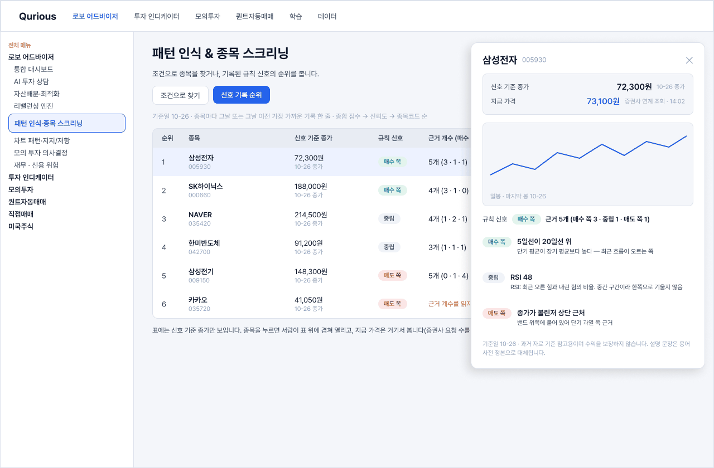
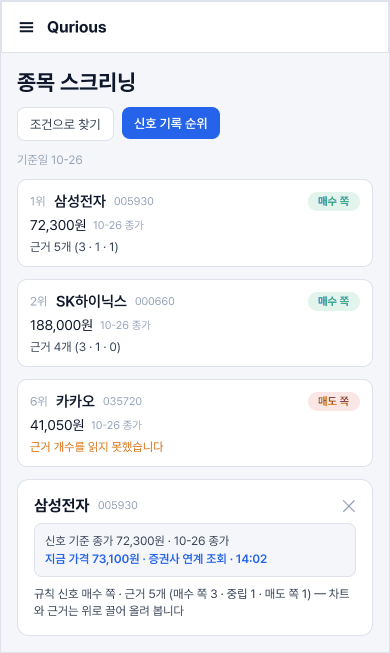
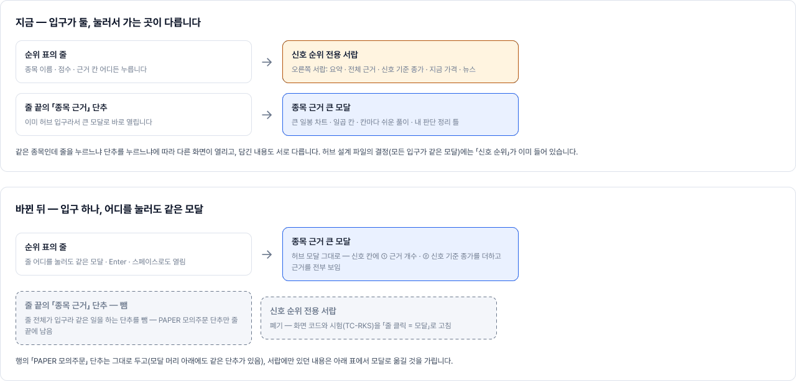
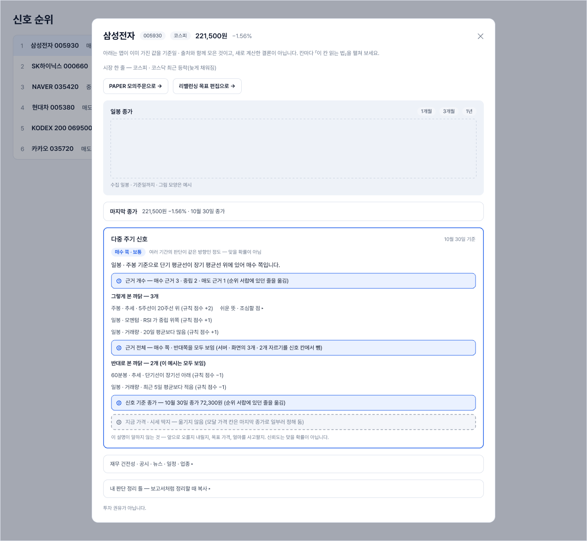

# 신호 순위 화면 설계 v0.3 — Qurious (할 일 ②-19 · 종목 모달 · 가격 표시)

| 문서 정보 | |
|---|---|
| **판 · 상태** | v0.3 · 9절이 정본(2026-11-02 결정 · 구현 완료 · 개발 앱 확인) · 10월 제안은 옛 안으로 표시 · 초안 · **팀 검토 전** |
| **구분** | 4. 화면·서비스 설계 — [화면 설계 절차 v0.2](../화면설계절차.md) 3절 0 ~ 2 단계를 처음 적용 |
| **작성** | 이동원(화면 설계 · 화면 코드 담당 — **백엔드는 아래 5절 담당자가 따로 맡는다**) |
| **검토** | 검토 전 |
| **최종 수정** | 2026-11-02 (KST) |
| **기준** | 로컬 main `64fb3d7` 코드 읽기(화면 실행 · 브라우저 확인은 아직 안 함) · API 명세서 v0.43 `API-HUB-03` · [판정표](../../../01-analysis/research/배경조사/2026-10-28-실시간-저장-분리-판정/판정표.md) · 사용자 피드백 10-27(쉬운 말 · 환각 없음 · 종목 클릭 모달) |
| **기준(9절)** | 로컬 main `9b283b8` + S191 작업 트리(커밋 전) · 개발 앱(8966) 브라우저 확인 2026-11-02 · Figma 전용 파일 `t2BVPRrfnaJI3yfcymkeEq` |
| **관련** | 할 일 ②-19 · ②-20 · ②-21 ~ ②-23 · [화면 IA](../IA.md) W6 `robo-screening` · [UI 명세서](../UI명세서.md) |

> **이 문서가 답하는 질문** 1. 신호 기록 순위를 어디에 어떻게 보이나 · 2. 종목을 누르면 무엇이 열리나 · 3. 가격은 어느 값이고 어디서 온 값인지 화면이 어떻게 말하나 · 4. 어떤 경우를 그리고 어떤 경우를 그리지 않나

## 요약

> **2026-11-02 갱신** — 1번(자리)은 **안 A 새 화면 「신호 순위」** 로, 2번(서랍)은 **종목 근거 큰 모달** 로 바뀌었다(9절). 아래 요약 · 3절 · 7 ~ 8절의 안 B · 전용 서랍은 10월 제안으로 남겨 둔다.

1. **새 화면을 만들지 않고 W6 `robo-screening` 에 「신호 기록 순위」 칸을 더한다**(안 B — 3절). 화면 이름이 늘지 않고, 이미 있는 「종목 스크리닝」 표 옆에서 비교가 된다.
2. **종목을 누르면 오른쪽 서랍(②-20 과 같은 틀)** 이 열리고, 위에 차트 · 아래에 「왜 매수 쪽인가」 근거 표를 쉬운 말로 보인다. 숫자는 응답에 있는 값만 쓰고, 설명 문장은 용어사전 정본만 쓴다.
3. **가격은 항상 두 줄**이다 — 「신호 기준 종가 (MM-DD)」 와 「지금 가격 · 출처 · 시각」. 신호는 확정 종가로 두고 지금 가격은 곁에 병기한다(판정표 (가)). 지금 값을 못 받으면 칸을 비우고 까닭을 쓴다 — 지난 종가나 평단가로 말없이 채우지 않는다.

---

## 1. 지금 화면에서 확인한 것 (코드 읽기 · 브라우저 미확인)

- **W6 종목 스크리닝** (`public/app.html:1763` · `robo.js:246~304`): 위 카드 5장(`screen-signal-cards`) + 표(`screen-result-table`) — 열: 종목명 · 가격 · 등락률 · RSI · 규칙 신호 · 패턴 근거 · XAI(「🧠 설명」 「다중 주기 ↗」). 데이터는 `GET /api/stocks/signals`.
  - 가격 · 등락률은 지금 값(조회 실패 시 일봉 값으로 **말없이 대체**), 표 아래 한 줄에만 「일봉 1년 · 기준일 X」 — 행마다 어느 쪽 값인지 알 수 없다(판정표 1-6).
- **신호 기록 순위 API** `GET /api/stock-hub/signal-rank`(`stock_hub.py:41` · `API-HUB-03`, 이미 있음 · 화면은 아직 안 부름): 줄마다 `rank · symbol · as_of · signal · strength · confidence · composite · counts{buy,neutral,sell}`(+ `components` 선택) · `missing[]`(까닭) · `definition` · `source` · `notice`.
  - **화면이 쓰기엔 비어 있는 것**: 종목 **이름이 없다**(`symbol` 만) · **섹터가 없다**(섹터 소속은 ②-10 에서 붙는 뒤에 거르기 가능) · 지금 가격 · 종가 없음.
- **종목 허브 묶음** `GET /api/stock-hub?symbol=…&sections=…`(`stockcard.js`): 마지막 종가 · 다중 주기 신호 · 재무 · 공시 — 모달에 재사용할 수 있는 읽기. 새 계산 없음 · 칸마다 기준일 · 출처.
- 차트 머리는 이미 「지금 값 + 출처 · 시각 글」(`trading.js:15~28`) — 따라갈 본보기.

## 2. 사용자가 풀어 달라고 한 것 → 화면의 약속

| 요구(사용자 10-27 · 10-28) | 화면의 약속 |
|---|---|
| 초보도 아는 쉬운 말 · RSI 같은 용어 | 지표 이름 옆에 한 줄 뜻(용어사전 정본). 「좋다 · 나쁘다」 대신 「매수 쪽 근거 · 매도 쪽 근거」 |
| 정확 · 환각 없음 | 모든 숫자는 응답 값. 응답에 없으면 「모름」. 문장 숫자 = 응답 값 시험(TC-XR 계열) |
| 근거 n개 | n = `reasons` 줄 수(#351 결정). 순위 줄의 `counts` 는 「매수 쪽 a · 중립 b · 매도 쪽 c」 로 나눠 보이고, 합이 n |
| 종목 클릭 → 차트 + 근거 XAI | 3.2절 서랍 |
| 최신 가격 | 신호는 확정 종가 · 지금 가격 병기(3.3절). 장중 신호 재계산은 **이번 범위 밖**(판정표 3절 결정 ③ — 이유는 거기에) |

## 3. 0 단계 — 자리 후보와 고른 안

### 3.1 자리

| 안 | 내용 | 장점 | 단점 |
|---|---|---|---|
| A 새 화면 | 메뉴에 「신호 순위」 추가 | 순위만 깔끔하게 | 화면 54개에 하나 더 · 스크리닝과 겹침 · 메뉴 칸 부족(IA I11) |
| **B 기존 화면에 더하기 (고름 · 제안)** | W6 스크리닝에 탭 둘: 「조건으로 찾기(지금 표)」 · 「신호 기록 순위(새)」 | 이름이 안 느는 · 같은 화면에서 견줌 · 지금 표의 XAI 열과 모달이 이어짐 | W6 화면이 길어짐 → 탭으로 해결 |
| C 기존 화면 바꾸기 | 지금 표를 순위 API 로 갈아 끼움 | 한 표 | 지금 표는 조건(신호 · 모델 · 신뢰도)으로 거르는 도구고 순위는 기록 읽기라 **뜻이 다르다** — 섞이면 「같은 이름 다른 값」 이 난다 |

**고른 안 B(제안 · 검토에서 확정).** 뒤집을 조건: 팀이 「순위가 첫 화면에 필요하다」 고 하면 A. → **2026-11-02 사용자가 안 A(새 화면)로 결정했다 — 9.1절.**

### 3.2 종목 서랍(②-20 틀을 쓴다) — ⚠️ 2026-11-02 폐기 · 줄을 누르면 종목 근거 모달(9.2절)

```
┌ 삼성전자 005930 ───────────────────────── ✕ ┐
│ 신호 기준 종가  72,300 원  (10-26 종가)      │
│ 지금 가격       73,100 원  증권사 연계 조회 · 14:02 │   ← 못 받으면 「받지 못했습니다 — 까닭」
│ ───────────────────────────────────────── │
│ [ 일봉 차트 ]  ← 마지막 봉 날짜를 차트 아래에 적음   │
│ ───────────────────────────────────────── │
│ 규칙 신호  매수 쪽   근거 5개 (매수 쪽 3 · 중립 1 · 매도 쪽 1) │
│  ▸ 5일선이 20일선 위 — 매수 쪽   (한 줄 뜻)    │
│  ▸ RSI 38 — 중립                  (RSI: …)     │
│  ▸ …                                           │
│ 기준일 10-26 · 과거 자료 기준 참고용이며 수익을 보장하지 않습니다 │
│ [ 다중 주기 ↗ ]  [ 자세한 기술 분석 ↗ ]         │
└─────────────────────────────────────────────┘
```
(위 숫자는 모양을 보이는 **가짜 예시**다 — Figma 에서는 API 를 불러 받은 실제 값을 넣는다.)

### 3.3 가격 표시 규칙(판정표 (가) 를 화면 규칙으로)

1. 한 줄 안에서 값의 종류를 섞지 않는다 — 「신호 기준 종가(날짜)」 와 「지금 가격(출처 · 시각)」 은 따로 칸.
2. 지금 가격 출처 글은 `quote_now.label` 을 **그대로** 쓴다(화면이 짓지 않음). 못 받으면 「지금 가격을 받지 못했습니다」 + `fallback` 까닭.
3. 대체값(지난 종가 · 평단가)을 말없이 쓰지 않는다. 지난 종가를 보일 때는 「종가(MM-DD)」 를 붙인다.
4. 지수 띠 · 시장 카드에도 「HH:MM 기준」(판정표 4-3 · 이슈 A 안 4).

## 4. 2 단계 — 경우 표(주 경로 = 자리 B · 진입 = 메뉴에서 · 탭 「신호 기록 순위」)

```
 주 경로                                          1280   390
 ───────────────────────────────────────────────────────────
 정상          순위 30줄 + 지금 가격 있음           ■      ■
 비어 있음     오늘 기록이 아직 없음(12:30 전)       ■      □  1280 과 배치 같음
 비어 있음     고른 종목에 기록이 없음(missing)      ■      □
 불러오는 중                                        ■      □  같은 부품
 일부          일부 종목 지금 가격 못 받음           ■      ■  ← 가격 칸만 「받지 못했습니다」
 일부          일부 줄 근거 문장이 낯설어 counts 없음 ■      □  (counts_note)
 오류          서버가 답하지 않음 · 로그인 만료       ■      □
 ───────────────────────────────────────────────────────────
 갈림 — 대표 하나씩 (정상 · 1280)
 진입 D        종목 허브 · 스크리닝 표의 「🧠 설명」 에서 서랍으로   ■
 내용 E        종목 이름이 긴 것 · 근거 0개 · 근거 12개           ■ ■ ■
 부품 F        순위 한 줄 · 서랍 열기 단추 · 탭                   부품 페이지에
 자리 C        3.1절 안 A · B · C 나란히 (검토용)                 ■ ■ ■
 ───────────────────────────────────────────────────────────
 그리는 프레임 7 + 4 = 약 17 (곱하면 수백)
```
**그리지 않는 줄과 까닭**: 390 에서 「비어 있음」 둘 · 「불러오는 중」 · 「낯선 근거」 · 「오류」 — 1280 과 배치가 같은 부품이다. 섹터 거르기 — **섹터 소속이 아직 없어서**(②-10 뒤) 이번에 그리지 않고 자리만 비워 둔다. ADX · 상대 강도 열 — 2단계 범위 밖(할 일 표).

## 5. 계약과 담당 — 화면과 백엔드를 분리한다

화면(이동원)이 **쓰려고 요청하는 것**이고, 백엔드는 아래 담당자가 정한다. 화면은 이 칸이 없으면 그 자리를 비우고 안내 글을 보인다(지어내지 않음).

| 필요한 것 | 지금 | 요청 | 담당(제안 — 이슈 초안에서 확정) |
|---|---|---|---|
| 순위 줄의 **종목 이름** | `signal-rank` 에 없음 | 줄마다 `name` | 순위 API 쪽(`stock_hub.py`) |
| 순위 줄의 **지금 가격 + 출처 · 시각** | 없음 | 응답과 따로, 화면이 `GET /api/quote/now` 를 종목별로 부르는 길도 가능(요청 수 ↑) vs 서버가 한 번에 붙이는 길 | 시세 담당 — **정할 것** |
| 스크리닝 표 행의 **`close`**(신호 일봉 종가 · 날짜는 행의 `as_of`)와 **`quote`**(`quote_now` 응답의 `price` · `change_pct` · `source` · `as_of` · `fetched_at` · `label` · `fallback` 그대로) | 없음(판정표 1-6) | 행마다 — **신장환 님 찬성 · 11-05 안에 넣음(#370 답글 10-28)**. 처음 요청한 `price_source` · `price_as_of` 는 쓰지 않는다(`price_source` 는 공격 모드가 다른 값으로 쓰고 날짜 칸이 둘이 된다). 기존 `price` · `change_pct` 는 화면이 옮길 때까지 그대로 | `routes/stocks.py` `/signals` |
| 지수 띠 시각 | 응답에 `from_cache` 만 | 값의 시각 | `/api/stocks/market` |
| 모의투자 보유 목록 출처 · 시각 · 가격 확인 불가 | 없음 | 이슈 A 안 3 | 모의투자 쪽 |
| 섹터 | 없음(②-10 뒤) | — | ②-10 |

화면 쪽 코드는 새 파일 `public/js/signal-rank.js`(탭 · 표 · 서랍)로 두고, 공용 파일(`app.html` 탭 한 칸 · `core.js`)은 **고치기 직전 공개 PR 목록을 본 뒤** 최소로만 건드린다.

## 6. 정할 것(검토에서 — 5절 양식으로 알림)

1. 자리: 안 B(탭)로 가도 되는가.
2. 서랍의 차트: 일봉만 / 다중 주기 요약 포함.
3. 지금 가격을 순위 표 **모든 줄**에 보이나(요청 수 · 증권사 한도) / 서랍을 열 때만 보이나 — 이동원 제안: **서랍을 열 때만**, 표에는 신호 기준 종가만.
4. 「중립」 을 쉬운 말로 무엇이라 부르나(낱말 표 #159 T3 와 맞춤).

## 7. Figma 그림(3 단계 — 2026-10-28 S158 첫 판 · 검토 전)

- 위치: 기존 작업 파일 `NkW5HeLKczBDZnNJJkWKEu` · 페이지 「설계 — 결정안」 · 새 구역 **「[제안 · 열림] 신호 기록 순위 — 탭 + 종목 서랍 (할 일 ②-19)」**(노드 `25:193`) · 주소 `https://www.figma.com/design/NkW5HeLKczBDZnNJJkWKEu/?node-id=25-193` (Qurious 프로젝트 안 기존 파일이라 초안함에 두지 않음).
**<그림 1> 신호 기록 순위 — 정상(1280) · 탭 + 표 6줄 + 종목 서랍** · 표의 종목 · 숫자 · 날짜는 모양을 보이는 예시 · 서랍은 표 위에 겹쳐 열린다



<sub>원본: [Figma · Qurious 설계 파일 · node 25:196](https://www.figma.com/design/NkW5HeLKczBDZnNJJkWKEu/?node-id=25-196) · 그림 판 v0.2 · 기준 커밋 `40e957f` · 2026-10-31</sub>

**<그림 2> 신호 기록 순위 — 좁은 화면(390)** · 카드 목록 + 아래 시트 · 값은 예시



<sub>원본: [Figma · Qurious 설계 파일 · node 26:193](https://www.figma.com/design/NkW5HeLKczBDZnNJJkWKEu/?node-id=26-193) · 그림 판 v0.2 · 기준 커밋 `40e957f` · 2026-10-31</sub>

- 그린 것: 1280 정상(탭 + 표 6줄 + 열린 서랍) · 서랍 상태 셋(정상 · 지금 가격 못 받음 · 신호 기록 없음) · 390(카드 목록 + 아래 시트) · 자리 세 안 나란히 · 읽는 법 + 열린 질문 다섯. 4절 경우 표 중 「그리지 않음」 으로 적은 줄은 그리지 않았다.
- **1 단계 대조(10-28 S158 · 일부만 함)**: 일회용 계정(대화 끝에 탈퇴로 지움)으로 앱(8966)에 로그인해 지금 스크리닝 화면(`robo-screening` · 「스크리닝 실행」 뒤)을 캡처하고 그림과 견줬다. **Figma 「지금 화면」 페이지로 가져오는 것(`generate_figma_design`)은 하지 않았다** — 캡처 이미지는 로컬에서 보고 지웠다. 견줘서 나온 것 넷:
  1. 위 메뉴 이름이 달랐다(실제: 로보 어드바이저 · 투자 인디케이터 · 모의투자 · 퀀트자동매매 · 학습 · 데이터) → 그림 고침.
  2. **왼쪽 메뉴(약 240px)가 있어** 본문 폭이 약 976px 이다 → 표(800)와 서랍(420)이 나란히 안 들어간다. **서랍은 표 위에 겹쳐 열리는 것으로 정했다**(그림 반영 · 그림자 추가) — 서랍이 가리는 표의 오른쪽 칸(기준일 · 근거 개수 일부)은 서랍을 닫으면 다시 보인다.
  3. 화면 제목은 「패턴 인식 & 종목 스크리닝」(그림은 「종목 스크리닝」) → 고침. 지금 화면은 위쪽에 필터 셋(시장 신호 강도 · 패턴 인식 모델 · 최소 신뢰도)과 「스크리닝 실행」, 그 아래 「규칙 신호 (대표 종목)」 카드 줄, 맨 아래 「스크리닝 결과」 표가 있다. 탭은 제목 아래, 필터 줄 **위**에 둔다(그림은 필터를 그리지 않았다 — 「조건으로 찾기」 탭 안에 지금 화면이 그대로 들어간다는 뜻).
  4. 지금 표 행에는 **기준일 칸이 없고**(표 아래 한 줄뿐 · 판정표 1-6) 가격이 어느 값인지 알 수 없는 것을 눈으로 확인했다.
  - 참고: 같은 화면 위쪽 배지에 「자료 10-26 · 정상」 이 보였다 — 이 PC 의 「확인 필요」 오탐을 고친 뒤 실제 화면에서 정상으로 나오는 것도 확인.
- 색 · 글꼴(Pretendard) · 모서리는 같은 파일의 기존 구역 값을 읽어 맞췄다. 컴포넌트화(부품 페이지)는 아직 — 칩 · 서랍은 이 구역 안에서만 쓰는 임시 프레임이다.
- 그림의 종목 · 숫자 · 날짜 · 설명 문장은 모양을 보이는 **예시**(API 를 불러 받은 값이 아님). 경우 표의 「실제 값으로 넣는다」 는 개발 준비됨 전에 API 값으로 바꾼다.
- 다음: 팀 검토(6절 정할 것 넷 → 그림의 열린 질문 다섯) → 결정 기록 → 「개발 준비됨」 → 구현 · 그림과 대조. 그 전에 할 수 있는 안전한 일: 서랍의 문장 규칙 시험(문장 숫자 = 응답 값) 설계, 앱 화면 캡처로 1 단계 대조.

## 8. 서랍이 읽는 응답과 시험 설계 (S158 · 코드 읽기 — 구현 전) — ⚠️ 서랍은 11-02 에 폐기 · 서랍 칸이 모달의 어디로 갔는지는 9.3절

**서랍의 설명 문장은 화면이 짓지 않는다.** 신장환 님 설명 층이 이미 있다 — `GET /api/explain?kind=signal&symbol=…&date=…`(`app/routes/explain.py` → `signal_explain.explain` · 로그인). 응답: `summary`(한 줄 요약) · `confidence_text` · `reasons`(이 방향을 밀어 준 근거) · `counter_reasons`(반대쪽 근거) · `evidence`(근거 표 — 줄마다 `timeframe` · `label` · `key` · `observed` · `values` · `points` · `contribution`) · `notes` · `disclaimer` · `as_of` · `definition`. 같은 입력이면 같은 문장이고, 기록이 없으면 404(한국어 까닭). 그래서 3.2절과 Figma 서랍 그림의 **설명 문장 셋(「5일선이 20일선 위」 등)은 모양을 보이려고 내가 적은 예시**이고, 구현에서는 응답의 `summary` · `reasons` · `counter_reasons` · `evidence` 를 그대로 그린다 — 화면에서 문장을 새로 만들지 않는다.

| 서랍 칸 | 읽는 곳 | 비고 |
|---|---|---|
| 신호 기준 종가 · 날짜 | `GET /api/stock-hub?symbol=…&sections=price`(또는 순위 줄의 `as_of`) | 마지막 종가는 수집 DB · 칸마다 기준일 |
| 지금 가격 · 출처 · 시각 | `GET /api/quote/now?symbol=…` | `label` 을 그대로 · 못 받으면 `fallback` 까닭(판정표 (가)) |
| 한 줄 요약 · 근거 · 반대 근거 | `GET /api/explain` | `evidence` 줄은 일 · 주 · 60분 **주기별**이다 — 그림의 예시 줄은 주기를 안 보여 줬으니 구현 때 주기 칩을 더할지 검토에서 정함 |
| 근거 개수 | 순위 줄의 `counts`(`signal-rank`) | `reasons` 줄 수(#351)와 같은 정의 — 서랍 요약과 숫자가 일치해야 함(아래 시험) |
| 용어 한 줄 뜻(RSI 등) | 용어사전 서버(`app/services/glossary*`) 정본 | 화면이 새로 짓지 않음. 응답 문장 속 용어를 칩으로 잇는 방식은 기존 답 끝 용어 칩(`feat/stock-hub-chat-card-term-chips`) 확인 뒤 |
| 차트 | `GET /api/stocks/candles` 일봉 | 마지막 봉 날짜를 차트 아래에 적음 |

**시험 설계(번호는 시험 계획서의 새 번호 규칙을 확인한 뒤 붙인다 — 지금은 이름만)**
1. **순위 줄 ↔ 서랍 일치**: 같은 종목 · 같은 `as_of` 에서 순위 줄의 `counts` 합 = 서랍 `reasons` + 중립 + `counter_reasons` 줄 수와 모순이 없다(정의가 같다는 시험 — `side_counts` 와 `explain` 이 같은 `evidence` 를 쓰므로 서버 시험으로 가능).
2. **화면이 문장을 안 만든다**: 서랍 렌더 코드가 `summary` · `reasons[].text` · `counter_reasons[].text` · `notes` · `disclaimer` 외의 숫자 문장을 만들지 않는다 — 화면 시험(`view_scan` 계열 또는 브라우저 시험)에서 서랍 글의 숫자가 모두 응답 값인지 본다. 서버 쪽 「문장 숫자 = 응답 값」 은 이미 `test_numbers_in_sentence_are_response_values`(TC-XR 계열)가 있다.
3. **가격 두 줄 규칙**: 지금 가격 실패 응답(가짜 `/api/quote/now` 가 `price=null`)에서 서랍이 신호 기준 종가를 「지금 가격」 칸에 넣지 않는다 · 까닭을 보인다.
4. **기록 없음 갈래**: `/api/explain` 404 · `signal-rank` 의 `missing`(`none` / `not_universe` 두 갈래)에서 서랍이 서로 다른 안내 글을 보인다(3.2절 ③).
5. **낯선 근거 줄**: `counts_note` 가 있는 줄도 서랍은 열린다(개수만 비움).
- 이 시험들은 구현 전에는 **쓰지 않았다** — 여기는 설계다.

## 9. 2026-11-02 결정과 구현 — 새 화면 · 입구 통일 (S190 · S191)

이 절이 지금의 정본이다. 위 3.1 · 3.2 · 7 · 8절의 「탭(안 B) · 전용 서랍」 은 10월의 제안이고, 아래 두 결정으로 바뀌었다.

### 9.1 자리 — 안 A 새 화면 (사용자 결정 2026-11-02)

- 로보 어드바이저 메뉴에 **「신호 순위」** 를 새 화면으로 둔다(화면 키 `signal-rank`). 스크리닝에 탭을 더하는 안 B 는 고르지 않았다 — 화면이 한 칸 늘지만 순위만 깔끔하게 보이고, 스크리닝(조건으로 찾기)과 뜻이 섞이지 않는다(3.1절 안 C 의 우려와 같은 까닭).
- Figma: 전용 파일 [`t2BVPRrfnaJI3yfcymkeEq`](https://www.figma.com/design/t2BVPRrfnaJI3yfcymkeEq/) · 쪽 「설계 — 결정안」(안 A · 안 B 1280 · 비교표 · 결정 기록).
- 구현 파일(S190): 메뉴 항목 · 안내 글(`public/js/core.js`) · 화면 칸 · CSS 링크(`public/app.html`) · 진입 훅(`public/js/main.js`) · 새 `public/js/signalrankview.js` · `public/css/signalrankview.css` · 판단 · 그리기 `public/js/signal-rank.js` · 서버 `app/services/stock_hub.py` 의 `attach_names`(줄마다 `rows[].name`).
- 순위 머리줄(기준 · 계산 시각 · 딱지)은 서버 `freshness` 를 그대로 보인다(TC-RKS-08). 신호를 기록하는 종목은 분봉 유니버스 + 마지막 거래일의 `signal_targets.targets` 이고(`signals_all` 단계 · 신장환 님 #496 이 `mtf_signals.record_scope()` 로 허브 · 설명 서비스의 판정에 연결), 자세한 것은 [신호 전체 종목 기록 설계](../../system/신호-전체종목-기록-설계.md) 에 둔다.

### 9.2 입구 통일 — 줄을 누르면 종목 근거 큰 모달 (사용자 결정 2026-11-02 · S191)

**왜**: 종목 허브 설계 파일(Diu2GIRk4Pnndo9tNi9pfu)의 「[결정 바뀜 · 11-02 오후] 모든 입구가 서랍을 거치지 않고 큰 모달로」 목록에 신호 순위가 이미 있었다. 그런데 새 화면은 줄을 누르면 **전용 서랍**을 열고 줄 끝 「종목 근거」 단추만 모달을 열었다 — 입구가 둘이고 담긴 내용도 달랐다(사용자 지적).

**<그림 3> 입구 통일 — 지금(입구가 둘)과 바뀐 뒤(입구 하나)**



<sub>원본: [Figma · 신호 순위 화면 설계 · node 11:2](https://www.figma.com/design/t2BVPRrfnaJI3yfcymkeEq/?node-id=11-2) · 그림 판 v0.3 · 기준 커밋 `9b283b8` + 이 판 · 2026-11-02</sub>

**결정 셋(사용자 답)**

| 질문 | 답 | 까닭 |
|---|---|---|
| (a) 줄 끝의 「종목 근거」 단추를 남기나 | **뺀다** — 「PAPER 모의주문」 단추만 남기고, 줄은 Enter · 스페이스로도 같은 모달을 연다 | 줄 전체가 입구이면 같은 일을 하는 단추가 둘이다 |
| (b) 서랍에만 있던 것 중 모달로 옮길 것 | **① 근거 개수 · ② 신호 기준 종가만 옮긴다.** ③ 지금 가격 · 시세 딱지는 옮기지 않는다 | ②는 오준영 님 #373 3번 「마지막 종가로 대신하지 않는다」 라서 버릴 수 없다. ③은 허브 가격 칸이 「실시간이나 지연 시세가 아니라 마지막 거래일 종가」 로 일부러 정해져(`stock_hub.PRICE_NOTE`) 있고 옮길 계획이 없다 |
| (c) 근거를 전부 보이나 | **전부 보인다** | 서버 `stock_hub.signal` 의 `reasons[:3]` · `counter_reasons[:2]` 자르기와 화면 신호 칸의 3개 제한을 신호 칸에서 뺐다. 근거마다 쉬운 풀이는 접혀 있어 길이는 목록만큼만 늘어난다 |

**<그림 4> 순위 줄을 누른 직후 — 종목 근거 모달의 신호 칸** · 파란 칸 ① ② ④ 는 서랍에서 옮겨 온 것 · 회색 점선 ③ 은 옮기지 않기로 한 것 · 종목 · 숫자는 모양을 보이는 예시



<sub>원본: [Figma · 신호 순위 화면 설계 · node 7:2](https://www.figma.com/design/t2BVPRrfnaJI3yfcymkeEq/?node-id=7-2) · 그림 판 v0.3 · 기준 커밋 `9b283b8` + 이 판 · 2026-11-02</sub>

### 9.3 서랍에 있던 것은 모달의 어디로 갔나

| 항목 | 옛 전용 서랍(폐기) | 지금 종목 근거 모달 | 서버를 바꿨나 |
|---|---|---|---|
| 한 줄 요약 · 신호 딱지 | 있음 | 신호 칸에 있음 | 아니오 |
| 근거(밀어 준 · 반대쪽) | 기록의 전부 | **전부** — 근거마다 「쉬운 뜻 · 조심할 점」 접힘 | 예 — 자르기 제거 |
| 근거 개수 문구 | 「근거 n개 (매수 쪽 · 중립 · 매도 쪽)」 | 신호 칸 머리에 같은 글(`countsView`) · 못 세면 0개가 아니라 서버 까닭 | 예 — `counts` · `counts_note` 칸 |
| 신호 기준 종가 | 그 줄의 기준일 일봉 종가 | 신호 칸에 같은 글 — 모달이 열린 뒤 채움 · 그날 줄이 없으면 「확인 불가」 | 아니오 — 화면이 일봉 한 건을 더 부름 |
| 지금 가격 · 시세 딱지 | 있음 | **옮기지 않음**(결정 b) | — |
| 관련 최신 뉴스 | 있음 | 허브의 뉴스 칸 | 아니오 |
| PAPER 모의주문 · 리밸런싱 | 줄 끝 단추 | 모달 머리 아래 단추 한 줄 · 줄 끝에는 PAPER 단추만 | 아니오 |
| 일봉 차트 | 자리만(그리지 않음) | 큰 일봉 차트 · 기간 단추 | 아니오 |
| 신호 기록의 날짜 | 그 줄의 기준일 | 그 종목의 최신 기록 — 순위 화면에 날짜를 고르는 칸이 없어 같은 기록을 가리킨다 | 아니오 |

### 9.4 구현과 시험

- 서버 `app/services/stock_hub.py` `signal()` — 근거 전부 · `counts`(`signal_explain.side_counts` · 낯선 근거 문장이면 `null` + `counts_note`).
- 화면 `public/js/stockdrawer.js` — `sdSignalPlainBody`(근거 개수 줄 · 종가 자리) · `sdSignalCloseView` · `fillSignalClose`. `public/js/signal-rank.js` — 줄(`<tr>`)에 `data-hub-open` · Enter · 스페이스 · 전용 서랍 · 뉴스 그리기 · `safeHttpUrl` 삭제. `public/css/signalrankview.css` 의 서랍 규칙 삭제.
- 시험: TC-HUB-07(전부 · `counts`) · 07b(개수를 못 셀 때) · TC-SDR-14(모달 신호 칸) · 15(종가 자리를 채우는 길) · TC-RKS-11(줄이 입구) · TC-RKS-09(서랍 CSS 없음). 삭제: 옛 TC-RKS-04(서랍 문장) — 같은 약속이 TC-SDR-14 로 이어졌다. 코드 흐름은 [기능별 동작 원리서](../../system/기능동작원리.md) 3.6절.
- 확인(개발 앱 8966 · 브라우저): 줄 클릭 → 서랍이 아니라 모달 · Esc 로 닫으면 초점이 줄로 · Enter · 스페이스 · PAPER 단추는 모달 없이 모의주문 화면으로.

### 9.5 아직 안 한 것

- 좁은 화면(390)에서 표를 카드 목록으로 바꾸기(지금은 표 가로 스크롤) · 머리줄 「상태 이름 —」 글 다듬기 · 애프터마켓 딱지 · 머리줄 · 딱지 그림(종목 허브 설계 파일 07 쪽)을 전용 파일에 옮기기.
- 모달 신호 칸의 글 간격 · 말투(「XAI 답지 않고 AI 스럽다」) 다듬기 — Ollama 로 문장을 다듬을 수 있는지 먼저 본다(이 PC 모델 0개 · 숫자는 응답 값 그대로 · 목표가 · 손절은 PRD 와 충돌).
- 모달 가격 칸에 지연 시세 딱지를 둘지(결정 b ③ 의 뒷일) — 허브 설계에서 따로 정한다.


---

## 개정 이력

| 판 | 날짜 | 바뀐 것 | 까닭 | 근거 |
|---|---|---|---|---|
| v0.3 | 2026-11-02 | 9절 신규(안 A 새 화면 결정 · 입구 통일 결정 셋 · 서랍 → 모달 대응표 · 구현과 시험 · 아직 안 한 것) · <그림 3> · <그림 4> · 3.1 · 3.2 · 8절에 폐기 표시 | 새 화면(S190)과 입구 통일(S191)로 10월의 안 B · 전용 서랍 설계가 낡았다 — 옛 안은 지우지 않고 어디로 바뀌었는지 표시한다 | [그림 대장](../../../00-management/standards/문서그림지침.md) <표 5> · Figma 전용 파일 11:2 · 7:2 · 사용자 결정 2026-11-02 |
| v0.2 | 2026-10-31 | 7절에 Figma 그림 둘(<그림 1> 정상 1280 · <그림 2> 좁은 화면 390) · 내용은 v0.1 과 같다 | 그림이 0장이던 설계서에 핵심 그림을 넣는다 | [그림 대장](../../../00-management/standards/문서그림지침.md) <표 5> |
| v0.1 | 2026-10-28 | 초안(0 ~ 3 단계 — 자리 · 경우 표 · Figma 첫 그림(7절) · 앱 화면과 눈으로 대조(7절)) · 팀 검토 전 · Figma 「지금 화면」 페이지 가져오기는 안 함 | 할 일 ②-19 — 종목 모달 · 가격 표시 설계 | [지난판 v0.1](신호순위-화면설계_v0.1.md) |
