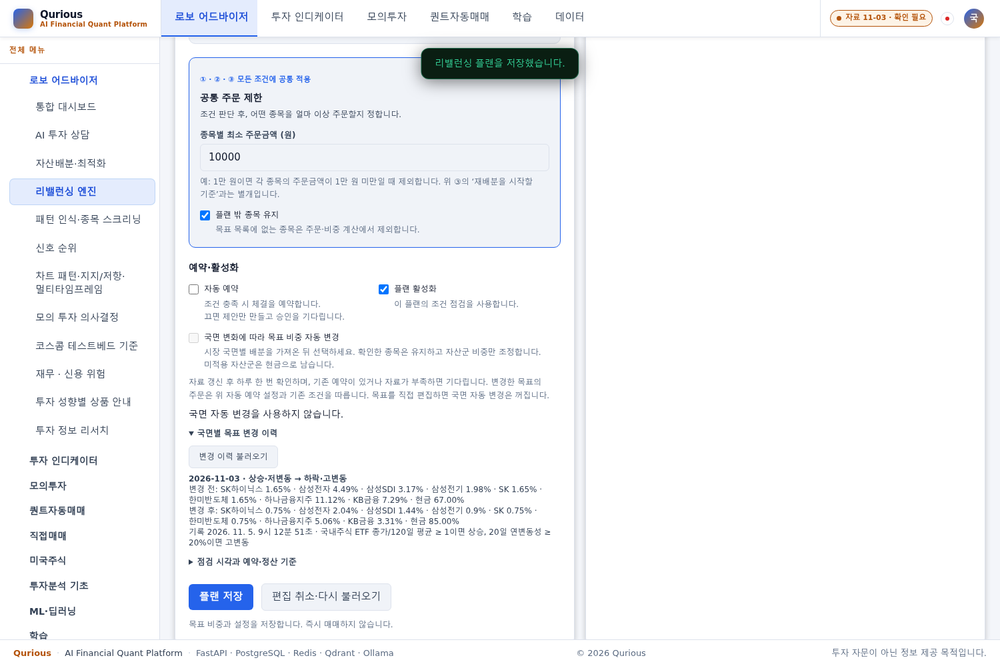

# 11/5 담당 기능 마감 검증 v1.0 — Qurious

| 항목 | 내용 |
|---|---|
| 담당 | 오준영 |
| 상태 | 오전 기술 검증·운영 반영 완료, 사람의 발표 연습·팀 검토 전 |
| 기준 소스 | main `cb204a992b2fec6f9faccf7e745e22d81cdb9552` — #552까지 |
| 운영 이미지 | `qurious-app:main-cb204a99-20261105` |
| 확인 시각 | 2026-11-05 09:01~09:07 KST |
| 관련 | [담당 계획](../00-management/plans/오준영파트-할일.md), [누적 오류](오준영-오류수정기록.md), [발표·시연](../06-retrospective/오준영/README.md) |

오후 최종 상태는 [§7](#7-오후-제품시험자료-마감)에 기록한다. 아래 §1~6은 오전 실행·준비 기록이다.

당시 최신 main의 변경분과 담당 기능을 격리 환경에서 검증하고 로컬 운영 앱·worker·beat에 반영했다. 새 KIS 주문·알림 발송 없이 설정과 장부를 보존했다. 발표자료는 검토용 0.4로 갱신하며, 사용자는 **아직 발표 연습 전**이라고 확인했다. 사람의 소요 시간이나 팀 검토 완료를 기술 검증 결과로 대신하지 않는다.

## 1. 최신 소스와 회귀

11/4 최종 운영본 `910c8ee1` 이후 코인 최소 주문금액 검증(#547), DSR 용어집 생성 원본 복구(#550), 국면 학습의 PAPER/KIS 경로 정정(#549)을 확인했다. #552는 오류·처리 기록의 보완이다.

후보 이미지·일회용 PostgreSQL·외부망 차단 환경에서 **493건 중 490통과·1실패·2건너뜀**, 실행 시간 95.52초였다. 원본 JUnit과 최초 실패 로그를 보존했다. 11/4 전체 회귀 수치와 합산하지 않으며 이번 결과는 선택한 관련 파일의 회귀다.

| 결과 | 내용 |
|---|---|
| 490통과 | 변경된 주문 정책·용어집·학습, 자산배분·리밸런싱·신선도·고정 전략·스냅샷 등 선택 범위 |
| 1실패 | ERR-037, `test_judge_fee_uses_top_level_lean_fills_and_compares_rates`: 기대 `참고용(요율)`, 실제 `불일치` |
| 2건너뜀 | 해외 비용 모델 미지원으로 미국 예약 실제 체결·잔고 부족 체결 시험 제외 |

ERR-037은 같은 100bp 요율이지만 거래대금과 비용 총액이 다른 입력에서 판정 계약이 어긋난 기존 실패다. 강민석 담당이며 코드·기대값을 임의 변경하지 않았다. `scripts/daily_lean_reconcile.py`가 후보 실행 이미지에 없음을 별도로 확인했다. 앱 회귀 통과와 대사 스크립트의 미해결 상태를 구분해 운영에 반영했다.

## 2. 운영 반영과 보존

Beat 전송 중지 → worker 작업 종료 확인 → 앱·worker 중지 → 암호화 백업 → DB head 확인 → 앱·worker 조회 검증 → Beat 시작 순서로 반영했다.

| 항목 | 확인 결과 |
|---|---|
| 실행 소스 | app·worker·beat 각각 **701파일**, 기준 소스와 불일치 0 |
| 환경 | 기존 환경·명령·포트·네트워크·마운트·키 연결 보존, 세 서비스 키 읽기 성공·실전 허용 OFF |
| DB | `0043_regime_targets` 유지 |
| HTTP | 인증·화면·학습 원문 **13경로 200**, 제공 파일 해시 일치, 비로그인 변경 이력 401 |
| 예약 실행 | 09:06:35 KST 새 Beat heartbeat 확인 |
| 장부 | 기존 증권사 주문 13건·스냅샷 30건, 설정·현금·보유·주문 지문 보존 |
| 활성 상태 | 자동매매 0·실행 중 회차 0·미확인 주문 0 |
| 백업 | 암호화 419,674바이트, 메모리에서 봉인·복호화 일치. 이 백업의 DB 복원 실습은 별도 미수행 |

#549의 학습 문장은 이번에 실제 HTTP 응답까지 확인했다. ERR-035의 ‘소스 반영·Docker 미반영’ 잔여는 해소됐다. 전체 학습 장을 승인하거나 준비 상태를 일괄 변경한 것은 아니다.

## 3. 담당 기술 시연

최신 후보 이미지와 독립 PostgreSQL·Redis·신규 시험 계정에서 실제 UI→API→DB를 연결했다. 운영 수집 볼륨은 읽기 전용이며 운영 계정·키·장부를 복사하지 않았다.

| 흐름 | 통과 | 확인 범위 |
|---|---:|---|
| A 배분·리밸런싱 | 14 | 가입·재로그인, 배분 계산·저장·가져오기, 명시적 활성화, 재시작 보존, 409 충돌·취소, 자료 대기, 국면 이력, 일별 중복 차단, 해제, 계정 격리 |
| B 전략·증권사 기록 조회 | 5 | 자동매매 OFF·위험 안내, 빈 증권사 키·재주문 OFF, KIS 주문 API, 알림 이력 조회, 날짜가 있는 과거 KIS 근거로 전환 |
| 합계 | **19** | 브라우저 오류 0, 신규 주문·알림 발송 없음 |

현재 수집 자료가 11/3까지여서 **판단 기준시각은 11/4, 과거 상승 국면은 합성 입력**으로 고정했다. 11/5 자연 국면 변화나 신규 KIS 체결을 관측한 결과가 아니다. 종료 시 시험 DB 주문·증권사 주문·보유·자동 예약·국면 자동 갱신은 0, 이력 1건·시험 사용자 2명이었다. 운영 상태 보존을 확인하고 임시 컨테이너·네트워크를 정리했다.

### 최근 화면 근거

11/5 최신 이미지에서 촬영한 격리 계정의 국면 변경 이력이다. **가격 기준일 11/3·시험 판단시각 11/4**를 사용했으며 표시된 목표 변화는 운영 자연 관측이 아니다. 첫 캡처의 한글 글꼴 누락은 시험 브라우저에 글꼴을 설치해 해결했다. 촬영용 격리 환경도 정리했다.

## 4. 오늘 자료와 일지

- 오전 실제 자료: 원시·수정 일봉과 배분 ETF 4종의 마지막 날짜는 **11/3**. 오늘 필요한 **11/4** 일봉은 아직 없다. 준비 판정은 `before_update`, 명시적 고정 전략의 `execute=False`는 `DATA_NOT_READY`·수량 0이다.
- PAPER 보유 계좌는 0개다. 11/4 현금 스냅샷 3건 완료는 과거 근거이며, 오늘 15:40 성공이나 보유 자산 평가로 확대하지 않는다.
- 이 PC의 그림자 일지 판·일자 테이블은 0건으로 판 2를 수신하지 않았다. #537을 포함하는 실행 소스를 확인했다. 다른 PC의 DB·내보내기·manifest 정리와 원격 판 1의 날짜 이어짐은 해당 담당 확인이 필요하다.
- 오늘 12:30 이후 자료 준비와 15:40 기존 스냅샷의 Beat→worker→DB를 읽는 관측 결과는 별도 후속으로 기록한다. 관측기 실행과 실제 회차 성공은 다른 상태다.

## 5. 남은 일과 인수 조건

| 항목 | 담당·조건 |
|---|---|
| 실제 발표·시연 시간 측정 | 오준영. 사용자 답변 ‘아직 연습 전’. 대본의 장별 목표 합계 4분 20초는 제안이며 실측이 아님 |
| 팀 자료 검토·시간 배정 | 팀 검토·참석 후 확정. 메시지를 대신 발송하지 않았음 |
| 알림 비밀정보 암호화 | 이동원 구현 PR 대기. 준비되면 오준영이 복제 DB 전환 검증→백업→운영 적용 |
| 비용 대사 판정 | 강민석 ERR-037 후속. #534 병합 사실을 실패 해결로 해석하지 않음 |
| 다른 PC의 일지 판 2 정리 | 해당 PC 담당. 이 PC에는 삭제할 판 2가 없음 |
| 자연 관측·새 가드 실제 주문 | 자료·계좌·실행 조건 충족 뒤 별도. 기술 시연을 실제 주문 근거로 바꾸지 않음 |
| 인수자 실습·대체 영상 | 새 PC 실습은 수신자 참여 필요. 팀 자료 연결·대체 영상은 11/6 계획 |

## 6. 자료·오후 관측 준비

발표자료 0.4의 Chromium 화면 6장·키보드/단추 이동·축소·PDF 검사 **9개 통과**, 콘솔 오류 0, PDF 6쪽을 확인했다. 변경 문서와 지난판 사본의 상대 링크 126개는 모두 존재한다. `docs_scan --check`는 통과했고 `--sync`는 오류 0·기존 SY-08 경고 1·미반영 안내 4다. SY-08 원천 설계서는 HEAD와 동일해 오늘 변경에서 생긴 경고가 아니다.

오후 관측기는 일회용 Windows 프로세스로 시작해 초기 DB 읽기·상태 파일·후속 heartbeat를 확인했다. 12:30부터 자료 준비를 5분 간격으로 확인하고, 15:40에는 기존 예약의 전송·처리·DB 결과를 대조한다. 관측 성공 또는 15:45에 종료한다. PC·Docker 실행이 유지돼야 하며 결과가 오기 전까지 오늘 회차는 미확인이다. 신규 배치 실행·주문·발송·운영 예약 변경은 하지 않는다.

원본 로그·JUnit·해시 비교·암호화 백업은 Git 제외 `.codex-work/readiness-20261105/`, 기술 시연 결과는 `.codex-work/rehearsal-20261105/`에 둔다. 원본에는 운영 지문·설정 관련 정보가 있어 공개 자료에는 집계와 확인 범위만 적는다.

## 7. 오후 제품·시험·자료 마감

오전 기록 이후 #563·#568을 포함한 제품 `9c8a88a5`를 14:56 KST에 운영 반영했다. QUANT 판 2가 보유 중 조정 사건을 감지하면 「보류 중에는 자동 손절·익절도 실행되지 않습니다」를 화면의 빨간 보류 상자와 알림에 표시한다. 필터 전환으로 경고가 숨겨지지 않는다. 수량·평단·손절·익절선의 자동 교정, 보류 해제 및 KIS 판 2는 미지원이다.

- 제품 검증: 관련 442통과, 배포 소스의 데스크톱·모바일 보류 경고와 알림 7출력 형식 확인. 보류 API 응답은 재현 입력이며 실제 조정 사건·외부 알림 발송을 관측한 것은 아니다.
- 운영 검증: app·worker·beat 각각 708파일 일치, 인증 조회 17경로 200, DB0043·키 읽기·새 heartbeat 정상. 오전 모의 거래 완료 후 주문 16건·미체결 0·자동매매 OFF·설정/장부 보존.
- 시험 보완: #554 KIS 시험 시계와 배분 브라우저 응답 2파일은 #569로 main `0345a4a9`에 병합했다. 장전 76통과·관련 426통과, 실제 조회 자료의 주문·회차·판단 필터도 확인했다. 시험 변경이므로 제품 재배포는 하지 않았다.
- 전체 회귀: 고유 4,453건 중 4,449통과·1실패·3건너뜀. Linux 원본 8실패 중 Windows 전용 7건의 보충 통과와 비용 대사 1실패를 구분한다. [오후 전체 결과](전체회귀-2026-11-05.md#5-오후-최신-main-전체-회귀).
- 발표·인수인계: v0.5에 보류 경고, 실제 KIS 모의 10주 매수·4/6주 분할 매도, 오후 11/4 일봉 `ready`를 반영했다. HTML/PDF 검증과 사람의 연습은 별도이며, 사용자는 여전히 연습 전이다.

알림 암호화 구현 PR, 비용 판정 계약, 보유가 있는 PAPER 계좌의 자연 평가, 새 가드의 자연 KIS 주문, 팀 검토·인수자 실습은 후속 조건으로 남긴다. #183에 추가 댓글은 작성하지 않았다.

### 15:40 자연 회차 — 관측 완료

기존 Beat가 15:40:00에 `paper.record_daily_snapshots`를 전송했고 worker가 약 0.101초에 성공했다. 15:40:05 읽기 대조에서 당일 현금 계좌 3명·당일 생성 3건·완전 3건·실패 0·불완전 0을 확인했다. 직전에는 당일 스냅샷이 0건이었다. 관측기는 `observed`로 종료했으며 수동 배치 실행·주문·외부 발송을 하지 않았다. PAPER 보유 계좌가 0개여서 보유 자산 평가는 미관측이다. 운영 자료는 11/4 일봉과 검증된 수신 근거로 `ready`다.

직후 운영 대조에서 스냅샷 수만 30→33으로 늘었고 주문 16건·미체결 0·자동매매 OFF 및 설정·현금·보유·주문 지문은 그대로였다. 세 서비스는 14:56 제품 이미지로 실행 중이며 15:41 새 Beat heartbeat를 확인했다. 최종 자료 검증은 v0.5 Chromium/PDF 9개 통과·콘솔 오류 0·PDF 6쪽, 변경 문서/지난판의 상대 링크 1,144개 누락 0, 문서 판 규칙·공백 검사 통과다.
