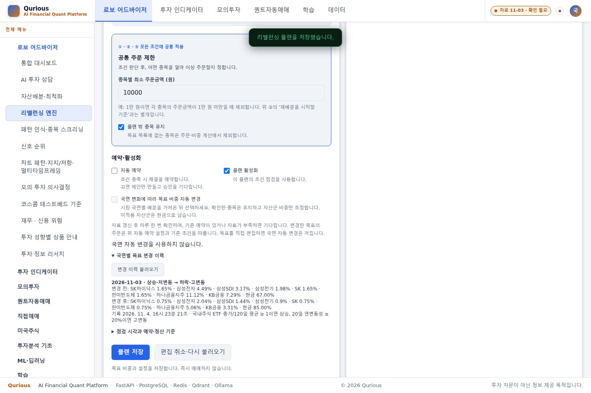
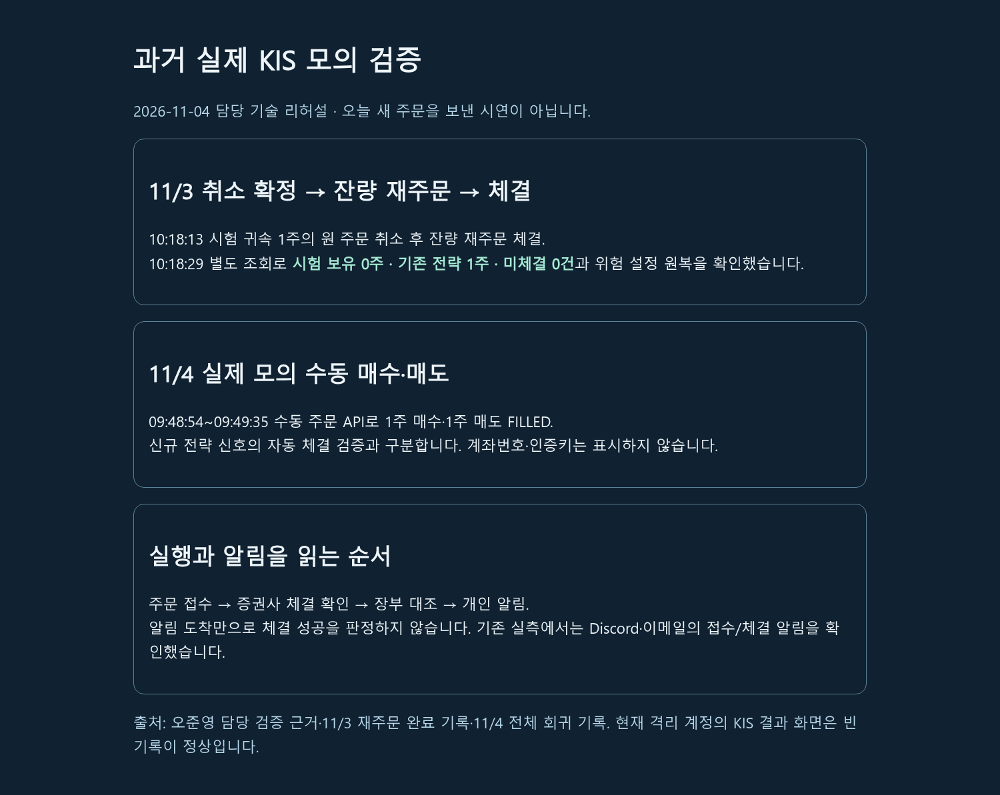

# 11/4 운영 마감·담당 기술 시연 검증

| 항목 | 내용 |
|---|---|
| 담당 | 오준영 |
| 기준 | main `72f07b77` — #543까지 병합, 2026-11-04 KST |
| 운영 이미지 | `qurious-app:main-72f07b77-20261104` |
| 판정 | 배포·15:40 현금 스냅샷·기술 시연 완료. 비용 판정 시험 1건은 타 담당 후속 |

이 기록은 [14시 운영 최신화](운영최신화-2026-11-04.md)의 후속이다. 오전 전체 회귀, 오후 각 변경분 시험, 실제 모의 주문, 화면 검증은 범위가 달라 건수를 합산하지 않는다. 이번 배포·시연에서 새 KIS 주문은 만들지 않았다.

## 1. 15:40 자연 배치 확인

| 근거 | 관측 결과 |
|---|---|
| Beat | 15:40:00.000 예약 작업 전송 |
| worker | 15:40:00.002 수신, .100 성공 |
| 결과·DB | 사용자 3명, 성공 3·실패 0·완전 3·불완전 0 |
| 계좌 조건 | PAPER 보유 계좌 0개, 세 계좌 모두 현금 스냅샷 |

원래 로컬 관측기는 Docker 로그를 문자열로 처리하는 단계에서 오류가 났다. 원래 실패 기록을 보존하고 bytes→UTF-8 처리를 고친 뒤 **15:46:34에 기존 로그와 DB를 읽어 재확인**했다. 실제 배치는 15:40에 성공했으며 수동 재실행하지 않았다. 따라서 관측기 복구와 서비스 배치 실패를 혼동하지 않는다. 보유 종목의 가격 평가 경로는 이번 자연 회차로 입증하지 않는다.

## 2. #543 배포와 보존 확인

- app·worker·beat 각각 **701개 실행 파일**이 기준 소스와 일치했다. 환경·명령·포트·네트워크·마운트와 읽기 전용 키 연결을 보존했다.
- DB head는 `0043_regime_targets`다. Beat 전송 중지→worker 작업 정리→앱 중지→암호화 백업→마이그레이션 확인→앱/worker 확인→Beat 시작 순서로 진행했다.
- 16:16:16 인증 확인을 마쳤고 16:17:18 새 heartbeat를 확인했다. 건강 상태와 인증 조회 10경로가 성공했다. 비로그인 변경 이력 조회는 401, 임시 검증 세션은 삭제했다.
- 사용자 설정·주문·현금·보유 지문을 보존했다. 자동매매 활성 0·실행 회차 0·미확인 주문 0, 기존 증권사 주문 기록 13건이 유지됐다. 스냅샷 총 30건은 앞선 15:40의 3건을 포함한다.
- 11/3 일봉과 오늘 갱신 근거가 준비됐다. 명시적 고정 판2의 `execute=False` 판단은 `DRY_RUN / HOLD / 진입 조건 없음`, 신규 주문 0건이었다.
- 새 백업 419,649바이트의 암호화 봉인·복호화 일치를 확인했다. **새 백업을 DB로 복원한 것은 아니다.** 별도 DB 복원은 앞선 12:54 백업에서 완료한 근거다.
- 수신기는 앞선 갱신의 57파일이 #543에서도 그대로다. 기존 45건 시험·14:27 정상 회차 근거를 유지하며 이번에 같은 시험을 다시 수행한 것으로 세지 않는다.

인증 조회는 health, 앱 HTML, 리밸런싱 JS/plan/status/target-changes, KIS 결과·기업·차트 JS, 본인 KIS 주문 조회다. 파일 해시와 키 값·설정 원문을 공개 자료에 싣지 않는다.

## 3. 최신 변경분 시험과 담당 구분

최신 후보 이미지·임시 PostgreSQL·외부 네트워크 차단 환경에서 **13파일, 227건 중 224통과·1실패·2건너뜀**이었다. 시험용 컨테이너는 정리했다.

| 항목 | 결과·해석 |
|---|---|
| #520 공개 관문 | #541 공개 `ensure_supported_market`, #543 예약 쪽 호출과 시험 반영 확인 |
| #521 Yahoo 기준선 | #540의 LEAN 표기 기준선 보완 후 회귀 통과 |
| 남은 1실패 | `tests/test_daily_lean_reconcile_fee.py::test_judge_fee_uses_top_level_lean_fills_and_compares_rates` — 요율은 같고 총액은 다른 입력에서 기대 `참고용(요율)`과 실제 `불일치` 차이. 강민석 담당 #534 후속 |
| 실패의 배포 영향 | 해당 대사 스크립트는 실행 이미지에 없음을 확인했다. 실패를 숨기거나 타 담당 코드·기대값을 고치지 않았다 |
| 2건너뜀 | 해외 예약의 실제 체결 및 잔고 부족 체결. 해외 비용 모델 미지원으로 실행 조건 미충족 |

대상은 `test_us_reserve`, `test_us_order_screen`, `test_us_order_path`, `test_paper_ledger_i14`, `test_market_registry`, `test_fx_provenance`, `test_no_yahoo_regression`, `test_completion_badge`, `test_learn`, `test_concept_learn_view`, `test_daily_lean_reconcile_fee`, `test_allocation_models`, `test_portfolio_allocation_constraints`다. 이 결과를 최신 main 전체 시험 통과로 확대하지 않는다.

## 4. 실제 화면을 통한 기술 시연

동일 #543 앱 이미지와 독립 PostgreSQL·Redis, 신규 시험 계정을 사용했다. 실제 운영 수집 자료는 읽기 전용으로 연결했고 운영 계좌·키·주문을 복제하지 않았다. 브라우저는 실제 앱→API→DB로 연결했으며 API 응답을 가짜 성공으로 대체하지 않았다. 외부망은 차단하고 화면 CDN 파일만 보관본으로 제공했다.

| 흐름 | 항목 | 결과 |
|---|---:|---|
| A 시작 | 5 | 가입·로그인, 배분 계산·저장, 플랜 가져오기·명시적 활성화·자동 예약 OFF, 새로고침 |
| A 보존 | 3 | 재시작 후 상태, 두 화면 409 충돌, 편집 취소·최신 플랜 재조회 |
| A 자료 대기 | 2 | 12:30 전 대기, 반복 점검의 목표·이력 보존·주문 없음 |
| A 국면 이력 | 4 | 과거 상승 fixture→실제 11/3 가격의 하락·고변동, 목표 33%→15%·제안·이력, 일별 중복 차단, 해제·계정 격리 |
| B 조회·근거 전환 | 5 | 자동매매 상태·위험 안내, 빈 증권사 키/재주문 OFF, KIS 주문 API·빈 이력, 알림 설정·이력, 날짜를 적은 과거 KIS 근거 열기 |
| 합계 | **19** | 브라우저 오류 0, 운영 상태 보존 |

기준시각은 대기/준비 조건 확인을 위해 시험 서버에서 지정했고, 과거 상승 국면도 fixture다. **운영의 자연 국면 전환을 관측한 시험은 아니다.** 앱/DB 재시작은 실제 수행했다. 종료 시 시험 DB 주문·증권사 주문·보유·자동 예약·국면 자동 갱신은 모두 0, 변경 이력 1건과 시험 사용자 2명이었다. 운영 설정·장부는 시작 전과 같았다. 임시 컨테이너 4개와 네트워크를 제거했다.

마지막 과거 근거 페이지가 처음에는 임시 주소 오류로 404였다. 실제 정적 마운트 `/learn/` 아래로 고친 뒤 B 5항목을 다시 실행해 통과했다. 이는 시험 자료의 배치 오류이며 제품 코드를 바꾼 것은 아니다. 과거 근거는 11/3 취소→재주문 체결과 11/4 오전 수동 매수·매도 기록의 요약이지 새 체결 기록이 아니다.

### 확인 화면

격리 계정의 국면 해제 뒤에도 변경 이력이 보존된 화면이다. 화면 위 자료 배지는 전체 수집 상태를 나타내며, 판정 API에서 확인한 리밸런싱 준비 조건과 구분한다. 실계좌 정보는 없다.

다음은 과거 검증 결과를 설명하기 위한 **별도 근거 페이지**다. KIS 주문 결과 화면을 흉내 낸 것이 아니며 촬영 당일 신규 체결을 뜻하지 않는다.

## 5. 검수·자료와 남은 일정

학습 장 5개·독립 예제 5개·실제 계산과의 대조 8항목을 완료했다. 계산은 일치했고 설명 정정 3건은 [별도 검수 보고서](학습자료-오준영-검수-2026-11-04.md)에 작성자 이동원의 후속으로 남겼다. 인수인계·발표/시연 자료는 0.3으로 갱신했다.

| 남은 일 | 담당·완료 조건 |
|---|---|
| 학습 설명 후속 | 초회 3건은 #546 반영·재검수 완료. 새 PAPER/KIS 경로 문장 1건만 이동원 보완 후 재확인 |
| 비용 판정 시험 1건 | 강민석 #534 기준 확인·후속 수정 |
| 알림 암호화 | 이동원 구현 PR → 오준영 복제 DB 전환 검증·백업·운영 반영. 키/복원 사전 준비는 완료 |
| 자연 관측·실주문 근거 | PAPER 보유 스냅샷은 보유 조건, #529 가드의 실제 KIS 주문은 해당 경로의 유효 조건을 충족해야 함. 오전 수동 API 체결로 대신하지 않음 |
| 인수·발표 | 11/5 사람의 시연 시간 측정·팀 검토, 11/6 자료 연결·대체 영상, 11/9~11 연습. 새 PC 인수·복원 실습은 수신자 참여 필요 |

원본 JSON·로그·XML·백업·시험 도구는 Git 제외 `deploy-main-543-20261104`, `readiness-20261104`, `rehearsal-20261104`에 보관한다. 비공개 운영 자료는 이 PR에 포함하지 않는다.

## 6. 16:57 후속 — #546 재검수·학습 원문 배포

main `910c8ee1`(#546·#545)을 `qurious-app:main-910c8ee1-20261104`로 반영했다. 앞의 #543 실행 코드와 비교하면 배포 대상에서 바뀐 것은 학습 원문 3개이며 서버·계산·마이그레이션은 같다. 16:56 인증 확인·학습 3개 HTTP 응답 해시 일치(총 13경로), 16:57 새 heartbeat, 세 서비스 각각 701파일 일치·DB0043·키/환경·설정/장부 보존을 확인했다. 자동매매 활성·진행 회차·미확인 주문 0, 기존 증권사 주문 13건·스냅샷 30건을 유지했다. 추가 KIS 주문은 없다.

새 암호화 백업 419,670바이트의 봉인·복호화를 확인했다. 새 백업의 DB 복원까지 다시 수행한 결과는 아니다. 후보 이미지의 학습·화면·국면 3파일 시험은 66통과·실패/건너뜀 0이며, 앞의 다른 범위 시험이나 #534 비용 판정 실패와 합산·상쇄하지 않는다. 임시 시험 컨테이너·네트워크는 정리했다.

초회 학습 지적 3건은 반영됐다. 추가로 발견한 PAPER/KIS 실행 경로 문장 1건은 [재검수 기록](학습자료-오준영-검수-2026-11-04.md#4-546-후속-재검수--2026-11-04)과 [#546 댓글](https://github.com/EST-team-project/Qurious/pull/546#issuecomment-6625685058)에 남겼다. 알림 암호화는 확인 시점에 구현 PR이 없어 운영 전환을 시작하지 않았다.
