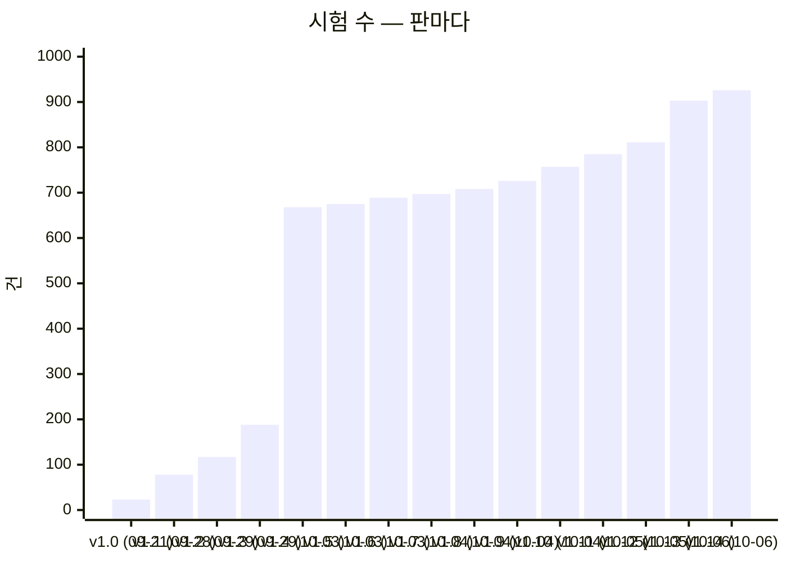
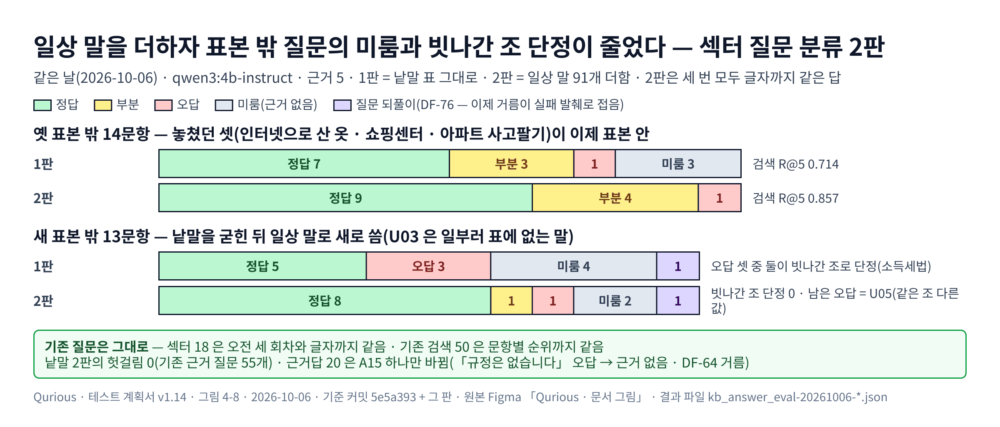
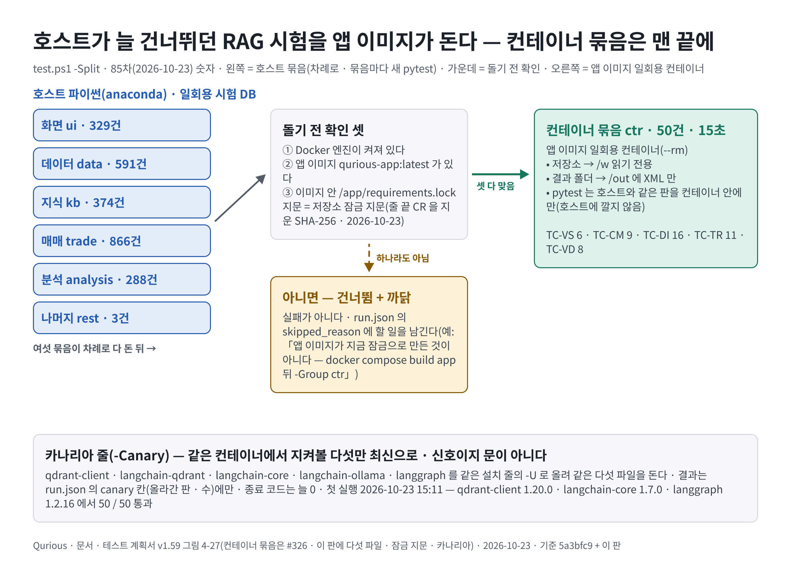
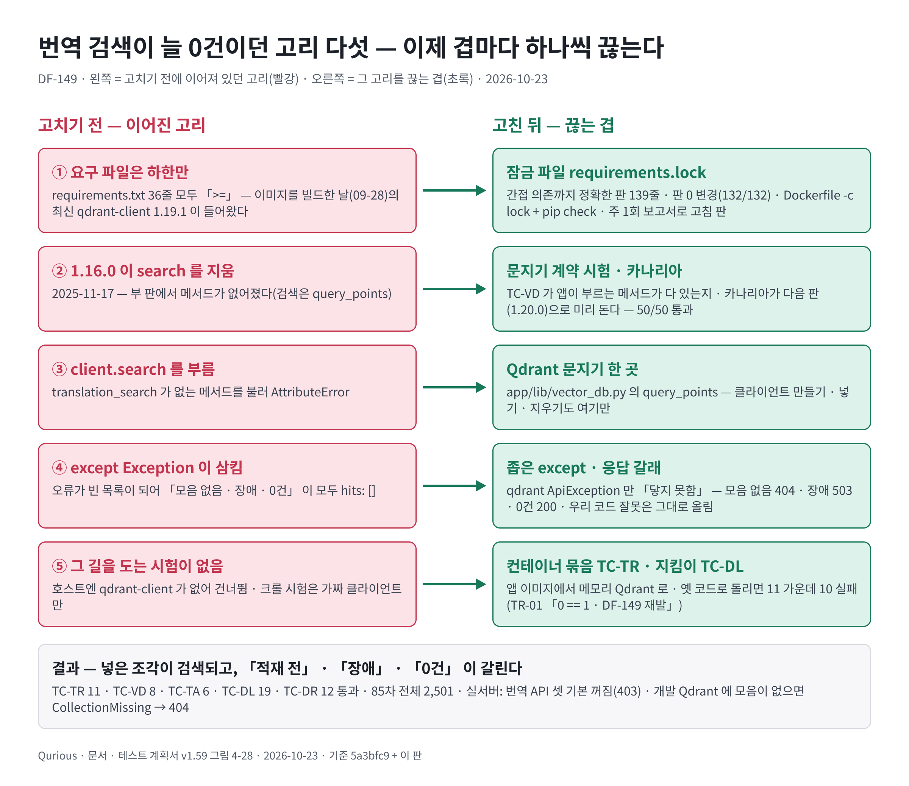

# 테스트 계획서 v1.65 — Qurious

| 문서 정보 | |
|---|---|
| **판 · 상태** | v1.65 · 표 5 재측정(190묶음 · 2,661건 · 총 2,761) · TC-SU 새 · TC-LE 31 · TC-DL 31 · 상류 건수 넷 · 91차 / v1.64 · DF-156 · DF-158 · TC-DU +1 · TC-WR +1 · 90차 / v1.63 · 여러 PC 회차 시험 43 · 89차 / v1.62 · TC-FF · TC-CI · 88차 / v1.61 · TC-PJ 16 · 87차(2026-10-24) / v1.60 · TC-RT 16 · #329 시험 · DF-152 · 86차(2026-10-24) / v1.59 · TC-TR 11 · TC-TA 6 · TC-VD 8 · TC-DL 19 · TC-DR 12 · TC-TB 10 · DF-149 · DF-151 닫힘 · 85차(2026-10-23) / v1.58 · TC-DV 15 · TC-TB 8 · 컨테이너 묶음 · 84차(2026-10-23) / v1.57 · TC-DI 16 · TC-DIA 3 · TC-VR 6 · TC-BM 30 · 83차(2026-10-23) / v1.56 · TC-BM 28 · 82차(2026-10-23) / v1.55 · 3차 판(차수 폴더 — 2차 최종 판 v1.50 은 `docs/phase-2/04-testing/테스트계획서.md`) · 초안(검토 전) |
| **구분** | 9. 시험·성과 검증 — 시험 계획 · 테스트 케이스 요약 · 시험 결과서 · 결함대장 (ISO/IEC/IEEE 29119-3 의 문서들을 한 권에 둔다) |
| **작성** | 이동원(데이터 파트) |
| **검토** | 검토 전 |
| **최종 수정** | 2026-10-26 (KST) |
| **기준** | v1.65 표 5 = 코드 `main` `e1399fe`(#347) + 이 판 작업 트리(S150 코드 묶음) · `pytest --collect-only` 2,761 / v1.64 표 5 = 코드 `main` `963ee1a`(#338) + 이 판 작업 트리(TC-DU 85 → 86 — DF-156 · TC-WR 20 → 21 — DF-158) · 90차 + 수집 2,601 / v1.63 표 5 = 코드 `main` `30c9ebe`(#337) + 이 판 작업 트리(새 묶음 TC-LE 12 · TC-HS 14 · TC-DU +12 · TC-HF +3 · TC-PJ +2 — 어느 PC 에서든 12:30 회차) · 머리말 · 합계 줄을 89차 junit 으로 다시 셈(189묶음 · 호스트 2,549 + 컨테이너 50) · 결과서 89차 / v1.61 표 5 = 코드 `main` `949b685`(#330) + 이 판 작업 트리(새 묶음 TC-PJ 16 · TC-DU +1 · TC-DST +1 — 모의투자 그림자 일지) · 결과서 87차 / v1.59 표 5 = 코드 `main` `5a3bfc9`(#326) + 이 판 작업 트리(새 묶음 다섯 TC-TR · TC-TA · TC-VD · TC-DL · TC-DR · TC-TB +2 · TC-VS-05 · TC-CR 가짜 모듈 — DF-149 번역 검색 · Qdrant 문지기 · 의존성 판 관리) · 결과서 85차 / v1.58 표 5 = 코드 `main` `8dff0a2`(#325) + 이 판 작업 트리(TC-DV +5 · TC-TB +2 — 동기화 점검 · 컨테이너 묶음) · 결과서 84차 / v1.57 표 5 = 코드 `main` `60da402`(#324 — TC-VR) + 이 판 작업 트리(TC-DI · TC-DIA · TC-BM +2 — 올린 문서 사용자 격리) · 결과서 83차(#324 머지 전 바탕 `177f0e3`) / v1.55 표 5 = 코드 `main` `4bed63b`(#316) + 이 판 작업 트리(TC-RP +15 — 목표 시뮬레이션 입력 경계) · 결과서 81차 / v1.54 표 5 = 코드 `main` `8739d61`(#315) + 이 판 작업 트리(TC-BM +5 · TC-HD +1) · 결과서 80차(강사님 기능 가져오기 앞 지킴이) / v1.53 표 5 = 코드 `main` `c9bd397`(#313) + 이 판 작업 트리(docs 번호 폴더 · TC-DV +1) · 결과서 79차(번호 폴더 · 묶음 차례) / v1.52 표 5 = 코드 `main` `8174a69`(#311) + 이 판 작업 트리(TC-TB +6) · 결과서 78차(묶음 차례 실행 첫 판) / v1.51 표 5 = 코드 `main` `e819cd2`(#310 · 태그 `phase2-final-2026-10-21`) + 이 판 작업 트리(docs 차수 폴더 · TC-DV +2) · 결과서 77차(이 판의 PR) · v1.50 결과서 = 75차(2차 최종 · 코드 `main` `6fa8f58` — 2차 마지막 머지 #308) · 표 5 · 결함대장 = 같은 코드 + 이 판 작업 트리(`pytest-asyncio` · 점검 도구 · 대장 TC-RGL) · v1.48 표 5 · 결함대장 = 코드 `main` `77ffb98`(#291 까지 — 학습 한 묶음 · 강민석 님 #286 ~ #290) 위 수집(2026-10-20) · 결과서는 72차 그대로(전체 시험은 다음 PR 뒤) · 그 앞: 코드 `main` `a84baa7`(#279 까지 — #267 작업 조회 · 취소 로그인 · #268 KIS 주문 결과를 가상 체결과 나눔 · #271 KIS 주문 방식 표시 · #272 리밸런싱 입력칸 · #273 연결 테스트 오류 글 · #274 자산배분 예측 표시 · #275 자산배분 결과 → 상품 안내 · #276 계정별 성향 저장 · #277 리밸런싱 가져오기 안내 · #278 자동매매 판단 출처 · #279 리밸런싱 화면 근거 시험) + 개념 학습 띠는 관리자 몫 · 거시 · 산업 출처 줄 · 시연 영상 mp4(TC-VX) · 발표 자료 판 관리(이 판과 같은 PR) · 시험 2337건 · 앞 판: 코드 `main` `32f23bd`(#265 메뉴 개편) + 사용법 창 영상 칸(D132 첫 단계) · 팀원 화면 잠정 반영 둘(D124) · 화면을 옮기면 내용 칸 맨 위로(DF-134)(그 판과 같은 PR) · 시험 2169건 · 그 앞: 코드 `main` `0184834`(#264 주 1회 복원 리허설 · 팀원 화면 잠정 반영 셋 · 직접매매 최근 주문 내역 거름) + 메뉴 개편(위 고정 탭 여섯 · 왼쪽 「전체 메뉴」 트리 · ☰ 같은 트리 · 대비 셋 · 글 안 자르기 — 그 판과 같은 PR) · 시험 2152건 |
| **관련 문서** | [정기 수집 회차 시각 조사서](../../phase-2/01-analysis/research/정기회차-시각-조사.md) v0.1 · [목표 기능 ① 상세 설계서 v1.6](../02-design/system/목표기능1-데이터지식-설계.md) · [섹터별 근거 법령 조사서 v0.1](../../phase-2/01-analysis/research/섹터별-근거법령-조사.md) · [공시 · 재무 · 뉴스 이용 조건 조사서 v0.2](../../phase-2/01-analysis/research/공시-재무-뉴스-이용조건-조사.md) · [섹터 법령 평가셋 v1](평가셋/섹터법령-평가셋_v1.tsv) · [섹터 법령 표본 밖 v2](평가셋/섹터법령-표본밖_v2.tsv) · [v1](평가셋/섹터법령-표본밖_v1.tsv) · [섹터 법령 사람 판정표 v3](평가셋/섹터법령-사람판정_v3.tsv) · [v2](평가셋/섹터법령-사람판정_v2.tsv) · [v1](평가셋/섹터법령-사람판정_v1.tsv) · [근거 충실도 지표 조사서 v0.2](../../phase-2/01-analysis/research/지난판/근거충실도-자동지표-조사_v0.2.md) · [근거 충실도 사람 판정표 v1](평가셋/근거충실도-사람판정_v1.tsv) · [검색 평가셋 v1](평가셋/근거검색-평가셋_v1.tsv) · [근거답 평가셋 v2](평가셋/근거답-평가셋_v2.tsv) · [v1](평가셋/근거답-평가셋_v1.tsv) · [기능 완성도 점검 보고서 v0.1](기능완성도-점검.md) · [기능 확장 시장조사 v0.1](../../phase-2/01-analysis/research/기능확장-시장조사.md) · [RTM v1.12](../01-analysis/requirements/RTM.md) · [기능 설계서 v0.1](../02-design/system/기능설계.md) · [API 명세서 v0.11](../02-design/api/API명세서.md) · [UI 명세서 v0.2](../../phase-2/02-design/ui/지난판/UI명세서_v0.2.md) · [근거 답 출처 표시 조사서](../../phase-2/01-analysis/research/근거답-출처표시-화면-조사.md) · [조사서 — 로컬 · 무료 LLM](../../phase-2/01-analysis/research/로컬LLM-퀀트활용-조사.md) · [IA v1.0](../../phase-2/02-design/ui/지난판/IA_v1.0.md) · [ERD v1.8](../02-design/data/ERD.md) · [ADR-0004](../../common/02-design/adr/ADR-0004-KIS-자격증명은-사용자마다.md) · [ADR-0001](../../common/02-design/adr/ADR-0001-실거래-주문-경로-차단.md) · [ADR-0003](../../common/02-design/adr/ADR-0003-CI를-걷어내고-먼저-논의한다.md) · [문서 그림 지침 v0.3](../../phase-2/00-management/standards/지난판/문서그림지침_v0.3.md) · [테스트 계획서 v1.4](../../phase-2/04-testing/지난판/테스트계획서_v1.4.md) · [v1.2](../../phase-2/04-testing/지난판/테스트계획서_v1.2.md) |
| **최근 개정** | v1.64 → v1.65: 표 5 를 다시 쟀다 — 새 묶음 TC-SU 25(예약 끝 날짜) · TC-LE 12 → 31(판 문지기 · 판 섞임) · TC-DL 19 → 31(LEAN 이미지 · 수집기 환경) · 상류 PR(#340 ~ #346)이 더한 TC-IN 13 → 28 · TC-LA 11 → 46 · TC-I14 9 → 11 · TC-EG 15 → 17 · 합계 2,601 → 2,761(표 5 2,551 → 2,661 + 대장에 없는 시험 파일 4개 50 + 컨테이너 50) / v1.63 → v1.64: TC-DU 85 → 86(시험은 진짜 회차 기록 사본을 쓰지 않는다 — DF-156) · DF-157(분봉이 선언되지 않은 yfinance 에 기댐 — 열림) · TC-WR 20 → 21(복구 시험 자식은 창 없이 — DF-158) · 90차(2,600 · 통과 2,591 · 실패 5 = 알려진 결함 · 9분 45초) · 표 5 합 2,551 / v1.62 → v1.63: 새 묶음 TC-LE 12(여러 PC 임대) · TC-HS 14(여러 PC 맞추기) · TC-DU 73 → 85 · TC-HF 10 → 13 · TC-PJ 16 → 18 · 4.32 깨 보기 28 · DF-154(시험이 실제 HF 에 닿음) · DF-155(2.x 전체 올리기) · 89차 · 표 5 머리말 · 합계 다시 셈(174 · 2394 → 189 · 2549 — v1.57 뒤 멈춰 있던 수) / v1.61 → v1.62: 새 묶음 TC-FF 15(전체 재무제표) · TC-CI 8(업종 · KSIC) · TC-ECS 12 → 14 · TC-DU 70 → 73 · TC-DST-13 강화(쓰는 색인의 앞 칸) · TC-MC · TC-TASK 번역 경로 · 88차(데스크톱 처음 · 매매 · 분석 묶음 다시) · 4.31 깨 보기(<표 8-55> 18곳) · DF-153(닫힘) / v1.60 → v1.61: 새 묶음 TC-PJ 16(모의투자 그림자 일지) · TC-DU 69 → 70 · TC-DST 28 → 29 · 87차(+ 데이터 묶음 다시) · 4.30 깨 보기(<표 8-54> 열 가지 · 시운전 · 등록 뒤 확인) · 요약 1 / v1.59 → v1.60: TC-RT 13 → 16(감리 번호 · 인수 기준 칸) · 팀원 PR #329 시험 등록(TC-TV 8 → 11 · TC-LCS 2 · TC-LOE 1) · 86차 · 4.29 깨 보기(<표 8-53>) · DF-152(위험 상태 API 「당일 자동 주문」 열쇠 갈림 · 열림 후보) · 표 9 제목 · 요약 3 을 기계로 다시 셈 / v1.58 → v1.59: 새 묶음 다섯 — TC-TR 11(번역 적재 · 검색 회귀 · 컨테이너) · TC-VD 8(Qdrant 문지기 계약 · 컨테이너) · TC-TA 6(번역 API 문지기 · 응답) · TC-DL 19(의존성 잠금 지킴이) · TC-DR 12(갱신 보고서) · TC-TB 8 → 10(이미지 잠금 신선도 · 카나리아) · 4.28 깨 보기(<표 8-52>) · DF-149 닫힘 · DF-151(폐기 경고 · 닫힘) · 표 9 머리 다시 셈 · 85차 / v1.57 → v1.58: TC-DV 10 → 15(동기화 점검 `--sync` · `--sync-ack`) · TC-TB 6 → 8(컨테이너 묶음 ctr — RAG · 채팅 · 올린 문서 격리 31 이 묶음 실행 안에서 앱 이미지로) · 4.27 깨 보기(<표 8-51> · 7 모두 잡음) · DF-149 재현 · 84차 / v1.56 → v1.57: 새 묶음 둘 — TC-DI 16(올린 문서 사용자 격리 — 앱 이미지 컨테이너) · TC-DIA 3(탈퇴 조각 지우기 — 호스트) · DF-146 · TC-BM 28 → 30(문지기로만 · 그래프 라우터 로그인) · TC-CM 채팅 근거에 로그인한 사람 ID 단언 · 4.26 깨 보기(<표 8-50> · 13 모두 잡음) · 결함대장 DF-146 · DF-147 · DF-148(닫힘) · DF-149(열림) · DF-150(닫힘 — #324) · TC-VR 6 등록(신장환 #324 부탁) · 호스트가 건너뛰는 RAG · 채팅 묶음을 컨테이너로 돌리는 법 · 합계 2,399 · 83차 / v1.55 → v1.56: TC-BM 27 → 28(html 넷 글자 줄이기 스크립트 없음) · 지킬 메뉴 키 5 → 15 · TC-LN-15 · TC-CLV-01 단언 고침(학습 세 갈래 · 64편) · 82차 / v1.54 → v1.55: 표 5 TC-RP 4 → 19(목표 시뮬레이션 입력 경계 — 감리 HIGH `FD-FIND-002` · 결함 DF-144 닫힘) · 2,393(합계 줄 · 1절 요약) · 4.25 깨 보기(<표 8-49> · 14 모두 잡음) · 결함대장 DF-144 · DF-145(증권사 키 다시 저장 덮어쓰기 — 열림) · 결과서 81차 / v1.53 → v1.54: 표 5 TC-BM 22 → 27(강사님 새 화면 가져오기 1차 앞 지킴이 다섯) · TC-HD 4 → 5(HF 보관본 경로 잘림 — `scripts/hf_dart.py` 고침) · 2,378(합계 줄 · 1절 요약) · 4.24 깨 보기 다섯(<표 8-48> · 모두 잡음) · 결과서 80차(실패 5 — 모두 알려진 것) / v1.52 → v1.53: docs 번호 폴더(이 문서는 `docs/phase-3/04-testing/`) · 표 5 TC-DV +1 · 2,372(합계 줄 · 3.1 제목도 표 줄로 다시 셈) · 4.23 깨 보기 둘 · **DF-116 · DF-135 닫힘**(#200) · 결과서 79차(실패 6 — 알려진 다섯 + TC-VX-09 · 이 판에서 고침) / v1.51 → v1.52: 표 5 TC-TB +6(시험 묶음 표 지킴이) · 2,371 · 결과서 78차(test.ps1 -Split 첫 판) / v1.50 → v1.51(3차 첫 판): docs 차수 폴더 — 이 문서는 3차 사본(2차 최종 판은 `docs/phase-2/`) · 표 5 TC-DV 7 → 9 · 합계 2,363 → 2,365 · 결과서 77차 / v1.49 → v1.50(2차 최종 판): 결과서 75차(2차 기능 최종 점검) · 기능 점검 85 · 화면 77 · 결함 DF-136 닫힘(#292) · DF-142(전체 시험 0건 중단 — `pytest-asyncio`) · DF-143(점검 도구 KIS 오판) 더하고 이 판에 닫음 · 결함 수 다시 셈(줄 137 · 열림 28) · 표 5 새 묶음 TC-RGL · 제목 판 바로잡음 / 그 앞: v1.48 → v1.49: DF-138 닫힘(#302) · 결함 수를 줄로 다시 셈(135 · 열림 29) · 4절 73 · 74차 줄 — 실행 합(2,363)이 모아 세기(2,361)보다 2 많은 까닭(이 PC 에 없는 선택 패키지로 파일째 건너뛰는 시험 파일 둘 · 시험 DB 와 무관) · 개정 이력 v1.48 줄 칸 수 / v1.47 → v1.48: 새 묶음 TC-HV 3(사용법 영상 목록) · TC-CLV 5 → 6(학습 한 묶음) · 팀원 TC-RX +4 · TC-PV +1 · 2352 → 2361건 · 수집 170파일 · 묶음 172 · 결함 DF-137 새(#286 회귀 — 미국 모의 주문 400 · 핫픽스 대기) · DF-138 새(자동매매 거짓 정지) · DF-139 새(#295 확인 라우트 500) · DF-140 새(시험 환경 cp949) · DF-141 새 · 닫힘(국내 시세 조회 오류) · DF-116 · DF-135 · DF-136 에 10-20 답글 · 그 앞 판 줄은 개정 이력에 |

> **이 문서로 알 수 있는 것**
> 1. 무엇을 어떤 기준으로 시험하고, 무엇은 시험하지 않나 (1절)
> 2. 시험 2,761건(호스트 2,711 · 컨테이너 50)은 어느 요구를 무엇으로 지키나 (2절 · 3절)
> 3. 지금 전부 통과하나 — 어떤 환경에서 (4절 결과서)
> 4. 알려진 결함은 무엇이고, 누가 무엇을 하면 되나 (5절 결함대장 · 6절)
>
> **읽는 순서** — 팀원: 요약 → 5절 결함대장에서 내 파트 줄 → 3.1절에서 내가 고칠 코드를 지키는 묶음 ·
> 강사님: 요약 → 4절 → 5절 → 6절 · 처음 온 사람: 부록 A 용어 → 1.2절 → 3.1절

## 요약

1. 자동화 시험 **2,556건(시험 파일 187)이 돈다**(main `3ca94de` + v1.62 작업 트리 · 2026-10-24 · 데스크톱 호스트 — v1.62 새 묶음 TC-FF 15 · TC-CI 8 · TC-ECS +2 · TC-DU +3 · TC-DST-13 강화 / 앞 판 2478건(main `949b685` + v1.61 작업 트리 · 2026-10-24 — v1.61 새 묶음 TC-PJ 16(모의투자 그림자 일지) · TC-DU +1(스스로 따라잡는 단계) · TC-DST +1(일지 숫자 · HF 줄) / v1.60 TC-RT +3(감리 번호 · 인수 기준 칸) · 팀원 PR #329 시험 등록(TC-LCS 2 · TC-LOE 1 · TC-TV +3) / v1.59 새 묶음 다섯(TC-TA 6 · TC-DL 19 · TC-DR 12 — 호스트 · TC-TR 11 · TC-VD 8 — 호스트는 건너뛰고 컨테이너 묶음에서) · TC-TB +2 · 85차부터 컨테이너 묶음 50 / v1.58 TC-DV +5(동기화 점검) · TC-TB +2(컨테이너 묶음) · 84차부터 TC-DI · TC-VS · TC-CM 31 이 `test.ps1 -Split` 의 컨테이너 묶음에서 돈다 / v1.57 TC-VR +6(신장환 #324 · 머지 뒤 등록) · TC-DIA +3(탈퇴 조각 지우기 · 호스트) · TC-BM +2(문지기 · 그래프 로그인) · TC-DI 격리 16 · TC-VS 6 · TC-CM 9 는 호스트에 qdrant-client · LangChain 이 없어 건너뛰고 앱 이미지 컨테이너에서 돈다 · 그 앞: main `a836243` + v1.56 작업 트리 — v1.56 TC-BM +1(html 넷 글자 줄이기 스크립트 없음) · 지킬 메뉴 키 5 → 15 · TC-LN-15 · TC-CLV-01 단언 고침(학습 세 갈래) / v1.55 TC-RP +15(목표 시뮬레이션 입력 경계 · 결함 DF-144) / v1.54 TC-BM +5(강사님 기능 가져오기 앞 지킴이 다섯) · TC-HD +1(HF 보관본 경로 잘림) · 그 앞: main `c9bd397` + v1.53 작업 트리 — v1.53 TC-DV +1(번호 폴더 종류 깊이 · 옛 차수 이름 · TC-DV-10) · 그 앞: main `8174a69` + v1.52 작업 트리 — v1.52 TC-TB +6(시험 묶음 표) · 그 앞: main `e819cd2` + v1.51 작업 트리 · 2026-10-21 수집 — v1.51 TC-DV +2(차수 폴더 옛 자리 검사 · `--to3`) · 그 앞: main `6fa8f58` · 2026-10-21 수집 — v1.50 새 묶음 TC-RGL 2(팀원 #303 · 그 파일이 모아 세기를 멈추던 DF-142 를 고친 뒤) · 그 앞: main `77ffb98` · 2026-10-20 수집 — v1.48 새 묶음 TC-HV 3 · TC-CLV +1 · 팀원 TC-RX +4 · TC-PV +1 · 그 앞: main `f17d310` + v1.47 작업 트리 · 2026-10-19 수집 — v1.47 새 묶음 TC-QUOT 10 · TC-CLV 5 · 그 앞: main `a84baa7` + v1.46 PR · 2026-10-19 수집 — 72차 뒤 D133 으로 TC-LN 42 → 38) — 결과서 72차(2026-10-19 · main `9bea3ee` + 이 판 PR · 코드와 시험이 다 정해진 뒤)는 일회용 시험 DB 로 **2208 통과 · 2 건너뜀 · 실패 7**(0:09:52)이다 — 실패 일곱은 알려진 것(DF-110 둘 · DF-135 다섯 — 이 PC 호스트에 `langchain_ollama` 가 없어 #267 의 TC-TASK 발행 다섯 경우가 라우터를 불러오지 못함)이다. 이 판의 묶음(TC-VX 9 새로 — 시연 영상 mp4 를 발표 자료가 바로 재생 · 파일은 git 밖 · TC-LN +2 — 개념 학습 띠는 관리자 몫(72차 뒤 D133 — 팀 자료 쓰기를 없애 쓰기 시험 다섯을 지우고 「쓰기 길 없음」 하나를 더해 38 · 그 묶음만 다시 돌려 통과) · TC-QVS +1 — 거시 · 산업 출처 줄 · TC-DV +3 — 발표 자료 판 관리)은 모두 통과했다. 깨 보기는 하지 않았다(사용자 피드백 10-19). 72차 뒤 받은 #268 · #271 · #272 · #273 ~ #279 의 묶음(TC-KEX · TC-KEXUI · TC-BCF · TC-APV · TC-DSV · TC-RBUI 새로 · TC-DA · TC-GP · TC-KH · TC-QC · TC-AS 늘어남)은 각 PR 이 돌렸고, 이 판에서는 겹친 문서를 읽는 시험 셋만 다시 돌렸다(4절). / 앞 판: 결과서 71차(2026-10-18 · 사용법 창 영상 칸 · 코드와 시험이 다 정해진 뒤)는 일회용 시험 DB 로 **2167 통과 · 2 건너뜀 · 실패 2**(0:08:58)이다 — 실패 2건은 `main` 의 알려진 둘(DF-110 · 야후 봉인 — 강민석 님 `scripts/signals_yahoo.py`)이다. 바뀐 묶음 TC-HT(10 → 13 — 영상 표 읽기 · 영상 칸 · 창 동작) · TC-NV(15 → 16 — 화면을 옮기면 내용 칸 맨 위로)와 새 묶음 둘(TC-HM 11 — 사용법 영상 라우트 · 받기 도구 · TC-RPL 2 — 오준영 님 화면 잠정 반영 둘)은 모두 통과했고, 약속을 마흔세 곳 깨 마흔둘을 잡았다(하나는 일부러 겹쳐 둔 장치라 놓침이 맞음 · 4.22절 <표 8-46>). 70차(같은 날 · DF-134 를 고치기 전)는 2166 통과 · 2 건너뜀 · 실패 2(0:09:48)였다. / 앞 판: 결과서 69차(2026-10-18 · 메뉴 개편 · 코드와 시험이 다 정해진 뒤)는 일회용 시험 DB 로 **2150 통과 · 2 건너뜀 · 실패 2**(0:09:26)이다 — 실패 2건은 `main` 의 알려진 둘(DF-110 · 야후 봉인 — 강민석 님 `scripts/signals_yahoo.py`)이다. 바뀐 묶음 TC-NV(12 → 15 — 위 고정 탭 여섯 · 왼쪽 트리 · 더보기 없앰 · 탭 줄 접는 차례 · ☰ 트리 · 메뉴 글 대비 · 글 안 자르기)는 모두 통과했고, 메뉴 약속을 열여덟 곳 깨 모두 잡았다(4.21절 <표 8-45>). / 앞 판: 결과서 68차(2026-10-18 · 주 1회 복원 리허설 · 팀원 화면 잠정 반영 셋 · 직접매매 최근 주문 내역 거름 · 코드와 시험이 다 정해진 뒤)는 일회용 시험 DB 로 **2147 통과 · 2 건너뜀 · 실패 2**(0:09:27)이다 — 실패 2건은 `main` 의 알려진 둘(DF-110 · 야후 봉인 — 강민석 님 `scripts/signals_yahoo.py`)이다. 새 묶음 넷(TC-TFS 10 · TC-TOH 2 · TC-WR 20 · TC-WRS 3)은 모두 통과했다. 주간 리허설 바퀴 · 리허설 기록과 판정 · 리허설 줄 화면 · 팀원 화면 잠정 반영 · 주문 내역 거름을 열여섯 곳 깨 모두 잡았다(4.20절 <표 8-44>). / 앞 판: 결과서 67차(2026-10-17 · 2112 통과 · 2 건너뜀 · 실패 2 — 66차와 같음 · 새 시험 없음) · 그 앞 66차(2026-10-17 · 미국주식 주문 화면 · 장 닫힌 날 예약 주문 · 종목 찾기 「찾지 못함」 · 코드와 시험이 다 정해진 뒤)는 일회용 시험 DB 로 **2112 통과 · 2 건너뜀 · 실패 2**(0:08:26)이다 — 실패 2건은 `main` 의 알려진 둘(DF-110 · 야후 봉인 — 강민석 님 `scripts/signals_yahoo.py`)이다. 새 묶음 넷(TC-HUB 34 · TC-GS 15 · TC-SCC 6 · TC-TCH 3)과 넓힌 셋(TC-DQ +3 · TC-RS +4 · TC-GL +1)은 모두 통과했다. 리서치 · 카드 · 칩 · 용어사전을 마흔아홉 곳, 종목 허브 · 질문 속 종목 · 글 속 용어 · 경계 규칙을 쉰한 곳 깨 모두 잡았다 — 둘째 바퀴 첫 시도가 못 잡은 아홉은 시험이 그 약속을 재지 않던 빈틈이라 시험을 고친 뒤 잡았고, 하나는 등가다(4.18절 <표 8-42>). / 앞 판: 결과서 62차(2026-10-16 밤 · 모의투자 여정의 이동원 몫 고치기 · #247 까지 받은 뒤 · 코드가 다 정해진 뒤)는 일회용 시험 DB 로 **2007 통과 · 2 건너뜀 · 실패 2**(0:11:20 — 깨 보기와 함께 돌아 느림)이다 — 실패 2건은 `main` 의 알려진 둘(DF-110 · 야후 봉인 — 강민석 님 `scripts/signals_yahoo.py`)이고 DF-113 의 둘은 #247 로 사라졌다. 새 묶음 셋(TC-QL 10 · TC-QVS 4 · TC-SPK 4)과 넓힌 둘(TC-AGR +9 · TC-PCS +1) · #247 의 TC-PV +1 은 모두 통과했다. 최신 시세 · 재무 숫자 지킴 · 시세 표시 · 종목 찾기 칸 · 연습 상자를 서른여섯 곳 깨 모두 잡았다(4.17절 <표 8-41>). / 앞 판: 결과서 61차(2026-10-16 저녁 · 응답의 출처 · 기준일 묶음 · #238 까지 받은 뒤 · 코드가 다 정해진 뒤)는 일회용 시험 DB 로 **1976 통과 · 2 건너뜀 · 실패 4**(0:06:47)이다 — 실패 4건은 `main` 의 알려진 넷(DF-110 둘 · DF-113 둘 — #238 뒤에도 그대로)이고, 새 묶음 넷(TC-DP 16 · TC-FX 11 · TC-AJT 5 · TC-USO 25)과 TC-FH-18 · 팀원 새 시험(TC-QFRS 15 · TC-STOP 7 · TC-OP +2 · TC-BC +2 · TC-PV +4 · TC-XA +1)은 모두 통과했다. 출처 · 기준일 · 환율 출처 · 미국주식 주문 · 수정주가 단계 시간 · Z'' 구간을 마흔네 곳 깨 모두 잡았다(4.16절 <표 8-39>). / 앞 판: 결과서 55차(2026-10-16 · 화면 사용법 창 · #208 을 받은 뒤 · 코드가 다 정해진 뒤)는 일회용 시험 DB 로 **1886 통과 · 2 건너뜀 · 실패 4**(0:08:43)이다 — 실패 4건은 `main` 에서 이미 나는 것이고(DF-110 둘 · DF-113 둘 — DF-112 는 #207 로 닫힘), 넓힌 넷(TC-HT +10 · #207 의 TC-QC +16 · TC-ATI +11 · #208 의 TC-IN +1)은 모두 통과했다. 사용법 창을 스물여섯 곳 깨 모두 잡았다(4.15절 <표 8-38>). / 앞 판: 결과서 53차(2026-10-16 · 로보 어드바이저 마무리 · 코드가 다 정해진 뒤)는 일회용 시험 DB 로 **1847 통과 · 2 건너뜀 · 실패 5**(0:08:16)이다 — 실패 다섯은 `main` 에서 이미 나는 것이고, 넓힌 셋(TC-PD +3 · TC-XA +6 · TC-DU +1)은 모두 통과했다. 화면 JS 를 임시 사본으로 깨는 플러그인으로 스무 곳을 깨 모두 잡았다(4.14절 <표 8-36>). / 앞 판: 결과서 51차(2026-10-15 늦은 오후 · 관제 · 운영 마무리 · 코드가 다 정해진 뒤)는 일회용 시험 DB 로 **1837 통과 · 2 건너뜀 · 실패 5**(0:10:26)이다 — 실패 다섯은 `main` 에서 이미 나는 것(DF-110 둘 · DF-113 둘 · DF-112)이고, 넓힌 셋(TC-DST +2 · TC-DG +2 · TC-DU +1)은 모두 통과했다. 메모리에서 서른한 곳을 깨 모두 잡았다(4.13절 <표 8-35>) — 깨기를 짜다 자료 안내가 숫자 파일 함수를 별칭으로 받아 「한 곳」 이 실제로는 두 벌일 수 있는 것을 찾아 직접 부르게 고쳤다. 50차(같은 날 · 그 고침 앞)는 1837 통과 · 2 건너뜀 · 실패 5(0:07:34)였다. 48차(2026-10-15 · 운영 묶음 · 시험이 다 정해진 뒤)는 일회용 시험 DB 로 **1832 통과 · 2 건너뜀 · 실패 5**(0:07:41)이다 — 실패 다섯은 `main` 에서 이미 나는 것(DF-110 둘 · DF-113 둘 · DF-112)이고, 새 묶음 하나(TC-BF 7 — 시세 수집 종료코드)와 넓힌 셋(TC-DU +13 · TC-DST +8 · TC-HF +3)은 모두 통과했다. 메모리에서 마흔한 곳을 깨 모두 잡았다(4.12절 <표 8-34>) — 깨기를 짜다 시험이 없는 길 하나(올리기 함수의 미리 보기가 회차 기록 사본을 지우는가)를 찾아 시험에 먼저 더했다. 47차(같은 코드 · 자료 안내 맞대기 시험 하나를 넣기 전)는 1831 통과 · 2 건너뜀 · 실패 5(0:07:39)였다. 46차(2026-10-15 · 모델 비교 · 종목별 수집 상태 조회)는 일회용 시험 DB 로 **1801 통과 · 2 건너뜀 · 실패 5**(0:07:57)이다 — 실패 다섯은 `main` 에서 이미 나는 것(야후 봉인 둘 · DF-110 / 패턴 화면 다중 주기 라우트 둘 · DF-113 / 같은 종목 보류 규칙과 강사님 시험의 엇갈림 · DF-112)이고, 새 묶음 셋(TC-MV 36 · TC-MVS 5 · TC-SDS 20)은 모두 통과했다. 메모리에서 서른일곱 곳을 깨 1바퀴에 33 을 잡았고, 놓친 넷(홀름 적용 · 지문의 거래량 · 계산 시작 라우트의 머리글 연결 · 한 트랜잭션)은 시험을 보강해 2바퀴에 모두 잡았다(4.11절 <표 8-33>). 45차(새 `main` `8921f92` · #190 · #192 · #193 이 시험 아홉(TC-OP +3 · TC-BC +6)을 더한 뒤)는 1740 통과 · 2 건너뜀 · 실패 5(0:08:00 · 새 실패 없음)였다. 결과서 44차(#188 · #189 를 받은 뒤)는 1731 통과 · 2 건너뜀 · 실패 5(0:08:20 — 새 실패 둘은 #188 이 TC-PV 를 깬 DF-113)이고, 43차(2026-10-14 · 위 메뉴 넘침 고침)는 일회용 시험 DB 로 **1733 통과 · 2 건너뜀 · 실패 3**(0:08:01)이다 — 실패 셋은 `main` 에서 이미 나는 것(야후 봉인 둘 · DF-110 / #184 의 같은 종목 보류 규칙과 강사님 시험의 엇갈림 · DF-112)이고, 새 시험 다섯(TC-NV-08 ~ 12)과 팀원 #187 의 TC-OP 8 은 모두 통과했다. 42차(#184 를 받아 합친 계절성 PR)는 1720 통과 · 2 건너뜀 · 실패 3(0:06:59)이었다. 결과서 41차(2026-10-14 · 계절성 분석 · 종목 군집화)는 일회용 시험 DB 로 **1638 통과 · 2 건너뜀 · 실패 2**(0:07:58)이다 — 실패 둘은 `main` 에서 이미 나는 것(#182 의 새 스크립트가 야후 봉인 시험에 걸림 · DF-110)이고, 새 묶음 넷(TC-SE 15 · TC-SES 3 · TC-CU 12 · TC-CUS 4)은 모두 통과했다. 39차(2026-10-13 · 재무 · 신용 위험)는 1536 통과 · 2 건너뜀 · 실패 0(0:08:02)이었다 — 새 묶음 여섯(TC-FH 17 · TC-MC 8 · TC-ECS 11 · TC-AGR 7 · TC-FRS 5 · TC-DK 6)과 TC-BM +1(전략 분석 「비교에 추가」), 팀원 #173 의 성과 검증 규칙 설명 시험(TC-RX 22)이 들어왔고, 저장소 밖 사본에서 스물한 곳을 깨 모두 시험이 잡았다(4.5절 <표 8-30>). 지난 결과서 38차(2026-10-12 · 상품 상세 창)는 일회용 시험 DB 로 **1459 통과 · 2 건너뜀 · 실패 0**(0:07:54)이다 — 새 묶음 둘(TC-PCH 32 · TC-PCS 6)과 팀원 #169 의 신호 설명 시험(TC-XR 19) · #166 의 신호 배치 시험(TC-MT +3)이 들어왔고, 저장소 밖 사본에서 쉰 곳을 세 바퀴로 깨 모두 시험이 잡았다(4.5절 <표 8-29>). 지난 결과서 36차(2026-10-12 · 투자 성향별 상품 안내)는 일회용 시험 DB 로 **1399 통과 · 2 건너뜀 · 실패 0**(0:05:51)이다 — 새 묶음 다섯(TC-EC 45 · TC-PG 22 · TC-FL 19 · TC-PD 4 · TC-HR 4)과 TC-CP +1(배지는 관리자에게만), 팀원 #165 의 리밸런싱 시험(TC-RBD +15 · TC-RBC +2 · TC-RBU +1)이 들어왔고, 저장소 밖 사본에서 열다섯 곳을 깨 모두 시험이 잡았다(4.5절 <표 8-28>). 지난 결과서 34차(2026-10-12 · 강사님 기초 코드 반영 1단계)는 일회용 시험 DB 로 **1286 통과 · 2 건너뜀 · 실패 0**(0:07:45)이다 — 지킴이 여섯(TC-BM)과 강사님 새 시험 8(TC-FM 5 · TC-AG 1 · TC-KMD 2 — 하나는 우리 수집 DB 다리에 맞게 손봄), 새 묶음 둘(TC-PE 3 · TC-LS 5)이 들어왔고, 저장소 밖 사본에서 스물여섯 곳을 깨 스물둘을 시험이 잡았다(나머지 넷은 시험이 없는 게이트웨이 · 화면 갈래 — 4.5절 <표 8-26> · <표 8-27>). 지난 결과서 32차(2026-10-11 · 자료 안내 2단계)는 **1264 통과 · 2 건너뜀 · 실패 0**(0:06:35)이었다 — 새 시험 6(TC-DG-10 · 11 · TC-DU 4)이 들어왔고 TC-DG 여섯을 숫자 파일 · 칸 정의에 맞게 고쳤으며, 저장소 밖 사본에서 스물세 곳을 깨 모두 시험이 잡는 것을 봤다(4.5절 <표 8-25>). 지난 결과서 31차(2026-10-10 · 수집 단추 남은 것)는 **1258 통과 · 2 건너뜀 · 실패 0**(0:06:42)이었다 — 새 시험 21(TC-DU 7 · TC-CQ-18 ~ 23 · TC-CL-15 ~ 18 · TC-CW-13 ~ 15 · TC-DST-18)이 들어왔고, 저장소 밖 사본에서 열아홉 곳을 깨 모두 시험이 잡는 것을 봤다(4.5절 <표 8-24>). 지난 결과서 29차(2026-10-10 · 화면 수집 단추)는 **1237 통과 · 2 건너뜀 · 실패 0**(0:07:31)이었다 — 새 시험 8(TC-CL-09 ~ 14 · TC-CQ-16 · 17)이 들어왔고, 저장소 밖 사본에서 스무 곳을 깨 모두 시험이 잡는 것을 봤다(4.5절 <표 8-23>). 지난 결과서 26차(2026-10-10 · 화면 수집 요청 서버)는 **1229 통과 · 2 건너뜀 · 실패 0**(0:07:49)이었다 — 새 시험 45(TC-CQ 15 · TC-CW 12 · TC-DU +5 · 팀원 TC-RBX 13)가 들어왔고, 고친 곳 서른하나를 저장소 밖 사본에서 깨 모두 시험이 잡는 것을 봤고, 같은 날 12:30 정기 회차 실측에서 찾은 작업자 글 겹침(DF-93)을 고친 뒤 32번째로 깨 봤다(4.5절 <표 8-22>). 지난 결과서 25차(2026-10-08 저녁 · 러너 묶음 · 자료 안내)는 **1184 통과 · 2 건너뜀 · 실패 0**(0:06:28)이었다 — 새 시험 25(TC-DG 9 · TC-DU +13 · TC-DST +2 · TC-CL +1)이 한 번에 통과했고, 고친 곳 서른셋을 되돌려 모두 시험이 잡는 것을 봤다(4.5절 <표 8-20> · <표 8-21>). 지난 결과서 24차(2026-10-08 오후 · 크롤링 세 화면 구현)는 일회용 시험 DB 로 **1159 통과 · 2 건너뜀 · 실패 0**(0:05:39)이다 — 새 시험 30(TC-CL 7 · TC-FP 7 · TC-BK 7 · TC-UG +5 · TC-DST +2 · TC-DU +1 · TC-RS +1)이 한 번에 통과했고, 고친 곳 스물여섯을 저장소 밖 사본에서 하나씩 되돌려 모두 시험이 잡는 것을 봤다(4.5절 <표 8-19>). 지난 결과서 23차(2026-10-08 · 강사님 기초 코드 th06 서버 쪽 반영)는 일회용 시험 DB 로 **1129 통과 · 2 건너뜀 · 실패 0**(0:05:42)이다(첫 회는 야후 지킴이가 강사님 새 코드의 야후 언급을 잡아 실패 2 — 새로 부르는 줄이 없어 받은 코드의 기준선을 열었다). 지난 결과서 22차(2026-10-07 · 크롤링 세 화면 서버)는 일회용 시험 DB 로 **1019 통과 · 2 건너뜀 · 실패 0**(0:10:16)이다(여섯 번 돌림 — 첫 회 1003 · DF-80 뒤 1004 · DF-81 뒤 1005 · 팀원 #136 머지 뒤 1019 통과 · 팀원 #137 머지 뒤 1017 통과 · 실패 2 — 실패 둘은 팀원 #137 이 만든 같은 길 둘(`POST /api/paper/performance/simulate` ×2)을 우리 API 스캐너 시험(TC-AP-04) · API 문서 시험(TC-AD-02)이 잡은 것이다(DF-83) · 팀원 #138 이 고친 main 에서 이 결과). 결과서 21차는 일회용 시험 DB(Postgres)를 붙여 **971 통과 · 2 건너뜀 · 실패 0**(건너뜀은 호스트에 없는 패키지 둘의 시험 파일 · 2026-10-07 14:01 · `scripts/personal/test.ps1` · 0:05:13). 20차까지 남아 있던 팀원 리밸런싱 시험의 실패 8 · 오류 46 은 팀원 PR #129 가 고쳤다 — 정책 DB 시험이 표를 스스로 만들고(DF-73) 고정물이 공휴일 JSON 을 UTF-8 로 읽는다(DF-75). 그래서 끝내는 기준 ① 「전부 통과」 가 처음으로 ✅ 다(표 8). 표 5 의 926 뒤 늘어난 45건은 팀원 시험 39(#121 · #122 의 TC-RBC 14 · TC-IN 12 · TC-LA +3 · #127 의 TC-SR +9 · #129 의 TC-RBS +1)와 우리 6(docs 판 도구 TC-DV 4 · 강의 빌드 TC-LC +2)이다. 21차 뒤 팀원 #131(패턴 통계)이 머지돼 TC-PS 7건이 더해졌고, 묶음째 따로 돌려 7 통과했다(다음 결과서에서 함께 돈다). 자동 실행(CI)은 없고 PR 마다 사람이 돌린다.
2. v1.3 의 「2 · 3차 핵심 기능을 재는 시험 0건」 은 닫혔다 — 강사님 기초 코드와 함께 132건(09-30 `b055ab0` 59 · 10-03 `9478811` 73)이 들어와 리밸런싱 · 위험 한도 · 웹훅 · 수식 지표 · 미래 데이터 · 실주문 길 · 합격 전략을 잰다. 10-03 반영 때는 충돌 없이 들어오는 위험 둘을 **시험부터** 막았다 — 게이트웨이 실거래 관문(TC-LT 5절) · 지운 AWS 모듈 import(TC-BM). **팀원이 쓴 시험이 처음 들어왔다** — 2026-10-06 리밸런싱 PR 셋(#114 · #116 · #118) 73건(TC-RBP 38 · TC-RBD 19 · TC-RBS 12 · TC-MH 1 · 기존 TC-RB +3). 다른 파트는 아직 0건이다(6절 2순위).
3. 결함은 줄로 세어 149건(번호로는 155 — DF-28 ~ 34 한 줄이 일곱 건) — 열림 29 · 일부 닫힘 10 · 닫힘 110(2026-10-25 · **DF-154 · 155 더함**(닫힘 — 러너 시험이 실제 HF 에 씀 · 2.x 전체 올리기) / 그 앞 2026-10-24 · **DF-153 더함**(닫힘 — 번역 경로 소유자 시험이 문지기를 몰랐음 · 데스크톱에서 드러남) / 그 앞 2026-10-24 · 표 9 에서 줄로 다시 셈 · **DF-152 더함**(열림 후보 — 위험 상태 API 「당일 자동 주문」 열쇠 갈림 · 강민석 님 확인 이슈 항목 1) / 그 앞 2026-10-23 — 줄 145 · 번호 151 · DF-144 ~ 151 더함 · DF-149 · DF-151 닫힘 / 그 앞 2026-10-22 — 137건(번호로는 143) · 열림 27 · 일부 닫힘 10 · 닫힘 100 · 표 9 에서 줄로 다시 셈 · **DF-116 · DF-135 닫힘**(#200 닫힘 — #267 · #285 · 호스트 파이썬 재시험 `tests/test_task_access.py` 25 통과 · 6 건너뜀 · 오류 0) / 그 앞 2026-10-21 · 2차 최종 — 열림 28 · 일부 닫힘 11 · 닫힘 98 · 표 9 에서 줄로 다시 셈 · DF-142 · 143 더하고 v1.50 에 닫음 · **DF-136 닫힘**(#292) / 그 앞 2026-10-20 저녁 · 표 9 에서 줄로 다시 셈 · DF-137 ~ 141 더함 · **DF-138 닫힘**(#302 — 장부마다 시작 자산 열쇠) · DF-141 닫힘(#300) · v1.48 은 이 줄과 표 9 제목을 10-19 숫자로 두었다) / 그 앞 136건(번호) — 열림 26 · 일부 닫힘 11 · 닫힘 99(2026-10-19 · 표 9 에서 다시 셈 · **DF-135 · DF-136 더함** — 호스트 전체 시험에서 TC-TASK 발행 다섯 경우가 `langchain_ollama` 가 없어 실패(🟢 · 열림 · 시험 환경 — 오준영 님께 importorskip 부탁 초안) · 통합 대시보드 계좌 탭이 실패하면 서버 예외 원문(형 이름 · 증권사 주소)을 그대로 보임(🟡 · 열림 · 강민석 님 이슈 초안) · **DF-84 · DF-116 일부 닫힘** — #268 의 KIS 토큰 공유(Redis · 발급 칸 60초) · #267 의 작업 조회 · 취소 로그인 + 소유자 확인(두 이슈는 같은 날 오준영 님 요청으로 다시 열림)) / 그 앞 134건 — 열림 26 · 일부 닫힘 9 · 닫힘 99(2026-10-18 · 표 9 에서 다시 셈 · DF-132 ~ 134 더함 — 성향 진단 결과 줄 · 알림에 서버 낱말 「moderate」(🟡 · 닫힘 — 오준영 님 화면 잠정 반영) · 리밸런싱 처음 계획 저장이 빈 칸에 막힘(🟠 · 닫힘 — 같음) · 화면을 옮겨도 내용 칸 스크롤이 남아 새 화면 중간에 떨어짐(🟡 · 닫힘 — 메뉴 셸) — 셋 다 시연 영상을 찍다가 찾았다) / 그 앞 131건 — 열림 26 · 일부 닫힘 9 · 닫힘 96(2026-10-18 · 표 9 에서 다시 셈 · DF-130 · DF-131 더함 — 직접매매 › 주문/매매 「최근 주문 내역」 에 자동매매 · Open API 주문이 섞임(🟠 · 닫힘 — 모의주문 내역(#219)과 같은 출처 규칙) · 시험을 골라 돌리면 모의투자 시험 고정물이 순서에 따라 깨짐(🟡 · 열림 — 전체 실행은 통과 · 시험 공용)) / 그 앞 129건 — 열림 25 · 일부 닫힘 9 · 닫힘 95(2026-10-17 · 표 9 에서 다시 셈 · **DF-125 닫힘(S121 — 종목 찾기 「찾지 못함」 200)** · DF-125 ~ 129 더함 — 종목 찾기 API 가 국내 목록에 없는 한글 이름에 502(열림 · 공용 라우트 — 이슈 초안) · 정전 · 절전으로 끊긴 회차의 흔적이 남지 않음(열림) · 용어사전 「자기자본비율」 이 은행 BIS 뜻(🟠 · 닫힘) · 「투자 관련만」 에 정치 · 수사 기사가 섞임(주제 이름표 정밀도 · 열림) · 제목이 언론사 이름뿐인 기사가 첫 화면을 채움(일부 닫힘 — 화면은 끝으로 묶음 · 수집은 그대로) · (v1.39 제목 · 요약의 「열림 24 · 닫힘 92」 는 표를 기계로 세면 「열림 23 · 닫힘 93」 이었다 — DF-113 을 닫힘으로 바꾼 뒤 다시 세지 않은 것으로 보임 · 확실도 중간 · 이 판에서 바로잡음) · ) / 그 앞 124건 — 열림 23 · 일부 닫힘 8 · 닫힘 93(2026-10-16 밤 · 표 9 에서 다시 셈 · (v1.38 제목 · 요약의 「열림 24 · 닫힘 90」 은 표를 기계로 세면 「열림 25 · 닫힘 89」 였다 — 하나 어긋나 있던 것을 이 판에서 바로잡음) · **DF-123 · DF-124 더함(닫힘) · DF-113 닫힘** — 미국주식 대시보드 · 거시 · 산업의 「전일 대비」 가 5거래일 전 종가 대비였음(🟠) · AI 투자 상담이 재무 비율을 바꿔 말함(종목코드를 짐작해 다른 회사 값 · 「셀 수 없음」 을 0 · 지어낸 값으로 — 🔴) · #247(신장환)이 다중 주기 라우트 시험 둘을 지금 인자로) / 그 앞 122건 — 열림 24 · 일부 닫힘 8 · 닫힘 90(2026-10-16 저녁 · 표 9 에서 다시 셈 · **DF-119 ~ 122 더함** — Z'' 구간이 화면에 보인 숫자와 다른 값으로 갈림(닫힘) · 환율을 못 받으면 대체값을 말없이 씀(일부 닫힘 — 서버 응답이 출처 · 받은 시각을 말하고, 국내주식 모의주문 화면 표시는 그 화면 주담당께 이슈 초안) · 미국주식 주문의 달러 값이 원화 장부에 그대로 들어감(🔴 · 닫힘) · #221 의 새 기본값에 깨진 시험(닫힘) · **DF-15 일부 닫힘** — 전략 분석 화면이 마지막 봉 종가를 「현재가」 로 부르지 않고 서버의 출처 · 기준일 글을 보임 · 자동매매 체결가는 그대로) / 그 앞 118건 — 열림 25 · 일부 닫힘 6 · 닫힘 87(2026-10-16 오후 · 표 9 에서 다시 셈 · **DF-112 닫힘** — #207(오준영 · 자동매매 계정 분리)이 사이클 시험을 #183 04 의 1안(같은 종목 미확인 주문이 있으면 새 주문 보류)대로 넷으로 나눠 54차에 통과) / 그 앞 118건 — 열림 26 · 일부 닫힘 6 · 닫힘 86(2026-10-16 · 표 9 에서 다시 셈 · **DF-117 닫힘 · DF-118 더함(닫힘)** — #205(신장환)가 XAI 배지의 판단 · 확률을 근거 기여도와 같은 오늘 줄로 고쳤고, 같은 PR 이 함께 고친 「품질 관문이 낮춘 판단과 배지가 다름」 을 DF-118 로 적었다(등록은 이동원 판단) · DF-116 영향에 같은 파일의 취소(DELETE)를 더함 — 오준영 님이 맡음(#200 01)) / 그 앞 117건 — 열림 27 · 일부 닫힘 6 · 닫힘 84(2026-10-15 늦은 오후 · 표 9 에서 다시 셈 · **DF-117 더함** — XAI 배지의 판단 · 확률이 5거래일 전 줄(근거 기여도는 오늘 줄 · 31종목 중 7종목 판단이 다름 · 신장환 님이 #195 답에서 찾음 · 고침 PR 예정) · DF-114 영향 칸에서 AI 수익 예측을 뺌(XAI 학습은 끝 5행을 먼저 버린다) / 그 앞 116건 — 열림 26 · 일부 닫힘 6 · 닫힘 84(2026-10-15 오후 · 운영 묶음에서 **DF-91 · DF-92 · DF-99 닫힘(반영 전)** — 관제 신선도가 출처마다 공개 마감을 안다(시세 · ETF · 지수 n=1 은 다음 거래일 14:00 까지 「정상 · 공개 전」 · 그 뒤 「늦음 · 다시 받기」) · 시세 단계가 다 받지 못한 날을 종료코드 69(경고 · 뒤 단계는 돎)로 알린다 · 11:00 ~ 12:28 에 시작한 정기 회차(따라잡기)는 이력 한 줄만 남기고 끝나 12:30 회차를 밀어내지 않는다) · 그 앞 116건 — 열림 29 · 일부 닫힘 6 · 닫힘 81(2026-10-15 · 모델 비교를 다시 세우며 **DF-114 등록**(강사님 `feature_engineer` 가 앞날 없는 마지막 5행에 「관망」 라벨 — 같은 함수로 학습하는 AI 수익 예측 · ML 회귀 · 튜닝 · 퀀트 학습에 남음 · 모델 비교는 우리 라벨로 피함) · 실제 앱 확인에서 **DF-115 일부 닫힘**(밝은 바탕에 어두운 테마용 연회색 글자 · 대비 약 1.4:1 — 모델 비교는 고침 · 화면 10곳 19군데 남음) · 시세 출처 조사 곁에서 **DF-116 열림(후보)**(작업 상태 조회 API 에 로그인 의존성 없음 — 작업 번호를 알면 결과를 읽음 · 담당 알림 초안) · DF-112 작성자 답(1안 — 보류 규칙 유지 · 시험 보완 예정 · 46차에도 실패)) · 그 앞 113건 — 열림 27 · 일부 닫힘 5 · 닫힘 81(2026-10-14 오후 · #188 이 TC-PV 다중 주기 라우트 시험 둘을 깬 **DF-113 등록** · 위 메뉴 넘침 **DF-109 닫힘**(탭 줄 끝 「더보기 N ▾」 · 부제 → 아이콘 → 탭 차례로 접기 · 지금 묶음 바꿔 끼우기) · #184 가 깬 자동매매 사이클 시험 **DF-112 등록**(오준영 님 · #183 03 으로 알림)) · 그 앞 2026-10-14 111건 — 열림 26 · 일부 닫힘 5 · 닫힘 80(2026-10-14 · 계절성 · 군집화를 만들며 **DF-108 찾고 닫음**(옛 ML 화면이 이미 JSON 으로 바꾼 본문을 공통 api() 에 넘겨 군집 단추가 늘 422) · **DF-109**(위 메뉴가 넘치면 일부 메뉴가 잘림 · 사용자 보고 · 다음 세션) · **DF-110**(main 전체 시험 2 실패 · #182 · 담당 알림) · **DF-111 일부 닫힘**(그림 도구 크기 맞춤 경쟁 · 우리 두 화면) · DF-107 닫힘(#176)) · 그 앞 2026-10-13 107건 — 열림 24 · 일부 닫힘 5 · 닫힘 78(2026-10-13 · 재무 · 신용 위험을 만들며 **DF-106 찾고 닫음**(DART 연결 오류 글에 인증키가 주소째 실려 회차 로그 · 수집 기록 표로 갈 수 있었음 — 키를 가린 같은 종류의 예외로 다시 던짐 · 반영 전) · **DF-107 일부 닫힘**(「비교에 추가」 단추가 눌러도 동작하지 않음 — 전략 분석은 고침 · 성과 검증은 이슈 초안) · 그 앞 2026-10-12 · 투자 성향별 상품 안내를 실제 앱에서 확인하다 **DF-105 찾고 닫음**(금융감독원 적금 조회가 10초 시간 제한에 늘 걸림 — 연결 5초 · 읽기 30초로 나눔) · 그 앞 2026-10-11 · 자료 안내 2단계를 하며 놓친 12:30 회차를 따라잡다 **DF-103 찾고 닫음**(올리기 단계가 빠진 날 사전을 올릴 목록으로 덮어, 올리기 단계를 지난 회차는 올릴 것이 없어도 끝에서 「러너 오류」 로 멈춤 — 10-11 에는 뒤 단계 둘이 돌지 않고 회차 기록이 「멈춤」) · **DF-104 열림**(수정주가 단계가 30분 한도의 13초 앞까지 — 한도를 45분으로 올리고 까닭은 따로 잰다) / 2026-10-10 · 수집 단추 남은 것으로 **DF-101 닫힘**(러너가 실패한 단계의 까닭 한 줄을 적고 화면 · 요청 결과에 보임) · 실제 확인에서 **DF-102 찾고 닫음**(앱이 단계 목록의 채우기 상한 칸을 떨어뜨려 확인 창의 상한 줄이 없고 요청이 422 가 될 뻔함) / 2026-10-10 · 화면 수집 단추를 만들며 **DF-97 · 98 찾고 닫음** — 요청이 없을 때 다시 묻지 않아 작업자 띠가 25분 넘게 「꺼짐」 · 「PC 작업자 작업자 없음」 / 12:30 회차 조사가 짚은 둘과 그날 DART 점검에서 본 하나를 코드로 확인해 **DF-99 ~ 101 열림(후보)** — 따라잡기 회차가 12:30 회차를 밀어내 리밸런싱 점검이 하루 기다림 · 치명 아닌 단계 하나의 실패에도 회차 ok 가 거짓 · 실패한 단계의 까닭이 요청 결과에 없음 / 모의투자 · 시장 범위 조사서가 짚은 팀원 영역 셋을 코드로 확인해 **DF-94 ~ 96 열림(후보)** — 모의 계좌 리셋이 모든 출처의 주문 기록을 지운다 · 리셋 뒤 첫 스냅샷이 리셋 전후 차이를 하루 수익으로 센다 · 미국 종목 모의 매도의 비용 계산이 예외로 멈춘다 / 자동 수집 벤치마크 조사가 짚은 둘을 코드로 확인해 **DF-91 · 92 열림** — 관제의 표 신선도가 시각을 모른다 · 시세 단계가 받다가 멈춰도 종료코드 0 · 12:30 정기 회차를 새 러너로 돌려 보며 **DF-93 을 찾고 닫음** — PC 작업자가 기다리는 까닭 글에 「다른 실행이 돌고 있다」 를 두 번 적었다 / 지난 2026-10-08 저녁 · 러너 묶음에서 **DF-85 를 닫음** — 한 단계 다시가 시세 기준일을 다시 잰다 · 신호 단계를 처음 실제로 돌리며 **DF-90 을 찾고 닫음** — 앱 DB 가 떠 있는데도 「꺼짐」 으로 끝났다 · 수정주가 「확인 필요」 한 줄을 공시로 갈라 **DF-89 열림** — 감자 재개일 계수에 시초가 등락이 섞임 · 같은 날 오후 · 크롤링 세 화면을 구현하며 **DF-78 · DF-82 를 닫음** — 「DB 초기화」 단추 · 서버 길을 없앴고 데이터 관제가 다시 돌린 줄을 회차와 나눈다 · 같은 일에서 **DF-86 · DF-87 · DF-88 을 찾고 닫음** — 리서치에서 검색어를 지워도 관련도순이 남았고, 데이터 관제의 정책뉴스 줄이 언론사 기사까지 셌고, 백업 카드가 시세의 이용 조건을 공공누리 제1유형으로 적었다 · 같은 날 오전 · 강사님 기초 코드를 반영하며 **DF-84**(KIS 접근 토큰을 요청마다 새로 받음 — 증권사는 1분에 1회)를, 팀원 글 답글을 맞대며 **DF-85**(한 단계 다시 뒤 시세 기준일을 다시 재지 않아 리밸런싱 하루 점검이 열리지 않음)를 찾음 — 둘 다 열림 · 2026-10-07 · 크롤링 세 화면 서버를 만들며 **DF-79 를 찾고 닫음** — 수동 크롤링이 로그인한 누구의 요청으로나 아무 주소(내부망 · robots 금지 출처)를 받았다 · 마무리 기능 점검에서 **DF-80 · DF-81 을 찾고 닫음** — 데이터 상태 API 가 재무 표 188만 행을 색인 없이 훑어 응답 캐시가 끊길 때마다 19 ~ 31초 멈췄고, 새 「한 단계 다시」 가 쓰기 연결로 끝나 수집 DB 의 WAL 보조 파일을 지우자 앱의 데이터 API 8개가 멈췄다 · 이어진 브라우저 확인에서 **DF-82 열림** — 데이터 관제 「지난 회차」 가 다시 돌린 줄을 「성공 0분」 회차처럼 그린다 · PR 을 올리려고 다시 받은 main 의 팀원 #137 에서 **DF-83 을 찾음** — 모의투자 성과 지표 API(`GET /api/paper/performance/metrics`)가 없어져 성과 · 로보 어드바이저 화면 셋이 404 였고, 같은 자리에 들어간 관리자 `simulate` 로 같은 길이 둘이 되어 전체 시험이 실패 2 였다 — 팀원 #138 이 같은 날 고쳐 닫힘 · 팀원 PR #129 로 DF-73 · DF-75 닫힘 — 리밸런싱 시험이 우리 시험 절차에서 돈다 · 크롤링 세 화면 결정 조사에서 **DF-78 열림** — 데이터 화면의 「DB 초기화」 가 화면 글과 달리 모든 사용자의 대화 · 포트폴리오 · 주문 · 증권사 설정 · 크롤링 문서 · 감사 로그를 지운다 · 2026-10-06 오후 · git 초안 직전 점검에서 DF-77 을 찾고 닫음 — API 문서 카탈로그 검사가 줄 끝만 달라도 「뒤처졌다」 · 새로 쓴 표본 밖 질문의 평가에서 DF-76 을 찾고 닫음 — 답 모델이 질문을 되풀이하고 출처 번호만 붙인 글이 서버 검사를 지나 답으로 보였다 · DF-64(근거 밖 「없다」 단정)는 서버 거름 · 섹터 낱말 2판 · 실패 발췌 화면으로 일부 닫음 · 같은 날 오전 · git 초안 직전에 #116 · #118 을 합친 뒤 DF-75 열림(팀원 고정물이 JSON 을 인코딩 없이 읽어 한국어 Windows 에서 깨짐) · 마무리 기능 점검에서 DF-74 를 찾고 닫음 — 근거 DB 가 WAL 이라 이 PC 의 마지막 연결이 닫히자 읽기 전용 도커 앱의 근거 찾기 · 답이 500 · 팀원 #114 를 합친 뒤 전체 시험에서 DF-73 열림(팀원 시험이 시험 DB 에 표를 만들지 않음) · 섹터 질문 분류를 만들며 DF-70 을 찾고 닫음 — 같은 낱말 색인에 섹터 조각을 넣자 섹터 문서를 후보에서 빼도 기존 질문의 bm25 가 흔들렸다 · 화면 둘을 브라우저로 누르며 DF-71(늦게 온 응답이 일정 화면을 덮음 · 둘) · DF-72(오류 문구가 「[object Object]」)를 찾고 닫음 · 같은 날 화면을 만들어 DF-66(일정 한 달 상한) · DF-61(리서치가 RAG 아님)을 닫음 · 2026-10-05 오후 · 섹터 법령 평가에서 DF-69 를 찾고 닫음 — 평가 도구가 정답 칸 「문서:조」 를 첫 콜론에서 나눠 문서 ID 에 콜론이 있으면 정답을 모두 놓침으로 셌다 · 같은 날 DF-66(일정 한 달 상한) · DF-61(리서치가 RAG 아님)은 화면을 Figma 로 정하고 서버 쪽을 먼저 준비했다(화면은 다음 PR) · 2026-10-05 · 러너 회차에서 DF-68 을 찾고 닫음 — 검색 색인 규칙 지문이 줄 끝(CRLF · LF)으로 바뀌어 규칙이 그대로여도 색인을 통째로 다시 만들었다 · 2026-10-04 · 공시 · 재무 · 일정을 더하며 DF-66 열림(일정 화면 한 달 2,000건 상한) · DF-67 닫힘(검색 색인을 WAL 로 만들어 읽기 전용 도커 앱이 열지 못함) · 근거 답 정확도에서 DF-59 · DF-63 닫힘 · DF-64 · DF-65 열림 · 그 앞 점검에서 DF-03 닫힘 · DF-61 · DF-62 열림). 급한 열림은 v1.3 과 같다(DF-02 코스닥 벤치마크 · DF-07 도커 소켓 · DF-15 자동매매 체결가 · DF-19 ETF 백테스트 매도세). v1.4 뒤 새 결함 7건(DF-50 ~ 56)은 강사님 화면을 받으며 브라우저로 단추 · 탭 · 서랍을 하나씩 눌러 찾았고 모두 그날 닫았다 — 새 묶음 TC-NV 가 그중 넷이 되돌아오지 않게 지킨다. v1.5 뒤 둘(DF-57 · 58)은 근거 답을 만들며 찾았다 — 앱 채팅의 문서 검색이 한국어를 거의 찾지 못한다(DF-57 · 열림) · 답 평가 도구가 결과 파일을 덮어썼다(DF-58 · 닫힘).
4. **답의 품질은 시험이 아니라 평가셋으로 잰다** — 근거답 평가셋 v0(15문항)으로 답 모델 다섯을 사람이 판정했고(4.3절), 질문 말 → 법령 말 넓히기 · 위임 조를 더한 뒤 근거답 평가셋 v1(20문항)으로 다시 판정했다 — 기본 모델(qwen3:4b-instruct)은 답할 질문 15 에 정답 9 → 12 · 근거 밖 3 에 지어낸 답 0, 검색 평가셋 v1(50) Recall@5 는 0.860 → 0.940 이다(4.4절). 새로 틀린 답 하나(반대 결론 단정 · DF-64)도 판정에서 찾았다. 섹터 법령을 근거 답에 넣을지도 같은 방법으로 쟀다(4.6절) — 섹터 질문 18문항은 넣은 길 정답 15 · 지금 앱 미룸 17 이지만, 한 묶음으로 넣으면 기존 질문 15문항의 정답이 12 → 10 으로 줄어 「섹터 질문일 때만 찾는다」 로 정했다. 2026-10-06 에 그 분류를 만들고 같은 날 두 길을 다시 쟀다 — 기존 질문은 검색 · 답 모두 글자까지 같고, 섹터 질문 18 은 정답 0 → 15, 낱말을 굳힌 뒤 새로 쓴 표본 밖 14 는 정답 0 → 7(분류가 놓친 질문 2 · 다른 법을 고른 질문 1)이다(4.6절 <표 8-12>). 같은 날 오후에는 분류 낱말 2판(일상 말 91개)을 굳힌 뒤 새로 쓴 표본 밖 13문항으로 다시 쟀다 — 정답 5 → 8 · 빗나간 조 단정 2 → 0 이고, 기존 질문의 검색 · 답은 그대로다(근거답 A15 만 「없다」 거름으로 근거 없음 · 4.8절). 답이 근거에 맞는지 자동으로 재는 판정 모델(Ragas `Faithfulness`)은 둘 다 사람 판정을 가르지 못했다 — llama3.1 은 맞은 답 34 가운데 8 에 0.5 아래를 주고(조문의 단서를 빠뜨린 답을 근거에 없다고 봄) 오답 A15 에 0.75 · 빗나간 조에 충실한 T11 에 1.0 을 줬고, exaone3.5:2.4b 는 오답 4 를 모두 거르는 문턱에서 맞은 답 12 도 함께 걸렀다(정답 점수가 오답보다 높을 확률 0.658 · llama3.1 0.576). 그래서 점수를 품질 지표로 쓰지 않고 50 으로 넓히지 않는다(4.7절).
5. 화면의 「기능 완성도」 배지는 시험과 이어져 있지 않다. 강사님 평가표는 점수를 글자로 박아 둔 고정 표라 시험이 늘어도 숫자가 그대로였다. 이동원 몫 화면 20줄을 같은 기준으로 다시 매겨 팀 줄로 두고, 그 줄이 점검표와 같은지를 새 묶음 TC-CP 가 본다([기능 완성도 점검 보고서 v0.1](기능완성도-점검.md)).

---

## 1. 시험 계획

### 1.1 범위

표 1 은 「무엇을 시험하고 무엇을 하지 않나」 에 답한다.

**표 1. 시험 범위**

| 범위 | 대상 | 지키는 묶음 |
|---|---|---|
| 포함 | 실거래 차단 — 제안요청서 제외 범위(실계좌 실거래 자동 주문 금지)를 지킨다 | TC-LT |
| 포함 | 데이터 출처 — 야후 참조가 더 늘지 않는다(9파일 71줄 · 그중 1줄은 스캐너의 찾는 코드) | TC-YH |
| 포함 | 수집기 일일 갱신 러너 — 새 자료 판정 · 잠금 · 예약 | TC-DU |
| 포함 | 수집 DB 어댑터 — 국내 주식 일봉을 수집 DB 에서 기준일과 함께(골든 픽스처) | TC-CD |
| 포함 | 수집기 전처리 — 정지 뒤 감자 · 병합 · 계수 범위 경고 · 명령 인자 | TC-DF01 · TC-DF16 |
| 포함 | 시세 응답 계약(등락률) · 일봉 · 지표 API 의 캐시 규칙(12:30 갱신이 바로 보인다) | TC-A1 · TC-DF17 |
| 포함 | 모의투자 현금 장부 불변식(실제 Postgres) | TC-I14 |
| 포함 | 사용자 셸(cp949)에서 사람이 돌리는 진입점 15곳 | TC-CE |
| 포함 | 문서 스캐너 — API 명세 · 스키마 · 요구사항 추적표가 코드 · 대장과 같다 | TC-AP · TC-SS · TC-RT |
| 포함 | 운영 도구 — 논의 스캐너 · GitHub 글 올리기 전 검사 | TC-DS · TC-PC |
| 포함 (예정) | 채점 · 사고 방지 항목 셋 · 비용 계산 · 백테스트 재현성 · 코스닥 벤치마크 오차 | 6절 |
| 제외 | 증권사 실서버 연동 — 제외 범위라 실행 자체가 금지다 | — |
| 제외 | 부하 · 성능 — AWS 보류로 대상 환경이 없다 | — |
| 제외 | 브라우저 E2E — 주 경로 12개는 사람이 눌러 봤다(IA v0.2 · 와이어프레임 v0.2), 자동은 아니다 | — |

### 1.2 계층

그림 1 은 「시험이 어느 계층에 몇 건씩 있나」 에 답한다. 위로 갈수록 느리고, 요구사항에 가깝다.

**그림 1. 시험 계층 — 188건** · 범례: 오른쪽은 그 계층의 주된 묶음 · ★ = 이 판에 들어온 것

```
        ┌──────────────────────────────────────────────────
  느림  │  인수 (Acceptance)             6   "요구사항을 지키나"     실거래 차단
   ↑    ├──────────────────────────────────────────────────
        │  통합 (Integration)           23   "진짜 DB · 셸 · 프로세스" 장부 6 · 셸 3 · ★ 셸 11 · 어댑터 1 · 전처리 2
        ├──────────────────────────────────────────────────
        │  계약 (Contract)              14   "응답 모양이 약속대로"  등락률 5 · 어댑터 3 · ★ 라우트 캐시 6
        ├──────────────────────────────────────────────────
        │  특성화 (Characterization)     3   "더 나빠지지 않나"      야후 2 · 옛 장부 1
        ├──────────────────────────────────────────────────
   ↓    │  단위 (Unit)                 142   "함수가 약속대로"      ★ +54 (스캐너 33 · 캐시 11 · 전처리 9 · 셸 1)
  빠름  └──────────────────────────────────────────────────
                                     188
```

- 이 판에 들어온 단위 시험 54건 = TC-AP 14 · TC-RT 11 · TC-SS 8 · TC-DF17 11 · TC-DF01 6 · TC-DF16 3 · TC-CE 1. 문서 스캐너 셋(API 명세 · RTM · 스키마)이 33건이다.
- 계층은 **무엇을 재나**로 나눈다. 자식 프로세스를 띄운다고 통합이 아니다 — 스캐너가 앱을 불러오지 않는지 보는 TC-AP-01 은 단위다. 사용자 셸의 인코딩을 그대로 재는 TC-CE 는 통합이다.
- 실제 수집 DB(시세 447만 행)를 **읽기 전용**으로 여는 통합 시험 두 건(TC-CD-11 · TC-DF01-13)이 전체 실행 시간의 대부분을 쓴다. 파일이 없으면 건너뛴다.

### 1.3 판정 원칙 여덟 가지

1. **자기 판정 금지** — 시험 밖에서 한 번 더 실행해 대조표를 남긴다(역할 분배안 v1.0 5절 규칙 3).
2. **조용한 성공을 의심한다** — 「막혔다」 와 「죽었다」 를 짝으로 시험한다.
3. **환경 오염을 막는다** — `tests/conftest.py` 가 실거래 승인 변수를 매번 지운다.
4. **새 시험은 옛 코드에서 먼저 실패해야 한다** — 옛 코드에서 통과하는 새 시험은 결함을 재지 못한다. 예외는 **보존 확인 시험**(고친 뒤에도 바뀌면 안 되는 동작)이다 — 옛 코드에서도 통과해야 맞고, 결함을 재는 시험과 짝으로 둔다. 새 묶음마다 옛 코드 결과를 3.2절에 적었다.
5. **대조하는 숫자는 출처까지 달라야 「밖의 숫자」 다** — 수정주가와 등락률은 같은 포털 값(`vs`)에서 나와 포털이 틀린 날에는 함께 틀린다. 그래서 주식 수(`lstg_st_cnt`)라는 다른 칸으로 한 번 더 본다.
6. **규칙을 넓히면 「건드리면 안 되는 날」 을 보존 확인 시험으로 둔다** — 전 종목에서 정지 없이 주식 수가 절반 가까이 준 날(우선주 소각)이 있었다. 검증 게이트가 실패하면 끄지 않고 예외를 좁게 두고, 몇 건인지 늘 찍는다.
7. **실제 DB 를 읽는 시험 · 검증은 예약 작업(매일 12:30)과 겹치지 않게 돌린다** — 돌리기 전에 `python scripts/daily_update.py status` 의 「실행 중」 을 본다. SQLite 는 WAL 이라 읽기가 쓰기를 막지는 않지만 디스크와 CPU 를 나눠 쓴다.
8. **스캐너 시험은 실제 저장소에 「늘 참이어야 하는 성질」 만 건다** — 「인증 없는 API 33개」 같은 지금의 사실을 걸면 팀원이 그것을 고치는 순간 시험이 깨진다. 판정 규칙은 합성 입력(임시 폴더)으로 재고, 실제 대장 · 코드에는 형식만 건다(TC-AP · TC-SS · TC-RT).

### 1.4 환경 · 역할 · 끝내는 기준

표 2 는 「어디서 누가 돌리고, 무엇이면 끝났다고 하나」 에 답한다.

**표 2. 환경 · 역할 · 끝내는 기준**

| 항목 | 지금 |
|---|---|
| 환경 | Windows 11 · Python 3.12.13 · pytest 8.3.3 · 시험 DB `pgvector/pgvector:pg16`(시험 동안만 띄우고 지운다 · 포트 15432) · 실제 수집 DB `data/collector/market.sqlite3`(읽기 전용) |
| 실행 조건 | 사용자 셸과 같게 `PYTHONIOENCODING` 없이 돌린다 — Git Bash 의 cp949 출력에서 죽는 코드를 잡기 위해서다 |
| 누가 돌리나 | PR 을 올리는 사람이 PR 마다 — 자동 실행은 없다(ADR-0003 · CI 는 논의 D8 에서 정한다) |
| 누가 쓰나 | 지금까지 188건 모두 데이터 파트. 보조담당 블랙박스 시험(역할 분배안 5절 규칙 2 ②)은 0건 — 6절 2순위 |
| 끝내는 기준 | ① 전부 통과 ② 새 시험은 옛 코드에서 먼저 실패(보존 확인 시험 제외) ③ 결함대장을 판마다 다시 잰다 ④ 파트마다 블랙박스 시험 1건 이상 |

### 1.5 강사님 도구와 우리가 쓰는 것

표 3 은 「강사님 표의 시험 도구를 무엇으로 대신하고, 무엇이 비었나」 에 답한다. 강사님 표의 도구 칸은 pytest · GitHub Actions · Postman · QuantConnect LEAN · TradingView Strategy Tester · JIRA 다.

**표 3. 강사님 도구 대조**

| 강사님 도구 | 우리 | 상태 | 이유 · 위치 |
|---|---|:-:|---|
| pytest | pytest 8.3.3 | 🟢 | `tests/` 15파일 · 188건 · `pytest.ini` |
| GitHub Actions | 없음 | ⏸️ | 계정 정지 이력 뒤 팀 논의 먼저 — ADR-0003 · 논의 D8([#54](https://github.com/EST-team-project/Qurious/discussions/54)) |
| Postman | pytest 계약 시험 14건 + API 명세 스캐너 | 🟡 | 요청 모음 대신 가짜 응답으로 응답 모양을 고정한다. API 목록은 앱의 `app.openapi()` 와 145/145 로 대조했다(API 명세서 v0.1) |
| QuantConnect LEAN | `app/services/lean_backtest.py` | 🟡 | 엔진 연결은 있다. **백테스트 보고서가 없고**, LEAN 은 아직 야후 데이터 · 비용 0 으로 돈다(DF-08 · `P02-④-1`) |
| TradingView Strategy Tester | Pine 생성기 | 🔴 | 생성 코드가 `indicator()` 라 Strategy Tester 가 켜지지 않는다(DF-05) |
| JIRA | GitHub Issues | 🟢 | 결함은 이슈로(#26 · #35 체크리스트) · 결함대장이 번호를 모은다 |

---

## 2. 시험은 어느 요구를 재나

요구와 시험의 대응 전체는 [RTM v1.10](../../phase-2/01-analysis/requirements/지난판/RTM_v1.10.md) 4절(시험 811건 · 요구에 붙은 765건 · 시험이 붙은 요구 34개 — 정본)이고, 아래 표 4 는 v1.1 때의 모습(요구 11개)으로 남겨 둔다. 처음 대응은 [RTM v1.1](../../phase-2/01-analysis/requirements/지난판/RTM_v1.1.md) 4절이고, 대응은 [시험-요구 대장](../01-analysis/requirements/대장/시험-요구대장.tsv)에 적는다. 표 4 는 「시험이 붙은 요구는 무엇이고, 얼마나 확실하게 재나」 에 답한다.

**표 4. 시험이 붙은 요구 11개** · 확실도: 🟢 그 요구의 동작을 직접 잰다 · 🟡 전제나 일부만 잰다

| 요구 | 이름 (줄임) | 시험 | 건수 |
|---|---|---|--:|
| `P01-①-2` | 투자 자료 수집 · 전처리 · 검색 | 🟢 TC-A1 · CD · DF01 · 🟡 DU · DF17 | 96 |
| `P01-①-4` | 갱신일 · 정기 배치 | 🟢 TC-DU · DF17 · 🟡 CE · DF16 | 50 |
| `P01-④-3` | 모의 주문 체결 · 포트폴리오 운용 | 🟢 TC-I14 · 🟡 LT | 28 |
| `P02-⑤-1` | 신호 → 증권사 계좌 · 시세 · 주문 | 🟢 TC-LT | 21 |
| `RFP2-4.2-①` | 실거래 자동 주문을 하지 않는다 | 🟢 TC-LT | 21 |
| `RFP2-3.2-④` | 문서화 | 🟢 TC-SS · AP · RT | 35 |
| `SCH-DQ` | 데이터 품질 | 🟢 TC-DF01 | 21 |
| `P02-④-1` | 같은 조건의 LEAN 백테스트 ★ | 🟡 TC-YH · CD | 24 |
| `P02-⑤-3` | 실행 일정 · 로그 · 장애 알림 | 🟡 TC-DU | 15 |
| `RFP2-3.2-①` | 공개 데이터 사용 | 🟡 TC-YH | 2 |
| `RFP2-3.2-③` | 재현 가능성 | 🟡 TC-CD · DF01 | 43 |

요구 59개 가운데 시험이 붙은 요구는 11개이고, 강사님 원문 세부 기능 29개 가운데는 6개다. 한 묶음이 요구 둘을 재면 둘 다에 세므로 건수의 합은 188 보다 크다. **채점 · 사고 방지 항목 셋**(`P02-②-2` 미래 데이터 참조 방지 · `P02-④-1` 같은 조건의 LEAN · `P02-⑤-2` 중복 주문 방지 · 손실 한도 · 비상 정지) 가운데 직접 재는 시험이 있는 것은 없다.

---

## 3. 테스트 케이스

### 3.1 한눈에 — 190묶음

표 5 는 「시험 묶음마다 무엇을 지키고, 어느 요구를 재나」 에 답한다. **v1.4 부터 이 표는 [시험-요구 대장](../01-analysis/requirements/대장/시험-요구대장.tsv)과 `pytest --collect-only` 건수로 만든다**(손으로 옮기지 않는다 — 부록 B). v1.3 표의 「계층 · 들어온 PR」 칸은 15묶음까지만 매겼다 — [v1.3 3.1절](../../phase-2/04-testing/지난판/테스트계획서_v1.3.md).

**표 5. 시험 묶음 190 · 2661건** · 기준 2026-10-26(`pytest --collect-only` 를 파일별로 세어 표 줄 · 시험-요구 대장과 맞댐 — 줄 190 · 대장 묶음 190 · 건수가 다른 줄은 컨테이너 묶음 다섯(표 0 · 컨테이너에서 50)뿐 · 대장에 없는 시험 파일 4개(팀원 몫 · 50건)는 표 밖 — 더하면 2,761 = 2,661 + 50 + 50 · v1.65 에서 새 묶음 하나(TC-SU 25) · 건수 여섯(TC-LE 12 → 31 · TC-DL 19 → 31 · 상류 PR 의 TC-IN 13 → 28 · TC-LA 11 → 46 · TC-I14 9 → 11 · TC-EG 15 → 17)) / 그 앞 2026-10-25(90차 junit + 그 뒤 DF-158 시험 하나는 `pytest --collect-only` 로 다시 셈 을 파일별로 세어 표 줄 · 시험-요구 대장과 맞댐 — 줄 189 · 대장 묶음 189 · 파일 189 일치 · 건수가 다른 줄은 호스트에서 건너뛰는 컨테이너 묶음 다섯(표 0 · 컨테이너에서 50 — 더하면 2,601)뿐 · v1.64 에서 건수 둘(TC-DU 85 → 86 · TC-WR 20 → 21) · v1.63 에서 새 묶음 둘(TC-LE 12 · TC-HS 14) · 건수 셋(TC-DU 73 → 85 · TC-HF 10 → 13 · TC-PJ 16 → 18) · v1.57 ~ v1.62 는 줄만 더하고 머리말 · 합계 줄의 수를 고치지 않았다 — 이 판에서 바로잡음 / 그 앞 2026-10-23 · main `a836243` + v1.56 작업 트리 · v1.56 에서 TC-BM +1 / 그 앞 2026-10-22 `pytest --collect-only` · 수집 172파일 · main `4bed63b` + v1.55 작업 트리 · v1.55 에서 TC-RP +15 / v1.54 에서 TC-BM +5 · TC-HD +1 / 그 앞 main `c9bd397` + v1.53 작업 트리 · v1.53 에서 TC-DV +1 · 합계 줄을 표 줄 합으로 다시 셈 — v1.50 ~ v1.52 는 172파일 · 2361 그대로였다 / 그 앞 2026-10-21 · main `8174a69` + v1.52 작업 트리 · v1.52 에서 TC-TB +6 · v1.51 에서 TC-DV +2 / 그 앞 같은 날 main `6fa8f58` · v1.50 에서 새 묶음 하나(TC-RGL 2 · 팀원 #303) / 그 앞 2026-10-20 · 수집 170파일 · main `77ffb98` · v1.48 에서 새 묶음 하나(TC-HV) · TC-CLV +1 · 팀원 TC-RX +4 · TC-PV +1(#282) · v1.47 에서 새 묶음 둘(TC-QUOT · TC-CLV) · v1.46 에서 새 묶음 여덟(팀원 TC-TASK · TC-KEX · TC-KEXUI · TC-BCF · TC-APV · TC-DSV · TC-RBUI · 이 판 TC-VX) · 건수 여덟(팀원 TC-DA 6 → 8 · TC-GP 24 → 28 · TC-KH 5 → 14 · TC-QC 20 → 23 · TC-AS 3 → 4 · 이 판 TC-LN 40 → 38(띠 관리자 몫 +2 · 팀 자료 쓰기 없앰 −5 · 편집기 없음 +1 — D133) · TC-DV 4 → 7 · TC-QVS 4 → 5) — `table5_diff.py` 로 맞댐 · 3.1 제목의 「145묶음」 은 오래 고치지 않은 수였다(이 판에서 바로잡음) · v1.45 에서 새 묶음 둘(TC-HM · TC-RPL) · 건수 둘(TC-HT 10 → 13 · TC-NV 15 → 16) — `table5_diff.py` 로 맞댐 · v1.44 에서 TC-NV 12 → 15 · v1.43 에서 새 묶음 넷(TC-TFS · TC-TOH · TC-WR · TC-WRS) — `table5_diff.py` 로 맞댐 · v1.41 · v1.42 제목의 「152 · 2075건 · 150파일」 은 v1.40 숫자 그대로였다(v1.41 의 새 묶음 셋 TC-USR · TC-USS · TC-SSR 은 표 줄에 있었음 — 이 판에서 바로잡음) · v1.40 에서 새 묶음 넷(TC-HUB · TC-GS · TC-SCC · TC-TCH) · 건수 셋(TC-DQ 9 → 12 · TC-RS 6 → 10 · TC-GL 91 → 92) — `table5_diff.py` 로 맞댐 · v1.39 에서 새 묶음 셋(TC-QL · TC-QVS · TC-SPK) · 건수 셋(TC-AGR 7 → 16 · TC-PCS 6 → 7 · TC-PV 29 → 30) · 합계 줄을 수집 건수로 다시 셈 — `table5_diff.py` 로 맞댐 · 표 줄은 판마다 더하고 고친 줄만 손봄 · **v1.38 에서 대장 · 수집 건수로 다시 맞춤** — 빠져 있던 팀원 묶음 넷(TC-OP · TC-EP · TC-OR · TC-EG)을 올리고 늦게 고친 건수 넷(TC-GP 14 → 24 · TC-RX 22 → 23 · TC-AH 43 → 48 · TC-AG 18 → 25)을 바로잡음 · v1.30 에서 제목 · 합계 줄 · 빈 「요구 · 확실도」 칸을 대장 · 수집 건수로 다시 맞춤)

| 묶음 | 파일 | 건수 | 무엇을 지키나 (대장 첫 줄) | 요구 · 확실도 |
|---|---|--:|---|---|
| TC-A1 | `test_quote_change_a1.py` | 21 | 시세 조회 응답이 등락률을 채우고, 모르면 0 이 아니라 비운다 | `P01-①-2` 🟢 |
| TC-AC | `test_account_crud.py` | 23 | 계정 관리(가입 · 로그인 · 이름 · 비밀번호 바꾸기 · 탈퇴) — 요구 밖 기능(2026-09-30 팀장 요청) · 요구로 올릴지는 팀 결정 | — (요구 없음) |
| TC-AP | `test_api_scan.py` | 15 | API 명세서를 코드에서 다시 만들면 같다 | `RFP2-3.2-④` 🟢 |
| TC-BC | `test_backtest_costs.py` | 14 | 수수료 · 슬리피지가 회전마다 빠져 수익률이 줄고, 비용 전 수익률과 나란히 나온다 · **팀원 #192 · #193**(강민석 · +6 — 손절 · 익절 품질 지표 · `entry_mode` · `exit_mode` 전달) | `P01-④-1` 🟢 · `P02-①-2` 🟡 · `RFP2-3.1.3-①` 🟡 |
| TC-BF | `test_backfill_exit.py` | 7 | (2026-10-15 새 묶음 — DF-92) 시세 수집 명령이 결과를 종료코드로 알린다 — 빈 날(아직 공개 전 · 휴장)만이면 0 · 실패한 날 · 멈춤(한도 소진 · 하루치가 나뉘어 옴)은 69(EX_UNAVAILABLE — 받은 날은 저장 · 실패한 날은 수집 기록에 error 로 남아 다음 회차가 그날만 다시) · 멈춘 까닭은 마지막 한 줄(첫 줄만) · 명령 줄(recent · backfill)이 그 값을 돌려줌 · 69 는 러너 · 작업자 종료코드(2 · 3 · 75 · 78 · 124)와 겹치지 않고 러너의 경고 값과 같음 · 앱 수집 작업이 읽는 날 수 칸은 숫자 그대로 | `P01-①-2` 🟢 · `P01-①-4` 🟡 |
| TC-BK | `test_backup_status.py` | 7 | 적재 · 백업 판정 — 규칙은 `scripts/hf_dataset.py` 한 곳 · 앱은 도구가 쓴 판정 기록을 점검 줄 넷으로 묶기만 하고, 확인하지 않은 조건(값 없음 · 기록에 없음)은 「아직」 · 거짓은 「다시」 · 하나라도 남으면 도구가 「된다」 고 써도 지우기를 막는다 · 기록이 없으면 기록을 만드는 명령 · 관리자만 · 도구가 쓴 것을 앱이 그대로 읽는다(2026-10-08) | `P01-①-2` 🟢 |
| TC-BM | `test_base_code_merge_guard.py` | 30 | (2026-10-23 +2 — 올린 문서는 문지기(`app/services/user_docs.py`)로만 읽고 쓴다 · 그래프 라우터는 로그인 · `/seed` 는 관리자 · DF-146 · DF-147) 강사님 기초 코드를 반영해도 걷어낸 AWS 모듈(SageMaker 배치 점수 · Secrets Manager · boto3)이 import 로 되살아나지 않고 자동매매 모듈이 뜬다 · 2026-10-08 받지 않기로 한 운용 값 · 채팅 모델 · 답 길이 설정 · 일봉 수집 DB 먼저 · `.env.example` · 메뉴 · rag 이름 · compose 기본 모델 1.5b(+11) · 2026-10-12 반영 1단계 앞 지킴이 여섯(배지의 강사님 점수 = 점검표 · 바깥 공통 CSS 없음 · 푸터 투자 권유 고지 · 자동매매 주기 문구 = 설정값 · 게이트웨이 없이 한글 종목 검색 · 사용자 주문은 그 사용자 키로만) · 2026-10-13 전략 분석 「비교에 추가」 속성이 괄호 뒤에서 닫힘(강사님 `3a135b1` 꼴 · DF-107 · +1) · 2026-10-22 강사님 새 화면 가져오기 1차 앞 지킴이 다섯(기업 대시보드가 부르는 불러오기 함수 정의 · LEAN 백테스트 종가는 수정 종가 · 일봉은 바깥 OHLCV 저장소를 먼저 읽지 않음 · 신호 점수 식이 바뀌면 정의 이름도 바뀜 · 앱 코드는 실행 중에 설정 객체를 바꾸지 않음 · +5) | `P02-⑤-1` 🟡 |
| TC-BR | `test_brand.py` | 2 | 화면의 서비스 이름 · 부제 · 바닥글이 한 곳(public/js/brand.js)에서 오고, 옛 이름 · 회사 표기가 화면에 없으며, 원저작자 표시는 NOTICE.md 에 남는다 — 요구 밖(발표 · 시연에서 우리 서비스로 보이게 · 팀장 요청) | — (요구 없음) |
| TC-CA | `test_market_calendar.py` | 12 | 거래일 달력 — 주말 · 공휴일(특일 정보) · 근로자의 날 · 연말 휴장일 규칙이 시세와 어긋나지 않고(실제 DB 2020~ 0일), 앞날의 거래일 · 파생 만기(두 번째 목요일 · 휴장이면 앞당김) · 배당 일정을 만들며, 배당락일을 달력으로 다시 센다(DF-39). 로그인 없이 읽는 API 둘 | `P01-①-4` 🟢 · `RFP2-3.2-①` 🟡 |
| TC-CD | `test_collector_candles_df08.py` | 22 | 국내 주식 일봉을 수집 DB 에서 기준일(as_of)과 함께 돌려준다 | `P01-①-2` 🟢 · `P02-④-1` 🟡 · `RFP2-3.2-③` 🟡 |
| TC-CE | `test_console_encoding.py` | 18 | 사람이 돌리는 수집기 · 운영 명령(2026-09-30 기준 18곳)이 사용자 셸(cp949)에서 죽지 않는다 | `P01-①-4` 🟡 |
| TC-CL | `test_collect_screens.py` | 18 | (2026-10-10 +4 — 실패 · 경고 줄 아래 까닭 줄 · 요청 결과의 까닭 · 빠진 날 채우기 단추 · 확인 창 · 15 ~ 18) 데이터 수집 화면 셋(수집 일정 · 단계 / 자료 직접 받기 / 적재 · 백업 · 2026-10-08) · 화면 수집 단추(2026-10-10 · 09 ~ 14 — 요청 · 작업자 글은 서버 글 그대로 · 막는 때는 서버 값으로 끔 · 누른 뒤 문구 · 5초 / 1분 다시 묻기 · 대기 창은 강사님 꼴로 app.html 밖 · 관제 한 줄은 관리자만) — 「DB 초기화」 단추와 서버 길(`API-ADM-01`)이 없고(DF-78 · 고치기 전 코드에서 실패 확인) · 메뉴 이름 · 뿌리 칸 · 진입 훅 · 화면 스캐너가 읽는 진입 API · 옛 단추와 그 리스너가 함께 없고 · 화면 표가 서버 열쇠(받을 범위 상태 · 단계 결과 · 백업 점검 줄)를 다 알고 · 일반 사용자에게 메뉴 셋과 「자세히 →」 를 숨기고 · 화면이 보내는 쓰기는 주소 검사 · 주소로 받기 둘뿐(PC 쪽 일은 명령) · 데이터 관제는 한 줄 + 다시 돌린 줄을 회차와 나눈다(DF-82) | `P01-①-2` 🟢 |
| TC-CLV | `test_concept_learn_view.py` | 6 | (2026-10-19 새 묶음 · 2026-10-20 학습 한 묶음 — 학습 홈 · 갈래 셋 · 부 목록 · 장은 메뉴 줄 없이 VIEW_PARENT · 고지 한 곳 TC-CLV-06) 개념 학습을 앱 안 화면으로 — 위 탭 「학습」 안 전체 목차 · 장 읽기 · 주소 #learn/<장> · 뒤로 가기 · 다른 화면의 링크가 새 탭 · 옛 /learn/ 으로 나가지 않음 | `P01-①-1` 🟡 |
| TC-CM | `test_chat_modes.py` | 0 | (호스트는 langgraph · langchain-ollama 가 없어 건너뛴다 — 앱 이미지 컨테이너에서 9 통과 · 2026-10-23 · 84차부터 `test.ps1 -Split` 의 컨테이너(ctr) 묶음 · 채팅 근거 검색에 로그인한 사람 ID 가 가는지도 본다(DF-146)) 채팅 답변 엔진 셋(서버 LLM · OpenAI 키 · 순수 RAG) — 순수 RAG 모드가 LLM 없이 찾은 청크 · 출처 목록을 그대로 돌려준다(답 안의 [출처 n] 과 번호 맞추기는 아직) · 강사님 기초 코드(289bfb5)의 시험 · 호스트에 langchain_ollama 가 없으면 건너뜀 | `P01-①-3` 🟡 |
| TC-CN | `test_calendar_month.py` | 5 | 한 달 달력 요약 · 그날 목록(일정 2판 · DF-66) — 날짜 × 종류 개수 · 시장 전체 일정은 이름까지 · 한 날 3,000건이 몰려도 요약 크기는 그대로 · 400일 넘는 구간은 422 · 그날 목록의 쪽 넘기기 · 회사 이름 찾기 · 내 종목 맨 위 · 같은 날 안은 화면 칩 차례(적은 종류가 많은 종류 뒤로 밀리지 않음) | `P01-①-4` 🟢 |
| TC-CP | `test_completion_badge.py` | 6 | 기능 완성도 배지의 팀 점검 줄이 점검표(docs/phase-3/04-testing/대장/기능완성도-점검표.tsv)와 같다 — 점수 · 이름표 · 화면 키 · 강사님 표 뒤에서 덮기 · 점검표의 셈. 팀원 화면 · 새 화면의 평가 유무는 보지 않는다(팀 결정 전) | `RFP2-3.2-④` 🟡 · 배지는 관리자(개발자)에게만 — teamcompletion.js 가 「q-admin 이 없으면 감춤」 규칙을 붙인다(TC-CP-06 · 2026-10-12) |
| TC-CQ | `test_collect_requests.py` | 23 | (2026-10-10 +6 — 새 종류 fill 의 받는 값 · 막는 때 · 상한 · 멱등 · DB 제약 · 러너가 쓴 단계 목록이 앱 규칙까지 · 18 ~ 23) 화면 수집 요청(2026-10-10 · 수집 단추 서버) · 지금이 막는 때인지는 서버 시각으로(16 · 양 끝 포함 · 17 이 러너 판정과 10:00 ~ 14:00 5분마다 견줌) — 관리자만 · 상태를 바꾸는 둘은 화면 머리글 · 다른 사이트 거절 · 종류 · 단계는 러너 단계 목록의 이름만(명령 글자 422) · 같은 요청 한 번만(DB 부분 고유 색인 · 202 / 200) · 요청 줄과 감사 줄 한 트랜잭션 · 3시간 넘은 대기는 만료(목록은 보이기만) · 취소는 대기일 때만 · 가져가기는 한 번만 · 탈퇴하면 요청자 칸만 비움 · 막는 때는 러너가 쓴 값 그대로 | `P01-①-2` 🟢 · `P01-①-4` 🟡 |
| TC-CR | `test_crawl_points.py` | 6 | 크롤 조각의 벡터 DB 점 ID 가 프로세스마다 같다(sha256 · 옛 내장 hash() 는 PYTHONHASHSEED 마다 다름) · 다시 모으면 같은 번호로 덮고 같은 주소의 옛 점을 지운다 · 임베딩이 하나도 안 되면 쓰지도 지우지도 않는다(DF-03) · 2026-10-23 저장 · 정리가 Qdrant 문지기(`app/lib/vector_db.py`)를 지나 가짜 모듈에 예외 모듈 · `collection_exists` 를 진짜 자리대로 더함(진짜와 같은지는 TC-VD) | `P01-①-2` 🟢 · `RFP2-3.2-③` 🟡 |
| TC-CS | `test_corp_schedule.py` | 19 | 주주총회 · 배당금 지급 일정 — 소집결의 본문 세 꼴 · 시각 글 꼴(숫자만 있으면 그 시 정각) · 지급일(본문 줄 → 정정 표 정정후 → 빈칸) · 정정 사슬(앞 정정을 가리킴)을 묶고 같은 날 새 소집결의는 따로 · 철회 · 미정이면 뺌 · 배당 표가 고른 판만 · 제출 오기 버림 · 원문에서 다시 읽기 · 과거분 받기(접수일 구간 · 최근 것부터 · 일시 오류는 다시 · 하루 한도면 멈춤) | `P01-①-4` 🟢 |
| TC-CT | `test_intake.py` | 12 | 다른 출처의 시세 파일을 받아 전처리 — 칸 맞추기 · 값 규칙 · 수집 DB 와 대조(원 · 수정) · 원인 찾기(하루 밀림 · 단위 · 수정 방식 · 배당 반영) · 정제 · 보고서를 가짜 파일로 잰다 | `P01-①-2` 🟡 |
| TC-DA | `test_dashboard_accounts.py` | 8 | 통합 대시보드 사이트별 투자액 탭 — KIS 가 첫 탭 · 한 탭이 실패해도 나머지는 보인다(성과 지표 칸은 재지 않는다) · #211 계좌 탭 모의/실전 이름(2026-10-19 #271 오준영 +2) | `U9` 🟡 · `U10` 🟡 |
| TC-DC | `test_disclosure.py` | 7 | 공시 목록 수집 — 보고서 이름 나누기 · 다시 받으면 처음 받은 시각은 그대로 · 쪽 넘김 · 원문 한 벌 · 끝난 조합은 다시 받지 않음 · 호출 상한에서 깔끔히 멈춤 · 네트워크 없는 재정규화 | `P01-①-2` 🟢 |
| TC-DF01 | `test_preprocess_df01.py` | 21 | 정지 뒤 감자 · 병합을 주식 수로 잡는 전처리 | `P01-①-2` 🟢 · `SCH-DQ` 🟢 · `RFP2-3.2-③` 🟡 |
| TC-DF16 | `test_preprocess_cli_df16.py` | 3 | 정기 배치 단계(전처리)를 사람이 돌릴 때 도움말이 쓰기를 시작하지 않는다 | `P01-①-4` 🟡 |
| TC-DF17 | `test_route_cache_df17.py` | 17 | 12:30 갱신이 일봉 · 지표 API 에 바로 보인다 | `P01-①-4` 🟢 · `P01-①-2` 🟡 |
| TC-CW | `test_collect_worker.py` | 15 | (2026-10-10 +3 — run --fill 인자 · 줄의 날짜를 다시 봄 · 결과의 까닭 · 13 ~ 15) PC 작업자(2026-10-10 · 매 분) — 받지 않는 요청은 거절 · 막는 때 · 다른 실행은 기다림 · 러너 75 는 다시 대기(같은 바퀴에 되풀이 않음) · 러너는 인자 목록으로(셸 없음 · 올리기는 허락이 있을 때만) · 결과는 러너 기록의 요청 번호로(없으면 실패) · 도는 동안 심장 박동 · 앞 바퀴 줄 맞추기 · 작업 정의 매 분 · 상태 파일에 비밀번호 없음 | `P01-①-4` 🟢 |
| TC-SU | `test_schedule_until.py` | 25 | (2026-10-26 새 묶음 · 할 일 ①-28) 예약 끝 날짜 `install --until` — 안 주면 XML 이 예전과 글자까지 같고 주면 EndBoundary 한 줄만 시작 날짜 뒤에 더해짐(예약 셋 같은 규칙) · YYYY-MM-DD(오늘 이후) 또는 none · 안 적으면 등록된 끝 날짜를 이어 감 · 지난 옛 날짜는 잇지 않고 알림 · 잘못된 날짜는 등록하지 않고 2 · 세 명령줄이 --until 을 받음 | `P01-①-4` 🟢 |
| TC-DG | `test_data_guide.py` | 13 | (2026-10-15 늦은 오후 +2 — 여덟 자료 숫자(대장 「숫자_상태」 · 모은 줄 합 · 모은 기간 머리에는 넣지 않음 · 옛 러너 파일은 기다림 · 관리자 까닭 · 없음) · 「오늘 낮 수집이 아직 없습니다」 안내 줄 · 흐름 머리 회차 시각 · 13) 자료 안내(2026-10-08 · 2단계 2026-10-11 +2 · 여섯 고침) — 설명은 대장(docs/phase-3/02-design/data/대장/자료안내-*.tsv)에서 스캐너가 만든 생성물과 같고(--check · 판 2) · 칸 정의가 코드의 칸(수집기 CREATE 문 · 앱 모델)과 하나씩 맞고(35표 · 376칸 · 차례 · 열쇠) · 칸 대장 점검(코드에 없는 칸 · 두 번 · 빈 칸 · 정한 단위 밖 · 쉬운 칸에 칸 이름) · 수집 DB 의 모든 표가 안내의 자료에 있거나 뺀 까닭이 있고 · 일반 사용자 응답에 표 이름 · API 경로 · 명령 · 칸 이름 · 「열쇠」 가 글자로도 없고 · 화면이 읽는 칸이 응답에 있고 · 숫자는 러너가 쓴 숫자 파일에서만(요청 때 세지 않음 · 파일 없음 · 옛 판 · 깨짐 · 수집 중 · 못 씀의 안내 줄) · 러너가 쓴 파일을 앱이 그대로 읽음(쓰는 쪽 → 읽는 쪽 한 줄) · 로그인 뒤 · 메뉴는 데이터 관제 바로 아래 | `P01-①-2` 🟢 · `P01-①-4` 🟡 |
| TC-DH | `test_data_screens.py` | 5 | 갱신일 · 캘린더를 화면으로 — 위 메뉴 「데이터」 맨 위 데이터 관제와 모든 화면의 「자료 날짜 · 판정」 표시, 「투자분석 기초 › 일정」 달력(2판)과 「다가오는 일정」 카드가 이어져 있고, 화면이 읽는 상태 · 일정 · 한 달 요약 · 거래일 응답 칸이 실제로 있으며, 화면이 아는 종류 = 서버 종류 · 칩 차례 = 서버 차례 · 화면 → API 상한(한 달은 요약 하나 · 그날 목록 50건) · 늦게 온 응답이 화면을 덮지 않는다(DF-71 · 화면 자체는 브라우저로 확인) | `P01-①-4` 🟢 |
| TC-DI | `test_doc_isolation.py` | 0 | (호스트는 건너뜀 — 84차부터 `test.ps1 -Split` 의 컨테이너(ctr) 묶음에서 16) 올린 문서 사용자 격리(DF-146) — 남의 올린 문서는 문서 검색 · 남의 출처 키 지정 · 채팅 근거 어디서도 0건 · 주인 ID 가 없거나 틀리면 ValueError(삼키지 않음) · 비공개 모음으로 가는 찾기 · 세기 · 지우기 호출에 늘 주인 조건(호출을 엿봄) · 공용 검색은 올린 꼴 조각을 빼고 크롤 본문은 읽음(M18) · 같은 이름 파일 둘 중 하나만 지움 · 지운 수 · 벡터 DB 가 꺼지면 VectorStoreError · 주인 칸 `is_tenant` 색인 요청 · 옛 조각 옮기기(미리 보기 = 실제 · 다시 돌리면 0) — TC-DI-01 ~ 12 · 16건 · **호스트는 건너뛰고 앱 이미지 컨테이너에서 16 통과**(`docker run --rm -v <저장소>:/w:ro -w /w -e PYTHONDONTWRITEBYTECODE=1 qurious-app:latest sh -c "pip install -q pytest; python -m pytest -p no:cacheprovider -W ignore::UserWarning tests/test_doc_isolation.py tests/test_rag_pipeline.py tests/test_chat_modes.py tests/test_doc_isolation_account.py"`) | `P01-①-3` 🟢 |
| TC-DIA | `test_doc_isolation_account.py` | 3 | 탈퇴 때 올린 문서 조각 지우기(DF-146 · 사용자 결정 10-23) — 조각 지우기가 실패하면 503 · DB 는 지우지도 커밋하지도 않음 · 올린 문서가 없으면 벡터 DB 를 부르지 않음 · 있으면 조각부터 지우고 지운 수를 응답에 — TC-DIA-01 ~ 03 · DB · 벡터 DB 없이(가짜 모듈) 호스트에서 돈다 | `P01-①-3` 🟢 |
| TC-DQ | `test_data_search_api.py` | 12 | 수집 자료 검색 · 재무 API — 바뀐 것만 색인 · 낱말마다 이어진 글 · AND · 이름표 · 날짜로 거름 · 출처 거름(공시 · 정책뉴스 · 언론사 기사) · 출처별 개수 · 공시 요약 숫자 · `pit` strict · first · 접수일 다음 거래일 · 정정 표시 · 로그인 · 「투자 관련만」 거름 · 숨긴 수 · 사이트 이름 제목(2026-10-17) | `P01-①-2` 🟢 · `P01-①-4` 🟢 |
| TC-DS | `test_discussion_scan.py` | 6 | 논의 답글까지 센다 — 프로젝트 운영 도구 | — (요구 없음) |
| TC-DST | `test_data_status.py` | 29 | (2026-10-24 TC-DST-13 강화 — `MAX(칸)` 질의는 쓰는 색인의 앞 칸이 그 칸인지까지 · 깨 보기 M18 이 「USING」 만 보던 시험을 지나감 · 작은 표 셋에 ECOS) (2026-10-24 +1 — TC-DST-29 모의투자 그림자 일지 숫자는 앱 DB 를 세지 않고 일지 내보내기 지문 목록에서 · 관제 「팀 공유 저장소」 줄은 올리기 기록이 있을 때만 · 깨진 목록은 「없음」) · (2026-10-15 늦은 오후 +2 — 회차 시각은 러너 단계 목록 한 곳(D104 · 모르면 「회차 시각 모름」 · 다음 회차 비움 · 「오늘 회차 없음」 판정 안 함 · 꼴 검사 · 코드 안 「12:30」 글자 없음) · 관제 행 수는 러너 숫자 파일(fresh · 도는 중 · stale · none · old · error · 세는 스레드 없음 · 팀원 시험이 갈아 끼우는 counts_view 꼴 그대로) · 관제 밖 자료 여덟 셈(진짜 표 만드는 문 · 읽기 전용 · 없음 · 깨진 DB 는 그 줄만) · 28) (2026-10-15 +8 — 출처마다 공개 마감: 시세 n=1 은 다음 거래일 14:00 까지 「정상 · 공개 전」 · 그 뒤 · n=2 「늦음 · 다시 받기」 · 금요일 → 대체공휴일 다음 날 · 공시 목록 전 거래일 · 언론사 기사 36시간(시각) · 정책뉴스 거래일 2 · 재무 · 배당 · 일정 · 시장금리는 마지막 회차의 그 단계 결과 · 러너 warn 은 경고 · 14:01 관제 「늦음」 과 리밸런싱 준비 「기다림」 이 같은 쪽 · 자료 안내 공개 칸과 마감 맞대기 · DF-91 · 26) (2026-10-10 +1 — 빠진 날 칸은 모두에게 · 까닭은 관리자 답에만 · 18) 데이터 상태 API 가 러너 기록 · 표별 기준일 · 거래일로 센 늦음(0 최신 · 1 정상 · 2 늦음 · 3+ 멈춤) · HF 태그를 한 번에 싣고, 단계 이름표 · 묶음 · 하는 일은 러너 기록에서만 읽는다(앱 사본 없음) · 수집 일정 API(관리자 · 회차 기록 · 이 PC 용량) · 마지막 날짜 질의는 큰 표를 색인으로(DF-80) · 도는 중 단계는 같은 회차(시작 시각)의 진행 파일만 믿는다 · 뉴스 표의 출처 둘을 줄 둘로(정책뉴스 줄이 언론사 기사를 세지 않음 — DF-87 · 2026-10-08) | `P01-①-4` 🟢 |
| TC-DU | `test_daily_update.py` | 86 | (2026-10-25 S148 +1 — 시험은 진짜 회차 기록 사본(`data/hf_export/meta/run_record.json`)을 쓰지 않는다 · 시험 공통 자동 픽스처가 그 경로를 임시 폴더로 · 경로부터 보고 회차를 돈다 · DF-156) (2026-10-25 [여러 PC](../02-design/system/여러PC-회차-설계.md) +12 — 올리는 회차는 임대 · 앞 맞추기 · 단계 사이 갱신 · 올리기 앞 임대 확인 · 앞 커밋 넘김 · 닫을 때 자리 기록 · 못 잡은 정기 회차는 기다렸다 따라가기(회차 기록 · 리밸런싱 점검 조건 · 할 일 없으면 기록 · 로그 없음) · 앱 DB 단계(검색 색인 · 신호 빈 범위 · 일지 원장 받기) · 남이 돌면 수동 75 · 닿지 못함 건너뜀 · 겹침 · 임대 잃음 · 예약 반복 · 한 단계 다시) (2026-10-24 G1 ~ G3 +3 — DART 단계 상한 합 = 회차 몫 3,000 · 호출 장부를 단계 앞뒤로 재어 그 단계 줄에 `dart_calls` · 장부는 환경변수가 있을 때만 쓴다) (2026-10-24 +1 — 모의 일지 단계(신호 뒤 · 목록표 앞 · 앱 DB · 경고 종료코드 10) · 스스로 따라잡는 단계(`catch_up` — 성공 · 경고면 빠진 날을 모두 지움) · 경고 종료코드 단계는 시세 · 모의 일지 둘) · (2026-10-16 +1 — 앱 Celery Beat 의 수집 예약 셋(18 · 19 · 20시)을 지움 · 예약 목록에 `collector.*` 태스크가 없다(D106 — 워커 컨테이너에 collector 패키지가 없어 늘 import 에서 실패 · 같은 일을 PC 러너가 함) · 69) (2026-10-15 늦은 오후 +1 — 러너 오류로 끝난 정기 회차도 이력 줄 · 숫자 파일 다시 씀 · 숫자 파일에 여덟 자료 · DB 옆 상태 폴더만 · 68) (2026-10-15 +13 — 11:00 ~ 12:28 에 시작한 정기 회차(따라잡기)는 잠금 · 로그 없이 이력 「건너뜀」 한 줄 · 막는 때 경계 일곱 · 등록 시각 검사 · 멈추는 단계의 경고 종료코드(warn_codes — 시세 69 · 뒤 단계가 돎 · 한 단계 다시도 같은 표시) · 올리기 직전 회차 기록 사본(meta/run_record.json · 올리기 자식에게만 회차 시각 · 요청 번호 뺌 · 글 칸 거름 · 한 달 이력) · 사본을 못 쓰면 메모 · 올릴 것이 없으면 쓰지 않음 · DF-99 · DF-92 · #124 · 67) (2026-10-11 +4 — 올리기 단계를 지나도 빠진 날을 지키고 회차가 끝까지 돈다(DF-103) · 자료 안내 숫자 파일 — 관제와 같은 셈법 · 읽기 전용 · 회차 끝 · 한 단계 다시 · steps --write 에 쓰고 회차 시작에는 쓰지 않음 · 못 세면 옛 파일을 두고 🟡) (2026-10-10 +7 — 실패한 단계의 까닭 · 빠진 날 세기 · 31일 묶음 · run --fill) 일일 갱신 러너의 새 자료 판정 · 잠금 · 예약 · 단계 판정 · 뉴스 단계는 검색 색인 앞 · 단계마다 이름표 · 묶음 · 하는 일(러너 한 곳 · 회차 기록 · 단계 목록 · 이 PC 용량 파일) · 한 단계만 다시(회차와 겹치는 때 · 다른 실행 막음 · 그 줄만 바꿈 · 끝에 WAL 보조 파일을 남김 — DF-81) · 단계를 시작할 때 지금 단계를 진행 파일에(잠금과 따로 · 같은 시작 시각) · 끝나면 지움(2026-10-08) | `P01-①-4` 🟢 · `P01-①-2` 🟡 · `P02-⑤-3` 🟡 |
| TC-PJ | `test_paper_journal.py` | 18 | (2026-10-25 여러 PC +2 — 원장 왕복 내용 지문 · 빈 앱 DB 로 원장 받기(일회용 DB) · 러너 일지 단계 `--pull`) (2026-10-24 새 묶음 · 할 일 ①-26 · [설계](../02-design/system/모의투자-그림자일지-설계.md)) 모의투자 그림자 일지 — 판단은 그날 종가까지의 봉만(앱 판단 함수 그대로 · 다른 출처로 새지 않음 · 카드는 카드 종목만 · 기본 규칙은 자동매매와 같은 순위) · 다음 거래일 시가 체결(± 10bp · 세목 비용 · 거래정지 미체결 · 현금 부족 줄임) · 자동매매 기본 크기 · 판 지문(주석은 그대로 · 앱 함수가 바뀌면 그 조각) · 봉인 시작일 · 한 행 하루(앞 행 주문 = 다음 행 체결 · 등급 · 재계산) · 일손실 한도 표시만 · 참고 지문 · 원장 추가만 · 고치기 · 지우기 문 없음(구문 나무) · 러너 단계 둘 · 일회용 시험 DB 로 등록 · 회차 · 판 바뀜 | `P01-④-3` 🟢 · `RFP2-3.2-③` 🟡 |
| TC-FF | `test_financials_full.py` | 15 | (2026-10-24 새 묶음 · 할 일 ①-05 G3 · [설계 5.2.5](../02-design/system/목표기능1-데이터지식-설계.md)) 전체 재무제표 — 줄 읽기 · **같은 판은 처음 값**(다시 받아도 고치지 않음) · 새 정기보고서(접수번호가 같아야 끝 · 옛 판이면 기다림 · 다섯 번이면 값 없음 · 같은 보고서 정정본에 밀림) · 연결이 없으면 별도 · 분기 대조 결과 다섯 · 하루 50곳 · 끝낸 회사는 그 분기에 다시 안 봄 · 상한 · 020 멈춤 · 지난 해 채우기는 12:20 ~ 13:20 · 회차 잠금에 멈춤 · 처음 회사의 연결 → 별도 떠보기(TC-FF-14 — 깨 보기 M8 뒤) · 마감 전 보고서는 묻지 않음 · 일회 수집 원문 옮겨 담기(네트워크 0회 · 다시 돌려도 같음) · 연결(러너 · 백업 · 관제 · 자료 안내) · 정한 몫 값(TC-FF-15 — 깨 보기 M5 뒤) |
| TC-CI | `test_dart_company.py` | 8 | (2026-10-24 새 묶음 · 할 일 ①-05 G2) DART 기업개황 업종코드 · KSIC — **개인 칸은 표 · 원문 백업 어디에도 없음** · 판(새 · 같음 · 바뀜 · 되돌아옴) · 유니버스(마지막 판 · ETF 뺌) · 7일에 한 번 전체(그 밖의 날은 새로 든 회사만) · KSIC 엑셀 읽기 · 원본 지문 대조(경고 10) · 일회 수집 원문 옮겨 담기 · 멈춤 · 종료코드 · 연결 |
| TC-LE | `test_run_lease.py` | 31 | (2026-10-26 S150 +19 — **판 문지기**: 규칙 판 번호 한 곳 · protocol · code 싣기 · min_protocol 은 코드가 안 정함 · 원격이 크면 잡기 · 올리기 앞에서 ProtocolTooOld · 칸이 없거나 잘못이면 통과 · 사람이 적은 칸은 새 문서 · 갱신 · 닫기가 지우지 않음 · 판 섞임 — 얼린 옛 코드 사본과 새 코드 · 러너 skip 연결 · TC-LE-13 ~ 24) (2026-10-25 새 묶음 · 할 일 ①-27 · [설계 4절](../02-design/system/여러PC-회차-설계.md)) 여러 PC 회차 임대 — **한 자리 한 PC**(HF 앞 커밋 비교 412) · 12:28 자리 경계 · 남의 running 90분 안 busy · 넘으면 이어받기 · 같은 PC 죽은 실행은 바로 · 15분 갱신 · 빼앗긴 뒤 LeaseLost · 응답 유실 판정 · no-op 은 이긴 것 아님 · 자리 기록 14 · 맞추기 멈춤 · 한 단계 다시는 자리 안 채움 · 30일 이력 정리 · 기다리기 넷 · 새 가지는 데이터 없이 안내만 | `P01-①-4` 🟢 |
| TC-HS | `test_hf_sync.py` | 14 | (2026-10-25 새 묶음 · [설계 5절](../02-design/system/여러PC-회차-설계.md)) 여러 PC 맞추기 — 기준 · 원격 · 이 PC 세 판 · **원격만 바꾼 조각은 원격과 똑같이**(내용 지문 · 다음 내보내기 0파일) · 받기만 · **겹치면 아무것도 안 바꿈**(--discard-local) · 이 PC 만 바꾼 조각 지킴 · 원문 합치기 · 따라가기 복구용 표 건너뜀 · 새 표 · 받은 파일 · 지문 틀림 되돌림 · 표 모양 · 기준 처음 만들기 · 앞섰나 · 새 PC 전체 복원 | `P01-①-4` 🟢 · `P01-①-2` 🟡 |
| TC-EV | `test_event_sources.py` | 6 | 금융 일정 더하기 — 금통위 · FOMC 공식 일정 읽기 · 법정 기한(휴일이면 다음 날) · 실적(정정 뺌) · 7일 안 다시 안 받음 · 한 출처 실패에도 다른 출처 · 일정 API 기본 넷 | `P01-①-4` 🟢 |
| TC-FM | `test_formula.py` | 14 | 문자열 산식을 허용 목록 문법으로 계산하고 막을 구문을 막는다 · 판 체크섬 · 2026-10-12 Pine v6(강사님 10-08 시험) | `P02-②-1` 🟢 · `P02-②-2` 🟡 · `P02-③-1` 🟡 |
| TC-PE | `test_formula_pine_export.py` | 3 | Pine 내보내기 라우트 — 저장한 산식을 Pine v6 로 내보내고, 옮길 수 없는 식은 500 대신 422 + 까닭(파이썬 내보내기는 같은 식도 그대로) — 강사님 시험(TC-FM)은 함수만 봐서 라우트의 422 바꾸기가 빠져도 못 잡는다 · TradingView 컴파일은 재지 않는다 | `P02-③-1` 🟡 |
| TC-FP | `test_fetch_plan.py` | 7 | 받을 범위 — 수집기가 실제로 받는 단위(시세 · 공시 · 정책뉴스는 날 · 재무는 해)로 수집 기록을 읽어 받은 것 · 받을 것(빈 날 · 실패 · 일부) · 받지 않아도 되는 것(휴장 · 다음 거래일 13시 전 · 오늘 · 마감 전 자료 없음)을 세고, 받은 기록을 공개 시각보다 먼저 보며(10-08 회차가 10-07 시세를 13시 전에 받음) · 공시는 기록에 나온 모든 조합 · 끝이 오늘인 매일 창은 받은 날보다 앞선 날만 받은 날 · 받을 것의 처음 ~ 끝을 받는 명령 · 입력 잘못 422 · 수집 DB 없음 503 · 관리자만 | `P01-①-2` 🟢 |
| TC-FS | `test_financials.py` | 6 | 재무 주요계정 — 금액 · 기간 · 접수일 · 정정본은 새 판 · 처음 공개일(값의 접수일보다 늦지 않게) · 12월 결산 후보 먼저 · 일일 받기 재시도 · 다섯 번이면 값 없음 | `P01-①-2` 🟢 · `P01-①-4` 🟡 |
| TC-GD | `test_gdelt_news.py` | 6 | 언론사 기사 메타데이터(GDELT 15분 원자료) — 한국어 원문 · 웹 기사만 · 제목 문자 참조 풂 · UTC → KST · 본문 · 요약은 두지 않음 · 커뮤니티 · 블로그 주소 버림 · 읽은 파일은 다시 안 받음 · 최근 404 는 다음에 · 오래된 404 는 「없음」 · 검색 문서에 출처 표시 | `P01-①-2` 🟢 |
| TC-GL | `test_glossary.py` | 92 | 화면 용어 키 · 이름 · 약어 · 초성으로 용어를 찾아 뜻 한 줄 · 자세한 뜻을 돌려주고, 용어 파일이 표에 같은 판으로 들어간다 — 서버 쪽만 잰다 · 연관 개념(관계 27 — 헷갈리는 말 25 · 연관 2 · 두 끝에서 읽기 · 관계 지도)도 잰다(2026-10-02) · 이름이 같은데 다른 말 — 「자기자본비율」(회사 재무) ↔ 「BIS 비율」(은행)(2026-10-17 · 지금 관계 31 — 헷갈리는 말 29 · 연관 2) | `P01-①-1` 🟡 · `RFP2-3.2-③` 🟡 |
| TC-GP | `test_live_order_gateway_path.py` | 28 | 자동매매 실주문이 게이트웨이로 나가 live_orders 에 추적되고, 거절 · 연결 끊김 · 장 밖이 상태로 남는다 · 2026-10-08 강사님 시험 +4(응답 못 받은 주문 멱등 재전송 · LOST · 주문 45초) · 2026-10-19 #268 오준영 +4(KIS 주문 결과를 가상 체결과 나눔) | `P02-⑤-1` 🟢 · `P02-⑤-2` 🟢 · `SCH-ORD` 🟡 |
| TC-GW | `test_stock_coin_trade_gateway.py` | 10 | 게이트웨이 2단계 주문(승인 토큰 → 주문) · 멱등키 · 호가 단위 보정 · 오류 코드 · 재시도 규칙(주문은 다시 보내지 않음) | `P02-⑤-1` 🟢 · `P01-①-4` 🟡 |
| TC-HD | `test_hf_dart.py` | 5 | HF 보관본 — 기준일 거름 · 연도 파일 · 같은 내용 같은 바이트 · 카드 칸 표(DDL 주석 · 보충 뜻) · 섹터 폴더 · 해마다 파일 · 쓴 것이 0 이면 옛 파일을 지우지 않음 · 매니페스트의 커밋 전 변경 경로가 잘리지 않음(2026-10-22 · +1) | `P01-①-2` 🟢 |
| TC-HF | `test_hf_dataset_tables.py` | 13 | (2026-10-25 여러 PC +3 · 고침 2 — 표 다섯 백업 · 한 커밋 · 앞 커밋 · 태그는 올린 커밋에 · 원격이 앞서면 76 · 412 · 2.x 전체 올리기 대체) (2026-10-15 +3 — 회차 기록 사본은 러너가 넘긴 그 회차의 것만 · 러너 밖 · 지난 회차 사본은 지움 · 미리 보기는 지우지 않음 · 가짜 HF API 로 같은 커밋에 실리는지 · 데이터셋 카드 · #124 · 10) 정기 배치의 HF 백업이 수집기 표를 빠짐없이 담는다 — 표는 전부 백업하거나 이유와 함께 제외하고, OHLCV 원자료 넷(ETF · 지수 일봉 · 분봉 · 분봉 유니버스)을 담으며, 연도 파일이 날짜 모양(YYYYMMDD · YYYY-MM-DD)을 가리지 않고, 그 파케이만으로 되살아난다(DF-40) · 데이터 카드의 이용 조건이 공공누리 제4유형(시세 — DF-88) | `P01-①-4` 🟢 · `P01-①-2` 🟡 |
| TC-I14 | `test_paper_ledger_i14.py` | 11 | (2026-10-26 상류 PR 로 9 → 11 — 건수만 다시 셈) 자동매매는 자기 장부(QUANT)만 쓰고 모의투자 총자산은 그대로 · 두 장부 모두 총자산 = 초기 현금 − 거래비용 · 다른 장부의 보유는 팔 수 없다 | `P01-④-3` 🟢 |
| TC-KA | `test_kb_answer.py` | 23 | 근거 번호가 달린 답 — 답에는 근거 목록 안의 출처 번호만 남기고(하나도 없으면 근거 발췌) · 찾은 근거가 0 이면 LLM 을 부르지 않고 · 가격 예측 · 매수 권유 질문은 찾기 없이 돌려보내고 · 프롬프트에는 기준일 판의 글만 · 생각 글 · 끝 표시 토큰을 지우고 한국어가 아닌 답은 발췌로 · 출처마다 화면 카드가 펼칠 조문 글(excerpt) · 로그인 뒤 · 「없다」 결론은 근거 없음(DF-64) · 질문 되풀이는 근거 발췌(DF-76) — 답 품질은 근거답 평가셋 v0 으로 따로 | `P01-①-3` 🟡 |
| TC-KB | `test_kb_search.py` | 18 | 근거 청크를 기준일 판에서 낱말 · 벡터로 찾아 RRF 로 합치고 질문 분류(세금 · 회사 · 투자 규제)로 가중한다 · 벡터가 꺼지면 낱말로 · 다시 쪼갠 뒤의 옛 점은 버린다 · 문서 목록은 로그인 없이 — 검색 품질은 평가셋 v0(docs/phase-3/04-testing/평가셋/근거검색-평가셋_v0.tsv)으로 따로 잰다 · 답 만들기(W6)는 아직 | `P01-①-3` 🟡 |
| TC-KC | `test_kis_credentials.py` | 10 | KIS 키는 사용자마다 — 서버 계좌 없음 · 서버 .env 키 무시 · 저장이 사용자 키를 남김 · 화면용 상태에 키 원문 없음(ADR-0004) | `P02-⑤-1` 🟢 |
| TC-KD | `test_kb_links.py` | 12 | 위임 조 함께 넣기(DF-59) — 맡기는 말이 든 항(대통령령 · 총리령 · 금융위 고시 · 금감원장) · 「법 제8조(제2항)」 만 잇고 「제8조의2」 · 「같은 법」 · 「소득세법 제8조」 · 쓰기만 하는 조는 잇지 않음 · 같은 기준일 판 · 거름과 상관없이 · 시행령 → 감독규정 사슬 · 검색 후보(합친 순위 20) 안의 조만 · 답 문맥에서 위임 조는 윗 조 바로 뒤 · 원래 근거를 밀어내지 않음 · 짝 알림은 둘 다 들어간 때만 · 출처에 `via` | `P01-①-3` 🟡 |
| TC-KH | `test_kis_quickstart_http.py` | 14 | HTTP: 설정 화면에는 가린 키만 · 저장이 사용자 키를 남김 · 원클릭 두 라우트 · 실전이면 409(승인했을 때) · #211 직접/게이트웨이와 승인 여부별 화면용 실제 환경 · 원클릭 후 설정 재조회(2026-10-19 #271 오준영 +9) | `P02-⑤-1` 🟢 |
| TC-KL | `test_legacy_kis_order_managed.py` | 3 | 게이트웨이가 없을 때 자동매매 실주문이 그 사용자의 DB 키로 나가고 서버 키는 쓰지 않는다 | `P02-⑤-1` 🟢 · `RFP2-4.2-①` 🟢 |
| TC-KQ | `test_kis_quickstart.py` | 14 | 「KIS 모의투자 시작」 원클릭 — 경로 판정 · 차단(키 없음 · 실전 · 비상 정지) · 설정 저장 + 자동매매 켜기 · 사용자 키를 남김 · 2026-10-08 강사님 시험 +2(배치 단독 실행이면 시작을 막음 · 기본 꺼짐) | `P02-⑤-1` 🟢 · `U10` 🟡 |
| TC-KS | `test_kb_answer_screen.py` | 8 | 근거 답 화면(AI 투자 상담) — 답변 엔진 두 칸(처음 값 「자동 — 근거 먼저」) · 화면이 읽는 응답 칸이 서버 응답에 있다 · 질문 글자 상한이 서버와 같다 · 상태 넷을 그린다 · 거절은 일반 AI 로 넘기지 않는다 · 일반 AI 답에 「출처 없음」 표시 · 새로 열거나 초기화하면 새 대화(DF-60) · 스캐너가 이 화면에 API 셋을 붙인다 · 실패 발췌는 근거 없음처럼 접는다(안 B) — 화면 자체는 브라우저로 | `P01-①-3` 🟡 |
| TC-LA | `test_ta_utils_lookahead.py` | 46 | (2026-10-26 상류 PR #345 로 11 → 46 — 건수만 다시 셈) t 시점 지표 · 피처 값은 뒤 데이터가 바뀌어도 같고, 백테스트는 t 일 신호를 t+1 일에 적용한다 | `P02-②-2` 🟢 · `P02-①-1` 🟡 |
| TC-LC | `test_lectures.py` | 15 | 금융 강의(강의실 · 주제 화면 아홉)가 메뉴 · 화면 자리 · 주제 목록에서 서로 맞고 앱 밖 링크가 없다 — 개념을 배우는 자리 · 「HF 보관」 시세 자료(네이버 · 토스증권에서 모은 값)의 public 사본도 커밋되지 않고 받지 않은 PC 에서는 빌드가 건너뛴다(TC-LC-12 · 13 · 2026-10-07) | `P01-①-1` 🟡 · `P01-①-2` 🟢 · `RFP2-3.2-①` 🟢 |
| TC-LN | `test_learn.py` | 38 | 개념 학습(용어 → 개념 확장 · 제안) — 기본 교재 35편이 규격 · 선수 장 · 장 안 링크를 지키고, 팀 자료(HF 비공개)를 가짜 HF 로 받아 읽기만 하는지(앱 안 쓰기 없음 — 2026-10-19 D133 · 쓰기 요청 404 · 405 · 화면에 편집기 없음), API 로그인 경계를, 3.1 RAG 장의 출력이 예제 코드 결과와 같은지를 잰다 — 화면(학습 사이트)은 브라우저로만 확인 · 아래 띠의 팀 자료 상태 · 「새로 받기」 는 관리자에게만 — 일반 사용자 · 익명에게는 서버가 저장소 이름 · 개발 낱말을 빼고 보내고 새로 받기는 403 `LEARN_ADMIN_ONLY`(사용자 결정 2026-10-19 · TC-LN-20 · 20b) | `P01-①-1` 🟡 |
| TC-LR | `test_lean_remote.py` | 4 | LEAN 백테스트를 domain-rag-lab 에 맡기고 연결 실패 · 5xx 면 로컬로 돌린다 — 실행처만 재고 「같은 데이터 · 기간 · 수수료」 는 재지 않는다 | `P02-④-1` 🟡 · `P02-③-2` 🟡 |
| TC-LT | `test_live_trading_guard.py` | 32 | 실거래 승인 없이는 증권사 주문이 실계좌로 나가지 않는다 — 팩토리 · 게이트웨이 두 길 · 사용자 키(인수 시험 6건 포함 · 2026-10-03 게이트웨이 4건 · 사용자 키 3건 · 합친 실주문 2건) · 2026-10-08 공개 헬스의 KIS 환경 표시 2(8절) | `RFP2-4.2-①` 🟢 · `P02-⑤-1` 🟢 · `P01-④-3` 🟡 |
| TC-LW | `test_kb_law.py` | 12 | 법령 · 감독규정을 기준일에 시행 중인 판(시행일 판 · 같은 날 공포 · 뒤에 공포된 판 대조)으로 고르고, 조문을 제목 사슬 머리로 쪼개며, 청크 ID 가 실행마다 같다 · 응답 속 키를 지운다 · 받아 둔 원문으로 네트워크 없이 다시 쪼갠다 | `P01-①-3` 🟢 |
| TC-NV | `test_nav_dashboard_shell.py` | 16 | 위 메뉴 · 왼쪽 「전체 메뉴」 트리 · 첫 화면 — 위 탭은 고정 여섯(MENU_TOP · 로보 어드바이저 · 투자 인디케이터 · 모의투자 · 퀀트자동매매 · 학습 · 데이터)이고, 모든 메뉴 묶음이 왼쪽 트리(MENU_TREE)에 한 번씩 있으며(IA 그림 2 와 코드가 같다), 트리는 소제목 · 바깥 주소 · 키보드로 닿는 항목을 깨지 않고 지금 묶음만 펼치며, 첫 화면은 투자 대시보드다(2026-10-03 화면 결정 · 강사님 기초 코드 9478811 화면 쪽) · 「더보기」 · 오른쪽 서랍이 되살아나지 않고 · 탭은 부제 → 아이콘 → 탭 줄 통째 차례로 접히며 · 좁은 화면은 ☰ 가 같은 트리를 열고(막 · Esc · 고름이면 닫힘) · 메뉴 글 대비 AA · 트리 글은 자르지 않고 너비는 화면에 맞춘다 · 이름 · 로그아웃은 아바타 메뉴 · 강사님 새 판(5bb0e7e)의 탭 칸 고정이 들어와도 덮는 규칙(2026-10-18 메뉴 개편 D129 · TC-NV-01 ~ 03 · 08 · 09 · 13 ~ 15 · 폭별 동작은 tests/e2e/gnb_widths.py) · 다른 화면으로 옮기면 내용 칸을 맨 위로 — 같은 화면을 다시 부르면 자리를 둔다(DF-134 · TC-NV-16) | `RFP2-3.2-④` 🟢 · `U9` 🟡 · `P02-⑤-1` 🟡 |
| TC-NW | `test_policy_news.py` | 10 | 정책브리핑 정책뉴스 — 주소(policyNewsService2) · 시각 꼴 → KST · HTML 본문 → 글(낱말을 자른 `<span>` · 끝 안내 문단) · 본문은 공공누리 제1유형 기사만 · 엠바고 · 관문 오류 30 · 22 · 98 을 0건으로 두지 않음 · 고친 판 · 옛 판 · 고정 3일 창 · 받은 창은 다시 안 부름 · 원문으로 다시 읽기 · 검색 문서는 제목 · 부제 · 출처 표시만 | `P01-①-2` 🟢 · `P01-①-4` 🟡 |
| TC-OA | `test_data_ohlcv.py` | 21 | 모은 시세를 규격(ohlcv-v1) 한 모양으로 한 종목 · 한 기간씩 내준다 — 주식(원 가격 · 수정 가격) · ETF · 지수(같은 이름은 시리즈마다) 일봉 · 주봉 · 분봉이 HF 내보내기와 줄마다 같고, 분봉의 시장을 유니버스에서 바르게 읽으며(DF-43), 고칠 수 있는 잘못은 상태와 할 일로 알린다(로그인 뒤) | `P01-①-2` 🟢 |
| TC-OH | `test_ohlcv.py` | 29 | 가격 · 거래량 자료의 공통 규격(ohlcv-v1) — 값 규칙 · 주봉(정지일 · 휴장 · 주 중간 권리락) · 분봉 시각(UTC → KST · 장 구간) · ETF · 지수 일봉 적재 · 분봉 유니버스 · 내보내기를 잰다. 실제 출처 호출 · HF 업로드는 시험 밖(손으로 돌린 결과는 설계서 부록 C) | `P01-①-2` 🟡 |
| TC-PC | `test_post_check.py` | 3 | GitHub 글 올리기 전 검사 — 프로젝트 운영 도구 | — (요구 없음) |
| TC-PT | `test_patterns.py` | 7 | 캔들 패턴 · 지지와 저항 · 52주 · 20일 돌파 · 여러 주기 종합 신호 | `P01-②-2` 🟢 |
| TC-QC | `test_quant_cycle_integration.py` | 23 | 자동매매 사이클 통합 — 합격 전략 적용 · 위험 한도 · 실계좌 일손실 한도 · (2026-10-16 #207 오준영 +16 — 같은 종목 접수 · 체결 미확인 주문이면 한도 여유가 있어도 새 주문 보류 · 끝난 주문은 막지 않고 노출에 안 셈 · 다른 종목 주문은 막지 않음 · 미체결 매수 노출 · 보유 한도를 실제 DB 로 — DF-112 닫힘) · 2026-10-19 #268 오준영 +3(KIS 연동 모드는 가상 장부를 바꾸지 않음 · 잔고 조회 실패면 보류) | `P02-⑤-2` 🟢 |
| TC-ATI | `test_auto_trade_isolation.py` | 11 | 자동매매 계정 분리(2026-10-16 #207 오준영) — 두 사용자의 사이클 로그 · 즉시 실행 · 중지 · 일손실 한도가 서로 간섭하지 않는다(외부 주문 없음) · 수정 · 검증 기록 [자동매매 계정 분리 수정 · 검증](자동매매-계정분리-검증.md) | `P02-⑤-2` 🟢 |
| TC-RB | `test_rebalance.py` | 13 | 목표 비중 정리와 다음 주기(월 · 분기 · 연) 계산 — 계획 · 체결 · 이력은 재지 않는다 · 이탈률 · 현금흐름 계기(③-2 · ③-3)는 시험 없음 | `P01-③-1` 🟡 |
| TC-RG | `test_risk_guard.py` | 5 | 중복 주문 쿨다운 · 일 주문 수 · 종목 비중 · 일손실 한도 판정 — 비상 정지 동작은 재지 않는다 | `P02-⑤-2` 🟡 |
| TC-RK | `test_risk_guard_boundaries.py` | 4 | 쿨다운 만료 경계 · 일 주문 한도 · 비상 정지 매핑 · 위험 저장소(Redis)가 없으면 실전 주문을 내지 않는다 | `P02-⑤-2` 🟢 |
| TC-RGL | `test_risk_guard_ledgers.py` | 2 | (2026-10-21 새 묶음 · 팀원 #303) 위험 관문 「당일 시작 자산」 열쇠가 장부마다 따로다(모의 계좌 `<uid>:paper` · 퀀트 장부 `<uid>:quant` — 한쪽 값이 다른 쪽 첫 바퀴를 거짓 정지시키지 않음) · 같은 장부는 첫 값을 지킨다(#297 · DF-138) — `@pytest.mark.asyncio`(`pytest-asyncio` · DF-142) | `P02-⑤-2` 🟡 |
| TC-RL | `test_raglab_scan.py` | 14 | 통합본 반입 폴더가 대장과 같고, 그 화면 · API 가 빠짐없이 기능 묶음 하나에 든다 — 옮겨 놓은 코드를 구현으로 세지 않는다 | `RFP2-3.2-④` 🟡 |
| TC-RP | `test_robo_profile.py` | 19 | 설문 점수로 5단계 투자 성향을 정하고 빠진 답을 막는다 · 목표 시뮬레이션은 범위를 넘는 입력(수익률 −100% 이하 등)을 계산 전에 422 와 한국어 안내 글로 막고 넘친 계산도 422(TC-RP-05 ~ 09 · DF-144) | `U1` 🟢 · `U4` 🟢 |
| TC-RT | `test_rtm_scan.py` | 16 | 요구사항 추적표를 대장 · 코드에서 다시 만들면 같다 · 문서화 문자열 속 낱말을 흔적으로 세지 않는다 · 감리 번호 칸(꼴 · 원문 묶음 머리 · 겹침 · 빠진 번호)과 인수 기준 칸(설계서 표의 그 요구 줄까지)을 따라가 본다(2026-10-24 +3) | `RFP2-3.2-④` 🟢 |
| TC-SA | `test_session_auth.py` | 12 | 로그인 유지(마지막 활동으로부터 30일 · 5분 간격 연장 · 연장된 요청만 쿠키 재발급) · 토큰 하나 폐기가 다른 토큰에 번지지 않음 · Redis 장애 503 · 만료돼도 로그아웃이 쿠키를 지움 · 리프레시 토큰 연장 — 강사님 기초 코드(289bfb5)의 시험 · 계정 관리(TC-AC)와 같은 「요구 밖」 줄 | — (요구 없음) |
| TC-SG | `test_kb_sector.py` | 5 | 섹터별 · 연도별 근거 법령 — 섹터 표 = 우리 11섹터 + 공통 · 틀린 줄이면 멈춤 · 법률 한 번 · 시행령은 decree=Y 에서 · 기준일(연말 · 올해는 오늘) · 같은 판이면 본문 다시 안 받음 · 판 목록 쪽 넘기기 | `P01-①-3` 🟢 |
| TC-SL | `test_strategy_loader.py` | 2 | domain-rag-lab 합격 전략 목록 · 스펙 받기(설정이 비면 빈 목록) | `P02-①-3` 🟡 |
| TC-SP | `test_strategy_spec_apply.py` | 4 | 합격 전략 스펙으로 신호를 다시 판정(임계값 · 종목 범위 · 최대 종목 수) · 배치 ML 점수는 늘 비어 있음 | `P01-④-2` 🟢 · `P02-①-2` 🟡 |
| TC-SR | `test_spec_rules_and_ml_symbol.py` | 12 | 전략 스펙의 진입 · 청산 규칙 평가와 캔들 Ridge ML 점수 — **팀원 PR #127** 이 자동매매 종목 점수의 RSI 를 공통 Wilder 정의로 통일하며 +9 | `P01-④-2` 🟡 |
| TC-SS | `test_schema_scan.py` | 10 | 데이터 사전 · ERD 를 코드에서 다시 만들면 같다 | `RFP2-3.2-④` 🟢 |
| TC-SX | `test_kb_sector_exp.py` | 2 | 섹터 법령을 근거 답에 넣을지 재는 실험 — 실험 문서 ID(`sec:` + 이름) · 실험은 KB 사본 DB · 다른 컬렉션으로만 · 평가 도구는 정답 칸을 마지막 콜론에서 나눔(DF-69) — 답 품질은 섹터 법령 평가셋 v1 과 사람 판정(4.6절) | `P01-①-3` 🟡 |
| TC-SQ | `test_kb_sector_link.py` | 8 | 섹터 질문 분류 — 분류 낱말 맞추기(띄어쓰기 · 가운뎃점 무시 · 로마자는 낱말 경계) · 낱말 표(정식 이름 · 법령 API 약칭 · 업 이름 · 두 섹터 법 · 근거 문서와 겹치는 법 뺌) · 섹터 문서는 분류가 고를 때만 후보(낱말 · 벡터 · `docs` 로 콕 집으면 듦 · 판 없음 알림도 고른 것만) · 따로 된 낱말 색인이 기존 질문의 bm25 를 그대로 지킴(같은 색인이면 바뀜을 대조 · DF-70) · 색인 정리 · 기존 평가 질문 헛걸림 0 · `sector` 인자 — 답 품질은 표본 밖 평가셋 · 사람 판정 v2(4.6절) | `P01-①-3` 🟢 |
| TC-KF | `test_kb_faith_eval.py` | 13 | 근거 충실도 자동 평가 도구(품질 지표 W8) — 답마다 답 모델이 받은 근거 문맥을 같은 검색 길로 다시 만든다(기준일 · 근거 수 · 순서까지) · 숫자 근거 확인(조 · 항 · 호 번호와 질문에 있던 숫자는 따지지 않음) · 사람 판정표 읽기 · Ragas Faithfulness 의 지시문은 그대로 예시만 한국어 · 깨진 심판 JSON 은 씨앗 43 으로 한 번 더 — 심판 품질은 사람 판정과 맞춘 결과로 따로(4.7절) | `P01-①-3` 🟡 |
| TC-RS | `test_research_screen.py` | 10 | 투자 정보 리서치 화면 — 새 화면 뿌리 · 「AI RAG로 검색」 없음(DF-61) · 강사님 옛 단추 묶기가 단추 없이도 멈추지 않음 · 진입 훅 · 출처 · 주제(수집기 이름표 스물하나) · 공시 유형 표가 서버와 같음 · 화면 → API 상한 · 화면이 읽는 검색 응답 칸 · 처음 차례(낱말이 있으면 관련도순) · 종목을 고르면 시간표(낱말 비움) · 링크는 http(s) 만 · data-view 속성을 만들지 않음 · 늦게 온 응답 버림 · 서버 오류의 detail 이 객체여도 화면 글은 message(DF-72 · `common.js` 의 `api` 를 Node 로)(화면 자체는 브라우저로 확인) · 검색어를 지우면(✕ · 다 지움) 곧바로 최신 소식 — 낱말 없는 관련도순이 남지 않는다(DF-86) · 첫 목록 「투자 관련만」 · 스위치(숨긴 수는 서버) · 같은 제목 한 줄 · 사이트 이름 제목은 끝에 · 종목 칸은 찾기 줄(Enter · 「검색」 이 목록을 기다리지 않음 · 502 만 「없음」)(2026-10-17) | `P01-①-2` 🟢 |
| TC-AD | `test_api_docs.py` | 4 | API 문서 화면(시스템관리 서랍 · `/api-docs/`) — 서랍 칸 · 앱의 마운트(주석으로 막은 줄은 안 됨) · 자원 판 하나 · Swagger 자원 = FastAPI `/docs` · 시험 호출은 처음엔 읽기(GET)만 · 같은 출처 쿠키 · 카탈로그(바뀌는 칸 없음 · 겹침 없음) · 명세 + 카탈로그 잇기(한쪽에만 있는 것도 남김) · 거름 · Swagger 에 오퍼레이션 하나 · 주소 # 꼴 검사(화면 자체는 브라우저로 확인) | `RFP2-3.2-④` 🟢 |
| TC-RBP | `test_rebalance_policy.py` | 38 | **팀원 PR #114 · #118** — 리밸런싱 정책: 이탈률 경계 · 현금흐름(입금 · 배당은 매수만 · 출금은 매도만 · 예산 상한 · 상계) · 동시 점검 · 승인 한 번만 · 옛 승인 거절 · 부분 체결 기록. DB 시험 11건은 시험 DB 에 표가 있어야 돈다(DF-73) | `P01-③-2` 🟢 · `③-3` 🟢 · `③-1` 🟡 |
| TC-MH | `test_migration_heads.py` | 1 | **팀원 PR #114** — DB 변경 이력(alembic) 머리가 하나(갈라지면 merge revision) · 묶음 이름은 문서 담당이 붙임 | — |
| TC-RBD | `test_rebalance_daily.py` | 34 | **팀원 PR #118** — 리밸런싱 하루 점검: 데이터 갱신이 끝난 뒤에만(휴장 다음은 직전 거래일 · 실패 · 오래됨 · 도는 중이면 기다림) · 관망도 하루 한 번 · 동시 점검은 한 번만. DB 시험은 DF-73 과 같은 고정물이 필요 · 묶음 이름은 문서 담당이 붙임 | `P01-③-1` 🟡 · 팀원 PR #165(필수 자료 기준 준비 판정 · 실제 수집 정산 검증 · 2026-10-12) |
| TC-RBS | `test_rebalance_schedule.py` | 13 | **팀원 PR #116 · #129** — 리밸런싱 시간 예약을 첫 거래일 기준으로 · 옛 예약 보정 · 달력이 없거나 모자라면 시간 계기 보류 · 달력이 고쳐지면 예약도 옮김 · 묶음 이름은 문서 담당이 붙임 | `P01-③-1` 🟢 |
| TC-SY | `test_kb_synonyms.py` | 6 | 질문 말 → 법령 말(코스피 → 유가증권시장) — 실제 표 모양(근거 문서 · 조 번호 · 확실도 · 넓힐 것 없는 줄 없음) · 틀린 줄은 몇째 줄인지 · 띄어쓰기 무시 · 이미 법령 말 · 조건 · 제외 · 같은 법령 말 한 번 · 괄호 풀이 · 검색어 넓히기(끄면 못 찾는 정의 조) · 답 모델에 괄호 풀이 · 응답 `query` 는 원래 질문 | `P01-①-3` 🟡 |
| TC-TG | `test_tagging.py` | 5 | 이름표 — 주제 규칙(넣을 낱말 · 뺄 낱말) · 띄어 쓴 글 · 용어(긴 이름 먼저 · 영문 약어 낱말 경계) · 종목 이름 사전 · 공시는 DART 칸 · 뉴스는 글에 이름이 있을 때만 | `P01-①-2` 🟡 |
| TC-TV | `test_tradingview.py` | 11 | TradingView 알림 본문을 매수 · 매도 신호로 읽는다 · 거래 목록 CSV 의 진입 · 청산 체결 줄을 남기고 LEAN 체결과 날짜 · 방향 · 가격으로 맞댄다(**팀원 PR #329** · 2026-10-24 등록 +3) — 받는 쪽 확인(비밀 토큰 · 중복)과 전달은 재지 않는다 | `P02-③-3` 🟡 · `P02-③-2` 🟡 · `P02-④-3` 🟡 |
| TC-VR | `test_formula_versions.py` | 6 | 자유 산식 판 · 비용 인자(신장환 #324 · 2026-10-23 머지 뒤 등록) — 연 지표를 고치지 않으면 저장본 경로 · 고치면 입력값 미리보기 · 저장본과 같게 되돌리면 다시 저장본(숫자 설정 20 = 20.0) · 함수 카드는 고른 칸만 바꿈(화면 모듈을 Node 로 그대로) · 커스텀 경로 · 자유 산식 경로가 비용 50bp 를 수익률에서 뗌 · 결함 DF-150 | `P02-②-3` 🟡 · `P02-②-1` 🟢 |
| TC-VS | `test_rag_pipeline.py` | 0 | (호스트는 qdrant-client · langchain-qdrant 가 없어 건너뛴다 — 앱 이미지 컨테이너에서 6 통과 · 2026-10-23 · 84차부터 `test.ps1 -Split` 의 컨테이너(ctr) 묶음) 근거 RAG 의 바닥 — 올린 문서 조각이 벡터 DB 에 실제로 저장되고 다시 찾아지며, 출처(metadata.source)로 거르고 지울 수 있고, 저장 실패는 숨기지 않는다(DF-38) · 출처 번호를 답에 붙이는 것은 아직 · 2026-10-23 TC-VS-05 는 동기 클라이언트를 만드는 곳이 문지기 `vector_db.sync_client` 임을 본다 | `P01-①-3` 🟡 |
| TC-VW | `test_view_scan.py` | 2 | 화면 정보구조(IA)의 화면 수 · 메뉴 그림을 코드에서 다시 만들면 같다 — 소제목 아래 들여쓴 메뉴 항목도 센다 | `RFP2-3.2-④` 🟢 |
| TC-XA | `test_xai.py` | 9 | LightGBM 기여도로 예측 근거 문장을 만든다(lightgbm 이 없으면 건너뜀) · (2026-10-15 +6 · #205 신장환 — 배지 판단 · 확률 = 근거 기여도와 같은 오늘 줄 예측 · 품질 관문이 낮춘 판단(관망)과 모델 판단을 함께 · 다시 학습(refresh)은 관리자만 · 캐시 키 v4 · DF-117 · DF-118 · 강사님 판 `3d857e0` 과 갈린 줄을 지킨다 — 4.14절 <표 8-37>) | `P01-①-5` 🟢 |
| TC-YH | `test_no_yahoo_regression.py` | 2 | 야후 참조가 기준선(2026-09-30 기준 13파일 75줄 · 그중 2줄은 스캐너의 찾는 코드)보다 늘지 않는다 — 이용 조건을 지키는 출처만 늘린다 · 2026-10-12 stock.py 24 → 25(출처 이름표 한 줄 · 호출 0) | `RFP2-3.2-①` 🟡 · `P02-④-1` 🟡 |
| TC-IN | `test_indicator_defs.py` | 28 | (2026-10-26 상류 PR #345 로 13 → 28 — 건수만 다시 셈) **팀원 PR #122** · (2026-10-16 #208 신장환 +1 — TradingView 화면 RSI 대조 · 인수 기준 2) — RSI · 볼린저 · ATR 이 TradingView 정의 한 벌(Wilder 평활 · 모집단 표준편차)로 계산되고, 화면(API-STK-04) · 로보 스크리닝의 RSI · 볼린저가 같은 값이다 — 손계산 · 교과서 예제 · 갈래 0 | `P01-②-1` 🟢 |
| TC-RBC | `test_rebalance_settlement.py` | 16 | **팀원 PR #121 · #129** — 리밸런싱 종가 판단 · 다음 거래일 시가 예약 정산: 실제 수집기 SQLite + PostgreSQL 로 전 거래일 종가 판단 · 예약 · 시가 정산 · 재시작 · 중복 방지 · 묶음 이름은 작성자가 확인할 칸 | `P01-③-1` 🟡 · 팀원 PR #165(필수 자료 기준 준비 판정 · 실제 수집 정산 검증 · 2026-10-12) |
| TC-RBU | `test_rebalance_unified.py` | 15 | **팀원 PR #136** — #79 수동 · 일별 판단 통일: 수동도 전 거래일 종가 판단 → 다음 거래일 시가 예약만 · 갱신 전엔 대체 가격 없이 대기 · 예약 전 변경은 다시 계산하거나 취소 · 체결일 이후 사건은 지난 체결에 넣지 않음 · 묶음 이름은 작성자가 확인할 칸 | `P01-③-1` 🟡 · 팀원 PR #165(필수 자료 기준 준비 판정 · 실제 수집 정산 검증 · 2026-10-12) |
| TC-DV | `test_docs_scan.py` | 15 | docs 판 올리기 도구 — 지난판 사본의 링크를 한 칸 아래 자리에 맞추고 맨 위의 판 붙은 문서 · 짝 없는 사본 · 차수 폴더(2026-10-21) 옛 자리에 남은 문서를 잡는다 · 2차 문서를 3차로 사본(`--to3`)(실제 docs 는 시험으로 막지 않음 — 팀원 PR 이 옛 습관으로 실패하지 않게) · 프로젝트 운영 도구 · 2026-10-19 발표 자료(HTML)도 판 관리 — `docs/phase-2/06-retrospective/<묶음>/` 의 .md · .html 을 올리고 지난판 사본의 영상 · 그림 경로를 한 칸 아래 자리에 맞춤 · 판은 `<meta name="doc-version">` 먼저 · 머리 주석만 본다(TC-DV-05 ~ 07) · 2026-10-22 번호 폴더 — 종류는 번호 폴더 기준 한 칸(04-testing · 05-deployment) 또는 두 칸(02-design/ui) · 묶음 폴더 바로 아래 · 목록에 없는 종류 · 옛 차수 이름은 멈춤(TC-DV-10) · 2026-10-23 동기화 점검 `--sync` · `--sync-ack` — 절 지문(링크 주소 빼고 · 공백 접기 뒤 SHA-256 앞 12자) · 머리글 번호로 절 찾기(코드 울타리 무시) · 오류만 종료코드 1(경고 A · B · 안내는 0) · ack 는 그 줄 세 칸만 · 하나라도 틀린 ID 면 안 씀 · 판은 숫자로(TC-DV-11 ~ 15) | — |
| TC-TB | `test_test_groups.py` | 10 | 시험 묶음 표(test.ps1 -Split · -Group) 지킴이 — tests/test_*.py 가 빠짐 · 겹침 없이 한 묶음씩 · 처음 맞는 묶음 규칙 · 나머지 칸 · ASCII JSON · test.ps1 이 그 표를 읽는다 · 2026-10-23 컨테이너(ctr) 묶음 — RAG · 채팅 · 올린 문서 격리 셋은 맞대기 먼저 · 실행 맨 끝 · 저장소 읽기 전용 · 호스트에 깔지 않음 · 이미지가 없으면 건너뜀과 까닭 · 2026-10-23 컨테이너 묶음 다섯(+ 번역 회귀 · 문지기 계약) · 이미지가 지금 잠금으로 만든 것인지(줄 끝을 지운 잠금 지문 · 다르면 건너뜀) · 카나리아 `-Canary` 는 신호(run.json canary 칸 · 종료 코드 0) |
| TC-TR | `test_translation_search.py` | 0 | (호스트는 qdrant-client 가 없어 건너뛴다 — 85차부터 `test.ps1 -Split` 의 컨테이너(ctr) 묶음에서 11) 번역 자료 적재 · 검색 회귀(DF-149 · 2026-10-23) — 넣은 조각이 검색된다(예전 없는 `search` → 삼켜 늘 0건) · 모음 없음 · Qdrant 장애 · 임베딩 장애는 예외(라우트 404 · 503 · 503) · 0건만 빈 목록 · 우리 코드 잘못(AttributeError)은 삼키지 않음 · 예외 길에서도 클라이언트를 닫음 · 적재 길(라벨링 · 원천 · 분류 · 언어 · 10문장 조각 · 손질 원문 · 기계 번역으로 물러섬 · 두 번 적재해도 점 수 같음) · `top_k` 상한 20 · 고정 자료(팀이 쓴 합성 + Tatoeba 여덟 쌍)의 출처 표(CC BY 2.0 FR) | `P01-①-3` 🟡 |
| TC-TA | `test_translation_api.py` | 6 | 번역 자료 API 셋(적재 · 검색 · 비동기 적재 · 결정 T2 · T6 · 2026-10-23) — 설정 기본값은 꺼짐 · 꺼지면 셋 다 403(서비스 · 큐를 부르지 않음) · 켜도 관리자만 · 검색 200 · 0건 200 · 모음 없음 404 · Qdrant · 임베딩 장애 503 · 적재 원자료 폴더 없음 404 · 장애 503 · 셋 모두 문지기를 지남 | `P01-①-3` 🟡 |
| TC-VD | `test_vector_db.py` | 0 | (호스트는 건너뛴다 — 85차부터 컨테이너(ctr) 묶음에서 8) Qdrant 문지기 계약(`app/lib/vector_db.py` · 2026-10-23) — 앱이 부르는 메서드(`USED_METHODS`)가 동기 · 비동기 클라이언트에 다 있다 · `query_points` 가 우리 인자를 받는다 · 점 1 → 검색 1건 · 결과 세 칸 · 거름 · 없는 모음은 False · 빈 넣기 · 빈 지우기를 부르지 않음(1.20 은 빈 upsert 거절) · 모음 만들기 한 번 · 크기 재기는 만들 때만 · 연결 실패 = VectorDBUnavailable · 원격 404 = CollectionMissing · 코드 잘못은 그대로 | `P01-①-3` 🟡 |
| TC-DL | `test_deps_lock.py` | 31 | (2026-10-26 S150 +12 — TC-DL-04 확장: 번호 태그 규칙 · LEAN 이미지 기본값 두 곳이 번호 태그@다이제스트이고 서로 · 대조 스크립트와 같음 · 점검 스크립트가 이미지 이름을 직접 적지 않음 / TC-DL-12 수집기가 import 하는 바깥 패키지는 모두 잠금에 있음) 의존성 잠금 지킴이(결정 D1 ~ D6 · 2026-10-23) — 잠금 줄은 모두 정확한 판(uv 머리말) · 요구 파일의 이름이 모두 잠금에 · 잠금 판이 범위 안 · Dockerfile 이 잠금을 제약으로 깔고 `pip check` · 바탕 이미지 다이제스트 · compose 외부 이미지는 정확한 판 태그@sha256(뜨는 태그 금지) · Qdrant 서버 ↔ qdrant-client 부 판 1 이내 · 클라이언트를 만드는 곳은 문지기 하나 · qdrant 를 import 하는 앱 모듈은 셋뿐 · 없어진 API 이름 없음 · `pytest.ini` 우리 코드 폐기 API 오류 줄 · 이미지 신선도가 잠금을 봄 · 호스트 판 차 도우미 · 판 짝 판정 · 상태 API 판 짝 칸 | — |
| TC-DR | `test_deps_report.py` | 12 | 주 1회 의존성 갱신 보고서(`scripts/personal/deps_report.py` · 결정 D4) — 판 갈래(주 · 부 · 고침 · 새로 · 빠짐 · 날짜형 판도) · 고침 묶음 명령(계약 패키지 밖 · 한 PR) · 계약 패키지 고침은 따로 · 부 · 주 판은 「카나리아 먼저」 · 같은 꼴 태그만 견줌(같은 줄 · 위 줄) · 같은 태그의 새 다이제스트 · 같은 이미지는 한 줄 · 동결 기간 · 식힘 7일 · 네트워크 없이 끝까지 돌고 잠금 · compose 를 고치지 않음 · GitHub 를 부르지 않음 | — |
| TC-LCS | `test_lean_costs.py` | 2 | **팀원 PR #329**(강민석 · 2026-10-24 등록) — LEAN 과 같은 조건의 로컬 기준 곡선에 국내 주식 비용(KRX 요율 추정 · 진입 비용)이 들어가고, 국내 종목이 아니면 KRX 비용을 붙이지 않는다 — 실제 LEAN 실행 결과와 맞대지는 않는다 | `P02-④-1` 🟡 |
| TC-LOE | `test_lean_order_events.py` | 1 | **팀원 PR #329**(강민석 · 2026-10-24 등록) — LEAN 주문 이벤트에서 체결된 것만 날짜 · 방향 · 수량 · 수수료로 뽑는다(TradingView 체결과 맞댈 목록의 바탕) — 실제 LEAN 출력 파일로는 재지 않는다 | `P02-④-3` 🟡 |
| TC-LS | `test_lecture_scan.py` | 5 | 강사님 자료 변경 추적 스캐너 — 기준점의 같은 th 를 부분(서버 · 화면)으로 나눠 줄마다 그 경로를 건드린 커밋만 센다 · 모르는 부분 이름은 저장소 전체로 바꾸지 않고 상태 글로 — 프로젝트 운영 도구 | — (요구 없음) |
| TC-EC | `test_etf_classify.py` | 45 | 투자 성향별 상품 안내의 ETF 분류 — 이름 · 기초지수 규칙으로 자산군 여섯(배분 키 + 그 밖) · 거래소 유형 순서 묶음(시장 대표 · 업종 · 테마 · 전략 · 스타일) · 배수(+2 · −1 · −2) · 단일종목 · 모르는 것은 「분류 못 함」 · 「밸류업」 은 전략이 아님(2026-10-12) | — (요구 없음) |
| TC-PG | `test_product_etfs.py` | 22 | 상품 안내의 ETF 목록 — 숨기지 않음(자산군 칸 + 레버리지 · 인버스 칸 = 그날 전체 · 두 칸에 겹치지 않음) · 거래소 기준가 이음 1년 수익률 · 분배 되돌림 · 1년 최대 낙폭(−25% 고정물) · 빈칸은 None · 요건 상수표를 바꾸면 안내 문장도 바뀜 · 「공식 등급 아님」 · 읽기 전용 · 새 거래일 바로 반영 · 422(2026-10-12) | — (요구 없음) |
| TC-FL | `test_fss_products.py` | 19 | 금융감독원 「금융상품 한눈에」 예금 · 적금 · 연금저축 — 저장 안 함(정적 검사) · 출처 문구 · 키 없음 · 거절 · 한도 · IP · 연결 실패 상태 · 로그의 인증키 가림 · 쪽 상한 · 읽기 제한 30초 · 연결 5초(2026-10-12) | — (요구 없음) |
| TC-PD | `test_products_screen.py` | 7 | 상품 안내 화면 — 화면이 읽는 「변수.칸」 = 서버 칸(TC-DG-04 꼴) · 화면에 요건 숫자 없음 · 연결(뿌리 칸 · 부르는 줄 · 메뉴 이름 · 옛 단추 가드) · 비중표 복제 없음 · (2026-10-16 +3 — 비중은 #179 계약대로 저절로: 저장본 먼저 · 404 일 때만 기본 비중 · 그 밖 오류(0 · 401 · 500 · 상태 없음)는 메우지 않고 까닭 · handoff 가 null 이어도 비중 · 성향이 다르면 다시 계산 안내 — 서버 라우트가 낸 응답을 node 로 판단 함수(`js/productweights.js`)에 · 머리 상태 다섯 · 고른 탭 지키기 · 브라우저 저장소 0(`products.js` 를 node 에 그대로) · 개념 학습 링크 두 방향 · 7) (2026-10-12 — 배분 API 는 단추로만 · 4) | `U1` 🟡 |
| TC-HT | `test_howto.py` | 13 | 화면 사용법 창(가운데 창 · 2026-10-16 결정 안 A · F07) — core.js 는 사용법 글 · 용어 · 메뉴 이름을 넘기기만(기초 코드 지킴이 — 옛 접이식 · 열림 기억 · 기초 코드 판 창이 돌아오면 깨짐) · app.html 이 howto.js 를 main.js 보다 먼저 · 메뉴의 앱 안 화면 70곳 모두 사용법 · TERMS 에 있는 용어만 칩 · 글은 글자로 · 영상은 있을 때만 · 끝줄 = 그 화면의 개념 학습 장(38곳 · 장 머리말 제목과 대조) + 용어사전 + 목차 · 창 크기는 화면마다(작게 560 · 보통 680 · 크게 840 — 차트 · 분석 화면과 영상은 크게 · CSS 폭과 대조) · 창 동작의 줄(showModal · Esc 는 창 안 용어부터 · 화면을 바꾸면 닫힘 · 받기는 용어 서랍과 한 곳 fillTermCard) · 브라우저 저장소 0 — 손 몫은 `tests/e2e/howto_dialog.py`(폭 390 · 768 · 1280 · 1920 · 창 · Esc 차례 · 초점 · 덮개 · 다시 그리는 화면) · 사용법 영상(D132 첫 단계 · 2026-10-18) — 영상 표는 판 · 그 화면 줄 · 우리 폴더 주소만 받고 그 화면이 나오는 장부터(차트 패턴 = 장 2) · 장 단추(지금 장 aria-current) · 장 표시 「② / 3」 · 자막 트랙은 켜지 않음(영상에 든 자막과 겹침) · 표는 한 번(no-cache) · 로그인 전(401)은 나중에 다시 · 창을 닫으면 영상 멈춤 · 창 바닥 고지 한 줄 — 손 몫(재생 · 장부터 · Range · 빈 표 · 404 숨김 · 390 · 콘솔 오류 0)은 `tests/e2e/howto_video.py` | `P01-①-1` 🟡 |
| TC-HR | `test_hf_regulations.py` | 4 | 상품 안내 규제 근거 원문 데이터셋 정리 — 원문마다 폴더 · 색인 · 매니페스트 · 다시 돌려도 같음 · 열쇠 · 제목 · 주소는 요건 상수표에서 · sha256 · 원문이 빠지면 아무것도 쓰지 않음(2026-10-12) | — (요구 없음) |
| TC-PCH | `test_product_chart.py` | 32 | 상품 상세 창 서버(`API-PROD-04`) — 머리 숫자 = 목록 줄(SSoT) · 같은 하루 규칙 · 분배락 근사(기준가 +3원 꼴 · 10% 넘는 조정은 분배 아님) · 레버리지 세 값과 견줄 수 없을 때 까닭(해외 · 하루 늦음 · 지수 바뀜) · 글은 부호를 낱말로 · 문장 숫자 = 요약 칸 · 요약 한 줄 + 근거 줄 · 반대 예 늘 · 기간 열림 규칙 · 읽기 전용 · 색인 · 새 거래일 · 라우트 401 · 404 · 422 | — (요구 없음) |
| TC-PCS | `test_productchart_screen.py` | 7 | 상품 상세 창 화면 — 화면이 읽는 칸 = 서버 응답 · 문장을 다시 짓지 않음 · 만든 칩만 · 차트 라이브러리는 저장소 벤더 파일(5.2.1 지문)에서 열 때만 · ApexCharts 3.49.2 그대로 · 표시 의무(로고 · NOTICE 키릴 「с」) · 목록 이름 단추 · 가운데 모달 · 칸 찌그러짐 · 한 단 가로 늘임 · 창 크기가 바뀌어도 기준일까지 · 읽은 다음 걸음(설명 아래 연습 상자 — 모의주문을 그 코드로 열어 시세 조회까지만 · 두 단에서만 고정 · 2026-10-16) | — (요구 없음) |
| TC-FH | `test_company_health.py` | 18 | 재무 · 신용 위험 서버(`API-RISK-01`) — 비율 넷(유동 · 부채 · 자기자본 · 자본잠식) · Altman Z''(계수 · 경계 · 사업보고서만 · 해마다) · 금융회사 · 구분 없는 재무제표는 값 대신 까닭 · 자료 없는 점검 둘(이자보상 · 영업현금흐름)을 숨기지 않음 · 판 고르기는 `data_financials` 한 곳 · 연결 → 별도 바꿈을 글로 · 권유 낱말 없음 · 5xx 명령 힌트는 관리자에게만 · 로그인 | — (요구 없음 · 주인 없던 화면) |
| TC-MC | `test_macro_credit.py` | 8 | (2026-10-24 — 앱 항목 표에 국고채 10년 · TC-MC-03 자료에 그 계열 · 88차가 잡음) 재무 · 신용 위험 서버(`API-RISK-02`) — 항목 표 = 수집기 표(SSoT) · 같은 날만 차이 · bp · 위치(같거나 낮은 날의 몫) · 3년 그림 · 10년 통계 · 20거래일 변화 · 출처 표시 · 아직 없으면 200 + 까닭(명령은 관리자에게만) · 수집 DB 읽기 전용 · 로그인 | — (요구 없음 · 주인 없던 화면) |
| TC-ECS | `test_ecos_collector.py` | 14 | (2026-10-24 +2 — TC-ECS-13 월 주기(소비자물가 · `YYYY-MM` · 월 창 3달 · 빈 창 3달) · TC-ECS-14 G1 셋 + 국고채 10년의 코드 · 주기 · 첫 시점 · 원 출처 고정 — 열한 계열) 한국은행 ECOS 시장금리 · 주가지수 수집기(TC-ECS-12 — 802Y001 코스피 · 코스닥을 같은 통로로 · 2026-10-14) · (국고채 3년 · 회사채 AA- · BBB- · CD · CP) — 같은 값은 그대로 · 바뀐 값만 고침(멱등) · 처음엔 첫 날부터 · 다음엔 마지막 날 앞 14일 · 쪽 넘기기 · 없는 항목 코드도 INFO-200 이라 긴 빈 창은 실패 · 인증키가 오류 글 · 출력에 새지 않음 · 키 없음은 78 · 출처 표시(약관 제7조②) · 표 정의는 `collector/db.py` 한 곳 · 러너 · 백업 · 관제 · 자료 안내 연결 | `P01-①-2` 🟢 |
| TC-AGR | `test_agent_risk_tools.py` | 16 | 대화 에이전트의 재무 · 신용 위험 도구(강사님 `langgraph_agent` 갈림 넷 · `app/lib/risk_tools.py`) — 옛 CB 도구 두 줄 → 새 도구 둘(강사님 글은 그대로) · 옛 이름은 표를 읽지 않고 「자료 없음」 · 같은 도구 · 같은 인자 · 「자료 없음」 도구를 또 고르면 답으로 · 재무 숫자 지킴(DF-124 · 2026-10-16 — 「셀 수 없음」 · 회사 이름으로 찾기 · 답 끝에 서버가 계산한 값 · 답의 숫자가 다르면 · 다른 회사를 보면 경고 · 빈 괄호만 지움 · 그래프 답 노드가 지킴을 거침) | — (요구 없음 · 주인 없던 화면) |
| TC-FRS | `test_riskcb_screen.py` | 5 | 재무 · 신용 위험 화면(`riskcb.js` · Figma 설계 D) — 화면이 읽는 「변수.칸」 = 두 서버 응답 칸 · Z'' 경계 · 통계 햇수를 화면에 적지 않음 · 점검 낱말(그렇다 · 아니다 · 자료 없음) · 신호등 색 없음 · 차트 출처 · 연결 줄(뿌리 칸 · 부르는 줄 · 메뉴 · 용어 셋 · 옛 단추 가드 · 진입 훅) · 띠 → 시장 신용 탭 · 부르는 API 셋 | — (요구 없음 · 주인 없던 화면) |
| TC-DK | `test_dart_key_scrub.py` | 6 | DART 연결 오류 글의 키 가림(`collector/sources/dart.py` `_get` · DF-106) — 시간 초과 · 연결 오류 글의 인증키를 `***` 로 · 예외 종류는 그대로(부르는 쪽 except · 재시도) · 원인 사슬 끊음 · 인자 꼴이 다른 하위 예외는 바탕 예외로 · 정상 길은 그대로 | `P01-①-2` 🟢 |
| TC-SE | `test_seasonality.py` | 15 | 계절성 분석 서버(`API-SEAS-01`) — 시장 항목 표 = 수집기(SSoT) · 달 끝 → 달 끝(첫 달 · 끝나지 않은 달 · 앞달이 빈 달 제외) · 홀름 보정 · 관측 10 미만 판정 안 함 · 요일 · 산타 랠리 창 · 반년 · 연말 · 한 해 흐름 · 시장은 가격 지수(글로 알림) · 종목 tr · pr · 오류 · mode=ro · 라우트 | — (요구 대장에 없는 화면) |
| TC-SES | `test_seasonal_screen.py` | 3 | 계절성 분석 화면(`seasonal.js` · Figma 「A + B + C 탭」) — 뿌리 칸 · 부르는 줄만 · 고르기 값 · 판정 글 · 유의수준은 응답에서만 · 이스케이프 | — |
| TC-CU | `test_stock_clusters.py` | 12 | 종목 군집화 서버(`API-CLUS-01`) — 두 요인 · 시장 몫 제거 · Ward(튀는 한 종목) · k 범위 · 특성 · 특징 낱말 · 크기 불변 · 자료 모자람 · 같은 입력 같은 결과 · 31종목 · 분봉 수집 종목 · 오류 · mode=ro · 라우트 | — (요구 대장에 없는 화면) |
| TC-CUS | `test_clusters_screen.py` | 4 | 종목 군집화 화면(`clusters.js` · Figma 「A + B 융합」) — 뿌리 칸 · 고르기 값 · 기준값은 응답에서만 · 이스케이프 · 모든 화면 파일의 `api()` 문자열 본문 금지(DF-108) | — |
| TC-MV | `test_model_compare.py` | 36 | 모델 비교 서버(`API-MCMP-01 ~ 04`) — 시간 순서 5겹 · 간격 ≥ 라벨 기간 − 1 · 끝 행 라벨 없음 · 학습 겹에서만 스케일러 · 기준선 넷(같은 겹 · 같은 행) · 블록 부트스트랩 + 홀름(기준선마다 · 계절성과 같은 함수) · 셋 모두보다 뚜렷할 때만 「낫다」 · 200행 미만 판정 안 함 · 가중 · 반복 한도 · 관리자만 손잡이 · 데이터 관문(503 · 404 · ETF 422 · 읽기 전용) · 기준일 창 · 지문 · 앱 안 작업 · 라우트 | — (요구 대장에 없는 화면 · 이동원 몫) |
| TC-MVS | `test_model_compare_screen.py` | 5 | 모델 비교 화면(`mlcompare.js` · Figma 03 [결정] 추천) — 진입 훅 · 뿌리 칸 · 서버 글을 화면에 적지 않음 · 새 길만 · 계산 시작에 화면 머리글 · 1초 진행 · 관리자만 손잡이 · 비교 트레이 자리 · color-mix 없음 | — |
| TC-SDS | `test_collector_status.py` | 20 | **#124 오준영 님 부탁** — 종목별 수집 상태 조회(사실만 · 판정 없음): 종류 · 출처별 그날 상태 · 행 · 거래정지 · 거래량 0(빈 칸은 None) · 읽기 전용 연결 한 번 · 한 트랜잭션 · 리밸런싱 판정과 같은 결론 14 | `P01-③-1` 🟡 |
| TC-PS | `test_pattern_stats.py` | 7 | **팀원 PR #131** — 패턴 통계: 과거 모든 날 탐지가 화면 탐지기와 날마다 같고, 날 t 의 사건 · 수익률이 t 뒤 봉을 쓰지 않으며(수익률은 t+5 까지) 봉인 구간이 빠진다 · 작성자 확인 2026-10-13(#170) | `P01-②-2` 🟢 |
| TC-MT | `test_mtf_signals.py` | 20 | **팀원 PR #140 · #166**(#166 +3 — 신호 배치가 계산 전에 앱 DB 를 먼저 확인) — 다중 주기 신호: 세 단계 · 0 ~ 1 신뢰도 · 그날까지의 봉만 · T2 거래일 기록(`signal_snapshots` · 일회용 시험 DB 가 있을 때) — 요구 · 확실도 작성자 확인 2026-10-13(#170) | `P01-②-3` 🟢 |
| TC-XR | `test_signal_explain.py` | 19 | **팀원 PR #169** — 신호 설명 층 1: 근거 표 기여도 합 = 종합 점수 · 문장 숫자 = 응답 값 · 쓰지 않는 말 · `GET /api/explain`(`API-EXPL-01`) — 요구 · 확실도 작성자 확인 2026-10-13(#170) | `P01-①-5` 🟢 |
| TC-RX | `test_strategy_explain.py` | 27 | **팀원 PR #173** · (2026-10-19 #282 신장환 +4) — 성과 검증의 규칙 설명: 기본 전략 백테스트 응답의 설명이 그 전략의 매수 · 매도 규칙을 마지막 두 봉 값과 함께 보인다 · 백테스트 신호와 같은 판정 · 비용과 무관 · 경계 값 · 쓰지 않는 말 · SHAP 을 붙이지 않음 · custom 은 비움 — 확실도는 작성자가 확인할 칸 | `P01-①-5` 🟡 |
| TC-PV | `test_pattern_view.py` | 31 | **팀원 PR #177 · #178** · (2026-10-19 #282 신장환 +1) — 패턴 화면 응답: 패턴 통계 묶음 · 가격 수준 · 다중 주기 신호의 기록 · 그 자리 계산(합성 봉) — 대장 등록은 이 판에서(그 PR 의 설계서가 「대장 관리 쪽」 이라 적음) | `P01-②-2` 🟡 |
| TC-AH | `test_asset_allocation.py` | 48 | **팀원 PR #180** — 배분 공통 비중 함수 · 국내주식 부분을 리밸런싱으로 넘기기 · 계정별 실제 PG 저장 계약 — 묶음 이름 · 요구는 작성자 확인 칸 | `U5` 🟡 |
| TC-UG | `test_url_guard.py` | 24 | 주소 검사 — 형식 · 내부망(서버 측 요청 위조 — 루프백 · 사설 · 링크 로컬 · 공유 주소 · 이름이 가리키는 IP 전부) · 허용 목록(목록 밖은 robots 를 받으러 가지도 않음) · robots · 받는 길 셋은 막히면 400 · 규칙 · 검사 API 는 관리자만 · **리다이렉트로 옮겨 갈 주소도 보내기 전에 같은 검사**(요청 훅 · 막히면 그 주소로 요청을 보내지 않고 400) · 크롤러가 막힘을 삼켜 「0조각 · 성공」 이 되지 않는다(2026-10-08) | `RFP2-3.2-①` 🟢 |
| TC-AG | `test_aggressive_mode.py` | 25 | **강사님 10-07** — 공격 모드(기본 꺼짐) 5분봉 신호 · 익절 · 손절 · 시장가 · 사이클당 매수/매도 수 · 쿨다운 · 일 주문 수 덮어쓰기 · 2026-10-12 분봉이 없으면 「판단 불가」 + 판단 근거 칸(강사님 10-08) | `P02-⑤-2` 🟡 |
| TC-AS | `test_auto_status_batch_merge.py` | 4 | **강사님** — KIS 배치가 돌면 자동매매 상태 응답에 시스템 사용자 사이클을 [배치] 로 합침(배치 기본 꺼짐) · 2026-10-19 #268 오준영 +1 | `P02-⑤-3` 🟡 |
| TC-BH | `test_beat_health.py` | 4 | **강사님** — Celery beat 생존 신호 키(1분) · 컨테이너 healthcheck 판정 | `P02-⑤-3` 🟢 |
| TC-KBA | `test_kis_batch.py` | 18 | **강사님** — KIS 모의 배치(기본 꺼짐) · 단독 실행 기본 꺼짐 · real 이면 켜지 않음(승인 상태 — 우리 관문에 맞춰 손봄) · 비상 정지 뒤 재시작 안 함 | `P02-⑤-2` 🟡 |
| TC-KMD | `test_kis_market_data.py` | 14 | **강사님** — KIS 시세(게이트웨이가 있을 때만) 1분봉 → 5분봉 · 현재가 · 실패 시 야후 · 수집 DB 에 없는 국내 종목만 KIS 먼저(손봄) · 2026-10-12 새로 보기 때 최근 20봉 합치기 · `max_age_hours=0` 이면 캐시를 읽지 않음(강사님 시험 — 수집 DB 다리를 비우게 손봄) | `P01-①-2` 🟡 |
| TC-KMO | `test_kis_monitor_route.py` | 5 | **강사님** — KIS 모의투자 결과 · 실주문 검색 API(`API-KMON-01 · 02`) — 본인 + 시스템 사용자 주문만 · 유니버스 섹터는 우리 목록(손봄) | `P02-⑤-3` 🟡 |
| TC-RBX | `test_rebalance_exceptions.py` | 13 | **팀원 PR #145** — #124 리밸런싱 예외: 출처별 수집 완료 뒤에만 체결 불가 판정 · 출처 미상 종목은 주식 · ETF 둘 다 · 확정된 체결 불가만 미체결 종료 · 예약 취소는 현금 · 예산 · 하루 1회 점검을 지킴 · 본인 · 끝난 줄 보호 · 휴장 이동이 계좌 변경 기준일도 옮김 · 취소와 정산 경쟁은 끝 하나 · 묶음 이름은 작성자가 확인할 칸 | `P01-③-1` 🟡 |
| TC-RC | `test_reconciliation.py` | 8 | **강사님** — 로그 ↔ KIS 실거래 정합성 점검의 계산(Qurious 는 점검을 꺼 둠) | `P02-⑤-3` 🟡 |
| TC-US | `test_universe_and_schedule.py` | 7 | **강사님 시험을 우리 값에 맞게 손봄** — 설정 하나(`QUANT_CYCLE_SEC`)가 예약 · 만료 · 시간 한도 · 원클릭 주기 · 헬스를 정함 · 유니버스 형식 | `P02-⑤-2` 🟢 |
| TC-OP | `test_opinion.py` | 14 | (팀원 강민석 #187 · #190) T2 신호의 의견 칸 — 신호 · 신뢰도로 매수 · 매도 · 보유 · 판단 안 함 을 정하는 진리표(신뢰도 하한 · 규칙 이름) · 의견 변환 API 라우트 셋(#190 — DB 가 없으면 건너뜀) — 11건 · 묶음 이름은 시험 파일 머리말(TC-OP)을 따름 · 요구 · 확실도는 작성자가 확인할 칸(2026-10-14 대장 관리 쪽 등록 · #145 TC-RBX 선례) | `P01-④-2` 🟡 |
| TC-EP | `test_execution_policy.py` | 22 | (팀원 오준영 #184) 선택형 위험 기준 수량과 실행 정책 설정 계약(#162 C2) — 수량이 왕복 비용 · 위험 예산을 넘지 않음 · 현금 · 종목 비중 상한 · 잘못된 수량 입력은 주문하지 않는 쪽으로 멈춤 · 한도 검증 · 옛 설정 저장 길이 실행 정책을 지우지 않음 · 연결되지 않은 손절 종류는 증권사 호출 전에 거절 — 22건(매개변수 포함) · 그 PR 이 대장 관리 몫이라 이 대장에 올림(2026-10-14 · 이동원) · 요구 · 확실도 · 묶음 이름(TC-EP = Execution Policy 제안)은 작성자가 확인할 칸 | `P02-⑤-2` 🟡 |
| TC-OR | `test_order_retry.py` | 24 | (팀원 오준영 #184) 취소가 확정된 매도 잔량 재주문(#162 C5) — 일회용 PG + 모의 증권사: 동시에 준비해도 재주문은 하나 · 수량은 남은 보유까지 · 막는 조건이면 보내지 않음 · 보내기 직전 정지 여부를 다시 확인 · 결과를 모르는 주문은 새 재주문을 만들지 않고 켜져 있을 때만 같은 의도를 다시 씀 — 24건(매개변수 포함 · 시험 DB 가 없으면 건너뜀) · 그 PR 이 대장 관리 몫이라 이 대장에 올림(2026-10-14 · 이동원) · 요구 · 확실도 · 묶음 이름(TC-OR = Order Retry 제안)은 작성자가 확인할 칸 | `P02-⑤-2` 🟡 |
| TC-EG | `test_risk_execution.py` | 17 | (2026-10-26 상류 PR 로 15 → 17 — 건수만 다시 셈) (팀원 오준영 #184) 비용 뒤 손익비 안내와 수동 비상 정지 계약(#162) — 매수 · 매도 다리마다 현금 정산과 같은 비용 예시 · 미끄러짐은 보상을 줄이고 손익분기 승률을 올림 · 손해가 나는 익절에는 손익분기 숫자를 보이지 않음 · 잘못된 비용 입력 · 지금 설정과 한국 날짜로 안내 · 수동 비상 정지는 자동매매를 먼저 멈춘 뒤 미체결을 취소하고 보유는 팔지 않음 · 공격 모드의 실제 적용 한도 표시 · 결과를 모르는 주문 다시 보기는 계정마다 저장된 상태로 — 15건(매개변수 포함 · 1건은 시험 DB 가 없으면 건너뜀) · 그 PR 이 대장 관리 몫이라 이 대장에 올림(2026-10-14 · 이동원) · 요구 · 확실도 · 묶음 이름(TC-EG = Execution Guidance 제안)은 작성자가 확인할 칸 | `P02-⑤-2` 🟡 |
| TC-QFRS | `test_qfrs_metrics.py` | 15 | (팀원 강민석 #214 · #109 답글 05) QFRS 성과 지표 순수 계산 — maximum_drawdown · average_drawdown · calculate_all_metrics(MDD · Sharpe · Sortino · Sterling · Calmar · DSR — 코스콤 테스트베드 기준) · DB 없이 — 15건 · 대장 등록은 이동원(RTM 관리) · 묶음 이름 · 요구 · 확실도는 작성자가 확인할 칸(파일 머리의 요구 둘) | `P01-④-1` 🟡 · `P02-④-2` 🟡 |
| TC-STOP | `test_stop_orders.py` | 7 | (팀원 강민석 #215 · #160 B5) 모의 스탑(감시) 주문 — 등록 · 취소 · 발동(매수 · 매도) · 갭이면 스탑 가격보다 나쁘게 체결 · 매도 스탑은 보유 수량 필요(API-PAPR-41 ~ 44) — 6건 · 시험 DB 필요(일회용 DB 에서만 돔) · 대장 등록은 이동원 · 묶음 이름 · 요구 · 확실도는 작성자가 확인할 칸 | — (요구 없음) |
| TC-DP | `test_data_provenance.py` | 16 | 응답 숫자의 자료 출처 · 기준일(#134 후보 A · DF-15 D-1 · 2026-10-16) — 지표 백테스트(API-STK-30)에 source · data_from · data_as_of · data_note(기본 전략 · custom 두 길) · 전략 분석 지표(API-STK-04)의 data_note · 출처를 모르면 지어내지 않음 · 수집 DB 밖 길의 오늘 봉은 「장중 값일 수 있음」 · 전략 분석 화면(quant-backtest)은 「현재가」 대신 「마지막 종가」 + 서버 글(이스케이프) · 체결 시점 백테스트 칸(#224)에도 출처 줄 · 화면 코드에 출처 글 두 벌 없음 — 16건 | `P01-①-2` 🟢 |
| TC-FX | `test_fx_provenance.py` | 11 | 환율 출처 · 받은 시각 · 한 줄 글(시장 범위 조사 D12 · 2026-10-16) — rate_info 의 live · last · fallback · missing · 원화 None · 10분 캐시는 받은 시각 그대로 · 0 원 환율은 실패 · 옛 약속(get_rate_to_krw 숫자 · to_krw 튜플) 그대로 · 모의투자 시세(resolve_stock · API-PAPR-03)에 fx_source · fx_as_of · fx_note(이름 · 부르는 꼴 · 돌려주는 꼴은 그대로 — 리밸런싱 · 스탑 주문 시험이 갈아 끼움) · 어느 값을 쓰는지(동작)는 그대로 — 11건 | `P01-①-2` 🟢 |
| TC-AJT | `test_preprocess_timing.py` | 5 | 수정주가 단계 안 시간(DF-104 · 2026-10-16) — rebuild(timings=) 가 종목 목록 · 쓰기 잠금 · 읽기 · 계산 · 쓰기 · 커밋 초를 채우고 결과는 그대로 · main 이 「⏱ 단계 안 시간」 한 줄(폐지 목록 · CPU 시간 · WAL 크기)을 찍고 로그 표 도구가 같은 이름으로 읽음 · WAL 크기는 연결이 가리키는 파일에서(메모리 DB 는 「없음」 — 진짜 수집 DB 를 보지 않음) — 5건 | `P01-①-4` 🟡 |
| TC-USO | `test_us_order_path.py` | 25 | 미국주식 주문 · 포트폴리오가 원화 모의 장부를 바르게 쓴다(2026-10-16 모의투자 점검 🔴 — 달러 값이 원화 현금에서 그대로 빠지던 것) — 원화 가상 매매(POST /api/orders · virtual)는 국내 종목만(해외는 400 + 까닭 · 다른 증권사 길은 거르지 않음) · 미국 주문 화면은 환율을 곱하는 모의 주문 길(/api/paper/stocks/orders)로 가격 없이 · 지정가와 해외 매도는 까닭 글로 막음 · 내역 · 보유는 장부(원화)를 읽고 단위를 원으로 · 옛 주문은 달러로 표시 · 환율 글은 서버 글 그대로 · 주문 칸 안내 글 · 지정가 칸 글이 실제 길과 맞음(옛 「가상 포트폴리오(/api/orders)에 기록」 글) · 화면 국내 판정 = 서버 판정(node 로 맞댐) — 25건 | `P01-④-3` 🟢 |
| TC-USR | `test_us_reserve.py` | 21 | 미국주식 예약 주문(장 닫힌 날 다음 정규장 시작가 · 설계 C) — 장 시간(주말 · NYSE 휴장일 · 조기 마감 · 서머타임 · 표 밖 None) · 열려 있으면 409 · 국내 · 잘못된 수량 400 · 그 정규장 시가 × 그때 환율 · 체결 시각 = 정규장 시작 · 시가 없으면 기다림 · 멱등 · 현금 부족 건너뜀 · 예약 줄은 내역 밖 · 남의 예약 취소 못 함 · 대기 상한 · 라우트 넷 | `P01-④-3` 🟡 |
| TC-USS | `test_us_order_screen.py` | 11 | 미국주식 › 주문/매매 화면(설계 C · js/usorder.js Node) — 시세 카드 · 예상 금액 = 미리 보기 칸 · 확인 상자(닫힘이면 예약 · 모름은 닫힘으로 짐작 안 함 · 원화 단가는 미리 보기) · 예약 목록 · 화면 → API 계약 · 출처 이름 = 서버 상수 · 거름 → 확인 → 주문 · 예약 차례 · 초점 = 취소 · 옛 응답 거름 · 칸 셋 · 안내 글 | `P01-④-3` 🟡 |
| TC-SSR | `test_stock_search_route.py` | 7 | 종목 찾기 API(DF-125 · #257) — 해외 자동완성 400 = 「찾지 못함」(200 · 빈 목록 + 서버 글 · 한글이면 티커 안내) · 5xx · 연결 끊김은 502 그대로 · 국내 목록 결과 그대로 · 리서치 화면 502 우회 지움 | `P01-①-2` 🟡 |
| TC-QL | `test_quote_latest.py` | 10 | 최신 시세 한 곳(DF-123 · 2026-10-16) — 기간 1일 · 전일 대비는 한 곳(모르면 None) · 현재가가 없으면 오류 줄 · 시세 시각 · 받은 시각 · 받을 때 정규장 안이었나 · 라우트와 예약 동기화가 같은 함수 · 모르는 등락은 정렬 맨 뒤 · 머리 글(note)은 data_provenance 한 곳(「실시간」 없음) · get_quote 도 시세 시각 | `P01-①-2` 🟢 |
| TC-QUOT | `test_quote_now.py` | 10 | (2026-10-19 새 묶음) 「현재가」 지금 값 — 내 증권사 키 → 지연 시세 → 지난 종가 · 값마다 출처와 시각(「실시간」 낱말 없음 · 지난 날이면 날짜) · 10초 저장본 · 모의 주문 체결 직전 확인(미리보기 · 손절 · 익절은 저장본) · 수집 DB 달력을 열지 않음 · 깨 보기 둘을 잡음 | `P01-①-2` 🟢 · `P01-④-3` 🟡 |
| TC-QVS | `test_quoteview_screen.py` | 5 | 시세 표시 화면(Figma 03-5 결정) — 판단 모듈을 node 로(등락률 글 · ±1.5% 표시 · 시세 시각 글) · 미국주식 대시보드에 LIVE · 실시간 · AI 시그널 · 고정 종목 수 · 문턱 숫자 없음 · us.js 는 예시 가격 없이 서버 값 · 거시 · 산업은 모르는 등락을 「—」 · 거시경제 지표 · 산업 분석 화면이 숫자 아래 서버 출처 글(`note` — 야후 지연 시세)을 한 줄 그린다(2026-10-19 · TC-QVS-05) | `P01-①-2` 🟡 |
| TC-SPK | `test_stockpick_screen.py` | 4 | 종목 찾기 칸(Figma 03-6 결정) — 이름표 · 국내 기호만 · 최근 목록 · 펼친 목록 묶음 · 화면 기호 규칙 = 수집 DB 다리 규칙 · 전략 분석 연결(고르기 상자 · 「10년 Mockup」 · 「AI 시그널」 · 어두운 화면 색 없음) · 콤보 상자 접근성 | — (요구 없음 · 주인 없던 화면) |
| TC-HUB | `test_stock_hub.py` | 34 | 종목 허브 자료 묶음(`GET /api/stock-hub` · 결정 D95 · 화면은 3차) — 칸 여덟 · 칸마다 상태 · 기준일 · 출처 · 그 화면 · 새 계산 없음(다른 화면 함수를 그대로) · 앞 거래일 대비는 마지막 두 봉 · 칸 하나가 실패해도 묶음 · 일반 사용자 답엔 예외 글 · 할 일 없음(라우트가 역할로 가름) · 맨 위 결론 칸 없음 · 섹터는 「준비 중」 · 질문 속 종목(`GET /api/stock-hub/mentions` · 최대 둘 · 경계 · 흔한 낱말 · 겹치면 긴 이름 · 같은 종목 한 번 · 300자) | `P01-①-2` 🟡 |
| TC-GS | `test_glossary_scan.py` | 15 | 글 속 용어 찾기(`POST /api/glossary/scan`) — 띄어쓰기 접음 · 영문은 대문자 약어만 · 두 글자 한글은 금융 고유어만 · 겹치면 긴 이름 · 같은 용어 한 번 · 먼저 가진 이름 · 차례 · 상한(4,000자 · 스물) · 경계 · 겹침 규칙 한 곳(`text_match`) | `P01-①-1` 🟡 |
| TC-SCC | `test_chat_stock_card.py` | 6 | AI 투자 상담의 답 위 앱 판단 카드(Figma 03-2 결정 A · 모의투자 점검 L2) — 판단 모듈 `stockcard.js` 를 Node 로(서버 값 · 기준일 · 글만 옮김 · 읽은 글자 · 값 없는 칸은 서버 까닭 · 글자 막기 · http(s) 만 링크 · 둘째 종목은 접음 · 다른 화면 단추 다섯) · 연결(질문 뒤 자리를 먼저 잡고 근거 답을 기다리게 하지 않음) | `P01-①-3` 🟡 |
| TC-TCH | `test_term_chips.py` | 3 | 글 끝 「이 글의 용어」 칩 부품(`termchips.js` · 모의투자 점검 L5) — 서버 상한(4,000자 · 여섯) · 칩은 용어 ID 로 서랍 · 찾은 것이 없거나 실패하면 줄 없음 + 콘솔 · 상담 답 셋에 「이 답의 용어」 | `P01-①-1` 🟡 |
| TC-TFS | `test_team_front_reflect.py` | 10 | 대시보드 KIS 패널의 자동매매 주기 문구가 퀵스타트 응답 interval_min 을 쓰고, 응답 전 글자는 설정 기본(QUANT_CYCLE_SEC)과 같다 — 팀원 화면 프론트 반영 A1(D124 · 잠정 · 서버 변경 없음 · 주담당 강민석 확인 칸) | `U10` 🟡 · `P02-②-1` 🟡 |
| TC-TOH | `test_trading_order_history.py` | 2 | 요구 대장에 없는 화면(주인 없던 22 · 2026-10-07 이동원 몫) — 직접매매 › 주문/매매 「최근 주문 내역」(GET /api/orders)이 자동매매(QUANT) · Open API · 예약 주문을 빼고, 그 규칙이 모의주문 내역(stock_order_history · #219)과 같은 결과를 낸다(두 결과를 맞댐) · 빠진 주문은 「자동매매 현황」 으로 안내 | — (요구 없음) |
| TC-WR | `test_weekly_rehearsal.py` | 21 | (2026-10-25 S148 +1 — 자식(깊은 대조 · 복원 · 판정 기록)을 창 없이 띄운다 · 러너 · 작업자와 같은 깃발 · DF-158) 주 1회 복구 시험(2차-3) — 매주 일요일 15:00 예약(켜진 뒤 따라잡기 · 한 번에 하나) · 12:30 회차 앞뒤와 다른 실행 때는 75 로 건너뛰고 까닭을 남김 · 깊은 대조 → 복원 리허설 → 판정 기록을 차례대로(앞이 실패해도 뒤는 돎) · 잠금을 놓고 WAL 보조 파일을 다시 남김 · 예약 칸은 등록만 씀 · 도구가 마지막 성공 리허설을 따로 남겨 판정 기록에 싣고 앱은 그 칸으로만 「n일 전」 을 셈(모름 · 없음 · 최근 · 오래됨 · 실패) · 두 곳에 적힌 값이 같음 | `P01-①-2` 🟡 |
| TC-WRS | `test_weekly_rehearsal_screen.py` | 3 | 복구 시험 줄 화면 — 관제(datahub.js) 요약 · 카드와 적재 · 백업(collect.js) 「복원 리허설」 줄이 서버 rehearsal 칸의 글을 그대로 싣고 상태 다섯의 색을 다 덮으며 날 수를 다시 세지 않음 | `P01-①-2` 🟡 |
| TC-HM | `test_help_media.py` | 11 | 사용법 영상의 원천(D132 · 2026-10-18) — 라우트 /help/ 는 로그인한 사람에게만(HF 비공개 자료) · 영상을 받지 않은 PC 는 영상 표가 빈 표(200 · 콘솔 오류 없음)이고 그 밖은 404(StaticFiles 처럼 500 이 아님) · 내는 꼴만(.webm · .vtt · .jpg · .json) · 폴더 밖 · 숨은 이름은 404 · Range 206 · 폴더 자리는 수집 DB 와 같은 길(compose 가 ./data 를 이미 붙임) / 받기 도구(tools/demo/help_videos.py)는 녹화 기록의 단계 시각 · go 화면 키와 장 파일로 표를 만든다 — 시작 화면은 장 1 · go 화면은 그 시각이 든 장 · 처음 나온 곳만 · 그 화면에서 시작하는 영상이 먼저 · 여정(V) → 기능(F) · 화면 키 없는 옛 기록은 장면 파일과 같은 앞쪽까지만 · 멈춘 녹화 · 영상 없는 녹화는 빼고 까닭을 남김 · 화면에 나갈 제목에 편 번호 · 파일 이름 · 작업 낱말이 있으면 멈추고 폴더를 그대로 · 주소는 퍼센트 부호 + 내용 지문 · 표는 파일을 다 옮긴 뒤 · 표에 없는 옛 파일은 지움 · 장면 파일 제목 · 화면 키 점검 · main.py · .gitignore · .dockerignore · compose 연결 | `RFP2-3.2-④` 🟡 |
| TC-RPL | `test_robo_profile_label.py` | 2 | 투자성향 진단 결과 글(잠정 반영 D124 · 주담당 오준영 · 2026-10-18) — 결과 줄 · 알림은 서버 성향 값(moderate 같은 영어 낱말) 대신 「투자 성향」 선택 칸의 글을 보이고 선택 칸 세 값은 한국어 글(TC-RPL-01) · 시연 영상에서 찾음 · 사전 알림 #244 01 · 리밸런싱 처음 계획 저장(잠정 반영 D124 · 주담당 오준영 · 2026-10-18) — 계획이 없는 사람의 빈 이탈률 · 현금흐름 칸은 보이는 고르기 값으로 채워 저장이 「설정 금액과 이탈률을 입력하세요」 로 막히지 않고, 저장된 계획 값은 덮지 않으며 저장 검사 규칙은 그대로(TC-RPL-02) | `U1` 🟡 · `U5` 🟡 |
| TC-TASK | `test_task_access.py` | 31 | (2026-10-24 — 번역 자료 비동기 경로는 문지기를 켜고 관리자로 · DF-153) #200 비동기 작업 조회·취소 인증 및 소유자 확인 — 쿠키·JWT·본인·타인·소유자 없음·관리자·강제 종료 제한·발행 전 소유자 저장·장애 시 차단·내부 오류 비노출·실제 PostgreSQL 커밋과 탈퇴 삭제(2026-10-19 #267 오준영 · 호스트에 `langchain_ollama` 가 없으면 발행 다섯 경우는 건너뜀 — #285 · DF-135 닫힘) | `P02-⑤-3` 🟢 |
| TC-KEX | `test_kis_execution_outcomes.py` | 23 | #212: 토큰 공유·만료·403·응답 불명, 직접 주문 추적·계좌별 체결 대조. 격리 Redis와 PostgreSQL로 KIS 주문의 QUANT 미변경 검증(실제 KIS 접속은 별도) · #212: 과거 가상 체결과 증권사 실패·접수·확인된 체결을 구분(2026-10-19 #268 오준영) | `P02-⑤-1` 🟢 · `P02-⑤-3` 🟢 |
| TC-KEXUI | `test_trade_status_screen.py` | 1 | #212: 실제 JS 렌더러로 실패·미확인 색상, 요청/체결 수량 분리, 과거 가상 기록, HTML 이스케이프 확인(Node 필요)(2026-10-19 #268 오준영) | `P02-⑤-3` 🟢 |
| TC-BCF | `test_broker_connection_feedback.py` | 48 | #232 실제 KIS HTTP 응답을 통한 토큰 제한·키 오류·401/403·시간 초과·비정상 시세 분류, 원문 비노출, 가상 시세와 계좌 확인 범위 구분, 로그인 필수(2026-10-19 #273 오준영) | `P02-⑤-1` 🟢 |
| TC-APV | `test_allocation_prediction_view.py` | 20 | #249 자산배분 예측 표시: 경계값·누락값·분류 확률·검증 미달·과거 저장본·신규 저장 HTTP 계약 · 순위 입력과 비중 보존(2026-10-19 #274 오준영) | `U5` 🟡 |
| TC-DSV | `test_decision_signal_view.py` | 14 | #213 자동매매 판단 출처·회차·점수·누락값·계산 실패 및 내 계정/배치 합산 시각순 HTTP 계약(2026-10-19 #278 오준영) | `P02-⑤-2` 🟢 |
| TC-RBUI | `test_rebalance_screen.py` | 1 | #170 실제 Chrome: 리밸런싱 · 포트폴리오 화면의 현재 · 목표 비중과 이탈률 · 현금 · 계획 밖 종목 · 차트 입력 · 다음 확인일 · 달력 대기 · 종가 기준일 · 예약/체결/미체결 이력 · 주문 상세 · 비용(브라우저 17항목 · pytest 1건 · API 합성 응답)(2026-10-19 #279 오준영) | `U2` 🟢 · `U5` 🟢 |
| TC-VX | `test_video_export.py` | 9 | 시연 영상을 발표 자료가 바로 재생(2026-10-19 사용자 결정 「yaml 뿐 아니라 실제 비디오로」 · mp4 · 그림은 git 밖 — 공식 자료 화면 · 출처 대장 이용 조건) — 녹화 뒤 장면이 바뀐 영상은 내보내지 않음(새 녹화는 장면 지문 · 지문 없는 옛 녹화는 자막 · 장 제목 맞대기) · 다시 돌리면 0편 · 편마다 10 MB 안(CRF 28 → 31 → 34 · 넘으면 파일을 지우고 멈춤) · README 파일 표는 자리 표시 사이만(CRLF 그대로) · H.264 인코더가 없으면 할 일을 알림 · .gitignore 가 mp4 · 그림을 막고(공개 저장소 밖) 이 PC 에 내보낸 파일이 있으면 목록.json 과 하나씩 맞음(크기 · 지문 · 없으면 건너뜀) · 목록 밖 영상이 없음 · 발표 자료 영상 칸(src · poster)이 내보내기 폴더(`../../common/06-retrospective/videos/파일/발표/`)를 가리킴 | `RFP2-3.2-④` 🟡 |
| TC-HV | `test_helpvideos.py` | 3 | (2026-10-20 새 묶음 · D132 둘째 단계) 학습 › 도움 › 사용법 영상 목록 — 차례는 여정(V) → 기능(F) · 번호 차례 · 꼴이 틀린 편 빠짐 · 빈 표는 빈 목록이고 메뉴 줄은 CSS 가 숨김 · 「이 화면 열기」 는 그 화면이 앱에 있을 때만 · 편 꼴은 `videoById` 한 곳 | `P01-①-1` 🟡 |
| | **190파일**(호스트에 없는 패키지로 건너뛰는 컨테이너 묶음 다섯(TC-CM · TC-DI · TC-VS · TC-TR · TC-VD)은 0 — `test.ps1 -Split` 의 컨테이너 묶음에서 50 · 대장에 없는 시험 파일 4개(팀원 몫) 50 · 더하면 2,761) | **2661** | | |

### 3.2 이 판에 들어오거나 넓어진 묶음 (v1.3 뒤 · 2026-09-30 ~ 10-06)

v1.3 의 3.2절(TC-CE · TC-DF01 · TC-SS · TC-AP · TC-DF17 · TC-RT 의 케이스 표)은 [v1.3 파일](../../phase-2/04-testing/지난판/테스트계획서_v1.3.md)에 그대로 있다. v1.4 에 들어온 묶음 42개는 묶음마다 케이스 표 대신 아래 한 줄과 시험 파일 머리말(무엇을 지키는가)로 둔다 — 케이스가 600건을 넘어 표로 옮기면 문서가 코드를 따라가지 못한다.

| 날짜 | 묶음 | 건수 | 왜 들어왔나 · 옛 코드에서 먼저 실패했나 |
|---|---|--:|---|
| 09-30 | 강사님 `b055ab0` 9묶음 — TC-BC · FM · LA · PT · RB · RG · RP · TV · XA | 59 | 기초 코드 반영 — 강사님이 쓴 시험을 그대로 받았다(묶음 이름만 우리가 붙임) · `TC-I14` 불변식 7 → 9 · `TC-YH` 기준선 +3파일 |
| 09-30 | TC-AC 계정 관리 | 21 → 22 | 이메일 대소문자 · 72바이트 · 이름 길이(DF-22 ~ 24 · 같은 날 닫음) · `TC-AC-22` 는 미들웨어를 거쳐 DF-37 을 재현 |
| 09-30 | TC-GL 용어사전 · TC-RL 통합본 반입 폴더 | 79 · 14 | 용어 755 → 760 · 관계 · 후보 용어(TC-GL-34 ~ 36) · 반입 폴더에 AWS 설정이 들어오지 않게 |
| 10-01 | TC-LN 개념 학습 · TC-LC 금융 강의 | 39 · 11 | 교재 예제 출력 대조 · 강의 빌드 = 저장소 사본(DF-36 · 줄바꿈 접기) · DF-28 ~ 34 |
| 10-01 | TC-OH OHLCV 규격 · TC-CT 받은 시세 파일 | 29 · 12 | 목표 기능 ① W2 |
| 10-02 | TC-SA · CM · VS · BR · VW(강사님 `289bfb5` · 화면 · 브랜드 · 화면 스캐너) | — | 세션 30일 · 대화 방식 · 벡터 저장소(DF-38) · 서비스 이름 · 들여쓴 메뉴 |
| 10-02 | TC-CA 거래일 달력 · TC-DST 데이터 상태 · TC-HF HF 백업 · TC-OA OHLCV 주소 · TC-DH 관제 · 일정 화면 | 12 · 10 · 7 · 21 · 4 | 목표 기능 ① W4 — DF-39 ~ 43 은 옛 코드에서 실패하는 시험을 먼저 쓰고 고쳤다(TC-HF-06 · 07 등) |
| 10-03 | TC-LW 근거 문서 받기 · TC-KB 근거 찾기 | 11 · 19 | 목표 기능 ① W5 · 검색 평가셋 v0(`docs/phase-3/04-testing/평가셋/근거검색-평가셋_v0.tsv` — 시험이 아니라 품질 지표 · 낱말 + bge-m3 Recall@5 0.868) |
| **10-03** | **TC-LT 5 ~ 7절 · TC-BM**(우리) | **+9 · 4** | **강사님 `9478811` 반영 전에 썼다** — 게이트웨이 관문 4 · 사용자 키 3(반영 전 코드에서 7건 실패 확인) · 합친 실주문 2(회귀) · 걷어낸 AWS 가 되살아나지 않게 4(강사님 판을 넣으면 잡는 것을 확인) |
| **10-03** | **강사님 `9478811` 13묶음** — TC-GW · GP · KC · KL · KQ · KH · DA · QC · RK · SR · SP · SL · LR | 73 → 76 | 기초 코드 반영 — 사용자별 KIS 키(ADR-0004) · 관문 · AWS 제외에 맞춰 손본 시험 25건(TC-KC · KL · KH 는 다시 씀) · TC-RK 한 건은 Windows 에서 시간이 걸려 깨지던 것을 메모리 경로로(DF-48) |
| **10-03** | **TC-NV**(우리 · 강사님 `9478811` 화면 쪽) · TC-DA 단정 셋 | 7 · (6 그대로) | 위 메뉴 순서 · 전체 메뉴 빠짐없음 · 소제목 · 바깥 주소 · 첫 화면 · 화면 글 · 화면 이름 · 탭 링크 — **커밋된 트리(HEAD 복사본)에서 7건 모두 실패**를 확인했다. TC-DA 는 탭 글 · 링크 단정을 더함(DF-55) |
| **10-04** | **TC-KS**(근거 답 화면) · TC-KA +1 | **7 · 1** | 목표 기능 ① W6 답 화면 — Figma 결정(답 아래 카드 · 답변 엔진 칸 · 처음 엔진 「자동」) 뒤 화면의 연결 · 규약을 잰다. 화면이 읽는 응답 칸 검사는 처음에 화면 쪽 변수 이름(일반 AI 응답도 `res`)을 잡아 실패했고, 이름을 나눠 고쳤다. TC-KA-12 는 출처마다 조문 글(`excerpt`) — 고치기 전 코드에서는 칸이 없어 실패 |
| **10-04** | **TC-CR**(크롤 조각 점 ID) · **TC-CP**(기능 완성도 배지 팀 줄) | **6 · 5** | 기능 완성도 점검 — TC-CR 은 2026-09-17 분석에서 찾고 남아 있던 결함(DF-03)을 고치며 시험부터 썼다. **고치기 전 코드(`git archive HEAD` 복사본)에서 3건 실패**(회귀 방지 · 같은 번호 · 꼬리 정리)를 확인했고, 실제 Qdrant 왕복은 개발 모드 임시 컬렉션으로 따로 쟀다. TC-CP 는 배지 팀 줄과 점검표가 어긋나지 않게 묶는다 |
| **10-05** | **TC-CS**(주총 · 배당 지급) · **TC-SG**(섹터 법령) · **TC-HD**(HF 보관본) · TC-DQ-08 · TC-DU 한 건 | **17 · 5 · 4 · 1 · 1** | 목표 기능 ① W7 남은 것 서버 쪽 · 근거 문서 섹터별 · 연도별 · HF 보관 — 실제 본문 셋(프롬바이오 · 크라우드웍스 · 코람코더원리츠)과 철회 · 미정 정정(휴온스 · 디에스케이)을 시험 글로 옮겼다. TC-DQ-08 · TC-CS-03 「09」 · TC-CS-02 시각 · TC-CS-05 정정 사슬 · TC-CS-08 같은 날 새 소집결의 · TC-DU 러너 단계는 **고치기 전 코드에서 실패를 확인**하고 고쳤다 — 사슬 둘은 만든 달력을 눈으로 훑다가 찾았다(비츠로시스 09-18 · 09-23 이 「확정」 으로 남음 · 프리티 10-02 가 사라짐) |
| **10-05** | **TC-NW**(정책뉴스) · **TC-GD**(언론사 기사) · **TC-CN**(한 달 요약 · 그날 목록) · **TC-SX**(섹터 법령 실험) · TC-CS-09 · 10 · TC-DQ-09 · TC-DU 한 건 | **10 · 6 · 4 · 2 · 2 · 1 · 1** | 목표 기능 ① W7 뉴스 · 일정 2판 · 리서치 화면 서버 쪽 · 섹터 법령 근거 답 평가 — 정책뉴스 실제 응답(2026-10-05 · 한글 문서 변환 HTML · 끝 안내 문단)과 GDELT 15분 파일의 실제 줄을 시험 글로 옮겼다. TC-NW-09(낱말을 자른 `<span>` 에 띄어쓰기를 만들지 않음)는 받은 기사를 눈으로 훑다 「TV 는 3 일」 을 보고 **고치기 전 코드에서 실패를 확인**하고 고쳤다. TC-SX-01 은 평가에서 찾은 DF-69 를 막는다. 한 번에 통과한 시험은 문턱을 일부러 낮춘 코드에서 열일곱 곳을 깨 봤다(4.5절 · 모두 잡음) |
| **10-06** | **TC-SQ**(섹터 질문 분류) · **TC-RS**(리서치 화면) · TC-DH-05 · TC-CN-05 · TC-DH-01 · 02 · 04 와 TC-CN-03 고침 | **8 · 4 · 1 · 1** | 목표 기능 ① 섹터 질문 분류 · W7 화면 둘 — TC-SQ-05 는 평가에서 찾은 DF-70(같은 낱말 색인이 기존 질문의 bm25 를 흔듦)을 막는다 — 따로 둔 색인의 점수가 「섹터 조각을 넣기 전」 과 같고, 같은 색인에 넣으면 달라지는 것을 함께 잰다. TC-DH-05 의 경합 줄은 브라우저에서 찾은 DF-71 을 막는다. 1판을 묶던 시험 넷(화면 종류 = 서버 기본 넷 · `limit=2000` · 같은 날 종류 글자 차례)은 **뜻을 지키는 쪽으로** 고쳤다 — 화면이 아는 종류 = 서버 종류 · 한 달은 요약 하나 · 칩 차례 = 서버 차례. 한 번에 통과한 시험은 아홉 곳을 깨 봤고(4.5절) 한 곳(속성 이름을 인자로 넘기는 꼴)을 처음에 놓쳐 시험을 고쳤다 |
| **10-06 오후** | **TC-AD**(API 문서 화면) · TC-RS-05 · TC-LW-09 · 팀원 #114 · #116 · #118 의 **TC-RBP** · **TC-MH** · **TC-RBD** · **TC-RBS** · TC-RB +3 | **3 · 1 · 1 · 38 · 1 · 19 · 12 · 3** | 시스템관리 「API 문서」(사용자 요청) · DF-72 를 묶는 시험(고치기 전 꼴로 되돌리면 실패) · 팀원 시험 둘은 대장 줄만 더했다(요구 · 확실도 · 묶음 이름은 작성자가 확인할 칸). TC-AD 는 일곱 곳을 깨 봤고 한 곳(마운트 줄을 주석으로 막는 꼴)을 처음에 놓쳐 줄 머리부터 맞추게 고쳤다. TC-LW-09 는 마무리 기능 점검에서 찾은 DF-74 를 막는다(WAL 로 되돌리면 실패) |
| **10-06 · v1.14** | **TC-KF**(근거 충실도 평가 도구) · TC-KA +4(13 · 14 · 15 · 16) · TC-KS-08 · TC-AD-04 | **13 · 8 · 1 · 1** | 목표 기능 ① W8 근거 품질 — 판정 문맥을 앱 길과 같게 다시 만드는 도구를 시험부터 썼다(TC-KF-01 은 처음 깨기가 두 길이 함께 쓰는 함수를 바꿔 못 잡았고, 한 길만 깨는 기준일 · `k` 로 바꿔 잡음 · 4.5절 <표 8-11-2>) · 「없다」 거름(DF-64)과 질문 되풀이 거름(DF-76)은 평가에서 찾은 꼴을 시험으로 묶고, 거름을 끄거나 느슨하게 하면 실패하는 것을 확인했다 · 실패 발췌 화면 안 B(사용자 결정) · TC-AD-04 는 git 초안 직전 점검에서 찾은 DF-77(카탈로그 검사가 줄 끝만 달라도 실패)을 묶음 |
| **10-07 · v1.16** | **TC-LC-12 · 13**(우리) · 표 5 에 빠져 있던 팀원 묶음 **TC-IN** · **TC-RBC** 와 docs 판 도구 **TC-DV** · TC-SR +9 · TC-LA +3 · TC-RBS +1 · 팀원 #131 의 **TC-PS** | **2 · 12 · 14 · 4 · 9 · 3 · 1 · 7** | 공개 저장소의 시세 JSON 둘을 추적에서 빼며 시험부터 — 새 시험 둘은 한 번에 통과해 일부러 깨 봤다(4.5절 <표 8-16> · 넷 모두 잡음). 팀원 묶음은 PR #121 · #122 · #127 · #129 에서 들어왔고 이 판에서 표에 줄을 더했다(대장 줄은 그때 더함) · DF-73 · DF-75 는 #129 가 닫음 |
| **10-07 · v1.17** | **TC-UG**(주소 검사) · TC-DST +3(11 · 12 · 13) · TC-DST-08 고침 · TC-DU +5 · 팀원 **TC-RBU**(#136) | **19 · 3 · — · 5 · 14** | 크롤링 세 화면 서버 — 단계 이름표를 러너 한 곳에 두고 앱 사본을 지움(TC-DST-08 이 「사본 없음 · 기록에서 이름표」 를 지킴) · 수집 일정 API · 한 단계 다시 · 주소 검사 · 데이터 상태 API 의 마지막 날짜 질의를 색인으로(DF-80 · TC-DST-13) · 한 단계 다시 뒤 WAL 보조 파일(DF-81). 새 시험은 깨 보기 열두 곳으로 확인했다(<표 8-17> · 한 곳은 시험이 우연히 통과해 고침) |
| **10-08 · v1.18** | **강사님 `e815be3` 8묶음** — TC-AG · AS · BH · KBA · KMD · KMO · RC · US · 강사님 시험 TC-GP +4 · TC-KQ +2 · 우리 **TC-BM +11 · TC-LT +2 · TC-VS-06** | **74 · 6 · 14** | 기초 코드 서버 쪽 반영 — 우리 지킴이는 **반영 전에 썼다**(반영 전 코드에서 8건 실패 확인 · 4.5절 <표 8-18> 깨 보기 열세 곳). 강사님 시험 넷은 우리 값 · 관문 · 수집 DB 순서에 맞게 손봤다(TC-KBA real 환경 · TC-KMD 일봉 순서 · TC-KMO 섹터 · TC-US 값 → 구조) |
| **10-08 · v1.19** | **TC-CL**(데이터 수집 화면 셋) · **TC-FP**(받을 범위) · **TC-BK**(백업 판정) · TC-UG +5 · TC-DST +2 · TC-DU +1 · TC-RS +1 · TC-HF-05 한 줄 | **7 · 7 · 7 · 5 · 2 · 1 · 1** | 크롤링 세 화면 구현 — 「DB 초기화」 없음을 지키는 시험 둘을 **고치기 전에** 쓰고 그 코드에서 실패를 본 뒤 걷어 냄(DF-78) · 받을 범위는 실제 수집 기록으로 띄워 셈법 둘(매일 창의 받은 날 · 시세는 받은 기록이 먼저)을 고친 뒤 시험으로 묶음 · 결함 셋(DF-86 · 87 · 88)은 고친 곳마다 시험 한 줄 · 깨 보기 스물여섯 곳(4.5절 <표 8-19>) |
| **10-10 · v1.21** | **TC-CQ**(화면 수집 요청) · **TC-CW**(PC 작업자) · TC-DU +5 · 팀원 #145 **TC-RBX**(대장 줄) | **45** | 화면 수집 단추 서버(사용자 결정 — 사이트 단추로 언제든 · 작업자 매 분 · 올리기 포함) — 요청 표 · API · 작업자 · 러너의 막힘 75 를 시험부터 썼다(새 묶음은 모듈이 없어 먼저 실패 · TC-CW-04 · 러너 새 시험은 러너를 고치기 전 실패). TC-RBX 는 팀원 #145 시험이라 대장 줄만 더했다(작성자가 확인할 칸) |
| **10-10 · v1.23** | TC-CL +6(09 ~ 14) · TC-CQ +2(16 · 17) · TC-CL-06 · TC-DH-01 고침 | **8** | 화면 수집 단추(Figma 03-2 결정 넷) — 막는 때 판정 · 다시 묻기 · 이름표 겹침은 시험부터(🔴 확인 뒤 고침) · 깨 보기에서 TC-CL-10 이 「읽기만」 보던 것을 「그 값으로 끄기」 까지 보게 고침(<표 8-23>) |
| **10-10 · v1.25** | TC-DU +7 · TC-CQ +6(18 ~ 23) · TC-CL +4(15 ~ 18) · TC-CW +3(13 ~ 15) · TC-DST +1(18) | **21** | 수집 단추 남은 것(Figma 03-3 결정 넷 · DF-101) — 시험부터(🔴 확인 뒤 고침) · 실제 확인에서 찾은 DF-102 는 TC-CQ-23 으로 · 깨 보기 열아홉 모두 잡음(<표 8-24>) |
| **10-11 · v1.26** | TC-DG +2(10 · 11) · TC-DG-01 · 03 · 04 · 05 · 06 · 09 고침 · TC-DU +4 | **6** | 자료 안내 2단계(칸 정의 · 숫자 파일 — 사용자 결정 다섯) — 시험부터(🔴 확인 뒤 고침) · 따라잡기 회차에서 찾은 DF-103 은 TC-DU 로 · 깨 보기 스물셋 모두 잡음(<표 8-25>) |
| **10-12 · v1.27** | TC-BM +6(지킴이 여섯) · 강사님 새 시험 TC-FM +5 · TC-AG +1 · TC-KMD +2(하나는 우리 수집 DB 다리에 맞게 손봄) · **TC-PE**(Pine 내보내기 라우트) · **TC-LS**(변경 추적 스캐너의 부분 비교) | **22** | 강사님 기초 코드 반영 1단계(사용자 결정 「추천 차례대로」 · 물을 것 일곱 모두 (a)) — 지킴이를 받기 전에 쓰고 강사님 판을 넣은 사본에서 실패를 본 뒤 받음(<표 8-26>) · 받은 코드를 깨 보니 라우트의 422 바꾸기를 지키는 시험이 없어 TC-PE 로 메움 · 기준점 두 줄(서버 · 화면)은 TC-LS 로(<표 8-27>) |
| **10-08 · v1.20** | **TC-DG**(자료 안내) · TC-DU +13 · TC-DST +2 · TC-CL +1 | **25** | 자료 안내 1단계(대장 · 생성물 · 라우트 · 화면이 한 묶음) · 러너 묶음(신호 단계 · 앱 DB 주소 · 돌리기 전 포트 확인 · 한 단계 다시 뒤 기준일 · 채우기 명령) · 깨 보기 서른셋(4.5절) |
| **10-08** | 팀원 #140 의 **TC-MT**(다중 주기 신호) | **17** | 팀원 작성 시험 — 이 판을 만드는 사이 머지돼 표 5 · 시험-요구 대장에 줄을 더했다(요구 · 확실도는 작성자가 확인할 칸) |
| **10-04** | **TC-DC**(공시 목록) · **TC-FS**(재무) · **TC-TG**(이름표) · **TC-DQ**(검색 · 재무 API) · **TC-EV**(일정) · TC-DH-02 고침 | **7 · 6 · 5 · 7 · 6** | 목표 기능 ① W7 서버 쪽 — 공시 · 재무 수집기 · 이름표 · 검색 색인 · 일정 넷. 한 번에 통과한 시험은 문턱을 일부러 낮춘 코드에서 깨지는지 여덟 곳을 봤고, 원문 중복 · 낱말 AND 둘은 처음엔 못 잡아 시험을 고쳤다(4.5절). TC-DH-02 는 「화면의 넷 = 서버의 넷」 이 「화면의 넷 = 서버가 kind 없이 주는 넷」 이 됐다(서버는 여덟) |
| **10-04** | **TC-KD**(위임 조) · **TC-SY**(법령 말) | **12 · 6** | 목표 기능 ① W5 근거 답 정확도 — 결함 DF-59(근거 답이 법 조의 기본 세율을 답함)를 고치며 시험부터 썼다. TC-KD-05 는 점수 문턱을 0 으로 내린 코드에서 실패해 「쓰기만 하는 조는 잇지 않는다」 를 실제로 잡는 것을 확인했다. 근거답 평가에서 찾은 둘(관련 없는 위임 조가 정답 조를 문맥 밖으로 밀어냄 · 위임 조 몫으로 문맥이 길어져 내장 GPU 가 멈춤)도 TC-KD-08 · 12 로 막았다. TC-SY-01 은 표의 넓힐 것 없는 줄(「손실 보전」 = 「손실보전」)을 처음 돌릴 때 잡았다 | `app/services/kb_links.py` · `kb_synonyms.py` · `kb_data/synonyms.tsv` · 근거검색 평가셋 v1 · 근거답 평가셋 v1(시험이 아니라 품질 지표 · 4.4절) |
| **10-03** | **TC-KA**(근거 번호가 달린 답) | **14** | 목표 기능 ① W6 — 가짜 생성 길로 출처 번호 검사 · 근거 없음 · 거절 · 시점 고정 프롬프트를 시험부터 썼다. 머지 전 답 평가에서 나온 셋(생각 전용 판의 영어 생각 글 · 끝 표시 토큰 · 출처 머리의 시행일 두 번)도 TC-KA-06 · 09 로 막았다 · 근거답 평가셋 v0(`docs/phase-3/04-testing/평가셋/근거답-평가셋_v0.tsv` — 시험이 아니라 품질 지표 · 4.3절) |

## 4. 시험 결과서 (80차 · 2026-10-22 · 강사님 기능 가져오기 앞 지킴이 PR — 아래 표는 72차)

> **90차(2026-10-25 · v1.64 · 이 판의 PR — S148 · 데스크톱 `DESKTOP-LFFLVI2`(89차와 같은 PC) · `test.ps1 -Detach` · 묶음 나눔 없이 한 번에)** — 14:24 시작 · **전체 2,600 · 통과 2,591 · 실패 5 · 건너뜀 4 · 오류 0 · 9분 45초** · 89차보다 전체 +1(TC-DU +1 = 새 시험 그대로) · 실패 다섯 = 89차와 같은 알려진 결함(DF-110 둘 `test_no_yahoo_regression` · DF-137 둘 `test_us_reserve` · DF-140 하나 `test_trade_status_screen`) · 새 시험은 고치기 앞 판에서 경로 확인으로 실패(진짜 파일을 쓰지 않음) → 고친 뒤 통과 · c 명령의 시험 다섯 파일 141 통과 · 2 건너뜀 · 14:30 정기 회차(이 PC 첫 새 코드 회차)와 겹쳐 돌았다(시험은 임시 폴더 · 일회용 시험 DB · HF 오프라인)
>
> **89차(2026-10-25 · v1.63 · 이 판의 PR — 어느 PC 에서든 12:30 회차 · 데스크톱(88차와 같은 PC) · `test.ps1 -Split -Detach`)** — 12:07 시작 · **전체 2,599 · 통과 2,590 · 실패 5 · 건너뜀 4 · 오류 0 · 8분 54초**(묶음별 통과/실패/건너뜀 — ui 327/1/1 · data 633/2/0 · kb 375/0/2 · trade 884/2/1 · analysis 291/0/0 · rest 30/0/0 · ctr 50/0/0) · 88차보다 전체 +43(TC-LE 12 · TC-HS 14 · TC-DU +12 · TC-HF +3 · TC-PJ +2 = 새 시험 그대로) · 실패 다섯 = 88차와 같은 알려진 결함(DF-110 둘 · DF-137 둘 · DF-140 하나) · 이 PR 의 새 · 바뀐 시험은 모두 통과(TC-PJ-18 은 일회용 시험 DB 로 돎) · 옛 코드 대조 · 깨 보기 28 은 4.32 · ⚠️ 시험 공통 픽스처가 huggingface_hub 를 오프라인으로 두고 돈 첫 회차(DF-154) — 89차 동안 백업 저장소 · 임대 가지에 새 커밋 없음 · 결과 `data/local-run/test/20261025-120659/run.json`
>
> **88차(2026-10-24 · v1.62 · 이 판의 PR — G1 ~ G3 매일 수집 단계 · **데스크톱에서 처음** · `test.ps1 -Split -Detach`)** — 19:54 시작 · **전체 2,556 · 통과 2,545 · 실패 7 · 건너뜀 4 · 오류 0 · 18분 25초**(묶음별 통과/실패/건너뜀 — ui 327/1/1 · data 604/2/0 · kb 375/0/2 · trade 881/3/1 · analysis 290/1/0 · rest 18/0/0 · ctr 50/0/0) · 87차보다 전체 +28(TC-FF 15 · TC-CI 8 · TC-ECS +2 · TC-DU +3 = 새 시험 그대로 · 건너뜀 7 → 4 — 이 PC 호스트엔 `langchain_ollama` 가 있어 그 패키지로 건너뛰던 시험이 돈다) · 실패 일곱 = 87차와 같은 알려진 결함 다섯(DF-110 둘 · DF-137 둘 · DF-140 하나) + 둘: ① **TC-MC-01 — 이번 변경이 깨뜨림**(수집기 시장금리 계열에 국고채 10년을 더해 앱 시장 신용 항목 표와 달라짐 → 사용자 결정으로 앱에도 더함 · `API-RISK-02` 금리 목록 한 줄 · TC-MC-03 자료에 그 계열) ② **TC-TASK 번역 경로 403 — DF-153**(10-23 번역 API 문지기를 이 시험이 몰랐고, 노트북 호스트엔 `langchain_ollama` 가 없어 늘 건너뛰어 드러나지 않음 → 그 경우만 설정을 켜고 관리자로 · 사용자 결정으로 이 PR 에서 고침) → **고친 뒤 다시 — 매매 묶음(20:32 · `-Group trade`) 통과 882 · 실패 2 · 건너뜀 1 · 분석 묶음(20:37 · `-Group analysis`) 통과 291 · 실패 0 · 건너뜀 0** · 그래서 88차 = 실패 5(알려진 결함) · ⚠️ 이 PC 의 호스트 파이썬은 3.13 · `requirements-dev.txt` 범위로 깔아 잠금과 판이 다른 패키지 65개(이미지 판은 컨테이너 묶음 50 이 통과) · 결과 `data/local-run/test/20261024-195419/run.json` · 다시 돈 묶음 `data/local-run/test/20261024-203254/run.json` · `data/local-run/test/20261024-203724/run.json`
>
> **87차(2026-10-24 · v1.61 · 이 판의 PR — 모의투자 그림자 일지 · `test.ps1 -Split -Detach` 묶음 차례)** — 13:56 ~ 14:10 · **통과 2,515 · 건너뜀 7 · 실패 6 · 13분 38초**(전체 2,528 · 오류 0) · 화면 329(통과 327 · 실패 1 · 건너뜀 1) · 데이터 593(통과 590 · 실패 3) · 지식 377(통과 377) · 매매 885(통과 877 · 실패 2 · 건너뜀 6) · 분석 291(통과 291) · 나머지 3(통과 3) · 컨테이너 50(통과 50) · 실패 여섯 = 86차와 이름까지 같은 알려진 결함 다섯(DF-110 둘 · DF-137 둘 · DF-140 하나) + 데이터 묶음의 TC-DG 「수집 표가 모두 안내에 있다」 하나 — 이 묶음이 돈 뒤(13:58) 표 속성 대장에 `kb_sector_word` 줄을 더해 안내에서 빠진 표가 됐고 자료 안내 「근거 문서」 자료에 넣어 고쳤다 → **데이터 묶음 다시(14:10 ~ 14:15 · `test.ps1 -Group data`) 통과 591 · 실패 2(DF-110 둘)** · 그래서 87차 = 통과 2,516 · 실패 5(알려진 결함) · 건너뜀 7 · 86차와 견주어 전체 +18(매매 TC-PJ +16 — 일회용 시험 DB 시험 하나 포함 · 데이터 TC-DU +1 · TC-DST +1) · 결과 `data/local-run/test/20261024-135610/run.json` · 다시 돈 데이터 묶음 `data/local-run/test/20261024-141041/run.json`
>
> **86차(2026-10-24 · v1.60 · 이 판의 PR — 감리 번호 · 인수 기준 칸 · #329 시험 등록 · `test.ps1 -Split -Detach` 묶음 차례)** — 11:25 ~ 11:36 · **통과 2,498 · 건너뜀 7 · 실패 5 · 10분 24초**(전체 2,510 · 오류 0) · 화면 329(통과 327 · 실패 1 · 건너뜀 1) · 데이터 591(통과 589 · 실패 2) · 지식 377(통과 377) · 매매 869(통과 861 · 실패 2 · 건너뜀 6) · 분석 291(통과 291) · 나머지 3(통과 3) · 컨테이너 50(통과 50) · 실패는 85차와 이름까지 같은 알려진 결함(DF-110 둘 · DF-137 둘 · DF-140 하나) · 85차와 견주어 전체 +9(지식 TC-RT +3 · 매매 TC-LCS +2 · TC-LOE +1 — 팀원 PR #329 · 분석 TC-TV +3 — 팀원 PR #329) · 결과 `data/local-run/test/20261024-112541/run.json`
>
> **85차(2026-10-23 · v1.59 · 이 판의 PR — DF-149 번역 검색 · Qdrant 문지기 · 의존성 판 관리 · `test.ps1 -Split -Detach` 묶음 차례)** — 15:15 ~ 15:26 · **통과 2,489 · 건너뜀 7 · 실패 5 · 10분 59초**(전체 2,501 · 오류 0) · 화면 329(통과 327 · 실패 1 · 건너뜀 1) · 데이터 591(통과 589 · 실패 2) · 지식 374(통과 374) · 매매 866(통과 858 · 실패 2 · 건너뜀 6) · 분석 288(통과 288) · 나머지 3(통과 3) · 컨테이너 50(통과 50) · 실패는 84차와 이름까지 같은 알려진 결함(DF-110 둘 · DF-137 둘 · DF-140 하나) · 84차와 견주어 전체 +58(TC-TA +6 · TC-DL +19 · TC-DR +12 · TC-TB +2 · 컨테이너 묶음 50 — TC-TR +11 · TC-VD +8) · `pytest.ini` 의 우리 코드 폐기 API 오류 줄을 켠 첫 전체 시험(새로 깨진 것 0 — 켜자마자 잡은 `app/config.py` 는 이 판에서 고침 · DF-151) · 앱 이미지는 잠금으로 다시 만든 것(15:10 · 판 0 변경) · 결과 `data/local-run/test/20261023-151451/run.json`(git 밖)
>
> **84차(2026-10-23 · v1.58 · 이 판의 PR — 동기화 점검 · 컨테이너 묶음 · `test.ps1 -Split -Detach` 묶음 차례)** — 13:21 ~ 13:30 · **통과 2,431 · 건너뜀 7 · 실패 5 · 9분 30초**(전체 2,443 · 오류 0) · 화면 329(통과 327 · 실패 1 · 건너뜀 1) · 데이터 585(통과 583 · 실패 2) · 지식 341(통과 341) · 매매 866(통과 858 · 실패 2 · 건너뜀 6) · 분석 288(통과 288) · 나머지 3(통과 3) · 컨테이너 31(통과 31) · 실패는 83차와 이름까지 같은 알려진 결함(DF-110 둘 · DF-137 둘 · DF-140 하나) · 83차와 견주어 전체 +41(TC-DV +5 · TC-TB +2 · TC-VR +6 — 83차는 #324 머지 전 바탕 · 컨테이너 묶음 31 — 호스트가 건너뛰던 TC-DI · TC-VS · TC-CM 이 묶음 실행 안에서 돈다 · 호스트 건너뜀 −3) · 결과 `data/local-run/test/20261023-132055/run.json`(git 밖)
>
> **83차(2026-10-23 · v1.57 · 이 판의 PR — 올린 문서 사용자 격리 · `test.ps1 -Split -Detach` 묶음 차례)** — 11:46 ~ 11:58 · **통과 2,387 · 건너뜀 10 · 실패 5 · 11분 37초**(전체 2,402 · 오류 0) · 화면 329(통과 327 · 실패 1 · 건너뜀 1) · 데이터 585(통과 583 · 실패 2) · 지식 336(통과 334 · 건너뜀 2) · 매매 866(통과 858 · 실패 2 · 건너뜀 6) · 분석 282(통과 282) · 나머지 4(통과 3 · 건너뜀 1) · 실패는 82차와 이름까지 같은 알려진 결함(DF-110 둘 · DF-137 둘 · DF-140 하나) · 82차와 견주어 전체 +6(TC-BM +2 · TC-DIA +3 · 건너뜀 +1 = 호스트에 벡터 DB 라이브러리가 없는 TC-DI 파일) · **호스트가 건너뛰는 RAG · 채팅 묶음은 앱 이미지 일회용 컨테이너에서 따로 34 통과**(TC-DI 16 · TC-VS 6 · TC-CM 9 · TC-DIA 3 · 4.26) · 83차는 #324 머지 전 바탕(`177f0e3`)에서 돌았다 — 머지 뒤 받은 TC-VR 6 은 호스트에서 따로 6 통과 · 결과 `data/local-run/test/20261023-114612/run.json`(git 밖)

> **82차(2026-10-23 · v1.56 · 이 판의 PR — 학습 세 갈래 · 기초 코드 지킴이 · `test.ps1 -Split -Detach` 묶음 차례)** — 10:06 ~ 10:17 · **통과 2,382 · 건너뜀 9 · 실패 5 · 10분 22초**(전체 2,396) · 화면 329(통과 327 · 실패 1 · 건너뜀 1) · 데이터 585(통과 583 · 실패 2) · 지식 336(통과 334 · 건너뜀 2) · 매매 864(통과 856 · 실패 2 · 건너뜀 6) · 분석 282(통과 282) · 실패는 81차와 같은 알려진 결함(DF-110 둘 `test_no_yahoo_regression` · DF-137 둘 `test_us_reserve` · DF-140 하나 `test_trade_status_screen` 의 `TradeStatusScreenTest`) · 81차와 견주어 전체 +1(TC-BM-28) · 결과 `data/local-run/test/20261023-100640/run.json`(git 밖)
>
> **81차(2026-10-22 · v1.55 · 이 판의 PR — 목표 시뮬레이션 입력 경계 · `test.ps1 -Split -Detach` 묶음 차례)** — 16:36 ~ 16:51 · **통과 2,381 · 건너뜀 9 · 실패 5 · 14분 56초**(전체 2,395 · 오류 0) · 묶음별 화면 329(통과 327 · 실패 1 · 건너뜀 1) · 데이터 585(통과 583 · 실패 2) · 지식 336(통과 334 · 건너뜀 2) · 매매 863(통과 855 · 실패 2 · 건너뜀 6) · 분석 282(모두 통과) · 80차와 견주어 매매 +15(TC-RP-05 ~ 09) · 데이터 +1(문서 수로 늘어나는 매개변수 시험으로 보임 🟡) · 실패 다섯은 80차와 같은 알려진 결함(DF-110 둘 `test_no_yahoo_regression` · DF-137 둘 `test_us_reserve` · DF-140 하나 `test_trade_status_screen`) · 결과 `data/local-run/test/20261022-163620/run.json`(git 밖)
>
> **80차(2026-10-22 · v1.54 · 이 판의 PR — 강사님 기능 가져오기 앞 지킴이 다섯 · `test.ps1 -Split -Detach` 묶음 차례)** — 13:43 ~ 13:54 · **통과 2,365 · 건너뜀 9 · 실패 5 · 10분 55초**(전체 2,379 · 오류 0) · 묶음별 화면 329(통과 327 · 실패 1 · 건너뜀 1) · 데이터 584(통과 582 · 실패 2) · 지식 336(통과 334 · 건너뜀 2) · 매매 848(통과 840 · 실패 2 · 건너뜀 6) · 분석 282(모두 통과) · 79차와 견주어 전체는 TC-BM +5 · 실패 다섯 = 알려진 다섯(DF-110 둘 `test_no_yahoo_regression` · DF-137 둘 `test_us_reserve` · DF-140 하나 `test_trade_status_screen`) — 79차의 TC-VX-09 는 고친 뒤 통과 · TC-HD-05 는 80차 뒤에 더해 그 파일만 다시 돌림(5 통과) · 결과 `data/local-run/test/20261022-134319/run.json`(git 밖)
>
> **79차(2026-10-22 · v1.53 · 이 판의 PR — docs 번호 폴더 · `test.ps1 -Split -Detach` 묶음 차례)** — 10:54 ~ 11:04 · **통과 2,359 · 건너뜀 9 · 실패 6 · 10분 0초**(전체 2,374 · 오류 0) · 묶음별 화면 329(통과 326 · 실패 2 · 건너뜀 1) · 데이터 584(통과 582 · 실패 2) · 지식 336(통과 334 · 건너뜀 2) · 매매 843(통과 835 · 실패 2 · 건너뜀 6) · 분석 282(모두 통과) · 78차와 견주어 전체는 TC-DV-10 1건만 늘었다 · 실패 여섯 = 알려진 다섯(DF-110 둘 `test_no_yahoo_regression` · DF-137 둘 `test_us_reserve` · DF-140 하나 `test_trade_status_screen`) + TC-VX-09 하나(`test_video_export.py::test_deck_videos_point_to_the_export_folder` — 덱 영상 주소 앞머리를 글자 `../../영상/파일/발표/` 로 박아 둔 단언이라 번호 폴더 뒤 실패) → 이 판에서 앞머리를 `../../common/06-retrospective/videos/파일/발표/` 로 고치고 그 파일과 `test_help_media.py` · `test_docs_scan.py` 를 다시 돌려 30 통과 · 결과 `data/local-run/test/20261022-105409/run.json`(git 밖)
>
> **78차(2026-10-21 · v1.52 · 이 판의 PR — 시험 묶음 · `test.ps1 -Split` 묶음 차례 첫 판)** — 16:37 ~ 16:49 · **통과 2,359 · 건너뜀 9 · 실패 5 · 11분 44초**(전체 2,373) · 묶음별 화면 329 · 데이터 584 · 지식 335 · 매매 843 · 분석 282 · 77차(한 프로세스)와 견주어 통과는 TC-TB 6건만 늘고 건너뜀 · 실패는 이름까지 같다(DF-110 둘 · DF-137 둘 · DF-140 하나) — 프로세스를 나눠 드러난 순서 의존 없음 · 결과 `data/local-run/test/20261021-163652/run.json`(git 밖)
>
> **77차(2026-10-21 · v1.51 · 이 판의 PR — docs 차수 폴더 · 빼는 파일 없음)** — 15:18 ~ 15:30 · **통과 2,353 · 건너뜀 9 · 실패 5 · 11분 50초**(세션 밖 프로세스 · 일회용 시험 DB). 실패 다섯은 76차와 같은 알려진 것(DF-110 2 · DF-137 2 · DF-140 1 — 야후 봉인 실패 안의 파일도 76차와 같은 `scripts/signals_yahoo.py` 하나)이고, TC-DV 시험 2건이 더해졌다(2,351 → 2,353). 실행 합 2,367 = 모아 세기 2,365 + 파일째 건너뛰는 두 파일 각 1.
>

> **76차(2026-10-21 · v1.50 · 이 판의 PR — 빼는 파일 없음)** — 11:43 ~ 11:53 · **통과 2,351 · 건너뜀 9 · 실패 5 · 9분 25초**(세션 밖 프로세스). 실패 다섯은 75차와 같은 알려진 것(DF-110 2 · DF-137 2 · DF-140 1)이고, DF-142 를 고쳐 새 시험 2건이 더해졌다(2,349 → 2,351). 실행 합 2,365 = 모아 세기 2,363 + 파일째 건너뛰는 두 파일 각 1(v1.49 까닭 그대로).
>
> **75차(2026-10-21 · v1.50 · 2차 최종 — 2차 기능 최종 점검)** — 코드 `main` `6fa8f58`(2차 마지막 머지 #308) · 10:28 ~ 10:37 · **통과 2,349 · 건너뜀 9 · 실패 5 · 8분 37초**. 실패 다섯은 모두 결함대장의 알려진 것 — 야후 봉인 2(DF-110) · 미국 예약 2(`test_us_reserve` — 매수 길이 막힌 DF-137) · cp949 시험 환경 1(DF-140). 다만 처음 실행(09:36)은 **시험 0건으로 멈췄다** — 팀원 #303 의 새 시험 파일이 `@pytest.mark.asyncio` 를 써서 모아 세기에서 오류(DF-142)라, 75차는 그 파일만 빼고(`PYTEST_ADDOPTS=--ignore=tests/test_risk_guard_ledgers.py`) 돌렸다(세션이 끊겨도 끝나게 세션 밖 프로세스로). 고친 뒤(요구 패키지에 `pytest-asyncio` · strict) 그 파일 2 통과 · anyio 비동기 시험 아홉 파일과 함께 150 통과(실패 2 = DF-137) · 모아 세기 2,363건 · 171파일. 같은 날 **기능 점검**(`scripts/personal/check.ps1` 13묶음) 통과 85 · 주의 2 · 실패 0(점검 도구의 KIS `paper` 칸 오판 하나를 고친 뒤 — DF-143) · **화면 훑기**(`tests/e2e/smoke_views.py` · 점검 계정) 77화면 문제 0 · 페이지 오류 0 · **API** 라우트 271 · 화면이 부르는데 맞는 라우트가 없는 호출 0.
>
> **73 · 74차(2026-10-20 · v1.48 · 발표 전날)** — 73차 15:28 ~ 15:37 통과 2,347 · 실패 7 · 8분 28초. 실패 가운데 둘은 시험 쪽이 옛 글을 찾은 것이라 고쳤다(TC-LC-08 — 학습 한 묶음으로 core.js 의 `learn:` 묶음이 없어짐 · TC-TFS A1 — #211 이 실행 중 문구의 환경 이름을 바꿈). 74차 통과 2,349 · 건너뜀 9 · 실패 5(9분 32초) — 야후 봉인 2(DF-110) · 미국 예약 체결 2(DF-137 · TC-USR) · 시험 환경 1(DF-140 · TC-KEXUI). 두 차례 모두 실행 합이 2,363건으로 모아 세기(`--collect-only` 2,361 — 가짜 시험 DB 주소를 줘도 같음)보다 2 많다. 까닭은 시험 DB 가 아니라 이 PC 에 없는 선택 패키지다 — `langchain_ollama` · `langchain_qdrant` 가 없어 `tests/test_chat_modes.py` · `tests/test_rag_pipeline.py` 가 맨 위 `importorskip` 에서 파일째 건너뛰고, 실행은 파일마다 건너뜀 1 로 세지만(74차 건너뜀 9 에 둘) 모아 세기는 0건으로 센다(두 파일만 돌리면 `2 skipped` · 두 파일 모아 세기 `no tests collected` · 2026-10-20 확인). 두 파일의 시험 수는 두 패키지가 있는 PC 에서만 모아 세기에 잡힌다. 아래 72차 결과서는 그대로 둔다.

```
PS> .\scripts\personal\test.ps1          # 일회용 시험 DB(pgvector:pg16 · 빈 포트)를 띄워 전부 돌리고 지운다
7 failed, 2208 passed, 2 skipped, 21 warnings in 592.11s (0:09:52)
```

72차(10-19 10:15 ~ 10:25 · `9bea3ee`(#267 까지 받은 뒤) + 이 PR · 코드와 시험이 다 정해진 뒤)는 **2208 통과 · 2 건너뜀 · 실패 7 · 0:09:52** 이다 — 실패 7건은 모두 알려진 것이다: DF-110 둘(야후 봉인 `tests/test_no_yahoo_regression.py` 가 `scripts/signals_yahoo.py` 를 잡음)과 **DF-135 다섯**(#267 의 새 묶음 TC-TASK 가운데 비동기 발행 다섯 경우 — 채팅 · 인제스트 라우터가 RAG 모듈을 거쳐 `langchain_ollama` 를 불러오는데 이 PC 호스트 파이썬에 그 패키지가 없음 · 같은 까닭의 TC-CM 은 파일 머리에서 건너뜀 · 오준영 님 격리 환경에서는 통과). 이 PR 의 묶음(TC-VX 9 새로 · TC-LN 40 → 42 · TC-QVS 4 → 5 · TC-DV 4 → 7)은 모두 통과했다(돌린 수 2217 = 그때 수집 2215 + 호스트에 없는 패키지 둘의 시험 둘). 깨 보기는 이 판에서 하지 않았다 — 사용자 피드백(10-19 「시험을 억지로 하지 않았으면 — 작업 진행 지연이 너무 심함」) · 서른일곱 곳 스크립트는 작업 폴더에 두었다(돌리지 않음). 72차 뒤 main `ab6ee1a`(#268 · #271 · #272)를 받았다 — 겹친 문서 셋(RTM · 시험-요구 대장 · API 명세서)은 세 갈래 병합(충돌 둘 — 양쪽이 같은 자리 끝에 줄을 더함 · 둘 다 살림)과 스캐너로 다시 채웠고, 그 문서를 읽는 시험 셋(TC-AD · TC-DV · TC-LC)만 다시 돌려 통과했다. 받은 세 PR 은 이 PR 과 코드가 겹치지 않고 각자 시험을 돌렸으므로(#268 회귀 258 · #271 121 · 화면 13) 전체 시험은 다시 돌리지 않았다. 같은 날 12시에 main `61b3e43`(#273 ~ #278)을 한 번 더 받았다 — 겹친 문서 셋은 같은 방식(충돌 셋 — 시험-요구 대장은 양쪽 줄을 둘 다 살림 · RTM 은 스캐너가 다시 만드는 블록이라 팀 쪽을 두고 다시 셈)으로 맞췄고, 새 묶음 셋(TC-BCF 48 · TC-APV 20 · TC-DSV 14)은 각 PR 이 돌렸다. 13시에 이 PR 을 올리려다 그 사이 머지된 #279(`a84baa7` · TC-RBUI 1)와 같은 두 문서가 겹쳐, PR 커밋을 그 위로 옮기고(rebase) 같은 규칙으로 풀었다 — 그래서 지금 수집 2337건(72차 뒤 D133 으로 TC-LN 42 → 38 · TC-KEX 23 · TC-KEXUI 1 · TC-BCF 48 · TC-APV 20 · TC-DSV 14 · TC-RBUI 1 · 늘어난 TC-DA · TC-GP · TC-KH · TC-QC · TC-AS 포함)을 한 번에 돌린 결과는 아직 없다(다음 판 첫 일).

71차(10-18 21:18 ~ 21:27 · `32f23bd`(#265 까지 받은 뒤) + 이 PR · 코드와 시험이 다 정해진 뒤)는 **2167 통과 · 2 건너뜀 · 실패 2 · 0:08:58** 이다 — 실패 2건은 `main` 의 알려진 둘(DF-110 · 야후 봉인 `tests/test_no_yahoo_regression.py` 가 `scripts/signals_yahoo.py` 를 잡음)이고 실패 글 안에 새로 잡힌 파일이 없다. 바뀐 묶음 TC-HT(10 → 13) · TC-NV(15 → 16)와 새 묶음 둘(TC-HM 11 · TC-RPL 2)로 수집 2152 → 2169 이다(돌린 수 2171 = 수집 2169 + 호스트에 없는 패키지 둘의 시험 둘). 70차(10-18 20:16 ~ 20:26 · 같은 코드에서 DF-134 를 고치기 전)는 2166 통과 · 2 건너뜀 · 실패 2 · 0:09:48 이었다 — 그 뒤 발표 영상 장면을 밟다가 화면을 옮겨도 내용 칸 스크롤이 남는 것(DF-134)을 찾아 `core.js` 한 줄과 시험 하나(TC-NV-16)를 더하고 다시 돌렸다.

69차(10-18 16:36 ~ 16:46 · `0184834`(#264 까지 받은 뒤) + 이 PR · 코드와 시험이 다 정해진 뒤)는 **2150 통과 · 2 건너뜀 · 실패 2 · 0:09:26** 이다 — 실패 2건은 `main` 의 알려진 둘(DF-110 · 야후 봉인 `tests/test_no_yahoo_regression.py` 가 `scripts/signals_yahoo.py` 를 잡음)이고 실패 글 안에 새로 잡힌 파일이 없다. TC-NV 가 12 → 15(새 약속 여섯 · 더한 셋)로 수집 2149 → 2152 이다(돌린 수 2154 = 수집 2152 + 호스트에 없는 패키지 둘의 시험 둘). 개발 앱에서 트리 항목을 button 으로 바꾸며 `font: inherit` 가 글자를 본문 크기(18px)로 키운 것을 사용자 화면에서 찾아 같은 PR 에서 고쳤고(글꼴 집만 물려받게) 그 약속을 TC-NV-15 로 묶었다(제품에 나간 적 없는 결함이라 결함대장 번호는 매기지 않음).

68차(10-18 14:19 ~ 14:29 · `ed3221f`(#262 까지 받은 뒤) + 이 PR · 코드와 시험이 다 정해진 뒤)는 **2147 통과 · 2 건너뜀 · 실패 2 · 0:09:27** 이다 — 실패 2건은 `main` 의 알려진 둘(DF-110 · 야후 봉인 `tests/test_no_yahoo_regression.py` 가 `scripts/signals_yahoo.py` 를 잡음)이고 실패 글 안에 새로 잡힌 파일이 없다. 새 묶음 넷 35건(TC-TFS 10 · TC-TOH 2 · TC-WR 20 · TC-WRS 3)이 들어와 수집 2114 → 2149 · 153 → 157파일이다(돌린 수 2151 = 수집 2149 + 호스트에 없는 패키지 둘의 시험 둘). 같은 날 앞선 전체 실행(관제 · 적재 화면의 리허설 글을 마지막으로 고치기 전)은 2147 통과 · 2 건너뜀 · 실패 2 · 0:10:45 였다. 시험을 골라 돌리다 모의투자 시험 고정물이 순서에 따라 깨지는 것을 찾아 DF-131 로 적었다(전체 실행은 파일 이름 차례라 통과).

67차(10-17 저녁 · `0804825`(#258 까지 받은 뒤) + 이 PR)는 **2112 통과 · 2 건너뜀 · 실패 2 · 0:08:58** 이다 — 실패 2건은 `main` 의 알려진 둘(DF-110 · 야후 봉인 `tests/test_no_yahoo_regression.py` 가 `scripts/signals_yahoo.py` 를 잡음)이고 실패 글 안에 새로 잡힌 파일이 없다. 새 시험은 없다(녹화 도구 `tools/demo/` 는 개발 도구 · 금융 필수 지식에서 바뀐 곳은 기존 시험 일곱 파일 159건이 지킴).

66차(10-17 18:32 ~ 18:41 · `67b1b95`(#253 까지 받은 뒤) + 이 PR · 시험 둘을 고친 뒤)는 **2112 통과 · 2 건너뜀 · 실패 2** · 0:08:26 였다 — 실패 2건은 `main` 의 알려진 둘(DF-110 · 야후 봉인)이고 실패 글 안에 새로 잡힌 줄이 없음을 읽어 확인했다. 그 앞 65차(18:16 ~ 18:27 · 같은 코드)는 2107 통과 · 2 건너뜀 · 실패 3 · 오류 4 · 0:10:49 였고 새로 깨진 둘을 고쳤다 — ① 리서치 연결 시험(TC-RS-10)이 지운 「502 → 빈 목록」 우회 글을 찾음 → 새 약속(실패는 null)으로 ② 예약 DB 시험 고정물이 전체 실행에서 다른 시험이 만든 표(order_fills → orders) 때문에 표 지우기가 멈춤(오류 넷) → 지우지 않고 없는 표만 만들고 사용자로 거름. 새 묶음 셋(TC-USR 21 · TC-USS 11 · TC-SSR 7)을 더해 64차보다 39건 늘었다.

64차(10-17 16:05 ~ 16:14 · `12fd9fd`(#252 까지 받은 뒤) + 이 PR · 코드와 시험이 다 정해진 뒤)는 **2073 통과 · 2 건너뜀 · 실패 2** · 0:09:26 였다(`2 failed, 2073 passed, 2 skipped, 21 warnings in 566.21s (0:09:26)`). 실패 2건은 `main` 의 알려진 둘(DF-110 · 야후 봉인 — 강민석 님 `scripts/signals_yahoo.py`)이다 — 이 판의 새 파일에는 야후 참조가 없다. 세션 첫머리에 받은 `main`(`12fd9fd`) 뒤 팀원 새 머지는 없었다. 시험 수는 2011 → 2077(수집 2075 + 호스트에 없는 패키지 둘의 시험 둘)이다.

63차(10-17 15:15 ~ 15:25 · 같은 코드 · 깨 보기 둘째 바퀴 전)는 **2070 통과 · 2 건너뜀 · 실패 2** · 0:09:56 였다(`2 failed, 2070 passed, 2 skipped, 21 warnings in 596.40s (0:09:56)` — 실패 2건은 위와 같다). 그 뒤 깨 보기 둘째 바퀴(종목 허브 · 글 속 용어 · 경계 규칙)가 시험이 약속을 재지 않던 빈틈 아홉을 찾아 시험을 고쳤다(새 경우 셋 — TC-HUB 32 → 34 · TC-GS 14 → 15 · 확인 여섯 · 4.18절).

62차(10-16 21:29 ~ 21:41 · `ce2c294`(#247 까지 받은 뒤) + 이 PR · 코드가 다 정해진 뒤)는 **2007 통과 · 2 건너뜀 · 실패 2** · 0:11:20 였다(`2 failed, 2007 passed, 2 skipped, 21 warnings in 680.23s (0:11:20)` — 깨 보기 서른일곱 갈래를 함께 돌려 느림). 실패 2건은 `main` 의 알려진 둘(DF-110 · 야후 봉인 — 강민석 님 `scripts/signals_yahoo.py`)이다. 17:59 에 머지된 신장환 님 #247(다중 주기 라우트 시험 둘을 지금 인자 `user` 로 · 「T2 · 장부가 닿지 않아도 신호」 검사 · TC-PV 29 → 30)이 DF-113 의 둘을 닫았다(이 판의 파일과 겹침 0 — 세션 첫머리에 받음). 시험 수는 1982 → 2011(수집 2009 + 호스트에 없는 패키지 둘의 시험 둘)이다.

61차(10-16 17:11 ~ 17:18 · `47594dc`(#238 까지 받은 뒤) + 이 PR · 코드가 다 정해진 뒤)는 **1976 통과 · 2 건너뜀 · 실패 4** · 0:06:47 였다(`4 failed, 1976 passed, 2 skipped, 21 warnings in 407.12s (0:06:47)`). 실패 4건은 `main` 의 알려진 넷(DF-110 둘 · DF-113 둘 — #238 뒤에도 그대로). 17:08 에 머지된 강민석 님 #238(직접매매 포트폴리오의 수동 추가 · 삭제를 막고 평가금액을 채움 — #235)이 이 판이 고친 파일 둘(`app/routes/stocks.py` · `public/app.html`)을 함께 고쳐 같은 꼴로 3-way 로 받았다(겹친 줄 0). 시험 수는 그대로다(1980).

60차(10-16 16:57 ~ 17:04 · `d184d47`(#237 까지 받은 뒤) + 이 PR · #238 을 받기 전)는 **1976 통과 · 2 건너뜀 · 실패 4** · 0:06:46 였다(`4 failed, 1976 passed, 2 skipped, 21 warnings in 406.52s (0:06:46)`). 실패 4건은 `main` 의 알려진 넷(DF-110 둘 · DF-113 둘 — #237 뒤에도 그대로). 16:47 · 16:54 에 머지된 강민석 님 PR 둘(#236 낱말 「규칙 판단」 · 「결과 비교」 · 배치에 의견 · #237 보유 조회가 실패해도 신호 · 의견은 나옴 — #199 · #194 결함 1)이 이 판이 고친 파일 둘(`app/routes/stocks.py` · `public/js/core.js`)을 함께 고쳐 같은 꼴로 3-way 로 받았다(겹친 줄 0 · 도우미 `merge3.py`). 그 PR 들이 TC-OP 13 → 14 를 더해 1980건이 됐다.

59차(10-16 16:36 ~ 16:45 · `1d00def`(#233 까지 받은 뒤) + 이 PR · #236 · #237 을 받기 전)는 **1975 통과 · 2 건너뜀 · 실패 4** · 0:08:12 였다(`4 failed, 1975 passed, 2 skipped, 21 warnings in 492.29s (0:08:12)`). 실패 4건은 58차와 같은 `main` 의 알려진 넷(DF-110 둘 — 야후 봉인 · DF-113 둘 — 패턴 화면 다중 주기 라우트)이다. 16:08 ~ 16:32 에 머지된 강민석 님 PR 넷(#228 주문 내역 거름 · 성과 지표 이상값 · #229 대시보드 계좌 칸 · #230 시장가 즉시 체결 안내 · #233 의사결정 카드 이름 — #219 · #220 · #210 · #218 · #213)이 이 판이 고친 파일 셋(`app/routes/stocks.py` · `app/services/paper_trading.py` · `public/app.html`)을 함께 고쳐 같은 꼴로 3-way 로 받았다(겹친 줄 0 · #219 의 주문 내역 거름은 WEB · PAPER 를 그대로 보여 미국 주문 내역과 맞는다). 그 PR 들이 TC-OP 11 → 13 · TC-STOP 6 → 7 을 더해 1979건이 됐다 — 「알려진 넷」 밖의 새 실패는 없다.

58차(10-16 15:56 ~ 16:03 · `474a806`(#227 까지 받은 뒤) + 이 PR · #228 ~ #233 을 받기 전)는 **1972 통과 · 2 건너뜀 · 실패 4** · 0:06:57 였다(`4 failed, 1972 passed, 2 skipped, 21 warnings in 417.64s (0:06:57)`). 실패 4건은 55차와 같은 `main` 의 알려진 넷(DF-110 둘 — 야후 봉인 · DF-113 둘 — 패턴 화면 다중 주기 라우트)이다. #226(신장환)이 DF-113 의 라우트를 함께 고쳤지만 두 시험은 여전히 `_user` 인자로 불러 실패한다(#188 의 매개변수 이름 · #194 에서 주담당 둘이 정함). 야후 봉인 실패 메시지에는 이 판 앞까지 `app/services/model_compare.py`(이동원 · 10-15) 1줄도 함께 잡혀 있었다 — 「다른 출처(KIS · Yahoo)로 말없이 넘어가지 않는다」 는 설명 글(호출 0)이라 한글 「야후」 로 고쳐 봉인 대상에서 뺐다(그대로 두면 `scripts/signals_yahoo.py` 를 고쳐도 DF-110 이 닫히지 않는다). 이 판의 새 묶음 넷(TC-DP 16 · TC-FX 11 · TC-AJT 5 · TC-USO 25)과 TC-FH-18 · 팀원 새 시험은 모두 통과했다. 같은 날 받은 팀원 PR 가운데 셋(#215 · #221 · #224)과 #226 · #227 은 이 판이 고친 파일을 함께 고쳐 3-way 로 받았다(사용자 결정 2026-10-16 · 둘 다 고친 곳의 겹침 0 · 받은 뒤 그 파일의 시험을 바로 돌림). #221 이 지표 백테스트 라우트에 새 인자 둘(`entry_mode` · `exit_mode`)을 `Query("close")` 기본값으로 더해, 라우트 함수를 바로 부르는 시험 넷(TC-RX 2 · TC-DP 2)이 기본값 자리에 `Query` 객체를 받아 실패했다 — 부르는 곳에서 값을 넘기게 고쳤다(DF-122).

57차(10-16 15:40 ~ 15:48 · `cf7d7b1`(#225 까지) + 이 PR · #226 · #227 을 받기 전)는 **1966 통과 · 2 건너뜀 · 실패 4** · 0:07:30 였다(`4 failed, 1966 passed, 2 skipped, 21 warnings in 450.77s (0:07:30)` — 실패 4건은 위와 같다).

56차(10-16 15:09 ~ 15:17 · `80672f8`(#216 까지) + 이 PR · #221 ~ #225 를 받기 전)는 **1941 통과 · 2 건너뜀 · 실패 4** · 0:07:33 였다(`4 failed, 1941 passed, 2 skipped, 21 warnings in 453.14s (0:07:33)` — 실패 4건은 위와 같다).

55차(10-16 12:25 ~ 12:34 · `00337f3`(#208 을 받은 뒤) + 이 PR · 코드가 다 정해진 뒤)는 **1886 통과 · 2 건너뜀 · 실패 4** · 0:08:43 였다(`4 failed, 1886 passed, 2 skipped, 21 warnings in 523.03s (0:08:43)`). #208(신장환 · 설계서 ② v0.6)이 TradingView 화면 RSI 대조 시험 하나를 더해(TC-IN 12 → 13) 1890건이 됐고, 실패 4건은 54차와 같은 `main` 의 알려진 넷이다.

54차(10-16 12:03 ~ 12:11 · `1980058`(#207) + 이 PR · #208 을 받기 전)는 **1885 통과 · 2 건너뜀 · 실패 4** · 0:07:30 였다(`4 failed, 1885 passed, 2 skipped, 21 warnings in 450.94s (0:07:30)`). 실패 4건은 53차의 다섯에서 DF-112 가 빠진 `main` 의 알려진 넷(DF-110 둘 — 야후 참조 검사 · DF-113 둘 — 패턴 화면 보유 조회)이다. DF-112 는 #207(오준영 · 11:40 머지)이 사이클 시험을 #183 04 의 1안대로 넷으로 나눠 닫혔다. 이 PR 의 새 시험 TC-HT 10 과 #207 의 TC-QC +16 · TC-ATI 11 은 모두 통과했다.

53차(10-16 10:42 ~ 10:51 · `0ce7ee7` + 그 PR(#206) · 코드가 다 정해진 뒤)는 **1847 통과 · 2 건너뜀 · 실패 5** · 0:08:16 였다(`5 failed, 1847 passed, 2 skipped, 21 warnings in 496.79s (0:08:16)`). 실패 다섯은 51차와 같은 `main` 의 알려진 다섯(DF-110 둘 — 야후 참조 검사 · DF-113 둘 — 패턴 화면 보유 조회 · DF-112 — 같은 종목 미확인 주문)이고, 이 PR 의 새 시험(TC-PD-05 · 06 · 07)과 고친 시험(TC-PD-01 · 04 · TC-LN-15)은 모두 통과했다.

52차(10-16 09:02 ~ 09:11 · 기준선 — `0ce7ee7`(#205 머지) + S116 로컬 변경 · 이 PR 의 코드 앞)는 **1844 통과 · 2 건너뜀 · 실패 5** · 0:08:47 였다(`5 failed, 1844 passed, 2 skipped, 21 warnings in 527.24s (0:08:47)`). 같은 다섯이 실패했고, #205 의 TC-XA 새 여섯은 통과했다(DF-117 고쳐짐).

51차(10-15 늦은 오후 · `8ba40eb` + 그 PR · 코드가 다 정해진 뒤)는 **1837 통과 · 2 건너뜀 · 실패 5** · 0:10:26 였다(`5 failed, 1837 passed, 2 skipped, 21 warnings in 626.00s (0:10:26)`). 실패 다섯은 48차 · 50차와 같다 — 야후 봉인 둘(DF-110) · 패턴 화면 다중 주기 라우트 둘(DF-113) · 같은 종목 보류 규칙과 강사님 시험의 엇갈림(DF-112 — 오준영 님 고침 브랜치가 아직 main 밖). 넓힌 셋(TC-DST +2 · TC-DG +2 · TC-DU +1)은 모두 통과했다.

50차(10-15 15:38 ~ 15:46 · 마지막 코드 고침 둘 — 자료 안내가 숫자 파일 함수를 관제 모듈로 직접 부름 · 관제 「센 때」 칸의 군더더기 조건 — 앞)는 **1837 통과 · 2 건너뜀 · 실패 5** · 0:07:34 였다(`5 failed, 1837 passed, 2 skipped, 21 warnings in 454.51s (0:07:34)`).

48차(10-15 오후 · `e1cc355` + 이 PR · 시험이 다 정해진 뒤)는 **1832 통과 · 2 건너뜀 · 실패 5** · 0:07:41 였다(`5 failed, 1832 passed, 2 skipped, 21 warnings in 461.69s (0:07:41)`). 실패 다섯은 46차 · 47차와 같다 — 야후 봉인 둘(DF-110) · 패턴 화면 다중 주기 라우트 둘(DF-113) · 같은 종목 보류 규칙과 강사님 시험의 엇갈림(DF-112). 새 묶음 TC-BF 7 과 넓힌 셋(TC-DU +13 · TC-DST +8 · TC-HF +3)은 모두 통과했다.

47차(10-15 13:54 ~ 14:02 · 같은 코드 · 자료 안내 공개 칸 맞대기 시험 TC-DST-26 을 넣기 전)는 **1831 통과 · 2 건너뜀 · 실패 5** · 0:07:39 였다(`5 failed, 1831 passed, 2 skipped, 21 warnings in 459.81s (0:07:39)` — 실패 다섯은 위와 같다).

46차(10-15 11:45 ~ 11:53 · `8921f92` + 이 PR)는 **1801 통과 · 2 건너뜀 · 실패 5** · 0:07:57 였다(`5 failed, 1801 passed, 2 skipped, 21 warnings in 477.05s`). 실패 다섯은 45차와 같다 — 야후 봉인 둘(DF-110) · 패턴 화면 다중 주기 라우트 둘(DF-113) · 자동매매 사이클 주문 한도 하나(DF-112) — 모두 `main` 에서 이미 나고 이 PR 과 무관하다. 새 묶음 셋(TC-MV 36 · TC-MVS 5 · TC-SDS 20)은 모두 통과했다. 시험 DB 컨테이너를 지울 때 이름 없는 데이터 볼륨도 함께 지우게 `test.ps1` 을 고친 뒤 처음 돈 회차다(그 전에는 회차마다 하나씩 쌓여 8일에 47개 · 2.66 GB). 실제로 돌린 것: 로컬 개발 앱(점검 계정)에서 1280 · 1024 · 900 · 390 폭으로 기간 넷 · 종목 바꾸기 · 칩 · 없는 종목 · ETF · 진행 화면 · 저장본 · 탭 둘 · 다음 행동 넷 · 비교 트레이 — 콘솔 오류 0 · 문서 가로 넘침 0. 확인에서 셋을 찾아 같은 PR 에서 고쳤다(비교 트레이 자리 · 좁은 폭 「기간」 이름표 · 그림 최소 폭) — 머지 전 새 코드라 결함대장에는 올리지 않았고 첫째는 TC-MVS-05 가 막는다. 강사님 카드의 흐린 글자는 `main` 에 있던 것이라 DF-115 로 적었다.

45차(10-15 오전 · 새 `main` `8921f92` 에서 기준 잡기)는 **1740 통과 · 2 건너뜀 · 실패 5** · 0:08:00 였다 — #190 · #192 · #193 이 시험 아홉(TC-OP +3 · TC-BC +6)을 더했고 새 실패는 없다(실패 다섯은 44차와 같다).

44차(10-14 16:45 ~ 16:53 · `35cf6af` + 이 PR · #188 · #189 를 받은 뒤)는 **1731 통과 · 2 건너뜀 · 실패 5** · 0:08:20 였다. 늘어난 실패 둘은 `tests/test_pattern_view.py` 의 `test_mtf_route_uses_record_whenever_it_exists_else_live` · `test_mtf_route_survives_missing_t2`(`TypeError`)다 — 이 PR 이 닿지 않는 파일이고, 깨끗한 사본에서 TC-PV 만 돌려 `4977a12` 25 통과 · `35cf6af` 2 실패로 #188(`app/routes/stocks.py` 사용자별 의견)이 깬 것을 확인했다(DF-113).

43차(10-14 16:23 ~ 16:31 · 이 판)는 **1733 통과 · 2 건너뜀 · 실패 3** · 0:08:01 였다(`3 failed, 1733 passed, 2 skipped, 21 warnings in 481.80s`). 실패 셋은 모두 `main` `4977a12` 에서 이미 나는 것이다 — 야후 봉인 둘(DF-110 · #182 의 `scripts/signals_yahoo.py`)과 `tests/test_quant_cycle_integration.py::test_open_live_buy_orders_count_toward_position_cap`(DF-112 · #184 가 더한 「같은 종목 미확인 주문 보류」 와 강사님 시험의 엇갈림 · 재현 `962b43d` 실패 · `1a59b6f` 통과). 위 메뉴 넘침의 새 시험 다섯(TC-NV-08 ~ 12)과 팀원 #187 의 TC-OP 8 은 모두 통과했다. 폭별 동작은 pytest 밖 브라우저 점검 `tests/e2e/gnb_widths.py` 로 봤다 — 폭 12곳 + 380 ~ 2000 을 20px 마다(+ 2560) 83곳 · 모델 비교를 연 채 셋 · 키보드 · 아바타 메뉴 모두 통과(점검 계정 · 로컬 개발 앱).

42차(10-14 15:13 ~ 15:20 · v1.31 뒤 · #184 를 받아 합친 계절성 PR)는 **1720 통과 · 2 건너뜀 · 실패 3** · 0:06:59 였다 — 실패 셋은 43차와 같다(받은 뒤 상태는 다음 판에 적는 규칙이라 이 판에 둔다).

41차(10-14 14:26 ~ 14:34 · v1.31)는 **1638 통과 · 2 건너뜀 · 실패 2** · 0:07:58 였다. 실패 둘은 `tests/test_no_yahoo_regression.py` 의 `test_야후_참조가_기준선과_같다` · `test_기준선에_없는_파일이_야후를_쓰지_않는다` — `main` `1a59b6f` 에 머지된 #182 의 `scripts/signals_yahoo.py` 가 야후를 새로 써서 #61 P1-1 봉인 시험에 걸린 것이다(DF-110 · 이 판의 변경과 무관 · 다른 파트 파일이라 고치지 않고 #160 에 알리는 댓글 초안). 계절성 분석 · 종목 군집화의 새 묶음 넷(TC-SE 15 · TC-SES 3 · TC-CU 12 · TC-CUS 4)과 TC-ECS-12(지수 둘)는 모두 통과했다. 같은 날 앞서 40차(13:51 ~ 13:59)는 1638 통과 · 2 건너뜀 · 실패 2(같은 둘)였다 — 그 뒤 화면 시험 묶음 이름 나눔(TC-SES · TC-CUS) · 그림 크기 맞춤 고침 · 문서 · 대장을 고쳐 41차를 다시 돌렸다.

39차(10-13 13:48 ~ 13:56 · v1.30)는 **1536 통과 · 2 건너뜀 · 실패 0** · 0:08:02 였다.

39차(10-13 13:48 ~ 13:56 · 이 판)는 **1536 통과 · 2 건너뜀 · 실패 0** · 0:08:02 였다 — 재무 · 신용 위험의 새 묶음 여섯(TC-FH 17 · TC-MC 8 · TC-ECS 11 · TC-AGR 7 · TC-FRS 5 · TC-DK 6)과 TC-BM +1(전략 분석 「비교에 추가」), 같은 날 머지된 팀원 #173 의 성과 검증 규칙 설명 시험(TC-RX 22)이 함께 돌았다(38차 1459 + 77). 실제로 돌린 것: 한국은행 ECOS 시장금리를 러너 길(`daily_update.py run --only ecos`)로 처음 받음(13:36 · 다섯 항목 37,648줄 · 1995 ~) → 로컬 개발 앱(점검 계정)에서 위 띠 · 회사 탭 · 시장 신용 탭과 모든 단추를 1280 · 1024 · 900 · 390 폭으로 확인 · 점검 스크립트(`check.ps1`) 「로보」 7/7(새 두 줄 `/api/risk/company` · `/api/risk/macro` 포함) · 「데이터」 16/16. 같은 날 12:30 정기 회차(머지 전 main · 12:30 ~ 13:30)는 20단계 모두 성공했고, ECOS 단계는 그 회차가 끝난 뒤에 붙였다(회차 중에는 수집 폴더를 고치지 않는다). 새 코드에서 찾은 넷은 같은 PR 에서 고쳐 결함대장에 올리지 않았다 — 5xx 오류의 힌트(명령)가 일반 사용자에게도 감(TC-FH-17) · 재무 시험이 이 PC 의 수집 DB 를 읽기 전용으로 열었음(없는 경로를 주는 autouse 장치) · 수집기 머리말의 약관 시행일 오기(2014-11-07 → 받아 둔 원문 부칙 2020-11-05)를 시험이 「있어야 할 글」 로 지키고 있었음 · 화면이 서버 숫자(Z'' 경계 · 10년)를 다시 적음(TC-FRS-03).

38차(10-12 16:40 ~ 16:48 · v1.29)는 **1459 통과 · 2 건너뜀 · 실패 0** · 0:07:54 였다 — 상품 상세 창의 새 묶음 둘(TC-PCH 32 · TC-PCS 6)과 같은 날 머지된 팀원 시험(#169 신호 설명 TC-XR 19 · #166 신호 배치 TC-MT +3)이 함께 돌았다(36차 1399 + 60). 같은 날 앞서 37차(16:02 ~ 16:11)는 같은 1459 · 실패 0(0:08:08)이었고, 그 뒤 사용자 화면 피드백으로 오른쪽 서랍을 가운데 모달로 바꾸며 화면 시험(TC-PCS-05)의 지킴줄을 고쳐 38차로 다시 돌렸다. 실제로 돌린 것: 로컬 개발 앱(점검 계정)에서 1280 · 1024 · 900 · 390 폭으로 칩 셋 · 기간 넷 · 표로 보기 · 재는 법 · 닫기 셋(단추 · 덮개 · Esc)과 초점 돌아옴 · 창 크기 바꾸기 · 휠(뒤 목록이 구르지 않음) · 견줄 수 없는 상품 · 상장 1년 안 상품 — 콘솔 오류 0. 화면 확인에서 셋을 찾아 같은 PR 에서 고쳤다 — 크기 0 인 칸에서 기간을 맞춰 축 라벨이 하루 전 값 · 창 크기를 줄이면 기준일 쪽이 잘림 · 한 단에서 그림 칸이 이전 폭에 묶여 창 밖으로 나감. 머지 전 새 코드라 결함대장에는 올리지 않았고, 뒤의 둘은 TC-PCS-05 지킴줄로 막는다(깨 보기 S14 · S15).

36차(10-12 13:35 ~ 13:41 · v1.28)는 **1399 통과 · 2 건너뜀 · 실패 0** · 0:05:51 였다 — 투자 성향별 상품 안내의 새 묶음 다섯(TC-EC 45 · TC-PG 22 · TC-FL 19 · TC-PD 4 · TC-HR 4)과 TC-CP-06(배지는 관리자에게만), 같은 날 머지된 팀원 #165 의 리밸런싱 시험(TC-RBD +15 · TC-RBC +2 · TC-RBU +1)이 함께 돌았다. 35차(13:29 ~ 13:34)는 일회용 시험 DB 없이 `python -m pytest` 로 돌려 DB 시험 96건이 건너뛰어져 결과서로 치지 않았다(1298 통과 · 96 건너뜀 · 실패 0 — 건너뜀 파일: 계정 · 수집 요청 · 작업자 · 용어사전 · 다중 시간대 · 모의 장부 · 리밸런싱 다섯).

34차(10-12 09:54 ~ 10:02 · v1.27)는 **1286 통과 · 2 건너뜀 · 실패 0** · 0:07:45 였다 — 강사님 기초 코드(lumina-invest `5b0a768`) 반영 1단계(서버 8파일 + 화면 공통 API 1 + `stock.py` `get_candles` 구간)와 지킴이 여섯(TC-BM) · 강사님 새 시험 8(TC-FM 5 · TC-AG 1 · TC-KMD 2) · 새 묶음 둘(TC-PE 3 · TC-LS 5)이 들어왔다. 같은 날 앞서 33차(09:24 ~ 09:32 · 받은 직후 · TC-PE · TC-LS 전)는 **1278 통과 · 2 건너뜀 · 실패 0** · 0:08:06 이었다. 그 앞 묶음 시험 첫 회에서 야후 봉인 시험(TC-YH)이 `stock.py` 의 야후 언급 24 → 26줄을 잡았다 — 하나는 이번에 더한 독스트링의 낱말(낱말을 빼서 해결), 하나는 강사님이 옛 경로 결과에 붙인 출처 이름표 `"source": "yahoo"`(호출 0)라 까닭을 시험 주석에 적고 기준선을 24 → 25 로 열었다. 실제로 돌린 것: 개발 앱에 점검 계정으로 수식 지표를 저장 → Pine 내보내기(`//@version=6` · 기간 `input.int` · 배수 `input.float` · 연쇄 비교 풀기) → 지움 · 같은 값 과거 참조 두 번(`shift(shift(close, 1), 2)`)은 저장되고 Pine 내보내기만 422 + 까닭 · 파이썬 내보내기 200 · 국내 일봉은 수집 DB(`source` collector · 기준일 10-07) · 해외는 `source` yahoo · 다중 시간대 신호를 두 번 불러 1.3초 · 1.1초(둘째도 캐시를 건너뜀). KIS 일봉 새로 보기 · 긴 이력 60초 대기는 게이트웨이(`STOCK_COIN_TRADE_BASE_URL`)를 띄우지 않는 이 PC 에서는 타지 않는 갈래라 시험(TC-KMD)으로만 봤다.

32차(10-11 17:44 ~ 17:51 · v1.26)는 **1264 통과 · 2 건너뜀 · 실패 0** · 0:06:35 였다 — 자료 안내 2단계의 새 시험 6(TC-DG-10 · 11 · TC-DU 4)이 들어오고 TC-DG 여섯(01 · 03 · 04 · 05 · 06 · 09)을 숫자 파일 · 칸 정의에 맞게 고쳤다. 실제로 돌린 것: PC 가 절전이라 놓친 12:30 회차를 작업 스케줄러로 다시 돌림(16:02 ~ 17:20 · 시세 · 배당(DART 점검 끝) · 계산 · 내보내기 · 검증 · 올리기 `snapshot-2026-10-11` 까지 성공 — 그 직후 DF-103 으로 「러너 오류」) · 남은 두 단계를 한 단계 다시로(17:25 분봉 올리기 · 17:26 섹터 법령) · `steps --write` 로 숫자 파일을 처음 씀(17:27 · 1.4초 · 주식 일봉 4,492,291 · 뉴스 둘 50,910 · 분봉 둘 3,880,787 — 내보내기 검증의 수와 같음) · 화면에서 숫자 파일 기준 머리 「숫자 기준 10-11 17:27 수집」 · 숫자 파일을 잠시 치움(「숫자 기준 —」 · 안내 줄) · 옛 판으로 바꿈(옛 판 안내) · 되돌림(해시 같음) · 일반 사용자 답을 요청에 끼워 칸 이름 · 열쇠 · 개발 정보가 없는 것 · 1280 · 390 가로 넘침 0. 그 회차에서 DF-103 을 찾아 시험부터 고쳤고(옛 동작에서 TC-DU 실패), 수정주가 단계 1,787초를 보고 DF-104 를 열었다. 데이터 점검(`check.ps1 -Group 데이터`)은 15 통과 · 1 실패 — 실패 하나는 DF-103 의 「멈춤」 회차 기록이다(이 PR 이 머지된 뒤 첫 회차에 풀린다 — 머지 전의 회차는 옛 러너라 또 멈춘다).

31차(10-10 20:07 ~ 20:14 · v1.25)는 **1258 통과 · 2 건너뜀 · 실패 0** · 0:06:42 였다 — 수집 단추 남은 것의 새 시험 21(TC-DU 7 · TC-CQ-18 ~ 23 · TC-CL-15 ~ 18 · TC-CW-13 ~ 15 · TC-DST-18)이 들어왔다. 같은 날 앞서 30차(19:52 ~ 19:59)는 1258 통과 · 2 건너뜀 · 실패 0(0:06:33)이었고, 그 뒤 작업자의 결과 글(하루짜리 날짜) · 화면 CSS 를 고쳐 31차로 다시 돌렸다. 실제로 돌린 것: 배당 다시 받기(19:41 · DART 가 아직 점검 중 — 요청 결과 · 단계 표에 까닭 「DartError … status=800 '시스템 점검으로 인한 서비스가 중지 중입니다.'」 · 로그 파일 이름) · 빠진 날 하나(10-06)를 러너 상태 파일에 넣어 「앱 DB 가 꺼졌던 날」 을 흉내 내고 신호 다시 받기(19:43 · 10-07 계산 · 10-06 이 남아 단추가 「빠진 날 채우기(1일)」) → 확인 창 → 채우기 요청(19:46 · 작업자가 `run --fill signals --from 2026-10-06 --to 2026-10-06` · 1분 18초 · 빠진 날이 지워지고 단추가 「다시 받기」 로) · 390 폭 머리글(문서 폭 390 · 더보기 · ☰ · 로그아웃이 화면 안) · 이전 0019 를 일회용 DB 에서 올림 · check · 내림 · 다시 올림. 그 확인에서 DF-102 를 찾아 고쳤다.

29차(10-10 16:55 ~ 17:03 · v1.23)는 **1237 통과 · 2 건너뜀 · 실패 0** · 0:07:31 였다 — 화면 수집 단추의 새 시험 8(TC-CL 6 · TC-CQ 2)이 들어왔다. 같은 날 앞서 28차(16:10 ~ 16:18 · 화면 첫 구현)는 1237 통과 · 2 건너뜀 · 실패 0(0:07:15)이었고, 그 뒤 고친 셋(서버 글 말투 · 요청이 없을 때 1분마다 다시 묻기 · 작업자 이름표)은 관련 네 파일(TC-CQ · CW · CL · DH)을 일회용 DB 로 따로 돌려 48 통과를 본 뒤 29차로 다시 돌렸다. 27차(13:56 ~ 14:04 · `main` `83a0b12` 그대로)는 1229 통과였다. 실제로 돌린 것: 정책뉴스 다시 받기(대기 → 도는 중 → 끝 · 13초 · 3초) · 같은 요청 두 번(200 · 새 줄 없음) · 대기 중 취소 · 머리글 없음 403 · 목록 밖 단계 422 · 작업자를 끄고 3분 뒤 빨강 띠 · 막는 때(응답을 바꿔 두 단추가 꺼짐) · DART 점검으로 실패한 배당 · 기업 일정 다시 받기(16:52 에도 점검 · 같은 까닭으로 경고 — DF-101) · 「데이터」 점검 통과 15 · 주의 1(그날 회차 일부 실패).

26차(10-10 12:09 ~ 12:18 · v1.21)는 **1229 통과 · 2 건너뜀 · 실패 0** · 0:07:49 였다 — 화면 수집 요청 서버의 새 시험 45(TC-CQ 15 · TC-CW 12 · TC-DU +5 · 팀원 #145 TC-RBX 13)가 들어왔다. 새 묶음은 서비스 · 작업자 모듈이 없을 때 먼저 실패했고(🔴), 러너 새 시험 다섯은 러너를 고치기 전 사본에서 실패를 본 뒤 고쳤다. 같은 날 앞서 관련 다섯 파일(TC-DU · CW · CQ · DST · AC)을 일회용 DB 로 따로 돌려 110 통과를 봤다. 실제 한 바퀴도 돌렸다 — 개발 앱에 로그인해 정책뉴스 단계를 요청(202 · 같은 요청 다시 200 · 머리글 없음 403 · 명령 글자 422) → 작업자 한 바퀴(4초) → 「끝 · 정책뉴스 · 2초 · 시세 기준일 20261007」 · 러너 이력 줄에 요청 번호 → 취소(대기 → 취소 · 다시 409) · 앱 DB 를 끄고 한 바퀴(상태 파일 「db_down」 · 비밀번호 없는 주소) · 작업 스케줄러 매 분 등록 뒤 12:13:01 에 예약 실행(결과 0). 이어서 12:30 정기 회차(12:30:02 ~ 12:51:20)가 이 판의 러너로 돌았다 — 회차 기록에 `trigger` schedule · 이력 줄에 `rc` 1 · `log` · 단계 목록에 `guards` 가 써졌고(배당 · 기업 일정은 DART 점검 `status=800` 으로 1 · 파생 셋은 「새 자료 없음」 · 나머지 15 성공), 회차 동안 작업자는 요청을 가져가지 않고 「기다림」 이었다가 12:52 에 「쉼」 으로 돌아왔다. 그 기다림 까닭 글에서 앞말 겹침(DF-93)을 찾아 고치고 TC-CW-08 에 「한 번만」 확인을 더한 뒤 TC-CW · TC-CQ · TC-DU 70 을 일회용 DB 로 다시 돌려 통과했다(47초).

25차(10-08 17:25 ~ 17:32 · v1.20)는 **1184 통과 · 2 건너뜀 · 실패 0** · 0:06:28 였다 — 러너 묶음 · 자료 안내의 새 시험 25(TC-DG 9 · TC-DU +13 · TC-DST +2 · TC-CL +1)가 한 번에 통과했다. 같은 날 앞 회(15:24 · 신호 단계 · DF-85 까지)는 1166 통과 · 2 건너뜀 · 실패 0(0:06:50)이었다. 실제로 돌린 것: 신호 단계 셋(처음 종료코드 3 — DF-90 · 고친 뒤 0 · 포트 확인을 넣은 뒤 0) · 시세 단계 다시(기준일 다시 잼) · 적재 · 백업 남은 셋(깊은 대조 검사 63건 104초 · 복원 리허설 2,162만 행 495초 · 원격 다시 확인 3초 — 판정 「지워도 되나 — 예」) · 기능 점검 「데이터」 16 / 16 두 번.

24차(2026-10-08 13:54 ~ 14:00 · 이 판)는 **1159 통과 · 2 건너뜀 · 실패 0** · 0:05:39 였다 — 크롤링 세 화면 구현의 새 시험 30(TC-CL 7 · TC-FP 7 · TC-BK 7 · TC-UG +5 · TC-DST +2 · TC-DU +1 · TC-RS +1)과 결함 셋(DF-86 · 87 · 88)을 고친 뒤 한 번에 통과했다. 같은 날 12:30 정기 회차(19 / 19 · 13:25 끝) 뒤 기능 점검 「데이터」 는 **16 / 16 통과**(새 셋 — 수집 일정 · 받을 범위 · 백업 판정 포함)였다.

23차(2026-10-08 10:56 ~ 11:02 · v1.18)는 **1129 통과 · 2 건너뜀 · 실패 0** · 0:05:42 였다 — 강사님 기초 코드 th06 `e815be3` 서버 쪽 반영 뒤다. 넷째 회로, 팀원 #140(다중 주기 신호 · 새 묶음 TC-MT 17)이 머지된 main 위에서 다시 돌렸다. 셋째 회(10:26 ~ 10:33)는 1112 통과 · 실패 0 · 0:06:03 이었고, 둘째 회(10:06 ~ 10:14)는 1111 통과 · 실패 0 · 0:08:25 였고 그 뒤 compose 기본 모델 지킴이 한 건을 더했다. 첫 회(09:43 ~ 09:55)는 1108 통과 · **실패 2**였다: 야후 지킴이(TC-YH)가 강사님 새 코드의 야후 언급(설정 이름 · 설명 · 로그 — 새로 부르는 줄 0)을 다섯 파일에서 잡았다. 받은 코드라 09-30 선례대로 기준선을 열고 까닭을 적은 뒤 다시 돌렸다. 늘어난 110건은 강사님 새 묶음 여덟 74 · 팀원 TC-MT 17 · TC-BM +11 · TC-GP +4 · TC-KQ +2 · TC-LT +2 다. 호스트에 없는 패키지가 드는 TC-VS · TC-CM 은 앱 이미지 일회용 컨테이너에서 따로 돌렸다(15 통과 · 새 TC-VS-06 포함). 같은 날 기능 점검(`check.ps1`)은 KIS 묶음 4/4(점검 계정에 KIS 모의 키를 넣은 뒤 · 모의 잔고 1회) · 그 밖의 묶음 통과 78 · 주의 1(LEAN 이미지 없음) · 실패 0 이었다.

22차(2026-10-07 17:25 · v1.17)는 **1019 통과 · 2 건너뜀 · 실패 0** · 0:10:16 였다 — 크롤링 세 화면 서버(단계 이름표 한 곳 · 수집 일정 API · 한 단계 다시 · 주소 검사 · 데이터 상태 API 의 마지막 날짜 질의 · 한 단계 다시 뒤 WAL 보조 파일)의 새 시험 27건(TC-UG 19 · TC-DST +3 · TC-DU +5)과 21차 뒤 머지된 팀원 #131 의 TC-PS 7 · git 초안 직전에 머지된 팀원 #136 의 TC-RBU 14 가 함께 돌았다. 여섯 번 돌렸다 — 첫 회(15:33 · 1003 통과 · 0:05:35) 뒤 기능 점검(check.ps1 데이터)에서 데이터 상태 API 가 30초 시간 초과로 실패해 DF-80 을 고치고 TC-DST-13 을 더했고(16:01 · 1004 통과 · 0:06:44), 「한 단계 다시」 를 실제로 돌려 본 뒤의 점검에서 DF-81 을 찾아 고치고 TC-DU 하나를 더했으며(16:12 · 1005 통과 · 0:06:17), git 초안 직전 pull 로 팀원 #133 · #135 · #136 이 들어와 새 main(`66be117`)에서 다시 돌렸고(16:32 · 1019 통과 · 실패 0 · 0:06:16), PR 을 올리려고 다시 받은 팀원 #137(`2403053`) 위에서 다섯째로 돌려 1017 통과 · 실패 2 였다(17:08 · 0:06:27) — 실패 둘은 팀원 #137 이 만든 같은 길 둘(`POST /api/paper/performance/simulate` ×2)을 우리 API 스캐너 시험(TC-AP-04) · API 문서 시험(TC-AD-02)이 잡은 것이다(DF-83). #137 이 없앤 성과 지표 API 는 부르는 시험이 없어 잡지 못했다. 팀원 #138(`b198bec`)이 같은 날 두 라우트를 되살리고 옛 `simulate` 를 지운 뒤 여섯째로 돌린 것이 위 결과다.

21차(2026-10-07 14:01 · v1.16)는 **971 통과 · 2 건너뜀 · 실패 0** · 5분 13초였다 — 처음으로 실패 · 오류가 없다. 20차의 실패 8 · 오류 46(팀원 리밸런싱 시험 · DF-73 · DF-75)은 팀원 PR #129 가 고쳤고, 그 PR 이 더한 배치 통합 시험(TC-RBC · TC-RBS)까지 이 PC 의 일회용 DB 에서 돈다. 20차 뒤 늘어난 46건(925 → 971)은 팀원 39(#121 · #122 · #127 · #129)와 우리 7(TC-AD-04 · TC-DV 4 · TC-LC-12 · 13)이다.

20차(2026-10-06 15:02 · v1.14 · v1.15)는 871 통과 · 8 실패 · 46 오류 · 2 건너뜀 · 12분 25초였다 — 근거 충실도 판정 모델(llama3.1)이 같은 PC 의 GPU 로 돌던 때라 평소(4분 안팎)보다 세 배 걸렸다. 늘어난 22건은 모두 우리 것이다 — TC-KF 13(근거 충실도 평가 도구) · TC-KA 8(「없다」 거름 TC-KA-13 · 14 네 꼴 · 질문 되풀이 거름 TC-KA-15 · 16 두 꼴) · TC-KS-08(실패 발췌 화면 안 B). 새 시험마다 고치기 전 꼴로 되돌려 실패하는지 봤다(4.5절). **실패 8 · 오류 46 은 19차와 같은 팀원 리밸런싱 시험**이다(DF-73 · DF-75 — 이 판 사이 main 에 고친 커밋이 없다). 우리 묶음은 모두 통과했다.

18차(2026-10-05 오후 · 뉴스 · 일정 2판 서버)는 811 통과 · 2 건너뜀 · 7분 53초였다. 19차는 네 번 돌았다 — 팀원 #114 를 합치기 전(10:58 · 826 통과 · 2 건너뜀 · 5분 25초) · 합친 뒤(11:20 · 852 통과 · 11 실패) · DF-74 를 고친 뒤(11:52 · 853 통과 · 11 실패) · git 초안 직전에 #116 · #118 을 합친 뒤(12:1x · 위 결과). 늘어난 92건은 우리 19건(TC-SQ 8 · TC-RS 5 · TC-AD 3 · TC-DH-05 · TC-CN-05 · TC-LW-09)과 팀원 리밸런싱 셋의 73건(TC-RBP 38 · TC-RBD 19 · TC-RBS 12 · TC-MH 1 · TC-RB +3)이다. 그 전 세 번째 회차까지 늘어난 53건은 우리 19건과 팀원 #114 의 34건(TC-RBP 33 · TC-MH 1)이다. **실패 11 은 모두 TC-RBP 의 DB 시험**이다 — 계정 시험(TC-AC)의 고정물이 시험마다 표를 모두 지우는데(`drop_all`), 리밸런싱 정책 시험은 표를 만들지 않고 있다고 본다. 따로 띄운 새 시험 DB 에서 그 파일만 돌려도 같은 11건이 실패하고, 앱 모델로 표를 만든(`create_all`) 뒤에는 33건 모두 통과했다(2026-10-06 11:23) — 그래서 이 판의 변경과는 닿지 않으며, 고치는 것은 작성자 몫이다(DF-73 · 이슈 초안). 화면 둘은 시험 밖에서 브라우저로 눌러 확인했다 — 일정 2판(1280 · 390 · 위 칩 열 · 지난달을 빠르게 일곱 번 · 배지 · 날짜 · 빈 칸 · 그날 종류 칩 · 회사 이름 · 종목 코드 찾기 · 결과 없음 · 쪽 넘기기 · 줄 → 설명 창 · Esc 차례(설명 창 먼저) · 「이 종목의 일정만」 · 풀기 · ✕ · 다음 달 · 오늘 · 서랍을 연 채 다른 화면으로 · 「거시경제 지표」 카드 · 콘솔 오류 0)과 투자 정보 리서치(1280 · 390 · 낱말 → 관련도순 · 종류 · 주제 · 주제 더 보기 · 기간 · 차례 · 더 보기 · 결과의 종목 · 주제 이름표 · 종목 찾기 제안 · 시간표 · 시간표 종류 · 기간 · 시간표 더 보기 · 보기 「목록」 · 종목 풀기 · 다른 화면을 다녀와도 조건 유지). 이 확인에서 DF-71 · DF-72 를 찾았다(5절).

17차(2026-10-05 오전 · W7 남은 것)는 785 통과 · 2 건너뜀 · 5분 27초였다. 18차에서 늘어난 26건은 새 묶음 넷(TC-NW 10 · TC-GD 6 · TC-CN 4 · TC-SX 2)과 TC-CS 2 · TC-DQ 1 · TC-DU 1 이다. 16차(2026-10-04 · W7 서버 쪽)는 757 통과 · 2 건너뜀 · 4분 52초였다. 17차에서 늘어난 28건(통과 기준)은 새 묶음 셋(TC-CS · TC-SG · TC-HD)과 TC-DQ-08 · TC-DU 한 건이다. 같은 날 앞선 실행(774 통과)은 도커가 꺼져 DB 시험 20건이 건너뛰어진 것을 보고 도커를 켜 다시 돌린 것이다. 15차(2026-10-04 · W5 근거 답 정확도)는 726 통과 · 2 건너뜀 · 4분 39초였다. 16차에서 늘어난 31건은 W7 의 새 묶음 다섯이다. 16차를 처음 돌렸을 때 TC-DH-02 한 건이 실패했다 — 일정 종류가 서버에 여덟으로 늘었는데 시험은 「화면의 넷 = 서버의 넷」 을 봤다. 서버는 `kind` 를 비우면 화면의 넷만 주도록 두었으므로(새 종류를 화면에 올리는 것은 Figma 결정 뒤) 시험을 그 뜻으로 고쳤다.

13차(2026-10-04 오전)는 697 통과 · 2 건너뜀 · 4분 45초였다. 14차에서 늘어난 11건은 TC-CR 6 · TC-CP 5 다. 같은 날 기능 점검 스크립트(`check.ps1 -Full -Write`)는 통과 90 · 주의 1(LEAN 이미지 없음) · 실패 0 이었다(시험 밖 · 점검 보고서 1.3절).

13차의 화면 확인 기록은 아래와 같다. 화면은 시험 밖에서 브라우저로 눌러 확인했다(엔진 · 번호 누르기 · 함께 찾은 근거 · 거절 예시 · 300자 막기 · 다시 묻기 · 자동 이어 받기 · 390 · 콘솔 오류 0 · [Figma 구현 대조](https://www.figma.com/design/4hQ9nkdEaeOb5jSlpNELaQ)).

건너뜀 2 는 호스트 파이썬에 없는 패키지(langchain-ollama · langchain-qdrant)를 부르는 시험 파일 둘이다(`importorskip` — 대화 방식 TC-CM · 벡터 저장소 TC-VS). 시험용 가상환경에서는 그 둘도 통과한다(2026-10-02).

표 6 은 「계층마다 몇 건을 돌려 몇 건이 통과했나」 에 답한다.

**표 6. 계층별 결과** · 4차(2026-09-29 · v1.3) 실행 — 계층은 15묶음까지만 매겼다(5차부터는 표 7 의 합계만)

| 계층 | 계획 | 실행 | 성공 | 실패 | 건너뜀 | 성공률 | 시험 DB 없이 |
|---|--:|--:|--:|--:|--:|--:|---|
| 단위 | 142 | 142 | 142 | 0 | 0 | 100% | 같음 |
| 계약 | 14 | 14 | 14 | 0 | 0 | 100% | 같음 |
| 통합 | 23 | 23 | 23 | 0 | 0 | 100% | 17 통과 · **6 건너뜀**(모의 장부 TC-I14) |
| 인수 | 6 | 6 | 6 | 0 | 0 | 100% | 같음 |
| 특성화 | 3 | 3 | 3 | 0 | 0 | 100% | 같음 |
| **합계** | **188** | **188** | **188** | **0** | **0** | **100%** | 182 통과 · 6 건너뜀 |

표 7 은 「판마다 시험이 어떻게 늘었나」 에 답한다.

**표 7. 차수별 결과**

| 차수 | 날짜 | 판 | 결과 | 시험 DB 없이 |
|:-:|---|---|---|---|
| 1차 | 2026-09-21 | v1.0 | 23/23 | — |
| 2차 | 2026-09-28 | v1.1 | 78/78 | 72 · 6 |
| 3차 | 2026-09-29 | v1.2 | 117/117 | 111 · 6 |
| (변경 노트) | 2026-09-29 | v1.2 6.1절 — PR #48 · #51 · #53 · #56 | 138 · 151 · 169 · 177 | 132 · 145 · 163 · 171 (건너뜀 6) |
| **4차** | **2026-09-29** | **v1.3** | **188/188** | **182 · 6** |
| 5차 ~ 9차 | 09-30 ~ 10-01 | v1.3 부록 C | 249 · 270 · 367 · 368 · 448 | 시험 DB 없이 — 20 안팎 건너뜀 |
| (부록 C) | 10-02 | 강사님 `289bfb5` · W4 | 473 · 482 · 511 · 543 | 2 건너뜀(패키지) |
| (부록 C) | 10-03 | W5 | 577 | 2 건너뜀 |
| 10차 | 2026-10-03 | v1.4 | 668 통과 · 2 건너뜀 | 일회용 DB 로만 돌린다(`test.ps1`) |
| 11차 | 2026-10-03 | v1.5 | 675 통과 · 2 건너뜀 | 〃 |
| 12차 | 2026-10-03 | v1.6 | 689 통과 · 2 건너뜀 | 〃 |
| 13차 | 2026-10-04 | v1.7 | 697 통과 · 2 건너뜀 | 〃 |
| 14차 | 2026-10-04 | v1.8 | 708 통과 · 2 건너뜀 | 〃 |
| 15차 | 2026-10-04 | v1.9 | 726 통과 · 2 건너뜀 | 〃 |
| 16차 | 2026-10-04 | v1.10 | 757 통과 · 2 건너뜀 | 〃 |
| 17차 | 2026-10-05 | v1.11 | 785 통과 · 2 건너뜀 | 〃 |
| 18차 | 2026-10-05 | v1.12 | 811 통과 · 2 건너뜀 | 〃 |
| 19차 | 2026-10-06 | v1.13 | 849 통과 · 8 실패 · 46 오류(팀원 리밸런싱 시험 · DF-73 · DF-75) · 2 건너뜀 — 합치기 전 826 통과 | 〃 |
| 20차 | 2026-10-06 | v1.14 | 871 통과 · 8 실패 · 46 오류(19차와 같은 팀원 시험 · DF-73 · DF-75) · 2 건너뜀 | 〃 |
| **21차** | **2026-10-07** | **v1.16** | **971 통과 · 2 건너뜀 · 실패 0 — 처음으로 전부 통과(팀원 #129 가 DF-73 · DF-75 를 고침)** | 〃 |
| **22차** | **2026-10-07** | **v1.17** | **1019 통과 · 2 건너뜀 · 실패 0 — 크롤링 세 화면 서버 · DF-80 · DF-81 · 팀원 #131 TC-PS · #136 TC-RBU 함께**(첫 회 1003 · 둘째 1004 · 셋째 1005 · 넷째 1019 · 다섯째 1017 통과 · 실패 2 — 팀원 #137 의 같은 길 둘(DF-83) · 여섯째는 팀원 #138 이 고친 main) | 〃 |

그림 2 는 「시험이 판마다 얼마나 늘었나」 에 답한다.

**그림 2. 판마다 시험 수**



- **실행 환경** — 1.4절 표 2. 경고 1건은 `app/config.py` 의 Pydantic v1 식 `class Config`(2.0 부터 폐기 예정)로, 결과와 무관하다.
- **포트** — 시험 파일 머리말의 `-p 55432:5432` 는 이 PC 에서 `bind: forbidden` 으로 실패한다. Windows 가 55367~55466 을 예약해 두었기 때문이다(`netsh interface ipv4 show excludedportrange protocol=tcp`). 15432 로 띄웠고 머리말은 고치지 않았다 — 다른 PC 에서는 된다.
- **자동 실행 없음** — 이 표는 이 판을 쓴 때의 기록이다(ADR-0003).

### 4.1 끝내는 기준 판정 · 남은 위험

표 8 은 「1.4절의 끝내는 기준을 채웠나」 에 답한다.

**표 8. 끝내는 기준 판정**

| 기준 | 판정 | 근거 |
|---|:-:|---|
| ① 전부 통과 | 🟡 | 최근 72차(2026-10-19 · main `9bea3ee` + 이 판 PR) **2208 통과 · 2 건너뜀 · 실패 7**(4절) — 일곱 모두 알려진 결함(DF-110 둘 · DF-135 다섯 — 둘 다 다른 파트 몫 · 이 판과 무관)이다 · 그 앞 71차(main `32f23bd` + 그 판 PR) 2167 통과 · 2 건너뜀 · 실패 2 · 70차(같은 코드 · DF-134 고치기 전) 2166 통과 · 2 건너뜀 · 실패 2 · 69차(main `0184834` + 그 판 PR) 2150 통과 · 2 건너뜀 · 실패 2 · 68차(main `ed3221f` + 그 판 PR) 2147 통과 · 2 건너뜀 · 실패 2 · 67차(main `0804825` + 그 판 PR) · 66차(main `67b1b95` + 그 판 PR) 2112 통과 · 2 건너뜀 · 실패 2 · 64차(main `12fd9fd`) 2073 통과 · 2 건너뜀 · 실패 2 · 63차(같은 코드 · 깨 보기 둘째 바퀴로 시험을 고치기 전) 2070 통과 · 2 건너뜀 · 실패 2 · 62차(main `ce2c294`) 2007 통과 · 2 건너뜀 · 실패 2(DF-113 의 둘은 #247 로 닫힘) · 그 앞 61차(main `47594dc`) 1976 통과 · 2 건너뜀 · 실패 4(DF-110 둘 · DF-113 둘) · **실패 0 은 39차(2026-10-13 · main `b195c22` · 1536 통과 · 2 건너뜀)가 마지막**이다 · 그 앞 기록 — 22차(2026-10-07 17:25 · main `b198bec`) **1019 통과 · 2 건너뜀 · 실패 0** — 다섯째 회(main `2403053`)는 실패 2 였다: 실패 둘은 팀원 #137 이 만든 같은 길 둘(`POST /api/paper/performance/simulate` ×2)을 우리 API 스캐너 시험(TC-AP-04) · API 문서 시험(TC-AD-02)이 잡은 것이다(DF-83) · 팀원 #138 이 같은 날 고쳤다. 그 앞 21차는 971 통과 · 2 건너뜀 · 실패 0(2026-10-07) — 20차까지의 팀원 리밸런싱 시험 실패 8 · 오류 46 은 팀원 PR #129 가 고쳤다(DF-73 · DF-75 닫힘). 건너뜀 둘은 호스트에 없는 패키지의 시험 파일이다 |
| ② 새 시험은 옛 코드에서 먼저 실패 | ✅ | 3.2절 — 묶음마다 옛 코드 결과 · 통과한 것은 모두 보존 확인 시험 |
| ③ 결함대장을 다시 잼 | 🟡 | 5절 — 새 43건(DF-20 ~ 62)은 찾은 날 확인 · DF-03 은 2026-10-04 에 고쳐 닫고 DF-21 은 기능 점검으로 다시 잼 · DF-01 ~ 19 는 다시 재지 않았다(v1.3 판정 그대로 · 6절 6순위) |
| ④ 파트마다 블랙박스 시험 1건 이상 | 🟡 | 리밸런싱 파트가 처음 — PR #114 · #116 · #118 의 73건(TC-RBP · TC-RBD · TC-RBS · TC-MH · TC-RB +3) · 그 뒤 팀원 PR #121 · #122 · #127 · #129 의 시험 39건이 더 들어왔다(파트별 수는 작성자 확인 뒤) |

**남은 위험** — ① 채점 · 사고 방지 항목 셋을 재는 시험이 없다 ② 자동 실행이 없어 PR 을 올리는 사람이 돌리지 않으면 아무도 모른다 ③ 한 파트가 모든 시험을 썼다 — 그 파트가 빠지면 시험을 고칠 사람이 없다 ④ 실제 DB 를 읽는 시험 두 건이 무겁고, DB 가 없는 PC 에서는 건너뛴다 ⑤ 수집 DB 에 새 표를 먼저 만든 날 머지 전 main 으로 12:30 회차가 돌면 백업 대조(`verify`)가 「백업 대상에 없는 표」 로 멈춘다 — 이 판의 PR(`ecos_series`)은 10-14 12:30 전에 머지해야 한다(6절 31).

### 4.2 이 판의 시험이 잡아낸 결함

**v1.32 (2026-10-14 · 위 메뉴 넘침)**
- **DF-109 닫힘(같은 PR)** — 탭 줄 끝 「더보기 N ▾」(숨은 묶음 수 · 이름) · 다 안 들어가면 로고 부제 → 탭 아이콘 → 탭 차례로 접기(폭 경계를 쓰면 경계에서 넓어지는데 탭이 준다 — 고치기 전 1420 → 1440 · 첫 판 1020 → 1040 실측) · 지금 묶음 바꿔 끼우기 · 이름 · 로그아웃은 아바타 메뉴 · 시세는 1920 이상(사용자 결정 D84 = 융합안 D · 시세 (가)). 1280 은 탭 3 → 8 + 더보기 2 · 1440 이상은 열 묶음 모두. 강사님 `5bb0e7e` 의 같은 증상 고침(탭 칸 고정 · 오른쪽 잘림)은 충돌 없이 들어와 우선순위+ 를 멈추므로 덧씌우기 두 줄 · TC-NV-10 으로 먼저 막았다.
- **DF-112 열림(다른 파트 · 등록)** — #184 가 깬 `test_open_live_buy_orders_count_toward_position_cap` · 42 · 43차 실패 · 재현 `962b43d` 실패 · `1a59b6f` 통과 · #183 03 으로 알림(10-14 올림) · 담당 오준영.
- **DF-110 열림 그대로** — 43 · 44차에도 실패 둘(#160 04 추가 댓글로 알림 · 10-14 올림).
- **DF-113 열림(다른 파트 · 등록)** — #188 뒤 TC-PV 다중 주기 라우트 시험 둘 `TypeError`(44차 · 깨끗한 사본 `4977a12` 통과 · `35cf6af` 실패) · 담당 강민석(#188) · 신장환(TC-PV) · 알림 초안은 다음 세션.

**v1.31 (2026-10-14 · 계절성 분석 · 종목 군집화)**
- **DF-108 닫힘(찾고 닫음 · 같은 PR)** — 옛 ML 화면(종목 군집화)의 실행 단추가 공통 `api()` 에 이미 `JSON.stringify` 한 본문을 넘겨, 서버가 문자열 본문을 받아 늘 422 였다(강사님 화면 그대로 · 처음엔 90초 시간 초과로 보였다). 칸을 새 화면으로 바꾸고 `public/js/ml.js` 의 그 줄도 고쳤다 · 모든 화면 파일에서 같은 꼴을 막는 정적 시험 TC-CUS-04.
- **DF-109 열림(사용자 보고)** — 위 메뉴(GNB)가 넘치면 「투자분석」 · 「ML·딥러닝」 등 일부 메뉴가 잘려 보이지 않고 옆으로도 넘어가지 않는다. 현업 꼴 조사 · Figma 안 넷을 만들었고 고치기는 다음 세션 첫머리(사용자 결정).
- **DF-110 열림(다른 파트)** — `main` 전체 시험 2건 실패(4절 41차) · 같은 스크립트가 수집 DB 가 있는 PC 에서 돌면 러너의 T2 줄을 야후 값으로 덮어쓸 수 있다(코드 읽기 판정) — #160 답글 · 추가 댓글 초안으로 알림 · 담당 강민석.
- **DF-111 일부 닫힘(같은 PR · 우리 두 화면)** — 창 크기를 바꾼 직후 0.15초 안에 탭 · 고르기를 누르면 그림 도구(ApexCharts)가 미뤄 둔 크기 맞춤을 이미 지운 그림에 돌려 콘솔에 `translate(NaN, 0)` 오류가 난다. 계절성 · 군집화는 도구 자체 맞춤을 끄고 우리 타이머(0.2초 · 다시 그리기 전에 취소)로 고쳤다 — ApexCharts 를 쓰는 다른 화면 여덟은 후보.
- **DF-107 닫힘** — 성과 검증 「비교에 추가」 는 신장환 님 #176(10-13 머지)으로 고쳐졌다.
- 결함대장 밖(새 코드 · 같은 PR): 계절성 판정이 관측 7개(삼성전자 8월)로 「뚜렷」 을 내 「표본이 작다」 문장과 어긋남 → 관측 10 미만은 판정하지 않음 · 「하나 vs 나머지」 가 가짜 월요일 효과에서 금요일도 함께 잡음 → 시험을 「가장 작은 p」 로 · 한계를 문장으로 · 군집이 시장 요인 때문에 한 덩어리(29 + 2 · 347 + 1) → 시장 몫 제거 + Ward · 표 맨 아래 줄 고정이 줄마다라 겹침 → 덩어리째 고정.

**v1.30 (2026-10-13 · 재무 · 신용 위험)**
- **DF-106 닫힘(찾고 닫음 · 같은 PR · 반영 전)** — ECOS 수집기에서 「키가 주소에 들어가면 연결 오류 글로 샌다」 를 막다가, 같은 꼴이 DART 공용 요청 함수(`collector/sources/dart.py` `_get`)에도 있음을 코드에서 찾았다. `requests` 의 연결 시간 초과 · 연결 오류 글에는 요청 주소가 쿼리 문자열째(`crtfc_key=`) 실리고, 그 글이 회차 로그 · 수집 기록 표(`ingest_day` — HF 로 백업)로 간다. 이 PC 의 회차 로그 83개에는 평문 키가 0줄이었다(값은 보지 않고 건수만 · 수집 기록 표는 규칙상 열지 않음). 키를 `***` 로 가린 같은 종류의 예외로 다시 던지게 고쳤다 — TC-DK 6 · <표 8-30> 13 ~ 15.
- **DF-107 일부 닫힘(같은 PR · 성과 검증은 이슈)** — 강사님 th06 새 10커밋 점검(#6 댓글 17)에서, 강사님이 10-12 에 고친 「비교에 추가」 단추(`3a135b1`)가 우리 두 화면에 옛 꼴로 남은 것을 찾았다. 전략 분석(이동원)은 같은 꼴로 고치고 지킴이 한 줄을 더했다(TC-BM · <표 8-30> 21). 성과 검증(신장환 님)은 파트 밖이라 이슈 초안으로 알린다 — `b195c22`(#173 머지 뒤)에서도 `indicator.js` 300줄이 옛 꼴이다.
- 결함대장 밖(새 코드 · 같은 PR): 4절 39차 문단의 넷.
- 결함대장 밖(깨 보기 도구): 화면 깨 보기 첫 바퀴는 플러그인이 시험 모듈이 아닌 다른 모듈을 고쳐 모든 갈래가 통과로 찍혔다 — 고칠 대상을 `item.module` 로 바꿔 다시 돌림. 표 정의 깨기의 첫 변이(`+ ""`)는 파이썬이 같은 문자열 객체를 돌려줘 아무것도 바꾸지 않았다 — 글자를 바꾸는 `.replace` 로 다시 깨 잡음(<표 8-30> 20).

**v1.27 (2026-10-12 · 강사님 기초 코드 반영 1단계)**
- 새 결함 없음 — 결함대장 104건 그대로.
- 결함대장 밖: 강사님 새 시험 `test_fresh_candles_skip_persistent_cache` 는 우리 `get_candles` 의 「국내 일봉은 수집 DB 먼저」 다리를 몰라, 그대로 받으면 수집 DB 가 있는 PC 에서 실제 수집 DB 를 읽고 `source` 가 collector 가 되어 실패한다 — 우리 KIS 시험과 같은 꼴로 수집 DB 를 비우는 한 줄을 더했다(<표 8-27> 16 — 가짜 수집 DB 를 둔 사본에서 그 줄을 빼면 실패).
- 결함대장 밖: 강사님 시험(TC-FM)은 변환 함수만 보고 내보내기 라우트는 보지 않는다 — 라우트가 변환 오류를 422 로 바꾸는 줄이 빠지면 화면이 까닭 없는 500 을 받는데 TC-FM 15건이 그대로 통과했다(<표 8-27> 5) → 새 묶음 TC-PE 로 메웠다.

**v1.26 (2026-10-11 · 자료 안내 2단계)**
- **DF-103 닫힘(찾고 닫음 · 같은 PR)** — 절전으로 놓친 12:30 회차를 따라잡던 회차(16:02 시작)가 HF 올리기를 마친 직후(17:20) 「🔴 러너 오류: AttributeError: 'list' object has no attribute 'get'」 으로 멈췄다. 올리기 단계가 올릴 파케이 목록을 빠진 날 사전과 같은 이름 `pending` 에 넣어 다음 줄의 `pending.get` 이 목록에서 터졌다 — #157(빠진 날 세기)이 그 이름을 새로 쓰며 생겼고, 시험의 가짜 회차는 올리기를 끈 채 돌아 못 잡았다. 올리기를 켠 가짜 회차가 끝까지 도는지 보는 TC-DU 를 먼저 써 실패를 본 뒤 이름을 `to_upload` 로 나눴다(<표 8-25> 23).
- **DF-104 열림(같은 PR 은 한도만)** — 같은 회차의 수정주가 단계가 1,787초로 한도 30분의 13초 앞이었다. 09-29 ~ 10-08 은 383 ~ 765초였고 회차를 건너뛴 뒤가 길다(10-06 1,227초). 멈춤 단계라 넘으면 뒤 단계가 모두 멈추므로 한도를 45분으로 올렸다 — 까닭은 재지 않았다(6절 26).
- 결함대장 밖: 일반 사용자 답에서 칸 이름을 뺐는데도 「열쇠」 가 남았다 — ID 칸의 쉬운 이름에 「… 열쇠」 를 썼기 때문(TC-DG-03 이 잡음 · 쉬운 이름을 「… ID」 · 「정렬 값」 으로). TC-DG-03 의 칸 이름 검사가 우리 응답 칸 `as_of`(수집 기준일 칸 이름과 같음)를 잘못 잡아 검사 범위를 `guide` 로 좁혔다.

**v1.25 (2026-10-10 · 수집 단추 남은 것)**
- **DF-101 닫힘(이 PR)** — 러너가 실패한 단계 로그 구간의 마지막 예외 줄을 걸러(경로는 파일 이름만 · 주소의 물음표 뒤 · 계정 · 「키 = 값」 비밀값 · 긴 토큰 · 200자) 단계 줄에 남기고, 작업자가 요청 결과 끝에 붙이며, 화면은 줄 아래 · 결과 아래 한 줄로 보인다(관리자만). 옛 동작 사본에서 TC-DU · TC-CW-14 · TC-CL-15 · 16 이 실패(<표 8-24> 1 · 2 · 8 · 15 · 16).
- **DF-102 닫힘(찾고 닫음 · 같은 PR)** — 실제 확인(19:45)에서 채우기 확인 창에 「한 번에 31일까지」 줄이 없었다. 앱의 단계 목록 읽기(`data_status.load_catalog`)가 러너가 새로 쓴 `fill_max_days` 를 떨어뜨렸고, 그대로 누르면 서버가 「상한이 없다」 로 422 를 냈을 것이다. 손으로 만든 단계 목록만 쓰던 시험이 못 잡았다 → 러너가 쓴 진짜 목록 파일을 앱 규칙까지 읽는 TC-CQ-23(<표 8-24> 13).
- 결함대장 밖: 390 머리글을 고친 직후 문서 폭이 390 이었지만, 1분마다 채워지는 자료 상태 배지가 늦게 들어오자 426 으로 다시 넘쳤다 — 배지를 480 아래 색 점만으로 (브라우저에서 찾음 · 시험 밖). 깨 보기 첫 바퀴의 다섯 곳은 「바꿀 글 못 찾음」(사본이 CRLF 인데 여러 줄 글을 LF 로 찾음) — 줄 끝을 맞춰 다시 돌려 모두 잡았다.

**v1.23 (2026-10-10 · 화면 수집 단추)**
- **DF-97 닫힘(같은 PR)** — 처음에는 대기 · 도는 중인 요청이 있을 때만 다시 물어, 작업자를 끄고 다시 켠 뒤 화면을 열어 둔 채로 두면 작업자 띠가 25분 넘게 「꺼짐」 이었다(같은 까닭으로 막는 때가 와도 단추가 켜진 채 남는다). 시험은 「활성일 때 5초」 만 지켜 못 잡았다 — 그 밖에는 1분마다 묻게 고치고 TC-CL-12 를 고친 동작에 맞췄다(옛 동작 사본에서 실패 · <표 8-23> 9).
- **DF-98 닫힘(같은 PR)** — 작업자가 없을 때 화면 글이 「PC 작업자 작업자 없음」 이었다. 문서 그림을 만들려고 상태마다 글을 읽다가 찾았다 — 서버 이름표를 「없음」 으로 · TC-CL-09 에 「이름표에 작업자를 넣지 않는다」(<표 8-23> 16).
- **DF-99 · 100 · 101 열림(후보)** — 12:30 회차 조사(배경)가 짚은 둘을 코드로 확인했고(재현 안 함), 하나는 그날 DART 점검 때 화면에서 실제로 봤다(시험 밖).
- 결함대장 밖: 깨 보기 처음 열여덟 곳 중 둘(두 단추 함수가 막는 때 값을 무시)을 TC-CL-10 이 놓쳐 「그 값으로 끈다」 까지 보게 고쳤다(<표 8-23> 14 · 15).

**v1.21 (2026-10-10 · 화면 수집 요청 서버)**
- **DF-93 닫힘(같은 PR)** — 12:30 정기 회차가 도는 동안 PC 작업자 상태 글이 「다른 실행이 돌고 있다 — 다른 실행이 돌고 있다 (PID … 시작) · 끝나면 돈다」 로 앞말이 겹쳤다. 러너의 잠금 읽기(`lock_holder`)가 준 한 줄 앞에 같은 말을 또 붙였다 — 시험(TC-CW-08)은 포함만 봐서 못 잡았다. 한 줄로 고치고 TC-CW-08 에 「한 번만 · 끝말」 확인을 더했다(옛 줄 사본에서 실패 · <표 8-22> 32).
- **DF-91 · DF-92 열림** — 자동 수집 벤치마크 조사가 짚은 둘을 코드로 확인했다(시험 밖) — 관제의 표 신선도가 시각을 모른다(`app/services/data_status.py` 318줄) · 시세 단계가 받다가 멈춰도 종료코드 0(`collector/backfill.py`). 고칠 자리는 벤치마크 조사서 2차-1 「관제 기준」.

**v1.20 (2026-10-08 저녁 · 러너 묶음 · 자료 안내)**
- **DF-85 닫힘** — 한 단계 다시가 끝 상태(시세 기준일)를 다시 잰다 · 못 재면 `after_error` · 시세 단계를 실제로 다시 돌려 회차 기록의 `after_at` · 이력 `price_max` 를 확인(10-08 15:59).
- **DF-90 닫힘(같은 PR)** — 신호 단계를 처음 실제로 돌리자 앱 DB 가 떠 있는데도 종료코드 3(`ConnectionRefusedError`). 시험은 가짜 단계라 앱 DB 에 붙지 않아 못 잡았다 — 러너가 compose 에서 PC 쪽 주소를 만들어 그 단계에만 넘기고(TC-DU), 돌리기 전에 포트를 확인한다.
- **DF-89 열림** — 수정주가 「확인 필요」 한 줄(131400)을 공시로 갈랐다: 주식 수가 맞고 계수가 틀림(감자 재개일 시초가 등락이 계수에 섞임) · 시험 밖(로그 · 공시 대조)에서 찾음.
- 결함대장 밖: TC-DG-03 이 만드는 도중 표 이름 샘을 잡음(<표 8-21>) · TC-CL-08 의 글자 있음 검사를 조임(<표 8-20>).

**v1.17 (2026-10-07 · 크롤링 세 화면 서버)**
- **DF-79 닫힘** — 수동 크롤링(`API-ING-03 · 10`)이 로그인한 누구의 요청으로나 아무 주소를 받았다 — 서버가 대신 요청을 보내므로 `127.0.0.1` · `169.254.169.254`(클라우드 메타데이터) 같은 내부 주소도 부를 수 있었고(서버 측 요청 위조), 네이버 길(`API-ING-04`)은 robots.txt 가 전면 금지인 출처를 긁었다. 2026-09-17 분석 A11 이 짚었지만 결함 번호가 없었다(같은 증상을 결함대장에서 먼저 찾음). 주소 검사(`app/services/url_guard.py` — 형식 · 내부망 · 허용 목록 · robots)를 받는 길 셋에 걸어 막히면 400 · TC-UG.
- **DF-80 닫힘** — 데이터 상태 API(`API-DATA-01` · 데이터 관제 화면)가 30초 응답 캐시가 끊길 때마다 19 ~ 31초 멈췄다. 표마다 「마지막 날짜」 를 읽는 질의 열넷 가운데 재무 표(188만 행)의 `MAX(known_at)` 하나가 그 칸에 색인이 없어 도커 앱에서 표 전체를 읽었다(23.4초 · 나머지 열셋은 합쳐 0.3초). `known_at` 은 정의상 「접수번호 앞 8자리」 라(188만 행 중 다른 행 0) 접수번호 색인(`ix_fin_rcept`)의 끝 한 칸으로 같은 값을 읽게 바꿨다 — 표 상태 계산 31.6초 → 0.46초. TC-DST-13 이 표마다 질의 계획(EXPLAIN QUERY PLAN)에서 색인 · 기본 키를 쓰는지 지킨다(옛 질의면 실패 · <표 8-17> 열한째 줄). 10-04 W7 부터 있던 느림이고, 응답 캐시와 뒤에서 세는 행 수가 가려 왔다 — 이 PC 에서 수집 DB 를 연 뒤 첫 호출이 점검의 30초 한도를 넘어 드러났다.
- **DF-81 닫힘** — 이 판에서 더한 「한 단계 다시」(`run --only`)를 실제로 돌리자(목록표 단계) 앱의 데이터 API 8개가 「unable to open database file」(500 · 503)로 멈췄다. 수집 DB 는 WAL 이고 앱(도커)은 `data/` 를 읽기 전용으로 붙여 여는데, 이 PC 의 **쓰기** 연결이 마지막으로 닫히면 SQLite 가 보조 파일(-wal · -shm)을 지운다 — 근거 DB 의 DF-74 와 같은 뿌리다. 정기 회차는 끝의 `snapshot()` 이 읽기 전용으로 다시 열어 보조 파일이 남지만, 한 단계 다시는 그 마무리가 없었다. 단계 뒤에 읽기 전용으로 한 번 여는 `rearm_wal()` 을 두고, 다시 돌린 뒤 보조 파일이 남고 점검 데이터가 13/13 인 것을 확인했다(TC-DU · 빼면 실패 — <표 8-17> 열두째 줄). 뿌리(수집 DB 가 WAL 인데 앱은 읽기 전용)는 그대로라, 이 PC 에서 수집 DB 를 쓰는 다른 도구를 돌린 뒤에는 `check.ps1 -Group 데이터` 로 본다(수집 DB 를 롤백 저널로 바꿀지는 정할 것).
- 결함대장 밖(시험의 결함): 「한 단계 다시는 12:30 회차와 겹치면 막는다」 시험이 막는 검사를 꺼도 통과했다 — 시험 단계의 종료코드가 마침 「막힘」 과 같은 3 이었고, 시험 시각(12:10)은 그 단계의 막는 때(12:29 ~ 13:30) 밖이었다. 깨 보기(<표 8-17> M8)로 찾아 성공하는 단계 · 막는 때 안의 시각 · 이력 줄 수로 고쳤다.
- 남은 위험(다음 판): 리다이렉트를 따라가는 크롤러(`services/crawl.py` · `follow_redirects=True`)는 받은 뒤 마지막 주소를 다시 검사해야 한다 · 검사 뒤 DNS 가 다른 주소를 줄 수 있다(DNS 재바인딩 — 허용 목록이 공공기관 몇 곳이라 받아들임) · 데이터 관제 「지난 회차」 가 다시 돌린 줄을 회차처럼 그린다(DF-82 — API 는 `only` 로 구분해 준다 · 화면 구현 때).

**v1.16 (2026-10-07 · 공개 저장소의 시세 JSON 둘 · 팀원 시험 통과)**
- **DF-73 · DF-75 닫힘** — 팀원 PR #129(머지 `fc85f74`)가 리밸런싱 DB 시험 고정물(`tests/conftest.py` `rebalance_db_schema` — 모듈마다 표를 만들고 끝에 지움 · 일회용 시험 DB 만)과 공휴일 JSON 의 UTF-8 읽기(`read_text(encoding="utf-8")`)를 넣었다. 코드로 대조했고 21차에서 그 시험이 모두 통과했다.
- **DF-78 열림** — 크롤링 세 화면 결정 조사([신용평가 CSV 인제스트 조사서](../../phase-2/01-analysis/research/신용평가CSV-인제스트-조사.md) 7절)에서 데이터 화면의 「DB 초기화」(`API-ADM-01` · `POST /api/admin/reset`)가 화면 글(인제스트한 자료를 지우는 단추로 읽힘)과 달리 참조 표 넷과 **모든 사용자의** 대화 · 포트폴리오 · 주문(모의투자 기록) · 증권사 설정 · 크롤링 문서 · 감사 로그를 지운다는 것을 코드로 찾았다. 결정 ② A 대로 크롤링 세 화면을 구현할 때 화면에서 뺀다(그 전까지는 관리자만 · 확인 창 하나).
- 결함대장 밖: 시세 JSON 을 받지 않은 PC 에서 강의 2일차 ETF 창 둘이 「잠시 후 다시 시도하세요」 를 띄운다 — 다시 해도 같으니 맞지 않는 안내다(통합본 원본 문구 · 강의 빌드가 바꿀 수 있음 · 다음 판 후보).

**v1.14 (2026-10-06 오후 · 근거 품질 W8 · 섹터 낱말 2판)**

- **DF-76 닫힘** — 시험이 아니라 새 표본 밖 평가에서 찾았다. U13 의 답이 질문을 그대로 되풀이하고 출처 번호만 붙였는데 서버 검사를 모두 지나 「답」 으로 셌다(4.8절). 거름을 짜서 지난 답 388건에 대 보니 처음 짠 정규식이 U13 을 놓쳤다 — 출처 표시와 문장부호를 한 식으로 지우면 「? [」 의 「[」 가 문장부호로 먼저 먹혀 「출처4」 가 남는다. 출처 표시를 먼저 지우게 고친 뒤 U13 네 회차만 걸렸다. TC-KA-15 의 답 글에 「?」 뒤 줄바꿈과 「[출처 1]」 을 넣어 그 꼴을 지킨다.
- **DF-64 일부 닫힘** — 「없다」 거름(TC-KA-13 · 14) · 섹터 낱말 2판(TC-SQ-07) · 실패 발췌 화면 안 B(TC-KS-08) — 4.8절 · 5절.
- **DF-77 닫힘** — git 초안 직전 점검에서 API 문서 카탈로그 검사가 「뒤처졌다」 로 실패했는데 `git diff` 는 비어 있었다. 생성기는 LF, 이 PC 의 체크아웃은 CRLF 라 바이트 비교가 늘 틀렸다 — 줄 끝을 접어 견주게 고치고 TC-AD-04 로 묶음(고치기 전 꼴이면 실패 확인).
- 결함대장 밖(머지 전에 바로잡음): 그림 4-8 의 숫자 둘을 실측과 대 보다 고쳤다 — 「일상 말 97개」 는 후보 수였고 더한 것은 91개(기존 질문에 헛걸린 6개를 뺌), 「기존 질문 102개」 는 근거가 남지 않아 다시 세어 「기존 근거 질문 55개(평가셋 넷의 서로 다른 질문)」 로 적었다.

**v1.13 (2026-10-06 · 섹터 질문 분류 · 화면 둘)**

- **DF-70 닫힘** — 섹터 법령을 근거 DB 에 넣고 「섹터 문서는 분류될 때만 후보」 로 만든 뒤 기존 검색 50 을 쟀더니, 섹터를 끈 길도 R@5 0.940 → 0.900 이었다(Q27 손실 보전 1위 → 12위 · Q33 펀드 청약 철회 1위 → 18위). 낱말 · 벡터를 따로 재 보니 벡터 순위는 그대로(1위 · 5위)이고 낱말 목록에서만 정답이 사라졌다 — FTS5 의 bm25 는 표 전체의 「낱말이 드문 정도 · 평균 길이」 로 점수를 매기므로, 같은 표에 섹터 조각 9,725개가 들어온 것만으로 기존 조문의 점수가 바뀐다. 섹터 조각을 따로 된 색인(`kb_sector_fts`)으로 옮기자 50문항의 순위 · 상위 3이 2026-10-05 와 같아졌다. TC-SQ-05 가 「따로 둔 색인 = 넣기 전 점수 · 같은 색인 = 다른 점수」 를 함께 잰다. 2026-10-05 의 「한 묶음」 평가(4.6절)에도 이 효과가 섞여 있다.
- **DF-71 닫힘** — 일정 2판 화면을 브라우저로 누르다 찾은 경합 둘. ① 달을 빠르게 넘기면 늦게 온 앞 달 응답이 지금 달을 덮을 수 있다(달 번호표로 버림) ② 달을 넘기자마자 날짜를 누르면 그날 목록이 열렸다가 0.2초 뒤 사라졌다 — 오른쪽 칸의 「다가오는 일정」 카드는 자료를 받은 뒤에 그리는데, 그사이 열린 그날 목록을 늦게 온 카드가 덮어썼다(칸에 표를 달아 버림 · 재현 스크립트로 「사라짐 0회」 확인). TC-DH-05 가 두 막기 줄을 지킨다.
- **DF-72 닫힘** — 공통 `api()` 가 오류 `detail` 이 객체(`{message, hint}` — 근거 답 · 수집 자료 검색)이면 「[object Object]」 를 보였다. 리서치 화면에서 색인 없음(503)의 할 일을 보이려다 코드로 찾았다 — 글은 `message`, 객체는 `e.detail` 로 넘긴다. 근거 답 화면의 오류도 같은 길이었다.
- 결함대장 밖(머지 전에 막아 main 에 들어간 적이 없다): 그날 목록에서 「배당락일」 칩을 켜도 주총 731건 뒤인 15쪽에야 나옴(같은 날 안 종류 글자 차례 → 칩 차례 · TC-CN-05) · 리서치의 「보기」 단추에 앱이 화면 이름으로 쓰는 `data-view` 속성을 씀(→ `data-rs-view` · TC-RS-04) · 결과의 종목 이름표를 누르면 찾던 낱말이 시간표에도 걸려 공시 0 · 기사 1 로 비어 보임(종목을 고르면 낱말을 비움) · 칸이 좁아 시장 일정 이름이 「휴장 — 대…」 로 잘림(두 줄까지).
- **DF-61 · DF-66 닫힘** — 리서치 화면을 수집 자료 검색으로 바꾸고 안내문을 사실대로 고침(TC-RS-01) · 일정 화면을 한 달 요약 + 그날 목록으로 바꿈(TC-DH-05).
- **DF-74 닫힘** — 마무리 기능 점검(`check.ps1` 전체)에서 근거 찾기 둘 · 근거 답 하나가 500 이었다(11:05 데이터 점검에서는 통과). 앱 안에서 직접 부르니 `sqlite3.OperationalError: unable to open database file` — 근거 DB 가 WAL 인데, 이 PC 쪽 도구(평가 · 상태 명령)의 마지막 연결이 닫히며 보조 파일(-shm · -wal)이 지워졌고 읽기 전용으로 붙은 앱은 그것을 만들 수 없었다. DF-67(검색 색인)의 관련 칸에 「근거 문서 DB 가 열리는 것은 -shm 이 남아 있어서라 안심할 일이 아니다(다음에 볼 것)」 라고 적어 둔 그 일이다. `kb_law.connect` 를 롤백 저널로 · 지금 파일도 바꿈 · TC-LW-09 · 같은 점검 13/13. 수집 DB 도 아직 WAL 이다(6절 13).
- **DF-75 열림** — git 초안 직전에 #116 · #118 을 합친 뒤 전체 시험에서 46건이 「cp949 로 풀 수 없음」 오류로 멈췄다. 새 고정물(`tests/conftest.py` `rebalance_calendar`)이 공휴일 JSON 을 인코딩 없이 읽는다 — `PYTHONUTF8=1` 이면 통과해, 작성자 PC(UTF-8 기본)에서는 보이지 않았을 것이다. 고치지 않고 이슈 초안에 더했다.
- **DF-73 열림** — 팀원 #114 를 합친 뒤 전체 시험에서 리밸런싱 정책 DB 시험 11건이 실패했다(`relation "rebalance_plans" does not exist`). 시험이 표를 만들지 않아 시험 DB 상태에 기댄다 — 표가 없는 새 DB 에서는 실패, 표를 만든 DB 에서는 통과로 갈랐다. 작성자 영역이라 고치지 않고 이슈 초안으로.

**v1.12 (2026-10-05 · 뉴스 · 일정 2판 · 섹터 법령 평가)**

- **DF-69 닫힘** — 섹터 법령을 넣은 길의 검색 평가가 Recall@5 0 으로 나왔는데, 놓친 문항마다 「상위」 첫 칸이 정답 조였다. 평가 도구(`kb_eval` · `kb_answer_eval`)가 정답 칸 「문서:조」 를 첫 콜론에서 나눠, 문서 ID 에 콜론이 있는 실험 문서(`sec:은행법:제8조`)는 문서 `sec` · 조 `은행법:제8조` 로 읽었다. 마지막 콜론에서 나누게 고치고(옛 꼴 `stt_act:제8조` 는 그대로) TC-SX-01 로 묶었다. 고친 뒤 같은 평가는 R@5 1.0 이다(4.6절). 「자를 먼저 의심한다」 — 측정값이 상식과 다르면 측정 도구부터 본다.
- 결함대장 밖(머지 전에 막아 main 에 들어간 적이 없다): 정책뉴스 본문에 「TV 는 3 일」 처럼 낱말 가운데 빈칸이 생겼다(한글 문서 변환 HTML 이 낱말을 `<span>` 으로 자르는데 태그를 빈칸으로 바꿈) · 기사 끝 이용 안내 문단이 본문에 남았다 — TC-NW-09 · 받아 둔 원문으로 다시 읽어 6건을 고침.

**v1.8 (2026-10-04 · 기능 완성도 점검)** — 화면 69개를 같은 기준으로 다시 매기며 코드 · 캡처 · 기능 점검으로 찾았다.

- **DF-03 닫힘** — 크롤링한 글의 벡터 DB 조각 번호가 내장 `hash()` 라 다시 모으면 같은 조각이 쌓인다. 2026-09-17 분석(A11)이 PYTHONHASHSEED 0 · 1 · 2 로 재고 적어 둔 결함이 결함대장에 열린 채 남아 있었다(처음에는 새 번호로 적었다가 결함대장을 다시 찾아 같은 결함임을 확인했다). 시험(TC-CR)부터 쓰고 고쳤다 — 고치기 전 코드에서 3건 실패 · 실제 Qdrant 임시 컬렉션에서 같은 글 다시 3 → 3점 · 짧아진 글 → 2점 · 끼워 넣은 옛 번호 중복 → 지워짐.
- **DF-61** — 「투자 정보 리서치」 의 강사님 배지 근거는 「RAG 검색 API 구현」 인데, 코드는 수집 기사 표를 글자로 찾아 5건을 돌려준다. 화면 안내문도 「AI RAG로 검색」 이라고 적는다. 배지 근거를 코드와 대조하다 찾았다.
- **DF-62** — 배지 캡처를 눈으로 보다 바닥글의 「투자 자문이 아닌 정보 제공」 고지가 배지에 가려진 것을 찾았다(1280).
- **DF-21 다시 잼** — 기능 점검 「쓰기」 묶음이 모의 매수 1주의 미리보기(276,000원)와 실제 현금 감소(276,049원)를 나란히 찍는다. 09-30 에 적은 후보 그대로다(주담당 점검 이슈로 넘김).

**v1.7 (2026-10-04 · 근거 답 화면)** — 두 결함은 시험이 아니라 실제 앱을 눌러 보다 찾았다.

- **DF-59** — 답 화면을 그리려고 세율 질문을 앱에 넣었더니 근거 답이 법 제8조의 기본 세율(1만분의 35)로 답했다. 실제 세율이 든 시행령 제5조는 함께 찾은 근거에 있었고 출처 번호 검사는 통과했다. 근거답 평가셋 v0 의 A01 오답과 같은 것이다(4.3절). 고치는 길은 「위임 조 함께 넣기」(설계서 5.3.5) · 화면은 함께 찾은 근거까지 카드로 보여 사람이 잡게 했다.
- **DF-60** — 일반 AI(Local Ollama) 이어 받기가 질문과 상관없이 「ETF 괴리율」 을 답했다. 채팅 서버가 화면이 비어 있는 첫 질문에 저장된 활성 대화를 문맥으로 썼기 때문이다. 화면을 새로 열거나 초기화하면 새 대화로 시작하게 고치고 TC-KS-01 · 05 로 묶었다.

**v1.6 (2026-10-03 · 근거 번호가 달린 답)**

- **DF-57** — 답 모델을 견주기 전에 앱 채팅의 문서 검색 길을 앱 함수 그대로 재 보다 찾았다(같은 법령 4,067조각 · 같은 38문항 · Recall@5 0.026). 채팅이 근거 API 를 도구로 부를지 · 채팅 임베딩을 바꿀지는 결정 전이라 열림.
- **DF-58** — 답 평가 도구가 같은 분에 시작한 평가의 결과 파일을 덮어썼다. 도구를 고쳐 닫았다(이름에 초 · 이름을 먼저 차지).
- 결함대장 밖(머지 전에 막아 main 에 들어간 적이 없다): 생각 전용 판(`qwen3:4b` = Thinking-2507)의 영어 생각 글이 출처 번호 검사를 통과 · 커뮤니티 GGUF 의 끝 표시 토큰이 답에 글자로 · 출처 머리에 시행일이 두 번 — TC-KA-06 · 09.

**v1.5 (2026-10-03 · 강사님 `9478811` 화면 쪽)**

- **DF-51** — 강사님 새 「더보기」 빌더를 받기 **전에** 코드로 읽어 막았다(우리 메뉴의 소제목 · 바깥 주소를 깨뜨린다) — 우리 빌더로 받고 TC-NV-03 이 지킨다.
- **DF-50 · DF-55** — 같은 계정 · 같은 데이터로 탭 · 안내를 하나씩 읽다 찾았다(없는 화면 이름 · 옛 서비스 이름 · 서버 설정 이름 · 없는 화면 주소) — TC-NV-05 ~ 07 · TC-DA 단정.
- **DF-52 ~ 54** — 화면의 단추 · 서랍을 모두 눌러 보다 찾았다(잠긴 단추 모양 · 서랍을 연 채 주소 이동 · 배지가 서랍을 가림) — 화면 동작이라 브라우저로만 확인했다.
- **DF-56** — 강사님 대시보드를 우리 서버 데이터로 띄워(로컬 중계) 찾았다 — 매매가 0회인 기본 전략이 0% 로 보였다.

**v1.4 (2026-10-03 · 서버 쪽)**

- **DF-45 · DF-46** — 강사님 `9478811` 을 받기 **전에** 쓴 시험(TC-LT 5절 · TC-BM)이 충돌 표시 없이 들어오는 위험 둘을 잡았다(게이트웨이 실거래 관문 · 지운 SageMaker 모듈 import). 반영 전 코드에서 7건 실패 → 반영 뒤 통과.
- **DF-48** — 강사님 시험이 우리 PC 에서만 깨졌다(Windows 의 Redis 연결 거부가 4.7초). 코드가 아니라 시험의 시간 가정이 문제였다.
- **DF-49** — API 명세서를 `app.openapi()` 와 다시 맞추다 스캐너가 질의 인자 `alias` 를 못 읽는 것을 찾았다(TC-AP-15).
- v1.3 뒤 그 밖의 결함(DF-20 ~ 44)은 부록 C 로 쌓였고, 이 판에서 5절 표로 옮겼다.

### 4.3 근거답 평가 — 답 모델 다섯 (품질 지표 · 시험 밖)

TC-KA 는 서버의 규칙(출처 번호 검사 · 근거 없음 · 거절 · 시점 고정)을 가짜 생성 길로 잰다. 답이 맞는지는 모델에 달려 시험이 아니라 [근거답 평가셋 v0](평가셋/근거답-평가셋_v0.tsv)(답할 질문 10 · 근거 밖 3 · 거절 2)과 사람 판정으로 잰다(`python -m collector.kb_answer_eval --save`). 2026-10-03 결과는 <표 8-1> 과 같다(근거 5개 · 온도 0 · 팀장 PC 내장 GPU).

**<표 8-1> 답 모델 비교** · 답할 질문 10 기준 · 「지어냄」 은 근거 밖 3 기준 · 생성은 중앙값

| 모델 | 정답 | 부분 | 미룸 | 오답 | 지어냄 | 출처 번호 맞음 | 문장마다 출처 | 생성 |
|---|:-:|:-:|:-:|:-:|:-:|:-:|--:|--:|
| **qwen3:4b-instruct (기본)** | 7 | 1 | 1 | 1 | 0 | 100% | 94% | 22.0초 |
| exaone3.5:2.4b | 7 | 1 | 1 | 1 | 1 | 100% | 55% | 15.7초 |
| Kanana 1.5 8B | 6 | 0 | 3 | 1 | 0 | 100% | 56% | 30.0초 |
| llama3.1 8B | 6 | 1 | 0 | 3 | 1 | 100% | 62% | 43.1초 |
| qwen3:4b (생각 전용) | 쓸 수 없음 | | | | | 100% | 24% | 51.7초 |

「출처 번호 맞음」 은 다섯 모두 100% 인데 「지어냄」 은 둘에서 나왔다 — 번호 검사는 필요조건일 뿐이다. 판정의 근거(답 원문 · 정답 조문 대조)와 원인 셋(번호는 맞아도 잘못 읽음 · 검색이 놓치면 지어냄 · 법이 시행령에 맡긴 값)은 [조사서](../../phase-2/01-analysis/research/로컬LLM-퀀트활용-조사.md) 6.1-2절에 있다.

### 4.4 근거 품질 — 법령 말 넓히기 · 위임 조 뒤 (품질 지표 · 시험 밖 · 2026-10-04)

4.3절의 원인 셋 가운데 둘(검색이 놓치면 지어냄 · 법이 시행령에 맡긴 값)을 고친 뒤 다시 쟀다. 평가셋은 둘 다 늘렸다. [검색 평가셋 v1](평가셋/근거검색-평가셋_v1.tsv)은 v0 의 38 에 표본 밖 12(QN — 법령 말 표를 만든 뒤 더해, 표를 맞춘 질문과 따로 잰다)를 더한 50 이고, [근거답 평가셋 v1](평가셋/근거답-평가셋_v1.tsv)은 답할 질문 15 · 근거 밖 3 · 거절 2 의 20 이다. 정답 조 50 개는 조문 글로 다시 확인했다 — 증권신고서를 내야 하는 금액은 시행령 제120조에서 30억원(2026.7.28 개정)으로, 흔히 아는 10억원이 아니다.

**<표 8-2> 검색 평가셋 v1 — 법령 말 넓히기 전후** · 낱말 + bge-m3 · 질문 분류 가중 켬 · 2026-10-04 · `data/collector/state/kb_eval-20261004-171001.json`

| 묶음 | 문항 | 끔 R@5 · MRR@10 | 켬 R@5 · MRR@10 | 남은 놓침(켬) |
|---|--:|---|---|---|
| v0(표를 맞춘 질문) | 38 | 0.868 · 0.748 | **0.974 · 0.813** | Q21(8위 · 정의 조가 긴 조각에 묻힘) |
| 표본 밖(QN) | 12 | 0.833 · 0.674 | **0.833 · 0.725** | QN08(반대매매를 묻는데 질문에 그 말이 없음) · QN09(ETF 정의 조 9위) |
| 합 | 50 | 0.860 · 0.730 | **0.940 · 0.792** | 셋 |

표의 「켬」 은 표 20줄을 다 넣은 뒤의 값이다(「고지 + 위험」 줄을 더하기 전 38문항 측정은 0.947 · 0.805 였다). 법령 말 넓히기는 표를 맞춘 질문에서 놓침 다섯 가운데 넷을 풀었고(Q03 · Q22 · Q32 · Q37), 표본 밖에서는 맞힌 수는 그대로 순위만 올렸다(MRR 0.674 → 0.725). 그래서 표를 질문마다 늘리는 길은 한계가 있다 — 남은 놓침은 재순위 실측(<표 8-4>)과 조각 단위로 본다. 낱말만(0.700 → 0.780) · 벡터만(0.800 → 0.860)에서도 같은 쪽으로 움직였다.

**<표 8-3> 근거답 사람 판정 — 답할 질문 15** · qwen3:4b-instruct · 근거 5 · 문맥 4,500자 안 · 판정표 [근거답-사람판정_v1.tsv](평가셋/근거답-사람판정_v1.tsv)

| 길 | 정답 | 부분 | 오답 | 미룸 | 근거 밖 3 에 지어냄 | 거절 2 | 정답 조 인용 | 문장마다 출처 | 넣은 토큰(평균) |
|---|:-:|:-:|:-:|:-:|:-:|:-:|:-:|--:|--:|
| **고친 길(법령 말 + 위임 조 · 앱 기본)** | **12** | 2 | 1 | 0 | 0 | 2 | 13/15 | 87% | 2,904 |
| 고치기 전 | 9 | 2 | 2 | 2 | 0 | 2 | 12/15 | 88% | 2,793 |

v0 의 10문항만 떼면 고치기 전 길은 2026-10-03 판정(정답 7 · 부분 1 · 미룸 1 · 오답 1)과 같게 다시 나왔고, 고친 길은 정답 9 · 부분 1 이다. 고쳐서 맞게 된 것은 A01(1만분의 5) · A10(전자적 투자조언장치) · A14(대량보유 보고)다. 고쳐서 나빠진 것은 A15 하나다 — 고치기 전에는 「근거를 찾지 못했습니다」 로 미뤘는데, 법령 말로 비슷하지만 다른 조(신용공여 일반)를 찾은 뒤 「증권사가 팔 수 있는 규정은 없다」 고 반대 결론을 단정했다(DF-64 · 정답 조 금융투자업규정 제4-28조는 임의처분을 허용한다).

평가 중 위임 조 규칙을 두 번 고쳤다. 처음 판은 위임 조를 원래 근거와 같은 줄에서 넣어, 「주가를 띄우려고 짜고 사고팔면」(A09)에서 관련 없는 인가요건 조의 위임 조가 4,500자를 먼저 채워 정답 조(4위)를 밀어냈다. 둘째 판은 위임 조에 1,800자를 따로 주었는데, 문맥이 약 4,365토큰이 되자 이 PC 의 내장 GPU 가 멈춰 A09 · A11 이 500 이 됐다(DF-65). 그래서 지금 규칙은 「원래 근거가 먼저 4,500자 · 위임 조는 남은 자리에만 · 이번 검색 후보 20 안에 든 위임 조만」 이다(TC-KD-08 · 12). 판정에 쓴 결과 파일은 `data/collector/state/kb_answer_eval-20261004-174847.json`(고친 길) · `-172257.json`(고치기 전)이다.

**<표 8-4> 재순위 실측 — bge-reranker-v2-m3 · 이 PC CPU** · 검색 평가셋 v1(50) · 낱말 + bge-m3 + 법령 말 후보를 다시 매김

| 평가 묶음 | 후보 수 | R@5 (전 → 후) | MRR@10 (전 → 후) | 질문당 중앙(90%) |
|---|:-:|---|---|---|
| 50문항 | 10 | 0.940 → 0.920 | 0.792 → 0.814 | 12.05초(13.76초) |
| 표본 밖 12(QN) | 10 | 0.833 → 0.833 | 0.725 → 0.593 | 11.08초(11.64초) |
| 표본 밖 12(QN) | 20 | 0.833 → 0.833 | 0.725 → 0.647 | 20.61초(21.11초) |

이 PC CPU(torch 2.9.1 · 16스레드)에서 재순위는 후보 10개에 질문당 약 12초, 20개에 약 21초가 더 든다. 품질은 50문항에서 MRR 만 조금 오르고(0.022) Recall@5 는 한 문항 내려갔으며, 표본 밖 12문항에서는 MRR 이 오히려 내려갔다. 그래서 앱에 붙이지 않는다(설계서 v1.1 11절 · 14.1 ⑪). 조각 글은 512토큰에서 잘린다. 50문항 후보 20 은 질문당 20초를 넘어 재지 않았다. 결과 파일: `data/collector/state/kb_rerank_eval-20261004-181152.json`(표본 밖) · 50문항 후보 10 은 화면 출력으로 남겼다(후보 20 을 재던 중 멈춰 저장 전에 끊김 — 도구가 줄마다 바로 쓰도록 고침).

### 4.5 문턱을 낮춘 코드에서 깨 보기 — 재무 · 신용 위험 스물한 곳 (2026-10-13 · <표 8-30>) · 상품 상세 창 (2026-10-12 · <표 8-29>) · 새 묶음 다섯 (2026-10-04) · 새 묶음 셋 (2026-10-05) · 새 묶음 넷 (2026-10-05 오후) · 강의 빌드 둘 (2026-10-07) · 기초 코드 반영 지킴이 열세 곳 (2026-10-08) · 크롤링 세 화면 스물여섯 곳 (2026-10-08 오후) · 러너 묶음 스물한 곳 · 자료 안내 열두 곳 (2026-10-08 저녁) · 강사님 기초 코드 반영 1단계 지킴이 열 곳 · 받은 코드 열여섯 곳 (2026-10-12)

새 시험이 한 번에 통과하면 「시험이 그 꼴을 정말 잡는가」 를 따로 확인한다(여덟 곳 — DF-67 저널 확인을 더한 뒤 한 곳 더). 코드의 한 줄을 일부러 느슨하게 바꿔 그 시험이 실패하는지 보고 원래대로 돌렸다. 결과는 <표 8-5> 와 같다.

**<표 8-5> 문턱을 낮춘 코드와 시험** (2026-10-04)

| 바꾼 코드 | 느슨하게 한 것 | 시험 | 처음 | 고친 뒤 |
|---|---|---|---|---|
| `app/services/data_financials.py` `choose_version` | 기준일 「전날까지」 → 「그날까지」(`<` → `<=`) | TC-DQ-05 | 깨짐 | — |
| `collector/tagging.py` `TOPICS` | 합병·분할의 뺄 낱말(주식분할 · 액면분할) 지움 | TC-TG-01 | 깨짐 | — |
| `collector/event_sources.py` `earnings_events` | 정정 공시를 빼지 않음 | TC-EV-04 | 깨짐 | — |
| `collector/disclosure.py` `_save_raw_if_changed` | 같은 원문도 늘 새로 쌓음 | TC-DC-03 | **못 잡음** | 깨짐 — 두 번 받기를 같은 초에 해서 원문 표의 기본 키(받은 시각)가 같아 중복이 저절로 덮였다 → 받은 시각을 부를 때마다 1초씩 늘림 |
| `collector/financials.py` `link_first_known` | 처음 공개일을 값의 접수일로 묶지 않음 | TC-FS-04 | 깨짐 | — |
| `collector/event_sources.py` `legal_deadline` | 공휴일을 보지 않음(주말만) | TC-EV-03 | 깨짐 | — |
| `collector/search_index.py` `connect` | 롤백 저널 → WAL(DF-67 을 되돌림) | TC-DQ-01 | 깨짐 | — |
| `app/services/data_search.py` `match_expr` | 낱말끼리 AND → OR | TC-DQ-02 | **못 잡음** | 깨짐 — 표본 여섯 건에서는 AND · OR 결과가 같았다 → 서로 다른 공시에만 있는 두 낱말(「배당 공급계약」 → 0건)을 더함 |


**<표 8-6> 문턱을 낮춘 코드와 시험** (2026-10-05)

| 바꾼 코드 | 느슨하게 한 것 | 시험 | 처음 | 고친 뒤 |
|---|---|---|---|---|
| `collector/corp_schedule.py` `schedule_events` | 묶음의 마지막 판에 날짜가 없어도(철회 · 미정) 옛 날짜를 씀 | TC-CS-07 | 깨짐 | — |
| `collector/corp_schedule.py` `build` | 기준일보다 앞선 지급일(제출 오기)을 그대로 씀 | TC-CS-07 | 깨짐 | — |
| `collector/corp_schedule.py` `parse_agm` | 일시 줄의 첫 날짜(정정전)를 씀 | TC-CS-02 | 깨짐 | — |
| `collector/corp_schedule.py` `schedule_events` | 원 공시 · 정정을 묶지 않고 접수번호마다 따로 | TC-CS-05 | 깨짐 | — |
| `collector/corp_schedule.py` `schedule_events` | 배당 표가 고르지 않은 판도 씀(`JOIN` → `LEFT JOIN`) | TC-CS-05 | **못 잡음** | 깨짐 — 배당 정정으로 배당 표의 접수번호가 바뀐 뒤 다시 읽는 경우가 시험에 없었다 → 그 경우를 더함 |
| `collector/kb_sector.py` `law_versions_all` | 첫 쪽만 봄 | TC-SG-05 | 깨짐 | — |
| `collector/kb_sector.py` `fetch` | 고른 판이 같아도 본문을 다시 받음 | TC-SG-04 | 깨짐 | — |
| `collector/kb_sector.py` `law_versions_all` | 2020 판을 찾아도 쪽을 계속 넘김 | TC-SG-05 | **못 잡음** | 깨짐 — 가짜 목록의 전체 줄 수(150)가 작아 어차피 둘째 쪽에서 끝났다 → 450 으로 |

**<표 8-7> 문턱을 낮춘 코드와 시험** (2026-10-05 오후 · 열일곱 곳 · 바꾼 파일은 매번 원래 바이트로 되돌림을 확인)

| 바꾼 코드 | 느슨하게 한 것 | 시험 | 처음 |
|---|---|---|---|
| `collector/corp_schedule.py` `_agm_todo` | 최근 것부터를 끔(접수일 오름차순) | TC-CS-09 | 깨짐 |
| `collector/corp_schedule.py` `RETRY_WAITS` | 일시 오류를 다시 부르지 않음 | TC-CS-10 | 깨짐 |
| `collector/corp_schedule.py` `_fetch_bodies` | 하루 한도에서 「한도」 표시 없이 멈춤 | TC-CS-10 | 깨짐 |
| `collector/policy_news.py` `normalize` | 공공누리 유형과 상관없이 본문을 둠 | TC-NW-02 | 깨짐 |
| `collector/policy_news.py` `upsert` | 늦게 온 옛 판으로 되돌림 | TC-NW-04 | 깨짐 |
| `collector/policy_news.py` `backfill` | 이미 받은 창도 다시 부름 | TC-NW-06 | 깨짐 |
| `collector/policy_news.py` `normalize` | 볼 수 있게 된 시각에 엠바고를 보지 않음 | TC-NW-01 | 깨짐 |
| `collector/policy_news.py` `parse` | 관문 오류를 0건으로 넘김 | TC-NW-03 | 깨짐 |
| `collector/policy_news.py` `WINDOW_DAYS` | 창 3일 → 4일 | TC-NW-05 | 깨짐 |
| `collector/search_index.py` `news_doc` | 요약에 본문 앞 200자를 넣음 | TC-NW-08 | 깨짐 |
| `app/services/market_calendar.py` `events` | 내 종목을 맨 위에 두지 않음 | TC-CN-03 | 깨짐 |
| `app/services/market_calendar.py` `events_summary` | 종목 일정까지 이름을 실음 | TC-CN-01 | 깨짐 |
| `app/services/market_calendar.py` `events` | 회사 이름 찾기를 `LIKE`(「%」 가 모든 글자) | TC-CN-03 | 깨짐 |
| `app/services/market_calendar.py` `events` | 쪽 넘기기(offset)를 무시 | TC-CN-03 | 깨짐 |
| `app/services/market_calendar.py` `events_summary` | 요약 구간 상한 400일 → 목록 상한(93일)으로 | TC-CN-02 | 깨짐 |
| `app/services/data_search.py` `search` | 출처별 개수를 출처 거름까지 넣고 셈 | TC-DQ-09 | 깨짐 |
| `app/services/data_search.py` `search` | 출처 거름을 무시 | TC-DQ-09 | 깨짐 |

**<표 8-11> 문턱을 낮춘 코드와 시험** (2026-10-06 · 열아홉 곳 · 코드 파일은 고치지 않고 — 서버는 시험 중에만 바꿔 끼우는 플러그인, 화면 · 앱 파일은 임시 사본에서 바꿈)

| 바꾼 코드 | 느슨하게 한 것 | 시험 | 처음 | 고친 뒤 |
|---|---|---|---|---|
| `app/services/kb_search.py` `_pick` | 섹터 문서를 분류와 상관없이 후보로(한 묶음) | TC-SQ-04 | 깨짐 | — |
| `collector/kb_sector_link.py` `_move_to_sector_fts` | 섹터 조각을 근거 문서 색인에 그대로 둠(DF-70 을 되돌림) | TC-SQ-05 | 깨짐 | — |
| `app/services/kb_search.py` `_word_in` | 로마자 낱말도 부분 글자로 맞춤(「VISA」 가 ISA) | TC-SQ-01 | 깨짐 | — |
| `app/services/kb_search.py` `search` | 벡터 결과를 고른 판으로 다시 거르지 않음 | TC-SQ-03 | 깨짐 | — |
| `app/routes/kb.py` `kb_search_route` | `sector` 인자를 찾기에 넘기지 않음 | TC-SQ-08 | 깨짐 | — |
| `public/js/agent.js` 옛 단추 묶기 | `?.` 를 뺌(단추가 없으면 모듈이 멈춤) | TC-RS-01 | 깨짐 | — |
| `public/js/research.js` `sortNow` | 낱말이 있어도 늘 최신순 | TC-RS-04 | 깨짐 | — |
| `public/js/research.js` `TOPICS` | 주제 하나(환율) 뺌 | TC-RS-02 | 깨짐 | — |
| `public/js/research.js` 「보기」 단추 | 속성 이름 `data-view` 를 인자로 넘김 | TC-RS-04 | **못 잡음** | 깨짐 — 시험이 글자 `data-view=` 만 찾았다 → 속성 이름을 글자(인자)로 넘기는 꼴도 찾게 고침 |
| `public/js/common.js` `api` | 객체 `detail` 을 `String(msg)` 로(DF-72 고치기 전 꼴) | TC-RS-05 | 깨짐 | — |
| `public/js/common.js` `api` | 오류에 `e.detail` 을 싣지 않음 | TC-RS-05 | 깨짐 | — |
| `public/api-docs/api-docs-core.js` `submitMethods` | 처음부터 쓰기 API 도 시험 호출 허용 | TC-AD-03 | 깨짐 | — |
| 〃 `mergeOps` | 카탈로그에만 있는 API(명세 밖)를 버림 | TC-AD-03 | 깨짐 | — |
| 〃 `fold` | 띄어쓰기를 접지 않음 | TC-AD-03 | 깨짐 | — |
| 〃 `hashToKey` | 주소 # 를 꼴 검사 없이 받음 | TC-AD-03 | 깨짐 | — |
| 〃 `firstLine` | 마크다운 표시(`**` · 코드)를 그대로 | TC-AD-03 | 깨짐 | — |
| `public/api-docs/api-docs.js` 처음 상태 | `allowWrite: true` | TC-AD-01 | 깨짐 | — |
| `app/main.py` | `/api-docs` 마운트 줄을 주석으로 막음 | TC-AD-01 | **못 잡음** | 깨짐 — 시험이 글자만 찾았다 → 줄 머리부터 맞추게 고침 |
| `collector/kb_law.py` `connect` | 근거 DB 를 다시 WAL 로(DF-74 고치기 전) | TC-LW-09 | 깨짐 | — |

**<표 8-11-2> 문턱을 낮춘 코드와 시험 — 이 판** (2026-10-06 오후 · 아홉 곳 · 서버 · 도구는 시험 중에만 바꿔 끼우는 플러그인 · 화면은 임시 사본)

| 바꾼 코드 | 느슨하게 한 것 | 시험 | 처음 | 고친 뒤 |
|---|---|---|---|---|
| `app/services/kb_answer.py` `ask` | 「없다」 거름을 끔 | TC-KA-13 | 깨짐 | — |
| 〃 `_ABSENCE` | 문장 끝 꼴 없이 「없」 만 찾게 | TC-KA-14 | 깨짐 | — |
| 〃 `echoes_question` | 질문 되풀이 거름을 끔 | TC-KA-15 | 깨짐 | — |
| 〃 `echoes_question` | 질문을 품기만 하면 걸게(남는 글자 상한 없음) | TC-KA-16 | 깨짐 | — |
| `public/js/kbchat.js` `failedExcerpt` | 실패 발췌를 예전처럼 「보여 드린 근거」 로 펼침 | TC-KS-08 | 깨짐 | — |
| `collector/kb_faith_eval.py` `rebuild_context` | 기준일을 무시(오늘 판으로) | TC-KF-01 | 깨짐 | — |
| 〃 | 근거 수 `k` 를 무시 | TC-KF-01 | 깨짐 | — |
| 〃 (처음 깨기) | 근거를 문맥 길이에 맞추는 함수를 바꿈 | TC-KF-01 | **못 잡음** | 깨기가 틀렸다 — 앱 길과 평가 길이 **함께 쓰는** 함수라 둘이 같이 바뀌어 「같은 문맥」 이 그대로였다 → 한 길만 깨는 기준일 · `k` 로 바꾸고, 시험도 두 장면(2025-06-01 · 2026-10-02)으로 키움 |
| `scripts/api_scan.py` 카탈로그 검사 | 바이트 그대로 견주기(DF-77 고치기 전) | TC-AD-04 | 깨짐 | — |

**<표 8-16> 문턱을 낮춘 코드와 시험 — v1.16** (2026-10-07 · 넷 · 파일을 바이트 그대로 저장했다가 되돌리고 sha256 으로 확인)

| 바꾼 코드 | 느슨하게 한 것 | 시험 | 처음 | 고친 뒤 |
|---|---|---|---|---|
| `.gitignore` | public 사본 한 줄(`etf-catalog.json`)을 뺌 | TC-LC-12 | 깨짐 | — |
| `scripts/lectures_build.py` `held_copies` | 통합본 사본에 있는지 보지 않고 모두 「옮길 것」 으로 | TC-LC-13 | 깨짐 | — |
| 〃 `plan` | 건너뛴 사본도 견줌(받지 않은 PC 에서 지우거나 다르다고 함) | TC-LC-13 | 깨짐 | — |
| 작업 트리(파일 치움) | 받아 둔 PC 에서 public 사본이 지워진 상태 | TC-LC-01 | 깨짐(「빌드 한 번이면 생긴다」 안내) | — |

**<표 8-17> 문턱을 낮춘 코드와 시험 — v1.17** (2026-10-07 · 열두 곳 · 바이트 그대로 저장했다가 되돌리고 sha256 으로 확인)

| 바꾼 코드 | 느슨하게 한 것 | 시험 | 처음 | 고친 뒤 |
|---|---|---|---|---|
| `app/services/url_guard.py` `check` | 내부망 검사를 끔 | TC-UG-02 · 02b | 깨짐 | — |
| 〃 | 허용 목록 검사를 끔 | TC-UG-03 | 깨짐 | — |
| 〃 | robots 를 보지 않음 | TC-UG-04 | 깨짐 | — |
| `app/routes/ingest.py` 수동 크롤링 | 검사 줄을 뺌 | TC-UG-05 | 깨짐 | — |
| `app/routes/data.py` 주소 검사 API | 관리자 확인을 뺌 | TC-UG-06 | 깨짐 | — |
| `app/services/data_status.py` | 앱에 이름표 사본을 다시 둠 | TC-DST-08 | 깨짐 | — |
| 〃 `_step_view` | 단계 목록에서 이름표를 찾지 않음 | TC-DST-01 · 08 | 깨짐 | — |
| `scripts/daily_update.py` `run_one` | 12:30 회차와 겹쳐도 돌림 | TC-DU(한 단계 다시) | **못 잡음** | 시험이 우연히 통과 — 시험 단계의 종료코드 3 이 「막힘」 과 같고 시험 시각이 막는 때 밖이었다 → 성공하는 단계 · 12:45 · 이력 줄 수로 고친 뒤 깨짐 |
| 〃 `run_one` | 마지막 회차의 모든 줄을 새 결과로 | TC-DU(한 단계 다시) | 깨짐 | — |
| 〃 `STEPS` | 단계 하나의 이름표를 비움 | TC-DU(이름표 · 묶음 · 하는 일) | 깨짐 | — |
| `app/services/data_status.py` `TABLES` | 재무 표 마지막 날짜를 옛 질의(`MAX(known_at)` — 색인 없음)로 되돌림 | TC-DST-13 | 깨짐 | — |
| `scripts/daily_update.py` `run_one` | 단계 뒤 WAL 보조 파일 다시 만들기(`rearm_wal`)를 뺌 | TC-DU(한 단계 다시 뒤 보조 파일) | 깨짐 | — |

**<표 8-18> 강사님 기초 코드 반영 지킴이 — 저장소 밖 사본에 강사님 판을 한 곳씩 넣었다** (2026-10-08 · TC-BM · TC-LT 8절)

| 넣은 강사님 판 | 무엇이 바뀌나 | 시험 | 결과 |
|---|---|---|---|
| `app/config.py` 통째 | 자동매매 주기 180초 · 채팅 모델 qwen2.5:3b · 배치 1회 50만 원 · 정합성 점검 켬 | TC-BM 주기 · 원클릭 금액 · 정합성 · 채팅 모델 | 넷 모두 깨짐 |
| 유니버스 한 종목을 강사님 목록 종목으로 | 유니버스 바뀜 | TC-BM 유니버스 | 깨짐 |
| 일봉 「수집 DB 먼저」 세 줄 지움 | 국내 일봉이 KIS 먼저 | TC-BM 시세 순서 | 깨짐 |
| 원클릭 1회 30만 → 50만 원 | 빠른 시작 금액 | TC-BM 원클릭 금액 | 깨짐 |
| `.env.example` 통째 | 배치 칸 · 180초 · 정합성 켬이 복사로 덮어쓰기 | TC-BM `.env.example` | 깨짐 |
| `public/js/core.js` 통째 | 메뉴 다섯이 숨거나 사라짐 | TC-BM 메뉴 | 깨짐 |
| rag 선택 칸 「Qwen · 검색 근거 기반 답변」 | 화면 이름이 우리 모델 · 근거 답과 어긋남 | TC-BM rag 이름 | 깨짐 |
| rag 꼬리표 「Qwen RAG」 | 같음 | TC-BM rag 이름 | 깨짐 |
| rag 선택 칸 「… (LLM 미사용)」 | 서버는 LLM 으로 요약하는데 화면은 아니라고 함 | TC-BM rag 이름 | 깨짐 |
| `app/routes/health.py` 통째 | 공개 헬스가 승인 없는 real 을 그대로 보임 | TC-LT 8절 | 깨짐 |
| 정합성 점검 켬 한 줄 | 모든 사용자 체결 합산 요약이 상태 응답에 | TC-BM 정합성 | 깨짐 |
| `docker-compose.yml` 통째 | 컨테이너 Ollama 기본 모델(`COMPOSE_LLM_MODEL`)이 qwen2.5:3b — Qwen RESEARCH LICENSE(비상업 · 연구 · 평가 목적만) | TC-BM compose 기본 모델 | 깨짐 |
| rag 입력 칸 안내 글을 강사님 판으로(「유사한 청크를 LLM 없이 그대로 보여줍니다」) | 서버는 요약하는데 안내는 LLM 을 안 쓴다고 함 — 강사님 판도 이 글은 그대로였다(브라우저에서 찾음) | TC-BM rag 이름 | 깨짐 |

열세 곳 모두 그 곳을 지키는 시험이 실패로 잡았다(compose 기본 모델은 사용자 결정 뒤, rag 입력 칸 안내 글은 브라우저 확인 뒤 더한 곳). 바꾸지 않은 사본에서는 두 파일이 모두 통과했다. 답 길이 설정(TC-BM 「답을 만드는 호출은 설정의 길이를 쓴다」)은 측정 뒤 더한 시험이라 이 표 밖이다 — 한 곳을 256 으로 되돌리면 「글자로 박혔다」 단언이 잡는다.


**<표 8-19> 크롤링 세 화면 구현 — 저장소 밖 사본에서 고친 곳을 한 곳씩 되돌렸다** (2026-10-08 오후 · TC-CL · FP · BK · UG · DST · DU · RS · HF)

| 되돌린 곳 | 무엇이 틀리게 되나 | 시험 | 결과 |
|---|---|---|---|
| 「DB 초기화」 서버 길(`POST /api/admin/reset`) 되살림 | 모든 사용자의 주문 · 감사 로그를 지우는 길이 다시 열림(DF-78) | TC-CL 초기화 길 | 깨짐 |
| 데이터 수집 화면에 「DB 초기화」 단추 되살림 | 같음 — 화면 쪽 | TC-CL 단추 · 부르기 | 깨짐 |
| 진입 훅 한 줄(`onCollectViewActivated`) 빠짐 | 메뉴를 눌러도 화면이 비어 있음 | TC-CL 메뉴 · 뿌리 · 훅 | 깨짐 |
| 옛 크롤링 단추 리스너 되살림 | 단추 없는 리스너가 null 오류로 AI 투자 상담 화면까지 멈춤 | TC-CL 메뉴 · 뿌리 · 훅 | 깨짐 |
| 서버 받을 범위 상태에 새 값(「오래됨」) — 화면 표는 그대로 | 화면이 모르는 상태가 빈칸으로 보임 | TC-CL 서버 열쇠 | 깨짐 |
| 전체 메뉴의 관리자 화면 숨김 한 줄 빠짐 | 일반 사용자에게 관리자 메뉴가 보임 | TC-CL 메뉴 숨김 | 깨짐 |
| 화면이 PC 쪽 일(한 단계 다시)을 직접 부름 | 읽기 전용으로 붙은 앱이 수집 쪽 쓰기를 시도 | TC-CL PC 쪽 일 | 깨짐 |
| 데이터 관제의 「다시 돌린 줄」 나눔 끔 | 다시 돌린 줄이 회차처럼 「성공 0분」(DF-82) | TC-CL 데이터 관제 | 깨짐 |
| 리다이렉트 홉 검사가 아무것도 안 함 | 옮겨 간 내부망 주소로 요청이 나감(SSRF) | TC-UG 홉 | 깨짐 |
| 크롤러가 홉 검사를 걸지 않음 | 같음 — 크롤러 쪽 | TC-UG 크롤러 400 | 깨짐 |
| 크롤러가 막힌 홉을 삼킴 | 막혔는데 「0조각 · 성공」 | TC-UG 크롤러 400 | 깨짐 |
| 시세 「아직 공개 전」 판정 없앰 | 13시 전 날을 받을 것으로 셈 | TC-FP 시세 | 깨짐 |
| 공시 매일 창의 받은 날 규칙 없앰 | 받은 공시 날이 모두 「일부」 | TC-FP 공시 | 깨짐 |
| 정책뉴스 매일 창(`daily/`)을 안 봄 | 매일 받은 날이 빈 날로 | TC-FP 정책뉴스 | 깨짐 |
| 재무 마감 전 「자료 없음」 을 받을 것으로 | 받을 것이 없는 해에 받기 명령 | TC-FP 재무 | 깨짐 |
| 받을 범위 API 를 로그인만으로 | 일반 사용자가 관리자 API 를 봄 | TC-FP 라우트 | 깨짐 |
| 확인 안 된 조건을 통과로 | 백업이 덜 됐는데 「통과」 | TC-BK 아직 | 깨짐 |
| 도구의 「지워도 된다」 만 믿음 | 남은 조건이 있어도 지우기 허용 | TC-BK 남은 조건 | 깨짐 |
| 백업 판정 API 를 로그인만으로 | 일반 사용자가 관리자 API 를 봄 | TC-BK 라우트 | 깨짐 |
| 러너가 진행 파일을 쓰지 않음 | 도는 중 「n번째 단계」 가 안 보임 | TC-DU 진행 파일 | 깨짐 |
| 백업 도구가 판정 기록을 쓰지 않음 | 화면이 늘 「기록 없음」 | TC-BK 도구 → 앱 | 깨짐 |
| 다른 회차의 진행 파일을 믿음 | 지난 회차의 단계를 지금 단계로 보임 | TC-DST 같은 회차 | 깨짐 |
| 시세 받은 기록보다 공개 시각을 먼저 봄 | 13시 전에 받은 날이 「아직 공개 전」 | TC-FP 받은 기록 먼저 | 깨짐 |
| 리서치 검색어를 지워도 아무것도 안 함 | 낱말 없는 관련도순이 남음(DF-86) | TC-RS 검색어 지우기 | 깨짐 |
| 관제 정책뉴스 줄이 뉴스 표를 다 셈 | 언론사 기사까지 셈(DF-87) | TC-DST 뉴스 두 줄 | 깨짐 |
| HF 카드 이용 조건을 제1유형으로 | 시세 이용 조건이 틀림(DF-88) | TC-HF-05 카드 | 깨짐 |

스물여섯 곳 모두 그 곳을 지키는 시험이 실패로 잡았고, 깨기 전 사본에서는 모두 통과했다(시험이 「우연히 통과」 하지 않는다). 사본은 `app` · `tests`(자료 파일 포함) · `scripts` · `collector` · `public` 이고 저장소는 건드리지 않았다. 「DB 초기화」 를 지키는 둘(TC-CL-01 · 02)은 걷어 내기 전 코드에서 먼저 실패를 봤다 — 시험부터.


**<표 8-20> 러너 묶음 — 저장소 밖 사본에서 고친 곳을 한 곳씩 되돌렸다** (2026-10-08 저녁 · TC-DU · TC-DST · TC-CL)

| 되돌린 곳 | 무엇이 틀리게 되나 | 시험 | 결과 |
|---|---|---|---|
| 한 단계 다시 뒤 끝 상태(`after`)를 고치지 않음 | 시세를 다시 받아도 리밸런싱 준비 판정이 옛 기준일(DF-85) | TC-DU 기준일 다시 재기 | 깨짐 |
| 못 잰 사실(`after_error`)을 남기지 않음 | 옛 기준일이 말없이 「지금 값」 처럼 보임 | TC-DU 못 잰 사실 | 깨짐 |
| 이력 줄의 다시 잰 기준일을 뺌 | 관제 회차 목록의 기준일이 옛 값 | TC-DU 기준일 다시 재기 | 깨짐 |
| 회차 뒤에 더한 단계 줄을 버림 | 처음 다시 돌린 새 단계 결과가 화면 표에 없음 | TC-DU 차례 자리에 끼우기 | 깨짐 |
| 앱 DB 주소를 모든 단계에 넘김 | 앱 DB 와 상관없는 단계의 환경이 바뀜 | TC-DU 그 단계에만 | 깨짐 |
| 호스트 이름을 `localhost` 로 | 이 PC 에서 요청마다 1초(DF-63) | TC-DU compose 주소 | 깨짐 |
| 로그에 비밀번호 붙은 주소를 찍음 | 비밀값이 로그에 남음 | TC-DU 그 단계에만 | 깨짐 |
| IP 붙은 포트 짝(`127.0.0.1:25432:5432`)을 못 읽음 | compose 를 그렇게 바꾼 날 주소를 못 만듦 | TC-DU 까닭 | 깨짐 |
| 신호 단계에서 `app_db` 를 뺌 | 신호 단계가 컨테이너 주소로 붙다 거절됨 | TC-DU 신호 단계 자리 | 깨짐 |
| 포트 확인 문을 없앰(늘 돌림) | 앱 DB 가 꺼진 날 계산을 버리고 회차가 「일부 실패」 | TC-DU 포트 닫힘 | 깨짐 |
| 주소가 없어도 돌림(기본 주소로) | 다른 DB 에 말없이 씀 | TC-DU 주소 없음 | 깨짐 |
| 설정 결함을 회차 종료코드에서 뺌 | 주소 결함이 회차 성공으로 보임 | TC-DU 주소 없음 | 깨짐 |
| 할 일 없는 건너뜀의 까닭 코드를 뺌 | 화면이 회색 · 노랑을 가르지 못함 | TC-DU 까닭 코드 | 깨짐 |
| 이력 줄에서 까닭을 뺌 | 지난 회차의 건너뜀 색이 사라짐 | TC-DU 포트 닫힘 | 깨짐 |
| 「일부 건너뜀」 판정을 없앰 | 채울 날이 남아도 회차 「성공」 | TC-DST-16 | 깨짐 |
| 전체 판정에서 `attention` 을 뺌 | 데이터 관제가 「정상」 | TC-DST-17 | 깨짐 |
| 단계 줄에서 까닭 · 뒤 할 일을 넘기지 않음 | 화면이 건너뜀을 가르지 못함 | TC-DST-16 | 깨짐 |
| 수집 일정 API 가 채우기 명령을 싣지 않음 | 화면에 빠진 날 채우기 상자가 없음 | TC-DST 회차 기록 · 단계 목록 | 깨짐 |
| 화면이 채울 것 건너뜀을 따로 칠하지 않음 | 노랑이 회색에 묻힘 | TC-CL-08 | 깨짐 |
| 채우기 명령 상자를 뺌 | #142 답글 약속(명령 옆에 채우기) 어김 | TC-CL-08 | 깨짐 |
| 관제 한 줄이 채울 것을 세지 않음 | 관제의 「확인할 단계」 에서 빠짐 | TC-CL-08 | 깨짐 |

스물한 곳 모두 그 곳을 지키는 시험이 실패로 잡았고, 깨기 전 사본에서는 모두 통과했다. 같은 묶음에서 TC-CL-08 의 채우기 명령 검사는 처음에 글자 있음만 봐서 「상자를 빼도 글자는 남는」 꼴로 놓칠 수 있었다 — 「`cat.fill` 로 명령 상자를 그린다」 를 보게 조인 뒤 깨 보기에 넣었다.

**<표 8-21> 자료 안내 — 고친 코드에서 시험이 실패하는가** (2026-10-08 저녁 · TC-DG · 구현 때 여섯은 저장소 작업 트리에서 바꿨다 되돌림 · 검토 때 여섯은 저장소 밖 사본)

| 깨 본 곳 | 그러면 생기는 일 | 잡은 시험 | 결과 |
|---|---|---|---|
| 서비스가 누구에게나 관리자 설명을 실음(관리자 판정 뺌) | 일반 사용자 응답 · 화면에 표 이름 · API 경로 · 명령 | TC-DG-03 · 07 | 깨짐 |
| 서버 숫자 칸 이름 `first_year` → `first_yr` | 화면의 기간 칸이 오류 없이 빈칸 | TC-DG-04 | 깨짐 |
| 대장에서 표 하나를 빼고 생성물을 다시 씀(뺀 까닭 없음) | 수집 표가 안내에서 말없이 빠짐 | TC-DG-02 | 깨짐 |
| 상태가 「없음」 일 때도 그 0 을 옮김 | 수집 자료 없는 PC 에서 「0줄」 거짓말 | TC-DG-05 | 깨짐 |
| 스캐너 `--check` 가 자료 수만 견줌 | 글이 바뀐 생성물을 「같다」 로 통과 | TC-DG-01 | 깨짐 |
| 화면 JS 가 `s.firstYear` 를 읽고 몸통에 관리자 표시를 켬 | 서버에 없는 칸을 읽음 · 관리자 숨김을 건드림 | TC-DG-04 · 08 | 깨짐 |
| (검토) 일반 사용자에게 자료 줄의 개발 칸을 남김 | 표 이름 · 명령이 응답에 | TC-DG-03 | 깨짐 |
| (검토) 일반 사용자에게 관리자 화면 링크를 남김 | 열 수 없는 화면 링크 | TC-DG-03 | 깨짐 |
| (검토) 일반 사용자에게 뺀 표 목록을 남김 | 표 이름이 응답에 | TC-DG-03 | 깨짐 |
| (검토) 라우트가 누구나 관리자로 봄 | 관리자 칸이 모두에게 | TC-DG-07 | 깨짐 |
| (검토) 「없음」 의 0 을 그대로 옮김 | 「0줄」 거짓말 | TC-DG-05 | 깨짐 |
| (검토) 느린 상태를 끝까지 기다림 | 상태 계산 20초 동안 빈 화면 | TC-DG-06 | 깨짐 |

열두 곳 모두 잡았다. 처음 쓴 TC-DG-03 은 **만드는 도중 실제 흠을 잡았다** — 자료 열쇠 `dividend-notice` 안에 표 이름 `dividend` 가 낱말로 들어 있어 일반 사용자 응답에 표 이름이 샜다. 열쇠를 `payout` 으로 바꾸고 스캐너가 열쇠의 조각마다 표 이름을 막게 했다(커밋 전이라 결함대장 번호는 붙이지 않음).
**<표 8-22> 화면 수집 요청 — 저장소 밖 사본에서 한 곳씩 깼다** (2026-10-10 · TC-CQ · TC-CW · TC-DU · 깬 파일은 매번 원래 바이트로 되돌림 · 일회용 시험 DB)

| 번호 | 깬 곳 | 파일 | 결과 | 시험 요약 |
|--:|---|---|---|---|
| 1 | 활성 줄 고유 색인 없앰(멱등의 정본) | `app/models/collect.py` | 깨짐 | 1 failed, 8 passed in 7.83s |
| 2 | 만들기에서 감사 줄 빠짐 | `app/services/collect_requests.py` | 깨짐 | 1 failed, 8 passed in 4.63s |
| 3 | 취소를 대기가 아니어도 | `app/services/collect_requests.py` | 깨짐 | 1 failed, 11 passed in 7.50s |
| 4 | 가져가기 조건 없앰 | `app/services/collect_requests.py` | 깨짐 | 1 failed, 13 passed in 9.58s |
| 5 | 만들기 라우트의 화면 머리글 빠짐 | `app/routes/data.py` | 깨짐 | 1 failed, 5 passed in 3.20s |
| 6 | 다른 사이트 요청 받음 | `app/routes/data.py` | 깨짐 | 1 failed, 5 passed in 2.83s |
| 7 | 만들기 전에 만료하지 않음 | `app/services/collect_requests.py` | 깨짐 | 1 failed, 9 passed in 5.79s |
| 8 | 탈퇴 때 수집 요청 줄을 지움 | `app/services/account.py` | 깨짐 | 1 failed, 14 passed in 8.69s |
| 9 | 목록 밖 단계 받음 | `app/services/collect_requests.py` | 깨짐 | 1 failed in 2.13s |
| 10 | 작업자 꺼짐 판정 30초 | `app/services/collect_requests.py` | 깨짐 | 1 failed, 1 passed in 2.42s |
| 11 | 목록을 옛것 먼저 | `app/services/collect_requests.py` | 깨짐 | 1 failed, 8 passed in 3.82s |
| 12 | 목록의 만료 보이기 없음 | `app/services/collect_requests.py` | 깨짐 | 1 failed, 10 passed in 4.57s |
| 13 | 심장 박동이 줄을 고치지 않음 | `app/services/collect_requests.py` | 깨짐 | 1 failed, 13 passed in 6.60s |
| 14 | 끝 적기를 도는 중이 아니어도 | `app/services/collect_requests.py` | 깨짐 | 1 failed, 13 passed in 6.52s |
| 15 | 막힘 75 를 실패로 | `scripts/collect_worker.py` | 깨짐 | 1 failed in 1.27s |
| 16 | 기록 없음을 끝으로 | `scripts/collect_worker.py` | 깨짐 | 1 failed in 1.33s |
| 17 | 허락 없는 올리기 받음 | `scripts/collect_worker.py` | 깨짐 | 1 failed, 2 passed in 1.62s |
| 18 | 막힌 요청을 같은 바퀴에 다시 잡음 | `scripts/collect_worker.py` | 깨짐 | 1 failed, 8 passed in 7.44s |
| 19 | 러너가 도는데 앞 바퀴 줄을 맞춤 | `scripts/collect_worker.py` | 깨짐 | 1 failed, 10 passed in 7.94s |
| 20 | 도는 동안 심장 박동 없음 | `scripts/collect_worker.py` | 깨짐 | 1 failed, 11 passed in 9.43s |
| 21 | 전체 수집에 늘 --upload | `scripts/collect_worker.py` | 깨짐 | 1 failed, 1 passed in 1.70s |
| 22 | 러너 목록에 없는 단계 받음 | `scripts/collect_worker.py` | 깨짐 | 1 failed, 2 passed in 1.81s |
| 23 | 앞 바퀴 잠금을 무시 | `scripts/collect_worker.py` | 깨짐 | 1 failed, 5 passed in 1.59s |
| 24 | 상태 파일에 앱 DB 주소 전체(비밀번호) | `scripts/collect_worker.py` | 깨짐 | 1 failed, 5 passed in 1.33s |
| 25 | 전체 수집 앞 여유 60분 | `scripts/daily_update.py` | 깨짐 | 1 failed, 38 passed in 12.54s |
| 26 | 한 단계 막힘을 3 으로 | `scripts/daily_update.py` | 깨짐 | 1 failed, 22 passed in 6.21s |
| 27 | 수동 회차가 겹치면 건너뜀(0) | `scripts/daily_update.py` | 깨짐 | 1 failed, 39 passed in 14.52s |
| 28 | 이력 줄에 요청 번호 없음(정상 길) | `scripts/daily_update.py` | 깨짐 | 1 failed, 40 passed in 11.47s |
| 29 | 잠금 읽기가 낡은 잠금을 지움 | `scripts/daily_update.py` | 깨짐 | 1 failed, 41 passed in 11.56s |
| 30 | 단계 목록의 막는 때를 다른 셈으로 | `scripts/daily_update.py` | 깨짐 | 1 failed, 38 passed in 11.29s |
| 31 | --request 를 검사하지 않음 | `scripts/daily_update.py` | 깨짐 | 1 failed, 42 passed in 12.57s |
| 32 | 기다림 까닭 글에 앞말을 또 붙임(옛 줄 · 26차 뒤 12:30 회차 실측 DF-93) | `scripts/collect_worker.py` | 깨짐 | 1 failed, 11 deselected(TC-CW-08 만) |

서른한 곳 모두 그 곳을 지키는 시험이 실패로 잡았고, 깨기 전 사본에서는 70건이 모두 통과했다. 32번은 26차 뒤 12:30 정기 회차 실측에서 찾은 결함(DF-93)이다 — 시험(TC-CW-08)이 포함만 봐서 못 잡았기에 「한 번만 · 끝말」 확인을 더하고, 옛 줄 사본에서 그 확인이 실패하고 고친 사본에서 통과하는 것을 봤다. 28번은 바꿀 글이 정상 길 · 러너 오류 길 두 곳에 있어 처음 돌린 깨 보기가 건너뛰었다 — 정상 길만 다시 깨 잡는 것을 봤다. 깨 보기를 짜다가 시험의 흠 둘을 먼저 고쳤다 — `--request` 검사 시험은 검사를 깨면 진짜 회차를 돌릴 수 있어 러너 함수를 「부르면 실패」 로 바꿔 끼웠고, 막힌 요청을 같은 바퀴에 다시 잡게 깨면 시험이 끝없이 돌 수 있어 가짜 러너에 「다섯 번 넘게 부르면 멈춤」 을 넣었다. 「3시간 넘은 대기를 목록에서 만료로 보이기」 를 지키는 시험이 없던 것도 이때 찾아 TC-CQ-15 를 더했다.

**<표 8-23> 화면 수집 단추 — 저장소 밖 사본에서 한 곳씩 깼다** (2026-10-10 · TC-CL · TC-CQ · 깬 파일은 매번 원래 바이트로 되돌림 · 화면 시험은 DB 없이 · 서버 시험의 DB 일곱은 건너뜀)

| 번호 | 깬 곳 | 파일 | 결과 | 시험 요약 |
|--:|---|---|---|---|
| 1 | 만들기 부름에 머리글 빠짐 | `public/js/collect-requests.js` | 깨짐 | 1 failed, 13 passed in 5.75s · TC-CL-06 |
| 2 | 머리글 값이 서버와 다름 | `public/js/collect-requests.js` | 깨짐 | 1 failed, 13 passed in 2.56s · TC-CL-06 |
| 3 | 취소 부름에 머리글 빠짐 | `public/js/collect-requests.js` | 깨짐 | 1 failed, 13 passed in 3.15s · TC-CL-06 |
| 4 | 상태 글을 화면이 지음 | `public/js/collect-requests.js` | 깨짐 | 1 failed, 13 passed in 3.26s · TC-CL-09 |
| 5 | 색 표에서 상태 하나 빠짐 | `public/js/collect-requests.js` | 깨짐 | 1 failed, 13 passed in 3.05s · TC-CL-09 |
| 6 | 화면이 창 시각을 다시 셈 | `public/js/collect-requests.js` | 깨짐 | 1 failed, 13 passed in 2.69s · TC-CL-10 |
| 7 | 「이미 기다리는 요청」 문구 빠짐 | `public/js/collect-requests.js` | 깨짐 | 1 failed, 13 passed in 2.99s · TC-CL-11 |
| 8 | 다시 묻기 1초 | `public/js/collect-requests.js` | 깨짐 | 1 failed, 13 passed in 3.13s · TC-CL-12 |
| 9 | 요청이 없으면 멈춤(옛 동작 · 띠가 낡음) | `public/js/collect-requests.js` | 깨짐 | 1 failed, 13 passed in 2.43s · TC-CL-12 |
| 10 | 화면을 떠나도 계속 물음 | `public/js/collect.js` | 깨짐 | 1 failed, 13 passed in 2.80s · TC-CL-12 |
| 11 | 대기 창을 app.html 에 | `public/app.html` | 깨짐 | 1 failed, 13 passed in 3.30s · TC-CL-13 |
| 12 | 관제 줄이 관리자 확인 없이 부름 | `public/js/collect-requests.js` | 깨짐 | 1 failed, 13 passed in 2.94s · TC-CL-14 |
| 13 | 관제 칸이 일반 사용자에게도 보임 | `public/js/datahub.js` | 깨짐 | 1 failed, 13 passed in 3.40s · TC-CL-14 |
| 14 | 줄 단추가 막는 때를 무시 | `public/js/collect-requests.js` | 깨짐 | 1 failed, 13 passed in 2.68s · TC-CL-10 |
| 15 | 전체 수집 단추가 막는 때를 무시 | `public/js/collect-requests.js` | 깨짐 | 1 failed, 13 passed in 3.10s · TC-CL-10 |
| 16 | 작업자 이름표에 「작업자」 가 다시(PC 작업자 작업자 없음) | `app/services/collect_requests.py` | 깨짐 | 1 failed, 13 passed in 3.47s · TC-CL-09 |
| 17 | 끝 시각을 빼고 셈(러너와 다름) | `app/services/collect_requests.py` | 깨짐 | 2 failed, 8 passed, 7 skipped in 3.37s · TC-CQ-16, TC-CQ-17 |
| 18 | 목록이 rules 에 시각을 안 넘김 | `app/services/collect_requests.py` | 깨짐 | 1 failed, 9 passed, 7 skipped in 3.08s · TC-CQ-16 |
| 19 | KST 로 바꾸지 않음 | `app/services/collect_requests.py` | 깨짐 | 1 failed, 9 passed, 7 skipped in 3.79s · TC-CQ-16 |
| 20 | 옛 목록에 빈 값(모름이 아님) | `app/services/collect_requests.py` | 깨짐 | 1 failed, 9 passed, 7 skipped in 3.51s · TC-CQ-16 |

스무 곳 모두 그 곳을 지키는 시험이 실패로 잡았고, 되돌린 사본에서는 29건이 모두 통과했다(DB 시험 일곱은 건너뜀 — 그 일곱은 일회용 DB 로 따로 48 통과에 들어 있다). 처음 돌렸을 때는 열여덟 곳 중 14 · 15(두 단추 함수가 막는 때 값을 무시)를 놓쳤다 — TC-CL-10 이 화면이 그 값을 읽는지만 봤기 때문이다. 두 함수 안에서 「막는 때면 까닭을 두고 끈다」 를 직접 보게 고친 뒤 열여덟 모두 잡았고, 9(요청이 없으면 멈춤 — DF-97 의 옛 동작) · 16(이름표 겹침 — DF-98)을 더해 스물이 됐다.

**<표 8-24> 수집 단추 남은 것 — 저장소 밖 사본에서 한 곳씩 깼다** (2026-10-10 · TC-DU · TC-CW · TC-CQ · TC-DST · TC-CL · 깬 파일은 매번 원래 바이트로 되돌림 · DB 시험은 건너뜀)

| 번호 | 깬 곳 | 파일 | 결과 | 잡은 시험 |
|--:|---|---|---|---|
| 1 | 까닭 줄이 주소의 물음표 뒤(키가 실리는 곳)를 남김 | `scripts/daily_update.py` `_SCRUB` | 잡음 | TC-DU `test_failure_line_picks_the_exception_and_drops_paths_and_keys` |
| 2 | 실패 줄에 로그 파일 이름을 빠뜨림 | `daily_update.py` `step_failure()` | 잡음 | TC-DU `test_run_records_why_a_step_failed` |
| 3 | 정기 회차가 계산한 날을 빠진 날에서 지우지 않음 | `daily_update.py` `run_all()` | 잡음 | TC-DU `test_app_db_down_days_accumulate_and_a_good_run_removes_only_its_day` |
| 4 | 채우기가 범위 밖 빠진 날까지 지움(말없이 사라짐) | `daily_update.py` `run_fill()` | 잡음 | TC-DU `test_fill_run_checks_range_window_and_passes_dates` |
| 5 | 채우기 막는 때를 범위가 아니라 단계 한도로 셈 | `daily_update.py` `fill_blocked()` | 잡음 | TC-DU `test_fill_range_rules` |
| 6 | 단계 목록의 채우기 창이 가장 긴 범위가 아님(화면이 러너보다 늦게 끔) | `daily_update.py` `guards()` | 잡음 | TC-DU `test_fill_range_rules` |
| 7 | 31일 상한 하루 어긋남(32일을 받음) | `daily_update.py` `fill_range_error()` | 잡음 | TC-DU `test_fill_range_rules` |
| 8 | 요청 결과에 까닭을 붙이지 않음 | `scripts/collect_worker.py` `_with_why()` | 잡음 | TC-CW-14 |
| 9 | 작업자가 줄의 날짜를 다시 보지 않음(DB 를 믿음) | `collect_worker.py` `Runner.reject_reason()` | 잡음 | TC-CW-13 |
| 10 | 앱이 상한 사본(31)을 둠 — 옛 단계 목록에서도 받음 | `app/services/collect_requests.py` `validate_fill()` | 잡음 | TC-CQ-18 |
| 11 | 채우기의 「지금 막힘」 을 싣지 않음 | `collect_requests.py` `rules()` | 잡음 | TC-CQ-19 |
| 12 | 까닭 · 로그 이름을 모두가 보는 답에도 실음 | `app/services/data_status.py` `_step_view()` | 잡음 | TC-DST-18 |
| 13 | 앱이 단계 목록의 상한 칸을 떨어뜨림(실제 확인에서 찾은 DF-102) | `data_status.py` `load_catalog()` | 잡음 | TC-CQ-23 |
| 14 | 경로가 채우기 종류를 받지 않음 | `app/routes/data.py` `CollectRequestBody` | 잡음 | TC-CQ-20 |
| 15 | 까닭 줄을 성공 · 건너뜀 줄에도 그림 | `public/js/collect.js` `stepsTable()` | 잡음 | TC-CL-15 |
| 16 | 화면 구분 글이 작업자와 다름(까닭이 안 떨어짐) | `public/js/collect-requests.js` `WHY_SEP` | 잡음 | TC-CL-16 |
| 17 | 채울 날을 고른 지난 회차에서 읽음 | `collect.js` `fillFor()` | 잡음 | TC-CL-17 |
| 18 | 다른 종류에도 날짜를 실음(서버 422) | `collect-requests.js` `requestCollect()` | 잡음 | TC-CL-18 |
| 19 | 채우기 단추가 막는 때에 꺼지지 않음 | `collect-requests.js` `blockedFor()` | 잡음 | TC-CL-17 |

열아홉 곳 모두 그 곳을 지키는 시험이 실패로 잡았다. 첫 바퀴에서는 3 · 5 · 11 · 12 · 19 다섯 곳이 「바꿀 글 못 찾음」 이었다 — 사본 파일은 CRLF 인데 여러 줄 글을 LF 로 찾았기 때문이고, 「못 찾음」 을 「잡음」 으로 세지 않게 따로 보고한 뒤 줄 끝을 맞춰 다시 돌려 다섯 모두 잡았다. 13 은 실제 확인에서 찾은 DF-102 의 옛 동작이다.

**<표 8-25> 자료 안내 2단계 — 저장소 밖 사본에서 한 곳씩 깼다** (2026-10-11 · TC-DG · TC-DU · 깬 파일은 매번 원래 바이트로 되돌림 · 「잡은 시험」 은 `-x` 로 멈춘 처음 실패 하나)

| 번호 | 깬 곳 | 파일 | 결과 | 잡은 시험 |
|--:|---|---|---|---|
| 1 | 앱이 요청 때 데이터 상태(줄 수 세기)를 부름 | `app/services/data_guide.py` `read()` | 잡음 | TC-DG-03 |
| 2 | 일반 사용자 답에 칸의 개발 칸(칸 이름 · 타입 · 열쇠)을 남김 | `data_guide.py` `public_guide()` | 잡음 | TC-DG-03 |
| 3 | 일반 사용자 칸 줄에 열쇠를 실음 | `data_guide.py` `_public_columns()` | 잡음 | TC-DG-03 |
| 4 | 열쇠를 읽지 않음(모두 거짓) | `scripts/data_guide_scan.py` `_ddl_columns()` | 잡음 | TC-DG-01 |
| 5 | 칸 대장의 단위 점검을 뺌 | `data_guide_scan.py` `build()` | 잡음 | TC-DG-09 |
| 6 | 쉬운 칸에 그 표의 칸 이름을 쓴 줄을 막지 않음 | `data_guide_scan.py` `build()` | 잡음 | TC-DG-09 |
| 7 | 생성물의 칸 차례를 뒤집음(코드 차례와 다름) | `data_guide_scan.py` `build()` | 잡음 | TC-DG-01 |
| 8 | 칸 대장 한 줄을 지움(주식 일봉 · 고가) | `docs/phase-3/02-design/data/대장/자료안내-칸.tsv` | 잡음 | TC-DG-01 |
| 9 | 회차 시작에도 숫자 파일을 씀 | `scripts/daily_update.py` `run_all()` | 잡음 | TC-DU `test_run_writes_guide_numbers_at_the_end_and_after_one_step` |
| 10 | 없는 표의 줄 수를 0 으로 씀 | `daily_update.py` `table_numbers()` | 잡음 | TC-DU `test_table_numbers_use_the_status_rules_and_read_only` |
| 11 | 수집 DB 를 쓰기 연결로 엶 | `daily_update.py` `table_numbers()` | 잡음 | TC-DU `test_rerun_leaves_wal_side_files_for_the_app` |
| 12 | 누가 썼나(`by`)를 늘 run 으로 | `daily_update.py` `write_side_files()` | 잡음 | TC-DU `test_run_writes_guide_numbers_at_the_end_and_after_one_step` |
| 13 | 못 세면 빈 파일로 덮음(옛 숫자를 버림) | `daily_update.py` `write_side_files()` | 잡음 | TC-DU `test_run_writes_guide_numbers_at_the_end_and_after_one_step` |
| 14 | 수집 뒤 숫자를 못 쓴 것을 가르지 않음 | `data_guide.py` `numbers_stale()` | 잡음 | TC-DG-06 |
| 15 | 수집 중 안내 글을 바꿈(정한 글과 다름) | `data_guide.py` `NOTE` | 잡음 | TC-DG-06 |
| 16 | 옛 판 숫자 파일을 그냥 읽음 | `data_guide.py` `load_numbers()` | 잡음 | TC-DG-05 |
| 17 | 없는 표를 모은 줄에 0 으로 셈 | `data_guide.py` `compute_stats()` | 잡음 | TC-DG-05 |
| 18 | 화면이 서버가 주지 않는 칸(`desc`)을 읽음 | `public/js/dataguide.js` `colsHtml()` | 잡음 | TC-DG-04 |
| 19 | 화면 상태 표에 옛 상태(`counting`)가 남음 | `dataguide.js` `STATE_TONE` | 잡음 | TC-DG-04 |
| 20 | 숫자 파일이 없으면 기준 시각을 다른 값으로 메움 | `data_guide.py` `compute_stats()` | 잡음 | TC-DG-05 |
| 21 | 설명 생성물 판을 1 로(앱이 아는 판과 다름) | `data_guide_scan.py` `SCHEMA` | 잡음 | TC-DG-01 |
| 22 | 앱이 아는 숫자 판을 러너와 다르게 | `data_guide.py` `NUMBERS_SCHEMA` | 잡음 | TC-DG-05 |
| 23 | 올릴 목록을 빠진 날 사전 이름에 다시 넣음(옛 동작 · DF-103) | `daily_update.py` `run_all()` | 잡음 | TC-DU `test_upload_step_keeps_the_fill_days_and_the_run_goes_on` |

스물셋 곳 모두(23 / 23) 그 곳을 지키는 시험이 실패로 잡았다. 깨 보기는 바꿀 글이 정확히 한 번 있을 때만 바꾸고(CRLF 사본을 줄 끝을 맞춰 찾음), 못 찾으면 「못 찾음」 으로 따로 센다 — 이번에는 0. 처음 바퀴(17:01 ~ 17:06 · 1 ~ 22)는 결과만 적었고, 잡은 시험을 적으려고 같은 깨기를 다시 돌리며(17:52 ~ 17:57 · 같은 결과) 23 을 더했다. 1 은 요청 때 세는 함수를 막아 둔 고정물 탓에 TC-DG-03 이 먼저 실패했다(TC-DG-06 도 같은 까닭으로 실패한다). 11 은 새 시험보다 앞에 있는 DF-81 시험(한 단계 다시 뒤 WAL 보조 파일)이 먼저 잡았다. 23 은 따라잡기 회차에서 찾은 DF-103 의 옛 동작이다.

**<표 8-26> 강사님 기초 코드 반영 1단계 — 지킴이 여섯을 강사님 판으로 깼다** (2026-10-12 · TC-BM · 저장소 밖 사본에 강사님 `5b0a768` 판(3-way 결과 또는 그 줄)을 한 곳씩 넣음 · 「잡은 시험」 은 `-x` 로 멈춘 처음 실패 · 겨눈 지킴이 하나만 돌린 결과도 같다)

| 번호 | 넣은 강사님 판 | 파일 | 결과 | 잡은 시험 |
|--:|---|---|---|---|
| 1 | 완성도 배지 점수(지표 비교 45 → 90 · 섹터 인디케이터 42 → 86 · 3-way 깨끗) | `public/js/completion.js` | 잡음 | TC-BM `test_배지의_강사님_점수는_점검표와_같다` |
| 2 | 바깥 공통 CSS 링크(강사님 판 그대로 받히는 파일) | `public/index.html` | 잡음 | TC-BM `test_html_넷에_바깥_공통_CSS_링크가_없다` |
| 3 | 바깥 공통 CSS 링크(3-way 깨끗) | `public/login.html` | 잡음 | 같은 시험 |
| 4 | 바깥 공통 CSS 링크 한 줄 | `public/app.html` | 잡음 | 같은 시험 |
| 5 | 푸터를 「© 2026 (주)에듀엠지티 …」 한 줄로(투자 권유 고지 삭제) | `public/app.html` | 잡음 | TC-BM `test_푸터에_투자_권유_고지가_있고_높이를_묶는_규칙이_없다` |
| 6 | 공통 CSS 의 footer 높이 25px `!important` 규칙 | `public/css/app.css` | 잡음 | 같은 시험 |
| 7 | 「정해진 주기(기본 3분)」 · 「3분 사이클」(3-way 충돌 5 · 충돌 밖 두 줄) | `public/js/core.js` | 잡음 | TC-BM `test_화면_안내의_자동매매_주기_문구는_설정값이다` |
| 8 | 종목 검색 1차 소스를 바깥 OHLCV 저장소로(검색 라우트 + `ohlcv_catalog.py`) | `app/routes/stocks.py` | 잡음 | TC-BM `test_게이트웨이_없이도_한글_종목_검색_결과가_있다` |
| 9 | 수동 KIS 주문 `place_manual_kis_order`(3-way 깨끗 · 인자 없는 `resolve_route()`) | `app/services/auto_trade.py` | 잡음 | TC-BM `test_사용자_주문은_그_사용자_키로만_경로를_잡는다`(첫 규칙) |
| 10 | 9 에서 인자 없는 `resolve_route()` 만 고쳐 둠 — 게이트웨이가 없을 때 서버 계좌 `get_credentials()` 를 읽는 줄만 남김 | `app/services/auto_trade.py` | 잡음 | 같은 시험(둘째 규칙 · `-x` 로는 야후 봉인 시험(TC-YH — 강사님 판의 야후 언급 한 줄)이 먼저 멈춰 지킴이 하나만 겨눠 다시 돌림) |

열 곳 모두(10 / 10) 그 곳을 겨눈 지킴이가 실패로 잡았고, 넣기 전 사본은 21 통과였다. 사본은 `git archive HEAD` 에 작업 트리의 새 지킴이 파일을 얹어 만들었다(데이터 · `.env` · `.git` 없음).

**<표 8-27> 강사님 기초 코드 반영 1단계 — 받은 코드를 사본에서 한 곳씩 깼다** (2026-10-12 · 시험 열 파일(TC-FM · TC-PE · TC-AG · TC-KMD · TC-YH · TC-BM 등) · 16 은 가짜 수집 DB(005930 최근 사흘)를 둔 사본 · 「잡은 시험」 은 `-x` 의 처음 실패)

| 번호 | 깬 곳 | 파일 | 결과 | 잡은 시험 |
|--:|---|---|---|---|
| 1 | Pine 기간 인자를 `int()` 로 감싸지 않음 | `app/services/formula.py` `_pine_len()` | 잡음 | TC-FM `test_pine_param_input_types` |
| 2 | Pine 판을 v5 로 | `formula.py` `to_pine()` | 잡음 | TC-FM `test_code_generation` |
| 3 | 같은 값 과거 참조 두 번을 거부하지 않음 | `formula.py` `_pine_hist()` | 잡음 | TC-FM `test_pine_rejects_nested_history_operator` |
| 4 | 신호를 `bool()` 로 감싸지 않음 | `formula.py` `to_pine()` | 잡음 | TC-FM `test_pine_casts_numeric_signal_to_bool` |
| 5 | 라우트가 변환 오류를 422 로 바꾸지 않음(500) | `app/routes/formula.py` `export_code()` | 잡음 | TC-PE-02(새 시험 — TC-FM 15건은 통과) |
| 6 | 라우트가 형식을 무시하고 늘 Pine 으로 | `routes/formula.py` `export_code()` | 잡음 | TC-PE-03(새 시험) |
| 7 | 분봉이 없을 때 「판단 불가」 대신 옛 「관망」 | `app/services/aggressive_mode.py` | 잡음 | TC-AG `test_get_intraday_indicators_without_candles_is_not_a_judgement` |
| 8 | 판단 근거 칸(`as_of` · `price_source`)을 뺌 | `aggressive_mode.py` | 잡음 | TC-AG `test_get_intraday_indicators_reports_data_basis` |
| 9 | KIS 일봉 새로 보기의 최근 20봉 합치기를 뺌 | `app/services/kis_market_data.py` | 잡음 | TC-KMD `test_realtime_daily_merges_newer_recent_page` |
| 10 | 긴 일봉 대기 60초를 기본 10초로 | `kis_market_data.py` `fetch_daily()` | 못 잡음(시험 없음) | — 게이트웨이 갈래 · 이 PC 는 타지 않음 |
| 11 | 다중 시간대 신호가 캐시를 다시 씀(`max_age_hours=0` 뺌) | `app/services/patterns.py` | 못 잡음(시험 없음) | — 강사님도 시험을 두지 않음 · 그 화면 주담당 몫 |
| 12 | `get_candles` 가 0 이어도 캐시를 읽음 | `app/services/stock.py` `get_candles()` | 잡음 | TC-KMD `test_fresh_candles_skip_persistent_cache` |
| 13 | `get_candles` 가 KIS 에 새로 보기를 넘기지 않음 | `stock.py` `get_candles()` | 못 잡음(시험 없음) | — 게이트웨이 갈래 |
| 14 | 옛 경로 결과의 출처 이름표를 뺌 | `stock.py` `get_candles()` | 잡음 | TC-YH(줄어도 실패 — 기준선 25) |
| 15 | 요청 취소(`AbortError`)를 다시 던지는 줄을 뺌 | `public/js/common.js` `api()` | 못 잡음(시험 없음) | — 화면 JS 시험 없음 · 지금 `signal` 을 넘기는 화면 없음 |
| 16 | 강사님 새 KIS 시험에서 더한 수집 DB 비우기 줄을 뺌(가짜 수집 DB 를 둔 사본) | `tests/test_kis_market_data.py` | 잡음 | TC-KMD `test_fresh_candles_skip_persistent_cache`(`source` 가 collector) |

열여섯 곳 가운데 열둘을 시험이 잡았다. 못 잡은 넷은 게이트웨이 갈래 둘(10 · 13 — 게이트웨이를 띄우지 않는 PC 에서는 타지 않음) · 다중 시간대 신호의 캐시(11 — 그 화면 주담당 몫 · 강사님도 시험 없음) · 화면 JS(15)이고 6절 표 10 의 28 로 넘겼다. 5 는 첫 바퀴에서 「바꿀 글 못 찾음」 이었다 — 같은 `except … 422` 꼴이 이 파일에 다섯 번 있어 닻이 하나로 안 잡혔다(「잡음」 으로 세지 않음). 내보내기 함수의 `return` 줄까지 넣은 닻으로 다시 깨 TC-PE-02 가 잡았다. 두 표를 합치면 스물여섯 곳 가운데 스물둘을 잡았다.

**<표 8-28> 투자 성향별 상품 안내 — 저장소 밖 사본에서 한 곳씩 깼다** (2026-10-12 · TC-EC · TC-PG · TC-PD · 깬 파일은 매번 되돌림 · `-x -rf` 의 처음 실패를 옮겨 적음)

| 번호 | 깬 곳 | 파일 | 결과 | 잡은 시험 |
|--:|---|---|---|---|
| 30 | 낙폭에서 최고점을 갱신하지 않음 | `app/services/product_etfs.py` `_metrics` | 잡음 | TC-PG `test_mdd_1y` |
| 31 | 낙폭 빈칸을 0 으로 메움 | 같은 곳 | 잡음 | TC-PG `test_mdd_1y` |
| 32 | 파생형을 자산군 칸에도 셈 | `product_etfs.py` `overview` | 잡음 | TC-PG `test_overview_hides_nothing` |
| 33 | 안내 문장에 예탁금을 글자로 박음 | `app/services/etp_requirements.py` `_need` | 잡음 | TC-PG `test_derivative_notes_follow_the_table` |
| 34 | −1배도 레버리지 요건으로 | `etp_requirements.py` `requirement_key` | 잡음 | TC-PG `test_derivative_fields` |
| 35 | 단일종목을 지수 묶음에 넣음 | `product_etfs.py` `_derivative_group` | 잡음 | TC-PG `test_derivative_fields` |
| 36 | 「밸류업」 을 전략으로 | `app/services/etf_classify.py` `_STRATEGY` | 잡음 | TC-EC `test_classify_real_names` |
| 37 | 인버스 2X 를 +2 로 | `etf_classify.py` `classify` | 잡음 | TC-EC `test_multiple_and_single_stock` |
| 38 | 요건 출처 주소 하나 빠짐 | `etp_requirements.py` `SOURCES` | 잡음 | TC-PG `test_requirements_come_from_one_table` |
| 39 | 「공식 등급 아님」 문구 뺌 | `product_etfs.py` `NOTES` | 잡음 | TC-PG `test_risk_numbers_say_not_official_grade` |
| 40 | 파생형 묶음 거르기를 자산군 묶음 칸으로 | `product_etfs.py` `list_etfs` | 잡음 | TC-PG `test_derivatives_count_by_class` |
| 41 | 화면이 없는 칸을 읽음(낙폭 칸 이름 틀림) | `public/js/products.js` `etfTable` | 잡음 | TC-PD `test_screen_reads_only_fields_the_server_sends` |
| 42 | 화면에 예탁금 숫자를 박음 | `products.js` `needText` | 잡음 | TC-PD `test_no_requirement_numbers_in_screen` |
| 43 | 옛 단추 가드 뺌(옛 칸이 없으면 agent.js 가 멈춤) | `public/js/agent.js` | 잡음 | TC-PD `test_wiring` |
| 44 | 화면을 열 때마다 배분 API 를 부름 | `products.js` `onProductsViewActivated` | 잡음 | TC-PD `test_allocation_is_read_only` |

열다섯 곳 모두 시험이 잡았다(앞서 같은 날 분류 · 금융감독원 첫 깨 보기 스물넷 — 첫 바퀴 스물둘 · 동작이 같은 깨기 하나와 닻이 두 번인 하나를 고쳐 다시 깨 모두 잡음).

**<표 8-29> 상품 상세 창 — 저장소 밖 사본에서 한 곳씩 깼다** (2026-10-12 · TC-PCH · TC-PCS · 깬 파일은 매번 원래대로 · 세 바퀴의 마지막 결과 — 1바퀴 31곳 중 30(놓친 「회복을 넘음으로만」 은 시험 고정물을 2의 거듭제곱 값으로 바꿔 같은 값 회복을 만든 뒤 다시 잡음) · 2바퀴 28곳 중 27(「벤더 파일이 바뀜」 은 닻 글자가 세 번 나와 못 찾음 — 깬 것이 아님) · 3바퀴 8곳 모두(파일 끝 글자를 닻으로 다시 · 가운데 모달로 바꾼 뒤의 지킴줄) · 고유 50곳 모두 잡음)

| 번호 | 깬 곳 | 파일 | 결과 | 잡은 시험 |
|---|---|---|---|---|
| 1 | M01 창 첫날을 하나 건너뜀 | `app/services/product_chart.py` | 잡음 | TC-PCH `test_head_numbers_equal_list_row` |
| 2 | M02 가격만 이음 | `app/services/product_chart.py` | 잡음 | TC-PCH `test_head_numbers_equal_list_row` |
| 3 | M03 기준가 +3원 날도 분배로 | `app/services/product_chart.py` | 잡음 | TC-PCH `test_distributions_detected_quirk_ignored` |
| 4 | M04 10% 넘는 차이도 분배로 | `app/services/product_chart.py` | 잡음 | TC-PCH `test_distributions_detected_quirk_ignored` |
| 5 | M05 다시 맞춘 값 = 단순 계산 | `app/services/product_chart.py` | 잡음 | TC-PCH `test_leverage_three_values` |
| 6 | M06 같은 날 상관 문턱 없앰 | `app/services/product_chart.py` | 잡음 | TC-PCH `test_overseas_lagged_index_not_compared` |
| 7 | M07 기초지수 이름 바뀜 무시 | `app/services/product_chart.py` | 잡음 | TC-PCH `test_index_name_change_not_compared` |
| 8 | M08 방향 낱말 늘 「올랐습니다」 | `app/services/product_chart.py` | 잡음 | TC-PCH `test_direction_words_follow_sign` |
| 9 | M09 −100% 아래 문장 없앰 | `app/services/product_chart.py` | 잡음 | TC-PCH `test_inverse_naive_below_minus_100_says_impossible` |
| 10 | M10 반대 예 늘 오르내림 예 | `app/services/product_chart.py` | 잡음 | TC-PCH `test_opposite_example_always_present` |
| 11 | M11 상장이 늦어도 기간 열림 | `app/services/product_chart.py` | 잡음 | TC-PCH `test_periods_and_short_history` |
| 12 | M12 전일 대비 빈칸 문턱 없앰 | `app/services/product_chart.py` | 잡음 | TC-PCH `test_missing_vs_is_blank_not_price` |
| 13 | M13 읽기 전용 아님 | `app/services/product_chart.py` | 잡음 | TC-PCH `test_opens_read_only` |
| 14 | M14 색인 못 쓰게 | `app/services/product_chart.py` | 잡음 | TC-PCH `test_one_code_read_uses_index` |
| 15 | M15 캐시 열쇠에 기준일 · 수정 시각 없음 | `app/services/product_chart.py` | 잡음 | TC-PCH `test_new_trading_day_moves_window` |
| 16 | M16 라우트 404 없앰 | `app/services/product_chart.py` | 잡음 | TC-PCH `test_route_rejects_bad_params` |
| 17 | M17 고정 띠를 상수표 밖 글로 | `app/services/product_chart.py` | 잡음 | TC-PCH `test_band_and_requirement_from_one_table` |
| 18 | M18 회복을 「넘음」 으로만 | `app/services/product_chart.py` | 잡음 | TC-PCH `test_drawdown_peak_trough_recovery` |
| 19 | M19 되찾으려면 필요한 상승 식 틀림 | `app/services/product_chart.py` | 잡음 | TC-PCH `test_drawdown_peak_trough_recovery` |
| 20 | M20 요약에 가격만 금액 | `app/services/product_chart.py` | 잡음 | TC-PCH `test_sentence_numbers_match_stats` |
| 21 | M21 1년을 366일로 | `app/services/product_chart.py` | 잡음 | TC-PCH `test_head_numbers_equal_list_row` |
| 22 | M22 반대 예의 단순 계산에 배수 빠짐 | `app/services/product_chart.py` | 잡음 | TC-PCH `test_example_numbers` |
| 23 | M23 반올림한 하루 값으로 이음 | `app/services/product_chart.py` | 잡음 | TC-PCH `test_leverage_three_values` |
| 24 | M24 문장에 부호 숫자 | `app/services/product_chart.py` | 잡음 | TC-PCH `test_sentences_use_words_not_signs` |
| 25 | M25 변동성 연율 √250 | `app/services/product_chart.py` | 잡음 | TC-PCH `test_head_numbers_equal_list_row` |
| 26 | M26 분배금 칸에 비율 | `app/services/product_chart.py` | 잡음 | TC-PCH `test_distributions_detected_quirk_ignored` |
| 27 | M27 목록에 없는 종목을 그대로 계산 | `app/services/product_chart.py` | 잡음 | TC-PCH `test_unknown_code_and_no_db` |
| 28 | M28 종목코드 검사 둘 다 없앰 | `app/services/product_chart.py` | 잡음 | TC-PCH `test_bad_args` |
| 29 | M29 우리 자료가 짧은 까닭 없앰 | `app/services/product_chart.py` | 잡음 | TC-PCH `test_period_reason_when_our_data_is_short` |
| 30 | M30 기본 칩 — 견줄 수 없어도 레버리지 | `app/services/product_chart.py` | 잡음 | TC-PCH `test_overseas_lagged_index_not_compared` |
| 31 | M31 머리 줄을 목록이 아닌 곳에서 | `app/services/product_chart.py` | 잡음 | TC-PCH `test_head_numbers_equal_list_row` |
| 32 | M32 레버리지 근거 줄 비움 | `app/services/product_chart.py` | 잡음 | TC-PCH `test_inverse_naive_below_minus_100_says_impossible` |
| 33 | M33 요약에 근거를 다 붙임 | `app/services/product_chart.py` | 잡음 | TC-PCH `test_summary_is_short_and_points_carry_the_why` |
| 34 | S01 화면이 없는 칸을 읽음 | `public/js/productchart.js` · `products.css` · `products.js` · 벤더 · NOTICE | 잡음 | TC-PCS `test_screen_reads_fields_the_server_sends` |
| 35 | S02 화면이 문장을 지음 | `public/js/productchart.js` · `products.css` · `products.js` · 벤더 · NOTICE | 잡음 | TC-PCS `test_screen_does_not_rebuild_sentences` |
| 36 | S03 점선 예고 칩 | `public/js/productchart.js` · `products.css` · `products.js` · 벤더 · NOTICE | 잡음 | TC-PCS `test_screen_does_not_rebuild_sentences` |
| 37 | S04 칩 차례표에서 하나 빠짐 | `public/js/productchart.js` · `products.css` · `products.js` · 벤더 · NOTICE | 잡음 | TC-PCS `test_chip_order_covers_every_server_chip` |
| 38 | S05 라이브러리를 CDN 에서 | `public/js/productchart.js` · `products.css` · `products.js` · 벤더 · NOTICE | 잡음 | TC-PCS `test_vendor_library_local_lazy_and_pinned` |
| 39 | S06 벤더 파일이 바뀜 | `public/js/productchart.js` · `products.css` · `products.js` · 벤더 · NOTICE | 잡음 | TC-PCS `test_vendor_library_local_lazy_and_pinned` |
| 40 | S07 app.html 에 미리 실음 | `public/js/productchart.js` · `products.css` · `products.js` · 벤더 · NOTICE | 잡음 | TC-PCS `test_vendor_library_local_lazy_and_pinned` |
| 41 | S08 ApexCharts 판 올림 | `public/js/productchart.js` · `products.css` · `products.js` · 벤더 · NOTICE | 잡음 | TC-PCS `test_vendor_library_local_lazy_and_pinned` |
| 42 | S09 차트 로고 끔 | `public/js/productchart.js` · `products.css` · `products.js` · 벤더 · NOTICE | 잡음 | TC-PCS `test_attribution_kept` |
| 43 | S10 NOTICE.md 키릴 「с」 → 라틴 c | `public/js/productchart.js` · `products.css` · `products.js` · 벤더 · NOTICE | 잡음 | TC-PCS `test_attribution_kept` |
| 44 | S11 목록 이름 단추 끊김 | `public/js/productchart.js` · `products.css` · `products.js` · 벤더 · NOTICE | 잡음 | TC-PCS `test_list_opens_modal_and_layout_guards` |
| 45 | S12 창 칸 찌그러짐 막는 줄 없앰 | `public/js/productchart.js` · `products.css` · `products.js` · 벤더 · NOTICE | 잡음 | TC-PCS `test_list_opens_modal_and_layout_guards` |
| 46 | S13 창 열릴 때 배지 숨김 없앰 | `public/js/productchart.js` · `products.css` · `products.js` · 벤더 · NOTICE | 잡음 | TC-PCS `test_list_opens_modal_and_layout_guards` |
| 47 | S14 한 단에서 stretch 없앰 | `public/js/productchart.js` · `products.css` · `products.js` · 벤더 · NOTICE | 잡음 | TC-PCS `test_list_opens_modal_and_layout_guards` |
| 48 | S15 창 폭이 바뀌면 기준일 쪽이 잘림 | `public/js/productchart.js` · `products.css` · `products.js` · 벤더 · NOTICE | 잡음 | TC-PCS `test_list_opens_modal_and_layout_guards` |
| 49 | S16 창 이름이 서랍으로 되돌아감 | `public/js/productchart.js` · `products.css` · `products.js` · 벤더 · NOTICE | 잡음 | TC-PCS `test_list_opens_modal_and_layout_guards` |
| 50 | S17 모달 표시 없앰 | `public/js/productchart.js` · `products.css` · `products.js` · 벤더 · NOTICE | 잡음 | TC-PCS `test_list_opens_modal_and_layout_guards` |

재무 · 신용 위험의 새 시험도 같은 방법으로 깼다(2026-10-13 · 14:04 마지막으로 다시 돌림). 화면 시험(TC-FRS)은 원본 `public/` 을 읽기만 하고 사본 폴더를 시험 플러그인으로 가리켜 한 곳씩 깼다. 서버 힌트(TC-FH-17)는 플러그인으로 옛 꼴(누구에게나 힌트)을 끼웠고, 나머지는 저장소 밖 사본의 파일 한 줄을 바꿨다. 안 깬 대조군 셋은 모두 통과했고, 스물한 곳 모두 기대한 시험만 깨졌다.

**<표 8-30> 재무 · 신용 위험 — 한 곳씩 깼다** (2026-10-13 · TC-FRS · TC-FH · TC-DK · TC-ECS · TC-BM · 깬 파일은 매번 원래대로 · 대조군 셋 통과 · 스물한 곳 모두 잡음)

| 번호 | 깬 곳 | 파일 | 결과 | 잡은 시험 |
|---|---|---|---|---|
| 1 | F01 서버에 없는 칸을 읽음(`sp.stats.yearz`) | `public/js/riskcb.js` | 잡음 | TC-FRS `test_screen_reads_only_fields_the_server_sends` |
| 2 | F02 규칙 밖 변수 이름(`h.value`) | `public/js/riskcb.js` | 잡음 | TC-FRS `test_screen_reads_only_fields_the_server_sends` |
| 3 | F03 Z'' 경계 「2.60」 을 화면에 적음 | `public/js/riskcb.js` | 잡음 | TC-FRS `test_no_threshold_or_period_numbers_in_screen` |
| 4 | F04 「10년 가운데」 를 화면에 적음 | `public/js/riskcb.js` | 잡음 | TC-FRS `test_no_threshold_or_period_numbers_in_screen` |
| 5 | F05 점검 낱말 「그렇다」 → 「통과」 | `public/js/riskcb.js` | 잡음 | TC-FRS `test_words_colors_and_credit` |
| 6 | F06 「그렇다」 표지를 초록(신호등 색)으로 | `public/css/riskcb.css` | 잡음 | TC-FRS `test_words_colors_and_credit` |
| 7 | F07 차트 출처 로고 끔 | `public/js/riskcb.js` | 잡음 | TC-FRS `test_words_colors_and_credit` |
| 8 | F08 옛 CB 단추 가드(`?.`) 없앰 | `public/js/agent.js` | 잡음 | TC-FRS `test_wiring` |
| 9 | F09 진입 훅이 정한 꼴이 아님 | `public/js/riskcb.js` | 잡음 | TC-FRS `test_wiring` |
| 10 | F10 위 띠가 탭을 바꾸지 않고 펼침 | `public/js/riskcb.js` | 잡음 | TC-FRS `test_design_d_strip_tabs_and_calls` |
| 11 | F11 화면이 다른 API(대화)를 부름 | `public/js/riskcb.js` | 잡음 | TC-FRS `test_design_d_strip_tabs_and_calls` |
| 12 | H01 5xx 힌트(명령)를 누구에게나 | `app/services/company_health.py`(시험 플러그인으로 옛 꼴) | 잡음 | TC-FH `test_route_hint_commands_only_for_admin` |
| 13 | K01 DART 연결 오류를 가리지 않고 그대로 | `collector/sources/dart.py` | 잡음 | TC-DK `test_connection_error_text_has_no_key_and_keeps_type` · `test_callers_except_still_catches` · `test_odd_subclass_falls_back_to_base_exception` |
| 14 | K02 원인 사슬을 남김(`from e`) | `collector/sources/dart.py` | 잡음 | TC-DK `test_connection_error_text_has_no_key_and_keeps_type` |
| 15 | K03 만들 수 없는 꼴을 바탕 예외로 바꾸지 않음 | `collector/sources/dart.py` | 잡음 | TC-DK `test_odd_subclass_falls_back_to_base_exception` |
| 16 | E01 러너에 `ecos` 단계 없음 | `scripts/daily_update.py` | 잡음 | TC-ECS `test_table_in_db_schema_and_wired_everywhere` |
| 17 | E02 `ecos` 를 멈춤 단계로 | `scripts/daily_update.py` | 잡음 | TC-ECS `test_table_in_db_schema_and_wired_everywhere` |
| 18 | E03 백업에서 선택 표로 | `scripts/hf_dataset.py` | 잡음 | TC-ECS `test_table_in_db_schema_and_wired_everywhere` |
| 19 | E04 관제 표에 줄 없음 | `app/services/data_status.py` | 잡음 | TC-ECS `test_table_in_db_schema_and_wired_everywhere` |
| 20 | E05 수집기가 표 정의를 따로 가짐 | `collector/ecos.py` | 잡음 | TC-ECS `test_table_in_db_schema_and_wired_everywhere` |
| 21 | B01 「비교에 추가」 속성을 옛 꼴로 | `public/js/quant.js` | 잡음 | TC-BM `test_전략_분석_비교에_추가_속성은_괄호_뒤에서_닫힌다` |

### 4.6 섹터 법령을 근거 답에 넣을지 — 넣은 길 · 안 넣은 길 (품질 지표 · 시험 밖 · 2026-10-05)

섹터별 근거 법령(설계서 5.3.7 · 11섹터 + 공통 · 법률 72 · 시행령 45)은 HF 보관과 열람용으로 모았고, 근거 답의 검색 후보에는 아직 넣지 않았다. 넣을지 정하려고 같은 평가를 두 길로 쟀다. **넣은 길**은 섹터 법령의 2026 판만 조각으로 나눠(114문서 · 9,725조각 → 근거 조각 4,067 → 13,792) 근거 DB 사본(`data/collector/kb_exp_sector.sqlite3`)과 다른 벡터 컬렉션(`kb_v1_sector` · bge-m3)에 넣은 길이고, **안 넣은 길**은 지금 앱(`kb_v1`)이다. 앱이 쓰는 근거 DB 와 컬렉션은 건드리지 않았다(`collector/kb_sector_exp.py` · TC-SX).

섹터 질문은 [섹터 법령 평가셋 v1](평가셋/섹터법령-평가셋_v1.tsv)의 18문항이다(금융 4 · 정보기술 3 · 헬스케어 2 · 임의소비재 2 · 부동산 · 유틸리티 · 필수소비재 · 커뮤니케이션 · 소재 · 산업 · 공통 각 1 — 에너지 섹터는 문항이 없다 · 정답 조는 조문 글로 확인). 그 가운데 넷(전기사업 · 담배 · 반도체클러스터 · 유해화학물질)은 2025-10-01 정부조직 개편으로 부처 이름이 바뀐 조라, 모델이 기억으로 답하면 옛 부처 이름으로 틀린다. 기존 평가셋 둘(검색 50 · 근거답 20)도 두 길로 다시 재 「새로 놓치거나 틀린 것」 을 찾았다.

**<표 8-8> 검색 — 두 길** · 낱말 + bge-m3 · 질문 분류 가중 켬 · 2026-10-05 · `data/collector/state/kb_eval-20261005-150541.json`(섹터 · 넣은 길) · `-150551.json` · `-150603.json`(기존 50 · 안 넣은 길 · 넣은 길)

| 평가셋 | 문항 | 안 넣은 길 R@5 · MRR@10 | 넣은 길 R@5 · MRR@10 | 바뀐 문항 |
|---|--:|---|---|---|
| 섹터 법령 v1 | 18 | 0 · 0(정답 문서가 근거 DB 에 없다) | **1.000 · 0.852**(낱말만 0.889 · 0.572) | — |
| 근거검색 v1(기존) | 50 | **0.940 · 0.792** | 0.900 · 0.729 | Q27 손실 보전 약속(1위 → 10위) · Q33 펀드 청약 철회 기간(1위 → 10위 밖 — 주택법 제11조의6 「조합 가입 철회」 가 1위) |

**<표 8-9> 답 — 섹터 18문항 사람 판정** · qwen3:4b-instruct · 근거 5 · 문맥 4,500자 안 · 같은 질문 세 번 · 판정표 [섹터법령-사람판정_v1.tsv](평가셋/섹터법령-사람판정_v1.tsv)

| 길 | 정답 | 부분 | 오답 | 미룸 | 정답 조 인용 | 문장마다 출처 | 넣은 토큰(평균) | 세 번 모두 같은 답 |
|---|:-:|:-:|:-:|:-:|:-:|--:|--:|:-:|
| **넣은 길** | **15** | 2 | 1 | 0 | 17/18 | 97% | 2,817 | 18/18 |
| 안 넣은 길(지금 앱) | 0 | 0 | 1 | 17 | 0/18 | — | 2,831 | 18/18 |

넣은 길의 부분 둘은 S09(개인정보 유출 — 정보주체 통지는 맞고 보호위원회 신고를 빠뜨림) · S12(대형마트 의무휴업 — 내용은 제12조의2 ③ 그대로인데 출처 번호가 제52조 과태료를 가리킴)이고, 오답 하나는 S15(중대산업재해 사망 — 같은 조의 ② 「7년 이하 · 1억원 이하」 를 씀 · 사망은 ① 「1년 이상 · 10억원 이하」)다. 정답 조를 인용하고도 항을 잘못 읽는 꼴은 DF-59 와 같다. 바뀐 부처 이름 넷은 모두 2026 판 이름으로 답했다. 안 넣은 길은 17문항을 「근거를 찾지 못했습니다」 로 미뤘고, S18(건설업 등록)에서는 낱말 「등록」 만 맞는 자본시장법 제365조(명의개서대행회사의 등록)를 근거로 단정했다(DF-64 와 같은 꼴). 두 길 모두 같은 질문 세 번의 답이 글자까지 같았다(온도 0).

**<표 8-10> 답 — 기존 근거답 평가셋 v1(20) 두 길** · 같은 모델 · 같은 규칙 · 판정은 [근거답-사람판정_v1.tsv](평가셋/근거답-사람판정_v1.tsv)(안 넣은 길 — 오늘 답은 2026-10-04 판정 때와 17/20 글자까지 같고, 다른 셋 A03 · A04 · A08 도 판정은 같다)과 섹터 판정표 아래쪽 넷(넣은 길에서 판정이 바뀐 문항)

| 길 | 답할 15 — 정답 | 부분 | 오답 | 미룸 | 근거 밖 3 | 거절 2 | 정답 조 인용 | 넣은 토큰(평균) |
|---|:-:|:-:|:-:|:-:|---|:-:|:-:|--:|
| 넣은 길 | 10 | 2 | **2** | 1 | 미룸 2 · **답함 1(N02 — 근거가 생김 · 부분)** | 2 | 11/15 | 3,048 |
| **안 넣은 길(지금 앱)** | **12** | 2 | 1 | 0 | 미룸 2 · 발췌 1 | 2 | 13/15 | 2,904 |

넣은 길에서 나빠진 것은 셋이다 — A07(투자 권유 전 고객 정보 확인 — 답 글은 맞는데 출처가 금융지주회사법 시행령 제27조의2) · A08(손실 보전 약속 — 정답 조 제55조가 문맥에서 빠지고 「제67조 자기계약 금지 위반」 이라는 틀린 근거를 댐 · 검색의 Q27 하락과 같은 질문) · A13(전문투자자 — 근거 목록 안 출처 번호를 쓰지 못해 근거 발췌로 돌아감). 근거 밖이던 N02(ISA 비과세 한도)는 섹터 법령의 조세특례제한법 제91조의18 로 답했다 — 서민형 400만원은 맞고 일반 200만원을 빠뜨린 「부분」 이며, 지어낸 답이 아니라 근거가 새로 생긴 경우다(이 문항의 기대는 넣는 쪽을 정하면 바꾼다).

같은 세션 안에서는 같은 질문 세 번이 글자까지 같았지만, 날이 바뀐 2026-10-04 결과와는 20문항 가운데 셋이 낱말만 달랐다 — A03 은 오늘 「제129조 제2항 나목에 따라」 를 덧붙였다(위치는 제1항 제2호 나목이 맞고, 값 100분의 14 는 맞다). 그래서 두 길의 비교는 같은 날 돌린 결과끼리 한다.

**정한 것(2026-10-05 · 데이터 파트)** — 섹터 법령은 근거 답에 **섹터 질문일 때만** 넣는다. 질문에 섹터 표(`collector/kb_data/sector_laws.tsv`)의 업 이름 · 법 이름 낱말이 있으면 섹터 법령까지 검색 후보로 두고, 없으면 지금 근거만 찾는다. 한 묶음으로 넣으면 섹터 질문은 풀리지만 기존 질문의 정답 조가 밀려나고(Q27 · Q33 · A07 · A08), 넣지 않으면 섹터 질문을 미루거나 엉뚱한 조로 단정한다(S18). 질문 분류는 다음 판에서 만들어 표본 밖 섹터 질문(새로 쓴 10문항 이상)과 이 절의 평가셋 셋으로 다시 잰다 — 기대는 섹터 18 정답 15 · 기존 15 정답 12 · 기존 검색 R@5 0.94 그대로이고, 분류가 놓친 섹터 질문 수를 함께 적는다(6절 11순위).

이 절의 결과 파일(`data/collector/state/`): 섹터 · 넣은 길 세 번 `kb_answer_eval-20261005-150603.json` · `-151659` · `-153005`, 섹터 · 안 넣은 길 세 번 `-151033` · `-152405` · `-153708`, 기존 20 · 넣은 길 `-154308` · 안 넣은 길 `-155053`.

**섹터 질문 분류 — 분류 길 · 지금 길 (2026-10-06)** — 정한 대로 분류를 만들고(설계서 v1.5 5.3.7) 같은 날 두 길을 다시 쟀다. **분류 길**은 질문에 섹터 법령의 정식 이름 · 약칭 · 업 이름이 있을 때만 그 섹터 법령을 후보로 두는 앱 길(`sector=true`)이고, **지금 길**은 섹터 법령을 찾지 않는 길(`sector=false` · 분류 전 앱과 같음)이다. 근거 DB 하나 · 컬렉션 하나에서 인자만 다르다. 분류 낱말을 굳힌 뒤에 [표본 밖 14문항](평가셋/섹터법령-표본밖_v1.tsv)을 새로 썼고(일상 말로 묻는 질문을 일부러 섞음), 근거답 평가셋은 [v2](평가셋/근거답-평가셋_v2.tsv)(N02 의 기대를 「근거 안」 으로)로 쟀다. 판정은 [섹터법령-사람판정_v2.tsv](평가셋/섹터법령-사람판정_v2.tsv).

**<표 8-12> 분류 길 · 지금 길** · qwen3:4b-instruct · 근거 5 · 문맥 4,500자 안 · 같은 날 · 검색은 낱말 + bge-m3 · 질문 분류 가중 켬

| 평가 | 지금 길 | 분류 길 |
|---|---|---|
| 섹터 18 — 검색 R@5 · MRR@10 | 0 · 0 | **1.000 · 0.847**(질문 분류 가중을 꺼도 같음) |
| 섹터 18 — 답 | 미룸 17 · 발췌 1(S18 — 빗나간 조) | **정답 15** · 부분 2 · 오답 1(2026-10-05 넣은 길과 같은 문항 · 같은 판정) |
| 표본 밖 14 — 분류 | — | 걸림 12 · **놓침 2**(T03 「인터넷으로 산 옷」 · T14 「대형 쇼핑센터」) · 다른 법 1(T11 「아파트」 → 주택법) · 헛걸림 0 |
| 표본 밖 14 — 검색 R@5 · MRR@10 | 0 · 0 | **0.714 · 0.617** |
| 표본 밖 14 — 답 | 미룸 13 · **오답 1**(T11 양도소득세 예정신고로 단정) | **정답 7** · 부분 3 · 오답 1(T09) · 미룸 3 |
| 기존 검색 50 | 0.940 · 0.792 | 0.940 · 0.792 — 문항별 순위 · 상위 3 같음 · 헛걸림 0 |
| 기존 근거답 15 | 정답 12 · 부분 2 · 오답 1 | **글자까지 같음**(2026-10-05 답과는 A03 · A13 의 글이 다르지만 판정은 같음) |
| N02(ISA · v2 에서 「근거 안」) | 발췌(빗나간 조 — 소득세법 제155조의7 등) | **부분**(정답 조 조특법 제91조의18 인용 · 서민형 400만원만 · 일반 한도는 빠짐) |
| 근거 밖 2 · 거절 2 | 미룸 2 · 거절 2 | 같음 |
| 같은 질문 세 번 | — | 섹터 18 은 세 번 글자까지 같음 · 표본 밖 14 는 답 모델이 답한 회차는 모두 같음 — **T14 셋째 회만 답 모델 오류**(HTTP 500)로 발췌 |

기존 질문은 검색 · 답 모두 바뀌지 않았다(새로 틀린 답 0). 그런데 이 결과는 **DF-70 을 고친 뒤**의 것이다 — 섹터 조각을 같은 낱말 색인에 넣었을 때는 섹터를 끈 길조차 기존 검색이 R@5 0.940 → 0.900 · MRR@10 0.792 → 0.744 였고(Q27 · Q33 이 상위 10 밖으로 · 순위가 한 칸씩 바뀐 문항 넷 더), 따로 된 색인으로 옮긴 뒤 문항별 순위까지 같아졌다. 표본 밖에서 분류가 정답 법을 후보에 넣지 못한 셋(놓침 2 · 다른 법 1)은 모두 일상 말로 물었다(「인터넷으로 산 옷」 · 「쇼핑센터」 · 「아파트를 사고팔면」) — 지금 낱말 표에 더하면 그 문항은 더는 표본 밖이 아니므로 다음 판에서 새 표본 밖 질문과 함께 더해 다시 잰다(6절). 오답 둘(S15 · T09)은 정답 조를 받고도 항 · 요건을 잘못 읽은 것으로 DF-59 와 같은 꼴이다. 지금 길의 T11 은 섹터 법령을 찾지 않아 정답 법이 후보에 없는데 낱말만 맞는 조(소득세법 제105조 양도소득세 예정신고)를 대고 단정한 DF-64 꼴이다. 분류 길에서는 T11 이 「아파트」 로 주택법만 후보에 올라 정답 법이 없었지만 답 모델이 미뤄 오히려 안전했다. 지금 길의 S18 은 2026-10-05 단정에서 오늘 「발췌」 로 바뀌었다(날이 바뀌면 답 모델의 글이 달라진다 — 서버가 출처 없는 답을 걸러 발췌로 돌림).

**셋째 회 T14 — 답 모델 오류로 발췌** — 표본 밖 셋째 회의 마지막 문항(10:31:41)에서 답 모델이 HTTP 500 을 냈고, Ollama 로그에는 그 순간 `ggml_vulkan: device lost on Vulkan0`(내장 GPU 장치가 끊김)가 찍혀 있다. 서버는 정한 대로 답 대신 검색 상위 조를 발췌로 보였다(자본시장법 시행령 제271조의2 · 금융소비자보호법 시행령 제8조 등 — 「등록」 낱말만 맞는 조). 분류 · 문맥에 든 조는 세 번 같았으므로 **답 모델이 다른 글을 쓴 것이 아니다** — 답 모델이 답한 회차끼리는 같은 날 글자까지 같다는 2026-10-05 관찰(<표 8-9>)이 그대로 맞다. 판정은 첫 회 · 둘째 회(미룸)를 쓴다. 다만 두 가지를 적어 둔다 — ① 답 모델이 실패하면 사용자는 질문과 맞지 않는 조도 「근거 문서에서 찾은 조문」 으로 보게 된다(지금 길의 S18 · N02 발췌와 같은 꼴 · DF-64 와 이웃한 위험), ② 내장 GPU 가 긴 평가(1시간 · 질문 약 170개 연속) 끝에 한 번 끊겼다(그 회차 요약 `errors` 1) — 회차를 비교할 때는 글자 비교 전에 오류 수부터 본다. 끊긴 뒤 다시 부른 답 모델은 정상으로 답했다(10:35 · 4초).

이 절의 결과 파일(오전 · 분류 1판)(`data/collector/state/`): 검색 `kb_eval-20261006-092122.json`(섹터 18 · 섹터 끔 · 켬 × 가중 끔 · 켬) · `-092147`(근거검색 v0 38 · 두 길 같음) · `-092223`(기존 50 · DF-70 고치기 전) · `-092623`(기존 50 · 고친 뒤 · 두 길) · `-092638`(섹터 18 · 가중 끔 · 켬) · `-092912`(표본 밖 14 · 두 길) · 답 `kb_answer_eval-20261006-093049` · `-100704` · `-101857`(섹터 · 분류 길 1 · 2 · 3회) · `-093717` · `-101314` · `-102541`(표본 밖 · 분류 길 1 · 2 · 3회) · `-094252`(섹터 · 지금 길) · `-094851`(표본 밖 · 지금 길) · `-095339`(근거답 v2 · 분류 길) · `-100024`(근거답 v2 · 지금 길) · 진행 기록 `kb_answer_s92_runner.json`.

### 4.7 근거 충실도 자동 지표 — 사람 판정과 맞춰 보기 (W8 · 품질 지표 · 시험 밖 · 2026-10-06)

조사서([v0.3](../../phase-2/01-analysis/research/근거충실도-자동지표-조사.md))의 순서대로 쟀다 — 사람 판정을 기준으로 두고, 자동 지표가 그것과 맞을 때만 평가셋 50 으로 넓힌다. 판정 모델 둘 모두 같은 46문항을 다 쟀다(llama3.1 15:56 · exaone3.5:2.4b 16:16).

**만든 것** — `collector/kb_faith_eval.py`(TC-KF 13). 평가 결과 파일의 답마다 답 모델이 받은 근거 문맥을 앱과 같은 검색 길로 다시 만들고(기준일 · 근거 수 · 위임 조 · 순서까지 · 출처 목록과 대조 — 다시 만들지 못한 답 0), Ragas 0.4.3 `Faithfulness`(답을 문장으로 쪼개 문장마다 근거로 추론되는지 판정한 비율)를 로컬 판정 모델로 돌린다. 판정 모델은 답 모델(qwen3:4b-instruct)과 다르다. Ollama 의 OpenAI 호환 길은 문맥 길이를 정할 수 없어 자체 `/api/chat` 으로 부르고, 예시는 한국어로 바꿨다(영어 예시로는 exaone 이 숫자를 잘못 옮겨 맞은 답에 0). Kanana 1.5 8B GGUF 는 Ollama 가 출력을 파싱하지 못해(HTTP 500) 뺐다. LLM 없는 숫자 근거 확인도 함께 낸다(조사서 3.3).

**사람 판정** — [근거충실도-사람판정_v1.tsv](평가셋/근거충실도-사람판정_v1.tsv) 61건(같은 답을 한 번만 세면 46 — 정답 34 · 부분 8 · 오답 4). 오답 넷은 꼴이 다 다르다 — S15 근거 안 다른 값 · T09 근거 안 잘못 읽음 · A15 근거 밖 단정 · T11 빗나간 조로 단정(지금 길).

**<표 8-14> llama3.1 의 Faithfulness — 사람 판정별** (2026-10-06 15:56 · 46문항 끝 · 한 답 = 같은 답은 한 번)

| 사람 판정 | 답 | 1.0 | 0.5 ~ 1.0 아래 | 0.5 아래 | 판정 실패 | 평균 |
|---|--:|--:|--:|--:|--:|--:|
| 정답 | 34 | 17 | 8 | 8 | 1 | 0.676 |
| 부분 | 8 | 3 | 0 | 4 | 1 | 0.429 |
| 오답 | 4 | 1 | 1 | 1 | 1 | 0.583 |

llama3.1 은 사람 판정을 가르지 못했다. ① 맞은 답 34 가운데 8 이 0.5 아래다 — 근거 조문에 단서(「다만, … 따로 정한 경우에는 그러하지 아니하다」 · 「10억원 미만 회사는 10일 전」)가 있으면, 단서를 말하지 않은 답 문장을 「근거로 추론되지 않는다」 고 봤다(A04 「1개월 이내」 · A05 「2주 전」 모두 0). 덜 자세할 뿐 근거와 어긋나지 않으니 판정 모델이 틀렸다. ② 오답 넷 가운데 A15(「규정은 없습니다」)는 0.75, T11(빗나간 조로 단정)은 1.0 — T11 은 넣어 준 빗나간 조에는 충실했다. 충실도는 「넣은 근거에 맞는가」 이지 「답이 맞는가」 가 아니다. ③ 다시 불러도 깨진 JSON 이 셋(6.5%). ④ 숫자 근거 확인은 숫자가 있는 답 20 모두 「근거에 없는 숫자 0」 — 이번 오답은 근거 안의 다른 값 · 잘못 읽기라 이 확인이 잡지 못하는 꼴이다.

**<표 8-15> exaone3.5:2.4b 의 Faithfulness — 사람 판정별** (2026-10-06 16:16 · 46문항 끝 · 한 답 = 같은 답은 한 번)

| 사람 판정 | 답 | 1.0 | 0.5 ~ 1.0 아래 | 0.5 아래 | 판정 실패 | 평균 |
|---|--:|--:|--:|--:|--:|--:|
| 정답 | 34 | 22 | 10 | 2 | 0 | 0.819 |
| 부분 | 8 | 3 | 2 | 3 | 0 | 0.562 |
| 오답 | 4 | 0 | 4 | 0 | 0 | 0.700 |

exaone3.5:2.4b 는 llama3.1 보다 조금 낫지만 역시 가르지 못했다. ① 오답 4 를 모두 거르는 문턱은 「1.0 이 아니면 거른다」 하나뿐인데, 그때 맞은 답 34 가운데 12(35%)도 함께 걸린다(걸린 16 가운데 오답 4). 정답과 오답을 하나씩 뽑았을 때 정답 점수가 더 높을 확률(AUC)은 0.658 이다(llama3.1 0.576 · 0.5 는 동전 던지기). ② 판정 까닭을 읽으니 2.4B 모델이 답을 문장으로 쪼개며 뜻을 바꿨다 — A04 「1개월 이내에 지급」 을 「최대 1개월 이내로 제한된다」 로 바꾼 뒤 「최대 기간 제한에 대한 명시적 언급은 없다」 며 0 으로 봤다. ③ 빗나간 조로 단정한 T11 은 0.6667 — llama3.1 과 같은 까닭(넣어 준 빗나간 조에는 충실)이다. ④ 두 모델이 둘 다 점수를 낸 43문항 가운데 20 에서 두 점수가 0.5 이상 갈렸다(S18 · T01 · A03 · A05 · A09 · A11 은 llama3.1 0 · exaone3.5:2.4b 1.0 · 모두 사람 판정 정답) — 점수가 답보다 판정 모델에 달려 있다. 자세한 견주기는 조사서 v0.3 <표 7>.

**정한 것** — 판정 점수를 품질 지표로 쓰지 않고, 평가셋을 50 으로 넓히지 않는다. 근거 답의 안전은 서버 거름(출처 번호 · 「없다」 단정 · 질문 되풀이 — 4.8절)과 사람 판정 표본으로 지킨다. 판정 모델을 다시 시도하면 「단서를 말하지 않은 것은 모순이 아니다」 를 보이는 예시를 더한 판으로, 오답을 10 이상 모은 판정표에서 다시 잰다.

결과 파일: `data/collector/state/kb_faith_eval-20261006-124709.json`(이어 재기 · 판정 모델 둘 · 같은 답은 `same_as`) · 판정표 [근거충실도-사람판정_v1.tsv](평가셋/근거충실도-사람판정_v1.tsv).

### 4.8 섹터 질문 분류 2판 · 「없다」 거름 · 실패 발췌 화면 (품질 지표 · 시험 밖 · 2026-10-06 오후)

4.6절 끝에 남긴 셋을 같은 날 오후에 했다 — ① 분류가 놓친 일상 말을 섹터 표에 더하고(낱말 2판) 낱말을 굳힌 뒤 새로 쓴 표본 밖 질문으로 다시 잰다, ② 근거 밖 「없다」 단정(DF-64)을 서버에서 거른다, ③ 답 모델이 실패했을 때 빗나간 조를 「근거 문서에서 찾은 조문」 으로 보이지 않게 화면을 바꾼다(안 B). 고친 뒤 같은 날 묶음 넷을 모두 다시 쟀고, 회차끼리는 오류 수를 먼저 보고 글자로 견줬다(4.6절 끝).

**낱말 2판** — 섹터 표(`collector/kb_data/sector_laws.tsv`) 업 이름 칸에 일상 말 91개를 29개 법에 더했다(낱말 372 → 463 · 예: 반품 · 인터넷으로 산 · 쇼핑센터 · 아파트를 사 · 식당 · 감기약 · 영양제 · 트럭 · 휘발유). 후보 97 가운데 기존 질문에 헛걸린 6개 — 짧은 말 · 다른 뜻이 흔한 말(사고팔 · 집 · 산재 · 배우 · 정전 · 고객 정보) — 는 뺐다. 낱말은 질문 글에 부분 문자열로 맞추기 때문이다(설계서 v1.6 5.3.7). 기존 근거 질문 55개(평가셋 넷의 서로 다른 질문)에 헛걸림은 0 이고, 걸리는 둘은 섹터 질문인 ISA(N02)와 답하지 않는 질문 「지금 2차전지 종목을 사야 할까요?」(거절이 먼저다)뿐이다 — TC-SQ-07 이 지킨다.

**새 표본 밖 13문항** — 낱말 2판을 굳힌 뒤 일상 말로 새로 썼다([섹터법령-표본밖_v2.tsv](평가셋/섹터법령-표본밖_v2.tsv) · U01 ~ U13 · 정답 조는 조문 글로 확인). U03(빵집 위생교육)은 일부러 표에 없는 말로 썼다. 낱말 1판으로 한 번, 2판으로 세 번 돌렸다. 판정은 [섹터법령-사람판정_v3.tsv](평가셋/섹터법령-사람판정_v3.tsv)이고, 옛 표본 밖 14 의 2판 판정도 같은 표에 있다.

**<그림 4-8> 섹터 질문 분류 1판 · 2판 — 표본 밖 두 묶음의 판정** · 범례: 초록 = 정답 · 노랑 = 부분 · 빨강 = 오답 · 회색 = 미룸 · 보라 = 질문 되풀이



<sub>원본: [Figma · Qurious · 문서 그림 · 그림 4-8](https://www.figma.com/design/6lstWS4YwuhJPhGB9XoBMD?node-id=19-2) · 그림 판 v1.14 · 기준 `5e5a393` + 이 판 · 2026-10-06 · 원천 [섹터법령-사람판정_v3.tsv](평가셋/섹터법령-사람판정_v3.tsv) · `data/collector/state/kb_answer_eval-20261006-*.json`</sub>

**<표 8-13> 낱말 1판 · 2판** · qwen3:4b-instruct · 근거 5 · 문맥 4,500자 안 · 같은 날 · 검색은 낱말 + bge-m3 · 질문 분류 가중 켬 · 분류 길(`sector=true`)

| 평가 | 1판(낱말 표 그대로) | 2판(일상 말 91개 더함 · 「없다」 거름) |
|---|---|---|
| 섹터 18 — 검색 R@5 · MRR@10 | 1.000 · 0.847 | 1.000 · 0.847 |
| 섹터 18 — 답 | 정답 15 · 부분 2 · 오답 1(오전 세 회차) | 같음 — 오후 1회가 오전 세 회차와 글자까지 같음 |
| 옛 표본 밖 14 — 분류 | 걸림 12 · 놓침 2 · 다른 법 1 | **걸림 14** · 놓침 0 · 다른 법 0 · 헛걸림 0 |
| 옛 표본 밖 14 — 검색 R@5 · MRR@10 | 0.714 · 0.617 | **0.857 · 0.772** |
| 옛 표본 밖 14 — 답 | 정답 7 · 부분 3 · 오답 1 · 미룸 3 | **정답 9** · 부분 4 · 오답 1 · 미룸 0(T03 · T11 정답 · T14 부분) |
| 새 표본 밖 13 — 분류 | 걸림 8 · 놓침 5 | **걸림 12** · 놓침 1(U03 — 일부러 표에 없는 말) · 헛걸림 0 |
| 새 표본 밖 13 — 문맥에 정답 조 | 6/13 | **10/13**(검색 R@5 0.846 · MRR@10 0.628) |
| 새 표본 밖 13 — 답 | 정답 5 · 오답 3(둘은 소득세법 조로 단정) · 미룸 4 · 되풀이 1 | **정답 8** · 부분 1 · 오답 1(U05) · 미룸 2 · 되풀이 1(U13) |
| 기존 검색 50 | 0.940 · 0.792 | 같음 — 문항별 순위 · 상위 3 까지 |
| 기존 근거답 20 | 답할 15 정답 12 · 부분 2 · 오답 1(A15) · 근거 밖 미룸 2 · 거절 2 · N02 부분 | **A15 만 근거 없음으로**(「없다」 거름 · `check.absence`) · 19 는 글자까지 같음(오후 1회) |
| 회차 · 오류 | 오류 0 | 오류 0 · 표본 밖 두 묶음은 세 회차 글자까지 같음 |

**무엇이 바뀌었나** — 옛 표본 밖에서 분류가 놓쳤던 셋은 이제 모두 분류에 걸린다. T03(「인터넷으로 산 옷」 · 반품 — 전자상거래법 제17조 7일)과 T11(「아파트를 사고팔면」 — 부동산거래신고법 제3조 30일)은 정답이 됐고, T14(「쇼핑센터」)는 내용(특별자치시장 · 시장 · 군수 · 구청장에게 등록)은 맞지만 출처가 정답 조(유통산업발전법 제8조 개설등록)가 아닌 제11조라 부분이다. 이 셋은 낱말을 보고 더했으므로 더는 표본 밖이 아니다 — 표본 밖 성적은 새 13문항으로 본다.

새 13문항에서 2판은 정답 5 → 8 · 오답 3 → 1 · 미룸 4 → 2 다. 1판의 오답 셋 가운데 둘은 분류가 놓쳐 낱말만 맞는 조로 단정한 DF-64 꼴이었다 — U02(동네 식당 → 소득세법 제168조 사업자 등록) · U06(편의점 감기약 → 소득세법 제162조의3 현금영수증가맹점). 2판에서는 둘 다 정답 조로 답했다(식품위생법 시행령 제25조 영업신고 · 약사법 제44조의2 안전상비의약품 판매자 등록). 남은 오답 U05(소주 세율)는 정답 조 주세법 제8조를 받고도 ① 3호(100분의 72)가 아닌 ② 나목(100분의 30)을 읽은 「같은 조 다른 값」 으로, S15 · T09 와 같은 꼴이다(DF-59). 남은 미룸 둘 가운데 U03 은 표에 없는 말이라 분류가 놓쳐 미뤘고(안전한 실패), U10(건강보험료 체납)은 분류는 걸렸지만 정답 조(국민건강보험법 제53조)가 상위 5 에 들지 않았다(검색이 놓침). U01(트럭 운송)은 허가권자는 맞지만 물은 운송사업(제3조) 대신 운송가맹사업(제29조)으로 답해 부분이다.

**기존 질문은 그대로** — 기존 검색 50 은 문항별 순위 · 상위 3 까지 같고, 섹터 18 의 답은 오전 세 회차와 글자까지 같다. 근거답 20 은 A15 하나만 바뀌었다 — 「… 증권사가 자신의 주식을 팔 수 있는 규정은 없습니다」 오답이 「없다」 거름에 걸려 근거 없음으로 바뀌었고, 나머지 19 는 글자까지 같다.

**「없다」 거름(DF-64)** — 답 문장이 「규정 · 조항 · 근거 · 내용 … 없습니다」 · 「명시 · 규정 · 언급 · 기재되어 있지 않습니다」 · 「나와 · 정해져 있지 않습니다」 · 「확인 · 언급 · 명시되지 않습니다」 로 끝나면 서버가 답 대신 근거 없음으로 돌린다(`check.absence` · TC-KA-13). 금지 조 · 법 글을 옮긴 「정당한 근거 없이 … 할 수 없습니다」 · 「이 법에 규정이 없는 사항은」 · 「신고 의무는 없습니다」 는 걸리지 않는다(TC-KA-14). 넣기 전에 지난 답 평가의 답한 글 271건에 대 보니 A15(세 회차)와 고치기 전 판의 A09 만 걸렸고, 맞은 답은 하나도 걸리지 않았다. 「없다」 말 없이 빗나간 조로 단정하는 답(1판 U02 · U06 · 지금 길 T11)은 이 거름이 잡지 못한다 — 그 꼴은 분류가 정답 법을 후보에 넣어 막는다(위).

**실패 발췌 화면 안 B** — 답 모델 오류 · 맞는 출처 번호 0 · 한국어가 아님(이제 질문 되풀이도)으로 서버가 검색 상위 조를 발췌로 돌리면, 화면은 「근거로 답하지 못했습니다」 한 줄을 보이고 찾은 조문은 「질문과 맞는지 확인 전」 으로 접는다(예전: 「보여 드린 근거」 로 펼침 · 답 모델 오류면 「잠시 뒤 다시 물어 주세요」). 서버 응답은 그대로이고 화면만 바꿨다. 사용자가 고른 「근거 발췌만」(LLM 없이)은 지금처럼 펼친다(TC-KS-08). 머지 뒤 브라우저로 눌러 확인했다(2026-10-06 16:31 ~ 16:36 · 「주유소가 가짜 휘발유를 팔면 불법인가요?」) — 답변 엔진 「자동 — 근거 먼저」 에서는 「근거로 답하지 못했습니다 · 답 모델의 글을 근거로 확인할 수 없었습니다」 한 줄 뒤 일반 AI(Local Ollama)가 「일반 AI 답 · 출처 없음」 표시와 함께 이어 답했고, 「근거 답 — 법령 · 규정 출처」 에서는 같은 한 줄 아래 「답에 쓴 근거 0 · 찾은 조문(질문과 맞는지 확인 전) 4」 가 접혀 있다가 누르면 펼쳐지고 「일반 AI(Local Ollama)에게 묻기」 단추가 보였다. 찾은 조문 넷 가운데 1 · 2 는 같은 조(석유 및 석유대체연료 사업법 시행령 제2조 정의)가 두 번 나온다 — 까닭은 다음 판에서 결함대장과 대조한다.

**질문 되풀이 거름(DF-76)** — U13(「주유소가 가짜 휘발유를 팔면 불법인가요?」)은 두 판 네 회차 모두 질문을 그대로 쓰고 「[출처 4][출처 3]」 만 붙였다. 목록 안 출처 번호가 있어 서버 검사를 모두 지났고 판정표에는 「되풀이」 로 따로 셌다. 측정 뒤 거름을 넣었다 — 출처 표시를 지우고 띄어쓰기 · 문장부호를 뺀 답이 질문(또는 법령 말을 덧붙인 질문)을 품고 남는 글자가 두 자 이하면 근거 발췌로 돌린다(`check.echo` · TC-KA-15 · 16). 지난 답 평가 31파일의 답한 글 388건에 대 보니 U13 네 회차만 걸렸고, 질문을 되짚고 답을 이어 쓴 A01 · A06 은 걸리지 않았다. 고친 코드로 새 표본 밖 13 을 다시 재는 것은 머지 뒤로 넘겼다 — 이 판의 git 초안이 작업 트리를 main 으로 돌리면 평가가 옛 코드로 돌기 때문이다. 머지 뒤(2026-10-06 16:28 · `main` `e0ffe8e`) U13 하나를 실제 길(`kb_answer_eval` · 섹터 켬)로 다시 재니 근거 발췌로 바뀌었다(27.2초 · 넣은 토큰 3,011). 다만 발췌 맨 위가 석유 및 석유대체연료 사업법 시행령 제2조(정의)이고 정답 조는 여전히 문맥에 없다 — 「분류는 걸렸는데 검색이 놓친 조」(U10 · U13)로 남는다. 새 표본 밖 13 세 회차는 다음 판(결과 파일 `kb_answer_eval-20261006-162846.json`).

이 절의 결과 파일(오후 · 낱말 2판)(`data/collector/state/`): 검색 `kb_eval-20261006-140020.json`(섹터 18) · `-140026`(옛 표본 밖 14) · `-140032`(새 표본 밖 13) · `-140052`(기존 50) — 넷 모두 섹터 끔 · 켬 · 답 `kb_answer_eval-20261006-134139`(새 표본 밖 · 1판) · `-140152` · `-141443` · `-142820`(새 표본 밖 · 2판 1 · 2 · 3회) · `-140810` · `-142119` · `-143416`(옛 표본 밖 · 2판 1 · 2 · 3회) · `-144042`(섹터 18 · 2판 1회) · `-144805`(근거답 v2 · 2판 1회) · 판정 [섹터법령-사람판정_v3.tsv](평가셋/섹터법령-사람판정_v3.tsv).

---

### 4.9 깨 보기 — 계절성 분석 · 종목 군집화 쉰다섯 곳 (2026-10-14 · v1.31)

저장소 밖 사본(`app` · `collector` · `scripts` · `tests` · `public`)에서 한 곳씩 깨고 겨눈 시험 파일을 `-x` 로 돌려 처음 실패한 시험을 적었다. 대조군(안 깸)은 모두 통과했다. 닻(깰 글)은 그 파일에 정확히 한 번 있어야 하고, 없거나 둘이면 「못 찾음」 으로 세지 않는다.

**표 8-31. 깨 보기 결과**

| 바퀴 | 깬 곳 | 잡음 | 놓침 | 못 찾음 | 겨눈 시험 |
|---|--:|--:|--:|--:|---|
| 첫째 — 서버 · 수집기 | 35(계절성 16 · 군집화 14 · 수집기 5) | 35 | 0 | 0 | TC-SE · TC-CU · TC-ECS |
| 둘째 — 화면 결정 뒤 더한 칸 · 화면 파일 | 20(반년 4 · 한 해 흐름 3 · 응답 칸 4 · 화면 9) | 20 | 0 | 0 | TC-SE · TC-SES |

첫째 바퀴는 처음 셋(C3 평균 연결 · C13 특성 표준화 없음 · E5 상태 줄이 통계표를 안 봄)을 놓쳐 시험을 더한 뒤 다시 돌렸고(Ward 이상치 시험 · 크기 불변 시험 · 지수 상태 줄), 한 곳(S14 금요일 빠짐)은 닻의 줄 끝(CRLF · LF)이 달라 「못 찾음」 이었다가 닻을 고쳐 잡혔다. 둘째 바퀴의 화면 아홉은 진입 훅 글자 · 옛 길 · 고르기 값 · 판정 글 · 유의수준을 화면에 적음 · 이스케이프 빠짐 · `app.html` 옛 단추 · `main.js` 훅 빠짐이다. 한계 — 그림 · 배치(CSS 고정 · 크기 맞춤)는 정적 시험이 보지 않아 브라우저로 확인했다(UI 명세서 9 · 10절).

### 4.10 깨 보기 — 위 메뉴 넘침 열한 곳 (2026-10-14 · 이 판)

저장소 밖 사본(`app` · `public/js` · `public/css` · `public/app.html` · `tests/conftest.py` · `tests/test_nav_dashboard_shell.py` · `pytest.ini`)에서 새 시험이 지키는 줄을 한 곳씩 깨고 `-x -rf` 의 처음 실패 이름을 적었다. 대조군(안 깸)은 12 통과다.

**표 8-32. 깨 보기 결과 — 위 메뉴 넘침(DF-109)**

| 깬 곳 | 파일 | 겨눈 시험 | 처음 실패 | 판정 |
|---|---|---|---|---|
| 강사님 판 방어 · 탭 칸 줄 지움 | `qurious.css` | TC-NV-10 | TC-NV-10 | 잡음 |
| 지금 묶음 바꿔 끼우기 지움 | `core.js` | TC-NV-09 | TC-NV-09 | 잡음 |
| 로고 부제 먼저 접기 지움 | `core.js` | TC-NV-09 | TC-NV-09 | 잡음 |
| `aria-expanded` 모두 지움(Disclosure 계약) | `gnbmore.js` | TC-NV-08 | TC-NV-08 | 잡음 |
| 더보기를 탭 칸 밖(body)에 붙임 | `gnbmore.js` | TC-NV-08 | TC-NV-08 | 잡음 |
| 아바타 누름을 마이페이지 바로 가기로 되돌림 | `main.js` | TC-NV-11 | TC-NV-11 | 잡음 |
| 동기화 글 따라가기(MutationObserver) 지움 | `gnbmore.js` | TC-NV-12 | TC-NV-12 | 잡음 |
| 목록 쪽이 숨은 묶음을 다시 계산 | `gnbmore.js` | TC-NV-09 | TC-NV-09 | 잡음 |
| 이름 · 로그아웃 · ⋮ 숨김 지움 | `qurious.css` | TC-NV-11 | TC-NV-11 | 잡음 |
| 화면 이동 때 다시 맞추기 → 표시만 | `core.js` | TC-NV-03 | TC-NV-03 | 잡음 |
| 아이콘 접기 CSS 지움 | `qurious.css` | TC-NV-09 | TC-NV-09 | 잡음 |

폭에 따른 동작(숨은 수 = 더보기 숫자 · 넓어지면 탭이 줄지 않음 · 가로 넘침 0)은 정적 시험이 아니라 브라우저 점검 `tests/e2e/gnb_widths.py` 가 본다 — 이 점검은 고치는 중에 첫 판의 「1024 아래 로고 부제 숨김」 이 1020 → 1040 에서 탭을 5 → 4 로 줄이는 것을 실제로 잡았다(경계 대신 계산 안에서 접는 차례로 고침). 강사님 `5bb0e7e` 꼴을 앱에 얹어 이 점검이 실패하는지는 다음 판에서 잰다.

### 4.11 깨 보기 — 모델 비교 · 종목별 수집 상태 서른일곱 곳 (2026-10-15 · 이 판)

작업 트리는 건드리지 않고, pytest 플러그인이 시험을 모은 뒤 **메모리에서만** 코드를 바꿨다 — 서버 모듈은 원문에서 한 곳을 바꿔 그 모듈 이름공간에 다시 실행하고, 화면 시험은 시험이 읽어 둔 JS · CSS · HTML 원문을 바꾼다. 바꿀 글을 못 찾으면 「못 찾음」 으로 따로 센다(잡음으로 세지 않는다). 대조군(안 깸) 셋은 모두 통과했다.

**표 8-33. 깨 보기 결과 — 모델 비교 · 종목별 수집 상태**

| 바퀴 | 깬 곳 | 잡음 | 놓침 | 못 찾음 | 겨눈 시험 |
|---|--:|--:|--:|--:|---|
| 첫째 — 엔진 · 읽기 · 작업 · 라우트 · 화면 · 수집 상태 | 37(서버 22 · 화면 9 · 수집 상태 6) | 33 | 4 | 0 | TC-MV · TC-MVS · TC-SDS |
| 둘째 — 놓친 넷(시험 보강 뒤) | 4 | 4 | 0 | 0 | TC-MV-08c · 20 · 21 · TC-SDS-05 |

첫째 바퀴가 놓친 넷과 보강:

- 홀름 보정을 건너뛰어도(원래 p 로 판정) 통과 → TC-MV-08c(기준선마다 모델 8개의 p 를 함께 보정한 값인지 응답으로 다시 셈)
- 자료 지문이 거래량을 보지 않아도 통과 → TC-MV-21 에 칸마다(시 · 고 · 저 · 거래량 · 날짜) 한 값만 바꾼 지문
- 계산 시작 라우트에서 화면 머리글 검사를 떼어 내도 통과(검사 함수만 따로 불러 봤다) → TC-MV-20 에 라우트 의존성(계산 시작 POST 에만 걸리고 GET 에는 없다)
- BEGIN 을 빼 종목마다 다른 순간을 읽어도 통과(연결 수만 셌다) → TC-SDS-05 에 연결이 받은 SQL 차례(BEGIN 한 번 뒤 SELECT 만)

잡은 서른셋 — 서버: 간격 0(TC-MV-01) · 간격 아래 한계 검사 뺌(02) · 끝 행 라벨(03) · 스케일러를 모든 행으로(04) · 「셋 모두」 → 「하나만」(06 ~ 08) · 적은 자료 판정(09) · 가중 안 넘김(15) · 지어낸 진행(23) · 「왜」 세 줄 비움(24) · 기준일 창 → 오늘 창(19b) · 503 · ETF 갈래(18) · 일반 사용자 손잡이 · 출처 글(17) · 설정 지문의 응답 꼴 판(21) · 저장본 지문 무시(22b) · 뜻밖 오류 503(22c) · 화면 머리글 · 다른 사이트(20) / 화면: 서버 글 · 출처 글을 화면에(TC-MVS-02) · 머리글 · 2초 진행 · 관리자 아닌 손잡이(03) · 트레이 자리(05) · color-mix(04) · 진입 훅 · 뿌리 칸(01) / 수집 상태: 쓰기 연결(TC-SDS-05) · 빈 거래량을 0 으로(03) · 두 표 종목을 주식으로(01) · 모르는 상태 값 지움(02) · 거래정지 안 봄(03).

### 4.12 깨 보기 — 운영 묶음 마흔한 곳 (2026-10-15 · 이 판)

4.11절과 같은 방법이다 — 작업 트리는 건드리지 않고 pytest 플러그인이 시험을 모은 뒤 **메모리에서만** 한 곳을 바꿔 그 모듈 이름공간에 다시
실행했다. 깬 곳마다 겨눈 시험만 골라(`-k`) 돌리고, 대조군(깨지 않음) 넷이 통과하는지 함께 봤다. 「바꿀 글 못 찾음」 은 0 이다.

**표 8-34. 깨 보기 결과 — 따라잡기 회차 · 시세 경고 · 회차 기록 사본 · 공개 마감 신선도**

| 묶음 | 깬 곳 | 잡음 | 놓침 | 못 찾음 | 겨눈 시험 |
|---|--:|--:|--:|--:|---|
| 러너 — 따라잡기 회차(DF-99) | 5 | 5 | 0 | 0 | TC-DU 따라잡기 · 경계 · 등록 시각 |
| 러너 — 경고 종료코드(DF-92) | 5 | 5 | 0 | 0 | TC-DU 경고 · 시세 단계 정의 |
| 러너 — 회차 기록 사본(#124) | 7 | 7 | 0 | 0 | TC-DU 회차 기록 둘 |
| HF 도구 — 이 회차의 사본만(#124) | 5 | 5 | 0 | 0 | TC-HF-08 ~ 10 |
| 시세 명령 — 종료코드(DF-92) | 6 | 6 | 0 | 0 | TC-BF-01 ~ 05 |
| 관제 — 공개 마감 신선도(DF-91) | 13 | 13 | 0 | 0 | TC-DST-19 ~ 25 |
| 합계 | 41 | 41 | 0 | 0 | 대조군 넷(TC-DU 새 시험 · TC-HF · TC-BF · TC-DST) 모두 통과 |

잡은 마흔하나 — 러너: 따라잡기 막음 끔 · 끝 여유 2분 없앰(12:28 도 막음) · 앞쪽 끝을 수동 막음과 다른 60분으로 · 건너뛰며 이력 줄을
남기지 않음 · 등록 시각 검사 뺌 / 경고 종료코드를 표시하지 않음 · 경고로 적고도 멈춤 · 이력 줄에서 warn 뺌 · 한 단계 다시는 표시하지 않음 ·
시세 단계 정의에서 경고 값을 뺌 / 올리기 자식에게 회차 시각을 넘기지 않음 · 요청 번호를 빼지 않음 · 글 칸을 거르지 않음 · 이력을 한 달로
자르지 않음 · 남은 단계에서 올리기를 뺌 · 못 쓴 것을 메모에 남기지 않음 · 올릴 것이 없어도 씀 · HF: 다른 회차 · 러너 밖 사본을 지우지 않음 ·
회차를 맞대지 않음 · 올리기 전에 치우지 않음 · 미리 보기에서도 지움 · 카드에서 절을 뺌 · 시세 명령: 실패한 날 · 멈춤을 종료코드에 싣지 않음 ·
명령 줄이 늘 0 · 까닭을 첫 줄로 자르지 않음 · 마지막 줄을 찍지 않음 · 69 대신 75 · 관제: 마감을 보지 않음 · 마감 13:00 · 마감 셈에 달력을
쓰지 않음 · 지금 시각을 넘기지 않음 · 공시 목록 비교 끔 · 기사 48시간 · 기사 값을 날짜로 · 정책뉴스 창 3 · 실패한 단계를 확인함으로 ·
기록이 없으면 정상으로 꾸밈 · 러너 warn 을 읽지 않음 · 마감 판정 이름을 덮음 · n=2 를 「다시 받기」 로 적지 않음.

깨기 목록을 짜다 찾은 빈틈 하나 — 「미리 보기(dry-run)는 회차 기록 사본을 지우지 않는다」 를 함수(`run_record_for_upload(apply=False)`)로만
시험하고 올리기 함수의 미리 보기 길로는 시험하지 않았다. 그 길이 `apply=True` 로 바뀌어도 잡을 시험이 없어 TC-HF-09 에 미리 보기 한 줄을
먼저 더한 뒤 깼다(H4 — 잡음). 도구 · 결과: 작업 폴더 `도구/break_s114.py` · `깨보기-결과.md`(저장소 밖).

### 4.13 깨 보기 — 관제 · 운영 마무리 서른한 곳 (2026-10-15 · 이 판)

4.12절과 같은 방법이다 — 작업 트리는 건드리지 않고 pytest 플러그인이 시험을 모은 뒤 **메모리에서만** 한 곳을 바꿔 그 모듈 이름공간에 다시
실행했다. 깬 곳마다 겨눈 시험만 골라(`-k`) 돌리고, 대조군(깨지 않음) 넷 — 관제 · 자료 안내 · 러너 새 시험 · 팀원 리밸런싱 시험(관제의
`counts_view` 를 갈아 끼우는 쪽) — 이 통과하는지 함께 봤다. 「바꿀 글 못 찾음」 은 0 이다.

**표 8-35. 깨 보기 결과 — 회차 시각 한 곳 · 관제 행 수 · 관제 밖 자료 여덟 · 러너 오류 이력 줄 · 자료 안내**

| 묶음 | 깬 곳 | 잡음 | 놓침 | 못 찾음 | 겨눈 시험 |
|---|--:|--:|--:|--:|---|
| 회차 시각 한 곳(D104) | 7 | 7 | 0 | 0 | TC-DST-27 |
| 관제 행 수 = 러너 숫자 파일 | 4 | 4 | 0 | 0 | TC-DST-10 · TC-DG-12 |
| 관제 밖 자료 여덟 셈 | 10 | 10 | 0 | 0 | TC-DST-28 |
| 러너 — 숫자 파일 · 러너 오류 이력 줄 | 4 | 4 | 0 | 0 | TC-DU 숫자 파일 · 러너 오류 |
| 자료 안내 — 여덟 자료 · 안내 줄 | 6 | 6 | 0 | 0 | TC-DG-11 ~ 13 |
| 합계 | 31 | 31 | 0 | 0 | 대조군 넷 모두 통과 |

잡은 서른하나 — 회차 시각: 목록에 시각이 없으면 12:30 으로 메움 · 목록의 시각을 읽지 않음 · 「오늘 회차 없음」 문턱 2시간 · 꼴 검사를
느슨하게(25:00 · 7:5) · 모를 때 글을 「매일 12:30」 으로 · 자료 안내 흐름이 관제 글을 받지 않음 · 「막히는 때」 를 12:30 고정 / 관제 행 수:
못 쓴 파일도 fresh · 없음 · 옛 판 · 깨짐을 fresh · 도는 중 안내 글 뺌 · 숫자 파일 읽기가 extras 를 버림 / 여덟 자료: 공휴일 마지막 날을 MIN ·
근거 줄 수를 문서로 · 섹터 법령에서 「-12-31」 뺌 · 검색 처음 · 마지막 맞바꿈 · 행이 없는 표를 0줄로 · 읽기 전용 없이 엶 · 깨진 DB 하나가
전체를 멈춤 · 용어 대신 다른 목록 · 회차 기록의 깨진 줄도 셈 · 열쇠에서 회차 기록 뺌 / 러너: 숫자 파일에 extras 안 실음 · 진짜 상태 폴더의
이력을 읽음 · 러너 오류 이력 줄을 화면 요청 회차에만 · 러너 오류 뒤 숫자 파일을 안 씀 / 자료 안내: 옛 러너 파일의 여덟을 깨짐으로 · 모은
기간 머리에 여덟의 처음 날을 섞음 · 모은 줄 합에 여덟을 넣음 · 「오늘 회차 없음」 안내 줄 뺌 · 관리자 까닭 뺌 · 처음 날 출처 표시 뺌.

깨기 목록을 짜다 찾은 것 하나 — 자료 안내가 숫자 파일 함수 셋(`load_numbers` · `numbers_stale` · `last_run_event`)을 관제 모듈에서 **별칭으로**
받아 두고 불렀다. 그러면 관제 모듈의 함수를 고쳐도(메모리 깨기도) 자료 안내는 옛 함수를 계속 불러, 「셈법 한 곳」 이 실제로는 두 벌이 될
수 있다. `data_status.load_numbers` 처럼 직접 부르게 고친 뒤 깼고(N4 — 잡음), 50차는 그 고침 앞이라 51차를 다시 돌렸다. 한계 하나 —
「코드 안에 12:30 글자 · (12, 30) 사본이 없다」 는 원문을 읽는 정적 시험이라 메모리 깨기로는 잴 수 없어, 같은 약속을 행동 깨기(A1 · A2 · A5 ·
A7)로 쟀다. 도구 · 결과: 작업 폴더 `도구/break_s115.py` · `깨보기-결과.md`(저장소 밖).

### 4.14 깨 보기 — 상품 안내 비중 자동 · 화면 그리기 · 개념 학습 길 스무 곳 + 강사님 줄 하나 (2026-10-16 · v1.36)

4.13절과 같은 방법이다 — 작업 트리는 건드리지 않는다. 이번에는 화면 JS 를 깨야 해서 플러그인에 「파일」 꼴을 더했다 — 시험 모듈이 쥔
JS 경로를 한 곳만 바꾼 임시 사본으로 돌려놓으면, 시험의 원문 읽기도 node 의 import 도 그 사본을 본다. 대조군 셋 — 상품 안내 · ETF 목록(TC-PG) ·
기초 코드 지킴이(TC-BM) — 이 통과하는지 함께 봤다. 「바꿀 글 못 찾음」 은 0 이다.

**표 8-36. 깨 보기 결과 — 상품 안내 비중 자동(#179 계약) · 화면 그리기 · 개념 학습 길**

| 묶음 | 깬 곳 | 잡음 | 놓침 | 못 찾음 | 겨눈 시험 |
|---|--:|--:|--:|--:|---|
| 판단 파일(계약 다섯 · 칸) | 8 | 8 | 0 | 0 | TC-PD-05 · 01 · 04 |
| 화면 파일(부르기 · 저장소) | 3 | 3 | 0 | 0 | TC-PD-04 · 06 |
| 화면 그리기(상태 · 고른 탭 · 글) | 6 | 6 | 0 | 0 | TC-PD-06 |
| 개념 학습 길(두 방향) | 3 | 3 | 0 | 0 | TC-PD-07 |
| 합계 | 20 | 20 | 0 | 0 | 대조군 셋 모두 통과 |

잡은 스물 — 판단: 모든 오류를 「저장본 없음」 으로 보고 기본 비중으로 메움 · 저장본이 있어도 기본 비중 · 성향이 달라도 안내 끔 ·
진단 성향이 없으면 「중립」 으로 메움 · 기본 기간 3 → 5년 · 상태 없는 오류를 0 으로 · handoff 가 null 이면 비중도 버림 · 서버에 없는 칸 /
화면 파일: 진단 성향을 넘기지 않음 · 들어올 때 저절로 부르지 않음(옛 단추 꼴) · 받은 비중을 sessionStorage 에 / 화면 그리기: 못 읽음 상태를
건너뜀 · 고른 탭을 덮어씀 · 불러오는 중 글 뺌 · 다시 계산 안내에 엉뚱한 성향 이름 · 저장 시각을 UTC 로 · 「다시 불러오기」 단추가 아무 일도 안 함 / 개념 학습 길: 장 이름 오타 · 주의 상자 링크 뺌 · 같은 탭에서 열림.

첫 바퀴(13곳)는 화면 그리기 둘(못 읽음 상태 · 고른 탭)을 못 잡았다 — 그때 시험은 판단 함수만 node 로 돌렸다. `products.js` 원문을 import
셋만 가짜로 바꿔 node 에 그대로 올리는 시험(TC-PD-06)을 더해 둘째 바퀴에서 모두 잡았고, 화면 그리기 깨기 넷을 더했다. 처음 실패가 정적
시험(TC-PD-04)이던 넷(W1 · S1 ~ S3)은 행동 시험만으로도 잡히는지 따로 돌려 확인했다(정적 + 행동 두 겹). 셋째 바퀴는 최종 코드(다시 계산 안내 문구 · 학습 링크)로
다시 돌리며 개념 학습 길 셋을 더해 스물 모두 잡았다.

**표 8-37. 강사님 판과 갈린 줄 — 다음 기초 코드 반영 때 우리 줄을 지킨다** (#205 · 신장환 · 메모리에서 강사님 줄을 넣어 잼)

| 넣은 강사님 판 | 무엇이 바뀌나 | 시험 | 결과 |
|---|---|---|---|
| `app/services/investment_research.py` 배지 확률 줄 `predict(latest_features)` → 강사님 `3d857e0` 의 `predict(X[-1:])` | 배지 판단 · 확률이 5거래일 전 줄(DF-117 이 되살아남) | TC-XA(오늘 줄 · 관문 둘) | 셋 깨짐 · 대조군 8 통과 |

도구는 작업 폴더(`도구/break_s117.py` · `break_plugin.py`)에 두고, 깬 곳마다의 표는 [깨 보기 결과 — 상품 안내 비중 자동](../../phase-2/04-testing/깨보기/2026-10-16-상품안내-비중자동/깨보기-결과.md)에 둔다.

### 4.15 깨 보기 — 화면 사용법 창 스물여섯 곳 + 손 시험 셋 (2026-10-16 · 이 판)

작업 트리를 건드리지 않고 사용법 창의 약속을 하나씩 깨 TC-HT 가 잡는지 봤다 — pytest 몫은 플러그인이 시험 모듈이 쥔 파일 경로를 임시 사본으로 돌려놓고(두 곳을 함께 바꿔야 깨지는 줄 순서는 「여러 곳 바꾸기」), 겉 글은 그대로라 정적 시험이 못 보는 셋은 손 시험이 브라우저가 받는 그 파일만 바꿔 받아 잰다(개발 앱 · 점검 계정).

**표 8-38. 사용법 창 깨 보기 — 묶음별** (자세한 표는 [깨 보기 결과 — 화면 사용법 창](../../phase-2/04-testing/깨보기/2026-10-16-사용법창/깨보기-결과.md))

| 묶음 | 깬 것(예) | 깬 수 | 잡음 | 잡은 시험 |
|---|---|:-:|:-:|---|
| 기초 코드 지킴이 · 연결 | core.js 가 열림 기억을 다시 읽음 · 넘기지 않음 · howto.js 가 core.js 를 가져옴 · app.html 에서 모듈을 main.js 뒤로(두 곳) · 모양을 안 실음 · 두 단 화면이 윗줄을 옮김 | 6 | 6 | TC-HT-01 · 02 · 05 |
| 자료 · 저장 | 사용법 글에 없는 용어 키 · 연 화면을 브라우저에 기억 | 2 | 2 | TC-HT-03 · 04 |
| 창 안 내용 · 윗줄 · 크기 | 단계 글 꺾쇠 주입 · 영상이 없어도 영상 칸 · 윗줄 영상 단추 · 없는 용어도 칩 · 용어사전 화면에서 자기 자신 줄 · 장 제목 어긋남 · 장 이름 오타 · 글 양 문턱 · 차트 화면을 「크게」 에서 뺌 · CSS 폭 어긋남 · escHtml 과 규칙 어긋남 | 11 | 11 | TC-HT-06 · 07 · 08 · 덧 |
| 창 동작의 줄 | 모달이 아닌 꼴 · Esc 처리 줄 지움 · 초점 되돌림 줄 지움 · 화면을 바꿔도 안 닫음 · 다른 화면으로 가는 줄이 안 닫음 · 사용법 창이 용어사전을 따로 받음 · 용어 서랍이 따로 받음 | 7 | 7 | TC-HT-09 |
| 손 시험만(겉 글 그대로) | Esc 조건만 늘 참 · 초점 되돌림 조건만 늘 거짓 · 760 경계를 1px 로 | 3 | 2 | `tests/e2e/howto_dialog.py` — 초점 되돌림은 못 잡음: 브라우저가 HTML 표준 dialog 닫기 규칙대로 누른 단추로 스스로 돌려준다(우리 줄은 이중 장치) |
| 대조군 | 깨지 않고 TC-HT · TC-GL · TC-PD · 손 시험(1280) | 4 | 통과 4 | — |

도구는 작업 폴더(`도구/break_f07.py` · `break_plugin.py` — 여러 곳 바꾸기를 더함)에 둔다.

### 4.16 깨 보기 — 응답의 출처 · 기준일 · 환율 출처 · 미국주식 주문 · 수정주가 단계 시간 · Z'' 구간 마흔네 곳 + 안내 글 셋 (2026-10-16 · 이 판)

작업 트리를 건드리지 않고 이 판의 약속을 하나씩 깨 새 묶음이 잡는지 봤다 — 파이썬은 플러그인이 모듈 원문의 한 곳만 바꿔 그 모듈 이름공간에 다시 실행하고, 화면 파일은 시험 모듈이 쥔 경로(`QUANT_JS` · `US_JS`)를 한 곳만 바꾼 임시 사본으로 돌려놓는다. 대조군에는 다른 주담당 시험 셋(오준영 님 리밸런싱 — 이 판이 고친 `resolve_stock` 을 갈아 끼운다)을 넣었다. 「바꿀 글 못 찾음」 은 잡음으로 세지 않는다(0건).

**표 8-39. 출처 · 기준일 깨 보기 — 묶음별** (자세한 표는 [깨 보기 결과 — 출처 · 기준일](../../phase-2/04-testing/깨보기/2026-10-16-출처기준일/깨보기-결과.md))

| 묶음 | 깬 것(예) | 깬 수 | 잡음 | 잡은 시험 |
|---|---|:-:|:-:|---|
| 출처 · 기준일 한 곳 | 주어진 기준일을 버리고 마지막 봉으로 · 「수정주가」 이름표를 뺌 · 바깥 길 오늘 봉의 장중 표시를 끔 · 수집 DB 의 오늘에도 장중 표시 · 모르는 출처를 수집 DB 로 메움 · 첫 봉을 마지막 봉으로(「10년」 이 실제로 몇 년인지 숨김) | 9 | 9 | TC-DP |
| 응답 | 지표 백테스트에 출처 칸을 싣지 않음(옛 꼴) · 빈 사전으로 셈 · 전략 분석 응답에서 서버 글을 뺌 | 3 | 3 | TC-DP |
| 전략 분석 화면 | 마지막 봉 종가를 다시 「현재가」 로 · 출처 줄을 뺌 · 이스케이프 안 함 · 화면이 출처 글을 따로 적음(두 벌) · 체결 시점 칸(#224)에서 출처 줄을 뺌 | 5 | 5 | TC-DP |
| 환율 출처 | 캐시의 받은 시각을 지금으로 · 실패 뒤 마지막 값을 「live」 로 · 고정 대체값을 「live」 로(말없는 대체) · 모르는 통화를 「fallback」 으로(1 로 계산한다는 경고가 사라짐) · 원화에도 출처 · 0 원 환율 · 캐시를 안 씀 · 옛 약속이 숫자 대신 사전 · 모의투자 시세에서 출처를 뺌 | 9 | 9 | TC-FX |
| 미국주식 주문 · 포트폴리오 | 해외 종목을 국내로 봄 · 원화 가상 매매의 해외 거름을 지움 · 거름을 모든 증권사 길에 · 화면이 다시 원화 가상 매매로 · 화면이 가격을 보냄 · 지정가 · 해외 매도 거름을 지움 · 내역이 옛 길을 읽음 · 달러 시세로 장부를 다시 셈 · 국내 판정이 서버와 갈림 · 환율 글 이스케이프 안 함 | 11 | 11 | TC-USO |
| 수정주가 단계 시간 | 재는 사전을 채우지 않음 · 요약 뒤 한 줄을 찍지 않음 · WAL 경로를 연결이 아닌 곳에서 · 줄 이름 하나를 바꿈(로그 표 도구가 못 읽음) · WAL 크기를 늘 「없음」 | 5 | 5 | TC-AJT |
| Z'' 구간 | 머리 숫자 · 해마다 이력의 구간을 반올림 전 값으로(고치기 전 꼴) | 2 | 2 | TC-FH-18 |
| 동작이 같아 못 잡는 것이 맞는 것 | 문장의 숫자를 반올림 전 값으로 — 소수 둘째 자리 표기가 같다 | 1 | — | (통과 — 예상대로) |
| 대조군 | 깨지 않고 TC-DP · TC-FX · TC-AJT · TC-FH · TC-RX · 수정주가(DF-01) · 리밸런싱 셋 · TC-USO · 모의 장부(TC-I14) | 11 | 통과 11 | — |

같은 날 저녁 주문 칸 안내 글을 고치며 그 글을 지키는 시험(TC-USO-25)을 더했고, 손 스크립트로 셋을 깨 모두 잡았다 — 시험 모듈이 쥔 `APP_HTML` 을 한 곳만 바꾼 임시 사본으로.

**표 8-40. 미국주식 주문 칸 안내 글 깨 보기**

| # | 깬 것 | 결과 |
|---|---|:-:|
| 1 | 안내 글을 옛 글(「가상 포트폴리오(/api/orders)에 실시간 체결가로 기록」)로 | 잡음 |
| 2 | 지정가 칸 글을 옛 글(「USD, 시장가 불필요」)로 | 잡음 |
| 3 | 새 안내 글에 `/api/orders` 만 끼움 | 잡음 |
| 대조군 | 그대로 | 통과 |

도구는 작업 폴더(`도구/break_s118.py` · `break_plugin.py` · `break_uso25.py`)에 둔다.

### 4.17 깨 보기 — 최신 시세 · 재무 숫자 지킴 · 시세 표시 · 종목 찾기 칸 · 연습 상자 서른여섯 곳 + 손 시험 하나 (2026-10-16 · 이 판)

작업 트리를 건드리지 않고 이 판의 약속을 하나씩 깨 새 묶음 · 넓힌 묶음이 잡는지 봤다 — 파이썬은 플러그인이 모듈 원문의 한 곳만 바꿔 그 모듈 이름공간에 다시 실행하고, 화면 파일은 시험 모듈이 쥔 경로(`US` · `QV` · `ML` · `APP_HTML` · `SP` · `QUANT` · `JS` · `PRODUCTS_CSS`)를 한 곳만 바꾼 임시 사본으로 돌려놓는다(node 도 사본을 부른다). 대조군에는 이웃 묶음(응답 출처 · 기준일 TC-DP)을 넣었다. 「바꿀 글 못 찾음」 은 잡음으로 세지 않는다(0건). 깨기를 짜며 「상품 상세 창 CSS 를 시험이 경로를 이어 붙여 읽어 바꿔 끼울 수 없다」 를 찾아 시험이 모듈 칸(`PRODUCTS_CSS`)으로 읽게 고친 뒤 깼다.

**표 8-41. 모의투자 여정 고치기 깨 보기 — 묶음별** (자세한 표는 [깨 보기 결과 — 여정 고치기](../../phase-2/04-testing/깨보기/2026-10-16-여정고치기/깨보기-결과.md))

| 묶음 | 깬 것(예) | 깬 수 | 잡음 | 잡은 시험 |
|---|---|:-:|:-:|---|
| 최신 시세 한 곳 | 다시 기간 5일 · 전일 종가를 모르면 현재가로(0% 거짓) · 현재가가 없으면 0 · 시세 시각을 싣지 않음 · 라우트가 같은 꼴을 따로 셈 · 모르는 등락을 0 자리에 정렬 · 장 열림을 늘 참 · 머리 글이 「실시간 시세」 · 저장본 나이를 말하지 않음 · 저장본 응답에 머리 글을 싣지 않음 · 현재가 조회에 시세 시각 없음 | 11 | 11 | TC-QL |
| 재무 숫자 지킴 | 셀 수 없음을 다시 「—」 · 서버 값을 붙이지 않음 · 기준 문장도 그 회사 값으로 · 다른 회사를 말하지 않음 · 짐작한 코드가 이름을 이김 · 답 노드가 지킴을 거치지 않음 · 값이 든 괄호까지 지움 | 7 | 7 | TC-AGR |
| 시세 표시 화면 | 카드가 모르는 등락을 0 으로 · 머리 글을 화면이 따로 지음 · 칩을 다시 「● LIVE」 · 문턱 1.0 · 문턱 경계를 보합으로 · 모르는 등락률을 「+0.00%」 · 꼴이 다른 시세 시각도 붙임 · 거시 지표가 모르는 등락을 화살표로 | 8 | 8 | TC-QVS |
| 종목 찾기 칸 | 국내 기호만 고르지 않음 · 최근 목록이 원래 목록을 바꿈 · 대표에서 최근 기호를 빼지 않음 · 화면 기호 규칙이 서버 다리와 갈림 · 결과 제목을 「10년 퀀트 분석」 으로 · 목록을 누를 때 초점을 잃음 | 6 | 6 | TC-SPK |
| 상품 상세 연습 상자 | 권유 아님 문구를 뺌 · 매수 단추까지 누름 · 두 단에서 고정하지 않음 · 한 단에서도 고정 | 4 | 4 | TC-PCS-06 |
| 정적 시험이 못 잡는 것이 맞는 것 | 시세를 못 받았을 때의 길을 끔(글은 그대로 남아 있음) → 브라우저 손 시험 — 미국 시세 API 를 일부러 500 으로: 카드 0 · 「시세를 받지 못했습니다」 · 예시 가격 없음 | 1 | 손 시험 | — |
| 대조군 | 깨지 않고 TC-QL · TC-AGR · TC-QVS · TC-SPK · TC-PCS · TC-DP | 6 | 통과 6 | — |

도구는 작업 폴더(`도구/break_s119.py` · `break_plugin.py`)에 둔다.

### 4.18 깨 보기 — 종목 허브 서버 · 질문 속 종목 · 글 속 용어 · 경계 규칙 · 리서치 첫 목록 · 상담 앱 판단 카드 · 용어 칩 · 용어사전 두 바퀴 (2026-10-17 · 이 판)

작업 트리를 건드리지 않고 이 판의 약속을 두 바퀴로 깼다 — 첫째 바퀴는 리서치 · 상담 카드 · 용어 칩 · 용어사전 · 서버 거름, 둘째 바퀴는 종목 허브 · 질문 속 종목 · 글 속 용어 · 경계 규칙이다(첫째 바퀴가 새 묶음 TC-HUB · TC-GS 를 대조군으로만 돌려, 깨지 않은 채 「끝」 이라 적지 않으려고 더함). 파이썬은 플러그인이 모듈 원문의 한 곳만 바꿔 그 모듈 이름공간에 다시 실행하고(라우트 모듈도 — 시험이 앱을 시험마다 새로 만들며 `routes.router` 를 읽는다), 화면 파일은 시험 모듈의 경로 칸을 바꾼 임시 사본으로 돌린다. 「바꿀 글 못 찾음」 은 잡음으로 세지 않는다. 깨기를 짜기 전에, 허브 일정 칸 시험이 실제 달력 응답과 칸 이름이 다른 대역으로 우연히 통과하던 것을 실제 앱 확인에서 찾아 진짜 달력 함수 + 수집기 스키마 임시 DB 로 바꿨다(TC-HUB-10).

첫 시도에서 못 잡은 열(첫째 바퀴 C5 · 둘째 바퀴 아홉)은 모두 시험이 그 약속을 재지 않던 빈틈이었다 — 대역 봉이 둘뿐이라 「기간 첫 봉」 과 「앞 거래일 봉」 이 같았고(H6 · DF-123 과 같은 꼴), 라우트 시험이 실패한 칸을 만들지 않아 「일반 사용자에겐 할 일 없음」 을 라우트에서 재지 않았으며(RH1), 설명에 있는 「모르는 종목 404」 를 본문이 부르지 않았다(RH2). 시험을 고쳐(새 경우 셋 · 확인 여섯) 다시 깨 모두 잡았다. 남은 하나(S4)는 등가다 — 글 쪽 대문자 검사는 찾기가 이미 대소문자를 가려 바꾸는 결과가 없다(지워도 되는 줄 · 코드는 그대로 둠).

**표 8-42. 깨 보기 두 바퀴 — 묶음별** (자세한 표는 [깨 보기 결과 — 종목 허브 · 리서치 · 상담 카드 · 용어 칩](../../phase-2/04-testing/깨보기/2026-10-17-종목허브-리서치-상담카드-용어칩/깨보기-결과.md))

| 바퀴 · 묶음 | 깬 것(예) | 깬 수 | 잡음 | 잡은 시험 |
|---|---|:-:|:-:|---|
| 첫째 · 서버 거름 · 숨긴 수 · 사이트 이름 제목 | 숨긴 수 뒤집힘 · 출처 수에서 숨긴 수를 안 뺌 · 거름이 목록에 안 걸림 · 문턱 주소 10 → 9 · 날 3 → 1 · 30일 창 무시 · 저장본 열쇠가 경로만 · 숨긴 수를 안 실음 | 8 | 8 | TC-DQ-12 · 13 |
| 첫째 · 용어사전 고침 | 용어집 줄에 RENAME 안 걸림 · 영어 이름 · 식 · 주의 빠짐(빌드 멈춤 장치가 잡음 · 값만 빠질 땐 G2b) · 혼동 짝 빠짐 · 예약 ID 에 scan 빠짐 | 5 | 5 | TC-GL |
| 첫째 · 리서치 화면 | 거름을 안 보냄 · 처음이 전부 · 스위치 뜻 뒤집힘 · 묶지 않음 · 오류를 「없음」 으로 · 칸 밖 클릭 · Enter 옛 동작 · 「검색」 이 안 기다림 · 고르면 낱말 남김 · 공시도 묶음 · 사이트 이름 제목을 안 모음 · 빈칸 안 접음 · 첫 후보 바로 고름 · 대소문자 · 스위치 글 | 15 | 15 | TC-RS-04 · 07 ~ 10 |
| 첫째 · 상담 앱 판단 카드 | 읽은 글자 대신 회사 이름 · 아니다 0 · 관망에 「쪽」 · 까닭 대신 빈 값 · 공시 제목 글자 막기(링크 있음 · 없음) · 둘째 종목 펼침 · 없는 화면 단추 · 빼기 표 · 카드를 기다린 뒤 답 · 다른 엔진 답 아래 · 단추가 칸을 안 채움 · http(s) 밖 주소 | 13 | 13 | TC-SCC |
| 첫째 · 용어 칩 부품 | 상한으로 안 자름 · 상한이 서버와 다름 · 실패를 삼킴 · 빈 줄 · 글자 막기 · 일반 AI 답에 안 붙임 · 발췌에도 칩 · 칩이 다시 묻기 아래 | 8 | 8 | TC-TCH |
| 둘째 · 종목 허브 묶음 | 코드 꼬리 · 종목 칸 늘 · 모르는 칸을 말없이 버림 · 대상 모름을 「아님」 으로 · DB 없음을 「자료 없음」 으로 · 기간 첫 봉과 견줌 · 기준일을 오늘로 · 신호 까닭 · 고지 둘 · 예외 글을 까닭으로 · 404 를 오류로 · 공시 · 기사 거름 · 본문 요약 · 일정 창 · 그 종목만 · 섹터 값 지어냄 · 칸 하나가 묶음을 멈춤 · 고르지 않은 칸 부름 · 모르는 종목에 묶음 · 결론 칸 · 옛 이름 · 옛 ETF 이름 | 24 | 24 | TC-HUB-01 ~ 14 · 16 |
| 둘째 · 질문 속 종목 | 최대 둘 → 셋 · 흔한 낱말 · 300자 · 같은 종목 두 번 · 앞 자리가 경계에 걸리면 뒤 자리를 안 봄 | 5 | 5 | TC-HUB-15 · 17 · 21 |
| 둘째 · 허브 라우트 | 누구에게나 할 일(hint) · 404 → 422 · 300자 상한 없음 · 로그인 검사 없음 | 4 | 4 | TC-HUB-18 ~ 20 |
| 둘째 · 경계 · 겹침 규칙(`text_match`) | 영문 경계 · 두 글자 한글을 글자 그대로 · 뒤 조사 · 앞 경계 · 짧은 이름이 이김 · 차례 | 6 | 6 | TC-HUB-15 · 16 · TC-GS-06 |
| 둘째 · 글 속 용어 | 소문자 영문 · AI · 두 글자 한글 · 같은 용어 두 번 · 상한 스물 · 4,000자 · 파일이 바뀌어도 옛 목록 · 먼저 가진 이름 · 자리(at) · 뒤 자리 · 라우트 상한 둘 | 12 | 12 | TC-GS-01 ~ 04 · 07 |
| 둘째 · 등가(잡을 수 없는 것이 맞는 것) | 글 쪽 대문자 검사를 끔 — 찾기가 이미 대소문자를 가린다 | 1 | 등가 | — |
| 대조군 | 첫째 아홉(TC-DQ · TC-GL · TC-RS · TC-SCC · TC-TCH · TC-HUB · TC-GS · TC-KS · TC-HT) · 둘째 둘(TC-HUB · TC-GS — 시험을 고친 뒤) | 11 | 통과 11 | — |

도구는 작업 폴더(`도구/break_s120.py` · `break_s120_hub.py` · `break_plugin.py`)에 둔다.

### 4.19 깨 보기 — 미국주식 예약 주문 · 주문 화면 · 종목 찾기 마흔한 곳 두 바퀴 (2026-10-17 · 이 판)

작업 트리를 건드리지 않고(메모리 · 임시 사본 플러그인) 새 묶음 셋의 약속을 깼다 — 체결 깨기는 일회용 시험 DB 로 쟀다.
첫째 바퀴 39 / 39 잡음 · 대조군 넷 통과(TC-USR 21 · TC-USS 11 · TC-SSR 7 · TC-USO 25).
깨기 목록을 짜다 시험이 못 잡을 깨기 둘을 찾아 깨기 전에 시험부터 고쳤다 — 모르는 원화 값을 0원으로 메우기 · 예상 금액 줄에 다른 값 넣기(다른 칸의 같은 글자로 우연히 통과).
손 시험(실제 앱 · 토요일)에서 확인 상자 안의 원화 단가가 1원 어긋난 것(카드 반올림 1,835 · 체결 단가 1,834)을 찾아 고친 뒤, 화면 묶음을 최종 코드로 둘째 바퀴 15 / 15(새 깨기 둘 — 확인 상자 단가 · 안내 글 포함).

**<표 8-43> 깨 보기 — 미국주식 주문 · 예약 · 종목 찾기**

| 바퀴 · 묶음 | 깬 것(예) | 깬 수 | 잡음 | 잡은 시험 |
|---|---|:-:|:-:|---|
| 첫째 · 장 시간 | 토요일을 장 서는 날로 · 휴장일 무시 · 서머타임 무시 · 조기 마감 무시 · 표 밖의 해를 연다고 짐작 · 장 시작 그 순간을 닫힘으로 | 6 | 6 | TC-USR 장 시간 시험 |
| 첫째 · 예약 받기 | 장이 열려 있어도 받음 · 국내 종목 받음 · 대기 상한 없음 | 3 | 3 | TC-USR 예약 거절 · 대기 상한 |
| 첫째 · 체결(DB) | 시가 대신 지금 시세 · 시가가 없으면 마지막 봉 값으로 메움 · 체결 시각을 지금으로 · 체결한 줄도 다시 · 체결 줄을 내역 밖으로 · 예약 줄을 내역 안으로 · 남의 예약 취소 · 건너뛴 까닭 버림 | 8 | 8 | TC-USR DB 시험 넷 |
| 첫째 · 라우트 | 장 열림을 400 으로 · 체결을 저장하기 전에 목록 · 거절 때 되돌리지 않음 | 3 | 3 | TC-USR 라우트 시험 둘 |
| 첫째 · 종목 찾기 | 해외 400 도 502 · 연결 끊김을 빈 목록으로 · 5xx 도 「찾지 못함」 · 한글에 국내 안내 없음 · 빈 결과에 안내 없음 · 리서치가 502 를 다시 빈 목록으로 | 6 | 6 | TC-SSR |
| 첫째 · 화면 판단 · 연결 · 칸 | 모름을 닫힘으로 · 모르는 원화를 0원 · 이스케이프 빠짐 · 취소 안내 빠짐 · 대기 아닌 줄에도 취소 · 예상 금액 다른 값 · 출처 이름 다름 · 확인 상자 거치지 않음 · 초점을 확인 단추에 · 옛 응답이 새 카드를 덮음 · 장 상태를 다시 묻지 않음 · 예약 본문에 가격 · 예약 목록 칸 빠짐 | 13 | 13 | TC-USS |
| 둘째 · 화면(최종 코드) | 위 화면 13 + 확인 상자 원화 단가를 카드 값으로 · 안내 상자에서 예약 문장 빠짐 | 15 | 15 | TC-USS 확인 상자 · 칸 시험 |
| 대조군 | 첫째 넷(TC-USR · TC-USS · TC-SSR · TC-USO) · 둘째 하나(TC-USS) | — | 5 / 5 통과 | — |

결과 파일은 [깨 보기 모음](../../phase-2/04-testing/깨보기/2026-10-17-미국주문-예약-종목찾기/깨보기-결과.md)에, 도구는 작업 폴더(`도구/break_s121.py` · `break_plugin.py`)에 둔다.

### 4.20 깨 보기 — 주 1회 복원 리허설 · 리허설 줄 화면 · 팀원 화면 잠정 반영 · 주문 내역 거름 열여섯 곳 (2026-10-18 · 이 판)

작업 트리를 건드리지 않고(메모리 · 임시 사본 플러그인) 새 묶음 넷의 약속을 깼다 — 주문 내역 거름 깨기 하나는 일회용 시험 DB 로 쟀다.
16 / 16 잡음 · 대조군 셋 통과(TC-WR 20 · TC-WRS 3 · TC-TFS 10).
개발 앱에서 본 관제 줄이 판정 기록에 리허설 칸이 아직 없을 뿐인데 「리허설 없음」 으로 보여, 상태 「모름」 을 더하고 시험을 고친 뒤 깼다(B7 — 칸 없음을 「없음」 으로 되돌리면 잡힘).

**<표 8-44> 깨 보기 — 주 1회 복원 리허설 · 팀원 화면 잠정 반영**

| 묶음 | 깬 것(예) | 깬 수 | 잡음 | 잡은 시험 |
|---|---|:-:|:-:|---|
| 주간 바퀴(TC-WR) | 막는 때 검사 끔 · WAL 보조 파일 다시 남기기 뺌 · 첫 실패에서 멈춤 · 바퀴가 예약 칸을 씀 | 4 | 4 | TC-WR 막는 때 · 세 단계 차례 시험 |
| 리허설 기록 · 판정(TC-WR) | 실패한 옛 기록을 성공으로 · 「오래됨」 문턱 늦춤 · 칸 없음을 「없음」 으로 · 실패 상태 끔 | 4 | 4 | TC-WR 마지막 성공 · 상태 다섯 시험 |
| 리허설 줄 화면(TC-WRS) | 화면 색에서 「모름」 뺌 · 화면이 날 수를 다시 셈 · 적재 · 백업 줄에 서버 글을 안 붙임 | 3 | 3 | TC-WRS |
| 팀원 화면 잠정 반영(TC-TFS) | KIS 패널 기본 주기를 3분으로 · 쉬운 입력을 부르는 줄 끔 · 그래프 읽는 법을 안 부름 · 「신호가 아니다」 문장 뺌 | 4 | 4 | TC-TFS A1 · A2 · A3 |
| 주문 내역 거름(TC-TOH · DB) | 최근 주문 내역의 출처 거름을 뺌(자동매매 · Open API · 예약 줄이 섞임) | 1 | 1 | TC-TOH |
| 대조군 | TC-WR · TC-WRS · TC-TFS(깨지 않음) | — | 3 / 3 통과 | — |

결과 파일은 [깨 보기 모음](../../phase-2/04-testing/깨보기/2026-10-18-주간리허설-팀원화면/깨보기-결과.md)에, 도구는 작업 폴더(`도구/break_s123.py` · `run_breaks_s123.py`)에 둔다.

### 4.21 깨 보기 — 메뉴 개편 열여덟 곳 (2026-10-18 · 이 판)

작업 트리를 건드리지 않고(메모리 플러그인 — 시험 모듈이 읽어 둔 app.html · core.js · gnbmore.js · qurious.css 글을 한 곳 바꿈) 메뉴 약속을 깼다.
18 / 18 잡음 · 대조군 통과. B9(탭을 하나씩 숨기는 옛 꼴)는 `-x` 의 처음 실패가 앞 시험(TC-NV-08 — 옛 이름이 되살아남)이었고, 겨눈 시험(TC-NV-09)만 따로 돌려도 잡는 것을 확인했다.
대비 깨기는 시험이 CSS 색 값을 읽어 WCAG 대비를 계산하므로 글자 비교가 아니다. 화면이 실제로 그렇게 움직이는지는 손 시험 `tests/e2e/gnb_widths.py`(폭 12 · 20px 훑기 83 · 2026-10-18 통과)가 본다.

**<표 8-45> 깨 보기 — 메뉴 개편(D129)**

| 묶음 | 깬 것(예) | 깬 수 | 잡음 | 잡은 시험 |
|---|---|:-:|:-:|---|
| 위 탭 · 트리 차례(TC-NV-01 · 02) | 위 탭에 직접매매 · 트리에서 내 계정 뺌 · 개념 학습을 학습 위로 | 3 | 3 | TC-NV-01 · 02 |
| 트리 그리기(TC-NV-03) | 항목을 div 로 · 「(새 화면)」 숨은 글 뺌 · 다른 묶음을 접지 않음 · aria-current 뺌 | 4 | 4 | TC-NV-03 |
| 더보기 · 탭 줄 접기(TC-NV-08 · 09) | 「더보기」 되살림 · 탭을 하나씩 숨김 · 접는 차례 바꿈 | 3 | 3 | TC-NV-08 · 09 |
| ☰ 트리(TC-NV-13) | aria-expanded 뺌 · 막 누름 닫기 뺌 · 항목 고름에 안 닫힘 · 너비 240 고정 | 4 | 4 | TC-NV-13 |
| 대비 · 숨은 글(TC-NV-14) | 소제목 옛 회색 · 제목 옛 주황 · 지금 탭 옛 파랑 · .sr-only 정의 뺌 | 4 | 4 | TC-NV-14 |
| 대조군 | TC-NV(깨지 않음) | — | 1 / 1 통과 | — |

결과 파일은 [깨 보기 모음](../../phase-2/04-testing/깨보기/2026-10-18-메뉴개편/깨보기-결과.md)에, 도구는 작업 폴더(`도구/run_breaks_s124.py`)에 둔다.

### 4.22 깨 보기 — 사용법 창 영상 · 팀원 화면 잠정 반영 둘 · 화면을 옮기면 맨 위로 마흔세 곳 (2026-10-18 · 이 판)

작업 트리를 건드리지 않고(메모리 플러그인 — 시험 모듈이 가리키는 JS · CSS · HTML 을 고친 사본으로 바꿔 끼우거나, 시험 모듈이 읽어 둔 글 · 라우트 · 받기 도구 모듈의 원문을 한 곳 바꿈) 약속을 깼다.
42 / 42 잡음 · 대조군 넷 통과. M9 는 일부러 겹쳐 둔 장치라 놓침이 맞다 — 파일 이름의 꼴은 `resolve` 와 파일 라우트가 둘 다 거르므로 하나만 깨면 같은 404 가 난다(라우트 쪽 하나만 깬 M4 는 잡혔다 · 둘 다 깨는 경우는 따로 재지 않았다).
화면이 실제로 그렇게 움직이는지는 손 시험 `tests/e2e/howto_video.py`(59 통과) · `tests/e2e/howto_dialog.py`(108 통과)가 본다(2026-10-18). DF-134 는 브라우저에서 다른 화면으로 옮기면 내용 칸이 94 → 0 으로 가는 것을 확인했다.

**<표 8-46> 깨 보기 — 사용법 창 영상(D132) · 팀원 화면 잠정 반영(D124) · 화면을 옮기면 맨 위로(DF-134)**

| 묶음 | 깬 것(예) | 깬 수 | 잡음 | 잡은 시험 |
|---|---|:-:|:-:|---|
| 영상 표 읽기(TC-HT-10) | 판 검사 · 우리 폴더 주소만 · 장 차례 범위 · 길이 반올림 · 지금 장 셈 | 5 | 5 | TC-HT-10 |
| 영상 칸 그리기(TC-HT-11) | 장 시각 조각(#t=) · 자막 트랙 켬 · 장 제목 글자 · aria-current | 4 | 4 | TC-HT-11 |
| 창 · 받기(TC-HT-06 · 12) | 창 바닥 고지 · no-cache · 받은 뒤 다시 그림 · 닫으면 멈춤 · 좁은 경계 · 지금 장 파랑 | 6 | 6 | TC-HT-06 · 12 |
| 서버 라우트(TC-HM-01 · 02) | 로그인 둘 · 빈 표 대신 404 · 도커 길 · 꼴 거름 · 숨은 이름 · 「.」 마디 · no-cache | 8 | 8 | TC-HM-01 · 02 |
| 이중 장치(TC-HM-02) | `resolve` 의 꼴 거름만 뺌 — 파일 라우트 거름과 겹침 | 1 | 놓침(맞음) | — |
| 받기 도구(TC-HM-04 ~ 08) | 장 시각 · 시작 영상 먼저 · V → F · 처음 나온 곳 · 내용 지문 · 멈춘 녹화 · 옛 기록 앞쪽 · 쓰지 않는 말 · 옛 파일 지움 · 같은 파일 건너뜀 | 10 | 10 | TC-HM-04 ~ 08 |
| 팀원 화면 잠정 반영(TC-RPL-01 · 02) | 결과 줄 · 알림 서버 낱말 · 선택 칸 영어 · 빈 칸 채우기 지움 · 저장된 값 덮어씀 · 고르기 첫 값 | 6 | 6 | TC-RPL-01 · 02 |
| 화면을 옮기면 맨 위로(TC-NV-16) | 되돌리지 않음 · 같은 화면도 늘 · 옮기는지를 늦게 잼 | 3 | 3 | TC-NV-16 |
| 대조군 | TC-HT · TC-HM · TC-RPL · TC-NV(깨지 않음) | — | 4 / 4 통과 | — |

결과 파일은 [깨 보기 모음](../../phase-2/04-testing/깨보기/2026-10-18-사용법영상/깨보기-결과.md)에, 도구는 작업 폴더(`도구/run_breaks_s125.py`)에 둔다.

### 4.23 깨 보기 — docs 번호 폴더 도구 두 곳 (2026-10-22 · 이 판)

`scripts/docs_scan.py` 에서 이 판의 핵심 두 곳을 한 번에 하나씩 깨고 TC-DV 10건을 돌렸다(깬 곳은 매번 원래대로 되돌림).
2 / 2 잡음 · 대조군(깨지 않음) 10 / 10 통과. 종류 깊이는 시험 다섯이 함께 잡고, 옛 차수 이름 검사는 TC-DV-08 하나만 잡는다.

**<표 8-47> 깨 보기 — docs 번호 폴더(TC-DV)**

| 묶음 | 깬 것(예) | 깬 수 | 잡음 | 잡은 시험 |
|---|---|:-:|:-:|---|
| 종류 깊이 | 종류를 옛 꼴 `parts[2]`(차수 폴더 바로 아래 한 칸)로 되돌림 — `02-design/ui` 같은 두 칸 종류를 읽지 못함 | 1 | 1 | TC-DV-01 · 02 · 04 · 09 · 10(실패 5) |
| 옛 차수 이름 | 번호 폴더 전 옛 자리(`docs/2차` · `docs/3차`) 검사를 뺌 | 1 | 1 | TC-DV-08(실패 1) |
| 대조군 | TC-DV 10건(깨지 않음) | — | 10 / 10 통과 | — |

### 4.24 깨 보기 — 강사님 기능 가져오기 앞 지킴이 넷 · HF 보관본 경로 하나 (2026-10-22 · 이 판)

지킴이(TC-BM)는 「강사님 판을 받으면 깨질 것」 을 막는 시험이라, 우리 파일을 일부러 망가뜨리는 대신 **강사님 판 파일에 지킴이의 판정 식을 그대로 돌렸다**(강사님 사본은 읽기만). 다섯 중 넷을 깨 봤고 넷 모두 잡았다 — 같은 식을 우리 파일에 돌린 대조군은 통과했다. 신호 점수 식(넷째 지킴이)은 정해진 시계열 하나의 점수를 고정하는 시험이라 식을 바꾸지 않고는 깰 수 없어 이번에는 깨지 않았다. HF 보관본 경로(TC-HD-05)는 고치기 전 코드(`strip()`)를 그대로 불러 돌렸다.

**<표 8-48> 깨 보기 — 강사님 기능 가져오기 앞 지킴이(TC-BM) · HF 보관본(TC-HD)**

| 묶음 | 깬 것(강사님 판 · 옛 코드) | 깬 수 | 잡음 | 잡은 지킴이 |
|---|---|:-:|:-:|---|
| 기업 대시보드 | 강사님 `ebf4668` 의 `public/js/company.js` — `fetchAndRenderCompany` 정의가 없고 부르는 곳 둘만 남음(열면 `ReferenceError`) | 1 | 1 | `test_기업_대시보드가_부르는_불러오기_함수가_정의돼_있다` |
| LEAN 종가 | 강사님 사본의 `lean_backtest.fetch_close_series` — 수정 종가(`adjclose`) 대신 바깥 일봉 저장소(`ohlcv_store.daily_candles`)의 원시 종가 | 1 | 1 | `test_LEAN_백테스트_종가는_수정_종가다` |
| 바깥 OHLCV 저장소 | 강사님 사본의 `app/config.py` 깃발 `OHLCV_STORE_FIRST` | 1 | 1 | `test_일봉은_바깥_OHLCV_저장소를_먼저_읽지_않는다` |
| 설정 객체 | 강사님 사본의 `app/services/strategy_settings.py:230` `setattr(settings, …)`(한 계정의 저장이 모든 계정에 걸림) | 1 | 1 | `test_앱_코드는_실행_중에_설정_객체를_바꾸지_않는다` |
| HF 보관본 경로 | `scripts/hf_dart.py` `_git_info()` 를 옛 `strip()` 으로 — 첫 경로가 `ollector/config.py` 로 잘림 | 1 | 1 | `test_dart_git_info_keeps_first_dirty_path_whole` |
| 대조군 | 우리 파일(TC-BM 27 · TC-HD 5 · 깨지 않음) | — | 32 / 32 통과 | — |

### 4.25 깨 보기 — 목표 시뮬레이션 입력 경계 (2026-10-22 · 이 판)

고치기 전 코드(`main` `4bed63b` 의 `GoalSimBody` · `goal_simulation` · 라우트)에 새 시험을 먼저 돌렸다(시험부터 · 빨강). 경계 바로 안쪽(−99.9 → 200)을 보는 TC-RP-06 은 「지금까지 되던 입력은 막지 않는다」 를 지키는 시험이라 고치기 전에도 통과하는 것이 맞다.

**<표 8-49> 깨 보기 — 목표 시뮬레이션 입력 경계(TC-RP-05 ~ 09)**

| 묶음 | 깬 것(고치기 전 코드) | 깬 수 | 잡음 | 잡은 시험 |
|---|---|:-:|:-:|---|
| 수익률 −100% 이하 | 목표 · 기대 연수익률 −101 · −100 → 500(복소수 · NaN) | 2 | 2 | TC-RP-05(두 칸) |
| 나머지 칸 범위 | 원금 · 월 적립 · 기간 · 목표 · 기대 상한 · 변동성 양 끝 열 — 조용히 0 · 1 · 40 으로 바꾸거나 계산 | 10 | 10 | TC-RP-07 |
| 계산 함수 안전판 | −101 이 그대로 계산에 들어가고 넘친 결과(inf)가 그대로 나감 | 1 | 1 | TC-RP-08 |
| 라우트 안전판 | 계산 함수의 `ValueError` 가 500 으로 나감 | 1 | 1 | TC-RP-09 |
| 대조군 | 고친 코드(TC-RP 19 · 기존 넷 포함) | — | 19 / 19 통과 | — |

### 4.26 깨 보기 — 올린 문서 사용자 격리 (2026-10-23 · 이 판)

고치기 전 코드(`main` `177f0e3` 의 `app/` 를 `git archive` 로 scratchpad 에 꺼내 앱 이미지 컨테이너 안에서만 저장소 위에 덮음 — 작업 트리는 그대로)에 새 시험을 돌렸다. 코드를 먼저 고치고 시험을 뒤에 썼으므로, 「시험부터 · 빨강」 을 이 깨 보기로 갈음한다. 결함 자체는 고치기 전 개발 앱에서 일회용 계정 둘 · 가짜 문서로 먼저 재현했다(결함대장 DF-146).

**<표 8-50> 깨 보기 — 올린 문서 사용자 격리(TC-DI · TC-BM · TC-CM)**

| 묶음 | 깬 것(고치기 전 코드) | 깬 수 | 잡음 | 잡은 시험 |
|---|---|:-:|:-:|---|
| 문지기 | 비공개 모음 · 문지기 모듈이 없다 — 올린 문서가 공용 모음에 | 16 | 16(수집 오류) | TC-DI-01 ~ 12 |
| 탈퇴 | 탈퇴가 벡터 조각을 지우지 않는다(올린 문서 출처 키를 읽지도 않음) | 3 | 3(오류) | TC-DIA-01 ~ 03 |
| 채팅 | 채팅 근거가 올린 사람으로 거르지 않는 공용 검색만 부른다 | 7 | 7(오류) | TC-CM(바꿔 끼울 함수가 없음) |
| 병합 지킴이 | 문서 라우트가 공용 모음 설정 · 공용 검색을 쓰고 · 그래프 라우터에 로그인이 없다 | 2 | 2(실패) | TC-BM 새 둘 |
| 대조군 | 고친 코드 — 호스트 33(TC-BM 30 · TC-DIA 3) · 컨테이너 34(TC-DI 16 · TC-VS 6 · TC-CM 9 · TC-DIA 3) | — | 67 / 67 통과 | — |

실서버 확인(개발 앱 · Qdrant 서버 1.19.1 · 일회용 계정 둘 · 2026-10-23) — 비공개 모음이 주인 칸 `is_tenant` 키워드 색인과 문서 ID 색인을 가지고 만들어졌고, 조각에 올린 사람 이메일이 없다. 다른 사람의 문서 검색 · 출처 지정 · 채팅 근거는 0건, 자기 것은 1건, `top_k` 500 은 422, 그래프 검색은 로그인 없이 401 · 그래프 다시 채우기는 일반 사용자 403, 탈퇴 응답에 「벡터 조각 1」 이 실리고 남은 조각 0 · 공용 모음 수는 그대로였다. 옛 조각 옮기기 미리 보기(`python -m app.services.user_docs migrate`)는 찾음 0.

### 4.27 깨 보기 — 동기화 점검 · 컨테이너 묶음 (2026-10-23 · 이 판)

`scripts/docs_scan.py` 의 동기화 점검(`--sync` · `--sync-ack`)에서 핵심 일곱 곳을 한 번에 하나씩 깨고 새 시험 TC-DV-11 ~ 15 를 돌렸다(사본 폴더 · 깬 곳은 매번 되돌림). **7 / 7 잡음** · 대조군 15 / 15 통과.

**<표 8-51> 깨 보기 — 동기화 점검(TC-DV-11 ~ 15)**

| 깬 곳 | 어떻게 깼나 | 잡은 시험 |
|---|---|---|
| 코드 울타리 | 울타리(```) 안의 `#` 줄도 머리글로 봄 — 절이 주석에서 끊김 | TC-DV-12 |
| 링크 주소 빼기 | 지문에 링크 주소를 남김 — 폴더만 옮겨도 경고 | TC-DV-11 |
| 판 견주기 | 판을 숫자 대신 글자로 견줌(v0.10 < v0.9) | TC-DV-15 |
| 원천 줄 대조 | 통합 문서 원천 줄의 판 ≠ 대장 고정판을 안 봄 | TC-DV-13 |
| ID 경계 | `SY-01` 이 `SY-011` 줄에도 맞음 | TC-DV-13 |
| 다 확인한 뒤 쓰기 | ack 가 ID 마다 바로 대장을 씀 — 틀린 ID 앞까지 반쯤 쓰임 | TC-DV-14 |
| 경고 B | 판이 같고 절 지문이 다른 경우를 안 봄 | TC-DV-13 |
| 대조군 | TC-DV 15건(깨지 않음) | 15 / 15 통과 |

컨테이너 묶음(TC-TB +2)은 `test.ps1` 의 함수 하나(`Invoke-QContainerGroup`)를 뽑아 실제 저장소로 먼저 돌렸다 — 없는 이미지 이름은 실패가 아니라 「건너뜀」 과 까닭 · 실제 이미지(`qurious-app:latest`)는 12.1초에 31건(TC-DI 16 · TC-VS 6 · TC-CM 9) 모두 통과 · 결과 XML 만 결과 폴더에 쓰였다(저장소는 읽기 전용).

첫 실제 고정(2026-10-23 · 대장 열 줄) — 도구가 증권사 연동 설계안의 원천 줄 둘을 짚었다: 통합 문서에는 「판 없음」 인데 원천 머리표 「판 · 상태」 칸은 v0.1(제목에 판이 없어 사람이 잘못 읽음). 기능 설계서 v0.4 에서 바로잡은 뒤 `--sync` 오류 0 · 경고 0 · 안내 4(미반영 넷).

컨테이너 묶음이 도는 자리와 돌기 전 확인 셋은 <그림 4-27> 과 같다.

**<그림 4-27> 컨테이너 묶음 — 호스트가 늘 건너뛰던 RAG 시험을 앱 이미지가 돈다** · 범례: 파랑 = 호스트 묶음 · 회색 = 돌기 전 확인 · 초록 = 컨테이너 묶음 · 노랑 = 건너뜀과 까닭



<sub>원본: [Figma · Qurious · 문서 그림 · 테스트 계획서 그림 4-27](https://www.figma.com/design/6lstWS4YwuhJPhGB9XoBMD?node-id=74-2) · 그림 판 v1.59(4.27 의 그림 — 2026-10-23 에 그림 · 묶음 다섯과 이미지 신선도까지) · 기준 `5a3bfc9` + 이 판</sub>

### 4.28 깨 보기 — DF-149 번역 검색 · Qdrant 문지기 · 의존성 판 관리 (2026-10-23 · 이 판)

DF-149 를 먼저 고친 뒤 **고치기 전 코드로** 깼다(깨 보기 규칙 — `git archive HEAD app` 을 저장소 밖에 꺼내 앱 이미지 일회용 컨테이너에서 `app/` 만 덮음 ·
시험이 기대는 새 문지기 모듈 `app/lib/vector_db.py` 한 파일만 넣음 · 작업 트리 · 브랜치는 그대로). 시험의 고정 장치는 옛 코드가 함수 안에서 직접 만드는
`AsyncQdrantClient(url=…)` 도 같은 메모리 Qdrant 로 돌려, 옛 코드가 「주소에 닿지 못함」 이 아니라 **DF-149 그대로(없는 `search` → 삼킴 → 0건)** 실패하게 했다.

DF-149 가 이어진 고리와 그 고리를 하나씩 끊는 겹은 <그림 4-28> 과 같다.

**<그림 4-28> DF-149 고리 다섯과 그 고리를 끊는 겹** · 범례: 빨강 = 고치기 전에 이어져 있던 고리 · 초록 = 그 고리를 끊는 겹



<sub>원본: [Figma · Qurious · 문서 그림 · 테스트 계획서 그림 4-28](https://www.figma.com/design/6lstWS4YwuhJPhGB9XoBMD?node-id=72-3) · 그림 판 v1.59 · 기준 `5a3bfc9` + 이 판 · 2026-10-23</sub>

**<표 8-52> 깨 보기 — DF-149 · 문지기 · 잠금**

| 깬 곳 | 어떻게 깼나 | 잡은 시험 |
|---|---|---|
| 번역 검색 | 고치기 전 `app/`(없는 `search` + `except Exception: return []`) | TC-TR-01 「넣은 점이 검색되지 않았다 — DF-149 재발 · 0 == 1」 · TC-TR-07 「AttributeError 가 나지 않음(삼킴)」 · TC-TR-04 · 05 · 06 · 10 |
| 번역 적재 | 같은 옛 코드(요약에 `skipped_chunks` · `zips` 없음 · 원자료가 없어도 · 임베딩이 죽어도 「0건 · 성공」) | TC-TR-02 · 03 · 08 · 09 — TC-TR 11 가운데 **10 실패**(출처 표 TR-11 만 코드와 무관해 통과) |
| 번역 라우트 | 서비스는 새 것 · `app/routes/ingest.py` 만 옛 판(문지기 없음 · 예외가 그대로 500) | TC-TA-02 ~ 06 — 6 가운데 **5 실패**(TC-TA-01 은 설정 기본값이라 통과) |
| 이미지 신선도 | 잠금 끝에 주석 한 줄을 더해 「잠금이 바뀐 뒤 옛 이미지」 를 만듦 | `test.ps1 -Group ctr` 가 실패 대신 「건너뜀 — 앱 이미지 qurious-app:latest 가 지금 잠금(requirements.lock)으로 만든 것이 아니다」(0.8초) · 되돌린 뒤 지문 같음 |
| 폐기 경고 | `pytest.ini` 에 우리 코드(`app.` · `collector.`) 폐기 API 오류 줄을 넣자마자 | `app/config.py` 의 class 식 `Config`(Pydantic V2 폐기 · V3 에서 없어짐)를 잡음 → DF-151 · `model_config` 로 고침 |
| 대조군 | 새 코드 | TC-TR 11 · TC-VD 8 · TC-TA 6 · TC-DL 19 · TC-DR 12 · TC-TB 10 통과 · 컨테이너 묶음 50(15초) |

**판 0 변경 확인** — 잠금(`requirements.lock` · 139줄)은 그때 이미지의 `pip freeze` 132줄 + 호스트 시험 패키지 넷을 씨앗으로 uv 가 다시 풀어
판이 하나도 바뀌지 않게 만들었고, 그 잠금 · 새 Dockerfile(`-c requirements.lock` · `pip check` · 바탕 다이제스트)로 앱 이미지 넷을 다시 만든 뒤
`pip freeze` 가 옛 이미지와 **132/132 같았다**(15:10 · `pip check` 「No broken requirements found」). 개발 모드를 다시 켜 postgres · redis 는
오늘 다이제스트를 받았고(59초 · 모두 healthy · 데이터 볼륨 그대로), `check.ps1` 시스템 묶음이 판 짝 「서버 1.19.1 · 클라이언트 1.19.1」 을 보였다.

**카나리아 첫 실행(15:11)** — 지켜볼 다섯(qdrant-client · langchain-qdrant · langchain-core · langchain-ollama · langgraph)만 최신으로 올려 컨테이너 묶음을
돌렸다: qdrant-client 1.19.1 → 1.20.0 · langchain-core 1.6.5 → 1.7.0 · langgraph 1.2.12 → 1.2.16 에서 **50 / 50 통과**(17.7초) — 다음 부 판에서
우리 코드가 바로 깨지지는 않는다는 신호(메모리 모드 기준 · 1.20 의 빈 묶음 거절이 서버 모드에도 해당하는지는 확인 못 함).

**실서버(개발 모드 앱)** — 번역 API 셋이 관리자 계정에도 403 「꺼져 있습니다」(기본 꺼짐) · 앱 컨테이너 안에서 서비스 함수를 개발 Qdrant 에 대고 읽기만:
`translation_docs` 없음 → `CollectionMissing`(503 이 아님) · 상태 API Qdrant 줄 `version_ok = true`.

### 4.29 깨 보기 — 감리 번호 · 인수 기준 칸 (2026-10-24 · 이 판)

요구 대장에 두 칸(「감리번호」 · 「인수기준」)을 더하고 `scripts/rtm_scan.py` 가 읽게 한 뒤, **고치기 전 스캐너로** 새 시험을 돌렸다
(`git show HEAD:scripts/rtm_scan.py` 를 저장소 밖 사본에 두고 새 시험 · 새 대장 · 설계서 셋만 함께 넣음 · 작업 트리 · 브랜치는 그대로).
이어서 새 스캐너에 **대장을 일부러 한 줄 밀어 적어** 실제 대장의 어긋남을 잡는지도 봤다. 짝은 감리대응 대조 <표 3> 그대로이고,
31건을 이름으로도 맞대어(이름 최고 후보가 차례 짝과 다른 것은 `RA-011` 하나 — 뜻으로 `P01-③-3`) 옮겨 적기가 밀리지 않았음을 확인했다.

**<표 8-53> 깨 보기 — 감리 번호 · 인수 기준 칸**

| 깬 곳 | 어떻게 깼나 | 잡은 시험 |
|---|---|---|
| 스캐너 전체 | 고치기 전 `rtm_scan.py`(18칸 머리 · 점검 둘 · 대응표 없음) + 새 대장(20칸) | TC-RT-11 「요구 대장 머리 줄이 다르다」 · TC-RT-14 · 15 · 16 `AttributeError`(`감리번호_점검` · `인수기준_점검` · `감리_표` 없음) — **4 실패** · TC-RT-01 · 02 · 13 통과(대조) |
| 감리 번호 | 새 스캐너 + `P01-②-2` 의 `RA-007` 을 `RA-006` 으로(옮겨 적다 한 줄 밀린 꼴) | TC-RT-14 「감리 번호 RA-006 가 겹친다: P01-②-1 · P01-②-2」 · 「RA-007 … 어느 요구에도 없다」 |
| 인수 기준 | 새 스캐너 + `P01-①-2` 의 `<표 3> #4 ~ 6` 을 `#3 ~ 5` 로(한 칸 밀림) | TC-RT-15 「목표기능1-데이터지식-설계.md <표 3> #3 은 P01-①-1 의 기준이다」 |
| 대조군 | 새 스캐너 · 새 대장 | TC-RT 16 통과 · `rtm_scan.py --check RTM.md` 블록 9 같음 · 대장 점검 0건(감리 번호 31개 · 이은 요구 39줄 · 인수 기준 8줄) |

**한계** — 인수 기준 표의 짧은 ID(`②-1`)는 원문 묶음을 가리지 못한다(`P01-②-1` 에도 `P02-②-1` 에도 맞는다 · 스캐너 문서화 문자열에 적음).
#329 로 들어온 팀원 시험(TC-LCS · TC-LOE · TC-TV +3)은 대장에 올리기만 했다 — 팀원 코드를 깨 보지는 않았다.

### 4.30 깨 보기 — 모의투자 그림자 일지 (2026-10-24 · 이 판)

새 코드라 「고치기 전」 은 파일이 없는 상태다. 그래서 **저장소 밖 사본**(앱 · 수집기 · 스크립트 · 시험 · 카드 파일만 복사)에서 일지 코드를 한 곳씩 일부러
틀리게 고치고, 그 곳을 지키는 시험이 실패하는지 봤다(작업 트리 · 개발 앱은 그대로 · DB 시험은 일회용 Postgres). 판 1 을 등록하면 지문 조각 함수를 더
고칠 수 없으므로(고치면 새 판) 깨 보기와 **봉인 구간 앞(2026-08) 실자료 시운전**을 등록 전에 마쳤다 — 09-01 뒤 자료로 돌려 보면 사후 봉인 시험이
오염된다(설계 4.3).

**<표 8-54> 깨 보기 — 모의투자 그림자 일지 열 가지**

| 깬 곳 | 어떻게 깼나 | 잡은 시험 |
|---|---|---|
| 기준일 고정 | 봉 주는 함수에서 `today=d` 를 뺌(오늘까지 읽음) | TC-PJ-01 · 03 |
| 다른 출처로 새지 않음 | 앱의 일봉 함수를 바꿔 끼우지 않음 | TC-PJ-02 |
| 체결가 | 매수 슬리피지 방향을 뒤집음(시가 × (1 − 10bp)) | TC-PJ-04 |
| 판 지문 | 구문 나무 대신 원문 글자로 잼(주석만 바꿔도 새 판) | TC-PJ-06 |
| 추가만 | 원장 대조가 「있나」 만 보고 내용 지문을 안 봄 | TC-PJ-09 |
| 판 바뀜 | 지문이 달라도 새 판을 등록하지 않음 | TC-PJ-14(일회용 시험 DB) |
| 봉인 첫날 | 등급 경계를 `d > 봉인 시작` 으로(첫날을 사후로) | TC-PJ-08 · 14 |
| 매도 크기 | 매도 신호에 보유를 전부 팖(자동매매는 절반) | TC-PJ-05 |
| 체결 사슬 | 앞 행 주문을 체결하지 않음 | TC-PJ-08 |
| 따라잡는 단계 | 러너가 성공한 따라잡는 단계의 빠진 날을 그날만 지움 | TC-DU 「스스로 따라잡는 단계」 |
| 대조군 | 고치지 않은 사본 | 모두 통과(종료코드 0) |

**시운전(등록 전 · 2026-08 · 봉인 앞)** — 실제 수집 DB 의 20거래일로 규칙 둘을 행마다 계산했다(앱 DB 에 쓰지 않음). 카드 규칙은 8월 내내 SMA20 < SMA60
이라 「매도 신호 · 보유 없음 → 주문 없음」 · 기본 규칙은 닷새 만에 현금을 다 써 그 뒤 매수가 「현금 부족」 미체결로만 쌓였다(실제 자동매매 코드와 같은
동작 — 오준영 님 확인 이슈). 체결 세 건을 원자료와 맞대어 체결가(그날 시가 × 1.001) · 수량(`int(1,000,000 ÷ 전날 종가)`) · 현금이 맞았다.

**등록 뒤 확인** — 판 1(10-24 13:41) 뒤 사후 봉인 시험 68행의 보유 평가를 원자료 종가와 맞대었다(10-15 기본 규칙 −11.3% = 반도체 종목의 실제 하락 ·
누적 조정계수 1.0). 등록 뒤에 문서 문자열만 고친 코드는 지문이 그대로였다(`paper_journal.py status` 「지문 같음」).

**한계** — 가상 체결이라 거절 · 지연 · 시장 충격을 재지 않는다(KIS 모의 경로 점검은 오준영 님 B14). 자동매매 회차의 묶음 코드(`_run_quant_cycle`)는
옮겨 적었으므로 그 코드가 바뀌면 판은 그대로 두고 「참고 지문 바뀜」 만 표시한다.

### 4.31 깨 보기 — G1 ~ G3 매일 수집 단계 (2026-10-24 · 이 판)

저장소 밖 사본(앱 · 수집기 · 스크립트 · 시험 · 문서 — `.env` · 수집 DB 없이)에서 새 코드를 한 곳씩 일부러 틀리게 고치고, 그 곳을 지키는 시험이 실패하는지 봤다(도구 `docs/_git-drafts/2026-10-24-S146/도구/mutate_s146.py` · 대조군 둘 — 고치기 전 · 되돌린 뒤 — 모두 통과). 노트북에서 한 첫 깨 보기의 도구는 옮기지 못해 데스크톱에서 다시 짰다. **첫 실행은 15 / 18** 이었고, 놓친 셋을 「시험 기준으로 정말 회귀인가」 부터 따져 시험을 고쳤다 — M5 · M8 은 시험이 기본값 · 그 경로를 보지 않았다(TC-FF-14 · 15 를 더함), M18 은 진짜 회귀(60만 줄 임시 DB 에서 마지막 접수번호 질의 0.0ms → 72ms)인데 SQLite 가 기본 키 자동 색인을 처음부터 끝까지 훑으면서도 계획 글을 `SEARCH … USING COVERING INDEX` 로 적어 TC-DST-13 이 지나갔다(쓰는 색인의 앞 칸을 보게 고침 — 고친 시험이 ECOS 표도 같은 꼴로 훑는 것을 찾았고, 약 8만 줄 · 7.45ms 라 작은 표로 둠). **고친 뒤 18 / 18** 은 <표 8-55> 와 같다.

**<표 8-55> 깨 보기 — G1 ~ G3 열여덟 곳** (고친 뒤 · 깬 파일은 매번 원래대로)

| 번호 | 깬 곳 | 파일 | 결과 | 잡은 시험 |
|---|---|---|---|---|
| M1 | 같은 판을 다시 받으면 값을 덮음(DO NOTHING → DO UPDATE) | `collector/financials_full.py` | 잡음 | `test_same_version_again_keeps_first_values`, `test_seed_imports_raw_files_offline_and_is_idempotent` |
| M2 | 같은 접수번호를 다섯 번이 아니라 쉰 번 기다림 | `collector/financials_full.py` | 잡음 | `test_new_filing_done_lag_missing_and_outside_universe`, `test_shares_are_the_decided_values` |
| M3 | 분기 대조가 없던 판을 더하지 않음 | `collector/financials_full.py` | 잡음 | `test_quarterly_check_results` |
| M4 | 조용한 고침을 「같음」 으로 셈 | `collector/financials_full.py` | 잡음 | `test_quarterly_check_results` |
| M5 | 분기 대조 하루 50곳 → 500곳 | `collector/financials_full.py` | 잡음 | `test_shares_are_the_decided_values` |
| M6 | 지난 해 채우기 회차 시간 막기를 12:30 ~ 12:31 로 좁힘 | `collector/financials_full.py` | 잡음 | `test_backfill_round_guard_and_lock`, `test_shares_are_the_decided_values` |
| M7 | 3분기보고서 마감을 10-14 로(아직 나올 수 없는 보고서를 부름) | `collector/financials_full.py` | 잡음 | `test_quarterly_check_results`, `test_periods_respect_filing_deadlines` |
| M8 | 연결이 없으면 별도로 다시 묻지 않음 | `collector/financials_full.py` | 잡음 | `test_backfill_first_company_without_consolidated_probes_separate` |
| M9 | 개인 칸(대표자)을 남기는 칸에 넣음 | `collector/dart_company.py` | 잡음 | `test_personal_fields_never_stored`, `test_versions_new_same_changed_and_revert`, `test_weekly_full_then_only_new_then_full_again`, `test_seed_from_one_time_raw_offline`, `test_stop_and_exit_codes` |
| M10 | 업종 전체를 7일이 아니라 매일 | `collector/dart_company.py` | 잡음 | `test_weekly_full_then_only_new_then_full_again` |
| M11 | 유니버스에서 ETF 를 빼지 않음 | `collector/dart_company.py` | 잡음 | `test_universe_latest_version_without_etf` |
| M12 | 같은 칸 값이어도 지금 판으로 보지 않음 | `collector/dart_company.py` | 잡음 | `test_versions_new_same_changed_and_revert`, `test_weekly_full_then_only_new_then_full_again`, `test_seed_from_one_time_raw_offline` |
| M13 | 월 계열 날짜에 가짜 날(-01)을 붙임 | `collector/ecos.py` | 잡음 | `test_monthly_cycle_parse_window_and_empty_rule` |
| M14 | 원/달러 원 출처를 한국은행으로 | `collector/ecos.py` | 잡음 | `test_monthly_cycle_parse_window_and_empty_rule`, `test_g1_series_codes_first_points_and_origin_are_pinned` |
| M15 | 재무 전체 상한 1,000 → 1,500(몫 합이 3,000 을 넘음) | `scripts/daily_update.py` | 잡음 | `test_dart_caps_sum_to_the_round_budget` |
| M16 | 장부를 환경변수 없이도 켬 | `collector/sources/dart.py` | 잡음 | `test_dart_ledger_writes_only_when_the_runner_asks` |
| M17 | 업종 단계의 KSIC 경고(10)를 실패로 | `scripts/daily_update.py` | 잡음 | `test_wired_runner_backup_status_guide` |
| M18 | 전체 재무제표 접수번호 색인 지우기 | `collector/db.py` | 잡음 | `test_last_date_queries_use_indexes` |

**옛 코드 대조** — 새 시험을 `main`(`3ca94de`)의 옛 수집기 · 러너 · 장부 · 관제 파일에 돌리면 ECOS 둘(TC-ECS-13 · 14) · 러너 셋(DART 몫 · 장부 둘)이 모두 실패하고 새 묶음 둘(TC-FF · TC-CI)은 새 표 · 장부가 없어 시작하지 못한다(맞음 — 새 시험이 새 동작을 지킨다).

**한계** — 실제 OpenDART · ECOS 를 부르지 않는다(가짜 세션). 하루 한도 · 분당 제한은 실측이 아니라 상한 합으로만 지킨다 — 회차 실측은 머지 뒤 수집 DB 가 있는 PC 에서.

### 4.32 깨 보기 — 어느 PC 에서든 12:30 회차 (2026-10-25 · 이 판)

작업 트리에서 새 코드를 한 곳씩 일부러 틀리게 고치고 그 곳을 지키는 시험 파일만 돌린 뒤 매번 원래 바이트로 되돌렸다(도구는 세션 초안 폴더 · git 밖). 고치기 전에 원본 바이트를 읽어 두고 닻(바꿀 글)이 정확히 한 번 있을 때만 바꿨다.

**<표 8-56> 깨 보기 — 여러 PC 스물여덟 곳** (28/28 잡음 · 2026-10-25 12:0x)

| 번호 | 깬 곳 | 파일 | 결과 | 잡은 시험(첫 실패) |
|---|---|---|---|---|
| M1 | 임대 쓰기의 앞 커밋 비교를 뺌 | `scripts/run_lease.py` | 잡음 | `test_le04_two_pcs_same_head_only_one_wins` |
| M2 | 남의 임대 만료 판정을 뺌 | `scripts/run_lease.py` | 잡음 | `test_le06_expiry_and_same_pc_takeover` |
| M3 | 커밋 없음(no-op)을 이긴 것으로 | `scripts/run_lease.py` | 잡음 | `test_le09_noop_commit_is_not_a_win` |
| M4 | 자리를 채우지 말아야 할 닫기도 채움 | `scripts/run_lease.py` | 잡음 | `test_le10_release_slot_record_prune_and_squash` |
| M5 | 새 임대 가지를 정리하지 않음(데이터 사본이 남음) | `scripts/run_lease.py` | 잡음 | `test_le03_first_acquire_makes_a_clean_branch_and_leaves_main` |
| M6 | 빼앗긴 뒤에도 갱신을 이어 감 | `scripts/run_lease.py` | 잡음 | `test_le07_renew_only_after_interval_and_lost_after_takeover` |
| M7 | 응답을 잃은 쓰기를 늘 이긴 것으로 | `scripts/run_lease.py` | 잡음 | `test_le08_lost_response_is_settled_by_reading_back` |
| M8 | 겹침을 갈아 끼움으로(이 PC 변경을 말없이 버림) | `scripts/hf_sync.py` | 잡음 | `test_hs05_both_changed_same_part_is_a_conflict` |
| M9 | 갈아 끼운 뒤 내용 지문 대조를 뺌 | `scripts/hf_sync.py` | 잡음 | `test_hs10_bad_download_or_bad_rows_change_nothing` |
| M10 | 따라가기가 복구용 표도 받음 | `scripts/hf_sync.py` | 잡음 | `test_hs08_follow_skips_restore_only_and_lead_catches_up` |
| M11 | 일부만 맞춘 기준도 「같음」 으로(회차를 잡은 PC 가 원문을 안 받음) | `scripts/hf_sync.py` | 잡음 | `test_hs08_…` |
| M12 | 원문 표도 갈아 끼움(이 PC 만의 원문 줄이 사라짐) | `scripts/hf_sync.py` | 잡음 | `test_hs07_raw_responses_are_merged_not_replaced` |
| M13 | 올리기 앞 「앞섰나」 가 일부 기준을 지나침 | `scripts/hf_sync.py` | 잡음 | `test_hs08_…` |
| M14 | 받은 조각을 「올린 것」 으로 적지 않음(다음 올리기가 다시 실음) | `scripts/hf_sync.py` | 잡음 | `test_hs03_remote_only_change_is_replaced_exactly` |
| M15 | 올리기 앞 「원격이 앞섰나」 를 뺌 | `scripts/hf_dataset.py` | 잡음 | `test_upload_refuses_when_remote_is_ahead_of_this_pc` |
| M16 | 백업 올리기의 앞 커밋 비교를 뺌 | `scripts/hf_dataset.py` | 잡음 | `test_upload_puts_this_runs_record_in_the_same_commit` |
| M17 | 태그를 이름으로만(올린 커밋에 안 담) | `scripts/hf_dataset.py` | 잡음 | `test_upload_puts_this_runs_record_in_the_same_commit` |
| M18 | 러너가 넘긴 앞 커밋과 지금 머리 대조를 뺌 | `scripts/hf_dataset.py` | 잡음 | `test_upload_stops_on_412_and_on_a_moved_parent` |
| M19 | 올리기 자식에게 앞 커밋을 넘기지 않음 | `scripts/daily_update.py` | 잡음 | `test_multi_pc_upload_step_gets_the_synced_main_as_parent` |
| M20 | 할 일 없는 따라가기도 기록 · 로그를 남김 | `scripts/daily_update.py` | 잡음 | `test_multi_pc_follower_records_the_round_then_stays_quiet` |
| M21 | 겹침이 풀리기 전에도 임대를 건드림 | `scripts/daily_update.py` | 잡음 | `test_multi_pc_conflict_blocks_until_resolved_and_frees_the_slot` |
| M22 | 예약 작업 반복을 뺌 | `scripts/daily_update.py` | 잡음 | `test_task_xml_repeats_hourly_for_ten_hours` |
| M23 | 빈 범위가 31일을 넘김 | `scripts/daily_update.py` | 잡음 | `test_gap_args_fill_the_signal_gap_up_to_31_days` |
| M24 | 올리기 앞 임대 확인을 뺌(절전에서 깬 옛 쥔 PC 가 올림) | `scripts/daily_update.py` | 잡음 | `test_multi_pc_upload_is_skipped_when_the_lease_is_no_longer_mine` |
| M25 | 따라간 기록에 「다른 PC 에서」 표시를 뺌 | `scripts/daily_update.py` | 잡음 | `test_multi_pc_follower_records_the_round_then_stays_quiet` |
| M26 | 맞추기가 멈춘 회차도 자리를 채움(그날 아무도 안 돎) | `scripts/daily_update.py` | 잡음 | `test_multi_pc_conflict_blocks_until_resolved_and_frees_the_slot` |
| M27 | 원장 받기의 등록 시각을 날짜로 잘라 넣음 | `scripts/paper_journal.py` | 잡음 | `test_pj17_ledger_round_trip_keeps_every_content_fingerprint` |
| M28 | 단계 사이 임대 갱신을 뺌 | `scripts/daily_update.py` | 잡음 | `test_multi_pc_lost_lease_stops_before_shared_writes` |

**옛 코드 대조**(2026-10-25 12:20 · 코드 파일 넷과 `conftest.py` 를 `main` `30c9ebe` 판으로 잠시 바꾸고 새 모듈 둘을 치운 뒤 돌리고, 끝나면 원래 바이트로 — 해시 대조 OK) — 새 묶음 둘(TC-LE 12 · TC-HS 14)은 그 모듈이 없어 모으기에서 실패 · TC-DU 새 시험 12 는 모두 실패하고 옛 TC-DU 시험은 모두 통과(이 파일은 모듈 수준에서 `du._coordinate_run` 을 읽어 옛 코드에선 모이지 않으므로, 대조용으로만 그 두 줄을 `getattr(…, None)` · 픽스처 setattr 두 줄을 `raising=False` 로) · TC-HF 새 시험 셋(11 ~ 13) 실패 · 계약을 바꾼 TC-HF-01 · 09 실패 · TC-PJ 는 **일회용 시험 DB**(`pgvector/pgvector:pg16` 를 다른 이름 · 포트로 잠시 · 끝나면 볼륨째 지움)로 새 코드 18 통과 · 옛 코드에선 새 시험 17 · 18 과 계약을 바꾼 13 만 실패(DB 없이 돌리면 TC-PJ-18 은 건너뛰어 「통과」 처럼 보인다 — 그래서 DB 로 다시).

**사고 뒤 지킴** — 시험은 진짜 HF 에 닿지 않는다(`tests/conftest.py` `_no_real_hub` · DF-154). 깨 보기도 그 아래에서 돌았다.

**한계** — 실제 HF 에서의 동시 경합(두 PC 가 같은 밀리초에 커밋)은 가짜 저장소로만 쟀다 — 공식 시험은 순차 경우만 있다(조사 4.2). 작업 스케줄러의 절전 · 로그온 뒤 따라잡기 · 반복 트리거는 시험이 아니라 머지 뒤 실측(c 명령)으로 본다.


## 5. 결함대장

표 9 는 「알려진 결함이 무엇이고, 어떻게 다시 보고, 누가 고치나」 에 답한다. 칸은 [문서 작성 기준 v0.1](../../phase-2/00-management/standards/지난판/문서작성기준_v0.1.md) 5.9절을 따른다 — **요약은 사용자에게 무엇이 틀려 보이나**를 적고, 코드 위치는 함수 · 화면 이름으로 적는다. v1.3 은 19건 전부 다시 쟀다(2026-09-29). v1.4 는 새 30건(DF-20 ~ 49)을 더했다. v1.5 는 새 7건(DF-50 ~ 56)을 더했고 DF-01 ~ 19 는 v1.3 판정 그대로다. **v1.8 은 새 2건(DF-61 · 62)을 더하고 DF-03 을 고쳐 닫았으며 DF-21 을 다시 쟀다. v1.12 는 새 1건(DF-69)을 더하고 그날 닫았다. v1.13 은 새 3건(DF-70 · 71 · 72)을 더해 그날 닫고, 화면을 고쳐 DF-61 · 66 을 닫았으며, 팀원 #114 를 합친 뒤 DF-73 을 열었고, 마무리 기능 점검에서 DF-74 를 찾아 닫았으며, #116 · #118 을 합친 뒤 DF-75 를 열었다.**

범례 — 심각도: 🔴 높음(돈 · 주문 · 보안 · 원천 데이터가 틀린다) · 🟠 높음(파생 값이나 화면이 틀려 판단을 흐린다) · 🟡 중간(도구 · 불편 · 되돌릴 수 있다). 상태: **닫힘** = 원인을 없앴다 · **일부 닫힘** = 같은 원인이 남은 곳이 있다 · **열림**. 특성화 시험으로 막은 것은 「원인은 그대로인데 더 번지지 못하게 한 것」 이라 닫힘이 아니다.

**표 9. 결함대장 — 줄 149 · 번호 155** (DF-28 ~ 34 는 한 줄에 일곱 건 · 줄로 열림 29 · 일부 닫힘 10 · 닫힘 110(번호로는 닫힘 116) · 2026-10-25 DF-154 · 155 더함(닫힘) · 2026-10-24 DF-153 더함(닫힘) · 2026-10-24 표에서 다시 셈(상태 칸의 굵은 「**닫힘**」 한 줄 포함) — DF-152 더함(열림 후보 · 강민석 님 확인 이슈 항목 1) / 그 앞 2026-10-23 표 — 줄 145 · 번호 151 · 열림 28 · 일부 닫힘 10 · 닫힘 107 · 다시 셈(도구 — 줄마다 상태 칸 첫 낱말) — DF-144 ~ 151 더함 · DF-149 · DF-151 이 판에서 닫힘 / 그 앞 2026-10-22 표 — 줄 137 · 번호 143 · 열림 27 · 일부 닫힘 10 · 닫힘 100 · DF-116 · DF-135 닫힘(#200 닫힘 · #267 · #285) / 그 앞 2026-10-21 2차 최종 표 — 열림 28 · 일부 닫힘 11 · 닫힘 98 — DF-142 · 143 더함(둘 다 v1.50 에 닫힘) · DF-136 닫힘(#292) / 그 앞 2026-10-20 저녁 표에서 다시 셈 — DF-137 ~ 141 더함 · DF-138(#302) · DF-141(#300) 닫힘 · 그 앞 2026-10-19 136건(번호) — 열림 26 · 일부 닫힘 11 · 닫힘 99 — DF-135 · DF-136 더함(열림) · DF-84 · DF-116 일부 닫힘(#268 · #267 머지 — 두 이슈는 같은 날 다시 열림) · 그 앞 2026-10-18 134건 — DF-132 ~ 134 더함(닫힘) · 그 앞 같은 날 131건 — DF-130 더함(닫힘) · DF-131 더함(열림) · 그 앞 2026-10-17 129건 — 열림 25 · 일부 닫힘 9 · 닫힘 95 — DF-125 닫힘(S121) · DF-125 ~ 129 더함 · (v1.39 제목 · 요약의 「열림 24 · 닫힘 92」 는 표를 기계로 세면 「열림 23 · 닫힘 93」 이었다 — DF-113 을 닫힘으로 바꾼 뒤 다시 세지 않은 것으로 보임 · 확실도 중간 · 이 판에서 바로잡음) · 그 앞 2026-10-16 밤 124건 — 열림 23 · 일부 닫힘 8 · 닫힘 93 — (v1.38 제목 · 요약의 「열림 24 · 닫힘 90」 은 표를 기계로 세면 「열림 25 · 닫힘 89」 였다 — 하나 어긋나 있던 것을 이 판에서 바로잡음) · DF-123 · DF-124 더함 · DF-113 닫힘(#247) · 그 앞 저녁 — DF-119 ~ 122 더함 · DF-15 일부 닫힘 · 그 앞 같은 날 오후 열림 25 · 일부 닫힘 6 · 닫힘 87 — DF-112 닫힘(#207) · 그 앞 같은 날 열림 26 · 닫힘 86(상태 칸 — 「열림(후보)」 · 「열림(피해 감)」 은 열림 · 「닫힘(반영 전)」 · 「닫힘(시험)」 은 닫힘) — DF-117 더함 · 그 앞 2026-10-15 — DF-112 ~ 116 더함 · 그 앞 2026-10-14 DF-108 ~ 111 더함 · DF-107 닫힘 — 「열림(후보)」 · 「열림(피해 감)」 은 열림에, 「닫힘(반영 전)」 · 「닫힘(시험)」 은 닫힘에 넣어 센다)

| ID | 요약 (무엇이 틀려 보이나) | 심각도 | 상태 | 재현 | 확인 방법 | 영향 | 파트 | 관련 |
|---|---|:-:|---|---|---|---|---|---|
| DF-01 | 거래정지 뒤 감자 · 병합이 수정주가에 빠져 두 종목의 수정 수익률이 +29,948% · −14.0% 로 보였다 | 🔴 | 닫힘 | 정지 → 감자 → 정리매매로 간 종목의 재개일(가격 전일대비가 조용하고 주식 수가 1/5 아래) | TC-DF01-13 — 실제 DB 전 종목 누락 0곳 · 12:30 갱신 뒤에도 통과(2026-09-29) | 수정주가 · 총수익 지수 · 코스닥 · 코넥스 벤치마크 | P-A | PR #39 · #48 |
| DF-02 | 코스닥 벤치마크가 공식 연말 종가와 평균 0.871% (최대 1.896% · 2025년 말) 어긋난다 — 왕복 거래비용(약 0.24%)보다 크다 | 🔴 | 열림 | `python -m collector.benchmark verify` 게이트 2 | 게이트 2 의 코스닥 연말 6개 대조 — 게이트 기준이 평균 1.00% 라 **통과로 찍힌다**(2026-09-29 다시 잼 · 같은 대조에서 코스피는 평균 0.066%) | 코스닥 대비 초과 수익 · 벤치마크 비교 | P-A | [옛 결함 기록](../../common/00-management/github-archive/2026-09-21/이슈-056/00-기록.md) (가설 2개 기각) |
| DF-03 | 크롤링을 다시 돌리면 같은 문서가 벡터 DB 에 중복으로 쌓인다 — 문서 조각 ID 를 프로세스마다 다른 `hash()` 로 만든다 | 🟡 | 닫힘 | 같은 URL 을 다른 프로세스에서 두 번 크롤링 | 2026-10-04 고침 — 조각 ID 를 sha256(주소 · 조각 번호)으로 · 다시 모으면 같은 주소의 옛 점(짧아진 꼬리 · 예전 hash() 중복)을 지운다 · TC-CR 6(고치기 전 코드에서 3건 실패) · 개발 모드 Qdrant 임시 컬렉션 왕복(3 → 3 → 2 · 옛 번호 중복 지움 · 다른 주소 그대로) · 앱 컬렉션 `fin_chunks` 는 0점이라 지울 옛 중복 없음 | RAG 검색 결과 중복(`P01-①-3`) · 자동 · 수동 크롤링 · 로컬 문서 인제스트 | P-A | 2026-09-17 분석 A11(#57) · `app/services/crawl_points.py`(강사님 `crawl.py` 는 세 줄) · 기능 완성도 점검 보고서 5.1 |
| DF-04 | 실패가 종료코드 0 으로 조용히 끝날 수 있다 — 공유 스위치 게이트는 종료코드 1 로 멈추고, 전체 업로드만 커밋 거부를 조용히 재시도한다 | 🟡 | 일부 닫힘 | 전체 업로드(`scripts/hf_dataset.py` 의 `upload_large_folder` 경로)에서 커밋이 거부될 때 | 스위치를 끈 채 `_sharing_gate()` → 종료코드 1 · 일일 러너는 증분 업로드(`upload_folder` — 거부되면 예외)라 이 길을 밟지 않는다 | 데이터 백업의 신뢰(`P01-①-4`) | P-A | [옛 기록](../../common/00-management/github-archive/2026-09-21/이슈-053/00-기록.md) |
| DF-05 | Pine 생성 코드가 `indicator()` 로 선언돼 TradingView Strategy Tester 가 켜지지 않는다 | 🟡 | 열림 | 화면 `indicator-custom` 에서 Pine 코드를 만들어 TradingView 에 붙여 넣기 | `public/app.html` `generatePineCode()` 그대로(`//@version=5` · `indicator(`) | `P02-③-1` · `P02-③-2` | P-B | 이슈 #26 |
| DF-06 | Pine 생성 코드에 `100 - parseInt(buyTh)` 가 글자 그대로 찍혀 컴파일 오류가 난다(Pine 에 `parseInt` 없음) | 🟡 | 열림 | 같음 | `generatePineCode()` 의 매도 임계값 줄 그대로 — 같은 식을 파이썬 생성기는 `${…}` 안에 넣어 맞게 쓴다 | `P02-③-1` | P-B | 이슈 #26 |
| DF-07 | 앱 컨테이너가 호스트의 도커 소켓을 마운트해, 앱이 뚫리면 호스트의 도커 전체가 넘어간다 | 🔴 | 열림 | `docker compose up` | `docker-compose.yml` 앱 서비스의 `/var/run/docker.sock` 마운트 그대로 | 운영 보안(받는 요구 없음) | P-E | [옛 분석 A3](../../common/00-management/github-archive/2026-09-17/이슈-022/00-기록.md) |
| DF-08 | 앱이 수집 DB 대신 야후를 부른다 — 국내 주식 일봉은 고쳤고, 실시간 시세 · 지수 · 환율 · 해외 · 재무 · LEAN 은 그대로다 | 🟠 | 일부 닫힘 · 나머지는 특성화 시험으로 막음 | 해당 API 를 부른다 | TC-CD(일봉) · TC-YH(야후 참조 9파일 71줄 — 늘면 실패) | `P02-④-1` ★ · `RFP2-3.2-①` | P-A | PR #33 · [옛 격차 지도](../../common/00-management/github-archive/2026-09-21/이슈-061/00-기록.md) |
| DF-09 | 실거래 주문 경로가 세 곳에서 열려 있었다 | 🔴 | 닫힘 | 실거래 승인 없이 증권사 주문 | TC-LT 21건 | `RFP2-4.2-①` | P-E | ADR-0001 |
| DF-10 | 자동매매 매수가 모의계좌 현금을 줄이지 않아 없는 수익(+3.19%)이 보였다 | 🔴 | 닫힘 | 자동매매 매수 뒤 모의투자 대시보드 | TC-I14 7건(Postgres) | `P01-④-3` | P-E | 이슈 #24 · PR #25 |
| DF-11 | 사용자 Git Bash(cp949)에서 출력 한 글자(줄표 `—` 등)로 명령이 죽었다 — 진입점 15곳 | 🟡 | 닫힘 | cp949 셸에서 `python -m collector.benchmark status` 등 | TC-CE 15건 | `P01-①-4` | P-A | PR #27 · #48 |
| DF-12 | 시세 조회가 등락률을 늘 비운 채 돌려줬다 | 🟡 | 닫힘 | 시세 조회(`get_quote`) | TC-A1 21건 | `P01-①-2` | P-A | 이슈 #26 · PR #30 |
| DF-13 | 화면이 모르는 등락률을 0 으로 채워 보합처럼 보인다 | 🟡 | 열림 | 등락률이 없는 종목이 스크리닝 표 · 미국 대시보드에 나온다 | `public/app.html` `renderScreenTable()` · `loadUsDashboard()` 의 `?? 0` 그대로 | 화면 표시 | P-C | 이슈 #26 |
| DF-14 | 화면이 실제보다 더 말하는 곳 — 다른 파트 17건(가짜 연결 성공 · 계산 없는 「AI」 문구 등) | 🟡~🔴 | 열림 | 이슈 #26 체크리스트 | 이슈 #26 열림(2026-09-29 페이지 확인) | 여러 화면 · `RFP2-3.1.3-①` 등 | 여러 파트 | 이슈 #26 |
| DF-15 | 국내 주식의 「현재가」 자리에 **직전 거래일 종가**를 쓰는 곳이 5곳 — 가장 급한 것은 자동매매 체결가 | 🟠 | 일부 닫힘 | 응답의 기준일(`as_of`)이 오늘보다 앞선 날에 그 기능을 쓴다 | 이슈 #35 열림(2026-09-29 페이지 확인) · 자동매매는 `get_quant_indicators()` 의 `current_price`(수집 DB 마지막 봉 종가)를 체결가로 쓴다 · 응답의 `as_of` · `source` 칸은 TC-CD-10c · **2026-10-16 일부 닫힘** — 전략 분석 화면(퀀트 전략 분석 · 10년)이 그 값을 「현재가」 가 아니라 「마지막 종가」 · 「마지막 봉 RSI」 로 부르고, 서버가 만든 출처 · 기준일 글(`data_note` — 「수집 DB 일봉(수정주가) · 첫 봉 ~ 마지막 봉 종가」 꼴 · 바깥 시세의 오늘 봉은 「장중 값일 수 있음」)을 그대로 보인다 · 지표 백테스트 응답에도 `source` · `data_from` · `data_as_of` · `data_note`(TC-DP) · 자동매매 체결가는 그대로(P-E) · **2026-10-19 더 닫음** — 「현재가」 화면 넷(기본 인디케이터 전략 · 지표 대시보드 · 주가 차트 · 모의 주문 시세 칸)이 지금 값(`quote_now` · 내 증권사 키 → 지연 시세 → 지난 종가 · 출처와 시각)을 보이고 모의 주문 체결가는 체결 직전 확인을 거친다(TC-QUOT · API-QUOT-01) · 퀀트 대시보드 · 스크리닝 · 지지 · 저항은 「MM-DD 종가」 로 밝힘 · **남은 곳 = 자동매매 체결가**(오준영 님 이슈 초안 · 결정 「표기만 · 3차」 · D134 1단계에서 10-16 종가 체결 확인) | `P01-④-3` · `P02-⑤-1` | P-E · P-D · P-C · P-B | 이슈 #35 · PR #33 |
| DF-16 | 전처리 명령이 인자를 보지 않아 `--help` 에도 전 종목 재계산(쓰기)을 시작했다 | 🟡 | 닫힘 | `python -m collector.preprocess --help` | TC-DF16 3건 | `P01-①-4` | P-A | PR #48 |
| DF-17 | 일봉 · 지표 API 가 12:30 갱신 뒤에도 최대 6시간 옛 기준일을 돌려줬다(라우트 캐시가 수집 DB 어댑터 앞에 있었다) | 🟠 | 닫힘 | 12:30 갱신 직후 일봉 · 지표 API | TC-DF17 17건 · TC-AP-14 | `P01-①-4` · `P01-①-2` | P-A | PR #53 |
| DF-18 | 요구사항 추적표가 코드가 주석뿐인 요구 셋(★ 중복 주문 방지 · ★ 미래 데이터 참조 방지 · TradingView 대 LEAN 비교)을 「코드 희소」 로 보였다 | 🟡 | 닫힘 | 옛 스캐너로 `python scripts/rtm_scan.py --md` | TC-RT-07 · RTM v1.1 3절에서 세 요구가 「주석뿐」 | 추적표의 진행 판정(`P02-⑤-2` · `P02-②-2` · `P02-④-3`) | P-A | PR #60 |
| DF-19 | ETF 를 백테스트하면 ETF 에는 없는 주식 매도세가 비용에 붙어 성과가 낮게 나온다 | 🟠 | 열림 | ETF 종목으로 지표 백테스트 API(`API-STK-30` `GET /api/quant/pipeline` — 화면 `indicator-backtest` · `indicator-custom`)를 부른다 | `app/routes/stocks.py` `quant_pipeline_indicator_backtest()` 가 `trading_cost.build()` 에 ETF 여부를 넘기지 않는다 — 주문 · 체결 동기화 · 모의 · 자동매매 네 경로는 `trading_cost.is_etf_name()` 을 넘긴다(2026-09-29 코드 확인). 이미 기록된 체결의 과대 계상을 소급 정정할지는 따로 정한다 | `P01-④-1` · `P02-④-1` ★ | P-D (종목 이름 조회는 P-A) | [옛 결함 기록](../../common/00-management/github-archive/2026-09-21/이슈-060/00-기록.md) |
| DF-20 | `lecture_scan.py --help` 가 사용자 Git Bash(cp949)에서 죽는다 — 도움말의 줄표 | 🟡 | 열림(후보) | cp949 셸에서 `--help` | TC-CE 정적 검사가 argparse 도움말 글자는 보지 않는다(DF-11 의 15곳에서 빠짐) | 도구 | P-A | v1.3 부록 C |
| DF-21 | 모의투자 주문 미리보기의 「주문 뒤 현금」 이 비용을 빼지 않는다 — 미리보기 271,500원 · 실제 271,548원 | 🟡 | 열림(후보) | 같은 가격으로 미리보기 → 매수 | `paper_trading.stock_preview` 식(매도는 거래세도 빠짐) · 2026-10-04 기능 점검 「쓰기」 다시 잼: 276,000원 ↔ 276,049원 | 모의 주문 화면 | P-E | 다른 파트 몫 · 2026-10-04 모의투자 점검 이슈 초안(주담당 강민석) |
| DF-22 | 대문자 섞인 이메일로 가입하면 같은 글자로 쳐도 로그인 401 | 🟡 | 닫힘 | 대문자 이메일 가입 → 로그인 | TC-AC · 점검 「계정」 | 계정 | P-A | 마이그레이션 0010 |
| DF-23 | 비밀번호 72바이트 초과면 가입 · 로그인 500(bcrypt 5.0) | 🟡 | 닫힘 | 긴 비밀번호 | TC-AC · 점검 「계정」 21번 | 계정 | P-A | — |
| DF-24 | 이름 200자 초과 500 · 빈 이름 · 1글자 비밀번호 가입 | 🟡 | 닫힘 | 그런 가입 | TC-AC(NIST SP 800-63B-4 규칙) | 계정 | P-A | — |
| DF-25 | 요구 추적표의 거짓 흔적 — 용어사전 빌드의 분류표가 요구 20개 흔적을 늘림 | 🟡 | 닫힘 | 옛 스캐너 | TC-RT-12 · `흔적_한정` | 추적표 | P-A | RTM v1.2 |
| DF-26 | `start.ps1` 이 코드를 안 고쳐도 매번 이미지를 다시 만듦 | 🟡 | 닫힘 | `start.ps1` 두 번 | 이미지 판정이 보는 파일을 나란히 출력(자동 시험 없음) | 로컬 실행 | P-A | — |
| DF-27 | 화면 용어 설명이 장부를 「MongoDB」 라고 적는다(우리는 PostgreSQL) | 🟡 | 열림(후보) | 「모의계좌」 용어 설명 | 화면 상수 `TERMS.virtual_account`(강사님 파일) | 화면 문구 | 화면 파트 | 서버 용어사전은 바로잡음 |
| DF-28 ~ 34 | 금융 강의 빌드 · 화면 일곱(기간 수익률 시작일 · 옛 주소 · 굵은 글씨 별표 · 빠진 스크립트 · 사료 주소 · 글꼴 404 · 캐시 지시 없음) | 🟡 | 닫힘 | 강의 화면 | TC-LC-02 · 06 · 09 · 10 | 금융 강의 · 앱 정적 파일 | P-A | 2026-10-01 |
| DF-35 | 「금융 필수 지식」 카드 본문이 밝은 바탕에 아주 옅은 글자 | 🟡 | 일부 닫힘 | 그 화면들 | 그 화면만 진하게 — 다른 화면 전수 조사 후보 | 화면 | P-A · 화면 파트 | `css/finlearn.css` |
| DF-36 | Windows 에서 pull 뒤 강의 빌드 대조 시험이 실패(CRLF) | 🟡 | 닫힘 | `core.autocrlf=true` PC | TC-LC-11 | 시험 | P-A | — |
| DF-37 | 비밀번호를 바꾼 기기도 로그아웃(미들웨어 쿠키 순서) | 🟠 | 닫힘 | 5분 지난 요청에서 비밀번호 바꾸기 | TC-AC-22(미들웨어를 거침) | 계정 | P-A | 강사님 `289bfb5` 와 만남 |
| DF-38 | 문서 올리기 · 근거 검색 · 지우기가 한 번도 동작한 적 없음(「0조각 저장」 200) | 🔴 | 닫힘 | 문서 올리기 | TC-VS-01 ~ 05 | RAG `P01-①-3` | P-A | — |
| DF-39 | 아직 오지 않은 배당락일이 틀렸다(달력 끝에서 셈 · 4행) | 🟠 | 닫힘 | 앞날 기준일 배당 | TC-CA · 12:30 회차가 고침 | 배당 · TR | P-A | — |
| DF-40 | HF 백업에 OHLCV 원자료 표 넷이 없었다(+ 연도 경계로 분봉 0행) | 🟠 | 닫힘 | `hf_dataset status` | TC-HF · 복원 리허설 | 백업 | P-A | 데이터 파트 결정 |
| DF-41 | 검증 값 게이트가 큰 정수 합에서 멈추거나 조용히 음수 | 🟠 | 닫힘 | `verify --deep` | TC-HF-06 | 백업 검증 | P-A | — |
| DF-42 | 일부 표만 본 검증이 「지워도 된다」 를 초록으로 | 🟠 | 닫힘 | `verify --tables …` | TC-HF-07 | 백업 판정 | P-A | — |
| DF-43 | HF `krx-ohlcv` 분봉의 코스닥 38종목 304,710줄이 KOSPI 로 | 🟠 | 닫힘 | 분봉 내보내기 | TC-OA · 다시 올림 `50e32ea7` | OHLCV 자료 | P-A | — |
| DF-44 | 용어사전 분류 카드를 누르면 422(limit 200 > 상한 100) | 🟡 | 닫힘 | 분류 카드 클릭 | TC-GL-36 · 브라우저 | 용어사전 화면 | P-A | 사용자가 찾음 |
| DF-45 | 강사님 `9478811` 의 게이트웨이 실주문이 실거래 관문을 지나지 않는다(환경값 한 줄이면 실전) | 🔴 | 닫힘(반영 전) | 게이트웨이 설정 + `STOCK_COIN_TRADE_KIS_ENVIRONMENT=real` | TC-LT 5절 4건 — 반영 전 실패 → `_env()` 관문 | `RFP2-4.2-①` | P-E (반영 P-A) | ADR-0001 6절 |
| DF-46 | 합치면 지운 SageMaker 점수 모듈 import 로 앱 · Celery 가 뜨지 않는다 | 🔴 | 닫힘(반영 전) | 강사님 판 그대로 합치기 | TC-BM — 강사님 판을 넣으면 잡는 것을 확인 | 앱 전체 | P-A | 09-15 AWS 걷어냄 |
| DF-47 | 강사님 `kis_credentials.status()` 가 자격증명이 없으면 환경 칸에 참/거짓 | 🟡 | 닫힘 | 대시보드 · 설정 | TC-KC — 우리 판(사용자별 키)은 늘 paper · real | 화면 표시 | P-A | ADR-0004 |
| DF-48 | 강사님 쿨다운 경계 시험이 Windows 에서만 깨짐 — Redis 연결 거부 4.7초가 0.5초 창을 넘김 | 🟡 | 닫힘(시험) | Redis 없는 Windows 호스트에서 `test_risk_guard_boundaries` | 그 시험만 메모리 경로로 고정 | 시험 | P-A | 코드 결함 아님 |
| DF-49 | API 명세서의 질의 인자 3건이 파이썬 이름(`start` · `from_`)으로 적힘 | 🟡 | 닫힘 | `--openapi` 대조 | TC-AP-15 | API 명세서 | P-A | API 명세서 v0.2 1.2절 |
| DF-50 | 「KIS 키 없음」 안내가 「종목 선정」 화면으로 가라고 한다 — 그런 이름의 메뉴는 없다(실제는 「증권사 API 설정」) | 🟡 | 닫힘 | 키 없는 계정으로 투자 대시보드 · KIS 탭 · 원클릭 | TC-NV-06 · TC-DA 단정 | 화면 안내 | P-A | 강사님 반영 때 옮긴 문구 · API 명세서 v0.3 F13 |
| DF-51 | 강사님 새 「더보기」 가 우리 메뉴의 소제목(금융 필수 지식의 강의 · 요약 · 연습)을 「undefined」 단추로, 개념 학습을 없는 화면으로 그린다 | 🟠 | 닫힘(반영 전) | 강사님 판 빌더로 전체 메뉴 열기 | TC-NV-03 — 소제목은 글 · 바깥 주소는 링크 · 강사님 빌더가 되돌아오면 실패 | 메뉴 · 학습 사이트 진입 | P-A | IA v1.0 I28 |
| DF-52 | 잠긴 단추가 잠겨 보이지 않는다 — 키가 없는데 「KIS 모의투자 시작」 이 초록 단추 그대로 | 🟡 | 닫힘 | 키 없는 계정으로 투자 대시보드 | 브라우저 — 잠긴 단추는 흐리게(0.45) · 커서 「금지」 | 모든 화면의 잠긴 단추 | P-A | 앱에 잠김 모양이 없었다 |
| DF-53 | 전체 메뉴를 연 채 뒤로 가기 · 주소로 화면이 바뀌면 서랍이 남는다 | 🟡 | 닫힘 | 서랍을 열고 주소의 `#화면` 바꾸기 | 브라우저 — 화면이 바뀌면 닫힘 | 메뉴 | P-A | 옛 「더보기」 도 같았다 |
| DF-54 | 기능 완성도 배지가 전체 메뉴 위에 떠 목록을 가린다 | 🟡 | 닫힘 | 1280 에서 전체 메뉴 열기 | 브라우저 — 서랍이 열린 동안 배지를 숨김 | 메뉴 | P-A | 배지 층(z-index 9000) |
| DF-55 | 대시보드 계좌 탭에 옛 서비스 이름(「lumina …」 넷) · 서버 설정 이름(`ALPACA_…`) · 없는 화면 주소(`#paper-account`) | 🟡 | 닫힘 | 투자 대시보드 계좌 탭 넷 | TC-NV-07 · TC-DA 단정 | 화면 글 · 링크 | P-A(반영) | 강사님 판에도 그 화면은 없다 |
| DF-56 | 매매가 0회인 기본 전략이 누적 수익률 · 샤프 · 최대 낙폭 · 승률을 0 으로 보여 결과처럼 읽힌다 | 🟠 | 닫힘 | 투자 대시보드 「기본 전략 성능」(삼성전자 · 최근 1년 · RSI 역추세) | 브라우저 — 「신호 없음」 + 같은 기간 보유 수익률 | 성과 판단 | P-A(반영) | `U9` · 같은 문제가 W2 커스텀 지표 화면에 남음(IA 표 3) |
| DF-57 | 앱 채팅(AI 상담)의 문서 검색이 한국어 문서를 거의 찾지 못한다 — 채팅이 쓰는 문서 저장소(`fin_chunks`)는 비어 있고, 같은 법령 4,067조각을 채팅의 임베딩 길(nomic-embed-text · 머리말 없음 · 768)로 넣어 재면 Recall@5 0.026(근거 검색 bge-m3 섞어 찾기 0.868) | 🟠 | 열림 | 앱 컨테이너 안에서 `rag_pipeline` 의 임베딩 · 컬렉션 함수로 임시 컬렉션에 넣고 근거 검색 평가셋 v0 38문항 | 같은 방법으로 다시 잰다(임시 컬렉션은 지운다) · 고치면 채팅 경로에도 TC-KA 같은 시험 | `P01-①-3` 채팅 RAG | P-A | [조사서](../../phase-2/01-analysis/research/로컬LLM-퀀트활용-조사.md) 6.1-1 · 설계서 v0.1 부록 C · 2026-10-04 팀장 결정: 채팅 답변 엔진에 「근거 답」 · 「자동 — 근거 먼저」 칸을 더해 비켜 감 · 채팅 저장소의 임베딩 교체는 보류 |
| DF-58 | 답 평가 결과 파일이 같은 분에 시작한 다른 평가로 덮어써져 앞 평가의 답 원문을 잃었다 | 🟡 | 닫힘 | 같은 분에 `python -m collector.kb_answer_eval --save` 를 두 번 | `collector/kb_answer_eval.py` `_new_path()` — 이름에 초 · `touch(exist_ok=False)` 로 먼저 차지(두 번 불러 이름이 다른지 확인) · 2026-10-04 검색 평가 도구(`collector/kb_eval.py`)에도 같은 꼴(분 단위 이름)이 있어 초 단위로 함께 고쳤다 | 평가 기록(도구) | P-A | 조사서 6.1-2 기록 메모 |
| DF-59 | 근거 답이 출처 번호는 맞지만 조문을 잘못 읽는다 — 「2026년 코스피 주식을 팔 때 증권거래세율은?」 에 법 제8조의 기본 세율(1만분의 35)로 답하고, 법이 대통령령에 맡긴 실제 세율(시행령 제5조 1만분의 5)은 함께 찾은 근거에만 있다 | 🟠 | **닫힘**(2026-10-04) | AI 투자 상담 · 근거 답 칸에 같은 질문(온도 0 · 2026-10-03 · 10-04 같은 답) | 근거답 평가셋 v0 A01 · 사람 판정(4.3절) — 번호 검사(TC-KA)는 통과한다 · **고친 뒤**: 원인은 질문 말 「코스피」 ↔ 법령 말 「유가증권시장」 과 법 조의 기본값. 법령 말 넓히기(TC-SY) · 위임 조 짝(TC-KD)으로 같은 질문에 1만분의 5(조합마다 세 번 · 설계서 v1.1 <표 18-1>) · 근거답 평가셋 v1 A01 · A12 정답(4.4절) | 근거 답 · 출처 카드 | P-A | 설계서 v1.1 5.3.3 · 5.3.4 · `app/services/kb_synonyms.py` · `kb_links.py` |
| DF-60 | AI 투자 상담의 일반 AI 답이 질문과 상관없는 지난 대화의 답(「ETF 괴리율」)을 되풀이한다 — 화면을 새로 열면 첫 질문이 대화 기록 없이 가고, 채팅 서버가 저장된 활성 대화의 지난 10개를 문맥으로 쓴다(화면에 보이는 대화 ≠ 모델이 보는 대화) | 🟠 | 닫힘 | 점검 계정(점검 스크립트가 「ETF 괴리율」 을 물은 활성 대화)으로 화면을 새로 열고 아무 질문 · Local Ollama | TC-KS-01 · 05 — 보내기 직전 새 대화(`POST /api/conversations`) · 초기화하면 다시 · 고친 뒤 같은 계정에서 질문에 맞는 답(2026-10-04) | AI 투자 상담(모든 엔진) | P-A | `public/js/kbchat.js` `ensureFreshThread` · 서버는 그대로(다른 호출자가 기록 없이 부르면 같은 일 — 설계서 13절) |
| DF-61 | 「투자 정보 리서치」 화면이 「AI RAG로 검색」 이라고 안내하지만 실제로는 수집 기사 표를 글자로 찾아 5건을 돌려준다 — 뜻이 비슷한 다른 낱말로는 못 찾고, 순위 · 출처 날짜가 없다 | 🟠 | 닫힘 | 로보 어드바이저 › 투자 정보 리서치에서 아무 낱말 검색 | `app/routes/library.py` `library_search`(ILIKE · 5건) · 안내문 `public/app.html` 290행 · `public/js/core.js` 사용법 | 투자 정보 리서치 | P-A | 기능 완성도 점검 보고서 3.2 · 강사님 배지 근거 「RAG 검색 API 구현」 과 다름 · 고치는 길은 근거 찾기 · 벡터 검색(화면은 Figma 먼저) · 2026-10-05 화면을 Figma 로 정함(찾기 + 거름 칸 · 종목을 고르면 시간표 · 처음 차례는 낱말이 있으면 관련도순) · 서버 쪽 먼저 — 수집 자료 검색 API 에 출처 거름 · 출처별 개수(`API-DATA-03` `source` · `facets`) · **2026-10-06 화면을 고쳐 닫음** — 화면이 수집 자료 검색(`API-DATA-03`)을 부르고(뉴스 · 공시 · 정책 · 출처 · 주제 · 기간 거름 · 출처별 개수 · 낱말이 있으면 관련도순 · 종목을 고르면 그 종목 시간표) 안내는 「AI 가 답을 쓰지 않는 검색 화면 — 근거를 단 답은 「AI 투자 상담」 에서」 로 · 강사님 `library_search` 는 그대로 두고 부르지 않음 · `public/js/research.js` · TC-RS-01 ~ 05 · 브라우저 1280 · 390 · 모든 단추 |
| DF-62 | 화면 오른쪽 아래 「기능 완성도」 배지가 바닥글의 「투자 자문이 아닌 정보 제공」 고지를 가린다 | 🟡 | 열림 | 1280 폭 아무 화면 · 바닥글 오른쪽 | 캡처(2026-10-04 · 투자 정보 리서치) | 모든 화면(공통 영역) | P-A | 배지 자리는 강사님 기초 코드(`public/css/completion.css`) · DF-54(배지가 전체 메뉴를 가림)와 같은 꼴 |
| DF-63 | 근거 색인 · 평가 도구가 Qdrant · Ollama 를 `localhost` 로 불러 요청마다 약 1초씩 기다렸다(이 PC 의 Windows 는 IPv6 를 먼저 묻는다) — 검색 평가 한 바퀴(질문 38)가 82초 | 🟡 | 닫힘 | `python -m collector.kb_eval` (2026-10-03 기록 · 2026-10-04 같은 82초) | 기본 주소를 `127.0.0.1` 로 바꾸고 같은 평가가 7.6초(질문당 0.2초 · 2026-10-04) | 근거 색인 · 평가(도구) | P-A | `collector/kb_index.py` `QDRANT_URL` · `OLLAMA_URL` · 로컬 실행 안내서의 「localhost 2초」 함정과 같은 뿌리 |
| DF-64 | 근거가 빗나가면 근거 답이 반대 결론을 단정한다 — 「신용거래 융자를 제때 갚지 못하면 증권사가 내 주식을 팔 수 있나요?」 에 「증권사가 팔 수 있는 규정은 없습니다」(금융투자업규정 제4-28조 임의상환은 할 수 있다고 적는다) | 🟠 | 일부 닫힘 | 근거답 평가셋 v1 A15 · 법령 말 켬(신용거래 → 신용공여 · 증권사 → 투자매매업자)으로 비슷하지만 다른 조(신용공여 일반 · 담보)를 찾음 · 끄면 「근거를 찾지 못했습니다」 로 미뤘다 | 사람 판정(4.4절) — 정답 조는 검색 상위 10 에도 없다(검색 평가셋 v1 QN08 놓침) | 근거 답 | P-A | 고칠 길 후보: 질문 말 「갚지 못하면 + 신용 · 융자」 → 임의상환 · 답 규칙 「근거에 없다고 단정하지 않는다」 · 재순위 — 사람 판정 표본에서 같은 꼴이 더 나오면(설계서 v1.1 13절) · 2026-10-05 섹터 법령 평가에서 같은 꼴 한 건 — 안 넣은 길(지금 앱)에서 「건설업 등록은 어디에 하나요?」 에 자본시장법 제365조(명의개서대행회사의 등록)를 근거로 「제365조에 규정」 이라고 답함 · 같은 질문 세 번 같은 답(4.6절 · S18) · **2026-10-06 일부 닫힘** — ① 서버 거름: 답이 「규정은 없습니다」 · 「명시되어 있지 않습니다」 를 결론으로 쓰면 근거 없음으로(`check.absence` · `app/services/kb_answer.py` `absence_claims` · TC-KA-13 · 14 — 거름을 끄면 · 느슨하게 하면 실패 확인 · 지난 답 271건에 대 보니 A15 세 회차 · 고치기 전 판 A09 만 걸림) · 같은 날 근거답 20 다시 — A15 만 근거 없음으로 바뀌고 나머지 19 는 글자까지 같음(4.8절) ② 섹터 낱말 2판으로 빗나간 조 단정 둘(새 표본 밖 U02 · U06 — 소득세법 조로 단정)이 정답 조로(4.8절) ③ 실패 발췌 화면 안 B — 답 모델이 실패해 서버가 검색 상위 조를 발췌로 돌리면 화면은 「근거로 답하지 못했습니다」 · 찾은 조문을 「질문과 맞는지 확인 전」 으로 접음(빗나간 조를 「근거 문서에서 찾은 조문」 으로 보이지 않음 · TC-KS-08) · 남은 것: 「없다」 말 없이 빗나간 조로 단정하는 꼴(분류가 놓친 질문 · 지금 길의 T11)은 거름이 못 잡는다 — 재순위 · 답 규칙은 6절 |
| DF-65 | 이 PC 의 내장 GPU(Vulkan)로 답 모델에 긴 문맥(약 4,365토큰)을 넣으면 Ollama 가 장치를 잃고(`device lost on Vulkan0`) 500 을 돌려준다 | 🟡 | 열림(피해 감) | 위임 조 몫 1,800자를 따로 주어 근거 문맥을 6,900자로 · 근거답 평가셋 v1 A09 · A11(2026-10-04 17:34 · 17:35) | Ollama 서버 로그 · 근거 답은 500 이면 근거 발췌로 답한다(TC-KA) | 근거 답(이 PC) | P-A | 근거 문맥을 4,500자(약 3,500토큰) 안으로 — 위임 조는 원래 근거가 남긴 자리에만(`kb_answer.LINK_CHARS=0` · TC-KD-12) · 다른 GPU · CPU 에서 다시 잰다 · **2026-10-06 10:31 문맥 안에서도 한 번** — 1시간 연속 답 평가(질문 약 170개)의 마지막 문항(3,544토큰)에서 같은 `device lost` · 그 문항은 발췌로 답함(4.6절 T14) · 다시 부른 답 모델은 정상 — 긴 문맥만이 아니라 오래 돌린 끝에도 난다 |
| DF-66 | 일정 화면의 한 달 달력이 지난해 12월에 2,000건 상한에 걸려 그달 31일 일부와 다음 달 첫 주 일정이 빠진다 — 2022-12 달력 칸(11-27 ~ 01-07)의 기본 네 종류가 2,324건인데 화면은 2,000건만 받는다 | 🟡 | 닫힘 | 투자분석 기초 › 일정에서 2022년 12월로 넘김 | `GET /api/calendar/events?from=2022-11-27&to=2023-01-07&limit=2000` → `truncated: true` · `total` 2,324(2026-10-04 실측 · 2020-12 2,193 · 2021-12 2,312) | 일정 | P-A | 화면이 `limit=2000` 한 번으로 묻는다(`public/js/calendar.js` `loadMonth`) — 종류별로 나눠 묻거나 상한을 올린다 · 화면은 Figma 먼저 · 배당 일정(배당 기준일 · 배당락일)이 12월에 몰려서다 · 2026-10-05 주총 과거분을 받자 3월이 한 달 3,532건(3-26 하루 765건) · 화면을 Figma 로 정함(칸에는 종류별 개수 · 날짜를 누르면 그날 목록) · 서버 쪽 먼저 — `API-CAL-03` 한 달 요약 · `API-CAL-02` 의 `offset` · `q` · `first`(TC-CN) · **2026-10-06 화면을 고쳐 닫음** — 한 달은 요약 하나(날짜 × 종류 개수)로 받고 칸에는 시장 전체 일정 이름 · 종목 일정 개수, 날짜를 누르면 그날 목록 50건씩(쪽 넘기기 · 회사 이름 찾기 · 내 종목 맨 위) · 같은 날 안 차례를 화면 칩 차례로 맞춤(TC-CN-05) · TC-DH-05(화면이 일정 목록을 통째로 받지 않음) · 브라우저 2022-12 · 2026-03(한 달 3,532건 · 하루 최다 03-31 861건) · 1280 · 390 |
| DF-67 | 수집 자료 검색이 도커 앱에서 「검색 색인을 읽지 못했습니다: unable to open database file」(503)로 실패한다 — 로컬 시험 · 서비스 직접 호출은 통과했다 | 🟡 | 닫힘 | `check.ps1 -Group 데이터`(2026-10-04 · 색인을 만든 뒤 · 도커 앱 8966) | 원인: 검색 색인을 WAL 로 만들었는데, 앱은 `./data` 를 읽기 전용으로 붙여 열고 WAL 은 읽을 때도 `-shm` 이 있어야 한다 — 만든 뒤 닫으면 지워졌다(수집 DB · 근거 문서 DB 는 `-shm` 이 남아 있어 열렸다). 롤백 저널로 바꾸고 같은 점검 12/12 · TC-DQ-01 에 저널 확인(WAL 로 되돌리면 실패 확인) | 수집 자료 검색(도커) | P-A | `collector/search_index.py` `connect` · 읽기 전용으로 붙는 SQLite 파일은 롤백 저널로 — 수집 DB · 근거 문서 DB 가 열리는 것은 `-shm` 이 남아 있어서라 안심할 일이 아니다(다음에 볼 것) |
| DF-68 | 일일 갱신의 검색 색인 단계가 규칙이 그대로인데 색인을 통째로 다시 만든다(2026-10-05 12:30 회차 search 447초 · 평소 2초) | 🟢 | 닫힘 | 머지 뒤 첫 회차 · `core.autocrlf=true` PC | 원인: 규칙 지문이 규칙 파일 · 용어사전 파일의 **바이트 그대로**를 해시한다 — S89 에 LF 로 만든 파일에서 색인을 지었는데, 머지 뒤 pull 로 작업 트리가 CRLF 가 되자 지문만 바뀌었다(저장소는 i/lf · 작업 트리는 w/crlf). 줄 끝을 접어 지문을 내고(`files_fingerprint`) TC-DQ-08 로 묶음(고치기 전 코드에서 실패 확인) · 지문 값이 바뀌어 한 번 통째로 다시 만듦 | 수집 자료 검색 | P-A | `collector/search_index.py` `rules_fingerprint` · 같은 꼴: DF-36(강의 빌드 대조 · CRLF) |
| DF-69 | 섹터 법령을 넣은 길의 검색 평가가 정답을 상위 1위에 두고도 「놓침」(Recall@5 0)으로 센다 — 평가 결과가 실제보다 나쁘게 보인다 | 🟢 | 닫힘 | `python -m collector.kb_sector_exp search --set docs/phase-3/04-testing/평가셋/섹터법령-평가셋_v1.tsv` (2026-10-05 15:00) | 원인: 평가 도구가 정답 칸 「문서:조」 를 첫 콜론에서 나눠 문서 ID 에 콜론이 있으면(`sec:은행법:제8조`) 문서 `sec` · 조 `은행법:제8조` 로 읽었다. 마지막 콜론에서 나누게 고치고 TC-SX-01 로 묶음 · 같은 평가 R@5 1.0(2026-10-05 15:05) | 근거 검색 · 답 평가(도구) | P-A | `collector/kb_eval.py` · `collector/kb_answer_eval.py` 정답 칸 읽기 · 앱 코드는 정답 칸을 읽지 않아 영향 없음 |
| DF-70 | 섹터 법령 조각을 근거 문서와 같은 낱말 색인에 넣자, 섹터를 끈 길(지금 앱과 같은 길)의 기존 검색 순위까지 바뀌었다 — 근거검색 평가셋 v1 R@5 0.940 → 0.900 · MRR@10 0.792 → 0.744(Q27 · Q33 이 상위 10 밖으로) | 🟠 | 닫힘 | `python -m collector.kb_eval --set docs/phase-3/04-testing/평가셋/근거검색-평가셋_v1.tsv --sector both`(2026-10-06 09:22 · 섹터 조각을 같은 색인에 넣은 상태) | 원인: 낱말 색인(SQLite FTS5)의 bm25 는 **표 전체**의 조각 수 · 평균 길이 · 낱말이 든 조각 수로 점수를 매긴다 — 거름으로 빼는 조각도 다른 조각의 점수를 바꾼다. 섹터 조각을 따로 된 낱말 색인(`kb_sector_fts`)으로 옮기고 섹터 질문일 때만 그 색인을 찾게 고친 뒤 같은 평가의 문항별 순위까지 같음(09:26) · TC-SQ-05(같은 색인이면 bm25 가 바뀌는 대조 포함 · 옮기지 않으면 실패 확인) | 근거 검색 · 근거 답 | P-A | `collector/kb_sector_link.py` `_move_to_sector_fts` · `app/services/kb_search.py` `lexical(table=…)` · 설계서 v1.5 5.3.7 · 고친 길이 「거름」 이 아니라 「따로 된 색인」 인 까닭이 이 결함이다 |
| DF-71 | 일정 화면 2판에서 ① 달을 빠르게 넘기면 늦게 온 앞 달 응답이 지금 달 칸을 덮고(달 이름과 칸이 다르다) ② 화면을 열자마자 날짜를 누르면 그날 목록이 0.2초 뒤 사라진다(늦게 온 「다가오는 일정」 카드가 옆 칸을 덮어씀) | 🟡 | 닫힘 | 브라우저(2026-10-06 · 화면을 만들며) — 일정 화면을 열자마자 날짜 누르기 · 「다음 달」 을 빠르게 여러 번 | 달 번호표(`monthSeq`) · 칸 표(`cardToken`)로 늦게 온 응답을 버림 · TC-DH-05 · 같은 조작을 브라우저로 다시 | 일정 | P-A | `public/js/calendar.js` `loadMonth` · `renderCard` · `renderSide` · 리서치 화면은 같은 꼴을 처음부터 막음(`seq` · TC-RS-04) |
| DF-72 | 서버 오류의 `detail` 이 객체(`{message, hint}` 등)면 화면 오류 글이 「[object Object]」 로 보인다 — 수집 자료 검색의 색인 오류(503) 등 | 🟡 | 닫힘 | 리서치 화면을 만들며 수집 자료 검색의 오류 응답 꼴을 읽다 찾음(2026-10-06) | `public/js/common.js` `api` — 객체면 `message` 를 글로 · 객체는 `e.detail` 로 · TC-RS-05(`api` 를 Node 로 돌림 · 고치기 전 꼴로 되돌리면 실패 확인) | 화면 공통 오류 글 | P-A | 입력 검증 422 의 목록 `detail` 은 전에 같은 함수에서 고쳤다 · 공통 파일이라 팀원 화면에도 닿는다(글이 「[object Object]」 → 서버 문구로 바뀔 뿐) |
| DF-73 | 팀원 리밸런싱 정책 DB 시험이 일회용 시험 DB 에서 실패한다(#114 를 합친 뒤 11건 · #116 · #118 을 합친 뒤 정책 8건 — #118 하루 점검의 DB 시험도 정책 시험의 `scenario` 를 빌려 써 같은 고정물이 필요하다) — 「relation "rebalance_plans" does not exist」. 시험이 표를 만들지 않아 앞 시험이 남긴 DB 상태에 기댄다(계정 시험 고정물은 시험마다 표를 모두 지운다) | 🟡 | 닫힘 | `scripts/personal/test.ps1`(2026-10-06 11:20 · 합친 뒤) · 따로 띄운 새 시험 DB 에서 `tests/test_rebalance_policy.py` 만 | 같은 DB 에 앱 모델로 표를 만든(`create_all`) 뒤 다시 — 33건 모두 통과(2026-10-06 11:23) · **닫힘 2026-10-07**: 팀원 PR #129 가 모듈 범위 고정물(`rebalance_db_schema` — 표를 만들고 끝에 지움 · 일회용 시험 DB 만)을 넣음 → 21차 통과 | 시험 결과(리밸런싱 정책) | 리밸런싱(PR #114 작성자) | 고칠 길: 그 파일에 계정 시험처럼 표를 만드는 고정물(모듈 범위 `create_all` · 끝나면 지움) · 이슈 초안 `docs/common/00-management/github-archive/2026-10-06/이슈-리밸런싱정책-시험DB/00-본문.md` · 다른 파트 영역이라 이 PR 에서 고치지 않음 |
| DF-74 | 앱의 근거 찾기 · 근거 답(AI 투자 상담의 근거 답 포함)이 500 으로 멈춘다 — 「unable to open database file」. 근거 DB(`kb.sqlite3`)가 WAL 인데 이 PC 쪽 마지막 연결이 닫히면 보조 파일(-shm · -wal)이 지워지고, `data/` 를 읽기 전용으로 붙인 도커 앱은 그것을 만들 수 없다 | 🟠 | 닫힘 | `check.ps1`(2026-10-06 11:48 · 이 PC 쪽에서 근거 DB 를 연 도구가 모두 끝난 뒤) · 앱 안 `kb_search.search('증권거래세 세율')` | `collector/kb_law.py connect()` 를 `journal_mode=DELETE` 로 · 지금 파일도 그 연결로 한 번 열어 바꿈 · 같은 점검 13/13 · TC-LW-09(WAL 로 되돌리면 실패 확인) | 근거 찾기 · 근거 답 | P-A | DF-67(검색 색인)과 같은 뿌리 — 그때 「근거 문서 DB 가 열리는 것은 -shm 이 남아 있어서다(다음에 볼 것)」 라고 적었다 · **수집 DB(`market.sqlite3`)는 아직 WAL**(지금은 -shm 이 남아 열림 · 6절 13) |
| DF-75 | 팀원 리밸런싱 시험 46건이 이 PC(한국어 Windows)에서 고정물 준비 중 오류로 멈춘다 — 「UnicodeDecodeError: 'cp949' codec can't decode」. #116 이 `tests/conftest.py` 에 더한 `rebalance_calendar` 고정물이 공휴일 JSON 을 `read_text()`(인코딩 지정 없음)로 읽어, 시스템 기본 인코딩(cp949)으로 UTF-8 한글을 풀다 깨진다(예약 · 하루 점검 시험이 모두 이 고정물을 쓴다) | 🟡 | 닫힘 | `scripts/personal/test.ps1`(2026-10-06 12:1x · #116 · #118 을 합친 뒤) · `python -m pytest tests/test_rebalance_schedule.py` → 1 통과 · 11 오류 | 같은 시험을 `PYTHONUTF8=1` 로 — 예약 · 하루 점검 27 통과 · 4 건너뜀(DB 시험) · **닫힘 2026-10-07**: 팀원 PR #129 가 `read_text(encoding="utf-8")` 로 고침 → 21차 통과 | 시험 결과(리밸런싱 예약 · 하루 점검) | 리밸런싱(PR #116 · #118 작성자) | 고칠 길: `source.read_text(encoding="utf-8")` 한 줄(`tests/conftest.py:72`) · 이슈 초안에 DF-73 과 함께 · 공용 시험 고정물이지만 리밸런싱 시험 몫이라 이 PR 에서 고치지 않음 |
| DF-76 | 답 모델이 질문을 그대로 되풀이하고 출처 번호만 붙인 글이 「답」 으로 보인다 — 「주유소가 가짜 휘발유를 팔면 불법인가요?」 에 「주유소가 가짜 휘발유를 팔면 불법인가요? [출처 4][출처 3]」 | 🟡 | 닫힘 | 섹터 표본 밖 v2 U13 · qwen3:4b-instruct · 근거 5 · 낱말 1판 1회 · 2판 3회 모두 같은 글(2026-10-06 13:41 ~ 14:28) | 원인: 목록 안 출처 번호가 있어 서버 검사(출처 번호 · 문장 출처 · 한국어)를 모두 지났다. 출처 표시를 먼저 지우고 띄어쓰기 · 문장부호를 뺀 답이 질문(또는 법령 말을 덧붙인 질문)을 품고 남는 글자가 두 자 이하면 근거 발췌로 돌리게 고침(`check.echo`) · TC-KA-15 · 16(거름을 끄면 · 질문만 품어도 걸게 느슨하게 하면 실패 확인) · 지난 답 평가 31파일의 답한 글 388건에 대 보니 U13 네 회차만 걸림(질문을 되짚고 답을 이어 쓴 A01 · A06 은 안 걸림) · 머지 뒤 실제 길(`main` `e0ffe8e`)에서 U13 이 근거 발췌로 바뀜(10-06 16:28) | 근거 답 | P-A | `app/services/kb_answer.py` `echoes_question` · 화면은 실패 발췌라 안 B 로 접힌다 · 처음 짠 정규식(출처 표시와 문장부호를 한 식으로)은 「? [」 를 문장부호로 먼저 먹어 「출처4」 가 남아 U13 을 놓쳤다 — 지난 답에 대 보다 찾음 · 정답 조(석유사업법 제29조)는 문맥에 없었다(검색 놓침은 6절) |
| DF-77 | API 문서 카탈로그 검사(`scripts/api_scan.py --catalog … --check`)가 코드와 같은데도 「카탈로그가 코드보다 뒤처졌다」 로 멈춘다 — 머지 · 브랜치 전환 뒤 늘 | 🟡 | 닫힘 | 이 PC(core.autocrlf=true) · git 초안 직전 점검(2026-10-06 15:58) · `git diff` 는 비었는데 검사만 실패 | 원인: 생성기는 LF 로 쓰고 git 은 체크아웃 때 CRLF 로 바꿔 쓰는데, 검사가 바이트 그대로 견줬다. 줄 끝을 접어 견주게 고침 · TC-AD-04(CRLF 파일은 통과 · 내용이 다르면 실패 · 고치기 전 꼴이면 실패 확인) | API 문서 카탈로그 검사(도구) · git 초안 a · c | P-A | 검색 색인 지문 DF-68 과 같은 꼴 · S92 의 c 스크립트도 이 줄에서 멈출 수 있었다(머지 뒤 pull 이 CRLF 로 체크아웃) |
| DF-78 | 데이터 화면의 「DB 초기화」 를 누르면 화면 글(「금융 데이터 인제스트」 카드 — 인제스트한 자료를 지우는 단추로 읽힘)과 달리 **모든 사용자의** 대화 · 포트폴리오 · 주문(모의투자 기록) · 증권사 설정 · 크롤링 문서 · 감사 로그까지 지운다 — 확인 창 하나 뒤 | 🔴 | 닫힘 | 관리자 로그인 → 데이터 화면 「DB 초기화」(`API-ADM-01` · `POST /api/admin/reset`) — **실제 DB 에서 누르지 않는다** | 코드 읽기 — `app/routes/admin.py` 가 참조 표 넷(`FINANCIAL_MODELS` · 지금 0행)과 사용자 표 여섯(`USER_MODELS` — `chats` · `portfolio` · `orders` · `broker_settings` · `crawled_docs` · `audit_events`)을 지운다(2026-10-07 · 신용평가 CSV 인제스트 조사서 7절 <표 5>) | 모든 사용자의 모의투자 기록 · 감사 이력(되돌릴 수 없음) | P-A(크롤링 세 화면 · 주인 없는 화면) | 결정 ② A — 크롤링 세 화면 구현 때 화면에서 뺀다 · 서버 라우트(`POST /api/admin/reset`)도 함께 없앤다(2026-10-07 결정 — 개발용 초기화는 일회용 시험 DB · alembic 으로) · 막을 시험: 화면에 단추가 없다 · 라우트가 없다 → **닫힘(2026-10-08)** — 단추 · 「금융 데이터 인제스트」 카드 · 서버 길을 모두 없앰(`API-ADM-01` 대장 「폐기」) · TC-CL-01 · 02 가 지킴(고치기 전 코드에서 실패 확인) |
| DF-79 | 수동 크롤링이 로그인한 누구의 요청으로나 아무 주소를 받는다 — 내부망 주소(`127.0.0.1` · `169.254.169.254` 등)를 서버가 대신 부를 수 있고(서버 측 요청 위조), 네이버 길은 robots.txt 전면 금지 출처를 긁는다 | 🔴 | 닫힘 | 로그인 → `POST /api/ingest/crawl/url` 에 `http://localhost/…` · `POST /api/ingest/crawl/naver` | 고침: 주소 검사(`app/services/url_guard.py` — 형식 · 내부망 · 허용 목록 · robots)를 받는 길 셋에 걸어 막히면 400 · TC-UG-05(고치기 전 꼴이면 실패 확인 · <표 8-17> M4) | 서버 안 네트워크 · 외부 출처 이용 조건 | P-A | 2026-09-17 분석 A11 이 짚음 · 남은 위험: 리다이렉트를 따라간 마지막 주소 · DNS 재바인딩(4.2절) |
| DF-80 | 데이터 상태 API(`GET /api/data/status` · 데이터 관제 화면)가 30초 응답 캐시가 끊길 때마다 19 ~ 31초 걸린다 — 기능 점검(check.ps1 데이터)의 30초 한도를 넘어 실패하기도 한다 | 🟡 | 닫힘 | `check.ps1 -Group 데이터`(2026-10-07 15:47 · 이 PC 에서 수집 DB 를 연 뒤 첫 호출) · 컨테이너 안에서 질의마다 시간 재기 | 원인: 재무 표 `SELECT MAX(known_at)` 이 색인 없는 칸이라 188만 행을 다 읽었다(23.4초). 고침: 같은 값인 접수번호 색인 끝(`substr((SELECT MAX(rcept_no) …), 1, 8)` — 다른 행 0)으로 · 표 상태 31.6초 → 0.46초 · TC-DST-13(질의 계획 · 옛 질의면 실패 확인 · <표 8-17>) | 데이터 관제 · 기능 점검 | P-A | 10-04 W7(`40f1051`)부터 · 응답 캐시(30초)와 뒤에서 세는 행 수가 가려 왔다 |
| DF-81 | 「한 단계 다시」(`python scripts/daily_update.py run --only <단계>`)를 쓰기 단계로 돌리면 앱의 데이터 API 8개가 「unable to open database file」(500 · 503)로 멈춘다 | 🟠 | 닫힘 | `run --only manifest`(2026-10-07 15:45) → `check.ps1 -Group 데이터`(15:47 · 8 실패) | 원인: 수집 DB 가 WAL 인데 앱은 `data/` 를 읽기 전용으로 붙여 열고, 이 PC 의 쓰기 연결이 마지막으로 닫히면 보조 파일(-wal · -shm)이 지워진다 — 정기 회차는 끝의 `snapshot()`(읽기 전용)이 다시 만들었다. 고침: `run_one` 끝에 `rearm_wal()`(읽기 전용으로 한 번 열기) · 다시 돌린 뒤 보조 파일 남음 · 같은 점검 13/13(16:12) · TC-DU(빼면 실패 확인 · <표 8-17>) | 데이터 관제 · 시세 · 일정 · 재무 화면 | P-A | DF-74 · DF-67 과 같은 뿌리 · 수집 DB 롤백 저널은 정할 것 |
| DF-82 | 데이터 관제 「지난 회차」 가 한 단계 다시(`run --only`) 줄을 정기 회차처럼 「성공 0분」 으로 그린다 — 무엇을 다시 돌렸는지 보이지 않는다 | 🟡 | 닫힘 | `run --only manifest` 두 번 뒤 데이터 관제 화면(2026-10-07 16:16) | API(`API-DATA-01` · `05`)는 그 줄에 `only` · 단계 이름표 · 「다시 돌림」 을 준다 — 화면(`js/datahub.js`)이 아직 쓰지 않는다. 크롤링 세 화면 구현 때 「다시 돌림 · 목록표」 처럼 나눠 그린다(Figma 설계 1 먼저) | 데이터 관제 | P-A | 6절 16 · TC-DST-11(API 쪽) → **닫힘(2026-10-08)** — 데이터 관제는 마지막 수집 한 줄 · 지난 회차에서 다시 돌린 줄을 「다시 돌림」 으로 나눔 · 수집 일정 화면의 회차 고르기도 따로 · TC-CL-07 |
| DF-83 | 팀원 #137 뒤 모의투자 성과 지표 API(`GET /api/paper/performance/metrics`)와 스냅샷 API(`POST …/performance/snapshot`)가 없어져, 그 길을 부르는 성과 화면 · 로보 어드바이저 화면 셋(`paper.js:721` · `robo.js:388 · 606`)이 404 — 같은 자리에 관리자 전용 `simulate` 가 들어가 `POST …/performance/simulate` 가 둘(414 · 473줄) | 🟠 | 닫힘 | 로그인 → `GET /api/paper/performance/metrics` → 404(2026-10-07 오후 · main `2403053` · 같은 묶음 turnover · benchmark 는 200) · 전체 시험 실패 2(TC-AP-04 · TC-AD-02 — 같은 메서드 · 경로 둘) | 팀원 #138(2026-10-07 17:15 · `b198bec`)이 두 라우트를 되살리고 옛 `simulate` 를 지움 → 다시 확인: 로그인 없이 `metrics` 401(길이 있다 · 없는 길은 404) · 22차 여섯째 회 실패 0 · API 명세서 다시 채움(231) · 같은 길 둘은 우리 스캐너 시험이 잡았지만 사라진 길은 부르는 시험이 없어 못 잡았다 → 6절 17 | 모의투자 성과 · 로보 어드바이저 | P-E | #137 · #138 · 이슈 #88 · API 명세서 `PAPR-33 · 34 · 35` |
| DF-84 | 우리 KIS 클라이언트(`app/services/brokers/kis.py`)가 접근 토큰을 클라이언트 객체 안에만 들고, 앱은 요청마다 클라이언트를 새로 만든다 → 요청마다 토큰을 새로 받는다. 증권사는 토큰 발급을 1분에 1회로 묶어(EGW00133 「접근토큰 발급 잠시 후 다시 시도하세요(1분당 1회)」) 같은 사용자가 1분 안에 잔고 · 시세 · 주문을 이어 부르면 둘째부터 막힐 수 있다 | 🟡 | 일부 닫힘 — #268(오준영 · `7073cd2` · 2026-10-19)이 토큰을 Redis 에 환경 · 키별로 두고 만료 · 동시 발급(발급 칸 60초)을 관리 · 실제로 연달아 부르는 재현은 하지 않음 · #212 는 같은 날 다시 열림(오준영 님 요청) | 점검 계정에 KIS 모의 키를 넣고 KIS 묶음을 짤 때 코드 읽기로 찾음(2026-10-08) — 연달아 부르는 재현은 하지 않음(증권사 호출을 늘리지 않으려고) | 제한 문구는 2차 출처 둘(문제 해결 블로그 · wikidocs)에서 확인 · 공식 포털 원문은 못 엶(확실도 🟡). 점검 KIS 묶음은 증권사 호출을 잔고 1회로 줄여 비켜 감. 고치는 안: 앱 키별로 토큰을 Redis 에 만료 시각과 두고 다시 씀(값은 기록 · 로그에 남기지 않음) | 증권사 연동 · 모의 주문 · 점검 | P-E | 이슈 초안 「강사님 10-07 판 — 받지 않은 것」 3절 · `scripts/personal/check.ps1` KIS 묶음 · #268 `app/services/brokers/kis_token.py` · TC-KEX |
| DF-85 | 한 단계 다시(`run --only <단계>`)가 마지막 회차 기록의 단계 줄 · 성공 여부만 바꾸고 데이터 기준일(`after.price_max` 등)은 다시 재지 않는다 — 12:30 회차의 시세 단계를 다시 받아도 리밸런싱 하루 점검 준비 판정(`app/services/rebalance_daily.py:58`)이 옛 기준일을 보고 「시세 기준일이 다름」 으로 계속 기다린다 | 🟡 | 닫힘 | 팀원 #124 답글을 #136 과 맞대던 배경 작업이 짚음 → `scripts/daily_update.py` `run_one` 과 `data_status.py:212` 를 읽어 확인(2026-10-08 · 실행 재현은 안 함) | 고치는 안: `run_one` 이 데이터를 바꾸는 단계 뒤 회차 기록의 `after` 를 다시 잰다(정기 회차와 같은 함수) · 시험: 시세 단계를 다시 돌린 뒤 준비 판정이 열린다 → **고침(2026-10-08 저녁)**: 한 단계 다시 뒤 정기 회차와 같은 함수로 끝 상태를 다시 재 `after` · `after_at` · 이력 줄을 고치고, 못 재면 `after_error` 를 남긴다 · TC-DU 기준일 다시 재기 · 못 잰 사실 · 시세 단계를 실제로 다시 돌려 확인(15:59) | 리밸런싱 하루 점검 · 데이터 관제 | P-A | PR #139 · 이슈 #124 답글 3.2 · 러너 묶음 PR |
| DF-86 | 투자 정보 리서치에서 검색어를 지워도 직접 고른 「관련도순」 이 남아, 낱말 없는 관련도순(뜻 없는 차례)으로 목록을 그린다 — 최신 소식으로 돌아오려면 「검색」 을 다시 눌러야 했다 | 🟡 | 닫힘 | 낱말로 찾고 차례를 관련도순으로 고른 뒤 검색 칸을 비움(2026-10-08 · Figma 두 장면으로 정함 — 「비운 순간 최신 소식」) | `public/js/research.js` — 비운 칸은 제출 때만 처리하고 차례는 고른 값 그대로였다 | 투자 정보 리서치 | P-A | 검색 칸이 비면(✕ · 다 지움) 곧바로 최신 소식 · 낱말 없는 관련도순은 자동(최신순)으로 · TC-RS-06 |
| DF-87 | 데이터 관제의 「정책뉴스」 줄이 같은 표의 언론사 기사(GDELT)까지 세고(42,303 = 정책뉴스 32,983 + 언론사 기사 9,320), 마지막 날짜도 매일 받는 언론사 기사 쪽으로 당겨져 정책뉴스가 멈춰도 보이지 않는다 | 🟡 | 닫힘 | 데이터 관제 「자료별 기준일」 표(2026-10-08 · 데이터 안내 화면 조사가 짚음) | `app/services/data_status.py` 의 표 정의가 `news_item` 을 출처 없이 셌다 — 2026-10-04 부터 언론사 기사가 같은 표에 들어왔다 | 데이터 관제 · 기능 점검 | P-A | 출처마다 한 줄(정책뉴스 · 언론사 기사) · TC-DST-15 |
| DF-88 | HF 백업 데이터셋(krx-daily-market) 카드가 공공데이터포털 자료의 이용 조건을 「공공누리 제1유형」 이라 적었다 — 시세(주식 · 증권상품 · 지수)는 제4유형(출처 표시 · 비상업 · 변경 금지)이다 | 🟡 | 닫힘 | 카드 머리말 `license_name: kogl-type1-…` · 본문 「공공데이터포털 자료는 공공누리 제1유형」(2026-10-08 · 데이터 안내 화면 조사가 짚음 — 같은 날 OHLCV 카드는 제4유형) | `scripts/hf_dataset.py` 카드 글 | 팀원이 읽는 백업 카드 · 재배포 판단 | P-A | 카드를 제4유형으로(정책뉴스는 제1유형 기사만 본문 · OpenDART · 언론사 기사 따로) · 다음 업로드 때 원격 카드에 반영 · TC-HF-05 |
| DF-89 | 수정주가 점검의 「확인 필요」 한 줄(131400 · 2026-10-08 회차) — 감자 뒤 거래 재개일의 조정계수에 재개일 시초가 등락이 섞여, 재개 전 가격을 감자 비율과 다르게 깎는다 · 주식 수(감자 비율)는 공시와 맞다 | 🟠 | 열림 | 12:30 회차 수정주가 점검 로그의 131400 줄 → DART 감자 결정 공시의 감자 비율 · 재개일과 대조(2026-10-08) | 고치는 안: 재개일 계수를 감자 비율(주식 수)로 잡고 시초가 등락은 수익률에 남긴다 · 시험: 감자 재개일 한 종목 고정물로 「계수 = 감자 비율」 | 그 종목의 수정 수익률 · 백테스트 · 차트 | P-A | DF-01(같은 꼴의 옛 결함) · 6절 24순위 |
| DF-90 | 신호 단계를 러너로 처음 돌리자 앱 DB 가 떠 있는데도 종료코드 3(앱 DB 꺼짐 · `ConnectionRefusedError`)으로 끝났다 — 러너가 이 PC 에서 붙을 수 있는 앱 DB 주소를 넘기지 않았다 | 🟡 | 닫힘 | `python scripts/daily_update.py run --only signals`(2026-10-08 · 고치기 전) | 러너가 `docker-compose.yml` 의 포트 짝에서 PC 쪽 주소(`127.0.0.1`)를 만들어 앱 DB 를 쓰는 단계에만 넘기고, 돌리기 전에 포트를 3초 확인한다 — 꺼졌으면 「건너뜀(채울 것)」 · 주소를 못 만들면 돌리지 않고 설정 결함(78) · TC-DU compose 주소 · 그 단계에만 · 포트 닫힘 · 주소 없음 · 고친 뒤 실제로 돌려 0 | 신호 단계 · 리밸런싱 하루 점검이 읽는 신호 | P-A | 이슈 #142 · 러너 묶음 PR |
| DF-91 | 데이터 관제의 표 신선도 판정이 시각을 모른다 — 시세 마지막 날 뒤 · 오늘 앞의 거래일이 하나(n = 1)면 그날 내내 「정상」 이라, 출처가 약속한 공개 시각(다음 영업일 13:00) 뒤에도 전날 시세가 없으면 관제는 「정상」 · 리밸런싱 준비는 「기다림」 으로 갈린다 | 🟡 | 닫힘(반영 전) | 시세가 하루 밀린 영업일 14:00 에 `GET /api/data/status` | `app/services/data_status.py` `_verdict_portal(n)`(318줄)은 n 만 본다 — `table_states(conn, now.date())` 가 날짜만 넘긴다 · 회차 판정(「오늘 회차 없음」 · 269줄)과 리밸런싱 준비 판정은 시각을 쓴다 · 고칠 자리: 벤치마크 조사서 6.2절 2차-1(마감 「다음 영업일 13:00 + 1시간」 · 「정상 · 공개 전」 / 「늦음 · 다시 받기」) | 관제 화면 · 수집 일정 | P-A | [자동 수집 벤치마크 조사서](../../phase-2/01-analysis/research/자동수집-벤치마크-조사.md) 4.1절 · **닫힘(반영 전) 2026-10-15** — 관제 `FRESHNESS` 한 곳에 출처마다 공개 마감(시세 · ETF · 지수 다음 거래일 14:00 · 공시 목록 전 거래일 · 언론사 기사 36시간 · 정책뉴스 거래일 2 · 재무 · 배당 · 일정 · 시장금리는 그 단계 확인) · TC-DST-19 ~ 24 · 26 |
| DF-92 | 시세 단계(`backfill recent`)가 받다가 멈춰도(포털 오류 · 유량 소진) 종료코드 0 — 러너에는 「✅ 시세」 로 보이고 날마다의 실패(`error`)도 0 으로 끝난다 | 🟡 | 닫힘(반영 전) | 포털이 하루치를 나눠 주거나(설계 전제 깨짐) 유량이 바닥난 날의 정기 회차 | `collector/backfill.py` `run()` 은 멈춤을 글로만 찍고(147 ~ 174줄) `main` 은 `run_recent` 뒤 늘 0(265 ~ 267줄) · 시세는 멈추는 단계(`fatal`)라 종료코드만 바꾸면 회차 전체가 멈춘다 → 설계 먼저(경고 · 멈춤 가르기) · 고칠 자리: 벤치마크 조사서 2차-1 「시세 단계 종료코드」 | 시세 · 리밸런싱 준비(관제와 함께 보면 놓친 날이 「정상」 으로 숨는다 — DF-91) | P-A | 벤치마크 조사서 4.1절 · **닫힘(반영 전) 2026-10-15** — 실패한 날 · 멈춤이면 69(EX_UNAVAILABLE) · 러너는 단계 정의 `warn_codes` 로 경고(뒤 단계는 돎 · 단계 줄 `warn`) · 관제 「경고」 · TC-BF · TC-DU · TC-DST-25 |
| DF-93 | PC 수집 작업자가 러너 회차를 기다리는 동안 상태 글이 「다른 실행이 돌고 있다 — 다른 실행이 돌고 있다 (PID … 시작) · 끝나면 돈다」 로 앞말이 겹쳤다 — 러너의 잠금 읽기(`lock_holder`)가 준 한 줄 앞에 같은 말을 또 붙였다 | 🟡 | 닫힘 | 12:30 정기 회차가 도는 동안의 작업자 한 바퀴(2026-10-10 12:49 · 12:51 상태 파일 `note`) | `scripts/collect_worker.py` `cycle()` 이 러너가 준 까닭 그대로 「… · 끝나면 돈다」 · TC-CW-08 에 「한 번만 · 끝말」 확인을 더함(옛 줄 사본에서 실패 · 고친 사본에서 통과 · <표 8-22> 32) · 시험은 포함만 봐서 못 잡았다 | 작업자 상태 파일 · 관리자 화면의 작업자 띠(`API-DATA-13` · `15` 의 `note`) | P-A | 화면 수집 요청 PR(같은 PR) |
| DF-94 | 모의 계좌 「리셋」 이 그 사용자의 주문 기록을 출처를 가리지 않고 모두 지운다 — 모의투자 화면 주문(PAPER)뿐 아니라 직접매매(WEB) · 자동매매(QUANT) · 파인 실습(PINE) · 외부 API(OPENAPI) 주문까지 사라진다. 자동매매 장부(QUANT)의 보유는 남기면서 그 주문 기록만 지워 장부와 기록이 어긋난다 | 🟠 | 열림(후보) | 자동매매 주문이 있는 계정에서 모의 계좌 리셋(`POST /api/paper/account/reset`) → 주문 목록 | 코드 읽기(2026-10-10 · `main` `83a0b12`) — `app/services/paper_trading.py` `reset_account`(69 ~ 78줄)의 주문 지우기에 `Order.source` 조건이 없다(`app/models/trading.py` 49줄 — WEB · PAPER · OPENAPI · PINE · QUANT) · 점검 계정 장부를 바꾸지 않으려고 실행 재현은 하지 않음 | 자동매매 성과 · 주문 감사 기록 · 리밸런싱 계좌 지문(`account_stamp` 가 주문 수를 봄) | P-E | 이슈 #150 · [모의투자 조사서 v0.1](../../phase-2/01-analysis/research/모의투자-증권사규칙-시작금액-조사.md) 6 · 7절 |
| DF-95 | 모의 계좌를 리셋한 뒤 첫 일별 스냅샷이 리셋 전 마지막 자산 대비 수익률을 하루 수익으로 적는다 — 예: 리셋 전 총자산 1억 2천만 원이 리셋으로 1억 원이 되면 그날 일별 수익률이 −16.7% 로 남아 MDD · 샤프 · 변동성이 흐려진다 | 🟠 | 열림(후보) | 스냅샷이 있는 계정에서 리셋 → 다음 스냅샷(15:40 예약 또는 계좌 조회) | 코드 읽기(2026-10-10 · `main` `83a0b12`) — `app/services/paper_snapshot_service.py` 57 ~ 71줄이 「오늘 앞의 마지막 스냅샷」 을 리셋 여부와 상관없이 직전 값으로 쓴다 · 실행 재현은 하지 않음 | 모의투자 성과 지표(일별 수익률 · MDD · 샤프 · 변동성) | P-E | 이슈 #150 · 모의투자 조사서 v0.1 6 · 7절(제안 — 회차 첫날 일별 수익률 0) |
| DF-96 | 미국 종목을 모의투자로 팔면 비용 계산이 시장 이름(`NMS` 등)을 몰라 예외(`ValueError`)로 멈춘다 — 사는 것은 계산된다(세금은 팔 때만 센다). 모의 주문 길은 `PaperTradeError` 만 잡아 화면에는 500 으로 보일 것이다 | 🟠 | 열림(후보) | 미국 종목 모의 매수 → 같은 종목 모의 매도 | 함수 확인(2026-10-10 · `main` `83a0b12`) — `order_costs(side='sell', market='NMS')` → `ValueError: 시장 구분은 ('KOSPI', 'KOSDAQ', 'KONEX') 중 하나여야 한다` · 같은 값으로 매수는 계산됨 · 원인 `app/services/trading_cost.py` `_market`(146 ~ 156줄)을 `tax_rates`(202줄)가 부름 · 앱 라우트 끝까지는 돌리지 않음(점검 계정 장부를 바꾸지 않으려고) · **2026-10-16** 미국주식 화면은 해외 매도를 까닭 글로 막아 이 길로 보내지 않는다(DF-121) — 남은 길은 국내주식 모의주문 화면에 해외 종목을 넣어 파는 것 · 미국 시장 비용 칸(증권거래세 없음 · 매도 SEC 수수료 · 증권사 해외 수수료율)은 장부 · 비용 주담당께 이슈 초안(해외 종목 시세 칸 · 환율 · 비용) | 해외 종목 모의투자 · 미국 주식 범위 결정(#151) | P-E | 이슈 #151 · [시장 범위 조사서 v0.1](../../phase-2/01-analysis/research/시장범위-미국코인-거래기준-조사.md) 5절 |
| DF-97 | 수집 일정 화면의 PC 작업자 띠 · 단추가 요청이 없을 때 새로 고치지 않아 낡는다 — 작업자를 끄고 다시 켠 뒤 화면을 열어 둔 채면 띠가 25분 넘게 「꺼짐」 이었다. 같은 까닭으로 11:00 막는 때가 와도 단추가 켜진 채 남는다 | 🟡 | 닫힘 | 작업자를 끄고 3분 뒤 「꺼짐」 → 작업자를 다시 켬 → 화면을 그대로 둠(2026-10-10 15:5x ~ 16:2x) | `public/js/collect-requests.js` `schedulePoll()` — 대기 · 도는 중 · 대기 창이면 5초, 그 밖에는 1분(`IDLE_POLL_MS`) · TC-CL-12 를 고친 동작으로(옛 동작 사본에서 실패 · <표 8-23> 9) · 브라우저 요청 기록 16:33:45 → 16:34:45 | 관리자 화면의 작업자 띠 · 막는 때 단추 끄기 | P-A | 화면 수집 단추 PR(같은 PR) |
| DF-98 | 작업자가 없을 때 화면 글이 「PC 작업자 작업자 없음」 — 서버 이름표 「작업자 없음」 앞에 화면이 「PC 작업자 」 를 붙였다(띠 · 데이터 관제 한 줄 · 확인 창) | 🟡 | 닫힘 | 작업 스케줄러에서 작업자를 지운 PC 의 관리자 화면 | 서버 `WORKER_LABEL["missing"]` = 「없음」 · TC-CL-09 에 「이름표에 작업자를 넣지 않는다」(옛 이름표 사본에서 실패 · <표 8-23> 16) — 문서 그림을 만들려고 상태마다 글을 읽다가 찾음 | 관리자 화면 글 | P-A | 화면 수집 단추 PR(같은 PR) |
| DF-99 | 전날 회차를 놓친 PC 를 11:20 ~ 12:20 에 켜면 따라잡기 회차(작업 스케줄러 `StartWhenAvailable` · 약 10분 뒤)가 12:30 에도 돌아 정기 회차가 뜨지 않는다(`IgnoreNew`) — 그날 「12:30 뒤 시작한 회차」 가 없어 리밸런싱 하루 점검이 하루 내내 기다린다. 관제는 오늘 회차가 있어 「성공」 으로 보인다(말없이 하루를 잃음) | 🟠 | 닫힘(반영 전) | 전날 회차를 놓친 채 11:30 ~ 12:20 에 PC 를 켬(일어난 적 없음 — 10-10 따라잡기는 10:46 ~ 11:27) | 코드 확인(2026-10-10 · `main` `83a0b12`) — `scripts/daily_update.py` `task_xml()` 의 `IgnoreNew` · `StartWhenAvailable`(1028 · 1031줄) · 막는 때 검사는 수동 회차에만(`run_all` 의 `manual`) · `app/services/rebalance_daily.py` 50 ~ 51줄 「오늘 12:30 뒤 시작」 · 재현 안 함 | 리밸런싱 하루 점검(③) · 관제 | P-A(러너) · 리밸런싱 주담당(판정) | [정기 수집 회차 시각 조사서](../../phase-2/01-analysis/research/정기회차-시각-조사.md) 5.1절 · 팀 이슈 「[의견 모으기] 매일 수집 회차 시각 12:30」(올린 뒤 번호) — 고치는 안: 정기 회차도 12:30 앞 90분 안에 시작하면 이력 한 줄만 남기고 끝냄(러너) · **닫힘(반영 전) 2026-10-15** — (가) 러너: 11:00 ~ 12:28 에 시작한 정기 회차는 이력 「건너뜀」 한 줄(`before_schedule`)만 남기고 끝남 · 판정 쪽(리밸런싱 준비)은 그대로 · TC-DU 따라잡기 넷 |
| DF-100 | 치명 아닌 단계(배당 · 공시 · 일정 · 뉴스 · 일봉 등) 하나만 실패해도 회차 `ok` 가 거짓이라, 시세 · 달력이 멀쩡한 거래일에도 리밸런싱 하루 점검이 「갱신 실패」 로 기다린다 — 10-10(토) 12:30 회차는 DART 시스템 점검으로 배당 · 기업 일정이 실패해 `ok` 거짓이었다(토요일이라 영향은 없었음) | 🟠 | 열림(후보) | DART 본문 API 가 점검(`status=800`)인 거래일의 12:30 회차 | 코드 확인 — `scripts/daily_update.py` 758줄 `ok = not stop and all(rc in (None, 0))` · `app/services/rebalance_daily.py` 54 ~ 56줄(`ok` 와 시세 · 달력 종료코드를 함께 봄) · 10-10 회차 기록(배당 · 기업 일정 종료코드 1) | 리밸런싱 하루 점검(③) · 관제 「일부 실패」 | P-A(러너 `ok` 의 뜻) · 리밸런싱 주담당(판정) — 함께 정할 것 | [정기 수집 회차 시각 조사서](../../phase-2/01-analysis/research/정기회차-시각-조사.md) 4.1절 · 10절 3번 · 같은 팀 이슈 |
| DF-101 | 화면에서 다시 받은 단계가 실패하면 요청 결과 · 단계 표에 「배당 · 종료코드 1 · 25초」 만 보이고 까닭(DART 시스템 점검 `status=800`)은 로그를 열어야 안다 | 🟡 | 닫힘 | 배당 다시 받기(2026-10-10 16:52 · DART 점검 중) | `scripts/daily_update.py` `failure_line()` · `step_failure()` — 실패한 단계 로그 구간의 마지막 예외 줄을 걸러 단계 줄 `error` · `log_name` 에 · 작업자 `outcome()` 이 결과 끝에 「 · 까닭: 」 · 화면은 줄 아래 · 결과 아래 한 줄(관리자만) · 19:41 실제 배당 다시 받기에서 「DartError … status=800 …」 확인 · TC-DU · TC-CW-14 · TC-CL-15 · 16(옛 동작 사본에서 실패 · <표 8-24>) | 관리자 화면(수집 요청 · 단계 표) | P-A | 수집 단추 남은 것 PR |
| DF-102 | 빠진 날 채우기 확인 창에 「한 번에 31일까지」 줄이 없고, 요청하면 서버가 「채우기 상한(fill_max_days)이 단계 목록에 없습니다」 로 422 를 낼 뻔했다 — 앱의 단계 목록 읽기가 러너가 새로 쓴 상한 칸을 떨어뜨렸다 | 🟡 | 닫힘 | 러너가 상한을 쓴 단계 목록(`steps --write`)이 있는 PC 의 관리자 화면에서 「빠진 날 채우기」 를 누름(2026-10-10 19:45 실제 확인) | `app/services/data_status.py` `load_catalog()` 가 `fill_max_days` 를 넘김(참 · 거짓은 상한이 아님) · TC-CQ-23 — 러너 `step_catalog()` 가 쓴 파일 → 앱 `load_catalog` → `rules` · `validate_fill` 을 한 줄로(옛 동작 사본에서 실패 · <표 8-24> 13) · 손으로 만든 목록만 쓰던 TC-CQ-18 · 19 는 통과했었다 | 관리자 화면(빠진 날 채우기) | P-A | 수집 단추 남은 것 PR(같은 PR) |
| DF-103 | 놓친 12:30 회차를 따라잡던 회차가 HF 올리기를 마친 직후 「🔴 러너 오류: AttributeError: 'list' object has no attribute 'get'」 으로 멈췄다(올리기를 켠 회차는 올리기 단계를 지나면 올릴 것이 없어도 끝에서 같은 오류로 멈춘다 — 앞 단계가 멈춰 올리기를 건너뛴 회차만 피함) — 뒤 단계 둘(분봉 올리기 · 섹터 법령)이 돌지 않았고, 회차 기록이 「멈춤」 이라 데이터 관제 · 위 메뉴가 「멈춤」 을 보였으며, 이력 줄 · 끝 상태(기준일 다시 재기) · 곁 파일(단계 목록 · 용량 · 숫자)이 남지 않았다 | 🟠 | 닫힘 | 올리기를 켠 회차(`--upload` · 작업 스케줄러 12:30 회차)가 올리기 단계에 닿음 — 바뀐 파케이가 없으면 목록이 `[]` 라 다음 단계의 `pending.get` 에서, 있으면 올린 뒤 같은 곳에서 멈춘다(2026-10-11 16:02 ~ 17:20 따라잡기 회차 · 10-10 #157 머지 뒤 첫 올리기 회차) | `scripts/daily_update.py` `run_all()` — 올릴 목록을 `to_upload` 로(빠진 날 사전 `pending` 과 이름을 나눔) · TC-DU `test_upload_step_keeps_the_fill_days_and_the_run_goes_on` — 올리기를 켠 가짜 회차가 끝까지 돌고 빠진 날이 그대로(옛 동작에서 실패 · <표 8-25> 23) · 남은 두 단계는 한 단계 다시로 돌림(17:25 · 17:26) | 매일 낮 수집 회차 기록 · 데이터 관제 · 올리기 뒤 단계 | P-A | 자료 안내 2단계 PR(같은 PR) · 생긴 곳 #157 |
| DF-104 | 매일 낮 수집의 수정주가 단계가 길어져 10-11 회차에서 1,787초 — 한도 30분의 13초 앞이었다. 넘으면 「시간 한도 30분을 넘겨 멈춤」 이 되고 멈춤 단계라 뒤 단계(총수익 · 비교 지수 · 일봉 · 내보내기 · 올리기 …)가 모두 멈춘다 | 🟠 | 열림 | 회차를 건너뛴 뒤의 회차 — 09-29 ~ 10-08 은 383 ~ 765초 · 10-06 1,227초 · 10-11 1,787초(로그 `daily_update-*.log` 의 「adjusted · 종료코드 0 · n초」) | 한도를 45분으로(같은 PR · 안전판) · 까닭(건너뛴 날 수 · 조정 이벤트 수 · 연도 파일 다시 쓰기)은 재지 않았다 — 단계 안 시간을 나눠 잰 뒤 고치고 한도를 되돌린다(6절 26) · **2026-10-16** 단계 안 시간을 재는 한 줄을 넣었다(「⏱ 단계 안 시간 — 종목 목록 · 쓰기 잠금 · 읽기 · 계산 · 쓰기 · CPU 시간 · WAL 크기 앞뒤」 · TC-AJT · 10-17 회차부터 로그에 남음) · 지난 회차 로그를 회차표로 모았다(5.1 <표 9-1>) — 긴 두 회차(10-06 1,227초 · 10-11 1,787초)는 같은 회차의 총수익 · 비교 지수 단계도 함께 길었고, 행 수 · 조정 이벤트는 날마다 조금씩만 는다(4.49 → 4.51백만 행 · 2,716 → 2,748건) · 둘 다 회차를 건너뛴 뒤라 건너뛴 날 수와 그때의 PC 부하를 아직 가르지 못한다(확실도 🟡) · **2026-10-17** 첫 「⏱ 단계 안 시간」(12:30 회차 · 981초) — 종목 목록 6.4 · 잠금 0.0 · 읽기 226.7 · 계산 13.0 · **쓰기 584.8**(60%) · 커밋 40.7 · 폐지 목록 109.2초 · CPU 727.9초 · WAL 0 → 429 MB · 새 시세가 없는 날(토요일 · 시세 단계 2초)인데 「배당 표가 바뀌었다」 판정으로 파생 셋이 모두 돌았고, 수정주가는 배당을 쓰지 않는데도(`collector/preprocess.py` 머리 「배당은 이 조정에 들어 있지 않다」 · 코드 읽기) 3,311종목 · 4,506,634행을 다시 계산해 다시 썼다(행 · 이벤트가 10-16 과 같다 — 같은 일에 570 → 981초) · 회차를 건너뛰지 않은 회차라 「건너뛴 날 수」 보다 그때 PC 사정 쪽(같은 회차 총수익 806 · 비교 지수 503초도 10-16 의 555 · 225 보다 길다 · 같은 때 배경 모의투자 점검이 돌았다 · 확실도 🟡) · 판정별 회차 · 고칠 후보 둘은 5.1 · 한도 45분 그대로 | 매일 낮 수집 · 리밸런싱 하루 점검(회차 ok) | P-A | 자료 안내 2단계 PR(한도) |
| DF-105 | 상품 안내 현금성 탭의 적금(은행 · 저축은행)이 늘 「금융감독원 응답 오류이거나 연결이 끊겼습니다」 — 예금 · 연금저축은 1초 안 | 🟠 | 닫힘 | 개발 앱에서 적금을 고르면 10.0초 뒤 upstream_error(세 번 같음) · 틀린 키로 부르면 세 주소 모두 0.1초에 답함 — 금융감독원이 우리 키로 적금 목록을 만드는 데 10초를 넘김 | 시간 제한을 연결 5초 · 읽기 30초로 나눔(`fss_products.TIMEOUT`) · 실측 은행 59개 16.5초 · 저축은행 276개 48.5초 · 화면에 기다림 안내 · 시험 TC-FL `test_read_timeout_is_long_enough_for_savings`(요청에 실린 시간 제한을 봄) | 적금이 화면에서 아예 안 보임 | 이동원 | 상품 안내(2026-10-12) · 약관상 캐시로 줄일 수 없음 |
| DF-106 | DART 연결이 끊기거나 시간이 초과되면 오류 글에 인증키가 주소째 실려, 그 글이 회차 로그 · 수집 기록 표(`ingest_day` — HF 비공개 백업)로 갈 수 있었다 | 🔴 | 닫힘(반영 전) | DART 요청 중 연결 시간 초과 · 연결 오류 — `requests` 의 `ConnectTimeout` · `ConnectionError` 글에 요청 주소가 쿼리 문자열째(`crtfc_key=`) 실린다 | `collector/sources/dart.py` `_get` 이 `RequestException` 을 키를 `***` 로 가린 같은 종류의 예외로 다시 던짐(원인 사슬 끊음 · 만들 수 없는 꼴은 바탕 예외로) · TC-DK 6 · 깨 보기 <표 8-30> 13 ~ 15 · 이 PC 의 회차 로그 83개에 평문 키 0줄(값은 보지 않고 건수만 · 2026-10-13 · 수집 기록 표는 규칙상 열지 않음) | 회차 로그 · 수집 기록 표 · HF 백업 | P-A | 재무 · 신용 위험 PR · ECOS 수집기와 같은 꼴(D79) |
| DF-107 | 「⚖️ 비교에 추가」 단추를 눌러도 비교 트레이에 담기지 않는다(전략 분석 · 성과 검증) — 단추의 `onclick` 속성이 함수 호출의 닫는 괄호 앞에서 끝나 브라우저가 문법 오류를 낸다 | 🟡 | 닫힘 | 두 화면에서 백테스트를 돌린 뒤 「비교에 추가」 를 누름 — 같은 꼴의 속성 값을 node 로 함수로 만들면 `SyntaxError: missing ) after argument list`(2026-10-13) | 전략 분석(`public/js/quant.js` 202줄)은 강사님 `3a135b1` 과 같은 꼴로 고침 · TC-BM `test_전략_분석_비교에_추가_속성은_괄호_뒤에서_닫힌다`(깨 보기 <표 8-30> 21) · 성과 검증(`public/js/indicator.js` 300줄 · `b195c22` 에서 다시 봄)은 그대로 | 비교 트레이(두 화면) | 이동원(전략 분석) · 신장환(성과 검증) | 재무 · 신용 위험 PR · [이슈 초안](../../common/00-management/github-archive/2026-10-13/이슈-비교에추가-단추-오류/00-본문.md) · #6 댓글 17 |
| DF-108 | 종목 군집화 단추를 눌러도 늘 오류(처음엔 90초 동안 「계산 중」 뒤 실패) — 옛 ML 화면이 공통 `api()` 에 이미 JSON 으로 바꾼 본문을 넘겨 서버가 문자열 본문을 받았다 | 🟠 | 닫힘 | 옛 화면(강사님 그대로)에서 「분석 실행」 → `POST /api/ml/cluster` 422(본문이 객체가 아니라 글) · 같은 API 를 바로 부르면 10초 안에 200(2026-10-14) | TC-CUS-04(모든 화면 파일 · `api(…, { body: JSON.stringify(…) })` 금지) · 새 화면은 `GET /api/clusters` | 종목 군집화 | 이동원(주인 없던 화면) | 계절성 · 군집화 PR · `public/js/ml.js` |
| DF-109 | 위 메뉴(GNB)가 화면 폭보다 길면 「투자분석」 · 「ML·딥러닝」 등 일부 메뉴가 잘려 보이지 않고 옆으로도 넘어가지 않는다 | 🟠 | 닫힘 | 1280 폭 · 관리자 로그인(메뉴가 늘어남)에서 위 메뉴 끝을 봄(사용자 화면 캡처 2026-10-14) | 고친 뒤 폭별(1440 · 1280 · 1024 · 900) 메뉴 전부가 보이거나 「더 보기」 로 닿는지 | 모든 화면의 메뉴 이동 | 이동원(공통 영역) | 현업 꼴 조사 · Figma 안 넷(2026-10-14) · 고침 — 위 메뉴 넘침 PR(TC-NV-08 ~ 12 · `tests/e2e/gnb_widths.py`) |
| DF-110 | `main` 전체 시험 2건 실패 — 야후 봉인 시험이 #182 의 `scripts/signals_yahoo.py` 를 「야후를 새로 쓰는 파일」 로 잡음 · 같은 스크립트가 수집 DB 가 있는 PC 에서 돌면 러너의 T2 줄을 같은 열쇠로 덮어쓸 수 있음(코드 읽기) | 🟡 | 열림 | `scripts/personal/test.ps1` 41차 · `pytest tests/test_no_yahoo_regression.py` | 같은 두 시험 통과 · 스크립트가 수집 DB 가 있으면 멈추거나 덮어쓰지 않음 | 시험 결과 · T2 신호(근거 카드) | 강민석 | #160 답글 03 · 추가 04(초안) · #182 |
| DF-111 | 창 크기를 바꾼 직후 탭 · 고르기를 누르면 콘솔에 그림 도구 오류(`translate(NaN, 0)`) — 미뤄 둔 크기 맞춤이 이미 지운 그림에 돈다 | 🟡 | 일부 닫힘 | 창 높이를 늘렸다 바로 줄이고 0.15초 안에 탭을 누름(2026-10-14 재현) | 같은 순서로 콘솔 오류 0 · 창 폭을 바꾸면 그림이 새 폭으로 다시 그려짐 | 그림이 있는 화면의 콘솔(화면은 그대로 보임) | 이동원(계절성 · 군집화 고침) · 여러 파트(ApexCharts 를 쓰는 다른 화면 여덟은 후보) | 계절성 · 군집화 PR |
| DF-112 | `main` 전체 시험 1건 실패 — #184 가 더한 「같은 종목 미확인 주문 보류」 가 강사님 시험 `test_open_live_buy_orders_count_toward_position_cap`(열린 매수 주문을 포지션 한도에 센다)과 엇갈림 | 🟡 | 닫힘 | `scripts/personal/test.ps1` 42 ~ 53차 실패 · 54차 통과 · 재현 `962b43d` 실패 · `1a59b6f` 통과 | 그 시험 통과(규칙을 고치거나 시험의 기대를 새 규칙에 맞춤 — 주담당 판단) | 자동매매 사이클의 주문 한도 시험 | 오준영 | #183 03(10-14 올림) · #184 · **#183 04(10-15 오준영 답) — 1안 확정**: 같은 종목 접수 · 체결 미확인 주문이 있으면 새 주문 보류 규칙 유지 · 사이클 시험을 「추가 주문 없음 + 보류 사유 기록」 으로 보완 · 미체결 매수 노출 금액 · 종목 비중 한도 계산은 별도 시험 — 시험은 아직 그대로라 46차에도 실패 · **닫힘(2026-10-16 · #207 오준영 · 11:40 머지)** — 사이클 시험을 1안대로 넷으로 나눔(같은 종목 접수 · 체결 미확인 주문이면 한도 여유가 있어도 새 주문 보류 · 끝난 주문은 막지 않고 노출에 안 셈 · 다른 종목 주문은 막지 않음 · 미체결 매수 노출 · 보유 한도는 실제 DB 로) · 54차 통과 |
| DF-113 | `main` 전체 시험 2건 실패 — #188(~~`API-STK-29`~~ `API-STK-35` `/api/stocks/mtf-signal` 사용자별 의견 — 번호는 #194 가 바로잡음)이 `app/routes/stocks.py` 를 바꾼 뒤 TC-PV 의 다중 주기 라우트 시험 둘이 `TypeError` (`test_mtf_route_uses_record_whenever_it_exists_else_live` · `test_mtf_route_survives_missing_t2`) | 🟡 | 닫힘 | `scripts/personal/test.ps1` 44차 · 깨끗한 사본 `4977a12` 25 통과 → `35cf6af` 2 실패(TC-PV 만 돌려 재현) | 그 두 시험 통과(라우트를 고치거나 시험이 새 인자를 넘김 — 주담당 판단) → #247 이 시험 둘을 지금 인자(`user`)로 고침 · TC-PV 30 통과(10-16 20:2x) · 62차 통과 | 패턴 화면의 다중 주기 신호 응답 시험 | 강민석(#188) · 신장환(TC-PV) | **#194(10-15 신장환 님 → 강민석 님)** — 원인은 #188 의 매개변수 이름(`_user` → `user`) · 강민석 님이 보유 조회(앱 DB 오류 `try` · 장부와 같은 꼴로 비교)를 고친 뒤 신장환 님이 시험 둘을 고치고 「T2 · 장부 둘 다 닿지 않아도 신호」 검사를 더한 PR · 이동원 알림은 따로 두지 않음 · 45 · 46차에도 실패 · **닫힘(2026-10-16 · #247 신장환 · 17:59 머지 — 「T2 · 장부 둘 다 닿지 않아도 신호」 검사 · 알릴 글은 쓰지 않음)** |
| DF-114 | 강사님 `quant_pipeline.feature_engineer` 가 앞날이 없는 마지막 5행에 「관망」 라벨을 채운다 — `fut` 가 비었는데 `target` 을 먼저 0 으로 채워 `dropna()` 에 걸리지 않는다 | 🟡 | 열림 | `feature_engineer` 에 봉 n 개 → 마지막 5행 `target` 이 0(앞날 수익률 없음) | 마지막 라벨 기간 행이 학습 · 평가 라벨에서 빠지는가(모델 비교는 우리 라벨 함수로 피함 · TC-MV-03) | 같은 함수로 학습하는 곳 — ~~AI 수익 예측(`investment_research` · XAI 설명의 바탕)~~(영향 없음 — 5일 뒤 수익률이 빈 줄을 먼저 버리고 학습 · 삼성전자 463줄 → 라벨 458 · 신장환 님 #195 답 · 2026-10-15) · ML 회귀 · 튜닝 · 옛 비교(`ml_models`) · 퀀트 학습(`quant_pipeline` 538) — 관망 비율이 조금 부풀고 마지막 구간 평가가 어긋남 | 여러 파트(주담당 확인 — 이슈로 묻는다) | [모델 비교 조사](../../phase-2/01-analysis/research/모델비교-시간순서평가-조사.md) 1절 · 강사님 기초 코드라 고칠 때 3-way 반영 주의 |
| DF-115 | 밝은 바탕에 어두운 테마용 연회색 글자(`text-slate-300` · rgb 203,213,225 on 244,246,250 — 대비 약 1.4:1) — 모델 비교 아래 강사님 「모델별 특성」 카드를 거의 못 읽음 | 🟢 | 일부 닫힘 | 모델 비교 화면 맨 아래 카드 · 글자색 재기(`getComputedStyle`) | 화면별 덮어쓰기(`finlearn.css` · 계절성 · 상품 · 배분 · 기술 · 기본 분석과 같은 규칙)에 모델 비교 한 줄 → rgb 51,65,85(약 10:1) · 실제 앱에서 다시 잼 | 남은 화면 10곳 19군데(알림 설정 6 · 딥러닝 4 · 관리 대시보드 2 · 차트 · 포트폴리오 · 설정 · 회귀 · 튜닝 · 거시 · 산업 각 1 · 정적 HTML 만 셈) | 이동원(모델 비교) · 남은 화면은 각 주담당 — 한 번에 고치려면 밝은 테마 공통 덮어쓰기(모든 화면이라 팀 공지 뒤) | UI 명세서 v0.15 11절 실제 확인 |
| DF-116 | 작업 상태 조회 `GET /api/tasks/{task_id}` 에 로그인 의존성이 없다 — 작업 번호만 알면 그 작업의 결과(`result` · `error`)를 돌려준다 | 🟢 | 닫힘(2026-10-22) — #200 오준영 님이 닫음 · 고침 PR #267 `9bea3ee`(조회 · 취소에 로그인 + 소유자 확인 · 남의 작업 · 소유자 없는 옛 작업은 같은 404 · 강제 종료는 관리자만) · #285 `85c4195` · 호스트 파이썬 재시험 `tests/test_task_access.py` 25 통과 · 6 건너뜀(langchain_ollama 없음 5 · 격리 PostgreSQL 1) · 오류 0 | `app/routes/tasks.py:26` 함수 인자 확인(코드 읽기 · `main` `8921f92`) | 로그인 없이 부르면 401 · 시작한 사용자만 결과(정하면) | 작업 번호는 무작위 UUID 라 맞히기 어렵다 — 로그 · 주소 기록으로 새면 다른 사람의 비동기 답 · 오류 글을 읽을 수 있음 · 같은 파일 `DELETE /api/tasks/{task_id}` 도 로그인 · 소유자 확인 없이 취소(`terminate=true` 까지 넘김 — 오준영 님 격리 시험에서 비로그인 GET · DELETE 모두 200) | 실행 · 운영(오준영 — #200 01 에서 맡겠다고 함 · 조회 · 취소 모두 로그인 + 소유자 확인 · 일반 사용자 강제 종료 없음) | [알림 #200](../../common/00-management/github-archive/2026-10-15/이슈-작업상태조회-로그인/00-본문.md)(2026-10-15 올림) · [01 답글](../../common/00-management/github-archive/2026-10-15/이슈-작업상태조회-로그인/01-2026-10-16-답글-오준영.md)(오준영 · 10-16 받음 · 구현 전) · [02 답글 초안](../../common/00-management/github-archive/2026-10-15/이슈-작업상태조회-로그인/02-2026-10-16-답글-이동원.md)(범위 · 담당 동의) · 시세 출처 조사 · [03 답글](../../common/00-management/github-archive/2026-10-15/이슈-작업상태조회-로그인/03-2026-10-19-답글-오준영.md)(PR #267 · 닫힘 → 같은 날 다시 열림) · [04 확인 초안](../../common/00-management/github-archive/2026-10-15/이슈-작업상태조회-로그인/04-2026-10-19-확인-이동원.md) · [05 답글](../../common/00-management/github-archive/2026-10-15/이슈-작업상태조회-로그인/05-2026-10-20-답글-오준영.md)(오준영 · 10-20 받음 · 수락 · 보완 PR 예정) · [06 닫힘 기록](../../common/00-management/github-archive/2026-10-15/이슈-작업상태조회-로그인/06-2026-10-22-닫힘-오준영.md)(10-22 · 코드 대조 반영 · 남은 것 없음) |
| DF-117 | XAI 배지(스크리닝 XAI 패널의 판단 · 확률 — 「매수 43.9%」)가 5거래일 전 줄의 예측인데, 그 아래 근거 기여도(SHAP)는 오늘 줄의 예측이다 — `investment_research.py:284` `lgb_model.predict(X[-1:])` 의 `X` 가 끝 5행(앞날 수익률 없음)을 버린 학습용 줄 | 🟡 | 닫힘 | 신장환 님 재현 — 자동매매 유니버스 31종목(08-31 기준)에서 배지 판단과 오늘 줄 판단이 7종목 다름(고려아연 배지 「매도 42.7%」 · 오늘 「매수 44.2%」 · KB금융 배지 「매수 53.9%」 · 오늘 「관망 40.4%」) · 삼성전자 배지 매수 43.9% · 오늘 줄 44.7% · 근거 기여도 합 −0.670 = 오늘 줄 예측 | 배지 확률 = 오늘 줄 예측 · 근거 기여도 합 = 같은 예측(TC-XA 새 시험 · 캐시 키 `ai_predict:v3 → v4`) | 사용자가 「오늘 매수 43.9% 인 까닭」 으로 읽는 두 숫자가 서로 다른 날의 것 · 7종목은 판단 자체가 다름 | XAI(신장환 — #205 로 고침 · 2026-10-15 17:40 머지 `0ce7ee7` · 다시 학습도 관리자만 · 코드 대조 2026-10-16) | [#195 01 답글](../../common/00-management/github-archive/2026-10-15/이슈-모델비교-XAI경계/01-2026-10-15-답글-신장환.md) 4 · [#205 발췌](../../common/00-management/github-archive/2026-10-15/PR-fix-xai-today-probability/00-본문-발췌.md) · [#195 02 확인](../../common/00-management/github-archive/2026-10-15/이슈-모델비교-XAI경계/02-2026-10-16-확인-이동원.md) |
| DF-118 | XAI 패널의 품질 관문이 「모델 신호를 '관망' 으로 낮췄습니다」 라고 적으면서 배지에는 낮추기 전 판단(「매수 49.8%」)을 그대로 보였다 — 안내 글과 배지가 서로 다른 판단 | 🟡 | 닫힘 | 검증 정확도가 다수 클래스 기준선 + 2%p 미만인 종목의 스크리닝 XAI 패널(신장환 님 #205) | 배지 = 낮춘 판단 + 모델 판단 함께(「관망 · 모델 매수 49.8%」) · 응답에 `model_signal` · `model_signal_label`(TC-XA `test_quality_gate_badge_shows_lowered_signal` · `test_screen_badge_text_uses_lowered_signal`) | 사용자가 경고 글과 다른 판단을 배지로 읽음 | XAI(신장환 — #205 로 고침 · 결함대장 등록은 이동원 판단 — 「등록할지는 판단에 맡깁니다」) | [#205 발췌](../../common/00-management/github-archive/2026-10-15/PR-fix-xai-today-probability/00-본문-발췌.md) · [#195 02 확인](../../common/00-management/github-archive/2026-10-15/이슈-모델비교-XAI경계/02-2026-10-16-확인-이동원.md) |
| DF-119 | 재무 · 신용 위험의 Altman Z'' 가 「2.60」 으로 보이는데 구간은 「높은 구간(2.60 초과)」 — 화면은 소수 둘째 자리로 반올림한 값을 보이고, 구간 · 경계 알림은 반올림 전 값(2.6049)으로 가렸다 | 🟡 | 닫힘 | 반올림 전 값이 구간 경계(1.10 · 2.60) 바로 위 · 아래인 종목 | 강사님 th07 Altman 수집기(반올림 뒤 구간)와 대조하다 찾음(2026-10-16) · 머리 숫자 · 해마다 이력 · 경계 근처 알림 · 문장을 모두 보인 숫자(`round(z, 2)`)로 가림(TC-FH-18 `test_zone_follows_the_shown_two_decimals`) · 깨 보기 H1 · H2 잡음 | 재무 · 신용 위험 화면의 Z'' 구간 · 경계 알림 | 이동원 | 이 판과 같은 PR |
| DF-120 | 환율을 못 받으면 마지막 값 → 고정 대체값(1 USD = 1,350원 등) → 모르는 통화는 1 로 원화 값을 셈하는데, 응답 · 화면 어디에도 그 사실이 없어 「실제 환율」 처럼 보였다(말없는 대체) | 🟠 | 일부 닫힘 | 환율 조회가 실패한 때 · 받은 적이 없는 통화 | `app/services/fx.py` `rate_info` 가 출처(`live` · `last` · `fallback` · `missing`) · 받은 시각 · 한 줄 글을 준다 · 모의투자 시세 응답에 `fx_source` · `fx_as_of` · `fx_note`(TC-FX 11) · 미국 포트폴리오 화면은 그 글을 보인다 · 값 · 동작(주문 받기)은 그대로(사용자 결정 2026-10-16) · 남은 것 — 국내주식 모의주문 화면이 그 글을 보이지 않고, 원화로 바꾼 값에 원래 통화 이름을 붙여 「16,465.61 USD」 로 보인다(이슈 초안 · 그 화면 주담당) | 해외 종목 모의투자 · 미국 포트폴리오 | 이동원(환율 · 응답) · 강민석(국내주식 모의주문 화면) | 이 판과 같은 PR · 이슈 초안(해외 종목 시세 칸 · 환율 · 비용) |
| DF-121 | 미국주식 › 주문/매매가 달러 시세를 원화 가상 매매(`POST /api/orders`)로 보내, 포드 1주($12.31)를 사면 원화 현금이 12.31원 빠지고 보유는 원화 환산가(16,466원)로 평가돼 손익 +133,658% 가 한 번에 생겼다 | 🔴 | 닫힘 | 미국주식 › 주문/매매에서 시장가 매수 | 모의투자 점검 둘째 바퀴(2026-10-16 15:01 · 점검 계정 · 바로 팔아 되돌림)에서 찾음 · 원화 가상 매매는 국내 종목만 받는다(해외는 400 + 까닭) · 미국 주문 화면은 환율을 곱하는 모의 주문 길(`/api/paper/stocks/orders` — 서버가 시세 · 환율을 정함)로 가격 없이 보내고, 내역 · 보유는 장부(원화)를 읽는다 · 지정가 · 해외 매도는 까닭 글로 막음 · 안내 글도 그 길대로(TC-USO 25 · 깨 보기 U1 ~ U11 · <표 8-40>) · 옛 주문으로 생긴 달러 단가 보유는 화면이 「모의계좌 초기화로 바로잡을 수 있다」 고 알린다 | 미국주식 주문 · 포트폴리오 · 모의 장부 손익 | 이동원(미국주식 화면 · 2026-10-07 결정) | 이 판과 같은 PR · 이슈 초안(해외 종목 시세 칸 · 환율 · 비용 — 남은 물음 셋) |
| DF-122 | #221(스탑 주문 · 체결 시점)이 지표 백테스트 라우트에 `entry_mode` · `exit_mode` 를 `Query("close")` 기본값으로 더한 뒤, 라우트 함수를 FastAPI 밖에서 바로 부르는 시험 넷(TC-RX 2 · TC-DP 2)이 기본값 자리에 `Query` 객체를 받아 실패했다 | 🟡 | 닫힘 | #221 을 받은 작업 트리에서 전체 시험 | 부르는 곳에서 `entry_mode="close"` · `exit_mode="close"` 를 값으로 넘김(사용자 결정 2026-10-16 — 3-way 로 받고 부르는 곳 고침) · 57차 · 58차 통과 | 시험 결과(전체 시험) | 이동원(받은 쪽에서 고침) · 강민석(#221) | 이 판과 같은 PR |
| DF-123 | 미국주식 대시보드 · 거시경제 지표 · 산업 분석의 「전일 대비」 가 5거래일 전 종가 대비였다 — 시세를 기간 5일 차트로 받아 `chartPreviousClose`(차트 첫 봉 바로 앞 종가)를 전일 종가로 썼다(10-16 실측 · 같은 시각 두 기간 — AAPL −0.28% 가 +0.46% · TSLA −1.29% 가 −3.35% 로 ±1.5% 규칙에 걸려 「SELL」). 9-28 에 `get_quote` 만 고쳤고(TC-A1) 같은 꼴 둘(`macro._get_latest` · `sync_scheduler._yahoo_latest`)이 남아 있었다 · 현재가가 없으면 전일 종가 · 0 으로 메웠다 | 🟠 | 닫힘 | 미국주식 › 대시보드 · 투자분석 기초 › 거시경제 지표 · 산업 분석을 열기(저장본 2시간 · 예약 동기화도 같은 함수) | 기간 1일 · 라우트와 동기화가 같은 함수(모듈 이름으로 부름) · 전일 대비는 `stock._change_from_prev` (모르면 None) · 현재가가 없으면 오류 줄 · 시세 시각 · 받은 시각 · 받을 때 정규장 안이었나 · 머리 글(`note` — 지연 시세 · 장이 닫힌 뒤 받은 값 · 마지막 체결 · 받은 시각 · 저장본 나이) · 모르는 등락은 정렬 맨 뒤 · 화면은 「—」(TC-QL 10 · TC-QVS 4 · 깨 보기 Q1 ~ Q11 · U1 ~ U9 · <표 8-41>) | 미국주식 대시보드 카드 · 지수 · 거시 · 산업 표 · ±1.5% 표시 | 이동원(미국주식 · 투자분석 기초 — 2026-10-07 결정) | 이 판과 같은 PR · 모의투자 점검 둘째 바퀴(지연 시세를 「● LIVE」 로 · 실시간 시세 조사서 v0.1) |
| DF-124 | AI 투자 상담(Local Ollama 길)이 재무 점검 도구의 숫자를 바꿔 말했다 — 금융회사라 「—」(셀 수 없음)로 온 유동비율 · 부채비율을 0% · 지어낸 값(「부채비율 73.6%」 · 「유동자산 1,432억 원」)으로 채우거나 빈 칸 「(비율: )」 으로 남겼고(첫 바퀴 점검), 모델이 종목코드를 짐작해 「신한지주」 를 051910(LG화학)으로 불러 그 값(136% · 130% · 44%)을 「신한지주의 …」 로 말했다(10-16 실측 6회 중 2회) · 답 지침의 「DB 데이터가 없으면 전문 지식으로 답변」 이 빈 숫자를 채우게 한다 | 🔴 | 닫힘 | AI 투자 상담에 「신한지주 지금 사도 될까요? 우리 앱의 신호와 근거를 같이」 | 도구 글이 지표마다 「이름: 값 — 문장」 · 값이 없으면 「셀 수 없음」 · 회사 이름을 받으면 서버가 코드를 찾고(정확히 같은 이름 · 수집 DB) 이름이 이긴다 · 답 끝에 「서버가 계산한 값」 · 답의 숫자가 서버와 다르면 경고(기준 문장 「200% 이상이면」 은 건너뜀) · 서버가 본 회사가 질문에 없으면 경고 · 값이 빈 괄호만 지움(TC-AGR-07 ~ 12 · 깨 보기 A1 ~ A7) · 같은 질문 세 번씩 판마다(고치기 전 · 도구 글 · + 이름 찾기): 회사 맞음 2/3 · 2/3 · 3/3 · 「셀 수 없음」 지킴 0/2 · 2/2 · 3/3 · 답 한 회 약 100초 → 150 ~ 170초(같은 때 배경 조사가 CPU 를 씀) | AI 투자 상담의 재무 점검 답 | 이동원(재무 · 신용 위험 도구 · 2026-10-13) | 이 판과 같은 PR · 모의투자 점검 첫 바퀴(빈 칸 「(비율: )」) · 답 지침 문장은 강사님 글이라 그대로 둠 |
| DF-125 | 종목 찾기 칸(투자 정보 리서치 · 다른 화면의 종목 찾기)에서 국내 상장 목록에 없는 한글 이름을 찾으면 「찾지 못함」 대신 오류(502)가 난다 — `GET /api/stocks/search` 는 국내 목록(KRX)이 비면 야후 자동완성으로 넘어가는데, 야후는 일부 한글 검색어에 400(「Invalid Search Query」 — 라우트 설명 글에도 적힌 알려진 일)을 주고 라우트는 그 실패를 모두 502 로 바꾼다 | 🟡 | 닫힘(2026-10-17 · S121 — 해외 자동완성 400 은 「찾지 못함」 200 · 빈 목록 + 안내 글 · 5xx · 연결 끊김은 502 그대로 · TC-SSR) | 리서치 › 종목 칸에 국내 목록에 없는 한글 이름(2026-10-17 손 시험) · `GET /api/stocks/search?q=<없는 한글 이름>` | 고친 뒤: 국내 목록에 없고 해외 자동완성이 한글을 받지 않으면 200 · 빈 목록 · 해외 자동완성이 정말 실패했을 때만 오류 — 그동안 리서치 화면은 502 를 「국내 상장 종목에서 찾지 못했습니다」 로 읽고 그 밖의 오류는 「잠시 안 됩니다」(TC-RS-10 · 화면 주석에 까닭) | 종목 찾기 칸을 쓰는 화면 · 그 API 를 부르는 곳 | 공용 — `app/routes/stocks.py` · 이동원(역할 미정 → 이동원 · 사용자 10-17) | #257 · 이 판과 같은 PR |
| DF-126 | 정전 · 절전으로 프로세스째 끊긴 정기 회차는 흔적이 거의 남지 않는다 — ① 회차 기록(`daily_update_last.json`) · 이력 줄이 없고(마지막 기록이 앞 회차 그대로 — `status` 의 「잠금만 남음」 한 줄이 유일한 흔적) ② 그 상태에서 한 단계 다시(`run --only`)를 쓰면 「다시 돌림」 줄이 앞 회차 기록에 붙어 그 회차의 줄을 오늘 결과로 바꾸고(코드 읽기 — `_finish_one` 이 마지막 회차 기록 파일의 그 단계 줄을 바꾼다) ③ 앱 데이터 관제는 잠금 파일의 나이만 봐 죽은 회차를 4시간 동안 「도는 중」 으로 보인다(실제 확인) | 🟡 | 열림 | 2026-10-17 12:30 회차가 13:33 `verify` 시작 직후 PC 절전으로 끝내짐(작업 스케줄러 결과 0x40010004 · 끝난 단계 17/21) → `python scripts/daily_update.py status` · 데이터 관제 · `check.ps1 -Group 데이터`(「일일 갱신 도는 중」) | 고침 후보: 러너가 시작할 때 죽은 잠금을 보면 이력에 「끊김」 한 줄(그 회차 시작 시각 · 마지막 단계) · 앞 회차가 끊긴 날의 한 단계 다시는 앞 회차 기록을 고치지 않음 · 관제는 진행 파일 시각이 단계 한도보다 오래되면 「멈춘 듯」 — 이번에는 사용자 결정으로 회차 전체를 다시 돌려(14:03 ~ 14:25 · 21/21 성공) 기록을 바로잡음 · 같은 증상 옛 줄 없음(DF-103 은 러너 안 오류를 이력에 남기게 한 것) | 데이터 관제 · 위 메뉴 수집 상태 · 회차 기록 · 다시 돌리기 판단 | 이동원(러너 · 관제) | 표 10 33 |
| DF-127 | 용어사전의 「자기자본비율」 풀이가 은행의 BIS 비율 뜻(「은행이 위험자산 대비 얼마나 자기 자본을 쌓고 있는지 (최소 8% 이상 유지)」)뿐이었다 — 앱의 재무 점검 · AI 투자 상담이 말하는 자기자본비율은 회사 재무의 자본총계 ÷ 자산총계라, 신한지주 답의 「자기자본비율 7%」 옆에 그 풀이가 붙으면 「최소 8% 미달」 로 읽힌다 | 🟠 | 닫힘 | 용어사전 › 「자기자본비율」 · AI 투자 상담 「신한지주 지금 사도 될까요? 우리 앱의 신호와 근거를 같이」 답(2026-10-17 고치기 전 점검) | 강의 자료 용어집 표의 그 줄을 「BIS 비율(BIS 자기자본비율)」 로 옮김(빌드 규칙 「이름이 같은데 다른 말」 이 용어집 표에도 걸리게) · 사전의 「자기자본비율」 = 회사 재무 뜻(화면 용어 `equity_ratio` · 영어 이름 · 식 · 금융회사 주의) · 혼동 짝 「자기자본비율 ↔ BIS 비율」 · TC-GL-37 · 깨 보기 G1 ~ G3(<표 8-42>) · 부작용: 「BIS 비율」 의 뜻 한 줄 · 분류 · 영어 이름이 용어집 쪽 글로 바뀜(PR 검토 칸) | 용어사전 · 용어 칩 · 개념 학습 | 이동원(용어사전 빌드) | 이 판과 같은 PR · 모의투자 점검 셋째 바퀴 |
| DF-128 | 투자 정보 리서치의 「투자 관련만」 목록에 정치 · 수사 · 국제 기사가 섞인다 — 공시용으로 만든 주제 이름표 「소송·제재」 의 낱말(검찰 · 제재 · 소송 · 압수수색 · 과징금)이 일반 기사에도 붙고, 「합병·분할」 의 「합병」 은 의학 낱말 「합병증」 에도 붙는다 | 🟡 | 열림 | 검색 색인(2026-10-17 · 가장 최근 기사로부터 30일 · 읽기 전용): 「투자 관련」 뉴스 4,309건 가운데 554건(13%)이 「소송·제재」 하나만으로 들어옴(검찰 163 · 제재 133 · 소송 126 · 압수수색 63 · 과징금 36 …) · 표본을 사람이 읽음 — 「검찰」 10건 모두 정치 · 수사 · 「제재」 10건 가운데 기업 · 금융과 이어진 것 2 · 「소송」 10건 가운데 6 · 「합병증」 → 합병·분할 3건(전 기간) | 고침 후보: 뉴스에서는 「소송·제재」 를 종목 이름표가 함께 붙을 때만 · 「합병증」 을 뺄 낱말에 · 규칙을 고친 뒤 표본 200건 정밀도(설계 목표 0.9 · W8) — 이 판은 화면 스위치로 「이름표 없는 기사까지」 를 고를 수 있게 했을 뿐 규칙은 그대로(확실도 🟡 — 표본 30) | 리서치 첫 목록 · 주제 거름 | 이동원(수집기 이름표 — `collector/tagging.py`) | 표 10 34 · 이 판의 L4 |
| DF-129 | 리서치 목록에 제목이 언론사 이름뿐인 줄(「KBS 뉴스」 · 「허프포스트코리아」 …)이 첫 화면을 채우고 같은 제목이 줄줄이 되풀이됐다 — 언론사 기사(GDELT)는 페이지의 머리 제목을 받는데, 어떤 사이트는 모든 기사에 사이트 이름을 제목으로 둔다 | 🟡 | 일부 닫힘 | 리서치 첫 화면(2026-10-17 모의투자 점검 셋째 바퀴 — 맨 위 열 줄 가운데 여섯이 「KBS 뉴스」) · 10-17 색인에서 그런 제목 넷(KBS 뉴스 340 · 허프포스트코리아 280 · 씨네21 16 · Global Asset Management 13) | 서버가 줄마다 `site_name_title`(같은 제목이 주소 10개 · 3일 이상 · 가장 최근 기사로부터 30일 — 실제 기사 되풀이는 최대 7 · 하루에 몰린 공지는 빠짐) · 화면은 그 줄을 끝에 게시처마다 한 묶음 · 같은 제목은 한 줄(TC-DQ-13 · TC-RS-07 · 깨 보기 D4 ~ D7 · R10 ~ R12) · 남은 것: 수집 단계는 그대로 받아 색인 · 건수에 들어간다 — 원문 페이지에서 제목을 다시 읽을지는 약관 · 비용을 본 뒤 | 리서치 목록 · 건수 | 이동원(수집 · 리서치) | 이 판과 같은 PR(L11) |
| DF-130 | 직접매매 › 주문/매매 의 「최근 주문 내역」(`GET /api/orders` · `API-STK-13`)에 자동매매(QUANT) · Open API · 예약 대기 주문까지 섞여 보였다 — 모의주문 내역(#219 · `stock_order_history`)은 출처를 거르는데 같은 사용자의 둘째 목록은 거르지 않았다 | 🟠 | 닫힘 | 같은 사용자에 출처 여섯(WEB · PAPER · PINE · QUANT · OPENAPI · RESERVED) 주문을 넣고 `order_history` 를 부른다 — 고치기 전에는 여섯이 다 나옴 | TC-TOH(DB) — 돌려받는 출처 = {WEB · PAPER · PINE} = 모의주문 내역의 규칙 · 화면 아래 안내 한 줄(자동매매 · Open API 주문은 자동매매 현황에서) | 직접매매 주문 내역에서 내가 넣지 않은 주문이 보여 「누가 샀나」 를 헷갈린다(장부 · 돈은 맞음) | 이동원(직접매매 › 주문/매매 — 주인 없던 화면 · 2026-10-07 결정) | #219 남은 반 · 이 판과 같은 PR · 깨 보기 B16 |
| DF-131 | 시험을 골라 돌릴 때 `test_stop_orders.py` 다음에 `test_paper_ledger_i14.py` 를 돌리면 i14 의 7건이 준비 단계에서 ERROR 다(`DependentObjectsStillExistError: cannot drop table orders because other objects depend on it`) — i14 고정물이 지울 표 목록(TABLES)에 `order_fills` 가 없어, 앞 파일이 만든 `order_fills`(orders 를 가리키는 FK)가 남으면 orders 를 못 지운다 | 🟡 | 열림 | `test.ps1 -Path tests/test_stop_orders.py,tests/test_paper_ledger_i14.py` → `9 passed, 7 errors`(2026-10-18) · 순서를 바꾸면(i14 먼저) 통과 | 같은 명령이 16 passed · 전체 실행은 파일 이름 차례(i14 가 먼저)라 지금도 통과 — 그래서 결과서에는 나타나지 않는다 | 제품 코드 영향 없음 · 고른 실행에서 거짓 오류 — 자기 시험만 돌릴 때 헷갈린다 | 시험 공용 — 모의투자 시험(i14 고정물: 처음 이동원 09-28 · 마지막 고침 강민석 님 10-12 · 같은 꼴을 `test_opinion.py` 는 `3ac996e`(#220)에서 `DROP … CASCADE` 로 고침 — 주담당은 정하지 않음) | #220 · 고칠 길: i14 의 TABLES 에 `OrderFill` 을 더하거나 같은 CASCADE 꼴 |
| DF-132 | 로보 어드바이저 › 자산배분 · 최적화 의 투자 성향 진단 결과 줄 · 알림에 서버 낱말(`moderate` 등)이 그대로 보였다 — 서버 성향 값을 화면 글로 옮기지 않고 넣었다 | 🟡 | 닫힘 | 성향 진단 설문을 끝까지 답하고 「진단」 → 결과 줄 「자산배분 성향 moderate(아래 최적화에 반영됨)」 · 알림 「…「moderate」 로 설정했습니다」(2026-10-18 시연 영상 확인 그림) | TC-RPL-01 — 결과 줄 · 알림이 「투자 성향」 선택 칸(`#robo-risk`) 글을 쓰는지 · 선택 칸 세 값이 한국어 글인지 · 깨 보기 P1 ~ P3 | 성향 진단 결과를 읽는 사람이 프로그램 낱말을 본다(배분 계산은 맞음) | 오준영(로보 어드바이저 › 자산배분 · 최적화) — D124 프론트만 잠정 반영 · 사전 알림 #244 · 되돌리기: `profileLabel` 대신 `r.risk_profile` | 이 판과 같은 PR · 시연 영상 V01 |
| DF-133 | 리밸런싱 엔진 의 처음 계획 저장이 「설정 금액과 이탈률을 입력하세요.」 로 막혔다 — 계획이 없는 사람은 「현금흐름 재배분 기준 금액」 칸이 비어 있는데 고르기 칸은 「금액 무관」 으로 보여, 보이는 값이 입력 칸에 들어가 있지 않았다(주문 산출도 「가져온 목표를 먼저 플랜에 저장하세요」 로 막힘) | 🟠 | 닫힘 | 계획이 없는 계정으로 리밸런싱 엔진을 열고 목표를 가져와 「플랜 저장」 → 알림 「설정 금액과 이탈률을 입력하세요.」(2026-10-18 시연 계정) | TC-RPL-02 — 화면을 열 때 빈 칸만 보이는 고르기 값으로 채우는지 · 저장된 계획 값은 덮지 않는지 · 저장 검사 규칙은 그대로인지 · 깨 보기 R1 ~ R3 · 손 확인: 저장 PUT 200 | 처음 쓰는 사람이 리밸런싱 계획을 저장하지 못해 주문 산출까지 못 간다 | 오준영(리밸런싱 엔진) — D124 프론트만 잠정 반영 · 사전 알림 #244 · 되돌리기: 그 한 줄을 지운다 | 이 판과 같은 PR · 시연 영상 V05 |
| DF-134 | 다른 화면으로 옮겨도 내용 칸(`#main-content`)의 스크롤 자리가 그대로 남아, 앞 화면에서 내려간 만큼 새 화면 중간에 떨어졌다 — 굴러가는 칸이 창이 아니라 그 칸이라 브라우저가 자리를 되돌려 주지 않는데 화면 바꾸기(`navigate`)가 되돌리지 않았다 | 🟡 | 닫힘 | 금융 필수 지식 › 강의실에서 내린 뒤 펀드와 ETF 로 옮김 — 새 화면이 본문 중간부터 보임(2026-10-18 발표 영상 장면을 밟다가 찾음) | TC-NV-16 — 옮기는지를 지금 화면을 바꾸기 전에 재고 옮길 때만 맨 위로 · 내용 칸 이름 · 굴러가는 칸(CSS)과 맞댐 · 깨 보기 N1 ~ N3 · 손 확인: 다른 화면으로 옮기면 94 → 0(2026-10-18) | 메뉴 · 해시로 화면을 옮길 때마다 새 화면을 중간부터 본다(긴 화면은 앞 내용을 놓침) | 이동원(메뉴 셸 — #265 메뉴 개편과 같은 자리 · `public/js/core.js` `navigate`) | 이 판과 같은 PR · 녹화기 `scroll` 도 같은 칸을 굴리게 고침 |
| DF-135 | 호스트 파이썬으로 전체 시험을 돌리면 TC-TASK(#267 새 묶음)의 비동기 발행 다섯 경우(`test_all_http_producers_save_owner_before_publish_and_return_pollable_task` — `/api/chat/async` 와 `/api/ingest/...` 넷)가 실패한다 — 채팅 · 인제스트 라우터가 RAG 모듈(`app/services/rag_pipeline.py:12`)을 거쳐 `langchain_ollama` 를 불러오는데 이 PC 호스트에는 그 패키지가 없다(`ModuleNotFoundError`) · 코드 결함이 아니라 시험 환경 | 🟢 | 닫힘(2026-10-22) — #200 오준영 님이 닫음 · 고침 PR #267 `9bea3ee` · #285 `85c4195`(발행 다섯 경우에만 `importorskip`) · 호스트 파이썬 재시험 `tests/test_task_access.py` 25 통과 · 6 건너뜀(langchain_ollama 없음 5 · 격리 PostgreSQL 1) · 오류 0 | `scripts/personal/test.ps1` 72차(2026-10-19 · `9bea3ee` + S126 PR) · `python -m pytest tests/test_task_access.py` 통과 25 · 실패 5 · 건너뜀 1 | 같은 까닭의 TC-CM(`test_chat_modes.py`)처럼 파일 머리 `pytest.importorskip("langchain_ollama")` 또는 그 경우들만 건너뛰는 표시 → 패키지가 없는 PC 는 건너뜀 · 있는 PC 는 통과 | 전체 시험 「실패 7」 가운데 다섯이 코드와 무관한 실패라 새 실패를 가릴 수 있다 | 실행 · 운영(오준영 — #267 · TC-TASK) | [#200 04 확인](../../common/00-management/github-archive/2026-10-15/이슈-작업상태조회-로그인/04-2026-10-19-확인-이동원.md)(10-19 올림 · importorskip 부탁) · [05 답글](../../common/00-management/github-archive/2026-10-15/이슈-작업상태조회-로그인/05-2026-10-20-답글-오준영.md)(오준영 · 10-20 · 수락 — 머지 뒤 호스트에서 다시 돌려 기대 25 통과 · 6 건너뜀 · 실패 0) · [06 닫힘 기록](../../common/00-management/github-archive/2026-10-15/이슈-작업상태조회-로그인/06-2026-10-22-닫힘-오준영.md)(10-22 · `tests/test_task_access.py:187` ~ `:190` 반영) |
| DF-136 | 통합 대시보드 「투자 사이트별 현재 투자액」 의 계좌 탭이 불러오기에 실패하면 서버 예외 원문(형 이름 `HTTPStatusError` · 증권사 주소 · 영어 안내)을 그대로 보인다 — `app/routes/dashboard.py:167` `_safe` 가 `error=f"{type(e).__name__}: {str(e)[:160]}"` 로 담고 화면이 그대로 그림 · #268 의 `KISTokenError` 는 한국어 글을 갖지만 앞에 형 이름이 붙음 | 🟡 | 닫힘 — #292(강민석 · 10-20 머지 · `89f7349`) · 이동원 확인 답글 #270 02 「맞음 · 닫기」(10-20 저녁 올림) | 점검 계정(KIS 모의 연동)으로 통합 대시보드를 짧은 사이에 여러 번 연 뒤 「KIS 모의투자」 탭(2026-10-19 UI 명세서 그림을 다시 찍다 찾음 · `9bea3ee` · `ab6ee1a` 에서도 같은 줄) | 예외 원문은 서버 기록에만 · 응답은 한국어 안내(#267 과 같은 꼴 · #273 도 같은 방향) · `KISTokenError` 는 글만 | 화면에 개발 낱말 · 증권사 주소가 보이고 사용자가 할 일을 모른다(키 · 계좌번호는 나오지 않음) | P-D(강민석 — 통합 대시보드) | [이슈 #270](../../common/00-management/github-archive/2026-10-19/이슈-피드백-대시보드-계좌탭-오류원문/00-본문.md)(10-19 올림) · [01 답글](../../common/00-management/github-archive/2026-10-19/이슈-피드백-대시보드-계좌탭-오류원문/01-2026-10-20-답글-강민석.md)(강민석 · 10-20 · PR #292 — 응답은 한국어 안내 셋 · 원문은 서버 기록) · DF-84 와 닿음 |
| DF-137 | 미국주식 모의 주문(매수 · 예약 매수)이 「해외 종목(USD)입니다. 국내주식 모의주문은 원화 종목만 지원합니다」(400)로 막힌다 — #286(`_ensure_supported_market`)이 원화가 아닌 종목을 미리 보기 · 주문 · 체결 세 곳에서 모두 거부하고, 미국 주문 화면(`us.js`)과 예약 체결(`us_reserve.py:220` → `_fill_stock_order`)이 같은 길을 쓴다 | 🟠 | 열림 — #293 머지(11:58 커밋)됐지만 서명 한 줄뿐(매수 통과 줄 · 부르는 곳의 `side=` 가 커밋에 없음) — main `0d88d22` 에서 AAPL 매수 미리 보기 여전히 400(2026-10-20 14:21) · #256 05 알림(10-20 올림) | 개발 앱 `main` `77ffb98` · 점검 계정으로 `POST /api/paper/stocks/orders/preview` AAPL 매수 1주 → 400 · 005930 → 200(2026-10-20 11:57 ~ 12:04 사이 · 미리 보기는 장부를 바꾸지 않음) | 미국 매수 · 예약 매수는 200 · 미국 매도는 400(DF-96 범위 · 해외 비용 모델 전까지) · 국내는 그대로 | 미국 주식 주문 화면 · 예약 체결이 멈춘다(예약은 「skipped · 까닭」 으로 남음) · 시연 영상 V04 · P-V04 의 미국 장면을 뺐다 | P-D(강민석 — 모의 주문 길) · 미국 주문 화면 이동원 | [#256 04 답글](../../common/00-management/github-archive/2026-10-17/이슈-피드백-장닫힌날-모의주문-말없이-체결/04-2026-10-20-답글-강민석.md)(회귀 인정 · 핫픽스) · [#255 02 확인](../../common/00-management/github-archive/2026-10-16/이슈-피드백-해외종목-시세칸-환율-비용/02-2026-10-20-확인-이동원.md) · DF-96 · DF-121 |
| DF-138 | 자동매매가 첫 바퀴에 「일손실 한도 초과」 로 멈춘다(거짓 정지) — 패턴 화면의 다중 주기 신호(`GET /api/stocks/mtf-signal`) 위험 관문이 1억 모의 계좌 총자산(`account_snapshot` 의 `totalAsset`)으로 그날의 시작 자산을 고정하고(`app/routes/stocks.py:981 ~ 985` → `risk_guard.day_start_equity(str(uid))`), 자동매매는 1천만 장부로 같은 열쇠를 쓴다 — 그날 먼저 부른 쪽이 기준을 정한다 | 🟠 | 닫힘 — #302(`ca337eb` · 10-20 16:56 머지): 장부마다 시작 자산 열쇠(`<uid>:paper` · `<uid>:quant` · 실거래 `:live:…` 는 그대로) · 코드 대조 — 열쇠를 쓰는 곳 모두 접미사 · 접미사 없는 옛 열쇠를 만드는 길 0 · 이 PC 의 앱 · Celery 안 새 코드 확인(10-20 저녁) · 자동 시험은 없음(강민석 님 실측 — 패턴 화면 → 자동매매 차례로 두 열쇠 따로) | 시연 계정(이 PC) 2026-10-20 12:30 패턴 화면을 연 영상(V03) → 12:57 자동매매 켜기 → 첫 바퀴 「일손실 한도 초과: 당일 −89.65% ≤ −3.0%」 · 비상 정지 켜짐 · Redis 열쇠 `quant:day-equity:<uid>:20261020` = 100,012,485 | 장부마다 열쇠를 나누거나(예: 자동매매 `<uid>` · 모의 계좌 `<uid>:paper`) 위험 관문이 자동매매 장부로 센다 · 두 길을 차례를 바꿔 불러도 장부마다 시작 자산이 맞는지 시험 | 패턴 화면을 먼저 연 날에는 자동매매가 첫 바퀴에 멈춘다(실제 손실 없음 · 사용자가 비상 정지를 끄고 다시 켜야 돈다) · 영상 녹화는 시연 계정의 그날 열쇠를 지우고 다시 켜서 찍었다(13:50) | P-D(위험 관문 — 2차 강민석 · 3차 오준영) | [이슈 #297](../../common/00-management/github-archive/2026-10-20/이슈-피드백-자동매매-거짓정지-시작자산/00-본문.md)(10-20 올림 · 코드는 고치지 않음 — 사용자 10-20) · [강민석 답글 01](../../common/00-management/github-archive/2026-10-20/이슈-피드백-자동매매-거짓정지-시작자산/01-2026-10-20-답글-강민석.md)(A안 · #302) · DF-137 · #284(가격 기준이 섞이는 같은 줄기) |
| DF-139 | 모의계좌 현황을 열 때마다 `GET /api/paper/performance/backtest-100d/exists` 가 500 — #295 가 더한 확인 라우트(`app/routes/paper.py:522` `backtest_100d_exists`)가 `Order` 를 쓰지만 파일 위에서 가져오지 않아(가져오는 모델은 `ApiKey` 하나) 이름 오류가 난다 | 🟡 | 열림 | 개발 앱 main `f0cb74a` · 점검 계정으로 직접 불러 500(2026-10-20 15:05) · 모의계좌 현황 녹화(V06 · P-V06)에서 콘솔 오류 4 | `Order` 를 가져오는 한 줄 · 그 라우트 시험(결과 있음 · 없음) | 「100일 백테스트」 칸이 이미 돌린 결과가 있는지 알지 못한다 · 콘솔 오류(화면 글자에는 드러나지 않음 · 영상에도 안 보임) | P-D(강민석 — 모의투자 성과) | [알림 초안](../../common/00-management/github-archive/2026-10-20/PR-295-100일백테스트-확인/00-댓글-이동원.md)(올리기 전) · #295 |
| DF-140 | 체결 상태 화면 시험(TC-KEXUI · `tests/test_trade_status_screen.py`)이 한국어 Windows(cp949)에서 실패한다 — JS 렌더러 글을 Node 로 넘길 때 기본 인코딩(cp949)으로 써 🟢 를 인코딩하지 못한다(`UnicodeEncodeError`) | 🟢 | 열림 | 이 PC(Windows · cp949) 전체 시험 73차(2026-10-20 15:28 ~ 15:37) · 단독으로 돌려도 같음 | Node 로 넘기는 입력을 UTF-8 로 지정(`subprocess.run(…, encoding="utf-8")`) — 화면 코드는 그대로 | 이 PC 에서만 시험 하나가 실패(화면과 상관없음 · UTF-8 환경에서는 통과로 보임) | P-B(오준영 — 체결 상태 화면 #212) | 73차 · TC-KEXUI · DF-135(호스트 환경 차이의 같은 갈래) |
| DF-141 | 국내주식 모의주문의 「시세 조회」 칸이 시세 대신 빨간 `closedBanner is not defined` 를 보인다 — #294(`553523b`)가 `const closedBanner` 정의는 지우고 템플릿의 `${closedBanner}`(`public/js/paper.js` 121줄)는 남겨, 장이 열렸든 닫혔든 조회 때마다 이름 오류가 난다 | 🔴 | 닫힘 — 이 판(PR 3)에서 그 한 줄을 지움(화면 잠정 반영 · 강민석 님께 알림) | 개발 앱 main `0d88d22` · 시연 계정 · 005930 시세 조회(2026-10-20 14:21 녹화 V04 장면 · 15:32 다시 확인) | 시세 · 출처 글이 보이고 오류 글이 없다 · V04 · P-V04 다시 찍음 | 발표 시연 화면 · #299 로 올라간 V04 · P-V04 영상에 오류 글이 찍힘(다시 찍어 바꿈) | P-D(강민석 — 모의 주문 화면) | #294 · #256 |
| DF-142 | 팀원 #303 의 새 시험 파일 `tests/test_risk_guard_ledgers.py` 가 `@pytest.mark.asyncio` 를 쓰는데 요구 패키지에 `pytest-asyncio` 가 없고 설정이 `--strict-markers` 라, **모아 세기에서 오류(`'asyncio' not found in markers`) → 전체 시험이 시험 0건으로 멈춘다**(종료코드 2) — 그 패키지를 따로 깐 PC 말고는 누구의 전체 시험도 돌지 않는다 | 🔴 | 닫힘 — 이 판(PR 1)에서 `requirements-dev.txt` 에 `pytest-asyncio>=1.3,<1.4`(1.4 는 pytest 9 를 끌어와 1.3 으로 묶음) · `pytest.ini` 에 `asyncio_mode = strict`(표시한 시험만 맡음 · 기본 비동기 시험은 그대로 anyio) — 사용자 10-21 결정 | `python -m pytest` 또는 `scripts/personal/test.ps1`(main `6fa8f58` · `pytest-asyncio` 없는 PC) | 그 파일 2 통과 · anyio 비동기 시험 아홉 파일과 함께 150 통과(실패 2 = DF-137) · 모아 세기 2,363 · 깨 보기(두 장부 열쇠를 같게) 첫 시험이 잡음 | 모든 사람의 전체 시험(PR 마다 한 번) · 75차는 그 파일을 빼고 돌림 | 시험 공용 — 강민석(시험 · #303) · 이동원(요구 패키지 · 설정) | #303 · #297 · TC-RGL · 팀원 각자 `pip install -r requirements-dev.txt` |
| DF-143 | 기능 점검(`scripts/personal/check.ps1`)의 「KIS 연동 상태」 가 `paper = false` 를 「모의(paper)가 아니다」 **실패**로, 「매매」 묶음은 「실전 모드다」 **주의**로 적었다 — `paper` 는 앱 안 가상 체결이냐 증권사(KIS 모의 서버)로 주문을 보내느냐이고(원클릭 · 퀀트 설정 live 가 false 로 둔다), 서버가 모의인지 실전인지는 실거래 관문 · 원클릭 준비 상태의 `environment` 가 정한다 | 🟡 | 닫힘 — 이 판에서 「연동 상태」 는 통과 + 「주문 길 = 증권사 모의 서버」 안내 · 서버 판정은 다음 줄(`environment == paper`) · 「매매」 주의 글을 사실대로 | 점검 계정(관리자 · KIS 모의 키)이 10-16 12:47 퀀트 설정 live 를 저장한 뒤의 `check.ps1` 전 묶음 | 고친 뒤 KIS 4/4 · 전 묶음 통과 85 · 주의 2 · 실패 0 | 점검 도구만(앱 · 주문은 그대로 — 실거래 관문이 막음) | P-A(이동원 · 점검 도구) | `check.ps1` 「KIS 연동 상태」 줄 · `app/services/kis_quickstart.py` `TESTBED_DEFAULTS` |
| DF-144 | 목표 시뮬레이션(로보 어드바이저 › 자산배분 · 최적화)에 목표 · 기대 연수익률 −101 을 넣으면 서버 오류 500 — `(1 + 수익률)` 이 0 이하라 12제곱근이 복소수가 되어 크기 비교에서 `TypeError`, 기대 수익률이면 `log1p` 가 NaN 이라 응답(JSON)을 만들지 못한다. 강사님 배포본 운영 검증의 HIGH `FD-FIND-002` 와 같은 결함 — 우리 입력 모델이 강사님 판과 같았다(#317 2-1) | 🟡 | 닫힘 — 이 판에서 고침(부담당 이동원 · 주담당 확인은 PR): 입력 모델에 칸마다 범위 표 `GOAL_SIM_LIMITS` 와 검사기(넘으면 계산 전에 422 · 칸 이름 · 한국어 안내 글) · 계산 함수 안전판(수익률 −100% 이하 · 넘친 결과 inf · NaN → `ValueError` → 라우트가 422) | `POST /api/ml/robo/goal-simulation` 에 `{"target_return_pct": -101}` 또는 `{"expected_return_pct": -101}` | 고치기 전 코드로 새 시험 14 실패 → 고친 뒤 TC-RP 19 통과 · 켜 둔 앱(점검 계정)에서 −101 → 422 「목표 연수익률은 -100% 보다 크고 1,000% 이하로 넣어 주세요 — …」 · −99.9 → 200 | 화면 「확률 계산」 이 「서버 오류 (HTTP 500)」 만 보여 무엇을 고칠지 알 수 없었다(강사님 감리는 HIGH) | P-B(오준영 · 자산배분 주담당) — 고침 이동원(부담당) | #317 2-1 · `app/routes/ml.py` `GoalSimBody` · `app/services/robo_profile.py` `goal_simulation` · TC-RP-05 ~ 09 |
| DF-145 | 「증권사 API 설정」 을 다시 저장하면 저장된 증권사 키가 가린 값(`앞 4자 + ****`)과 빈 비밀키로 덮인다 — 화면은 읽은 키를 가린 채 App Key 칸에 넣고 비밀키 칸은 비워 두는데(`public/js/settings.js:16`), 저장할 때 그 값을 그대로 보내고(`:235-237`) 서버는 받은 값을 그대로 쓴다(`app/routes/stocks.py` `_apply_credentials` · KIS 도 사용자 키를 저장하는 쪽). 위험 한도 하나만 바꿔 저장해도 다음 KIS 호출(원클릭 · 잔고 · 자동매매)이 토큰을 받지 못한다 | 🔴 | 열림 — 주담당 확인 물음(초안은 다음 세션 · 사람마다 한 건씩) · 흔한 고침은 「가린 값 · 빈 값이 오면 기존 값을 둔다」(서버) 또는 「키 칸은 바꿀 때만 보낸다」(화면) | 로컬 8966 · 일회용 계정 · 가짜 키 — ① `POST /api/quant/settings` 로 가짜 키 저장 ② `GET /api/quant/settings` → `app_key` = `FAKE****` · 비밀키 칸 없음 ③ 화면과 같은 본문(키 = 받은 값 · 비밀키 = 빈칸 · 일손실 한도 3 → 4)으로 다시 저장 | DB `broker_settings` 그 행 `app_key = FAKE****` · 비밀키 길이 0 · 한도 4(2026-10-22 16:3x — 재현 뒤 그 계정은 mock · 빈 키로 되돌림) | 키를 다시 쳐 넣지 않는 한 그 사용자의 증권사 호출이 모두 실패한다 · 시험이 못 잡음(새 키 저장 시험만 있고 화면 시험은 본문의 `mode` 만 본다) | P-B(오준영 · 증권사 연동) | 전략설정 검증 배경조사 4.4 · `tests/test_kis_quickstart_http.py:79-84` · `tests/e2e/kis_modes.js` |
| DF-146 | 올린 문서가 다른 사용자의 채팅 근거 · 문서 검색에 나온다 — 문서 올리기(`app/routes/documents.py`)가 조각을 크롤링 조각과 같은 공용 모음(`fin_chunks` · 강사님 판 `DOCUMENT_COLLECTION` 기본값)에 넣고, 채팅 두 곳(`chat.py:171` · `:288`)과 문서 검색(`documents.py:178`)이 올린 사람으로 거르지 않으며, 문서 검색은 남의 출처 키(`upload:<사용자 ID>:<파일 이름>`)를 콕 집어 볼 수도 있었다. 탈퇴(`account.delete_user_data`)는 DB 행만 지워 조각이 남고 계속 보였으며, 조각에는 올린 사람 이메일이 실렸다. 일회용 계정 둘 · 가짜 문서로 재현(B 의 목록엔 없지만 검색 · 출처 지정 · 채팅에 A 조각 · A 탈퇴 뒤에도) | 🔴 | 닫힘 — 이 판에서 고침: 비공개 모음 `user_docs` 를 따로 두고 문지기 `app/services/user_docs.py` 만 연다(주인 칸 `metadata.owner_id` · `is_tenant` 색인 · 모든 찾기 · 세기 · 지우기에 주인 조건) · 채팅 근거 = 공용 크롤 + 내 문서 · 공용 검색은 올린 꼴 조각을 뺌 · 조각에 이메일 대신 주인 UUID · 문서 ID(같은 이름 파일 문제도) · 문서 지우기 · 탈퇴는 조각부터 지우고 못 지우면 503(사용자 결정 10-23) · 옛 조각 옮기기 도구(미리 보기 기본) · TC-DI 16 · TC-DIA 3 · TC-BM +1 · 조사 `배경조사/2026-10-23-올린문서-사용자격리/결과.md` |
| DF-147 | 그래프 라우터(`/api/graph/*` 여섯)에 로그인이 없다 — 로그인 안 한 사람도 그래프 검색으로 벡터 조각을 읽고(DF-146 앞에는 남의 올린 문서까지) 그래프를 다시 채울(`POST /api/graph/seed`) 수 있었다(API 명세서 F4 ③ · DF-146 조사 곁가지 ①) | 🟡 | 닫힘 — 이 판에서 고침: 라우터 전체 로그인 · `/seed` 는 관리자(실서버 401 · 403 확인) · TC-BM +1 · 결정 대장 D3 ③ 의 그래프 부분(P-A) — tasks 둘(P-E)은 그대로 |
| DF-148 | 채팅 근거의 크롤 조각 본문 · 제목이 빈 글이다 — 공용 검색(`rag_search`)이 보통 `QdrantVectorStore`(본문 키 `page_content`)로 열어, 본문을 payload 맨 위 `text` 에 두는 크롤 꼴 조각이 빈 글로 나왔다(조사 실측 M18) | 🟡 | 닫힘 — 이 판에서 고침: 두 꼴을 다 읽는 `CompatibleQdrantStore` 로 연다 · TC-DI-03 이 크롤 본문 · 제목을 본다(실서버 채팅 근거 크롤 본문 빈 글 아님) |
| DF-149 | 번역 자료 적재의 검색이 부르면 예외다 — `app/services/translation_ingest.py:252` 가 `client.search` 를 부르는데 qdrant-client 1.19.1 에는 `search` 가 없다(`query_points` 만 · `ingest.py:171` 이 부름 · DF-146 조사 곁가지 ③ · 코드 읽기 · 실행 안 함). `crawl.qdrant_search` 도 같은 꼴(부르는 곳 없음) | 🟡 | 닫힘 — 이 판에서 고침(2026-10-23 · S142 · 사용자 결정 T1 · T2 · T6 · D1 ~ D6): 문지기 `app/lib/vector_db.py`(클라이언트 만들기 · `query_points` · 넣기 · 지우기 · qdrant `ApiException` 만 「닿지 못함」) · 번역 검색은 모음 없음 404 · 장애 503 · 0건 200 · 예외 길에서도 닫음 · 번역 API 셋 기본 꺼짐 + 관리자만 · 같은 꼴 `crawl.qdrant_search` · `_store_qdrant`(좁은 except) · 판은 `requirements.lock`(판 0 변경) · 외부 이미지 판 태그@다이제스트 · 계약 시험 TC-VD · 회귀 TC-TR · 카나리아 · 4.28 깨 보기(옛 코드로 TR 10 실패) / 그 앞 기록 — **재현함(2026-10-23)**: 메모리 Qdrant 에 맞는 점 1 → `translation_search` 0건 · `query_points` 1건 — `search` 의 AttributeError 를 `except Exception: return []` 가 삼킨다(조용한 0건 · `POST /api/ingest/translation-search` 는 늘 `hits: []`) · 개발 Qdrant 에는 `translation_docs` 모음이 아직 없다(적재 0) · 고칠 차례는 정할 것 · `requirements.txt` 의 `qdrant-client>=1.12.0` 판 고정도 함께 판단(새로 빌드하면 1.20.0 · 빈 upsert 가 ValueError — 곁가지 ④) |
| DF-150 | 자유 산식 화면에서 저장한 지표를 연 뒤 식을 고쳐도 「계산 실행」 이 고친 식이 아니라 저장본을 계산한다 — 강사님 `5b6fc9a` 의 `computeNow` 가 고친 결함 · #243 「받지 않은 것」 2번(우리 코드 `public/js/formula.js:88-91` · `app/routes/formula.py:231-244` — #243 대조 결과) | 🟡 | 닫힘 — 주담당 신장환 PR #324(10-23 머지 `60da402`)가 고침(입력이 저장본과 다르면 미리보기 · 시험 TC-VR `tests/test_formula_versions.py` 6 — 호스트 통과) · 신장환 님 부탁으로 이동원이 적음 |
| DF-151 | 설정 클래스(`app/config.py` `Settings`)가 Pydantic V2 에서 폐기된 class 식 `Config` 를 쓴다(V3 에서 없어짐 — 그때 앱이 뜨지 않는다) — `pytest.ini` 가 폐기 경고를 모두 숨겨(`ignore::DeprecationWarning` · 강사님 원본) 아무도 못 봤다 | 🟡 | 닫힘 — 이 판에서 고침: 같은 뜻의 `model_config = SettingsConfigDict(env_file=…, extra="ignore")`(읽는 파일 · 모르는 칸 무시 그대로) · `pytest.ini` 에 우리 코드(`app.` · `collector.`)가 부른 폐기 API 만 오류로 보는 두 줄을 넣은 날 처음 잡힘(TC-DL-07 · 85차 새로 깨진 것 0) |
| DF-152 | 퀀트 자동매매 현황 → 위험관리 상태의 「당일 자동 주문」 이 주문이 나가도 늘 「0건 / 최대 N」 이다(같은 화면 사이클 로그의 「주문 n건」 과 어긋남) — 상태 API(`GET /api/quant/risk/status` · `app/routes/stocks.py:1043-1058`)가 `<uid>:quant` 를 `risk_guard.risk_status` 에 넘기고, 그 함수가 같은 값으로 시작 자산과 주문 수를 함께 읽어(`risk_guard.py:187-200`) 주문 수 열쇠가 `quant:orders:<uid>:quant:<날짜>` 가 된다. 세는 쪽(`auto_trade.py:1149 · 1176` · `order_retry.py:128`)과 한도 판정(`auto_trade.py:1040`)은 `quant:orders:<uid>:<날짜>` — #302(`ca337eb`)가 시작 자산 열쇠를 장부별로 나눌 때 상태 API 의 `user_key` 가 함께 바뀐 것으로 보임(부작용 후보) | 🟡 | 열림(후보) | 자동매매를 켜 주문이 한 건 이상 나간 날 → 퀀트 자동매매 현황 → 위험관리 상태 「당일 자동 주문」 과 아래 사이클 로그 「주문 n건」 대조(또는 Redis 두 열쇠 값 대조) | 코드 읽기(2026-10-24 · main `b86152a`) — 두 열쇠 꼴 대조 · `git show ca337eb` 로 `user_key` 변경 확인 · 실행 재현은 하지 않음 · 지금 시험(`tests/test_risk_execution.py:111-115`)은 `risk_status` 를 가짜로 바꿔 열쇠를 재지 않는다 → 고친 뒤 「세기 → 상태 API 읽기」 시험 하나 | 사용자가 오늘 자동 주문 수 · 남은 한도를 잘못 안다(늘 0건 · 남은 수 = 한도) · 실제 한도 판정은 맞다(주문을 더 내지는 않음) | P-D(위험 관문 — 2차 강민석 · 3차 오준영) | [새 이슈 초안](../../common/00-management/github-archive/2026-10-24/이슈-LEAN-모의투자-확인거리-넷/00-본문.md) 항목 1(올리기 전) · DF-138(#297 · #302) · [강민석 ④ as-is 재료](../01-analysis/research/배경조사/2026-10-23-강민석-4-asis-재료/결과.md) 2.5절 |
| DF-153 | 번역 자료 비동기 발행(`POST /api/ingest/translation-data/async`)의 소유자 시험(TC-TASK `test_all_http_producers_…` 번역 경우)이 403 으로 실패한다 — 10-23 번역 API 문지기(기본 꺼짐 · 켜도 관리자만 · DF-149 결정 T6)를 시험이 몰랐다. 노트북 호스트엔 `langchain_ollama` 가 없어 이 경우가 늘 건너뛰어 드러나지 않았고, 데스크톱(패키지 있음)에서 처음 돌았다 | 🟡 | 닫힘(2026-10-24 · #336 — 21:45 머지 `e3eab09`) | 호스트에 `langchain_ollama` 가 있는 PC 에서 `python -m pytest tests/test_task_access.py -k translation` | 그 경우만 설정을 켜고(`TRANSLATION_API_ENABLED`) 사용자를 관리자로 → 통과 · 꺼짐 · 403 은 TC-TA 가 그대로 지킴 | 시험 결함(코드는 맞다) — 패키지가 있는 PC 의 전체 시험에서 실패 하나가 새 실패를 가린다 | 시험 · 운영(이동원 — 문지기를 더한 쪽) · 시험 파일은 오준영 님(#200) | 88차 · 사용자 결정(2026-10-24 — 이 PR 에서 고침) · DF-135(같은 시험의 호스트 패키지 건너뜀) |
| DF-154 | 러너 시험 몇 개가 실제 Hugging Face 백업 저장소에 썼다 — `run_all(upload=True)` 시험이 새 여러 PC 흐름(임대 잡기 · 맞추기)을 막지 않아 이 PC `.env` 의 토큰으로 가지 `runner-lease` 를 만들고 임대 커밋 약 30개(가짜 시계 2026-10-12)를 남겼다. main(데이터) · 태그는 그대로 | 🟠 | 닫힘(2026-10-25 · #338) | 고치기 전 코드에서 `.env` 에 HF 토큰이 있는 PC 로 `pytest tests/test_daily_update.py` | `tests/conftest.py` 자동 픽스처 `_no_real_hub` — huggingface_hub 오프라인(실제 요청은 모두 예외 · 자식 프로세스도 환경변수로) · 여러 PC 모듈의 토큰 읽기 · 상태 파일 막음 · 가짜 러너가 여러 PC 흐름을 끔 · 가지를 읽어 확인 뒤 지움(main `d98fb2ef` · 태그 27 그대로) | 시험이 원격 저장소 · 계정에 쓰기(이력 · 한도) — 데이터는 다치지 않음 | 시험 · 이동원 | 여러 PC 설계 12절 · 결정 대장 10-25 |
| DF-155 | 백업 전체 올리기(`hf_dataset.py upload --yes` · `--incremental` 없이)가 `AttributeError` 로 멈춘다 — huggingface_hub 2.x 에 `upload_large_folder` 가 없다(1.31 에만) · 매일 러너는 증분이라 걸리지 않았다 | 🟡 | 닫힘(2026-10-25 · #338) | huggingface_hub 2.0 · 2.3 에서 전체 올리기 | 있으면 그것, 없으면 `upload_folder` — TC-HF-13 | 새 저장소에 처음 올리거나 통째로 다시 올릴 때만 | 데이터 · 이동원 | 조사 2026-10-25-여러PC-회차-임대 4.4 |
| DF-156 | 시험이 진짜 회차 기록 사본(`data/hf_export/meta/run_record.json`)을 시험 기록으로 덮는다 — 올리기 단계가 있는 가짜 러너 시험(`test_upload_step_keeps_the_fill_days_and_the_run_goes_on`)이 `hf_dataset.RUN_RECORD_PATH` 를 임시 폴더로 돌리지 않았다(머지 뒤 c 명령의 빠른 시험 · 10-25 12:59:18 · 기록은 2026-10-12 15:00 · 단계 alpha · upload) | 🟢 | 닫힘(2026-10-25 · 이 판의 PR) | 그 시험(또는 c 명령의 시험 다섯 파일)을 저장소에서 돌림 | 시험 공통 자동 픽스처 `_no_real_hub` 가 `RUN_RECORD_PATH` 를 임시 폴더로 — TC-DU +1(경로부터 보고 회차를 돎 · 고치기 앞 판에서는 진짜 파일을 쓰지 않고 실패) | 원격 피해 없음 — 올리기는 러너가 넘긴 시각과 다른 사본을 싣지 않고 지운다(`run_record_for_upload`) · 이 PC 사본만 바뀜(다음 올리기 앞에 새로 씀) | 데이터 · 이동원 | S148 진행 기록 · 여러 PC 설계 v0.2 14.4 |
| DF-157 | 수집기 분봉 단계(`collector/sources/yahoo_intraday.py` · 러너 `ohlcv`)가 requirements · `requirements.lock` 에 없는 `yfinance` 에 기댄다 — 노트북에만 손으로 깔려 있어, 데스크톱 첫 정기 회차(10-25 14:30)에서 분봉 60분 · 5분이 `ModuleNotFoundError` 로 실패(멈추지 않는 단계 · 🟡 종료코드 1) | 🟡 | 열림(이 PC 는 `.venv` 에 0.2.66 을 깔아 맞춤 · 선언 · 고정은 할 일 ①-31) | 새 PC · 새 venv 에서 러너 `ohlcv` 단계 | 호스트 도구 의존성에 판 고정 + 환경 점검(수집기가 쓰는 패키지가 다 있나) 시험 | 분봉은 최근 5일을 다시 받아 며칠 안에 고치면 빈 날 없음(5분봉 창 60일) | 데이터 · 이동원 | 회차 로그 `daily_update-20261025-143001.log` · S148 진행 기록 |
| DF-158 | 주 1회 복구 시험(`scripts/weekly_rehearsal.py` `run_child`)이 자식(깊은 대조 · 복원 · 판정 기록 — 콘솔 python)을 창 없이 띄우지 않아, 작업 스케줄러(창 없는 pythonw)로 돌면 단계마다 검은 창이 뜨고 그 창이 닫히면 단계가 0xC000013A(3221225786)로 끊긴다 — 10-25 15:00 데스크톱에서 복원 리허설이 140초 만에 끊김(결과 failed) · 러너 · 수집 요청 작업자는 `CREATE_NO_WINDOW` 를 이미 씀 | 🟡 | 닫힘(2026-10-25 · 이 판의 PR) | 작업 스케줄러 · 사람이 쓰는 PC 에서 일요일 15:00 | 자식을 `CREATE_NO_WINDOW` 로 — TC-WR +1(고치기 앞 판에서 실패) · 고친 뒤 손으로 다시 돌림 | 그 주의 「마지막 성공 리허설」 이 늦어짐(백업 판정 「아직 지우면 안 된다」) · 데이터 · 원격 피해 없음 | 데이터 · 이동원 | 로그 `weekly_rehearsal-20261025-150000.log` · S148 진행 기록 |

그림 3 은 「결함이 상태별 · 파트별로 몇 건인가」 에 답한다. 범례: 한 칸 = 1건 · 여러 파트에 걸친 결함은 「여러 파트」 로 한 번만 센다.

**그림 3. 결함 49건 — 상태별 · 열린 것의 파트별** (DF-28 ~ 34 는 일곱 건 · v1.5 때 그림이다 — 지금 수는 표 9 제목과 요약 3)

```
 상태별 (49건)                                     열림 · 일부 닫힘의 파트별 (15건)
 ──────────────────────────────────────            ─────────────────────────────────────
 열림        ████████████                     12  P-A        ██████  6  (02 · 03 · 20 열림 · 04 · 08 · 35 일부)
 일부 닫힘   ███                               3  P-B        ██      2  (05 · 06)
 닫힘        ██████████████████████████████████ 34  P-C        █       1  (13)
                                                   P-D        █       1  (19)
                                                   P-E        ██      2  (07 · 21)
                                                   여러 파트  ███     3  (14 · 15 · 27)
```

v1.3 뒤 새 결함 30건 가운데 27건은 찾은 날 닫았다(셋은 후보 — DF-20 · 21 · 27). 열리거나 일부 닫힌 15건 가운데 여섯이 데이터 파트 몫이다.

### 5.1 다시 재며 확인한 것

- **DF-02 는 게이트가 통과로 찍는데도 결함이다.** `benchmark verify` 게이트 2 는 「산식이 망가지지 않았나」 를 보는 울타리이고, 결함대장은 「기준선에서 어긋난 정도가 거래비용보다 크다」 를 적는다. 둘은 다른 질문이다.
- **DF-08 은 둘로 나뉜다** — 국내 주식 일봉은 원인을 없앴고(수집 DB 어댑터), 나머지는 원인이 그대로인데 특성화 시험(TC-YH)이 더 번지지 못하게 막는다.
- **DF-15 의 「어제 종가」 는 「직전 거래일 종가」 로 적는다** — 주말 · 휴일을 넘기면 어제가 아니다.
- **DF-05 · 06 · 13 은 v1.2 뒤 화면 코드가 바뀌지 않아 그대로다**(`public/app.html` 을 바꾼 마지막 커밋은 v1.2 전이다).
- **DF-19 는 옛 결함 기록에서 옮겼다** — ETF 매도세 면제를 주문 · 체결 · 모의 · 자동매매 네 경로에 넣을 때 백테스트 경로만 남았고(그때 일봉 응답에 종목 이름이 없었다), 지금도 그대로다. 결함대장에 없던 채로 열려 있던 것이다.
- **DF-104 는 회차 로그로 먼저 본다**(수집 DB 는 이 PC 에서 열지 않는다) — 수정주가 단계와 같은 회차의 다른 단계를 나란히 두면, 긴 두 회차(10-06 · 10-11)에서는 총수익 · 비교 지수도 함께 길었다. 단계 자체의 일이 늘었다면 다른 단계는 그대로여야 하므로, 그때 PC 에 함께 돈 작업 쪽이 의심된다 — 다만 두 회차 모두 회차를 건너뛴 뒤라 건너뛴 날 수와 가를 수 없다(확실도 🟡). 10-17 회차부터 남는 「⏱ 단계 안 시간」 줄(벽시계 · CPU 시간 · 잠금 기다림 · WAL)로 가른다. **10-17 첫 「⏱」 줄**(<표 9-1> 마지막 둘)은 쓰기가 60%(584.8 / 981초)였다. 지금 남은 회차 로그를 파생 판정별로 다시 세면 「시세가 바뀌었다」 평일 12:30 회차 일곱은 570 ~ 765초, 가장 긴 둘은 모두 「배당 표가 바뀌었다」(10-11 일요일 16:02 따라잡기 1,787초 · 10-17 토요일 12:30 981초), 「새 자료 없음」 넷(10-10 둘 · 10-17 14:03 · 10-18 12:30)은 수정주가가 돌지 않았다(10-06 1,227초 회차는 로그가 지워져 판정을 모른다). 수정주가는 배당을 쓰지 않으므로(코드 읽기) 배당만 바뀐 날에 수정주가를 다시 쓰는 것은 줄일 수 있는 일이다 — 고칠 후보 ① 배당만 바뀌면 수정주가를 건너뛴다(총수익 · 비교 지수만) ② 바뀐 종목만 다시 쓴다(시험부터 · 표 10 26). 회차 로그는 개수로 30개만 남아(`KEEP_LOGS` — 한 단계 다시 로그도 셈) 10-05 · 10-06 로그는 10-17 에 이미 지워졌다 — 표의 그 두 줄은 10-16 에 옮겨 둔 것이다.

**<표 9-1> DF-104 회차표 — 수정주가 단계와 같은 회차의 다른 단계** (원자료 · 단위 초 · 회차 로그에서 · 10-05 앞 로그는 지워져 없다 · 10-05 · 10-06 줄은 10-16 에 옮겨 둔 것(그 로그는 개수 30개 보관으로 10-17 에 지워짐) · 빈칸 = 그 회차에 그 단계가 돌지 않음 · 「단계 안 시간」 은 10-17 회차부터)

| 회차(로그) | 시작 상태 price_max | 수정주가 | 총수익 | 비교 지수 | 일봉 내보내기 | 내보내기 | 언론사 기사 | 행 | 이벤트 | 단계 안 시간 |
|---|---|--:|--:|--:|--:|--:|--:|--:|--:|---|
| 20261005 12:30 | 20261001 |  |  |  | 596 | 404 |  |  |  |   |
| 20261006 12:30 | 20261001 | 1,227 | 724 | 217 | 456 | 351 | 202 | 4,486,546 | 2,716 |   |
| 20261007 12:30 | 20261002 | 696 | 847 | 435 | 773 | 487 | 213 | 4,489,419 | 2,719 |   |
| 20261008 12:30 | 20261006 | 765 | 614 | 257 | 613 | 554 | 227 | 4,492,291 | 2,726 |   |
| 20261010 10:46 | 20261007 |  |  |  | 681 | 688 | 287 |  |  |   |
| 20261010 12:30 | 20261007 |  |  |  | 635 | 431 | 11 |  |  |   |
| 20261011 16:02 | 20261007 | 1,787 | 957 | 541 | 643 | 374 | 184 | 4,492,291 | 2,726 |   |
| 20261012 12:30 | 20261007 | 728 | 650 | 389 | 643 | 433 | 134 | 4,495,163 | 2,730 |   |
| 20261013 12:30 | 20261008 | 727 | 959 | 416 | 638 | 464 | 183 | 4,498,032 | 2,737 |   |
| 20261014 12:30 | 20261012 | 646 | 533 | 296 | 567 | 377 | 190 | 4,500,900 | 2,742 |   |
| 20261015 12:30 | 20261013 | 572 | 653 | 482 | 750 | 520 | 184 | 4,503,767 | 2,746 |   |
| 20261016 12:30 | 20261014 | 570 | 555 | 225 | 566 | 348 | 191 | 4,506,634 | 2,748 |   |
| 20261017 12:30 | 20261015 | 981 | 806 | 503 | 601 | 463 | 208 | 4,506,634 | 2,748 | 종목 목록 6.4 · 잠금 0.0 · 읽기 226.7 · 계산 13.0 · 쓰기 584.8 · 커밋 40.7 · 폐지 목록 109.2 · CPU 시간 727.9 · WAL 0 MB → 429 MB |
| 20261017 14:03 | 20261015 |  |  |  | 600 | 432 | 13 |  |  |   |
| 20261018 12:30 | 20261015 |  |  |  | 568 | 370 | 153 |  |  |   |

---

## 6. 다음 판(v1.32)에 넣을 것 — 우선순위

표 10 은 「다음에 무엇을 시험해야 하나, 왜 그 차례인가」 에 답한다. 차례는 **2차 일정 칸이 먼저 요구하는 것 · 채점 · 사고 방지 항목**을 앞에 둔다. 담당은 2026-10-01 역할 확정(요구 대장 주담당)을 따른다.

**표 10. 다음 판 우선순위**

| 차례 | 대상 | 왜 | 먼저 보여 줄 칸 | 담당 |
|:-:|---|---|---|---|
| 0 | **강사님 기초 코드 화면 쪽 반영 시험** — `app.html` 10 · `robo.js` 6 · `core.js` 4 · `dashboard.js` 4 · `main.js` 2 · `app.css` 1 · 새 `kis_monitor.js`(메뉴 지킴이 TC-BM 이 먼저 돈다) · ~~DF-85~~ ✅ v1.20 · DF-84(담당 결정 뒤) | 서버만 받은 상태라 화면이 새 응답 칸(`llm_used` · `batch` · `reconcile`)을 아직 모른다 | 2차 화면 · 리밸런싱 하루 점검 | 이동원 · P-E |
| 1 | **★ 같은 조건의 LEAN 백테스트(TC-XV)** — ★ 셋 가운데 남은 하나. 중복 주문 방지 · 손실 한도 · 비상 정지(TC-RG · TC-RK · TC-QC)와 미래 데이터(TC-LA)는 강사님 시험이 생겼다 | `P02-④-1` 은 실행처(TC-LR)와 전제(TC-YH)만 잰다 | 3차 10-29(목) 오전 「백테스트」 | 강민석 |
| 2 | **팀원이 쓰는 시험** — 새 묶음마다 소비자 파트가 1건 · 첫 후보는 모의계좌 성과 지표(QFRS) 계산(시험 0 · 2026-10-04 점검 이슈) | 시험 726건 가운데 팀원 작성 0 — 「2인 이상」 증빙이 없다 | 2차 진행 중 | 전 파트 |
| ~~3~~ | ~~강사님 `9478811` 화면 쪽 반영 시험~~ ✅ v1.5 — TC-NV 7 · 화면 동작은 브라우저 확인(4.2절) | — | — | — |
| 3′ | **화면 동작 시험을 자동으로** — 위 메뉴 폭별 탭 수 · 서랍 열고 닫기 · 잠긴 단추 모양은 지금 브라우저로만 확인한다(DF-52 ~ 54) | 브라우저 시험 도구(Playwright 등)를 팀 공용으로 들일지는 논의 먼저(ADR-0003) | 3차 화면 일정 전 | 이동원 · 화면 담당 |
| 4 | 매매비용 — ETF 백테스트 매도세(DF-19) · 모의 주문 미리보기 비용(DF-21) | 모든 백테스트 · 모의 체결이 같은 비용 모델에 기대야 한다 | 2차 10-13(화) 오후 「성과 분석」 | 신장환 · 오준영 |
| 5 | 백테스트 재현성 + **백테스트 보고서** | 강사님 표 「시험·성과 검증」 의 「재현 가능성」 | 2차 10-16 · 3차 11-04 | 강민석 |
| 6 | DF-01 ~ 19 다시 재기 · DF-15 자동매매 체결가 | v1.4 는 새 결함만 확인했다 | 2차 10-14(수) 오전 「모의투자」 | 이동원 · 오준영 |
| 7 | 근거 검색 평가셋 v0 → 50 · 재순위 | 품질 지표(시험 밖) — W8 | 2차 10-20 | 이동원 |
| 8 | **근거답 평가 — 자동 지표를 사람 판정과 맞추기 · 반대 결론 단정(DF-64)** — 🟡 v1.15: 판정 모델 둘(llama3.1 · exaone3.5:2.4b) 다 사람 판정을 가르지 못함(4.7절 <표 8-14> · <표 8-15>) — 판정 점수를 품질 지표로 쓰지 않고 50 으로 넓히지 않기로 정함 · DF-64 일부 닫힘(「없다」 거름 · 낱말 2판 · 실패 발췌 화면) — 사람 판정 20 · 잘못 읽기(DF-59)는 v1.9 에서 닫힘(4.4절) · 답 모델이 실패하거나 출처 없는 답을 걸러 발췌로 돌릴 때도 빗나간 조가 근거처럼 보인다(4.6절 S18 · N02 · T14) | 출처 번호 검사만으로는 지어낸 답을 못 막는다 · 자동 지표(Ragas `Faithfulness` · 심판은 답 모델과 다른 로컬 모델)는 사람 판정 20 과 맞춘 뒤에만 50 으로 넓힌다([근거 충실도 지표 조사서 v0.2](../../phase-2/01-analysis/research/지난판/근거충실도-자동지표-조사_v0.2.md)) | 2차 10-15(수) 칸(RAG 품질) · 10-20 | 이동원 |
| 9 | **배지 갱신 규칙이 정해지면 TC-CP 넓히기** — 「평가가 없는 화면이 생기면 실패」 를 켤지 · 팀원 화면 줄을 팀 줄로 옮길지 | 배지가 고정 표라 개발해도 숫자가 그대로였다(점검 보고서 2절) | 팀 결정 뒤 | 팀 · 이동원 |
| 10 | **수집 E2E** — 크롤 결과를 실제로 받아 조각 · 저장까지 보는 시험(네트워크 대역) · ~~리서치 화면(DF-61)~~ ✅ v1.13 — TC-RS 5 | 수집 화면 셋의 자동 시험이 TC-CR 뿐이다 | W5 뒤 | 이동원 |
| ~~11~~ | ~~섹터 질문 분류 — 섹터 법령은 섹터 질문일 때만~~ ✅ v1.13 — TC-SQ 8 · 같은 날 두 길(4.6절 <표 8-12>) | — | — | — |
| ~~11′~~ | ~~섹터 질문 분류 2판~~ ✅ v1.14 — 일상 말 91개 · 기존 근거 질문 55개에 헛걸림 0 · 새로 쓴 표본 밖 13 정답 5 → 8 · 빗나간 조 단정 2 → 0(4.8절 <표 8-13> · <그림 4-8>) | — | — | — |
| 12 | ~~**팀원 시험이 우리 시험 절차에서 돌게(DF-73 · DF-75)**~~ **끝 — 팀원 PR #129(2026-10-07) · 21차 전부 통과** — 리밸런싱 정책 DB 시험이 표를 만들지 않고, 새 고정물이 JSON 을 인코딩 없이 읽는다 | 「전부 통과」 기준(표 8 ①)이 깨진 채 남는다 · 팀원 시험이 처음 들어온 자리라 본보기가 된다 | 고정물 한 개 · 같은 절차(`test.ps1`)로 통과 | PR #114 작성자(이슈 초안) |
| 13 | **수집 DB 의 저널(DF-74 와 같은 위험)** — `market.sqlite3` 도 WAL 이라 이 PC 쪽 마지막 연결이 닫히면 앱의 시세 · 일정 · 검색 길이 같은 500 이 될 수 있다 | 지금은 -shm 이 남아 열린다 — 우연이다 · 러너가 많이 쓰는 파일이라 쓰기 동시성을 재고 정한다 | 롤백 저널로 바꾼 뒤 러너 한 회차 시간 · 앱 읽기 · 점검 | 이동원 |
| 14 | **같은 조 다른 값(DF-59 꼴)** — 정답 조를 받고도 다른 항 · 호의 값을 답한다(새 표본 밖 U05 소주 100분의 30 · 섹터 S15 · 옛 표본 밖 T09) | 표본 밖에 남은 오답이 모두 이 꼴이다 — 분류 · 거름으로는 막지 못한다 | W8 · 2차 10-20 | 이동원 |
| ~~15~~ | ✅ v1.19 — TC-CL-01 · 02 · DF-78 닫힘 · ~~「DB 초기화」 단추와 서버 길을 함께 없앤다(DF-78 · 2026-10-07 결정)~~ — 크롤링 세 화면 구현 때 시험(화면에 단추 없음 · `POST /api/admin/reset` 없음) | 모든 사용자의 모의투자 기록 · 감사 이력이 확인 창 하나로 사라진다 | 2차 크롤링 세 화면 구현 | 이동원 |
| ~~16~~ | ✅ v1.19 — TC-FP 7 · TC-BK 7 · TC-CL-07 · DF-82 닫힘 · ~~화면에서 한 단계 다시 돌리기 · 받을 범위 · 백업 상태~~ — 러너 명령(`run --only`)은 있다 · 화면은 그 명령과 막히는 때만 보인다(2026-10-07 결정 — 앱은 수집 폴더를 읽기만 한다) · 남은 서버 둘(받을 범위 · 백업 상태) · 데이터 관제 「지난 회차」 에서 다시 돌린 줄을 나눠 그림(DF-82) | 크롤링 세 화면 구현 | 2차 크롤링 세 화면 구현 | 이동원 |
| 17 | **「화면이 부르는 API 가 서버에 있다」 시험** — `public/js` 가 부르는 `/api/…` 길을 모아 앱 라우트와 맞댄다(DF-83 — 같은 길 둘은 TC-AP-04 · TC-AD-02 가 잡았지만 화면이 부르던 길이 사라진 것은 못 잡았다) | 화면이 부르는 길이 서버에서 사라져도 전체 시험이 통과한다 | 2차 데이터 파트 작은 일 — 공용 시험이라 팀 글 먼저 | 이동원(API 스캐너) |
| 15 | **분류는 걸렸는데 검색이 정답 조를 놓친 섹터 질문** — U10(건강보험료 체납 → 국민건강보험법 제53조) · U13(가짜 석유 → 석유사업법 제29조) · 정답 조가 상위 5 밖 | 미룸 · 질문 되풀이의 뿌리 | W8 | 이동원 |
| 16 | **표본 밖 질문을 팀원이 쓰기** — 지금 표본 밖 27문항은 모두 낱말 표를 만든 사람이 썼다 · 섹터 담당 팀원에게 일상 말 질문 열 개씩 | 쓴 사람이 낱말 표를 알아 표본 밖 성적이 부풀 수 있다 | 3차 전 | 팀 · 이동원 |
| 17 | 🟡 v1.19 — 화면 시험(TC-CL 7)은 들어옴 · 수집 E2E(주소로 받기 · 받기 명령)는 남음 · **크롤링 세 화면(자동 · 수동 크롤링 · 데이터 인제스트)을 우리 수집기에 맞게 바꿀 때 화면 시험 · 수집 E2E 함께** — 10순위와 묶음 | 강사님 틀을 바꾸면 TC-CR 만으로는 모자란다([이동원 파트 할 일 v0.1](../../phase-2/00-management/plans/지난판/이동원파트-할일_v0.1.md) 5절) | 다음 세션 | 이동원 |
| ~~18~~ | ✅ v1.19 — TC-RS-06 · DF-86 닫힘 · ~~리서치 화면 — 검색어를 지우면 최신 소식으로 돌아가기(사용자 요청 2026-10-06)~~ | 지금은 지운 뒤 「검색」 을 눌러야 돌아온다 | 작은 것 묶음 | 이동원 |
| ~~19~~ | ✅ v1.20 — 셋 다 실제로 돌려 통과(10-08 · 깊은 대조 63건 104초 · 복원 리허설 2,162만 행 495초 · 원격 다시 확인 3초 → 「지워도 되나 — 예」) · ~~**적재 · 백업 판정의 남은 셋을 실제로 돌려 「통과」 보기**~~ — 원격 다시 확인(`status --remote --write`) · 복원 리허설(`restore`) · 깊은 대조(`verify --deep`) | 판정 기록은 생겼지만(10-08 13:43) 셋이 「아직」 이라 지우기 판정이 늘 「아직 아님」 이다 | 러너 묶음 PR 전후 | 이동원 |
| ~~20~~ | ✅ v1.20 — TC-DU +13 · TC-DST +2 · TC-CL +1 · DF-85 닫힘 · DF-90 찾고 닫음 · 오후 시세 다시 받기는 사용자 결정으로 「화면에서 수집 단추」(22순위)로 바뀜 · ~~**러너 묶음 PR — 신호 단계(#142) · DF-85 · 오후 시세 다시 받기**~~ · 시험부터(진행 파일 · 한 단계 다시 뒤 기준일 · 앱 DB 꺼짐 = 건너뜀) | 팀원 요청 · 리밸런싱 하루 점검이 기준일에 기댄다 | 다음 세션 | 이동원 |
| ~~21~~ | ✅ v1.20(1단계) — TC-DG 9 · 깨 보기 열둘(<표 8-21>) · ~~**자료 안내 화면(결정 뒤)**~~ — 설명 생성물 `--check` · 일반 사용자 응답에 표 이름 · 읽는 길이 없다 · 수집 DB 의 모든 표가 안내에 있거나 뺀 까닭이 있다 | 새 화면(Figma 세 안 · 정할 것 넷 — 2026-10-08) | 결정 뒤 | 이동원 |
| ~~22~~ | ✅ v1.21 · v1.23 — TC-CQ · TC-CW · TC-CL-09 ~ 14 · ~~**화면에서 수집 단추 — 앱 DB 요청 표 + PC 작업자(안 1 · 2026-10-08 결정)**~~ — 한 단계 · 전체 수집을 화면에서 요청하면 PC 작업자가 러너 잠금 아래 돌린다 · 시험부터(같은 요청 한 번만 · 잠금 중 거절 · 관리자만 · 작업자가 꺼지면 「대기」 로 보임) | 12:30 회차를 놓친 날 · 앱 DB 꺼짐으로 건너뛴 날을 화면에서 채운다 | S103 서버 먼저 | 이동원 |
| ~~23~~ | ✅ v1.26 — TC-DG 11 · TC-DU +3 · 깨 보기 스물셋(<표 8-25>) · 390 머리글은 v1.25 · ~~**자료 안내 2단계**~~ — 칸 정의(표마다 칸 · 단위 · 뜻) · 숫자는 러너가 쓰는 파일로(요청 때 세지 않게) · 390 폭 머리글(IA I12) · 구현 화면을 Figma 프레임 · 번호 상자와 대조 | 1단계는 상태 · 백업 목록을 요청 때 읽는다 — 늦으면 설명만 | 수집 단추 뒤 | 이동원 |
| 24 | **DF-89 — 감자 재개일 조정계수** — 감자 재개일 한 종목 고정물로 「계수 = 감자 비율」 시험부터 | 그 종목의 수정 수익률이 틀린다 | 2차 데이터 점검 | 이동원 |
| ~~25~~ | ✅ v1.25 — TC-DU +7 · TC-CL-17 · 18(빠진 날 세기 · 31일 묶음 · 채우기 요청) · ~~**빠진 거래일 세기**~~ — 앱 DB 꺼짐으로 건너뛴 날이 여럿일 때 화면이 「채울 날 n」 과 첫날 · 마지막 날을 센다(지금은 그 회차의 하루만 보임) | 이틀 넘게 꺼져 있던 때 채울 범위를 사람이 세야 한다 | 수집 단추와 함께 | 이동원 |
| 26 | 🟡 v1.40 — 첫 「⏱ 단계 안 시간」(10-17 · 쓰기 60%) · 가장 긴 두 회차가 모두 「배당 표가 바뀌었다」 판정 — 고칠 후보 ① 배당만 바뀌면 수정주가 건너뛰기 ② 바뀐 종목만 다시 쓰기(시험부터 · 5.1) · v1.38 — 재는 줄은 들어옴(TC-AJT · 10-17 회차부터 로그에 「⏱ 단계 안 시간」) · 회차마다 <표 9-1> 에 한 줄씩 · **DF-104 — 수정주가 단계가 왜 길어지나** — 단계 안 시간을 나눠 잰다(조정 이벤트 찾기 · 계수 누적 · 연도 파일 쓰기) · 건너뛴 날 수와 시간의 관계 · 고친 뒤 한도를 30분으로 되돌릴지 | 한도 45분은 안전판이다 — 회차를 이틀 넘게 건너뛰면 다시 닿을 수 있다 | 다음 데이터 점검 | 이동원 |
| 27 | **자료 안내 3단계** — 근거 문서 · 용어 · 일정 · 회차 기록의 숫자(여덟 자료 · 앱 DB · 근거 문서 DB) · 데이터 관제도 숫자 파일을 읽기(지금 관제는 요청 때 센다 — 8.6초) · 러너 오류 길도 이력 줄을 남기기(DF-103 회차는 이력이 없다) | 화면이 「이 화면에서는 세지 않는 자료」 여덟을 보인다 | 관제 기준 세션 | 이동원 |
| 28 | **받은 코드에서 시험이 없던 넷** — 긴 일봉 대기 60초 · KIS 새로 보기 넘기기(게이트웨이 갈래 둘) · 다중 시간대 신호의 캐시 건너뛰기(그 화면 주담당 몫) · 화면 요청 취소(`AbortError` · 화면 JS) | 깨도 시험이 통과한다(<표 8-27> 10 · 11 · 13 · 15) — 지금은 게이트웨이를 띄우지 않고 `signal` 을 넘기는 화면도 없어 실제 영향이 없다 | 2단계(리팩터링 세션) · 화면 반영 때 | 이동원 · 신장환(11) |
| 29 | **기능 완성도 다시 매김(2026-10-12)이 짚은 결함 셋** — DF-62(배지가 고지를 가림)는 배지를 관리자에게만 보이게 해 일반 사용자 화면에서 사라짐 · DF-100 의 리밸런싱 판정 쪽은 팀원 #165(`_required_steps_ok` · TC-RBD)로 풀림 · 미국 주문의 국내 매도세(조사서 K7 · 점검 코드 읽기 · 재현 전) | 결함대장 상태 칸이 그대로라 사실과 어긋난다 — DF-62 닫힘 · DF-100 일부 닫힘으로 · 새 후보 DF-106 은 재현한 뒤 | 다음 판(v1.29) | 이동원 |
| 30 | **재무 · 신용 위험 남은 셋** — 이자보상배율 · 영업현금흐름 점검(지금 「자료 없음」 — 전체 재무제표 수집 뒤) · 업종 가운데 값과 견주기(표본이 작은 섹터를 어떻게 보일지 정한 뒤) · 화면 E2E(지금은 정적 시험 TC-FRS + 브라우저 확인) | 점검 일곱 가운데 둘이 늘 「자료 없음」 이다 | 3차 | 이동원 |
| 31 | **ECOS 단계의 첫 정기 회차 확인(10-14 12:30)** — `ecos` 단계 종료코드 · 바뀐 줄 · 백업 대조(`verify`) 통과 · HF 첫 판 · 관제 「시장금리」 줄 | 지금까지는 러너 길(`run --only ecos`)로 한 번 받았다 · 머지가 회차보다 늦으면 옛 main 의 백업 대조가 멈춘다(4.1절 남은 위험 ⑤) | 10-14 회차 뒤 | 이동원 |
| 32 | **화면 단추 `onclick` 속성 꼴을 전 화면에서** — `public/js` 의 `onclick='…(${…})'>` 차례를 한 시험으로(DF-107 — 지금은 전략 분석 한 줄만 지킨다) | 성과 검증을 고치기 전에 넓히면 전체 시험이 실패한다 | DF-107 성과 검증 고침 뒤 | 이동원 · 신장환 |
| 33 | **끊긴 회차의 흔적(DF-126)** — 러너가 시작할 때 죽은 잠금을 보면 이력에 「끊김」 한 줄 · 앞 회차가 끊긴 날의 한 단계 다시는 앞 회차 기록을 고치지 않음 · 관제는 진행 파일 시각이 단계 한도보다 오래되면 「멈춘 듯」 — 시험부터(가짜 잠금 · 가짜 진행 파일) | 정전 · 절전 한 번에 회차 기록이 하루 밀리고 관제가 4시간 「도는 중」 을 보였다(2026-10-17) | 다음 러너 묶음 | 이동원 |
| 34 | **주제 이름표 정밀도(DF-128)** — 뉴스의 「소송·제재」 는 종목 이름표와 함께일 때만 · 뺄 낱말(「합병증」 …) · 규칙을 고친 뒤 표본 200건을 사람이 판정(설계 목표 0.9 · W8) | 「투자 관련만」 30일 뉴스의 13% 가 「소송·제재」 하나로만 들어온다 · 표본 「검찰」 10 / 10 이 정치 · 수사 | W8 · 데이터 점검 | 이동원 |

---

## 7. 참조

- `tests/` — 시험 15파일 · `tests/conftest.py` · `tests/fixtures/collector_golden_035720.json`
- `pytest.ini` · `requirements-dev.txt` — 실행 설정(`-q` 가 이미 있다 — 더 붙이면 요약 줄이 사라진다)
- [RTM v1.1](../../phase-2/01-analysis/requirements/지난판/RTM_v1.1.md) · [시험-요구 대장](../01-analysis/requirements/대장/시험-요구대장.tsv) — 시험과 요구의 대응
- [테스트 계획서 v1.0](../../phase-2/04-testing/지난판/테스트계획서_v1.0.md) · [v1.1](../../phase-2/04-testing/지난판/테스트계획서_v1.1.md) · [v1.2](../../phase-2/04-testing/지난판/테스트계획서_v1.2.md) — 바뀌지 않은 묶음의 케이스 표
- `collector/README.md` — 수집기 · 일일 갱신 · `benchmark verify` 게이트 6개
- [산출물목록](../../산출물목록.md) 9절 — 이 문서의 위치와 상태

---

## 부록 A. 용어

공용 용어집은 [문서 작성 기준 v0.1](../../phase-2/00-management/standards/지난판/문서작성기준_v0.1.md) 8절이다. 이 문서에서 자주 쓰는 말은 아래와 같다.

| 말 | 뜻 | 이 문서에서 | 헷갈리는 점 |
|---|---|---|---|
| 특성화 시험 (characterization test) | 지금 동작을 기준선으로 고정해, 그와 달라지면 실패하는 시험 | TC-YH(야후 참조 기준선) · TC-I14 의 옛 장부 1건 | 원인을 없앤 것이 아니라 **더 번지지 못하게 막은** 것이다 · 이전 판의 「봉인 시험」 과 같은 말 |
| 보존 확인 시험 | 고친 뒤에도 바뀌면 안 되는 동작이 그대로인지 보는 시험 | 3.2절의 「보존 확인」 | 옛 코드에서도 통과해야 맞다 — 결함을 재는 시험과 짝으로 둔다 |
| 계약 시험 | 요청에 대한 응답 모양 · 칸이 약속대로인지 보는 시험 | TC-A1 · TC-CD · TC-DF17 | 가짜 응답(대역)을 써서 외부에 닿지 않는다 |
| 골든 픽스처 | 정답을 미리 적어 둔 입력 · 출력 한 벌 | TC-CD(카카오 5:1 분할 전후) | 기대값을 결과 표에서 복사하지 않고 따로 계산해야 뜻이 있다 |
| 멱등 (idempotent) | 같은 일을 몇 번 해도 결과가 한 번 한 것과 같다 | 전처리를 두 번 돌려도 수정주가 표가 같다(TC-DF01-12) | 일일 러너가 매일 전 종목을 다시 만드는 것이 이 성질에 기댄다 |
| 수집 DB 어댑터 | 앱이 수집기 SQLite 를 읽는 유일한 길 | `app/services/collector_db.py` | 이전 판의 「다리」 와 같은 말 |
| 계수 범위 경고 | 조정 계수가 정상 범위 밖이라 사람이 볼 것 | TC-DF01-14~19 | 「틀렸다」 가 아니라 「볼 것」 이다 |
| 캐시 예열 | 사용자가 부르기 전에 캐시를 미리 채우는 작업 | TC-DF17-04 · 05 | 수집 DB 종목은 건너뛴다 |
| 실거래 차단 지점 | 모든 증권사 호출이 지나는 한 곳 | TC-LT · ADR-0001 | 지점을 지난다 ≠ 주문한다 |

## 부록 B. 만든 방법

- **시험 수** — `python -m pytest --collect-only -q` 의 파일별 건수 · 계층은 3.1절 표의 기준(무엇을 재나)으로 사람이 나눴다.
- **결과** — 1.4절 환경에서 두 번 돌렸다(시험 DB 를 붙여서 · 떼고). 시험 DB 는 돌리는 동안만 띄우고 지웠다.
- **옛 코드에서 먼저 실패** — 커밋된 트리를 `git archive HEAD` 로 임시 폴더에 풀고, 새 시험 파일만 넣어 돌렸다(작업 트리의 git 상태는 건드리지 않는다).
- **결함 다시 재기** — 열린 결함은 코드의 그 함수 · 설정을 다시 읽고, 닫힌 결함은 그 시험이 이번 실행에서 통과했는지 보고, 이슈에 걸린 결함은 GitHub 이슈 페이지의 열림 상태를 한 건씩 확인했다. DF-02 는 `benchmark verify` 를 실제 DB 로 다시 돌렸다(DB 파일 시각이 전후 같음 — 읽기만).
- **흔적 재기** — 문서 작성 기준 부록 B 의 정규식으로 본문(코드 블록 제외)을 쟀다. 표 11 은 「이 판이 작업 기록의 흔적을 얼마나 뺐나」 에 답한다.

**표 11. 흔적 수 — v1.2 → v1.3** · 2026-09-29

| 문서 | 세션 번호 | 코드 줄 번호 | 내부 용어 | 취소선 | 옛 번호 |
|---|--:|--:|--:|--:|--:|
| 테스트 계획서 v1.2 | 85 | 15 | 39 | 0 | 11 |
| 테스트 계획서 v1.3 (이 문서) | 0 | 0 | 3 | 0 | 0 |

v1.3 의 내부 용어 3곳은 모두 옛 이름을 풀이하는 자리다 — 부록 A 용어표의 두 줄(특성화 시험 · 수집 DB 어댑터)과 부록 D 개정 이력의 한 줄.

## 부록 C. 변경 노트 — 다음 판(v1.9)에 넣을 것

v1.4 뒤에는 새 노트가 쌓이지 않았다 — v1.5 · v1.6 의 변경은 모두 본문에 바로 썼다(3.1 · 3.2 · 4 · 5절). 아래 둘은 결정이 나지 않아 그대로다. (v1.4 머리말: v1.3 의 이 부록에 쌓였던 예순여덟 줄(2026-09-30 ~ 10-03)은 **v1.4 본문에 녹였다** — 결과 줄은 4절 표 7 · 그림 2, 새 묶음은 3.1절(대장에서 만든 표) · 3.2절, 결함 줄은 5절 표 9(DF-20 ~ 44), 「기능 점검을 인수 계층에 넣을지」 는 아래 첫 줄. 옛 노트 원문은 [v1.3 부록 C](../../phase-2/04-testing/지난판/테스트계획서_v1.3.md) 에 그대로 있다.)

| 날짜 | 종류 | 무엇 | 옮길 곳 | 근거 |
|---|---|---|---|---|
| 2026-09-30 | 결정 대기 | **기능 점검(`check.ps1` · 기본 71건)을 인수 계층에 넣을지** — 떠 있는 앱을 밖에서 두드리는 점검이라 pytest 와 따로 돈다 | 1.2절 계층 · 4절 | 로컬 실행 안내서 v0.1 |
| 2026-10-03 | 추가 | **v1.4 부터 묶음의 계층 칸이 없다** — 대장에 「계층」 칸을 더할지(단위 · 계약 · 통합 · 인수 · 특성화) | 시험-요구 대장 · 3.1절 · 표 6 | 표 6 |
| 2026-10-04 | 변경 대기 | **문서 작성 기준 v0.2 12절 형식으로 바꾸기** — 머리말은 v1.8 에 「이 문서로 알 수 있는 것」 으로 바꿨다. 결함대장의 심각도 · 판정 칸의 이모지를 글자로(높음 · 중간 / 통과 · 일부 · 미달), 그림 · 표의 소개 문장 꼴은 다음 판에 한 번에 | 3절 · 4절 · 5절 | 문서 작성 기준 v0.2 12.1 |

## 부록 D. 개정 이력

| 판 | 날짜 | 무엇이 바뀌었나 | 왜 | 근거 |
|---|---|---|---|---|
| v1.41 | 2026-10-17 | 결과서 66차 2112 통과 · 2 건너뜀 · 실패 2 · 0:08:26 · 새 묶음 셋(TC-USR 21 · TC-USS 11 · TC-SSR 7 — 표 5 세 줄) · 4.19 깨 보기 41(두 바퀴 · 대조군 다섯) · DF-125 닫힘 |
| v1.42 | 2026-10-17 | 결과서 67차 2112 통과 · 2 건너뜀 · 실패 2 · 0:08:58 · 새 시험 없음 · 금융 필수 지식 교재 단원 정리(메뉴 이름 셋 · 옛 10단원) |
| v1.49 | 2026-10-20 | 4절 73 · 74차 줄 — 실행 합(2,363)이 모아 세기(2,361)보다 2 많은 까닭: 이 PC 에 `langchain_ollama` · `langchain_qdrant` 가 없어 `test_chat_modes.py` · `test_rag_pipeline.py` 가 맨 위 `importorskip` 에서 파일째 건너뛰고, 실행에서만 파일마다 건너뜀 1 로 세어진다(시험 DB 와 무관) · 개정 이력 v1.48 줄 칸 수 4 → 5(있던 글을 「왜」 · 「근거」 로 나눔) · **DF-138 닫힘**(#302 · 장부마다 시작 자산 열쇠 · 코드 대조) · 1절 요약 · 표 9 제목을 줄로 다시 셈(135 — 열림 29 · 일부 닫힘 11 · 닫힘 95 · 번호로는 141) · 코드 · 시험 · 표 5 변화 없음 | v1.48 이 「까닭은 아직 찾지 않았다」 로 남김 · 발표 질의응답(5-4 · 5-6)이 쓰는 숫자 · 요약 · 표 9 제목이 10-19 숫자 · 강민석 님 #297 답글(A안 · #302) | 두 파일만 실행 `2 skipped` · 두 파일 모아 세기 `no tests collected` · 전체 모아 세기 2,361(2026-10-20) |
| v1.50 | 2026-10-21 | **2차 최종 판** — 결과서 75차(2차 기능 최종 점검 · 통과 2,349 · 건너뜀 9 · 실패 5 — 모두 알려진 것 · 새 시험 파일 하나는 빼고) · 76차(이 판의 PR · 빼는 파일 없음 · 통과 2,351 · 실패 5 같은 것) + 기능 점검 85 · 화면 77 · API 271 줄 / 결함 DF-136 닫힘(#292) · DF-142(전체 시험 0건 중단 — `pytest-asyncio`) · DF-143(점검 도구 KIS 오판) 더하고 이 판에 닫음 · 표 9 제목 · 요약 수 다시 셈(줄 137 · 열림 28 · 일부 닫힘 11 · 닫힘 98) / 표 5 새 묶음 TC-RGL 2(173묶음 · 모아 세기 2,363 · 171파일) / 바로잡음 — 제목의 판(v1.48 → v1.50 · 머리표와 같게) | 2차 마감(10-21 발표 날) — 사용자 「2차 프로젝트 기능 최종 점검 · 문서화를 2차 기준으로 마무리」 | `main` `6fa8f58` · `test.ps1`(75차 · 세션 밖 실행) · `check.ps1` · `tests/e2e/smoke_views.py` · `api_scan.py --json` |
| v1.55 | 2026-10-22 | 추가 — 표 5 TC-RP 4 → 19(목표 시뮬레이션 입력 경계 — 감리 HIGH `FD-FIND-002` 와 같은 결함 · 입력 범위 표 · 계산 함수 · 라우트 안전판) · 합계 2,378 → 2,393(합계 줄 · 1절 요약) · 4.25 깨 보기(<표 8-49> — 고치기 전 코드로 14 모두 잡음) · 결함대장 DF-144(닫힘 · 이 판) · DF-145(「증권사 API 설정」 다시 저장 → 키가 가린 값으로 덮임 · 열림 · 일회용 계정으로 재현) · 결과서 81차 | 강사님 배포본 감리가 찾은 HIGH 결함이 우리 코드에서 그대로 재현됐다(#317 2-1 · 부담당이 작은 PR 로 고치기로 10-22 결정) · 다시 저장 덮어쓰기는 전략설정 검증 배경조사 중 찾음 | `tests/test_robo_profile.py` TC-RP-05 ~ 09 · 81차 · 켜 둔 앱 확인 · 일회용 계정 재현 |
| v1.56 | 2026-10-23 | TC-BM 27 → 28(html 넷 글자 줄이기 스크립트 없음) · 지킬 메뉴 키 5 → 15 · TC-LN-15 · TC-CLV-01 단언 고침(학습 세 갈래 · 64편) · 82차 | 강사님 3-way 로 메뉴 묶음이 충돌 없이 지워지는 일이 이어짐(#318 3-12) · 사용자 10-23 결정(학습 세 갈래) | `tests/test_base_code_merge_guard.py` · `tests/test_learn.py` · `tests/test_concept_learn_view.py` · 82차 |
| v1.59 | 2026-10-23 | 새 묶음 다섯 — TC-TR 11(번역 적재 · 검색 회귀 · 메모리 Qdrant · 합성 + Tatoeba 고정 자료) · TC-VD 8(Qdrant 문지기 계약) · TC-TA 6(번역 API 문지기 · 응답 갈래) · TC-DL 19(의존성 잠금 지킴이) · TC-DR 12(갱신 보고서) · TC-TB 8 → 10 · TC-VS-05 · TC-CR 가짜 모듈 · 4.28 깨 보기(<표 8-52>) · 4.27 · 4.28 그림 · DF-149 닫힘 · DF-151 더함(닫힘) · 표 9 머리 다시 셈 · 85차 | DF-149(번역 검색 늘 0건) 고침 · 의존성 판 관리(사용자 결정 10-23 「고침 판 · 바뀐 동작에도 유기적으로」) | 85차 결과 · <표 8-52> · 카나리아 run.json · 판 0 변경 확인 |
| v1.60 | 2026-10-24 | TC-RT 13 → 16(감리 번호 · 인수 기준 칸) · 팀원 PR #329 시험 등록(TC-TV 8 → 11 · TC-LCS 2 · TC-LOE 1) · 86차 · 4.29 깨 보기(<표 8-53>) · DF-152(위험 상태 API 「당일 자동 주문」 열쇠 갈림 · 열림 후보) · 표 9 제목 · 요약 3 을 기계로 다시 셈 | 10-23 결정(감리 번호 칸을 스캐너가 읽음) · #329 머지(10-23 17:31) · 강민석 님 ④ 확인 거리 N1(10-23 결정 — 결함 번호) | `tests/test_rtm_scan.py` · `data/local-run/test/20261024-112541/run.json` · [확인 이슈 초안 결과](../01-analysis/research/배경조사/2026-10-24-강민석4-확인거리-이슈초안/결과.md) |
| v1.61 | 2026-10-24 | 새 묶음 TC-PJ 16(모의투자 그림자 일지) · TC-DU 69 → 70 · TC-DST 28 → 29 · 87차(+ 데이터 묶음 다시) · 4.30 깨 보기(<표 8-54> 열 가지 · 시운전 · 등록 뒤 확인) · 요약 1 | 그림자 일지 실행기(할 일 ①-26) — 새 코드 · 러너 단계 · 관제 숫자 | 87차 `data/local-run/test/20261024-135610` · 데이터 다시 `20261024-141041` · 깨 보기 사본 |
| v1.62 | 2026-10-24 | 새 묶음 TC-FF 15(전체 재무제표) · TC-CI 8(업종 · KSIC) · TC-ECS 12 → 14 · TC-DU 70 → 73 · TC-DST-13 강화(쓰는 색인의 앞 칸) · TC-MC · TC-TASK 번역 경로 · 88차(데스크톱 처음 · 매매 · 분석 묶음 다시) · 4.31 깨 보기(<표 8-55> 18곳) · DF-153(닫힘) | 할 일 ①-05 G1 ~ G3 매일 수집 단계 · 데스크톱으로 옮겨 처음 돈 전체 시험 | 88차 run.json · 깨 보기 결과 · `rtm_scan.py --doc` |
| v1.65 | 2026-10-26 | 표 5 재측정 — 190묶음 · 2,661건(총 2,761) · 새 묶음 TC-SU 25 · TC-LE 12 → 31 · TC-DL 19 → 31 · 상류 건수 넷(TC-IN 28 · TC-LA 46 · TC-I14 11 · TC-EG 17) | S150 코드 묶음(예약 끝 날짜 · 판 문지기 · LEAN 이미지 고정 · 수집기 환경 점검)이 시험을 더함 · 상류 PR 이 더한 건수가 표에 안 반영돼 있었음 | `pytest --collect-only` · `table5_diff.py` · 시험-요구 대장 |
| v1.64 | 2026-10-25 | TC-DU 85 → 86 · TC-WR 20 → 21 · DF-156(시험이 진짜 회차 기록 사본을 덮음 — 닫힘) · DF-157(분봉 yfinance — 열림) · DF-158(복구 시험 자식 창 — 닫힘) · 90차(2,600 · 통과 2,591 · 실패 5 = 알려진 결함 · 9분 45초) · 표 5 합 2,549 → 2,551 · 머리말 시험 수 | S148 — 머지 뒤 c 명령의 빠른 시험이 진짜 사본을 덮은 것을 데스크톱에서 찾음 | 90차 junit · `docs/_local/도구/table5_diff.py`(줄 189 · 대장 189 · 파일 189 · 다른 줄은 TC-DU 와 컨테이너 묶음 다섯뿐) |
| v1.63 | 2026-10-25 | 새 묶음 TC-LE 12(여러 PC 임대) · TC-HS 14(여러 PC 맞추기) · TC-DU 73 → 85 · TC-HF 10 → 13 · TC-PJ 16 → 18 · 4.32 깨 보기 28 · DF-154(시험이 실제 HF 에 닿음) · DF-155(2.x 전체 올리기) · 89차 · 표 5 머리말 · 합계 다시 셈(174 · 2394 → 189 · 2549 — v1.57 뒤 멈춰 있던 수) | 할 일 ①-27 「어느 PC 에서든 12:30 회차」(사용자 10-24 · 10-25) | 여러 PC 설계 v0.1 · 89차 run.json · 깨 보기 도구 |
| v1.58 | 2026-10-23 | TC-DV 10 → 15(동기화 점검 `--sync` · `--sync-ack` — TC-DV-11 ~ 15) · TC-TB 6 → 8(컨테이너 묶음 ctr) · 4.27 깨 보기(<표 8-51> · 7 모두 잡음) · 표 5 TC-DI · TC-VS · TC-CM 줄에 컨테이너 묶음 · DF-149 재현(조용한 0건) · 84차 | 통합 문서 ↔ 팀원 설계서 동기화 결정(10-23)의 점검 단계 · 전체 시험에서 늘 건너뛰던 RAG · 채팅 · 올린 문서 격리 시험을 묶음 실행 안으로 | 84차 결과 · <표 8-51> · 동기화 대장 |
| v1.57 | 2026-10-23 | 새 묶음 둘 — TC-DI 16(올린 문서 사용자 격리 — 앱 이미지 컨테이너) · TC-DIA 3(탈퇴 조각 지우기 — 호스트) · DF-146 · TC-BM 28 → 30(문지기로만 · 그래프 라우터 로그인) · TC-CM 채팅 근거에 로그인한 사람 ID 단언 · 4.26 깨 보기(<표 8-50> · 13 모두 잡음) · 결함대장 DF-146 · DF-147 · DF-148(닫힘) · DF-149(열림) · DF-150(닫힘 — #324) · TC-VR 6 등록(신장환 #324 부탁) · 호스트가 건너뛰는 RAG · 채팅 묶음을 컨테이너로 돌리는 법 · 합계 2,399 · 83차 | 문서 올리기 공용 모음 재현(일회용 계정 둘 — 남의 문서가 채팅 · 문서 검색에 나오고 탈퇴 뒤에도 남음) · 사용자 10-23 「리서치해서 좋은 방식으로 끝까지」 · 탈퇴 때 조각을 못 지우면 503 | `tests/test_doc_isolation.py` · `tests/test_doc_isolation_account.py` · 배경조사 `2026-10-23-올린문서-사용자격리/결과.md` |
| v1.54 | 2026-10-22 | 추가 — 표 5 TC-BM 22 → 27(강사님 새 화면 가져오기 1차 앞 지킴이 다섯 — 기업 대시보드가 부르는 불러오기 함수 정의 · LEAN 백테스트 종가는 수정 종가 · 일봉은 바깥 OHLCV 저장소를 먼저 읽지 않음 · 신호 점수 식이 바뀌면 정의 이름도 바뀜 · 앱 코드는 실행 중에 설정 객체를 바꾸지 않음) · TC-HD 4 → 5(HF 보관본 매니페스트의 커밋 전 변경 경로가 잘리지 않음 · `scripts/hf_dart.py` 고침) · 합계 2,372 → 2,378(합계 줄 · 1절 요약) · 4.24 깨 보기(<표 8-48> · 지킴이 넷은 강사님 판 파일에 판정 식 · HF 하나는 옛 코드 · 다섯 모두 잡음 · 대조군 32 통과) · 결과서 80차(통과 2,365 · 건너뜀 9 · 실패 5 — 알려진 다섯) | 강사님 새 화면 가져오기 1차(서버 범위 = 새 파일 + 붙이는 줄 · 사용자 2026-10-22) 앞에 받지 않을 것을 시험으로 고정 · HF 공시 보관본 새 판에서 찾은 경로 잘림 | [강사님 자료 점검](../01-analysis/research/배경조사/2026-10-22-강사님자료-점검/결과.md) · [데이터 HF 보강](../01-analysis/research/배경조사/2026-10-22-데이터-HF-보강/결과.md) |
| v1.53 | 2026-10-22 | 변경 — docs 번호 폴더(업무 순서 00 ~ 06 · 이 문서는 `docs/phase-3/04-testing/` · 링크 · 글 속 경로를 새 자리로) · 표 5 TC-DV 9 → 10(TC-DV-10 — 번호 폴더 종류 깊이 · 옛 차수 이름) · 합계 2,371 → 2,372 · 표 5 합계 줄(172파일 · 2361 → 174파일 · 2,372 — v1.50 ~ v1.52 가 고치지 않음) · 3.1 제목(173 → 174묶음) · 4.23 깨 보기 둘(<표 8-47> · 둘 다 잡음 · 대조군 10 통과) · **DF-116 · DF-135 닫힘**(#200 닫힘 · #267 · #285 · 호스트 재시험 25 통과 · 6 건너뜀 · 오류 0) · 표 5 TC-TASK 줄(발행 다섯 경우는 건너뜀) · 표 9 제목 · 요약 수 다시 셈(줄 137 · 열림 27 · 일부 닫힘 10 · 닫힘 100) · 결과서 79차(`test.ps1 -Split -Detach` · 통과 2,359 · 건너뜀 9 · 실패 6 · 10분 0초 — 알려진 다섯 + TC-VX-09 덱 영상 주소 앞머리 · 이 판에서 고쳐 그 파일 등 30 통과) | 강사님 피드백 — 처음 보는 사람도 업무 순서를 알게 폴더에 번호(사용자 2026-10-22 안 A) · #200 닫힘(사용자 확인 2026-10-22) | [docs 폴더 지도](../../README.md) 7절 · 4절 79차 · 4.23절 · [#200 닫힘 기록](../../common/00-management/github-archive/2026-10-15/이슈-작업상태조회-로그인/06-2026-10-22-닫힘-오준영.md) |
| v1.52 | 2026-10-21 | 추가 — 표 5 **TC-TB** 6 · 결과서 78차(test.ps1 -Split 묶음 차례 실행 첫 판 · 77차 한 프로세스와 수 맞대기) | 점검 스크립트 나누기(사용자 2026-10-21 「S133 첫 묶음」) | [스크립트 점검 결과](../01-analysis/research/배경조사/2026-10-21-스크립트-점검/결과.md) 3.1절 |
| v1.51 | 2026-10-21 | **3차 첫 판** — docs 차수 폴더(이 문서는 3차 사본 · 2차 최종 판 v1.50 은 `docs/phase-2/04-testing/테스트계획서.md` · 링크는 3차 사본이 있으면 3차 · 없으면 2차) · 표 5 TC-DV 7 → 9(차수 폴더 옛 자리 검사 · `--to3`) · 합계 2,363 → 2,365 · 결과서 77차(이 판의 PR) | 2차를 얼리고 3차를 이어 쓰기(사용자 2026-10-21 안 C) | [docs 폴더 지도](../../README.md) 6절 · 4절 77차 |
| v1.48 | 2026-10-20 | 새 묶음 TC-HV 3(사용법 영상 목록) · TC-CLV 5 → 6(학습 한 묶음 · `VIEW_PARENT`) · 팀원 TC-RX 23 → 27 · TC-PV 30 → 31(#282) · 2352 → 2361건 · 수집 170파일 · 묶음 172 · 표 5 합계 줄 바로잡음(2337 로 남아 있었다) · 결함 DF-137 새(#286 회귀 — 미국 모의 주문 400 · 핫픽스 대기) · DF-138 새(자동매매 거짓 정지 — 두 장부가 시작 자산 열쇠를 함께 씀) · DF-139 새(#295 확인 라우트 500 — `Order` 가져오기 빠짐) · DF-140 새(체결 상태 화면 시험이 cp949 에서 실패 — 시험 환경) · DF-141 새 · 닫힘(#294 가 남긴 `${closedBanner}` 한 줄 — 국내 시세 조회 오류) · DF-116 · DF-135 · DF-136 줄에 10-20 답글 | PR #291(학습 한 묶음) · 강민석 님 #286 ~ #290 머지 · 실시간 분리 점검 | `pytest --collect-only` |
| v1.47 | 2026-10-19 | 새 묶음 둘 — TC-QUOT 10 · TC-CLV 5 · 2337 → 2352건 · 169파일 · 묶음 171 · 표 5 두 줄 · 3.1 제목 · 1절 요약 · 깨 보기 둘(체결 직전 확인 빼기 → 2건 실패 · 「실시간」 낱말 → 2건 실패 · 되돌리면 10/10) · 닿는 시험 묶음(모의 장부 · 손절 · 미국 예약 · 리밸런싱 셋 · 환율 · 대시보드 계좌 · 주문 내역 · 미국 주문 화면 · 대화 위험 도구 · 사용법 · 상품 안내)만 다시 — 통과(DB 시험은 건너뜀) · 야후 봉인 시험은 원래 실패(DF-110 `scripts/signals_yahoo.py`)만 · 전체 시험은 다시 돌리지 않음 | 사용자 10-19 「현재가 210,000 ↔ 실제 217,000」 · 「학습이 분리되어 있는 오류」 · 「테스트를 너무 많이 해서 지체」 | `pytest --collect-only` 2352 · `tests/test_quote_now.py` · `tests/test_concept_learn_view.py` |
| v1.46 | 2026-10-19 | 결과서 72차 2208 통과 · 2 건너뜀 · 실패 7(DF-110 둘 · DF-135 다섯) · 0:09:52 · main `ab6ee1a`(#268 · #271 · #272) · `61b3e43`(#273 ~ #278) · `a84baa7`(#279)을 받은 뒤 문서 시험 셋만 다시 · 표 5 새 묶음 여덟(TC-TASK · TC-KEX · TC-KEXUI · TC-BCF · TC-APV · TC-DSV · TC-RBUI · TC-VX) · 건수 여덟 · 합계 2337(D133 — TC-LN 42 → 38) · 3.1 제목 169묶음 · DF-135 · DF-136(열림) · DF-84 · DF-116 일부 닫힘 · 표 9 다시 셈(136) · 표 8 ① · 요약 1 · 3 · 깨 보기 없음(사용자 피드백 10-19 — 시험을 억지로 늘리지 않기) |
| v1.45 | 2026-10-18 | 결과서 71차 2167 통과 · 2 건너뜀 · 실패 2 · 0:08:58 · 70차 2166 통과(DF-134 고치기 전) · TC-HT 10 → 13 · TC-NV 15 → 16 · 새 묶음 둘(TC-HM 11 · TC-RPL 2 — 표 5 네 줄 · 제목 · 합계 2169) · 4.22 깨 보기 43(<표 8-46> · 42 잡음 · 이중 장치 1) · DF-132 ~ 134(닫힘) · 표 9 다시 셈(134) · 표 8 ① · 요약 1 · 3 |
| v1.44 | 2026-10-18 | 결과서 69차 2150 통과 · 2 건너뜀 · 실패 2 · 0:09:26 · TC-NV 12 → 15(새 약속 여섯 · 더한 셋 — 표 5 한 줄 · 제목 · 합계 2152) · 4.21 깨 보기 18(<표 8-45>) · 표 8 ① · 요약 1 · 2 |
| v1.43 | 2026-10-18 | 결과서 68차 2147 통과 · 2 건너뜀 · 실패 2 · 0:09:27 · 새 묶음 넷(TC-TFS 10 · TC-TOH 2 · TC-WR 20 · TC-WRS 3 — 표 5 네 줄 · 제목 152 → 159 바로잡음) · 4.20 깨 보기 16(<표 8-44>) · DF-130(닫힘) · DF-131(열림) · 표 8 ① · 요약 1 · 3 |
| v1.40 | 2026-10-17 | 결과서 63차 · 64차(64차 2073 통과 · 2 건너뜀 · 실패 2 — 실패 2건은 `main` 의 알려진 둘(DF-110)) · 새 묶음 넷(TC-HUB 34 · TC-GS 15 · TC-SCC 6 · TC-TCH 3) · TC-DQ 9 → 12 · TC-RS 6 → 10 · TC-GL 91 → 92 · 표 5(152 · 2075 · 합계 줄) · 표 8 ① · 4.18절 <표 8-42>(깨 보기 두 바퀴) · DF-125 ~ 129 · DF-104 첫 「⏱」 줄 · 5.1 판정별 회차 · <표 9-1> 두 줄 · 표 9 다시 셈(129 — 열림 26 · 일부 닫힘 9 · 닫힘 94) · 표 10 26 · 33 · 34 · 요약 1 · 3 · 머리 「알 수 있는 것」 2 의 시험 수 | 종목 허브 서버 둘(D95) · 모의투자 여정 L2 · L4 · L5 · L11(상담 앱 판단 카드 · 리서치 첫 목록 · 용어 칩) · 용어사전 「자기자본비율」 · 깨 보기 둘째 바퀴가 찾은 시험 빈틈 아홉 | `tests/test_stock_hub.py` · `tests/test_glossary_scan.py` · `tests/test_chat_stock_card.py` · `tests/test_term_chips.py` · `tests/test_data_search_api.py` · `tests/test_research_screen.py` · `tests/test_glossary.py` · `scripts/personal/test.ps1` 63 · 64차 · [깨 보기 결과](../../phase-2/04-testing/깨보기/2026-10-17-종목허브-리서치-상담카드-용어칩/깨보기-결과.md) |
| v1.39 | 2026-10-16 | 결과서 62차(2007 통과 · 2 건너뜀 · 실패 2 — 실패 2건은 `main` 의 알려진 둘(DF-110) · DF-113 의 둘은 #247 로 닫힘) · 새 묶음 셋(TC-QL 10 · TC-QVS 4 · TC-SPK 4) · TC-AGR 7 → 16 · TC-PCS 6 → 7 · TC-PV 29 → 30(#247) · 표 5(148 · 2009 · 합계 줄) · 표 8 ① · 4.17절 <표 8-41> · DF-123 · DF-124 · DF-113 닫힘 · 표 9 다시 셈(124 — 열림 24 · 일부 닫힘 8 · 닫힘 92) · 요약 1 · 3 | 모의투자 여정의 이동원 몫 고치기(Figma 「모의투자 여정 고치기」 03-5 · 03-6 · 03-7 결정) · 최신 시세 · 재무 숫자 지킴 · 팀원 머지 #247 | `tests/test_quote_latest.py` · `tests/test_quoteview_screen.py` · `tests/test_stockpick_screen.py` · `tests/test_agent_risk_tools.py` · `tests/test_productchart_screen.py` · `scripts/personal/test.ps1` 62차 · [깨 보기 결과](../../phase-2/04-testing/깨보기/2026-10-16-여정고치기/깨보기-결과.md) |
| v1.38 | 2026-10-16 | 결과서 56차 ~ 61차(61차 1976 통과 · 실패 4 — 실패 4건은 `main` 의 알려진 넷(DF-110 둘 · DF-113 둘 — #238 뒤에도 그대로)) · 새 묶음 넷(TC-DP 16 · TC-FX 11 · TC-AJT 5 · TC-USO 25) · TC-FH 17 → 18 · 팀원 묶음 대장 · 표 5(TC-QFRS · TC-STOP · 빠져 있던 넷) · 표 5 다시 맞춤(145 · 1980) · 표 8 ① 판정 🟡 · 4.16절 <표 8-39> · <표 8-40> · DF-15 일부 닫힘 · DF-96 · DF-104 · DF-119 ~ 122 · 5.1 <표 9-1> · 6절 26 · 표 9 다시 셈(122 — 열림 24 · 일부 닫힘 8 · 닫힘 90) · 요약 1 · 3 | 응답이 자료의 출처 · 기준을 정직하게(#134 후보 A · 환율 대체값 L2 · DF-104 시간 재기) · 모의투자 점검 🔴(미국주식 주문) · 팀원 PR 열일곱 건(#214 ~ #216 · #221 ~ #230 · #233 · #236 ~ #238) | `tests/test_data_provenance.py` · `tests/test_fx_provenance.py` · `tests/test_preprocess_timing.py` · `tests/test_us_order_path.py` · `scripts/personal/test.ps1` 56 ~ 61차 · [깨 보기 결과](../../phase-2/04-testing/깨보기/2026-10-16-출처기준일/깨보기-결과.md) |
| v1.37 | 2026-10-16 | 결과서 54차(#208 앞) · 55차(1886 통과 · 실패 4 — `main` 의 알려진 넷) · TC-IN 12 → 13(#208) · TC-HT 10 · TC-QC 4 → 20 · TC-ATI 11(#207) · 4.15절 <표 8-38>(깨 보기 26 / 26 · 손 시험 2 / 3) · DF-112 닫힘 · 표 9 다시 셈(118 — 열림 25 · 일부 닫힘 6 · 닫힘 87) · 요약 1 · 3 | 화면 사용법 창(가운데 창 · F07 · 결정 안 A) · #207 대조 | `tests/test_howto.py` · `tests/e2e/howto_dialog.py` · `tests/test_quant_cycle_integration.py` · `tests/test_auto_trade_isolation.py` |
| v1.36 | 2026-10-16 | 결과서 52차(기준선) · 53차(1847 통과 · 실패 5 — `main` 의 알려진 다섯) · TC-PD 4 → 7 · TC-XA 2 → 8(#205) · TC-DU 68 → 69 · TC-LN 35편 · 4.14절 <표 8-36> · <표 8-37> · DF-117 닫힘 · DF-118 · DF-116 영향(DELETE) · 표 9 다시 셈(118 — 열림 26 · 일부 닫힘 6 · 닫힘 86) · 표 5 · 요약 1 · 3 | 상품 안내 비중 자동(#179) · 개념 학습 길 · #205 대장 몫 · 예약기 하나(D106) | `tests/test_products_screen.py` · `tests/test_xai.py` · `tests/test_daily_update.py` · `tests/test_learn.py` |
| v1.35 | 2026-10-15 | 결과서 50차 · 51차(1837 통과 · 실패 5 — `main` 의 알려진 다섯) · TC-DST 26 → 28 · TC-DG 11 → 13 · TC-DU 67 → 68 · 4.13절 <표 8-35> 깨 보기 서른한 곳 · DF-117 더함 · DF-114 영향 칸 · DF-116 알림 #200 · 표 9 제목 다시 셈 | 관제 · 운영 마무리 — 회차 시각을 러너 단계 목록 한 곳에서(D104) · 관제 행 수를 러너 숫자 파일에서 · 자료 안내의 관제 밖 자료 여덟에 숫자 · 러너 오류로 끝난 회차도 이력 줄 · 「오늘 낮 수집이 아직 없습니다」 안내 줄 | `scripts/personal/test.ps1` · `docs/_git-drafts/2026-10-15-S115/도구/break_s115.py` · #195 01 답글 |
| v1.34 | 2026-10-15 | 결과서 47차 · 48차(1832 통과 · 실패 5 — `main` 의 알려진 다섯) · 새 묶음 TC-BF 7 · TC-DU 54 → 67 · TC-DST 18 → 26 · TC-HF 7 → 10 · 4.12절 <표 8-34> 깨 보기 마흔한 곳 · DF-91 · DF-92 · DF-99 닫힘(반영 전) | 운영 묶음 — 따라잡기 회차 · 시세 종료코드 · HF 판의 회차 기록 사본(#124 약속 ②) · 출처마다 공개 마감을 아는 신선도 | `scripts/personal/test.ps1` · `docs/_git-drafts/2026-10-15-S114/도구/break_s114.py` |
| v1.21 | 2026-10-10 | 추가 — 결과서 26차(1229 통과 · 2 건너뜀 · 실패 0 · 0:07:49) · 새 묶음 TC-CQ 15 · TC-CW 12 · 팀원 TC-RBX 13(#145 · 대장 줄) · TC-DU 38 → 43 · <표 8-22> 깨 보기 서른두 곳 · 결함 DF-91 · 92(열림) · DF-93(12:30 정기 회차 실측 · 찾고 닫음) · 실제 한 바퀴 · 12:30 정기 회차 / 변경 — 표 5 106묶음 · 1229건 | 화면 수집 단추 서버(사용자 결정 2026-10-08 · 2026-10-10) · 팀원 #145 머지 · 자동 수집 벤치마크 조사 v0.2 | TC-CQ · TC-CW · TC-DU · 시험-요구 대장 넷 · `scratchpad` 깨 보기 스크립트 |
| v1.22 | 2026-10-10 | 추가 — 결함대장 DF-94 ~ 96(팀원 영역 · 열림(후보) · 모의 계좌 리셋 · 리셋 뒤 첫 스냅샷 · 미국 종목 모의 매도 비용) · 표 9 안의 빈 줄 하나를 지움(DF-19 와 DF-20 사이 — GitHub 에서 표가 거기서 끊겨 DF-20 부터 표 밖 글로 보였다) · 표 9 제목과 요약 3 을 표에서 다시 셈 · 기준 코드 `83a0b12` · 시험 · 결과서는 그대로 |
| v1.23 | 2026-10-10 | 추가 — 결과서 29차(1237 통과 · 2 건너뜀 · 실패 0 · 0:07:31) · 새 시험 8(TC-CL-09 ~ 14 · TC-CQ-16 · 17) · <표 8-23>(깨 보기 스물) · 결함 DF-97 · 98(찾고 닫음) · DF-99 ~ 101(열림 · 후보) · 4.2절 v1.23 / 변경 — 묶음 표 TC-CL 8 → 14 · TC-CQ 15 → 17 · 날짜별 새 시험 표 · 요약 1 · 3 · 표 9(96 → 101건) · 6절 제목 / 고침 — 표 9 · 6절 표를 끊던 줄 끝 CR 둘(DF-88 줄 · 6절 21번 줄 · v1.20 부터 GitHub 에서 빈 줄로 보임) | 화면 수집 단추 구현(사용자 결정 2026-10-10) · 12:30 회차 조사(배경)의 결함 후보 · 그날 DART 점검 | 일회용 시험 DB · 저장소 밖 사본 · 개발 앱 실제 요청 · 코드 확인 |
| v1.24 | 2026-10-10 | 변경 — 결함대장 DF-99 · 100 의 「관련」 칸(초안 → 조사서 링크 · 팀 이슈) · 머리표 기준 · 관련 문서에 조사서 | 12:30 회차 조사서를 `docs/phase-2/01-analysis/research/` 로 옮김(사용자 결정 2026-10-10 — 12:30 그대로 · 팀 이슈로 논의) | 조사서 v0.1 |
| v1.25 | 2026-10-10 | 추가 — 결과서 31차(1258 통과 · 2 건너뜀 · 실패 0 · 0:06:42) · 새 시험 21(TC-DU 7 · TC-CQ-18 ~ 23 · TC-CL-15 ~ 18 · TC-CW-13 ~ 15 · TC-DST-18) · <표 8-24>(깨 보기 열아홉) · 결함 DF-102(찾고 닫음) · 4.2절 v1.25 / 변경 — DF-101 열림(후보) → 닫힘 · 묶음 표 TC-DU 43 → 50 · TC-CQ 17 → 23 · TC-CL 14 → 18 · TC-CW 12 → 15 · TC-DST 17 → 18 · 날짜별 새 시험 표 · 요약 1 · 3 · 표 9(101 → 102건) · 6절 제목 | 수집 단추 남은 것(사용자 결정 2026-10-10 — 새 요청 종류 fill · 까닭 안 A · 채우기 단추 · 상한 31일) · DF-101 | 일회용 시험 DB · 저장소 밖 사본 · 개발 앱 실제 요청 셋 · 이전 0019 올림 · 내림 |
| v1.26 | 2026-10-11 | 추가 — 결과서 32차(1264 통과 · 2 건너뜀 · 실패 0 · 0:06:35) · 새 시험 6(TC-DG-10 · 11 · TC-DU 4) · <표 8-25> 깨 보기 스물셋 · 결함대장 DF-103(닫힘) · DF-104(열림) · 6절 26 · 27 / 변경 — TC-DG 9 → 11 · TC-DG-01 · 03 · 04 · 05 · 06 · 09 (숫자 파일 · 칸 정의) · TC-DU 50 → 54 · 3.2절 한 줄 · 4.2절 v1.26 · 표 9 제목 · 요약 1 · 3 · 6절 22 · 23 · 25 끝 표시 | 자료 안내 2단계 — 사용자 결정 2026-10-11(칸 정의 35표 · 376칸 모두 · 숫자 파일은 관제 표 열쇠 15줄 · 회차 끝 곁 파일 · 칸 절 안 B · 열쇠는 관리자에게만 · 안내 글 여섯) · 따라잡기 회차에서 찾은 DF-103 · DF-104 | 32차 기록 `docs/_git-drafts/2026-10-11-S106/test32.log`(저장소 밖) · 깨 보기 기록 · 로컬 개발 앱 확인 · 러너 로그 `daily_update-20261011-160238.log` |
| v1.33 | 2026-10-15 | 추가 — 결과서 45차(1740 통과 · 2 건너뜀 · 실패 5 · 0:08:00 — #190 · #192 · #193 받은 뒤 새 실패 없음) · 46차(1801 통과 · 2 건너뜀 · 실패 5 · 0:07:57 — 실패 다섯은 main 의 DF-110 둘 · DF-113 둘 · DF-112) · 새 묶음 셋(TC-MV 36 · TC-MVS 5 · TC-SDS 20) · TC-BC 6 → 12(팀원 #192 · #193) · 4.11절 <표 8-33> 깨 보기 서른일곱 곳 · 결함 DF-114 등록 · DF-115 일부 닫힘 · DF-116 열림(후보) · DF-112 작성자 답 · DF-113 처리 차례(#194) / 변경 — 표 5 제목 · 합계 줄(136파일 · 1806) · 표 9 제목(116건) | 모델 비교(주인 없던 화면)를 시간 순서 평가로 다시 세움 · #124 종목별 수집 상태 조회(오준영 님 부탁) | `scripts/personal/test.ps1` · 깨 보기 도구(로컬) · `rtm_scan.py` · 시험-요구 대장 세 줄 |
| v1.32 | 2026-10-14 | 추가 — 결과서 42차(#184 받은 뒤 · 1720 통과 · 2 건너뜀 · 실패 3 · 0:06:59) · 43차(1733 통과 · 2 건너뜀 · 실패 3 · 0:08:01 — 실패 셋은 main 의 DF-110 둘 · DF-112) · TC-NV-08 ~ 12 · 팀원 TC-OP 11(#187 8 · #190 3 — 대장 등록) · 44차(#188 · #189 뒤 · 1731 통과 · 실패 5) · <표 8-32> 깨 보기 · 결함 DF-112 · DF-113(열림) / 변경 — DF-109 열림 → 닫힘 · TC-NV 7 → 12 · TC-NV-03(화면 이동 때 `fitGnbTabs`) · 요약 1 · 3 · 표 9 | 위 메뉴 넘침 고침(사용자 결정 D84 = 융합안 D · 2026-10-14) · 팀원 #184 · #186 · #187 머지 | `tests/test_nav_dashboard_shell.py` · `tests/e2e/gnb_widths.py` · 일회용 시험 DB |
| v1.31 | 2026-10-14 | 추가 — 결과서 41차(1638 통과 · 2 건너뜀 · 실패 2 · 0:07:58 — 실패 둘은 main 의 #182 · DF-110) · 새 묶음 넷(TC-SE 15 · TC-SES 3 · TC-CU 12 · TC-CUS 4) · TC-ECS 11 → 12 · 팀원 묶음 둘(TC-PV 25 · TC-AH 43 — 대장 등록) · 4.9절 <표 8-31> 깨 보기 쉰다섯 곳 · 결함 넷(DF-108 닫힘 · DF-109 · DF-110 열림 · DF-111 일부 닫힘) / 변경 — DF-107 닫힘(#176) · 요약 · 표 5 · 표 9 제목 · 6절 제목 | 계절성 분석 · 종목 군집화(주인 없던 화면 둘) PR · 팀원 #176 ~ #182 머지 | `tests/test_seasonality.py` · `test_seasonal_screen.py` · `test_stock_clusters.py` · `test_clusters_screen.py` · `scripts/personal/test.ps1` |
| v1.30 | 2026-10-13 | 추가 — 결과서 39차(1536 통과 · 2 건너뜀 · 실패 0 · 0:08:02) · 새 묶음 여섯(TC-FH 17 · TC-MC 8 · TC-ECS 11 · TC-AGR 7 · TC-FRS 5 · TC-DK 6) · 팀원 TC-RX 22(#173) · TC-BM 21 → 22 · <표 8-30> 깨 보기 스물한 곳(모두 잡음) · 결함 DF-106 · 107 · 6절 30 ~ 32 · 4.1 남은 위험 ⑤ / 변경 — 표 5 제목 · 합계 줄(옛 99파일 · 1129)과 빈 「요구 · 확실도」 칸 여덟을 대장 · 수집 건수로 · 팀원 묶음 셋 확실도 🟢(#170) · 4절 34 · 36 · 38차의 「이 판」 을 판 번호로 · 표 8 ① 근거에 39차 | 재무 · 신용 위험(로보 어드바이저 · 주인 없던 화면 · `API-RISK-01 · 02` · ECOS 수집) · 팀원 PR #173 머지 | 결과서 39차 · `scripts/personal/test.ps1` |
| v1.29 | 2026-10-12 | 추가 — 결과서 38차(1459 통과 · 2 건너뜀 · 실패 0 · 0:07:54) · 37차 한 줄 · 새 묶음 둘(TC-PCH 32 · TC-PCS 6) · 팀원 TC-XR 19(#169) · TC-MT 17 → 20(#166) · <표 8-29> 깨 보기 세 바퀴(고유 50곳 모두 잡음) / 변경 — 제목 줄의 판 번호(v1.27 → v1.29 — v1.28 때 고치지 못함) · 3.1 116묶음 · 6절 제목(v1.30) | 상품 상세 창(④-1 · 서버 `API-PROD-04` · 화면 가운데 모달) · 팀원 PR 둘 머지 | 결과서 38차 · `scripts/personal/test.ps1` |
| v1.28 | 2026-10-12 | 추가 — 결과서 36차(1399 통과 · 2 건너뜀 · 실패 0 · 0:05:51) · 새 묶음 다섯(TC-EC · TC-PG · TC-FL · TC-PD · TC-HR) · TC-CP-06 · 팀원 #165 묶음 숫자 · <표 8-28> 깨 보기 열다섯 · DF-105 찾고 닫음 / 변경 — 3.1 머리 113묶음 · 요약 1 · 3 | 투자 성향별 상품 안내 구현 · 배지는 관리자에게만 · #165 받음 | 시험 파일 다섯 · 실제 앱 확인 · 깨 보기 스크립트 |
| v1.27 | 2026-10-12 | 추가 — 결과서 34차(1286 통과 · 2 건너뜀 · 실패 0 · 0:07:45) · 33차(1278 통과 · 0:08:06) · 새 묶음 TC-PE 3 · TC-LS 5 · TC-BM +6(지킴이 여섯) · 강사님 새 시험 8(TC-FM +5 · TC-AG +1 · TC-KMD +2) · <표 8-26> 지킴이 깨 보기 열 곳 · <표 8-27> 받은 코드 깨 보기 열여섯 곳 · 6절 28 / 변경 — 표 5 묶음 106 → 108 · 1286건 · TC-FM 9 → 14 · TC-BM 15 → 21 · TC-AG 17 → 18 · TC-KMD 12 → 14 · TC-YH 기준선(stock.py 24 → 25) · 3.2절 한 줄 · 4.2절 v1.27 · 요약 1 | 강사님 기초 코드 반영 1단계 — 사용자 결정 「추천 차례대로」(2026-10-10) · 물을 것 일곱 모두 (a)(2026-10-12) | 33차 · 34차 기록 `docs/_git-drafts/2026-10-12-S107/test33.log` · `test34.log`(저장소 밖) · 깨 보기 기록 `break_guards_result.json` · `break_stage1_result.json` · `break_followup_result.json` · 로컬 개발 앱 확인 `live_result.json` |
| v1.20 | 2026-10-08 | 추가 — 결과서 25차(1184 통과 · 2 건너뜀 · 실패 0 · 0:06:28 · 한 번에) · 새 묶음 TC-DG 9 · TC-DU 25 → 38 · TC-DST 15 → 17 · TC-CL 7 → 8 · <표 8-20> 깨 보기 스물한 곳 · <표 8-21> 열두 곳 · 결함 DF-89(열림) · DF-90(찾고 닫음) · 6절 22 ~ 25 / 고침 — DF-85 닫힘 · 6절 19 ~ 21 끝 · 표 9 제목의 옛 수(85건) | 러너 묶음(신호 단계 #142 · 앱 DB 주소 · 돌리기 전 포트 확인 · 한 단계 다시 뒤 기준일) · 자료 안내 1단계 | 러너 묶음 PR · `scratchpad` 깨 보기 둘 |
| v1.19 | 2026-10-08 | 추가 — 결과서 24차(1159 통과 · 2 건너뜀 · 실패 0 · 0:05:39 · 한 번에) · 새 묶음 셋 TC-CL 7 · TC-FP 7 · TC-BK 7 · TC-UG 19 → 24 · TC-DST 13 → 15 · TC-DU 24 → 25 · TC-RS 5 → 6 · TC-HF-05 한 줄 · <표 8-19> 깨 보기 스물여섯 곳 · 결함 DF-86 · DF-87 · DF-88(찾고 닫음) · 6절 19 ~ 21 / 고침 — DF-78 · DF-82 닫힘 · 6절 15 · 16 · 18 끝 · 17 일부 · 표 5 · 3.2 · 요약 | 크롤링 세 화면 구현(사용자 결정 셋 2026-10-08) · 데이터 안내 화면 조사가 짚은 흠 둘 | `scripts/personal/test.ps1` · 기능 점검 「데이터」 16 / 16 · 저장소 밖 사본 깨 보기 |
| v1.18 | 2026-10-08 | 추가 — 결과서 23차(1129 통과 · 2 건너뜀 · 실패 0 · 0:05:42 · 네 번 — 첫 회 1108 · 실패 2(TC-YH 기준선) · 둘째 회 1111 · compose 지킴이 뒤 셋째 회 1112 · 팀원 #140 머지 뒤 넷째 회) · 팀원 TC-MT 줄 · 새 묶음 여덟(강사님 시험 74) · TC-BM 4 → 15 · TC-LT 30 → 32 · TC-GP 10 → 14 · TC-KQ 12 → 14 · TC-VS-06 · <표 8-18> 깨 보기 열세 곳 · DF-84 · DF-85(열림) · 6절 0 줄 / 변경 — 표 5 99묶음(팀원 TC-MT 포함) · 결함 85건 · 기준 코드 `ef8cf5b` + 반영 | 강사님 기초 코드 th06 `9478811` → `e815be3` 서버 쪽 반영 · 점검 계정 KIS 모의 연동 | `tests/test_base_code_merge_guard.py` · `tests/test_live_trading_guard.py` 8절 · 저장소 밖 깨 보기 사본 · `check.ps1 -Group KIS` |
| v1.17 | 2026-10-07 | 추가 — 결과서 22차(1019 통과 · 2 건너뜀 · 실패 0 · 여섯 번 — 1003 · 1004 · 1005 · #136 머지 뒤 1019 · #137 머지 뒤 실패 2(#137 의 같은 길 둘 — DF-83) · #138 머지 뒤 실패 0) · 새 묶음 TC-UG 19 · TC-DST +3 · TC-DU +5 · 팀원 TC-RBU 14 · 3.2절 10-07 v1.17 줄 · 4.2절 v1.17 · 4.5절 <표 8-17> 깨 보기 열두 곳(한 곳은 시험이 우연히 통과해 고침) · 결함 DF-79 · DF-80 · DF-81 찾고 닫음 · DF-82 열림 · DF-83 찾음(팀원 #138 이 고쳐 닫힘) · 6절 16 · 17 / 변경 — TC-DST-08 의 뜻(앱 사본이 러너와 같은가 → 앱에 사본이 없고 이름표는 러너 기록에서) · DF-78 · 6절 15 에 조치 결정(「DB 초기화」 단추와 서버 길을 함께 없앰 · 2026-10-07) | 크롤링 세 화면 서버 — 단계 이름표 한 곳(결정 ④) · 수집 일정 API · 한 단계 다시 · 주소 검사 | 22차 `test.ps1` · `pytest --collect-only` · 시험-요구 대장 |
| v1.16 | 2026-10-07 | 추가 — 결과서 21차(971 통과 · 2 건너뜀 · 실패 0 · 처음 전부 통과) · 표 5 에 TC-IN 12 · TC-RBC 14 · TC-DV 4 · TC-PS 7(팀원 #131 · 21차 뒤) 줄 · TC-SR 3 → 12 · TC-LA 8 → 11 · TC-RBS 12 → 13 · TC-LC 13 → 15(TC-LC-12 · 13) · 3.2절 10-07 줄 · 4.5절 <표 8-16> 깨 보기 넷 · 결함 DF-73 · DF-75 닫힘 · DF-78 열림 · 표 9 제목 수(75 → 78 · 열림 · 닫힘 수를 표에서 다시 셈) · 6절 12 끝 · 15 새로 | 공개 저장소의 시세 JSON 둘을 추적에서 빼며(강의 빌드가 「HF 보관」 을 건너뜀) 시험을 더했고, 팀원 PR #121 · #122 · #127 · #129 의 시험이 표에 빠져 있었다 | 21차 `test.ps1` · `pytest --collect-only` · 시험-요구 대장 · 조사서 「신용평가 CSV 인제스트」 7절 |
| v1.15 | 2026-10-06 | 추가 — 4.7절 <표 8-15> exaone3.5:2.4b 사람 판정별 · 두 판정 모델 견주기(AUC 0.576 · 0.658 · 43문항 가운데 20 이 0.5 이상 갈림) · 4.8절 머지 뒤 실측(U13 실제 길 → 근거 발췌 · 실패 발췌 화면 안 B 브라우저 확인 — 자동 · 근거 답만) / 변경 — 4.7절 결정(판정 점수를 품질 지표로 쓰지 않음 · 평가셋 50 으로 넓히지 않음) · 요약 4 · DF-76 근거 칸 · 위험 8 · 머리표 | exaone3.5:2.4b 결과를 본 뒤 정하기로 한 결정(v1.14)을 닫고, PR #125 머지 뒤로 미룬 실측 둘을 했다 | `data/collector/state/kb_faith_eval-20261006-124709.json` · `kb_answer_eval-20261006-162846.json` · [조사서 v0.3](../../phase-2/01-analysis/research/근거충실도-자동지표-조사.md) 6절 |
| v1.14 | 2026-10-06 | 추가 — 새 묶음 TC-KF 13(근거 충실도 평가 도구 · 처음 깨기가 틀려 고침) · TC-KA +4(「없다」 거름 13 · 14 · 질문 되풀이 거름 15 · 16) · TC-KS-08(실패 발췌 화면 안 B) · 결과서 20차(871 통과 · 8 실패 · 46 오류 — 19차와 같은 팀원 시험 · 2 건너뜀 · 12분 25초) · <표 8-11-2> 깨 보기 아홉 곳 · 4.7절 근거 충실도 자동 지표와 사람 판정 · 4.8절 섹터 낱말 2판 · 「없다」 거름 · 실패 발췌 화면(<표 8-13> · <그림 4-8> · 새 표본 밖 13 · 판정표 v3) · 결함 DF-76 · DF-77(찾고 닫음) · TC-AD-04 · 6절 14 ~ 18순위 / 변경 — DF-64 열림 → 일부 닫힘 · 6절 11′ 닫음 · 3.1 표(84묶음 · 926건) · 표 7 · 그림 2 · 표 8 ① | 목표 기능 ① W8 근거 품질 · 섹터 질문 분류 2판 · 매 세션 판 올리기 · 팀장 규칙 「문서마다 Figma 그림」 | `tests/test_kb_faith_eval.py` · `test_kb_answer.py` · `test_kb_answer_screen.py` · [설계서 v1.6](../02-design/system/목표기능1-데이터지식-설계.md) · [표본 밖 v2](평가셋/섹터법령-표본밖_v2.tsv) · [판정 v3](평가셋/섹터법령-사람판정_v3.tsv) · [근거 충실도 판정표 v1](평가셋/근거충실도-사람판정_v1.tsv) |
| v1.13 | 2026-10-06 | 추가 — 새 묶음 셋 TC-SQ 8 · TC-RS 5 · TC-AD 3 · TC-DH +1 · TC-CN +1 · 팀원 PR #114 의 TC-RBP 33 · TC-MH 1(대장 줄 · 작성자 확인 칸) · 결과서 19차(합치기 전 826 통과 · 합친 뒤 852 통과 · 11 실패 · DF-74 고친 뒤 853 통과 · 11 실패 · #116 · #118 합친 뒤 849 통과 · 8 실패 · 46 오류 · 2 건너뜀) · <표 8-11> 깨 보기 열아홉 곳(두 곳은 처음에 못 잡아 시험을 고침) · 4.6절 섹터 질문 분류 — 분류 길 · 지금 길 같은 날(<표 8-12> · 표본 밖 14 · 셋째 회 T14 는 답 모델 오류) · 결함 DF-70 · 71 · 72 · 74(닫힘 — DF-74 는 근거 DB 롤백 저널 · TC-LW-09) · DF-73 · 75(열림 · 팀원 시험 — 시험 DB 표 · 고정물 인코딩) · 6절 12 · 13순위 / 변경 — DF-61 · DF-66 닫힘 · DF-65 다시 남(문맥 안에서도 · 오래 돌린 끝) · 3.1 표(81묶음) · 표 8 ① ❌ · ④ 🟡(팀원 시험 첫 34건) · 그림 2 · 6절 머리 판 이름(v1.14) | 목표 기능 ① 섹터 질문 분류 · W7 화면 둘 · 시스템관리 API 문서 화면 · 팀원 머지 · 매 세션 판 올리기 | `tests/test_kb_sector_link.py` · `test_research_screen.py` · `test_api_docs.py` · [설계서 v1.5](../../phase-2/02-design/system/지난판/목표기능1-데이터지식-설계_v1.5.md) · [표본 밖 v1](평가셋/섹터법령-표본밖_v1.tsv) · [근거답 v2](평가셋/근거답-평가셋_v2.tsv) · [판정 v2](평가셋/섹터법령-사람판정_v2.tsv) |
| v1.12 | 2026-10-05 | 추가 — 새 묶음 넷 TC-NW 10 · TC-GD 6 · TC-CN 4 · TC-SX 2 · TC-CS +2 · TC-DQ +1 · TC-DU +1 · 결과서 18차(811 통과 · 2 건너뜀) · <표 8-7> 깨 보기 열일곱 곳(모두 잡음) · 4.6절 섹터 법령 근거 답 평가(검색 · 답 · 같은 질문 세 번 · 기존 평가셋에서 새로 놓친 것 · 결정 「섹터 질문일 때만」) · 6절 11순위 · 결함 DF-69(닫힘 · 평가 도구의 정답 칸 콜론) / 변경 — DF-61 · DF-66 관련 칸(Figma 결정 · 서버 쪽 준비) · 3.1 표(76묶음) · 3.2 줄 · 요약 · 머리표 관련 문서 판 | 목표 기능 ① W7 뉴스 · 일정 2판 · 리서치 화면 서버 쪽 · 섹터 법령 근거 답 평가 · 매 세션 판 올리기 | `tests/test_policy_news.py` · `test_gdelt_news.py` · `test_calendar_month.py` · `test_kb_sector_exp.py` · [설계서 v1.4](../../phase-2/02-design/system/지난판/목표기능1-데이터지식-설계_v1.4.md) · [조사서 v0.2](../../phase-2/01-analysis/research/공시-재무-뉴스-이용조건-조사.md) · [섹터 법령 평가셋 v1](평가셋/섹터법령-평가셋_v1.tsv) |
| v1.11 | 2026-10-05 | 추가 — 새 묶음 셋 TC-CS 17 · TC-SG 5 · TC-HD 4 · TC-DQ-08 · TC-DU 한 건 · 결과서 17차(785 통과 · 2 건너뜀) · 16차 줄(빠져 있었다) · <표 8-6> 깨 보기 여덟 곳(둘은 처음엔 못 잡아 시험을 고침) · 결함 DF-68(닫힘 · 검색 색인 지문이 줄 끝으로 바뀜) / 변경 — 3.1 표(72묶음) · 3.2 줄 · 요약 | 목표 기능 ① W7 남은 것 · 근거 문서 섹터별 · 연도별 · HF 보관 · 매 세션 판 올리기 | `tests/test_corp_schedule.py` · `test_kb_sector.py` · `test_hf_dart.py` · [설계서 v1.3](../../phase-2/02-design/system/지난판/목표기능1-데이터지식-설계_v1.3.md) |
| v1.10 | 2026-10-04 | 추가 — 새 묶음 다섯 TC-DC 7 · TC-FS 6 · TC-TG 5 · TC-DQ 7 · TC-EV 6 · 결과서 16차(757 통과) · 4.5절 문턱을 낮춘 코드에서 깨 보기(여덟 곳 · 원문 중복 · 낱말 AND 둘은 처음엔 못 잡아 시험을 고침) · 결함 DF-66(열림 · 일정 화면 한 달 2,000건 상한) · DF-67(닫힘 · 검색 색인을 WAL 로 만들어 읽기 전용 도커 앱이 못 엶 → 롤백 저널 · TC-DQ-01) / 변경 — TC-DH-02 「화면의 넷 = 서버가 kind 없이 주는 넷」 · 3.1 표(69묶음) · 3.2 줄 · 요약 | 목표 기능 ① W7 서버 쪽 · 매 세션 판 올리기 | `tests/test_disclosure.py` · `test_financials.py` · `test_tagging.py` · `test_data_search_api.py` · `test_event_sources.py` · [설계서 v1.2](../../phase-2/02-design/system/지난판/목표기능1-데이터지식-설계_v1.2.md) · [조사서](../../phase-2/01-analysis/research/지난판/공시-재무-뉴스-이용조건-조사_v0.1.md) |
| v1.9 | 2026-10-04 | 추가 — 새 묶음 TC-KD 12(위임 조 · 점수 문턱을 내린 코드에서 실패 확인) · TC-SY 6(법령 말 · 처음 돌릴 때 표의 넓힐 것 없는 줄을 잡음) · 결과서 15차(726 통과) · 4.4절 근거 품질(검색 평가셋 v1 50 · 근거답 사람 판정 20 · 재순위 실측) · 결함 DF-63(닫힘 · localhost 1초) · DF-64(열림 · 반대 결론 단정) · DF-65(열림 · 내장 GPU 장치 잃음) / 변경 — DF-59 닫힘 · DF-58 같은 꼴(검색 평가 도구) 함께 고침 · 3.1 표(64묶음) · 3.2 줄 · 6절 8순위 · 요약 | 목표 기능 ① W5 근거 답 정확도 · 매 세션 판 올리기 | `tests/test_kb_links.py` · `tests/test_kb_synonyms.py` · [설계서 v1.1](../../phase-2/02-design/system/지난판/목표기능1-데이터지식-설계_v1.1.md) · [조사서](../../phase-2/01-analysis/research/지난판/근거충실도-자동지표-조사_v0.1.md) |
| v1.8 | 2026-10-04 | 추가 — 새 묶음 TC-CR 6(크롤 조각 점 ID · 고치기 전 코드에서 3건 실패) · TC-CP 5(기능 완성도 배지 팀 줄) · 결과서 14차(708 통과 · 2 건너뜀 · 4분 8초) · 결함 DF-03 닫힘(재수집 중복 · 2026-09-17 분석에서 찾은 것) · DF-61(열림 · 리서치가 RAG 아님) · DF-62(열림 · 배지가 고지를 가림) · DF-21 다시 잼 · 요약 5 · 6절 9 · 10순위 / 변경 — 3.1 표(62묶음 · 708) · 3.2 줄 · 그림 2 · 머리말 「이 문서로 알 수 있는 것」 | 기능 완성도 전체 점검 · 매 세션 판 올리기 | [점검 보고서 v0.1](기능완성도-점검.md) · `tests/test_crawl_points.py` · `tests/test_completion_badge.py` |
| v1.7 | 2026-10-04 | 추가 — 새 묶음 TC-KS 7(근거 답 화면) · TC-KA-12(출처마다 조문 글) · 결과서 13차(697 통과 · 2 건너뜀 · 4분 45초) · 결함 DF-59(열림 · 근거 답의 잘못 읽기) · DF-60(닫힘 · 화면에 없는 지난 대화) · 4.2절 v1.7 몫 / 변경 — 3.1 표(60묶음 · 697) · 3.2 표 10-04 줄 · 요약 · DF-57 결정 메모 · 6절 8순위 | 목표 기능 ① W6 답 화면 · 매 세션 판 올리기 | `tests/test_kb_answer_screen.py` · `public/js/kbchat.js` · [Figma](https://www.figma.com/design/4hQ9nkdEaeOb5jSlpNELaQ) |
| v1.6 | 2026-10-03 | 추가 — 새 묶음 TC-KA 14(근거 번호가 달린 답) · 결과서 12차(689 통과 · 2 건너뜀 · 4분) · 결함 DF-57(열림 · 채팅 문서 검색 0.026) · DF-58(닫힘 · 평가 결과 파일 덮어쓰기) · 4.2절 v1.6 몫 · 4.3절 근거답 평가(답 모델 다섯 · 사람 판정) · 6절 8순위 / 변경 — 3.1 표(59묶음 · 689) · 요약 · 2절 머리(정본은 RTM v1.4) | 목표 기능 ① W6 · 매 세션 판 올리기 | `tests/test_kb_answer.py` · `collector/kb_answer_eval.py` · 조사서 |
| v1.5 | 2026-10-03 | 추가 — 새 묶음 TC-NV 7(옛 코드에서 7건 실패 확인) · 결과서 11차(675 통과 · 2 건너뜀) · 결함 DF-50 ~ 56(모두 닫힘 — 반영 전 1 · 브라우저 6) · 4.2절에 v1.5 몫 / 변경 — 3.1 표(58묶음 · 675) · 3.2 줄 · 그림 2 · 6절 3순위 닫음 → 3′ 화면 동작 시험 자동화 | 강사님 기초 코드 `9478811` 화면 쪽 반영 · 매 세션 판 올리기(작은 변화 — Minor) | 이 판과 같은 PR · [Figma](https://www.figma.com/design/lfYo3gVAxj1Raekzq9xFzZ) |
| v1.4 | 2026-10-03 | 변경 — 부록 C 예순여덟 줄을 본문에: 시험 188 → 668 · 묶음 15 → 57(3.1절 표를 시험-요구 대장에서 만듦) · 결과서 10차(668 통과 · 2 건너뜀 · 일회용 DB) · 결함 19 → 49(DF-20 ~ 49 · 닫힘 34) / 추가 — 3.2절 v1.3 뒤 묶음 표 · 강사님 `9478811` 반영 전 시험(TC-LT 5 ~ 7절 · TC-BM) · 6절 우선순위를 확정된 담당으로 | 사용자 2026-10-03 「매 세션 판 올리기」 — 「작업 중엔 모았다가 한 번에」 가 판을 S67 에 멈춰 세웠다 | 이 판과 같은 PR |
| v1.3 | 2026-09-29 | 추가 — 묶음 넷(TC-DF16 · TC-AP · TC-DF17 · TC-RT) · 결함 DF-17 · DF-18 · DF-19(옛 결함 기록에서 옮김) · 시험 ↔ 요구(2절 · RTM v1.1) · 끝내는 기준 판정 / 변경 — 시험 117 → 188 · TC-CE 3 → 15 · TC-DF01 15 → 21 · TC-SS 2 → 10 · 결함 칸을 새 틀로(요약 · 재현 · 확인 방법 · 영향 · 관련) · 계층 이름 「봉인」 → 「특성화」 · 다음 판 우선순위 / 수정 — DF-11 · DF-16 · DF-17 · DF-18 닫힘 | 코드 PR 네 개가 v1.2 변경 노트에 쌓은 14줄을 본문으로 · 문서 작성 기준 v0.1 의 틀로 | PR #60 · 머지 `acbdc35` · 변경 노트를 쌓은 PR #48 · #51 · #53 · #56 |
| v1.2 | 2026-09-29 | 변경 — 시험 78 → 117 · 결함대장 16건을 처음 전부 다시 잼 · 추가 — DF-16 · 판정 원칙 셋 | 옮겨 적은 칸은 「그때 맞았다」 일 뿐이다 | PR #42 · [v1.2 파일](../../phase-2/04-testing/지난판/테스트계획서_v1.2.md) |
| v1.1 | 2026-09-28 | 변경 — 시험 23 → 78 · 추가 — 결과서 2차 · 결함대장 14건 | 시험이 늘어난 만큼 문서도 따라 늘게 | PR #30 · [v1.1 파일](../../phase-2/04-testing/지난판/테스트계획서_v1.1.md) |
| v1.0 | 2026-09-21 | 추가 — 첫 판: 실거래 차단 인수 시험 · 야후 특성화 시험 · 결함대장 9건 | 산출물 10구분의 시험·성과 검증 칸 | 옛 저장소 PR — [기록](../../common/00-management/github-archive/2026-09-21/PR-066/00-기록.md) · [v1.0 파일](../../phase-2/04-testing/지난판/테스트계획서_v1.0.md) |
