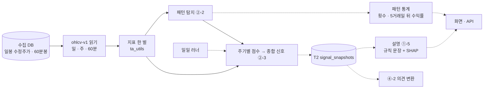

# 목표 기능 ② · ①-5 상세 설계서 v0.6 — 패턴 인식 예측 · XAI 설명 — Qurious

| 문서 정보 | |
|---|---|
| **판 · 상태** | v0.6 · 초안(검토 전) |
| **구분** | 6. 시스템 설계 — 설계 문서(2차 목표 기능 ② 세부 1~3 · ① 세부 5) · 2. 요구사항 관리(인수 기준) |
| **작성** | 신장환(주담당 · ② 세부 1~3 · ①-5) |
| **검토** | 검토 전 — 부담당 강민석(②) · 오준영(①-5) |
| **최종 수정** | 2026-10-16 (KST) · 이전 판 [v0.5](지난판/목표기능2-패턴예측-XAI-설계_v0.5.md) · [v0.4](지난판/목표기능2-패턴예측-XAI-설계_v0.4.md) · [v0.3](지난판/목표기능2-패턴예측-XAI-설계_v0.3.md) · [v0.2](지난판/목표기능2-패턴예측-XAI-설계_v0.2.md) · [v0.1](지난판/목표기능2-패턴예측-XAI-설계_v0.1.md) |
| **기준** | 코드 `main` `0ce7ee7` + TradingView 화면 값 대조(이 판과 같은 PR) · 앱 DB T2 는 이 PC 에 2026-08-31 까지 · 수집 DB HF `qurious-quant/krx-daily-market` 복원본 · 실측은 2026-08-31 까지(봉인 구간 · 3.2) · 실측 스크립트 [`scripts/indicator_defs_scan.py`](../../scripts/indicator_defs_scan.py) · [`scripts/pattern_stats_scan.py`](../../scripts/pattern_stats_scan.py) · [`scripts/signals_daily.py`](../../scripts/signals_daily.py) |
| **관련 문서** | [기능 설계서 v0.1](기능설계.md) 4.1 `P01-①-5` · 4.2 · [프로젝트 계획서 v2.0](../계획서/프로젝트계획서.md) · [RTM v1.10](../요구사항/지난판/RTM_v1.10.md) · [API 명세서 v0.9](../인터페이스/지난판/API명세서_v0.9.md) · [목표 기능 ① 설계서 v1.4](지난판/목표기능1-데이터지식-설계_v1.4.md) 5.1 · 11절 · 14.1 · 옛 분석 A5([#43](https://github.com/EST-team-project/Qurious/issues/43)) · 논의 D6([D22](https://github.com/EST-team-project/Qurious/discussions/22)) · 점검 [#107](https://github.com/EST-team-project/Qurious/issues/107) · [#26](https://github.com/EST-team-project/Qurious/issues/26) P-B · 기초 코드 [#153](https://github.com/EST-team-project/Qurious/issues/153) B2 · B4 · 규칙 명세 [#161](https://github.com/EST-team-project/Qurious/issues/161) A5 · A7 · 중간 점검 [#170](https://github.com/EST-team-project/Qurious/issues/170) · 의견 변환 [#188](https://github.com/EST-team-project/Qurious/pull/188) · 결함 [#194](https://github.com/EST-team-project/Qurious/issues/194) · XAI 경계 [#195](https://github.com/EST-team-project/Qurious/issues/195) |

> **확실도** — 확인(코드 · 데이터에서 직접 봄) · 추정(재지 않았거나 추론) · 없음

---

## 요약

1. 세 요구와 XAI 는 하나의 흐름이다. 지표를 한 정의로 계산하고(②-1), 그 위에서 패턴을 찾고(②-2), 주기별 점수를 합쳐 신호를 하루 한 번 기록하고(②-3), 기록마다 이유를 쉬운 말로 붙인다(①-5). 지표 정의는 한 번만 정하고 넷이 함께 쓴다. 뼈대는 기능 설계서 v0.1 4.2 의 초안(규칙 탐지 · 신호 표 T2 · 두 층 설명)을 따르고, 이 문서는 그것을 지금 코드 위에 구체화한다.
2. **지표 정의가 지금 갈려 있다 — 실제 종목 2,653개로 쟀다.** TradingView 정의와 견주면 `ta_utils` 기본(단순평균) RSI 는 「RSI 30 미만」 날을 **2.6배** 많이 세고, 2026-08-31 하루의 과매도 · 과매수 판정이 **16.5% 종목에서 다르며**, 같은 역추세 규칙의 누적 수익 **부호가 33.3% 종목에서 뒤집힌다.** 패턴 · 다중 주기 신호 · 커스텀 백테스트 · XAI 피처가 모두 이 RSI 를 쓴다(3.3).
3. 그래서 **TradingView 정의 한 벌**(RSI · ATR = Wilder 평활 · 표준편차 = 모집단)로 바꿨다(5.1 · #122). 자동매매 종목 점수도 #127 로 같은 정의를 쓰게 되어, 2,653종목 재실행에서 **갈래가 모두 0** 이다(3.4 · 인수 기준 1 완료). 그 정의가 TradingView 화면 값과도 같다 — 삼성전자 2026-08 다섯 날의 RSI(14)가 화면 값과 소수 둘째 자리까지 같다(3.9 · 인수 기준 2 완료).
4. **②-2 · ②-3 · ①-5 는 코드가 이미 있다.** 빠진 것은 패턴 뒤 **5거래일 수익률 통계**, 신뢰도 **0~1** 과 **거래일마다 기록**, **규칙 신호의 쉬운 말 설명**이다(3.1). 새 표는 T2 `signal_snapshots` 하나다(6절).
5. 다중 주기는 이미 정해진 것을 그대로 쓴다 — 60분봉은 수집 DB 의 야후 분봉, 주봉은 일봉에서 계산한 `ohlcv-v1`, 대상은 분봉 유니버스(5.3).
6. **패턴 통계를 전 종목에 냈다(3.5).** 3,098종목 · 사건 154만 개 — 대상 패턴 11종 모두 5거래일 뒤 수익률이 기준선(같은 종목의 아무 날 · 평균 0.25% · 오른 비율 46.0%)과 **0.4%p 안**에서 다르다. 패턴 이름만으로 다음 주가 갈린다고 말할 근거는 없다 — 화면 · 설명은 이 숫자를 함께 보인다.
7. **다중 주기 신호를 거래일마다 T2 에 기록한다(3.6 · 5.3.1).** 401종목 하루 18초 · 2026-08 한 달 20거래일 8,005줄(= 401 × 20 − 상장 전 15) · 같은 날을 다시 돌려도 줄이 늘지 않는다. 일일 러너의 `signals` 단계로 매일 돈다(#146 · 9절).
8. 화면이 실제보다 더 말하는 곳도 숫자로 확인했다 — 「볼린저밴드 ±2σ 하단 이탈」 은 실제로는 전일 등락률 −2% 판정이라, 그렇게 표시된 날의 **19.2% 만 실제 하단 밴드 아래**였다(3.3). 이 화면(B1 ~ B3)은 3차 인디케이터 화면과 함께 고친다(5.5 · #170).
9. **기록마다 쉬운 말 설명을 붙였다(3.7 · 5.4.4).** T2 한 줄 → 한두 문장 · 근거 표(지표 · 값 · 규칙 · 기여도) · 신뢰도 풀이(`GET /api/explain`). 성과 검증 화면의 설명도 SHAP 캐시에서 그 전략의 규칙 설명으로 바꿨다(5.4.5).
10. **패턴 화면에 잇었다(3.8 · 5.2.4 · 5.3.2 · 5.5).** 일봉 캔들 차트(패턴 화살표 · 지지/저항 점선) · 신호는 매일 기록(T2)이 있으면 그 기록을 날짜와 함께 · 쉬운 말 설명 · 가격 수준 한 줄 · 패턴 11종의 5거래일 뒤 통계(전 종목 · 그 종목)를 나란히 보인다. 신호 칸에 근거 표(기여도 막대)를 더해 인수 기준 6 을 마쳤다(#178).
11. **로보 스크리닝의 모델 설명(SHAP)을 바로잡았다(5.4.2 · #205).** 배지의 판단 · 확률이 5거래일 전 줄의 예측이었고, 품질 관문이 판단을 관망으로 낮춰도 배지는 모델 판단을 그대로 보였다 — 둘 다 고쳤다.

---

## 1. 맥락과 범위

### 1.1 요구와 기술 스택 칸

**<표 1> 맡는 요구** · 인수 기준은 RTM 그대로(2절)

| 요구 ID | 강사님 기술 스택 칸 | 우리 구현 |
|---|---|---|
| `P01-②-1` 지표 계산 | docker-class · lumina-invest · FastAPI | `ta_utils` 한 모듈 · FastAPI |
| `P01-②-2` 차트 패턴 탐지 | SageMaker Training Jobs · ECR + Lambda + API GW · EC2 | 규칙 탐지 + 사건 연구 통계 · 로컬 배치 |
| `P01-②-3` 다중 주기 신호 · 신뢰도 | SageMaker 실시간 추론 엔드포인트 · RDBMS · FastAPI | 규칙 점수 가중합 · 일일 러너 · 매일 계산해 둔 표 읽기 |
| `P01-①-5` XAI 쉬운 말 설명 | SageMaker Processing Jobs(SHAP) · AG Grid · ApexCharts | 규칙 설명 먼저 · LightGBM TreeSHAP(`pred_contrib`) · ApexCharts |

### 1.2 이 문서가 다루지 않는 것

3차 인디케이터 · Pine Script 는 다음 판에서 다룬다. 다만 5.1 의 지표 한 벌은 3차가 그대로 받는다. 신호를 의견으로 바꾸는 규칙(`P01-④-2`)은 이 문서가 정한 T2(6절)를 입력으로 받는다.

---

## 2. 목표 · 비목표

### 2.1 목표 — 인수 기준

**<표 2> 인수 기준과 지금 상태** · 범례: 지금 = 완료 · 진행(일부 됨) · 예정

| 요구 | # | 인수 기준 | 확인 방법 | 지금 |
|---|:-:|---|---|---|
| `②-1` | 1 | 앱 안 RSI · 볼린저 · ATR 이 한 정의로 계산된다 — 갈래 0 | 3.3 표 재실행에서 「기준과 다름」 이 모두 0 (반올림 제외) | **완료**(3.4 · #127 뒤 재실행 · 갈래 0) |
| | 2 | 기준 정의가 TradingView 값과 같다 | TC-IN(고정 입력 · TradingView 화면 값 대조) | **완료**(손계산 · 교과서 예제 · 갈래 0 시험 · TradingView 화면 값 대조 5일 · 차 0.00 — 3.9) |
| | 3 | t 시점 값은 t 까지의 봉으로만 계산된다 | TC-LA | **완료**(ATR · 모집단 볼린저 · 뒤 봉 바꾸기 더함) |
| `②-2` | 4 | 정한 패턴을 종목별로 탐지하고 발생 횟수 · 5거래일 뒤 수익률 통계를 낸다 | TC-PT · TC-PS · TC-PV · 전 종목 집계 | **완료**(3.5 · 전 종목 집계 · TC-PS 7건) · 화면 · `API-STK-34` 연결도 v0.5 에서(3.8 · 5.2.4) |
| `②-3` | 5 | 종목마다 매수 · 매도 · 관망과 0~1 신뢰도를 거래일마다 기록한다 | TC-MT · 기록 행 수 = 대상 종목 × 거래일 | **완료**(3.6 · TC-MT 20건 · 2026-08 실데이터 8,005줄 · 러너 `signals` 단계 연결 #146) |
| `①-5` | 6 | 신호마다 근거(지표 값 · 규칙 · 기여도)를 한두 문장으로 보인다 · 문장의 숫자 = 응답 값 | TC-XA · TC-XR · TC-RX · TC-PV | **완료**(3.7 · 3.8 — 설명 서버 #169 · 성과 검증 규칙 설명 #173 · 패턴 화면에 문장 · 신뢰도 풀이 · 가격 수준 v0.5 · 신호 칸 근거 표(기여도 막대) #178) · 모델 설명(SHAP) 배지 바로잡음 #205(5.4.2) |

### 2.2 비목표

**<표 3> 하지 않는 것**

| 하지 않는 것 | 까닭 |
|---|---|
| 신호의 수익성 입증 | 2차는 「같은 정의로 계산 · 기록된다」 까지다. 성과 판단은 목표 기능 ④ · 3차 |
| 딥러닝 패턴 인식(CNN 차트 이미지 · LSTM) · 학습 탐지 | rfp-2 §3.1.2 의 딥러닝 패턴은 받는 요구가 없다(RTM). 규칙 이름표를 정답으로 한 학습 탐지(기능 설계서의 2단계 · 선택)는 2차 칸 12 뒤로 미룬다 |
| 장중 실시간 갱신 | 3차 실시간 엔진(`SCH-RT`)의 몫. 2차는 하루 1회 |
| SageMaker · Lambda · API GW | 로컬 배치 + FastAPI 로 대신한다(11절). AWS 는 로컬 완성 뒤 고른다 |
| 패턴 종류 늘리기 | 종류가 늘수록 우연히 좋아 보이는 패턴이 생긴다. 통계는 정한 목록만(5.2) |

---

## 3. 지금 상태 — 2026-10-06 실측

### 3.1 요구별

**<표 4> 있는 것과 빠진 것** (확인)

| 요구 | 있는 것 | 빠진 것 |
|---|---|---|
| `②-1` | [`ta_utils.py`](../../app/services/ta_utils.py) — RSI · SMA · EMA · MACD · 볼린저 · ATR | 정의가 갈림 · 별도 구현 둘(`stock._calc_rsi` · `_calc_bollinger` · `ml_symbol_score` 안 rsi) · TradingView 대조 시험 0 → v0.6 에서 TC-IN 에 화면 값 대조(3.9) |
| `②-2` | [`patterns.py`](../../app/services/patterns.py) — 캔들 13종 · 지지/저항 군집 · 20일 · 52주 돌파 · 골든/데드크로스 · `API-STK-34` | 발생 횟수 · 5거래일 뒤 수익률 통계 · 전 종목 탐지 → v0.3 에서 [`pattern_stats.py`](../../app/services/pattern_stats.py) 로 채움(3.5) |
| `②-3` | `multi_timeframe_signal` — 60분 · 일 · 주 점수 가중합 · `API-STK-35` | 신뢰도 0~100 정수 · 다섯 단계 · 기록 없음(요청할 때만 계산) → v0.4 에서 T2 기록 · v0.5 에서 `API-STK-35` 가 T2 를 읽음(3.6 · 5.3.2) |
| `①-5` | [`xai.py`](../../app/services/xai.py) — LightGBM TreeSHAP → 문장 · 퀀트 파이프라인과 로보 스크리닝(`API-STK-08`)이 요청마다 모델을 학습해 설명을 붙인다(저장된 모델 없음) | 규칙 신호 설명 · 설명 기준 · 전용 API → [`signal_explain.py`](../../app/services/signal_explain.py) · `GET /api/explain`(3.7) · 성과 검증 응답도 SHAP 캐시 대신 규칙 설명(5.4.5) |

**<표 5> 어떤 RSI 를 어디서 쓰나** (확인)

| 구현 | 평활 | 쓰는 곳 |
|---|---|---|
| `ta_utils.rsi(method="sma")` **(기본)** | 단순평균 | `quant_pipeline` 피처(퀀트 파이프라인 · 로보 스크리닝의 **XAI 피처**) · 커스텀 백테스트 · `patterns` · `formula` |
| `ta_utils.rsi(method="ewm")` | Wilder · 시작값 = 첫 값 | `investment_research` 규칙 점수(로보 스크리닝) |
| `stock._calc_rsi` | Wilder · 시작값 = 첫 14개 평균 | `API-STK-04` — 기본 인디케이터 전략 · 전략 분석 · 퀀트 대시보드 화면 |
| `ml_symbol_score` 안 `rsi` | 단순평균 | 자동매매 종목 점수(`auto_trade`) |

### 3.2 확인한 함정

- **60분 · 주봉은 지금 수집 DB 를 거치지 않는다.** 다중 주기 신호가 부르는 `get_candles` 의 수집 DB 다리는 `interval == "1d"` 만 받아, 60분 · 주봉은 요청마다 야후로 간다. 수집 DB 에는 야후 60분봉(2023-09 ~ · 472종목)이 이미 쌓여 있고, `ohlcv-v1` 읽기(`API-DATA-02`)가 60분봉과 주봉(일봉에서 계산)을 준다 — 신호는 이것을 쓴다(5.3).
- **같은 「RSI」 가 한 화면 안에서도 둘이다.** 로보 스크리닝은 규칙 점수에 ewm RSI 를, 같은 행의 XAI 설명에는 단순평균 RSI 피처를 쓴다. XAI 문장의 「RSI 과매도 구간(30 미만)」 은 단순평균 RSI 의 30 이다.
- **시작값도 정의의 일부다.** 앱은 요청한 기간(1년 · 2년)의 첫 봉부터 지표를 계산하므로, Wilder 평활이라도 첫 값을 어떻게 두느냐에 따라 처음 수십 봉의 신호가 달라진다(<표 6> ewm 줄).
- **봉인 구간.** 모의투자 검증용 새 봉인 구간은 개봉 기록 없이 읽지 않는다. 시작일은 아직 확정 전이다 — 논의 [D7](../github-archive/2026-09-15/논의-013/00-기록.md) ⑦ 은 「규칙과 일지 실행기가 준비된 뒤 첫 거래일(D5 · D6 뒤 확정)」 이고, 1차 보고서 9.2절은 「2026-09-01 이후 쌓이는 자료로 새 봉인 구간을 정한다」 고 적었다(확인). 그래서 **가장 이른 시작 가능일인 2026-09-01 이후는 읽지 않는다** — 이 문서의 실측과 패턴 통계는 2026-08-31 까지만 쓴다. 시작일이 정해지면 그 전날로 넓힌다.

### 3.3 확인 결과 — 지표 정의 실측

**조건** — 수집 DB 수정주가(앱 일봉 다리와 같은 값) · 코스피 · 코스닥 · 2026-08-31 상장 · 봉 300개 이상 **2,653종목** · 2020-01-02 ~ 2026-08-31 · 종목마다 처음 100봉 제외 → **비교한 봉 3,674,962개** · 기준 = TradingView `ta.rsi` 식(첫 14개 평균으로 시작하는 Wilder 평활 · 하락폭 0 이면 100). 재현은 부록 B.

**<표 6> RSI 14 — 기준 대비** (확인)

| 구현 | 평균 차 | 95% 차 | 「<30」 판정 다른 날 | 「>70」 판정 다른 날 | 「<30」 날 수 (기준 = 1) | 08-31 구간 다른 종목 | 규칙¹ 수익 부호 뒤집힘 | 수익 차 중앙값 |
|---|--:|--:|--:|--:|--:|--:|--:|--:|
| `ta_utils` sma (기본) | 7.0 | 17.9 | 10.9% | 6.8% | **2.59** | **437 (16.5%)** | **882 (33.3%)** | 40.6%p |
| `ta_utils` ewm | 0.007 | 0.000 | 0.0% | 0.0% | 1.00 | 0 | 184 (6.9%)² | 8.8%p |
| `stock._calc_rsi` | 0.005 | 0.005 | 0.0% | 0.0% | 1.00 | 0 | 3 (0.1%)³ | 0.0%p |
| `ml_symbol_score` | 7.0 | 17.9 | 10.9% | 6.8% | 2.59 | 437 (16.5%) | 883 (33.3%) | 40.8%p |

¹ RSI 30 아래 매수 · 70 위 매도 · 다음 날부터 보유 · 비용 없음 · 전 기간. 성과를 주장하려는 규칙이 아니라 정의만 바꿨을 때 결론이 바뀌는지 보는 장치다.
² 100봉 뒤로는 기준과 같고, 뒤집힘은 시작 구간에서 온다(3.2). 상장 직후 오래 거래정지된 11종목은 평평한 구간에서 시작값 차이가 사라지지 않는다(최대 차 28.7).
³ 하락폭 평균 0 일 때 100 대신 99.01 ([`stock.py:329`](../../app/services/stock.py#L329)). 그 밖은 반올림(소수 둘째 자리) 차이.

단순평균 RSI 는 더 출렁여서 30 · 70 을 자주 넘는다. 그래서 패턴 화면 · 다중 주기 신호 · XAI 가 보는 RSI 는 기본 인디케이터 화면(`API-STK-04`)의 RSI 와 **6종목 중 1종목꼴로 다른 구간**을 말한다. D6 의 합성 데이터 결과(58.3% 뒤집힘)와 같은 방향이다.

**<표 7> 볼린저 · ATR · 화면 B1** (확인)

| 항목 | 갈래 | 결과 |
|---|---|---|
| 볼린저 20 · 2σ | `ta_utils`(n−1) vs `stock`(n · TradingView) | 폭 비 중앙값 1.026 · 밴드 밖 봉 10.72% vs 11.84% — n−1 이 이탈을 **9.5% 덜** 센다 · 판정 갈리는 봉 1.12%⁴ |
| ATR 14 | `ta_utils`(단순평균) vs TradingView(Wilder) | 상대 차 중앙값 **8.5%** · 95% 29.7% |
| 화면 B1 「하단 이탈 · 매수」 | 실제로는 등락률 < −2% ([`indicator.js:38`](../../public/js/indicator.js#L38)) | 표시된 728,512봉 중 실제 하단 밴드 아래 **19.2%** · 실제 하단 이탈 231,664봉 중 잡는 것 60.5%⁴ |

⁴ v0.1 의 값(12.40% · 13.5% · 1.68% · 57.8%)은 거래정지로 가격이 평평한 구간을 「밴드 밖」 으로 잘못 셌다 — 밴드 폭이 0 이라 종가 = 밴드인데, 화면용으로 반올림한 밴드와 견줘서다. 반올림 단위의 절반(0.005)보다 더 벗어날 때만 세도록 실측을 고쳤다.

MACD 는 `ta_utils.macd` 한 곳뿐이라 갈래가 없어 재지 않았다. 그 EMA 시작값이 TradingView `ta.ema` 와 같은지는 TC-IN 에서 확인한다(추정).

**시험** — 지금 있는 패턴 · XAI · 미래 참조 · 자유 산식 시험 **26건 통과**(`test_patterns.py` · `test_xai.py` · `test_ta_utils_lookahead.py` · `test_formula.py` · 1.6초 · 2026-10-06).

### 3.4 확인 결과 — 지표 한 벌로 바꾼 뒤 (2026-10-06)

5.1 을 이 판과 같은 PR 에서 했다. 같은 조건(2,653종목 · 2026-08-31 까지)으로 3.3 을 다시 쟀다.

**<표 7-1> 바꾼 뒤 — 기준 대비** (확인)

| 길 | RSI 평균 차 | 「<30」 판정 다른 날 | 볼린저 판정 다른 봉 | ATR 상대 차 |
|---|--:|--:|--:|--:|
| `ta_utils`(패턴 · 퀀트 · XAI · 로보 스크리닝) | 0 | 0% | — | 0% |
| `API-STK-04` 화면(`stock`) | 0.002(반올림) | 0% | 0%(`ta_utils` 와) | — |
| 자동매매 종목 점수(`ml_symbol_score`) | 0 | 0% | — | — |

자동매매 종목 점수는 v0.2 때 7.0 · 10.9% 로 남은 하나의 갈래였다. 담당 파트(오준영)가 #127(10-07)에서 그 안의 단순평균 RSI 를 `ta_utils.rsi` 로 바꿨고, 같은 조건(2,653종목 · 비교한 봉 3,674,962개)으로 다시 재니 **0** 이다(2026-10-07 · 위 표 셋째 줄). 이로써 인수 기준 1 을 마친다.

화면용 값은 소수 둘째 자리로 반올림하므로 RSI 가 30 · 70 에 아주 가까운 날은 반올림 때문에 판정이 바뀔 수 있다(역추세 규칙 부호 3종목 · 0.1%). 정의의 갈래는 아니다.

**<표 7-2> 백테스트 숫자는 어디서 바뀌나** — 대형주 10종목 · 2026-08-31 까지 · 기본 인자 (확인)

| 길 | 바뀐 종목 | 가장 큰 차 | 까닭 |
|---|--:|--:|---|
| 대시보드 기본 전략(`strategy=rsi` · 1년) | 0 | 0 | 이미 Wilder RSI 였다(시작값만 달랐고 1년 창 안에서 신호가 같았다) |
| 전략 `ma` · `composite`(1년) | 0 | 0 | — |
| 전략 `bollinger`(1년) | 4 | 12.2%p | 표준편차 n − 1 → n (예: 삼성전자 +2.06% → −6.40%) |
| `API-STK-04` 화면 RSI · 볼린저 | 0 | 0 | 이미 TradingView 정의였다 |

**시험** — 전체 888 통과 · 실패 1(`test_lectures.py` — 바꾸기 전 `main` 에서도 실패 · 강의 파일 목록) · DB 시험은 팀 절차(`test.ps1`)에서 지표와 무관한 리밸런싱 시험이 결함 DF-73([#117](https://github.com/EST-team-project/Qurious/issues/117))으로 실패한다. 새 시험 TC-IN 12건 · TC-LA 3건.

### 3.5 확인 결과 — 패턴 통계 (2026-10-07)

5.2 를 이 판과 같은 PR 에서 했다. 규칙은 <표 9>, 구현 결정은 5.2.3.

**조건** — 수집 DB 수정주가를 앱 일봉 다리와 같은 값으로(화면 탐지기와 같은 봉) · 2026-08-31 까지 한 번이라도 코스피 · 코스닥에 있던 **3,127종목**(상장폐지 포함 · 그 가운데 봉이 70개 이상인 3,098종목을 셈) · 사건 날 2020-04-03 ~ 2026-08-24(t+5 = 2026-08-31) · 코스피 = 지수 `KOSPI:코스피`.

**<표 7-3> 패턴 뒤 5거래일 수익률** — 기준선 = 같은 종목의 사건 후보가 될 수 있던 모든 날 3,866,516일 · 평균 0.25% · 중앙값보다 평균이 큰 것은 소수의 급등(예 5일 +335%)이 끌어올려서다 (확인)

| 패턴 | 방향 | 사건 | 평균 | 중앙값 | 오른 비율 | 코스피 대비 평균 | 기준선과의 차 |
|---|---|--:|--:|--:|--:|--:|--:|
| 골든크로스 (MA20 · MA60) | 매수 | 38,321 | 0.26% | −0.46% | 44.2% | −0.30% | −0.00%p |
| 데드크로스 (MA20 · MA60) | 매도 | 37,932 | −0.17% | −0.25% | 46.2% | −0.69% | **−0.36%p** |
| 52주 신고가 | 매수 | 25,923 | 0.83% | −0.60% | 45.0% | 0.04% | **+0.36%p** |
| 망치(해머) | 매수 | 154,835 | 0.05% | −0.28% | 44.3% | −0.37% | −0.17%p |
| 상승 장악형 | 매수 | 155,324 | 0.19% | −0.43% | 44.8% | −0.18% | −0.05%p |
| 하락 장악형 | 매도 | 178,612 | 0.19% | −0.29% | 46.4% | −0.40% | −0.06%p |
| 도지 | 중립 | 293,030 | 0.20% | −0.25% | 45.6% | −0.27% | −0.04%p |
| 샛별형 | 매수 | 34,702 | 0.35% | −0.43% | 45.0% | −0.08% | +0.08%p |
| 흑삼병 | 매도 | 30,463 | 0.37% | −0.16% | 47.9% | −0.12% | +0.13%p |
| 지지선 하향 이탈 | 매도 | 307,047 | 0.17% | −0.30% | 46.3% | −0.37% | −0.07%p |
| 저항선 상향 돌파 | 매수 | 290,625 | 0.28% | −0.40% | 45.2% | −0.19% | +0.02%p |
| (기준선) | — | 3,866,516 | 0.25% | — | 46.0% | — | — |

- **11종 모두 기준선과 0.4%p 안이고, 오른 비율도 44 ~ 48% 로 기준선 46.0% 둘레다.** 이름이 말하는 방향과 맞는 것은 데드크로스(−0.36%p) 정도이고, 매도 쪽 흑삼병은 오히려 기준선보다 낫다.
- 그래서 화면 · 설명(①-5)은 패턴을 「오를 · 내릴 신호」 로 말하지 않고, 이 표의 숫자(그 종목 · 전 종목의 과거 횟수와 5일 뒤 결과)를 함께 보인다(5.4.1 의 쓰지 않는 말).
- 차이가 우연인지(검정)는 재지 않았다 — 사건이 날짜에 몰려(예 2020-03 · 2024-08 급락장) 서로 독립이 아니라, 단순 t 검정은 과하게 유의하게 나온다. 2차 범위는 「같은 정의로 낸다」 까지다(2.2).
- 종목별 숫자는 `by_symbol.csv`(패턴 × 종목 한 줄)에 있다 — 화면은 그 종목 줄과 전 종목 줄을 나란히 보인다. 앱은 이 파일을 싣지 않고 같은 규칙으로 그 자리에서 계산한다(5.2.4 · 3.8).

**시험** — 새 묶음 TC-PS 7건(`test_pattern_stats.py` · 이름은 시험-요구 대장에서 비어 있음을 확인 · 대장 등록은 대장 관리 쪽): 모든 날 탐지가 화면 탐지기와 236일 날마다 같음(대상 11종이 모두 나오는 수열 · 실데이터로도 20종목(거래정지 · 연속 상한가 종목 포함) 마지막 300일씩 5,580일을 대조해 다른 날 0) · t 뒤 봉을 바꿔도 t 까지 사건 그대로 · 5일 수익률 · 코스피 대비 · 기준선 손계산 · 겹침 · 봉인 구간 · 거래 없던 날. 팀 절차 `test.ps1`(최신 `main` `f0fa9cf` 위 · 일회용 시험 DB) — 통과 982 · 건너뜀 6 · 실패 1(`test_lectures.py` — 이 PC 의 강의 원본이 저장소와 달라 `main` 에서도 같은 실패).

### 3.6 확인 결과 — 다중 주기 신호 · T2 (2026-10-08)

5.3 을 이 판과 같은 PR 에서 했다. 구현 결정은 5.3.1.

**조건** — 분봉 유니버스 `u2-20260930` 401종목 · 2026-08-03 ~ 2026-08-31 거래일 20일(봉인 구간 밖) · `ohlcv-v1`(일 · 60분 = 수집 DB · 주 = 일봉에서) · 일회용 PostgreSQL 에 마이그레이션 `0017` 을 올린 뒤 배치로 기록.

**<표 7-4> 2026-08 기록** (확인)

| 항목 | 값 |
|---|---|
| 줄 | **8,005** = 401 × 20 − 15(`0220W0` 은 2026-08-25 상장이라 그 전 15일은 그날 일봉이 없어 빠짐) · 날짜 20 · 종목 401 |
| 신호 | 관망 3,917 · 매수 2,149(강 238) · 매도 1,939(강 322) |
| 평균 신뢰도 | 관망 0.29 · 매수 보통 0.57 · 매도 보통 0.62 · 강 0.85 안팎 |
| 시간 | 하루 401종목 18초 · 20일 70초(프로세스 넷) |
| 다시 돌리기 | 같은 날 · 같은 판을 다시 써도 8,005줄 그대로(값만 바뀜) |
| 주봉 | 금요일(08-28)은 `partial = false` · 주 중간은 `true` |
| 마이그레이션 | `0016 → 0017` 올림 · `alembic check` 「No new upgrade operations」(모델 = 마이그레이션) · 내렸다 다시 올림 |

신호 비율은 성과가 아니다 — 맞는지(보정 · 적중)는 기록이 쌓인 뒤 봉인 구간 밖에서 잰다(2.2).

**시험** — 새 묶음 TC-MT 17건(`test_mtf_signals.py`): 세 단계 · 강도 경계 · 신뢰도 경계(모두 같은 방향 · 큰 점수 = 1 · 엇갈림 = 0) · 화면 식과 같음(무작위 300건 — 화면 값 = round(신뢰도 × 100) · 다섯 단계 = 신호 + 강도) · 그날 뒤 봉을 바꿔도 같음 · 진행 중인 주 · 그날 시세 없으면 줄 없음 · 60분봉이 없어도 일 · 주로 · 종목 · 거래일당 한 줄 · T2 같은 날 다시 쓰기 = 바꿈 · 정의 판이 바뀌면 같은 날 두 줄(옛 줄 보존 · 시험 DB). #166 에서 3건 더해 20건(배치가 계산 전에 앱 DB 를 먼저 확인 · 닿지 않으면 계산 없이 종료코드 3).

### 3.7 확인 결과 — 신호 설명 (2026-10-12)

5.4.1 을 #169 에서 구현했다. 구현 결정은 5.4.4.

**조건** — 2026-08-31 · 분봉 유니버스 401종목의 T2 줄(5.3.1 배치) · 설명 층 1(`signal_explain.explain`).

- 근거 기여도 합 = 종합 점수(401종목 모두) · 문장의 숫자 = 응답 값 · 쓰지 않는 말(<표 11> 정직) 어긋남 0.
- 근거 3,648줄(RSI 중간 제외) 모두 관측값(지표 값)이 있다 — T2 `timeframes` 에 지표 값을 함께 남기도록 바꿨기 때문이다(6절 <표 12>). 값을 남기지 않던 옛 줄은 RSI 만 값이 보이고 나머지는 방향만 말한다.
- 규칙과 다른 쪽 0 · 문장 길이 22 ~ 110자(가운데 73) · 신호 관망 147 · 매수 118(강 15) · 매도 136(강 34).

**시험** — 새 묶음 TC-XR 19건(`test_signal_explain.py`) · TC-PT · TC-MT 에 한 줄씩(주기 점수가 지표 값을 냄 · T2 가 그 값을 남김). 성과 검증 규칙 설명(5.4.5)은 새 묶음 TC-RX 22건(#173) · 같은 화면의 「비교에 추가」 단추 정적 검사 1건(#176 · 23건).

### 3.8 확인 결과 — 패턴 화면 (2026-10-13)

5.2.4 · 5.3.2 · 5.5 를 이 판과 같은 PR 에서 했다.

**<표 7-5> 개발 앱에서 부른 결과** — 점검 계정 · 이 PC 의 시세 기준일 2026-10-01 · 앱 DB T2 는 2026-08-31 까지 (확인)

| 종목 | `API-STK-35` 신호 | `API-STK-34` 통계 · 가격 수준 |
|---|---|---|
| 005930(코스피) | 기록(T2) · 2026-08-31 · 관망 · 설명 문장 | 11종 전 종목 줄 + 그 종목 줄 · 지지 · 저항 · ATR(10-01 일봉) |
| 247540(코스닥) | 기록(T2) · 2026-08-31 · 매수 | 같음 |
| AAPL(해외) | 그 자리 계산 · 마지막 일봉 날 · 매수 | 전 종목 줄만(그 종목은 수집 DB 에 없어 비움) · 가격 수준은 소수 둘째 자리 |

- 그 종목 통계를 그 자리에서 계산한 값이 전 종목 배치의 `by_symbol.csv` 와 같다 — 6종목(코스닥 포함) 65칸 · 최대 차 1e-16. 처음 부를 때 종목마다 0.3 ~ 0.6초, 그 뒤는 저장해 둔 값.
- 화면(로보 어드바이저 「차트 패턴 · 지지/저항 · 멀티타임프레임」): 일봉 캔들 · 패턴 화살표 · 지지/저항 점선과 켜고 끄기 · 화살표가 있는 날에 마우스를 올리면 시세 줄에 그날 패턴 이름 · 신호 배지 「관망」 · 「매수 · 강」 · 기록 날짜 · 설명 요약 아래 가격 수준 한 줄(그 일봉 날짜와 함께) · 캔들 패턴 표의 「과거 5일 뒤(전 종목)」 칸 · 11종 통계 카드.
- 이 PC 처럼 T2 가 오래되면 신호(08-31)와 차트 · 가격 수준(10-01)의 날짜가 다르다 — 화면이 두 날짜를 모두 보인다(12절).
- 신호 칸 근거 표(#178 · 10-13) — 주기 · 근거 · 관측값 · 규칙 · 기여도와 기여도 막대(ApexCharts · 앱에 이미 있는 3.49.2). 설명의 `evidence` 를 그리기만 하고(서버 그대로) 막대를 못 그리면 표만 보인다. 005930 은 기여도 합 0(관망) · AAPL 은 합 2(매수) = 종합 점수.

**시험** — 새 묶음 TC-PV 24건(`test_pattern_view.py`): 앱에 담은 전 종목 통계 = 스캔 결과 · 전 종목 · 그 종목 나란히(자료 없음 = 비움 · 사건 없음 = 0) · 그 종목 통계 = `event_study` 같은 규칙 · 끝날까지만 읽음 · 실패는 저장하지 않음 · 가격 수준(ATR = Wilder · 한 줄 문장 · 작은 값은 소수 둘째 자리) · 신호 낱말(「· 강」 만 · `action` 옛 낱말 유지) · 기록 → 화면 칸(0 ~ 1) · 그 자리 계산도 같은 식 · 같은 설명 · 기준일 = 마지막 일봉 날 · 기록이 있으면 오래돼도 기록 · T2 가 없어도 그 자리 계산 · 통계 오류에도 패턴 응답 · 금지어 · 화면 정적 검사(차트 도구는 #171 과 같은 파일을 그릴 때만 · 자동 갱신 없음 · 배지는 `label` · 표식은 화살표만 · 사건 적음 안내). #178 에서 근거 표 정적 검사 1건 더해 25건.

### 3.9 확인 결과 — TradingView 화면 값 대조 (2026-10-16)

인수 기준 2 를 이 판과 같은 PR 에서 했다.

**조건** — TradingView `KRX:005930` 일봉 · RSI 길이 14 · 원천 종가(기본값) · 화면에 보이는 값(소수 둘째 자리)을 사람이 읽음 · 우리 값 = 수집 DB 수정주가 종가로 `ta_utils.rsi(14)` · 봉인 구간 밖(2026-08).

**<표 7-6> RSI 14 — TradingView 화면 값 대조** (확인 · 화면 값은 사람이 읽음 · 마우스를 올린 봉의 종가로 날짜를 맞춤)

| 날짜 | 종가 | TradingView 화면 | 우리(`ta_utils.rsi`) | 차 |
|---|--:|--:|--:|--:|
| 2026-08-03 | 239,500 | 44.25 | 44.25 | 0.00 |
| 2026-08-06 | 230,500 | 42.66 | 42.66 | 0.00 |
| 2026-08-13 | 268,000 | 53.39 | 53.39 | 0.00 |
| 2026-08-21 | 281,500 | 56.06 | 56.06 | 0.00 |
| 2026-08-31 | 260,000 | 50.00 | 50.00 | 0.00 |

- 다섯 날 모두 소수 둘째 자리까지 같다. 고른 날은 달의 첫날 · 하루 −6.3% 급락 · 반등 중간 · 그달 RSI 가 가장 높던 날 · 봉인 구간 전 마지막 날이다.
- 화면 종가도 다섯 날 모두 수집 DB 종가와 같았다 — 수정주가 다루기가 달라 생기는 차이는 이 기간에 없다.

- 시세는 저장소에 담지 않았다 — 공개 저장소에 시세 원자료를 올리지 않는다고 계획서 7절 <표 12> · 코딩표준 9절에 적혀 있다. 시험은 이 PC 의 수집 DB 를 앱 일봉 다리(`read_daily_candles` · 끝날 2026-08-31)로 읽는다 — 고정 종가가 아니라 앱이 실제로 쓰는 길로 잰다.

**시험** — TC-IN 에 1건(수집 DB 일봉 → 다섯 날 RSI = TradingView 화면 값 · 허용 오차 0.005 = 화면 반올림의 절반 · 12절 · 수집 DB 가 없는 PC(CI · 새 clone)에서는 건너뜀 — 목표 기능 ① 의 수집 DB 시험과 같은 방식).

---

## 4. 전체 구조

### 4.1 자료가 흐르는 길

**<그림 1> 지표에서 설명까지** · 범례: 실선 = 지금 있음 · 점선 = 이 문서에서 만듦



- 하루 한 번: 일봉 갱신이 끝나면 러너의 새 단계가 대상 종목 전부의 신호를 계산해 T2 에 쓴다.
- 화면 · API 는 T2 를 읽는다. 기록이 없는 종목 · 날짜만 그 자리에서 계산한다.

### 4.2 모든 신호에 붙는 칸

신호 · 통계 · 설명은 어떤 지표 정의(`definition`)와 어느 날 시세(`as_of`)로 계산했는지를 늘 함께 낸다. 정의가 바뀌면 새 판으로 다시 계산한 줄이 따로 쌓여 옛 기록과 섞이지 않고(6절), 화면은 기준일을 보인다.

---

## 5. 세부 설계

### 5.1 `P01-②-1` 지표 한 벌

**<표 8> 정의** — TradingView Pine v5 문서의 식 · 정의 판 `definition = "tv-2026"`

| 지표 | 정의 | 지금과 다른 점 |
|---|---|---|
| RSI(n) | 상승 · 하락폭을 `rma`(첫 n개 평균으로 시작 · α = 1/n)로 평활 · 하락폭 0 → 100 · 상승폭 0 → 0 | 단순평균 → Wilder · `method` 인자 제거 |
| 볼린저(n, k) | SMA(n) ± k × 모집단 표준편차 | n−1 → n |
| ATR(n) | TR 을 `rma` 로 평활 | 단순평균 → Wilder |
| SMA · EMA · MACD | 그대로 | — (EMA 시작값은 TC-IN 에서 확인) |

- **옮길 곳** — `stock._calc_rsi` · `_calc_bollinger` 를 `ta_utils` 호출로 바꾸고(`ml_symbol_score` 안 rsi 는 자동매매 파트에 맡김 · 3.4), `investment_research` 의 `method="ewm"` 을 지운다.
- **출력** — `API-STK-04` 응답에 `definition` 칸을 더한다.
- **조심** — 화면용 밴드는 반올림돼 있다. 화면에서 종가와 견줄 때(B1)는 반올림 단위의 절반을 허용 오차로 둔다 — 거래정지 구간이 「이탈」 로 잡히지 않게(3.3 ⁴).
- **영향** — 퀀트 파이프라인 · 패턴 · 신호 · XAI · 로보 스크리닝 숫자가 바뀐다. 바꾸는 PR 에 3.3 표 재실행(남은 갈래 · 3.4)과 대시보드 기본 전략 성능 전후 숫자를 싣는다.

### 5.2 `P01-②-2` 패턴 탐지 · 통계

#### 5.2.1 대상 패턴

통계에는 정한 목록만 넣는다 — 골든 · 데드크로스(MA20 · MA60) · 52주 신고가 돌파 · 캔들 5종(망치 · 장악(상승 · 하락) · 도지 · 샛별 · 흑삼병) · 지지 이탈 · 저항 돌파. 지금 탐지기의 나머지(역해머 · 유성형 · 교수형 · 석별 · 적삼병 · 마루보즈 · 볼린저 이탈 · 20일 돌파)는 화면 표시용으로 둔다.

#### 5.2.2 통계 — 사건 연구

**<표 9> 사건 연구 규칙**

| 단계 | 규칙 |
|---|---|
| 사건 | 종목 i 가 날 t 종가로 패턴을 냄 · 탐지는 t 까지의 봉만 |
| 결과 | t+1 ~ t+5 누적 수익률(`forward_ret_5d`) · 같은 기간 코스피 대비 초과수익 |
| 집계 | 패턴별 횟수 · 평균 · 중앙값 · 오른 비율 · 기준선(같은 종목 전체 날의 5일 수익률)과의 차 |
| 겹침 | 같은 종목 5거래일 안 재발은 첫 사건만 |
| 기간 | **봉인 구간 밖에서만**(지금은 2026-08-31 까지 · 3.2) — t+5 가 봉인 구간에 걸리는 사건은 뺀다 |
| 비용 | 넣지 않는다 — 가격 움직임의 통계이지 전략 성과가 아니다 |

#### 5.2.3 구현 — v0.3

- **파일** — 규칙 [`app/services/pattern_stats.py`](../../app/services/pattern_stats.py) · 전 종목 배치 [`scripts/pattern_stats_scan.py`](../../scripts/pattern_stats_scan.py) → `data/local-run/pattern_stats/`(`summary.json` · `by_symbol.csv` · `events.csv`) · 6절대로 표가 아니라 다시 만드는 파일이다(전 종목 약 3분).
- **탐지 정의 = 화면 탐지기** — 화면 탐지기(`patterns.py`)는 마지막 몇 봉만 보므로 같은 식을 모든 날에 한 번에 계산한다. 지지 · 저항은 날마다 그날까지 120봉의 피벗(피벗 j 는 j ± 5봉의 최고 · 최저라 j + 5 ≤ t 만)으로 레벨을 다시 만든다. 둘이 같은지는 TC-PS 가 날마다 대조한다.
- **화면과 다르게 둔 셋** — (1) 크로스는 그날 난 것만 사건이다(화면은 5봉 안의 크로스를 보인다) (2) 52주 신고가는 1년 치(252봉)가 다 있을 때만 센다(화면은 있는 봉으로 본다) (3) 거래량 0 인 날은 사건이 아니다 — 거래정지로 평평한 봉은 모양이 도지라 그대로 두면 정지 기간이 도지로 쌓인다.
- **사건 후보 날** — 봉이 65개 이상(화면 `pattern_summary` 의 최소)이고 거래가 있던 날. 기준선도 같은 날들로 낸다.
- **종목** — 끝날까지 한 번이라도 코스피 · 코스닥에 있던 종목 전부(상장폐지 포함 — 끝날에 살아 있는 종목만 보면 망한 종목의 패턴이 빠진다). 다만 t+5 봉이 없는 사건(그 안에 상장폐지)은 빠진다.
- **봉인 구간** — 배치는 DB 에서 끝날까지만 꺼내고, 끝날을 2026-09-01 이후로 주면 멈춘다. 함수도 끝날을 봉인 구간 전날로 줄인다(두 겹).

#### 5.2.4 구현 — v0.5 (화면 · `API-STK-34`)

- **파일** — [`app/services/pattern_view.py`](../../app/services/pattern_view.py) · 전 종목 요약 [`app/services/pattern_stats_summary.json`](../../app/services/pattern_stats_summary.json)(5.2.3 배치의 `summary.json` 그대로 · 끝날 2026-08-31).
- **통계 묶음 `stats`** — 11종마다 전 종목 줄(요약 파일)과 그 종목 줄을 나란히 · 기준선(아무 날)도 둘 다. 그 종목 줄은 `by_symbol.csv`(4MB)를 싣지 않고 같은 규칙으로 그 자리에서 계산한다 — 수집 DB 일봉을 끝날까지만 읽고(`read_daily_candles(max, today=끝날)` · 봉인 구간을 읽지 않음) `event_study` 로. 끝날이 고정이라 값이 바뀌지 않아 종목마다 한 번 계산해 두고, 읽지 못한 결과는 저장하지 않는다. 수집 DB 에 없는 종목(해외)은 비우고, 자료는 있는데 사건이 없던 패턴은 0 으로 가른다.
- **가격 수준 `levels`** — 가장 가까운 지지 · 저항 · ATR(14 · Wilder)과 설명 요약에 붙일 한 줄(#161 A5). 값이 작은 해외 종목은 소수 둘째 자리.
- **「사건마다 `forward_ret_5d`」 는 하지 않는다** — v0.4 <표 13> 의 문장을 바로잡는다. 화면의 사건은 최근 5봉 패턴 · 오늘 돌파라 5거래일 뒤가 아직 없다. 지난 사건들의 결과는 그 종목 통계 줄이 보인다(7절).

### 5.3 `P01-②-3` 다중 주기 신호 · 기록

**<표 10> 지금과 바꿀 것**

| 항목 | 지금 | 바꿀 것 |
|---|---|---|
| 주기 | 60분(1개월) · 일(1년) · 주(5년) — 60분 · 주는 요청마다 야후 | 모두 `ohlcv-v1` 읽기 — 일 · 60분 = 수집 DB · 주 = 일봉에서 계산한 주봉(날짜 = 그 주 마지막 거래일 · 진행 중인 주는 `partial`) |
| 대상 | 요청한 종목 하나 | 분봉 유니버스 `u2-20260930`(코스피200 구성 201 · 코스닥150 구성 150 · 거래대금 상위 ETF 50 = 401) — 모두 60분봉이 쌓이는 종목이다 |
| 점수 | 주기마다 −6 ~ +6 (RSI · MA · MACD · 볼린저 규칙) | 그대로 — 지표만 5.1 정의로 |
| 결과 | 다섯 단계 · 신뢰도 0~100 정수 | **`signal` 매수 · 매도 · 관망**(RTM) · 「강력」 은 `strength`(보통 · 강)로 옮김 · **`confidence` 0~1** |
| 기록 | 없음 | 거래일마다 T2 에 한 줄(6절) |

신뢰도는 지금 코드의 식(방향이 같은 주기의 가중치 비율 × ½ + 점수 크기 × ½)을 0~1 로 옮기고, 식을 정의 판과 함께 고정한다(곱으로 두는 안은 11절). 보정(신뢰도가 높을수록 실제로 더 맞나)은 기록이 쌓인 뒤 잰다.

**배치** — 일일 러너에 단계 `signals` 를 더한다(일봉 갱신 단계 뒤 · #146 으로 연결). 실패하면 러너 상태에 원인이 남고, 빠진 날은 러너가 세어 관리 화면 「빠진 날 채우기」(31일까지)로 채운다(#157).

#### 5.3.1 구현 — v0.4

- **파일** — 계산 · 기록 [`app/services/mtf_signals.py`](../../app/services/mtf_signals.py) · 표 [`app/models/signal.py`](../../app/models/signal.py) · 마이그레이션 [`0017_signal_snapshots`](../../alembic/versions/0017_signal_snapshots.py) · 배치 [`scripts/signals_daily.py`](../../scripts/signals_daily.py)(`--date` · `--from/--to` · `--dry-run`).
- **그날까지의 봉만** — 날 D 의 일봉은 D 종가까지 · 60분봉은 D 의 봉까지 · 주봉은 D 까지의 일봉으로(`data_ohlcv.weekly` — 그 주 월요일부터 모아 첫 주를 온전히). 한 종목의 기간 전체를 한 번 읽고 날마다 자른다.
- **점수 · 신뢰도는 화면과 같은 식** — 주기 점수는 `patterns.timeframe_score` 그대로, 신뢰도는 화면 식을 반올림 없이 0 ~ 1 로(화면 값 = round(× 100)). 강도는 |종합| ≥ 2.5 면 강 · 관망은 강도 없음. 방향 일치도(`agreement`)도 칸으로 둔다 — 설명(5.4.1)의 「주기 셋 중 둘이 같은 방향」 이 이 값이다.
- **그날 일봉이 없으면 줄이 없다** — 상장 전 · 그날 시세 없음. 60분봉이 없는 날은 일 · 주 둘로 신호를 내고 60분 칸에 오류를 남긴다.
- **다시 쓰기** — 같은 (날 · 종목 · 판)은 새 값으로 바꾸고, 다른 판의 줄은 건드리지 않는다(PostgreSQL `ON CONFLICT`).
- **러너** — 러너(`scripts/daily_update.py`)는 목표 기능 ① 담당의 파일이라 손대지 않고 부탁했다 → #146 으로 연결(`ohlcv` 뒤 · 앱 DB 포트가 닫히면 러너가 건너뜀). 배치는 계산 전에 앱 DB 를 먼저 보고, 닿지 않으면 계산 없이 종료코드 3 으로 끝난다(#166).
- **봉인 구간** — 날짜를 주지 않은 배치는 그날의 운영 기록(오늘 신호)이다. T2 기록을 분석 · 검증(보정 · 적중)에 쓸 때는 봉인 구간(3.2)을 빼고 읽는다. 이 판의 확인(3.6)은 2026-08 만 썼다.
- **API · 화면은 그대로**(v0.4) — 응답을 T2 읽기로 바꾸는 일은 화면과 함께 했다(5.3.2).
- **지표 값도 남긴다**(#169) — `timeframes` 에 주기 점수 · 근거와 함께 그 값(5 · 20 이동평균 · 종가 · MACD · 신호선 · 볼린저 상단 · 하단)을 남긴다. 설명 근거 표의 「값」 을 채우려는 것이다(6절 <표 12>).

#### 5.3.2 구현 — v0.5 (`API-STK-35` T2 읽기)

- **기록이 있으면 기록** — 지금 판(`tv-2026`)의 가장 최근 T2 줄을 날짜와 상관없이 쓰고 `as_of` 로 그 날을 보인다(`source: record` · #153 B4). 기록이 없는 종목(분봉 유니버스 밖 · 해외)만 그 자리에서 계산한다(`source: live`). 앱 DB 에 T2 가 없거나 닿지 않아도 그 자리 계산으로 돈다.
- **같은 식 · 같은 설명** — 그 자리 계산도 `mtf_signals.combine` 으로 신호 · 강도 · 신뢰도를 내고, 기록과 같은 설명 함수(5.4.4)를 붙인다. 기준일은 오늘이 아니라 마지막 일봉 날이다(설명의 「그날 패턴」 이 맞춰지게) · 돌파 사건도 패턴 목록에 넣는다(기록과 같게).
- **칸** — `signal` · `strength` · `label`(화면 낱말) · `confidence` · `agreement`(0 ~ 1 · T2 와 같음) · `composite` · `definition` · `as_of` · `source` · `timeframes` · `explanation`. 화면 낱말은 강할 때만 「매수 · 강」 이고 보통은 「매수」 다(#161 A7). 자동매매가 글자를 읽는 `action`(「강력 매수」)은 그대로 둔다.
- **의견 칸**(`P01-④-2` · 강민석 · #188) — 같은 응답에 사용자별 `opinion`(매수 · 매도 · 보유 · 관망) · `opinion_rule` · `held`(모의 장부 보유 여부)가 붙었다. 의견은 요청할 때 신호와 보유 여부로 계산하고 T2 에 쓰지 않는다(6절). 로그인 인자가 `_user → user` 로 바뀌었다.
- **결함(#194 · DF-113)** — #188 뒤 보유 조회가 앱 DB 를 먼저 읽어, 앱 DB 가 닿지 않으면 위 「T2 가 없거나 닿지 않아도 그 자리 계산」 이 500 으로 끝나고, 입력 글자가 장부와 다르면(`005930.ks` · 장부 `005930.KS`) 보유를 못 찾는다. 보유 조회 고침은 강민석 몫으로 부탁했고, 고쳐지면 TC-PV 의 라우트 시험 2건(새 인자)과 「앱 DB 가 닿지 않아도 신호」 검사를 맞춘다.

### 5.4 `P01-①-5` XAI 설명

#### 5.4.1 층 1 — 규칙 신호의 쉬운 말 설명 (먼저)

- 입력 T2 한 줄 → 한두 문장 + 근거 표(지표 · 값 · 규칙 · 방향).
- 틀: 「{주기} 기준으로 {큰 근거 둘}이라 {행동} 쪽입니다. 다만 {반대 근거 하나}는 반대 방향입니다.」
  - 예: 「일봉 기준으로 RSI 27 로 많이 떨어졌고 5일선이 20일선 위로 올라와 매수 쪽입니다. 다만 주봉은 아직 20주선 아래입니다.」
- 쓰지 않는 말: 규칙 합산을 「AI 판단」 이라 부르기 · 「오를 것」 같은 단정 · 확률처럼 읽히는 신뢰도(「0.72」 → 「주기 셋 중 둘이 같은 방향」).
- 가격 수준 한 줄(#161 A5): 요약 아래에 가장 가까운 지지 · 저항과 ATR 변동 폭 — 「가격 수준(2026-10-01 일봉 기준): 가장 가까운 지지 267,000(−3.3%) · 저항 279,000(+1.1%) · 하루 평균 변동 폭(ATR 14일) 11,928(4.3%)」. 기록 신호와 날짜가 다를 수 있어 그 일봉 날짜를 붙인다.

#### 5.4.2 층 2 — 모델 설명(SHAP)

[`xai.py`](../../app/services/xai.py) 를 그대로 쓴다. 모델은 요청마다 학습되므로 5.1 뒤에는 피처 RSI 가 저절로 새 정의로 바뀐다 — `FEATURE_META` 의 해석 문구(30 · 70 경계)가 새 정의에서도 맞는지만 본다.

**바로잡음(#205 · 2026-10-15)** — 쓰는 곳은 로보 스크리닝 XAI 패널(`API-ML-10` `/api/ml/explain`) · 스크리닝 결과 표 요약 줄(`API-STK-08`) · 자산 배분 추천 종목 카드(오준영 몫 화면 · 같은 배지 함수).
- **배지와 근거가 다른 날** — 학습용 줄은 5일 뒤 수익률이 있는 줄만이라 끝이 5거래일 전이다. 배지의 판단 · 확률을 그 끝 줄로 내고 근거 기여도는 오늘 줄로 내서, 31종목(08-31) 중 7종목은 배지 판단이 오늘 판단과 달랐다. 판단 · 확률도 오늘 줄로 낸다(DF-117).
- **경고와 배지가 다른 판단** — 품질 관문(검증 정확도가 다수 클래스 기준선 + 2%p 미만)은 응답 판단만 관망으로 낮추고 배지는 모델 판단을 그대로 보였다(31종목 중 관문 28 · 어긋남 22). 배지를 「관망 · 모델 매수 49.8%」 꼴로 — 판단을 앞에, 확률 · 기여도가 가리키는 모델 판단(`model_signal_label`)을 뒤에.
- 캐시 키 `ai_predict:v3 → v4`(설명 API · 스크리닝 요약 — 자산 배분 라우트의 키는 담당 쪽에 부탁) · `refresh=1`(다시 학습)은 관리자만 · 기여도 숫자 반올림 뒤 부호(「-0.00」 없음).
- v0.6 에서 바로잡음 — #205 가 스크리닝 표 요약 줄을 바꾸며 「— 」 뒤 띄어쓰기를 빠뜨렸다(「49.8% —ATR(14)」). 되살리고 TC-XA 정적 검사가 그 띄어쓰기까지 보게 했다.

#### 5.4.3 설명 기준

**<표 11> 설명 기준**

| 기준 | 뜻 | 확인 |
|---|---|---|
| 정확 | 문장의 숫자 · 방향이 응답 값과 같다 · 같은 입력 → 같은 문장 | TC-XA · TC-XR · TC-PV |
| 충분 | 근거 표의 상위 근거가 점수(층 1) · 기여도 합(층 2)의 절반 이상을 설명한다 · SHAP 합 = 예측 − 기댓값 | TC-XA · TC-XR(근거 기여도 합 = 종합 점수) |
| 정직 | 규칙은 규칙이라 말한다 · 면책 한 줄 | 금지어 검사 |

#### 5.4.4 구현 — 층 1 (#169)

- **파일** — [`app/services/signal_explain.py`](../../app/services/signal_explain.py) · [`app/routes/explain.py`](../../app/routes/explain.py) `GET /api/explain?kind=signal&symbol=&date=`(`API-EXPL-01`) — 그날(없으면 그 앞 가장 가까운 거래일)의 T2 한 줄을 문장 · 근거 표 · 신뢰도 풀이로.
- **근거 표** — 주기마다 근거 한 줄(지표 · 관측값 · 규칙 · 점수 · 기여도 = 점수 × 주기 가중치 ÷ 시세 있는 주기 가중치 합). 기여도를 모두 더하면 종합 점수다(<표 11> 충분).
- **문장** — 가장 크게 민 주기 · 그 주기의 같은 방향 근거 둘 · 반대 근거 하나. 관망은 합친 점수와 기준(±1) · 양쪽 근거. 덧붙임: 시세 없는 주기 · 진행 중인 주봉 · 그날 패턴(「패턴 이름만으로 5거래일 뒤 방향이 갈린다는 근거는 없습니다」 — 3.5).

#### 5.4.5 성과 검증 화면의 규칙 설명 (#173)

성과 검증(`API-STK-30` · 기본 전략 백테스트)의 설명은 같은 종목의 LightGBM SHAP 캐시(다른 모델의 근거 · 캐시가 없으면 빈칸)였다. 백테스트한 그 전략의 규칙 설명(강사님 `explain_strategy`)으로 바꿨다 — 마지막 두 봉 값으로 매수 · 매도 조건마다 충족 여부 · 판단 = 백테스트의 마지막 신호 · 비용 모델과 무관 · custom 은 비움. SHAP 은 로보 스크리닝 · `/api/ml/explain` 에 그대로 둔다(층 2 · 5.4.2).

### 5.5 화면

- **기본 인디케이터 화면 B1 ~ B3 → 3차** — B1 볼린저를 실제 밴드로 · B2 MA60 · MACD · 볼린저 체크박스 읽기 · B3 「AI 판단」 → 「규칙 합산」. 이 화면(`indicator-strategy`)의 요구는 `P02-①-1` · `P02-①-2` · `U6`(3차)이고, 같은 화면의 낱말 바꾸기(#161 A7)도 3차라 함께 한다(#170 답). 그때까지 B1 의 「하단 이탈 · 매수」 표시는 실제로 등락률 −2% 미만 판정이다(3.3 <표 7>).
- **패턴 시각화**(v0.5 · 로보 어드바이저 「차트 패턴 · 지지/저항 · 멀티타임프레임」 · `robo.js` 의 패턴 부분)
  - 차트 — 강사님 기초 코드 끝 판(`5b0a768`)의 TradingView Lightweight Charts 차트에서 캔들 · 패턴 표식 · 지지/저항 점선 · 켜고 끄기만 받았다(#153 B4). 받지 않은 것: 30초 자동 갱신 · 캐시 우회 · 종목 검색 · 지지/저항 읽는 법 안내. 라이브러리는 상품 상세 창(#171)과 같은 저장소 안 파일을 차트를 그릴 때만 불러온다.
  - 강사님 원본과 갈린 곳 — 표식은 글자 없이 화살표만(1년 차트에서 가까운 날 이름끼리 포개져서) · 이름은 화살표가 있는 날에 마우스를 올리면 시세 줄에 · 차트 안내에 「지지 · 저항은 과거에 여러 번 멈췄던 가격대이고, 다음에도 그 자리에서 멈춘다는 뜻은 아닙니다」.
  - 신호 — 배지(`label`) · 기록 날짜(「매일 기록(T2) · 날짜 종가 기준」 · 기록이 없으면 「그 자리에서 계산」) · 설명 요약 · 가격 수준 한 줄 · 신뢰도 풀이 · 덧붙임 · 주기 표.
  - 통계 — 캔들 패턴 표에 「과거 5일 뒤(전 종목)」 칸 · 11종 통계 카드(전 종목 · 이 종목 · 기준선 · 지금 나온 패턴 ●) · 「이 종목 칸은 사건이 수십 건뿐이라 몇 건만 달라도 숫자가 크게 흔들립니다 — 전 종목 칸과 함께 보세요」.
- **신호 · 근거 카드**(작업 묶음 W5 · 패턴 화면 `robo-patterns`(와이어프레임 W18)의 신호 칸) — 행동 · 신뢰도 풀이 · 쉬운 설명 · 근거 표(기여도 막대 — ApexCharts). 행동 · 신뢰도 풀이 · 쉬운 설명은 위 「신호」 로, 근거 표는 #178 로 했다(3.8).
- **의견 배지**(강민석 · #189) — 같은 신호 칸에 「의견: 매수 · 보유 …」 배지(`opinion` · 규칙은 마우스를 올리면). 의견 변환(`P01-④-2`)의 화면 칸이 여기 붙었다.
- 모의 투자 의사결정 화면(와이어프레임 W10 `robo-decision`)의 **의사결정 근거 카드**는 강민석 몫이다(#153 B4 답) — 그 카드에 쓸 신호 설명 문장은 `/api/explain`(5.4.4), 가격 수준은 `API-STK-34` 의 `levels` 를 쓰면 된다(9절).

---

## 6. 데이터 저장 — 새 표

**<표 12> T2 `signal_snapshots`** — 기능 설계서 T2 를 구체화 · `P01-④-2` 의 입력 · 마이그레이션 `0017`(v0.4) · 색인 (symbol, as_of)

| 칸 | 형 | 뜻 |
|---|---|---|
| `as_of` · `symbol` · `definition` | date · text · text | 기준 거래일(종가) · 종목 · 지표 정의 판(`tv-2026`) — 셋이 기본키 |
| `signal` · `strength` | text | 매수 · 매도 · 관망 / 보통 · 강 |
| `confidence` · `composite` · `agreement` | real | 0~1 · 가중 점수(−6 ~ +6) · 방향 일치도 0~1(v0.4 더함) |
| `timeframes` | json | 주기별 점수 · 근거 · 쓴 봉의 마지막 시각 · 지표 값(`ma5` · `ma20` · `last` · `macd` · `macd_signal` · `bb_upper` · `bb_lower` — #169 부터 · 마이그레이션 없음) |
| `pattern_bias` · `patterns` | text · json | 일봉 패턴 요약 |
| `reasons` | json | 규칙 설명 층의 근거(5.4.1) |
| `computed_at` | timestamp | 계산 시각 |
| `opinion` · `opinion_rule` | text | 의견 칸(`P01-④-2` · 마이그레이션 `0023` · #187) — 칸만 있고 지금 값을 쓰는 곳은 없다(의견은 요청할 때 계산 · 5.3.2) |

정의 판이 바뀌면 지난 날짜를 새 판으로 다시 계산해 **새 줄로 더하고 옛 판 줄은 그대로 둔다**(덮어쓰지 않는다 — 지난 판으로 낸 신호 · 의견을 나중에 다시 볼 수 있어야 한다). 화면 · 의견 변환은 지금 판의 줄만 읽는다.

주기별로 줄을 나누지 않고 종목 · 날짜 · 판당 한 줄로 두고 주기별 값은 `timeframes` 에 담는다 — 의견 변환이 한 줄만 읽으면 되게 하려는 것이다. 의견 칸(`opinion` · `opinion_rule`)은 `P01-④-2` 가 이 표에 더했다(`0023` · #187).

패턴 통계(5.2)는 표로 두지 않고 배치가 만드는 집계 파일(패턴 · 종목별 한 줄)로 둔다 — 하루 한 번 다시 만들 수 있는 값이다. 앱은 전 종목 요약만 담고, 종목별은 같은 규칙으로 그 자리에서 계산한다(5.2.4).

---

## 7. API

**<표 13> 이 문서가 쓰거나 더하는 API**

| ID | 메서드 · 경로 | 지금 | 이 문서에서 |
|---|---|---|---|
| `API-DATA-02` | `GET /api/data/ohlcv` | 있음 | 그대로 읽음(일 · 주 · 60분) |
| `API-STK-04` | `GET /api/stocks/quant/indicators` | 있음 | 지표를 5.1 정의로 · `definition` |
| `API-STK-08` | `GET /api/stocks/signals` | 있음 | 그대로(XAI 피처만 5.1 정의로) · XAI 요약 줄은 `v4` 캐시 · `model_signal_label`(#205 · 5.4.2) |
| `API-STK-30` | `GET /api/quant/pipeline` | 있음 | 기본 전략의 `explanation` = 그 전략의 규칙 설명(custom 은 null · #173 · 5.4.5) |
| `API-STK-34` | `GET /api/stocks/patterns` | 있음 | 패턴별 통계 묶음 `stats`(전 종목 · 그 종목) · 가격 수준 `levels`(v0.5 · 5.2.4). v0.4 의 「사건마다 `forward_ret_5d`」 는 하지 않는다 — 화면 사건은 5거래일 뒤가 아직 없다 |
| `API-STK-35` | `GET /api/stocks/mtf-signal` | 있음 | T2 의 지금 판 줄(없으면 그 자리 계산) · `signal` · `strength` · `label` · `confidence` · `agreement`(0~1) · `definition` · `as_of` · `source` · `explanation` · `action`(옛 낱말 유지)(v0.5 · 5.3.2) · 의견 `opinion` · `opinion_rule` · `held`(#188 · 강민석) |
| `API-EXPL-01` | `GET /api/explain?kind=signal&symbol=&date=` | 있음(#169) | `{summary, reasons[], counter_reasons[], evidence[], confidence_text, notes[], method: "rule"}`(5.4.4). v0.4 안의 `method: "shap"` 은 넣지 않았다 — SHAP 은 로보 스크리닝 · `/api/ml/explain` 에 그대로 둔다(#153 B2 · 5.4.2 · 5.4.5) |
| `API-ML-10` | `GET /api/ml/explain?symbol=&refresh=` | 있음 | 판단 · 확률 = 오늘 줄 · 관문에 걸리면 `signal` 관망 + `model_signal` · `model_signal_label` · `refresh` 는 관리자만 · 캐시 `v4`(#205 · 5.4.2) |

`/api/explain` 의 `kind` 는 다른 설명 대상(배분 · 종목 선정)을 위해 비워 둔 자리다.

---

## 8. 시험 계획

**<표 14> 시험 묶음**

| 묶음 | 파일 | 요구 | 지금 | 더할 것 |
|---|---|---|--:|---|
| TC-IN | `test_indicator_defs.py` | `②-1` | 13 | v0.6 에서 TradingView 화면 값 대조 1건(3.9 · 인수 기준 2) |
| TC-LA | `test_ta_utils_lookahead.py` | `P02-②-2` | 11 | — |
| TC-PT | `test_patterns.py` | `②-2` | 7 | v0.4 의 「다음은 `API-STK-34` 통계 묶음」 은 TC-PV 에서 했다(라우트가 `stats` · `levels` 를 붙임 · 통계 묶음) |
| TC-PS | `test_pattern_stats.py` | `②-2` | 7 | v0.3 에서 만듦(3.5) |
| TC-MT | `test_mtf_signals.py` | `②-3` | 20 | v0.4 에서 만듦(3.6) · #166 +3 · v0.4 의 「다음은 `API-STK-35` 가 T2 를 읽을 때 응답 시험」 은 TC-PV 에서 했다(기록이 있으면 기록 · 없으면 그 자리 계산 · T2 가 없어도 돎) |
| TC-XA | `test_xai.py` | `①-5` | 8 | v0.4 에 적은 더할 것(같은 입력 → 같은 문장 · 문장 숫자 = 응답 값 · 금지어)은 설명 층 1 의 TC-XR 에서 했다(5.4.4). #205 에서 6건 더함 — 배지 확률 = 오늘 줄 예측 · 기여도 합 = 같은 예측 · `refresh` 관리자만 · 캐시 `v4` · 관문에 걸리면 배지 = 응답 판단(2) · 화면 배지 글자(5.4.2) |
| TC-XR | `test_signal_explain.py` | `①-5` | 19 | #169 에서 만듦(3.7) |
| TC-RX | `test_strategy_explain.py` | `①-5` | 23 | #173 에서 만듦 · #176 +1(5.4.5) |
| TC-PV | `test_pattern_view.py` | `②-2` · `②-3` · `①-5` | 25 | v0.5 에서 만듦(3.8) · #178 +1(근거 표) · 라우트 시험 2건은 #188 뒤 실패 중(#194 · DF-113 · 5.3.2) |

건수는 2026-10-16 이 판의 브랜치에서 센 값이다. 묶음 이름 · 요구 · 확실도의 대장 등록은 대장 관리 쪽이 한다.

---

## 9. 다른 기능과의 접점

**<표 15> 받는 것 · 주는 것**

| 방향 | 기능 | 무엇 |
|---|---|---|
| 받음 | `P01-①-2` | `ohlcv-v1`(일 · 주 · 60분) · 분봉 유니버스 `u2-20260930` |
| 부탁 → 완료 | `P01-①-4` | 일일 러너 단계 `signals`(`ohlcv` 단계 뒤 · 실패해도 뒤를 막지 않음 · 명령 `python scripts/signals_daily.py`) — #142 부탁 → #146 연결 · 빠진 날은 러너가 세고 관리 화면에서 채움(#157) |
| 줌 | `P01-④-2` | T2 의 지금 판 줄(6절) — 의견 칸은 ④-2 가 더했다(`0023` · #187) · 의견은 `API-STK-35` 응답과 패턴 화면 배지에 붙었다(#188 · #189 · 5.3.2 · 5.5) |
| 줌 | `P01-④-1` | 지표 정의 변경 전후의 백테스트 숫자 |
| 줌 | 로보 스크리닝(`API-STK-08`) | RSI 가 표준 정의로 바뀜(<표 5> · <표 6>) |
| 알림 | 자산 배분 추천 종목 카드(`P01-③` · 오준영) | XAI 배지가 같은 함수라 함께 바뀜 · 그 라우트의 캐시 키 `v4` 는 담당 쪽에 부탁(#205 · 5.4.2) |
| 부탁 → 완료 | 자동매매 종목 점수(`ml_symbol_score`) | 단순평균 RSI 를 `ta_utils.rsi` 로 — #127 로 반영 · 갈래 0(3.4) |
| 줌 | 피처 · 지표 사전 · ERD | <표 8> 정의 · <표 12> 표 |
| 줌 | 의사결정 근거 카드(W10 `robo-decision` · 강민석 · `P01-④-2`) | 신호 설명 문장 `/api/explain`(5.4.4 · #153 B4 답) · 가격 수준 `API-STK-34` `levels`(5.2.4) · 신호 `API-STK-35`(`confidence` 0~1 · `label` · v0.5 에서 칸이 바뀜) |

---

## 10. 순서 · 일정

**<표 16> 작업 묶음**

| 묶음 | 내용 | 칸 |
|---|---|---|
| W1 | 지표 실측 · 이 설계서 v0.1 | — (10-06 완료) |
| W2 | 지표 한 벌 · TC-IN(10-06 · #122) · TradingView 화면 값 대조(10-16 · 3.9) | 완료 |
| W3 | 패턴 통계(10-07 · 3.5) · 다중 주기를 `ohlcv-v1` 로 · 세 단계 · 0~1 · T2(10-08 · 3.6) · 러너 단계(#146) | 칸 12 전 — 완료 |
| W4 | 패턴 시각화(차트 · 신호 T2 읽기 · 통계 · 가격 수준 · 3.8) | 10-13 완료(v0.5 · #177) |
| W5 | 규칙 설명 · 설명 기준(10-12 · #169) · 성과 검증 규칙 설명(10-13 · #173) · 신호 · 근거 카드(패턴 화면 신호 칸 — 문장 · 신뢰도 풀이 v0.5 · 근거 표 #178) · 모델 설명 배지 바로잡음(10-15 · #205) | 완료 |
| 3차 | 기본 인디케이터 화면 B1 ~ B3(`P02-①-1` · `①-2` · `U6` · #170 답) | 10-22 ~ |

---

## 11. 검토한 대안

**<표 17> 고르지 않은 것과 까닭**

| 대안 | 고르지 않은 까닭 |
|---|---|
| 지표를 외부 라이브러리로(pandas-ta-classic · TA-Lib) | 정의 대조값으로는 쓸 만하다. 다만 TA-Lib 은 설치 부담이 있고, 우리 지표는 다섯 개라 Pine 식을 직접 옮기는 편이 짧고 의존이 없다 |
| RSI 두 정의를 인자로 남기기 | 지금이 그 상태이고 3.3 의 갈래가 그 결과다. 한 정의만 둔다 |
| 신뢰도 = 일치도 × 강도(곱) | 한 주기만 강하게 맞아도 곱이 크게 줄어 「관망」 근처가 0 에 몰린다(추정). 지금 코드의 평균 식을 고정하고, 보정을 잰 뒤 다시 본다 |
| 주기별로 T2 줄을 나누기 | 의견 변환이 세 줄을 다시 합쳐야 한다. 종목 · 날짜 · 판당 한 줄로 둔다 |
| 정의가 바뀌면 T2 를 덮어쓰기 | 표는 단순해지지만 지난 판으로 낸 신호 · 의견을 다시 볼 수 없다. 판을 기본키에 넣는다 |
| SageMaker 학습 · 추론 엔드포인트 | 비용 합의 전이다. 로컬 배치 + FastAPI 로 같은 흐름을 만든다 |

---

## 12. 위험 · 뒤집을 조건

**<표 18> 위험**

| 위험 | 영향 | 대응 · 뒤집을 조건 |
|---|---|---|
| 지표 변경으로 다른 화면 · 성과 숫자가 바뀜 | 성과 · 로보 스크리닝 결과가 앞서 확인한 값과 어긋남 | PR 에 전후 숫자 · 머지 전 알림 |
| 신뢰도를 확률로 읽음 | 사용자 오해 | 설명에서 풀어 씀 · 보정을 잰 뒤에만 「확률」 이라 부른다 |
| 야후 60분봉이 막힘 | 다중 주기가 일 · 주 둘로 줄어듦 | 그동안 가중치를 일 · 주로 다시 나누고, 목표 기능 ① 의 대체 경로(증권사 당일 분봉)를 받는다 |
| 야후 분봉은 09:00 ~ 15:00 만 있음 | 60분봉 마지막 봉에 종가 단일가가 빠짐 | 60분 점수는 장중 흐름으로만 쓰고 종가 판단은 일봉에 맡긴다 |
| TradingView 대조값과 소수점 차이 | 인수 기준 2 판정이 흔들림 | 허용 오차를 화면 반올림의 절반(0.005)으로 고정(3.9) · 화면 값은 사람이 읽은 것이라 종목 · 날짜를 시험에 함께 적는다 |
| T2 기록이 오래됨(러너가 멈춤) | 패턴 화면이 오래된 날의 신호를 보임 | 기록 날짜를 늘 함께 보인다(5.3.2) · 빠진 날은 러너가 세어 관리 화면에서 채운다(#157) |
| 그 종목 통계의 표본이 작음(사건 수십 건) | 몇 건 차이로 숫자가 크게 바뀌어 과하게 읽힘 | 전 종목 줄을 나란히 · 화면에 안내 한 줄(5.5) |
| 다중 주기 신호가 앱 DB 에 기대게 됨(#188 보유 조회) | 앱 DB 가 닿지 않으면 신호도 500 · 입력 글자가 다르면 의견이 틀림 | #194 로 부탁 · 고쳐지면 TC-PV 로 지킴(5.3.2) |
| 야후 시세로 T2 를 채우는 스크립트(`scripts/signals_yahoo.py` · #182) | 수집 DB 와 다른 시세로 같은 정의 판(`tv-2026`) 줄을 덮어쓸 수 있음 | #160 에서 담당 쪽에 알려져 있다 · 그 스크립트를 머지한 뒤 야후 회귀 시험 2건이 실패 중(DF-110) |

---

## 부록 A. 용어

| 말 | 이 문서에서 |
|---|---|
| Wilder 평활(`rma`) | α = 1/n 인 지수평활. 첫 값은 처음 n개의 단순평균 |
| 모집단 표준편차 | 나눗수가 n. pandas 기본(`std()`)은 n−1 이라 다르다 |
| 사건 연구 | 어떤 일이 일어난 날을 기준으로 그 뒤 수익률을 모아 보는 통계 |
| 갈래 | 같은 이름의 지표가 앱 안에서 다른 식으로 계산되는 곳 |
| 봉인 구간 | 결과를 보기 전에 떼어 둔 기간. 마지막 검증에서 개봉 기록과 함께 한 번만 연다([D7](../github-archive/2026-09-15/논의-013/00-기록.md) ⑦) |

## 부록 B. 다시 재는 법

```powershell
# 수집 DB 가 없으면 — 로컬 실행 안내서(docs/배포/로컬실행안내서.md) 2절 4번대로 HF 비공개 데이터셋을 받아 복원한다
#   python scripts\hf_dataset.py restore --from <받은 폴더> --into data\collector\market.sqlite3
#   HF 토큰은 환경변수나 저장소 루트 .env 에만 둔다 — 출력 · 커밋하지 않는다(collector/README.md)

# <표 6> · <표 7> (전 종목 약 2분 · 기본 끝날 2026-08-31 = 봉인 구간의 가장 이른 시작 가능일 전날 · 3.2)
python scripts/indicator_defs_scan.py --json data/local-run/indicator_defs_scan.json

# <표 7-3> (전 종목 약 3분 · 끝날 2026-08-31 · 봉인 구간 안으로 주면 멈춘다)
python scripts/pattern_stats_scan.py --events

# <표 7-4> (401종목 · 20거래일 약 70초 · 앱 DB 에 쓴다 · --dry-run 이면 쓰지 않는다)
python scripts/signals_daily.py --from 2026-08-01 --to 2026-08-31

# 3.9 (TradingView 화면 값 대조 · 수집 DB 를 읽음 · 수집 DB 가 없으면 건너뜀)
python -m pytest tests/test_indicator_defs.py -k tradingview
```

## 부록 C. 변경 노트 — 다음 판(v0.7)에 넣을 것

v0.5 뒤의 노트 세 줄(#178 바로잡음 · #178 근거 표 · #205)은 v0.6 본문으로 옮겼다(부록 D). 다음 판까지 바뀌는 것을 여기 적는다.

| 날짜 | 종류 | 무엇 | 옮길 곳 | 근거 |
|---|---|---|---|---|
| 2026-10-16 | 고침 | 판단마다 「무엇으로 냈나」 — 스크리닝(규칙 앙상블 · 기준일) · 다중 주기(일 · 주 · 60분 규칙 가중합 · 정의) · 캔들 패턴(일봉 최근 5봉) · XAI(학습 모델 · 기준일 = 학습 · 예측에 쓴 마지막 일봉 날 `as_of`)에 한 줄 · 차트 패턴 신호 칸에 자동매매 기본 규칙 판단(`API-STK-04` `signal` · 읽기만)과 다를 때 까닭 · 스크리닝 「LightGBM (앙상블)」 · 「AI 패턴 인식」 · 「ML 파이프라인」 낱말을 실제대로(규칙 합산을 학습 모델 · AI 로 부르지 않음) · 스크리닝 · XAI → 차트 패턴 「다중 주기 ↗」 · `API-STK-34` · `35` 가 6자리 · 소문자 입력을 `.KS` · `.KQ` 로 맞춤(수집 DB 다리 · T2 · 장부와 같은 꼴) · `API-STK-08` 줄마다 `as_of` · TC-PV 25 → 29건 · TC-XA 8 → 9건 | 3.8 · 5.2.4 · 5.3.2 · 5.4.2 · 5.5 · <표 13> · <표 14> TC-PV · TC-XA | #226 · #213 |
| 2026-10-16 | 고침 | 장부 조회 결함(#194 결함 1)이 #237 로 고쳐짐 — 앱 DB 가 닿지 않으면 미보유로 보고 신호 · 의견을 낸다 · TC-PV 라우트 시험 2건을 지금 인자(`user`)로 · 「T2 · 장부가 닿지 않아도 신호가 나온다」 검사 · TC-PV 29 → 30건 · 패턴 화면 「신뢰도 N% · 방향 일치」 띄어쓰기 · TC-RX 라우트 시험이 체결 · 청산 시점(`entry_mode` · `exit_mode` · #160 B3)을 넘김 | 5.3.2 · <표 14> TC-PV · 위험(#194 줄) | 이 PR · #194 · #237 |

## 부록 D. 개정 이력

| 판 | 날짜 | 내용 |
|---|---|---|
| v0.6 | 2026-10-16 | TradingView 화면 값 대조(3.9 · 인수 기준 2 완료 · TC-IN +1) / 부록 C 노트를 본문으로 — v0.5 의 잘못 바로잡음과 근거 표(#178 · 인수 기준 6 완료 · v0.5 줄의 「6 완료」 는 그때 아직 아니었음) · 모델 설명 배지 바로잡음(5.4.2 · #205 · TC-XA 8건) / 의견 변환이 이 문서의 표 · API · 화면에 붙은 것을 적음(T2 의견 칸 `0023` · `API-STK-35` 의견 · 패턴 화면 의견 배지 · #187 ~ #189) · 그 결함(#194)과 야후 T2 스크립트를 위험에 / W2 · W4 · W5 완료 |
| v0.5 | 2026-10-13 | 패턴 시각화(W4) — 화면(3.8 · 5.5 · 차트는 강사님 `5b0a768` 에서 받은 것 · 갈린 곳) · `API-STK-34` 통계 묶음 · 가격 수준(5.2.4) · `API-STK-35` T2 읽기(5.3.2) · <표 13> 「사건마다 `forward_ret_5d`」 를 바로잡음 · 새 시험 묶음 TC-PV 24건 / 부록 C 노트를 본문으로 — 러너 연결 · 빠진 날 채우기(#146 · #157) · 배치 앱 DB 먼저 확인(#166) · T2 지표 값 · 설명 층 1(3.7 · 5.4.4 · #169) · 성과 검증 규칙 설명(5.4.5 · #173 · #176) / 인수 기준 4 · 6 완료 · 5 의 러너 연결 / 기본 인디케이터 화면 B1 ~ B3 를 3차로(5.5 · <표 16> · #170 답) / 위험 둘(T2 오래됨 · 작은 표본) |
| v0.4 | 2026-10-08 | 다중 주기 신호 · T2(5.3.1 구현 · 3.6 <표 7-4> 2026-08 8,005줄 · 인수 기준 5 완료 — 러너 연결은 러너 담당에게 부탁) · <표 12> `agreement` 칸 · 마이그레이션 `0017` · 새 시험 묶음 TC-MT 17건 · 부록 B 수집 DB 받는 법을 공식 절차로 |
| v0.3 | 2026-10-07 | 인수 기준 1 완료(#127 뒤 재실행 · <표 7-1> 자동매매 0) · 패턴 통계(5.2.3 구현 · 3.5 <표 7-3> 전 종목 · 인수 기준 4 완료) · 새 시험 묶음 TC-PS 7건 |
| v0.2 | 2026-10-06 | 지표 한 벌(5.1) 구현 뒤 — 3.4 확인 결과(갈래 — 자동매매 점수 하나 남음 · 백테스트 전후) · 인수 기준 3 완료 · 3.3 볼린저 · B1 숫자 바로잡음(평평한 구간 반올림 착시) · B1 허용 오차 |
| v0.1 | 2026-10-06 | 첫 판 — 현황 · 지표 정의 실측(2,653종목 · 봉인 구간 제외) · 세부 설계 · T2 · API · 시험 |
